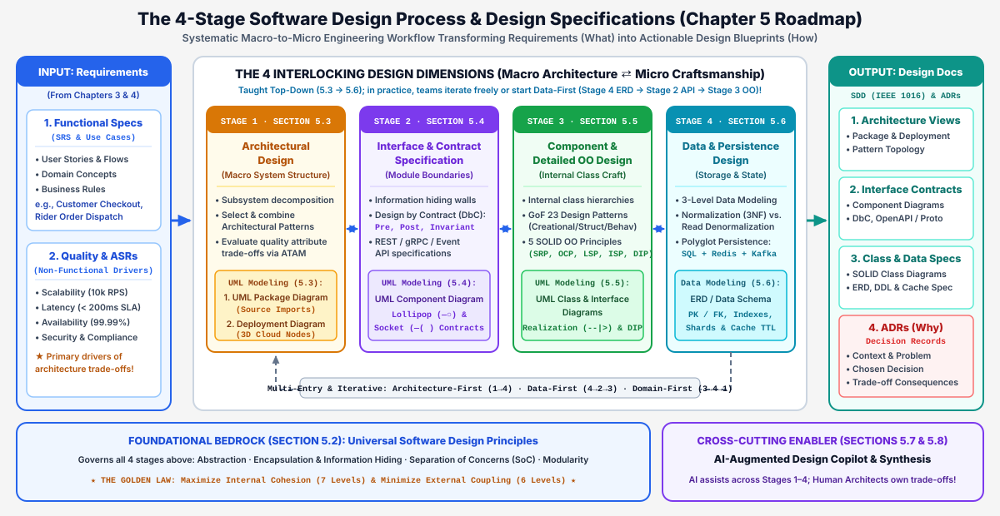
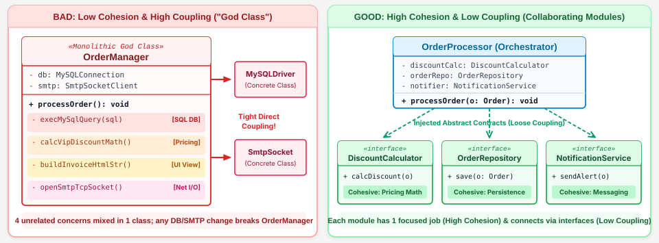
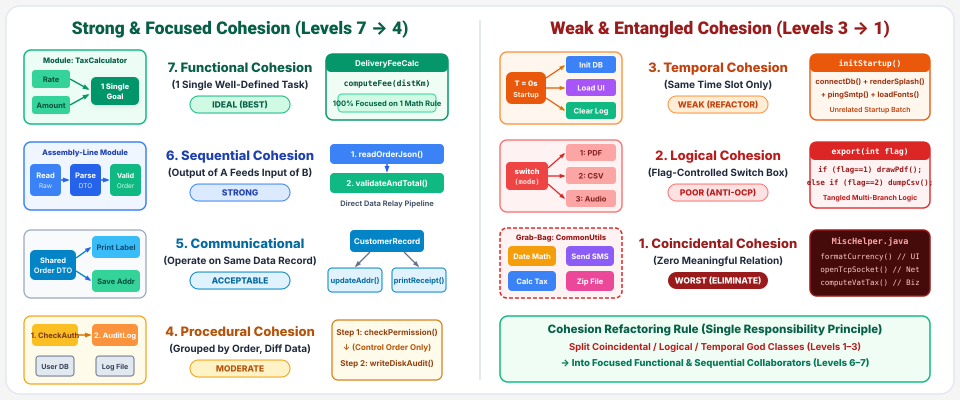
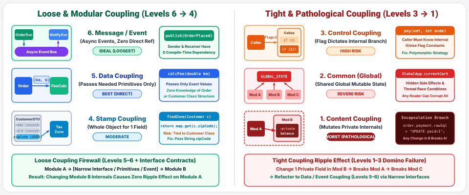
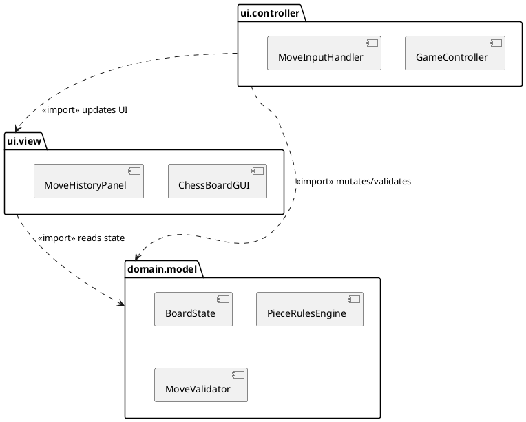
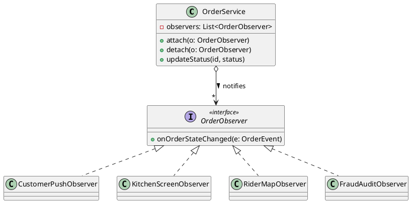

# Chapter 5: Software Design, Architecture & Object-Oriented Principles

**Lecture Outline & Key Concepts**
> * **5.1 Software Design Foundations, Process & Specifications**: What software design is (bridging *What* in SRS to *How* in SDD), why design matters (preventing Robert C. Martin's 4 symptoms of design rot and leveraging Barry Boehm's 1:100 defect cost curve), the 4 interlocking design stages (Macro Architecture ⇄ Interface Contracts ⇄ Detailed OO Design ⇄ Data Design), flexible entry points (Top-Down Architecture-First vs. Data-First vs. Domain-First), and formal deliverables (**SDD — IEEE 1016** and **ADRs**).
> * **5.2 Universal Software Design Principles**: Fractal design heuristics across all scales (Function, Class, Component, Microservice), the 4 core tenets (Modularity, Abstraction, Encapsulation & Information Hiding, Separation of Concerns), the Golden Rule (**High Cohesion & Low Coupling**), the **7 Levels of Cohesion** (Coincidental → Functional), and the **6 Levels of Coupling** (Content → Message/Data) with visual spectrum maps.
> * **5.3 Stage 1 — Architectural Design: Patterns, Trade-offs & Macro UML**: Defining software architecture and Architecturally Significant Requirements (ASRs), the **6 Classic Architectural Patterns** (MVC, Layered, Repository, Client-Server, Pipe-and-Filter, Microservices), Monolithic vs. Microservices trade-offs, Food Delivery multi-pattern synthesis, **ATAM** (Utility Tree, Sensitivity & Trade-off Points), and Macro UML modeling (**UML Package Diagram** & **UML Deployment Diagram** + Chess MVC Peer Discussion).
> * **5.4 Stage 2 — Interface & Contract Specification: DbC & Component UML**: Formalizing module boundaries via Bertrand Meyer's **Design by Contract (DbC)** (`Precondition`, `Postcondition`, `Class Invariant`), Rights & Obligations matrix, industrial interface specifications (OpenAPI 3.1, gRPC Protobuf, AsyncAPI), specifying `OrderService.placeOrder()` in **Contract-Enhanced Javadoc vs. JML**, Peer Discussion on `bubbleSort(int[] arr)` formal specification, and **UML Component Diagrams** (Provided Lollipop `—○`, Required Socket `—(`, Ports & Connectors).
> * **5.5 Stage 3 — Component & Detailed OO Design: Patterns, SOLID & Class UML**: Christopher Alexander & the Gang of Four (**GoF 23 Design Patterns** across Creational, Structural, and Behavioral categories), deep dive into the **5 SOLID Object-Oriented Principles** (**SRP, OCP, LSP, ISP, DIP**) with side-by-side UML anti-pattern vs. refactored Class Diagrams, and Peer Discussion on the **GoF Observer Pattern**.
> * **5.6 Stage 4 — Data & Persistence Design: ERD, Caching & Polyglot Storage**: Three-level data modeling (Conceptual → Logical ERD → Physical Schema), **Third Normal Form (3NF)** vs. deliberate read denormalization, **Polyglot Persistence** in Food Delivery (`PostgreSQL` ACID OLTP + `Redis` GeoHash/Cache-Aside with TTL + `Apache Kafka` event streams), and distributed consistency (**ACID vs. BASE** & the **Transactional Outbox Pattern**).
> * **5.7 AI-Augmented Software Design & Pitfall Mitigation**: Generative AI as a design copilot across all 4 stages and human-in-the-loop safeguards against premature distributed complexity ("Resume-Driven Architecture").
> * **5.8 Conceptual Synthesis, Self-Assessment & References**: End-to-end curriculum synthesis matrix, fill-in-the-blank review quiz, classic literature, and **Appendix: Complete Solutions to All CCQs (1–5) & Peer Discussions (5.3–5.5)**.

---

## 5.1 Software Design Foundations, Process & Specifications

In the software engineering lifecycle, **Requirements Engineering (Chapters 3 & 4)** establishes the **Problem Space (*What*)**—capturing stakeholder goals, functional use cases, domain concepts, and non-functional quality targets in a Software Requirements Specification (SRS). **Software Design (Chapter 5)** crosses the bridge into the **Solution Space (*How*)**: it is both the systematic engineering *process* and the resulting *blueprint specification* (Software Design Document, SDD) that translates requirements into modular subsystems, formal interface contracts, extensible class hierarchies, and physical database schemas before full-scale coding begins.

### 5.1.1 Why Is Software Design Crucial?

Writing production code without deliberate architectural and detailed design is equivalent to pouring concrete for a skyscraper without structural engineering blueprints. Rigorous software design fulfills three critical engineering imperatives:

1. **Taming Cognitive Complexity & Preventing Code Rot:**
   Human working memory is fundamentally limited (Miller's Law: `7 ± 2` chunks). Without clean modular boundaries, growing codebases rapidly degenerate into an unmaintainable **"Big Ball of Mud"**, exhibiting the four classic symptoms of design rot identified by Robert C. Martin (*Uncle Bob*):
   * **Rigidity (僵化性):** Even a minor business change forces cascading edits across dozens of tightly coupled modules.
   * **Fragility (脆弱性):** Fixing a bug or adding a feature in one module unexpectedly breaks unrelated features elsewhere in the system.
   * **Immobility (不可移植性):** Core domain logic is so entangled with database drivers and UI frameworks that it cannot be reused in a new application.
   * **Viscosity (黏滯性):** The architecture makes doing the *right* engineering thing slow and painful, tempting developers to take dirty shortcuts ("hacks").

2. **Quality Attributes Are Born in Design, Not Tested into Existence:**
   Non-functional attributes—such as **Scalability** (10,000 orders/sec), **Availability** (99.99% uptime), **Security**, **Testability**, and **Maintainability**—are structural properties of the software architecture. No volume of unit testing can make a tightly coupled monolith scale horizontally across cloud regions if its state and database locks were poorly designed.

3. **The Economic Leverage of Early Defect Detection (Boehm's 1:100 Rule):**
   Empirical software engineering research by **Barry Boehm** demonstrates that the cost of fixing an architectural or interface flaw escalates exponentially across the lifecycle:
   * Fixing a flaw during **Design Review** costs **$1x** (updating a UML diagram or API specification).
   * Fixing the same flaw during **Integration Testing** costs **$10x**.
   * Fixing it after **Production Deployment** costs **$50x to $100x** (requiring live data migrations, backward-compatible API shims, multi-team refactoring, and incident recovery).

---

### 5.1.2 The 4 Interlocking Design Stages & Flexible Entry Points

To provide a clear cognitive roadmap from the **"10,000-foot macro view"** down to **"ground-level code and database tables"**, Chapter 5 organizes software design into **four interlocking stages** (Sections 5.3 → 5.6), each paired with its canonical **UML or Data Diagram**:

| Design Stage & Section | Primary Engineering Question | Core Design Activities | Canonical UML / Data Diagram |
| :--- | :--- | :--- | :--- |
| **Stage 1: Architectural Design**<br>*(Section 5.3 — Macro)* | What is our high-level system topology, package dependency structure, and cloud deployment layout? | Decompose subsystems, synthesize architectural patterns (MVC, Layered, Microservices), and run ATAM trade-off analysis. | **1. UML Package Diagram**<br>**2. UML Deployment Diagram** |
| **Stage 2: Interface & Contract Spec**<br>*(Section 5.4 — Meso)* | How do subsystems and components communicate across boundaries without leaking internal secrets? | Define **Design by Contract (DbC)** (`Pre`, `Post`, `Invariant`) and machine-readable API specs (OpenAPI, gRPC, Javadoc/JML). | **3. UML Component Diagram**<br>*(Lollipop `—○` & Socket `—(`)* |
| **Stage 3: Component & OO Design**<br>*(Section 5.5 — Micro)* | How are internal classes structured inside each component to remain extensible and unit-testable? | Apply **GoF 23 Design Patterns** and enforce the **5 SOLID OO Principles** (SRP, OCP, LSP, ISP, DIP). | **4. UML Class & Interface Diagram** |
| **Stage 4: Data & Persistence Design**<br>*(Section 5.6 — Data)* | How is domain state structured, normalized, indexed, cached, and persisted across storage engines? | Model 3-level schemas, apply **3NF**, and configure **Polyglot Persistence** (SQL + Redis + Kafka Outbox). | **5. UML ERD (Entity-Relationship Diagram)** |

> ⚠️ **Pedagogical Order vs. Real-World Entry Points (Not a Rigid Waterfall!):**
> While our textbook teaches Stages 1 → 2 → 3 → 4 sequentially (from Macro to Micro) to build a coherent mental framework, **real-world software design is never a rigid, one-way waterfall!** Depending on the project archetype, engineering teams enter and iterate across these four dimensions in different orders:
> * **Architecture-First (`Stage 1 → 2 → 3 → 4`, Top-Down):** Common in large-scale, high-concurrency distributed platforms where cross-team subsystem boundaries, cloud SLAs, and API contracts must be locked first.
> * **Data-First / Schema-First (`Stage 4 → 2 → 3`, Bottom-Up):** Extremely common in enterprise information systems (CRUD / ERP), e-commerce backends, and **student capstone projects**! Teams first design the core **Stage 4 ERD database schema**, and once tables and relationships are solid, derive **Stage 2 REST APIs** and **Stage 3 domain classes**.
> * **Domain-First (`Stage 3 → 4 → 1`, Domain-Driven Design / DDD):** Common in complex business domains (e.g., insurance underwriting or chess engines), where engineers model rich **Stage 3 domain objects and invariants** first before choosing database schemas or microservice boundaries.



*Figure 5.1.1: The 4 Interlocking Software Design Dimensions (Sections 5.3–5.6), underpinned by Universal Design Principles (5.2) and augmented by AI Copilots (5.7), producing formal SDD and ADR deliverables.*

---

### 5.1.3 Formal Design Deliverables: SDD (IEEE 1016) & ADRs

A design process is only useful if its decisions are communicated clearly to the engineering team. Modern software teams produce two complementary artifacts:

1. **Software Design Document (SDD — IEEE Std 1016):**
   * **Purpose:** The comprehensive engineering blueprint specifying *How* the system is structured across architecture views, component API contracts, class models, and database DDL schemas.
   * **Why It Matters:** A locked SDD **unlocks parallel engineering**—Frontend, Backend, Mobile, Database Administrators (DBAs), and QA Automation engineers can build and write contract tests simultaneously without waiting for backend implementation to finish.

2. **Architecture Decision Records (ADRs — Michael Nygard):**
   * **Purpose:** While UML diagrams show *What* the architecture looks like, they rarely explain *Why* alternative designs were rejected. An ADR is a lightweight Markdown file (`docs/adr/0012-use-redis-geohash-for-couriers.md`) version-controlled directly in Git alongside source code.
   * **Standard 5-Part ADR Structure:**
     * **Title & ID:** e.g., `ADR-0012: Adopt Redis GeoHash for Live Courier Tracking`
     * **Status:** `Proposed` | `Accepted` | `Deprecated` | `Superseded by ADR-0018`
     * **Context:** Business & technical forces (50,000 couriers pinging GPS every 5s = 10,000 writes/sec; PostgreSQL B-Tree locks bottleneck at `> 450ms`).
     * **Decision:** Store live coordinates in a Redis Cluster `GeoHash` sorted set with `TTL = 30s`; archive completed route summaries to PostgreSQL asynchronously.
     * **Consequences:** **(+) Pros:** `< 5ms` nearest-courier lookup; automatic stale-rider eviction. **(-) Cons:** Requires Redis Sentinel HA failover; up to 5 seconds of transient GPS loss during node failover.

---

## 5.2 Universal Software Design Principles

Before diving into Stage 1 (Section 5.3), every engineer must master the **universal laws of software design**. These principles are **fractal (scale-invariant)**: the exact same forces of modularity, abstraction, cohesion, and coupling govern a 15-line function, a 300-line Java class, a deployable component, and a global fleet of cloud microservices!

### 5.2.1 The Four Foundational Design Tenets

1. **Modularity (模組化 — Divide & Conquer):**
   Decomposing a complex system into discrete, self-contained modules that can be developed, tested, and deployed independently. As Edsger W. Dijkstra observed, modularity localizes the **"Blast Radius"** of change so modifications do not ripple across the entire codebase.
2. **Abstraction (抽象化 — Essential *What* vs. Incidental *How*):**
   Representing essential behavior at a high conceptual level while suppressing low-level algorithmic details (e.g., calling `PaymentGateway.charge(amount)` without caring whether the underlying socket uses Stripe REST or Visa ISO-8583).
3. **Encapsulation & Information Hiding (封裝與資訊隱藏 — David Parnas, 1972):**
   * **Encapsulation** bundles data attributes and the methods that operate on them into a single capsule (`class`).
   * **Information Hiding** (pioneered by David Parnas in his seminal 1972 paper) dictates that **each module must hide a "design secret"**—a decision likely to change in the future (such as an internal data structure, caching strategy, or SQL query)—behind a stable public interface.
4. **Separation of Concerns (SoC, 關注點分離 — Dijkstra, 1974):**
   Partitioning a software system so that each section addresses a single, orthogonal concern (e.g., separating **UI Rendering**, **Business Pricing Rules**, **Database Persistence**, and **Cross-Cutting Security/Logging**).

---

### 5.2.2 The Golden Rule: High Cohesion & Low Coupling

All software design principles ultimately converge on one supreme engineering objective:

> **Maximize Internal Cohesion (高內聚) within each module, and Minimize External Coupling (低耦合) between modules!**

| Dimension | **Cohesion (內聚力 — Intra-Module)** | **Coupling (耦合度 — Inter-Module)** |
| :--- | :--- | :--- |
| **Definition** | The degree to which all elements *inside a single module* belong together and collaborate toward **one single, well-defined purpose**. | The degree of interdependence and structural reliance *between different modules*. |
| **Engineering Target** | **HIGH Cohesion** (Focused, single-purpose specialist module). | **LOW / LOOSE Coupling** (Modules interact solely via narrow, stable interfaces). |
| **Design Smell (Bad)** | **Low Cohesion ("Swiss-Army-Knife / God Class"):** `OrderManager` calculates tax, formats HTML emails, and manages TCP sockets. | **Tight Coupling ("Spaghetti Dependencies"):** `OrderController` directly mutates `PaymentService.internalSqlConnection`. |
| **Why They Are Linked** | High cohesion naturally enables loose coupling: when every module does one complete job well, modules don't need to constantly reach into each other's internals! | Loose coupling protects high cohesion: changes inside Module B cannot force Module A to be rewritten. |



*Figure 5.2.1: Structural UML comparison contrasting a Low-Cohesion / Tightly-Coupled God Class (Left) against a High-Cohesion / Loosely-Coupled modular design communicating via narrow interfaces (Right).*

---

### 5.2.3 The 7 Levels of Cohesion (From Weakest to Strongest)

First classified by Larry Constantine and Edward Yourdon, cohesion spans a 7-level spectrum from worst (Coincidental) to best (Functional):

| Rank | Cohesion Level | Structural Mechanism & Concrete Software Example | Engineering Verdict |
| :---: | :--- | :--- | :--- |
| **1**<br>*(Worst)* | **Coincidental Cohesion**<br>(巧合內聚) | Completely unrelated operations dumped into a random grab-bag class (`MiscHelper.formatDate()`, `playBeep()`, `parseXml()`). | ❌ **Reject** — Zero conceptual unity; split immediately. |
| **2** | **Logical Cohesion**<br>(邏輯內聚) | Similar-sounding operations grouped together and selected via a control flag (`exportReport(int type)` using `switch(type)` for PDF, CSV, or Printer). | ❌ **Avoid** — Violates OCP; refactor with polymorphism. |
| **3** | **Temporal Cohesion**<br>(時間內聚) | Unrelated tasks grouped solely because they execute at the same point in time (`onAppStartup()` initializes DB, loads fonts, and pings analytics). | ⚠️ **Acceptable only in bootstrap orchestrators**; delegate actual work to specialists. |
| **4** | **Procedural Cohesion**<br>(程序內聚) | Operations grouped because they follow a fixed procedural sequence, even if operating on different data (`checkPermission() → readFile() → sendEmail()`). | ⚠️ **Moderate** — Better to separate workflow orchestration from domain logic. |
| **5** | **Communicational Cohesion**<br>(通訊內聚) | Operations grouped because they all read or operate on the **exact same input data record** (`validateOrderDto(dto)` and `summarizeOrderDto(dto)`). | ✅ **Good** — High data locality and clear focus. |
| **6** | **Sequential Cohesion**<br>(順序內聚) | Operations form a pipeline where the **output of step A is the direct input to step B** (`rawBytes → decrypt() → decompress() → parseJson()`). | ✅ **Very Strong** — Clean pipeline transformation. |
| **7**<br>*(Best)* | **Functional Cohesion**<br>(功能內聚) | Every single element inside the module is essential to performing **one atomic, well-defined domain responsibility** (`OrderPricingCalculator.computeTotal()`). | 🏆 **Gold Standard** — Maximum reusability and maintainability! |



*Figure 5.2.2: Visual spectrum of the 7 Levels of Cohesion from Strongest (Functional, Sequential, Communicational) to Weakest (Procedural, Temporal, Logical, Coincidental).*

---

### 5.2.4 The 6 Levels of Coupling (From Tightest to Loosest)

Coupling measures how tightly Module A is bound to the internal details of Module B. From worst (Content) to best (Message / Data):

| Rank | Coupling Level | Structural Mechanism & Concrete Software Example | Engineering Verdict |
| :---: | :--- | :--- | :--- |
| **1**<br>*(Worst)* | **Content Coupling**<br>(內容耦合) | Module A directly reaches inside Module B to read/mutate B's private fields or internal SQL strings (`order.rawStatus = 99`). | ❌ **Forbidden** — Total destruction of encapsulation! |
| **2** | **Common Coupling**<br>(共同耦合) | Multiple modules read and overwrite a shared mutable **Global Variable** or singleton dictionary (`GlobalAppState.currentCart`). | ❌ **Avoid** — Causes race conditions and invisible side effects. |
| **3** | **Control Coupling**<br>(控制耦合) | Module A passes a boolean/enum **control flag** (`processOrder(id, isVipFlag=true)`) that dictates *how* Module B branches internally. | ⚠️ **Smell** — Caller knows too much about B's internal control flow. |
| **4** | **Stamp Coupling**<br>(印記/結構耦合) | Module A passes an entire heavy domain object (`CustomerAccount` with 40 fields) when Module B only needs `zipCode` (`calculateShipping(Customer c)`). | ⚠️ **Unnecessary Exposure** — B now depends on `Customer` schema changes. |
| **5** | **Data Coupling**<br>(資料耦合) | Module A passes **only the exact primitive parameters or narrow DTO** required (`calculateShipping(String zipCode, int weightGrams)`). | ✅ **Clean Standard** — Minimal surface area and easy testing. |
| **6**<br>*(Best)* | **Message / Interface Coupling**<br>(訊息/介面耦合) | Modules interact strictly via **abstract interfaces** (`«interface» IPaymentGateway`) or asynchronous domain events without knowing the concrete class! | 🏆 **Gold Standard** — Enables true plug-and-play architecture! |



*Figure 5.2.3: Visual spectrum of the 6 Levels of Coupling from Loosest/Best (Message & Data Coupling) to Tightest/Worst (Control, Stamp, Common, and Content Coupling).*

---

<!-- id: ase-ch05-ccq1 -->
#### 🙋 **Concept Check (CCQ 1) — Cohesion & Coupling Principles**

**Question**

During a code review, you find a utility class `OrderReportUtils` containing `calculateTax()`, `renderHtmlTable()`, and `sendSmtpAlert()`. Worse, `PaymentController` directly modifies `OrderService.rawSqlString` to filter unpaid orders. Which statement accurately diagnoses this design?

- A. It achieves high functional cohesion and loose data coupling by sharing internal SQL strings directly across classes.
- B. It suffers from low cohesion and tight content coupling; refactor into single-purpose classes communicating via DTOs.
- C. It demonstrates ideal stamp coupling and temporal cohesion, which should be preserved to maximize SQL query speed.
- D. It violates hardware deployment isolation, which can be resolved simply by moving both classes into one Java file.

[Interactive Activity (線上作答)](https://nlhsueh.github.io/nickedupocket/#/student/ase-ch05-ccq1)

<a href="https://nlhsueh.github.io/nickedupocket/#/student/ase-ch05-ccq1" target="_blank"></a>

<details>
<summary>Click to view Answer & Explanation</summary>

**Correct Answer**: B
**Explanation**: Grouping unrelated tax calculation, HTML rendering, and SMTP email alerts into one utility class is a classic example of **Low (Coincidental / Logical) Cohesion**. Directly mutating another class's internal `rawSqlString` field violates information hiding and constitutes **Content Coupling** (the worst level of coupling). The solution is to split responsibilities into focused, single-purpose classes and communicate strictly via **Data / Message Coupling** (passing narrow DTOs through public interfaces).
</details>

---

## 5.3 Stage 1 — Architectural Design: Patterns, Trade-offs & Macro UML

In **Stage 1 (Architectural Design)**, we step back to the macro scale of the entire system. According to the **Software Engineering Institute (SEI)** (Bass, Clements, & Kazman):

> *"The software architecture of a program or computing system is the structure or structures of the system, which comprise software elements, the externally visible properties of those elements, and the relationships among them."*

 As Martin Fowler famously quipped, architecture consists of **"the decisions you wish you could get right early in a project because they are so hard and expensive to change later."** While functional requirements tell us what features to build, **Architecturally Significant Requirements (ASRs)**—high-stakes non-functional quality attributes like `10,000 checkout requests/sec`, `< 200ms latency`, and `99.99% availability`—are the primary forces that shape our macro architecture.

---

### 5.3.1 Overview of the 6 Classic Architectural Patterns

An **Architectural Pattern** is a named, reusable macro-level structural solution to a recurring system organization problem under specific quality constraints. Below is the comprehensive comparison matrix of the six foundational architectural patterns:

| Architectural Pattern | Core Structural Topology | Primary Strengths (+) | Key Limitations & Risks (-) | Ideal Engineering Use Cases |
| :--- | :--- | :--- | :--- | :--- |
| **1. Model-View-Controller (MVC)** | Separates domain `Model`, UI `View`, and input `Controller`. | Decouples UI from business logic; supports multiple views per model. | Controller bloat ("Massive View Controller") if business logic leaks in. | Web apps, desktop GUIs, mobile frontend architectures. |
| **2. Layered (N-Tier)** | Vertical hierarchy (`UI → App → Domain → Data`); downward calls only. | Clear separation of concerns; easy team onboarding & layer testing. | "Sinkhole anti-pattern" (pass-through calls); monolithic DB bottleneck. | Enterprise ERP/CRM, standard business & e-commerce backends. |
| **3. Repository (Blackboard)** | Multiple tools read/write around a central shared data/knowledge store. | Easy to add new analytical/AI agents; single source of truth. | Central repository is a Single Point of Failure (SPOF) & schema lock. | IDE compilers (shared AST), CAD tools, AI blackboard systems. |
| **4. Client-Server** | Distributed network split between edge `Clients` and central `Servers`. | Centralized security, data backups, and business rule enforcement. | Server bandwidth bottleneck; network latency & offline vulnerability. | Banking systems, web/mobile API backends, multiplayer games. |
| **5. Pipe-and-Filter** | Linear/DAG stream of stateless `Filters` connected by buffered `Pipes`. | High throughput, parallelizable filters, effortless filter recombination. | Poor fit for interactive UIs; data parsing/serialization overhead. | Unix shell pipelines, compilers, ETL data & video streaming. |
| **6. Microservices (MSA)** | Independently deployable services, each owning its private database. | Independent scaling, fault isolation, polyglot tech stacks, fast CI/CD. | Distributed network latency, eventual consistency (Saga), DevOps cost. | Large-scale cloud platforms (Netflix, Uber, Food Delivery). |


*Figure 5.3.1: Visual taxonomy comparing Centralized & Structural Patterns (Layered, MVC, Repository) against Distributed, Routing & Flow Patterns (Client-Server, Pipe-and-Filter, Microservices).*

---

### 5.3.2 Deep Dive into the 6 Architectural Patterns

#### 1. Model-View-Controller (MVC) Pattern
Originally pioneered by Trygve Reenskaug at Xerox PARC (1979) for Smalltalk, **MVC** breaks the classic anti-pattern of mixing SQL queries inside UI button-click handlers:
* **Model (領域模型):** Encapsulates core business data, state, and domain rules (`Order`, `ShoppingCart`). Completely ignorant of HTML or mobile screens!
* **View (視覺視圖):** Renders the `Model` state for the user (`WebCheckoutView`, `iOSOrderView`).
* **Controller (控制器):** Intercepts user gestures/HTTP requests, invokes `Model` business methods, and selects the next `View`.


*Figure 5.3.2: Model-View-Controller (MVC) Pattern separating state & business rules (Model), visual presentation (View), and user input routing (Controller).*

#### 2. Layered (N-Tier) Architecture Pattern
Organizes the system into horizontal layers stacked by abstraction level—typically **Presentation Layer → Application/Service Layer → Business Domain Layer → Data Persistence Layer**:
* **Strict Layering Rule:** Layer `N` may only invoke services offered by Layer `N-1` immediately below it. **Upward calls** (e.g., the Database layer calling a UI popup) are strictly forbidden!
* **Watch Out for the "Architecture Sinkhole Anti-Pattern":** When 80% of requests merely pass through layers as dumb getters/setters without adding business validation or transformation, adding unnecessary memory copying and latency.


*Figure 5.3.3: Layered (N-Tier) Architecture enforcing strict downward dependency arrows from Presentation down to Persistence.*

#### 3. Repository (Blackboard) Architecture Pattern
When multiple independent subsystems need to collaboratively inspect and transform a large, complex body of shared data, passing copies point-to-point creates `O(N²)` coupling. The **Repository Pattern** places a centralized data store at the hub:
* **Passive Repository:** Subsystems explicitly query and update the central store (e.g., a modern IDE where the **Lexer**, **Type Checker**, **Refactoring Engine**, and **Debugger** all operate on a shared **Abstract Syntax Tree — AST**).
* **Active Repository (Blackboard):** The central store actively notifies registered knowledge agents whenever new data patterns appear (used in speech recognition, autonomous driving sensor fusion, and AI multi-agent problem solving).


*Figure 5.3.4: Repository (Blackboard) Architecture centering independent tool subsystems around a shared central data/AST hub.*

#### 4. Client-Server Architecture Pattern
Partitions workload across a physical network boundary into **Service Requesters (Clients)** and **Service Providers (Servers)** communicating via explicit request-response protocols (`HTTPS`, `gRPC`, `WebSockets`):
* **Thin Client vs. Thick (Rich) Client:** A thin client offloads rendering and validation to the server; a rich client (e.g., React SPA, iOS Swift App) handles UI state locally and calls stateless backend REST/gRPC APIs behind a **Load Balancer**.


*Figure 5.3.5: Client-Server Architecture connecting edge clients (Mobile, Web, Merchant POS) through a Load Balancer to a stateless server cluster.*

#### 5. Pipe-and-Filter Architecture Pattern
Models a system as a continuous series of data-stream transformations:
* **Filters (過濾器):** Self-contained, **stateless** processing units that read a stream of tokens/events from an input pipe, transform or enrich each record, and write to an output pipe without knowing what upstream or downstream filters exist.
* **Pipes (管線):** Unidirectional buffered conduits (in-memory queues, Unix pipes `|`, or **Apache Kafka** topics) connecting adjacent filters.
* **Real-World Examples:** Unix shell (`cat access.log | grep " 500 " | awk '{print $1}' | sort | uniq -c`), compiler frontends (`Source → Lexer → Parser → Optimizer → Bytecode`), and real-time courier GPS stream processing.


*Figure 5.3.6: Pipe-and-Filter Stream Architecture chaining stateless filters via buffered unidirectional pipes.*

#### 6. Microservices Architecture Pattern (MSA) & Monolith Comparison
Decomposes a large enterprise system into a suite of small, autonomous services aligned with **Domain-Driven Design (DDD) Bounded Contexts** (`Order Service`, `Payment Service`, `Dispatch Service`):
* **Two Non-Negotiable Rules of MSA:**
  1. **Independent Deployment:** Each service runs in its own container/process and can be deployed to production without redeploying any other service.
  2. **Database-per-Service (Private Data Ownership):** **No two microservices may ever share a database table!** All cross-service interactions must occur via explicit APIs (`REST`/`gRPC`) or asynchronous domain events (`Kafka`/`RabbitMQ`).


*Figure 5.3.7: Microservices Architecture featuring an API Gateway, independently scaled domain services, private Database-per-Service stores, and an Event Bus.*

* **Monolithic vs. Microservices Architecture:**
  * **Monolithic Architecture** packages UI, business logic, and data access into a single deployable artifact (`.jar` / container) sharing one relational database. It offers **fast local function calls, simple ACID transactions (`@Transactional`), and low DevOps overhead**—making a **Modular Monolith** the ideal starting point for startups and small teams!
  * **Microservices Architecture** trades local simplicity for **independent horizontal scaling** (e.g., scaling `DispatchService` to 50 pods during the 7 PM dinner rush while keeping `BillingService` at 3 pods) and **fault isolation bulkhead protection**, at the cost of distributed network latency, Saga eventual consistency, and Kubernetes observability complexity.

---

### 5.3.3 Case Study Synthesis & ATAM Trade-off Analysis

In production software engineering, **no non-trivial system uses a single architectural pattern in isolation**. Instead, architects compose patterns hierarchically across different scales. Look at how our **Food Delivery Platform** synthesizes all six patterns simultaneously:

| System Scope / Boundary | Applied Pattern | Concrete Architectural Role in Food Delivery |
| :--- | :--- | :--- |
| **1. Edge-to-Cloud Network** | **Client-Server** | Customer iOS/Android apps, Merchant tablets, and Rider GPS apps communicate with the cloud **API Gateway** over HTTPS/WebSockets. |
| **2. Mobile & Web Frontend** | **MVC / MVVM** | Decouples interactive map/cart UI (`View`) from local state (`Model`) and gesture routing (`Controller`). |
| **3. Cloud Backend Topology** | **Microservices (MSA)** | Decomposes backend into independent `Order`, `Payment`, `Restaurant`, and `Dispatch` services with private DBs. |
| **4. Inside `OrderService`** | **Layered Architecture** | Organizes internal code into `OrderController → OrderAppService → OrderDomain → OrderRepository`. |
| **5. Live Rider GPS Stream** | **Pipe-and-Filter** | Processes 10,000 GPS pings/sec through `Ingest → Kalman Denoise → Map-Match → ETA Enrich` filters. |
| **6. Dispatch Matching Hub** | **Repository (Blackboard)** | `Redis Geo-Spatial Store` acts as a shared blackboard where GPS pipes write coordinates and the AI Solver matches orders. |


*Figure 5.3.8: End-to-end Food Delivery Platform architecture synthesizing all six architectural patterns across edge, gateway, microservices, and streaming tiers.*

#### Architectural Trade-off Analysis Method (ATAM)
Developed by the Software Engineering Institute (SEI), **ATAM** evaluates architectural decisions not by asking *"Is this architecture good?"*, but by quantifying **Quality Attribute Utility Trees** (`Stimulus → Environment → Measurable Response`) and identifying:
* **Sensitivity Points (敏感點):** A single architectural parameter (e.g., Redis GeoHash TTL or payment timeout threshold) that strongly impacts a specific quality attribute.
* **Trade-off Points (權衡點):** A decision that simultaneously improves one quality attribute while degrading another:
  * *Trade-off 1 (Sync REST vs. Async Kafka Checkout):* Replacing synchronous blocking calls with an asynchronous **Kafka** event queue cuts checkout p99 latency from `1.8s` to `140ms` (**+Performance / +Availability**), but introduces **Eventual Consistency** (**-Immediate Consistency**).
  * *Trade-off 2 (Database-per-Service vs. Shared SQL):* Splitting databases eliminates cross-service table locks (**+Scalability / +Modularity**), but sacrifices simple SQL `JOIN` queries and requires **Saga compensating transactions** (**-Operational Simplicity**).

---

### 5.3.4 Modeling Macro Architecture with UML: Package & Deployment Diagrams

To document Stage 1 in our Software Design Document (SDD), we use two complementary **Macro UML Structure Diagrams**:

#### 1. UML Package Diagram (Compile-Time Source Organization)
* **Engineering Purpose:** Groups dozens or hundreds of classes into logical **namespaces/folders (`package`)** and enforces **compile-time import boundaries**.
* **Core Notations:**
  * **Tabbed Folder Box:** Represents a namespace (`ui.web`, `app.order`, `domain.core`, `infra.persistence`).
  * **Dashed Dependency Arrow (`A - - -> B`):** Indicates that code inside Package `A` imports or references symbols from Package `B` (`«import»` or `«access»`).
* **The Acyclic Dependencies Principle (ADP):** Package dependency graphs must form a **Directed Acyclic Graph (DAG)**. If `order ..> payment` and `payment ..> order`, neither package can be compiled, tested, or released independently!


*Figure 5.3.9: UML Package Diagram notation (Left) and Food Delivery layered package structure enforcing zero cyclic dependencies (Right).*

<!-- id: ase-ch05-pair1 -->
#### 💬 Peer Discussion 5.3: Chess Game in MVC — UML Package Diagram (PlantUML)

* **Scenario:** You are designing a Desktop/Web **Chess Game** using the **MVC** architectural pattern with seven core classes: `ChessBoardGUI`, `MoveHistoryPanel`, `GameController`, `MoveInputHandler`, `BoardState`, `PieceRulesEngine`, and `MoveValidator`.
* **Discussion Tasks:**
  1. Group the 7 classes into three packages (`ui.view`, `ui.controller`, `domain.model`) and write the **PlantUML Package Diagram** script (`package "..." { ... }` and `..>`).
  2. Why must `domain.model` have **zero outgoing `..>` arrows** to `ui.view` or `ui.controller`? *(See Appendix B for the complete PlantUML solution!)*

#### 2. UML Deployment Diagram (Runtime Physical / Cloud Topology)
* **Engineering Purpose:** Maps how compiled software artifacts are physically deployed across servers, containers, networks, and database clusters at **runtime**.
* **Core Notations:**
  * **3D Cube (`Node`):** Represents a physical server, virtual machine, or cloud cluster (`«device» Mobile Client`, `«cloud» AWS EKS Cluster`).
  * **Nested Execution Environment (`«execution environment»`):** Software runtime inside a node (`«container» Docker / JVM 21`).
  * **Artifact (`«artifact»`):** The compiled binary file deployed onto a node (`order-service.jar`, `payment-service.jar`).
  * **Communication Path (Solid Line with Protocol Stereotype):** Network link annotated with protocol & port (`«HTTPS / TLS 1.3 :443»`, `«gRPC / mTLS :9090»`, `«TCP :5432»`).

*Figure 5.3.10: UML Deployment Diagram notation (Left) and Food Delivery multi-zone cloud deployment topology (Right).*

---

[Interactive Activity (線上作答)](https://nlhsueh.github.io/nickedupocket/#/student/ase-ch05-pair1)

<!-- id: ase-ch05-ccq2 -->
#### 🙋 **Concept Check (CCQ 2) — Architectural Design & Macro UML**

**Question**

In Stage 1 (**Architectural Design**), your team documents the Food Delivery Platform in the SDD using both a **UML Package Diagram** and a **UML Deployment Diagram**. How do these two macro-level UML diagrams differ in engineering purpose?

- A. Package diagrams model runtime SQL row locks; Deployment diagrams model internal `if-else` method branches.
- B. Package diagrams specify UI screen wireframes; Deployment diagrams specify Java class inheritance hierarchies.
- C. Package diagrams model compile-time source namespaces and imports; Deployment diagrams model runtime 3D nodes and artifacts.
- D. Package diagrams are exclusively for monolithic apps, whereas Deployment diagrams only apply to client-side mobile apps.

[Interactive Activity (線上作答)](https://nlhsueh.github.io/nickedupocket/#/student/ase-ch05-ccq2)

<a href="https://nlhsueh.github.io/nickedupocket/#/student/ase-ch05-ccq2" target="_blank"></a>

<details>
<summary>Click to view Answer & Explanation</summary>

**Correct Answer**: C
**Explanation**: A **UML Package Diagram** models the **compile-time static organization** of source code namespaces (tabbed folders) and their `«import»` dependency rules (preventing cyclic dependencies). Conversely, a **UML Deployment Diagram** models the **runtime physical/cloud topology**, showing how compiled `«artifact»` binaries (`.jar`, containers) execute inside 3D hardware/cloud **Nodes** connected by network communication protocols.
</details>

---

## 5.4 Stage 2 — Interface & Contract Specification: DbC & Component UML

Once Stage 1 partitions our system into subsystems and packages, **Stage 2 (Interface & Contract Specification)** locks down the **boundaries between modules**. A bare method signature like `OrderResult placeOrder(Cart c, Card p)` is **not** a complete specification—it leaves critical behavioral questions unanswered:
* *What if `Cart c` is empty or `Card p` is null?*
* *Does `placeOrder()` deduct inventory before or after charging the card?*
* *If the network times out and the client retries, will the customer be charged twice?*

---

### 5.4.1 Formal Interface Specification & Design by Contract (DbC)

Formulated by **Bertrand Meyer** (creator of the Eiffel language), **Design by Contract (DbC)** treats every software interface as a legally binding business contract between a **Client (Caller)** and a **Supplier (Implementer)**, governed by three formal assertions:

1. **Precondition (`@pre` / `requires` — What the Caller Must Guarantee Before Calling):**
   Defines the valid input domain and state required *before* the method is invoked (e.g., `cart != null && !cart.isEmpty() && qty > 0 && idempotencyKey != null`).
2. **Postcondition (`@post` / `ensures` — What the Supplier Guarantees Upon Return):**
   Defines the state mutations and return value guaranteed *after* execution finishes (e.g., `result.status == CONFIRMED && stock == \old(stock) - qty && paymentChargedOnce()`).
3. **Class Invariant (`@invariant` — The Eternal Health Constraint of the Component):**
   A boolean property of the component's state that must remain `true` before and after **every** public method call (e.g., `accountBalance >= 0 && sum(orderItems.subtotal) == order.totalAmount`).

| Scenario | Client (Caller) Role | Supplier (Provider) Role |
| :--- | :--- | :--- |
| **Obligation (義務)** | Must satisfy the **Precondition** (`qty > 0`, valid token) before invoking the API. | Must fulfill the **Postcondition** and preserve the **Class Invariant** upon return. |
| **Right / Benefit (權利)** | Entitled to receive the guaranteed **Postcondition** without knowing internal details. | **No need to write redundant defensive checks** for conditions already guaranteed by the Precondition! |
| **If Precondition Fails** | **Caller Bug (`400 Bad Request` / `IllegalArgumentException`)**: Supplier rejects the call immediately. | Supplier has **zero obligation** to execute when the caller violates the contract. |
| **If Postcondition Fails** | Caller fulfilled its duty; caller can safely raise an alert or trigger a fallback. | **Supplier Bug (`500 Internal Error` / `AssertionError`)**: Supplier broke its promise! |


*Figure 5.4.1: Design by Contract (DbC) illustrating how a Client and Supplier interact across an interface contract governed by Preconditions, Postconditions, and Class Invariants.*

#### Industrial Machine-Readable Interface Standards
In modern distributed systems, DbC contracts are codified into machine-readable specifications stored in Git:
* **OpenAPI 3.1 (Swagger) for Synchronous REST APIs:** Defines HTTP endpoints, JSON Schemas (`minLength`, `minimum: 1`), HTTP status codes (`201 Created`, `400`, `409 Conflict`), and `Idempotency-Key` headers.
* **Protocol Buffers (`.proto`) for High-Speed Internal gRPC:** Strongly typed binary interface definitions generating client/server stubs across Java, Go, Python, and TypeScript.
* **AsyncAPI / Avro Schema Registry for Event Streams:** Defines formal event contracts (`OrderPlacedEvent v2`) on Kafka topics so producers never break downstream consumers.

---

### 5.4.2 Specifying `OrderService` in Code: Javadoc vs. JML

In Java engineering, we express Design by Contract specifications at two levels of rigor:
1. **Contract-Enhanced Javadoc (`@param`, `@return`, `@throws`, `@pre`, `@post`):** Standard documentation rendered into HTML API docs for human developers and IDE tooltips.
2. **JML (Java Modeling Language — `//@ requires`, `//@ ensures`, `//@ signals`):** Formal mathematical specification annotations inside structured comments that automated verification tools (**OpenJML**, **KeY**) can statically prove or check at runtime!

#### 1. Contract-Enhanced Javadoc Specification
```java
public interface OrderService {
  /**
   * Places a food delivery order and charges the payment token.
   *
   * @param userId   authenticated customer ID (non-null)
   * @param items    ordered menu items (non-empty, each qty > 0)
   * @param payToken pre-authorized payment token (non-blank)
   * @param idemKey  UUID idempotency key to prevent double charge
   * @return confirmed {@link OrderReceipt} with orderId
   *
   * @pre  userId != null && items != null && !items.isEmpty()
   *       && items.stream().allMatch(i -> i.getQty() > 0)
   * @post result != null && result.getStatus() == CONFIRMED
   *       && inventory(item) == old(inventory(item)) - item.qty
   * @throws IllegalArgumentException if any precondition is violated
   * @throws OutOfStockException if stock < item.qty (no charge!)
   */
  OrderReceipt placeOrder(UUID userId, List<OrderItem> items,
                          String payToken, UUID idemKey);
}
```

#### 2. Formal JML (Java Modeling Language) Specification
```java
public class OrderServiceImpl implements OrderService {
  //@ spec_public
  private final InventoryRepo stockRepo;
  //@ public invariant stockRepo != null;
  //@ public invariant (\forall UUID id; stockRepo.getStock(id) >= 0);

  /*@ public normal_behavior
    @   requires userId != null && items != null && !items.isEmpty();
    @   requires (\forall int i; 0 <= i && i < items.size();
    @             items.get(i) != null && items.get(i).getQty() > 0 &&
    @             stockRepo.getStock(items.get(i).getId()) >= items.get(i).getQty());
    @   requires payToken != null && !payToken.isBlank() && idemKey != null;
    @   assignable stockRepo.*;
    @   ensures \result != null && \result.getStatus() == Status.CONFIRMED;
    @   ensures (\forall int i; 0 <= i && i < items.size();
    @            stockRepo.getStock(items.get(i).getId()) ==
    @            \old(stockRepo.getStock(items.get(i).getId())) - items.get(i).getQty());
    @ also
    @ public exceptional_behavior
    @   requires items != null && (\exists int i; 0 <= i && i < items.size();
    @            stockRepo.getStock(items.get(i).getId()) < items.get(i).getQty());
    @   assignable \nothing; // Frame condition: ZERO state/money mutation!
    @   signals_only OutOfStockException;
    @*/
  public OrderReceipt placeOrder(UUID userId, List<OrderItem> items,
                                 String payToken, UUID idemKey) { ... }
}
```

> 💡 **Notice the JML Power Features:**
> * `\old(expr)` captures the pre-state value before method execution so the postcondition (`ensures`) can mathematically verify state deltas (`stock == \old(stock) - qty`).
> * `assignable \nothing;` in the `exceptional_behavior` block is a **Frame Condition**: it formally guarantees that if `OutOfStockException` is thrown, **zero database rows or payment balances are mutated**!

<!-- id: ase-ch05-pair2 -->
#### 💬 Peer Discussion 5.4: Write the Javadoc Design Spec for `bubbleSort(int[] arr)`

* **Scenario:** Every CS student can code `public static void bubbleSort(int[] arr)` in 2 minutes, yet most struggle to write its **complete, airtight formal Design Specification**!
* **Discussion Tasks:**
  1. Write the **Precondition (`@param` / `@throws` / `@pre`)** for `arr` (what if `arr == null` vs. `arr.length == 0`?).
  2. Write the **Postcondition (`@post` / `ensures`)** and **Loop Invariant (`@invariant`)**.
  3. **Critical Trap:** If your postcondition only states *"For all `0 <= i < arr.length - 1`, `arr[i] <= arr[i+1]`"*, why would a buggy implementation `Arrays.fill(arr, 0)` (overwriting the entire array with zeros!) pass 100% of your contract? What second postcondition clause is missing? *(See Appendix C for the complete solution!)*

---
### 5.4.3 Modeling Interface Contracts: UML Component Diagram

To visualize how modular components wire their contracts together at the **Meso (subsystem/component) level**, Stage 2 uses the **UML Component Diagram**:

* **Core UML 2.5 Notations & DbC Mapping:**
  1. **Component (`«component»` box with 2-tab icon):** A modular, replaceable, and deployable unit (`«component» OrderService`, `«component» PaymentAdapter`) whose internal classes are completely hidden.
  2. **Provided Interface — Lollipop (`—○`):** A solid line ending in a **complete circle**. Declares: *"I implement and guarantee the Postconditions of this interface contract (`IPaymentGateway`)."*
  3. **Required Interface — Socket (`—(`):** A solid line ending in a **half-circle socket**. Declares: *"I depend on a supplier that provides this interface, and I promise to satisfy its Preconditions."*
  4. **Assembly Connector — Ball-and-Socket (`—(○—`):** The iconic plug-and-play junction where a caller's Socket snaps onto a supplier's Lollipop!
  5. **Port (`□` on boundary) & Delegation Arrow (`→`):** Exposes external ingress/egress endpoints on the component perimeter and delegates requests to internal classes.


*Figure 5.4.2: UML Component Diagram notation (Left) and Food Delivery component wiring via Ball-and-Socket (`—(○—`) interface contracts (Right).*

---

<!-- id: ase-ch05-ccq3 -->
#### 🙋 **Concept Check (CCQ 3) — Design by Contract & Component UML**

**Question**

In Stage 2 (**Interface & Contract Specification**), `OrderService` invokes `IPaymentGateway.charge(orderId, amount, qty)` provided by `StripeAdapter`. Under **Design by Contract (DbC)** and **UML Component Diagram** rules, who guarantees the precondition (`qty > 0`), and how is this connection drawn?

- A. `StripeAdapter` checks `qty > 0` and exposes a Socket `—(`, while `OrderService` exposes a Lollipop `—○`.
- B. `OrderService` (caller) guarantees `qty > 0` via a Socket `—(`, wired into `StripeAdapter`'s Lollipop `—○`.
- C. Both modules bypass preconditions by using Content Coupling to share a mutable global `qty` variable.
- D. Neither module checks `qty > 0` because UML Component Diagrams only model physical 3D hardware servers.

[Interactive Activity (線上作答)](https://nlhsueh.github.io/nickedupocket/#/student/ase-ch05-ccq3)

<a href="https://nlhsueh.github.io/nickedupocket/#/student/ase-ch05-ccq3" target="_blank"></a>

<details>
<summary>Click to view Answer & Explanation</summary>

**Correct Answer**: B
**Explanation**: Under **Design by Contract (DbC)**, satisfying the **Precondition** (`qty > 0`) is the obligation of the **Caller / Client** (`OrderService`), whereas fulfilling the **Postcondition** is the obligation of the **Supplier** (`StripeAdapter`). In a **UML Component Diagram**, the caller's required contract is drawn as a **Socket (`—(`)** and wired into the supplier's provided **Lollipop (`—○`)**.
</details>

---

## 5.5 Stage 3 — Component & Detailed OO Design: Patterns, SOLID & Class UML

Now we zoom *inside* a single component boundary (such as `«component» OrderService`) for **Stage 3: Component & Detailed Object-Oriented Design**. Even if our macro architecture (5.3) and interface contracts (5.4) are well-defined, if the internal classes inside a component are written as a 3,000-line procedural `if-else` God Class, that component will quickly rot from the inside out!

---

### 5.5.1 What Is a Design Pattern? From GoF 23 to SOLID

Inspired by architect **Christopher Alexander's** *A Pattern Language* (1977), the **Gang of Four (GoF)**—Erich Gamma, Richard Helm, Ralph Johnson, and John Vlissides—published *Design Patterns: Elements of Reusable Object-Oriented Software* (1994), cataloging **23 classic object-oriented design patterns** across three categories:

| GoF Category | Core Design Purpose | Representative Patterns & Food Delivery Examples |
| :--- | :--- | :--- |
| **1. Creational Patterns**<br>*(生成型模式 — 5)* | Decouple clients from concrete object instantiation (`new`), controlling how complex objects are constructed. | • **Factory Method / Abstract Factory:** Creating region-specific payment/tax processors.<br>• **Builder:** Constructing complex immutable `Order` aggregates step-by-step.<br>• **Singleton:** Managing a single shared configuration or connection pool. |
| **2. Structural Patterns**<br>*(結構型模式 — 7)* | Compose classes and objects into larger, flexible structures while keeping interfaces compatible. | • **Adapter:** Wrapping incompatible third-party `StripeSDK` behind our `IPaymentGateway` interface.<br>• **Decorator:** Dynamically wrapping pricing rules (Promo Discount + Surge Fee + Rain Fee).<br>• **Facade:** Providing a simplified entry point to a complex subsystem. |
| **3. Behavioral Patterns**<br>*(行為型模式 — 11)* | Govern algorithmic swapping, event communication, and responsibility assignment among objects. | • **Strategy:** Swapping `StandardFeeStrategy`, `RainSurgeStrategy`, and `VipFreeStrategy` at runtime.<br>• **Observer:** Broadcasting `OrderConfirmedEvent` to Kitchen, Rider, and Customer Notifiers.<br>• **State / Command:** Managing order lifecycle states and undoable commands. |

> 💡 **The Secret Bridge Between GoF Patterns and SOLID:**
> Students often try to memorize all 23 GoF UML diagrams by rote. In reality, **almost every GoF Design Pattern is a direct structural application of the 5 SOLID Principles** (formulated by Robert C. Martin) to eliminate rigid dependencies in a **UML Class Diagram**!

| Letter | Principle Name | Core OO Engineering Heuristic | Primary UML Class Diagram Signature |
| :---: | :--- | :--- | :--- |
| **S** | **Single Responsibility (SRP)** | *"A class should have one, and only one, reason to change (one organizational actor)."* | Split bloated God Classes into focused specialist classes (`1 Class = 1 Actor`). |
| **O** | **Open / Closed (OCP)** | *"Open for extension, but closed for modification."* | Replace `if/else` chains with a polymorphic `«interface»` and `..|>` realizations. |
| **L** | **Liskov Substitution (LSP)** | *"Subtypes must be behaviorally substitutable for their base types without breaking DbC contracts."* | Replace broken inheritance (`──|>`) with narrow role interfaces or composition (`◆──`). |
| **I** | **Interface Segregation (ISP)** | *"Clients should not be forced to depend on methods they do not use."* | Split "Fat Interfaces" into cohesive, client-specific role interfaces. |
| **D** | **Dependency Inversion (DIP)** | *"High-level policy must not depend on low-level details; both must depend on abstractions."* | Invert downward arrows (`A ──> B`) so low-level `B` points **upward** (`B ..|> Interface_A`). |

---

### 5.5.2 Deep Dive into the 5 SOLID Principles (With UML Refactoring)

#### 1. S — Single Responsibility Principle (SRP, 單一職責原則)
* **Formal Definition (Robert C. Martin):** *"A class should have one, and only one, reason to change—meaning it should be answerable to only **one organizational actor or stakeholder**."*
* **❌ UML Anti-Pattern (The Multi-Actor God Class):**
  Suppose `OrderManager` contains `calculateTotal()` (for the **Finance CFO**), `saveToMySql()` (for the **DBA**), and `renderPdfInvoice()` (for **Marketing**).
  * *Why It Fails:* Three distinct organizational actors converge on one class (`3 incoming dependency arrows`). If Marketing tweaks the PDF table margin, you must recompile and redeploy the critical financial tax calculation code, risking merge conflicts and production regressions!
* **✅ UML Refactoring (1 Class per Actor):**
  Decompose `OrderManager` into `OrderPricingCalculator`, `OrderRepository`, and `OrderInvoiceFormatter`, coordinated by a lightweight `OrderFacade`.


*Figure 5.5.1: Single Responsibility Principle (SRP) refactoring a 3-actor `OrderManager` God Class (Left) into three cohesive, single-actor specialist classes (Right).*

---

#### 2. O — Open / Closed Principle (OCP, 開放封閉原則)
* **Formal Definition (Bertrand Meyer & Robert C. Martin):** *"Software entities should be **open for extension** (new behavior can be added), but **closed for modification** (existing, tested source code remains untouched)."*
* **❌ UML Anti-Pattern (Hardcoded Conditional Branching):**
  `DeliveryFeeCalculator` hardcodes `if (type == STANDARD) ... else if (type == RAIN_SURGE) ...` and has direct solid dependency arrows (`───>`) to every concrete fee formula.
  * *Why It Fails:* Every time marketing launches a new promotion (e.g., *Midnight VIP Free Delivery*), engineers must open and surgery-edit the core `DeliveryFeeCalculator.java` file, risking breaking existing checkout logic!
* **✅ UML Refactoring (Polymorphic Strategy Interface):**
  Introduce `«interface» DeliveryFeeStrategy` (`+ calcFee(order): Money`). `DeliveryFeeCalculator` depends **only** on this stable abstraction (`CLOSED for modification`). Adding `DroneFeeStrategy` next month simply adds a new class realizing `--|>` the interface (`OPEN for extension`)!


*Figure 5.5.2: Open/Closed Principle (OCP) replacing rigid `if-else` concrete dependencies (Left) with a polymorphic `DeliveryFeeStrategy` abstraction (Right).*

---

#### 3. L — Liskov Substitution Principle (LSP, 里氏替換原則)
* **Formal Definition (Barbara Liskov, 1987 Turing Award):** *"If `S` is a subtype of `T`, then objects of type `T` may be replaced with objects of type `S` without altering any of the desirable properties (correctness, DbC postconditions, invariants) of the program."*
* **❌ UML Anti-Pattern (Natural-Language "IS-A" Inheritance Trap):**
  1. **Classic `Square extends Rectangle` Trap:** Base `Rectangle` guarantees the postcondition: *"Calling `setWidth(5)` changes `width` to `5` while leaving `height` unchanged."* `Square` overrides `setWidth(w)` to secretly mutate `height = w` as well. Passing a `Square` into `void resize(Rectangle r) { r.setWidth(5); r.setHeight(4); assert r.area() == 20; }` silently corrupts state (`area == 16`)!
  2. **Degenerate Method Trap (`PointsVoucherPayment extends PaymentProcessor`):** Base `PaymentProcessor` promises `+ refundToBank(txId)`. Because promo points cannot be refunded to a bank account, `PointsVoucherPayment` overrides `refundToBank()` to `throw new UnsupportedOperationException("Not supported!")`—crashing the `RefundBatchJob` at 2 AM!
* **✅ UML Refactoring (Behavioral Subtyping & Role Interfaces):**
  In software engineering, **inheritance (`──|>`) requires Behavioral Subtyping (honoring DbC contracts)**, not English "IS-A" similarity! Separate `«interface» Payable` from `«interface» BankRefundable` so `PointsVoucherPayment` only realizes `Payable`, and model `Rectangle` and `Square` as independent immutable classes implementing `«interface» Shape`.


*Figure 5.5.3: Liskov Substitution Principle (LSP) illustrating how broken `refundToBank()` and `Square extends Rectangle` inheritance hierarchies (Left) are refactored into contract-safe role interfaces (Right).*

---

#### 4. I — Interface Segregation Principle (ISP, 介面隔離原則)
* **Formal Definition (Robert C. Martin):** *"Clients should not be forced to depend upon interfaces and methods that they do not use."*
* **❌ UML Anti-Pattern (The Polluted "Fat Interface"):**
  A single giant `«interface» IFoodPlatformOperations` bundles `+ browseMenu()`, `+ placeOrder()`, `+ acceptKitchenTicket()`, `+ updateCourierGps()`, and `+ approveMerchantPayout()`.
  * *Why It Fails:*
    1. **Dummy Implementation Smell:** `CourierAppService` only needs GPS and delivery methods, yet is forced to implement empty/throwing stubs for `approveMerchantPayout()`.
    2. **Phantom Recompilation Coupling:** If the Admin team changes a parameter type on `approveMerchantPayout()`, the completely unrelated `CustomerAppService` and `CourierAppService` are forced to recompile and redeploy!
* **✅ UML Refactoring (Cohesive Role Interfaces):**
  Segregate the fat interface into four narrow, role-specific interfaces: `«interface» ICustomerOrderApi`, `«interface» IMerchantKitchenApi`, `«interface» ICourierDispatchApi`, and `«interface» IAdminFinanceApi`.


*Figure 5.5.4: Interface Segregation Principle (ISP) splitting a polluted 7-method Fat Interface (Left) into four cohesive, role-specific interfaces (Right).*

---

#### 5. D — Dependency Inversion Principle (DIP, 相依反轉原則)
* **Formal Definition (Robert C. Martin):**
  1. *"High-level policy modules should not depend on low-level infrastructure modules. Both should depend on abstractions (interfaces)."*
  2. *"Abstractions should not depend on details. Details (concrete implementations) should depend on abstractions."*
* **❌ UML Anti-Pattern (Downward Source Dependency `domain ───> infra`):**
  High-level `OrderCheckoutService` (inside `domain.order`) directly executes `new MySqlOrderDatabase()` and `new TwilioSmsSender()` (inside `infra.db`).
  * *Why It Fails:* Core business policy is welded to MySQL and Twilio! You cannot run unit tests on `OrderCheckoutService` without booting a physical MySQL server and spending money sending real SMS messages.
* **✅ UML Refactoring (Upward Arrow Inversion `infra - - -|> domain`):**
  The **High-Level `domain.order` package defines and owns** the abstract interfaces `«interface» IOrderRepository` and `«interface» INotificationPort`. Low-level `PostgresOrderRepo` and `InMemoryMockRepo` inside `infra` point **UPWARD (`..|>`) across the architectural boundary** to realize the domain's interfaces! At runtime, we inject `PostgresOrderRepo` in production and `InMemoryMockRepo` for **1ms isolated unit tests**!


*Figure 5.5.5: Dependency Inversion Principle (DIP) inverting traditional downward dependencies (`domain ──> infra`, Left) into upward interface realization (`infra ..|> domain`, Right).*

<!-- id: ase-ch05-pair3 -->
#### 💬 Peer Discussion 5.5: Explore the GoF Observer Design Pattern

* **Scenario:** When an order's state changes in our Food Delivery System (e.g., `Order` transitions to `READY_FOR_PICKUP`), multiple modules must react immediately: **Customer Push Notifier**, **Restaurant Kitchen Display**, **Rider Map Tracker**, and **Fraud Analytics Logger**.
* **Discussion Tasks:**
  1. **Design Motivation:** Why is hardcoding `customerApp.notify(); kitchen.update(); riderMap.ping();` inside `OrderService.updateStatus()` a maintenance disaster?
  2. **UML Class Structure:** Sketch the GoF **Observer Pattern** (`Subject` / `Publisher`, `«interface» Observer` / `Subscriber`, and `ConcreteObservers`) and explain how it simultaneously embodies **OCP** and **DIP**! *(See Appendix D for the complete solution!)*

---

[Interactive Activity (線上作答)](https://nlhsueh.github.io/nickedupocket/#/student/ase-ch05-pair3)

<!-- id: ase-ch05-ccq4 -->
#### 🙋 **Concept Check (CCQ 4) — Component & OO Design (SOLID)**

**Question**

In Stage 3 (**Component & OO Design**), `OrderCheckoutService` directly instantiates `new MySqlOrderDatabase()` inside its constructor. Meanwhile, subclass `CryptoPayment` extends `PaymentProcessor` but overrides `refund()` to throw `UnsupportedOperationException`. Which SOLID principles are violated?

- A. It violates DIP by binding policy to MySQL details, and violates LSP by breaking the parent `refund()` contract.
- B. It violates SRP by using interfaces, and violates OCP by allowing subclasses to be unit-tested in isolation.
- C. It satisfies both DIP and LSP because `UnsupportedOperationException` is a standard built-in Java runtime class.
- D. It only violates 3NF database normalization, which can be fixed by adding a foreign key index in MySQL.

[Interactive Activity (線上作答)](https://nlhsueh.github.io/nickedupocket/#/student/ase-ch05-ccq4)

<a href="https://nlhsueh.github.io/nickedupocket/#/student/ase-ch05-ccq4" target="_blank"></a>

<details>
<summary>Click to view Answer & Explanation</summary>

**Correct Answer**: A
**Explanation**: High-level `OrderCheckoutService` directly instantiating low-level `new MySqlOrderDatabase()` violates the **Dependency Inversion Principle (DIP)** (both should depend on an `IOrderRepository` abstraction). Subclass `CryptoPayment` throwing `UnsupportedOperationException` in an inherited `refund()` method breaks the parent class's behavioral postcondition contract, directly violating the **Liskov Substitution Principle (LSP)** (and indicating a need for **ISP** role segregation).
</details>

---

## 5.6 Stage 4 — Data & Persistence Design: ERD, Caching & Polyglot Storage

Every domain object in Stage 3 (`Order`, `Customer`, `MenuItem`, `CourierLocation`) must ultimately survive process restarts, power outages, and high-concurrency traffic spikes. **Stage 4 (Data & Persistence Design)** transforms domain models into normalized relational schemas, high-speed spatial caches, and event streams.

---

### 5.6.1 Three-Level Data Modeling, UML ERD & Normalization (3NF)

Database design progresses systematically from business concepts to physical storage across three levels of abstraction:

| Modeling Level | Target Audience & Focus | Concrete Food Delivery Example |
| :--- | :--- | :--- |
| **1. Conceptual Data Model**<br>*(概念資料模型)* | **Product Owners & Domain Experts:** Identifies high-level business entities and relationships without database details. | `Customer (1) ── places ── (0..*) Order (1) ◆── contains ── (1..*) OrderItem` |
| **2. Logical ERD Model**<br>*(邏輯實體關聯圖)* | **Software Architects:** Defines attributes, data types, Primary Keys (`«PK»`), Foreign Keys (`«FK»`), multiplicities (`1..*`), and **3NF Normalization**. | `orders` (`«PK» order_id: UUID`, `«FK» customer_id: UUID`, `total_cents: INT >= 0`) |
| **3. Physical Schema (DDL)**<br>*(實體資料庫綱要)* | **DBAs & Backend Engineers:** Specifies SQL engine types, B-Tree / GiST indexes (`«idx»`), table partitioning, shards, and Redis TTLs. | `CREATE INDEX idx_orders_cust_created ON orders(customer_id, created_at DESC);` (Partitioned monthly) |

#### Third Normal Form (3NF) vs. Deliberate Read Denormalization
* **Third Normal Form (3NF — Edgar F. Codd):** Eliminates data redundancy and **Update / Insertion / Deletion Anomalies** via three cumulative rules:
  1. **1NF (Atomic Columns):** Every column holds an atomic scalar value (no comma-separated `"Burger, Fries, Cola"` strings inside a single column!).
  2. **2NF (Full Functional Dependency):** Every non-key attribute depends on the **entire** composite primary key (in `order_items(order_id, item_seq)`, `restaurant_address` belongs in `restaurants`, not repeated on every line item!).
  3. **3NF (No Transitive Dependencies):** Every non-key attribute depends *only* on the primary key (`"Every non-key attribute must provide a fact about the key, the whole key, and nothing but the key — so help me Codd!"`).
* **Historical Snapshot Exception & CQRS Read Denormalization:**
  * Why do we store `unit_price_cents` inside `order_items` even though `menu_items` already has `current_price_cents`? Because if a restaurant raises the price of a burger tomorrow, **historical receipts from last month must never change**!
  * For high-read dashboards (e.g., Merchant Monthly Sales Summary), we keep write tables in strict **3NF** and maintain a denormalized read projection (**CQRS**).

---

### 5.6.2 Polyglot Persistence, Caching & Distributed Consistency

In a modern high-concurrency platform like Food Delivery, **no single database engine can optimally serve every workload**. Stage 4 applies **Polyglot Persistence**—selecting the right storage engine for each access pattern:

| Storage Tier & Engine | Food Delivery Workload | Why This Engine? (Consistency & Latency Profile) |
| :--- | :--- | :--- |
| **A. Relational OLTP**<br>(`PostgreSQL`) | `customers`, `restaurants`, `orders`, `order_items`, `payments` | **Strict ACID & 3NF Integrity:** Row-level locking and `«UQ» idempotency_key` guarantee zero lost orders or double charges. |
| **B. In-Memory Spatial & Cache**<br>(`Redis Cluster`) | 1. Live courier GPS (`rider:geo:{city}`)<br>2. Hot restaurant menus (**Cache-Aside**) | **Sub-5ms Ephemeral Speed:** 50,000 couriers ping GPS every 5s (`10,000 writes/sec`). Redis `GeoHash` + `TTL = 30s` serves nearest-rider queries in `< 5ms` without SQL B-Tree lock contention! |
| **C. Immutable Event Log**<br>(`Apache Kafka`) | `OrderPlacedEvent`, `OrderDeliveredEvent` streams | **High-Throughput Decoupled Replay:** Partitioned by `order_id` to asynchronously feed Dispatch, Analytics, and Read Views. |

#### Solving the Dual-Write Problem: The Transactional Outbox Pattern
How does `OrderService` commit a new row to `PostgreSQL` AND publish `OrderPlacedEvent` to `Kafka` when the customer clicks "Pay"?
* **❌ The Naive Dual-Write Trap:** Calling `db.save(order)` followed by `kafka.send(event)`. If the server crashes or Kafka times out 1 millisecond after `db.save(order)` commits, the customer is charged in PostgreSQL, **but the restaurant kitchen and dispatch engine never receive the event!**
* **✅ The Transactional Outbox Pattern:**
  1. Inside the **exact same local PostgreSQL ACID transaction**, `OrderService` executes `INSERT INTO orders ...` AND `INSERT INTO outbox_events ...`, then `COMMIT`s atomically.
  2. An asynchronous **Outbox Relay / CDC (Change Data Capture)** worker tails `outbox_events` and publishes each event to Kafka (`At-Least-Once` delivery), while downstream consumers check `event_id` for idempotency!


*Figure 5.6.1: Stage 4 Data & Persistence Design combining 3-Level Data Modeling (Left) with Polyglot Persistence across PostgreSQL 3NF ERD, Redis GeoHash Cache, and Kafka Transactional Outbox (Right).*

---

<!-- id: ase-ch05-ccq5 -->
#### 🙋 **Concept Check (CCQ 5) — Data Modeling, ERD & Polyglot Storage**

**Question**

In Stage 4 (**Data & Persistence Design**), why does a Food Delivery Platform store `orders` and `payments` in **PostgreSQL (Relational OLTP)** while storing 50,000 real-time courier GPS coordinates in **Redis (`GeoHash` + `TTL = 30s`)**?

- A. PostgreSQL lacks primary key support for tables, whereas Redis enforces Third Normal Form (3NF) foreign keys.
- B. Redis archives historical financial ledgers on disk, whereas PostgreSQL evicts all unpaid orders after 30 seconds.
- C. PostgreSQL ensures ACID financial integrity, while in-memory Redis serves high-frequency GPS queries in `< 5ms`.
- D. Writing live courier GPS streams into PostgreSQL eliminates all wireless network latency on mobile client devices.

[Interactive Activity (線上作答)](https://nlhsueh.github.io/nickedupocket/#/student/ase-ch05-ccq5)

<a href="https://nlhsueh.github.io/nickedupocket/#/student/ase-ch05-ccq5" target="_blank"></a>

<details>
<summary>Click to view Answer & Explanation</summary>

**Correct Answer**: C
**Explanation**: **Polyglot Persistence** matches each workload to its ideal storage engine: `orders` and `payments` require strict **ACID transactions and 3NF relational integrity** in **PostgreSQL** so financial records are never corrupted or double-charged. Conversely, 50,000 couriers pinging GPS coordinates every 5 seconds (`10,000 writes/sec`) represent high-velocity ephemeral state best served by an in-memory **Redis Cluster (`GeoHash` + `TTL = 30s`)**, enabling `< 5ms` proximity queries and automatic expiration of offline couriers.
</details>

---

## 5.7 AI-Augmented Software Design & Pitfall Mitigation

Modern Large Language Models (LLMs) and AI coding assistants act as powerful **Architecture & Design Copilots** across all four stages of our design process—provided human engineers maintain strict architectural governance.

### 5.7.1 How AI Accelerates the 4-Stage Software Design Process

| Design Stage | High-Value AI Copilot Tasks | Structured Prompt Engineering Strategy |
| :--- | :--- | :--- |
| **Stage 1: Architectural Design (5.3)** | • Generate ATAM Utility Trees & trade-off matrices.<br>• Draft Markdown **ADRs** (`Context`, `Decision`, `Consequences`).<br>• Generate **PlantUML Package & Deployment Diagrams**. | Provide explicit **ASRs** (e.g., `10k RPS, <200ms p99, team size = 6, monthly cloud budget = $2,000`) so AI does not over-engineer. |
| **Stage 2: Interface & Contract Spec (5.4)** | • Draft **OpenAPI 3.1 YAML** and **gRPC `.proto`** schemas.<br>• Generate **Javadoc & JML (`requires`/`ensures`)** contracts.<br>• Audit APIs for missing idempotency keys & error codes. | Supply domain entities and ask AI to enumerate edge-case **Preconditions**, **Postconditions**, and **Frame Conditions**. |
| **Stage 3: Component & OO Design (5.5)** | • Detect **SOLID violations** (SRP God Classes, DIP concrete coupling, LSP hazards) during PR review.<br>• Refactor `switch/if-else` chains into GoF **Strategy / Observer** patterns with **PlantUML Class Diagrams**. | Paste the smells/code and instruct AI: *"Refactor to satisfy OCP and DIP; output both refactored Java interfaces and PlantUML Class Diagram."* |
| **Stage 4: Data & Persistence Design (5.6)** | • Transform Logical ERDs into **3NF PostgreSQL DDL**.<br>• Suggest composite B-Tree indexes (`«idx»`) & partitioning.<br>• Detect ORM `N+1` query traps and draft **Outbox** schemas. | Provide query access patterns (read/write ratio, sorting columns, cardinality) so AI designs targeted composite indexes. |

---

### 5.7.2 Human-in-the-Loop Safeguards Against AI Blind Spots

Despite their speed, LLMs exhibit three dangerous architectural blind spots that human engineers must actively guard against:

1. **Premature Distributed Complexity ("Resume-Driven Architecture Syndrome"):**
   Trained on massive tech blogs from Netflix and Uber, LLMs frequently recommend 15 microservices, Kubernetes, Istio service meshes, and Kafka clusters for a simple internal CRUD app that 3 developers could build and run reliably as a **Modular Monolith** on a single PostgreSQL instance!
2. **Organizational & Budget Context Blindness:**
   An LLM does not know your team's operational maturity, on-call burnout, regulatory compliance constraints, or cloud hosting budget unless explicitly constrained.
3. **Illusion of Formal Correctness in Contracts:**
   AI-generated Javadoc or JML specs often omit subtle invariants (such as forgetting the **Permutation Postcondition** in `bubbleSort` or omitting `Idempotency-Key` in payment retries).

> 🏆 **The Golden Rule of AI-Augmented Software Design:**
> **"AI Proposes Trade-offs; Human Architects Own Decisions!"** Use AI to rapidly explore the design space and generate UML/API drafts, but verify every boundary against cohesion, coupling, DbC contracts, and real organizational constraints.

---

## 5.8 Conceptual Synthesis, Self-Assessment & References

### 5.8.1 End-to-End Curriculum Synthesis Matrix

| Chapter Section | Design Stage & Canonical UML / Model | Golden Engineering Heuristic |
| :--- | :--- | :--- |
| **5.1 Design Process & Specs** | 4 Interlocking Stages, **SDD (IEEE 1016) & ADRs** | Catch flaws in design ($1 vs. $100); iterate Top-Down or Data-First; record *How* (SDD) & *Why* (ADR). |
| **5.2 Universal Principles** | **7 Cohesion Levels & 6 Coupling Levels** | **Maximize Functional Cohesion; Minimize Coupling (Message/Data)!** Hide changeable secrets. |
| **5.3 Stage 1: Arch Design** | 6 Patterns, ATAM, **UML Package & Deployment** | Compose patterns; enforce acyclic package imports (DAG) & multi-zone deployment isolation. |
| **5.4 Stage 2: Interface Spec** | **Design by Contract (DbC), JML & UML Component** | Caller satisfies `Precondition`; Supplier guarantees `Postcondition` (`—○` Lollipop to `—(` Socket). |
| **5.5 Stage 3: OO Design** | GoF 23 Patterns, **5 SOLID & UML Class Diagram** | Split God Classes (SRP); depend upward on abstractions (DIP); honor base contracts (LSP). |
| **5.6 Stage 4: Data Design** | **3-Level UML ERD**, 3NF & Polyglot Storage | Use ACID SQL for money, Redis `GeoHash + TTL` for live GPS, and Transactional Outbox for Kafka. |
| **5.7 AI in Design** | Copilot Across Stages 1–4 | AI accelerates UML/spec drafting; human architects guard against over-engineering! |

---

### 5.8.2 Comprehensive Conceptual Review: 12 Fill-in-the-Blank Quizzes

```text
🏷️ Word Bank:
[ Functional Cohesion ]      [ Content Coupling ]         [ ADR (Architecture Decision Record) ]
[ UML Package Diagram ]      [ UML Deployment Diagram ]   [ Precondition ]
[ Lollipop (—○) & Socket (—() ] [ Open/Closed Principle (OCP) ] [ Liskov Substitution Principle (LSP) ]
[ Dependency Inversion (DIP) ]  [ Third Normal Form (3NF) ]     [ Transactional Outbox Pattern ]
```

1. A lightweight, Git-versioned Markdown document that records the `Context`, `Decision`, and `Consequences` explaining *why* an architectural trade-off was made is an **[ ADR (Architecture Decision Record) ]**.
2. The strongest and most desirable level of cohesion, where every element in a module collaborates toward one atomic responsibility, is **[ Functional Cohesion ]**.
3. The worst level of coupling, where Module A directly modifies the private fields or internal SQL strings inside Module B, is **[ Content Coupling ]**.
4. In Stage 1 (Architectural Design), compile-time source code namespaces and acyclic `«import»` rules are modeled using a **[ UML Package Diagram ]**.
5. Runtime 3D physical/cloud servers, execution containers, and deployed `«artifact»` binaries are modeled using a **[ UML Deployment Diagram ]**.
6. Under Design by Contract (DbC), the condition (`qty > 0`) that the **Caller (Client)** must guarantee before invoking a method is the **[ Precondition ]**.
7. In a UML Component Diagram, a provided interface and a required interface wire together using the **[ Lollipop (—○) & Socket (—() ]** notation.
8. Refactoring a rigid `if-else` fee calculation chain into a polymorphic `DeliveryFeeStrategy` interface so new rules can be added without editing existing code exemplifies the **[ Open/Closed Principle (OCP) ]**.
9. When a subclass overrides `refund()` to throw `UnsupportedOperationException`, breaking the base class's promised postcondition, it violates the **[ Liskov Substitution Principle (LSP) ]**.
10. Inverting source code dependencies so that low-level `PostgresOrderRepo` points upward (`..|>`) to implement `IOrderRepository` owned by the high-level domain package is the **[ Dependency Inversion (DIP) ]** principle.
11. In relational database design, eliminating transitive dependencies so every non-key column depends solely on the whole primary key achieves **[ Third Normal Form (3NF) ]**.
12. To atomically commit an `Order` in PostgreSQL and reliably publish `OrderPlacedEvent` to Kafka without dual-write data loss, architects use the **[ Transactional Outbox Pattern ]**.

---

### 5.8.3 Classic Literature & Essential References

* **Bass, L., Clements, P., & Kazman, R. (2021).** *Software Architecture in Practice* (4th ed.). Addison-Wesley Professional. *(Definitive reference on ASRs, architectural patterns, and ATAM).*
* **Meyer, B. (1997).** *Object-Oriented Software Construction* (2nd ed.). Prentice Hall. *(Foundational treatise introducing Design by Contract — DbC).*
* **Martin, R. C. (2017).** *Clean Architecture: A Craftsman's Guide to Software Structure and Design*. Prentice Hall. *(Comprehensive guide to SOLID principles and package/component boundaries).*
* **Gamma, E., Helm, R., Johnson, R., & Vlissides, J. (1994).** *Design Patterns: Elements of Reusable Object-Oriented Software (GoF)*. Addison-Wesley.
* **Fowler, M. (2003).** *UML Distilled* (3rd ed.) & *Patterns of Enterprise Application Architecture*. Addison-Wesley.
* **Kleppmann, M. (2017).** *Designing Data-Intensive Applications (DDIA)*. O'Reilly Media. *(Essential guide to polyglot persistence, caching, replication, and distributed consistency).*
* **IEEE Std 1016-2009.** *IEEE Standard for Information Technology—Systems Design—Software Design Descriptions (SDD)*.

---

## Appendix: Complete Solutions to All CCQs (1–5) & Peer Discussions (5.3–5.5)

### A. Solutions to Concept Check Questions (CCQ 1 – CCQ 5)

| Question | Ans | Core Design Principle / UML Rule & Detailed Engineering Rationale |
| :--- | :---: | :--- |
| **CCQ 1 (Sec 5.2)**<br>*Cohesion & Coupling* | **B** | **Low Cohesion & Content Coupling**: `OrderReportUtils` mixes unrelated tax math, HTML rendering, and SMTP email (**Logical/Coincidental Cohesion**), while modifying `OrderService.rawSqlString` directly violates information hiding (**Content Coupling**). Refactor into single-purpose classes communicating via **Data Coupling** (DTOs). |
| **CCQ 2 (Sec 5.3)**<br>*Macro UML Diagrams* | **C** | **Compile-Time vs. Runtime Topology**: **UML Package Diagrams** organize compile-time source namespaces and acyclic `«import»` rules; **UML Deployment Diagrams** map runtime 3D physical/cloud nodes, execution environments, and deployed `«artifact»` binaries. |
| **CCQ 3 (Sec 5.4)**<br>*DbC & Component UML* | **B** | **Rights & Obligations Matrix**: The **Caller (Client)** must satisfy the **Precondition** (`qty > 0`), while the **Supplier** guarantees the **Postcondition** (`OrderConfirmation`), exposed as a **Lollipop (`—○`)** wired into the caller's **Socket (`—(`)**. |
| **CCQ 4 (Sec 5.5)**<br>*SOLID OO Principles* | **A** | **DIP & LSP Violations**: Instantiating `new MySqlOrderDatabase()` inside domain logic violates **DIP** (depend on abstractions); throwing `UnsupportedOperationException` on `refund()` violates **LSP** (subtypes must honor parent postconditions) and **ISP**. |
| **CCQ 5 (Sec 5.6)**<br>*Data & Polyglot DBs* | **C** | **Workload-Matched Polyglot Persistence**: **PostgreSQL (OLTP)** guarantees **ACID** & 3NF integrity for financial orders/payments, whereas **Redis (`GeoHash` + `TTL = 30s`)** serves 10,000/sec ephemeral courier GPS lookups in **`< 5ms`** without B-Tree lock contention. |

---

### B. Solution to Peer Discussion 5.3: Chess Game in MVC — UML Package Diagram

* **1. Reference PlantUML Package Diagram:**

* **2. Architectural Dependency Rules & Insights:**
  * **Strict Acyclic Direction:** All dependency arrows point **toward `domain.model`**.
  * **Why `domain.model` Must Never Import `ui.*`:** Because `domain.model` has zero outgoing dependencies on `ui.view` or `ui.controller`, the chess engine is 100% decoupled from desktop/web frameworks. Engineers can execute 10,000 automated JUnit chess rule tests in 1 second without booting a GUI window, and can reuse the exact same `domain.model` jar across Desktop Swing, Web WebSocket, and iOS clients!

---

### C. Solution to Peer Discussion 5.4: `bubbleSort(int[] arr)` Formal Design Specification

* **1. Contract-Enhanced Javadoc & JML Specification:**
```java
/**
 * Sorts the specified array in-place into ascending numerical order.
 *
 * @param arr the integer array to be sorted (mutated in-place)
 * @throws IllegalArgumentException if {@code arr == null}
 *
 * @pre  arr != null (Empty or 1-element arrays are valid no-ops)
 * @post 1. Length Preserved: arr.length == \old(arr.length)
 * @post 2. Ordered: \forall int i; 0 <= i < arr.length - 1;
 *                   arr[i] <= arr[i + 1]
 * @post 3. Permutation (Multiset Conservation):
 *          arr is a permutation of \old(arr) — every element's
 *          frequency count is identical before and after sorting.
 * @invariant Outer Loop (pass k): The last k elements
 *          arr[n - k .. n - 1] are in their final sorted positions.
 */
public static void bubbleSort(int[] arr) { ... }
```
* **2. Why the "Ordered" Clause Alone Is Defective:**
  * If a specification only states `@post \forall i; arr[i] <= arr[i+1]`, then a broken or malicious implementation `Arrays.fill(arr, 0);` (which overwrites every element with `0`, yielding `[0, 0, 0, 0]`) satisfies `0 <= 0` for every index!
  * Therefore, a formal sorting postcondition **must always pair two mandatory clauses**:
    1. **Ordered Property:** Adjacent elements satisfy `arr[i] <= arr[i+1]`.
    2. **Permutation (Multiset Conservation) Property:** The final array is an exact permutation of `\old(arr)`—no elements were fabricated, overwritten, or lost.

---

### D. Solution to Peer Discussion 5.5: GoF Observer Pattern Motivation, Structure & SOLID

* **1. Design Motivation:**
  * Without the Observer pattern, `OrderService` must either force clients to waste CPU polling the database every second, or hardcode direct calls to `CustomerAppNotifier`, `KitchenDisplay`, `RiderMapTracker`, and `FraudAuditLogger`. Hardcoding those calls violates **SRP** (mixing order state management with multi-channel notifications) and **OCP** (every new subscriber forces edits to `OrderService`).
* **2. Reference PlantUML Class Diagram:**

* **3. How Observer Embodies DIP and OCP:**
  * **Dependency Inversion Principle (DIP):** High-level `OrderService` depends solely on the abstract `«interface» OrderObserver`, completely decoupled from concrete push-notification, kitchen-display, or audit-logging implementations.
  * **Open/Closed Principle (OCP):** When the company adds a new `FraudAuditObserver` or `SmsReceiptObserver` next month, engineers simply create a new class implementing `OrderObserver` and register it via `attach()`—**zero lines of `OrderService` are modified!**

