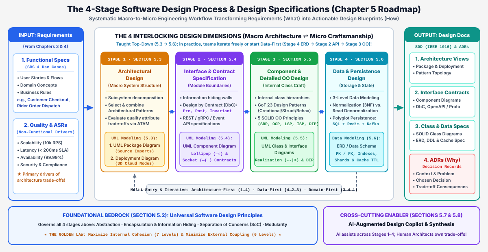
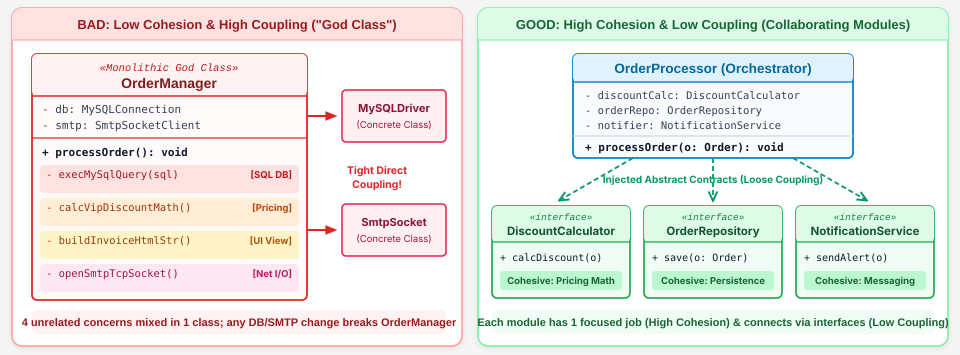
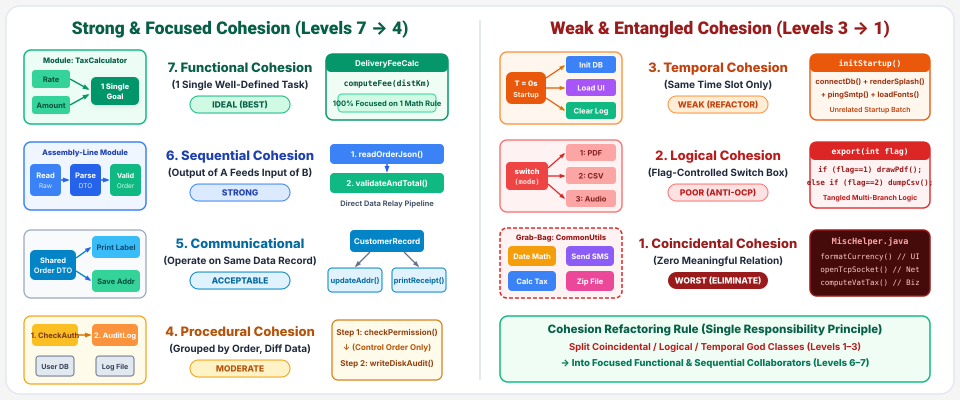
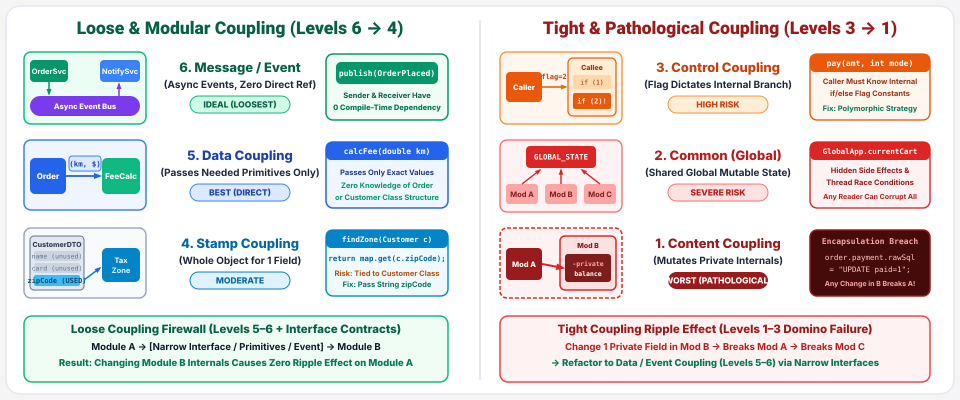
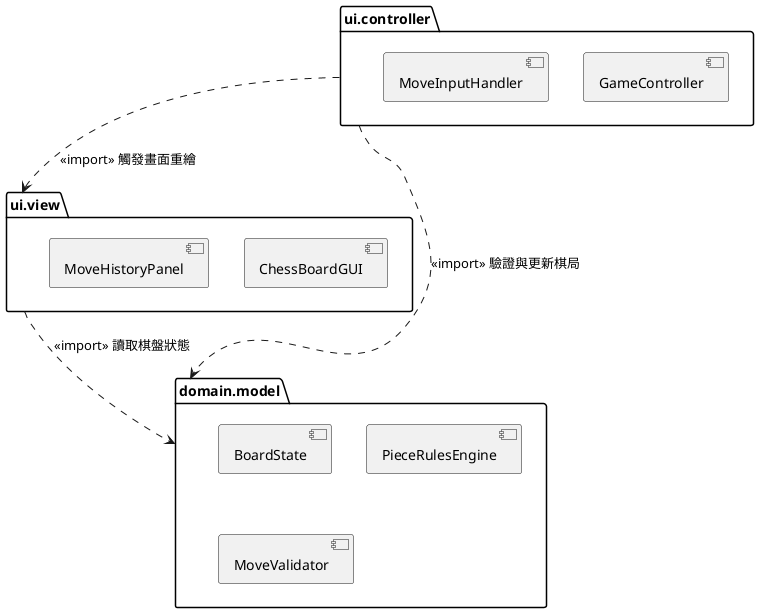
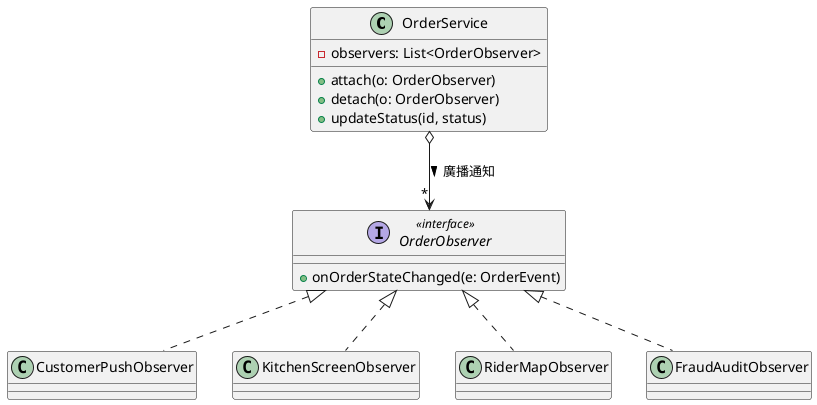

# 第五章：軟體設計、架構與物件導向原則 (Software Design, Architecture & OO Principles)

**課程大綱與核心觀念 (Lecture Outline & Key Concepts)**
> * **5.1 軟體設計基礎、流程與規格文件 (Design Foundations, Process & Specifications)**：軟體設計的本質（跨越需求規格 SRS 的 *What* 邁向設計規格 SDD 的 *How*）、為何設計至關重要（預防 Robert C. Martin 定義的軟體腐敗四大病徵，並發揮 Barry Boehm 1:100 早期除錯經濟槓桿）、四大交織設計維度（巨觀架構 ⇄ 介面契約 ⇄ 物件導向設計 ⇄ 資料設計）、實務彈性切入點（架構先行 vs. 資料先行 vs. 領域先行），以及正式交付產物（**SDD — IEEE 1016** 與 **ADR 架構決策記錄**）。
> * **5.2 通用軟體設計核心原則 (Universal Software Design Principles)**：跨尺度碎形 (Fractal) 適用之設計哲學（函式、類別、組件、微服務）、四大基礎信條（模組化、抽象化、封裝與資訊隱藏、關注點分離 SoC）、黃金設計定律（**高凝聚 High Cohesion 與低耦合 Low Coupling**）、**凝聚度 7 大層級**（巧合凝聚 → 功能凝聚）與 **耦合度 6 大層級**（內容耦合 → 訊息/介面耦合）視覺化頻譜解析。
> * **5.3 階段一 — 架構設計：架構模式、權衡分析與巨觀 UML (Stage 1: Architectural Design)**：軟體架構定義與關鍵架構需求 (ASR)、**六大經典架構模式**（MVC、分層架構、儲存庫/黑板、主從式架構、管線與過濾器、微服務 MSA）、單體式 vs. 微服務深度對比、Food Delivery 外送平台多模式綜合案例、**ATAM 架構權衡分析法**（效用樹、敏感點與權衡點），以及巨觀 UML 塑模（**UML 套件圖**、**UML 部屬圖**與西洋棋 MVC 同儕討論）。
> * **5.4 階段二 — 介面與契約規格：契約式設計 (DbC) 與組件圖 (Stage 2: Interface & Contract Spec)**：Bertrand Meyer 之 **契約式設計 (Design by Contract, DbC)** 三大支柱（前置條件 `Precondition`、後置條件 `Postcondition`、類別不變量 `Invariant`）、權利與義務對稱矩陣、工業級 API 規格標準（OpenAPI 3.1、gRPC Protobuf、AsyncAPI）、以 **Javadoc 與 JML** 撰寫 `OrderService.placeOrder()` 正式規格、`bubbleSort(int[] arr)` 設計規格同儕討論，以及中觀 **UML 組件圖**（棒棒糖提供介面 `—○`、插座需求介面 `—(`、埠口與接合器）。
> * **5.5 階段三 — 組件與物件導向設計：設計模式、SOLID 與類別圖 (Stage 3: Component & OO Design)**：Christopher Alexander 與四人幫 (**GoF 23 種設計模式**：生成型、結構型、行為型）、**SOLID 五大物件導向原則**（**SRP、OCP、LSP、ISP、DIP**）之 UML 反模式與重構對照，以及 **GoF 觀察者模式 (Observer Pattern)** 同儕討論。
> * **5.6 階段四 — 資料與持久化設計：ERD 塑模、快取與多模態儲存 (Stage 4: Data & Persistence Design)**：三層次資料塑模（概念模型 → 邏輯 ERD → 實體 DDL 綱要）、**第三正規化 (3NF)** 與讀取反正規化權衡、外送平台之**多模態持久化 (Polyglot Persistence)**（`PostgreSQL` 金流交易 + `Redis` GeoHash 空間快取 + `Kafka` 事件流），以及跨資料源一致性（**ACID vs. BASE** 與 **交易式發件匣模式 Transactional Outbox Pattern**）。
> * **5.7 AI 賦能軟體設計與盲點防護 (AI-Augmented Software Design)**：生成式 AI 如何賦能四階段設計流程，以及人類架構師防範「履歷導向過度工程化」之把關機制。
> * **5.8 核心概念統整、自我評量與參考文獻 (Synthesis & References)**：全章核心精華統整矩陣、12 題填空自我檢核測驗、權威經典文獻，以及**附錄：隨堂測驗 (CCQ 1–5) 與同儕討論 (5.3–5.5) 完整建議解答**。

---

## 5.1 軟體設計基礎、流程與規格文件 (Software Design Foundations, Process & Specifications)

在軟體工程生命週期中，**需求工程（第 3、4 章）** 定義了**「問題空間 (Problem Space — *What*)」**——將利害關係人的商業目標、使用案例、領域概念與非功能品質目標收斂為軟體需求規格書 (SRS)。而**軟體設計（第 5 章）** 則跨越橋樑進入**「解決方案空間 (Solution Space — *How*)」**：它既是將需求轉化為技術方案的**系統化工程流程 (Process)**，也是在大規模寫碼前交付給團隊的**結構化施工藍圖 (Specification — 軟體設計文件 SDD)**。

### 5.1.1 為什麼軟體設計至關重要？

若未經嚴謹的架構與細部設計就直接打開 IDE 埋頭寫碼，就如同沒有建築結構圖便直接澆灌水泥蓋摩天大樓。嚴謹的軟體設計肩負三大核心工程使命：

1. **駕馭認知複雜度並防止軟體腐敗 (Preventing Design Rot)**：
   人類工作記憶容量極為有限（Miller 定律：`7 ± 2` 個資訊塊）。缺乏清晰模組邊界的程式碼庫會迅速退化為難以維護的**「大泥球架構 (Big Ball of Mud)」**，並浮現 Robert C. Martin (*Uncle Bob*) 所歸納的**軟體腐敗四大病徵**：
   * **僵化性 (Rigidity)**：系統極難修改，哪怕只是新增一個簡單的促銷折扣，都會引發連鎖反應，迫使工程師同步修改數十個高度耦合的模組。
   * **脆弱性 (Fragility)**：修改 A 模組的臭蟲時，卻莫名其妙導致完全無關的 B、C 模組在線上崩潰（牽一髮而動全身）。
   * **不可移植性 (Immobility)**：核心領域邏輯與底層資料庫驅動程式或特定 UI 框架死死糾纏，無法抽離重用於新系統中。
   * **黏滯性 (Viscosity)**：架構設計不良導致「用正確工程方法修改」異常緩慢痛苦，誘使工程師不斷走捷徑寫出髒亂的拼湊代碼 (Hacks)。

2. **非功能品質屬性源於設計，無法靠事後測試憑空產生**：
   諸如**可擴展性 (Scalability，如每秒處理 10,000 筆外送訂單)**、**高可用性 (Availability, 99.99%)**、**安全性 (Security)** 與 **可測試性 (Testability)**，皆是由系統的架構拓撲與模組邊界所決定。你永遠無法寫出一個資料庫鎖死、狀態糾纏的單體系統，然後妄想靠事後補寫單元測試就讓它具備雲端水平擴展能力。

3. **早期除錯的百倍經濟槓桿 (Boehm 的 1:100 法則)**：
   軟體工程經濟學先驅 **Barry Boehm** 的實證研究指出，修正架構或介面設計缺陷的成本隨生命週期呈指數級暴增：
   * 在**設計審查階段 (Design Review)** 發現並修正架構或 API 契約瑕疵，成本僅為 **$1x**（修改一張 UML 圖或介面規格）。
   * 拖到**整合測試階段 (Integration Testing)** 才發現，成本攀升至 **$10x**。
   * 若等到**正式上線部署後 (Production)** 才爆發架構瓶頸或資料不一致，重構、雙寫遷移與營運損失將高達 **$50x 至 $100x**！

---

### 5.1.2 四大交織設計階段與實務彈性切入點

為了幫助讀者建立從**「一萬英尺高空的巨觀全景」**一路推進至**「地面上的類別與資料表」**的清晰認知地圖，本章將軟體設計劃分為**四個緊密交織的設計階段（5.3 → 5.6 節）**，並為每一階段配置專屬的 **UML 或資料塑模圖表**：

| 設計階段與對應小節 | 核心工程探問 | 主要設計任務 | 專屬 UML / 資料圖表 |
| :--- | :--- | :--- | :--- |
| **階段一：架構設計**<br>*(5.3 節 — 巨觀 Macro)* | 系統的高階拓撲為何？原始碼套件如何組織？雲端硬體如何部署？ | 子系統分解、組合六大架構模式 (MVC、分層、微服務)、執行 ATAM 品質權衡分析。 | **1. UML 套件圖 (Package)**<br>**2. UML 部屬圖 (Deployment)** |
| **階段二：介面與契約規格**<br>*(5.4 節 — 中觀 Meso)* | 模組與服務之間如何透過嚴謹契約溝通，且不洩漏內部實作祕密？ | 定義**契約式設計 (DbC)** (`Pre`, `Post`, `Invariant`) 與 API 規格 (OpenAPI, gRPC, Javadoc/JML)。 | **3. UML 組件圖 (Component)**<br>*(棒棒糖 `—○` 與插座 `—(`)* |
| **階段三：組件與 OO 設計**<br>*(5.5 節 — 微觀 Micro)* | 組件內部的類別如何組織，方能兼具高擴充性與獨立單元測試能力？ | 運用 **GoF 23 種設計模式**並落實 **SOLID 五大原則** (SRP, OCP, LSP, ISP, DIP)。 | **4. UML 類別與介面圖 (Class & Interface)** |
| **階段四：資料與持久化設計**<br>*(5.6 節 — 資料 Data)* | 領域狀態如何結構化、正規化、建立索引、快取並持久化至儲存引擎？ | 三層次資料塑模、**3NF 正規化**、規劃**多模態持久化** (SQL + Redis + Kafka Outbox)。 | **5. UML 實體關聯圖 (ERD)** |

> ⚠️ **重要實務觀念：教學順序 ≠ 僵化的單向瀑布流程！**
> 課本章節依序按照 **5.3（階段一）→ 5.4（階段二）→ 5.5（階段三）→ 5.6（階段四）** 講授，是因為「由巨觀到微觀」最符合學習者的認知脈絡；但在真實軟體工程與學生的**畢業專題開發**中，這四個階段實為**彼此交織、雙向回饋的四個設計維度**，團隊會依系統特性採取不同的切入順序：
> * **架構先行 (`Stage 1 → 2 → 3 → 4`, Top-Down)**：適用於高併發、跨團隊的大型分散式平台（必須先劃定子系統邊界、雲端 SLA 與跨組 API 合約，各小隊才能各自實作類別與資料庫）。
> * **資料先行 (`Stage 4 → 2 → 3`, Data-First / Schema-First)**：在企業資訊系統 (ERP / CRUD)、電商後台與**大學專題**中最為常見！團隊往往**先從階段四 (5.6 節) 確立核心資料庫結構 (ERD 資料表與欄位)**，等資料結構穩固後，再往外推導 **階段二 (5.4 節) 的前後端 API 契約** 與 **階段三 (5.5 節) 的程式類別**。
> * **領域先行 (`Stage 3 → 4 → 1`, Domain-First / DDD)**：適用於業務規則極度複雜的領域（如保險精算、西洋棋規則引擎），先於階段三建立純粹的領域物件與不變量，再決定底層資料庫與外層微服務邊界。



*圖 5.1.1：四大交織軟體設計維度（5.3–5.6 節），由底層通用設計原則（5.2 節）支撐並結合 AI 設計副駕駛（5.7 節），最終產出 SDD 與 ADR 設計規格文件。*

---

### 5.1.3 正式設計交付產物：軟體設計文件 (SDD — IEEE 1016) 與架構決策記錄 (ADR)

設計思考必須沉澱為團隊可共同遵循的工程契約，現代軟體團隊主要產出兩項互補的設計產物：

1. **軟體設計文件 (Software Design Document, SDD — IEEE Std 1016)**：
   * **工程定位**：詳述系統「如何建構 (*How*)」的完整工程藍圖，涵蓋巨觀套件/部屬架構圖、中觀組件 API 合約、微觀類別模型與實體資料庫 DDL 綱要。
   * **賦能平行開發 (Parallel Engineering)**：一旦 SDD 中的 API 契約與資料綱要鎖定，前端、後端、手機 App、DBA 與 QA 自動化測試團隊即可**同步平行施工與撰寫契約測試**，不必苦等後端程式碼寫完才開始串接。

2. **架構決策記錄 (Architecture Decision Records, ADRs — Michael Nygard)**：
   * **工程定位**：UML 圖能展示架構「長什麼樣子 (*What*)」，卻無法解釋「當年為什麼放棄方案 A 而選擇方案 B (*Why*)」。ADR 是直接存放在 Git 倉儲中的輕量級 Markdown 文件（如 `docs/adr/0012-redis-geohash-for-couriers.md`），防止新進工程師陷入痛苦的「架構考古學」。
   * **標準 ADR 五大要素**：
     * **標題與編號 (Title)**：`ADR-0012：採用 Redis GeoHash 儲存外送員即時定位座標`
     * **狀態 (Status)**：`Proposed (提議中)` ｜ `Accepted (已採納)` ｜ `Superseded (已被取代)`
     * **背景脈絡 (Context)**：尖峰時段 5 萬名外送員每 5 秒回傳一次 GPS（每秒 10,000 次寫入）；若直接寫入 PostgreSQL 會引發 B-Tree 索引鎖死，查詢延遲飆破 `450ms`。
     * **決策內容 (Decision)**：即時座標改寫入 Redis Cluster 之 `GeoHash` 有序集合並設定 `TTL = 30s` 自動過期；完單後才將軌跡摘要非同步歸檔至 PostgreSQL。
     * **正反面代價 (Consequences)**：**(+) 效益**：5 毫秒內完成方圓 3 公里最近外送員搜尋，離線外送員自動清除；**(-) 代價**：需維運 Redis Sentinel 高可用叢集，且極端當機切換時可能損失最近 5 秒之瞬時座標。

---

## 5.2 通用軟體設計核心原則 (Universal Software Design Principles)

在進入第一階段架構設計前，我們必須先掌握貫穿所有尺度的**通用軟體設計原則**。這些原則具備**碎形 (Fractal / Scale-Invariant)** 特質：無論你正在設計一個 15 行的函式、一個 300 行的類別、一個獨立組件，還是一套跨國微服務叢集，模組化、抽象化、高凝聚與低耦合的物理定律皆完全適用！

### 5.2.1 四大基礎設計信條

1. **模組化 (Modularity — 分而治之 Divide & Conquer)**：
   將龐大複雜的系統拆解為邊界清晰、可獨立開發、獨立測試與替換的模組。誠如圖靈獎得主 Edsger W. Dijkstra 所言，模組化的核心價值在於**「將變更的爆炸半徑 (Blast Radius) 封鎖在單一模組內部」**。
2. **抽象化 (Abstraction — 提煉本質 *What*、隱藏細節 *How*)**：
   在命名與介面上聚焦於「該模組提供什麼商業能力」，而隱藏底層繁瑣的演算法細節（例如呼叫 `PaymentGateway.charge()` 時，呼叫者完全無須理會底層是走 Stripe REST 還是銀行專屬電文）。
3. **封裝與資訊隱藏 (Encapsulation & Information Hiding — David Parnas, 1972)**：
   * **封裝 (Encapsulation)** 將資料狀態與操作該狀態的方法捆綁於同一膠囊 (`class`) 中。
   * **資訊隱藏 (Information Hiding)** 由大師 David Parnas 於 1972 年提出：規定**每一個模組都必須對外隱藏一個「設計祕密 (Design Secret)」**——亦即未來最可能發生變動的決策（如內部資料結構、快取策略、SQL 語法或第三方 SDK），僅對外暴露穩定不變的抽象介面。
4. **關注點分離 (Separation of Concerns, SoC — Dijkstra, 1974)**：
   將系統依正交的關注面向切分，確保同一段程式碼不會同時混雜「畫面繪製」、「商業計價公式」、「資料庫連線管理」與「安全日誌稽核」。

---

### 5.2.2 軟體設計黃金定律：高凝聚與低耦合 (High Cohesion & Low Coupling)

一切軟體設計原則最終都收斂為一句至高無上的工程黃金定律：

> **極大化模組內部的凝聚度 (High Cohesion)，極小化模組之間的耦合度 (Low Coupling)！**

| 評估維度 | **凝聚度 / 內聚力 (Cohesion — 模組內部)** | **耦合度 (Coupling — 模組之間)** |
| :--- | :--- | :--- |
| **核心定義** | 單一模組內部所有屬性與方法**彼此緊密相關、齊心協力完成「單一明確職責」**的程度。 | 不同模組之間**互相依賴、牽制與知曉對方內部實作細節**的程度。 |
| **工程追求目標** | **高凝聚 (HIGH Cohesion)**：職責純粹、高度專精的專家模組。 | **低 / 鬆散耦合 (LOW / LOOSE Coupling)**：僅透過精簡、穩定的公開介面溝通。 |
| **不良設計反模式** | **低凝聚（「瑞士刀 / 上帝類別 God Class」）**：`OrderManager` 同時包辦算稅、組裝 HTML 報表與發送 SMTP 郵件。 | **高耦合（「義大利麵相依」）**：`OrderController` 直接伸手進 `PaymentService` 修改其私有 SQL 字串。 |
| **兩者的一體兩面關係** | 高凝聚自然促成低耦合：當每個模組都能獨立把一件事徹底做好，就不必頻繁跨界去存取其他模組的內部狀態！ | 低耦合保護高凝聚：當模組間僅靠抽象合約溝通，模組 B 內部重構時絕不會波及模組 A。 |



*圖 5.2.1：低凝聚、高耦合之「萬能上帝類別」反模式（左）與高凝聚、低耦合之模組化介面設計（右）的 UML 結構對比。*

---

### 5.2.3 凝聚度的 7 大層級（由最弱至最強）

由結構化設計先驅 Larry Constantine 與 Edward Yourdon 提出，凝聚度由最劣（巧合凝聚）至最優（功能凝聚）分為七個層級：

| 層級 | 凝聚度類型 | 結構特徵與具體程式碼範例 | 工程評價與重構建議 |
| :---: | :--- | :--- | :--- |
| **1**<br>*(最劣)* | **巧合凝聚**<br>(Coincidental Cohesion) | 毫無關聯的零碎函式被隨意塞進同一個雜物間類別（如 `CommonUtils.formatDate()`、`playBeep()`、`calcTax()`）。 | ❌ **嚴格禁止** — 毫無設計主題，應立即按領域拆分。 |
| **2** | **邏輯凝聚**<br>(Logical Cohesion) | 僅因「字面類別相似」而硬湊在一起，並靠傳入旗標 `switch(flag)` 決定執行哪一段（如 `export(int type)` 包辦印表機、PDF 與 CSV）。 | ❌ **應予重構** — 違反開放封閉原則 (OCP)，應改用多型策略介面。 |
| **3** | **時間凝聚**<br>(Temporal Cohesion) | 彼此無關的任務僅因「必須在同一時間點執行」而放在一起（如 `onAppStartup()` 同時連 DB、載入字型與清空暫存檔）。 | ⚠️ **僅限啟動協調器** — 啟動函式應僅呼叫各專職模組，不可內嵌實作細節。 |
| **4** | **程序凝聚**<br>(Procedural Cohesion) | 因遵循固定作業流程順序而綁在一起，但各步驟處理不同資料（如 `checkAuth() → readConfig() → sendWelcomeMail()`）。 | ⚠️ **中等偏弱** — 建議將工作流編排與獨立領域服務分離。 |
| **5** | **通訊凝聚**<br>(Communicational Cohesion) | 多個方法因**共同讀取或操作同一份核心資料結構**而聚集（如針對同一份 `OrderDto` 執行驗證與摘要統計）。 | ✅ **良好** — 具備明確的資料局部性與清晰焦點。 |
| **6** | **順序凝聚**<br>(Sequential Cohesion) | 前一個方法的**輸出剛好是下一個方法的直接輸入**，形成緊密流水線（`rawBytes → decrypt() → unzip() → parseJson()`）。 | ✅ **優良** — 資料流向清晰、內聚性強。 |
| **7**<br>*(最優)* | **功能凝聚**<br>(Functional Cohesion) | 模組內的每一行代碼都不可或缺，100% 專注於完成**單一、不可再分的領域職責**（如 `OrderPricingCalculator.computeTotal()`）。 | 🏆 **黃金最高標準** — 可讀性、可重用性與可維護性極佳！ |



*圖 5.2.2：凝聚度的 7 大層級視覺化頻譜（由左側最強之功能、順序、通訊凝聚，至右側最弱之程序、時間、邏輯、巧合凝聚）。*

---

### 5.2.4 耦合度的 6 大層級（由最緊至最鬆）

耦合度衡量模組 A 與模組 B 之間受彼此內部變動牽連的緊密程度。由最劣（內容耦合）至最優（訊息/介面耦合）分為六個層級：

| 層級 | 耦合度類型 | 結構特徵與具體程式碼範例 | 工程評價與重構建議 |
| :---: | :--- | :--- | :--- |
| **1**<br>*(最劣)* | **內容耦合**<br>(Content Coupling) | 模組 A 直接侵入模組 B 內部，讀取或竄改 B 的私有屬性與內部 SQL 字串（`orderService.rawSql = "..."`）。 | ❌ **絕對禁止** — 徹底摧毀封裝與資訊隱藏！ |
| **2** | **共同耦合**<br>(Common Coupling) | 多個模組共同讀寫同一個可變的**全域變數 (Global Variable)** 或全域靜態字典（`GlobalState.currentOrder`）。 | ❌ **嚴格避免** — 引發多執行緒競爭條件 (Race Condition) 與隱密副作用。 |
| **3** | **控制耦合**<br>(Control Coupling) | 模組 A 傳遞布林或列舉**控制旗標**（`process(id, isVipFlag=true)`），直接遙控模組 B 內部的 `if-else` 分支走向。 | ⚠️ **設計異味** — 呼叫端過度知曉被呼叫端的內部控制邏輯。 |
| **4** | **印記/結構耦合**<br>(Stamp Coupling) | 模組 B 計算運費只需要 `zipCode`，模組 A 卻把包含 40 個欄位的整顆 `Customer` 實體傳進去 (`calcFee(Customer c)`)。 | ⚠️ **過度暴露** — 使運費模組無端依賴 `Customer` 的結構變更。 |
| **5** | **資料耦合**<br>(Data Coupling) | 模組 A 僅傳遞**完成該功能所必需的精簡基本型別或專屬 DTO**（`calcFee(String zipCode, int weightGrams)`）。 | ✅ **優良標準** — 介面極簡、相依面最小化、極易撰寫單元測試。 |
| **6**<br>*(最優)* | **訊息 / 介面耦合**<br>(Message / Interface Coupling) | 模組間**僅依賴抽象介面 (`«interface» IPaymentGateway`) 或非同步領域事件**，完全不知曉對方的具體實作類別！ | 🏆 **黃金最高標準** — 實現真正的熱插拔 (Plug-and-Play) 架構！ |



*圖 5.2.3：耦合度的 6 大層級視覺化頻譜（由左側最理想之訊息/介面與資料耦合，至右側最緊密危險之印記、控制、共同與內容耦合）。*

---

<!-- id: ase-ch05-ccq1 -->
#### 🙋 **觀念檢核測驗 (CCQ 1) — 凝聚度與耦合度設計原則**

**問題**

在程式碼審查中，你發現一個工具類別 `OrderReportUtils` 同時包含 `calculateTax()`、`renderHtmlTable()` 與 `sendSmtpAlert()`。更糟的是，`PaymentController` 直接修改 `OrderService.rawSqlString` 內部屬性來過濾未付款訂單。下列哪一項最準確診斷了這個設計問題？

- A. 此設計透過直接共享內部 SQL 字串，完美達成高功能凝聚與鬆散資料耦合。
- B. 此設計患了低凝聚度與緊密內容耦合；應拆分為單一職責類別並透過 DTO 溝通。
- C. 此設計展現了理想的印記耦合與時間凝聚，應予以保留以最大化 SQL 查詢速度。
- D. 此設計僅違反硬體部屬隔離原則，只要將兩個類別合併至同一個檔案即可解決。

[課堂互動](https://nlhsueh.github.io/nickedupocket/#/student/ase-ch05-ccq1)

<a href="https://nlhsueh.github.io/nickedupocket/#/student/ase-ch05-ccq1" target="_blank"></a>

<details>
<summary>點擊展開參考答案與解析</summary>

**正確答案**: B
**解析**: 將毫無關聯的「計算稅金」、「產生 HTML 表格」與「發送 SMTP 郵件」塞進同一個工具類別，屬於典型的**低凝聚度（巧合/邏輯凝聚）**；而 `PaymentController` 直接侵入修改 `OrderService.rawSqlString` 私有屬性，則構成最惡劣的**內容耦合 (Content Coupling)**。正確重構方式是將其拆分為單一職責的專職類別，並僅透過公開介面傳遞精簡 DTO（**資料/訊息耦合**）。
</details>

---

## 5.3 階段一 — 架構設計：架構模式、權衡分析與巨觀 UML (Stage 1: Architectural Design)

進入四階段設計流程的**第一階段（架構設計）**，我們拉高視角審視整個系統的巨觀骨架。根據卡內基美隆大學**軟體工程研究所 (SEI)**（Bass, Clements, & Kazman）的權威定義：

> *「運算系統的軟體架構，是由軟體元素、這些元素的外部可見屬性，以及元素之間的關係共同組成的系統結構。」*

大師 Martin Fowler 亦曾精闢指出：**「軟體架構就是那些你希望在專案初期就能做對，因為日後想要翻盤修改代價極其高昂的重要決策。」** 功能性需求決定系統要做哪些功能，而**關鍵架構需求 (Architecturally Significant Requirements, ASRs)**——如「晚餐尖峰每秒承受 10,000 筆結帳」、「端到端延遲 `< 200ms`」、「99.99% 跨機房高可用性」——則是決定軟體架構長相的真正驅動力！

---

### 5.3.1 六大經典軟體架構模式全景總覽

**架構模式 (Architectural Pattern)** 是針對特定品質屬性與運行環境限制，經過千錘百鍊、可重複套用的巨觀子系統組織方案。下表彙整了六大經典架構模式的全景對照：

| 架構模式名稱 | 核心結構拓撲 | 主要架構優勢 (+) | 主要限制與風險 (-) | 典型工程適用情境 |
| :--- | :--- | :--- | :--- | :--- |
| **1. MVC 模式**<br>(Model-View-Controller) | 將領域狀態 `Model`、畫面 `View` 與輸入控制 `Controller` 解耦。 | 畫面與商業邏輯徹底分離；同一份狀態可同時渲染多種視圖。 | 若商業邏輯塞入 Controller，易退化為臃腫控制器 (Massive Controller)。 | Web 前後端框架、桌面 GUI、手機 App 架構。 |
| **2. 分層架構**<br>(Layered / N-Tier) | 垂直職責分層 (`UI → App → Domain → Data`)，嚴格由上往下呼叫。 | 關注點分離清晰、團隊分工明確、可逐層替換與獨立測試。 | 易出現「架構天坑 (Sinkhole)」純過水呼叫；底層單一 DB 易成瓶頸。 | 企業級資訊系統 (ERP/CRM)、電商標準後端服務。 |
| **3. 儲存庫 / 黑板模式**<br>(Repository / Blackboard) | 多個獨立工具子系統圍繞單一中央共享知識庫讀寫協作。 | 新增分析工具或 AI 代理極容易；具備單一真實資料源 (SSOT)。 | 中央儲存庫易成為單點故障 (SPOF) 與資料結構耦合瓶頸。 | IDE 編譯器 (共享 AST 語法樹)、CAD、AI 多代理黑板系統。 |
| **4. 主從式架構**<br>(Client-Server) | 透過網路協定劃分終端請求者 (`Client`) 與中央服務提供者 (`Server`)。 | 集中式資料安全管控、權限驗證與統一備份更新。 | 中央伺服器頻寬與連線數易成瓶頸；高度仰賴網路連線品質。 | 網路銀行、Web/App 雲端 API 系統、多人連線遊戲。 |
| **5. 管線與過濾器**<br>(Pipe-and-Filter) | 由無狀態過濾器 (`Filter`) 與單向緩衝管線 (`Pipe`) 串接成資料流。 | 高吞吐量、各過濾器可平行擴展、極易重組或插入新處理步驟。 | 不適合需要頻繁互動的 UI 系統；資料序列化與解析有額外開銷。 | Unix Shell 管線、編譯器、ETL 資料工程、即時串流處理。 |
| **6. 微服務架構**<br>(Microservices, MSA) | 依業務邊界拆分為獨立部署之小型服務，各自擁有專屬私有資料庫。 | 獨立水平擴展、故障艙壁隔離、支援異質技術棧與敏捷獨立發版。 | 分散式網路延遲、最終一致性 (Saga) 複雜度與高昂 K8s 維運成本。 | 大型高併發雲端平台 (Netflix、Uber、Food Delivery)。 |


*圖 5.3.1：六大軟體架構模式分類全景圖——對比「集中與結構型模式（分層、MVC、儲存庫）」與「分散式路由與資料流模式（主從式、管線與過濾器、微服務）」。*

---

### 5.3.2 六大架構模式深度剖析

#### 1. Model-View-Controller (MVC) 架構模式
由 Trygve Reenskaug 於 1979 年在 Xerox PARC 為 Smalltalk 首創，旨在根除「把 SQL 查詢與商業公式直接寫死在畫面按鈕事件裡」的反模式：
* **Model (領域模型)**：封裝核心資料狀態與商業規則（如 `Order`、`ChessBoard`），完全不知曉任何 HTML 或視窗元件的存在。
* **View (視覺視圖)**：負責將 `Model` 的狀態視覺化呈現給使用者，本身不保存業務狀態。
* **Controller (控制器)**：攔截使用者的滑鼠點擊或 HTTP 請求，轉發給 `Model` 執行業務方法，並決定切換至哪一個 `View`。


*圖 5.3.2：Model-View-Controller (MVC) 架構模式之職責分離與互動流向。*

#### 2. 分層架構模式 (Layered / N-Tier Architecture)
將系統依抽象層次由上而下垂直堆疊為四層：**展示層 (Presentation) → 應用服務層 (Application) → 領域邏輯層 (Domain) → 資料持久化層 (Persistence)**：
* **嚴格單向呼叫紀律**：第 `N` 層只能往下呼叫第 `N-1` 層提供的公開服務，**嚴禁由下往上逆向呼叫**（例如資料庫層絕對不能 import 展示層視窗）！
* **提防「架構天坑反模式 (Architecture Sinkhole Anti-Pattern)」**：若系統中有超過 80% 的請求只是在四層之間做毫無邏輯加值的「純過水轉發 (Pass-through)」，會白白浪費記憶體拷貝與呼叫延遲。


*圖 5.3.3：分層架構模式 (Layered Architecture) 嚴格由上而下的單向相依結構。*

#### 3. 儲存庫 / 黑板架構模式 (Repository / Blackboard Pattern)
當多個獨立複雜的子系統需要共同檢視並修改同一份龐大的核心資料結構時，若讓子系統兩兩直接傳遞資料，會產生 `O(N²)` 的網狀耦合。**儲存庫模式**將共享資料集中於中央樞紐：
* **被動式儲存庫 (Passive Repository)**：各工具主動讀寫中央結構（例如現代 IDE 編譯器中，**語法解析器 Parser**、**型別檢查器 Linter**、**重構引擎**與**除錯器**全部圍繞同一棵共享的**抽象語法樹 AST** 協作）。
* **主動式黑板 (Active Blackboard)**：當中央黑板出現新的資料特徵時，主動觸發並喚醒對應的知識專家代理（廣泛用於自動駕駛感測器融合與多 AI Agent 協同解題）。


*圖 5.3.4：儲存庫 / 黑板架構模式 (Repository / Blackboard) 以中央共享資料樞紐解耦各分析工具子系統。*

#### 4. 主從式架構模式 (Client-Server Architecture)
跨越實體網路邊界，將系統劃分為**服務請求端 (`Client`)** 與**集中式服務提供端 (`Server`)**，透過標準網路協定（`HTTPS`、`gRPC`、`WebSockets`）進行請求與回應。後端伺服器群通常部署於**負載平衡器 (Load Balancer)** 後方以實現無狀態水平擴充。


*圖 5.3.5：主從式架構模式 (Client-Server) 透過負載平衡器連接多終端客戶端與後端伺服器叢集。*

#### 5. 管線與過濾器架構模式 (Pipe-and-Filter Architecture)
將系統塑模為一連串資料流的漸進轉換管線：
* **過濾器 (Filters)**：完全獨立、**無狀態 (Stateless)** 的轉換單元，僅從輸入管線讀取資料、執行單一轉換（如解密、去雜訊、格式轉換），再寫入輸出管線，完全不知曉上下游過濾器是誰。
* **管線 (Pipes)**：連接相鄰過濾器的單向緩衝通道（如 Unix `|` 管線、記憶體佇列或 **Apache Kafka** 主題）。


*圖 5.3.6：管線與過濾器架構模式 (Pipe-and-Filter) 串接無狀態過濾器以實現高吞吐量資料流處理。*

#### 6. 微服務架構模式 (Microservices, MSA) 與單體式架構深度對比
依據領域驅動設計 (DDD) 之**限界上下文 (Bounded Contexts)**，將大型系統拆分為可獨立開發、獨立部署的小型自治服務（如 `訂單服務`、`金流服務`、`派單服務`）：
* **微服務的兩大鐵律**：
  1. **獨立程序與獨立部署**：每個微服務運行於獨立容器中，修改並部署單一服務絕不影響其他服務。
  2. **一服務一私有資料庫 (Database-per-Service)**：**嚴禁兩個微服務直接共用或跨庫讀取同一個資料庫表格！** 跨服務資料交換一律透過 API (`REST`/`gRPC`) 或非同步事件匯流排 (`Kafka`) 進行。


*圖 5.3.7：微服務架構模式 (MSA) 透過 API 閘道器、獨立服務容器、專屬私有資料庫與事件匯流排實現高擴展與故障隔離。*

* **單體式 (Monolith) vs. 微服務 (Microservices) 工程權衡**：
  * **模組化單體 (Modular Monolith)** 將所有模組打包為單一執行檔並共用單一資料庫，具備**本地函式呼叫零網路延遲、原生 ACID 交易 (`@Transactional`) 與極低維運成本**，是新創與中小型專案最明智的起點！
  * **微服務架構**則以分散式網路延遲與 Saga 最終一致性為代價，換取**按熱點精準水平擴展**（如晚餐尖峰將 `派單服務` 擴充至 50 個 Pod，而 `帳務服務` 維持 3 個 Pod）與**故障艙壁隔離 (Bulkhead Isolation)**。

---

### 5.3.3 外送平台多模式綜合案例與 ATAM 架構權衡分析

在真實工業級系統中，**從來不會只單獨使用一種架構模式**，而是依不同層次組合多種模式。請看 **Food Delivery 美食外送平台** 如何同時融合六大架構模式：

| 系統層次與邊界範疇 | 套用之架構模式 | 在外送平台中的具體工程職責 |
| :--- | :--- | :--- |
| **1. 終端與雲端網路邊界** | **主從式架構 (Client-Server)** | 顧客 App、餐廳平板與外送員 App 透過 HTTPS / WebSocket 與雲端 API Gateway 通訊。 |
| **2. 手機與網頁前端內部** | **MVC / MVVM 模式** | 將互動地圖與購物車畫面 (`View`)、本地狀態 (`Model`) 與手勢控制 (`Controller`) 解耦。 |
| **3. 雲端後端巨觀拓撲** | **微服務架構 (MSA)** | 拆分為獨立部署、各自擁有專屬資料庫之 `Order`、`Payment`、`Restaurant` 與 `Dispatch` 服務。 |
| **4. 單一微服務內部結構** | **分層架構 (Layered)** | `OrderService` 內部嚴格遵循 `Controller → AppService → Domain → Repository` 四層設計。 |
| **5. 外送員即時 GPS 串流** | **管線與過濾器 (Pipe-and-Filter)** | 每秒 10,000 筆座標依序流經 `接收 → 卡爾曼濾波去飄移 → 道路吸附 → ETA 預估` 過濾器。 |
| **6. 智慧派單媒合中樞** | **儲存庫 / 黑板模式 (Repository)** | 以 `Redis 空間快取` 作為共享黑板，GPS 管線持續寫入座標，AI 派單引擎即時讀取媒合。 |


*圖 5.3.8：Food Delivery 美食外送平台融合六大軟體架構模式之端到端系統拓撲圖。*

#### ATAM 架構權衡分析法 (Architecture Trade-off Analysis Method)
由 SEI 提出的 **ATAM** 強調：世上沒有「完美無缺」的架構，只有針對特定品質屬性的**明確取捨 (Trade-offs)**。架構師透過建構**品質屬性效用樹 (Utility Tree)**，精準識別架構中的：
* **敏感點 (Sensitivity Point)**：牽一髮而動全身的關鍵參數（如 Redis GeoHash 的 `TTL` 秒數或金流超時重試門檻）。
* **權衡點 (Trade-off Point)**：提升某項品質卻必然犧牲另一項品質的決策點：
  * *權衡案例 1（同步 REST 鏈 vs. 非同步 Kafka 結帳）*：改用 Kafka 事件佇列將結帳回應時間由 `1.8s` 降至 `140ms`（**+高吞吐量 / +高可用性**），但必須接受訂單狀態數秒後才同步完成的**最終一致性（-強即時一致性）**。
  * *權衡案例 2（專屬私有資料庫 vs. 共用單一資料庫）*：各微服務資料庫獨立消除了跨服務鎖表瓶頸（**+高擴展性 / +故障隔離**），但無法直接寫 SQL `JOIN`，必須實作 **Saga 補償交易（-交易實作複雜度）**。

---

### 5.3.4 巨觀結構塑模：UML 套件圖与 UML 部屬圖

在階段一的軟體設計文件 (SDD) 中，我們使用兩張巨觀 UML 結構圖來鎖定編譯期與執行期架構：

#### 1. UML 套件圖 (Package Diagram — 編譯期原始碼組織與相依管控)
* **工程定位**：將數十至數百個類別歸納至具階層性的**命名空間 / 資料夾 (`package`)**，並嚴格規範**編譯期匯入 (`«import»`) 方向**。
* **核心符號**：
  * **帶標籤之資料夾方框 (`package`)**：代表命名空間（如 `ui.web`、`app.order`、`domain.core`、`infra.db`）。
  * **虛線開叉箭頭 (`A - - -> B`)**：代表套件 `A` 內部的程式碼 `import` 或依賴套件 `B`（若 `B` 修改公開介面，`A` 可能被迫重新編譯）。
* **無環相依原則 (Acyclic Dependencies Principle, ADP)**：套件相依圖必須構成**有向無環圖 (DAG)**，嚴禁出現 `order ..> payment` 且 `payment ..> order` 的循環相依死結！


*圖 5.3.9：UML 套件圖核心符號（左）與外送平台單向無環套件結構（右）。*

<!-- id: ase-ch05-pair1 -->
#### 💬 同儕討論 5.3：西洋棋遊戲之 MVC 架構與 UML 套件圖 (PlantUML 實戰)

* **情境題目**：請為採用 **MVC 架構**的「西洋棋遊戲 (Chess Game)」繪製 **UML 套件圖**。系統共有 7 個核心類別：`ChessBoardGUI`、`MoveHistoryPanel`、`GameController`、`MoveInputHandler`、`BoardState`、`PieceRulesEngine` 與 `MoveValidator`。
* **討論任務**：
  1. 請將上述 7 個類別歸入三個套件（`ui.view`、`ui.controller`、`domain.model`），並寫出對應的 **PlantUML 套件圖語法**。
  2. 為何 `domain.model` **絕對不能有任何指向 `ui.view` 或 `ui.controller` 的相依箭頭**？這對自動化測試與跨平台移轉有何決定性好處？*(完整參考解答請見本章末附錄 B)*

#### 2. UML 部屬圖 (Deployment Diagram — 執行期雲端與硬體拓撲)
* **工程定位**：描繪編譯後的軟體執行檔在**執行期 (Runtime)** 如何實際分佈於雲端伺服器、容器叢集、資料庫節點與網路協定之上。
* **核心符號**：
  * **3D 立體方塊 (`Node`)**：代表實體硬體或雲端運算節點（`«device» Mobile Client`、`«cloud» AWS EKS Cluster`）。
  * **執行環境 (`«execution environment»`)**：節點內部的軟體運行容器（`«container» Docker / JVM 21`）。
  * **部署產物 (`«artifact»`)**：實際部署至節點上的執行檔或映像檔（`order-service.jar`、`payment-service.jar`）。
  * **通訊路徑 (Communication Path)**：連接 3D 節點的實線，標註通訊協定與埠號（`«HTTPS / TLS 1.3 :443»`、`«gRPC :9090»`）。

*圖 5.3.10：UML 部屬圖 3D 節點與產物符號（左）與外送平台跨可用區高可用性雲端部署圖（右）。*

---

[課堂互動](https://nlhsueh.github.io/nickedupocket/#/student/ase-ch05-pair1)

<!-- id: ase-ch05-ccq2 -->
#### 🙋 **觀念檢核測驗 (CCQ 2) — 架構設計與巨觀 UML 圖表**

**問題**

在階段一（**架構設計**）中，團隊在軟體設計文件 (SDD) 中同時繪製了 **UML 套件圖 (Package Diagram)** 與 **UML 部屬圖 (Deployment Diagram)**。這兩張巨觀 UML 圖表在工程目的上有何本質差異？

- A. 套件圖塑模執行期資料庫列鎖定；部屬圖塑模函式內部的 `if-else` 分支。
- B. 套件圖定義手機畫面線框稿；部屬圖定義 Java 類別的繼承樹結構。
- C. 套件圖塑模編譯期原始碼命名空間與相依；部屬圖塑模執行期 3D 硬體節點與執行檔。
- D. 套件圖僅能用於單體式架構，而部屬圖僅能用於無伺服器的純前端網頁應用。

[課堂互動](https://nlhsueh.github.io/nickedupocket/#/student/ase-ch05-ccq2)

<a href="https://nlhsueh.github.io/nickedupocket/#/student/ase-ch05-ccq2" target="_blank"></a>

<details>
<summary>點擊展開參考答案與解析</summary>

**正確答案**: C
**解析**: **UML 套件圖 (Package Diagram)** 聚焦於**編譯期 (Compile-time)** 的原始碼資料夾命名空間與 `«import»` 相依方向管控（確保無循環相依）；而 **UML 部屬圖 (Deployment Diagram)** 則聚焦於**執行期 (Runtime)** 的實體硬體與雲端架構，以 3D 節點 (`Node`) 展現容器環境、`«artifact»` 執行檔與網路通訊協定拓撲。
</details>

---

## 5.4 階段二 — 介面與契約規格：契約式設計 (DbC) 與組件圖 (Stage 2: Interface & Contract Spec)

當階段一劃分好子系統與套件邊界後，**階段二（介面與契約規格）** 的核心任務就是**將模組之間的溝通邊界形式化**。在嚴謹的軟體工程中，僅寫出一行函式簽章 `OrderReceipt placeOrder(Cart c, Card p)` **遠遠不算完成介面設計**——因為它沒有回答最關鍵的邊界問題：
* *若傳入空購物車或數量為負數，誰負責檢查？會拋出什麼例外？*
* *扣庫存與刷卡的保證結果是什麼？*
* *若顧客在電梯裡網路瞬斷重按兩次結帳，系統如何保證絕不重複扣款？*

---

### 5.4.1 正式介面規格與契約式設計 (Design by Contract, DbC)

由物件導向先驅 **Bertrand Meyer**（Eiffel 語言之父）提出的**契約式設計 (Design by Contract, DbC)**，將模組間的每一次 API 呼叫視為**呼叫端 (Client / Caller)** 與**供應端 (Supplier / Callee)** 之間具法律效力的商業契約，由三大核心斷言 (Assertions) 構成：

1. **前置條件 (`Precondition` — `@pre` / `requires`)**：
   呼叫端在呼叫方法**之前**必須滿足的合法輸入條件（例如：`cart != null && !cart.isEmpty() && qty > 0 && idemKey != null`）。
2. **後置條件 (`Postcondition` — `@post` / `ensures`)**：
   當前置條件成立時，供應端在方法執行**結束時**保證兌現的回傳結果與狀態變更（例如：`result.status == CONFIRMED && stock == \old(stock) - qty`）。
3. **類別不變量 (`Class Invariant` — `@invariant`)**：
   組件在**任何公開方法執行前後**都必須恆為真的健康狀態約束（例如：`accountBalance >= 0 && stock >= 0`）。

| 契約維度 | 呼叫端 (Client / Caller) | 供應端 (Supplier / Provider) |
| :--- | :--- | :--- |
| **必須履行的義務 (Obligation)** | 呼叫 API 前，必須確保所有參數滿足**前置條件 (`Precondition`)**。 | 在前置條件滿足的前提下，必須完成工作並兌現**後置條件 (`Postcondition`)** 與**不變量**。 |
| **享有的權利與好處 (Right)** | 無須知曉供應端內部實作，即可放心獲得後置條件承諾的結果。 | **無須在內部重複撰寫冗餘的防禦性檢查**來處理違反前置條件的無效輸入！ |
| **前置條件違約時之責任歸屬** | **呼叫端 Bug (`400 Bad Request` / `IllegalArgumentException`)**：呼叫端違約，供應端直接拒絕服務。 | 供應端對此不負任何履約責任（且保證不破壞既有狀態）。 |
| **後置條件違約時之責任歸屬** | 呼叫端已盡義務，可安全觸發退回或告警機制。 | **供應端 Bug (`500 Internal Error` / `AssertionError`)**：供應端實作毀約！ |


*圖 5.4.1：契約式設計 (DbC) 展示呼叫端與供應端如何透過前置條件、後置條件與類別不變量建立嚴謹的介面契約。*

---

### 5.4.2 以 Javadoc 與 JML 撰寫正式契約規格：以 `OrderService` 為例

在 Java 企業級開發中，我們可透過兩種層次將 DbC 契約直接寫入程式碼中：
1. **契約擴充型 Javadoc (`@param`, `@return`, `@throws`, `@pre`, `@post`)**：供工程師閱讀、IDE 即時提示並產出標準 API 網頁文件。
2. **JML (Java Modeling Language — `//@ requires`, `//@ ensures`, `//@ signals`)**：撰寫於特殊結構化註解中的形式化數學規格，可由靜態形式驗證工具（如 **OpenJML**、**KeY**）自動進行定理證明或執行期契約檢測！

#### 1. 契約擴充型 Javadoc 設計規格
```java
public interface OrderService {
  /**
   * 建立外送訂單、扣減餐廳商品庫存並執行授權扣款。
   *
   * @param userId   已通過驗證之顧客 UUID（不可為 null）
   * @param items    訂購品項清單（不可為空，且每項 qty > 0）
   * @param payToken 預先授權之金流 Token（不可為空白字串）
   * @param idemKey  冪等性 UUID 金鑰（防止網路重試造成重複扣款）
   * @return 確認成功之 {@link OrderReceipt} 訂單收據
   *
   * @pre  userId != null && items != null && !items.isEmpty()
   *       && items.stream().allMatch(i -> i.getQty() > 0)
   * @post result != null && result.getStatus() == CONFIRMED
   *       && inventory(item) == old(inventory(item)) - item.qty
   * @throws IllegalArgumentException 若違反任何前置條件 (@pre)
   * @throws OutOfStockException 若任一品項庫存不足（保證不扣款！）
   */
  OrderReceipt placeOrder(UUID userId, List<OrderItem> items,
                          String payToken, UUID idemKey);
}
```

#### 2. JML (Java Modeling Language) 形式化規格
```java
public class OrderServiceImpl implements OrderService {
  //@ spec_public
  private final InventoryRepo stockRepo;
  //@ public invariant stockRepo != null;
  //@ public invariant (\forall UUID id; stockRepo.getStock(id) >= 0);

  /*@ public normal_behavior
    @   requires userId != null && items != null && !items.isEmpty();
    @   requires (\forall int i; 0 <= i && i < items.size();
    @             items.get(i) != null && items.get(i).getQty() > 0 &&
    @             stockRepo.getStock(items.get(i).getId()) >= items.get(i).getQty());
    @   requires payToken != null && !payToken.isBlank() && idemKey != null;
    @   assignable stockRepo.*;
    @   ensures \result != null && \result.getStatus() == Status.CONFIRMED;
    @   ensures (\forall int i; 0 <= i && i < items.size();
    @            stockRepo.getStock(items.get(i).getId()) ==
    @            \old(stockRepo.getStock(items.get(i).getId())) - items.get(i).getQty());
    @ also
    @ public exceptional_behavior
    @   requires items != null && (\exists int i; 0 <= i && i < items.size();
    @            stockRepo.getStock(items.get(i).getId()) < items.get(i).getQty());
    @   assignable \nothing; // 框架條件 (Frame Condition)：保證零狀態與金流變更！
    @   signals_only OutOfStockException;
    @*/
  public OrderReceipt placeOrder(UUID userId, List<OrderItem> items,
                                 String payToken, UUID idemKey) { ... }
}
```

> 💡 **JML 形式化規格的核心亮點**：
> * `\old(expr)` 能精準捕捉方法執行前的舊狀態，讓 `ensures` 後置條件得以用數學等式驗證庫存扣減量 (`stock == \old(stock) - qty`)。
> * `exceptional_behavior` 中的 `assignable \nothing;` 稱為**框架條件 (Frame Condition)**：形式化保證當發生庫存不足拋出 `OutOfStockException` 時，**系統絕對不會產生任何資料庫髒寫入或誤扣款**！

<!-- id: ase-ch05-pair2 -->
#### 💬 同儕討論 5.4：以 Javadoc 撰寫 `bubbleSort(int[] arr)` 之正式設計規格

* **情境題目**：幾乎每位資工系學生都能在兩分鐘內寫出氣泡排序法 `public static void bubbleSort(int[] arr)` 的雙層迴圈程式碼；但若請你作為架構師，為它撰寫一份**滴水不漏的 Javadoc / DbC 設計規格**，你會怎麼寫？
* **討論任務**：
  1. **前置條件 (`@param` / `@throws` / `@pre`)**：對輸入陣列 `arr` 有何要求？（若 `arr == null` vs. 空陣列 `arr.length == 0` 應如何處理？）
  2. **後置條件 (`@post` / `ensures`) 與迴圈不變量 (`@invariant`)**：排序完成後陣列必須滿足什麼條件？
  3. **經典規格漏洞思考**：如果後置條件只寫「對於所有 `0 <= i < arr.length - 1`，皆滿足 `arr[i] <= arr[i+1]`」，請問若某個偷懶工程師在函式內直接寫 `Arrays.fill(arr, 0);`（把陣列全部填滿 `0`），有沒有 100% 符合這條規則？到底漏掉了哪一條關鍵後置條件？*(完整參考解答請見本章末附錄 C)*

---
### 5.4.3 視覺化介面契約塑模：UML 組件圖 (Component Diagram)

為了在 SDD 中視覺化呈現中觀層次（Meso-level）各模組如何透過契約接合，階段二採用 **UML 組件圖 (Component Diagram)**：

* **UML 2.5 組件圖核心符號與 DbC 對應**：
  1. **組件 (`«component»` 方塊與雙頁籤圖示)**：代表封裝良好、可獨立替換部署的模組單元（如 `«component» OrderService`、`«component» StripePaymentAdapter`），外部完全看不見其內部私有類別。
  2. **提供介面 — 棒棒糖符號 (`Provided Interface` — `—○`)**：實線末端連接一個**完整圓圈**，代表該組件實作並保證兌現該介面契約的**後置條件 (`Postconditions`)**。
  3. **需求介面 — 插座符號 (`Required Interface` — `—(`)**：實線末端連接一個**半圓形凹槽**，代表該組件依賴外部供應此介面，並承諾遵守其**前置條件 (`Preconditions`)**。
  4. **組裝接合器 — 棒棒糖插進插座 (`Assembly Connector` — `—(○—`)**：當呼叫端的插座扣上供應端的棒棒糖，即代表雙方契約正式完成熱插拔綁定！
  5. **埠口 (`Port □`) 與委派箭頭 (`Delegation →`)**：標示組件邊界上的通訊端點，並將外部請求委派給內部負責實作的類別。


*圖 5.4.2：UML 組件圖棒棒糖與插座符號規範（左）與外送平台組件契約熱插拔架構（右）。*

---

<!-- id: ase-ch05-ccq3 -->
#### 🙋 **觀念檢核測驗 (CCQ 3) — 契約式設計 (DbC) 與 UML 組件圖**

**問題**

在階段二（**介面與契約規格**）中，`OrderService` 呼叫由 `StripeAdapter` 實作提供的 `IPaymentGateway.charge(orderId, amount, qty)` 介面。依據 **契約式設計 (DbC)** 與 **UML 組件圖** 規範，誰有義務確保前置條件 (`qty > 0`) 成立？圖表上又該如何繪製？

- A. 由供應端 `StripeAdapter` 確保 `qty > 0` 並畫出插座 `—(`，而 `OrderService` 畫出棒棒糖 `—○`。
- B. 由呼叫端 `OrderService` 確保 `qty > 0` 並畫出插座 `—(`，接合至 `StripeAdapter` 的棒棒糖 `—○`。
- C. 雙方皆不必檢查 `qty > 0`，直接透過內容耦合共用全域變數即可完成契約綁定。
- D. 雙方皆不必負責，因為 UML 組件圖僅用來描繪實體機房的 3D 伺服器硬體機櫃。

[課堂互動](https://nlhsueh.github.io/nickedupocket/#/student/ase-ch05-ccq3)

<a href="https://nlhsueh.github.io/nickedupocket/#/student/ase-ch05-ccq3" target="_blank"></a>

<details>
<summary>點擊展開參考答案與解析</summary>

**正確答案**: B
**解析**: 在**契約式設計 (DbC)** 中，滿足**前置條件 (`Precondition: qty > 0`)** 是**呼叫端 (`OrderService`)** 的義務；而兌現**後置條件 (`Postcondition`)** 則是**供應端 (`StripeAdapter`)** 的義務。對應至 **UML 組件圖**，呼叫端的需求介面繪製為**插座 (`—(`)**，並精準扣合至供應端提供介面的**棒棒糖 (`—○`)**。
</details>

---

## 5.5 階段三 — 組件與物件導向設計：設計模式、SOLID 與類別圖 (Stage 3: Component & OO Design)

走完階段一的巨觀架構與階段二的組件邊界後，**階段三（組件與物件導向細部設計）** 正式打開組件黑盒子，深入設計組件**內部**的類別結構。即便外部 API 契約定義得再好，如果組件內部是一個長達 3,000 行、充滿巢狀 `if-else` 的義大利麵上帝類別，該組件依然會在需求變更時迅速腐敗！

---

### 5.5.1 什麼是設計模式 (Design Patterns)？從 GoF 23 到 SOLID 基石

受建築大師 **Christopher Alexander** 名著《建築模式語言 (*A Pattern Language*, 1977)》啟發，軟體工程界的**四人幫 (Gang of Four, GoF)**——Erich Gamma、Richard Helm、Ralph Johnson 與 John Vlissides 於 1994 年發表了傳世經典《*Design Patterns: Elements of Reusable Object-Oriented Software*》，將物件導向設計智慧歸納為**三大類、共 23 種設計模式**：

| GoF 模式分類 | 核心設計目的 | 代表性模式與外送平台實務應用 |
| :--- | :--- | :--- |
| **1. 生成型模式**<br>*(Creational — 5 種)* | 將「物件的建立過程 (`new`)」與「物件的使用者」解耦，封裝複雜實體化邏輯。 | • **Factory Method / Abstract Factory**：依國家地區動態建立對應之金流與稅務處理器。<br>• **Builder (建造者)**：分步驟安全組裝包含數十個選配欄位的不可變 `Order` 實體。<br>• **Singleton (單例)**：管理全域唯一的連線池或組態設定。 |
| **2. 結構型模式**<br>*(Structural — 7 種)* | 透過靈活的物件組合與介面轉接，建構龐大且具彈性的類別結構。 | • **Adapter (轉接器)**：將第三方 `StripeSDK` 不相容的方法簽章轉接為內部標準 `IPaymentGateway`。<br>• **Decorator (裝飾者)**：動態疊加多重計價規則（基本運費 + 暴雨加成 + 優惠券折抵）。<br>• **Facade (外觀)**：為複雜子系統提供簡潔統一的入口窗口。 |
| **3. 行為型模式**<br>*(Behavioral — 11 種)* | 規範物件之間的演算法抽換、事件通知與職責分配機制。 | • **Strategy (策略)**：執行期無縫抽換 `標準運費`、`尖峰加成` 與 `VIP 免運` 演算法。<br>• **Observer (觀察者)**：當訂單狀態變更時，一對多自動推播通知餐廳、外送員與顧客。<br>• **State / Command**：管理訂單狀態機生命週期與可復原指令。 |

> 💡 **貫穿 GoF 設計模式與 SOLID 的底層密碼**：
> 許多初學者試圖死背 23 張 GoF 類別圖卻不知如何應用。事實上，**幾乎每一個 GoF 設計模式，都是為了在 UML 類別圖中落實 Robert C. Martin 整理的「SOLID 五大物件導向原則」**！

| 縮寫 | 原則名稱 | 核心物件導向工程啟發 (Heuristic) | UML 類別圖關鍵結構特徵 |
| :---: | :--- | :--- | :--- |
| **S** | **單一職責原則 (SRP)** | *「一個類別應該只有一個改變的理由（僅對單一組織角色負責）。」* | 將包山包海的上帝類別拆分為高凝聚的專職類別（`1 Class = 1 Actor`）。 |
| **O** | **開放封閉原則 (OCP)** | *「對擴充開放 (Open for extension)，對修改封閉 (Closed for modification)。」* | 以多型 `«interface»` 與實作箭頭 (`..|>`) 取代硬編碼的 `if-else / switch`。 |
| **L** | **里氏替換原則 (LSP)** | *「子類別必須能完全替換父類別，且絕不破壞父類別的 DbC 契約。」* | 移除違反行為子型態化的假繼承 (`──|>`)，改用細粒度角色介面或組合 (`◆──`)。 |
| **I** | **介面隔離原則 (ISP)** | *「不應強迫客戶端依賴它們根本用不到的方法。」* | 將肥大介面 (Fat Interface) 拆解為多個高凝聚的角色專屬介面 (Role Interfaces)。 |
| **D** | **相依反轉原則 (DIP)** | *「高階策略模組不應依賴低階細節模組；兩者都應依賴抽象介面。」* | 將傳統由上往下的相依箭頭 (`A ──> B`) 反轉為低階向上實作高階介面 (`B ..|> Interface_A`)。 |

---

### 5.5.2 SOLID 五大原則深度解析與 UML 重構對照

#### 1. S — 單一職責原則 (Single Responsibility Principle, SRP)
* **精準定義 (Robert C. Martin)**：*「一個模組或類別應該只有一個改變的理由——亦即它只對**單一組織角色 (Actor / Stakeholder)** 負責。」*
* **❌ UML 反模式（多重角色的「萬能上帝類別」`OrderManager`）**：
  假設 `OrderManager` 同時包含 `calculateTotal()`（對**財務部門 CFO** 負責）、`saveToMySql()`（對 **DBA 資料庫團隊**負責）與 `renderPdfInvoice()`（對**行銷客服部門**負責）。
  * *結構災難*：三個不同部門的變更需求全部指向同一個類別！當行銷部門只想微調 PDF 發票的字體大小時，工程師卻被迫重新編譯並部署最敏感的「財務算稅核心邏輯」，極易引發Git合併衝突與線上帳務災難。
* **✅ UML 重構方案（一類別一角色）**：
  將 `OrderManager` 拆分為 `OrderPricingCalculator`、`OrderRepository` 與 `OrderInvoiceFormatter` 三個高凝聚專職類別，並由輕量級 `OrderFacade` 協調呼叫。


*圖 5.5.1：單一職責原則 (SRP) 將身兼三種角色職責的 `OrderManager` 上帝類別（左）重構為三個專職類別（右）。*

---

#### 2. O — 開放封閉原則 (Open / Closed Principle, OCP)
* **精準定義 (Bertrand Meyer & Robert C. Martin)**：*「軟體實體應**對擴充開放 (Open for extension)**，但**對修改封閉 (Closed for modification)**。」*
* **❌ UML 反模式（硬編碼條件分支與具體耦合）**：
  `DeliveryFeeCalculator` 內部寫死 `if (type == STANDARD) ... else if (type == RAIN_SURGE) ...`，並以實線箭頭 (`───>`) 直接耦合所有具體計費類別。
  * *結構災難*：每當營運團隊推出新運費活動（如「跨夜 VIP 免運」或「無人機配送費」），工程師都必須打開已經穩定運行的 `DeliveryFeeCalculator.java` 動刀修改，稍有不慎就會弄壞既有結帳流程。
* **✅ UML 重構方案（多型策略介面樞紐 — GoF Strategy Pattern）**：
  提煉出穩定的 `«interface» DeliveryFeeStrategy` (`+ calcFee(order): Money`)。`DeliveryFeeCalculator` 僅依賴該抽象介面（**對修改封閉**）；下個月新增無人機運費時，只需新增一個 `DroneFeeStrategy` 類別實作 (`..|>`) 該介面（**對擴充開放**），核心計算器連一行代碼都不必改！


*圖 5.5.2：開放封閉原則 (OCP) 以多型策略介面（右）取代脆弱的 `if-else` 具體類別耦合（左）。*

---

#### 3. L — 里氏替換原則 (Liskov Substitution Principle, LSP)
* **精準定義 (Barbara Liskov — 圖靈獎得主)**：*「若 `S` 是 `T` 的子型態，則程式中任何使用父型態 `T` 的地方，皆能無縫替換為子型態 `S` 的物件，且**絕不破壞程式原有的正確性與 DbC 契約**。」*
* **❌ UML 反模式（誤踩自然語言「IS-A」繼承陷阱）**：
  1. **經典正方形繼承長方形陷阱 (`Square extends Rectangle`)**：父類別 `Rectangle` 的後置條件承諾：「呼叫 `setWidth(5)` 只會改變寬度，高度保持不變。」但子類別 `Square` 為了維持四邊等長，在覆寫 `setWidth(5)` 時偷偷把高度也改成 `5`！當客戶端函式執行 `r.setWidth(5); r.setHeight(4); assert r.area() == 20;` 時，傳入 `Square` 會算出 `16` 而直接崩潰！
  2. **退化方法陷阱 (`PointsVoucherPayment extends PaymentProcessor`)**：父類別承諾提供 `+ refundToBank(txId)` 退刷回銀行卡。但點數折價券無法退回銀行帳戶，於是子類別覆寫 `refundToBank()` 時直接拋出 `throw new UnsupportedOperationException()`——導致半夜兩點的批次退款排程當場炸裂！
* **✅ UML 重構方案（行為子型態化 Behavioral Subtyping 與角色介面拆分）**：
  在軟體工程中，**繼承 (`──|>`) 代表「行為契約的完全相容」，而非日常口語的分類相似**！應將介面拆分為 `«interface» Payable` 與 `«interface» BankRefundable`，讓點數支付僅實作 `Payable`；並將 `Rectangle` 與 `Square` 設計為各自實作 `«interface» Shape` 的獨立不可變類別。


*圖 5.5.3：里氏替換原則 (LSP) 揭示違反父類別後置條件的假繼承反模式（左），並重構為符合契約安全的角色介面（右）。*

---

#### 4. I — 介面隔離原則 (Interface Segregation Principle, ISP)
* **精準定義 (Robert C. Martin)**：*「不應強迫客戶端依賴它們根本用不到的介面方法。」*
* **❌ UML 反模式（包山包海的「肥大介面 Fat Interface」）：**
  將所有系統操作全部塞進同一個巨無霸介面 `«interface» IFoodPlatformOperations`（包含 `+ 瀏覽菜單()`、`+ 餐廳接單()`、`+ 更新外送員座標()`、`+ 財務撥款審核()`）。
  * *結構災難*：
    1. **被迫實作空方法**：外送員模組 `CourierService` 只需要更新座標，卻被迫為 `財務撥款審核()` 寫出空方法或拋出例外。
    2. **幽靈重編譯耦合**：當財務部門修改 `財務撥款審核()` 的參數型別時，完全無關的顧客模組與外送員模組竟被迫全部重新編譯與重新部署！
* **✅ UML 重構方案（高凝聚之角色專屬介面 Role Interfaces）**：
  依呼叫端角色將肥大介面精準拆解為四個輕量介面：`ICustomerOrderApi`、`IMerchantKitchenApi`、`ICourierDispatchApi` 與 `IAdminFinanceApi`。


*圖 5.5.4：介面隔離原則 (ISP) 將混雜 7 個方法的肥大介面（左）拆解為四個高凝聚的角色專屬介面（右）。*

---

#### 5. D — 相依反轉原則 (Dependency Inversion Principle, DIP)
* **精準定義 (Robert C. Martin)**：
  1. *「高階業務策略模組不應依賴低階基礎設施模組；兩者都應該依賴抽象介面。」*
  2. *「抽象不應該依賴細節；細節（具體實作）必須依賴抽象。」*
* **❌ UML 反模式（自上而下的傳統直接耦合 `domain ───> infra`）**：
  高階領域服務 `OrderCheckoutService` 在程式碼中直接寫死 `new MySqlOrderDatabase()` 與 `new TwilioSmsSender()`。
  * *結構災難*：核心商業規則被死死焊在 MySQL 與 Twilio 上！你無法在不啟動真實 MySQL 資料庫、不花錢發送真實簡訊的情況下，對 `OrderCheckoutService` 執行快速的單元測試。
* **✅ UML 重構方案（箭頭向上反轉 `infra - - -|> domain`）**：
  由**高階 `domain.order` 套件親自定義並擁有**抽象介面 `«interface» IOrderRepository` 與 `«interface» INotificationPort`；而低階 `infra` 套件中的 `PostgresOrderRepo` 與 `InMemoryMockRepo` 則**跨越架構邊界、箭頭向上 (`..|>`) 實作高階領域介面**！如此一來，正式環境可注入 PostgreSQL，單元測試時則注入 `InMemoryMockRepo`，**在 1 毫秒內完成 100% 隔離的極速測試**！


*圖 5.5.5：相依反轉原則 (DIP) 將自上而下的具體耦合（左）反轉為低階基礎設施向上實作高階領域介面（右）。*

<!-- id: ase-ch05-pair3 -->
#### 💬 同儕討論 5.5：探索 GoF 觀察者模式 (Observer Pattern) 之設計動機與結構

* **情境題目**：在外送平台中，當一筆訂單的狀態變更（如 `Order` 轉為 `READY_FOR_PICKUP` 餐點完成待取）時，系統必須即時觸發多個後續動作：**顧客 App 推播通知**、**餐廳廚房看板更新**、**外送員地圖導航刷新**，以及**防詐稽核日誌記錄**。
* **討論任務**：
  1. **設計動機**：若直接在 `OrderService.updateStatus()` 裡面寫死呼叫上述四個具體模組，會違反哪些 SOLID 原則？
  2. **UML 類別圖結構**：請說明 GoF **觀察者模式 (`Subject` / `Observer` / `ConcreteObservers`)** 的結構，並解釋它如何同時完美體現 **OCP** 與 **DIP**！*(完整參考解答請見本章末附錄 D)*

---

[課堂互動](https://nlhsueh.github.io/nickedupocket/#/student/ase-ch05-pair3)

<!-- id: ase-ch05-ccq4 -->
#### 🙋 **觀念檢核測驗 (CCQ 4) — 組件與物件導向設計 (SOLID 原則)**

**問題**

在階段三（**組件與物件導向設計**）中，`OrderCheckoutService` 在建構子內直接實例化 `new MySqlOrderDatabase()`；同時，子類別 `CryptoPayment` 繼承 `PaymentProcessor` 卻在覆寫 `refund()` 時直接拋出 `UnsupportedOperationException`。這分別違反了哪兩個 SOLID 原則？

- A. 直接耦合 MySQL 違反相依反轉原則 (DIP)；子類別拋出不支援例外破壞父類別契約，違反里氏替換原則 (LSP)。
- B. 使用介面違反單一職責原則 (SRP)；允許子類別獨立進行單元測試違反開放封閉原則 (OCP)。
- C. 完全符合 DIP 與 LSP，因為 `UnsupportedOperationException` 是 Java 內建的標準執行期類別。
- D. 僅違反資料庫第三正規化 (3NF)，只要在 MySQL 資料表中加上外鍵索引即可修復。

[課堂互動](https://nlhsueh.github.io/nickedupocket/#/student/ase-ch05-ccq4)

<a href="https://nlhsueh.github.io/nickedupocket/#/student/ase-ch05-ccq4" target="_blank"></a>

<details>
<summary>點擊展開參考答案與解析</summary>

**正確答案**: A
**解析**: 高階結帳服務 `OrderCheckoutService` 直接 `new MySqlOrderDatabase()` 耦合底層細節，違反了**相依反轉原則 (DIP)**（應改為依賴 `IOrderRepository` 抽象介面）。而子類別 `CryptoPayment` 覆寫 `refund()` 時拋出 `UnsupportedOperationException`，直接毀棄父類別承諾的退款後置條件契約，嚴重違反**里氏替換原則 (LSP)**（亦反映出介面未依 **ISP** 妥善隔離）。
</details>

---

## 5.6 階段四 — 資料與持久化設計：ERD 塑模、快取與多模態儲存 (Stage 4: Data & Persistence Design)

階段三設計出的每一個領域物件（`Order`、`Customer`、`MenuItem`、`CourierLocation`），最終都必須落實為能夠承受斷電重啟與高併發讀寫的持久化儲存結構。**階段四（資料與持久化設計）** 負責將領域模型轉化為正規化關聯式綱要 (ERD)、高速空間快取與非同步事件流。

---

### 5.6.1 三層次資料塑模、UML ERD 與第三正規化 (3NF)

嚴謹的資料庫設計由抽象業務概念逐步推進至底層實體儲存，分為三個層次：

| 資料塑模層次 | 目標對象與設計焦點 | 外送平台具體設計範例 |
| :--- | :--- | :--- |
| **1. 概念資料模型**<br>*(Conceptual Data Model)* | **產品經理與領域專家**：識別核心業務實體與宏觀關聯，不涉及資料庫技術細節。 | `Customer (1) ── 下單 ── (0..*) Order (1) ◆── 包含 ── (1..*) OrderItem` |
| **2. 邏輯 ERD 模型**<br>*(Logical ERD Model)* | **軟體架構師**：明確定義欄位型別、主鍵 (`«PK»`)、外鍵 (`«FK»`)、重數 (`1..*`) 與 **3NF 正規化**。 | `orders` (`«PK» order_id: UUID`, `«FK» customer_id: UUID`, `total_cents: INT >= 0`) |
| **3. 實體資料庫綱要**<br>*(Physical Schema / DDL)* | **DBA 與後端工程師**：制定 SQL DDL、複合索引 (`«idx»`)、月份資料表分區 (Partitioning) 與快取 TTL。 | `CREATE INDEX idx_orders_cust_created ON orders(customer_id, created_at DESC);` |

#### 第三正規化 (3NF) vs. 歷史快照與讀取反正規化
* **第三正規化 (Third Normal Form, 3NF — Edgar F. Codd)**：旨在消除資料重複冗餘與**新增 / 修改 / 刪除異常 (Anomalies)**：
  1. **第一正規化 (1NF — 欄位原子性)**：每個欄位皆為不可再分的單一純量（嚴禁在單一欄位塞入 `"漢堡, 薯條, 可樂"` 逗號分隔字串）。
  2. **第二正規化 (2NF — 完全功能相依)**：非主鍵欄位必須完全依賴於**整個複合主鍵**（例如在 `order_items(order_id, item_seq)` 明細表中，不可把只依賴 `order_id` 的「顧客姓名」重複存在每一筆明細裡）。
  3. **第三正規化 (3NF — 消除遞移相依)**：非主鍵欄位之間不可互相依賴，所有非鍵欄位必須「直接依賴主鍵、依賴完整主鍵、且僅依賴主鍵 (`The key, the whole key, and nothing but the key`)」。
* **刻意反正規化的工程例外（歷史快照與 CQRS）**：
  * 為什麼 `menu_items` 菜單表已經有價格欄位，`order_items` 訂單明細表裡還要存一份 `unit_price_cents`？因為這是**交易當下的歷史價格快照 (Historical Snapshot)**——就算餐廳明天把漢堡漲價 20 元，顧客上個月的歷史訂單收據金額也絕對不能跟著變動！

---

### 5.6.2 多模態持久化 (Polyglot Persistence)、快取與分散式一致性

在美食外送平台這類高併發系統中，**沒有任何單一資料庫能同時完美勝任所有工作負載**。階段四採取**多模態持久化 (Polyglot Persistence)**，依各資料流的讀寫特性與一致性需求選配最適引擎：

| 儲存階層與引擎 | 外送平台負責之工作負載 | 為何選用此引擎？（一致性與延遲特性） |
| :--- | :--- | :--- |
| **A. 關聯式交易資料庫**<br>(`PostgreSQL` — OLTP) | `customers`, `restaurants`, `orders`, `order_items`, `payments` | **嚴格 ACID 與 3NF 完整性**：透過列級鎖定與 `«UQ» idempotency_key` 唯一約束，保證金流與訂單零遺失、零重複扣款。 |
| **B. 記憶體空間與快取引擎**<br>(`Redis Cluster`) | 1. 5 萬名外送員即時 GPS (`rider:geo:{city}`)<br>2. 熱門餐廳菜單 (**Cache-Aside**，`TTL=5m`) | **小於 5 毫秒之極速暫態查詢**：每秒 10,000 筆 GPS 寫入若進 SQL 會鎖死 B-Tree；Redis `GeoHash` 搭配 `TTL = 30s` 可於 `< 5ms` 內找出最近外送員並自動淘汰離線者！ |
| **C. 唯讀追加式事件日誌**<br>(`Apache Kafka`) | `OrderPlacedEvent`, `OrderDeliveredEvent` 領域事件流 | **高吞吐非同步解耦**：依 `order_id` 分區保序，非同步驅動智慧派單、數據分析與 CQRS 讀取視圖更新。 |

#### 破解跨庫雙寫陷阱：交易式發件匣模式 (Transactional Outbox Pattern)
當顧客按下結帳時，`OrderService` 如何同時將訂單寫入 `PostgreSQL`，又把 `OrderPlacedEvent` 穩定發佈到 `Kafka`？
* **❌ 致命的直接雙寫陷阱 (Dual-Write Anti-Pattern)**：若先執行 `db.save(order)` 提交 SQL，接著呼叫 `kafka.send(event)`——萬一在 SQL 提交後第 1 毫秒網路閃斷或機器重啟，顧客的錢已經被扣了，**但 Kafka 永遠沒收到事件，餐廳與派單系統完全不知道這筆訂單的存在！**
* **✅ 標準解法 — 交易式發件匣模式 (Transactional Outbox Pattern)**：
  1. 在**同一個 PostgreSQL 本地 ACID 交易**中，同時執行 `INSERT INTO orders ...` 與 `INSERT INTO outbox_events ...`（發件匣資料表），一併原子提交 (`COMMIT`)。
  2. 由背景的 **Outbox Relay / CDC 轉發程序** 持續讀取 `outbox_events` 並可靠推播至 Kafka（保證至少送達一次 `At-Least-Once`），下游消費者則透過 `event_id` 進行冪等去重！


*圖 5.6.1：階段四資料與持久化設計全景圖——結合左側三層次資料塑模，與右側外送平台之 PostgreSQL 3NF ERD、Redis GeoHash 空間快取及 Kafka Transactional Outbox 架構。*

---

<!-- id: ase-ch05-ccq5 -->
#### 🙋 **觀念檢核測驗 (CCQ 5) — 資料塑模、ERD 與多模態儲存**

**問題**

在階段四（**資料與持久化設計**）中，為何美食外送平台將 `orders` 與 `payments` 存放於 **PostgreSQL（關聯式 OLTP 資料庫）**，卻將 5 萬名外送員每 5 秒回傳一次的即時 GPS 座標存放於 **Redis (`GeoHash` + `TTL = 30s`)**？

- A. 因為 PostgreSQL 不支援資料表主鍵，而 Redis 能強制執行第三正規化 (3NF) 外鍵約束。
- B. 因為 Redis 用於永久歸檔歷史財務帳本，而 PostgreSQL 會在 30 秒後自動刪除未付款訂單。
- C. PostgreSQL 確保金流訂單之 ACID 完整性，而記憶體內 Redis 能以 `< 5ms` 極速處理高頻 GPS 空間查詢。
- D. 將即時外送員 GPS 串流寫入 PostgreSQL 可以完全消除手機行動網路的物理訊號延遲。

[課堂互動](https://nlhsueh.github.io/nickedupocket/#/student/ase-ch05-ccq5)

<a href="https://nlhsueh.github.io/nickedupocket/#/student/ase-ch05-ccq5" target="_blank"></a>

<details>
<summary>點擊展開參考答案與解析</summary>

**正確答案**: C
**解析**: **多模態持久化 (Polyglot Persistence)** 的核心精神是「依工作負載特性選配儲存引擎」：`orders` 與 `payments` 涉及金流交易，必須仰賴 **PostgreSQL** 的嚴格 **ACID 交易與 3NF 完整性**；反之，5 萬名外送員每 5 秒回傳一次的瞬時座標（每秒 10,000 次寫入）屬於高頻暫態資料，採用記憶體內的 **Redis Cluster (`GeoHash` + `TTL = 30s`)** 才能避免 SQL B-Tree 鎖死，並在 `< 5ms` 內完成鄰近外送員搜尋。
</details>

---

## 5.7 AI 賦能軟體設計與盲點防護 (AI-Augmented Software Design & Pitfall Mitigation)

現代大型語言模型 (LLM) 與 AI 編碼助手已成為強大的**軟體設計副駕駛 (Design Copilot)**，能大幅加速四階段設計流程的探索與規格撰寫——但前提是人類架構師必須掌握明確的提示詞約束與審查防線。

### 5.7.1 AI 副駕駛如何賦能「四階段軟體設計流程」

| 設計階段 | AI 副駕駛高價值應用場景 | 結構化提示詞 (Prompt Engineering) 關鍵策略 |
| :--- | :--- | :--- |
| **階段一：架構設計 (5.3)** | • 產出 ATAM 品質效用樹與模式權衡表。<br>• 草擬標準 Markdown **ADR 決策記錄**。<br>• 生成 **PlantUML 套件圖與部屬圖**代碼。 | 務必在 Prompt 中給定明確的 **ASR 與現實限制**（如：`每秒 500 請求、團隊僅 4 人、月雲端預算 $500`），防止 AI 盲目推薦複雜微服務。 |
| **階段二：介面契約規格 (5.4)** | • 自動草擬 **OpenAPI 3.1 YAML** 與 **gRPC `.proto`**。<br>• 生成 **Javadoc 與 JML (`requires`/`ensures`)**。<br>• 審查 API 是否遺漏冪等性金鑰與錯誤碼。 | 提供領域實體定義，要求 AI 逐一列出邊界值之 **前置條件 (`@pre`)**、**後置條件 (`@post`)** 與例外框架條件。 |
| **階段三：組件與 OO 設計 (5.5)** | • 於 Code Review 自動偵測 **SOLID 違規**（如上帝類別、違反 DIP 或 LSP）。<br>• 將冗長 `if-else` 重構為 GoF **策略 / 觀察者模式** 並繪製 **PlantUML 類別圖**。 | 貼上問題程式碼，明確要求：*「請依 OCP 與 DIP 重構，並同時輸出重構後之 Java 介面與 PlantUML 類別圖。」* |
| **階段四：資料與持久化設計 (5.6)** | • 將邏輯 ERD 轉換為 **3NF PostgreSQL DDL**。<br>• 建議複合索引 (`«idx»`) 與分區策略。<br>• 抓出 ORM `N+1` 查詢效能陷阱並設計 **Outbox** 表。 | 在 Prompt 中提供具體的查詢條件、排序欄位與讀寫比例，讓 AI 設計精準的複合 B-Tree 索引。 |

---

### 5.7.2 人機協同防線：防範 AI 架構盲點

儘管 AI 產出速度驚人，人類工程師仍須時刻提防 AI 的三大架構盲點：

1. **過早分散式複雜度（「履歷導向架構症候群 Resume-Driven Architecture」）：**
   由於訓練語料充斥大型科技巨頭的技術部落格，AI 常對只有幾百名使用者的內部小型系統動輒推薦拆成 15 個微服務、導入 Kubernetes 與 Kafka——結果讓 3 人小團隊被高昂的維運複雜度徹底拖垮！
2. **組織與預算脈絡盲區 (Context Blindness)：**
   AI 不知道你們團隊是否熟悉分散式除錯、不知道公司合規要求，更不會替你的雲端帳單買單。
3. **形式化規格的表面完整假象：**
   AI 生成的 Javadoc 或 JML 常漏掉深層的數學不變量（例如寫排序規格時只寫有序性而漏掉「元素排列守恆」，或寫金流規格時漏掉冪等性保護）。

> 🏆 **人機協同架構設計黃金法則**：
> **「AI 提案得失，架構師裁奪決策！(AI Proposes Trade-offs; Lead Architects Make Decisions!)」** 善用 AI 加速圖表與規格草擬，但每一道模組邊界、契約條款與架構取捨，都必須由人類工程師負起最終責任。

---

## 5.8 核心概念統整、自我評量與參考文獻 (Synthesis, Self-Assessment & References)

### 5.8.1 本章核心精華統整矩陣

| 章節與設計階段 | 核心設計概念與專屬 UML / 資料模型 | 最關鍵工程啟發 (Golden Heuristic) |
| :--- | :--- | :--- |
| **5.1 設計流程與規格** | 四大交織設計維度、**SDD 與 ADR** | 設計期修缺陷僅 $1（上線後 $100）；可採架構先行或資料先行切入；以 SDD 記 How、ADR 記 Why。 |
| **5.2 通用設計原則** | **凝聚度 7 階層與耦合度 6 階層** | **極大化功能凝聚、極小化耦合（訊息/資料耦合）！** 將易變設計祕密封裝於穩定介面後。 |
| **5.3 階段一：架構設計** | 六大架構模式、ATAM、**套件圖與部屬圖** | 真實系統皆為複合模式；以套件圖控管單向無環 `«import»`、部屬圖規劃 3D 雲端容錯。 |
| **5.4 階段二：介面契約** | **契約式設計 (DbC)、JML 與 UML 組件圖** | 呼叫端滿足前置條件 (`Pre`)、供應端兌現後置條件 (`Post`)；以棒棒糖 (`—○`) 接合插座 (`—(`)。 |
| **5.5 階段三：OO 設計** | GoF 23 模式、**SOLID 與 UML 類別圖** | 拆分上帝類別 (SRP)；低階向上依賴高階抽象 (DIP)；子類別嚴守父類別契約 (LSP)。 |
| **5.6 階段四：資料設計** | **三層次 UML ERD**、3NF 與多模態儲存 | 金流訂單用 SQL ACID、高頻座標用 Redis `GeoHash + TTL`、跨庫事件同步用 Transactional Outbox。 |
| **5.7 AI 賦能設計** | 橫跨四階段之 AI 設計副駕駛 | AI 加速 UML 與 API 規格草擬；人類架構師嚴防過度工程化！ |

---

### 5.8.2 核心觀念統整：12 題互動填空自我檢核

```text
🏷️ 候選詞彙庫 (Word Bank):
[ 功能凝聚 (Functional Cohesion) ]   [ 內容耦合 (Content Coupling) ]     [ ADR (架構決策記錄) ]
[ UML 套件圖 (Package Diagram) ]     [ UML 部屬圖 (Deployment Diagram) ] [ 前置條件 (Precondition) ]
[ 棒棒糖 (—○) 與插座 (—() ]          [ 開放封閉原則 (OCP) ]              [ 里氏替換原則 (LSP) ]
[ 相依反轉原則 (DIP) ]               [ 第三正規化 (3NF) ]                [ 交易式發件匣模式 (Transactional Outbox) ]
```

1. 納入 Git 版本控制、輕量記錄 `Context (背景)`、`Decision (決策)` 與 `Consequences (得失代價)` 以保存架構取捨背後原因 (*Why*) 的文件稱為 **[ ADR (架構決策記錄) ]**。
2. 凝聚度光譜中等級最高、最理想的形式，模組內所有元素齊心完成單一明確職責，稱為 **[ 功能凝聚 (Functional Cohesion) ]**。
3. 耦合度光譜中最惡劣的形式，模組 A 直接侵入模組 B 修改其私有欄位或內部 SQL 字串，稱為 **[ 內容耦合 (Content Coupling) ]**。
4. 在階段一（架構設計）中，用來塑模編譯期原始碼資料夾命名空間與單向無環 `«import»` 相依規則的圖表是 **[ UML 套件圖 (Package Diagram) ]**。
5. 用來塑模執行期 3D 實體/雲端伺服器節點、容器環境與部署之 `«artifact»` 執行檔的圖表是 **[ UML 部屬圖 (Deployment Diagram) ]**。
6. 在契約式設計 (DbC) 中，由**呼叫端 (Client)** 負責在呼叫方法前確保成立的輸入條件（如 `qty > 0`）稱為 **[ 前置條件 (Precondition) ]**。
7. 在 UML 組件圖中，供應端的提供介面與呼叫端的需求介面透過 **[ 棒棒糖 (—○) 與插座 (—() ]** 符號接合。
8. 將硬編碼的 `if-else` 運費計算分支重構為多型 `DeliveryFeeStrategy` 介面，使新增計費規則時無須修改既有程式碼，體現了 **[ 開放封閉原則 (OCP) ]**。
9. 當子類別覆寫父類別的 `refund()` 方法卻拋出 `UnsupportedOperationException`，破壞父類別承諾的後置條件時，直接違反了 **[ 里氏替換原則 (LSP) ]**。
10. 將傳統由上往下的相依方向反轉，讓低階 `PostgresOrderRepo` 箭頭向上 (`..|>`) 實作由高階領域套件定義的 `IOrderRepository` 介面，稱為 **[ 相依反轉原則 (DIP) ]**。
11. 在關聯式資料庫設計中，消除非主鍵欄位之間的遞移相依，確保每個非主鍵欄位僅直接依賴於完整主鍵，即達成 **[ 第三正規化 (3NF) ]**。
12. 為了在同一個本地 SQL 交易中同時儲存訂單並可靠觸發 Kafka 事件、徹底解決跨庫雙寫遺失問題，架構師會採用 **[ 交易式發件匣模式 (Transactional Outbox) ]**。

---

### 5.8.3 經典學術與業界參考文獻 (References)

* **Bass, L., Clements, P., & Kazman, R. (2021).** *Software Architecture in Practice* (4th ed.). Addison-Wesley Professional.（SEI 軟體架構、ASR 與 ATAM 權威經典）。
* **Meyer, B. (1997).** *Object-Oriented Software Construction* (2nd ed.). Prentice Hall.（契約式設計 Design by Contract 創立巨著）。
* **Martin, R. C. (2017).** *Clean Architecture: A Craftsman's Guide to Software Structure and Design*. Prentice Hall.（SOLID 五大原則與無環套件組件邊界指南）。
* **Gamma, E., Helm, R., Johnson, R., & Vlissides, J. (1994).** *Design Patterns: Elements of Reusable Object-Oriented Software (GoF)*. Addison-Wesley.（四人幫 23 種設計模式經典）。
* **Fowler, M. (2003).** *UML Distilled* (3rd ed.) & *Patterns of Enterprise Application Architecture*. Addison-Wesley.
* **Kleppmann, M. (2017).** *Designing Data-Intensive Applications (DDIA)*. O'Reilly Media.（現代多模態資料庫、快取與分散式資料一致性聖經）。
* **IEEE Std 1016-2009.** *IEEE Standard for Information Technology—Systems Design—Software Design Descriptions (SDD)*.

---

## 附錄：隨堂測驗 (CCQ 1–5) 與同儕討論 (5.3–5.5) 完整建議解答

### 附錄 A：隨堂觀念檢核 (CCQ 1 – CCQ 5) 建議解答與解析總表

| 題號與章節 | 解答 | 核心設計原則 / UML 規範與關鍵解析 |
| :--- | :---: | :--- |
| **CCQ 1 (5.2 節)**<br>*凝聚度與耦合度* | **B** | **低凝聚與內容耦合反模式**：`OrderReportUtils` 混雜算稅、HTML 與寄信（**邏輯/巧合凝聚**），且直接篡改他類別私有 `rawSqlString` 構成最惡劣的**內容耦合 (Content Coupling)**；應拆分為單一職責類別並以 **資料耦合 (Data Coupling)** 傳遞 DTO。 |
| **CCQ 2 (5.3 節)**<br>*巨觀 UML 圖表* | **C** | **編譯期結構 vs. 執行期硬體拓撲**：**UML 套件圖**塑模編譯期原始碼命名空間與單向無環 `«import»` 規則；**UML 部屬圖**則以 3D 節點塑模執行期雲端伺服器、容器環境與部署之 `«artifact»` 執行檔。 |
| **CCQ 3 (5.4 節)**<br>*契約式設計與組件圖* | **B** | **DbC 權利義務對稱與組件接合**：**呼叫端 (Client)** 負責滿足**前置條件 (`qty > 0`)**，**供應端 (Supplier)** 則保證兌現**後置條件**，並於 **UML 組件圖**中以供應端**棒棒糖 (`—○`)** 接合呼叫端**插座 (`—(`)**。 |
| **CCQ 4 (5.5 節)**<br>*SOLID 物件導向原則* | **A** | **違反 DIP 與 LSP**：高階結帳邏輯直接 `new MySqlOrderDatabase()` 違反**相依反轉原則 (DIP)**；子類別 `CryptoPayment` 覆寫 `refund()` 卻拋出不支援例外，直接毀棄父介面契約，嚴重違反**里氏替換原則 (LSP)** 與 **ISP**。 |
| **CCQ 5 (5.6 節)**<br>*多模態資料與快取* | **C** | **依工作負載適配多模態儲存**：金流與訂單需 **PostgreSQL (OLTP)** 保障嚴格 **ACID** 與 3NF 完整性；5 萬名外送員每 5 秒回傳之高頻暫態座標則需 **Redis (`GeoHash` + `TTL = 30s`)** 於記憶體內實現 **`< 5ms`** 極速鄰近查詢。 |

---

### 附錄 B：同儕討論 5.3 建議解答 — 西洋棋 MVC 之 UML 套件圖

* **1. 建議 PlantUML 套件圖源碼**：

* **2. 套件職責劃分與單向無環相依解析**：
  * **單向無環相依原則 (ADP)**：所有相依箭頭皆指向核心 `domain.model`，嚴禁出現 `domain.model ..> ui.view` 的逆向相依！
  * **為何 `domain.model` 絕不可依賴 UI**：正因 `domain.model` 不匯入任何視窗套件，核心西洋棋規則引擎才能在不啟動 GUI 視窗的情況下，於 1 秒內跑完一萬個 JUnit 自動化測試，且能零修改直接重用於桌面版、網頁版與手機 App！

---

### 附錄 C：同儕討論 5.4 建議解答 — `bubbleSort(int[] arr)` 之 Javadoc 設計規格

* **1. 契約擴充型 Javadoc 與 JML 規格**：
```java
/**
 * 將傳入之整數陣列以原地 (in-place) 方式由小到大遞增排序。
 *
 * @param arr 待排序之整數陣列（直接於原陣列內交換元素）
 * @throws IllegalArgumentException 若 {@code arr == null}
 *
 * @pre  arr != null（空陣列或單一元素陣列視為合法，直接返回）
 * @post 1. 長度不變：arr.length == \old(arr.length)
 * @post 2. 遞增有序：\forall int i; 0 <= i < arr.length - 1;
 *                   arr[i] <= arr[i + 1]
 * @post 3. 排列守恆 (Multiset Permutation)：
 *          排序後之 arr 必須為 \old(arr) 之重排列——所有元素之
 *          出現次數 (frequency count) 與排序前完全相同！
 * @invariant 外層迴圈不變量 (第 k 回合結束)：陣列最右側 k 個元素
 *          arr[n - k .. n - 1] 已就定位且為全陣列最大之 k 個值。
 */
public static void bubbleSort(int[] arr) { ... }
```
* **2. 為何後置條件只寫「遞增有序 (`arr[i] <= arr[i+1]`)」有致命漏洞？**
  * 假設某個錯誤或偷懶的實作直接在函式內寫 `Arrays.fill(arr, 0);`（把陣列全部填滿 `0`），產出的 `[0, 0, 0, 0]` 完全滿足 `0 <= 0` 的遞增不等式，但原始資料卻被徹底銷毀了！
  * 因此，嚴謹的排序後置條件 (Postcondition) **必須同時包含兩大必備子句**：
    1. **有序性 (Ordered)**：相鄰元素滿足 `arr[i] <= arr[i + 1]`。
    2. **排列守恆 (Permutation)**：排序後的陣列必須是 `\old(arr)` 的多重集重排列 (Multiset Conservation)，嚴禁憑空竄改或遺失任何原始元素！

---

### 附錄 D：同儕討論 5.5 建議解答 — GoF 觀察者模式 (Observer Pattern)

* **1. 設計動機**：
  * 若不使用觀察者模式，當訂單狀態改變時，`OrderService` 必須在程式碼裡硬編碼呼叫 `CustomerApp`、`KitchenDisplay`、`RiderTracker` 與 `FraudAuditLogger`。這同時違反了 **單一職責原則 (SRP)** 與 **開放封閉原則 (OCP)**（每新增一個通知管道就必須修改 `OrderService`）。
* **2. 建議 PlantUML 類別圖**：

* **3. Observer 如何完美體現 DIP 與 OCP**：
  * **DIP (相依反轉原則)**：高階 `OrderService` 僅依賴抽象的 `«interface» OrderObserver`，完全不知曉底層推播或看板細節。
  * **OCP (開放封閉原則)**：下個月若要新增「防詐稽核 (`FraudAuditObserver`)」，只需新增一個實作類別並呼叫 `attach()` 掛載，**`OrderService` 連一行程式碼都不必修改！**

