<!-- _class: lead -->
<!-- header: '' -->

# Software Engineering

### Chapter 4: System Modeling & Unified Architecture

**Prof. Nien-Lin Hsueh**
Department of Information Engineering and Computer Science
Feng Chia University

<!--
Welcome to Chapter 4: System Modeling and Unified Architecture.

In Chapter 3, we studied how to discover, analyze, and specify software requirements in natural language and user stories. But natural language is notoriously ambiguous, incomplete, and difficult to translate directly into robust code.

Today, we take the crucial leap from abstract requirements to formal software models. We will explore what system modeling is, understand its core perspectives, study the history and creators of the Unified Modeling Language, and examine each fundamental UML diagram in depth.

To summarize this slide, remember this key takeaway: System modeling creates the formal conceptual bridge between human requirements and executable software code.
-->

---

<!-- _class: outline-slide -->

## Chapter 4: Roadmap & Core Curriculum

<div class="outline-columns">
<div>
<h3>Part 1: Foundations & Core Models</h3>
<ul>
<li><b>4.1 Foundations of Modeling:</b> Abstraction, 4 perspectives, 5 essential diagrams, and the elephant parable.</li>
<li><b>4.2 The UML:</b> The Method Wars, Three Amigos trinity (Jacobson, Rumbaugh, Booch), and OMG standardization.</li>
<li><b>4.3 Functional & Use Case Models:</b> Actor goals, system boundaries, include vs. extend, and AI prompt guidelines.</li>
<li><b>4.4 Structural & Class Models:</b> Domain classes, visibility, multiplicity, whole-part coupling, and AI prompt guidelines.</li>
<li><b>4.5 Interaction & Sequence Diagrams:</b> Chronological messages, lifelines, activations, and AI prompt guidelines.</li>
</ul>
</div>
<div>
<h3>Part 2: Workflows, Architecture & Synthesis</h3>
<ul>
<li><b>4.6 Process & Activity Diagrams:</b> Concurrent workflows, decisions, forks/joins, swimlanes, and AI prompt guidelines.</li>
<li><b>4.7 Behavioral & State Machines:</b> Reactive systems, event triggers, actions vs. activities, and AI prompt guidelines.</li>
<li><b>4.8 Text-Based Modeling with PlantUML:</b> Code-as-architecture, syntax quick reference, and multi-diagram pipelines.</li>
<li><b>4.9 Conceptual Recap & Synthesis:</b> Core principles review, fill-in-the-blank quiz, and references.</li>
</ul>
</div>
</div>

<!--
Here is our reorganized roadmap for Chapter 4.

In Part 1 on the left, we explore the essential foundations and perspectives of modeling, trace the emergence and pioneers of UML, analyze user-driven use cases, and define static domain class architectures.

In Part 2 on the right, we examine dynamic object interactions and BCE sequence flows, model reactive event-driven state machines, master AI-assisted declarative diagramming, and synthesize key takeaways.

To summarize this slide, remember this key takeaway: This chapter provides a rigorous, end-to-end journey through structural, behavioral, and AI-assisted system modeling.
-->

---

<!-- _class: lead -->
<!-- header: '4.1 Foundations of System Modeling' -->

# **4.1 Foundations of System Modeling**

> "A language that doesn't affect the way you think about programming is not worth knowing."
> — *Alan Perlis*

<!--
We begin with Module 4.1: Foundations of System Modeling.

Before exploring diagrams and notation, we must first understand: What is a model? Why do engineers build models before writing code? And why is multi-perspective modeling essential for managing software complexity?

To summarize this slide, remember this key takeaway: System modeling provides purposeful abstractions that allow engineers to master software complexity.
-->

---

## What is System Modeling?

> "System modeling is the process of developing abstract models of a system, with each model presenting a different view or perspective of that system."
> — *Ian Sommerville, Software Engineering (10th ed.)*

- **Essential Principles of Modeling:**
  - **Abstraction:** **Hides** non-essential implementation details to highlight critical architectural structures, data flows, and dependencies.
  - **Multiple Perspectives:** No single diagram can explain a complex software system. Different stakeholders require different views.
  - **Communication & Verification:** Serves as a universal **visual** grammar between product managers, system architects, software developers, and QA engineers.
  - **Blueprint for Implementation:** Provides the formal structural and behavioral specification from which executable code and database schemas are developed.

<!--
Let's establish what system modeling actually is.

Ian Sommerville defines it as developing abstract models, with each model presenting a different perspective of the system.

Notice the word 'abstraction.' If a blueprint of a house showed every single molecule in the concrete, you couldn't build the house! You need an electrical blueprint, a plumbing blueprint, and a structural blueprint.

Similarly, in software engineering, no single diagram can represent an entire system. We need multiple complementary perspectives to manage complexity.

To summarize this slide, remember this key takeaway: System modeling creates purposeful abstractions across multiple complementary perspectives to master software complexity.
-->

---

<!-- _class: title-image-slide -->

## The Parable of the Elephant & Multiple Perspectives

<div class="image-wrapper">
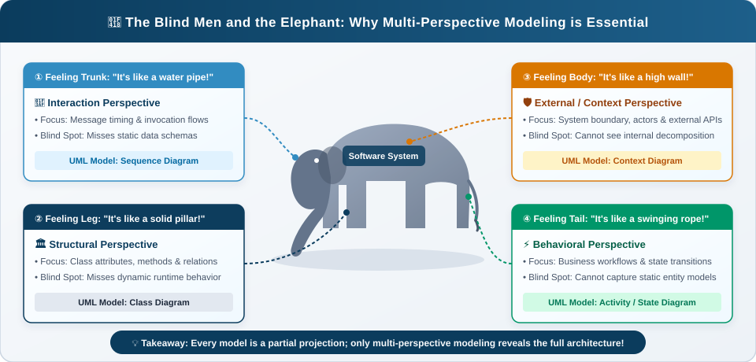
</div>

<!--
This diagram captures one of the most famous philosophical lessons in software engineering: The Blind Men and the Elephant.

In the ancient parable, the blind man feeling the trunk insists the elephant is like a water pipe or snake. The one feeling the leg insists it is a solid tree trunk or pillar. The one touching the body claims it is a wall, and the one feeling the tail claims it is a rope. Each touches an undeniable local truth, yet all fall victim to the fallacy of composition.

Software systems are just like the elephant: invisible, vast, and complex.
If you only look at Class Diagrams, you only feel the legs—you know the static attributes and associations, but have no idea how data moves over time.
If you only look at Sequence Diagrams, you only touch the trunk—you see message interactions, but miss boundary perimeters and data schemas.
If you only look at State Diagrams, you only feel the tail—you see event reactions, but miss domain relationships.

This is why we cannot use a single diagram to describe an entire system!
Software engineering requires four complementary perspectives: External (Context), Interaction, Structural, and Behavioral.
Only by synthesizing multiple models can we see the true, complete architecture of the software.

To summarize this slide, remember this key takeaway: Any single model is merely a dimensional projection of the system; only multi-perspective modeling reveals the full architectural reality.
-->

---

## 4 Core System Modeling Perspectives

- **1. External Perspective:**
  - Models the environment, external partners, and operational context of the system.
  - Defines the strict system perimeter: what is built internally vs. what is delegated to third parties.
- **2. Interaction Perspective:**
  - Models dynamic communications between external actors and the system, or message exchanges between internal collaborating objects.
- **3. Structural Perspective:**
  - Models the static architecture of system data, object classes, attributes, methods, and relationships independent of runtime execution order.
- **4. Behavioral Perspective:**
  - Models the dynamic execution behavior, sequential business workflows, and reactive discrete state transitions in response to external events.

<!--
The software engineering standard organizes system models into four core perspectives:

First, the External Perspective: Where does the system begin and end? What external cloud services and human users touch it?
Second, the Interaction Perspective: How do actors and software objects communicate across time?
Third, the Structural Perspective: What are the static data schemas, classes, attributes, and associations?
Fourth, the Behavioral Perspective: How does the system respond dynamically to inputs, workflows, and reactive events?

Every software engineer must know which perspective to invoke depending on the engineering problem at hand.

To summarize this slide, remember this key takeaway: The four modeling perspectives are External, Interaction, Structural, and Behavioral.
-->

---

## 5 Essential UML Models in Modern Practice

| Model / Diagram | Section | Perspective | Nature | Primary Engineering Role |
| :--- | :---: | :--- | :--- | :--- |
| **1. Use Case Model** | 4.3 | External | Functional Contract | Defines system boundary, actor goals, and scope |
| **2. Class Model** | 4.4 | Structural | Static Backbone | Specifies domain entities, attributes, and relationships |
| **3. Sequence Diagram** | 4.5 | Interaction | Dynamic Chronology | Traces runtime message passing and BCE responsibilities |
| **4. Activity Diagram** | 4.6 | Behavioral | Dynamic Workflow | Models business processes, fork/join concurrency & swimlanes |
| **5. State Machine Diagram** | 4.7 | Behavioral | Reactive Lifecycle | Captures event-driven states, transitions & invariants |

> **Implementation & Acceleration:** Unified via **4.8 PlantUML** (Code-as-Architecture) with **AI Prompt Guidelines** integrated in each model.

<!--
Out of the 14 diagrams defined in UML 2.5, this chapter focuses on the five essential models that form the backbone of modern software architecture:

First, Section 4.3 covers Use Case Models, establishing functional boundaries and stakeholder contracts.
Second, Section 4.4 explores Class Models, defining static domain entities, attributes, and object relationships.
Third, Section 4.5 examines Sequence Diagrams, tracing chronological runtime message exchanges and Boundary-Control-Entity responsibilities.
Fourth, Section 4.6 investigates Activity Diagrams, visualizing business workflows, fork/join concurrency, and swimlanes.
Fifth, Section 4.7 analyzes State Machine Diagrams, modeling reactive object lifecycles, states, and guard invariants.

Each model incorporates dedicated AI prompting guidelines and Food Delivery prompt examples, unified by PlantUML Code-as-Architecture in Section 4.8.

To summarize this slide, remember this key takeaway: Mastering these five core UML models equips engineers to specify, design, and verify software from external, interaction, structural, and behavioral perspectives.
-->

---

### Concept Check Question 1
<!-- id: ase-ch04-ccq1 -->
<div class="ccq-columns">
<div class="ccq-text">

A software architect wants to define **how domain entity data is structured and how classes inherit and associate with each other**, completely independent of runtime execution order. Which modeling perspective should the architect adopt?

- **A.** External Perspective
- **B.** Interaction Perspective
- **C.** Structural Perspective
- **D.** Behavioral Perspective

</div>
<div class="ccq-logo">
    <a href="https://nlhsueh.github.io/nickedupocket/#/student/ase-ch04-ccq1" target="_blank"></a>
  </div>
</div>

<!--
Let's check our understanding of the four modeling perspectives with Concept Check Question 1.

Review the perspectives:
External models the environment and boundaries.
Interaction models message exchanges between actors and objects over time.
Behavioral models state transitions and dynamic workflow execution.
Structural models the static organization of data, classes, attributes, and relationships.

The correct answer is Option C, Structural Perspective!

To summarize this slide, remember this key takeaway: Structural models capture the static architecture of data and class relationships independent of execution timing.
-->

---

<!-- _class: lead -->
<!-- header: '4.2 The Unified Modeling Language (UML)' -->

# **4.2 The Unified Modeling Language (UML)**

> "A standardized visual grammar transformed software engineering from proprietary silos into a global discipline."

<!--
We now advance to Module 4.2: The Unified Modeling Language (UML).

Having explored the foundations and perspectives of modeling, we examine how the software industry resolved the chaotic 1990s Method Wars, united the Three Amigos at Rational Software, and established UML through the Object Management Group as the global lingua franca of software design.

To summarize this slide, remember this key takeaway: UML provides the universal visual standard for object-oriented software modeling.
-->

---

## The Need for Standardization: The 1990s "Method Wars"

- **The Rise of Object-Oriented Programming (Late 1980s – Early 1990s):**
  - The software industry transitioned from procedural code (C, Pascal) to object-oriented paradigms (C++, Smalltalk).
  - Software engineers urgently needed visual notations to represent classes, objects, and relationships.
- **The "Method Wars" Era:**
  - Over **50 competing OO modeling notations** flooded the commercial market.
  - Engineers argued fiercely over whether classes should be clouds, rectangles, or ovals; whether inheritance should be an open triangle, filled arrow, or dashed line.
  - **Severe Industry Fragmentation:** Companies could not exchange models, CASE tools were incompatible, and developers had to relearn notation whenever they switched jobs.

<!--
Now, if modeling is so essential, how did the software industry agree on a single language?

In the late 1980s and early 1990s, object-oriented programming was exploding into the mainstream with C++ and Smalltalk. But a massive crisis emerged: the so-called 'Method Wars.'

Over 50 different experts invented their own modeling notations! Grady Booch used clouds for classes; James Rumbaugh used structured rectangles; Ivar Jacobson introduced use cases; Peter Coad and Edward Yourdon had yet another notation.

It was an architectural Tower of Babel. If you worked at IBM, you drew clouds; if you worked at GE, you drew boxes. CASE tools couldn't interoperate, and software designs were trapped in proprietary silos.

To summarize this slide, remember this key takeaway: The 1990s Method Wars fragmented the software industry with over 50 incompatible modeling notations.
-->

---

## Unification & Standardization: From Rational to OMG

<div class="content-columns">
<div class="content-text">

- **1994 – Unification Begins at Rational Software:**
  - Jim Rumbaugh joined Grady Booch at Rational to merge the Booch Method and OMT into the "Unified Method" (v0.8).
- **1995 – The Three Amigos Assemble:**
  - Ivar Jacobson joined Rational, bringing his revolutionary **Use Case** methodology (OOSE).
- **1997 – OMG International Standardization:**
  - Submitted to the **Object Management Group (OMG)**; unanimously adopted as **UML 1.1** in November 1997.
- **2005 – UML 2.0 Major Architecture Overhaul:**
  - Expanded from 9 to 13 (and later 14) diagram types with formal execution metamodels.

</div>
<div class="content-figure">

<div class="name-card">
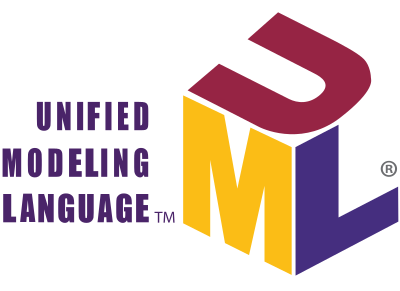
<div class="name-card-caption">
<span class="name-card-name">Unified Modeling Language</span>
<span class="name-card-cc"><a href="https://www.omg.org/uml/" target="_blank">Object Management Group (OMG)</a></span>
</div>
</div>

</div>
</div>

<!--
How was this crisis resolved? Through an unprecedented merger of minds at Rational Software.

In 1994, Jim Rumbaugh left General Electric to join Grady Booch at Rational. They combined Booch's design strengths with Rumbaugh's analysis rigor. A year later, Ivar Jacobson joined them, contributing his use cases and architectural components.

Together, they were affectionately dubbed 'The Three Amigos.'

Instead of keeping their language proprietary, Rational submitted UML to the Object Management Group, an open international standards consortium. In November 1997, UML 1.1 became the official world standard for software modeling.

To summarize this slide, remember this key takeaway: Rational Software unified the Three Amigos, leading to OMG's adoption of UML as the definitive global standard.
-->

---

## Pioneers of UML: Grady Booch

<div class="content-columns">
<div class="content-text">

- **Role & Distinctions:**
  - Chief Scientist, Rational Software; IBM Fellow; ACM Fellow.
- **Pioneered Methodology:**
  - **The Booch Method** and seminal text: *Object-Oriented Analysis and Design with Applications*.
- **Core Contribution to UML:**
  - Focused heavily on **concrete software design**, module decomposition, class abstractions, and architectural patterns.
  - Championed visual expressiveness for implementation-level object structures and code mapping.
- **Famous Architectural Maxim:**
  > *"Clean code always looks like it was written by someone who cares."*

</div>
<div class="content-figure">

<div class="name-card">

<div class="name-card-caption">
<span class="name-card-name">Grady Booch</span>
<span class="name-card-cc"><a href="https://en.wikipedia.org/wiki/Grady_Booch" target="_blank">Rational Software / IBM Fellow</a></span>
</div>
</div>

</div>
</div>

<!--
Meet the first of the Three Amigos: Grady Booch.

Grady Booch is an IBM Fellow and was Chief Scientist at Rational Software. He authored the seminal textbook 'Object-Oriented Analysis and Design with Applications.'

Booch's unique strength was in concrete software design—how classes, inheritance, polymorphism, and modules map directly into executable code architecture. His visual notations were famous for their cloud-shaped class boundaries, which later evolved into UML's structured class boxes.

To summarize this slide, remember this key takeaway: Grady Booch championed object-oriented design abstractions and concrete code architecture.
-->

---

## Pioneers of UML: James Rumbaugh

<div class="content-columns">
<div class="content-text">

- **Role & Distinctions:**
  - Lead Researcher, General Electric (GE) Global R&D; Rational Software; IBM.
- **Pioneered Methodology:**
  - **Object Modeling Technique (OMT)** and book: *Object-Oriented Modeling and Design*.
- **Core Contribution to UML:**
  - Emphasized rigorous **domain analysis**, semantic data modeling, and entity-relationship mapping.
  - Pioneered the synthesis of object structure with David Harel's **Statecharts** to model dynamic reactive systems.
- **Famous Architectural Maxim:**
  > *"You cannot build great software without understanding domain truth."*

</div>
<div class="content-figure">

<div class="name-card">

<div class="name-card-caption">
<span class="name-card-name">James Rumbaugh</span>
<span class="name-card-cc"><a href="https://en.wikipedia.org/wiki/James_Rumbaugh" target="_blank">GE Research / Rational Software</a></span>
</div>
</div>

</div>
</div>

<!--
Meet the second Amigo: Dr. James Rumbaugh.

Jim Rumbaugh led software technology research at General Electric Corporate R&D before joining Rational Software in 1994. His Object Modeling Technique, or OMT, was widely regarded as the most mathematically sound analysis methodology in the industry.

Rumbaugh's genius was in domain analysis—mapping real-world entities, database schemas, associations, and state machines. When Rumbaugh and Booch united, they bridged the gap between analytical problem modeling and concrete software design.

To summarize this slide, remember this key takeaway: James Rumbaugh established rigorous domain analysis, data relationships, and statechart modeling in UML.
-->

---

## Pioneers of UML: Ivar Jacobson

<div class="content-columns">
<div class="content-text">

- **Role & Distinctions:**
  - Lead Architect, Ericsson; Founder, Objectory AB; Rational Software; SEMAT Pioneer.
- **Pioneered Methodology:**
  - **Object-Oriented Software Engineering (OOSE)**.
- **Core Contribution to UML:**
  - **Inventor of Use Cases (1986):** Revolutionized requirements by anchoring system architecture to measurable user goals.
  - Introduced the **Boundary–Control–Entity (BCE)** robustness analysis pattern and component-based architecture.
- **Famous Architectural Maxim:**
  > *"A system that has no users has no reason to exist. Model user goals first."*

</div>
<div class="content-figure">

<div class="name-card">

<div class="name-card-caption">
<span class="name-card-name">Ivar Jacobson</span>
<span class="name-card-cc"><a href="https://en.wikipedia.org/wiki/Ivar_Jacobson" target="_blank">Ericsson / Objectory / Rational</a></span>
</div>
</div>

</div>
</div>

<!--
Meet the third Amigo: Dr. Ivar Jacobson.

Working at Ericsson on massive telephone switching systems and later founding Objectory AB, Jacobson invented the concept of 'Use Cases' in 1986.

Before Jacobson, software requirements were dry, ambiguous specifications of functional statements. Jacobson flipped the perspective entirely onto the human user: who is using the system, and what business goal are they trying to accomplish? He also introduced the Boundary-Control-Entity pattern that still anchors modern software architecture.

To summarize this slide, remember this key takeaway: Ivar Jacobson invented Use Cases and the BCE pattern, centering software architecture around user goals.
-->

---

## The Three Amigos: The Trinity of Software Modeling

<div class="three-columns">
<div class="card">
<h3>Ivar Jacobson</h3>
<h4>The "Why" (Goal / User)</h4>
<ul>
<li><b>Use Case Driven:</b> What goals do external actors achieve?</li>
<li><b>BCE Robustness:</b> Separating UI boundaries from data entities.</li>
<li><b>Component Contracts:</b> Reusable subsystem architectures.</li>
</ul>
</div>
<div class="card">
<h3>James Rumbaugh</h3>
<h4>The "What" (Domain Data)</h4>
<ul>
<li><b>Domain Analysis:</b> What real-world concepts exist?</li>
<li><b>Class & Data Schemas:</b> Structural entity relationships.</li>
<li><b>State Machines:</b> Reactive event-driven lifecycles.</li>
</ul>
</div>
<div class="card">
<h3>Grady Booch</h3>
<h4>The "How" (Design & Code)</h4>
<ul>
<li><b>Object-Oriented Design:</b> How do classes collaborate?</li>
<li><b>Macro Architecture:</b> Layered module decomposition.</li>
<li><b>Implementation Map:</b> Direct code translation into OOP.</li>
</ul>
</div>
</div>

> 📌 **Architectural Synthesis:** Jacobson captures **Why** the system exists; Rumbaugh models **What** domain concepts exist; Booch designs **How** components execute in code.

<!--
Notice how the Three Amigos complemented each other with flawless harmony:

Ivar Jacobson answered WHY the system exists from the user's perspective through Use Cases.
James Rumbaugh mapped WHAT data entities and states exist in the problem domain.
Grady Booch designed HOW those entities collaborate in executable software code.

This synthesis formed the bedrock not only of UML, but also of modern software engineering methodologies like the Rational Unified Process (RUP).

To summarize this slide, remember this key takeaway: UML harmonizes the user goals (Jacobson), domain data (Rumbaugh), and code architecture (Booch).
-->

---

### Concept Check Question 2
<!-- id: ase-ch04-ccq2 -->
<div class="ccq-columns">
<div class="ccq-text">

Which of the "Three Amigos" was specifically renowned for inventing **Use Cases (1986)** to anchor software architecture to tangible user goals?

- **A.** Grady Booch
- **B.** James Rumbaugh
- **C.** Ivar Jacobson
- **D.** Martin Fowler

</div>
<div class="ccq-logo">
    <a href="https://nlhsueh.github.io/nickedupocket/#/student/ase-ch04-ccq2" target="_blank"></a>
  </div>
</div>

<!--
Let's check our understanding of UML history with Concept Check Question 2.

Look at the options:
Grady Booch developed the Booch Method focusing on object-oriented design and abstractions.
James Rumbaugh developed OMT focusing on domain analysis and object modeling.
Martin Fowler is a renowned author who wrote 'UML Distilled' and refactoring guides, but was not one of the Three Amigos.

The correct answer is Option C, Ivar Jacobson! Jacobson introduced Use Cases at Ericsson in 1986 to ensure software architectures directly fulfill user-driven goals.

To summarize this slide, remember this key takeaway: Ivar Jacobson invented Use Cases, shifting requirements modeling toward user-centric goals.
-->

---

<!-- _class: lead -->
<!-- header: '4.3 Functional & Use Case Models' -->

# **4.3 Functional & Use Case Models**

> "A use case is a contract for behavior between the system and its actors to achieve a measurable business goal."
> — *Alistair Cockburn*

<!--
Welcome to Section 4.3: Functional and Use Case Models.

What is a use case? Think of it as a clear agreement between the system and the people using it. Instead of writing long, confusing requirement documents, use cases focus on external users and their real goals.

In this section, we will learn how to read and build use case diagrams, how to connect actors and actions, and how to avoid common modeling mistakes.

To summarize this slide, remember this key takeaway: A use case is an agreement showing how external users interact with the system to achieve their goals.
-->

---

<!-- _class: title-image-slide -->

## Focus: Business Value & User Goals

<div class="image-wrapper">
  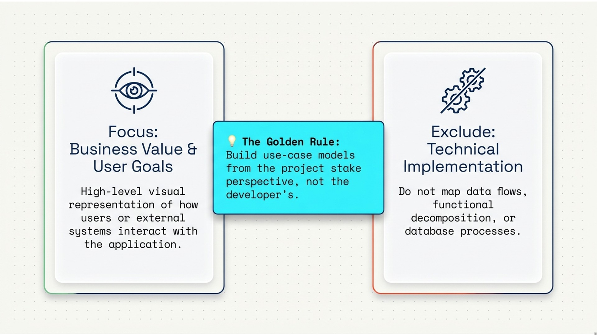
</div>

<!--
Look at the three cards on this slide.

On the left, we see what to focus on: Business Value and User Goals. We ask: What does the user want to achieve? For example, 'Book a Flight' or 'Order Food'.

In the middle, look at the blue box with the lightbulb: 'The Golden Rule'. Always build your use case models from the user's point of view, not the programmer's point of view!

Now look at the right card: What to exclude. Do not draw database queries, data flows, or tiny buttons like 'Click Submit'. Those are internal code details, not user goals.

To summarize this slide, remember this key takeaway: Focus on what the user wants to achieve, not internal code or database steps.
-->

---

<!-- _class: title-image-slide -->

## Actor Taxonomy & System Boundaries

<div class="image-wrapper">
  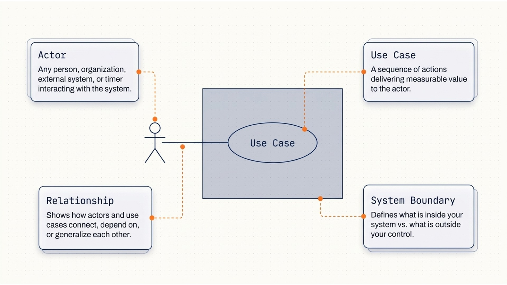
</div>

<!--
Look at the four callout boxes on this slide. These are the four core building blocks of every use case diagram.

Top-left: The **Actor** (the stick figure). An actor is anyone or anything outside the system—a person, an organization, another system, or even a timer.

Top-right: The **Use Case** (the oval). This is a sequence of actions that gives real, measurable value to the actor.

Bottom-left: The **Relationship** (the line). This shows how actors and use cases connect, depend on each other, or share behavior.

Bottom-right: The **System Boundary** (the grey box). This rectangle draws a clear border: what is inside our software versus what is outside our control.

To summarize this slide, remember this key takeaway: Every use case diagram is built from four elements: actors, use cases, relationships, and the system boundary.
-->

---

<!-- _class: title-image-slide -->

## Use Case Relationship Matrix

<div class="image-wrapper">
  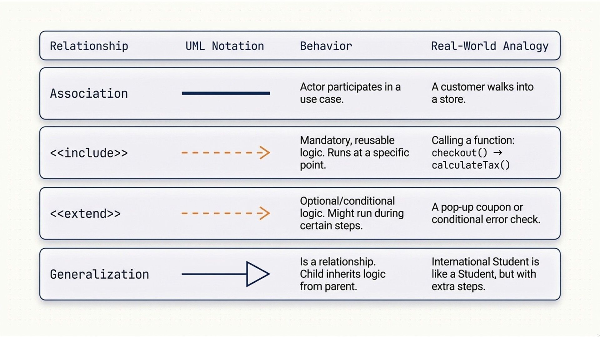
</div>

<!--
Now look at this table: The 'Relationship Matrix'. It shows four ways things connect in UML.

Row 1: **Association**. A simple solid line. The actor participates in a use case. The analogy is: a customer walks into a store.

Row 2: **<<include>>**. An orange dashed arrow. This is mandatory, reusable logic that runs every time, like calling calculateTax() during checkout().

Row 3: **<<extend>>**. An orange dashed arrow. This is optional or conditional logic that only runs under certain conditions, like a pop-up discount coupon.

Row 4: **Generalization**. A solid line with a hollow arrow. An 'is-a' relationship where a child inherits logic from a parent, like an International Student who is a Student with extra steps.

To summarize this slide, remember this key takeaway: Remember the difference: include is mandatory, extend is optional, and generalization is inheritance.
-->

---

<!-- _class: title-image-slide -->

### Clear Use Case Naming

<div class="image-wrapper">
  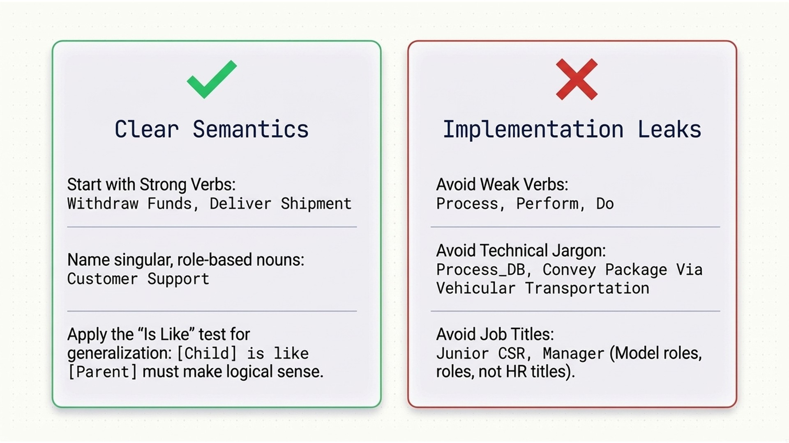
</div>

<!--
How do we choose good names for use cases and actors?

Look at the green side on the left: Good modeling practices. Use strong verbs like 'Withdraw Funds' or 'Deliver Shipment'. For actors, use singular roles like 'Customer Support'. And make sure generalization passes the 'is-like' test.

Now look at the red side on the right: Bad practices to avoid. Avoid weak verbs like 'Process' or 'Do'. Never use technical jargon like 'Process_DB', and avoid HR job titles like 'Junior CSR'. Model roles, not office titles.

To summarize this slide, remember this key takeaway: Name use cases with strong action verbs, and name actors as singular roles.
-->

---

<!-- _class: title-image-slide -->

### Rules of Building Use Case Models

<div class="image-wrapper">
  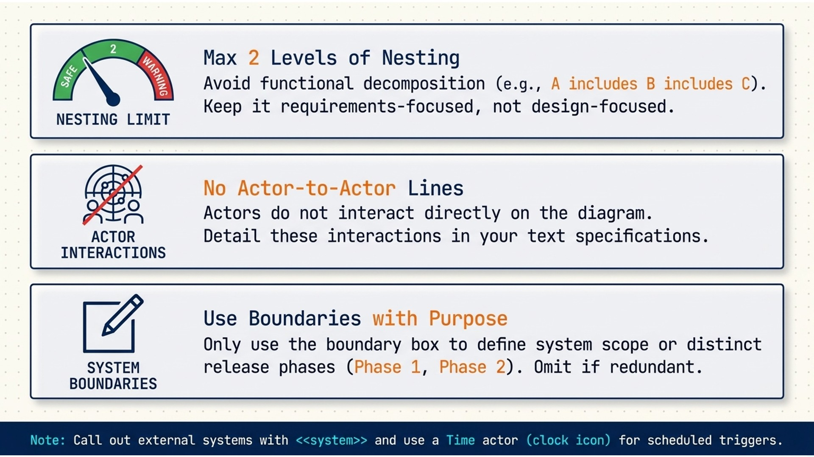
</div>

<!--
Look at the three rules on this slide to keep your diagrams clean and easy to read.

First, look at the meter at the top: **Max 2 Levels of Nesting**. Keep includes shallow! If A includes B, and B includes C, your diagram turns into a messy flowchart.

Second, look at the middle card: **No Actor-to-Actor Lines**. People might talk to each other in real life, but on this diagram, actors only talk to the system. Put human discussions in your text notes.

Third, look at the bottom card: **Use Boundaries with Purpose**. Use the boundary box to define system scope or release phases like Phase 1 and Phase 2.

Also notice the tip at the very bottom: label external systems with <<system>> and use a clock icon for timer actors.

To summarize this slide, remember this key takeaway: Keep nesting shallow, never connect actors to each other, and use boundary boxes with a clear purpose.
-->

---

<!-- _class: title-image-slide -->

## Case Study: University Enrollment System

<div class="image-wrapper">
  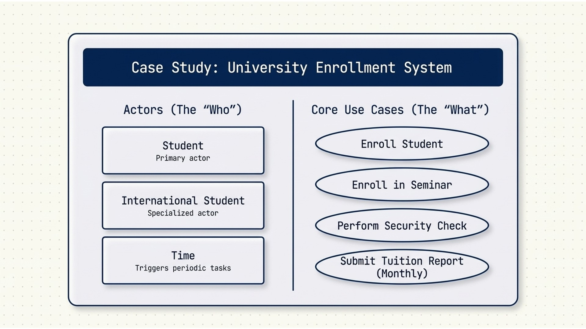
</div>

<!--
Let's look at a concrete case study: The University Enrollment System.

Notice how this slide splits our system into two clear columns: the 'Who' and the 'What'.

On the left side: The Actors (The 'Who'). We have a regular **Student** as the primary actor, an **International Student** as a specialized actor, and a **Time** actor that triggers tasks on a schedule.

On the right side: Core Use Cases (The 'What'). We have four goals: 'Enroll Student', 'Enroll in Seminar', 'Perform Security Check', and 'Submit Tuition Report'.

On the next slide, we will connect all of these pieces together!

To summarize this slide, remember this key takeaway: Always identify the actors (the 'Who') and the use cases (the 'What') before drawing connections.
-->

---

<!-- _class: title-image-slide -->

### Case Study: Actor Generalization & Relationship Synthesis

<div class="image-wrapper">
  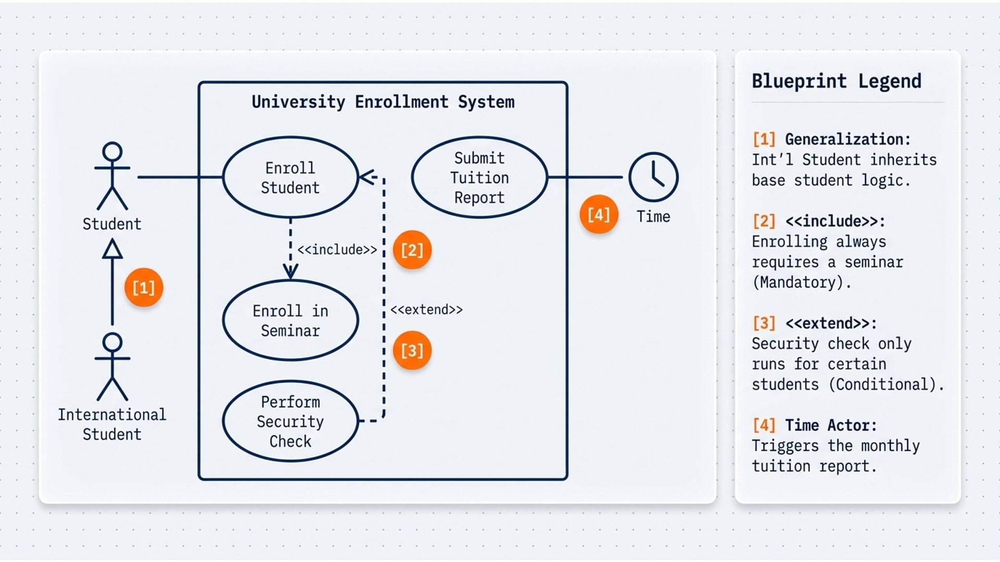
</div>

<!--
Now look at how everything comes together in this complete diagram!

Follow the orange numbers in the Blueprint Legend on the right side:

Number 1 is **Generalization**: The hollow arrow shows that an International Student is a Student, inheriting all basic enrollment actions.

Number 2 is **<<include>>**: Notice the arrow points from Enroll Student down to Enroll in Seminar. This step is mandatory—enrolling always requires a seminar.

Number 3 is **<<extend>>**: Notice the arrow points back to Enroll Student. A security check is conditional—it only runs for certain students.

Number 4 is the **Time Actor**: The clock icon on the right automatically triggers the monthly tuition report.

To summarize this slide, remember this key takeaway: See how all four concepts—generalization, include, extend, and timer actors—work together in one clear picture.
-->

---

<!-- _class: title-image-slide -->

## Common Anti-Patterns of Use Case Models

<div class="image-wrapper">
  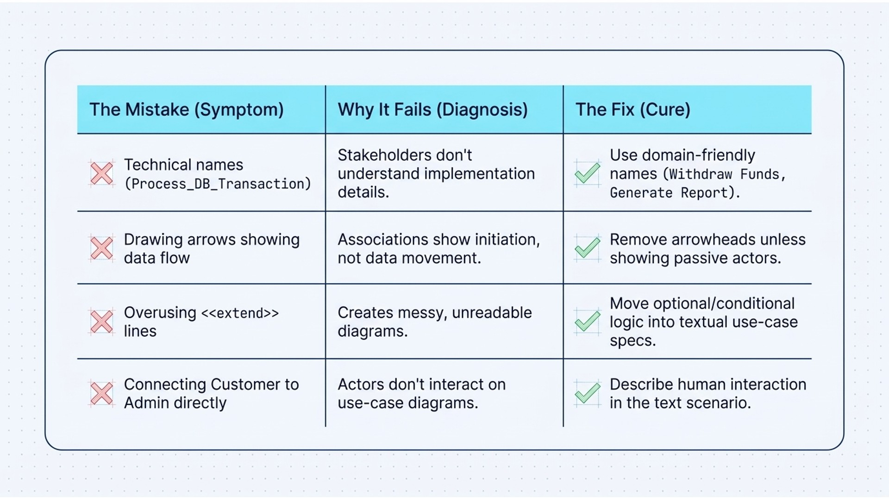
</div>

<!--
Here is a table showing four common mistakes, why they fail, and how to fix them.

Row 1: Technical names like 'Process_DB_Transaction'. Non-technical clients will not understand them. The fix: Use friendly domain names like 'Withdraw Funds'.

Row 2: Drawing arrows that show data moving. Associations only show who participates, not data flow. The fix: Remove the arrowheads and draw a plain line.

Row 3: Overusing <<extend>> lines. Too many dashed arrows make the diagram look like a spiderweb. The fix: Move optional rules into written text specifications.

Row 4: Connecting Customer to Admin directly. Actors do not interact with each other on use case diagrams. The fix: Describe human interaction in your written scenario.

To summarize this slide, remember this key takeaway: Keep diagrams clean by avoiding technical names, data-flow arrows, and direct actor-to-actor links.
-->

---

<!-- _class: title-image-slide -->

### Best Practices Checklists

<div class="image-wrapper">
  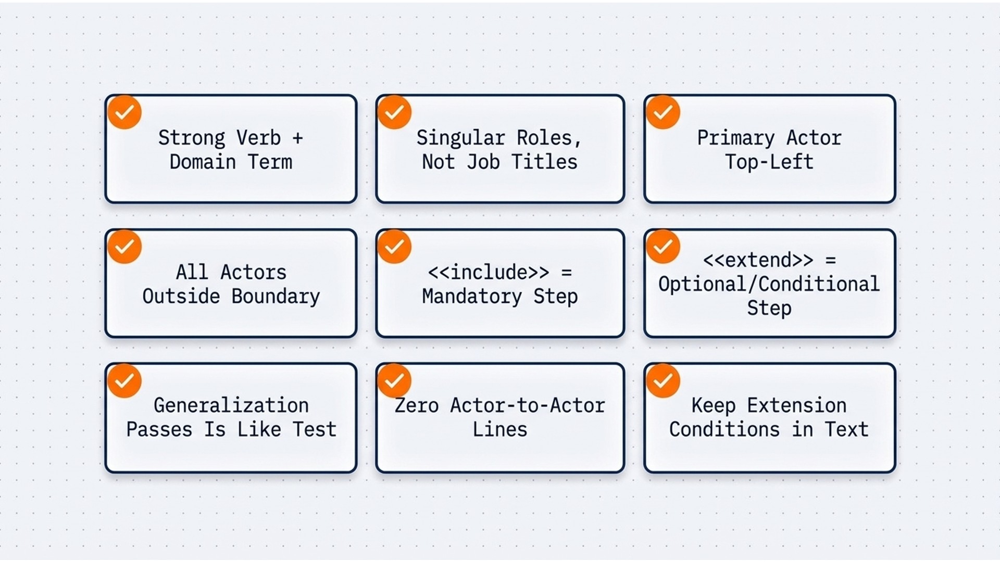
</div>

<!--
Before you show your use case diagram to your team, check these nine boxes:

1. Did you use a strong verb and domain noun?
2. Are actors named as singular roles, not job titles?
3. Is your primary actor placed on the top-left?
4. Are all actors drawn outside the boundary box?
5. Is <<include>> used strictly for mandatory steps?
6. Is <<extend>> used strictly for optional or conditional steps?
7. Does every generalization pass the 'is-like' test?
8. Are there zero lines connecting actors to each other?
9. Are detailed extension conditions saved for the written text?

If you check all nine boxes, your diagram is clean and professional!

To summarize this slide, remember this key takeaway: Use this nine-point checklist as a quality gate before finalizing any use case model.
-->

---

### Use Case Specification: UC-01 Enroll Student

| Field | Specification Details |
| :--- | :--- |
| **Use Case ID / Name** | **UC-01: Enroll Student in Course** |
| **Primary Actor** | Student (authenticated via campus Single Sign-On) |
| **Preconditions** | Student is matriculated with active status; enrollment registration window is open |
| **Postconditions** | Student is officially enrolled in course section; seat quota decremented by 1 |
| **Main Success Scenario** | **1.** Student searches for open course sections by department or course code.<br>**2.** System displays matching course sections, schedules, and remaining seat quotas.<br>**3.** Student selects target section and submits an enrollment request.<br>**4.** System executes `<<include>> Verify Prerequisites` against academic transcript.<br>**5.** System reserves seat, updates enrollment ledger, and generates confirmation notice.<br>**6.** Student views updated schedule and receives confirmation notification. |
| **Extensions (Alternate)** | **4a. Prerequisite Deficiency:** System displays missing prerequisite courses and halts.<br>**4b. Schedule Conflict:** System alerts student of timeslot overlap with existing class.<br>**5a. Section at Capacity:** System offers `<<extend>> Add to Waitlist` queue. |

<!--
A use case diagram is like a book cover or table of contents. To understand what really happens, we write a Use Case Specification like the table shown here.

Look at the fields:
We name the Primary Actor: the authenticated Student.
The Preconditions tell us what must be true before starting: active student status and an open enrollment window.
The Postconditions guarantee what is true at the end: the student is enrolled and the seat count decreases by one.

Now look at Step 4 of the Main Success Scenario: It explicitly calls our included use case: 'Verify Prerequisites'.
And in the Extensions at the bottom, we see what happens when things go wrong—like missing prerequisites, schedule conflicts, or full classes.

To summarize this slide, remember this key takeaway: The diagram gives the overview, while the written specification explains the step-by-step story and exception paths.
-->

---

## Concept Check Question 3
<!-- id: ase-ch04-ccq3 -->

<div class="ccq-columns">
<div class="ccq-text">

In our Food Delivery Use Case Model, why does `Apply Promo Voucher` point to `Place Food Order` with `<<extend>>`, while `Place Food Order` points to `Process Payment` with `<<include>>`?

- **A.** Voucher application is mandatory for all orders; payment is optional.
- **B.** Vouchers are conditional optional behavior; payment is mandatory shared execution.
- **C.** Vouchers are executed by supporting actors; payment is executed by primary actors.
- **D.** Vouchers represent class inheritance; payment represents object composition.

</div>
<div class="ccq-logo">
    <a href="https://nlhsueh.github.io/nickedupocket/#/student/ase-ch04-ccq3" target="_blank"></a>
  </div>
</div>

<!--
Let's check our understanding with Concept Check Question 3.

Why is applying a voucher an <<extend>>, while processing payment is an <<include>>?

Look at the options:
Option A reverses the business logic completely.
Option C confuses actors with arrow types.
Option D confuses class diagrams with use cases.

The correct answer is Option B! Applying a voucher is optional—orders work fine without a coupon. In contrast, processing payment is mandatory—every order must be paid for.

To summarize this slide, remember this key takeaway: Use include for mandatory shared steps, and use extend for optional, conditional steps.
-->

---

<!-- _class: v-center -->

### Diagnostic Exercise: Spot the 3 Flaws in this Use Case Model

<div class="split46">
<div class="left" style="font-size: 19.5px; line-height: 1.45;">

**Audit this student's draft diagram:**
Can you spot the **3 critical modeling mistakes (anti-patterns)**?

- **1. Granularity & Workflow:**
  - What is wrong with connecting `Enter Delivery Address` ➔ `Click Submit Button` ➔ `Place Food Order`?
- **2. Relationship Direction:**
  - Look closely at `Process Payment` and `Place Food Order`. What is wrong with the `<<include>>` arrow?
- **3. Boundary & Actor Placement:**
  - Examine `Chef` and `MySQL Database`. What violates UML system boundary principles?

</div>
<div class="right" style="display: flex; justify-content: center; align-items: center;">

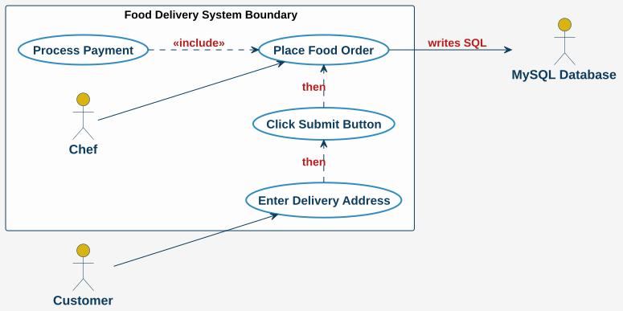

</div>
</div>

<!--
Let's conduct a diagnostic critique of this student draft diagram. Can you identify the three major modeling anti-patterns?

Flaw 1 (Functional Decomposition / UI Flowcharting):
Use cases represent complete, value-yielding user goals (what the user achieves), not micro-steps, button clicks, or a flowchart. 'Enter Delivery Address' and 'Click Submit Button' are not independent use cases—they are trivial input steps inside 'Place Food Order'.

Flaw 2 (Inverted Include Arrow Direction):
Look at the dependency between Place Food Order and Process Payment. The dashed arrow points in reverse! In UML, the base use case points TO the included use case (Place Food Order . . > Process Payment : <<include>>), because the base includes the subroutine, not vice versa.

Flaw 3 (Boundary & Actor Violations):
First, Chef is an actor (a human role) but is drawn inside the system boundary box—all actors must remain strictly outside the boundary. Second, MySQL Database is drawn as an external actor with a data-flow arrow ('writes SQL'). An internal database is part of the system's internal implementation, not an external actor!

To summarize this slide, remember this key takeaway: Avoid micro UI flowcharting, ensure include arrows point toward the included use case, and keep internal databases and actors outside system boundary errors.
-->

---

## AI Assistance: Guidelines for Use Case Modeling

- **1. Define Clear System Boundaries:**
  - Clearly separate what is inside the system from external users and third-party services (e.g., payment gateways).
- **2. Identify Real User Goals (Actors & Use Cases):**
  - Focus on complete, meaningful user goals (e.g., `Place Order`, `Track Delivery`).
  - Avoid breaking steps down into trivial UI interactions (no "Click Button" or "Enter Password").
- **3. Clarify Relationship Semantics:**
  - **Mandatory Sub-flows:** Identify common steps that occur every single time (shared building blocks).
  - **Optional or Conditional Steps:** Explicitly distinguish optional extensions (e.g., applying vouchers) from normal flows.
- **4. Human Review & Reality Check:**
  - Are use cases named with clear active verbs?
  - Are external partner systems kept outside the core system boundary?

<!--
When asking AI to help build use case models, focus on high-level goals and clean system boundaries rather than low-level details.

First, establish clear system boundaries so the AI doesn't mix up internal features with external services like SMS or payment providers.

Second, guide the AI to identify genuine user goals—meaningful business tasks like placing an order, rather than tiny UI clicks.

Third, clarify relationships: Distinguish mandatory steps that happen every time from optional extensions like applying promo codes.

Finally, do a quick sanity check: Ensure use cases are active verb phrases and external services stay outside the system boundary.

To summarize this slide, remember this key takeaway: Guide AI by defining clear system boundaries, real user goals, and distinguishing mandatory steps from optional extensions.
-->

---

<!-- _class: v-center -->

### AI Prompt Example: Food Delivery Use Case Model

<div class="two-columns">
<div>

**1. Role & Task Instruction:**
```text
Act as a Lead Systems Analyst.
Generate a clean PlantUML Use Case
diagram for a Food Delivery System.
```

**2. Modeling Guidance:**
- Clearly define system boundary vs. external services.
- Focus on meaningful user goals (avoid trivial UI button clicks).
- Separate mandatory sub-flows from optional extensions.
- Identify primary human actors and external partner systems.

</div>
<div>

**3. Input Requirements Statement:**
> "Our platform allows **Customers** to browse restaurants, add food items to cart, and place orders.
> When placing an order, the system must always authorize payment through an external **Payment Gateway** and validate delivery address.
> A customer may optionally enter a discount coupon code (`Apply Promo Voucher`) or select contactless doorstep delivery.
> **Restaurant Staff** review incoming orders, accept or reject them, and update kitchen prep status.
> **Delivery Couriers** accept available delivery tasks, pick up orders, and complete deliveries."

</div>
</div>

<!--
Here is a practical prompt example for creating a Food Delivery Use Case Model.

Look at the left column: Instead of micromanaging syntax, we provide high-level modeling guidance: define clear boundaries, focus on real user goals without trivial UI clicks, and distinguish mandatory steps from optional extensions.

In the right column, we supply the domain story: Customers placing orders, external Payment Gateways authorizing transactions, optional vouchers, and roles for Restaurant Staff and Couriers.

With this conceptual guidance, AI produces a clean, professional use case diagram without clutter or wrong boundaries.

To summarize this slide, remember this key takeaway: Guide AI with clear boundaries, real user goals, and structured domain stories.
-->

---

<!-- _class: v-center -->
<!-- header: '4.3 Functional & Use Case Models' -->

### Generated PlantUML & Diagram: Food Delivery Use Case Model

<div class="puml-output-grid">
<div class="puml-code-col">

<div class="puml-title">Generated PlantUML Specification:</div>

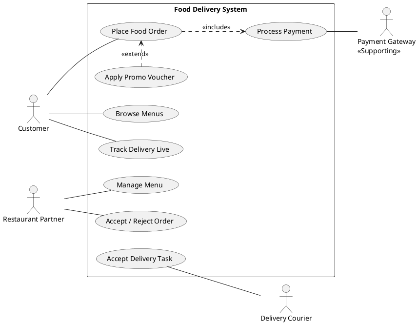

</div>
<div class="puml-diagram-col">

<div class="puml-title">Rendered Diagram Output:</div>

<div class="diagram-wrapper">
  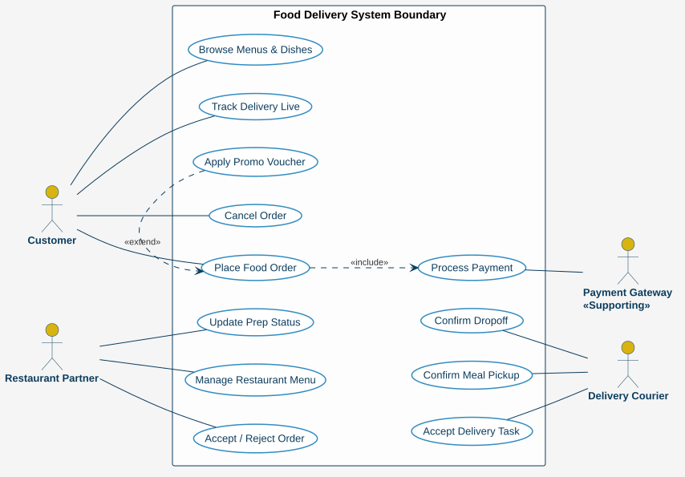
</div>

</div>
</div>

<!--
Here is the resulting Use Case model generated by the AI from our structured prompt.

On the left, you can see the concise PlantUML code. Notice how simple declarative statements define the actors, the system boundary box, and the use case bubbles.
Notice the key relationships: Place Food Order includes Process Payment with a dotted arrow and guillemets, while Apply Promo Voucher extends Place Food Order.

On the right, you see the rendered diagram. Notice the clean separation: primary actors Customer and Restaurant Partner on the left, supporting actors Payment Gateway and Courier on the right.

To summarize this slide, remember this key takeaway: A structured prompt allows AI to generate valid PlantUML that compiles cleanly into an industry-standard use case diagram.
-->

---

### Interactive Activity: Evolving Use Cases with AI (Pair Hands-On)

<div class="discussion-columns">
  <div class="discussion-text">

  **Hands-on Experiment: Mutate Requirements & Audit AI Output (4 Mins)**
  - **1. Add ONE New Feature to the Use Case Prompt:**
    - *Scheduled Ordering:* Allow `Customer` to pre-order food for future delivery.
    - *Live Chat Support:* Connect `Customer` with `Support Agent` or `Courier`.
    - *Group Ordering:* Multiple users add items into a single pooled order.
  - **2. Ask AI to Generate:** Prompt an LLM to update the PlantUML use case diagram.
  - **3. Render & Critique:** Paste into [PlantText](https://www.planttext.com) and audit:
    - Did AI keep external actors/gateways **outside** the system boundary?
    - Did AI correctly distinguish **mandatory steps** from **optional extensions**?
    - Did AI avoid trivial button clicks (e.g., no "Click Confirm")?

  </div>
  <div class="discussion-logo">
    
  </div>
</div>

<!--
Now let's do a hands-on pair experiment! Work with your partner to test AI's requirements modeling accuracy in real time.

Look at the instructions on the screen:
Take our Food Delivery Use Case prompt from earlier and mutate it with one new business requirement:
- Option A: Scheduled delivery for future dates and times.
- Option B: Real-time customer support chat with an agent or courier.
- Option C: Group ordering where multiple teammates add food to a single cart.

Ask your AI assistant to generate the updated PlantUML use case diagram, paste the code into PlantText, and critically audit the result:
Did external third-party services stay outside the system boundary?
Did AI properly differentiate mandatory core flows from optional extensions?
Did AI fall into the trap of creating tiny button-click bubbles?

To summarize this slide, remember this key takeaway: Testing AI with mutated requirements reveals whether it truly understands system boundaries and user goals.
-->


---

<!-- _class: lead -->
<!-- header: '4.4 Structural & Class Models' -->

# **4.4 Structural & Class Models**

> "Classes are the static building blocks; objects are the living runtime instances."

<!--
Welcome to Section 4.4: Structural Models and Class Diagrams.

In the previous section, we used use cases to see what users want to achieve. Now, how do we structure the software itself?

Class diagrams show the static backbone of our system: the classes, the data they hold, and how they connect to one another.

To summarize this slide, remember this key takeaway: Class diagrams model the static structure and connections between objects in our software.
-->

---

<!-- _class: full-image-slide -->

<div class="centered-image">
  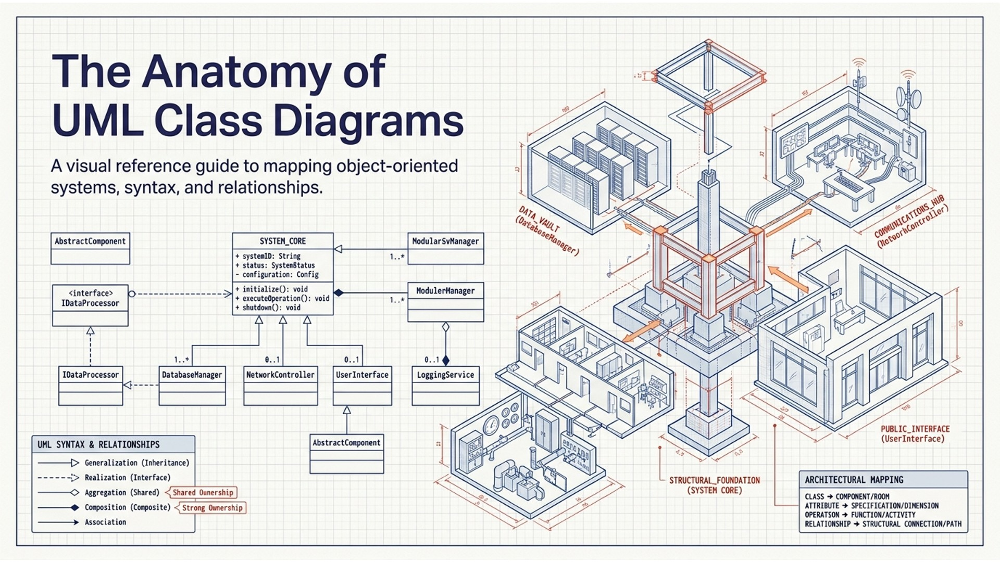
</div>

<!--
Look at this wonderful drawing: 'The Anatomy of UML Class Diagrams.'

Notice the building on the right side of the screen. Think of software like a real building:
The System Core is the strong foundation pillar in the center.
The DatabaseManager is the Data Vault with server racks.
The NetworkController is the communications room with antennas on the roof.
And the UserInterface is the front door and windows where users enter.

Now look at the small table at the bottom right:
A class is like a room, attributes are the room dimensions, operations are what happens inside that room, and relationships are the hallways connecting them!
On the left side, you see how this entire building maps into a standard UML class diagram.

To summarize this slide, remember this key takeaway: Think of a class diagram like a building blueprint: classes are rooms, and relationships are the hallways connecting them.
-->

---

<!-- _class: title-image-slide -->

## Blueprint vs. Instance: The Foundation of OOD

<div class="image-wrapper">
  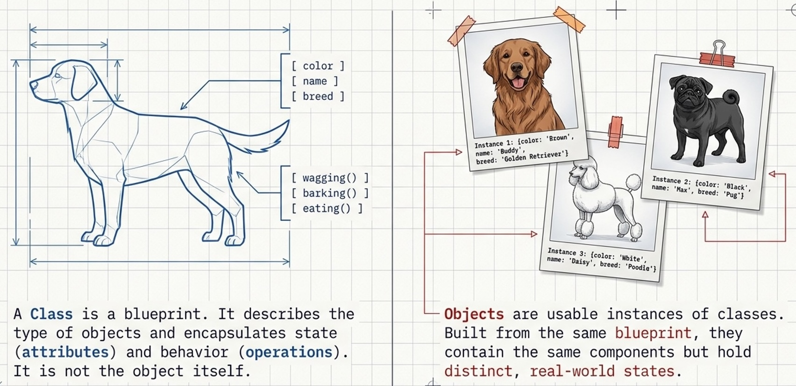
</div>

<!--
Here is the core foundation of Object-Oriented Design: 'Blueprint vs. Instance.'

Look at the blueprint of a dog on the left side: That is a **Class**. It defines what every dog has: attributes like color, name, and breed; and actions like wagging, barking, and eating. But remember: you cannot pet a blueprint!

Now look at the three polaroid photos on the right: Those are **Objects**!
We have Buddy the Golden Retriever, Max the Pug, and Daisy the Poodle.
Each dog comes from the exact same blueprint, but each one has its own real-world color, name, and size.

To summarize this slide, remember this key takeaway: A class is the blueprint, while objects are the real, individual instances made from that blueprint.
-->

---

<!-- _class: title-image-slide -->

### The Three Perspectives of Class Modeling

<div class="image-wrapper">
  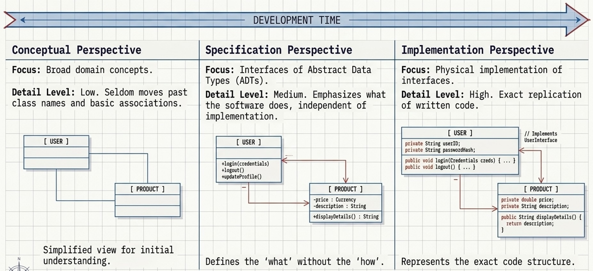
</div>

<!--
Look at the three columns along the 'Development Time' arrow at the top. We can view a class model from three different levels of detail:

On the left: The **Conceptual Perspective**. When we start a project, we only care about big domain ideas. We just draw simple boxes like User and Product with no technical details.

In the middle: The **Specification Perspective**. Here we define software interfaces. We write what the system does—like `login()` or `price`—without worrying about the programming language.

On the right: The **Implementation Perspective**. This directly reflects real code, complete with private fields, data types, and method bodies in Java or C++.

To summarize this slide, remember this key takeaway: As development moves forward, our class diagrams move from broad ideas to software interfaces, and finally to detailed code.
-->

---

<!-- _class: title-image-slide -->

## Anatomy of the UML Class Box

<div class="image-wrapper">
  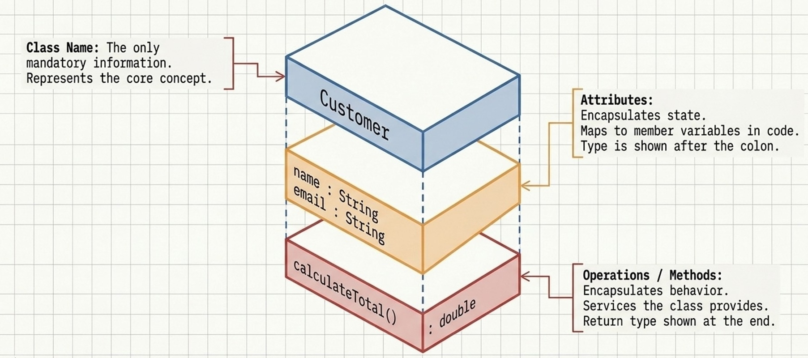
</div>

<!--
Look at this 3D drawing: 'Anatomy of the Class Box.' It looks like a three-layer sandwich! Every standard UML class box has these three compartments:

Top layer (blue): The **Class Name**. This is the only mandatory part, like 'Customer'.

Middle layer (orange): The **Attributes** or variables. Here we store data, like name and email. Notice that the data type is written after the colon, like `name : String`.

Bottom layer (red): The **Operations** or methods. These are the services the class provides, like `calculateTotal()`. Notice the return type is at the end, like `: double`.

To summarize this slide, remember this key takeaway: A class box has three layers: the class name on top, attributes in the middle, and methods on the bottom.
-->

---

<!-- _class: title-image-slide -->

### The Member Visibility Matrix (+, -, #, ~)

<div class="image-wrapper">
  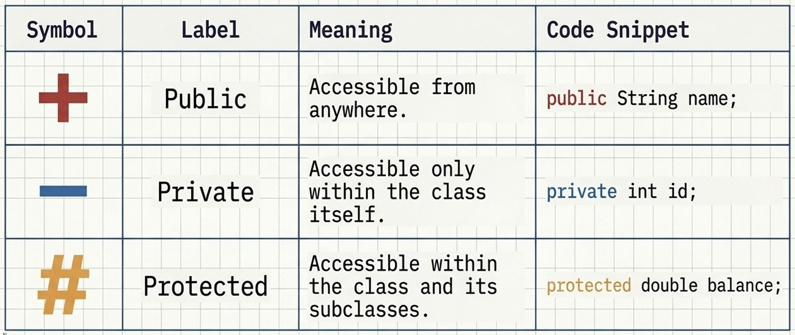
</div>

<!--
How do we protect data inside a class? Look at 'The Visibility Matrix.' We put a small symbol in front of each attribute and method:

First row: A **plus sign (+)** means **Public**. Anyone can access it from anywhere, just like `public String name;` in code.

Second row: A **minus sign (-)** means **Private**. Only this class can touch it. In good design, almost all attributes should be private!

Third row: A **hash sign (#)** means **Protected**. It is hidden from outside classes, but subclasses that inherit from this class can use it.

Look at the code snippets on the right—they map directly to access keywords you already use!

To summarize this slide, remember this key takeaway: Use minus for private data, plus for public methods, and hash for protected subclass access.
-->

---

<!-- _class: title-image-slide -->

## Taxonomy of Class Relationships

<div class="image-wrapper">
  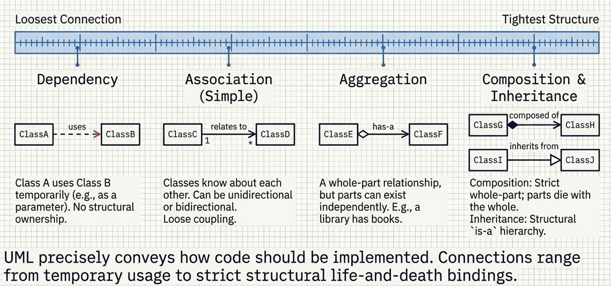
</div>

<!--
Look at the blue ruler across this slide: 'Taxonomy of Relationships.' It shows how tightly two classes can connect, from the loosest connection on the left to the tightest structure on the right:

On the far left: **Dependency**. Class A just temporarily uses Class B, like passing it into a method. There is no permanent link.

Next: **Association**. Two classes know each other and hold a reference, like Class C relating to Class D.

Moving right: **Aggregation**. A whole-part link where parts can still exist on their own, like a library having books.

On the far right: **Composition and Inheritance**. These are the tightest bonds. In composition, if the whole is destroyed, the parts die with it. In inheritance, the child strictly inherits the parent's structure.

To summarize this slide, remember this key takeaway: Class relationships range from loose temporary use on the left to tight life-and-death ownership on the right.
-->

---

<!-- _class: title-image-slide -->

### UML Connector & Arrowhead Cheat Sheet

<div class="image-wrapper">
  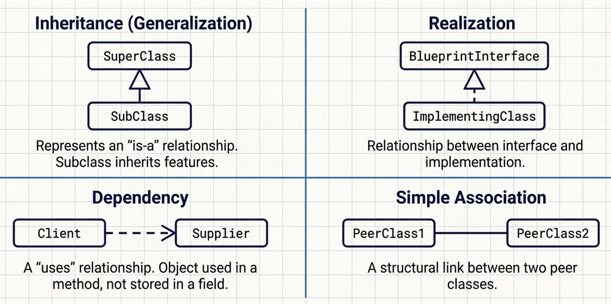
</div>

<!--
Here is your handy reference: 'The Connector Cheat Sheet.' Let's walk through the four quadrants so you never mix up the lines and arrows:

Top-left: **Inheritance**. Solid line with a hollow triangle pointing up to the SuperClass. This represents an 'is-a' relationship.

Top-right: **Realization**. Dashed line with a hollow triangle pointing to an Interface. It shows a class implementing a contract.

Bottom-left: **Dependency**. Dashed line with an open arrow. It shows that a client class temporarily 'uses' another class.

Bottom-right: **Simple Association**. Just a plain solid line between two peer classes that communicate.

To summarize this slide, remember this key takeaway: Pay close attention to solid versus dashed lines, and hollow triangles versus open arrowheads.
-->

---

<!-- _class: title-image-slide -->

### Lifecycle Diagnostic: Aggregation vs. Composition

<div class="image-wrapper">
  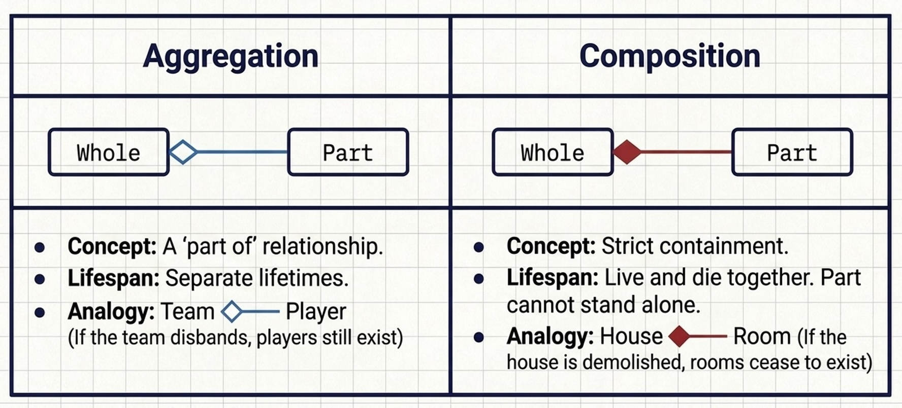
</div>

<!--
Now examine one of the most important design questions: Aggregation versus Composition.

Look at the left column: **Aggregation** uses a **hollow diamond (◇)**. It represents a whole-part relationship, but their lifespans are separate. Look at the analogy: A Sports Team and its Players. If the team disbands tomorrow, the players still exist!

Now look at the right column: **Composition** uses a **solid filled diamond (◆)**. This is strict containment and a shared lifespan. Look at the analogy: A House and its Rooms. If the house is demolished, the rooms cease to exist!

In software, composition means deleting the parent deletes all its child records too.

To summarize this slide, remember this key takeaway: Use a hollow diamond (aggregation) if parts can survive alone; use a solid diamond (composition) if parts die with the parent.
-->

---

<!-- _class: title-image-slide -->

### Cardinality, Multiplicity & Business Constraints

<div class="image-wrapper">
  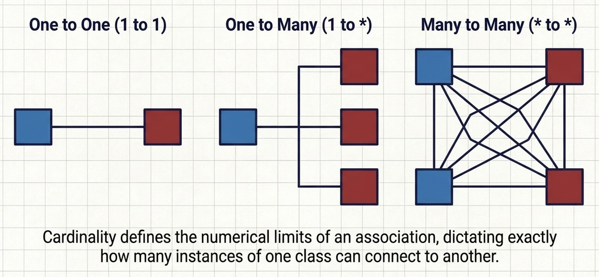
</div>

<!--
Look at the blue and red boxes on this slide: 'Cardinality & Constraints.' In UML, this tells us how many instances of one class can link to another:

On the left: **One to One (1 to 1)**. One blue box links to exactly one red box, like one citizen having one passport.

In the middle: **One to Many (1 to *)**. One blue box connects to multiple red boxes, like one customer placing multiple orders.

On the right: **Many to Many (* to *)**. Blue and red boxes link together in a web, like students taking many courses, and courses having many students.

Declaring these numbers tells developers exactly how to structure database foreign keys and list collections in code.

To summarize this slide, remember this key takeaway: Multiplicity numbers tell us exactly how many objects can link together on each side.
-->

---

<!-- _class: title-image-slide -->

## Syntax to System: The E-Commerce Order Model

<div class="image-wrapper">
  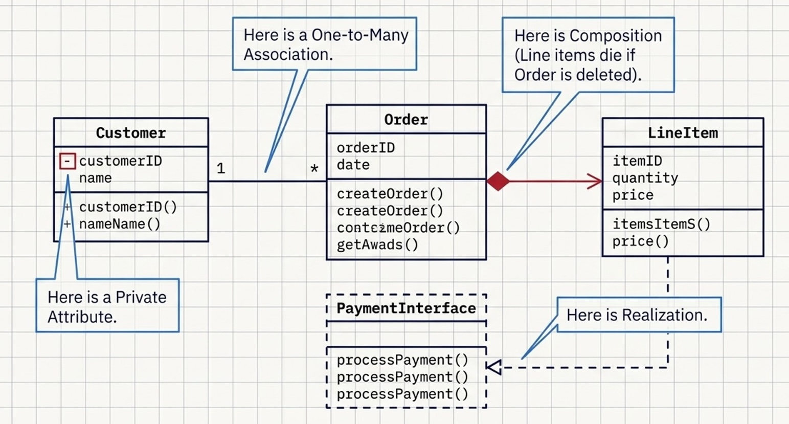
</div>

<!--
Now look at how all these concepts come together in this real Order Model! Follow the blue callout bubbles:

First, look at the bottom-left callout: Notice `- customerID`. The minus sign shows that this is a **Private Attribute**, keeping customer data safe.

Second, look at the top-center callout: Look at the line between Customer and Order with numbers 1 and *. That is a **One-to-Many Association**—one customer can place multiple orders.

Third, look at the top-right callout: Look at the solid red diamond on Order pointing to LineItem. That is **Composition**! If an order is cancelled or deleted, its line items are deleted too.

Fourth, look at the bottom-right callout: Look at the dashed line pointing to PaymentInterface. That is **Realization**—Order uses the payment interface to process payments.

To summarize this slide, remember this key takeaway: A real class diagram combines visibility, multiplicity, composition, and interfaces into one clear system architecture.
-->

---

<!-- _class: v-center -->

### Comprehension Check: Reading the Order Model

<div class="split46"> 
<div class="left" style="font-size: 16px; line-height: 1.4;">

**Evaluate whether each statement about the diagram is Correct or Incorrect:**

- **1.** A customer "Nick" can have 3 orders in the system.
- **2.** If an `Order` is deleted, all its associated `LineItem`s are still kept.
- **3.** An `Order` can exist in the system without being associated with any `Customer`.
- **4.** External classes can directly modify `customer.customerID` via dot notation.
- **5.** `LineItem` realizes the contract and operations defined by `PaymentInterface`.
- **6.** A newly registered `Customer` can exist in the system with zero orders.
- **7.** A single `Order` can be jointly owned and shared by two different `Customer`s.

</div>
<div class="right" style="display: flex; justify-content: center; align-items: center;">


</div>
</div>

<!--
Let's verify our understanding of class diagram semantics by evaluating these seven statements against the diagram:

1. A customer "Nick" can have 3 orders in the system.
   -> [Correct / True]: The multiplicity on the Order side is '*', representing zero or more orders.

2. If an Order is deleted, all its associated LineItems are still kept.
   -> [Incorrect / False]: The solid diamond ('◆') denotes Composition; LineItem has strong lifecycle dependency and is destroyed when Order is deleted.

3. An Order can exist in the system without being associated with any Customer.
   -> [Incorrect / False]: The multiplicity on the Customer side is strictly '1', meaning an order cannot exist without exactly one customer.

4. External classes can directly modify customer.customerID via dot notation.
   -> [Incorrect / False]: The '-' prefix indicates a Private attribute; encapsulation prevents direct external modification.

5. LineItem realizes the contract and operations defined by PaymentInterface.
   -> [Correct / True]: The dashed connector with a hollow triangular arrowhead represents Interface Realization.

6. A newly registered Customer can exist in the system with zero orders.
   -> [Correct / True]: The '*' wildcard on the Order side covers 0..*, so a customer without orders is completely valid.

7. A single Order can be jointly owned and shared by two different Customers.
   -> [Incorrect / False]: The multiplicity on the Customer end is strictly '1', preventing multi-customer ownership of a single order.

To summarize this slide, remember this key takeaway: Reading class diagrams requires checking multiplicity, lifecycle ownership, visibility symbols, and realization connectors simultaneously.
-->

---

## Concept Check Question 4
<!-- id: ase-ch04-ccq4 -->
<div class="ccq-columns">
<div class="ccq-text">

In our Food Delivery Class Diagram, why is the relationship between `Order` and `OrderItem` modeled as **Composition (◆)**, whereas `Order` and `Courier` is modeled as **Aggregation (◇)**?

- **A.** An `OrderItem` can exist independently, but a `Courier` cannot exist without an `Order`.
- **B.** An `OrderItem` is destroyed with its parent `Order`, whereas a `Courier` maintains an independent lifecycle.
- **C.** Composition represents inheritance between classes, while aggregation represents method invocation.
- **D.** Composition requires zero-to-one multiplicity, while aggregation requires one-to-many multiplicity.

</div>
<div class="ccq-logo">
    <a href="https://nlhsueh.github.io/nickedupocket/#/student/ase-ch04-ccq4" target="_blank"></a>
  </div>
</div>

<!--
Let's test our understanding with Concept Check Question 4.

Why is Order to OrderItem Composition, while Order to Courier is Aggregation?

Look at the options:
Option A gets the lifecycles backwards.
Option C confuses whole-part links with inheritance.
Option D confuses multiplicity with relationship types.

The correct answer is Option B! An OrderItem cannot exist without an Order—if the order is deleted, the items are deleted too (Composition). But a freelance Courier continues to exist whether they have an order right now or not (Aggregation).

To summarize this slide, remember this key takeaway: OrderItem dies when the Order dies (Composition), while Courier exists independently (Aggregation).
-->

---

<!-- _class: v-center -->

### Diagnostic Exercise: Spot the Flaws in this Baseball Class Model

<div class="split46">
<div class="left" style="font-size: 16.5px; line-height: 1.45;">

**Audit this student's draft model of a Baseball Game:**
Can you spot the critical modeling flaws across **encapsulation, inheritance, and relationships**?

* **1. Whole-Part & Lifecycle (Aggregation vs. Composition):**
  - Why is `BaseballGame` linked to `Team` with a solid diamond (`◆`)? What happens when a game record is deleted?
* **2. Inheritance vs. Membership (is-a vs. has-a):**
  - Look closely at `Player` and `Team`. What is fundamentally wrong with `Team <|-- Player`?
* **3. Multiplicity & Cardinality:**
  - Can a game have only `1` team and `1` inning? How many teams and innings does a baseball game actually have?
* **4. Encapsulation & Responsibility Distribution:**
  - Why are all attributes `+` public? Does `pitchBall()` belong in `BaseballGame` or `Player`? Should a single `Team` declare who won?

</div>
<div class="right" style="display: flex; justify-content: center; align-items: center;">

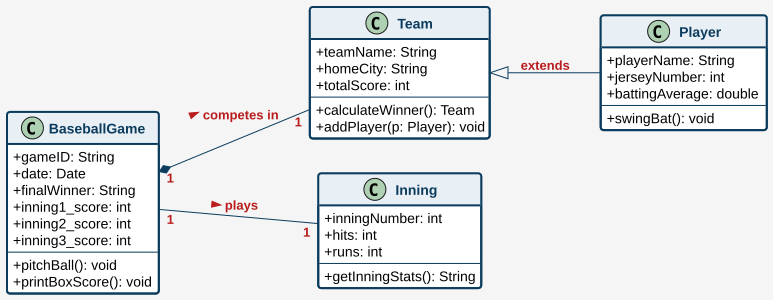

</div>
</div>

<!--
Let's conduct an architectural audit of this student's draft Baseball Game class diagram. There are four major categories of conceptual mistakes:
 
Flaw 1 (Destructive Composition vs. Aggregation):
BaseballGame connects to Team with a solid diamond (Composition) and multiplicity 1. This implies that if a game is deleted or cancelled, the Team (e.g., Yankees) is destroyed from existence! Teams participate in games; they are not owned exclusively by a single game. Furthermore, a baseball game must have exactly 2 teams (Home and Away), not 1!

Flaw 2 (Inheritance Abuse: is-a vs. has-a):
Notice the generalization arrow pointing from Player to Team (Player extends Team). A Player is NOT a kind of Team—a Player is a member OF a team! Modeling membership with inheritance is a classic beginner anti-pattern; it should be an aggregation or association (Team 1 o-- * Player).

Flaw 3 (Missing Composition and Faulty Multiplicity for Inning):
BaseballGame has a plain association with Inning with multiplicity 1. But an Inning (e.g., Inning 4 of Game 102) has no meaning outside that game—it should be Composition (solid diamond). Moreover, a standard baseball game consists of 9 innings (or 1..*), not a single inning!

Flaw 4 (Broken Encapsulation & Misplaced Responsibilities):
First, all attributes use '+' (public), destroying data encapsulation. Second, pitchBall() is placed inside BaseballGame instead of Player/Pitcher. Third, inning scores (inning1_score, inning2_score...) are hardcoded as attributes in BaseballGame rather than encapsulated dynamically in Inning. Finally, calculateWinner() is in Team—a single team cannot unilaterally declare itself the winner; that is the responsibility of BaseballGame!

To summarize this slide, remember this key takeaway: Distinguish is-a from has-a, never use composition where parts outlive the whole, enforce strict attribute visibility, and assign operations to the classes that own the data.
-->

---

## AI Assistance: Guidelines for Class Modeling

- **1. Define Core Domain Entities:**
  - Instruct AI to identify key business concepts (e.g., `Order`, `Customer`, `Item`) rather than raw database tables or UI widgets.
- **2. Clarify Object Relationships:**
  - **Whole vs. Part:** Guide AI to distinguish tight lifecycle ownership from loosely shared parts.
  - **Multiplicity:** Ensure AI specifies cardinality on both ends (e.g., 1 customer, many orders).
  - **Prefer Composition over Inheritance:** Prevent AI from creating deep "is-a" class hierarchies where simple composition fits better.
- **3. Encapsulation & Responsibilities:**
  - Keep internal state private; expose meaningful domain operations as methods.
- **4. Human Reality Check:**
  - Verify AI didn't hallucinate extra classes, invert arrows, or lazily draw plain associations.

<!--
When asking AI to help design class diagrams, we don't need to micromanage syntax right away. Instead, focus on four key conceptual guidelines:

First, ask AI to identify the core domain entities—focusing on business concepts like Orders and Customers, not raw database tables.

Second, clarify relationships: Have AI think about whole-part ownership, multiplicity on both ends, and avoid overusing inheritance where simple composition is better.

Third, ensure encapsulation: Internal data should stay private, exposing clear operations.

Finally, always conduct a human reality check: Verify that AI didn't hallucinate extra classes or lazily connect everything with plain, meaningless lines.

To summarize this slide, remember this key takeaway: Guide AI by clarifying core business concepts, ownership, multiplicities, and encapsulation—then verify against real business rules.
-->

---

<!-- _class: v-center -->

### AI Prompt Example: Food Delivery Class Model

<div class="two-columns">
<div>

**1. Role & Task Instruction:**
```text
Act as a Principal Software Architect.
Generate a formal PlantUML Class Diagram
for a Food Delivery Domain Model.
```

**2. Modeling Guidance:**
- Identify core entities: `Customer`, `Restaurant`, `Order`, `OrderItem`, `Courier`.
- Distinguish whole-part relationships (an `Order` tightly owns its items).
- Clarify multiplicities on both ends of connections.
- Apply encapsulation (hide attributes, expose business operations).
- Keep external payment processing decoupled via an interface.

</div>
<div>

**3. Input Requirements Statement:**
> "A **Customer** has customerId, name, email, phone, and deliveryAddress.
> A **Restaurant** has restaurantId, name, address, and owns a collection of **MenuItems** (itemId, name, price, isAvailable).
> A Customer can place multiple **Orders**. Each **Order** has orderId, orderStatus (OrderStatus enum: Placed, Preparing, Delivered), orderTime, and totalAmount.
> An Order consists of one or more **OrderItems** (quantity, itemPrice, subtotal). If an Order is deleted, its OrderItems must be cascade-deleted immediately.
> A **Courier** (courierId, name, phone, vehicleType) can be assigned to deliver an Order.
> An Order delegates credit card charging to a **PaymentProcessor** interface."

</div>
</div>

<!--
Here is an effective prompt example for creating a Food Delivery Class Model.

Look at the left column: Instead of micromanaging syntax, we provide high-level architectural guidance: identify core entities, distinguish whole-part ownership, clarify multiplicities, enforce encapsulation, and decouple payments through an interface.

In the right column, we provide the business requirements story describing Customers, Restaurants, Orders, and Couriers.

When you give AI clear structural guidance and rich domain context, it produces clean, accurate models without making careless architecture mistakes.

To summarize this slide, remember this key takeaway: Guide AI by stating core business entities, ownership relationships, multiplicities, and interfaces—not just syntax symbols.
-->

---

<!-- _class: v-center -->
<!-- header: '4.4 Structural & Class Models' -->

### Generated PlantUML & Diagram: Food Delivery Class Model

<div class="puml-output-grid">
<div class="puml-code-col">

<div class="puml-title">Generated PlantUML Specification:</div>

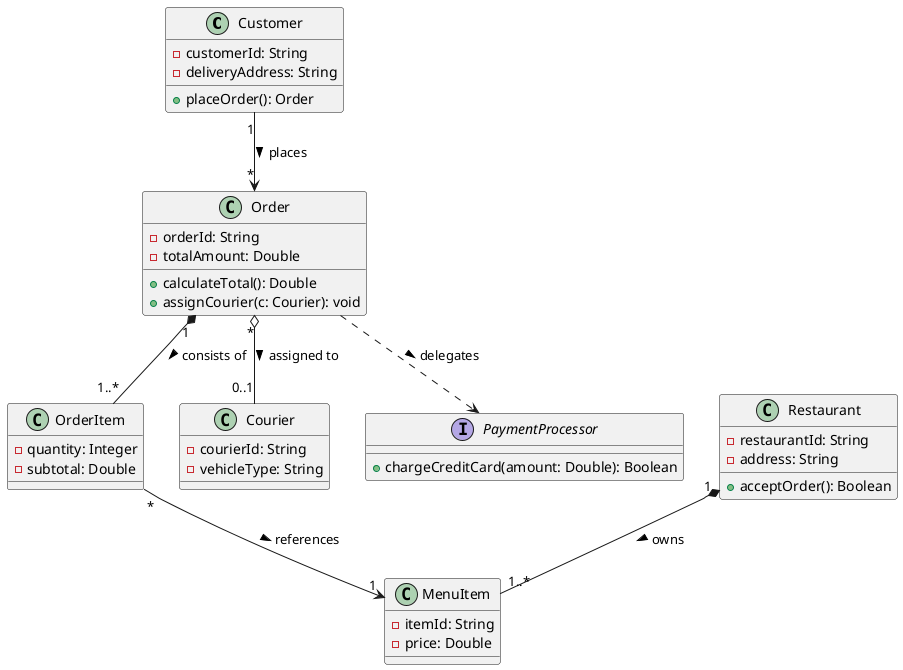

</div>
<div class="puml-diagram-col">

<div class="puml-title">Rendered Diagram Output:</div>

<div class="diagram-wrapper">
  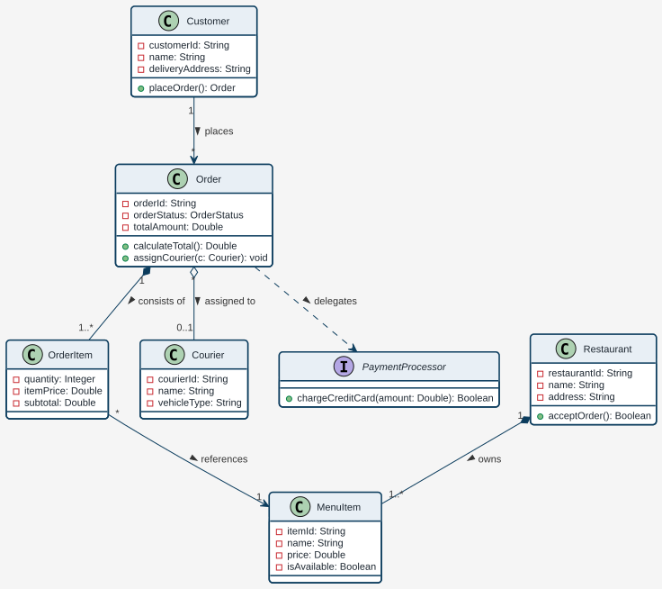
</div>

</div>
</div>

<!--
Here is the formal Class Model generated from our architectural prompt.

Look at the left column: The AI faithfully followed our modeling constraints:
First, Order has composition with OrderItem using the filled diamond asterisk-dash-dash symbol.
Second, Order has aggregation with Courier using the open diamond lowercase-o-dash-dash symbol.
Third, attributes are private with minus signs, and business methods calculateTotal and assignCourier are explicitly declared.

On the right, see how the diagram visually communicates these exact architectural semantics: solid diamonds for life-cycle ownership, hollow diamonds for weak references, and clean multiplicities on both ends.

To summarize this slide, remember this key takeaway: Specifying explicit UML connector tokens in your AI prompt guarantees mathematically correct class relationships.
-->

---

### Interactive Activity: Evolving Food Delivery with AI (Pair Hands-On)

<div class="discussion-columns">
  <div class="discussion-text">

  **Hands-on Experiment: Mutate Requirements & Audit AI Output**
  - **1. Add ONE New Rule to the Food Delivery Prompt:**
    - *Multi-Vendor:* Allow `Order` to bundle items from multiple `Restaurant`s.
    - *Tipping:* Allow `Customer` to tip and rate the assigned `Courier`.
    - *VIP Membership:* Add subscription tier (`Customer` gets free delivery).
  - **2. Ask AI to Generate:** Prompt an LLM to update the PlantUML class diagram.
  - **3. Render & Critique:** Paste into [PlantText](https://www.planttext.com) and audit:
    - Did AI preserve **Composition** (`*--`) vs. **Aggregation** (`o--`)?
    - Are **multiplicities** (`1..*`, `0..1`) logically sound for the new rule?
    - Did AI hallucinate redundant classes or violate `- private` fields?

  </div>
  <div class="discussion-logo">
    
  </div>
</div>

<!--
Now let's do a hands-on pair experiment! Work with your partner to test AI's architectural accuracy in real time.

Look at the instructions on the screen:
Take the Food Delivery prompt from the previous slide and modify it with one new business requirement:
- Option A: Allow orders to bundle items from multiple restaurants in a single checkout.
- Option B: Add a direct courier tipping and review mechanism.
- Option C: Add VIP customer membership subscriptions.

Ask your AI assistant to generate the updated PlantUML, paste the code into PlantText to render the diagram, and critically inspect the result:
Did the AI maintain proper composition and aggregation?
Did it correctly adjust multiplicities, or did it introduce architectural anti-patterns?
Are all private attributes and public methods intact?

Debriefing Guide:
1. In Scenario A, OrderItem must link directly to Restaurant, and an Order may need SubOrders or delivery splits. Many LLMs fail to update multiplicities!
2. In Scenario B, Tipping links Payment to Courier or adds tipAmount; rating links Customer to Courier.
3. Always remember our golden rule: AI drafts the diagram; the human architect validates the semantics!

To summarize this slide, remember this key takeaway: When business requirements evolve, prompt AI with clear constraints and critically audit the generated UML for structural correctness.
-->


---

<!-- _class: lead -->
<!-- header: '4.5 Interaction & Sequence Diagrams' -->

# **4.5 Interaction & Sequence Diagrams**

> "Interaction modeling shows how objects collaborate chronologically over time to fulfill the promise of a use case."

<!--
Welcome to Section 4.5: Interaction and Sequence Diagrams!

So far, we looked at Use Cases to see what users want, and Class Diagrams to see what classes exist. But real software runs over time. When a user clicks a button, objects talk to each other, call methods, and return results.

In this section, we will learn how UML Sequence Diagrams model these dynamic conversations. We will look at lifelines, message arrows, combined fragments like if-else and loops, and how to use AI to generate clean sequence models.

To summarize this slide, remember this key takeaway: Sequence diagrams show how objects collaborate chronologically over time to carry out a scenario.
-->

---

<!-- _class: full-image-slide -->

<div class="centered-image">
  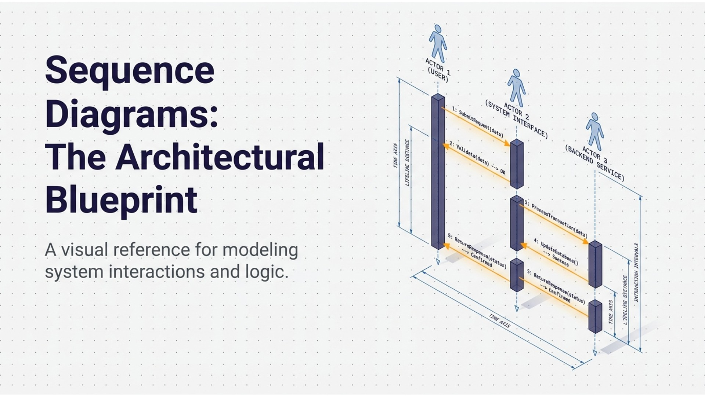
</div>

<!--
Look at this 3D blueprint of a sequence diagram in action.

Across the top, we have three participants: Actor 1 is the User, Actor 2 is the System Interface, and Actor 3 is the Backend Service. Notice the dashed lines going down—these are lifelines representing time.

Follow the numbered orange arrows from top to bottom:
First, the user submits a request to the interface.
Second, the interface validates the data.
Third, it calls the backend service to process the transaction.
Fourth, the backend updates the database and confirms success.
Finally, the interface sends a confirmed response back to the user.

Notice how clear this is: you can see who talks to whom, and in what exact order.

To summarize this slide, remember this key takeaway: Sequence diagrams give you a chronological blueprint of how users, interfaces, and backend services exchange messages.
-->

---

<!-- _class: title-image-slide -->

## Static Structure vs. Dynamic Collaboration

<div class="image-wrapper">
  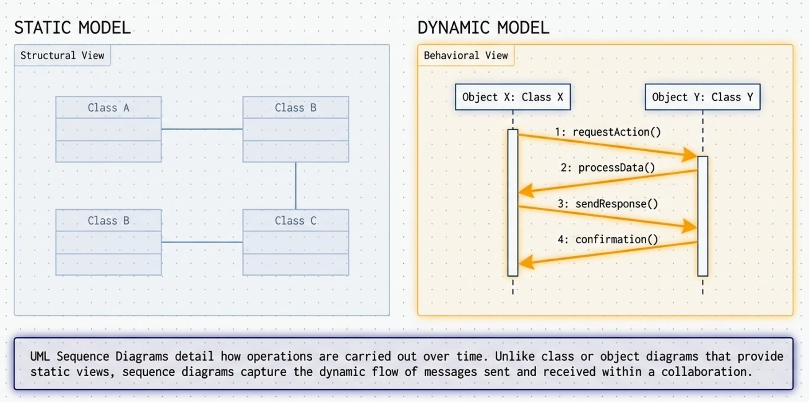
</div>

<!--
Here is a very important comparison: Static Model versus Dynamic Model.

On the left, inside the blue box, is our Static Class Model. It shows the structure: Class A connects to Class B and Class C. It tells us who knows whom, but it has no sense of time or running order.

On the right, inside the gold box, is our Dynamic Sequence Model. It shows two actual running objects: Object X and Object Y. Now time matters! Follow the orange arrows: Object X requests an action, Object Y processes the data, sends a response, and Object X confirms.

Think of it this way: the class diagram is the map of roads, but the sequence diagram shows the car actually driving on those roads step by step.

To summarize this slide, remember this key takeaway: Class diagrams define static structure, while sequence diagrams show dynamic behavior over time.
-->

---

<!-- _class: title-image-slide -->

## The Requirements-to-Code Pipeline: From Story to Code

<div class="image-wrapper">
  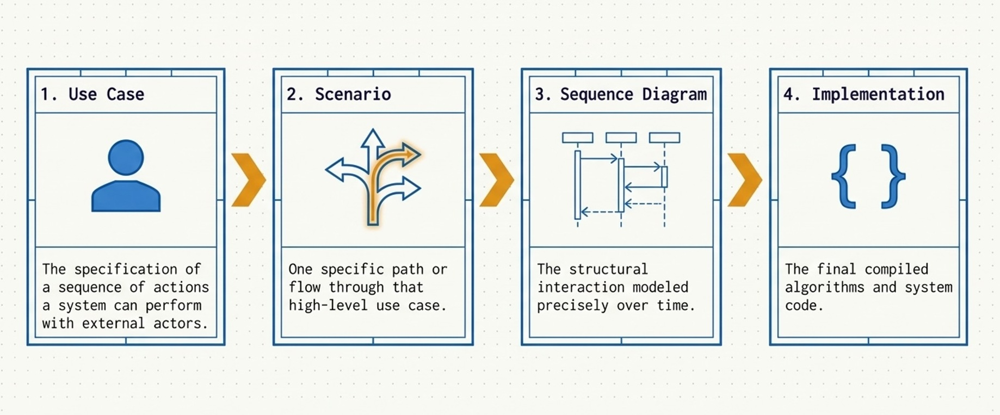
</div>

<!--
How do we move from customer requirements to working code? This four-step pipeline shows the whole journey.

Step 1 is the Use Case: it defines what the system should do from a user's perspective, like 'Book a Hotel Room'.
Step 2 is a Scenario: a use case can unfold in several ways. One scenario is the sunny day where everything works; another scenario is when the credit card is expired.

Step 3 is the Sequence Diagram: for each scenario, we map out the exact objects, methods, and messages in chronological order.
Step 4 is Implementation: developers can now write clean classes and methods with zero guessing, because the blueprint is already done!

Notice the quote at the bottom: a scenario is one execution path, and the sequence diagram is its exact architectural blueprint.

To summarize this slide, remember this key takeaway: We start with a high-level use case, pick a scenario, draw the sequence diagram, and then write the code.
-->

---

### Upstream Models: Use Case, Scenario & Class Architecture

<div class="three-columns">
<div class="card">
<h3>1. Use Case Model</h3>
<div style="text-align: center; margin: 10px 0;">
  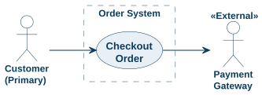
</div>
<ul>
<li><b>Primary Actor:</b> Customer</li>
<li><b>Secondary Actor:</b> Payment Gateway</li>
<li><b>System Boundary:</b> Order System</li>
<li><b>Business Goal:</b> Checkout and purchase items</li>
</ul>
</div>
<div class="card">
<h3>2. Use Case Description</h3>
<div style="font-size: 15px; line-height: 1.42;">
<p style="margin-bottom: 5px;"><b>UC-01:</b> Checkout Order</p>
<p style="margin-bottom: 5px;"><b>Precondition:</b> Cart confirmed by customer</p>
<b>Main Success Scenario:</b>
<ol style="margin-top: 3px; padding-left: 18px;">
<li>Customer submits checkout with payment.</li>
<li>System validates order items and availability.</li>
<li>System requests payment from Payment Gateway.</li>
<li>Payment Gateway confirms and issues receipt.</li>
<li>System marks order status as <code>PAID</code>.</li>
<li>System returns confirmation to Customer.</li>
</ol>
<p style="margin-top: 5px; margin-bottom: 0;"><b>Postcondition:</b> Order saved as <code>PAID</code></p>
</div>
</div>
<div class="card">
<h3>3. Design Class Model</h3>
<div style="text-align: center; margin: 4px 0;">
  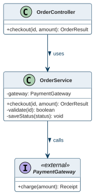
</div>
</div>
</div>

<!--
Before diving into the dynamic sequence diagram and Java code, let's understand where they come from. System design doesn't happen in a vacuum—it flows systematically across three upstream artifacts.

First, look at Card 1: the Use Case Model. Here we identify the business context. The primary actor, Customer, wants to achieve the goal of checking out an order, interacting across the Order System boundary with an external Payment Gateway.

Second, look at Card 2: the Use Case Description. This gives us the behavioral contract and step-by-step narrative. Notice the exact steps: Customer submits checkout, System validates items, charges via Payment Gateway, gets a receipt, saves the status as PAID, and confirms back to the customer.

Third, look at Card 3: the Design Class Model. How do we realize these requirements structurally? We assign responsibilities into classes: OrderController acts as the boundary endpoint, OrderService coordinates business logic with validate() and saveStatus(), and PaymentGateway provides the external charge() interface.

Now, how do these three classes actually collaborate in time to execute the steps in the Use Case Description? Let's turn to the next slide to see the Sequence Diagram and the matching Java code!

To summarize this slide, remember this key takeaway: Use cases capture user goals, descriptions specify behavioral steps, and class models define the static structural responsibilities needed to realize them.
-->

---

### The Interaction Canvas: Code to Sequence Mapping

<div class="puml-output-grid">
<div class="puml-code-col">

<div class="puml-title">Source Code (Java): Execution Flow</div>

```java
class OrderService {
    private PaymentGateway gateway;

    // [1] Controller invokes checkout
    public OrderResult checkout(String id, double amount) {
        // [2] Internal validation (self-call)
        boolean ok = this.validate(id); // [3] returns true
        
        // [4] Call payment gateway
        Receipt receipt = gateway.charge(amount);
        // [5] Gateway returns receipt
        
        // [6] Record paid status (self-call)
        this.saveStatus(OrderStatus.PAID);
        
        // [7] Return result to Controller
        return new OrderResult(true, receipt);
    }
}
```

</div>
<div class="puml-diagram-col">

<div class="puml-title">UML Sequence Diagram: 3 Objects & 7 Events</div>

<div class="diagram-wrapper">
  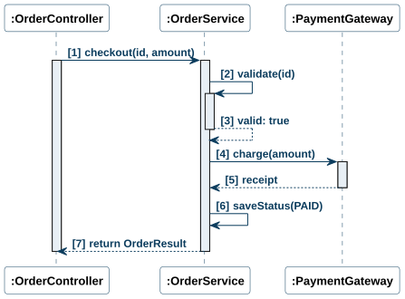
</div>

</div>
</div>

<!--
Let's see how source code directly maps into a UML Sequence Diagram across two fundamental axes:

1. Horizontal Axis (The Object Dimension):
Notice the three participating objects across the top: :OrderController, :OrderService, and :PaymentGateway. Lifelines drop vertically from each object box.

2. Vertical Axis (The Time Dimension):
Time flows strictly downward from top to bottom. Follow the 7 numbered events step-by-step:

Event [1]: OrderController calls checkout() on OrderService. Both lifelines activate.
Events [2] & [3]: OrderService calls validate() on itself (a self-call), returning 'valid: true'.
Event [4]: OrderService synchronously calls charge() on PaymentGateway.
Event [5]: PaymentGateway processes the charge and returns the receipt with a dashed arrow.
Event [6]: OrderService performs another self-call to saveStatus(PAID).
Event [7]: Finally, OrderService returns the OrderResult back to OrderController, and both activations complete.

To summarize this slide, remember this key takeaway: Every method call is a horizontal message arrow, and time flows downward line by line exactly as code executes.
-->

---

<!-- _class: title-image-slide -->

## Structural Anatomy: Lifelines, Activations & Events

<div class="image-wrapper">
  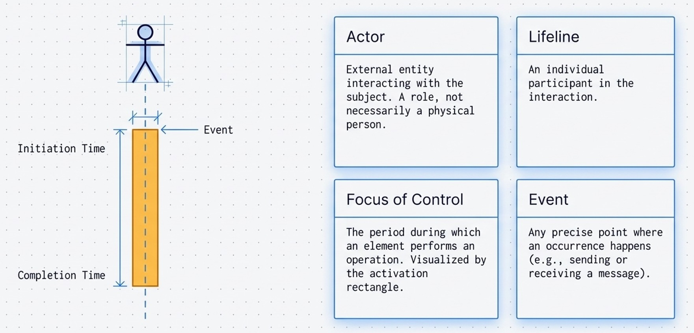
</div>

<!--
Here is the structural anatomy of a sequence diagram. Look at the drawing on the left and the four cards on the right.

First is the Actor at the top: an external user or external system that starts the action.
Second is the Lifeline: that vertical dashed line running straight down. It represents the object existing over time.

Third is the Focus of Control, shown by the yellow rectangular bar. This is also called the Activation Bar. It shows the exact period when the object is actively running code—from Initiation Time at the top to Completion Time at the bottom.

Fourth is an Event: a single point in time, like an arrow arriving or leaving. When an event hits the lifeline, execution begins!

To summarize this slide, remember this key takeaway: An actor initiates events, lifelines show existence over time, and activation bars show active execution.
-->

---

<!-- _class: title-image-slide -->

### The Messaging Matrix: Synchronous, Asynchronous & Lifecycle

<div class="image-wrapper">
  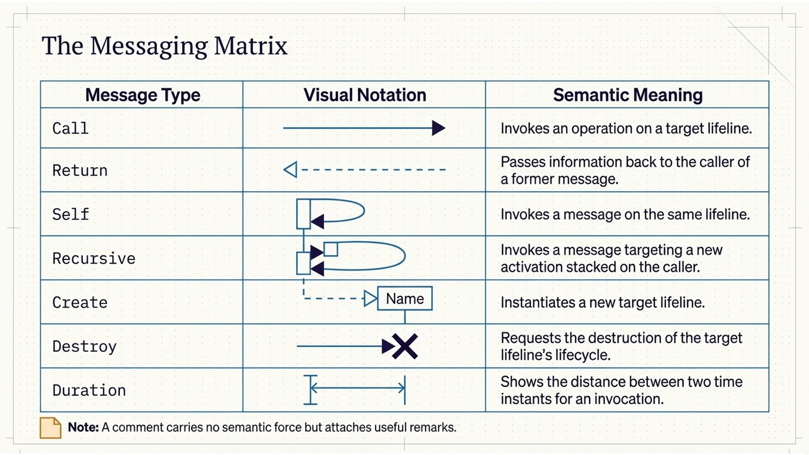
</div>

<!--
Here is the Messaging Matrix. Different arrows mean very different things in code, so let's walk through this table together.

First, a Call uses a solid line with a filled arrowhead: it calls a method on another object.
Second, a Return message uses a dashed line with an open arrow: it sends the result back to the caller.

Third, a Self call is a curved arrow pointing back to the same object: think of an object calling one of its own helper methods.
Fourth, a Recursive call stacks a new activation bar on top of the current one when a method calls itself.

Fifth, to Create a new object, draw a dashed arrow pointing directly into a new box with the object's name.
Sixth, to Destroy an object, end the line with a bold X to show it is deallocated or closed.

Finally, Duration shows the time span between two moments.

To summarize this slide, remember this key takeaway: Use solid filled arrows to call methods, dashed arrows to return values or create objects, and an X to destroy them.
-->

---

<!-- _class: title-image-slide -->

### UML 2.0 Combined Fragments: alt, opt, loop, par

<div class="image-wrapper">
  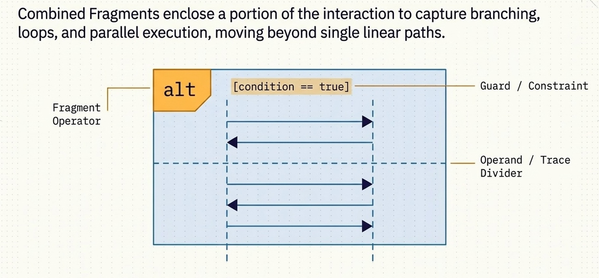
</div>

<!--
In older versions of UML, sequence diagrams could only show one straight path. If you had an if-else branch, you had to draw two completely separate diagrams!

UML 2.0 fixed this by adding Combined Fragments. A combined fragment is a frame that wraps around a section of your lifelines to show conditions, loops, or parallel work.

Look at the three key parts of the frame:
First, in the top-left corner is a yellow tab showing the Fragment Operator—here it says `alt` for alternative paths.
Second, next to it is the Guard condition in brackets: `[condition == true]`. This tells us when this path runs.
Third, look at the dashed line through the middle. That is the Operand Divider. The top half runs if the condition is true; the bottom half runs otherwise.

To summarize this slide, remember this key takeaway: Combined fragments use operator tabs, guard conditions, and divider lines to show branching and loops inside one diagram.
-->

---

<!-- _class: title-image-slide -->

### Fragment Operators to Production Code Logic

<div class="image-wrapper">
  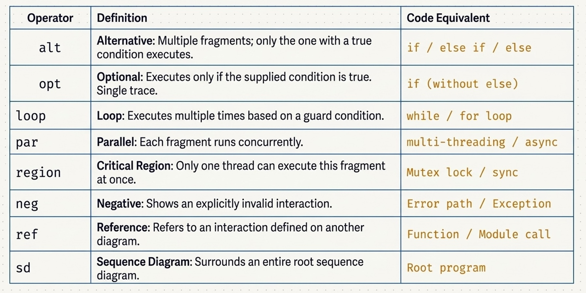
</div>

<!--
Here is a great cheat sheet showing how UML fragment operators translate directly into programming code!

Look at the first two, because students often mix them up:
`alt` is for Alternatives: only one branch runs. That maps directly to `if ... else if ... else`.
`opt` is Optional: it has only one path with no else. That is a simple `if` statement.

Next, `loop` repeats multiple times based on a condition—that is your `while` or `for` loop.
`par` means Parallel: different lifelines run at the same time, like multithreading or async tasks.

`region` marks a critical section where only one thread can enter at a time—like a mutex lock.
`neg` highlights an invalid sequence or error path, such as throwing an exception.
And `ref` refers to another diagram, just like calling another function so your diagram stays clean.

To summarize this slide, remember this key takeaway: `alt` maps to if-else, `opt` maps to a single if, `loop` maps to loops, and `ref` lets you break big flows into smaller functions.
-->

---

<!-- _class: title-image-slide -->

### Case Study: Hotel Reservation Interaction Flow

<div class="image-wrapper">
  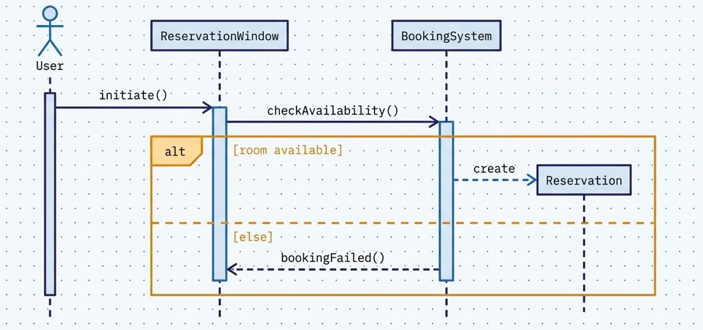
</div>

<!--
Let's see all these pieces work together in a realistic case study: booking a hotel room.

Across the top, we have four lifelines: the User, the ReservationWindow on the screen, the backend BookingSystem, and a Reservation entity.

Follow the flow from top to bottom:
First, the user taps 'initiate' on the ReservationWindow.
Second, the window asks BookingSystem to check room availability.

Now look at the large `alt` box:
If a room is available—the top half—BookingSystem creates a brand new Reservation object. Notice the create arrow pointing directly to the new Reservation box!
In the lower half, labeled `[else]`, no room is available. So BookingSystem returns a `bookingFailed()` message back to the window.

This is exactly how professional systems work: a happy path and an error path in one clear picture.

To summarize this slide, remember this key takeaway: Real sequence diagrams coordinate UI windows, backend systems, entity creation, and alternate error branches.
-->

---

## Concept Check Question 5
<!-- id: ase-ch04-ccq5 -->
<div class="ccq-columns">
<div class="ccq-text">

In a Boundary-Control-Entity (BCE) sequence diagram, which object should receive the customer's `submitOrder()` event from the checkout UI boundary?

- **A.** The `Order` entity object to immediately save database state.
- **B.** The `PaymentGatewayAPI` boundary object to process payment immediately.
- **C.** The `OrderController` control object to orchestrate business validation and service calls.
- **D.** The `Restaurant` entity object to confirm kitchen capacity.

</div>
<div class="ccq-logo">
    <a href="https://nlhsueh.github.io/nickedupocket/#/student/ase-ch04-ccq5" target="_blank"></a>
  </div>
</div>

<!--
Let's check our understanding of BCE architecture with Concept Check Question 5. Scan the QR code or click the link to answer on your phone.

The question asks: When a customer clicks 'submitOrder' on the checkout UI boundary, who should receive this event first?

Let's look at the options:
Option A says the Order entity. But remember: UI boundaries should never talk directly to database entities!
Option B says PaymentGatewayAPI. Bypassing our own system logic to call an external API directly is risky and unstructured.
Option D connects the UI directly to a Restaurant entity, which also breaks layering.

Option C is the correct answer! The event must go to the `OrderController`. The controller coordinates business validation, checks inventory, contacts the payment gateway, and then saves the order.

To summarize this slide, remember this key takeaway: Control objects orchestrate business logic and mediate between UI boundaries and data entities.
-->

---

<!-- _class: v-center -->

### Diagnostic Exercise: Spot the Flaws in this Sequence Diagram

<div class="split46">
<div class="left" style="font-size: 16.5px; line-height: 1.45;">

**Audit this student's draft Sequence Diagram for room booking:**
Can you identify the critical mistakes across **layering, message syntax, and chronological flow**?

- **1. Architecture Layering & Encapsulation:**
  - Examine `BookingUI` and `MySQL_DB`. What architectural rule is broken by message `[2]` (`SELECT ...`)?
- **2. Synchronous vs. Asynchronous Syntax:**
  - Look at message `[6]`. Why is a synchronous return drawn with a dashed arrow while `[5]` is blocking?
- **3. Combined Fragment (`alt`) Logic:**
  - Inspect the guards on the `alt` block. Why are `[Room Available]` and `[else Payment Successful]` semantically invalid?
- **4. Chronological Causality & Activations:**
  - In what order do `showSuccessMessage()` and `INSERT INTO bookings` occur? Does the DB activation ever close?

</div>
<div class="right" style="display: flex; justify-content: center; align-items: center;">

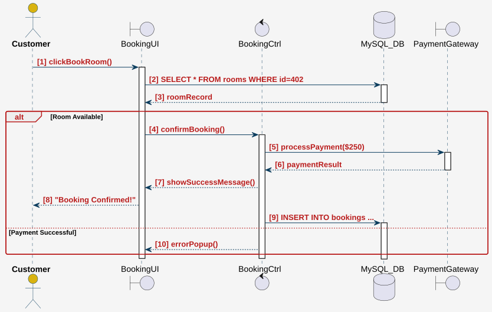

</div>
</div>

<!--
Let's conduct an architectural audit of this student's draft Sequence Diagram. There are four major design anti-patterns:

Flaw 1 (Architecture Layering & Encapsulation Violation):
Look at message [2]: BookingUI queries MySQL_DB directly using raw SQL ('SELECT * FROM rooms...'). In three-tier and BCE architectures, presentation boundaries must NEVER bypass the application controller to speak directly to the database. This creates tight coupling and exposes raw schemas to the UI.

Flaw 2 (Nonsensical Combined Fragment Guards):
Examine the alt combined fragment: The first branch is guarded with [Room Available], but the else branch is guarded with [else Payment Successful]! The branches in an alt block must evaluate the same conceptual condition and be mutually exclusive (e.g., [Room Available] vs [else / Room Unavailable]). Mixing room availability with payment success in an else clause is fundamentally broken logic.

Flaw 3 (Chronological Paradox / Premature Confirmation):
Look at messages [7] and [8]: The UI displays 'Booking Confirmed!' to the user before the database insert at message [9] has even executed! If the database write fails or crashes, the user has been told their room is booked, causing critical data inconsistency. State must be persisted before confirming success.

Flaw 4 (Dangling Activation Lifetime):
Notice the activation bar on MySQL_DB at message [9]: It is activated but never deactivated, hanging indefinitely. Execution specifications must terminate cleanly when operations finish.

To summarize this slide, remember this key takeaway: Sequence diagrams must enforce architectural layering, strictly pair mutually exclusive fragment guards, maintain correct chronological order, and cleanly terminate activation lifelines.
-->

---

## AI Assistance: Guidelines for Sequence Modeling

- **1. Enforce Architectural Layering:**
  - Instruct AI to follow a clean layered structure (UI → Controller / Business Logic → Entities & Databases).
  - Prevent AI from taking shortcuts like connecting UI directly to database storage.
- **2. Capture Interaction Dynamics:**
  - **Synchronous Requests & Replies:** Clearly show calls and corresponding response acknowledgments.
  - **Branching (Success vs. Failure):** Require AI to handle both normal success and alternative exception scenarios (e.g., payment failure).
  - **Decoupled / Asynchronous Tasks:** Distinguish immediate blocking actions from background notifications (e.g., alert queues).
- **3. Human Reality Check:**
  - Did AI bypass business logic layers?
  - Are alternate scenarios mutually exclusive with clear conditions?

<!--
When asking AI to generate sequence diagrams, keep the focus on architectural layering and communication flow.

First, enforce architectural layering. The biggest mistake AI makes is letting the frontend UI talk directly to the database. We must ensure interactions flow cleanly from UI through business controllers.

Second, capture interaction dynamics: make sure both requests and replies are accounted for, require AI to model both success and failure paths, and separate immediate responses from background asynchronous notifications.

Finally, check the logic: did the AI bypass the business layer? Are branch conditions mutually exclusive?

To summarize this slide, remember this key takeaway: Guide AI by enforcing clean architectural layers, clear request-reply flows, and explicit success versus failure paths.
-->

---

<!-- _class: v-center -->

### AI Prompt Example: Food Delivery Sequence Model

<div class="two-columns">
<div>

**1. Role & Task Instruction:**
```text
Act as a Backend Systems Architect.
Generate a clean PlantUML Sequence Diagram
for a Food Delivery Checkout flow.
```

**2. Modeling Guidance:**
- Follow layered architecture (UI → Controller → Entities / External APIs).
- Explicitly model both paths: **Payment Approved** vs. **Payment Declined**.
- Show asynchronous handoff for background kitchen notification.
- Show active execution lifespans during processing.

</div>
<div>

**3. Input Requirements Statement:**
> "A Customer initiates checkout by clicking 'Pay Now' on the **CheckoutUI**.
> The **CheckoutUI** forwards `submitOrder(cartItems, paymentInfo)` to the **OrderController**.
> The **OrderController** calls **PaymentGateway** `authorizeCharge(amount, token)`.
> **If payment is approved:**
> - PaymentGateway returns `chargeToken`.
> - OrderController persists **Order** as `PLACED`, publishes async `orderPlacedEvent` to **KitchenOrderQueue**, and returns `orderSuccess(orderId)` to CheckoutUI.
> **If payment is declined:**
> - PaymentGateway returns `declinedError`.
> - OrderController logs failure and returns `paymentFailed()` to CheckoutUI without creating an order."

</div>
</div>

<!--
Here is a clear prompt example for generating a food delivery sequence diagram.

Look at the left column: Instead of micromanaging syntax, we provide high-level architectural guidance: follow layered architecture, handle both approved and declined payment scenarios, and decouple background kitchen notifications.

In the right column, we provide the step-by-step scenario text detailing the request flow, success path, and error path.

When given this clean architectural context, AI generates structured sequence diagrams that follow proper enterprise design principles.

To summarize this slide, remember this key takeaway: Guide AI with layered architecture principles, clear alternate paths, and realistic business scenarios.
-->

---

<!-- _class: v-center -->
<!-- header: '4.5 Interaction & Sequence Diagrams' -->

### Generated PlantUML & Diagram: Food Delivery Sequence Model

<div class="puml-output-grid">
<div class="puml-code-col">

<div class="puml-title">Generated PlantUML Specification:</div>

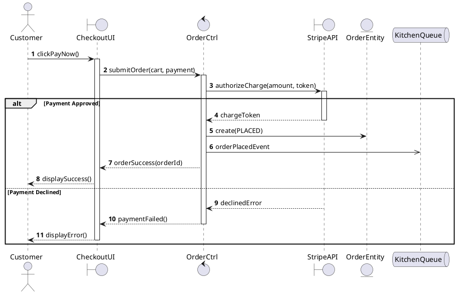

</div>
<div class="puml-diagram-col">

<div class="puml-title">Rendered Diagram Output:</div>

<div class="diagram-wrapper">
  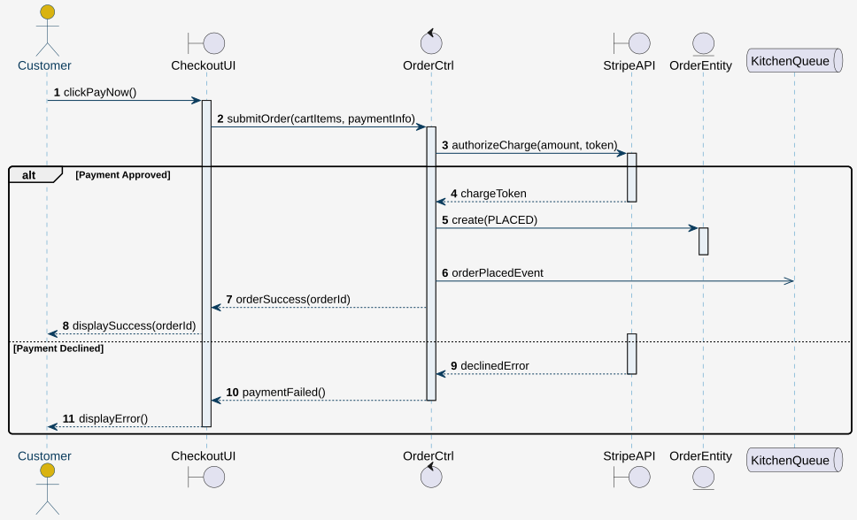
</div>

</div>
</div>

<!--
Here is the AI-generated BCE Sequence Diagram for checkout.

Look at the PlantUML on the left:
Notice how the lifelines are cleanly typed: actor Customer, boundary CheckoutUI, control OrderCtrl, boundary StripeAPI, entity OrderEntity, and queue KitchenQueue.
Notice the alt combined fragment clearly delineating the success branch from the declined failure branch.
Notice the asynchronous arrow dash-dash-greater-than publishing orderPlacedEvent to KitchenQueue.

On the right, the rendered sequence diagram shows precise activation bars and clear return flows, preventing race conditions and keeping UI decoupled from backend databases.

To summarize this slide, remember this key takeaway: Enforcing BCE stereotypes and control fragments in your prompt ensures AI produces robust, production-grade interaction blueprints.
-->

---

### Interactive Activity: Evolving Sequences with AI (Pair Hands-On)

<div class="discussion-columns">
  <div class="discussion-text">

  **Hands-on Experiment: Mutate Flow & Audit AI Output (4 Mins)**
  - **1. Add ONE Edge Case to the Checkout Flow:**
    - *Gateway Timeout:* Payment gateway takes >5s to respond (trigger retry or fallback).
    - *Split Payment:* Allow customer to pay with partial Wallet Balance + Credit Card.
    - *Out of Stock:* Restaurant runs out of an item during checkout.
  - **2. Ask AI to Generate:** Prompt an LLM to update the PlantUML sequence diagram.
  - **3. Render & Critique:** Paste into [PlantText](https://www.planttext.com) and audit:
    - Did AI preserve **layering** (UI → Controller) without UI querying DB directly?
    - Are **success vs. failure branches** clearly partitioned with return messages?
    - Are **background alerts** (e.g., kitchen notifications) properly decoupled?

  </div>
  <div class="discussion-logo">
    
  </div>
</div>

<!--
Now let's do a hands-on pair experiment for Sequence Modeling! Work with your partner to test how AI handles complex runtime interactions.

Look at the instructions on the screen:
Take our Food Delivery Sequence prompt from earlier and introduce one realistic edge case:
- Option A: Payment Gateway Timeout—the external bank doesn't reply in time.
- Option B: Split Payment—using both digital wallet points and a credit card.
- Option C: Item Sold Out—the kitchen marks an item unavailable during the payment step.

Ask your AI assistant to generate the updated PlantUML sequence diagram, render it in PlantText, and critically audit the architecture:
Did the AI maintain clean layering, or did it let the frontend UI talk directly to the database?
Are alternate error paths clearly modeled with return values?
Did it decouple background notifications so the customer isn't left hanging?

To summarize this slide, remember this key takeaway: Testing AI with failure flows and timeouts ensures your dynamic architecture handles real-world distributed challenges.
-->


---

<!-- _class: lead -->
<!-- header: '4.6 Process & Activity Diagrams' -->

# **4.6 Process & Activity Diagrams**

> "Activity diagrams map the dynamic flow of control, concurrency, and data across collaborating participants."

<!--
Welcome to Section 4.6: Process and Activity Diagrams!

Sequence diagrams showed us message exchanges between objects for one scenario. But modern software also handles big business workflows, handoffs between people and departments, and parallel background tasks.

UML Activity Diagrams are built specifically for workflows. In this section, we will learn action nodes, decision diamonds, parallel fork and join bars, and swimlanes.

To summarize this slide, remember this key takeaway: Activity diagrams model dynamic business workflows, decision logic, and parallel concurrent tasks.
-->

---

<!-- _class: title-image-slide -->

## Visual Logic: Beyond Static Structures

<div class="image-wrapper">
  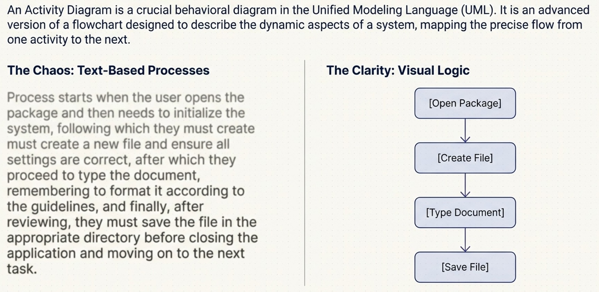
</div>

<!--
Notice the powerful contrast on this slide: 'The Chaos' versus 'The Clarity.'

On the left is a text-based process: a long, dense paragraph describing opening a package, initializing the system, creating a file, typing, formatting, and saving. Reading a giant wall of text makes it easy to miss steps or get confused.

Now look at the right side: four clean boxes with arrows showing Open Package, Create File, Type Document, and Save File.

This is why we draw activity diagrams: visual logic makes every step obvious at a single glance.

To summarize this slide, remember this key takeaway: Activity diagrams replace confusing walls of text with clear, step-by-step visual logic.
-->

---

<!-- _class: v-center -->

### Three Triggers for Activity Modeling

<div class="split64">
<div class="left" style="font-size: 16.5px; line-height: 1.45;">

**When to Reach for UML Activity Diagrams:**

- **1. Business Workflows:**
  - **Cross-Boundary Value Streams:** Coordinate how multiple independent use cases chain together to fulfill end-to-end organizational goals.
  - **Macro-Level Alignment:** Aligns business stakeholders and engineering teams on broad operational lifecycles.
- **2. Complex Coordination:**
  - **Intra-Use-Case Orchestration:** Track overlapping operations, branching paths, and precise chronological timing within a single feature.
  - **Concurrency Management:** Safely handle simultaneous actions without thread race conditions.
- **3. Contextual Mapping:**
  - **Pre/Post-Condition Contracts:** Identify exact state invariants required before actions start and verified upon completion.
- **Core Value:** Activity models bridge high-level use cases and low-level code implementation.

</div>
<div class="right" style="display: flex; justify-content: center; align-items: center;">

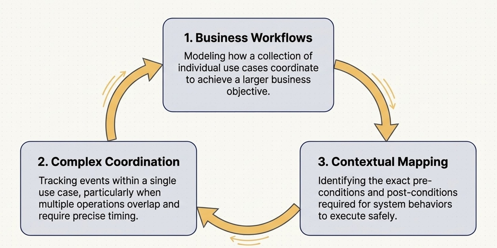

</div>
</div>

<!--
When should you create an activity diagram? Look at the three triggers arranged in this circle:

Trigger 1 is Business Workflows: when you need to coordinate multiple use cases together to achieve a larger business goal.
Trigger 2 is Complex Coordination: when operations overlap within a single use case and require exact timing.
Trigger 3 is Contextual Mapping: when you need to define the exact preconditions and postconditions required for safe execution.

When your system has complex steps or overlapping tasks, reach for an activity diagram!

To summarize this slide, remember this key takeaway: Use activity diagrams for multi-use-case workflows, overlapping operations, and verifying pre- and postconditions.
-->

---
<!-- _class: v-center -->

### Flowcharts vs. UML Activity Diagrams

| Modeling Capability | Standard Flowchart | UML Activity Diagram |
| :--- | :---: | :---: |
| **Sequential Logic** | ✓ | ✓ |
| **Conditional Splits** (Branching) | ✓ | ✓ |
| **Parallel / Concurrent Processes** (Fork & Join) | ✗ | ✓ |
| **Actor Accountability** (Swimlanes / Partitions) | ✗ | ✓ |
| **Object States & Transformation** (Data Flow) | ✗ | ✓ |

<!--
Many people ask: 'Why not just use a standard flowchart?' Look at this comparison table.

In the top two rows, both flowcharts and activity diagrams can do sequential steps and conditional splits.
But look at the bottom three rows where flowcharts get a gray X:
Flowcharts cannot model parallel concurrency—doing two things at once.
Flowcharts have no swimlanes—they don't show who is responsible for each task.
And flowcharts cannot track data object states.

Activity diagrams check all five boxes. They are built for modern, complex software.

To summarize this slide, remember this key takeaway: Activity diagrams go far beyond flowcharts by supporting parallel tasks, swimlane ownership, and data object tracking.
-->

---

<!-- _class: title-image-slide -->

## Core Vocabulary of System Flow

<div class="image-wrapper">
  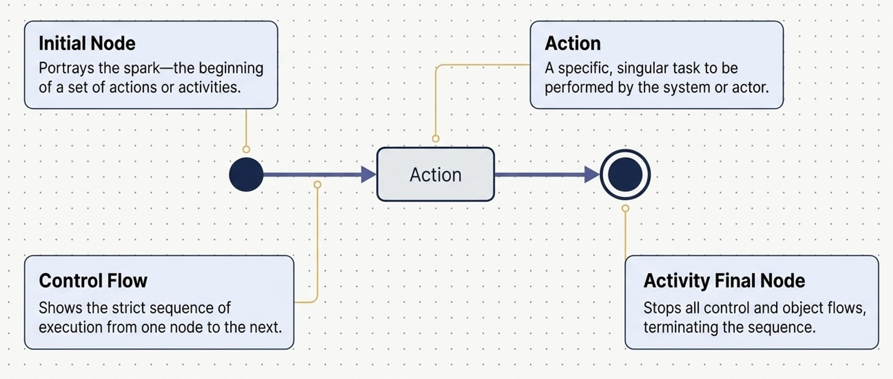
</div>

<!--
Here is the core vocabulary of an activity diagram. Look at the diagram in the center and the four callout cards:

First, on the far left is the Initial Node: a solid black circle that marks the spark where the process begins.
Second, the solid arrow is the Control Flow: it directs the sequence from one step to the next.

Third, in the middle is the Action: a rounded rectangle representing a single task performed by a user or the system.
Fourth, on the far right is the Activity Final Node: a bullseye circle that stops all flows and ends the process.

To summarize this slide, remember this key takeaway: Workflows start at an initial dot, move along control arrows through rounded action tasks, and end at a bullseye.
-->

---

<!-- _class: v-center -->

### Conditional Logic: Decision & Merge Nodes

<div class="split46">
<div class="left" style="font-size: 16.5px; line-height: 1.45;">

**Handling Mutually Exclusive Paths in Workflows:**

- **Decision Node (Top Diamond ◇):**
  - **Branching Point:** Evaluates guards on outgoing flows (e.g., `[Graphics Necessary? / Yes]` vs. `[No]`).
  - **Strict Mutual Exclusion:** Exactly **ONE** path receives the execution token based on runtime evaluation.
- **Merge Node (Bottom Diamond ◇):**
  - **Reconvergence Point:** Brings alternative paths back into a single continuing flow (e.g., before `Save File`).
  - **No Synchronization Waiting:** Does **NOT** wait for multiple tokens; whichever branch arrives first continues immediately.
- **Key Takeaway:** Diamonds handle **if-else** choices, safely dividing and reuniting mutually exclusive logic.

</div>
<div class="right" style="display: flex; justify-content: center; align-items: center;">

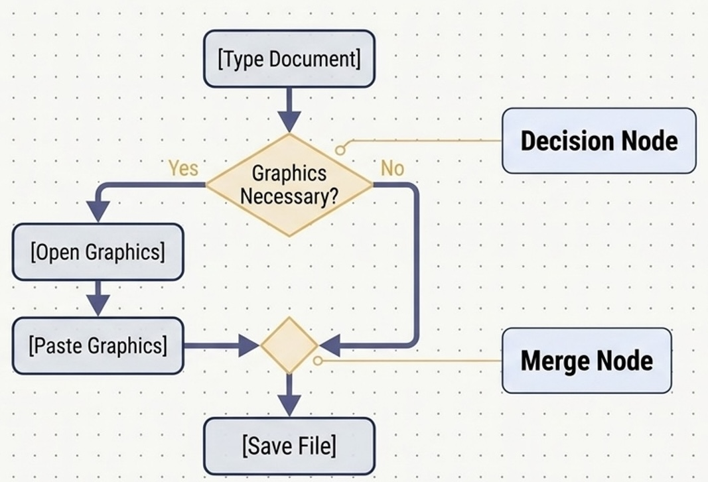

</div>
</div>

<!--
Let's see how conditional logic works using diamonds. Look at the two diamonds in this diagram:

First is the top diamond: the Decision Node. It asks: 'Graphics Necessary?' If Yes, the flow goes left to Open Graphics and Paste Graphics. If No, it skips those steps and goes right. A decision node picks only ONE path based on the condition.

Second is the bottom diamond: the Merge Node. It brings the two alternative branches back together before reaching Save File. Notice that a merge node does NOT wait for both paths—it simply allows whichever path was taken to continue.

To summarize this slide, remember this key takeaway: Decision diamonds split flow into mutually exclusive branches, and merge diamonds safely bring them back together.
-->

---

<!-- _class: v-center -->

### Concurrency: Fork & Join Nodes

<div class="split46">
<div class="left" style="font-size: 16.5px; line-height: 1.45;">

**Orchestrating Parallel Threads & Synchronization:**

- **Fork Node (Top Solid Bar ▬):**
  - **1-to-Many Concurrency:** Takes one incoming control flow and splits it into **concurrent parallel threads**.
  - **Simultaneous Execution:** Both `Handle Billing` and `Fill and Send` execute concurrently without blocking each other.
- **Join Node (Bottom Solid Bar ▬):**
  - **Synchronization Barrier:** All incoming parallel branches must finish before outgoing flow (`Close Order`) can proceed.
  - **Waiting Guarantee:** If billing takes 1s and packing takes 10s, billing halts at the join bar until packing arrives.
- **Key Takeaway:** Forks spawn parallel concurrent threads; joins synchronize and wait for all threads to complete.

</div>
<div class="right" style="display: flex; justify-content: center; align-items: center;">

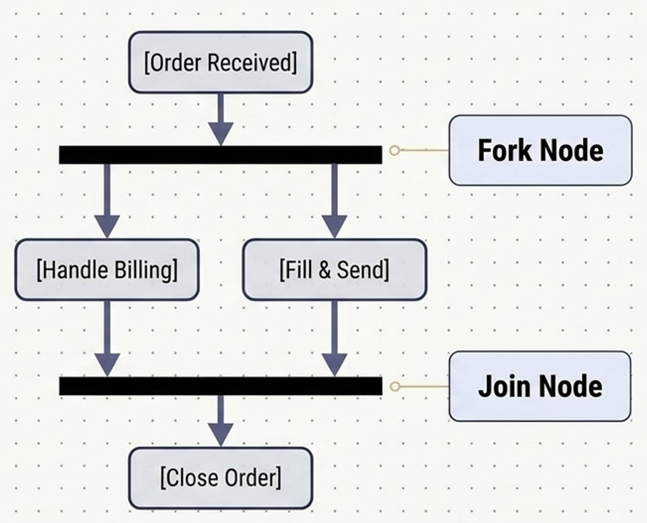

</div>
</div>

<!--
Now let's examine parallel concurrency using thick black bars.

Look at what happens after 'Order Received':
The top thick bar is the Fork Node. It splits the flow into two actions running at the exact same time: 'Handle Billing' and 'Fill and Send'.

Now look at the bottom thick bar: that is the Join Node. The join node is a synchronization barrier! It waits until BOTH tasks are 100% finished before allowing the flow to reach 'Close Order'. If billing finishes in one second, it waits right there until packing is done.

To summarize this slide, remember this key takeaway: Fork bars launch concurrent tasks in parallel, and join bars synchronize and wait for all tasks to complete.
-->

---

<!-- _class: v-center -->

## The Multi-Actor Accountability Problem

<div class="split46">
<div class="left" style="font-size: 16.5px; line-height: 1.45;">

**Clear Ownership Eliminates Workflow Ambiguity:**

- **The Problem: Process Ambiguity (Left):**
  - **Unassigned Spaghetti Tasks:** Knowing *what* tasks occur is useless if no one knows *who* is responsible for each step.
  - **Lost Handoffs:** Complex arrow webs obscure role transitions between employees and managers, causing dropped tasks.
- **The Solution: Swimlane Accountability (Right):**
  - **Boundary Separation:** Clear vertical columns partition responsibilities (e.g., `Employee` vs. `Manager`).
  - **Explicit Crossing Points:** Cross-partition arrows explicitly define handoffs (e.g., employee submits → manager reviews & approves).
- **Core Principle:** Swimlanes transform tangled process spaghetti into crisp, legally unambiguous operational boundaries.

</div>
<div class="right" style="display: flex; justify-content: center; align-items: center;">

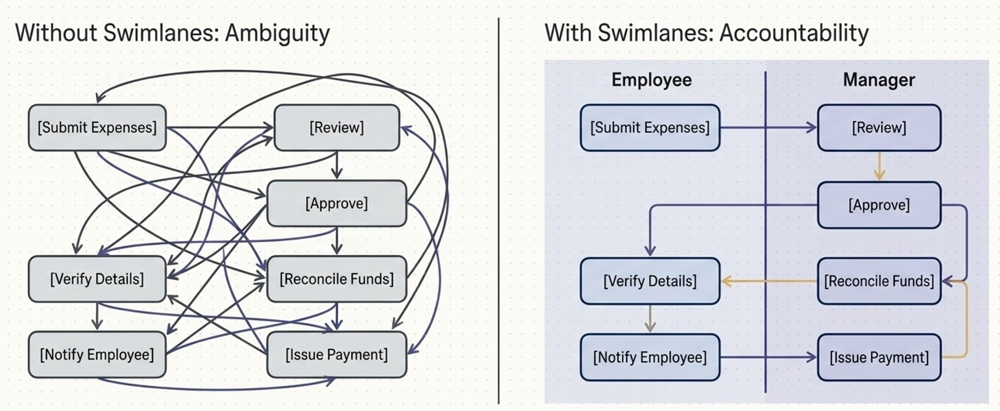

</div>
</div>

<!--
Here is a very common problem in software engineering: multi-actor accountability.

Look at the left side: 'Without Swimlanes.' We have seven tasks connected by a tangled mess of arrows. Who is supposed to review expenses? Who issues the payment? Nobody knows, which leads to confusion and missed handoffs.

Now look at the right side: 'With Swimlanes.' We draw a vertical line separating Employee and Manager.
Now accountability is crystal clear: the employee submits expenses and verifies details; the manager reviews, approves, and issues payment.

To summarize this slide, remember this key takeaway: Swimlanes divide the canvas into clear columns so everyone knows exactly who is responsible for each action.
-->

---

<!-- _class: v-center -->

### Swimlanes & Partitions: Grouping Activities

<div class="split46">
<div class="left" style="font-size: 16.5px; line-height: 1.45;">

**Mapping Seamless Actor Handoffs in Practice:**

- **Actor Partitions (Swimlanes):**
  - Groups activities by performer: `Applicant` on the left, `Registrar` on the right.
  - Visualizes organizational, departmental, or subsystem boundaries cleanly.
- **Handoff Lifecycle (University Enrollment):**
  - **1. Action Initiation:** Applicant hands in the enrollment form (`Hand in Enrollment Form`).
  - **2. Boundary Crossing:** Flow crosses to the Registrar for validation (`Inspect Forms` → `Determine Proper Fill`).
  - **3. Notification & Return:** Registrar informs student (`Inform Student`), returning control to the Applicant to `Pay Initial Tuition`.
- **Key Takeaway:** Every cross-lane arrow is a formal contract interface between two distinct actors or architectural components.

</div>
<div class="right" style="display: flex; justify-content: center; align-items: center;">

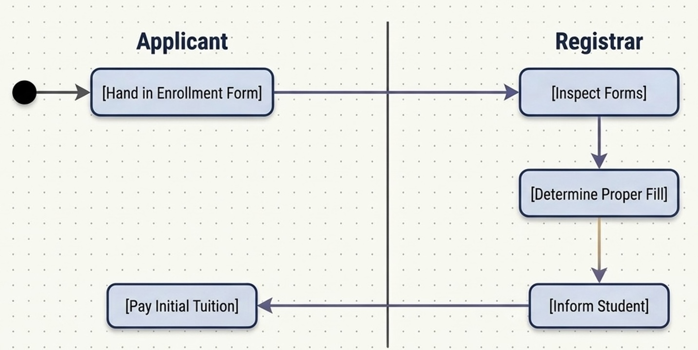

</div>
</div>

<!--
Let's see swimlanes in action with a university enrollment example.

We have two swimlanes: Applicant on the left, and Registrar on the right.

Follow the flow across the dividing line:
First, the Applicant fills out and hands in the enrollment form.
The arrow crosses the partition to the Registrar, who inspects the form, checks that it is properly filled out, and informs the student.
Then the arrow crosses back to the Applicant to pay initial tuition.

Every time an arrow crosses a swimlane line, that is a clean, documented handoff between two roles.

To summarize this slide, remember this key takeaway: Cross-swimlane arrows make handoffs between users, staff, and services explicit and easy to track.
-->

---

<!-- _class: title-image-slide -->

## Visual Taxonomy of Activity Diagrams

<div class="image-wrapper">
  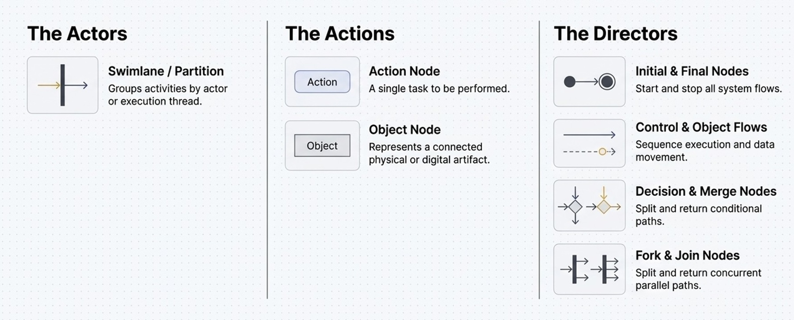
</div>

<!--
Here is your complete visual reference card for activity diagrams, organized into three columns:

Column 1 is 'The Actors': Swimlanes and partitions that group actions by role or service.
Column 2 is 'The Actions': rounded Action Nodes for tasks, and sharp Object Nodes for data artifacts.

Column 3 is 'The Directors' that control traffic:
Initial and Final dots to start and stop;
Solid control arrows and dashed object flow arrows;
Decision and Merge diamonds for if-else branching;
And Fork and Join bars for parallel concurrency.

Keep this taxonomy in mind whenever you read or draw activity diagrams!

To summarize this slide, remember this key takeaway: Activity diagrams combine actors in swimlanes, action tasks with data objects, and director nodes that manage traffic and concurrency.
-->

---

<!-- _class: v-center -->

### The Unified Workflow Model

<div class="split46">
<div class="left" style="font-size: 16.5px; line-height: 1.45;">

**Combining Swimlanes, Concurrency, & Logic:**

- **1. Cross-Actor Handoff:**
  - `Actor A` initiates an `Initial Request`; control flows across the partition to `Actor B` to `Review Request`.
- **2. Concurrent Processing & Object Flow:**
  - **Fork Bar:** Splits execution simultaneously into `Actor B` (perform analysis) and `Actor C` (execute sub-process).
  - **Object Transformation:** `Actor B` produces a tangible `[Analysis Report]` data object.
- **3. Decision Loop & Synchronization Barrier:**
  - **Retry Diamond:** In `Actor C`, `[Success?]` loops on failure and proceeds on success.
  - **Join Bar:** Waits for both the `Analysis Report` and successful sub-process before compiling output and delivering result.
- **Key Takeaway:** Unifies roles, parallel tasks, stateful objects, and conditional loops into an enterprise-grade blueprint.

</div>
<div class="right" style="display: flex; justify-content: center; align-items: center;">

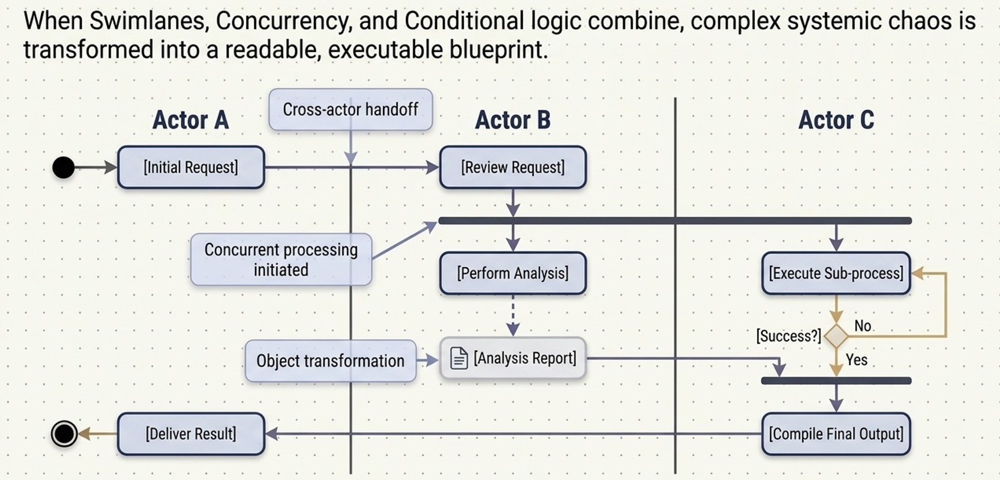

</div>
</div>

<!--
Look at this complete workflow model: all the concepts come together in one master diagram!

We have three swimlanes: Actor A, Actor B, and Actor C.
Follow the story:
1. Actor A makes an Initial Request. An arrow crosses to Actor B, who reviews it.
2. Actor B hits a Fork bar, launching two parallel tasks!
In Actor B, analysis produces an Analysis Report object node.
In Actor C, a sub-process runs. Look at the diamond: if not successful, it loops back to retry!
3. When both the report and the sub-process succeed, they enter the Join bar in Actor C.
4. Actor C compiles the final output, and hands it back to Actor A to deliver the result.

This is a real-world enterprise workflow: swimlanes, concurrency, retry loops, and object transformations all working together.

To summarize this slide, remember this key takeaway: Combining swimlanes, fork/join concurrency, and decision loops turns complex operations into a readable engineering blueprint.
-->

---

## Concept Check Question 6
<!-- id: ase-ch04-ccq6 -->
<div class="ccq-columns">
<div class="ccq-text">

In a UML Activity Diagram, what is the critical behavioral difference between a **Fork/Join** synchronization bar and a **Decision/Merge** diamond?

- **A.** Fork/Join splits and synchronizes concurrent parallel threads; Decision/Merge evaluates guards to pick exactly one mutually exclusive branch.
- **B.** Fork/Join is used for sequential database transactions; Decision/Merge is used for swimlane partitioning.
- **C.** Fork/Join models class inheritance; Decision/Merge models object creation.
- **D.** Fork/Join requires human operator approval; Decision/Merge is executed by automated timers.

</div>
<div class="ccq-logo">
    <a href="https://nlhsueh.github.io/nickedupocket/#/student/ase-ch04-ccq6" target="_blank"></a>
  </div>
</div>

<!--
Let's check our understanding with Concept Check Question 6. Scan the QR code or click the link to answer on your phone.

The question asks: What is the critical behavioral difference between a Fork/Join bar and a Decision/Merge diamond?

Let's look at the options:
Option B mentions sequential transactions and swimlanes, which is unrelated.
Option C confuses class inheritance with activity nodes.
Option D invents fake rules about human approval and timers.

Option A is the correct answer! A Fork bar splits into concurrent parallel threads running at the same time, and Join waits for all of them. In contrast, Decision/Merge evaluates conditions to choose and reunite ONE path at a time.

To summarize this slide, remember this key takeaway: Fork/Join manages concurrent parallel execution, while Decision/Merge handles mutually exclusive branching.
-->

---

<!-- _class: v-center -->

### Diagnostic Exercise: Spot the Flaws in this Activity Diagram

<div class="split46">
<div class="left" style="font-size: 16.5px; line-height: 1.45;">

**Audit this student's draft Activity Diagram for food fulfillment:**
Can you identify the critical mistakes across **concurrency, branching, and swimlane roles**?

- **1. Concurrency vs. Conditional Branching:**
  - Look closely at the `fork` bar in the Kitchen swimlane. Why is placing `[Card Payment]` and `[Cash on Delivery]` guards on a fork fundamentally wrong?
- **2. Swimlane Accountability & Partitioning:**
  - Examine the actions assigned to `Customer` and `Kitchen`. Which responsibilities are absurdly reversed?
- **3. Dangling Control Flow & Termination:**
  - Follow the `[Out of Stock]` path after `Cancel Order`. What essential UML node is missing before flow terminates?
- **4. Deadlock vs. Synchronization:**
  - If concurrent threads do not properly converge with matching join semantics, what runtime failure occurs?

</div>
<div class="right" style="display: flex; justify-content: center; align-items: center;">


</div>
</div>

<!--
Let's conduct an architectural audit of this student's draft Activity Diagram. There are four major workflow anti-patterns:

Flaw 1 (Confusing Concurrency with Mutually Exclusive Decisions):
Look at the fork bar in the Kitchen swimlane: It splits into [Card Payment] and [Cash on Delivery]. Placing guard conditions on a fork bar is a severe conceptual error! A fork bar spawns concurrent parallel threads where ALL outgoing branches execute simultaneously. Putting mutually exclusive payment choices on a fork means the system charges the customer's credit card AND prepares cash change at the same time! Mutually exclusive branches MUST use a Decision diamond, not a Fork bar.

Flaw 2 (Absurd Swimlane Role Reversal):
Notice the swimlane partitioning: 'Enter Delivery Address & Phone' is assigned to the Kitchen swimlane, while 'Cook Food & Package Meal' is placed inside the Customer swimlane! The customer is cooking their own meal while the restaurant kitchen enters the delivery address. Actions must strictly align with the responsible actor or system partition.

Flaw 3 (Dangling Control Flow / Missing Activity Final Node):
Follow the decision diamond when ingredients are [Out of Stock]: The flow executes 'Cancel Order' and then abruptly stops into thin air! In UML activity diagrams, every terminating flow path must explicitly lead to an Activity Final Node (a solid black circle with an outer ring) or a Flow Final Node.

Flaw 4 (Deadlock Hazard on Asymmetric Synchronization):
If mutually exclusive decision paths are mistakenly fed into a Join bar, the join bar will wait indefinitely for the missing token to arrive, deadlocking the workflow. Always use Merge diamonds to reunite mutually exclusive paths, and reserve Join bars strictly for synchronizing concurrent parallel threads.

To summarize this slide, remember this key takeaway: Never put guards on a fork bar, strictly verify swimlane accountability, and ensure all terminating branches reach an explicit final node.
-->

---

## AI Assistance: Guidelines for Activity Modeling

- **1. Establish Clear Role Boundaries (Swimlanes):**
  - Partition actions by role or system (e.g., Customer, Kitchen, Courier, Dispatch) so every action has an explicit owner.
- **2. Identify True Concurrency & Synchronization:**
  - **Parallel Workflows:** Guide AI to recognize independent steps that happen at the same time (e.g., cooking food while dispatching a driver).
  - **Synchronization Milestones:** Explicitly specify where parallel branches must wait and join before the workflow can proceed.
- **3. Explicit Decision Points:**
  - Ensure branch conditions are clear and cover all possible outcomes.
- **4. Human Reality Check:**
  - Did AI collapse parallel work into a purely sequential list?
  - Does every split path properly reunite at a synchronization point?

<!--
When asking AI to model activity workflows, focus on responsibilities, concurrency, and synchronization.

First, divide responsibilities across roles or swimlanes: Customer, Kitchen, Dispatch, and Courier. Every activity should have an obvious owner.

Second, pay close attention to parallel concurrency and synchronization. AI models frequently make the mistake of drawing everything in a single sequential line. Guide the AI to identify tasks that run simultaneously and clearly define where they must join.

Third, ensure decisions have clear, complete branches.

Finally, conduct a human reality check: verify that parallel tasks actually run concurrently and don't leave loose ends without proper synchronization.

To summarize this slide, remember this key takeaway: Guide AI by assigning clear role swimlanes, identifying parallel tasks, and enforcing synchronization milestones.
-->

---

<!-- _class: v-center -->

### AI Prompt Example: Food Delivery Activity Model

<div class="two-columns">
<div>

**1. Role & Task Instruction:**
```text
Act as a Workflow & Process Architect.
Generate a clean PlantUML Activity Diagram
using swimlanes and parallel processing.
```

**2. Modeling Guidance:**
- Divide workflow into 4 roles: Customer, Kitchen, Dispatch, Courier.
- Identify parallel steps after order payment (cooking meal while matching courier).
- Synchronize branches: courier cannot pick up meal until both cooking is finished and courier has arrived.
- Clearly show process start, decision points, and completion.

</div>
<div>

**3. Input Requirements Statement:**
> "Workflow begins in the **Customer** swimlane when the user confirms and pays for an order.
> Once confirmed, two parallel processes initiate:
> - In **Restaurant Kitchen**: Staff receive order ticket, prepare food items, and package the meal into a delivery bag.
> - Simultaneously, in **Dispatch Engine**: The system calculates transit route, queries nearby available couriers, and dispatches a delivery offer.
> In the **Delivery Courier** swimlane, the courier accepts the assignment and drives to the restaurant.
> **Synchronization Milestone:** The courier cannot pick up the order until BOTH the food packaging is complete AND the courier has arrived at the store.
> Once synchronized, kitchen hands off food to courier. Courier transports meal to customer address, customer verifies delivery with OTP, and the process ends."

</div>
</div>

<!--
Here is a clear prompt example for modeling a food delivery workflow.

Look at the left column: Instead of micromanaging syntax, we provide high-level process guidance: divide the flow into four roles, highlight parallel steps (cooking while matching courier), and define the key synchronization milestone.

In the right column, we describe the business scenario and emphasize that courier arrival and food preparation must both finish before the handoff.

With this conceptual guidance, AI structures the diagram into clean swimlanes with proper parallel splits and synchronization points.

To summarize this slide, remember this key takeaway: Guide AI with clear role boundaries, concurrent activities, and explicit synchronization milestones.
-->

---

<!-- _class: v-center -->
<!-- header: '4.6 Process & Activity Diagrams' -->

### Generated PlantUML & Diagram: Food Delivery Activity Model

<div class="puml-output-grid">
<div class="puml-code-col">

<div class="puml-title">Generated PlantUML Specification:</div>


</div>
<div class="puml-diagram-col">

<div class="puml-title">Rendered Diagram Output:</div>

<div class="diagram-wrapper">
  
</div>

</div>
</div>

<!--
Here is the resulting Activity Diagram with parallel swimlane execution.

Look at the PlantUML on the left:
Notice how vertical pipe characters define the four swimlanes: Customer, Restaurant Kitchen, Dispatch Engine, and Delivery Courier.
Notice the fork and fork-again block where kitchen food preparation and courier dispatch run concurrently in parallel.
Notice the end fork synchronization bar before hand-off, guaranteeing that the courier has arrived AND the meal is packaged before the hand-off action begins.

On the right, the rendered activity diagram shows the distinct visual lanes and clear parallel concurrency.

To summarize this slide, remember this key takeaway: Prompting AI with explicit swimlane names and fork/join synchronization constructs models complex asynchronous business processes accurately.
-->

---

### Interactive Activity: Evolving Workflows with AI (Pair Hands-On)

<div class="discussion-columns">
  <div class="discussion-text">

  **Hands-on Experiment: Mutate Process & Audit AI Output (4 Mins)**
  - **1. Add ONE Process Rule to the Activity Prompt:**
    - *Courier Reassignment:* If matched courier declines, re-dispatch to another courier.
    - *Quality Check:* Kitchen inspects food; if burnt, redo cooking before packaging.
    - *Customer Self-Pickup:* If customer chooses takeaway, bypass courier swimlane.
  - **2. Ask AI to Generate:** Prompt an LLM to update the PlantUML activity diagram.
  - **3. Render & Critique:** Paste into [PlantText](https://www.planttext.com) and audit:
    - Did AI maintain clear **swimlanes** for all participating roles?
    - Are **parallel splits and joins** properly paired without deadlocks?
    - Are **decision diamonds** fully labeled with complete branch conditions?

  </div>
  <div class="discussion-logo">
    
  </div>
</div>

<!--
Now let's do a hands-on pair experiment for Activity Workflows! Work with your partner to test how AI models concurrent processes and business decisions.

Look at the instructions on the screen:
Take our Food Delivery Activity prompt from earlier and mutate it with one new process branch:
- Option A: Courier declines assignment—the dispatch engine must loop back and search for another courier.
- Option B: Kitchen quality check—if packaging fails inspection, food is remade before proceeding.
- Option C: Customer chooses self-pickup (takeaway)—completely bypassing the courier swimlane.

Ask your AI assistant to generate the updated PlantUML activity diagram, render it in PlantText, and critically audit the result:
Did each action land in the correct swimlane?
Did AI properly pair parallel splits and synchronization points without causing deadlocks?
Are decision diamonds clearly labeled with guards?

To summarize this slide, remember this key takeaway: Testing AI with loops, fallbacks, and takeaway branches ensures your workflow diagrams reflect robust real-world operations.
-->


---

<!-- _class: lead -->
<!-- header: '4.7 Behavioral & State Machine Models' -->

# **4.7 Behavioral & State Machine Models**

> "A system in dynamic execution is defined by the states it occupies and the events that trigger transitions."

<!--
Welcome to Section 4.7: Behavioral Models and State Machine Diagrams.

Up to now, we studied class diagrams for static structure, sequence diagrams for message flows, and activity diagrams for workflows.

However, reactive systems—such as autonomous vehicles, smart thermostats, and order processing systems—change how they behave based on their current state.

In this section, we will learn how state machines model states, events, transitions, actions, composite states, and history memory.

To summarize this slide, remember this key takeaway: State machines model how reactive systems change states in response to external events over time.
-->


---

<!-- _class: v-center -->

### Same Event, Different Results Based on State

<div class="split46">
<div class="left" style="font-size: 16.5px; line-height: 1.45;">

**Context-Dependent Behavioral Execution:**

- **Identical Stimulus, Divergent Outcome:**
  - Sending the exact same input event (`pressSwitch()`) triggers opposite results depending on current system state.
- **State Evaluation:**
  - **Current State = Off (Blue Path):** The switch closes the circuit and transitions light to `On`.
  - **Current State = On (Red Path):** The switch breaks the circuit and transitions light to `Off`.
- **Core Architectural Invariant:** In reactive systems, runtime behavior is a function of `(Current State, Event) → (Next State, Action)`.

</div>
<div class="right" style="display: flex; justify-content: center; align-items: center;">


</div>
</div>

<!--
Look at this foundational example: 'The Same Event Yields Different Results Based on State.'

Notice what happens when the event `pressSwitch()` occurs. It arrives at the diamond representing 'The Light's State'.

If the light's current state is Off, following the blue line, pressing the switch turns the light On.

But if the light's current state is On, following the red line, pressing the exact same switch turns the light Off!

A system's response is not just based on the input event. It depends entirely on its past history and active state.

To summarize this slide, remember this key takeaway: In state-dependent systems, the same event produces completely different results depending on the current state.
-->

---

<!-- _class: v-center -->

### Positioning State Machines in the UML Ecosystem

<div class="split46">
<div class="left" style="font-size: 16.5px; line-height: 1.45;">

**Complementary Behavioral Perspectives:**

- **Sequence Diagram (Inter-Object Chronology):**
  - **Scope:** Multiple objects collaborating across lifelines.
  - **Coverage:** Traces a **single execution scenario** (happy path or specific edge case).
- **State Machine (Intra-Object Lifecycle):**
  - **Scope:** A **single key entity** (e.g., `Order`, `Connection`).
  - **Coverage:** Exhaustively captures **all possible states, events, and transitions** over its entire lifetime.
- **Architectural Rule:** Use Sequence Diagrams for inter-service protocols; use State Machines for complex entity integrity.

</div>
<div class="right" style="display: flex; justify-content: center; align-items: center;">


</div>
</div>

<!--
Look at how state machines fit into the UML ecosystem compared to sequence diagrams.

On the right, a sequence diagram tracks a single, linear scenario across multiple collaborating objects. It shows messages passing from one lifeline to another.

On the left, a state machine diagram does the opposite! It zooms in on one single object—like an Order or a Connection—and maps all possible events, states, and transitions across its entire life.

Sequence diagrams show many objects in one scenario; state machines show one object across all possible scenarios.

To summarize this slide, remember this key takeaway: Sequence diagrams show many objects in one scenario, while state machines show one object across all possible scenarios.
-->

---

<!-- _class: v-center -->

## Defining the State: A Lifecycle Interval

<div class="split46">
<div class="left" style="font-size: 16.5px; line-height: 1.45;">

**The Formal Lifecycle Interval:**

- **1. Initial Pseudo-State (●):**
  - Not a true state; marks the default starting entry point of an object lifecycle.
- **2. The State (Rounded Box):**
  - **Sustained Interval:** A period during which the object satisfies an invariant, executes an ongoing activity, or waits for an event.
  - **State vs. Action:** A state is durational, unlike an instantaneous atomic action.
- **3. Final State (◉):**
  - Bullseye notation marking lifecycle termination and resource deallocation.
- **Core Rule:** Continuous/server processes omit final states; workflow entities terminate at final states.

</div>
<div class="right" style="display: flex; justify-content: center; align-items: center;">


</div>
</div>

<!--
What exactly is a 'State'? Look at this diagram and its three numbered callouts.

A state is not just a brief instant. It is a sustained time interval in an object's lifecycle.

Notice the three elements:
Number 1 is the Initial Pseudo-State—the starting line where the object begins.
Number 2 is The State itself—the active timeframe where conditions hold true, activities run, or the system waits for an event.
Number 3 is the Final State—the bullseye circle where the object's lifecycle ends.

For continuous systems that never terminate, like an operating system kernel or thermostat, the final state can simply be omitted.

To summarize this slide, remember this key takeaway: A state is a sustained time interval in an object's life between its initial starting point and final termination.
-->

---

<!-- _class: v-center -->

### The Four Triggers of State Transitions

<div class="split46">
<div class="left" style="font-size: 16.5px; line-height: 1.45;">

**The Four Event Stimuli in UML:**

- **1. Signal Event (⚡ Lightning):**
  - Asynchronous message or event packet arriving from an external actor or subsystem.
- **2. Call Event (⚙ Gears):**
  - Synchronous invocation of an operation or method on the object's interface.
- **3. Time Event (⌛ Hourglass):**
  - Temporal trigger based on elapsed time (e.g., `after(30s)` or deadline expiration).
- **4. Change Event (⟦⟧ Condition):**
  - Continuous monitoring trigger firing when a boolean expression transitions from false to true (e.g., `when(temp > 100)`).
  - **Key Takeaway:** Every state transition must be driven by exactly one of these four event types.

</div>
<div class="right" style="display: flex; justify-content: center; align-items: center;">


</div>
</div>

<!--
Look at the four triggers that move a system from one state to another.

In the top-left, a Signal Event—shown with a lightning bolt—is the arrival of an asynchronous message or signal packet from outside.

In the top-right, a Call Event—shown with gears—happens when a caller invokes a method or operation on the object.

In the bottom-left, a Time Event—shown with an hourglass—fires after a specific duration passes, such as after 30 seconds.

In the bottom-right, a Change Event—shown with bracket symbols—fires whenever a boolean condition becomes true, like when temperature exceeds 100 degrees.

To summarize this slide, remember this key takeaway: Transitions are triggered by four types of events: signals, method calls, elapsed time, and condition changes.
-->

---

<!-- _class: v-center -->

### The Mechanics of a Transition: Event, Guard, Action

<div class="split46">
<div class="left" style="font-size: 16.5px; line-height: 1.45;">

**Anatomy of the Transition Pipeline:**

- **The Transition Equation:**
  - Standard UML syntax: `Event [Guard] / Action`.
- **Step-by-Step Execution Mechanics:**
  - **1. Event Stimulus:** Incoming event drops into the state handler funnel.
  - **2. Guard Evaluation:** Boolean guard condition controls the gate; if false, the transition does not fire.
  - **3. Action Execution:** Atomic, instantaneous action effect runs in zero logical time.
  - **4. State Change:** System transitions out of Source State into Target State.
- **Completion Transitions:** Transitions without triggers fire automatically when internal state activities finish.

</div>
<div class="right" style="display: flex; justify-content: center; align-items: center;">


</div>
</div>

<!--
Look at the mechanics of a transition, illustrated here with a funnel machine!

Look at the transition equation at the top:
[Source State] + (Event) + [Action] = [Target State].

Now trace how the machine works:
An incoming Event—the blue ball—drops into the funnel.
The lever controls the Guard Condition. If the guard evaluates to true, the valve opens.
The ball passes through the rotating gears, which execute an Action—an instant atomic operation.
Finally, the ball rolls out of the pipe and lands into the Target State box!

If a transition has no event trigger, it is an automatic completion transition that fires as soon as internal state activities finish.

To summarize this slide, remember this key takeaway: A transition moves between states when an event occurs, the guard condition is true, and the action effect executes.
-->

---

<!-- _class: v-center -->

## Execution Engines: Actions vs. Activities

<div class="split46">
<div class="left" style="font-size: 16.5px; line-height: 1.45;">

**Atomic Execution vs. Durational Behavior:**

- **Action (Atomic Computation):**
  - **Duration:** Instantaneous (zero logical execution time).
  - **Interruptibility:** **Non-interruptible**; once triggered, runs to completion before any event is processed.
  - **Placement:** On transitions, `entry /`, or `exit /`.
- **Activity (Ongoing Computation):**
  - **Duration:** Sustained over time; continues while state is active.
  - **Interruptibility:** **Immediately interruptible** if an outgoing transition event fires.
  - **Placement:** Declared as `do / [activity]`.
- **Crucial Rule:** Never put long-running I/O or background loops inside an Action.

</div>
<div class="right" style="display: flex; justify-content: center; align-items: center;">


</div>
</div>

<!--
This slide highlights one of the most critical conceptual distinctions in UML: Actions versus Activities.

Look at the four rows in the table:
First, Nature: An Action is atomic computation, like calling a method or destroying an object. An Activity is non-atomic computation.
Second, Duration: An Action is instantaneous—taking zero logical time. An Activity is ongoing—running to completion or running indefinitely.
Third, Interruptibility: Notice the highlighted words! An Action is NEVER interruptible. Once it starts, it must finish. An Activity CAN be interrupted at any moment by an incoming event!
Fourth, Triggers: Actions run on entry, on exit, or on transitions. Activities execute continuously during sustained state presence.

To summarize this slide, remember this key takeaway: Actions are instantaneous and non-interruptible; activities take time and can be interrupted by events.
-->

---

<!-- _class: v-center -->

### Boundary Executions: Entry and Exit Actions

<div class="split46">
<div class="left" style="font-size: 16.5px; line-height: 1.45;">

**Guaranteed Lifecycle Invariant Hooks:**

- **Entry Action (`entry / action`):**
  - Fires automatically the exact instant the state is entered.
  - Executes regardless of which transition path arrived at the state.
  - **Use Case:** Resource allocation, initializing timers, setting status flags.
- **Exit Action (`exit / exitAction`):**
  - Fires automatically the exact instant the state is abandoned.
  - Executes regardless of which outgoing transition was taken.
  - **Use Case:** Resource cleanup, flushing buffers, canceling watchdog timers.
- **Architectural Value:** Encapsulates initialization/cleanup inside the state, eliminating duplicate transition code.

</div>
<div class="right" style="display: flex; justify-content: center; align-items: center;">


</div>
</div>

<!--
Look at how boundary actions protect state execution: Entry and Exit Actions.

In this diagram, look at the state `Check Book Status` containing a `BookCopy Object`.

Notice the blue spark on the left: `entry / action`. This action executes automatically the exact millisecond the state is entered, no matter which transition brought the system there!

Notice the red spark on the right: `exit / action`. This action executes automatically the exact millisecond the state is exited, ensuring clean teardown and cleanup!

Using entry and exit actions guarantees initialization and cleanup logic without duplicating code across multiple transition arrows.

To summarize this slide, remember this key takeaway: Entry and exit actions guarantee setup and cleanup executions every time a state boundary is crossed.
-->

---

<!-- _class: v-center -->

## Scaling Architecture: Composite & Concurrent States

<div class="split46">
<div class="left" style="font-size: 16.5px; line-height: 1.45;">

**Taming State Explosions via Hierarchy:**

- **1. Simple State (Atomic):**
  - Single state with no internal decomposition (e.g., `Active`).
- **2. Composite State (Nested Hierarchy):**
  - An outer super-state encapsulating nested substates (e.g., `Heater` containing `Idle`, `Heating`, `Cooling`).
  - Outer transitions apply uniformly to all substates, drastically reducing arrow clutter.
- **3. Concurrent State (Orthogonal Regions):**
  - Split by dashed lines into orthogonal parallel regions.
  - Substates in all regions execute simultaneously and independently.
- **Core Value:** Scales flat, chaotic state graphs into clean, modular abstractions.

</div>
<div class="right" style="display: flex; justify-content: center; align-items: center;">


</div>
</div>

<!--
As software grows complex, flat state diagrams become tangled webs of arrows. Look at how UML scales architecture across three columns.

In the first column, we have a Simple State—like `Active`—which is a single atomic state.

In the second column, we have a Composite State. Notice the `Heater` state: it acts as an outer container holding nested substates: `Idle`, `Heating`, and `Cooling`. This hides internal complexity!

In the third column, we have a Concurrent State. A dashed horizontal line splits the state into two parallel execution tracks: Task A on top and Task B on the bottom. Both tracks execute at the same time!

To summarize this slide, remember this key takeaway: Composite and concurrent states organize complex behaviors into clean, nested, and parallel regions.
-->

---

<!-- _class: v-center -->

### Composite States and History Memory (H)

<div class="split46">
<div class="left" style="font-size: 16.5px; line-height: 1.45;">

**Resuming Execution After Interruptions:**

- **Default Composite Entry:**
  - Standard transitions into a composite state always start from the initial pseudo-state (Substate A).
- **The History State Pseudo-Node `(H)`:**
  - **State Caching:** Remembers the most recently active substate when the composite state was exited.
  - **Direct Restoration:** Incoming transitions directed to `(H)` bypass default startup and restore the cached substate directly (e.g., Substate B).
- **Shallow `(H)` vs. Deep `(H*)`:**
  - Shallow remembers immediate substate; Deep remembers nested child substates recursively.
- **Core Value:** Perfect for modeling pauses, phone interruptions, and system sleep/wake cycles.

</div>
<div class="right" style="display: flex; justify-content: center; align-items: center;">


</div>
</div>

<!--
What happens when a system gets interrupted and needs to remember where it was? Look at Composite States and System Memory.

Normally, when you enter a composite state, execution restarts from the beginning at Substate A.

However, look at the `(H)` circle—the History State memory slot. It acts like a cache!

When the system was in Substate B and had to exit, its active substate was cached in `(H)`.

When the system returns later from the outside, the arrow enters `(H)`, which directs execution straight back to Substate B!

To summarize this slide, remember this key takeaway: History states act as memory caches that restore the active substate after an interruption.
-->

---

<!-- _class: v-center -->

### Concurrency: Fork and Join Synchronization

<div class="split46">
<div class="left" style="font-size: 16.5px; line-height: 1.45;">

**Orthogonal Synchronization in Statecharts:**

- **Fork Bar (1-to-Many Thread Concurrency):**
  - Takes a single event trigger (`Auction Trigger`) and spawns multiple parallel active sub-states simultaneously.
  - Upper thread handles `Processing the Bid`; lower thread handles `Authorizing Payment Limit`.
- **Join Bar (Synchronization Barrier):**
  - Synchronizes incoming parallel execution tracks.
  - System halts at the barrier until **both** bid processing and payment authorization are 100% complete.
- **Architectural Determinism:** Guarantees parallel background jobs finish before downstream lifecycle actions execute.

</div>
<div class="right" style="display: flex; justify-content: center; align-items: center;">


</div>
</div>

<!--
Look at how state machines handle parallel execution: Concurrency with Fork and Join.

Notice this online auction example:
An `Auction Trigger` arrives at the thick vertical Fork bar on the left.
The single thread splits into two parallel tracks: the upper track executes `Processing the Bid`, while the lower track executes `Authorizing Payment Limit`.

Both parallel paths lead into the thick vertical Join bar on the right.
The system waits at the join bar until both tracks have completed.
Only when both parallel sub-activities finish does the system exit and proceed forward.

To summarize this slide, remember this key takeaway: Fork bars split execution into parallel sub-states, and Join bars synchronize them before moving forward.
-->

---

<!-- _class: v-center -->

### The Unified Blueprint: HVAC System Example

<div class="split46">
<div class="left" style="font-size: 16.5px; line-height: 1.45;">

**Industrial-Grade Comprehensive Blueprint:**

- **Dual Concurrent Regions (Dashed Boundary):**
  - **Region 1 (Thermostat Control):** Cycles between `Idle` and `Heating`; guarded transition `[temp < setpoint]` fires atomic `entry / activate_burner`.
  - **Region 2 (Fan Operation):** Runs concurrently and independently (`Fan Off` ↔ `Fan Low` ↔ `Fan High`).
- **Integrated Advanced Mechanics:**
  - Entry actions ensure burner hardware synchronization.
  - History pseudo-state `(H)` preserves thermostat operating memory.
- **Master Architecture Takeaway:** Statecharts express intricate hardware-software coordination with complete formal rigor.

</div>
<div class="right" style="display: flex; justify-content: center; align-items: center;">


</div>
</div>

<!--
Here is the Unified Blueprint—bringing all our state machine concepts together in an HVAC Heater System!

Look at how clean and organized this architecture is:
The outer container is split by a dashed line into two Concurrent Regions running in parallel: Thermostat Control on the left, and Fan Operation on the right.

On the left, Thermostat Control starts at the Initial Pseudo-State and enters `Idle`. When `temp < setpoint` triggers, it transitions to `Heating` and fires an atomic entry action: `entry / activate_burner`. It also features a History State Cache `(H)`.

On the right, Fan Operation independently manages `Fan Low`, `Fan High`, and `Fan Off` based on speed signals.

By organizing states into concurrent regions with clear entry actions and triggers, complex behavior becomes crystal clear.

To summarize this slide, remember this key takeaway: Real-world architectures combine concurrent regions, entry actions, event triggers, and history memory into a unified blueprint.
-->

---

## Concept Check Question 7
<!-- id: ase-ch04-ccq7 -->
<div class="ccq-columns">
<div class="ccq-text">

In a UML State Machine, what is the critical architectural difference between an **Action** (such as `/ refundCharge()` or `entry / startTimer()`) and an **Activity** (`do / playAudio()`)?

- **A.** Actions are instantaneous, atomic, and non-interruptible; Activities are ongoing computations that take time and can be interrupted by incoming events.
- **B.** Actions are written in Python code; Activities are written in SQL queries.
- **C.** Actions only apply to class diagrams; Activities only apply to sequence diagrams.
- **D.** Actions represent manual human tasks; Activities are executed by database servers.

</div>
<div class="ccq-logo">
    <a href="https://nlhsueh.github.io/nickedupocket/#/student/ase-ch04-ccq7" target="_blank"></a>
  </div>
</div>

<!--
Let's verify our understanding of state machine execution semantics with Concept Check Question 7.

Look at the options:
Option B and D confuse generic technology terms with formal UML semantics.
Option C confuses completely different diagram types.

The correct answer is Option A! In UML state machine semantics:
An Action is instantaneous, atomic, and non-interruptible—executing in zero logical time during a transition or entry/exit boundary.
An Activity (declared with `do /`) is durational and interruptible—it executes continuously while the state is active, and is immediately halted if an outgoing transition event fires.

To summarize this slide, remember this key takeaway: Actions are instantaneous and atomic; activities are ongoing and interruptible during state occupation.
-->

---

<!-- _class: v-center -->

### Diagnostic Exercise: Spot the Flaws in this State Machine Model

<div class="split46">
<div class="left" style="font-size: 16.5px; line-height: 1.45;">

**Audit this student's draft State Machine for an Order Lifecycle:**
Can you identify the critical mistakes across **state semantics, transitions, and terminal nodes**?

- **1. State vs. Transient Action:**
  - Examine `DeductCreditCard`. Why is it semantically incorrect to model an instantaneous action as a persistent state?
- **2. Black Hole (Trap) State:**
  - Look at `RiskReview`. What happens once an order enters this state?
- **3. Non-Deterministic Transition Conflict:**
  - Inspect the two `cancelOrder` transitions leaving `Paid`. If `amount == 150`, which transition fires?
- **4. Final State Invariants:**
  - What fundamental UML rule is violated by the `reopenOrder()` transition leaving the final state `[*]`?

</div>
<div class="right" style="display: flex; justify-content: center; align-items: center;">


</div>
</div>

<!--
Let's conduct an architectural audit of this student's draft State Machine diagram. There are four major behavioral anti-patterns:

Flaw 1 (Confusing Instantaneous Actions with Persistent States):
Look at the state box labeled 'DeductCreditCard'. A State represents a condition or period of time during which an entity satisfies some condition, performs an ongoing activity, or waits for an event (e.g., 'PendingPayment', 'Delivered'). Deducting a credit card is an instantaneous, atomic action that executes in zero logical time—it should be modeled as an action on a transition (e.g., 'pay / deductCreditCard()'), never as a standalone state box!

Flaw 2 (Black Hole / Trap State):
Look closely at 'RiskReview': The state has an incoming transition triggered by 'flagFraudTrigger', but it has ZERO outgoing transitions! Once an order enters RiskReview, it is trapped forever. It can never be approved, cancelled, or closed. Every intermediate state must have at least one exit path.

Flaw 3 (Non-Deterministic Transition Conflict):
Examine the state 'Paid': There are two transitions triggered by 'cancelOrder'. One has guard [amount > 100], but the second transition has NO guard at all! If a cancellation request arrives for an order of $150, BOTH transitions are valid. In UML, transitions from a single state sharing the same trigger event must have strictly mutually exclusive guard conditions (e.g., [amount > 100] and [amount <= 100]). Non-deterministic race conditions are strictly prohibited.

Flaw 4 (Illegal Outgoing Transition from a Final State):
Notice the transition 'reopenOrder()' drawn from the Final State [*] back to 'PendingPayment'. A Final State indicates the complete termination of the object's lifecycle. UML rules strictly forbid any outgoing transitions from a final state! If an order can be reopened, it was never truly terminated.

To summarize this slide, remember this key takeaway: Distinguish persistent states from instantaneous actions, avoid black hole states, enforce mutually exclusive guards, and never draw outgoing transitions from a final state.
-->

---

## AI Assistance: Guidelines for State Machine Modeling

- **1. Focus on Entity Lifecycle (States vs. Activities):**
  - Name states as discrete conditions or adjectives (`Placed`, `Preparing`, `Delivered`), never verbs or temporary actions (e.g., avoid "Cooking Meal").
- **2. Define Clear Triggers & Guard Rules:**
  - **Triggers:** Specify the exact business events that cause a state change (e.g., `acceptOrder`, `paymentConfirmed`).
  - **Business Guards:** Explicitly enforce rules that allow or block transitions (e.g., "cancellation allowed only before kitchen starts").
- **3. Account for Terminal & Exception States:**
  - Ensure every lifecycle has a clear starting point, successful completion, and failure/cancellation outcomes.
- **4. Human Reality Check:**
  - Did AI confuse an activity flow with a state machine?
  - Are there dead-end or unreachable states?

<!--
When asking AI to model state machines, guide it to focus on entity lifecycles rather than sequential tasks.

First, distinguish states from activities: states represent observable conditions of an entity over time—like 'Placed', 'Preparing', or 'Delivered'—not ongoing actions like 'Cooking'.

Second, define clear triggers and business guard rules: specify what events trigger transitions, and what rules block invalid changes (such as disallowing cancellation once preparation has begun).

Third, handle both successful completion and exceptions like cancellation or refund.

Finally, verify that AI didn't confuse an activity workflow with a state machine and that all states lead to valid conclusions.

To summarize this slide, remember this key takeaway: Guide AI by focusing on entity states rather than actions, defining explicit event triggers, and enforcing business guard conditions.
-->

---

<!-- _class: v-center -->

### AI Prompt Example: Food Delivery State Machine Model

<div class="two-columns">
<div>

**1. Role & Task Instruction:**
```text
Act as a Systems Verification Architect.
Generate a clean PlantUML State Machine
for a Food Delivery Order lifecycle.
```

**2. Modeling Guidance:**
- Model discrete lifecycle states: `Placed`, `Accepted`, `Preparing`, `ReadyForPickup`, `OutForDelivery`, `Delivered`, `Cancelled`.
- Enforce business rules: cancellation allowed only while in `Placed` or `Accepted` before cooking begins.
- Trigger automatic actions upon entering `OutForDelivery` (start GPS tracking).
- Ensure clear initial state and terminal states (Delivered, Cancelled).

</div>
<div>

**3. Input Requirements Statement:**
> "An **Order** lifecycle begins at `[*]` and enters **Placed** upon customer payment.
> While in **Placed**, the restaurant receives an `acceptOrder` event moving it to **Accepted**, or a `rejectOrder` event moving it to **Cancelled** `/ issueFullRefund()`.
> The customer may trigger `cancelOrder` only while in **Placed** or **Accepted** with guard `[timeElapsed <= 120s]`, transitioning to **Cancelled**.
> From **Accepted**, the kitchen fires `startCooking`, transitioning to **Preparing**. Cancellation is now strictly blocked.
> When cooking finishes, `packagingComplete` moves order to **ReadyForPickup**.
> When the courier scans the pickup QR code, `courierPickedUp` moves order to **OutForDelivery**, which executes `entry / startGPSTracking()`.
> Upon arrival and OTP entry, `confirmDropoff` moves order to **Delivered**, which transitions to `[*]`."

</div>
</div>

<!--
Here is a clear prompt example for modeling a Food Delivery Order lifecycle.

Look at the left column: Instead of micromanaging syntax, we provide high-level lifecycle guidance: define discrete states, enforce business rules like cancellation windows, specify automatic actions on entering delivery, and define clear start and end points.

In the right column, we describe the business events and state transitions, detailing when cancellation is permitted and when cooking strictly locks the order.

With this conceptual guidance, AI produces a well-structured, deterministic state machine that accurately models real business rules.

To summarize this slide, remember this key takeaway: Guide AI with clear lifecycle states, business transition rules, and well-defined boundary conditions.
-->

---

<!-- _class: v-center -->
<!-- header: '4.7 Behavioral & State Machine Models' -->

### Generated PlantUML & Diagram: Food Delivery State Machine Model

<div class="puml-output-grid">
<div class="puml-code-col">

<div class="puml-title">Generated PlantUML Specification:</div>


</div>
<div class="puml-diagram-col">

<div class="puml-title">Rendered Diagram Output:</div>

<div class="diagram-wrapper">
  
</div>

</div>
</div>

<!--
Here is the resulting State Machine Diagram for the Food Delivery Order lifecycle.

Look at the PlantUML on the left:
Notice how the states are defined with past-participle names: Placed, Accepted, Preparing, ReadyForPickup, OutForDelivery, Delivered, and Cancelled.
Notice the entry actions declared inside state blocks: startAcceptTimer on Placed, and startGPSTracking on OutForDelivery.
Notice the transition guards in square brackets: cancelOrder is strictly guarded with timeElapsed <= 120s, blocking cancellation once cooking begins.

On the right, the rendered state diagram gives developers and QA engineers an unambiguous roadmap of valid system states and illegal transitions.

To summarize this slide, remember this key takeaway: Prompting AI with explicit transition labels, entry actions, and guard conditions produces deterministic, formally verifiable state machines.
-->

---

### Interactive Activity: Evolving State Lifecycles with AI (Pair Hands-On)

<div class="discussion-columns">
  <div class="discussion-text">

  **Hands-on Experiment: Mutate Lifecycle & Audit AI Output (4 Mins)**
  - **1. Add ONE Lifecycle Invariant to the State Machine Prompt:**
    - *Driver Reassignment:* If courier abandons delivery, transition back to `ReadyForPickup`.
    - *Customer Reschedule:* Allow postponing delivery while in `Preparing`.
    - *Delivery Failed:* If customer unreachable at drop-off, move to `FailedDelivery` and return meal.
  - **2. Ask AI to Generate:** Prompt an LLM to update the PlantUML state machine.
  - **3. Render & Critique:** Paste into [PlantText](https://www.planttext.com) and audit:
    - Did AI preserve **state naming** (adjectives/conditions, no action verbs)?
    - Are **illegal transitions** (e.g., cancelling hot food en route) strictly blocked?
    - Are **guard conditions and exit/entry actions** logically consistent?

  </div>
  <div class="discussion-logo">
    
  </div>
</div>

<!--
Now let's do a hands-on pair experiment for State Machine Modeling! Work with your partner to test how AI enforces business integrity and lifecycle invariants.

Look at the instructions on the screen:
Take our Food Delivery State Machine prompt from earlier and introduce one realistic lifecycle challenge:
- Option A: Driver abandons order mid-way—transition back from OutForDelivery to ReadyForPickup to reassign a new driver.
- Option B: Customer requests a reschedule while food is preparing.
- Option C: Delivery failed—customer is not answering the door, transitioning to FailedDelivery and returning food to the store.

Ask your AI assistant to generate the updated PlantUML state machine, render it in PlantText, and critically audit the result:
Did AI keep state names as passive conditions rather than confusing them with activities?
Are illegal transitions strictly forbidden (for example, customer cannot cancel an order that is already on the road)?
Are guards and entry actions properly specified?

To summarize this slide, remember this key takeaway: Testing AI with abnormal lifecycle exceptions reveals whether it truly protects core business invariants.
-->


---

<!-- _class: lead -->
<!-- header: '4.8 Text-Based Modeling with PlantUML' -->

# **4.8 Text-Based Modeling with PlantUML**

> "Stop dragging boxes. Start writing architecture."

<div class="online-editor-link">
  <a href="https://www.planttext.com" target="_blank" rel="noopener noreferrer">
    <span class="editor-badge">Online Editor</span> <strong>PlantText Live Playground</strong> (planttext.com) →
  </a>
</div>

<!--
Welcome to Section 4.8: Text-Based Modeling with PlantUML.

For years, many developers resisted UML because drawing diagrams in graphical tools was slow, painful, and disconnected from code.

PlantUML changed everything with 'Diagram-as-Code'.

By writing simple, readable text, your diagrams live right alongside your code in Git, can be reviewed in pull requests, and render automatically.

Notice the link on screen: you can jump directly into PlantText at planttext.com to experiment with PlantUML code in your browser right now without installing anything!

To summarize this slide, remember this key takeaway: PlantUML enables code-driven, version-controlled architecture modeling without manual layout friction.
-->

---

<!-- _class: v-center -->

## PlantUML: Code-Driven Architecture

<div class="split46">
<div class="left" style="font-size: 15.5px; line-height: 1.45;">

**Diagrams as Code (Text to Architecture):**

- **Declarative Architecture:**
  - Write concise, human-readable text scripts to specify system components and data flows.
- **PlantUML Syntax Snippet:**
  ```plantuml
  component "Order Service" as OS
  database "Order DB" as ODB
  OS --> ODB : Stores Order Data
  ```
- **Automated Layout Engine:**
  - Graphviz computes coordinates, routing, and alignment automatically without manual layout friction.
- **Core Value:** Replaces brittle drawing tools with version-controlled, pull-request-friendly architecture files.

</div>
<div class="right" style="display: flex; justify-content: center; align-items: center;">


</div>
</div>

<!--
Look at this visual introduction: 'UML Modeling with PlantUML.'

On the left, you see a dark code editor with clean, declarative syntax:
`component "Order Service" as OS`
`database "Order DB" as ODB`
`OS -> ODB : Stores Order Data`

Notice the bright orange arrow bursting out of the text into the diagram on the right!

The layout engine automatically renders the `User Interface`, `Order Service`, and `Order DB` components with clean arrows.

You write the text; the engine draws the architecture!

To summarize this slide, remember this key takeaway: PlantUML converts simple text scripts into clean, publication-ready architectural diagrams automatically.
-->

---

<!-- _class: v-center -->

### Stop Dragging Boxes. Start Writing Architecture

<div class="split46">
<div class="left" style="font-size: 15.5px; line-height: 1.45;">

**Eliminating Visual Friction & Maintenance Debt:**

- **The Traditional GUI Way (Left - Mouse Fatigue):**
  - Whiteboard and GUI dragging tools are slow, manual, and permanently disconnected from source code.
  - Adding a single box requires tedious repositioning of dozens of connectors.
- **The PlantUML Way (Right - Instant & Standardized):**
  ```plantuml
  class User { +name : String }
  class Order { +id : Int }
  User "1" -- "*" Order
  ```
- **Engineering Advantage:**
  - Focus 100% on software abstractions and relationships rather than pixel-pushing alignment.

</div>
<div class="right" style="display: flex; justify-content: center; align-items: center;">


</div>
</div>

<!--
Look at this core philosophy: 'Stop Dragging Boxes. Start Writing Architecture.'

On the left, look at the traditional way: a messy whiteboard with crooked boxes, tangled arrows, and a crying mouse. It is slow, manual, and disconnected from code.

Now look at the right: clean PlantUML text declaring `User` and `Order` classes with a `1` to `*` association.

With text-based modeling, diagrams are instant, version-controlled, and standardized.

You spend zero time fighting with layout and alignment, and all your time focusing on software architecture.

To summarize this slide, remember this key takeaway: Writing diagrams as text eliminates layout fatigue and integrates architecture directly into software workflows.
-->

---

<!-- _class: v-center -->

### Frictionless Setup: VS Code & Live Preview

<div class="split46">
<div class="left" style="font-size: 15.5px; line-height: 1.45;">

**Three Steps to Local Diagramming Velocity:**

- **1. Install Extension:**
  - Add the official **PlantUML** extension from the VS Code Marketplace.
- **2. Write Architecture:**
  - Create any `.puml` file with full syntax highlighting & intelligent auto-completion.
- **3. Instant Rendering:**
  - Press `Alt + D` (Mac: `Option + D`) to toggle live side-by-side preview.
- **Multi-Format Export:**
  - Export production diagrams directly to **SVG**, high-res **PNG**, or terminal-friendly **ASCII art**.

</div>
<div class="right" style="display: flex; justify-content: center; align-items: center;">


</div>
</div>

<!--
Look at 'The Frictionless Setup': getting started takes just three simple steps!

Step 1: Install the PlantUML Extension in the VS Code marketplace.
Step 2: Create a new file with the `.puml` extension.
Step 3: Press `Alt + D` (or `Option + D` on Mac) to trigger the live visual preview.

Look at the VS Code screenshot below:
On the left, you get syntax highlighting and auto-completion as you type `class Car`.
On the right, you get an instant live preview that you can export directly to PNG, SVG, or ASCII!

To summarize this slide, remember this key takeaway: PlantUML integrates seamlessly into your code editor with live visual preview and multi-format exports.
-->

---

<!-- _class: v-center -->

## The Architect's Blueprint: 5 Essential Lenses

<div class="split46">
<div class="left" style="font-size: 15.5px; line-height: 1.45;">

**Unified Syntax Across All Architectural Perspectives:**

- **Structure Diagrams (Static Backbone):**
  - **Class Diagram:** Specifies domain entities, attributes, operations, and relationships.
- **Behavior Diagrams (Dynamic Motion):**
  - **Use Case Diagram:** High-level actor interactions and system boundaries.
  - **Activity Diagram:** Process workflows, concurrency, and swimlanes.
  - **Sequence Diagram:** Message chronology across lifelines.
  - **State Diagram:** Entity lifecycle states and event transitions.
- **Core Value:** One unified text syntax covers all five essential UML models.

</div>
<div class="right" style="display: flex; justify-content: center; align-items: center;">


</div>
</div>

<!--
Look at 'The Architect's Blueprint: 5 Essential Lenses.'

Notice how UML diagrams branch into two main families:

First, Structure Diagrams—our static blueprints—led by the Class Diagram to define objects, attributes, and operations.

Second, Behavior Diagrams—capturing dynamic systems in motion—featuring four lenses:
- Use Case Diagrams for high-level system functions and actors.
- Activity Diagrams for workflows and process control.
- Sequence Diagrams for object interactions over time.
- State Diagrams for object lifecycles across different conditions.

PlantUML uses one consistent text syntax to create all five diagram types!

To summarize this slide, remember this key takeaway: PlantUML provides a unified text syntax covering one structural lens and four behavioral lenses.
-->

---

<!-- _class: v-center -->

### Use Case Diagrams in PlantUML Syntax

<div class="split46">
<div class="left" style="font-size: 15.5px; line-height: 1.45;">

**Capturing Functional Requirements in Plain Text:**

- **Intuitive Language Elements:**
  - `actor Customer`: Declares external actors (rendered as stick figures).
  - `usecase Login`: Declares system capabilities inside boundary ovals.
  - `Customer --> Login`: Establishes communication associations.
- **PlantUML Script Example:**
  ```plantuml
  actor Customer
  usecase Login
  usecase Checkout
  Customer --> Login
  Customer --> Checkout
  ```
- **Agile Advantage:** Perfect for user story mapping and stakeholder scoping before coding.

</div>
<div class="right" style="display: flex; justify-content: center; align-items: center;">


</div>
</div>

<!--
Look at how easy it is to write 'Use Case Diagrams in PlantUML':

Look at the code on the left and the magenta arrows pointing to the diagram:
Typing `actor Customer` creates the stick figure representing external actors.
Typing `usecase Login` and `usecase Checkout` creates the ovals representing system functionalities.
Connecting them is as simple as typing `Customer -> Login` and `Customer -> Checkout`!

In just four lines of plain text, you capture high-level requirements before writing any code.

To summarize this slide, remember this key takeaway: PlantUML creates actors, use cases, and connections using intuitive plain-text keywords and arrows.
-->

---

<!-- _class: v-center -->

### Class Diagrams in PlantUML Syntax

<div class="split46">
<div class="left" style="font-size: 15.5px; line-height: 1.45;">

**Mirroring Object-Oriented Code Structure:**

- **3-Compartment Class Box:**
  - Top: Class name (`class Animal`).
  - Middle: Attributes (`int id`, `String name`).
  - Bottom: Operations (`+int getId()`, `+void makeSound()`).
- **Visibility Modifiers:**
  - `+` Public | `-` Private | `#` Protected | `~` Package
- **PlantUML Script Example:**
  ```plantuml
  class Animal {
    int id
    String name
    +int getId()
    +void makeSound()
  }
  ```

</div>
<div class="right" style="display: flex; justify-content: center; align-items: center;">


</div>
</div>

<!--
Now look at 'Class Diagrams: The Static System Structure.'

Notice how the code on the left maps directly to the three compartments on the right:
- `class Animal` maps to the top compartment: Class Name.
- `int id` and `String name` map to the middle compartment: Attributes.
- `+int getId()` and `+void makeSound()` map to the bottom compartment: Operations and Methods.

Notice the visibility symbols: `+` for public, `-` for private, and `#` for protected.

Writing class diagrams feels just like writing real object-oriented code.

To summarize this slide, remember this key takeaway: PlantUML class syntax directly mirrors object-oriented programming with attributes, methods, and visibility symbols.
-->

---

<!-- _class: v-center -->

### The Class Relationship Matrix in PlantUML

<div class="split46">
<div class="left" style="font-size: 15.5px; line-height: 1.45;">

**Mnemonic Connector Symbols for Class Relations:**

- **Inheritance (`<|--`):**
  - Subclass inherits attributes/operations (hollow triangle `<|`).
- **Association (`--`):**
  - Structural relationship where one class references another.
- **Aggregation (`o--`):**
  - Shared "has-a" relationship; parts exist independently (hollow diamond `o`).
- **Composition (`*--`):**
  - Strict ownership; parts live and die with the whole (solid diamond `*`).
- **Mnemonic Design:** PlantUML symbols visually mirror UML standard connector shapes.

</div>
<div class="right" style="display: flex; justify-content: center; align-items: center;">


</div>
</div>

<!--
Look at 'The Class Relationship Matrix' in PlantUML:

Notice how intuitive each connector symbol looks:
- Inheritance: `<|--` draws a hollow triangle pointing to the superclass.
- Association: `--` draws a simple solid line.
- Aggregation: `o--` uses a lowercase 'o' to draw a hollow diamond for shared parts.
- Composition: `*--` uses an asterisk to draw a solid filled diamond for whole-part ownership.

Because these symbols visually resemble the UML arrows, they are easy to remember and type quickly.

To summarize this slide, remember this key takeaway: Mnemonic symbols like `<|--`, `o--`, and `*--` make modeling class relationships fast and intuitive.
-->

---

<!-- _class: v-center -->

### Sequence Diagrams in PlantUML Syntax

<div class="split46">
<div class="left" style="font-size: 15.5px; line-height: 1.45;">

**Chronological Interactions Over Time:**

- **Core Interaction Rules:**
  - Time flows downwards vertically.
  - Participants are declared with `participant Name`.
  - Solid arrow `->` represents synchronous request call.
  - Dashed arrow `-->` represents return response.
- **PlantUML Script Example:**
  ```plantuml
  participant User
  participant OrderService
  User -> OrderService : Request to place order
  OrderService --> User : Confirm order placement
  ```
- **Automatic Layout:** Lifelines, activations, and alignments are computed automatically.

</div>
<div class="right" style="display: flex; justify-content: center; align-items: center;">


</div>
</div>

<!--
Look at 'Sequence Diagrams: Interaction Over Time.'

Sequence diagrams show dynamic behavior, API calls, and message flows between participants.
Time flows vertically from top to bottom.

Look at the code on the left:
`participant User`
`participant OrderService`
`User -> OrderService : Request to place order`
`OrderService -> User : Confirm order placement`

A solid arrow `->` represents the incoming request, while a dashed return arrow represents the reply!

PlantUML automatically draws the vertical lifelines, activation boxes, and horizontal arrows.

To summarize this slide, remember this key takeaway: PlantUML sequence diagrams turn simple conversation lines into clean, time-ordered interaction flows.
-->

---

<!-- _class: v-center -->

### Anatomy of Sequence Syntax: Lifelines & Messages

<div class="split46">
<div class="left" style="font-size: 15.5px; line-height: 1.45;">

**Key Visual Building Blocks in PlantUML:**

- **1. Lifelines:**
  - Vertical dashed tracks representing collaborating participants.
- **2. Messages:**
  - Horizontal communication arrows (`->` synchronous, `->>` asynchronous).
- **3. Activation Boxes (`activate` / `deactivate`):**
  - Thin rectangles showing active execution periods on a lifeline.
- **4. Lifecycle Events (`create` / `destroy`):**
  - Specialized messages that instantiate new participants or terminate lifelines.
- **Core Value:** Clean text syntax generates pixel-perfect sequence diagrams.

</div>
<div class="right" style="display: flex; justify-content: center; align-items: center;">


</div>
</div>

<!--
Look at the 'Anatomy of a Sequence Diagram' and its four orange callouts:

1. Lifelines: The vertical dashed lines representing participating objects or components.
2. Messages: The horizontal arrows representing interactions between lifelines, such as synchronous calls.
3. Activation Boxes: The thin vertical rectangles on a lifeline showing when an object is actively processing work.
4. Lifecycle Events: Specialized messages—like the `new` arrow creating a `New Participant` box—that show object creation or destruction.

Each of these visual elements is produced by simple text commands in PlantUML.

To summarize this slide, remember this key takeaway: Sequence diagrams are built from four core visual elements: lifelines, messages, activation boxes, and lifecycle events.
-->

---

<!-- _class: v-center -->

### Activity Diagrams & Swimlanes in PlantUML

<div class="split46">
<div class="left" style="font-size: 15.5px; line-height: 1.45;">

**Workflow & Process Modeling (Beta Syntax):**

- **Workflow Control Markers:**
  - `start`: Renders solid black initial node.
  - `:Action Name;`: Colon and semicolon wrap action state boxes.
  - `stop`: Renders bullseye final termination node.
- **PlantUML Script Example:**
  ```plantuml
  start
  :Customer Login;
  :Add to Cart;
  stop
  ```
- **Advanced Capabilities:**
  - Decision diamonds via `if (...) then (...) else (...) endif`.
  - Swimlanes via `|Lane Name|` partition markers.

</div>
<div class="right" style="display: flex; justify-content: center; align-items: center;">


</div>
</div>

<!--
Look at 'Activity Diagrams: Process Workflows.'

Notice the three cyan arrows connecting the code on the left to the diagram on the right:
Arrow 1: `start` creates the solid black Start Node.
Arrow 2: `:Customer Login;` and `:Add to Cart;` create rounded Action States for atomic steps.
Arrow 3: `stop` creates the bullseye End Node.

PlantUML also makes it easy to add decision diamonds with `if/else` and parallel swimlanes using `|Lane Name|`.

Writing workflows in text is clean, structured, and easy to modify as business rules change.

To summarize this slide, remember this key takeaway: Activity diagrams model step-by-step process workflows using simple text markers like start, colons, and stop.
-->

---

<!-- _class: v-center -->

### State Diagrams in PlantUML Syntax

<div class="split46">
<div class="left" style="font-size: 15.5px; line-height: 1.45;">

**Single-Object Reactive Lifecycle Modeling:**

- **Standard State Transition Syntax:**
  - Format: `StateA --> StateB : Event String`
- **PlantUML Script Example:**
  ```plantuml
  [*] --> NewOrder
  NewOrder --> Paid : Payment Processed
  Paid --> Shipped : Order Sent
  Shipped --> [*]
  ```
- **Lifecycle Markers:**
  - `[*]`: Represents both initial pseudo-state and final state.
- **Core Value:** Model complex finite state machines in seconds with clear transition event labels.

</div>
<div class="right" style="display: flex; justify-content: center; align-items: center;">


</div>
</div>

<!--
Look at 'State Diagrams: Object Lifecycles.'

While activity diagrams show multi-actor workflows, state diagrams focus strictly on the lifecycle of a single object.

Look at the code format box:
`Format: StateA -> StateB : Event String`

Now trace the diagram:
`[*] -> NewOrder` starts the lifecycle.
`NewOrder -> Paid : Payment Processed` transitions state when payment succeeds.
`Paid -> Shipped : Order Sent` moves to shipping.
`Shipped -> [*]` terminates the lifecycle.

With this simple syntax, you can model any reactive object's lifecycle in minutes.

To summarize this slide, remember this key takeaway: State diagrams map an object's discrete lifecycle states using arrows, event labels, and initial/final markers.
-->

---

### Concept Check Question 8
<!-- id: ase-ch04-ccq8 -->
<div class="ccq-columns">
<div class="ccq-text">

What is the primary engineering advantage of using text-based diagramming tools like **PlantUML** over traditional proprietary GUI drawing software?

- **A.** PlantUML eliminates the need to understand software architecture and UML principles.
- **B.** Text markup can be version-controlled in Git, diffed in Pull Requests, and automated in CI/CD pipelines.
- **C.** PlantUML automatically generates full production databases and microservices without writing code.
- **D.** PlantUML is strictly limited to class diagrams and cannot model dynamic workflows.

</div>
<div class="ccq-logo">
    <a href="https://nlhsueh.github.io/nickedupocket/#/student/ase-ch04-ccq8" target="_blank"></a>
  </div>
</div>

<!--
Let's verify our understanding of text-based modeling with Concept Check Question 8.

Look at the options:
Option A is false—you still need to understand architecture and design principles.
Option C confuses diagramming markup with full application generators.
Option D is incorrect because PlantUML supports all major UML diagram types.

The correct answer is Option B! The real engineering power of PlantUML is Diagram-as-Code: storing diagrams as plain text in Git, reviewing diffs in Pull Requests, and compiling them automatically in CI/CD pipelines.

To summarize this slide, remember this key takeaway: PlantUML integrates architectural modeling directly into Git version control, code review, and automated documentation pipelines.
-->

---

<!-- _class: lead -->
<!-- header: '4.9 Recap & References' -->

# **4.9 Conceptual Recap & Synthesis**

> "Models are the lingua franca of software engineering."

<!--
To conclude Chapter 4, we arrive at Module 4.9: Conceptual Recap and References.

We will consolidate the foundational principles we covered today—from the history of the Three Amigos and context boundaries to use cases, BCE sequence interactions, domain classes, and state machines—through an interactive fill-in-the-blank quiz.

We will also review seminal textbooks and international modeling specifications.

To summarize this slide, remember this key takeaway: Mastering system modeling enables engineers to reason about, communicate, and verify complex software architectures.
-->

---

## Conceptual Recap: Fill-in-the-blank Quiz

Test your understanding of the core concepts in this chapter:

1. The "Three Amigos" who unified UML at Rational Software were Grady Booch, Jim Rumbaugh, and **`___`**.
2. In system modeling, the 4 foundational perspectives are External, **`___`**, Structural, and Behavioral.
3. In use case modeling, mandatory shared functionality is factored out using the **`___`** relationship.
4. The architectural pattern that separates user interfaces, business logic, and persistent domain entities is **`___`**.
5. In a UML class diagram, a filled black diamond (`◆`) represents **`___`**, where parts cannot exist without the whole.
6. In a UML class diagram, an open hollow diamond (`◇`) represents **`___`**, where parts maintain independent lifecycles.
7. A UML state machine transition label follows the formal syntax: Trigger Event [**`___`**] / Action Effect.

<!--
Let's review today's core concepts with a quick interactive quiz!

1. The Three Amigos were Grady Booch, Jim Rumbaugh, and Ivar Jacobson!
2. The four core perspectives are External, Interaction, Structural, and Behavioral!
3. Mandatory shared functionality uses the <<include>> relationship!
4. The pattern separating UI, business logic, and data entities is Boundary-Control-Entity (BCE)!
5. A filled diamond represents Composition!
6. An open diamond represents Aggregation!
7. The bracketed expression in a state transition is the Guard condition!

Outstanding job, everyone!

To summarize this slide, remember this key takeaway: These core modeling concepts provide the foundation for robust object-oriented software design.
-->

---

## References & Further Reading

- **Foundational Textbooks & Standards:**
  - Sommerville, I. (2016). *Software Engineering* (10th ed.). Chapter 5: System Modeling. Pearson.
  - Booch, G., Rumbaugh, J., & Jacobson, I. (2005). *The Unified Modeling Language User Guide* (2nd ed.). Addison-Wesley.
  - Fowler, M. (2003). *UML Distilled: A Brief Guide to the Standard Object Modeling Language* (3rd ed.). Addison-Wesley.
  - Cockburn, A. (2000). *Writing Effective Use Cases*. Addison-Wesley.
  - Object Management Group (OMG). (2017). *OMG Unified Modeling Language (OMG UML) Specification*, Version 2.5.1.
- **Modern Declarative Diagramming & AI Tooling:**
  - PlantUML Open-Source Standard: [plantuml.com](https://plantuml.com)
  - Mermaid.js JavaScript Diagramming Documentation: [mermaid.js.org](https://mermaid.js.org)

<!--
Here are the foundational textbooks, international OMG UML specifications, and modern diagramming resources for Chapter 4.

Grady Booch, Jim Rumbaugh, and Ivar Jacobson's 'The Unified Modeling Language User Guide' and Martin Fowler's 'UML Distilled' are the definitive classics. Alistair Cockburn's text remains the gold standard for writing effective use cases.

For modern text-to-diagram generation with AI, explore PlantUML and Mermaid.js.

Thank you for your active participation in Chapter 4!
-->

<script>
(function() {
  // =========================================================================
  // 1. Header Dropdown (Table of Contents / Outline)
  // =========================================================================
  function initHeaderDropdown() {
    const sections = [];
    const seenTitles = new Set();
    const slideSections = document.querySelectorAll('section[id]');
    
    // 1. Scan unique section titles and their slide IDs
    slideSections.forEach(sec => {
      const header = sec.querySelector('header');
      if (!header) return;
      
      let title = header.textContent.trim();
      title = title.replace(/^[◄◀]\s*/, '').replace(/\s*[►▶]$/, '').trim();
      if (!title || seenTitles.has(title)) return;
      
      seenTitles.add(title);
      sections.push({
        id: sec.id,
        title: title
      });
    });

    if (sections.length === 0) return;

    // Detect language: if slide titles don't have Chinese characters, use English
    const allTitles = sections.map(s => s.title).join('');
    const isEn = !/[\u4e00-\u9fa5]/.test(allTitles);
    const txtOutline = isEn ? '📑 Table of Contents' : '📑 章節目錄';
    const txtTitleTooltip = isEn ? 'Click to pin or hover to view outline' : '點擊固定或懸停查看章節目錄';
    const txtPrev = isEn ? 'Previous Section' : '上一章節';
    const txtNext = isEn ? 'Next Section' : '下一章節';

    // Helper to create the dropdown DOM
    function createDropdownWrapper(currentTitle) {
      const wrapper = document.createElement('span');
      wrapper.className = 'header-nav-wrapper';
      
      const titleSpan = document.createElement('span');
      titleSpan.className = 'header-nav-title';
      titleSpan.title = txtTitleTooltip;
      titleSpan.innerHTML = currentTitle + '<span class="nav-caret"> ▾</span>';
      
      titleSpan.addEventListener('click', function(e) {
        e.stopPropagation();
        const wasOpen = wrapper.classList.contains('is-open');
        document.querySelectorAll('.header-nav-wrapper.is-open').forEach(w => w.classList.remove('is-open'));
        if (!wasOpen) {
          wrapper.classList.add('is-open');
        }
      });
      
      const dropdown = document.createElement('div');
      dropdown.className = 'nav-dropdown';
      
      dropdown.addEventListener('click', function(e) {
        e.stopPropagation();
      });
      
      const dropHeader = document.createElement('div');
      dropHeader.className = 'nav-dropdown-header';
      dropHeader.innerHTML = '<span>' + txtOutline + '</span>';
      dropdown.appendChild(dropHeader);
      
      const grid = document.createElement('div');
      grid.className = 'nav-dropdown-grid';
      
      sections.forEach(s => {
        const item = document.createElement('a');
        const isActive = (s.title === currentTitle);
        item.className = 'nav-dropdown-item' + (isActive ? ' active' : '');
        item.href = '#' + s.id;
        item.innerHTML = '<span class="badge">#' + s.id.padStart(2, '0') + '</span><span class="item-text" title="' + s.title + '">' + s.title + '</span>';
        
        item.addEventListener('click', function(e) {
          e.preventDefault();
          wrapper.classList.remove('is-open');
          dropdown.style.display = 'none';
          const targetHash = '#' + s.id;
          if (window.location.hash === targetHash) {
            window.dispatchEvent(new HashChangeEvent('hashchange'));
          } else {
            window.location.hash = targetHash;
          }
          setTimeout(() => { dropdown.style.display = ''; }, 350);
        });
        
        grid.appendChild(item);
      });
      
      dropdown.appendChild(grid);
      wrapper.appendChild(titleSpan);
      wrapper.appendChild(dropdown);
      return wrapper;
    }

    // Close any pinned dropdown when clicking anywhere outside
    document.addEventListener('click', function(e) {
      if (!e.target.closest('.header-nav-wrapper')) {
        document.querySelectorAll('.header-nav-wrapper.is-open').forEach(w => w.classList.remove('is-open'));
      }
    });

    // 2. Enhance each header element across all slides
    slideSections.forEach(sec => {
      const header = sec.querySelector('header');
      if (!header || header.dataset.navEnhanced) return;
      header.dataset.navEnhanced = 'true';
      
      const links = header.querySelectorAll('a');
      let prevLink = null;
      let nextLink = null;
      
      links.forEach(a => {
        const txt = a.textContent.trim();
        if (txt === '◄' || txt === '◀') prevLink = a;
        if (txt === '►' || txt === '▶') nextLink = a;
      });
      
      let title = header.textContent.trim();
      title = title.replace(/^[◄◀]\s*/, '').replace(/\s*[►▶]$/, '').trim();
      if (!title) return;
      
      header.innerHTML = '';
      if (prevLink) {
        prevLink.className = 'header-nav-arrow';
        prevLink.title = txtPrev;
        header.appendChild(prevLink);
        header.appendChild(document.createTextNode(' '));
      }
      
      const wrapper = createDropdownWrapper(title);
      header.appendChild(wrapper);
      
      if (nextLink) {
        header.appendChild(document.createTextNode(' '));
        nextLink.className = 'header-nav-arrow';
        nextLink.title = txtNext;
        header.appendChild(nextLink);
      }
    });
  }

  // =========================================================================
  // 2. Number Quick Jump (<kbd>Num</kbd> + <kbd>Enter</kbd>)
  // =========================================================================
  function initNumberQuickJump() {
    let inputBuffer = '';
    let timer = null;
    let hud = null;

    // Detect language: check titles or body text
    const slideSections = document.querySelectorAll('section[id]');
    let hasZh = false;
    slideSections.forEach(s => {
      if (/[\u4e00-\u9fa5]/.test(s.textContent || '')) hasZh = true;
    });
    const isEn = !hasZh;

    function getOrCreateHud() {
      if (!hud) {
        hud = document.createElement('div');
        hud.id = 'slide-quick-jump-hud';
        hud.style.cssText = [
          'position: fixed',
          'bottom: 36px',
          'left: 50%',
          'transform: translateX(-50%)',
          'background: rgba(15, 23, 42, 0.94)',
          'color: #ffffff',
          'padding: 8px 18px',
          'border-radius: 28px',
          'font-family: -apple-system, BlinkMacSystemFont, "Segoe UI", Roboto, system-ui, sans-serif',
          'font-size: 14px',
          'font-weight: 500',
          'box-shadow: 0 16px 36px rgba(0, 0, 0, 0.35), 0 0 0 1px rgba(255, 255, 255, 0.15)',
          'backdrop-filter: blur(16px)',
          '-webkit-backdrop-filter: blur(16px)',
          'z-index: 999999',
          'display: none',
          'align-items: center',
          'gap: 8px',
          'pointer-events: none',
          'opacity: 0',
          'transition: opacity 0.15s ease, transform 0.15s ease'
        ].join(';');
        const targetParent = document.fullscreenElement || document.body;
        targetParent.appendChild(hud);
      }
      const parent = document.fullscreenElement || document.body;
      if (hud.parentElement !== parent) {
        parent.appendChild(hud);
      }
      return hud;
    }

    function getTotalSlides() {
      const secs = document.querySelectorAll('section[id]');
      return secs.length || 1;
    }

    function showHud() {
      const el = getOrCreateHud();
      const total = getTotalSlides();
      const label = isEn ? 'Go to slide:' : '跳至頁碼:';
      const enterHint = isEn ? 'Enter ↵' : 'Enter 確認 ↵';
      el.innerHTML = '<span>🧭 ' + label + '</span> ' +
        '<strong style="color: #38bdf8; font-size: 20px; font-weight: 700; font-family: ui-monospace, SFMono-Regular, Menlo, monospace; letter-spacing: 1px;">' + inputBuffer + '</strong> ' +
        '<span style="opacity: 0.6; font-size: 13px;">/ ' + total + '</span> ' +
        '<span style="background: rgba(255,255,255,0.18); padding: 2px 7px; border-radius: 6px; font-size: 11px; margin-left: 2px; font-weight: 600;">' + enterHint + '</span>';
      el.style.display = 'flex';
      el.style.opacity = '1';

      if (timer) clearTimeout(timer);
      timer = setTimeout(clearInput, 2800);
    }

    function clearInput() {
      inputBuffer = '';
      if (timer) {
        clearTimeout(timer);
        timer = null;
      }
      if (hud) {
        hud.style.opacity = '0';
        setTimeout(() => {
          if (inputBuffer === '' && hud) hud.style.display = 'none';
        }, 150);
      }
    }

    function jumpToSlide(num) {
      const total = getTotalSlides();
      const target = Math.max(1, Math.min(num, total));
      const targetHash = '#' + target;
      
      // Visual flash confirmation
      const el = getOrCreateHud();
      const confirmedMsg = isEn ? ('✓ Slide ' + target) : ('✓ 第 ' + target + ' 頁');
      el.innerHTML = '<span style="color: #34d399; font-weight: 700; font-size: 15px;">' + confirmedMsg + '</span>';
      el.style.display = 'flex';
      el.style.opacity = '1';
      setTimeout(clearInput, 500);

      if (window.location.hash === targetHash) {
        window.dispatchEvent(new HashChangeEvent('hashchange'));
      } else {
        window.location.hash = targetHash;
      }
    }

    window.addEventListener('keydown', function(e) {
      // Don't intercept when focusing editable form elements
      const active = document.activeElement;
      if (active && (active.tagName === 'INPUT' || active.tagName === 'TEXTAREA' || active.tagName === 'SELECT' || active.isContentEditable)) {
        return;
      }

      // Ignore if modifier keys are pressed
      if (e.ctrlKey || e.altKey || e.metaKey) {
        return;
      }

      // Resolve digit from key or code (supports '2', 'Digit2', 'Numpad2')
      let digit = null;
      if (e.key >= '0' && e.key <= '9') {
        digit = e.key;
      } else if (/^(?:Digit|Numpad)([0-9])$/.test(e.key)) {
        digit = e.key.replace(/^(?:Digit|Numpad)/, '');
      } else if (/^(?:Digit|Numpad)([0-9])$/.test(e.code || '')) {
        digit = (e.code || '').replace(/^(?:Digit|Numpad)/, '');
      }

      if (digit !== null) {
        inputBuffer += digit;
        if (inputBuffer.length > 4) inputBuffer = inputBuffer.slice(-4);
        showHud();
        return;
      }

      // Backspace
      if ((e.key === 'Backspace' || e.code === 'Backspace') && inputBuffer.length > 0) {
        e.preventDefault();
        e.stopPropagation();
        inputBuffer = inputBuffer.slice(0, -1);
        if (inputBuffer.length === 0) {
          clearInput();
        } else {
          showHud();
        }
        return;
      }

      // Escape
      if ((e.key === 'Escape' || e.code === 'Escape') && inputBuffer.length > 0) {
        e.preventDefault();
        e.stopPropagation();
        clearInput();
        return;
      }

      // Enter key confirms numeric jump
      if ((e.key === 'Enter' || e.code === 'Enter' || e.code === 'NumpadEnter') && inputBuffer.length > 0) {
        e.preventDefault();
        e.stopPropagation();
        const targetPage = parseInt(inputBuffer, 10);
        if (!isNaN(targetPage)) {
          jumpToSlide(targetPage);
        } else {
          clearInput();
        }
      }
    }, true);
  }

  // Initialize both features
  function init() {
    initHeaderDropdown();
    initNumberQuickJump();
  }

  if (document.readyState === 'loading') {
    document.addEventListener('DOMContentLoaded', init);
  } else {
    init();
  }
  setTimeout(init, 400);
})();

</script>
