<!-- _class: lead -->
<!-- header: '' -->

# Software Engineering
### Chapter 5: Software Design, Architecture & OO Principles
#### From Universal Foundations & Architecture Modeling to SOLID Craftsmanship

**Prof. Nien-Lin Hsueh**
Department of Information Engineering and Computer Science
Feng Chia University

<!--
Welcome everyone to Lecture 5 of Software Engineering: Software Design, Architecture, and Object-Oriented Principles.

In previous chapters, we analyzed what the customer needs through Requirements Engineering (What to build), and modeled system behavioral boundaries through System Modeling. Today, we cross the threshold into the most creative and consequential phase of engineering: Software Design (How to build)—how do we structure systems so that they scale, adapt, and remain maintainable over decades?

In today's lecture, we establish a comprehensive pedagogical journey. We begin with universal design principles—modularity, abstraction, and the timeless golden rule of High Cohesion and Low Coupling. With these foundations in place, we demystify Software Architecture: how architects actually design and model systems beyond mere patterns, utilizing Kruchten's 4+1 views, the modern C4 model, and Architecture Decision Records (ADRs). Next, we explore classic architectural patterns and trade-offs, zoom into micro-level SOLID object-oriented principles, and see how modern AI copilots empower architects while avoiding costly blind spots.

To summarize this slide, remember this key takeaway: Software design establishes the structural blueprints that enable software systems to scale, adapt, and endure across decades.
-->
---
<!-- _class: outline-slide -->

## Chapter 5: Roadmap & Core Curriculum

<h3>Part 1: Process, Principles & Macro Design</h3>
<ul>
<li><b>5.1 Software Design Foundations & Process:</b> The 4-stage design process (Arch → Interface → OO → Data) and specifications (SDD & ADRs).</li>
<li><b>5.2 Universal Design Principles:</b> Abstraction, encapsulation, separation of concerns, modularity, and cohesion & coupling.</li>
<li><b>5.3 Stage 1 — Architectural Design:</b> 6 classic patterns, Food Delivery synthesis, ATAM, and <b>UML Package & Deployment Diagrams</b>.</li>
<li><b>5.4 Stage 2 — Interface & Contract Spec:</b> <b>Design by Contract (DbC)</b> and <b>UML Component Diagrams</b> (Lollipop & Socket).</li>
</ul>

<h3>Part 2: Micro OO Design, Data, AI & Synthesis</h3>
<ul>
<li><b>5.5 Stage 3 — Component & OO Design:</b> GoF 23 Design Patterns and the 5 SOLID principles via <b>UML Class Diagrams</b>.</li>
<li><b>5.6 Stage 4 — Data & Persistence Design:</b> 3-level data modeling, <b>UML ERD</b>, 3NF, Redis Geo-caching, and polyglot persistence.</li>
<li><b>5.7 AI-Augmented Software Design:</b> AI copilots across all 4 design stages and human-in-the-loop blind spot governance.</li>
<li><b>5.8 Conceptual Synthesis & References:</b> End-to-end curriculum review, self-assessment matrix, and classic literature.</li>
</ul>

<!--
Here is our end-to-end roadmap for Chapter 5, structured directly around the 4-Stage Software Design Process introduced on Slide 6:

In 5.1, we establish the Software Design Foundations & Process: understanding why design matters and how requirements transform into a Software Design Document (SDD) and Architecture Decision Records (ADRs) across four iterative stages.

In 5.2, we master Universal Software Design Principles—the foundational laws of High Cohesion, Low Coupling, Information Hiding, and Separation of Concerns that govern every design stage.

Then, Sections 5.3 through 5.6 follow the exact 4 stages of the Software Design Process, pairing each stage with its dedicated UML / Data diagram:
In 5.3 (Stage 1: Architectural Design), we explore the 6 classic architectural patterns, ATAM trade-offs, and model macro-structure using **UML Package Diagrams** and **UML Deployment Diagrams**.
In 5.4 (Stage 2: Interface & Contract Specification), we master Bertrand Meyer's **Design by Contract (DbC)** and model plug-and-play module boundaries using **UML Component Diagrams**.
In 5.5 (Stage 3: Component & Detailed OO Design), we survey the GoF 23 Design Patterns and master the 5 SOLID principles using **UML Class & Interface Diagrams**.
In 5.6 (Stage 4: Data & Persistence Design), we cover 3-level data modeling, **UML ERD schemas**, Redis caching, and polyglot persistence in our Food Delivery System.

Finally, in 5.7, we examine AI design copilots and synthesize our complete engineering journey.

To summarize this slide, remember this key takeaway: Chapter 5 follows the exact 4-stage software design workflow—Architectural Design, Interface Contracts, Detailed OO Design, and Data Design—matching each stage with its canonical UML diagram.
-->
---
<!-- _class: lead -->
<!-- header: '5.1 Software Design Foundations & Process' -->

# **5.1 Software Design Foundations, Process & Specifications**

> "There are two ways of constructing a software design: One way is to make it so simple that there are obviously no deficiencies, and the other way is to make it so complicated that there are no obvious deficiencies."  
> — *C. A. R. Hoare (Turing Award Laureate)*

<!--
Welcome to Section 5.1: Software Design Foundations, Process & Specifications.

In software engineering, if Requirements Engineering discovers what needs to be built, Software Design establishes how it will be constructed.

Many beginners rush to open their IDE and start writing code immediately. But without a systematic design process and clear design documents, codebases quickly deteriorate into unmaintainable quagmires.

In this section, we examine what software design is, why it dictates project survival, and how the 4-stage Software Design Process produces formal Design Documents (SDD & ADRs) that guide the rest of Chapter 5.

To summarize this slide, remember this key takeaway: Software design is the systematic 4-stage engineering phase that transforms user requirements into verifiable structural, interface, object, and data blueprints.
-->
---
## What is Software Design?

* **From Requirements (What) to Implementation (How):**
  - **Requirements Engineering (SRS)**: Defines stakeholder problems, use cases, and quality expectations (*what to build*).
  - **Software Design (SDD)**: Conceptualizes structural decomposition, interface contracts, class hierarchies, and data schemas (*how to build*).
* **Core Activities of Software Design:**
  - **Blueprint & Specification Creation**: Establishes architectural models, formal interface contracts, and database schemas so teams can build in parallel.
  - **Trade-off Decision Making**: Balances competing non-functional forces (e.g., latency vs. consistency vs. cloud cost).
* **The Distinction Between Design and Coding:**
  - Coding expresses logic in a specific programming language syntax.
  - Design determines **how modules are partitioned, how interfaces are contracted, and how data is persisted** for long-term evolvability.

<!--
What is Software Design?

Recall our previous chapters: Requirements engineering gives us a Software Requirements Specification (SRS), such as food delivery checkout or real-time courier tracking.

However, if an engineer jumps straight from user stories into code, they immediately face critical dilemmas: How many subsystems should we split the platform into? What are the exact API contracts between Order and Payment? Do we store live GPS coordinates in SQL or Redis?

Software design is the disciplined engineering process that answers these questions and produces a Software Design Document (SDD) before heavy coding begins.

To summarize this slide, remember this key takeaway: Software design is the intellectual blueprint bridging abstract human requirements and concrete executable code.
-->
---
## Why is Software Design Crucial?

* **1. Eliminating "Vibe Coding" and Structural Code Rot:**
  - Coding without design rapidly triggers the **4 Symptoms of Poor Design** (Robert C. Martin):
    - **Rigidity**: A single change forces cascading edits across dozens of unrelated files.
    - **Fragility**: Fixing a bug in Module A inexplicably breaks an unrelated Module B.
    - **Immobility**: Tangled components cannot be extracted for reuse in other systems.
    - **Viscosity**: Doing things right is harder than hacking, tempting devs to take shortcuts.
* **2. Quality Attributes are Designed In, Not Tested In:**
  - Scalability, fault isolation, `< 200ms` latency, and security must be architected from day one—they cannot be patched in via unit tests later.
* **3. Barry Boehm's Cost of Defect Removal Curve:**
  - Catching an architectural flaw in **Design** costs **$1**; in integration testing **$10**; in **production**, it escalates to **$50–$100x**!

<!--
Why is software design so critically important?

First, without design, developers fall into vibe coding or cowboy hacking. Early velocity feels fast, but within weeks the codebase exhibits the 4 Symptoms of Poor Design: Rigidity, Fragility, Immobility, and Viscosity.

Second, quality attributes cannot be tested into existence. You cannot write a tightly coupled monolith and hope unit tests will magically make it handle 50,000 concurrent dinner-rush orders.

Third, Barry Boehm's empirical cost curve proves that catching architectural or interface flaws during design costs 1 dollar, while fixing them after deployment costs 50 to 100 times more!

To summarize this slide, remember this key takeaway: Disciplined software design prevents the four symptoms of code rot and minimizes long-term defect removal costs.
-->
---
<!-- _class: title-image-slide -->

## The 4-Stage Software Design Process & Design Documents (SDD & ADR)

  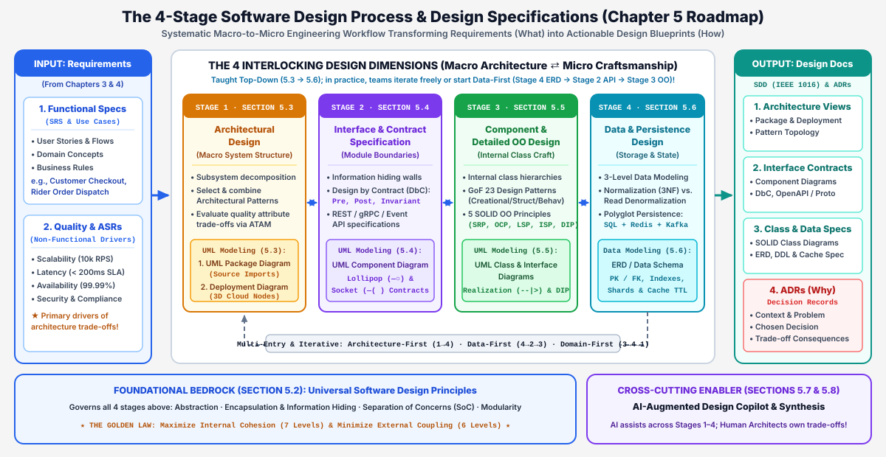

<!--
Examine this master diagram on Slide 6, which defines the 4-Stage Software Design Process and serves as the exact structural backbone of Chapter 5!

On the left, the design process takes two inputs from Requirements Engineering: Functional Specifications (SRS & Use Cases) and Non-Functional Quality Drivers (Architecturally Significant Requirements, or ASRs).

In the center, software design progresses iteratively from Macro to Micro across four stages—each paired with its dedicated UML or Data diagram:
1. Stage 1 (Section 5.3) is Architectural Design: decomposing subsystems, synthesizing architectural patterns, evaluating ATAM trade-offs, and modeling macro-structure with UML Package Diagrams and Deployment Diagrams.
2. Stage 2 (Section 5.4) is Interface & Contract Specification: establishing information-hiding boundaries, specifying formal contracts via Design by Contract (DbC), and wiring plug-and-play interfaces with UML Component Diagrams.
3. Stage 3 (Section 5.5) is Component & Detailed OO Design: designing internal class hierarchies using GoF Design Patterns, the 5 SOLID principles, and UML Class Diagrams.
4. Stage 4 (Section 5.6) is Data & Persistence Design: transforming domain entities into 3NF Relational ERDs, Redis Geo-caches, and Kafka event streams.

Notice the dark foundation bar at the bottom: Section 5.2 (Universal Design Principles: High Cohesion & Low Coupling) underpins all four stages! And on the right, the process outputs a complete Software Design Document (SDD — IEEE 1016) and Architecture Decision Records (ADRs).

To summarize this slide, remember this key takeaway: The software design process progresses systematically across Architectural Design (5.3), Interface Specification (5.4), Detailed OO Design (5.5), and Data Design (5.6).
-->
---
## The 4 Design Stages & Deliverables (SDD & ADRs)

> **Chapter 5 Master Plan:** After mastering **Universal Design Principles (5.2)**, we follow the exact **4-Stage Design Process (5.3 → 5.6)** and pair each stage with its canonical **UML Diagram**.

### The 4 Iterative Design Stages & UML Models
1. **Stage 1 — Architectural Design (Sec 5.3)**:
   - Synthesize patterns (Layered, Microservices), run ATAM, and model **UML Package & Deployment Diagrams**.
2. **Stage 2 — Interface & Contract Spec (Sec 5.4)**:
   - Specify **Design by Contract (DbC)** (`Pre`, `Post`, `Invariant`) and wire **UML Component Diagrams** (`—○` / `—(`).
3. **Stage 3 — Component & OO Design (Sec 5.5)**:
   - Apply GoF 23 Patterns & **5 SOLID Principles** modeled via **UML Class & Interface Diagrams**.
4. **Stage 4 — Data & Persistence Design (Sec 5.6)**:
   - Design 3-level **UML ERD Schemas**, 3NF tables, Redis spatial caches, and polyglot persistence.

### Design Deliverables (SDD & ADRs)
- **Software Design Document (SDD — IEEE 1016)**:
  - **Enables Parallel Engineering**: Frontend, Backend, DBAs, and QA build and write tests simultaneously against locked specs.
  - **Contents**: Package/Deployment views, Component API contracts (OpenAPI/Protobuf), Class models & DDL schemas.
- **Architecture Decision Records (ADRs — Michael Nygard)**:
  - Lightweight, Git-versioned records (`Title`, `Status`, `Context`, `Decision`, `Consequences`) capturing **why** key trade-offs were chosen—preventing costly *"Architectural Archaeology"*!

<!--
Let's unpack how the four design stages on the left and the design deliverables on the right work together in real-world engineering.

In the left card, see how each stage answers a distinct engineering question and uses a dedicated diagram:
Stage 1 (Section 5.3) asks: What is our macro system topology, how are source packages organized (UML Package Diagram), and how are binaries deployed to cloud nodes (UML Deployment Diagram)?
Stage 2 (Section 5.4) asks: How do modular components interact across boundaries via formal contracts (Design by Contract & UML Component Diagram)?
Stage 3 (Section 5.5) asks: How are classes structured inside a component to remain extensible and testable (GoF, SOLID & UML Class Diagram)?
Stage 4 (Section 5.6) asks: How is domain state modeled, indexed, cached, and persisted (UML ERD & Polyglot Storage)?

In the right card, all four stages crystallize into the Software Design Document (SDD) and Architecture Decision Records (ADRs)—documenting not only *what* the blueprint is, but *why* critical trade-offs were made!

To summarize this slide, remember this key takeaway: Following a structured 4-stage design process produces complete SDD blueprints and ADRs that empower parallel development and long-term maintainability.
-->

---
<!-- _class: lead -->
<!-- header: '5.2 Universal Design Principles' -->

# **5.2 Universal Software Design Principles**

> "Good design is easily changeable; poor design resists change at every step."  
> — *Dave Thomas (The Pragmatic Programmer)*

<!--
Welcome to Section 5.2: Universal Software Design Principles.

Regardless of whether you are architecting a multi-region cloud platform across Kubernetes clusters or writing a 20-line utility function inside a single Java class, the laws of software physics remain identical.

In this section, we study the foundational building blocks of all software design: Modularity, Abstraction, Encapsulation, Separation of Concerns, and the supreme golden rule of software engineering: High Cohesion and Low Coupling.

To summarize this slide, remember this key takeaway: Universal design principles govern software quality fractally across every scale of abstraction.
-->
---
## Universal Principles: Fractal Across Every Scale

* **Software Design is Fractal:**
  - The same fundamental principles govern software quality regardless of zoom level:
    - **System Scale (Macro)**: Microservices partition business domains into decoupled, cohesive services.
    - **Module Scale (Meso)**: Packages and libraries isolate responsibilities behind public API boundaries.
    - **Class Scale (Micro)**: Individual classes encapsulate state and maintain a single, cohesive reason to change.
* **Core Tenets Guard Against Complexity:**
  - Computer memory is vast, but human working memory is strictly limited (Miller's Law: 7 ± 2 chunks).
  - Software principles are cognitive tools designed to keep software understandable, testable, and modifiable by human engineering teams.

<!--
Why are software design principles called 'universal'?

Because software design is fractal. When you look at an entire cloud enterprise, you see services communicating through APIs. When you zoom into one microservice, you see packages communicating through interfaces. When you zoom into one package, you see classes communicating through methods.

At every single level of zoom, the exact same rules apply: keep things focused, keep them decoupled, hide internal complexity, and separate concerns.

To summarize this slide, remember this key takeaway: Universal design principles operate fractally across systems, packages, and classes to keep software systems humanly manageable.
-->
---
## Core Design Tenets: Modularity, Abstraction & SoC

* **1. Abstraction — *[Cognitive View: "What It Does"]*:**
  - Distills complex reality into clean, high-level public contracts (`interface`) while ignoring irrelevant details, reducing developer mental load.
* **2. Encapsulation & Information Hiding — *[Protective Boundary: "How State Is Guarded"]*:**
  - *David Parnas's Principle:* Bundles state and behavior inside a capsule while locking away `private` secrets to prevent external state corruption.
* **3. Separation of Concerns (SoC) — *[Logical Dimension: "Orthogonal Aspects"]*:**
  - Separates distinct problem domains or roles (e.g., UI presentation vs. business rules vs. SQL persistence vs. logging) so concerns never tangle.
* **4. Modularity — *[Structural Packaging: "Swappable Building Blocks"]*:**
  - Physically organizes software into discrete, self-contained units (packages, libraries, microservices) that compile, test, and deploy independently.

<!--
These four principles form the bedrock of clean software engineering:

Abstraction lets you call map.insert without worrying whether it uses a red-black tree or a hash table.
Encapsulation uses private modifiers to guard internal object invariants.
Separation of Concerns ensures that UI code never constructs raw SQL queries.
And Modularity allows dozens of engineers to develop in parallel without blocking each other.

To summarize this slide, remember this key takeaway: Abstraction, encapsulation, separation of concerns, and modularity protect integrity and prevent developer cognitive overload.
-->
---
## The Golden Rule: High Cohesion & Low Coupling

* **Cohesion :**
  - Measures how tightly focused and related the internal responsibilities of a single class or module are.
  - **Engineering Goal:** **High Cohesion** (A module should do one thing, and do it exceptionally well).
* **Coupling :**
  - Measures the strength of direct interdependencies between separate modules.
  - **Engineering Goal:** **Low Coupling** (Modules communicate via abstract contracts, remaining ignorant of internal implementation details).
* **The Universal Golden Rule:**
  > **Maximize Cohesion, Minimize Coupling!**  
  > High cohesion makes modules understandable and maintainable; low coupling prevents modifications from causing cascading system ripple effects.

<!--
If you could remember only one rule from this entire lecture, make it this: Maximize Cohesion, Minimize Coupling!

Cohesion measures internal focus: Does this class handle one clear task, or does it process orders, send emails, and generate PDFs simultaneously? We strive for High Cohesion.

Coupling measures external entanglement: If I modify Class A, do ten unrelated files break? We strive for Low Coupling.

High cohesion paired with low coupling is the secret to building software that remains testable and maintainable across decades.

To summarize this slide, remember this key takeaway: High cohesion ensures focused internal responsibilities, while low coupling eliminates dangerous cascading change dependencies.
-->
---
## Cohesion & Coupling: Bad vs. Good Design (UML Comparison)

  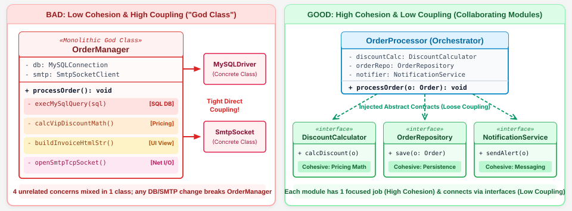

* **Bad Design (`OrderManager`)**: Cramming SQL, pricing math, HTML rendering, and SMTP sockets into one class yields **Coincidental Cohesion** and **Tight Concrete Coupling**.
* **Good Design (`OrderProcessor`)**: Delegating to focused collaborators via injected interfaces achieves **Functional Cohesion** and **Loose Abstract Coupling**.

<!--
Examine this concrete Java code comparison:

In the bad design above, OrderManager is an infamous 'God Class': a single method contains raw SQL, business math, HTML templating, and raw TCP networking! If your email server changes protocols, you must modify your checkout order class!

In the good design below, OrderProcessor has one single, cohesive responsibility: workflow orchestration. It delegates math to DiscountCalculator, persistence to OrderRepository, and alerts to NotificationService. Each collaborator is independently testable and swappable.

To summarize this slide, remember this key takeaway: Decomposing bloated monolithic classes into focused, collaborating services exemplifies high cohesion and low coupling.
-->
---
<!-- _class: title-image-slide -->

## Visual Spectrum: The 7 Levels of Cohesion (Strong to Weak)

  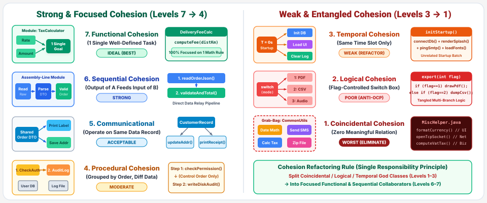

<!--
Before examining the detailed reference table, let's visualize the entire 7-level spectrum of Cohesion side by side.

On the left in green and blue are the strong, focused cohesion levels: Level 7 Functional Cohesion, where every element inside a module converges on one single well-defined task; Level 6 Sequential Cohesion, where output from one step feeds directly into the next like an assembly line; Level 5 Communicational Cohesion, where operations share the same input or output record; and Level 4 Procedural Cohesion, where steps follow a control sequence across different data stores.

On the right in orange and red are the weak, entangled anti-patterns: Level 3 Temporal Cohesion, grouping unrelated tasks simply because they run at startup; Level 2 Logical Cohesion, stuffing multiple modes behind a switch flag; and Level 1 Coincidental Cohesion, the infamous CommonUtils grab-bag with zero meaningful relationship.

To summarize this slide, remember this key takeaway: Always design modules toward the top-left of this map—Functional and Sequential Cohesion—and refactor away flag-driven or grab-bag classes on the right.
-->
---
## Levels and Types of Cohesion: From Weak to Strong

- **Cohesion Spectrum (Yourdon & Constantine):** How strongly focused a single module's internal elements are:

| Level | Cohesion Type | Core Characteristics | Real-World Example | Quality |
| :--- | :--- | :--- | :--- | :--- |
| **7** | **Functional** | Performs one single, well-defined domain or math task | `computeSalesTax()`, `sin(x)` | **Ideal (Best)** |
| **6** | **Sequential** | Output of one step serves directly as input to the next | `read() → parse() → validate()` | **Strong** |
| **5** | **Communicational** | Operations share the same input or output data structure | `updateAddr()` & `printLabel()` | **Acceptable** |
| **4** | **Procedural** | Grouped by execution order, operating on different data | `checkAuth()` then `auditLog()` | **Moderate** |
| **3** | **Temporal** | Grouped purely because they execute at the same time | `initStartup()`, `closeAll()` | **Weak (Avoid)** |
| **2** | **Logical** | Similar tasks selected via an external control flag | `export(int mode)` (PDF/CSV) | **Weak (Avoid)** |
| **1** | **Coincidental** | Unrelated catch-all tasks with no meaningful relationship | `CommonUtils`, `MiscHelper` | **Worst** |

<!--
Let's analyze the classic 7 levels of Cohesion established by Larry Constantine and Edward Yourdon.

At the very top is Functional Cohesion—the gold standard of software design. Every line of code inside the class or method contributes to accomplishing one single, well-defined mathematical or domain operation.

Sequential Cohesion is also strong: operations form an assembly line where Step A feeds into Step B.

Communicational and Procedural represent intermediate levels where activities share data or execution order.

At the bottom are the anti-patterns: Temporal cohesion groups tasks just because they happen at startup; Logical cohesion creates bloated switch-case methods controlled by flags; and Coincidental cohesion is the infamous 'Utils' class dumping ground with no meaningful relationship.

To summarize this slide, remember this key takeaway: Strive for Functional and Sequential cohesion, and refactor away temporal, logical, and coincidental groupings.
-->
---
<!-- _class: title-image-slide -->

## Visual Spectrum: The 6 Levels of Coupling (Loose to Tight)

  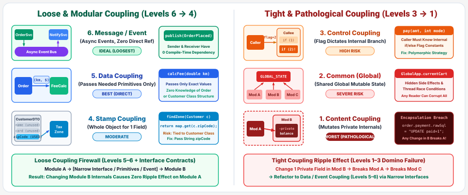

<!--
Now let's visualize the 6-level spectrum of Coupling across modules.

On the left side are the desirable, loosely coupled mechanisms: Level 6 Message and Event Coupling decouples sender and receiver completely via an asynchronous event bus with zero compile-time dependency; Level 5 Data Coupling passes only the exact primitive parameters needed; and Level 4 Stamp Coupling passes a composite data structure when only one field like zipCode is read.

On the right side are the dangerous, tightly coupled anti-patterns: Level 3 Control Coupling passes a flag that forces the caller to know the callee's internal if-else branches; Level 2 Common Coupling binds multiple modules to a shared global mutable state; and Level 1 Content Coupling pierces encapsulation to mutate another module's private fields directly.

To summarize this slide, remember this key takeaway: Loose coupling acts as an architectural firewall that stops change ripple effects, whereas tight coupling turns small edits into system-wide domino failures.
-->
---
## Levels and Types of Coupling: From Tight to Loose

- **Coupling Spectrum:** Measures the degree of direct interconnections and dependencies between separate modules:

| Level | Coupling Type | Coupling Mechanism & Risk | Real-World Example | Quality |
| :--- | :--- | :--- | :--- | :--- |
| **1** | **Content (Pathological)**| Reaches directly into private fields/branches of another | Modifying a `private` field via reflection | **Worst (Severe)** |
| **2** | **Common (Global)** | Multiple modules read/write shared global mutable state | Sharing mutable global flags across threads | **High Risk** |
| **3** | **Control** | Caller dictates callee's internal execution flow via flags | Passing `mode = 3` to select internal branch | **Moderate Risk** |
| **4** | **Stamp (Data-Struct)** | Passes a whole composite object when only 1 field is needed | Passing entire `Customer` to read `zipCode` | **Acceptable** |
| **5** | **Data** | Communicates exclusively via needed primitive parameters | `calculateArea(width, height)` | **Best (Direct)** |
| **6** | **Message / Event** | Communicates asynchronously via events with zero reference | Publishing `OrderPlacedEvent` via EventBus | **Ideal (Loosest)** |

<!--
Now let's examine the classic hierarchy of Coupling, ordered from the most dangerous and tightly coupled to the cleanest and most decoupled.

At the worst extreme is Content Coupling, where Module A bypasses encapsulation and alters Module B's private internals. A change to B immediately shatters A.

Common Coupling occurs when modules communicate through global mutable variables—a notorious source of race conditions and hidden side-effects.

Control Coupling happens when you pass boolean or integer flags to dictate how the callee behaves internally.

Stamp Coupling occurs when you pass a huge composite object, like passing a 50-field Employee record to a tax function that only needs gross income.

Data Coupling is the gold standard for direct function calls: passing only primitive, elementary parameters.

And Message or Event Coupling decouples modules entirely across time and space using asynchronous message brokers.

To summarize this slide, remember this key takeaway: Eliminate content and common coupling, minimize control coupling, and aim for data and event-driven decoupling.
-->
---
### Concept Check Question 1 (CCQ 1)
<!-- id: ase-ch05-ccq1 -->

  

In software system design, what is the primary practical benefit of combining **High Cohesion** with **Low Coupling**?

- **A.** Maximizes raw CPU execution speed by inlining all helper methods into one monolithic binary executable.
- **B.** Isolates internal class changes behind clean boundaries so modifications cause minimal ripple effects.
- **C.** Mandates storing all shared domain data structures inside a single globally mutable memory namespace.
- **D.** Eliminates the need to run automated integration test suites or continuous regression checks in CI/CD.

  

  

    
  

<!--
Let's check our understanding of cohesion and coupling.

The question asks: What is the primary practical benefit of combining High Cohesion with Low Coupling?

Evaluating options:
Option A, inlining code for raw CPU speed, is a compiler optimization that destroys modularity.
Option C, global variables, is the textbook definition of poor design!
Option D, eliminating tests, is unrealistic wishful thinking.

The correct answer is B! High cohesion keeps classes focused, while low coupling ensures clear boundaries—so modifications in one class cause minimal ripple effects elsewhere.

To summarize this slide, remember this key takeaway: High cohesion and low coupling strictly limit the blast radius of code changes, ensuring long-term maintainability.
-->
---
<!-- _class: lead -->
<!-- header: '5.3 Architectural Design: Patterns & UML' -->

# **5.3 Stage 1 — Architectural Design: Patterns, Trade-offs & Macro UML**

> "There are no solutions, only trade-offs."  
> — *Thomas Sowell*

<!--
Welcome to Section 5.3: Stage 1 of our Software Design Process—Architectural Design: Patterns, Trade-offs & Macro UML.

Now that we have established the 4-stage design process in 5.1 and universal principles in 5.2, we enter Stage 1: Macro Architectural Design.

In this section, we first explore the six foundational Architectural Patterns (MVC, Layered, Repository, Client-Server, Pipe & Filter, and Microservices), see how they combine inside our Food Delivery Platform, and evaluate quality trade-offs via ATAM. Then, we learn how to formally model this macro-architecture using two dedicated UML diagrams: the **UML Package Diagram** (compile-time module structure) and the **UML Deployment Diagram** (runtime cloud topology).

To summarize this slide, remember this key takeaway: Stage 1 Architectural Design selects and synthesizes structural patterns, evaluates trade-offs via ATAM, and models macro-topology using UML Package and Deployment diagrams.
-->
---
## What is Software Architecture?

* **Formal Definition (IEEE 1471 / ISO 42010):**
  > Software architecture is the fundamental organization of a system embodied in its components, their relationships to each other and the environment, and the principles guiding its design and evolution.
* **The Bridge Role of Architecture:**
  - **Requirements (What)**: Stakeholder needs, user stories, and constraints.
  - **Implementation (How)**: Source code, data schemas, and unit tests.
  - **Architecture (The Bridge)**: Transforms messy requirements into structured sub-systems, communication boundaries, and deployment topology.
* **Architecture in the Small vs. in the Large:**
  - **In the Small**: Internal design of individual applications (classes, modules, local interfaces).
  - **In the Large**: Enterprise-scale structures (distributed services, cloud platforms, event buses, multi-tier databases).

<!--
What is Software Architecture?

Software architecture is the fundamental organization of a system embodied in its components, their relationships to each other and the environment, and the principles guiding its design and evolution.

Notice its bridge role: Requirements engineering tells us what needs to be built. Coding is how individual lines are written. Architecture is the bridge in between—it determines the principal structural modules, the data persistence strategy, and the network communication protocols.

Because architectural decisions are the hardest and most expensive to change later, getting the architecture right early is vital to project success.

To summarize this slide, remember this key takeaway: Software architecture bridges requirements and code by establishing high-level component structures and communication boundaries.
-->
---
## What is an Architectural Pattern?

* **Definition of Architectural Patterns:**
  - An architectural pattern is a **reusable, established solution to a commonly occurring structural problem** in software system design.
  - While design patterns (e.g., Factory, Strategy) operate at the class level, architectural patterns govern the **entire macro-system topology**.
* **Three Key Elements of an Architectural Pattern:**
  - **1. Context**: The recurring design situation and engineering environment.
  - **2. Problem & Forces**: Competing requirements (e.g., decoupling UI from business logic vs. minimizing latency).
  - **3. Solution & Consequences**: Structural partitioning, communication topology, and resulting trade-offs.
* **Why Patterns Matter:**
  - Establishes a shared architectural vocabulary across engineering teams.
  - Codifies decades of engineering experience, avoiding recurring structural failures.

<!--
What is an Architectural Pattern?

An architectural pattern is a stylized, proven description of good design practice that has been tested in different environments.

Notice that a pattern is not code; it is a structural archetype. When an architect specifies 'Layered Architecture with Repository', every engineer immediately understands the component boundaries and communication pipelines.

Patterns encapsulate proven structural wisdom, establishing shared vocabulary and predictable trade-offs.

To summarize this slide, remember this key takeaway: Architectural patterns encapsulate proven structural wisdom, establishing shared vocabulary and predictable trade-offs.
-->
---
<!-- _class: title-image-slide -->

## Visual Roadmap: The 6 Architectural Patterns in 5.3

  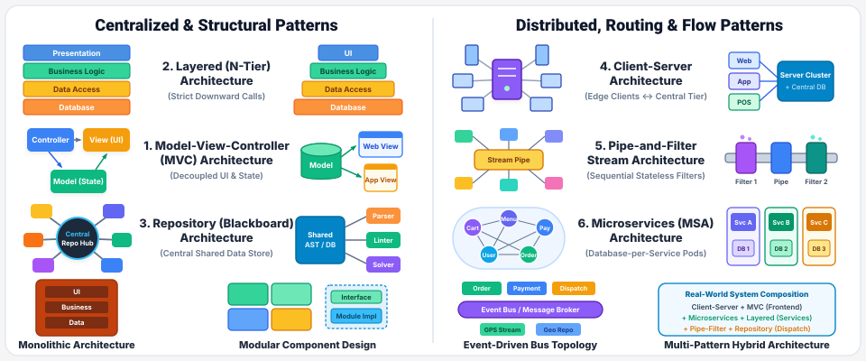

<!--
Before diving into each pattern individually, examine this visual roadmap of Section 5.3.

Notice how our six architectural patterns divide into two major families:
On the left are Centralized & Structural Patterns:
1. Model-View-Controller (MVC) decoupling UI presentation from state;
2. Layered (N-Tier) Architecture enforcing strict downward abstraction boundaries;
3. Repository (Blackboard) Architecture coordinating tools around a central data hub;
along with the classic Monolithic vs. Modular Component baseline at the bottom.

On the right are Distributed, Routing & Flow Patterns:
4. Client-Server Architecture connecting edge devices to centralized servers;
5. Pipe-and-Filter Stream Architecture chaining stateless transformations;
6. Microservices Architecture partitioning systems into autonomous pods with private databases;
culminating in Event-Driven buses and Multi-Pattern Hybrid Composition at the bottom!

To summarize this slide, remember this key takeaway: Architectural patterns span centralized structural organization and distributed network/data-flow topologies.
-->
---
## Architectural Patterns: Comprehensive Overview Matrix

| Pattern Name | Visual Topology | Core Mechanism | Best Used For | Primary Risk & Trade-off |
| :--- | :--- | :--- | :--- | :--- |
| **1. MVC** | Triangular Cycle (`C → M → V`) | Separates UI presentation from data models | Interactive Web / mobile apps with rich UIs | Overkill for simple data display (CRUD) |
| **2. Layered** | Vertical Stack (`N → N-1`) | Strict hierarchy with one-way downward calls | Enterprise information systems & CRUD apps | Performance overhead; sinkhole anti-pattern |
| **3. Repository** | Hub-and-Spoke Central Store | Passive central data store with active agents | Compilers, IDEs, and shared data analysis | Central DB bottleneck & single point of failure |
| **4. Client-Server**| Distributed Network (`C ↔ S`) | Clients request services from central servers | Web apps, file servers, centralized services | Network latency & server overloading |
| **5. Pipe-Filter** | Linear Sequential Stream | Discrete transform filters connected via pipes | Data processing, compilers, ETL pipelines | Inefficient for interactive systems; parsing cost |
| **6. Microservices**| Decentralized Mesh (`S ↔ S`) | Independently deployable domain services | Large-scale, rapidly evolving cloud platforms | High operational, network & transactional complexity |

<!--
Examine this comprehensive Architectural Patterns Matrix.

This matrix catalogs the visual icon, core mechanism, sweet-spot application, and primary architectural risk of six foundational patterns:
MVC decouples UI and data models via circular flows;
Layered establishes strict vertical abstraction boundaries;
Repository enables passive component collaboration via a central store;
Client-Server distributes computation over computer networks;
Pipe & Filter connects discrete transformations through sequential data streams;
Microservices partitions systems into independently deployable domain services.

To summarize this slide, remember this key takeaway: The Architectural Patterns Matrix provides an archetypal reference guide for evaluating structural mechanisms and trade-offs.
-->
---
<!-- _class: title-image-slide -->

## 1. Model-View-Controller (MVC) Pattern — Visual Topology

  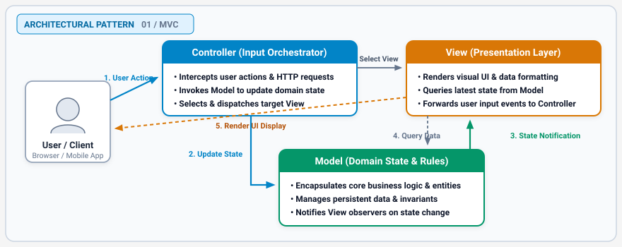

<!--
Let's examine the visual topology of Pattern 1: Model-View-Controller (MVC).

Follow the numbered triangular interaction cycle in the diagram:
Step 1: The User sends an action or HTTP request to the Controller.
Step 2: The Controller translates that input into domain operations and updates the Model.
Step 3: The Model notifies registered View observers that state has changed.
Step 4: The View queries the updated state from the Model.
Step 5: The View renders the updated UI display back to the User.

To summarize this slide, remember this key takeaway: MVC decouples user interface rendering from domain state through a triangular Controller-Model-View interaction flow.
-->
---
## 1. Model-View-Controller (MVC): Responsibilities & Trade-offs

* **Core Structural Responsibilities:**
  - **Model**: Encapsulates core business data, validation rules, and authoritative domain state; remains completely ignorant of UI presentation.
  - **View**: Renders visual representations (HTML, mobile screens, charts) to users and listens for Model state change notifications.
  - **Controller**: Intercepts user inputs and HTTP requests, orchestrates business workflows, updates the Model, and selects the target View.
* **When Used & Real-World Scenarios:**
  - Interactive Web and mobile applications where the same underlying data must be presented in multiple visual formats (e.g., dashboard tables, charts, and mobile views).
* **Engineering Advantages & Trade-offs:**
  - **Strengths**: Clean separation of concerns; UI designers and backend engineers can evolve presentation and business logic in parallel.
  - **Weaknesses**: Introduces extra indirection and boilerplate for simple CRUD screens; tight coupling arises if Views bypass Controllers to mutate state.

<!--
Now let's review the architectural responsibilities and trade-offs of MVC.

By separating the Model, View, and Controller, frontend engineers can completely redesign the visual user interface without touching a single line of backend business calculation logic.

Moreover, multiple Views—such as a web dashboard and a mobile view—can share the exact same underlying Model.

However, for trivial data-entry screens, full MVC can add unnecessary indirection, and teams must guard against stuffing business logic into Controllers or Views.

To summarize this slide, remember this key takeaway: MVC enables independent UI and domain evolution, trading minor structural indirection for high presentation flexibility.
-->
---
<!-- _class: title-image-slide -->

## 2. Layered Architecture Pattern — Visual Topology

  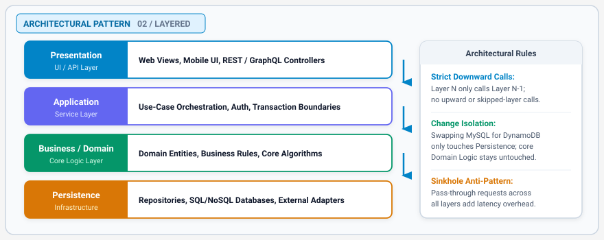

<!--
Let's examine the visual topology of Pattern 2: Layered Architecture.

Look at the four horizontal tiers stacked from top to bottom:
Presentation Layer at the top for Web views, mobile UIs, and REST controllers;
Application / Service Layer for use-case orchestration and transaction boundaries;
Business / Domain Layer for core entities and business rules;
and Persistence / Infrastructure Layer at the bottom for repositories and SQL/NoSQL databases.

Notice the downward arrows on the right: each layer only invokes the layer immediately below it.

To summarize this slide, remember this key takeaway: Layered architecture organizes software into a strict vertical hierarchy of downward-only dependencies.
-->
---
## 2. Layered Architecture: Responsibilities & Trade-offs

* **Core Structural Responsibilities:**
  - Organizes the system into horizontal abstraction tiers: **Presentation → Application/Service → Business/Domain → Persistence**.
  - **Strict Layering Rule**: Each layer depends solely on the layer immediately below it (`Layer N → Layer N-1`), forbidding upward or skipped-layer calls.
* **When Used & Real-World Scenarios:**
  - Standard enterprise information systems, e-commerce backends, and banking applications requiring clear team boundaries and multi-level security isolation.
* **Engineering Advantages & Trade-offs:**
  - **Strengths**: High modularity and change isolation—swapping MySQL for DynamoDB in the Persistence layer leaves core Business Logic completely untouched.
  - **Weaknesses**: Susceptible to the **"Architecture Sinkhole Anti-Pattern"**, where requests merely pass through multiple layers without processing, adding latency and object-mapping overhead.

<!--
Let's analyze the responsibilities and trade-offs of Layered Architecture.

Layered architecture is the workhorse of enterprise software because its boundaries are intuitive and align naturally with engineering roles: UI engineers, backend domain developers, and database administrators.

Its greatest advantage is change isolation: replacing a database engine or web framework only impacts a single layer.

However, architects must watch out for the Architecture Sinkhole anti-pattern, where 80 percent of requests simply pass straight through four layers without any business logic, paying a runtime tax for every layer hop.

To summarize this slide, remember this key takeaway: Layered architecture isolates technology changes across vertical tiers, but must avoid wasteful pass-through sinkholes.
-->
---
<!-- _class: title-image-slide -->

## 3. Repository Architecture Pattern — Visual Topology

  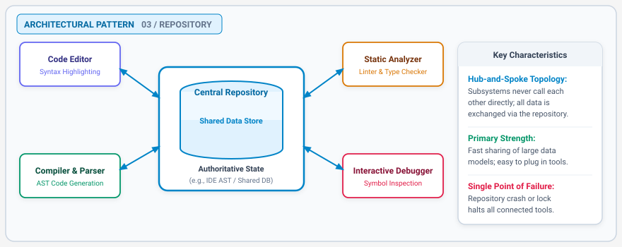

<!--
Let's examine the visual topology of Pattern 3: Repository Architecture.

Notice the hub-and-spoke structure in the diagram:
At the center sits the Central Repository holding authoritative shared state, such as an Abstract Syntax Tree (AST) in an IDE or a central enterprise database.
Surrounding it are independent active subsystems—Code Editor, Compiler, Static Analyzer, and Debugger.

None of these tools call each other directly; all coordination occurs by reading and writing to the central repository.

To summarize this slide, remember this key takeaway: Repository architecture decouples independent tools by routing all state sharing through a central data hub.
-->
---
## 3. Repository Architecture: Responsibilities & Trade-offs

* **Core Structural Responsibilities:**
  - **Central Repository**: A passive, authoritative data store maintaining all shared persistent state and schema invariants.
  - **Active Subsystems**: Independent tools or processing agents that never call each other directly, interacting exclusively through the central store.
* **When Used & Real-World Scenarios:**
  - Data-intensive environments where multiple specialized tools process the same complex data representation: **IDEs, compilers (shared AST), CAD systems, and AI Blackboard systems**.
* **Engineering Advantages & Trade-offs:**
  - **Strengths**: Eliminates direct inter-tool coupling; new analysis tools can be plugged into the repository effortlessly without modifying existing subsystems.
  - **Weaknesses**: The central repository is a **Single Point of Failure (SPOF)** and a major contention bottleneck under heavy concurrent writes; schema evolution affects all connected tools.

<!--
Let's examine the responsibilities and trade-offs of Repository Architecture.

In an IDE like VS Code or IntelliJ, dozens of tools—syntax highlighting, type checking, refactoring, and debugging—all need access to your code's Abstract Syntax Tree. Instead of copying gigabytes of data between tools, they share a single central repository.

This makes adding new plugins effortless.

However, the trade-off is clear: if the central repository crashes or locks up, every single connected subsystem halts, and changing the central data schema impacts all tools.

To summarize this slide, remember this key takeaway: Repository architecture enables efficient large-scale data sharing among decoupled tools, at the cost of a central bottleneck and single point of failure.
-->
---
<!-- _class: title-image-slide -->

## 4. Client-Server Architecture Pattern — Visual Topology

  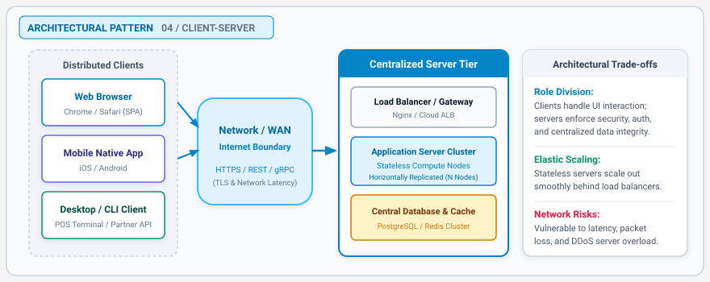

<!--
Let's examine the visual topology of Pattern 4: Client-Server Architecture.

On the left, diverse distributed clients—Web Browsers, Mobile Native Apps, and Desktop/POS terminals—initiate requests.
In the center, requests traverse the Internet/WAN boundary over HTTPS, REST, or gRPC.
On the right, the centralized server tier receives traffic through a Load Balancer, distributes work across stateless application servers, and persists data in a central database and cache cluster.

To summarize this slide, remember this key takeaway: Client-server architecture separates distributed edge clients from centralized compute and storage servers across a network boundary.
-->
---
## 4. Client-Server Architecture: Responsibilities & Trade-offs

* **Core Structural Responsibilities:**
  - **Client Tier**: Distributed consumer nodes responsible for user interaction, local rendering, and initiating network service requests.
  - **Server Tier**: Centralized provider nodes enforcing authentication, business rules, concurrent access control, and persistent data storage.
* **When Used & Real-World Scenarios:**
  - Web applications, mobile banking, multiplayer online services, and enterprise systems where shared data must be accessed securely from diverse locations.
* **Engineering Advantages & Trade-offs:**
  - **Strengths**: Centralizes security governance, data backups, and server-side upgrades; stateless application servers can scale horizontally behind load balancers.
  - **Weaknesses**: Vulnerable to network latency, packet loss, and connection drops; centralized server endpoints face DDoS and traffic-surge overload risks.

<!--
Let's analyze the responsibilities and trade-offs of Client-Server Architecture.

By keeping sensitive data and core business logic on centralized servers while pushing presentation to edge clients, organizations maintain strict control over security, authentication, and data integrity.

Furthermore, stateless application servers can be replicated horizontally behind a load balancer to handle variable traffic loads.

On the downside, every interaction crosses an unreliable network boundary, requiring architects to design for latency, retries, caching, and DDoS mitigation.

To summarize this slide, remember this key takeaway: Client-server architecture centralizes security and data governance while requiring resilience against network latency and server overload.
-->
---
<!-- _class: title-image-slide -->

## 5. Pipe-and-Filter Architecture Pattern — Visual Topology

  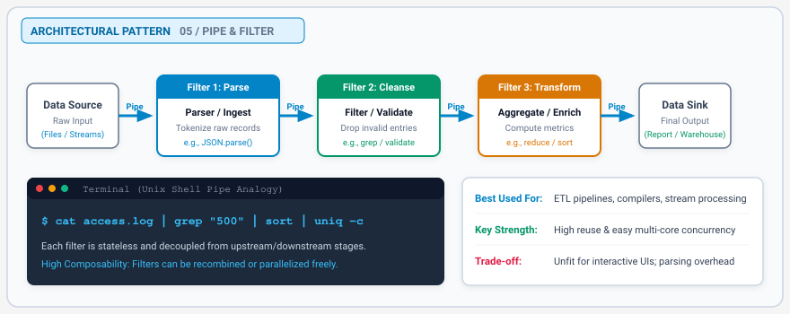

<!--
Let's examine the visual topology of Pattern 5: Pipe-and-Filter Architecture.

Follow the linear data stream across the top of the diagram:
Raw data leaves the Data Source and flows through Pipe 1 into Filter 1 (Parse/Ingest).
The parsed records flow through Pipe 2 into Filter 2 (Cleanse/Validate), then through Pipe 3 into Filter 3 (Transform/Aggregate), and finally arrive at the Data Sink.

At the bottom, notice the classic Unix shell pipe analogy: cat, grep, sort, and uniq chained together seamlessly.

To summarize this slide, remember this key takeaway: Pipe-and-filter architecture processes data streams through a sequence of stateless, decoupled transformation stages.
-->
---
## 5. Pipe-and-Filter Architecture: Responsibilities & Trade-offs

* **Core Structural Responsibilities:**
  - **Filters**: Independent, stateless transformation units that consume an input stream, apply a single focused transformation, and emit an output stream.
  - **Pipes**: Unidirectional connectors that buffer and transport data streams between adjacent filters without the filters knowing each other's identity.
* **When Used & Real-World Scenarios:**
  - Multi-stage data processing pipelines: **Unix shell pipelines (`cat | grep | sort`), compiler front-ends, audio/video media encoding, and Big Data ETL workflows**.
* **Engineering Advantages & Trade-offs:**
  - **Strengths**: Exceptional composability and reuse—filters can be reordered, added, or executed concurrently across CPU cores.
  - **Weaknesses**: Ill-suited for interactive event-driven GUIs; incurs data parsing/serialization overhead at every pipe boundary and requires a common stream format.

<!--
Let's review the responsibilities and trade-offs of Pipe-and-Filter Architecture.

Because each filter is completely stateless and ignorant of what comes before or after it, filters achieve high functional cohesion and minimal coupling. You can reorder filters, reuse them in new pipelines, or run each filter on a separate thread Pool.

However, pipe-and-filter is a poor fit for interactive user interfaces that require bidirectional state updates, and parsing or serializing data at every pipe stage can introduce runtime overhead.

To summarize this slide, remember this key takeaway: Pipe-and-filter excels at composable, parallelizable batch and stream transformations, but is unsuitable for interactive UIs.
-->
---
<!-- _class: title-image-slide -->

## 6. Microservices Architecture Pattern (MSA) — Visual Topology

  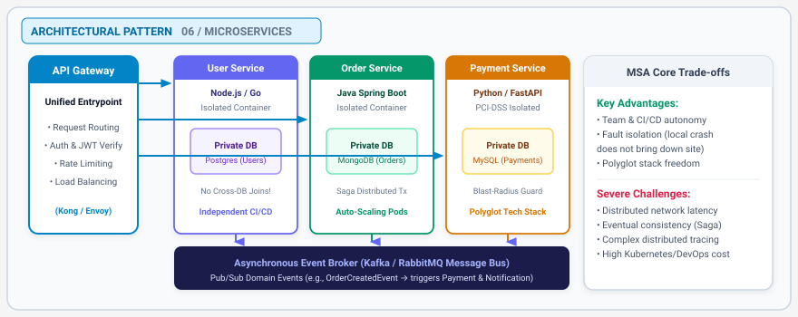

<!--
Let's examine the visual topology of Pattern 6: Microservices Architecture (MSA).

On the left, client traffic enters through a unified API Gateway handling routing, JWT authentication, and rate limiting.
In the center, the system is decomposed into autonomous domain pods: User Service (Node.js + Postgres), Order Service (Spring Boot + MongoDB), and Payment Service (Python + MySQL).
Crucially, each service owns its private database—cross-service database joins are strictly forbidden!
At the bottom, services coordinate asynchronously via an Event Broker such as Kafka or RabbitMQ.

To summarize this slide, remember this key takeaway: Microservices decompose an enterprise system into independently deployable domain services, each encapsulating its own private database.
-->
---
## 6. Microservices Architecture (MSA): Responsibilities & Trade-offs

* **Core Structural Responsibilities:**
  - **Autonomous Domain Services**: Small, business-capability-aligned services running in isolated processes with independent CI/CD deployment pipelines.
  - **Database-per-Service**: Each microservice strictly encapsulates its own private database; inter-service communication occurs solely via APIs (REST/gRPC) or Event Brokers (Kafka).
* **When Used & Real-World Scenarios:**
  - Large-scale cloud platforms (e.g., Netflix, Uber, Amazon) with dozens of autonomous engineering teams requiring rapid, independent release cycles and elastic scaling per domain.
* **Engineering Advantages & Trade-offs:**
  - **Strengths**: Superior **fault isolation (blast-radius containment)**, independent scaling of bottleneck services, team autonomy, and polyglot technology freedom.
  - **Weaknesses**: High distributed systems complexity—network latency, eventual consistency (Saga transactions), distributed tracing, and heavy Kubernetes/DevOps operational cost.

<!--
Let's analyze the architectural responsibilities and trade-offs of Microservices Architecture.

Microservices solve two critical enterprise bottlenecks: blast-radius containment and organizational scaling. If Payment Service experiences a memory leak, the product catalog and search services remain completely operational. And 50 teams can deploy independently without merge conflicts.

However, microservices are never a free lunch: in-memory function calls become network RPCs that can fail or time out, ACID database transactions become complex multi-step Sagas, and DevOps complexity skyrockets.

To summarize this slide, remember this key takeaway: Microservices achieve high team autonomy and fault isolation at the expense of distributed network and transactional complexity.
-->
---
## Monolithic vs. Microservices: Deep Dive

| Comparison Dimension | Monolithic Architecture | Microservices Architecture |
| :--- | :--- | :--- |
| **Deployment Unit** | Single unified binary / WAR / container | Dozens/hundreds of independent containers |
| **Data Storage** | Single shared relational database | **Database-per-Service** (strict data encapsulation) |
| **Communication** | Fast in-memory function calls | Network RPC / REST / gRPC / Event Bus |
| **Fault Isolation** | **Poor**: Memory leak in Module A crashes entire app | **Superior**: Payment service crash leaves Browse active |
| **Team Scalability** | Merge conflicts; coordination bottlenecks | Independent feature teams deploying autonomously |
| **Operational Cost** | Simple (single CI/CD pipeline, standard logs) | High (Kubernetes, distributed tracing, service mesh) |
| **Architectural Sweet Spot** | Startups, MVP stage, small teams (<15 devs) | Large organizations (>50 devs), complex domains |

<!--
Compare Monolithic and Microservices architectures side-by-side.

In a Monolith, all code runs inside a single process sharing one database. Calling a function takes nanoseconds in memory, and deployments are simple. But if one module has a memory leak, the entire application crashes!

In Microservices, each service runs in an isolated container. A crash in Payment Service does not take down the product catalog! Teams can deploy five times a day independently.

However, do not underestimate operational complexity: you now need Kubernetes clusters, distributed tracing with OpenTelemetry, and eventual consistency handling.

To summarize this slide, remember this key takeaway: Microservices trade operational simplicity for team autonomy and fault isolation; start with a modular monolith unless organizational scale demands distribution.
-->
---
<!-- _class: title-image-slide -->

## Case Study: Food Delivery System — Multi-Pattern Topology

  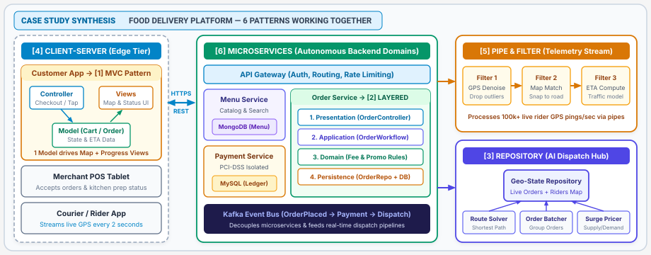

<!--
Now let's answer a crucial engineering question: Is a real-world system like UberEats or foodpanda built using just one single architectural pattern?

Look at this comprehensive architecture diagram of a Food Delivery Platform. The answer is an emphatic NO! Real-world systems combine all six architectural patterns across different zoom levels and specialized subsystems:

On the left edge, Client-Server connects Customer, Merchant, and Rider apps to the cloud, while MVC inside the Customer App drives both the live map and order status bar from one shared OrderModel.
In the center, the cloud backend is partitioned into autonomous Microservices, while zooming inside Order Service reveals a strict 4-tier Layered Architecture.
On the right, Pipe-and-Filter processes 100,000 live rider GPS streams per second, while the AI Dispatch Hub uses a Central Repository where route solvers, order batchers, and surge pricers collaborate around live city geo-state!

To summarize this slide, remember this key takeaway: Real-world software architectures synthesize multiple patterns fractally across system boundaries, services, and data pipelines.
-->
---
## Case Study Synthesis: 6 Patterns in a Food Delivery System

- **Multi-Pattern Composition:** Real systems combine patterns by **zoom level** and **problem domain**:

| Pattern | Food Delivery Subsystem / Zoom Level | Core Engineering Problem Solved |
| :--- | :--- | :--- |
| **1. MVC** | **Customer App & Merchant Portal UI** | One `OrderModel` simultaneously updates Live Map View & Progress Bar View |
| **2. Layered** | **Inside `Order Service` (`Controller → Domain → Repo`)** | Isolates delivery fee & promo pricing rules from PostgreSQL persistence |
| **3. Repository** | **AI Dispatch Blackboard (`Geo-State Store`)** | Route solver, order batcher & surge pricer share live city map state |
| **4. Client-Server** | **Customer / Merchant / Rider Apps ↔ Cloud** | Centralizes menu pricing, auth & payment verification on secure servers |
| **5. Pipe-Filter** | **Live Rider GPS Stream (`Denoise → Match → ETA`)** | Processes 100k+ GPS pings/sec through stateless, parallelizable stages |
| **6. Microservices** | **Backend Domains (`Menu`, `Order`, `Pay`, `Dispatch`)** | Scales GPS dispatch 20x during rainstorms; isolates promo crashes from checkout |

<!--
Examine this 6-pattern synthesis table for our Food Delivery Platform case study.

Notice how each pattern solves a distinct engineering force at its specific zoom level:
1. MVC operates inside the Customer App so that when an order status changes, both the map view and status bar refresh automatically.
2. Layered Architecture operates inside individual services like Order Service to keep fee calculation rules clean and database-agnostic.
3. Repository Architecture powers the AI Dispatch Engine, where route optimization, order batching, and surge pricing algorithms collaborate around one shared geospatial state store.
4. Client-Server governs the external boundary between mobile apps and cloud servers.
5. Pipe-and-Filter cleanses and map-matches continuous streams of rider GPS coordinates.
6. And Microservices partition the enterprise backend so peak-hour traffic or local failures never bring down checkout.

To summarize this slide, remember this key takeaway: Master architects do not pick a single pattern; they compose complementary patterns to satisfy diverse subsystem forces.
-->
---
## Architecture Directly Shapes Quality Attributes

* **Quality Attributes Cannot Be Retrofitted Later:**
  - You cannot build a tightly coupled monolith and hope a few unit tests will magically make it scalable.
* **How Architectural Decisions Determine Quality Attributes:**
  - ⚡ **Performance**: Dictated by network hops, in-memory caching layers, and database partitioning.
  - 🛡️ **Security**: Dictated by zero-trust network zones, API gateways, and isolation of sensitive databases.
  - 🦺 **Safety**: Dictated by structural isolation of safety-critical functions (e.g., flight control vs. in-flight entertainment).
  - 🔄 **Availability & Fault Tolerance**: Dictated by redundancy, health checks, circuit breakers, and automated failover replicas.
  - 🔧 **Maintainability & Modifiability**: Dictated by strict adherence to High Cohesion and Low Coupling boundaries.

<!--
Why is architecture the ultimate determinant of software quality?

Because non-functional quality attributes—performance, security, reliability, availability—cannot be patched on at the end of a project. They are emergent physical properties of the structural skeleton!

If you build an automotive software system and place the brake control logic on the same unisolated memory bus as the passenger media player, a media player crash can disable the brakes! Safety requires physical structural partitioning.

Similarly, high availability requires automated replica clusters, and maintainability requires low coupling.

To summarize this slide, remember this key takeaway: Non-functional quality attributes are direct physical consequences of architectural structures and cannot be retrofitted via patches.
-->
---
## Architectural Trade-off Analysis & ATAM

* **The Inevitable Conflict Matrix (No Silver Bullet):**
  - **Performance vs. Security**: Deep packet inspection, TLS, and fraud checks add latency.
  - **Availability vs. Consistency (CAP Theorem)**: Strict distributed locks block orders during network partitions.
  - **Modularity vs. Performance**: Fine-grained layers and microservice RPCs add serialization overhead.
* **ATAM (Architecture Trade-off Analysis Method — Carnegie Mellon SEI):**
  - Evaluates how architectural decisions satisfy or conflict across **Quality Attribute Scenarios**:
    - **Sensitivity Points**: Decisions critical to a single quality attribute (e.g., *Circuit breakers on `Payment Service` directly govern checkout **Availability***).
    - **Trade-off Points**: Decisions where improving one quality attribute directly penalizes another.
    - **Risks & Non-Risks**: Unmitigated architectural bottlenecks vs. validated safe design choices.

<!--
Examine the reality of engineering: Architectural Trade-off Analysis and ATAM.

Developed by Carnegie Mellon's Software Engineering Institute (SEI), ATAM evaluates architecture before code is written by testing it against concrete Quality Attribute Scenarios.

ATAM identifies two vital markers:
Sensitivity Points—single architectural levers that make or break one quality attribute;
and Trade-off Points—places where boosting one quality attribute directly penalizes another.

Let's apply ATAM directly to our Food Delivery Platform case study on the next slide!

To summarize this slide, remember this key takeaway: ATAM systematically uncovers sensitivity points and competing quality trade-offs before implementation begins.
-->
---
## ATAM Case Study: Food Delivery Architecture Trade-offs

- **Applying ATAM to 4 Critical Decisions in a Food Delivery Platform:**

| Architectural Decision | Competing Quality Attributes (Trade-off Point) | ATAM Architectural Resolution |
| :--- | :--- | :--- |
| **1. Rider GPS Ping Rate** (`1s` vs. `15s` interval) | **Map Accuracy (Usability)** ↔ **Rider Battery & Bandwidth (Efficiency)** | **Adaptive Pinging**: Ping every `2s` near drop-off; throttle to `15s` when waiting at restaurant |
| **2. Checkout & Dispatch** (`Sync 2PC` vs. `Async Saga`) | **Strict Data Consistency** ↔ **Peak Surge Availability & Latency (CAP)** | **Hybrid Saga**: Sync pre-auth for payment, then async Kafka `OrderPlacedEvent` for dispatch |
| **3. AI Dispatch Repository** (`Central Store` vs. `Sharded`) | **Global Route Optimality** ↔ **Single Point of Failure Risk (SPOF)** | **Geo-Sharded In-Memory Cluster**: Partition Redis repository by city zone with active replicas |
| **4. Promo & Fraud Check** (`Deep ML` vs. `Fast Rule`) | **Anti-Fraud Security** ↔ **Checkout Throughput (<200ms Latency)** | **Two-Stage Pipeline**: Fast `<15ms` rule check inline at Gateway; async ML audit post-order |

<!--
Let's walk through a real-world ATAM evaluation on our Food Delivery System!

Decision 1: How often should the Rider App send GPS coordinates? Pinging every 1 second gives customers a smooth live map, but drains the rider's phone battery and floods server bandwidth! ATAM resolves this trade-off with adaptive pinging: 2 seconds when moving near the customer, and 15 seconds when parked at the restaurant.

Decision 2: During a rainy Friday dinner surge, if we use synchronous two-phase commit locks across Order, Payment, and Dispatch, any slow service blocks all checkouts! ATAM resolves this by pre-authorizing payment synchronously, then dispatching kitchens and riders asynchronously via Kafka Saga events.

Decision 3: Our Dispatch Repository is a sensitivity point for Single Point of Failure. ATAM mitigates this risk by geo-sharding the in-memory repository by city district with hot standby replicas.

Decision 4: Running heavy machine-learning fraud models inline slows checkout latency. ATAM splits it into a fast 15-millisecond inline rule check and an asynchronous post-order ML audit.

To summarize this slide, remember this key takeaway: ATAM turns abstract quality conflicts into concrete, quantifiable architectural mechanisms in real-world systems.
-->
---
<!-- _class: title-image-slide -->

## Modeling Macro Structure (1): UML Package Diagram

  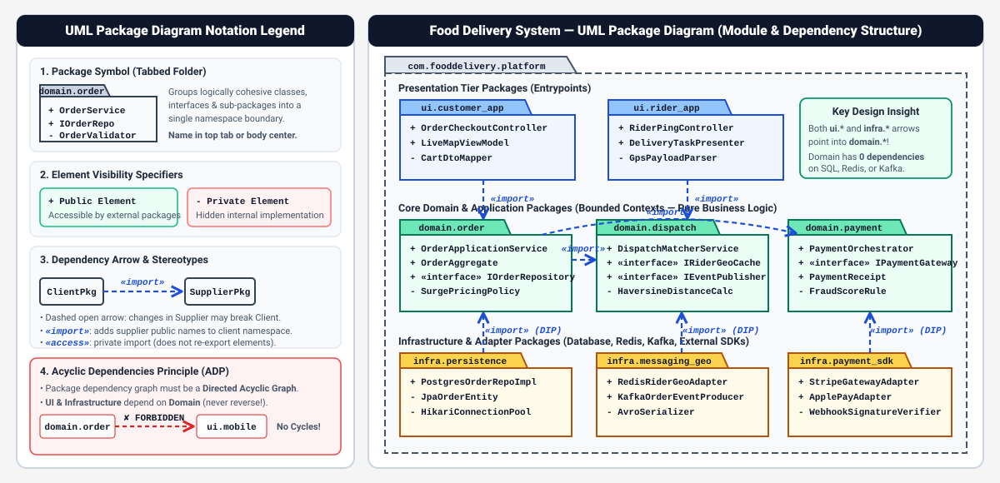

<!--
Once we have selected and synthesized our architectural patterns, how do we formally model that macro-architecture in UML?
In Stage 1 (Architectural Design), we use two complementary macro UML diagrams: the **UML Package Diagram** (compile-time module boundaries) and the **UML Deployment Diagram** (runtime hardware and cloud topology).

Let's examine the first diagram: the UML Package Diagram, applied to our Food Delivery Platform.

On the left panel, look at the standard UML notations:
First, the Package symbol is drawn as a tabbed folder containing logically cohesive classes and interfaces.
Second, visibility markers indicate whether an internal class is exported publicly with a plus sign (+) or hidden privately inside the package with a minus sign (-).
Third, a dashed open arrow labeled «import» or «access» points from the client package to the supplier package it depends on.
Fourth, the golden architectural rule is the Acyclic Dependencies Principle (ADP): package dependencies must form a Directed Acyclic Graph—cycles are strictly forbidden!

On the right panel, see how our Food Delivery codebase is organized: both the top Presentation packages (`ui.customer_app`, `ui.rider_app`) and the bottom Infrastructure packages (`infra.persistence`, `infra.messaging_geo`, `infra.payment_sdk`) point their dependency arrows inward toward the core Domain packages (`domain.order`, `domain.dispatch`, `domain.payment`).

To summarize this slide, remember this key takeaway: A UML Package Diagram governs compile-time namespace boundaries and enforces inward, acyclic dependencies toward the core domain.
-->
---
## UML Package Diagram: Meaning, Notation & Food Delivery

> **Architectural Meaning (Compile-Time View):** Models **source code organization**, **subsystem boundaries**, and **dependency direction governance**.

### Core UML Notations & Rules
- **Tabbed Folder (`Package`)**: Groups cohesive classes and interfaces into a single namespace (`domain.order`).
- **Visibility (`+` Public vs. `-` Private)**: `+OrderService` & `+IOrderRepository` are exported; `-SurgePricingPolicy` is hidden inside the package.
- **Dependency Arrow (`- - ->`)**: Dashed open arrow with `«import»` or `«access»`; changes in the target package may force recompilation of the source package.
- **Acyclic Dependencies Principle (ADP)**: Package dependency graphs must never form a cycle (`A → B → A` is forbidden).

### Food Delivery Design Insights
- **Bounded Context Partitioning**: Separate core domain packages for `domain.order`, `domain.dispatch`, and `domain.payment`.
- **Inward Dependency Governance**:
  - `ui.customer_app` imports `domain.order` downward.
  - `infra.persistence` (`PostgresOrderRepoImpl`) imports `domain.order` (`IOrderRepository`) **upward**!
- **Result**: The entire `domain.*` core has **zero compile-time dependencies** on PostgreSQL, Redis, Kafka, or Stripe SDKs.

<!--
Let's break down the meaning, notations, and architectural rules of the UML Package Diagram.

In the left card, review the four core symbols:
A tabbed folder represents a namespace package. Inside it, plus signs (+) mark public APIs exposed to other packages, while minus signs (-) hide internal implementation classes (Information Hiding!).
A dashed arrow with an open arrowhead represents a compile-time dependency: if Package A imports Package B, any breaking change in B can break A.

In the right card, see why this matters in our Food Delivery System:
Instead of letting `domain.order` depend downward on `infra.persistence`, `domain.order` defines the public interface `+IOrderRepository`, and `infra.persistence` imports `domain.order` upward to implement it!
Because both `ui.*` and `infra.*` point toward `domain.*`, our core business logic is 100% immune to database or SDK migrations.

To summarize this slide, remember this key takeaway: Package diagrams enforce clean modular boundaries and verify that infrastructure depends on domain abstractions, never the reverse.
-->
---
### Peer Discussion: Chess Game in MVC — UML Package Diagram (PlantUML)

  

  **Hands-On Modeling: Architecting a Chess Game in MVC (4 Mins)**
  - **Scenario:** Your team is designing a desktop/web **Chess Game** using the **Model-View-Controller (MVC)** architectural pattern.
  - **1. Partition Classes into 3 Cohesive Packages (`package` syntax):**
    - `chess.model`: `+Board`, `+Piece`, `+MoveValidator`, `-BitboardEngine` (pure chess rules & state).
    - `chess.view`: `+BoardCanvasUI`, `+MoveHistoryPanel`, `+SoundEffectPlayer` (UI rendering).
    - `chess.controller`: `+GameController`, `+TurnClockHandler` (user input routing).
  - **2. Draw the Package Diagram in PlantUML ([PlantText](https://www.planttext.com)):**
    - Use `package "chess.model" { ... }` and connect packages via `..> : «import»`.
    - **Audit Question:** Which direction do the dependency arrows point? Does `chess.model` import `chess.view`? Does your diagram satisfy the **Acyclic Dependencies Principle (ADP)**?

  

  

    
  

<!--
Now let's do a 4-minute peer discussion and hands-on modeling exercise!

Suppose your team is building a Chess Game using the MVC (Model-View-Controller) architectural pattern we learned earlier in Section 5.3.
Work with your partner to design its **UML Package Diagram** using PlantUML syntax on PlantText.com:
First, partition your classes into three packages (`chess.model`, `chess.view`, and `chess.controller`), marking public classes with `+` and internal helper classes like `-BitboardEngine` with `-`.
Second, draw the dashed dependency arrows (`..>`) labeled `«import»` between the three packages.

Discuss with your partner: Which package should have **zero outgoing dependency arrows** so it can be unit-tested headlessly without any GUI framework? (`chess.model`!) And how do you prevent a circular dependency cycle between `chess.view` and `chess.controller`?

To summarize this slide, remember this key takeaway: Modeling an MVC Chess Game as a PlantUML Package Diagram verifies that the core game model remains 100% independent of UI views and controllers.
-->
---
<!-- _class: title-image-slide -->

## Modeling Macro Topology (2): UML Deployment Diagram

  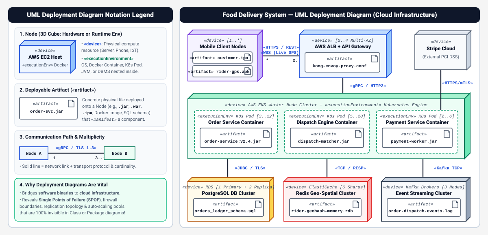

<!--
While the UML Package Diagram models compile-time source folders, how do we model the runtime cloud infrastructure of our Client-Server and Microservices patterns? We use the **UML Deployment Diagram**!

Look at the left panel for the standard notations:
First, a Node is drawn as a 3D cube representing either physical hardware («device», like a smartphone or AWS server) or a software runtime environment («executionEnvironment», like a Kubernetes Pod, Docker container, or JVM).
Second, an Artifact is drawn as a rectangle labeled «artifact» with a dog-eared document icon—this represents the actual physical binary file deployed onto a node, such as `order-service.jar`, `customer.ipa`, or `orders_schema.sql`.
Third, solid lines between 3D nodes are Communication Paths annotated with transport protocol stereotypes («HTTPS», «gRPC», «TCP/RESP», «JDBC/TLS») and instance multiplicity (`[3..12]`).

On the right panel, trace our Food Delivery physical cloud topology: Mobile client nodes connect via HTTPS/WSS to a Multi-AZ AWS API Gateway, which routes gRPC traffic into an AWS EKS Kubernetes cluster running auto-scaled Pods for Order (`[3..12]`), Dispatch (`[5..20]`), and Payment (`[2..6]`), backed by RDS PostgreSQL (Primary + 2 Replicas), a 6-shard Redis ElastiCache cluster, and a 3-broker Kafka cluster!

To summarize this slide, remember this key takeaway: A UML Deployment Diagram maps software artifacts onto physical 3D server nodes, containers, and network protocols.
-->
---
## UML Deployment Diagram: Meaning, Notation & Food Delivery

> **Architectural Meaning (Runtime Infrastructure View):** Models **physical hardware nodes, cloud runtime containers, deployable binary artifacts, and network protocols**.

### Core UML Notations & Rules
- **3D Node Cube (`«device»` / `«executionEnv»`)**:
  - `«device»`: Physical compute host (Mobile phone, AWS EC2, Load Balancer).
  - `«executionEnvironment»`: Nested runtime container (Kubernetes Pod, Docker, JVM, PostgreSQL Engine).
- **Artifact (`«artifact»` + 📄 Icon)**: Concrete deployable binary/file (`order-service:v2.4.jar`, `rider-gps.apk`) that `«manifest»` a logical component.
- **Communication Path & Multiplicity**: Solid line labeled with network protocol (`«gRPC / HTTP2»`, `«JDBC / TLS»`) and node cardinality (`[5..20]`).

### Food Delivery Design Insights
- **Exposes High-Availability & Scaling Policies**:
  - `Dispatch Engine Pod [5..20]` scales wider than `Payment Pod [2..6]` to handle 6 PM dinner GPS spikes.
- **Eliminates Single Points of Failure (SPOF)**:
  - Shows `RDS PostgreSQL [1 Primary + 2 Replica]`, `Redis ElastiCache [6 Shards]`, and `Kafka [3 Nodes]`.
- **Makes Network Boundaries Explicit**:
  - External traffic uses `«HTTPS / REST & WSS»`, internal east-west traffic uses `«gRPC»`, and Payment uses `«HTTPS / mTLS»` to `Stripe Cloud`.

<!--
Let's synthesize the meaning, notation, and power of the UML Deployment Diagram.

In the left card, distinguish the three core building blocks:
First, 3D Cubes are Nodes—either physical hardware (`«device»`) or nested software containers (`«executionEnvironment»`).
Second, Artifacts (`«artifact»`) are the compiled files (`.jar`, `.apk`, `.sql`) physically placed inside those nodes.
Third, Communication Paths specify the exact wire protocol and cardinality between nodes.

In the right card, notice what the Deployment Diagram reveals in our Food Delivery System that is 100% invisible in code-level diagrams:
We immediately see auto-scaling pod ranges (`[5..20]` for Dispatch), database replication (`1 Primary + 2 Replicas`), 6-shard Redis memory partitioning, and mTLS security boundaries to Stripe Cloud!

To summarize this slide, remember this key takeaway: Deployment diagrams expose cloud scaling, replication, and network security boundaries that are invisible in source-code diagrams.
-->
---
<!-- _class: title-image-slide -->

## Section 5.3 Visual Recap: Structural vs. Distributed Patterns

  

<!--
Let's conclude Section 5.3 (Stage 1: Architectural Design) by revisiting our complete visual map of architectural patterns.

We began with individual structural building blocks on the left—Layered, MVC, and Repository—and progressed to distributed and stream topologies on the right—Client-Server, Pipe-and-Filter, and Microservices.

Through our Food Delivery Platform case study, ATAM trade-off analysis, and UML Package & Deployment diagrams, we saw how macro-architecture transforms quality requirements into a concrete compile-time and runtime blueprint.

To summarize this slide, remember this key takeaway: Mastering Stage 1 Architectural Design means combining structural patterns, evaluating ATAM trade-offs, and modeling them with UML Package and Deployment diagrams.
-->
---
### Concept Check Question 2 (CCQ 2)
<!-- id: ase-ch05-ccq2 -->

  

When comparing a Monolithic architecture with a Microservices architecture, what is the primary structural reason that Microservices provide superior **fault isolation** (blast radius containment)?

- **A.** All services read and write to a single shared enterprise SQL database instance with global table locks.
- **B.** Each service runs in an isolated process with a private database, containing the blast radius of crashes.
- **C.** Distributed service calls completely eliminate network serialization overhead and inter-node TCP latency.
- **D.** Decomposing a monolith into microservices drastically reduces DevOps infrastructure and monitoring costs.

  

  

    
  

<!--
Let's check our understanding of architectural styles.

The question asks: What is the primary structural reason that Microservices provide superior fault isolation?

Evaluating options:
Option A is false: sharing a single database is a monolithic antipattern that causes data coupling!
Option C is false: microservices increase network communication overhead!
Option D is false: microservices usually require more operational personnel.

The correct answer is B! By isolating each service in its own independent process and database, a memory leak or crash in one service cannot directly crash neighboring services.

To summarize this slide, remember this key takeaway: Process and database isolation in microservices prevents local failures from triggering catastrophic application-wide crashes.
-->
---
<!-- _class: lead -->
<!-- header: '5.4 Interface & Contract Spec: DbC & Component UML' -->

# **5.4 Stage 2 — Interface & Contract Specification: DbC & Component UML**

> "Treat every software module boundary as a formal legal contract with explicit rights and obligations."  
> — *Bertrand Meyer (Creator of Design by Contract)*

<!--
Welcome to Section 5.4: Stage 2 of our Software Design Process—Interface & Contract Specification!

In Stage 1 (Section 5.3), we partitioned our Food Delivery Platform into packages and deployed containers. Now we reach Stage 2: Before any team writes internal class code inside those subsystems, how do we formally specify the **interfaces and behavioral contracts** between them so multiple teams can develop in parallel without breaking each other?

In this section, we master Bertrand Meyer's **Design by Contract (DbC)**—Preconditions, Postconditions, and Class Invariants—and learn how to model plug-and-play module contracts visually using the **UML Component Diagram** (`—○` Lollipop and `—(` Socket notations).

To summarize this slide, remember this key takeaway: Stage 2 Interface & Contract Specification defines formal Design by Contract rules and models them via UML Component Diagrams.
-->
---
<!-- _class: title-image-slide -->

## Formal Interface Specification & Design by Contract (DbC)

  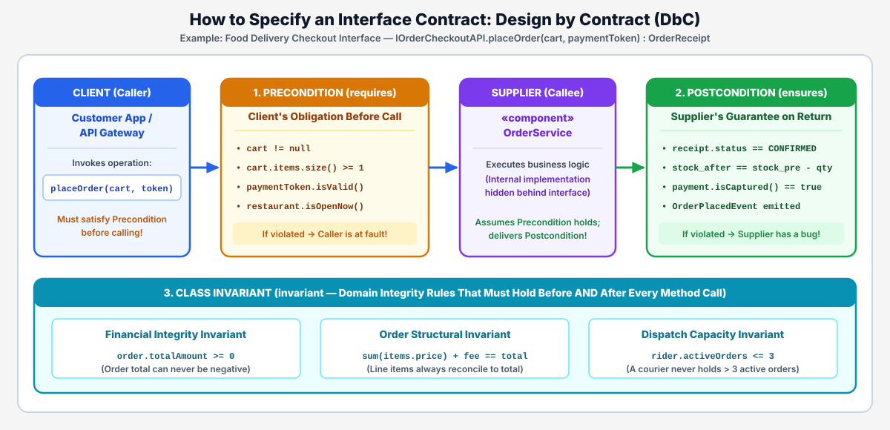

<!--
Examine this visual overview of Stage 2: Formal Interface Specification and Bertrand Meyer's **Design by Contract (DbC)**, applied to our Food Delivery checkout API (`IOrderCheckoutAPI.placeOrder`).

Look at the top panel: Why is a bare method signature like `placeOrder(cart, token)` insufficient as a design specification? Because it only tells you parameter types—it says nothing about behavioral obligations or edge cases!
Design by Contract turns every interface into an enforceable three-part legal contract between the **Client (Caller)** and the **Supplier (Called Component)**:
1. **Precondition (`require`)**: The Client's obligation *before* calling—`cart` must not be empty, `paymentToken` must be valid, and the restaurant must be open.
2. **Postcondition (`ensure`)**: The Supplier's guarantee *upon return*—the returned order is `CONFIRMED`, stock is decremented by `qty`, and `OrderPlacedEvent` is published.
3. **Class Invariant (`invariant`)**: The continuous domain truth that must hold before *and* after every method call—`order.totalAmount >= 0` and `rider.activeAssignedOrders <= 3`.

Look at the bottom panels: DbC eliminates defensive programming bloat (the Supplier doesn't need to re-check preconditions) and maps directly to UML Component Diagrams (Lollipop/Socket) and Section 5.5's Liskov Substitution Principle (LSP)!

To summarize this slide, remember this key takeaway: Design by Contract turns passive method signatures into enforceable engineering contracts using Preconditions, Postconditions, and Class Invariants.
-->
---
## Design by Contract (DbC): Rights, Obligations & API Specs

> **Core Principle (Bertrand Meyer):** If the **Client** fulfills the **Precondition**, the **Supplier** is contractually bound to deliver the **Postcondition** while preserving the **Class Invariant**.

### The 3 Pillars of Design by Contract (DbC)
- **1. Precondition (`requires` — Client Obligation)**:
  - What must be true *before* invocation (`!cart.isEmpty() && token.isValid()`).
  - *Benefit to Supplier*: No need to litter internal code with redundant defensive checks; if violated, fail fast!
- **2. Postcondition (`ensures` — Supplier Guarantee)**:
  - What the Supplier guarantees *after* execution (`order.status == CONFIRMED && stock_after == stock_before - qty`).
  - *Benefit to Client*: Guaranteed outcome without inspecting Supplier internals.
- **3. Class Invariant (`invariant` — Domain Integrity)**:
  - Always true before and after any operation (`order.totalAmount >= 0`).

### Industrial Interface Specification Standards
- **Eliminating Ambiguity Across Teams**:
  - Frontend, Mobile, and Backend teams lock interface specs in the **SDD** on Day 1 to enable **parallel development & contract testing**.
- **Modern Machine-Readable Contract Formats**:
  - **REST APIs**: **OpenAPI 3.1 (Swagger)** — specifies endpoints, JSON schemas, status codes (`201`, `400`, `422`), and validation bounds.
  - **RPC Services**: **Protocol Buffers (`.proto`)** — strongly-typed binary contracts for east-west `gRPC` calls.
  - **Event Streams**: **AsyncAPI / Apache Avro** — versioned schemas for Kafka `OrderPlacedEvent` payloads + **Idempotency Keys** (`idempotency_key: UUID`) to prevent duplicate payment charging!

<!--
Let's unpack the engineering value of Design by Contract on the left and modern industrial API specification standards on the right.

In the left card, notice the symmetry of Rights and Obligations in DbC:
For the Client (caller): Satisfying the Precondition is an obligation, and receiving the Postcondition is a guaranteed right.
For the Supplier (callee): Delivering the Postcondition and maintaining the Class Invariant are obligations, while being freed from handling invalid Precondition inputs inside core logic is a major benefit!

In the right card, how do modern engineering teams write down these contracts in their Software Design Document (SDD)?
For REST APIs, teams write OpenAPI 3.1 YAML specifications.
For internal microservices, teams write gRPC Protocol Buffers (`.proto`).
For Kafka event streams, teams use AsyncAPI or Avro schemas—and crucially include an `idempotency_key` contract so network retries never charge a customer's credit card twice!

To summarize this slide, remember this key takeaway: Formal contracts—expressed via DbC rules and OpenAPI/Protobuf/AsyncAPI specs—allow teams to develop and test components independently in parallel.
-->
---
### Peer Discussion: Formal Design Specification for `bubbleSort(int[] arr)`

  

  **Pair Challenge: Specify the Complete DbC Contract for Bubble Sort (4 Mins)**
  - **Scenario:** Anyone can code `void bubbleSort(int[] arr)`, but writing a **mathematically airtight Design by Contract (DbC) specification** is surprisingly tricky!
  - **1. Precondition (`requires` — Client Obligation):**
    - What must the caller guarantee about `arr` before calling? (`arr != null`? Is `arr.length == 0` valid?)
  - **2. Postcondition (`ensures` — Supplier Guarantee):**
    - *The Classic Trap:* Suppose a developer writes only: `∀ i ∈ [0, n-2] : arr[i] <= arr[i+1]`.
    - *Critique:* If a buggy `bubbleSort` overwrites every element with zeros (`[0, 0, 0, 0]`), does it pass that postcondition? **YES!** What **second postcondition** is missing? *(Hint: Permutation / Multiset preservation!)*
  - **3. Loop Invariant (`invariant`):** After outer pass `k`, what is guaranteed about the last `k` elements?

  

  

    
  

<!--
Let's pause for a classic software engineering thought experiment! Turn to your partner and write the formal **Design Specification (Design by Contract)** for a function everyone knows from freshman year: `void bubbleSort(int[] arr)`.

First, what is the **Precondition (`requires`)**? At minimum, `arr != null`! (An empty or 1-element array is valid and trivially sorted).

Second, what is the **Postcondition (`ensures`)**? Almost everyone writes: 'Every element is less than or equal to the next element: `arr[i] <= arr[i+1]`.'
Wait—think about this! What if I implement `bubbleSort` by filling the entire array with zeros (`Arrays.fill(arr, 0)`)? Is `[0, 0, 0, 0]` sorted in non-decreasing order? Yes!
Why did our specification fail? Because a complete sorting postcondition requires **two clauses**:
Clause 1 (**Ordered Property**): `arr[0] <= arr[1] <= ... <= arr[n-1]`.
Clause 2 (**Permutation / Multiset Conservation**): The output array `arr_after` must be a **permutation** (exact same multiset of elements) of the input array `arr_before`!

Third, what is the **Loop Invariant** of Bubble Sort? After `k` passes of the outer loop, the final `k` elements `arr[n-k .. n-1]` are in their final sorted positions and are greater than or equal to all preceding elements!

To summarize this slide, remember this key takeaway: A rigorous sorting contract must specify both non-decreasing order and multiset permutation equivalence, proving why formal specs catch subtle logic flaws.
-->
---
<!-- _class: title-image-slide -->

## Modeling Interface Contracts: UML Component Diagram

  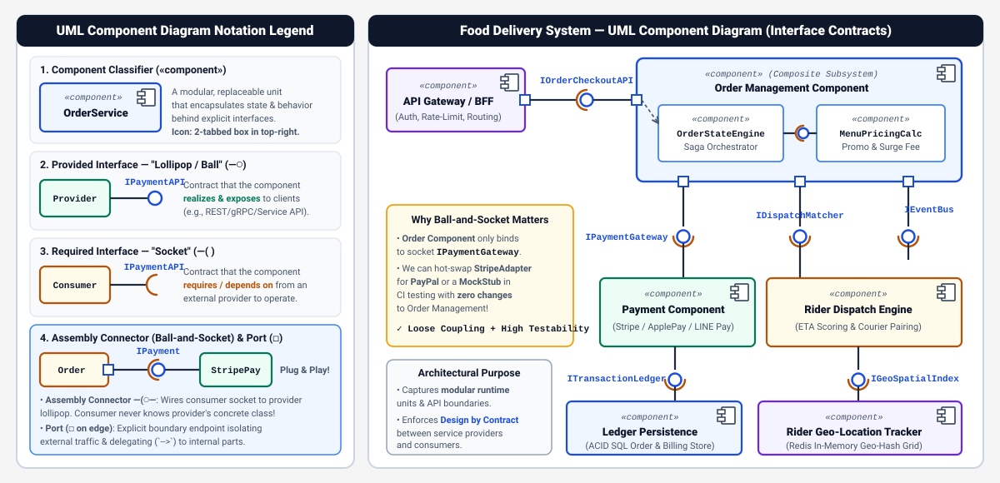

<!--
Now, how do we visually model Stage 2's modular components and their Design by Contract interfaces in UML? We use the **UML Component Diagram**!

Look at the left panel for the classic UML 2.x Component notations:
First, a Component is drawn as a rectangle stereotyped «component» with the signature two-tabbed component icon in the top-right corner.
Second, a Provided Interface is drawn as a 'Lollipop' or 'Ball' (—○)—this visually represents the Supplier's DbC contract (guaranteeing Postconditions) exposed to the outside world.
Third, a Required Interface is drawn as a 'Socket' (—( )—this visually represents the Client's dependency on an external contract (obligating it to satisfy Preconditions).
Fourth, when you wire a consumer's Required Socket into a provider's Provided Lollipop, they form an Assembly Connector (—(○—), also known as a Ball-and-Socket joint, with Ports (□) marking explicit boundary endpoints!

On the right panel, trace our Food Delivery System: `Order Management Component` exposes `IOrderCheckoutAPI` (lollipop) to the `API Gateway` (socket), while requiring three sockets at the bottom: `IPaymentGateway`, `IDispatchMatcher`, and `IEventBus`.

To summarize this slide, remember this key takeaway: A UML Component Diagram visualizes Stage 2 interface contracts by wiring modular components strictly through Lollipop (provided) and Socket (required) interfaces.
-->
---
## UML Component Diagram: Meaning, Notation & Food Delivery

> **Stage 2 Modeling Purpose:** Models **modular, replaceable software components** wired strictly through **plug-and-play interface contracts** (visualizing **Design by Contract**).

### Core UML Notations & DbC Mapping
- **Component (`«component»` + ⧉ Icon)**: Encapsulated, replaceable unit whose internal classes are hidden behind explicit interfaces.
- **Provided Interface (`—○` Lollipop / Ball)**: Contract realized by a Supplier component (`IOrderCheckoutAPI` — guarantees DbC **Postconditions**).
- **Required Interface (`—(` Socket)**: Contract demanded by a Client component (`IPaymentGateway` — must satisfy DbC **Preconditions**).
- **Assembly Connector (`—(○—` Ball & Socket)**: Mates a required socket to a provided lollipop with zero implementation coupling.
- **Port (`□`) & Delegation (`- - ->`)**: Boundary endpoint forwarding external calls to internal sub-components.

### Food Delivery Design Insights
- **Composite Subsystem Decomposition**: `Order Management` encapsulates internal `OrderStateEngine` and `MenuPricingCalc` behind an external boundary Port (`□`).
- **Hot-Swappable Plug-and-Play**:
  - `Order Management` only binds to socket `IPaymentGateway`.
  - Whether the lollipop is provided by `Stripe`, `ApplePay`, or an in-memory `MockPaymentStub` during CI testing, `Order Management` requires **zero code changes**!
- **Geo-Dispatch Contract**: `Rider Dispatch Engine` queries `Rider Geo-Location Tracker` strictly via `IGeoSpatialIndex`.

<!--
Let's examine why the UML Component Diagram is the canonical diagram for Stage 2 (Interface & Contract Specification).

In the left card, see how UML Component notations map 1-to-1 to Design by Contract:
A Lollipop (circle on a stick) means 'I am the Supplier providing this contract and guaranteeing its Postconditions.'
A Socket (half-circle cup on a stick) means 'I am the Client requiring this contract and promising to satisfy its Preconditions.'
When a socket snaps onto a lollipop, you get a Ball-and-Socket Assembly Connector! And a small square on a component's border is a Port, which delegates incoming requests to internal sub-components.

In the right card, see how this empowers our Food Delivery Platform:
`Order Management` is a composite component containing `OrderStateEngine` and `MenuPricingCalc`. Externally, it exposes a single lollipop (`IOrderCheckoutAPI`) and requires three sockets (`IPaymentGateway`, `IDispatchMatcher`, `IEventBus`).
Because components interact only via Ball-and-Socket contracts, we can hot-swap Stripe for ApplePay—or plug in a Mock Payment Stub for automated testing—without modifying a single line inside `Order Management`!

To summarize this slide, remember this key takeaway: Ball-and-socket component connectors enforce strict contract-first decoupling and enable hot-swappable component replacement.
-->
---
### Concept Check Question 3 (CCQ 3)
<!-- id: ase-ch05-ccq3 -->

  

In Stage 2 (**Interface & Contract Specification**), how do Bertrand Meyer's **Design by Contract (DbC)** and the **UML Component Diagram** work together when `Order Management` calls `Payment Component` via the `IPaymentGateway` interface?

- **A.** `Order Management` exposes a Lollipop (`—○`) and may freely pass negative order amounts without validation.
- **B.** Client Socket (`—(`) must satisfy the **Precondition**, while Supplier Lollipop (`—○`) guarantees the **Postcondition**.
- **C.** Component diagrams use 3D hardware node cubes (`«device»`) to bypass runtime Precondition and Postcondition checks.
- **D.** Design by Contract requires the caller component to directly mutate private SQL tables inside the supplier module.

  

  

    
  

<!--
Let's check our understanding of Stage 2: Design by Contract (DbC) and UML Component Diagrams!

The question asks: How do DbC and the UML Component Diagram work together when `Order Management` (Client) calls `Payment Component` (Supplier) via `IPaymentGateway`?

Let's evaluate each option:
Option A is backwards: `Order Management` is the Client requiring the payment service, not the provider, and cannot pass invalid negative amounts.
Option B is exact: As the Client, `Order Management` uses a Required Socket (`—(`) and is obligated to satisfy the **Precondition** (valid payment token and positive amount); as the Supplier, `Payment Component` exposes a Provided Lollipop (`—○`) and guarantees the **Postcondition**!
Option C confuses Component Diagrams with Deployment Diagrams (3D Node cubes).
Option D violates Information Hiding and Low Coupling.

Therefore, the correct answer is B!

To summarize this slide, remember this key takeaway: In a UML Component Diagram, the Client's Socket (`—(`) obligates it to satisfy Preconditions, while the Supplier's Lollipop (`—○`) guarantees Postconditions.
-->
---
<!-- _class: lead -->
<!-- header: '5.5 Component & OO Design: Patterns & SOLID' -->

# **5.5 Stage 3 — Component & Detailed OO Design: Patterns, SOLID & Class UML**

> "Clean code always looks like it was written by someone who cares."  
> — *Robert C. Martin (Uncle Bob)*

<!--
We now transition into Section 5.5: Stage 3 of our Software Design Process—Component & Detailed Object-Oriented Design!

Look at our seamless progression so far:
In Stage 1 (5.3), we designed our macro-architecture using Architectural Patterns and modeled it with UML Package and Deployment diagrams.
In Stage 2 (5.4), we specified our module boundaries using Design by Contract (DbC) and modeled them with UML Component diagrams.
Now, in Stage 3 (5.5), we zoom *inside* an individual component to design its internal class hierarchy using **GoF Design Patterns**, the **5 SOLID Principles**, and **UML Class & Interface Diagrams**!

To summarize this slide, remember this key takeaway: Stage 3 Detailed OO Design structures internal component classes using GoF patterns, SOLID principles, and UML Class Diagrams.
-->
---
## What Are Design Patterns? From GoF to SOLID Foundations

* **What Is a Software Design Pattern?**
  - While **Architectural Patterns** (Section 5.3) define system-wide macro topology, **Design Patterns** provide reusable, proven micro-level solutions to recurring class and object design problems within a specific context.
* **The Vast Landscape of Design Patterns (e.g., Gang of Four — GoF 23 Patterns):**
  - **Creational Patterns (5)**: *Factory Method, Abstract Factory, Builder, Singleton, Prototype* (decouple object creation).
  - **Structural Patterns (7)**: *Adapter, Decorator, Facade, Proxy, Composite, Bridge* (compose classes & interfaces).
  - **Behavioral Patterns (11)**: *Strategy, Observer, Command, State, Template Method, Iterator* (manage object collaboration).
* **Our Focus Here — The 5 SOLID Design Principles (Robert C. Martin):**
  - Rather than memorizing 23 GoF patterns by rote, we focus on **SOLID**—the **foundational "first principles"** upon which nearly all GoF patterns are built (e.g., *Strategy* realizes **OCP**; *Adapter* realizes **DIP**)!

<!--
Before diving into individual UML diagrams, let's clarify a fundamental question: What is a Design Pattern, and how does it relate to SOLID?

In Section 5.3, we studied Architectural Patterns—macro-level blueprints like Microservices and Layered Architecture. When we zoom inside a single component to design classes and interfaces, we enter the world of Object-Oriented Design Patterns.

The most famous catalog in computer science is the 1994 'Gang of Four' (GoF) book by Gamma, Helm, Johnson, and Vlissides, which documented 23 classic Design Patterns across three categories: Creational (like Factory and Builder), Structural (like Adapter and Facade), and Behavioral (like Strategy and Observer).

With so many design patterns out there, why do we focus specifically on SOLID here? Because SOLID is the foundational physics underneath GoF patterns! Once you understand OCP and DIP in UML, patterns like Strategy, Adapter, and Dependency Injection become completely natural.

To summarize this slide, remember this key takeaway: While catalogs like the Gang of Four define 23 specific design patterns, we focus on the five SOLID principles that serve as the theoretical foundation for all object-oriented patterns.
-->
---
## Overview: The 5 SOLID Design Principles in UML

* **How SOLID Shapes Class & Interface Topologies:**
  - **S — Single Responsibility Principle (SRP)**: Partition bloated "God Classes" so each class serves **1 Actor / 1 Reason to Change**.
  - **O — Open / Closed Principle (OCP)**: Replace rigid concrete dependencies with **polymorphic `«interface»` abstractions** (`- - -|>`).
  - **L — Liskov Substitution Principle (LSP)**: Ensure every subclass (`───|>`) or realization (`- - -|>`) honors the **behavioral contract** of its base type.
  - **I — Interface Segregation Principle (ISP)**: Split bloated "Fat Interfaces" into **lean, role-specific `«interface»` contracts**.
  - **D — Dependency Inversion Principle (DIP)**: Invert dependency arrows **upward** so both high-level policies and low-level details depend on abstractions.

<!--
Examine the five SOLID principles from an architectural and UML perspective.

Notice that SOLID is not about syntax tricks—it is fundamentally about how you draw boxes (classes and interfaces) and arrows (dependencies and realizations) in your UML design:
SRP governs what belongs inside a single class box;
OCP governs how new behavior is plugged in via interface realization arrows;
LSP governs when inheritance arrows are valid vs. broken;
ISP governs the granularity of interface boxes;
and DIP governs the direction of cross-layer dependency arrows!

Let's examine each principle using a two-slide visual format: first a full-canvas Before-vs-After UML diagram, followed by its engineering breakdown.

To summarize this slide, remember this key takeaway: The five SOLID principles are structural rules that govern class cohesion, interface granularity, and dependency direction in UML design.
-->
---
<!-- _class: title-image-slide -->

## S — Single Responsibility Principle (SRP): UML Comparison

  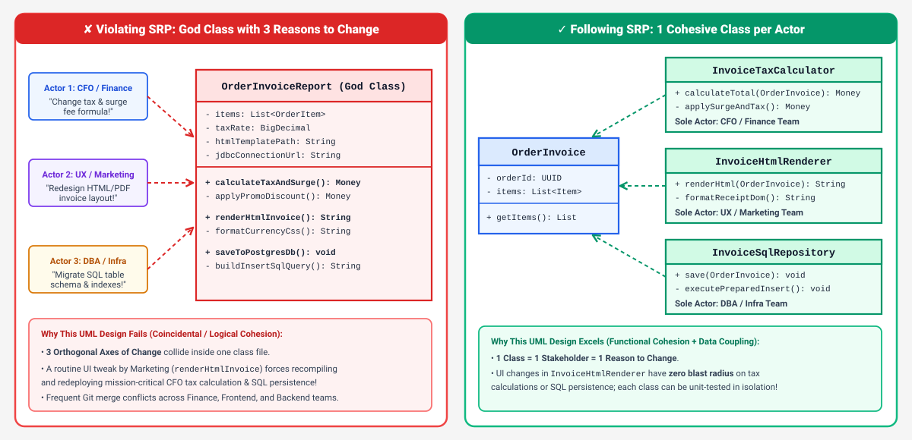

<!--
Look at our first UML comparison: the Single Responsibility Principle (SRP).

On the left panel, examine the red God Class `OrderInvoiceReport`:
Three completely different organizational actors—the CFO's Finance team, the UX/Marketing team, and the DBA Infrastructure team—all point dependency arrows into this single class!
It mixes financial tax calculation (`calculateTaxAndSurge`), HTML receipt rendering (`renderHtmlInvoice`), and PostgreSQL persistence (`saveToPostgresDb`).

On the right panel, examine the refactored green UML design:
We separate data (`OrderInvoice`) from the three orthogonal responsibilities, creating three focused classes: `InvoiceTaxCalculator` (for Finance), `InvoiceHtmlRenderer` (for UX), and `InvoiceSqlRepository` (for DBAs). Now, each class has one actor and one reason to change!

To summarize this slide, remember this key takeaway: SRP splits multi-actor God Classes into cohesive, single-purpose classes aligned with distinct axes of change.
-->
---
## S — Single Responsibility Principle (SRP): Design Analysis

> **Definition (Robert C. Martin):** *"A class should have one, and only one, reason to change (i.e., be responsible to one, and only one, actor/stakeholder)."*

### ❌ UML Anti-Pattern: The "God Class"
- **Tangled Axes of Change**: `OrderInvoiceReport` combines **Financial Rules** (`calculateTaxAndSurge`), **Presentation Formatting** (`renderHtmlInvoice`), and **Database I/O** (`saveToPostgresDb`).
- **Fragility & Merge Collisions**:
  - When UX designers tweak receipt CSS inside `OrderInvoiceReport`, they risk breaking CFO tax logic or triggering SQL regressions.
  - achieves low **Coincidental / Logical Cohesion**.

### ✅ UML Refactoring: 1 Class per Actor
- **Cohesive Decomposition**:
  - `InvoiceTaxCalculator` ➔ Serves **CFO / Finance**.
  - `InvoiceHtmlRenderer` ➔ Serves **UX / Marketing**.
  - `InvoiceSqlRepository` ➔ Serves **DBA / Infra**.
- **Architectural Payoff**:
  - Achieves **Level 1 Functional Cohesion** and **Data Coupling** (passing only `OrderInvoice`).
  - Each class can be modified, tested, and deployed independently with zero cross-team interference.

<!--
Let's summarize the engineering insights of the Single Responsibility Principle (SRP).

Uncle Bob later clarified what he meant by 'one reason to change': a responsibility belongs to a specific stakeholder group or Actor!
In the left card, when Finance, Marketing, and DBAs all depend on `OrderInvoiceReport`, three separate axes of change collide in one file.

In the right card, by decomposing the UML model into `InvoiceTaxCalculator`, `InvoiceHtmlRenderer`, and `InvoiceSqlRepository`, we achieve Functional Cohesion and Data Coupling. A change to HTML formatting never touches or recompiles tax calculation logic!

To summarize this slide, remember this key takeaway: Align class boundaries with stakeholder actors so that every class possesses a single, isolated reason to change.
-->
---
<!-- _class: title-image-slide -->

## O — Open / Closed Principle (OCP): UML Comparison

  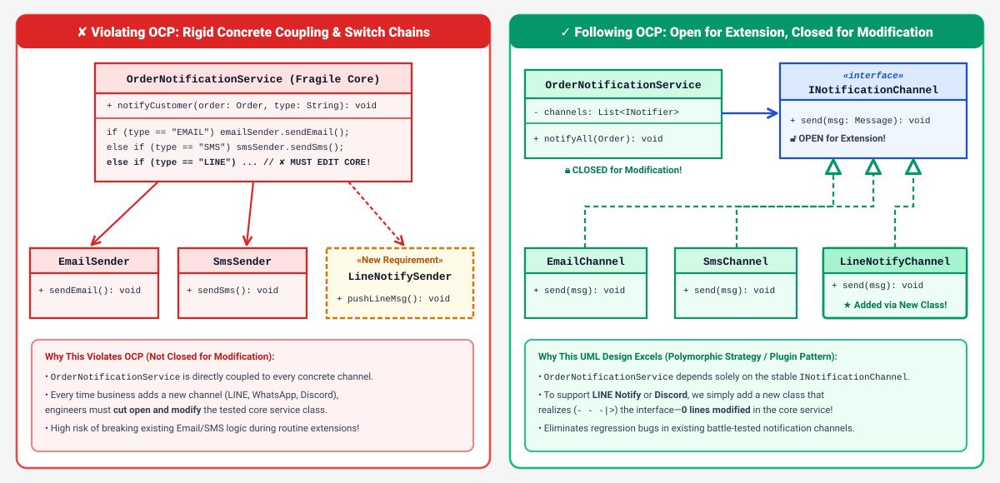

<!--
Now look at Principle 2: the Open / Closed Principle (OCP), visualized in UML.

On the left panel, look at the red anti-pattern:
`OrderNotificationService` has direct concrete dependency arrows pointing to `EmailSender` and `SmsSender`, driven by an internal `if / else if` chain. When a new business requirement arrives to support `LineNotifySender`, engineers must cut open `OrderNotificationService`, add a new dependency arrow, and modify its `if/else` logic!

On the right panel, look at the green OCP-compliant UML design:
`OrderNotificationService` is locked (Closed for Modification) because it depends solely on the abstract interface `«interface» INotificationChannel`.
`EmailChannel` and `SmsChannel` realize (`- - -|>`) that interface. When we need `LineNotifyChannel`, we simply add a new class realizing `INotificationChannel`—zero lines of code inside `OrderNotificationService` are touched!

To summarize this slide, remember this key takeaway: OCP replaces hardwired concrete dependencies with an abstract interface pivot, allowing new extensions via realization without modifying the client class.
-->
---
## O — Open / Closed Principle (OCP): Design Analysis

> **Definition (Bertrand Meyer):** *"Software entities (classes, modules, components) should be **open for extension**, but **closed for modification**."*

### ❌ UML Anti-Pattern: Direct Concrete Coupling
- **Hardwired Fan-Out (`───>`)**: `OrderNotificationService` directly depends on concrete `EmailSender` and `SmsSender` classes via `if / else if` type-switching.
- **Violation of "Closed for Modification"**:
  - Adding `LineNotifySender`, `WhatsApp`, or `Discord` forces engineers to **open and edit** the core `OrderNotificationService` class.
  - Every edit risks breaking existing, production-tested notification channels!

### ✅ UML Refactoring: Polymorphic Interface Pivot
- **Stable Abstraction (`«interface» INotificationChannel`)**:
  - `OrderNotificationService` depends **only** on `INotificationChannel.send(msg)` (**🔒 Closed for Modification**).
- **Plug-in Realization (`- - -|>`)**:
  - `EmailChannel`, `SmsChannel`, and the new `LineNotifyChannel` independently realize `INotificationChannel` (**🔓 Open for Extension**).
- **Zero-Touch Expansion**: New channels are added as standalone classes with zero impact on core orchestration.

<!--
Let's analyze how the Open/Closed Principle works in UML.

In the left card, whenever a client class points directly at concrete implementation classes with solid dependency arrows (`───>`), adding a new variant forces you to modify the client class.

In the right card, we insert an `«interface»` (`INotificationChannel`) as a protective firewall. Now the client points to the interface, and all concrete variants point their dashed hollow realization arrows (`- - -|>`) toward the interface!
Because `OrderNotificationService` only knows `INotificationChannel`, it is 100% closed for modification, while the interface remains wide open for infinite new extensions.

To summarize this slide, remember this key takeaway: Introducing a polymorphic interface pivot locks core business logic against modification while opening the system to plug-in extensions.
-->
---
<!-- _class: title-image-slide -->

## L — Liskov Substitution Principle (LSP): UML Comparison

  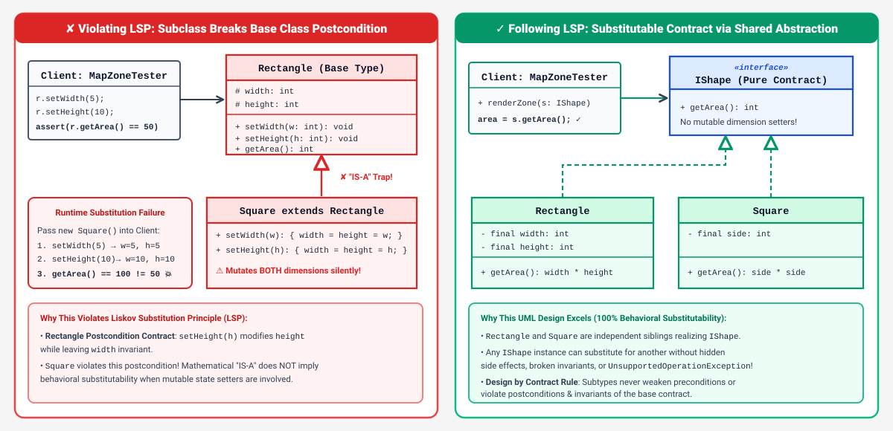

<!--
Now examine Principle 3: the Liskov Substitution Principle (LSP), formulated by Turing Award Laureate Barbara Liskov.

On the left panel, look at the famous 'IS-A Inheritance Trap' in UML:
Mathematically, a Square is a Rectangle, so a novice draws a UML generalization arrow (`───|>`) from `Square` up to `Rectangle`.
However, `Rectangle` defines mutable setters `setWidth(w)` and `setHeight(h)` with the postcondition that changing height leaves width unchanged. To stay a square, `Square` overrides `setHeight(10)` to secretly overwrite `width = 10` as well! When `MapZoneTester` passes a `Square` into a method expecting a `Rectangle`, `5 * 10` suddenly returns `100` instead of `50`—crashing the program!

On the right panel, look at the green LSP-compliant UML design:
Instead of forcing `Square` to inherit mutable state from `Rectangle`, both `Rectangle` and `Square` are modeled as independent, immutable sibling classes realizing the pure contract `«interface» IShape` (`+ getArea(): int`). Now any `IShape` subtype can substitute for another with 100% behavioral integrity!

To summarize this slide, remember this key takeaway: LSP requires that UML inheritance and realization hierarchies preserve behavioral contracts, postconditions, and invariants without unexpected side effects.
-->
---
## L — Liskov Substitution Principle (LSP): Design Analysis

> **Definition (Barbara Liskov):** *"Subtypes must be behaviorally substitutable for their base types without altering any desirable correctness properties of the program."*

### ❌ UML Anti-Pattern: The "IS-A" Inheritance Trap
- **Broken Postcondition in `Square ───|> Rectangle`**:
  - Base `Rectangle` promises that `setHeight(10)` mutates `height` while keeping `width` invariant.
  - Subclass `Square` breaks this contract by silently mutating **both** `width` and `height` (`getArea()` yields `100 != 50`).
- **Other Common LSP Violations in Food Delivery**:
  - `CashOnDeliveryPayment ───|> OnlinePayment` throwing `UnsupportedOperationException` inside `autoRefundCard()`!

### ✅ UML Refactoring: Behavioral Subtyping
- **Sibling Realization (`- - -|> IShape`)**:
  - Eliminate invalid inheritance between `Square` and `Rectangle`.
  - Both classes independently realize the pure contract `«interface» IShape` (`+ getArea(): int`) with immutable dimensions.
- **Design by Contract (DbC) Rules for LSP**:
  - A subtype must **never strengthen preconditions**, **never weaken postconditions**, and **never throw unexpected exceptions**.

<!--
Let's review the engineering rules of the Liskov Substitution Principle (LSP).

Novices are often taught that UML inheritance (`───|>`) means 'IS-A' in everyday English. Barbara Liskov proved that English 'IS-A' is not enough: inheritance in software requires *Behavioral Subtyping*!

In the left card, `Square extends Rectangle` (or `CashOnDelivery extends CreditCardPayment` throwing `UnsupportedOperationException` on `refund()`) violates the base class postcondition and crashes polymorphic callers.

In the right card, we replace broken inheritance with clean sibling realization (`- - -|>`) of a shared behavioral interface (`IShape`). Every subtype fulfills 100% of the contract promised by the interface!

To summarize this slide, remember this key takeaway: Never use UML inheritance unless the subclass honors every precondition, postcondition, and invariant promised by the base type.
-->
---
<!-- _class: title-image-slide -->

## I — Interface Segregation Principle (ISP): UML Comparison

  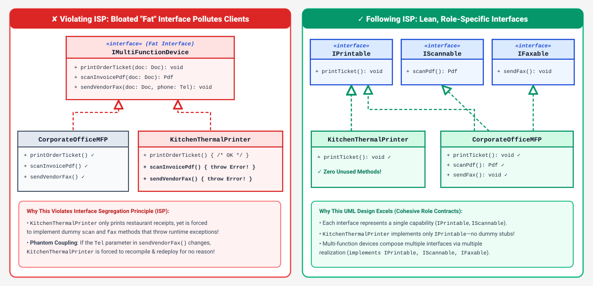

<!--
Now let's examine Principle 4: the Interface Segregation Principle (ISP), visualized in UML.

On the left panel, look at the red 'Fat Interface' anti-pattern:
An architect creates a giant interface `«interface» IMultiFunctionDevice` bundling `printOrderTicket()`, `scanInvoicePdf()`, and `sendVendorFax()`.
While `CorporateOfficeMFP` uses all three, look at `KitchenThermalPrinter` (a restaurant receipt printer in our Food Delivery partner kitchen): it can only print! Yet because it realizes `IMultiFunctionDevice`, it is forced to implement dummy `scanInvoicePdf()` and `sendVendorFax()` methods that throw errors!

On the right panel, look at the green ISP-compliant UML design:
We segregate the fat interface into three focused, role-specific interfaces: `IPrintable`, `IScannable`, and `IFaxable`. Now `KitchenThermalPrinter` realizes only `IPrintable`, while `CorporateOfficeMFP` realizes all three!

To summarize this slide, remember this key takeaway: ISP decomposes bloated interfaces into cohesive role-specific contracts so implementing classes never depend on unused methods.
-->
---
## I — Interface Segregation Principle (ISP): Design Analysis

> **Definition (Robert C. Martin):** *"Clients should not be forced to depend on interfaces or methods that they do not use."*

### ❌ UML Anti-Pattern: The "Fat Interface"
- **Polluted Contract (`IMultiFunctionDevice`)**: Bundles unrelated capabilities (`printOrderTicket`, `scanInvoicePdf`, `sendVendorFax`) into one monolithic `«interface»`.
- **Two Severe Consequences**:
  - **1. Dummy Stubs & Liskov Violations**: `KitchenThermalPrinter` must implement `scan()` and `fax()` by throwing runtime exceptions.
  - **2. Phantom Recompilation Coupling**: Changing a parameter in `sendVendorFax()` forces `KitchenThermalPrinter` to recompile!

### ✅ UML Refactoring: Role-Specific Interfaces
- **Granular Role Contracts**:
  - Decompose into `«interface» IPrintable`, `«interface» IScannable`, and `«interface» IFaxable`.
- **Selective Realization (`- - -|>`)**:
  - `KitchenThermalPrinter` realizes **only** `IPrintable`.
  - `CorporateOfficeMFP` composes capabilities by realizing all three (`IPrintable`, `IScannable`, `IFaxable`).
- **Result**: Zero unused methods and zero phantom coupling across unrelated clients.

<!--
Notice how the Interface Segregation Principle (ISP) complements both SRP and LSP!

In the left card, a bloated 'Fat Interface' (`IMultiFunctionDevice`) forces simple implementers like `KitchenThermalPrinter` to write dummy methods that throw exceptions (which immediately violates LSP too!), and couples kitchen printers to fax-machine parameter changes.

In the right card, by splitting the UML interface into role-specific contracts (`IPrintable`, `IScannable`, `IFaxable`), every client and every device binds solely to the exact methods it requires.

To summarize this slide, remember this key takeaway: Prefer cohesive, role-specific interfaces over monolithic fat interfaces to eliminate dummy implementations and phantom coupling.
-->
---
<!-- _class: title-image-slide -->

## D — Dependency Inversion Principle (DIP): UML Comparison

  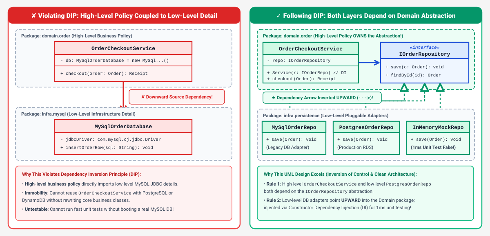

<!--
Finally, examine Principle 5—the capstone of Clean Architecture: the Dependency Inversion Principle (DIP)!

Look closely at the direction of the UML arrows crossing the horizontal package boundary:
On the left panel (red anti-pattern), high-level `OrderCheckoutService` in `domain.order` directly instantiates and depends downward (`───>`) on low-level `MySqlOrderDatabase` in `infra.mysql`. Both the runtime flow of control AND the compile-time source code dependency point downward!

Now look at the right panel (green DIP-compliant design):
Inside the high-level `domain.order` package, `OrderCheckoutService` defines and depends on `«interface» IOrderRepository`.
Down in `infra.persistence`, concrete adapters—`MySqlOrderRepo`, `PostgresOrderRepo`, and `InMemoryMockRepo`—realize `IOrderRepository` with dashed hollow arrows (`- - -|>`) pointing **UPWARD** into the Domain layer!

To summarize this slide, remember this key takeaway: DIP inverts compile-time UML dependency arrows upward so low-level infrastructure adapters depend on high-level domain abstractions.
-->
---
## D — Dependency Inversion Principle (DIP): Design Analysis

> **Definition (Robert C. Martin):** *"1. High-level modules should not depend on low-level modules; both should depend on abstractions. 2. Abstractions should not depend on details; details must depend on abstractions."*

### ❌ UML Anti-Pattern: Downward Source Dependency
- **High-Level Bound to Low-Level (`domain ───> infra`)**:
  - `OrderCheckoutService` directly references concrete `MySqlOrderDatabase`.
- **Why This Cripples Architecture**:
  - **Immobility**: Core business policy cannot be reused with PostgreSQL without editing domain classes.
  - **Untestability**: Running unit tests on `OrderCheckoutService` requires booting a physical MySQL database server.

### ✅ UML Refactoring: Upward Arrow Inversion
- **Domain Owns the Interface (`IOrderRepository`)**:
  - `OrderCheckoutService` depends only on `«interface» IOrderRepository` inside `domain.order`.
- **Infrastructure Realizes Upward (`infra - - -|> domain`)**:
  - `PostgresOrderRepo` and `InMemoryMockRepo` point **upward** across the layer boundary to realize `IOrderRepository`.
- **Constructor Dependency Injection (DI)**: Inject `PostgresOrderRepo` in production and `InMemoryMockRepo` for **1ms isolated unit tests**!

<!--
Let's connect the Dependency Inversion Principle (DIP) back to the Food Delivery UML Package and Component diagrams we learned in Section 5.4!

In the left card, traditional layered dependencies flow straight down: Business Logic depends on Database Details. That means database changes break business logic, and unit tests are slow and brittle.

In the right card, DIP flips the UML realization arrow (`- - -|>`) upside down! By placing `IOrderRepository` inside the high-level `domain.order` package, the low-level `infra.persistence` classes must point **upward** to implement it.
At runtime, we use Dependency Injection (DI) to pass `PostgresOrderRepo` in production, or `InMemoryMockRepo` to run thousands of unit tests in milliseconds!

To summarize this slide, remember this key takeaway: Inverting UML dependency arrows upward across package boundaries protects core domain policies from infrastructure volatility and enables instant unit testing.
-->
---
### Peer Discussion: Exploring the GoF Observer Pattern (Motivation & Structure)

  

  **Web Search & Pair Analysis: The GoF Observer Design Pattern (4 Mins)**
  - **1. Search Online:** Look up the **Observer Design Pattern** (e.g., on *Refactoring.Guru* or *GoF Catalog*).
  - **2. Design Motivation (What problem does it solve?):**
    - When one **Subject** changes state (e.g., a Food Delivery `Order` transitions to `READY_FOR_PICKUP`), multiple **Dependents** (`CustomerApp`, `RiderApp`, `MerchantDisplay`) must update automatically—**without hardcoding concrete class calls inside `Order`**!
  - **3. UML Structure & SOLID Mapping (Discuss with Your Partner):**
    - Sketch the 4 UML roles: `Subject (Publisher)`, `«interface» IObserver (Subscriber)`, and `ConcreteObserverA / B`.
    - How does the Observer Pattern embody **OCP** (adding new subscribers without editing `Subject`) and **DIP** (`Subject` depends only on `«interface» IObserver`)?

  

  

    
  

<!--
Now let's connect the 5 SOLID principles we just mastered back to the Gang of Four (GoF) Design Patterns through a 4-minute web research and peer discussion activity!

Take out your laptop or phone with your partner and look up the classic **GoF Observer Design Pattern** (for example, on Refactoring.Guru).
Discuss two essential questions together:
First, **Design Motivation**: Why did the Gang of Four invent the Observer pattern? Imagine our Food Delivery `Order` object: whenever its status changes, we need to notify the Customer's push notification service, the Rider's dispatch screen, and the Restaurant's tablet. If `Order` directly calls those three concrete classes, it violates SRP, OCP, and DIP!
Second, **UML Structure**: Look at the UML class diagram of the Observer pattern. The `Subject` holds a list of `«interface» IObserver` references (`attach()`, `detach()`, `notifyObservers()`), and concrete subscribers implement `IObserver.update()`.
Notice how the Observer pattern is simply **OCP + DIP in action**: `Subject` depends upward on the `IObserver` abstraction (DIP), and you can plug in 10 new notification channels at runtime without modifying a single line of `Subject` (OCP)!

To summarize this slide, remember this key takeaway: The GoF Observer pattern decouples state publishers from subscribers by combining the Open/Closed Principle and Dependency Inversion Principle in UML.
-->
---
### Concept Check Question 4 (CCQ 4)
<!-- id: ase-ch05-ccq4 -->

  

Which SOLID object-oriented design principle explicitly advocates that when introducing new system capabilities, developers should extend functionality by adding new classes rather than modifying existing, battle-tested code?

- **A.** Single Responsibility Principle (SRP)
- **B.** Open / Closed Principle (OCP)
- **C.** Interface Segregation Principle (ISP)
- **D.** Liskov Substitution Principle (LSP)

  

  

    
  

<!--
Let's check our understanding of the SOLID principles.

The question asks: Which principle explicitly advocates extending functionality by adding new classes rather than modifying existing, battle-tested code?

Let's evaluate the options:
Option A, SRP, focuses on classes having only one single reason to change.
Option B, OCP (Open/Closed Principle), explicitly states that software entities should be open for extension, but closed for modification!
Option C, ISP, focuses on segregating fat interfaces into role-specific contracts.
Option D, LSP, requires derived classes to be substitutable for base types.

Therefore, the correct answer is B: Open / Closed Principle!

To summarize this slide, remember this key takeaway: The Open/Closed Principle shields working production code from regressions by requiring that new features be introduced via extension rather than modification.
-->
---
<!-- _class: lead -->
<!-- header: '5.6 Data & Persistence Design: ERD & Polyglot' -->

# **5.6 Stage 4 — Data & Persistence Design: ERD, Caching & Polyglot Storage**

> "Bad programmers worry about the code. Good programmers worry about data structures and their relationships."  
> — *Linus Torvalds (Creator of Linux & Git)*

<!--
Welcome to Section 5.6: Stage 4 of our Software Design Process—Data & Persistence Design!

Having designed our macro-architecture in 5.3, specified our interface contracts in 5.4, and structured our internal object-oriented classes in 5.5, we now reach Stage 4: How is domain state modeled, normalized, indexed, cached, and persisted across databases?

In this section, we master the 3-level data modeling pipeline, **UML Data / ERD notations**, relational normalization (3NF) vs. read performance, and how our Food Delivery System combines **PostgreSQL (ACID)**, **Redis Geo-Hash (TTL cache)**, and **Apache Kafka (event logs)** in a Polyglot Persistence architecture.

To summarize this slide, remember this key takeaway: Stage 4 Data & Persistence Design transforms domain entities into optimized database schemas, spatial caches, and event logs.
-->
---
<!-- _class: title-image-slide -->

## 3-Level Data Modeling, ERD & Polyglot Storage in Food Delivery

  

<!--
Examine this comprehensive diagram of Stage 4: Data & Persistence Design, applied to our Food Delivery System!

Look at the left panel: Data design progresses through three distinct levels of abstraction:
1. Level 1 is the **Conceptual Data Model**: identifying core business entities and relationships (`Customer 1 ── 0..* Order 1 ── 1..* Item`) independent of any database technology.
2. Level 2 is the **Logical ERD Model**: defining explicit attributes, data types, Primary Keys (`«PK»`), Foreign Keys (`«FK»`), multiplicities (`1..*`), and applying Third Normal Form (3NF) to prevent data anomalies.
3. Level 3 is the **Physical Data Schema**: writing concrete SQL DDL, B-Tree and Geo-indexes (`«idx»`), monthly table partitioning, Redis cache TTLs, and Kafka topic partition keys.

Now look at the right panel: Can a single database handle every workload in a Food Delivery System? No!
A. **PostgreSQL (Relational OLTP)** stores `customers`, `restaurants`, `orders`, `order_items`, and `payments` with strict ACID transactions and 3NF integrity so no order or payment is ever lost or double-charged.
B. **Redis Cluster (In-Memory Spatial Store)** handles 50,000 riders pinging GPS coordinates every 5 seconds (`10,000 writes/sec`) using a 64-bit `GeoHash` sorted set with `TTL = 30s`, answering nearest-rider queries in under 5 milliseconds!
C. **Apache Kafka (Immutable Event Log)** streams `OrderPlacedEvent` via the Transactional Outbox pattern to synchronize Dispatch, Analytics, and Read Projections asynchronously.

To summarize this slide, remember this key takeaway: Data design combines 3-level ERD schema modeling with polyglot persistence tailored to each workload's consistency and latency demands.
-->
---
## 1. Three-Level Data Modeling, ERD Notation & Normalization

> **Stage 4 Modeling Purpose:** Translates domain objects into **integrity-enforced relational schemas** and **high-speed physical indexes**.

### 3-Level Data Modeling & UML ERD Notation
- **1. Conceptual → 2. Logical ERD → 3. Physical Schema**:
  - Progresses from business concepts to normalized table columns, and finally to DBMS-specific indexes and partitions.
- **Core UML Data / ERD Notations**:
  - **`«PK»` (Primary Key)**: Unique immutable identifier (`order_id: UUID`).
  - **`«FK»` (Foreign Key)**: Referential integrity link (`customer_id` referencing `customers.customer_id`).
  - **Multiplicity (`1 ── 0..*`, `1 ◆── 1..*`)**: Distinguishes optional associations from lifecycle-bound composition (`Order` ◆── `OrderItem`).

### 3NF Normalization vs. Physical Optimization
- **Third Normal Form (3NF — Write Integrity)**:
  - Every non-key column depends *only* on the Primary Key (e.g., store `restaurant_id` on `orders`, never duplicate restaurant address strings across millions of orders).
  - **Benefit**: Eliminates update anomalies and guarantees single source of truth.
- **Physical Indexing & Partitioning (Read Speed)**:
  - **Composite Index (`«idx»`)**: `(customer_id, created_at DESC)` accelerates *"My Order History"* from `800ms` full-table scan to `< 2ms` B-Tree lookup.
  - **Table Partitioning**: Partitioning `orders` monthly by `created_at` keeps active working sets small in RAM.

<!--
Let's unpack the principles of relational schema modeling on the left and physical database optimization on the right.

In the left card, review the core UML ERD notations:
`«PK»` marks the Primary Key uniquely identifying each row; `«FK»` marks a Foreign Key enforcing referential integrity across tables.
Notice the difference between `1 ── 0..*` (a Customer may place zero or many Orders, and Orders survive even if a Customer profile is archived) and Composition `1 ◆── 1..*` (an Order owns 1 or more OrderItems, whose lifecycle is strictly bound to that Order).

In the right card, how do we balance write integrity against read speed?
For transactional writes, we normalize tables to Third Normal Form (3NF) so changing a restaurant's phone number updates 1 row in `restaurants`, not 500,000 historical order rows!
Then, at the Physical level, we add composite B-Tree indexes (`customer_id, created_at`) and monthly table partitioning so queries remain sub-millisecond even as the table grows to hundreds of millions of rows.

To summarize this slide, remember this key takeaway: Logical 3NF normalization protects data integrity on writes, while physical indexing and partitioning guarantee low-latency reads.
-->
---
## 2. Polyglot Persistence, Caching & Distributed Consistency

> **Architectural Reality:** Modern cloud systems pair **ACID Relational Databases** with **In-Memory Caches** and **Event Logs** (*Polyglot Persistence*).

### Matching Storage Engines to Workloads
- **1. Relational OLTP (`PostgreSQL` — ACID)**:
  - *Food Delivery Use*: `orders`, `order_items`, `payments`.
  - *Design Rule*: Use `«UQ» idempotency_key` and row-level locking to guarantee zero double-charging.
- **2. In-Memory Key-Value / Spatial (`Redis` — Ephemeral)**:
  - *Food Delivery Use*: Live rider GPS (`rider:geo:{city}`) & restaurant menu **Cache-Aside** (`TTL = 5 min`).
  - *Design Rule*: High write/read velocity (`< 5ms`), auto-evicted via `TTL = 30s` if a rider goes offline.
- **3. Append-Only Event Log (`Kafka` — Stream)**:
  - *Food Delivery Use*: High-throughput immutable audit log of domain events partitioned by `order_id`.

### Managing Consistency: ACID vs. BASE & Outbox
- **Inside a Single Service (`ACID`)**:
  - Atomicity, Consistency, Isolation, Durability via local SQL transactions.
- **Across Distributed Services (`BASE` & Saga)**:
  - *Problem*: How to commit an `Order` in PostgreSQL and publish `OrderPlacedEvent` to Kafka without dual-write data loss?
  - *Solution — **Transactional Outbox Pattern***:
    1. Insert `orders` row AND `outbox_events` row in the **same local ACID transaction**.
    2. A background relay publishes `outbox_events` to Kafka (`At-Least-Once`), while downstream consumers enforce idempotency!

<!--
Let's examine how Stage 4 Data Design handles diverse workloads across a distributed system like Food Delivery.

In the left card, see why modern architects practice **Polyglot Persistence**:
1. We use **PostgreSQL (ACID)** for financial records (`orders` and `payments`), enforcing a unique `idempotency_key` constraint so network retries never charge a user twice.
2. We use **Redis** for two critical patterns: **Cache-Aside** for hot restaurant menus (reducing database read load by 95%), and **Geo-Hash Sorted Sets** (`TTL = 30s`) for 50,000 real-time rider GPS coordinates.
3. We use **Apache Kafka** as an immutable, append-only event log partitioned by `order_id`.

In the right card, how do we keep PostgreSQL, Redis, and Kafka consistent without slow distributed locks?
Within a single database, we use **ACID** transactions. Across services, we embrace **BASE (Eventual Consistency)** using the **Transactional Outbox Pattern**: when an order is placed, we write both the `orders` row and an `outbox_events` row in one atomic SQL commit, and stream the outbox to Kafka reliably!

To summarize this slide, remember this key takeaway: Polyglot persistence pairs ACID relational storage with Redis caching and Kafka event streams, synchronized safely via the Transactional Outbox pattern.
-->
---
### Concept Check Question 5 (CCQ 5)
<!-- id: ase-ch05-ccq5 -->

  

In Stage 4 (**Data & Persistence Design**), why does a Food Delivery Platform store `orders` and `payments` in **PostgreSQL (Relational OLTP)** while storing 50,000 real-time courier GPS coordinates in **Redis (`GeoHash` + `TTL = 30s`)**?

- **A.** PostgreSQL lacks primary key support for tables, whereas Redis enforces Third Normal Form (3NF) foreign keys.
- **B.** Redis archives historical financial ledgers on disk, whereas PostgreSQL evicts all unpaid orders after 30 seconds.
- **C.** PostgreSQL ensures ACID financial integrity, while in-memory Redis serves high-frequency GPS queries in `< 5ms`.
- **D.** Writing live courier GPS streams into PostgreSQL eliminates all wireless network latency on mobile client devices.

  

  

    
  

<!--
Let's check our understanding of Stage 4: Data & Persistence Design and Polyglot Persistence!

The question asks: Why does a Food Delivery Platform store `orders` and `payments` in PostgreSQL while storing 50,000 real-time courier GPS coordinates in Redis?

Let's evaluate the options:
Option A is backwards: PostgreSQL enforces relational PK/FK constraints and 3NF, whereas Redis is a NoSQL key-value store.
Option B is backwards: PostgreSQL durably persists financial records, whereas Redis uses a 30-second TTL for ephemeral GPS pings.
Option C is exact: PostgreSQL guarantees strict ACID transactional integrity so payments are never lost or double-charged, while in-memory Redis Geo-Hash handles 10,000 GPS writes/sec and nearest-rider spatial queries in under 5 milliseconds!
Option D is false: database choice on the backend cannot eliminate wireless radio latency on mobile devices.

Therefore, the correct answer is C!

To summarize this slide, remember this key takeaway: Polyglot persistence matches each data workload to its ideal storage engine—ACID relational databases for financial records and in-memory spatial caches for high-velocity telemetry.
-->
---
<!-- _class: lead -->
<!-- header: '5.7 AI-Augmented Software Design' -->

# **5.7 AI-Augmented Software Design**

> "AI will not replace software architects, but architects who use AI—while grounded in solid engineering principles—will replace those who do not."

<!--
Welcome to Section 5.7: AI-Augmented Software Design.

Having completed all four stages of the Software Design Process—Stage 1 Architectural Design (5.3), Stage 2 Interface & Contract Specification (5.4), Stage 3 Component & OO Design (5.5), and Stage 4 Data & Persistence Design (5.6)—we now examine how Generative AI serves as a force-multiplying Copilot across every stage, and how human architects guard against AI over-engineering blind spots.

To summarize this slide, remember this key takeaway: AI accelerates all four stages of software design, while human architects retain ultimate accountability for trade-offs and organizational reality.
-->
---
## AI as a Copilot Across the 4 Stages of Software Design

* **The "Copilot, Not Autopilot" Paradigm:**
  - AI excels at **generating candidate models, drafting contracts, detecting smells, and writing schemas**; human architects own **context, budget, security, and accountability**.
* **4 High-Impact Applications Mapped to Our 4 Design Stages:**
  - **Stage 1 (Arch Design — 5.3)**: Simulating **ATAM failure scenarios** (*"What happens if Redis crashes during dinner surge?"*), drafting **ADRs**, and generating **UML Package/Deployment** PlantUML code.
  - **Stage 2 (Interface Spec — 5.4)**: Generating **OpenAPI 3.1 / Protobuf** contracts and deriving **DbC Preconditions, Postconditions, and boundary test cases**.
  - **Stage 3 (OO Design — 5.5)**: Scanning for God Classes / cyclic dependencies and refactoring `switch/case` blocks into **SOLID / GoF Strategy** patterns.
  - **Stage 4 (Data Design — 5.6)**: Translating domain models into **3NF SQL DDL**, recommending composite **B-Tree indexes**, and spotting `N+1` query bottlenecks.

<!--
Notice how Generative AI acts as a specialized copilot across each of the four design stages we mastered in this chapter:

In Stage 1 (Architectural Design), you can prompt an LLM to stress-test your architecture with ATAM scenarios, draft Markdown ADRs, and generate PlantUML/Mermaid code for Package and Deployment diagrams.
In Stage 2 (Interface & Contract Spec), AI rapidly drafts OpenAPI 3.1 YAML or gRPC `.proto` files and suggests missing Design by Contract preconditions and idempotency keys.
In Stage 3 (Component & OO Design), AI scans pull requests for SOLID violations (like SRP God Classes or DIP breaches) and refactors rigid conditionals into GoF patterns.
In Stage 4 (Data Design), AI converts Logical ERDs into optimized PostgreSQL DDL, suggests composite indexes, and catches ORM N+1 query traps.

To summarize this slide, remember this key takeaway: AI supercharges productivity across Architectural, Interface, Object-Oriented, and Data design when guided by structured engineering prompts.
-->
---
## Human-in-the-Loop: Mitigating AI Blind Spots

* **Risks of Unchecked AI Adoption:**
  - **Premature Distributed Complexity:** AI frequently over-engineers, recommending microservices, Kubernetes, and Kafka for simple internal tools that 3 engineers could finish in a fortnight with a monolith.
  - **Context Blindness:** AI is blind to your team's tech-stack familiarity, cloud hosting budgets, and internal security compliance constraints.
  - **Superficial Refactoring:** Renaming variables without resolving fundamental architectural bottlenecks or data coupling.
* **The Golden Rule of System Architecture:**
  > **"AI Proposes Trade-offs; Lead Architects Make Decisions!"**  
  > Human engineers must evaluate organizational context and bear ultimate responsibility for system viability.

<!--
Despite immense power, architects must remain vigilant against AI blind spots.

LLMs frequently suffer from 'Resume-Driven Architecture Syndrome'—eagerly recommending distributed microservices and message brokers. Yet AI has no clue that your team has zero experience debugging distributed race conditions or that your cloud budget is capped!

The deadliest failure is not being replaced by AI; it is being bankrupted by AI-recommended over-engineering.

To summarize this slide, remember this key takeaway: AI accelerates trade-off exploration, but human architects must evaluate organizational reality and safeguard architectural boundaries.
-->
---
<!-- _class: lead -->
<!-- header: '5.8 Synthesis & Literature' -->

# **5.8 Conceptual Synthesis & References**

> "Simplicity is prerequisite for reliability."  
> — *Edsger W. Dijkstra*

<!--
Congratulations on completing Chapter 5!

In this final section (5.8), we synthesize our entire engineering journey across the 4-Stage Software Design Process, review our core self-assessment matrix, and explore classic literature.

To summarize this slide, remember this key takeaway: Software design is an integrated 4-stage engineering continuum connecting universal principles, macro architecture, formal contracts, SOLID classes, and polyglot data systems.
-->
---
## Core Curriculum Self-Assessment & Key Takeaways

| Chapter Section | Design Stage & UML / Model | Golden Engineering Heuristic |
| :--- | :--- | :--- |
| **5.1 Design Process & Specs** | 4-Stage Workflow, **SDD & ADRs** | Catch flaws early ($1 vs. $100); document the *How* (SDD) and *Why* (ADR). |
| **5.2 Universal Principles** | **Cohesion & Coupling** (UML Compare) | **Maximize Cohesion, Minimize Coupling!** Hide internal secrets. |
| **5.3 Stage 1: Arch Design** | 6 Patterns, ATAM, **Package & Deploy UML** | Synthesize patterns; enforce acyclic imports & cloud fault isolation. |
| **5.4 Stage 2: Interface Spec** | **Design by Contract (DbC) & Component UML** | Specify `Pre`, `Post` & `Invariant`; wire via Lollipop (`—○`) & Socket (`—(`). |
| **5.5 Stage 3: OO Design** | GoF 23, **5 SOLID & Class UML** | Depend on abstractions (DIP); subclasses must honor DbC contracts (LSP). |
| **5.6 Stage 4: Data Design** | **3-Level ERD**, 3NF & Polyglot Storage | Use ACID SQL for money, Redis TTL for live Geo-cache, Outbox for Kafka. |
| **5.7 AI in Design** | Copilot Across Stages 1–4 | AI proposes options; human architects own trade-offs & context! |

<!--
Review this comprehensive Chapter 5 Synthesis Matrix, which brings our entire end-to-end engineering story together!

Look at how every section locks into place:
Section 5.1 established the 4-stage design process and SDD/ADR specifications.
Section 5.2 gave us the universal laws of High Cohesion and Low Coupling.
Section 5.3 (Stage 1: Architectural Design) covered classic patterns, ATAM trade-offs, and UML Package & Deployment diagrams.
Section 5.4 (Stage 2: Interface & Contract Spec) taught us Design by Contract (DbC) and UML Component diagrams (Lollipop & Socket).
Section 5.5 (Stage 3: Component & OO Design) covered GoF patterns and the 5 SOLID principles via UML Class diagrams.
Section 5.6 (Stage 4: Data Design) taught us 3-level ERD modeling, 3NF normalization, and polyglot persistence (PostgreSQL + Redis + Kafka).
And Section 5.7 showed us how to harness AI responsibly across all four stages.

To summarize this slide, remember this key takeaway: Software design is an integrated 4-stage discipline connecting macro-architecture, formal interface contracts, SOLID class hierarchies, and polyglot data schemas.
-->
---
## Classic Literature & Essential References

* **Foundational Software Architecture & Design Specifications:**
  - Len Bass, Paul Clements, Rick Kazman (SEI): *Software Architecture in Practice*, 4th Edition, Addison-Wesley.
  - Bertrand Meyer: *Object-Oriented Software Construction* (Origin of Design by Contract — DbC), Prentice Hall.
  - IEEE Std 1016: *IEEE Standard for Information Technology—Systems Design—Software Design Descriptions (SDD)*.
  - Michael Nygard: *Documenting Architecture Decisions (ADR)*, 2011.
* **Classic Design Principles, UML, Data & Patterns Literature:**
  - Robert C. Martin (Uncle Bob): *Clean Architecture: A Craftsman's Guide to Software Structure and Design*, Prentice Hall.
  - Erich Gamma, Richard Helm, Ralph Johnson, John Vlissides: *Design Patterns: Elements of Reusable Object-Oriented Software (GoF)*, Addison-Wesley.
  - Martin Fowler: *UML Distilled* & *Patterns of Enterprise Application Architecture*, Addison-Wesley.
  - Martin Kleppmann: *Designing Data-Intensive Applications (DDIA)*, O'Reilly Media.

<!--
To deepen your mastery of software architecture, contracts, object-oriented design, and data systems, consult these seminal texts:

Read Bass, Clements, and Kazman for architectural patterns and ATAM;
Read Bertrand Meyer for the definitive foundation of Design by Contract (DbC);
Read Uncle Bob's Clean Architecture and the Gang of Four for SOLID and design patterns;
Read Martin Fowler's UML Distilled for crisp UML modeling;
And read Martin Kleppmann's Designing Data-Intensive Applications for modern polyglot persistence, caching, and distributed data consistency.

To summarize this slide, remember this key takeaway: These classic texts document the collective engineering wisdom of the software industry across architecture, contracts, classes, and data.
-->
---
<!-- _class: lead -->
<!-- header: '' -->

# **Thank You for Listening!**
### Questions & Discussion

**Prof. Nien-Lin Hsueh**
Department of Information Engineering and Computer Science
Feng Chia University

<!--
Thank you very much for your engagement and attention!
The floor is now open for questions, architectural discussions, and project design reviews.
-->

