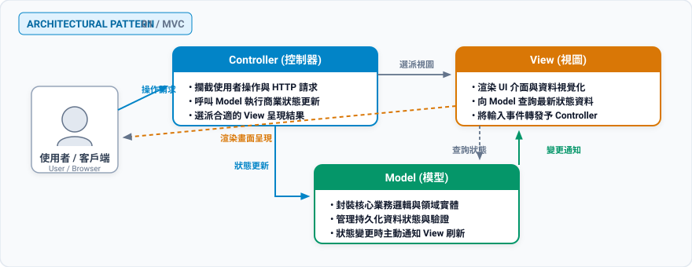
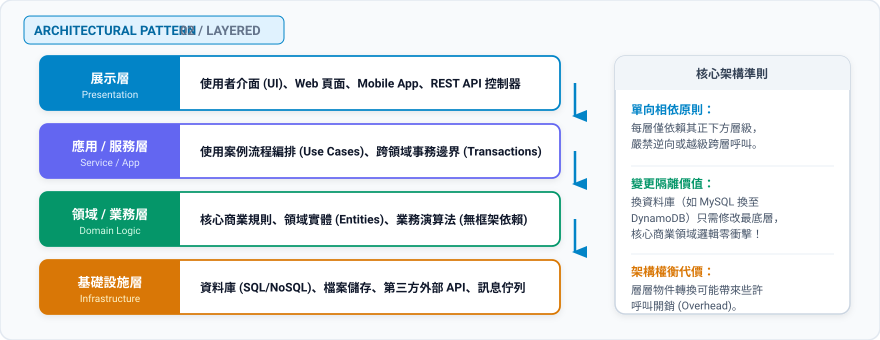
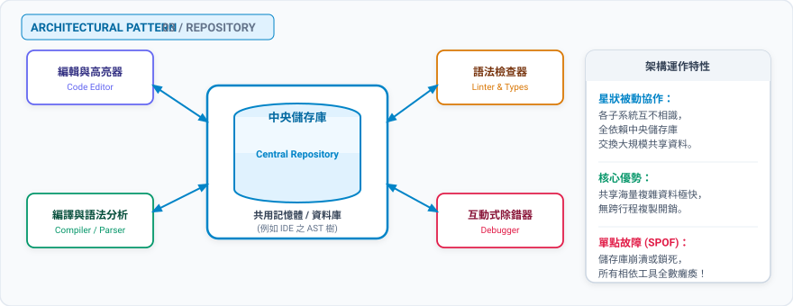
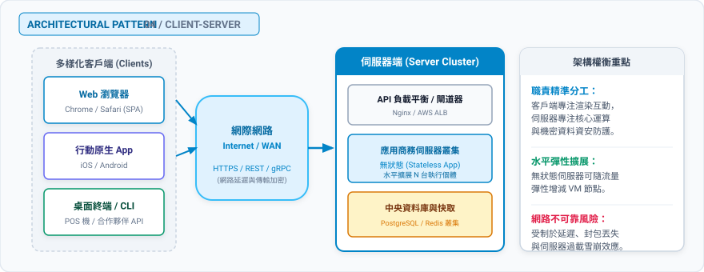
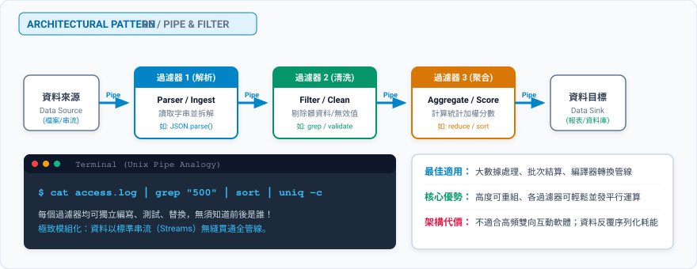
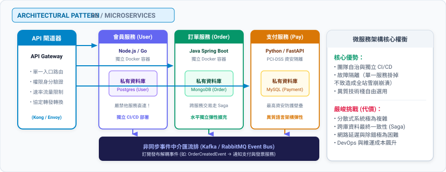
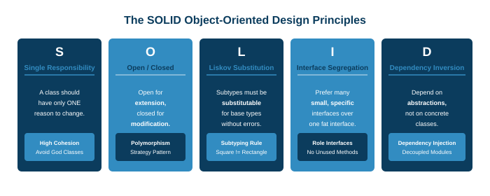
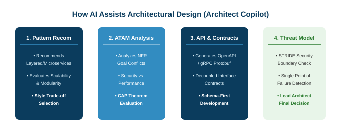

<!-- _class: lead -->
<!-- header: '' -->

# Software Engineering
### Chapter 5: Software Design, Architecture & OO Principles
#### From Universal Foundations & Architecture Modeling to SOLID Craftsmanship

**Prof. Nien-Lin Hsueh**
Department of Information Engineering and Computer Science
Feng Chia University

<!--
Welcome everyone to Lecture 5 of Software Engineering: Software Design, Architecture, and Object-Oriented Principles.

In previous chapters, we analyzed what the customer needs through Requirements Engineering (What to build), and modeled system behavioral boundaries through System Modeling. Today, we cross the threshold into the most creative and consequential phase of engineering: Software Design (How to build)—how do we structure systems so that they scale, adapt, and remain maintainable over decades?

In today's lecture, we establish a comprehensive pedagogical journey. We begin with universal design principles—modularity, abstraction, and the timeless golden rule of High Cohesion and Low Coupling. With these foundations in place, we demystify Software Architecture: how architects actually design and model systems beyond mere patterns, utilizing Kruchten's 4+1 views, the modern C4 model, and Architecture Decision Records (ADRs). Next, we explore classic architectural patterns and trade-offs, zoom into micro-level SOLID object-oriented principles, and see how modern AI copilots empower architects while avoiding costly blind spots.

To summarize this slide, remember this key takeaway: Software design establishes the structural blueprints that enable software systems to scale, adapt, and endure across decades.
-->
---
<!-- _class: outline-slide -->

## Chapter 5: Roadmap & Core Curriculum

<div class="outline-columns">
<div>
<h3>Part 1: Foundations & Architecture</h3>
<ul>
<li><b>5.1 Software Design Foundations:</b> From requirements to blueprints, why design matters, the 4 design levels, and learning roadmap.</li>
<li><b>5.2 Universal Design Principles:</b> Modularity, abstraction, information hiding, levels of cohesion & coupling.</li>
<li><b>5.3 Classic Architectural Patterns & Trade-offs:</b> Layered, repository, client-server, pipe-and-filter, MVC, microservices, and ATAM.</li>
<li><b>5.4 Architecture Derivation & Modeling:</b> Beyond patterns: ASRs, decomposition, UML vs. C4 model, 4+1 views, and ADRs.</li>
</ul>
</div>
<div>
<h3>Part 2: Detailed Design, AI & Synthesis</h3>
<ul>
<li><b>5.5 SOLID Object-Oriented Principles:</b> SRP, OCP, LSP, ISP, and DIP with real-world refactoring examples.</li>
<li><b>5.6 AI in Architecture & Design:</b> AI copilots for trade-off analysis, refactoring, code smell detection, and blind spot mitigations.</li>
<li><b>5.7 Conceptual Synthesis & References:</b> Core principles review, multi-dimensional self-assessment, and literature.</li>
</ul>
</div>
</div>

<!--
Here is our roadmap for Chapter 5.

We begin in 5.1 with a comprehensive overview of Software Design: distinguishing design from coding, understanding why design dictates project survival, and deconstructing the four levels of design.

In 5.2, we introduce Universal Software Design Principles first! Concepts like High Cohesion, Low Coupling, and Separation of Concerns are the fundamental physics of software design—governing everything from distributed microservices down to individual classes. We will also examine the classic hierarchical levels of cohesion and coupling.

In 5.3, we explore Classic Architectural Patterns and non-functional quality attribute trade-offs using ATAM: mastering patterns like MVC, Layered, Repository, Client-Server, Pipe-and-Filter, and Microservices.

In 5.4, we advance to Architecture Derivation & Modeling: answering the critical question of how architects actually derive architectures from requirements beyond just picking patterns, how to model structures using UML versus the modern C4 model, Kruchten's 4+1 views, and how to document decisions with ADRs.

In 5.5, we zoom into micro detailed design with the five foundational SOLID principles.

Finally, in 5.6 and 5.7, we examine AI architectural copilots and synthesize our key engineering takeaways.

To summarize this slide, remember this key takeaway: This roadmap establishes universal design principles first, ascends to classic patterns and architectural modeling, and descends into micro-level object-oriented craftsmanship.
-->
---
<!-- _class: lead -->
<!-- header: '5.1 Software Design Foundations' -->

# **5.1 Software Design Foundations & Spectrum**

> "There are two ways of constructing a software design: One way is to make it so simple that there are obviously no deficiencies, and the other way is to make it so complicated that there are no obvious deficiencies."  
> — *C. A. R. Hoare (Turing Award Laureate)*

<!--
Welcome to Section 5.1: Software Design Foundations & Spectrum.

In software engineering, if Requirements Engineering discovers what needs to be built, Software Design establishes how it will be constructed.

Many beginners rush to open their IDE and start writing code immediately. But without thoughtful software design, codebases quickly deteriorate into unmaintainable quagmires.

In this section, we examine the formal definition of software design, why design dictates project survival, the multi-level spectrum of design activities, and our pedagogical roadmap.

To summarize this slide, remember this key takeaway: Software design is the pivotal engineering phase that transforms user requirements into an executable, high-quality implementation blueprint.
-->
---
## What is Software Design?

* **From Requirements (What) to Implementation (How):**
  - **Requirements Engineering**: Defines stakeholder problems and functional expectations (*what to build*).
  - **Software Design**: Conceptualizes structural decomposition, component boundaries, data models, and protocols (*how to build*).
* **Core Activities of Software Design:**
  - **Blueprint Creation**: Establishes models, abstractions, and specifications that development teams execute against.
  - **Trade-off Decision Making**: Balances competing non-functional forces (e.g., performance vs. security vs. development time and budget).
* **The Distinction Between Design and Coding:**
  - Coding expresses logic in a specific programming language syntax.
  - Design determines **how modules are partitioned, where state lives, and how components are decoupled** for long-term evolvability.

<!--
What is Software Design?

Recall our previous chapters: Requirements engineering gives us functional specifications, like shopping cart checkouts or user authentication.

However, if an engineer jumps straight from user stories into code, they immediately face critical dilemmas: How many API endpoints should we expose? Do we store state in relational tables or document collections? Which module owns which data? Will the system survive when a million users log in simultaneously?

Software design is the disciplined process that answers these questions. It is not surface-level styling; it is the structural and behavioral blueprint of a software system.

To summarize this slide, remember this key takeaway: Software design is the intellectual blueprint bridging abstract human requirements and concrete executable code.
-->
---
## Why is Software Design Crucial?

* **1. Eliminating "Vibe Coding" and Structural Code Rot:**
  - Coding without design rapidly triggers the 4 Symptoms of Poor Design (Robert C. Martin):
    - **Rigidity**: A single change forces a cascade of modifications across dozens of unrelated files.
    - **Fragility**: Fixing a bug in Module A inexplicably breaks Module B in an unrelated subsystem.
    - **Immobility**: Components are tangled together, making reuse in other contexts impossible.
* **2. Quality Attributes are Designed In, Not Tested In:**
  - Scalability, fault tolerance, low latency, and security must be architected from day one—they cannot be patched in via unit tests later.
* **3. Barry Boehm's Cost of Defect Removal Curve:**
  - Catching an architectural flaw in **Requirements & Design** costs **$1**; in integration testing it rises to **$10**; in **production maintenance**, it escalates to **$50–$100x**!
* **4. Shared Contract & Common Language for Engineering Teams:**
  - Clean component boundaries and public interfaces enable dozens of engineers to work in parallel without blocking each other.

<!--
Why is software design so critically important?

First, without design, developers fall into vibe coding or cowboy hacking. Early velocity feels fast, but within weeks the codebase becomes rigid and fragile: touch one line and three other features break.

Second, quality attributes cannot be tested into existence. You cannot write a messy, tightly coupled monolith and hope a few unit tests will magically make it a globally distributed, fault-tolerant platform.

Third, Barry Boehm's famous empirical cost curve demonstrates that catching architectural flaws during design costs 1 dollar, while fixing them in production costs 50 to 100 times more!

To summarize this slide, remember this key takeaway: Disciplined software design minimizes long-term maintenance costs and hardcodes quality into the DNA of the system.
-->
---
## What Does Software Design Encompass? (Design Spectrum)

* **Software design spans a multi-level engineering spectrum from macro to micro:**
  - 🏛️ **1. Architectural Design (Macro-Structure):**
    - High-level system structure, major sub-systems, distributed communication mechanisms, and global patterns (Layered, MVC, Microservices).
  - 🔌 **2. Interface Design (Contract & Boundaries):**
    - Public API specifications, network protocols, inter-component contracts, and information hiding boundaries (encapsulating internals).
  - 🧩 **3. Component & Detailed OO Design (Micro-Implementation):**
    - Internal class structures, algorithms, data structures, SOLID object-oriented principles, and GoF design patterns.
  - 💾 **4. Data & Database Design (Persistence):**
    - Conceptual entity models, relational schemas (ERDs), NoSQL document collections, caching strategies, and data consistency models.
* **User Interface Design (UI/UX Design):**
  - Focuses on human cognitive ergonomics, usability heuristics, and interaction flows—explored in depth in **Chapter 6**.

<!--
What does software design actually encompass?

Notice that software design is not a single, flat task. It is a multi-level engineering spectrum spanning four interconnected tiers:

Tier 1 is Architectural Design: The 10,000-foot view. We partition sub-systems, choose monolithic or microservice architectures, and establish data pipelines.

Tier 2 is Interface Design: Setting up guardrails between sub-systems with clean API contracts and protocols.

Tier 3 is Component & Detailed OO Design: Zooming into classes, methods, and algorithms using SOLID principles and design patterns.

Tier 4 is Data & Database Design: Defining persistence models, schemas, and caching.

To summarize this slide, remember this key takeaway: Software design spans architectural, interface, component, and database design across an integrated engineering continuum.
-->
---
## Roadmap: Why Universal Principles Precede Architecture

* **The Educational Dilemma: Principles First vs. Architecture First:**
  - If we teach architectural patterns first, patterns risk becoming arbitrary, memorized diagrams.
  - When you understand **Separation of Concerns**, you immediately understand *why* Layered Architecture exists.
  - When you understand **Low Coupling**, you immediately understand *why* MVC isolates Models from Views.
  - When you understand **High Cohesion**, you immediately understand *why* Microservices align to Domain Bounded Contexts.
* **Our Step-by-Step Trajectory:**
  - **Step 1: Universal Design Principles (5.2)**: Core tenets, cohesion, coupling, and levels of cohesion & coupling.
  - **Step 2: Classic Patterns & Trade-offs (5.3)**: The 6 architectural styles, monolithic vs. microservices, and ATAM.
  - **Step 3: Architecture Derivation & Modeling (5.4)**: Beyond patterns: ASRs, decomposition, UML, 4+1 views, C4 model, and ADRs.
  - **Step 4: Micro Detailed Design (5.5)**: Class-level SOLID object-oriented craftsmanship.
  - **Step 5: Modern Practice & AI (5.6 & 5.7)**: AI copilot workflows, blind spot mitigations, and synthesis.

<!--
Why do we arrange universal design principles before architecture?

In traditional curricula, instructors often rush directly into architectural patterns like MVC or Microservices. But students frequently ask: 'Why do we need layers? Why can't the database talk directly to the user interface?'

The answer lies in universal principles: Separation of Concerns, High Cohesion, and Low Coupling!

By learning these universal principles first, every architectural pattern we study later becomes an intuitive, logical application of these principles rather than an isolated formula to memorize.

To summarize this slide, remember this key takeaway: Universal design principles provide the intellectual foundation that makes architectural patterns and detailed object-oriented design intuitive and coherent.
-->
---
<!-- _class: lead -->
<!-- header: '5.2 Universal Design Principles' -->

# **5.2 Universal Software Design Principles**

> "Good design is easily changeable; poor design resists change at every step."  
> — *Dave Thomas (The Pragmatic Programmer)*

<!--
Welcome to Section 5.2: Universal Software Design Principles.

Regardless of whether you are architecting a multi-region cloud platform across Kubernetes clusters or writing a 20-line utility function inside a single Java class, the laws of software physics remain identical.

In this section, we study the foundational building blocks of all software design: Modularity, Abstraction, Encapsulation, Separation of Concerns, and the supreme golden rule of software engineering: High Cohesion and Low Coupling.

To summarize this slide, remember this key takeaway: Universal design principles govern software quality fractally across every scale of abstraction.
-->
---
## Universal Principles: Fractal Across Every Scale

* **Software Design is Fractal:**
  - The same fundamental principles govern software quality regardless of zoom level:
    - **System Scale (Macro)**: Microservices partition business domains into decoupled, cohesive services.
    - **Module Scale (Meso)**: Packages and libraries isolate responsibilities behind public API boundaries.
    - **Class Scale (Micro)**: Individual classes encapsulate state and maintain a single, cohesive reason to change.
* **Core Tenets Guard Against Complexity:**
  - Computer memory is vast, but human working memory is strictly limited (Miller's Law: 7 ± 2 chunks).
  - Software principles are cognitive tools designed to keep software understandable, testable, and modifiable by human engineering teams.

<!--
Why are software design principles called 'universal'?

Because software design is fractal. When you look at an entire cloud enterprise, you see services communicating through APIs. When you zoom into one microservice, you see packages communicating through interfaces. When you zoom into one package, you see classes communicating through methods.

At every single level of zoom, the exact same rules apply: keep things focused, keep them decoupled, hide internal complexity, and separate concerns.

To summarize this slide, remember this key takeaway: Universal design principles operate fractally across systems, packages, and classes to keep software systems humanly manageable.
-->
---
## Core Design Tenets: Modularity, Abstraction & SoC

* **1. Abstraction :**
  - Hiding low-level implementation mechanics behind clean, high-level conceptual interfaces. Allows developers to reason about systems without mental overload.
* **2. Encapsulation & Information Hiding :**
  - *David Parnas's Principle:* Bundling state and behavior inside a module while concealing private variables. Prevents external code from introducing illegal state side-effects.
* **3. Separation of Concerns (SoC):**
  - Decomposing software into distinct features that overlap as little as possible (e.g., decoupling UI rendering logic from SQL database queries).
* **4. Modularity :**
  - Dividing systems into cohesive, independently testable, and hot-swappable units.

<!--
These four principles form the bedrock of clean software engineering:

Abstraction lets you call map.insert without worrying whether it uses a red-black tree or a hash table.
Encapsulation uses private modifiers to guard internal object invariants.
Separation of Concerns ensures that UI code never constructs raw SQL queries.
And Modularity allows dozens of engineers to develop in parallel without blocking each other.

To summarize this slide, remember this key takeaway: Abstraction, encapsulation, separation of concerns, and modularity protect integrity and prevent developer cognitive overload.
-->
---
## The Golden Rule: High Cohesion & Low Coupling

* **Cohesion :**
  - Measures how tightly focused and related the internal responsibilities of a single class or module are.
  - **Engineering Goal:** **High Cohesion** (A module should do one thing, and do it exceptionally well).
* **Coupling :**
  - Measures the strength of direct interdependencies between separate modules.
  - **Engineering Goal:** **Low Coupling** (Modules communicate via abstract contracts, remaining ignorant of internal implementation details).
* **The Universal Golden Rule:**
  > **Maximize Cohesion, Minimize Coupling!**  
  > High cohesion makes modules understandable and maintainable; low coupling prevents modifications from causing cascading system ripple effects.

<!--
If you could remember only one rule from this entire lecture, make it this: Maximize Cohesion, Minimize Coupling!

Cohesion measures internal focus: Does this class handle one clear task, or does it process orders, send emails, and generate PDFs simultaneously? We strive for High Cohesion.

Coupling measures external entanglement: If I modify Class A, do ten unrelated files break? We strive for Low Coupling.

High cohesion paired with low coupling is the secret to building software that remains testable and maintainable across decades.

To summarize this slide, remember this key takeaway: High cohesion ensures focused internal responsibilities, while low coupling eliminates dangerous cascading change dependencies.
-->
---
## Cohesion & Coupling: Bad vs. Good Design

```java
// ❌ BAD: Low Cohesion & High Coupling (The Infamous "God Class")
class OrderManager {
    public void processOrder() {
        // Embeds raw MySQL database query strings
        // Calculates complex VIP customer discount mathematics
        // Concatenates raw HTML strings for customer invoices
        // Opens raw low-level TCP/SMTP socket connections to send emails
    }
}
```

```java
// ✅ GOOD: High Cohesion & Low Coupling (Collaborative Decoupled Classes)
class OrderProcessor {
    private final DiscountCalculator discountCalculator;
    private final OrderRepository orderRepository;
    private final NotificationService notificationService;

    public OrderProcessor(DiscountCalculator dc, OrderRepository repo, NotificationService ns) {
        this.discountCalculator = dc;
        this.orderRepository = repo;
        this.notificationService = ns;
    }
    // Orchestrates workflow cleanly across injected abstract interfaces!
}
```

<!--
Examine this concrete Java code comparison:

In the bad design above, OrderManager is an infamous 'God Class': a single method contains raw SQL, business math, HTML templating, and raw TCP networking! If your email server changes protocols, you must modify your checkout order class!

In the good design below, OrderProcessor has one single, cohesive responsibility: workflow orchestration. It delegates math to DiscountCalculator, persistence to OrderRepository, and alerts to NotificationService. Each collaborator is independently testable and swappable.

To summarize this slide, remember this key takeaway: Decomposing bloated monolithic classes into focused, collaborating services exemplifies high cohesion and low coupling.
-->
---
## Levels and Types of Cohesion: From Weak to Strong

* **Cohesion Spectrum (Edward Yourdon & Larry Constantine):**
  - Measures how strongly related the internal elements of a single module/class are:

| Level | Cohesion Type | Core Characteristics | Real-World Example | Quality Assessment |
| :--- | :--- | :--- | :--- | :--- |
| **7** | **Functional** | Performs exactly one single, well-defined mathematical or business task | `computeSalesTax()`, `sin(x)` | **Ideal (Highest)** |
| **6** | **Sequential** | Output from one operation serves directly as the input to the next | `readData() → parseJSON() → validate()` | **Strong** |
| **5** | **Communicational** | Operations share the same input data or produce the same output | `updateCustomerAddress()` & `printLabel()` | **Acceptable** |
| **4** | **Procedural** | Elements execute in a specific order, but operate on different data | `validateOrder()`, then `updateInventoryAudit()` | **Moderate** |
| **3** | **Temporal** | Elements are grouped purely because they execute at the same time | `systemStartup()`, `loadConfigAndLog()` | **Weak (Avoid)** |
| **2** | **Logical** | Elements perform logically similar tasks, selected by a control flag | `printReport(int format)` (PDF, HTML, CSV) | **Weak (Avoid)** |
| **1** | **Coincidental** | Elements have no meaningful relationship; arbitrary catch-all grouping | `GeneralUtils.java`, `CommonHelper.java` | **Worst (Eliminate)** |

<!--
Let's analyze the classic 7 levels of Cohesion established by Larry Constantine and Edward Yourdon.

At the very top is Functional Cohesion—the gold standard of software design. Every line of code inside the class or method contributes to accomplishing one single, well-defined mathematical or domain operation.

Sequential Cohesion is also strong: operations form an assembly line where Step A feeds into Step B.

Communicational and Procedural represent intermediate levels where activities share data or execution order.

At the bottom are the anti-patterns: Temporal cohesion groups tasks just because they happen at startup; Logical cohesion creates bloated switch-case methods controlled by flags; and Coincidental cohesion is the infamous 'Utils' class dumping ground with no meaningful relationship.

To summarize this slide, remember this key takeaway: Strive for Functional and Sequential cohesion, and refactor away temporal, logical, and coincidental groupings.
-->
---
## Levels and Types of Coupling: From Tight to Loose

* **Coupling Spectrum (How Dependent Are Separate Modules?):**
  - Measures the degree of direct interconnections and knowledge sharing between modules:

| Level | Coupling Type | Coupling Mechanism & Risk | Real-World Example | Quality Assessment |
| :--- | :--- | :--- | :--- | :--- |
| **1** | **Content (Pathological)**| One module reaches directly into private internal memory/code of another | Bypassing getters to modify a private field | **Worst (Severe Bug Risk)** |
| **2** | **Common (Global)** | Multiple modules share access to global mutable variables | Reading/writing global flags in multi-threading | **High Risk (Avoid)** |
| **3** | **Control** | One module controls the internal execution flow of another via flags | Passing `mode = 3` to dictate callee branch | **Moderate Risk** |
| **4** | **Stamp (Data-Structure)**| Modules share a composite data structure, but callee needs only a field | Passing entire `Customer` to get `zipCode` | **Moderate (Acceptable)** |
| **5** | **Data** | Modules communicate exclusively via elementary, primitive arguments | `calculateArea(width, height)` | **Loosest & Best (Calls)** |
| **6** | **Message / Event** | Modules communicate asynchronously via messages/events without coupling | EventBus: `OrderPlacedEvent` via Kafka | **Ideal (Decoupled)** |

<!--
Now let's examine the classic hierarchy of Coupling, ordered from the most dangerous and tightly coupled to the cleanest and most decoupled.

At the worst extreme is Content Coupling, where Module A bypasses encapsulation and alters Module B's private internals. A change to B immediately shatters A.

Common Coupling occurs when modules communicate through global mutable variables—a notorious source of race conditions and hidden side-effects.

Control Coupling happens when you pass boolean or integer flags to dictate how the callee behaves internally.

Stamp Coupling occurs when you pass a huge composite object, like passing a 50-field Employee record to a tax function that only needs gross income.

Data Coupling is the gold standard for direct function calls: passing only primitive, elementary parameters.

And Message or Event Coupling decouples modules entirely across time and space using asynchronous message brokers.

To summarize this slide, remember this key takeaway: Eliminate content and common coupling, minimize control coupling, and aim for data and event-driven decoupling.
-->
---
### Concept Check Question 1 (CCQ 1)
<div class="ccq-columns">
  <div class="ccq-text">

In software system design, what is the primary practical benefit of combining **High Cohesion** with **Low Coupling**?

- **A.** Maximizes raw CPU runtime performance by inlining all functions into a single binary.
- **B.** Produces a modular architecture where changes to one class cause minimal cascading ripple effects on other modules.
- **C.** Mandates storing all central data structures in a globally shared variable space.
- **D.** Completely eliminates the need to write automated integration tests and regression suites.

  </div>
  <div class="ccq-logo">
    
  </div>
</div>

<!--
Let's check our understanding of cohesion and coupling.

The question asks: What is the primary practical benefit of combining High Cohesion with Low Coupling?

Evaluating options:
Option A, inlining code for raw CPU speed, is a compiler optimization that destroys modularity.
Option C, global variables, is the textbook definition of poor design!
Option D, eliminating tests, is unrealistic wishful thinking.

The correct answer is B! High cohesion keeps classes focused, while low coupling ensures clear boundaries—so modifications in one class cause minimal ripple effects elsewhere.

To summarize this slide, remember this key takeaway: High cohesion and low coupling strictly limit the blast radius of code changes, ensuring long-term maintainability.
-->
---
<!-- _class: lead -->
<!-- header: '5.3 Classic Architectural Patterns & Trade-offs' -->

# **5.3 Classic Architectural Patterns & Trade-offs**

> "There are no solutions, only trade-offs."  
> — *Thomas Sowell*

<!--
Welcome to Section 5.3: Classic Architectural Patterns & Trade-offs.

Now that we have established universal principles, we step up to the macro-architectural scale. We explore the structural archetypes developed by the software engineering community over the past fifty years: Architectural Patterns.

Patterns are proven structural solutions to recurring architectural challenges. However, every pattern introduces distinct trade-offs.

In this section, we begin by defining Software Architecture and Architectural Patterns. We then analyze six foundational architectural patterns: MVC, Layered, Repository, Client-Server, Pipe & Filter, and Microservices. We conduct a deep-dive comparison between Monolithic and Microservices architectures, and master the Architecture Trade-off Analysis Method (ATAM).

To summarize this slide, remember this key takeaway: Architectural patterns provide proven structural templates whose trade-offs must be rigorously evaluated against system quality attributes.
-->
---
## What is Software Architecture?

* **Formal Definition (IEEE 1471 / ISO 42010):**
  > Software architecture is the fundamental organization of a system embodied in its components, their relationships to each other and the environment, and the principles guiding its design and evolution.
* **The Bridge Role of Architecture:**
  - **Requirements (What)**: Stakeholder needs, user stories, and constraints.
  - **Implementation (How)**: Source code, data schemas, and unit tests.
  - **Architecture (The Bridge)**: Transforms messy requirements into structured sub-systems, communication boundaries, and deployment topology.
* **Architecture in the Small vs. in the Large:**
  - **In the Small**: Internal design of individual applications (classes, modules, local interfaces).
  - **In the Large**: Enterprise-scale structures (distributed services, cloud platforms, event buses, multi-tier databases).

<!--
What is Software Architecture?

Software architecture is the fundamental organization of a system embodied in its components, their relationships to each other and the environment, and the principles guiding its design and evolution.

Notice its bridge role: Requirements engineering tells us what needs to be built. Coding is how individual lines are written. Architecture is the bridge in between—it determines the principal structural modules, the data persistence strategy, and the network communication protocols.

Because architectural decisions are the hardest and most expensive to change later, getting the architecture right early is vital to project success.

To summarize this slide, remember this key takeaway: Software architecture bridges requirements and code by establishing high-level component structures and communication boundaries.
-->
---
## What is an Architectural Pattern?

* **Definition of Architectural Patterns:**
  - An architectural pattern is a **reusable, established solution to a commonly occurring structural problem** in software system design.
  - While design patterns (e.g., Factory, Strategy) operate at the class level, architectural patterns govern the **entire macro-system topology**.
* **Three Key Elements of an Architectural Pattern:**
  - **1. Context**: The recurring design situation and engineering environment.
  - **2. Problem & Forces**: Competing requirements (e.g., decoupling UI from business logic vs. minimizing latency).
  - **3. Solution & Consequences**: Structural partitioning, communication topology, and resulting trade-offs.
* **Why Patterns Matter:**
  - Establishes a shared architectural vocabulary across engineering teams.
  - Codifies decades of engineering experience, avoiding recurring structural failures.

<!--
What is an Architectural Pattern?

An architectural pattern is a stylized, proven description of good design practice that has been tested in different environments.

Notice that a pattern is not code; it is a structural archetype. When an architect specifies 'Layered Architecture with Repository', every engineer immediately understands the component boundaries and communication pipelines.

Patterns encapsulate proven structural wisdom, establishing shared vocabulary and predictable trade-offs.

To summarize this slide, remember this key takeaway: Architectural patterns encapsulate proven structural wisdom, establishing shared vocabulary and predictable trade-offs.
-->
---
## Architectural Patterns: Comprehensive Overview Matrix

| Pattern Name | Visual Topology | Core Mechanism | Best Used For | Primary Risk & Trade-off |
| :--- | :--- | :--- | :--- | :--- |
| **1. MVC** | Triangular Cycle (`C → M → V`) | Separates UI presentation from data models | Interactive Web / mobile apps with rich UIs | Overkill for simple data display (CRUD) |
| **2. Layered** | Vertical Stack (`N → N-1`) | Strict hierarchy with one-way downward calls | Enterprise information systems & CRUD apps | Performance overhead; sinkhole anti-pattern |
| **3. Repository** | Hub-and-Spoke Central Store | Passive central data store with active agents | Compilers, IDEs, and shared data analysis | Central DB bottleneck & single point of failure |
| **4. Client-Server**| Distributed Network (`C ↔ S`) | Clients request services from central servers | Web apps, file servers, centralized services | Network latency & server overloading |
| **5. Pipe-Filter** | Linear Sequential Stream | Discrete transform filters connected via pipes | Data processing, compilers, ETL pipelines | Inefficient for interactive systems; parsing cost |
| **6. Microservices**| Decentralized Mesh (`S ↔ S`) | Independently deployable domain services | Large-scale, rapidly evolving cloud platforms | High operational, network & transactional complexity |

<!--
Examine this comprehensive Architectural Patterns Matrix.

This matrix catalogs the visual icon, core mechanism, sweet-spot application, and primary architectural risk of six foundational patterns:
MVC decouples UI and data models via circular flows;
Layered establishes strict vertical abstraction boundaries;
Repository enables passive component collaboration via a central store;
Client-Server distributes computation over computer networks;
Pipe & Filter connects discrete transformations through sequential data streams;
Microservices partitions systems into independently deployable domain services.

To summarize this slide, remember this key takeaway: The Architectural Patterns Matrix provides an archetypal reference guide for evaluating structural mechanisms and trade-offs.
-->
---
## 1. Model-View-Controller (MVC) Pattern

<div class="centered-image">
  
</div>

* **Core Structural Responsibilities:**
  - **Model**: Encapsulates core business data, validation logic, and domain state.
  - **View**: Renders visual representation to users; listens for state change events.
  - **Controller**: Intercepts user inputs, orchestrates business logic, and mutates the Model.
* **Engineering Advantages & Trade-offs:**
  - **Strengths**: Enables multiple simultaneous views of the same model; allows UI and backend engineers to work in parallel.
  - **Weaknesses**: Increases complexity for simple screens; tight coupling can occur if Views bypass Controllers.

<!--
Let's analyze Pattern 1: Model-View-Controller (MVC).

Look at the triangular data flow in the diagram:
The Controller intercepts user HTTP requests, translates them into domain actions, and updates the Model.
The Model holds the authoritative state and business rules.
The View observes or queries the Model to render HTML or mobile screens.

MVC's greatest virtue is Separation of Concerns: frontend designers can overhaul the HTML CSS presentation without touching core business calculation rules!

To summarize this slide, remember this key takeaway: MVC decouples visual presentation from domain data models, enabling independent evolution of user interfaces.
-->
---
## 2. Layered Architecture Pattern

<div class="centered-image">
  
</div>

* **Core Structural Responsibilities:**
  - Organizes components into horizontal layers: **Presentation → Business Logic → Data Access → Database**.
  - **Strict Layering Rule**: Each layer only depends on the layer immediately below it (`Layer N → Layer N-1`).
* **Engineering Advantages & Trade-offs:**
  - **Strengths**: High modularity; hot-swappable layers (e.g., swapping SQL for NoSQL without modifying business logic).
  - **Weaknesses**: "Architecture Sinkhole Anti-pattern" (requests simply pass through layers without doing work, causing performance drag).

<!--
Pattern 2 is the most ubiquitous architecture in enterprise computing: Layered Architecture.

Look at the horizontal hierarchy: Presentation at top, Business Logic in the middle, and Data Access at the bottom.

The fundamental rule is unidirectional downward dependency: Presentation calls Business Logic, Business Logic calls Data Access. The database never calls the UI!

This provides phenomenal modularity: you can swap the UI from Web to Mobile without touching business code. However, beware the sinkhole anti-pattern, where layers do nothing but pass calls through, creating performance latency.

To summarize this slide, remember this key takeaway: Layered architecture enforces clean vertical abstraction boundaries, ensuring upper layers remain decoupled from database implementations.
-->
---
## 3. Repository Architecture Pattern

<div class="centered-image">
  
</div>

* **Core Structural Responsibilities:**
  - **Central Repository**: Passive data store maintaining all persistent system state.
  - **Subsystems / Accessors**: Independent active components that interact solely through the repository.
* **Engineering Advantages & Trade-offs:**
  - **Strengths**: Efficient sharing of large, complex data structures; subsystems do not need direct inter-connections.
  - **Weaknesses**: Repository becomes a single point of failure (SPOF) and a severe performance bottleneck under high concurrent writes.

<!--
Pattern 3: Repository Architecture (also known as Blackboard Architecture in AI).

Notice the topology: independent components (Parser, Type Checker, Optimizer, Code Generator in an IDE or compiler) do not talk directly to each other. Instead, they communicate exclusively through a central data store.

This makes integrating new tools trivial: you simply plug a new tool into the central repository without rewiring existing modules.

However, the central repository is a prime Single Point of Failure and can become an intolerable bottleneck under high concurrent load.

To summarize this slide, remember this key takeaway: Repository architecture centralizes shared state among disparate tools, eliminating direct inter-module coupling at the cost of a central bottleneck.
-->
---
## 4. Client-Server Architecture Pattern

<div class="centered-image">
  
</div>

* **Core Structural Responsibilities:**
  - **Server Component**: Centralized provider offering shared services (data storage, compute, auth).
  - **Client Components**: Distributed consumers that initiate network requests to access server resources.
* **Engineering Advantages & Trade-offs:**
  - **Strengths**: Centralized data management, access control, and seamless server-side upgrades.
  - **Weaknesses**: Network latency and failure risks; server overload during traffic surges (requires load balancing).

<!--
Pattern 4 is the foundation of the World Wide Web: Client-Server Architecture.

Clients (browsers, mobile apps) communicate over TCP/IP or HTTP with centralized servers.

This architecture centralizes data integrity and security: sensitive user accounts and banking ledgers are stored securely on servers rather than on vulnerable client devices.

The major architectural challenges are network unreliability and scalability: servers must employ load balancers, caching proxies, and horizontal auto-scaling to survive traffic surges.

To summarize this slide, remember this key takeaway: Client-server architecture distributes presentation to edge clients while centralizing security and data governance on servers.
-->
---
## 5. Pipe-and-Filter Architecture Pattern

<div class="centered-image">
  
</div>

* **Core Structural Responsibilities:**
  - **Filters**: Independent, stateless transformation components that read input streams and produce output streams.
  - **Pipes**: Unidirectional channels that buffer and transmit data streams between filters.
* **Engineering Advantages & Trade-offs:**
  - **Strengths**: High reusability (filters can be recombined freely, like Unix pipes `cat | grep | sort`); easy parallelization.
  - **Weaknesses**: Poor fit for interactive GUI systems; data parsing overhead between adjacent filter boundaries.

<!--
Pattern 5: Pipe-and-Filter Architecture.

Think of Unix command-line pipes, video encoding pipelines, or modern Big Data ETL pipelines.

Each filter does one job: it reads an input stream, applies a transformation, and emits an output stream into a pipe.

Filters know nothing about upstream or downstream neighbors; they only consume and produce data streams. This yields supreme reusability and trivial parallel execution across CPU cores.

However, pipe-and-filter is terrible for interactive user interfaces, and serializing data between stages incurs significant overhead.

To summarize this slide, remember this key takeaway: Pipe-and-filter architecture structures sequential data stream transformations into composable, parallelizable processing units.
-->
---
## 6. Microservices Architecture Pattern (MSA)

<div class="centered-image">
  
</div>

* **Core Structural Responsibilities:**
  - Decomposes the application into a suite of small, autonomous, **independently deployable services**.
  - **Database per Service**: Each microservice owns its private persistent database; direct cross-service DB queries are forbidden!
* **Engineering Advantages & Trade-offs:**
  - **Strengths**: Independent deployment cadence; polyglot technology stacks; strict fault isolation (blast radius containment).
  - **Weaknesses**: Distributed systems complexity: network latency, distributed transactions (Saga pattern), and eventual consistency.

<!--
Pattern 6 represents modern cloud-native computing: Microservices Architecture.

Instead of deploying a single giant artifact, we decompose the system into dozens of small services organized around business capabilities: Order Service, Payment Service, Inventory Service.

Crucially: each service owns its private database. If Order Service needs customer data, it must call Customer Service over REST or gRPC—never run a direct SQL JOIN!

However, microservices introduce severe distributed systems overhead: network latency replaces in-memory calls, and cross-service transactions require complex Saga patterns.

To summarize this slide, remember this key takeaway: Microservices achieve high team autonomy and fault isolation at the expense of distributed network and transactional complexity.
-->
---
## Monolithic vs. Microservices: Deep Dive

| Comparison Dimension | Monolithic Architecture | Microservices Architecture |
| :--- | :--- | :--- |
| **Deployment Unit** | Single unified binary / WAR / container | Dozens/hundreds of independent containers |
| **Data Storage** | Single shared relational database | **Database-per-Service** (strict data encapsulation) |
| **Communication** | Fast in-memory function calls | Network RPC / REST / gRPC / Event Bus |
| **Fault Isolation** | **Poor**: Memory leak in Module A crashes entire app | **Superior**: Payment service crash leaves Browse active |
| **Team Scalability** | Merge conflicts; coordination bottlenecks | Independent feature teams deploying autonomously |
| **Operational Cost** | Simple (single CI/CD pipeline, standard logs) | High (Kubernetes, distributed tracing, service mesh) |
| **Architectural Sweet Spot** | Startups, MVP stage, small teams (<15 devs) | Large organizations (>50 devs), complex domains |

<!--
Compare Monolithic and Microservices architectures side-by-side.

In a Monolith, all code runs inside a single process sharing one database. Calling a function takes nanoseconds in memory, and deployments are simple. But if one module has a memory leak, the entire application crashes!

In Microservices, each service runs in an isolated container. A crash in Payment Service does not take down the product catalog! Teams can deploy five times a day independently.

However, do not underestimate operational complexity: you now need Kubernetes clusters, distributed tracing with OpenTelemetry, and eventual consistency handling.

To summarize this slide, remember this key takeaway: Microservices trade operational simplicity for team autonomy and fault isolation; start with a modular monolith unless organizational scale demands distribution.
-->
---
## Architecture Directly Shapes Quality Attributes

* **Quality Attributes Cannot Be Retrofitted Later:**
  - You cannot build a tightly coupled monolith and hope a few unit tests will magically make it scalable.
* **How Architectural Decisions Determine Quality Attributes:**
  - ⚡ **Performance**: Dictated by network hops, in-memory caching layers, and database partitioning.
  - 🛡️ **Security**: Dictated by zero-trust network zones, API gateways, and isolation of sensitive databases.
  - 🦺 **Safety**: Dictated by structural isolation of safety-critical functions (e.g., flight control vs. in-flight entertainment).
  - 🔄 **Availability & Fault Tolerance**: Dictated by redundancy, health checks, circuit breakers, and automated failover replicas.
  - 🔧 **Maintainability & Modifiability**: Dictated by strict adherence to High Cohesion and Low Coupling boundaries.

<!--
Why is architecture the ultimate determinant of software quality?

Because non-functional quality attributes—performance, security, reliability, availability—cannot be patched on at the end of a project. They are emergent physical properties of the structural skeleton!

If you build an automotive software system and place the brake control logic on the same unisolated memory bus as the passenger media player, a media player crash can disable the brakes! Safety requires physical structural partitioning.

Similarly, high availability requires automated replica clusters, and maintainability requires low coupling.

To summarize this slide, remember this key takeaway: Non-functional quality attributes are direct physical consequences of architectural structures and cannot be retrofitted via patches.
-->
---
## Architectural Trade-off Analysis & ATAM

* **The Inevitable Conflict Matrix:**
  - In software architecture, there are **no perfect solutions—only trade-offs**:
    - **Performance vs. Security**: Deep packet encryption and multi-tier authentication add latency.
    - **Availability vs. Consistency (CAP Theorem)**: Instant consistency requires blocking network locks, hurting availability.
    - **Modularity vs. Performance**: Pure decoupled layers introduce serialization and call-stack overhead.
* **ATAM (Architecture Trade-off Analysis Method):**
  - Developed by Carnegie Mellon SEI (Software Engineering Institute) to evaluate architectural soundness before coding:
  - **Key Concepts in ATAM:**
    - **Sensitivity Points**: Architectural decisions directly affecting a single quality attribute.
    - **Trade-off Points**: Architectural decisions affecting multiple competing attributes (e.g., encryption improves security but hurts throughput).
    - **Risks & Non-Risks**: Decisions that threaten or safeguard system viability.

<!--
Examine the reality of engineering: Architectural Trade-off Analysis.

Every architectural decision is a compromise:
Increasing security with double encryption inevitably degrades throughput.
Achieving strict ACID consistency across distributed nodes degrades availability under network partitions (the CAP theorem).

To evaluate these compromises systematically before writing code, Carnegie Mellon SEI created ATAM: the Architecture Trade-off Analysis Method.

ATAM uncovers Trade-off Points—places where boosting one quality attribute directly penalizes another—allowing architects to make deliberate, informed business compromises.

To summarize this slide, remember this key takeaway: Architecture fundamentally centers on balancing competing quality trade-offs to achieve business success.
-->
---
### Concept Check Question 2 (CCQ 2)
<div class="ccq-columns">
  <div class="ccq-text">

When comparing a Monolithic architecture with a Microservices architecture, what is the primary structural reason that Microservices provide superior **fault isolation** (blast radius containment)?

- **A.** Microservices store all enterprise data inside a single shared database instance.
- **B.** Each microservice executes in an isolated process with its own private database, preventing catastrophic cascading failures.
- **C.** Microservices completely eliminate all network communication overhead and distributed latency.
- **D.** Microservices require significantly fewer software engineers to deploy and operate.

  </div>
  <div class="ccq-logo">
    
  </div>
</div>

<!--
Let's check our understanding of architectural styles.

The question asks: What is the primary structural reason that Microservices provide superior fault isolation?

Evaluating options:
Option A is false: sharing a single database is a monolithic antipattern that causes data coupling!
Option C is false: microservices increase network communication overhead!
Option D is false: microservices usually require more operational personnel.

The correct answer is B! By isolating each service in its own independent process and database, a memory leak or crash in one service cannot directly crash neighboring services.

To summarize this slide, remember this key takeaway: Process and database isolation in microservices prevents local failures from triggering catastrophic application-wide crashes.
-->
---
<!-- _class: lead -->
<!-- header: '5.4 Architecture Derivation & Modeling' -->

# **5.4 Architecture Derivation & Modeling: Beyond Patterns**

> "Architecture is the decisions that you wish you could get right the first time."  
> — *Ralph Johnson (Design Patterns Author)*

<!--
Welcome to Section 5.4: Architecture Derivation & Modeling.

Now that we have surveyed classic architectural patterns, a crucial question arises: When architects design systems in the real world, do they just pick a pattern from a catalog like a shopping cart?

The answer is an emphatic NO! Architecture is a disciplined derivation and modeling process driven by Architecturally Significant Requirements (ASRs). In production, systems synthesize and combine multiple patterns across tiers.

In this section, we demystify how architects actually derive architectures, how to model structures using UML diagrams, Kruchten's 4+1 views, and Simon Brown's modern C4 model, and how to preserve decisions using Architecture Decision Records (ADRs).

To summarize this slide, remember this key takeaway: Architecture design is a disciplined derivation and multi-view modeling process that moves far beyond simply selecting isolated patterns.
-->
---
## How to Do Architecture Design: Beyond Just Picking Patterns

* **Architecture is NOT a "Pattern Shopping Cart":**
  - Architecture is a disciplined engineering process of discovery, partitioning, and trade-off synthesis:
* **The 5-Step Architecture Derivation Process:**
  - **1. Extract ASRs (Architecturally Significant Requirements)**:
    - Identify high-priority Quality Attributes (e.g., 99.99% uptime, <100ms latency) and mission-critical Use Cases.
  - **2. Subsystem Partitioning & Decomposition**:
    - Decompose the system by business capabilities (Domain-Driven Bounded Contexts) or technical layers.
  - **3. Synthesize & Combine Architectural Styles**:
    - Real-world systems combine patterns: e.g., Microservices at the enterprise tier, Event-Driven for ingestion, and Layered MVC inside each service!
  - **4. Define Communication Protocols & Interfaces**:
    - Synchronous REST / gRPC vs. asynchronous Kafka / RabbitMQ event streams.
  - **5. Evaluate Trade-offs & Document Decisions**:
    - Validate resilience under stress (ATAM) and capture decisions in Architecture Decision Records (ADRs).

<!--
How do software architects actually design systems?

A common misconception among novices is that architecture is just browsing a catalog and picking 'Microservices' or 'Layered Architecture.'

In reality, architecture is a systematic 5-step engineering process:
First, you extract Architecturally Significant Requirements—not all requirements impact architecture, only those defining scale, security, and critical workflows.
Second, you partition the system into clean bounded contexts.
Third, you synthesize and combine patterns to solve specific technical forces.
Fourth, you establish communication protocols between components.
Fifth, you rigorously evaluate trade-offs and document your rationale.

To summarize this slide, remember this key takeaway: Architectural design is a disciplined derivation process driven by Architecturally Significant Requirements and trade-off synthesis.
-->
---
## Modeling Architecture: UML in Practice vs. Common Pitfalls

* **The "Class Diagram" Trap (Most Common Novice Mistake):**
  - Beginners often draw a giant UML Class Diagram with 50 classes and call it "System Architecture."
  - **Why this fails:** Class diagrams show compile-time object relationships; they completely conceal network boundaries, runtime processes, database servers, and cloud deployment topology!
* **Traditional UML Diagrams for Macro-Architecture:**
  - **1. Component Diagram**:
    - Visualizes high-level software components, provided interfaces (`--O` lollipop), and required interfaces (`--( ` socket).
  - **2. Package Diagram**:
    - Depicts namespace organization, logical subsystem boundaries, and dependency arrows.
  - **3. Deployment Diagram**:
    - Models physical hardware nodes, virtual containers, execution environments, and network protocols (HTTPS, TCP/IP, JDBC).

<!--
How do we model and draw software architecture? Can we just use UML?

Here is the single most common mistake made by junior developers: they draw a massive UML class diagram with 50 classes, boxes, and arrows, and present it as the 'system architecture.'

That is a trap! Class diagrams are micro-level implementation details. They tell you nothing about which components run on AWS, where the database lives, how services handle network timeouts, or what happens when traffic spikes 100x.

If you use UML for architecture, you must use macro-level diagrams: Component diagrams for provided/required interfaces, Package diagrams for subsystem dependencies, and Deployment diagrams for physical server topology.

To summarize this slide, remember this key takeaway: Avoid the class diagram trap for architecture; use component, package, and deployment diagrams to capture macro structure.
-->
---
## Multi-Perspective Architecture: Kruchten's 4+1 View Model

* **Philippe Kruchten (1995): "No single diagram can capture architecture for all stakeholders."**
* **The 4+1 Multi-Perspective Framework:**
  - **1. Logical View (End-User / Functional)**:
    - Class structures, entity models, and domain packages satisfying functional user requirements.
  - **2. Process View (System Integrators / Performance)**:
    - Concurrency, multi-threading, asynchronous message queues, IPC, and runtime performance.
  - **3. Development View (Software Developers / Managers)**:
    - Source code package hierarchy, libraries, build modules, and repository organization.
  - **4. Physical View / Deployment View (System Engineers / DevOps)**:
    - Physical servers, cloud containers, network topology, firewalls, and communication protocols.
  - **+1. Scenarios (Use Cases / Drivers)**:
    - Core business workflows that bind, validate, and animate all four views together.

<!--
Examine Philippe Kruchten's legendary 4+1 Architectural View Model.

Kruchten realized that no single architectural drawing can satisfy everyone. A business stakeholder cares about user features; a programmer cares about Maven build modules; a database administrator cares about network failover; and a DevOps engineer cares about Docker containers and Kubernetes clusters.

The 4+1 model resolves this by providing four distinct views tied together by central use case scenarios:
Logical View for end users; Process View for concurrency and throughput; Development View for code organization; and Physical View for hardware and cloud infrastructure.

To summarize this slide, remember this key takeaway: Kruchten's 4+1 model reconciles conflicting stakeholder needs through four distinct views bound together by core scenarios.
-->
---
## Modern Architecture Visualization: The C4 Model

* **Created by Simon Brown as a modern, developer-friendly alternative to heavy UML:**
* **The "Google Maps" Metaphor for Software Architecture (4 Zoom Levels):**
  - 🗺️ **Level 1: System Context (Zoom: Continental View)**:
    - Who uses the system (Actors) and what external systems does it integrate with (e.g., Stripe, SendGrid)?
  - 🏙️ **Level 2: Container Diagram (Zoom: City Street View)**:
    - What are the deployable units? (SPA Web App, iOS App, API Gateway, Microservice, DB, Redis Cache) and their protocols (JSON/HTTPS, gRPC).
  - 🏛️ **Level 3: Component Diagram (Zoom: Building Floorplan View)**:
    - Inside a single container: What are the major functional components (e.g., AuthController, PaymentService, UserRepository)?
  - 🚪 **Level 4: Code Diagram (Zoom: Room Detail View)**:
    - Class diagrams showing internal algorithms and interfaces (typically optional; auto-generated).

<!--
In modern software engineering, what do industry teams actually use to draw architecture?

While UML is respected in academia, the modern industry standard is increasingly Simon Brown's C4 Model!

Simon Brown realized that architects need a visual system like Google Maps.
Level 1 is System Context: You view the whole continent—who are the users, and what external systems do we connect to?
Level 2 is Container: You zoom into the city—what are the deployable containers? API servers, web apps, databases, and message queues.
Level 3 is Component: You zoom into a single building—what internal modules make up this container?
Level 4 is Code: You zoom into individual rooms—classes and methods.

The C4 model is intuitive, unambiguous, and eliminates endless arguments over UML syntax.

To summarize this slide, remember this key takeaway: The C4 model provides a hierarchical Google Maps visualization spanning System Context, Containers, Components, and Code.
-->
---
## Documenting Architectural Decisions: Architecture Decision Records (ADRs)

* **Why ADRs are Essential:**
  - Code shows *how* a system is implemented, but code never explains *why* critical architectural choices were made.
  - Without ADRs, engineering teams suffer from **"Architectural Archaeology"**—spending weeks wondering why an unusual database or protocol was chosen.
* **Standard Structure of an ADR (Michael Nygard Template):**
  - **1. Title**: Numbered, descriptive decision (e.g., `ADR-005: Adopt Kafka for Order Event Streaming`).
  - **2. Status**: `Proposed` → `Accepted` → `Deprecated` → `Superseded by ADR-XXX`.
  - **3. Context**: The business problem, technical forces, and constraints driving the decision.
  - **4. Decision**: The concrete architectural strategy adopted and rationale.
  - **5. Consequences**: Both positive benefits gained AND negative trade-offs accepted.

<!--
How do software architects document their choices?

Architects don't just draw diagrams; they maintain Architecture Decision Records, or ADRs.

When an engineer joins a project three years later and sees that the team uses Kafka instead of RabbitMQ, or PostgreSQL instead of MongoDB, they often think: 'Who designed this strange setup?'

An ADR is a short, version-controlled markdown file that records the exact context, alternatives considered, decision made, and consequences accepted at that moment in time.

To summarize this slide, remember this key takeaway: Architecture Decision Records preserve design intent, document trade-offs, and prevent costly architectural archaeology.
-->
---
### Concept Check Question 3 (CCQ 3)
<div class="ccq-columns">
  <div class="ccq-text">

In Philippe Kruchten's 4+1 Architectural View Model, which view is specifically responsible for depicting how software components are deployed onto physical server hardware, cloud containers, and network topology?

- **A.** Logical View
- **B.** Process View
- **C.** Development View
- **D.** Physical View (Deployment View)

  </div>
  <div class="ccq-logo">
    
  </div>
</div>

<!--
Let's check our understanding of architectural modeling views.

The question asks: Which view in Kruchten's 4+1 model depicts software components deployed onto physical server hardware, cloud containers, and network topology?

Let's evaluate each option:
Option A, Logical View, focuses on domain entities and class relationships.
Option B, Process View, focuses on concurrency, runtime threads, and non-functional throughput.
Option C, Development View, organizes code packages, repositories, and build artifacts.
Option D, Physical View (Deployment View), explicitly models physical nodes, virtual server clusters, Docker containers, and network routing.

Therefore, the correct answer is D!

To summarize this slide, remember this key takeaway: The Physical View captures deployment topology, cloud infrastructure, and network communication configurations.
-->
---
<!-- _class: lead -->
<!-- header: '5.5 SOLID Design Principles' -->

# **5.5 SOLID Object-Oriented Design Principles**

> "Clean code always looks like it was written by someone who cares."  
> — *Robert C. Martin (Uncle Bob)*

<!--
We now transition into Section 5.5: The SOLID Object-Oriented Design Principles.

Having designed our macro-architecture and partitioned our systems into services and components, we now zoom inside an individual module or microservice.

When writing classes and defining method signatures, how do we craft code that is resilient against continuous change?

Coined by software luminary Robert C. Martin (Uncle Bob), the SOLID acronym captures five classic object-oriented design heuristics. In this section, we master each principle through intuitive mental models and real-world code refactoring.

To summarize this slide, remember this key takeaway: The SOLID principles provide actionable guidelines for crafting extensible, testable, and robust object-oriented software.
-->
---
## From Macro Architecture to Micro Detailed Design

* **Connecting the Architectural Vision to Source Code:**
  - Macro architecture establishes the structural skeleton and subsystem boundaries.
  - Micro detailed design fills that skeleton with robust, maintainable classes and methods.
* **The "Micro-Decay" Threat:**
  - Even the most elegant microservices or layered architecture will collapse into chaos if the code inside each service degenerates into tightly coupled spaghetti!
* **The Five SOLID Principles (Coined by Robert C. Martin):**
  - **S**: Single Responsibility Principle (SRP)
  - **O**: Open / Closed Principle (OCP)
  - **L**: Liskov Substitution Principle (LSP)
  - **I**: Interface Segregation Principle (ISP)
  - **D**: Dependency Inversion Principle (DIP)

<!--
Notice the vital connection between macro architecture and micro design.

Many developers think: 'We use microservices and Docker, so our architecture is modern and great!'
Yet inside those microservices, individual classes are 3,000-line God Classes tangled with raw SQL, global variables, and hardcoded dependencies.

When micro-level code decays, the grandest architectural blueprint collapses like a house of cards.

The five SOLID principles provide our line-of-defense against code rot inside every module and service.

To summarize this slide, remember this key takeaway: Sound micro-level object-oriented design is the indispensable foundation supporting macro architectural blueprints.
-->
---
## Overview: The 5 SOLID Design Principles

<div class="centered-image">
  
</div>

* **The SOLID Roster:**
  - **SRP**: A class should have one, and only one, reason to change.
  - **OCP**: Software entities should be open for extension, but closed for modification.
  - **LSP**: Subtypes must be substitutable for their base types without altering correctness.
  - **ISP**: Clients should not be forced to depend on methods they do not use.
  - **DIP**: High-level policies should not depend on low-level details; both should depend on abstractions.

<!--
Examine the five SOLID principles overview diagram.

Together, these five principles form a cohesive engineering system:
SRP ensures internal cohesion;
OCP enables adding features without breaking existing code;
LSP guarantees inheritance integrity;
ISP keeps interfaces lean and focused;
DIP decouples business policies from database and framework details.

Let's dissect each principle individually with concrete code refactoring.

To summarize this slide, remember this key takeaway: The five SOLID principles work synergistically to eliminate rigidity, fragility, and immobility from object-oriented systems.
-->
---
## S &ndash; Single Responsibility Principle (SRP)

* **Core Principle:**
  > A class should have one, and only one, reason to change.
* **Why SRP is Vital:**
  - When a class juggles multiple responsibilities, requirements changes from disparate stakeholders become tangled together, creating unexpected regressions.

```java
// ❌ BAD: Multiple Reasons to Change (God Class violates SRP)
class UserInvoiceReport {
    public void calculateTotal() { /* CFO / Finance change */ }
    public void renderHtmlPage()  { /* Marketing / UI change */ }
    public void saveToDatabase()  { /* DBA / Schema change   */ }
}
```

```java
// ✅ GOOD: Single Responsibility per Class
class InvoiceCalculator { public BigDecimal calculateTotal(Invoice inv) { ... } }
class InvoiceHtmlRenderer { public String render(Invoice inv) { ... } }
class InvoiceRepository { public void save(Invoice inv) { ... } }
```

<!--
Let's analyze principle 1: Single Responsibility Principle (SRP).

Uncle Bob defines responsibility as 'a reason to change.'
In the bad design above, UserInvoiceReport has three distinct reasons to change:
If the CFO changes tax rules, you edit this class.
If marketing updates the HTML color scheme, you edit this class.
If the DBA changes SQL column names, you edit this class!

By separating these into InvoiceCalculator, InvoiceHtmlRenderer, and InvoiceRepository, each class has exactly one stakeholder and one reason to change.

To summarize this slide, remember this key takeaway: Align class boundaries with stakeholder responsibilities so each class possesses exactly one reason to change.
-->
---
## O &ndash; Open / Closed Principle (OCP)

* **Core Principle (Bertrand Meyer):**
  > Software entities (classes, modules, functions) should be **open for extension**, but **closed for modification**.
* **How to Achieve OCP:**
  - Program to abstract interfaces; introduce new behaviors by adding new classes, **never by modifying battle-tested existing code** with brittle `if/else` or `switch` chains!

```java
// ❌ BAD: Adding a new channel forces modifying existing sendNotification code!
if (type.equals("EMAIL")) { sendEmail(); }
else if (type.equals("SMS")) { sendSms(); }
else if (type.equals("DISCORD")) { sendDiscord(); } // Risky modification!
```

```java
// ✅ GOOD: Open for Extension via Polymorphic Strategy Pattern
interface NotificationChannel { void send(String message); }
class EmailChannel implements NotificationChannel { ... }
class DiscordChannel implements NotificationChannel { ... } // Zero modification to core!
```

<!--
Principle 2: The Open/Closed Principle (OCP).

OCP states that when business requirements expand, you should extend system behavior by adding new code, not by cutting open and modifying existing, working classes.

Look at the bad example: every time marketing adds a notification channel—SMS, LINE, Slack, Discord—you must open the notification manager and insert another 'else if' branch. One typo breaks all notifications!

With polymorphic interfaces, you simply create a new DiscordChannel class implementing NotificationChannel. The existing engine remains completely untouched and regression-free!

To summarize this slide, remember this key takeaway: OCP enables safe system expansion by adding new polymorphic classes without modifying battle-tested existing logic.
-->
---
## L &ndash; Liskov Substitution Principle (LSP)

* **Core Principle (Barbara Liskov, Turing Award Laureate):**
  > Subtypes must be substitutable for their base types without altering the correctness of the program.
* **The Classic Violation: The Square-Rectangle Problem:**
  - In mathematics, a Square is a Rectangle. But in software, overriding `setWidth(w)` to also mutate `height` breaks caller expectations!

```java
// ❌ BAD: Violating LSP via Unexpected Side-Effects
class Rectangle {
    protected int w, h;
    public void setWidth(int w) { this.w = w; }
    public void setHeight(int h) { this.h = h; }
    public int getArea() { return w * h; }
}
class Square extends Rectangle {
    @Override public void setWidth(int w) { this.w = this.h = w; } // Unexpected side-effect!
}
```

* **Engineering Rule:** Subclasses must never weaken preconditions or strengthen postconditions!

<!--
Principle 3: The Liskov Substitution Principle (LSP), formulated by Turing Award Laureate Barbara Liskov.

LSP requires that if your program works with a base class, it must work identically with any derived subclass without surprising side-effects.

The classic violation is Square extending Rectangle. A client writes a function expecting a Rectangle, sets width to 5 and height to 10, expecting area 50. But if a Square is passed in, setting height changes width to 10 as well, yielding area 100!

Subclasses must strictly honor the behavioral contracts established by their base types.

To summarize this slide, remember this key takeaway: Subclasses must strictly honor the behavioral contracts established by their base types.
-->
---
## I &ndash; Interface Segregation Principle (ISP)

* **Core Principle:**
  > Clients should not be forced to depend on methods they do not use.
* **Key Tenet:** Prefer multiple **small, role-specific interfaces** over a single bloated, "fat" interface.

```java
// ❌ BAD: Fat, Bloated Interface forces dummy implementations
interface MultiFunctionPrinter {
    void print();
    void scan();
    void fax();
}
class SimpleInkjetPrinter implements MultiFunctionPrinter {
    public void print() { /* OK */ }
    public void scan()  { throw new UnsupportedOperationException(); } // Polluted!
    public void fax()   { throw new UnsupportedOperationException(); } // Polluted!
}
```

```java
// ✅ GOOD: Segregated, Role-Specific Interfaces
interface Printer { void print(); }
interface Scanner { void scan(); }
class SimpleInkjetPrinter implements Printer { public void print() { ... } }
```

<!--
Principle 4: Interface Segregation Principle (ISP).

ISP warns against creating giant 'fat' interfaces.
Consider MultiFunctionPrinter with print, scan, and fax. A simple 30-dollar desk printer only prints! But because it implements the fat interface, it must implement dummy methods that throw UnsupportedOperationException.

If a change occurs in the fax protocol, SimpleInkjetPrinter is forced to recompile even though it doesn't even possess a phone jack!

By splitting fat interfaces into Printer, Scanner, and FaxMachine, clients only depend on the exact capabilities they need.

To summarize this slide, remember this key takeaway: Create lean, role-specific interfaces so clients never depend on capabilities they do not require.
-->
---
## D &ndash; Dependency Inversion Principle (DIP)

* **Core Principle:**
  > 1. High-level modules should not depend on low-level modules; both should depend on abstractions.  
  > 2. Abstractions should not depend on details; details must depend on abstractions.

```java
// ❌ BAD: High-level business logic hardwired to low-level MySQL database
class OrderService {
    private MySQLDatabase db = new MySQLDatabase(); // Direct 'new' coupling!
}
```

```java
// ✅ GOOD: Inverted Dependency via Constructor Injection (IoC / DI)
interface Database { void save(Order o); }
class MySQLDatabase implements Database { ... }
class MockDatabase implements Database { ... } // Fast in-memory unit tests!

class OrderService {
    private final Database db;
    public OrderService(Database db) { this.db = db; } // Injected abstraction!
}
```

<!--
Principle 5: Dependency Inversion Principle (DIP).

In traditional procedural programming, high-level business logic imports low-level database libraries. DIP flips this dependency completely upside down!

In the bad design, OrderService instantiates MySQLDatabase with 'new'. That hardwires core business logic to MySQL! Swapping to PostgreSQL requires rewriting business code, and unit testing requires running an actual MySQL database.

In the good design, OrderService depends on a clean Database interface injected via its constructor. In production, we inject MySQL; in tests, we inject an in-memory Mock.

To summarize this slide, remember this key takeaway: Invert dependencies so high-level business policies remain untangled from low-level infrastructure details.
-->
---
### Concept Check Question 4 (CCQ 4)
<div class="ccq-columns">
  <div class="ccq-text">

Which SOLID object-oriented design principle explicitly advocates that when introducing new system capabilities, developers should extend functionality by adding new classes rather than modifying existing, battle-tested code?

- **A.** Single Responsibility Principle (SRP)
- **B.** Open / Closed Principle (OCP)
- **C.** Interface Segregation Principle (ISP)
- **D.** Liskov Substitution Principle (LSP)

  </div>
  <div class="ccq-logo">
    
  </div>
</div>

<!--
Let's check our understanding of the SOLID principles.

The question asks: Which principle explicitly advocates extending functionality by adding new classes rather than modifying existing, battle-tested code?

Let's evaluate the options:
Option A, SRP, focuses on classes having only one single reason to change.
Option B, OCP (Open/Closed Principle), explicitly states that software entities should be open for extension, but closed for modification!
Option C, ISP, focuses on segregating fat interfaces into role-specific contracts.
Option D, LSP, requires derived classes to be substitutable for base types.

Therefore, the correct answer is B: Open / Closed Principle!

To summarize this slide, remember this key takeaway: The Open/Closed Principle shields working production code from regressions by requiring that new features be introduced via extension rather than modification.
-->
---
<!-- _class: lead -->
<!-- header: '5.6 AI in Software Design & Architecture' -->

# **5.6 AI in Software Design & Architecture**

> "AI will not replace software architects, but architects who use AI will replace those who do not."

<!--
Welcome to Section 5.6: AI in Software Design & Architecture.

Generative AI and Large Language Model copilots are revolutionizing software development.
In the realm of design and architecture, AI serves as an extraordinarily powerful force multiplier—accelerating trade-off analysis, detecting code smells, and generating architectural documentation.

However, unchecked reliance on AI poses severe hazards: premature distributed complexity, context blindness, and resume-driven over-engineering.

In this section, we examine the Copilot paradigm, four core applications of AI in design, and how to maintain strict Human-in-the-Loop governance.

To summarize this slide, remember this key takeaway: AI serves as a powerful architectural copilot, but human architects must maintain ultimate governance over architectural decisions and context.
-->
---
## AI in Architecture & Design: The Copilot Paradigm

* **The Evolution of the Software Architect's Toolkit:**
  - **Traditional Workflow**: Manual whiteboard diagramming, static architecture reviews, and labor-intensive manual refactoring.
  - **AI-Augmented Workflow**: Conversational trade-off exploration, automated architectural smell scanning, and prompt-driven interface generation.
* **The "Copilot, Not Autopilot" Principle:**
  - AI excels at **generating options, synthesizing documentation, and identifying edge cases**.
  - Human architects must provide **organizational context, budget constraints, security governance, and final accountability**.

<!--
How does Generative AI fit into software architecture?

We must view AI through the lens of the Copilot paradigm, not an Autopilot.

An AI cannot be held legally or financially liable if a cloud architecture incurs a 200,000-dollar AWS bill or fails PCI-DSS compliance audits.

AI is an intellectual brainstorming partner: you describe your user load and constraints, and AI rapidly generates three alternative architectural blueprints comparing Redis caching against PostgreSQL read-replicas.

To summarize this slide, remember this key takeaway: AI is a powerful brainstorming partner that explores architectural possibilities, while human architects retain accountability and decision-making authority.
-->
---
## 4 Core Applications of AI in Software Design

<div class="centered-image">
  
</div>

* **1. Architectural Trade-off Exploration (ATAM Support):**
  - Prompting LLMs to simulate adversarial scenarios: "What happens to our payment pipeline if Redis crashes during a network partition?"
* **2. Automated Code Smell & Anti-Pattern Detection:**
  - Scanning codebases for God Classes, Feature Envy, circular dependencies, and SRP violations.
* **3. Design Pattern & SOLID Refactoring Suggestions:**
  - Transforming tight `switch/case` statements into polymorphic Strategy or Factory patterns.
* **4. Architecture Documentation & ADR Generation:**
  - Automatically drafting standard Architecture Decision Records (ADRs) and OpenAPI/gRPC interface definitions.

<!--
Four core applications define AI in software design:
First, automated SOLID refactoring to decompose God Classes.
Second, code smell detection before pull requests are merged.
Third, GoF design pattern recommendations to eliminate coupling.
Fourth, test mock generation and ADR drafting.

AI copilots liberate engineers from boilerplate drudgery, allowing us to focus our intellect on strategic architectural and business decisions.

To summarize this slide, remember this key takeaway: AI empowers software design through automated refactoring, smell detection, pattern recommendations, and ADR documentation.
-->
---
## Human-in-the-Loop: Mitigating AI Blind Spots

* **Risks of Unchecked AI Adoption:**
  - **Premature Distributed Complexity:** AI frequently over-engineers, recommending microservices, Kubernetes, and Kafka for simple internal tools that 3 engineers could finish in a fortnight with a monolith.
  - **Context Blindness:** AI is blind to your team's tech-stack familiarity, cloud hosting budgets, and internal security compliance constraints.
  - **Superficial Refactoring:** Renaming variables without resolving fundamental architectural bottlenecks or data coupling.
* **The Golden Rule of System Architecture:**
  > **"AI Proposes Trade-offs; Lead Architects Make Decisions!"**  
  > Human engineers must evaluate organizational context and bear ultimate responsibility for system viability.

<!--
Despite immense power, architects must remain vigilant against AI blind spots.

LLMs frequently suffer from 'Resume-Driven Architecture Syndrome'—eagerly recommending distributed microservices and message brokers. Yet AI has no clue that your team has zero experience debugging distributed race conditions or that your cloud budget is capped!

The deadliest failure is not being replaced by AI; it is being bankrupted by AI-recommended over-engineering.

To summarize this slide, remember this key takeaway: AI accelerates trade-off exploration, but human architects must evaluate organizational reality and safeguard architectural boundaries.
-->
---
<!-- _class: lead -->
<!-- header: '5.7 Synthesis & Literature' -->

# **5.7 Conceptual Synthesis & References**

> "Simplicity is prerequisite for reliability."  
> — *Edsger W. Dijkstra*

<!--
Congratulations on completing Chapter 5!

From establishing design foundations in 5.1, to universal principles of cohesion and coupling in 5.2;
from architecture derivation, UML, 4+1 views, and the C4 model in 5.3;
from classic architectural patterns and ATAM trade-offs in 5.4;
from the five SOLID principles in 5.5, to AI-augmented design in 5.6;
we have traversed the full engineering spectrum from macro-architecture to micro-craftsmanship.

In this final section, we synthesize our learnings with a core self-assessment and explore classic literature.

To summarize this slide, remember this key takeaway: Software design is an integrated engineering continuum connecting universal principles, macro architecture, and micro object-oriented craftsmanship.
-->
---
## Core Curriculum Self-Assessment & Key Takeaways

| Curriculum Dimension | Foundational Concept | Golden Architectural Heuristic |
| :--- | :--- | :--- |
| **5.1 Design Spectrum** | 4 Design Levels | Catch architectural flaws early; design quality in from day one. |
| **5.2 Universal Principles** | Cohesion & Coupling | **Maximize Cohesion, Minimize Coupling!** Limit blast radiuses. |
| **5.3 Architecture Modeling**| 4+1 Views & C4 Model | Beyond patterns: derive architecture from ASRs; document in ADRs. |
| **5.4 Classic Patterns** | 6 Structural Archetypes | There are no perfect solutions, only evaluated trade-offs (ATAM). |
| **5.5 Detailed OO Design**| 5 SOLID Principles | Depend on abstractions (DIP); open for extension, closed for modification (OCP). |
| **5.6 AI in Design** | Copilot Paradigm | AI evaluates code; human architects evaluate organizational context! |

<!--
Review this comprehensive Chapter 5 Synthesis Matrix.

Notice how all the pieces interlock into a unified engineering discipline:
Section 5.1 taught us the multi-tiered design spectrum.
Section 5.2 gave us the universal laws of cohesion and coupling.
Section 5.3 showed us how to derive architectures from ASRs and model them with 4+1 and C4.
Section 5.4 armed us with classic patterns and trade-off analysis.
Section 5.5 provided micro-level SOLID craftsmanship.
And Section 5.6 guided us in harnessing AI as a disciplined copilot.

To summarize this slide, remember this key takeaway: Mastering software engineering requires fluently translating high-level business goals into decoupled architectures and clean, SOLID code.
-->
---
## Classic Literature & Essential References

* **Foundational Software Architecture Textbooks:**
  - Len Bass, Paul Clements, Rick Kazman (SEI): *Software Architecture in Practice*, 4th Edition, Addison-Wesley.
  - Philippe Kruchten: *"Architectural Blueprints—The 4+1 View Model of Software Architecture"*, IEEE Software, 1995.
  - Simon Brown: *Software Architecture for Developers (The C4 Model)*, Leanpub.
* **Classic Design Principles & Patterns Literature:**
  - Robert C. Martin (Uncle Bob): *Clean Architecture: A Craftsman's Guide to Software Structure and Design*, Prentice Hall.
  - Erich Gamma, Richard Helm, Ralph Johnson, John Vlissides: *Design Patterns: Elements of Reusable Object-Oriented Software (GoF)*, Addison-Wesley.
  - Martin Fowler: *Patterns of Enterprise Application Architecture (P of EAA)*, Addison-Wesley.
  - Michael Nygard: *Documenting Architecture Decisions (ADR)*, 2011.

<!--
To deepen your mastery of software architecture and design, consult these seminal foundational texts.

Read Bass, Clements, and Kazman for industry-standard architectural evaluation methods;
Read Philippe Kruchten's classic 1995 paper on the 4+1 view model;
Read Simon Brown for the modern C4 visualization framework;
Read Uncle Bob's Clean Architecture for micro-level SOLID principles;
And refer to Martin Fowler and the Gang of Four for enterprise and object-oriented patterns.

To summarize this slide, remember this key takeaway: These classic texts document the collective engineering wisdom of the software industry over the past half-century.
-->
---
<!-- _class: lead -->
<!-- header: '' -->

# **Thank You for Listening!**
### Questions & Discussion

**Prof. Nien-Lin Hsueh**
Department of Information Engineering and Computer Science
Feng Chia University

<!--
Thank you very much for your engagement and attention!
The floor is now open for questions, architectural discussions, and project design reviews.
-->

<script>
(function() {
  // =========================================================================
  // 1. Header Dropdown (Table of Contents / Outline)
  // =========================================================================
  function initHeaderDropdown() {
    const sections = [];
    const seenTitles = new Set();
    const slideSections = document.querySelectorAll('section[id]');
    
    // 1. Scan unique section titles and their slide IDs
    slideSections.forEach(sec => {
      const header = sec.querySelector('header');
      if (!header) return;
      
      let title = header.textContent.trim();
      title = title.replace(/^[◄◀]\s*/, '').replace(/\s*[►▶]$/, '').trim();
      if (!title || seenTitles.has(title)) return;
      
      seenTitles.add(title);
      sections.push({
        id: sec.id,
        title: title
      });
    });

    if (sections.length === 0) return;

    // Detect language: if slide titles don't have Chinese characters, use English
    const allTitles = sections.map(s => s.title).join('');
    const isEn = !/[\u4e00-\u9fa5]/.test(allTitles);
    const txtOutline = isEn ? '📑 Table of Contents' : '📑 章節目錄';
    const txtTitleTooltip = isEn ? 'Click to pin or hover to view outline' : '點擊固定或懸停查看章節目錄';
    const txtPrev = isEn ? 'Previous Section' : '上一章節';
    const txtNext = isEn ? 'Next Section' : '下一章節';

    // Helper to create the dropdown DOM
    function createDropdownWrapper(currentTitle) {
      const wrapper = document.createElement('span');
      wrapper.className = 'header-nav-wrapper';
      
      const titleSpan = document.createElement('span');
      titleSpan.className = 'header-nav-title';
      titleSpan.title = txtTitleTooltip;
      titleSpan.innerHTML = currentTitle + '<span class="nav-caret"> ▾</span>';
      
      titleSpan.addEventListener('click', function(e) {
        e.stopPropagation();
        const wasOpen = wrapper.classList.contains('is-open');
        document.querySelectorAll('.header-nav-wrapper.is-open').forEach(w => w.classList.remove('is-open'));
        if (!wasOpen) {
          wrapper.classList.add('is-open');
        }
      });
      
      const dropdown = document.createElement('div');
      dropdown.className = 'nav-dropdown';
      
      dropdown.addEventListener('click', function(e) {
        e.stopPropagation();
      });
      
      const dropHeader = document.createElement('div');
      dropHeader.className = 'nav-dropdown-header';
      dropHeader.innerHTML = '<span>' + txtOutline + '</span>';
      dropdown.appendChild(dropHeader);
      
      const grid = document.createElement('div');
      grid.className = 'nav-dropdown-grid';
      
      sections.forEach(s => {
        const item = document.createElement('a');
        const isActive = (s.title === currentTitle);
        item.className = 'nav-dropdown-item' + (isActive ? ' active' : '');
        item.href = '#' + s.id;
        item.innerHTML = '<span class="badge">#' + s.id.padStart(2, '0') + '</span><span class="item-text" title="' + s.title + '">' + s.title + '</span>';
        
        item.addEventListener('click', function(e) {
          e.preventDefault();
          wrapper.classList.remove('is-open');
          dropdown.style.display = 'none';
          const targetHash = '#' + s.id;
          if (window.location.hash === targetHash) {
            window.dispatchEvent(new HashChangeEvent('hashchange'));
          } else {
            window.location.hash = targetHash;
          }
          setTimeout(() => { dropdown.style.display = ''; }, 350);
        });
        
        grid.appendChild(item);
      });
      
      dropdown.appendChild(grid);
      wrapper.appendChild(titleSpan);
      wrapper.appendChild(dropdown);
      return wrapper;
    }

    // Close any pinned dropdown when clicking anywhere outside
    document.addEventListener('click', function(e) {
      if (!e.target.closest('.header-nav-wrapper')) {
        document.querySelectorAll('.header-nav-wrapper.is-open').forEach(w => w.classList.remove('is-open'));
      }
    });

    // 2. Enhance each header element across all slides
    slideSections.forEach(sec => {
      const header = sec.querySelector('header');
      if (!header || header.dataset.navEnhanced) return;
      header.dataset.navEnhanced = 'true';
      
      const links = header.querySelectorAll('a');
      let prevLink = null;
      let nextLink = null;
      
      links.forEach(a => {
        const txt = a.textContent.trim();
        if (txt === '◄' || txt === '◀') prevLink = a;
        if (txt === '►' || txt === '▶') nextLink = a;
      });
      
      let title = header.textContent.trim();
      title = title.replace(/^[◄◀]\s*/, '').replace(/\s*[►▶]$/, '').trim();
      if (!title) return;
      
      header.innerHTML = '';
      if (prevLink) {
        prevLink.className = 'header-nav-arrow';
        prevLink.title = txtPrev;
        header.appendChild(prevLink);
        header.appendChild(document.createTextNode(' '));
      }
      
      const wrapper = createDropdownWrapper(title);
      header.appendChild(wrapper);
      
      if (nextLink) {
        header.appendChild(document.createTextNode(' '));
        nextLink.className = 'header-nav-arrow';
        nextLink.title = txtNext;
        header.appendChild(nextLink);
      }
    });
  }

  // =========================================================================
  // 2. Number Quick Jump (<kbd>Num</kbd> + <kbd>Enter</kbd>)
  // =========================================================================
  function initNumberQuickJump() {
    let inputBuffer = '';
    let timer = null;
    let hud = null;

    // Detect language: check titles or body text
    const slideSections = document.querySelectorAll('section[id]');
    let hasZh = false;
    slideSections.forEach(s => {
      if (/[\u4e00-\u9fa5]/.test(s.textContent || '')) hasZh = true;
    });
    const isEn = !hasZh;

    function getOrCreateHud() {
      if (!hud) {
        hud = document.createElement('div');
        hud.id = 'slide-quick-jump-hud';
        hud.style.cssText = [
          'position: fixed',
          'bottom: 36px',
          'left: 50%',
          'transform: translateX(-50%)',
          'background: rgba(15, 23, 42, 0.94)',
          'color: #ffffff',
          'padding: 8px 18px',
          'border-radius: 28px',
          'font-family: -apple-system, BlinkMacSystemFont, "Segoe UI", Roboto, system-ui, sans-serif',
          'font-size: 14px',
          'font-weight: 500',
          'box-shadow: 0 16px 36px rgba(0, 0, 0, 0.35), 0 0 0 1px rgba(255, 255, 255, 0.15)',
          'backdrop-filter: blur(16px)',
          '-webkit-backdrop-filter: blur(16px)',
          'z-index: 999999',
          'display: none',
          'align-items: center',
          'gap: 8px',
          'pointer-events: none',
          'opacity: 0',
          'transition: opacity 0.15s ease, transform 0.15s ease'
        ].join(';');
        const targetParent = document.fullscreenElement || document.body;
        targetParent.appendChild(hud);
      }
      const parent = document.fullscreenElement || document.body;
      if (hud.parentElement !== parent) {
        parent.appendChild(hud);
      }
      return hud;
    }

    function getTotalSlides() {
      const secs = document.querySelectorAll('section[id]');
      return secs.length || 1;
    }

    function showHud() {
      const el = getOrCreateHud();
      const total = getTotalSlides();
      const label = isEn ? 'Go to slide:' : '跳至頁碼:';
      const enterHint = isEn ? 'Enter ↵' : 'Enter 確認 ↵';
      el.innerHTML = '<span>🧭 ' + label + '</span> ' +
        '<strong style="color: #38bdf8; font-size: 20px; font-weight: 700; font-family: ui-monospace, SFMono-Regular, Menlo, monospace; letter-spacing: 1px;">' + inputBuffer + '</strong> ' +
        '<span style="opacity: 0.6; font-size: 13px;">/ ' + total + '</span> ' +
        '<span style="background: rgba(255,255,255,0.18); padding: 2px 7px; border-radius: 6px; font-size: 11px; margin-left: 2px; font-weight: 600;">' + enterHint + '</span>';
      el.style.display = 'flex';
      el.style.opacity = '1';

      if (timer) clearTimeout(timer);
      timer = setTimeout(clearInput, 2800);
    }

    function clearInput() {
      inputBuffer = '';
      if (timer) {
        clearTimeout(timer);
        timer = null;
      }
      if (hud) {
        hud.style.opacity = '0';
        setTimeout(() => {
          if (inputBuffer === '' && hud) hud.style.display = 'none';
        }, 150);
      }
    }

    function jumpToSlide(num) {
      const total = getTotalSlides();
      const target = Math.max(1, Math.min(num, total));
      const targetHash = '#' + target;
      
      // Visual flash confirmation
      const el = getOrCreateHud();
      const confirmedMsg = isEn ? ('✓ Slide ' + target) : ('✓ 第 ' + target + ' 頁');
      el.innerHTML = '<span style="color: #34d399; font-weight: 700; font-size: 15px;">' + confirmedMsg + '</span>';
      el.style.display = 'flex';
      el.style.opacity = '1';
      setTimeout(clearInput, 500);

      if (window.location.hash === targetHash) {
        window.dispatchEvent(new HashChangeEvent('hashchange'));
      } else {
        window.location.hash = targetHash;
      }
    }

    window.addEventListener('keydown', function(e) {
      // Don't intercept when focusing editable form elements
      const active = document.activeElement;
      if (active && (active.tagName === 'INPUT' || active.tagName === 'TEXTAREA' || active.tagName === 'SELECT' || active.isContentEditable)) {
        return;
      }

      // Ignore if modifier keys are pressed
      if (e.ctrlKey || e.altKey || e.metaKey) {
        return;
      }

      // Resolve digit from key or code (supports '2', 'Digit2', 'Numpad2')
      let digit = null;
      if (e.key >= '0' && e.key <= '9') {
        digit = e.key;
      } else if (/^(?:Digit|Numpad)([0-9])$/.test(e.key)) {
        digit = e.key.replace(/^(?:Digit|Numpad)/, '');
      } else if (/^(?:Digit|Numpad)([0-9])$/.test(e.code || '')) {
        digit = (e.code || '').replace(/^(?:Digit|Numpad)/, '');
      }

      if (digit !== null) {
        inputBuffer += digit;
        if (inputBuffer.length > 4) inputBuffer = inputBuffer.slice(-4);
        showHud();
        return;
      }

      // Backspace
      if ((e.key === 'Backspace' || e.code === 'Backspace') && inputBuffer.length > 0) {
        e.preventDefault();
        e.stopPropagation();
        inputBuffer = inputBuffer.slice(0, -1);
        if (inputBuffer.length === 0) {
          clearInput();
        } else {
          showHud();
        }
        return;
      }

      // Escape
      if ((e.key === 'Escape' || e.code === 'Escape') && inputBuffer.length > 0) {
        e.preventDefault();
        e.stopPropagation();
        clearInput();
        return;
      }

      // Enter key confirms numeric jump
      if ((e.key === 'Enter' || e.code === 'Enter' || e.code === 'NumpadEnter') && inputBuffer.length > 0) {
        e.preventDefault();
        e.stopPropagation();
        const targetPage = parseInt(inputBuffer, 10);
        if (!isNaN(targetPage)) {
          jumpToSlide(targetPage);
        } else {
          clearInput();
        }
      }
    }, true);
  }

  // Initialize both features
  function init() {
    initHeaderDropdown();
    initNumberQuickJump();
  }

  if (document.readyState === 'loading') {
    document.addEventListener('DOMContentLoaded', init);
  } else {
    init();
  }
  setTimeout(init, 400);
})();

</script>
