<!-- _class: lead -->
<!-- header: '' -->
# Software Engineering

### Chapter 6: User Experience (UX) Design & Human-Centered AI

**Prof. Nien-Lin Hsueh**
Department of Information Engineering and Computer Science
Feng Chia University

<!--
Welcome to Chapter 6 of Software Engineering: User Experience (UX) Design and Human-Centered AI.

In previous chapters, we studied how to elicit requirements, model system architectures, and structure maintainable object-oriented software. Yet even the most mathematically elegant, bug-free backend architecture becomes a complete failure if real human beings cannot understand it, navigate it, or trust it.

Software engineering is fundamentally a human-centered discipline. In this chapter, we bridge the gap between deterministic engineering logic and human cognitive psychology—moving from classic usability principles and UI design patterns to the modern frontier of AI-augmented design and human-centered AI interfaces.

💡 難字與專業術語解說：
- elicit requirements: 需求擷取 / 需求誘導（透過訪談與觀察挖掘使用者真實需求）
- User Experience (UX): 使用者體驗（使用者與系統互動全過程的主觀感受與成效）
- Human-Centered AI (HCAI): 以人為本的人工智慧（強調可控性、透明度與人類自主權的 AI 設計）
- deterministic: 確定性的（相同輸入必定產生相同輸出的傳統軟體特性）
- cognitive psychology: 認知心理學（研究人類注意力、記憶、感知與決策機制的學門）
-->
---
<!-- _class: outline-slide -->

## Chapter 6: Roadmap & Core Curriculum

  

    <h3>Part 1: Foundations, Heuristics & Patterns</h3>
    <ul>
      <li><a href="#3"><b>6.1 Foundations of User Experience (UX):</b></a> What is UX, Norman Doors, the 3 bad design archetypes, Taiwan NHI App case study, UI vs. UX distinction, 5-stage Design Thinking.</li>
      <li><a href="#17"><b>6.2 Nielsen's 10 Usability Heuristics:</b></a> System status visibility, real-world match, user control & freedom, consistency, error prevention, recognition over recall, efficiency accelerators, minimalist aesthetics, error recovery, documentation.</li>
      <li><a href="#61"><b>6.3 Tidwell Interaction & UI Patterns:</b></a> 4 architectural dimensions, core user behaviors, information architecture & layout, wayfinding & escape hatches, data display & platform teardowns.</li>
    </ul>
  

  

    <h3>Part 2: AI-Powered UX & Interaction Design</h3>
    <ul>
      <li><a href="#87"><b>6.4 AI for UX (AI4UX):</b></a> AI as a design amplifier, the RTCF prompt engineering framework (Role-Task-Constraint-Format), automated heuristic audits, multi-agent prototyping.</li>
      <li><a href="#93"><b>6.5 UX for AI (UX4AI):</b></a> Designing for non-deterministic AI, managing latency & thinking traces, human agency & steerability, hallucination guardrails, explainable AI (XAI).</li>
      <li><a href="#105"><b>6.6 Evaluation & Synthesis:</b></a> Heuristic severity ratings (0 to 4), heuristic evaluation vs. user testing, chapter recap quiz, and engineering takeaways.</li>
    </ul>

<!--
Here is our architectural roadmap for Chapter 6, divided into two major parts across six modules.

In Part 1 (Modules 6.1 to 6.3), we establish the foundations of cognitive ergonomics and interface architecture: why everyday designs fail (Norman Doors and the three bad design archetypes), Jakob Nielsen's 10 Usability Heuristics, and Jenifer Tidwell's reusable UI design patterns across user behavior, layout, wayfinding, and data display.

In Part 2 (Modules 6.4 to 6.6), we step into the AI era and engineering verification: AI for UX (using LLMs, RTCF prompting, and multi-agent pipelines to amplify design), UX for AI (designing steerable, transparent interfaces for probabilistic AI models), and formal usability evaluation methodologies.

💡 難字與專業術語解說：
- roadmap & core curriculum: 課程學習地圖與核心課綱
- archetype: 典型範例、原型態樣（反覆出現的代表性問題模式）
- usability heuristics: 易用性啟發式原則（評估介面是否好用的經驗法則與檢核準則）
- wayfinding & escape hatches: 尋路導航與逃生出口（協助使用者定位並安全撤離狀態的機制）
- non-deterministic: 非確定性的（如生成式 AI 每次推論結果皆具機率變異性）
- steerability & hallucination guardrails: 可操控性與幻覺防護圍欄（引導 AI 輸出並攔截虛構錯誤的設計）
-->
---
<!-- _class: lead -->
<!-- header: '6.1 Foundations of User Experience (UX)' -->

# <strong>6.1 Foundations of User Experience (UX)</strong>

> "Good design is actually a lot harder to notice than poor design, in part because good designs fit our needs so well that the design is invisible."
> — *Don Norman, The Design of Everyday Things*

<!--
We begin with Module 6.1: Foundations of User Experience (UX).

Have you ever walked up to a door in an office building or café, pushed with all your strength, and stood there awkward and embarrassed when it refused to budge—because you were actually supposed to pull?

Cognitive scientist Don Norman studied this exact phenomenon in his classic book *The Design of Everyday Things*. His conclusion is liberating: when you push a door meant to be pulled, you are not clumsy—the door was poorly engineered! Good design fits human perception and instinct so naturally that the interface itself becomes completely invisible.

💡 難字與專業術語解說：
- invisible design: 隱形設計（設計完美契合人類直覺，使人專注於目標而感受不到工具阻礙）
- cognitive scientist: 認知科學家（研究人類心智運作與資訊處理的學者）
- instinct: 本能、直覺反應
- The Design of Everyday Things: 《設計的心理學》（Don Norman 的人機互動奠基經典著作）
-->
---
## Why Good Design Matters: The "Norman Door"

> **Norman Door-** A door whose design sends the **wrong visual signal**—such as installing a prominent **pull handle** on a door that must actually be **pushed**!

* **The Emotional Impact:**
  - You see a handle, pull instinctively, and suddenly can't open the door—making you feel **embarrassed, foolish, or even angry** in front of others.
  - Yet **you are not to blame—the design failed** by fighting human instinct!

* **Why This Brings Us to User Experience (UX):**
  - *"When a simple door needs a **'PUSH'** sign, the design is faulty."* — Don Norman
  - Software is full of "digital Norman Doors": good **UX Design** aligns visual cues with human intuition so users feel **confident and effortless**, never frustrated.

    

<!--
Why do we call a confusing door a "Norman Door"? Look closely at the physical cues on a door.

When your eyes see a vertical grab handle, your motor cortex automatically triggers a grasping and pulling motion—that visual cue is what Don Norman calls a signifier. When an architect installs a prominent pull handle on a door whose hinges only allow it to open by pushing, the visual signifier directly contradicts the physical affordance of the door.

Notice Don Norman's famous litmus test: if a simple door needs a printed "PUSH" or "PULL" sign taped to the glass, the hardware design has already failed. Our software systems are filled with "digital Norman Doors"—buttons that look like unclickable banners, or icons that trigger unexpected destructive actions.

💡 難字與專業術語解說：
- Norman Door: 諾曼門（視覺暗示與實際操作方式互相矛盾、讓人推拉錯亂的門）
- prominent pull handle: 顯眼的拉門把手
- instinctively: 出於本能地、直覺地
- visual cue / signifier: 視覺線索 / 意符（傳達「應如何操作」的視覺信號）
- affordance: 預設用途 / 可供性（物體本身具備並允許使用者執行的物理操作特性）
-->
---
## The Frustration of Bad UI/UX

> "Users rarely blame the software architect when an interface is confusing—they feel **frustrated**, blame themselves, and **abandon the product**."

* **The Emotional Toll of Poor Software:**
  - Cognitive overload, confusion, anxiety, and ultimate user abandonment.
  - Users do not blame software architects; they blame themselves or leave 1-star reviews.
* **Why Bad UX Destroys Business Value:**
  - **Cart Abandonment:** 70% of e-commerce carts are dropped due to convoluted checkout flows.
  - **Support Costs:** Thousands of expensive customer tickets originate from confusing navigation.
  - **Employee Burnout:** Enterprise software with terrible UX causes daily operational errors and lost productivity.

    

<!--
When users encounter digital Norman Doors in software, what happens psychologically and economically?

Look at the quote at the top: users almost never say, "The software architect poorly designed this state machine." Instead, they feel anxious, blame themselves for "not being tech-savvy," and quietly abandon the product.

In commercial software engineering, bad UX is a silent revenue killer. Nearly 70% of e-commerce shopping carts are abandoned before payment due to convoluted checkout flows. In B2B enterprise systems, poor UX generates thousands of avoidable customer support tickets and causes daily operational burnout among employees forced to fight clunky interfaces eight hours a day.

💡 難字與專業術語解說：
- emotional toll: 情緒耗損、心理代價
- cognitive overload: 認知過載（畫面資訊或步驟超過人類工作記憶可負荷的上限）
- cart abandonment: 購物車放棄率（將商品加入購物車卻因流程繁瑣而未完成結帳）
- convoluted: 盤根錯節的、過於迂迴複雜的
- employee burnout: 員工職業倦怠（長期被難用的內部系統折磨導致的精力耗竭）
-->
---
## Bad Design Archetype (1): "Night Market" Sensory Overload

> **The "Night Market Chaos" (Arngren-Style Overload):** Stuffing hundreds of competing products and links into a single screen with zero visual hierarchy.

* **Why This Design Fails:**
  - **Broken Pattern Recognition:** Every product block has a random aspect ratio, font size, and alignment, forcing the brain to painfully refocus on every single item.
  - **No Grid System or Visual Anchors:** Lacks horizontal/vertical alignment guides; the human eye has no natural scanning path.
  - **Acute Sensory Overload:** When everything screams for attention simultaneously, users suffer cognitive fatigue and immediately bounce.

    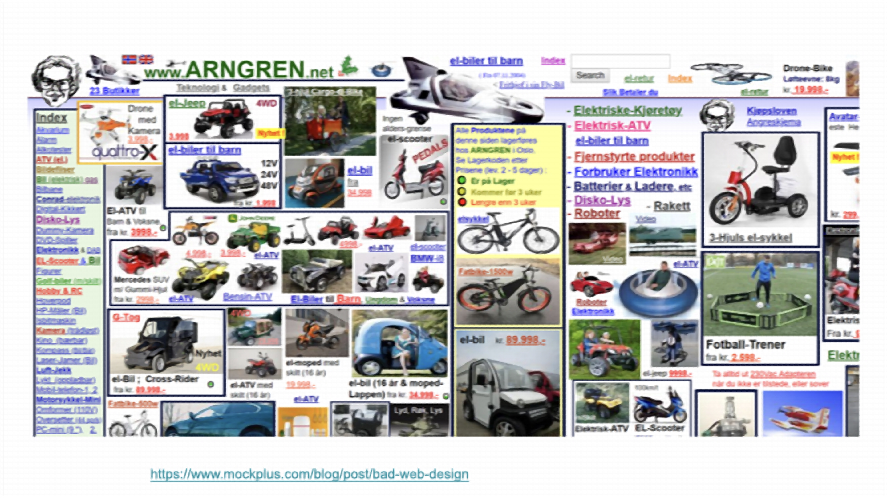

<!--
Let's examine the first classic bad design archetype: "Night Market Chaos" sensory overload, famously illustrated by the Norwegian electronics website Arngren on the right.

Why does staring at this page for ten seconds make your eyes hurt? First, pattern recognition is completely shattered. In a well-engineered product catalog, every card shares a consistent aspect ratio, image frame, title typography, and price badge. Here, every item has a random size, border, and orientation—forcing your visual cortex to recalibrate from scratch on every single square inch.

Second, there is zero grid alignment or whitespace. When hundreds of gadgets, bicycles, and flashing links scream for attention at the exact same decibel level, the human brain experiences acute sensory overload and immediately hits the Back button.

💡 難字與專業術語解說：
- sensory overload: 感官過載（過多雜亂視覺刺激同時湧入導致大腦無法處理）
- visual hierarchy: 視覺階層（透過字級、色彩與空間引導視線先後順序的結構）
- pattern recognition: 模式辨識（大腦透過規律排版快速識別同類資訊的能力）
- aspect ratio: 長寬比（圖片或卡片的寬高比例）
- visual anchor: 視覺錨點（協助眼球定位與建立掃描起點的基準元素）
- cognitive fatigue & bounce: 認知疲勞與跳出（因心智耗竭而立即離開網頁）
-->
---
## Bad Design Archetype (2): "Paint is Free" Color & Contrast

> **The "Paint is Free" Nightmare:** Abusing clashing colors, busy textured backgrounds, and drop-shadows that destroy readability and brand trust.

* **Why This Design Fails:**
  - **Color Contrast Collapse:** Dark red and neon yellow text over a wavy cyan gradient causes visual vibration and violates **WCAG accessibility standards**.
  - **Typography Nightmares:** Heavy 3D drop-shadows and jagged, unaligned link lists create severe eye strain.
  - **Zero Negative Space & Lost Trust:** Cramming text without breathing room—especially on a medical X-ray supplier site—instantly destroys professional credibility.

    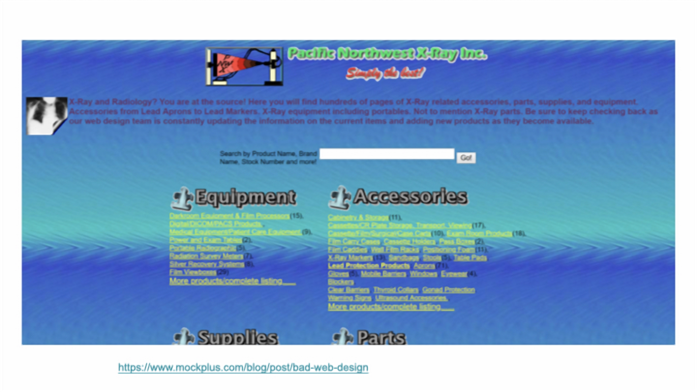

<!--
Our second bad design archetype is the "Paint is Free" color and contrast nightmare, shown here on a real medical X-ray equipment supplier's website.

Look at the visual mechanics failing on this screen: bright red and neon yellow text are rendered directly over a busy, wavy cyan background gradient. This creates a phenomenon known in visual ergonomics as chromostereopsis—where clashing wavelengths vibrate on the retina—and severely violates WCAG (Web Content Accessibility Guidelines) contrast ratios.

Furthermore, heavy 3D drop-shadows and zero negative space make scanning impossible. Even worse, consider the domain context: this company sells hospital X-ray protection gear! An amateurish, chaotic visual presentation immediately destroys user trust in the safety and reliability of the underlying engineering.

💡 難字與專業術語解說：
- clashing colors: 衝突撞色（高彩度互補色直接疊加造成視覺刺眼與顫動）
- drop-shadow: 陰影效果（文字或區塊後方的立體投影，過度使用會破壞易讀性）
- visual vibration: 視覺顫動（強對比色彩相鄰時在視網膜產生的閃爍不適感）
- WCAG (Web Content Accessibility Guidelines): 網頁內容無障礙指南（國際通用的明暗對比度與可及性標準）
- negative space (whitespace): 負空間 / 留白（不放任何元素的呼吸空間，用於分隔資訊群組）
- professional credibility: 專業可信度、品牌信賴感
-->
---
## Bad Design Archetype (3): "Where Do I Start?" Missing Hierarchy

> **The "Where Do I Start?" Archetype:** Cluttering dozens of identical buttons and ultra-wide text lines without a clear primary Call-to-Action (CTA).

* **Why This Design Fails:**
  - **Missing Visual Focal Point:** Dozens of identical red and black buttons on the left carry equal visual weight—users have no idea which button to click first.
  - **Information Flood:** Phone numbers, addresses, and slogans are crammed into a neon banner with no visual priority.
  - **Uncontrolled Line Length:** Paragraphs stretch across the entire screen width, far exceeding the ergonomic reading limit of **45–75 characters per line**.

    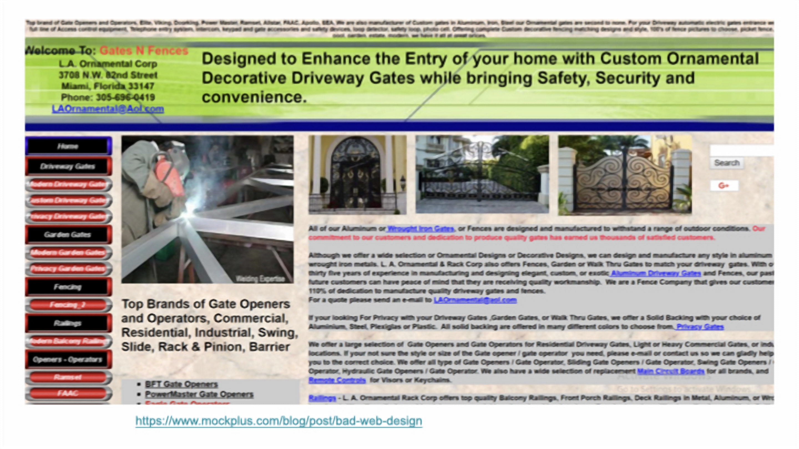

<!--
Here is the third bad design archetype: "Where Do I Start?"—characterized by missing visual hierarchy and uncontrolled line lengths.

Look at the left column of the Gates N' Fences website: over twenty identical red and black pill buttons are stacked vertically with the exact same size, color saturation, and typography. When every button has equal visual weight, nothing stands out—there is no primary Call-to-Action (CTA) to anchor the user's journey.

Now look at the body paragraphs stretching across the entire monitor width. Typography research shows that human eyes read most comfortably at 45 to 75 characters per line. When lines stretch to 180 characters across a widescreen monitor, the reader's eye loses track of the next line on the return sweep, causing skipped lines and rapid reading fatigue.

💡 難字與專業術語解說：
- Call-to-Action (CTA): 行動召喚按鈕（頁面上最核心、引導使用者點擊推進流程的主按鈕）
- visual focal point: 視覺焦點（畫面上第一眼吸引注意力的核心區域）
- visual weight: 視覺權重（元素透過大小、色彩與對比度所佔據的視覺份量）
- ergonomic reading limit: 人因工程閱讀極限（最符合人眼水平掃視舒適度的單行字元數 45–75 字）
- return sweep: 換行回掃（視線讀完一行末端後移回下一行開頭的眼球運動）
-->
---
## Case Study: Taiwan NHI Mask App — Where Do You Pre-Order?

> **Challenge:** Guess which icon (**1–6**) you had to tap when you wanted to **pre-order masks**?

  

    <h3 style="color: #dc2626; margin-bottom: 8px;">v1 Emergency Launch: Guess Where (1–6)?</h3>
    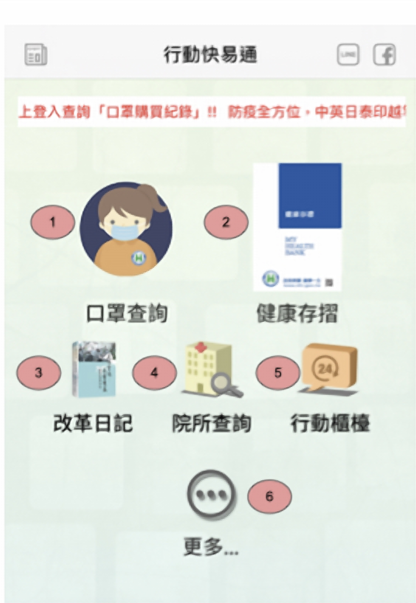
    
<strong>1.</strong> Mask Query &nbsp;|&nbsp; <strong>2.</strong> My Health Bank &nbsp;|&nbsp; <strong>3.</strong> Reform Diary <strong>4.</strong> Hospital Search &nbsp;|&nbsp; <strong>5.</strong> E-Counter &nbsp;|&nbsp; <strong>6.</strong> More...

  

  

    <h3 style="color: #16a34a; margin-bottom: 8px;">Answer: Buried in #2! → Refactored 3×3 Grid</h3>
    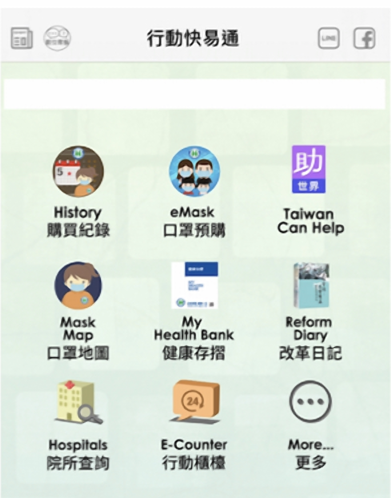
    
<strong>Why #2 (My Health Bank)?</strong> It had the login module! <strong>Redesign:</strong> Promoted <strong>eMask Pre-Order</strong> directly to top row.

<!--
Let's test your UX intuition with a famous real-world case study from Taiwan: the National Health Insurance (NHI) "健保快易通" App during the 2020 COVID-19 mask rationing rollout.

When the government announced that citizens could pre-order face masks online using this app, millions of citizens opened the v1 home screen on the left. Look at the six options labeled 1 to 6:
1. Mask Query (口罩查詢), 2. My Health Bank (健康存摺), 3. Reform Diary (改革日記), 4. Hospital Search (院所查詢), 5. E-Counter (行動櫃檯), and 6. More.
Which icon would you tap to pre-order masks?

Nearly everyone tapped #1 (Mask Query)! Yet tapping #1 only opened a static link to pharmacy stock maps—there was no pre-order button inside! Where was the actual Mask Pre-Order button hidden? It was buried deep inside #2: "My Health Bank (健康存摺)"!

💡 難字與專業術語解說：
- Taiwan NHI (National Health Insurance): 台灣全民健康保險
- pre-order: 預購、事先登記申購
- emergency launch: 緊急上線發布（在時間壓力下倉促推上線的版本）
- refactor: 重構（在不改變核心業務功能的前提下，重新調整結構以提升品質與易用性）
-->
---
## Case Study Analysis: Backend-Driven vs. User-Centered UX

* **Why the v1 Emergency Design Failed (Implementation-Driven UI):**
  - **Module Convenience:** Because mask pre-ordering required identity login, engineers stuffed it inside <strong>#2 My Health Bank (`健康存摺`)</strong> where authentication already existed.
  - **False Signifier Trap:** Icon <strong>#1 (`口罩查詢`)</strong> had a mask illustration and the word "Mask".
  - **Inconsistent Visual Weight:** Icons had random sizes and shapes (circles, rectangles, 3D books) with zero grid alignment.
* **How the Refactored Version Fixed It (Goal-Directed 3×3 Grid):**
  - **Surface-Level Task Visibility:** Extracted **`eMask 口罩預購`**, **`History 購買紀錄`**, and **`Mask Map 口罩地圖`** as distinct, top-row first-class actions matching citizen goals.
  - **Standardized Visual System:** Unified all 9 entry points into consistent circular icons with clear bilingual (**English + Chinese**) labels.

<!--
Why on earth did the engineering team bury "Mask Pre-Order" inside "My Health Bank (#2)" while leaving a mask icon on "#1 Mask Query"?

This is the textbook example of an **Implementation-Driven UI** (backend-driven design). Because buying rationed masks required real-name identity authentication, and the login/authentication code already lived inside the "My Health Bank" module, the engineers simply bolted the mask pre-order button inside Module #2 for backend convenience!

Meanwhile, Icon #1 had a huge illustration of a surgical mask—acting as a **False Signifier** that lured millions of users into a dead end. Look at how the refactored v2 design solved this: volunteered UX designers broke free from backend module boundaries, promoted **eMask Pre-Order**, **Purchase History**, and **Mask Map** directly to the top row of a clean, standardized 3×3 grid, and added clear bilingual labels.

💡 難字與專業術語解說：
- Implementation-Driven UI: 實作導向介面（依照後端程式碼模組或資料庫結構，而非使用者思維所排出的介面）
- authentication: 身分驗證（確認使用者真實身分的登入機制）
- false signifier: 錯誤意符 / 誤導性視覺線索（外觀看起來像某功能，點擊後卻不是該預期的行為）
- goal-directed: 目標導向的（以使用者想完成的任務為核心來組織介面）
- first-class action: 一級核心操作（無需深層鑽取、直接擺在首頁最顯眼處的功能）
-->
---
## Why is UX So Hard?

> **The Root Cause:** Good UX fails not from a lack of coding skills, but from engineering-centric thinking and fragmented development habits.

- **Lack of Systems Thinking**
  - Only modular thinking; patchwork construction
- **Lack of User Thinking**
  - Obsessed with backend schemas rather than user goals
- **Lack of Empathic Thinking**
- **Lack of User Research or Requirements Analysis**
- **Lack of Prior Design**
  - Construction directly without prior interaction design
- **Lack of Testing, Feedback, or Iteration**
  - Launching the system without comprehensive usability testing

    

<!--
Seeing the NHI Mask App disaster leads us to a fundamental software engineering question: Why is building good UX so hard, even for talented programmers?

The root cause is rarely a lack of coding skill—it stems from seven systemic engineering habits:
1. **Module vs. Systems Thinking**: Engineers optimize isolated functional modules (like the login module) without viewing the end-to-end user journey.
2. **Patchwork Construction**: Features are bolted onto existing menus ad-hoc as urgent requests arrive, turning the UI into Frankenstein's monster.
3. **System vs. User Thinking**: Screens mirror database tables and API payloads instead of human mental models.
4. **Lack of Empathic Thinking**: Developers suffer from the "Curse of Knowledge"—because *we* wrote the code, we forget how confusing it looks to a first-time user.
5. **No User Research**, **6. Coding Before Designing**, and **7. Shipping Without Usability Testing or Iteration**.

💡 難字與專業術語解說：
- engineering-centric: 以工程師為中心的（從系統實作便利性而非使用者體驗出發的思維）
- fragmented: 支離破碎的、缺乏整體連貫性的
- patchwork construction: 拼湊式建造（缺乏頂層設計、東補西湊堆疊功能）
- empathic thinking: 同理心思維（設身處地感受使用者困惑與情緒的能力）
- Curse of Knowledge: 知識的詛咒（專家因過度熟悉系統內部邏輯，而無法理解新手為何看不懂）
-->
---
## UI (User Interface) vs. UX (User Experience)

* **User Interface (UI):**
  - The **tangible**, **sensory touchpoints** through which humans interact with software.
  - *Elements:* Buttons, typography, color palettes, spacing, CSS grids, icons, transitions, animations.
  - *Core Question:* "How does the screen look, render, and react visually?"
* **User Experience (UX):**
  - The overall, end-to-end **emotional** and **psychological** journey a human has with a brand, service, or system.
  - *Elements:* Task efficiency, friction, cognitive load, user satisfaction, error recovery, trust.
  - *Core Question:* "How effectively, intuitively, and pleasantly does the user achieve their goal?"
* **The Classical Analogy:**
  - UI is the saddle, stirrup, and reins; UX is the *feeling* of riding the horse!

<!--
Before going further, every software engineer must be able to clearly distinguish **UI (User Interface)** from **UX (User Experience)**.

**UI (User Interface)** is the tangible, visual, and interactive surface—the buttons, typography scales, color palettes, CSS grid layouts, icons, and micro-animations. UI answers: *"How does the product look and respond visually?"*

**UX (User Experience)** encompasses the entire end-to-end human journey—task efficiency, cognitive load, information architecture, error recovery, and emotional trust. Look at the classic analogy at the bottom: **UI is the saddle, stirrups, and reins; UX is the overall feeling and safety of riding the horse.** A banking app can have a gorgeous glassmorphic UI, but if transferring money takes 12 confusing steps, its UX is terrible.

💡 難字與專業術語解說：
- tangible: 具體可感知的、有形的
- sensory touchpoint: 感官接觸點（使用者眼睛看到、手指觸碰到的介面元素）
- typography: 字體排印學（字型選擇、字級階層、行高與字距的排版設計）
- end-to-end journey: 端到端旅程（從產生需求、進入系統到最終完成目標的完整歷程）
- saddle, stirrup, and reins: 馬鞍、馬鐙與韁繩（比喻表面可見的操控器物，對比騎乘的整體體驗）
-->
---
<!-- _class: title-image-slide -->
## Visualizing UI vs. UX: Anatomy of Interaction

  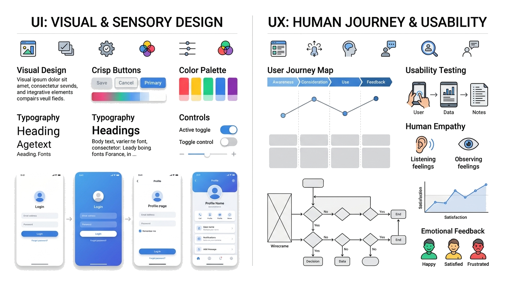

<!--
This anatomical diagram reinforces the symbiotic relationship between UI and UX.

On the left side of the brain, UI design governs visual design, colors, graphic design, layouts, and typography—the aesthetic skin and sensory presentation of the product.

On the right side, UX design governs interaction design, wireframes and prototypes, information architecture, user research, and scenarios—the structural skeleton and nervous system of the product. Great software engineering requires both working in harmony: UX ensures we build the *right workflow*, while UI ensures the workflow is *visually clear and delightful*.

💡 難字與專業術語解說：
- anatomy of interaction: 互動結構剖析
- wireframe: 線框稿（不含色彩與美化細節、專注於配置與流程的低擬真結構草圖）
- information architecture (IA): 資訊架構（系統內容的分類、階層組織與導覽標籤體系）
- symbiotic: 共生的、相輔相成的
-->
---
<!-- _class: title-image-slide -->

## The 5-Stage UX Design Thinking Process

  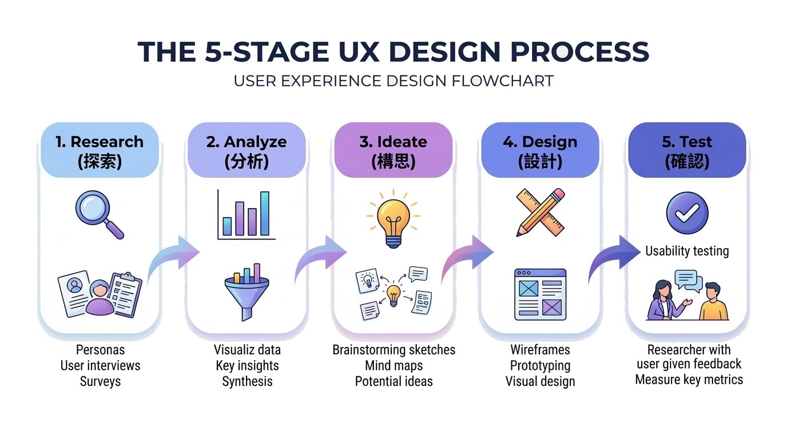

<!--
How do professional product teams systematically engineer great UX instead of guessing? They follow the **5-Stage Design Thinking Process** formalized by the Stanford d.school and IDEO.

Look at the five stages on the diagram: **Empathize → Define → Ideate → Prototype → Test**.

Notice two crucial engineering principles here: First, coding is nowhere near Stage 1! You begin by understanding human needs (Empathize) and framing the exact problem (Define) before brainstorming solutions (Ideate). Second, notice the return arrows at the bottom: Design Thinking is **non-linear and iterative**. Insights from user testing loop directly back to refine your problem definition or prototypes before expensive production code is written.

💡 難字與專業術語解說：
- Design Thinking: 設計思考（以人為本、結合同理心與快速實驗迭代的問題解決方法論）
- Empathize / Define / Ideate / Prototype / Test: 同理 → 定義 → 發想 → 原型 → 測試（設計思考五階段）
- non-linear & iterative: 非線性且迭代的（允許隨時根據測試反饋回溯修正，而非單向瀑布流）
-->
---
## The 5 Stages of Design Thinking: Process Breakdown

- **1. Empathize:**
  - Conduct qualitative user interviews, contextual field inquiries, and observational studies.
  - Identify unarticulated frustrations and true emotional pain points.
- **2. Define:**
  - Synthesize user research into concrete personas, empathy maps, and precise "How Might We" problem statements.
- **3. Ideate:**
  - Brainstorm diverse potential solutions without premature judgment; sketch rapid low-fidelity paper wireframes.
- **4. Prototype:**
  - Build interactive, testable artifacts (clickable Figma mockups, interactive HTML/CSS code components).
- **5. Test:**
  - Put prototypes in front of real users, observe stumbling blocks, measure task completion rates, and iterate.

<!--
Let's break down the concrete engineering deliverables produced in each of the five Design Thinking stages:

1. **Empathize**: Conduct qualitative user interviews and contextual field inquiries—watching real people use their current tools in their real environment to uncover unarticulated pain points.
2. **Define**: Synthesize raw observations into concrete **Personas**, Empathy Maps, and actionable *"How Might We..."* problem statements.
3. **Ideate**: Brainstorm broad solution alternatives without premature criticism, sketching disposable paper wireframes that cost pennies to throw away.
4. **Prototype**: Construct interactive, testable artifacts—such as clickable Figma flows or lightweight HTML/CSS components.
5. **Test**: Observe real users attempting concrete tasks, measure task completion rates, and iterate relentlessly.

💡 難字與專業術語解說：
- qualitative user interview: 質性使用者訪談（深入探索「為什麼」與動機的開放式訪談）
- contextual field inquiry: 情境實地調查（到使用者真實工作或生活現場觀察其自然行為）
- unarticulated frustration: 未被言明的挫折感（使用者習以為常、說不出口卻實際存在的痛點）
- synthesize: 綜合提煉、歸納統整
- persona & empathy map: 人物誌與同理心地圖（具象化目標用戶特徵、目標與痛點的模型）
- low-fidelity (lo-fi): 低擬真度（如紙本手繪草圖，旨在快速驗證概念而非視覺細節）
-->
---
### Concept Check Question 1: Affordances vs. Signifiers
<!-- id: ase-ch06-ccq1 -->

  

In a redesigned hospital check-in kiosk, `"Confirm Check-In"` is styled as flat, borderless grey text for a "minimalist UI." Although the screen **can** register taps there, **75% of elderly patients freeze** and ask where to press. According to **Don Norman**, what is the root flaw?

- **A.** **Missing Affordance**; the touchscreen hardware lacks the physical touch-sensing capability to detect finger taps on text regions.
- **B.** **Missing Signifier**; tapping works, but the flat text lacks perceivable visual cues (border, contrast, shadow) showing it is tappable.
- **C.** **User Training Deficit**; the hospital should tape a printed step-by-step instruction sheet beside the kiosk to guide elderly patients.
- **D.** **System Model Latency**; the backend appointment database schema should be refactored with in-memory caching to speed up check-in queries.

  

  

    

<!--
Let's pause for Concept Check Question 1 to test our grasp of Don Norman's **Affordances vs. Signifiers** and **UI vs. UX**!

Read the scenario carefully: on a hospital check-in kiosk, the `"Confirm Check-In"` button is styled as flat, borderless grey text to look "minimalist." Even though the touchscreen *can* register taps on that text, 75% of elderly patients freeze and don't know where to press.

Why is **Option B (Missing Signifier)** the exact right answer rather than Option A (Missing Affordance)?
- Remember Don Norman's distinction: **Affordance** is what actions the system physically or digitally allows—since the touchscreen *can* detect taps on that region, the affordance already exists (so Option A is false).
- What is missing is the **Signifier**—the perceivable visual cue (button border, high-contrast color, elevation shadow) that communicates *where* and *how* to tap!
- And notice Option C: taping a printed instruction sheet next to the kiosk is the classic **Norman Door fallacy**—blaming the human instead of fixing the signifier!

💡 難字與專業術語解說：
- check-in kiosk: 自助報到服務機（醫院或機場常見的觸控式自助終端機）
- affordance vs. signifier: 預設用途 vs. 意符（系統實際可支援的物理/數位動作 vs. 引導人類「按哪裡、怎麼操作」的可感知視覺線索）
- minimalist UI: 極簡風視覺介面（若過度去除邊框與陰影，極易犧牲意符而傷害 UX 可用性）
-->
---
<!-- _class: lead -->
<!-- header: "6.2 Nielsen's 10 Usability Heuristics" -->

# **6.2 Nielsen's 10 Usability Heuristics**

> "Jakob's Law: Users spend most of their time on other sites. This means that users prefer your site to work the same way as all the other sites they already know."
> — *Jakob Nielsen, Nielsen Norman Group*

<!--
We now enter Module 6.2: **Jakob Nielsen's 10 Usability Heuristics**.

First formulated by Jakob Nielsen and Rolf Molich in 1990 and refined by Nielsen in 1994, these ten principles are the undisputed gold standard of user interface engineering.

Read Jakob's Law in the quote box: *"Users spend most of their time on other sites. This means that users prefer your site to work the same way as all the other sites they already know."* As we step through NS01 to NS10, we will pair every two heuristics with an interactive **Classroom UI Challenge**—first diagnosing a broken mobile screen, learning the two heuristics, and then revealing the refactored engineering design.

💡 難字與專業術語解說：
- usability heuristic: 易用性啟發式原則（輔助工程師快速檢視介面設計缺陷的經驗準則）
- Jakob's Law: 雅各布定律（使用者習慣將其他主流網站的操作經驗轉移到你的產品上）
- rule of thumb: 經驗法則（普遍適用且實用的大原則，而非死板的數學公式）
-->
---
## Overview: Nielsen's 10 Usability Heuristics

> "Heuristics are broad rules of thumb, not rigid laws—distilled from decades of empirical HCI research."

  

    <ul>
      <li>🚦 <b>NS01. Visibility of System Status:</b> Keep users informed through timely feedback.</li>
      <li>🌍 <b>NS02. Match System & Real World:</b> Speak the user's language using natural concepts.</li>
      <li>🚪 <b>NS03. User Control & Freedom:</b> Provide clear emergency exits (undo/redo).</li>
      <li>📐 <b>NS04. Consistency & Standards:</b> Follow platform conventions (Jakob's Law).</li>
      <li>🛡️ <b>NS05. Error Prevention:</b> Eliminate error-prone conditions beforehand.</li>
    </ul>
  

  

    <ul>
      <li>👁️ <b>NS06. Recognition Rather Than Recall:</b> Make objects, actions, and options visible.</li>
      <li>⚡ <b>NS07. Flexibility & Efficiency:</b> Provide accelerators for power users.</li>
      <li>🎨 <b>NS08. Aesthetic & Minimalist Design:</b> Maximize signal-to-noise ratio.</li>
      <li>🩹 <b>NS09. Help Users Recover from Errors:</b> Express error messages in plain language.</li>
      <li>📖 <b>NS10. Help and Documentation:</b> Provide searchable, contextual guidance.</li>
    </ul>

<!--
Here is the complete overview of Nielsen's 10 Usability Heuristics—from **NS01** through **NS10**.

Notice how these ten heuristics form a complete defensive lifecycle around human interaction:
- **NS01 & NS02** govern *Communication*: keeping status visible and speaking the user's real-world language.
- **NS03 & NS04** govern *Control & Predictability*: providing emergency undo exits and following platform conventions.
- **NS05 & NS06** govern *Cognitive Protection*: preventing errors before they happen and replacing memory recall with visual recognition.
- **NS07 & NS08** govern *Efficiency & Clarity*: offering shortcuts for experts while removing visual noise for everyone.
- **NS09 & NS10** govern *Support & Recovery*: diagnosing errors in plain language and embedding contextual help.

💡 難字與專業術語解說：
- empirical HCI research: 實證人機互動研究（基於大量真實使用者測試數據歸納出的研究）
- emergency exit: 緊急出口（讓誤觸的使用者能立即撤銷或離開當前狀態的機制）
- recognition vs. recall: 辨識取代回憶（看見選項直接認出，遠比憑空背誦指令省力）
- accelerator: 加速器 / 快捷操作（讓資深使用者能跳過繁瑣步驟的高效捷徑）
- signal-to-noise ratio (SNR): 訊噪比（畫面上有效核心資訊與無關雜訊的比例）
-->
---
## NS01: Visibility of System Status

* **Heuristic Principle:**
  > "The system should always **keep users informed** about what is going on, through **appropriate feedback** within a **reasonable time**."
* **Core Interaction Patterns:**
  - **Immediate Touch Feedback:** Active button states, ripple effects, and micro-animations validating input registration.
  - **Progress Transparency:** Deterministic progress bars (% complete), multi-step checkout steppers (1. Cart &rarr; 2. Shipping &rarr; 3. Payment).
  - **Background Task Feedback:** Spinners with descriptive, dynamic status copy (*"Uploading image 3 of 5..."*).
  - **Connection State Indicators:** Real-time online/offline banners and live synchronization indicators.

<!--
That food delivery disaster brings us directly to **NS01: Visibility of System Status**.

Nielsen's first heuristic states: *"The system should always keep users informed about what is going on, through appropriate feedback within a reasonable time."*

Why does a silent or frozen screen trigger instant user panic? Because without feedback, humans cannot tell whether their tap registered, whether the network dropped, or whether they should tap "Pay" a second time (risking a double charge!). In human-computer interaction, response time thresholds matter:
- **Under 0.1 seconds**: Feels instantaneous (use active button states / ripple effects).
- **0.1 to 1.0 second**: User notices a slight delay (use a subtle spinner).
- **Over 1 to 10 seconds**: User's attention wanders—you must display a **deterministic progress bar** (% complete), item counter, or multi-step breadcrumb stepper!

💡 難字與專業術語解說：
- visibility of system status: 系統狀態可見度（讓使用者隨時清楚系統當前運作進度與狀態）
- ripple effect & micro-animation: 水波紋動效與微動畫（點擊瞬間確認「已收到輸入」的視覺反饋）
- deterministic progress bar: 確定性進度條（明確顯示完成百分比與剩餘時間，而非無止境轉圈）
- multi-step checkout stepper: 多步驟結帳進度條（標示目前在第幾步、總共幾步的導覽元件）
-->
---
<!-- _class: title-image-slide -->
## NS01 in Practice (1/2): Progress Bars, Steppers & Sync State

  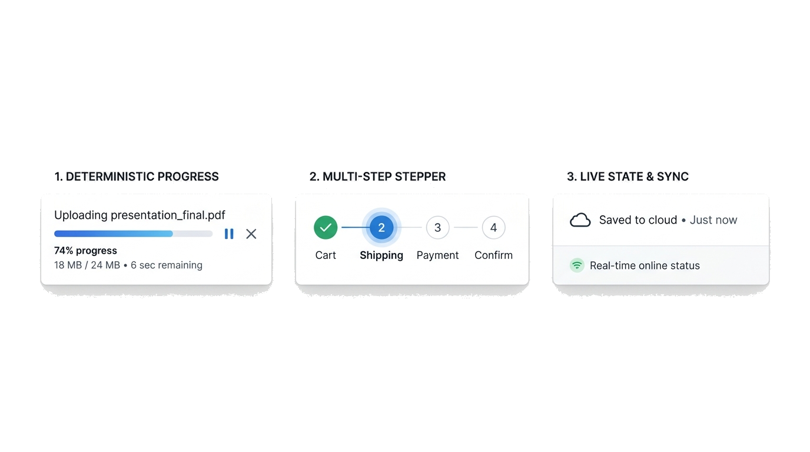

<!--
Look at these three concrete engineering implementations of NS01 on screen:

1. **Deterministic Progress Bars**: Instead of a mysterious spinning wheel, the file upload bar explicitly reports percentage completion so the user knows whether they have time to grab a cup of coffee.
2. **Multi-Step Checkout Steppers**: Clearly highlights `1. Cart → 2. Shipping → 3. Payment`, orienting the user within the overall workflow funnel.
3. **Live Cloud Sync & Connection State Indicators**: Explicitly displays whether the document is *"Saved to cloud 2 mins ago"* or *"Offline — changes saved locally"*, preventing data-loss anxiety.

💡 難字與專業術語解說：
- status feedback: 狀態回饋（系統回應使用者操作或背景進度的訊號）
- sync state (synchronization state): 同步狀態（顯示本地端與雲端資料是否已一致更新）
- workflow funnel: 工作流漏斗（使用者從進入流程到最終完成目標的多階段路徑）
-->
---
<!-- _class: title-image-slide -->
## NS01 in Practice (2/2): Batch File Import Progress

  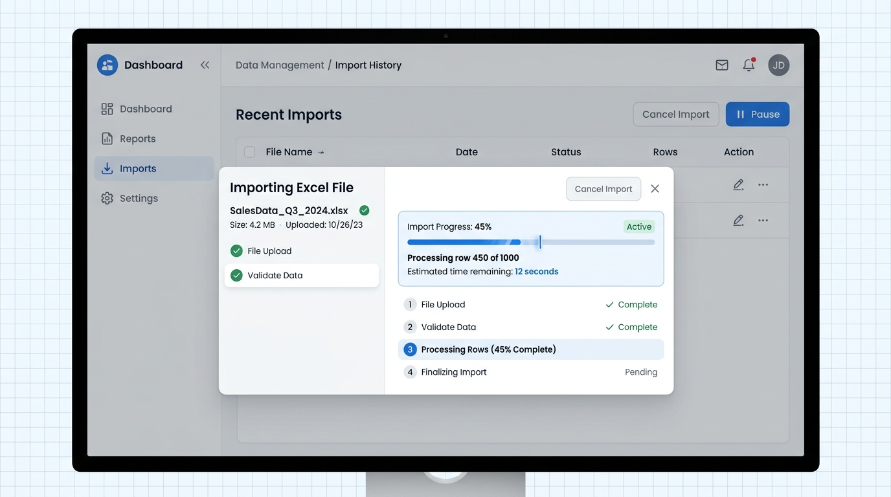

<!--
Here is a second real-world example of NS01 in an enterprise data management platform.

When an administrator imports a massive Excel spreadsheet containing 1,000 customer records, a naive implementation freezes the UI or shows an indeterminate spinner for 30 seconds.

Look at how this modal dialog implements NS01 with engineering precision: it combines four distinct feedback layers—an overall percentage bar (**45%**), an exact record counter (**450 of 1,000 rows processed**), an estimated time remaining (**~12 seconds left**), and a 4-stage pipeline checklist (*Uploading → Validating Schema → Importing Rows → Indexing*). The user feels in total command of the asynchronous job.

💡 難字與專業術語解說：
- batch file import: 批次檔案匯入（一次處理大量資料筆數的背景作業）
- indeterminate spinner: 非確定性轉圈動畫（只會一直旋轉、不提供任何進度比例或剩餘時間）
- asynchronous job: 非同步任務（在背景執行、不阻塞主執行緒的耗時運算）
- validating schema & indexing: 結構綱要驗證與建立索引（資料庫匯入的關鍵處理階段）
-->
---
## NS02: Match Between System and the Real World

* **Heuristic Principle:**
  > "The system should **speak the users' language**, with **words, phrases, and concepts familiar to the user**, rather than system-oriented terms. Follow **real-world conventions**."
* **Natural Spatial Mapping (Natural Mapping):**
  - Controls should mirror the physical arrangement of the objects they manipulate.
  - *Classic Counter-Example:* Gas stove burner knobs arranged in a straight line for a 2x2 grid force mental translation and errors.
  - *Good Design:* Arranging 4 knobs in the exact same 2x2 layout as the burners makes operation instantaneous and error-free.
* **Familiar Conceptual Metaphors:**
  - Trash can for deletions, desktop folder icons for directory trees, and shopping carts for e-commerce purchases.

<!--
Now let's examine the second heuristic violated by our food delivery screen: **NS02: Match Between System and the Real World**.

Nielsen defines NS02 clearly: *"The system should speak the users' language, with words, phrases, and concepts familiar to the user, rather than system-oriented terms. Follow real-world conventions."*

NS02 operates on two levels:
1. **Vocabulary & Conceptual Metaphors**: Using everyday human concepts (desktop folders, shopping carts, trash cans) and natural language rather than leaking database table names or HTTP status codes.
2. **Natural Spatial Mapping (Natural Mapping)**: Look at the gas stove example. When 4 burners are arranged in a 2×2 square grid, but the 4 control knobs are arranged in a 1×4 horizontal line, the user must perform mental coordinate translation every time they cook—frequently turning on the wrong burner! Arranging the 4 knobs in the exact same 2×2 spatial geometry reduces cognitive friction to zero.

💡 難字與專業術語解說：
- system-oriented terms: 系統導向術語（工程師內部使用的資料庫、網路或程式碼名詞）
- natural spatial mapping: 自然空間映射（控制項的排列位置直接對應受控物體在真實空間的幾何配置）
- counter-example: 反例、反面教材
- conceptual metaphor: 概念隱喻（借用真實世界熟悉的事物如「購物車、垃圾桶」來比喻數位操作）
-->
---
<!-- _class: title-image-slide -->
## NS02 in Practice (1/2): Natural Spatial Mapping of Controls

  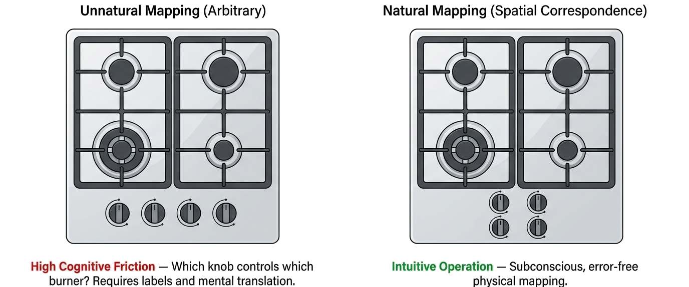

<!--
This side-by-side illustration captures the power of Natural Spatial Mapping on a kitchen stove.

On the left ("Poor Mapping"), the four burners sit in a 2×2 square, while the four knobs sit in a single horizontal row at the bottom. Even with tiny text labels printed next to the knobs (*Front Left, Rear Left, Rear Right, Front Right*), humans in a hurry constantly misread them and ignite the wrong burner.

On the right ("Good Natural Mapping"), the four knobs are positioned in a 2×2 physical cluster that mirrors the exact geometry of the burners. No text labels are needed—your hand reaches for the corresponding knob subconsciously and error-free!

💡 難字與專業術語解說：
- burner & knob: 瓦斯爐口與控制旋鈕
- mental translation: 心智轉換（大腦必須先閱讀標籤再換算空間對應位置的認知負荷）
- spatial geometry: 空間幾何排列
- subconsciously: 下意識地、無須刻意動腦思考地
-->
---
## NS02 in Practice (2/2): Speaking Everyday User Language

- Exposing raw backend exceptions (`HTTP 502`, `ERR_SOCKET_TIMEOUT`) forces everyday shoppers to decipher engineering jargon and triggers panic over double-charging.

* **System-Oriented Jargon (Bad):**
  - ❌ *"Transaction Exception 403: Acquirer socket connection timed out."*
  - Leaves customers anxious: *"Was my credit card charged or not?"*
* **Human-Centered Language (Good):**
  - ✅ **Reassuring Status:** Clearly confirms <strong>"we couldn't complete the charge"</strong> (no money lost!).
  - ✅ **Everyday Vocabulary:** Explains that the *"payment channel is currently busy."*
  - ✅ **Actionable Next Steps:** Offers clear choices (**`Retry Payment`** or **`Use Different Card`**).

    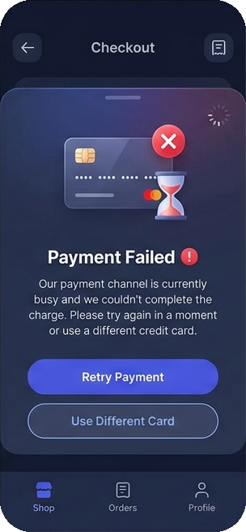

<!--
Let's look at the second dimension of NS02: **Speaking Everyday User Language** instead of raw system jargon during mobile checkout exceptions.

On the left, when a payment gateway times out, a developer-centric app dumps the raw exception string onto the screen: *"Transaction Exception 403: Acquirer socket connection timed out."* Imagine being a shopper who just clicked "Pay $299"—your immediate panic is: *"Did you charge my credit card or not?!"*

Now look at the human-centered dialog on the right:
1. **Reassuring Status**: Immediately answers the user's #1 fear in plain language: *"We couldn't complete the charge"* (your money is safe!).
2. **Everyday Vocabulary**: Explains that *"the payment channel is currently busy"* instead of talking about acquirer sockets.
3. **Actionable Next Steps**: Provides two clear buttons—**`Retry Payment`** or **`Use Different Card`**.

💡 難字與專業術語解說：
- raw backend exception: 原始後端例外錯誤（未經包裝轉譯的程式底層錯誤訊息）
- decipher engineering jargon: 解讀工程行話（強迫一般用戶猜測技術名詞的含義）
- acquirer socket timeout: 收單機構網路連線逾時（金融刷卡通道的底層網路術語）
- reassuring: 令人安心的、消除疑慮的
- actionable next steps: 可立即採取的下一步行動方案
-->
---
## Challenge: What's Wrong with this Food Delivery Screen?

> **Scenario:** After placing an order for dinner, a hungry customer is greeted with this order tracking screen.

* **1. Status & Feedback (What's happening?):**
  - The spinner has been stuck for nearly 4 minutes (`3m 42s`) with no progress bar.
  - Did the restaurant accept the order? When will it arrive (`ETA: TBD`)?
* **2. Language & Mental Model (Whose language is this?):**
  - Displays cryptic backend codes: `ITEM_SKU_90218` and `HTTP_204_NO_CONTENT`.
  - Buttons ask the hungry customer to *"Rollback TXN"* or *"Refresh Socket"*.
* **Discussion Prompt:**
  - What are the **top 3 usability disasters** on this screen?

    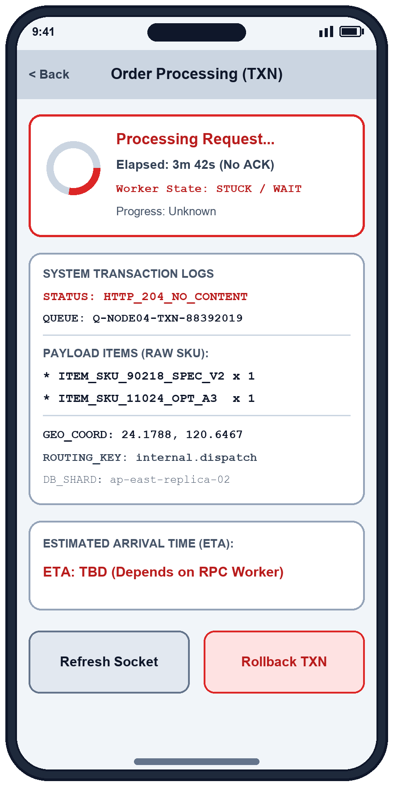

<!--
Now that we have mastered NS01 and NS02, let's put them to the test with our first Classroom Challenge!

Look at the mobile screen on the right (`food_delivery_bad.png`). Imagine a hungry customer has just paid for dinner on a food delivery app, and this tracking screen appears.

Turn to your neighbor and examine what is wrong in two areas:
1. **Status & Feedback**: The red-and-grey spinner says *"Processing Request... Elapsed: 3m 42s (No ACK)"*, *"Worker State: STUCK / WAIT"*, and at the bottom, *"ETA: TBD"*. Did the restaurant even receive the order? Is the app frozen?
2. **Language & Mental Model**: Look at the logs: `STATUS: HTTP_204_NO_CONTENT`, `ITEM_SKU_90218_SPEC_V2 x 1`, `GEO_COORD: 24.1788, 120.6467`, and buttons labeled **`Refresh Socket`** and **`Rollback TXN`**! Why is a hungry dinner customer forced to read raw backend RPC logs?

💡 難字與專業術語解說：
- spinner: 旋轉載入指示器（俗稱「轉圈圈」的等待動畫元件）
- elapsed time & ACK (Acknowledgment): 已耗用時間與確認回應訊號
- ETA (Estimated Time of Arrival) & TBD (To Be Determined): 預計送達時間與待定（未知）
- cryptic backend code: 晦澀難懂的後端代碼
- SKU (Stock Keeping Unit): 庫存單位編號（倉儲與資料庫內部的商品編碼）
- Rollback TXN (Transaction): 回滾交易（資料庫術語，一般消費者完全無法理解）
-->
---
## Challenge Revealed: Redesigning for NS01 & NS02

> **The Solution:** Replace developer jargon with real-world mental models, and replace infinite spinners with multi-stage progress tracking.

🔍 Hover to see original UI design (p.25)

* **NS01 Redesign (Visibility of System Status):**
  - ✅ **Concrete ETA:** *"12:35 PM (in ~18 mins)"* replaces ambiguous *"TBD"*.
  - ✅ **4-Stage Stepper:** Placed -> Cooking -> On Road -> Delivered gives instant visual feedback of where the order stands.
* **NS02 Redesign (Match with Real World):**
  - ✅ **Everyday Culinary Language:** Human food names (*Braised Beef Noodle Soup*) replace database SKU IDs.
  - ✅ **Human Real-World Concepts:** Courier name, motorbike model, and recognizable street addresses replace coordinates.
  - ✅ **Natural Actions:** *"Call Courier"* & *"Need Help?"* replace technical database commands (*Rollback*).

    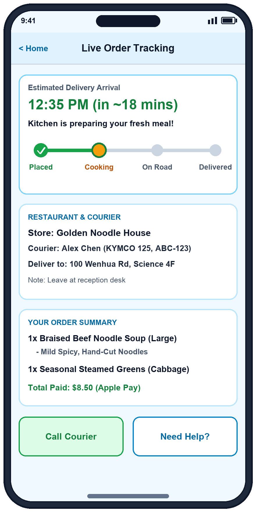

<!--
Now let's return to our Food Delivery Challenge (`food_delivery_good.png`) and see how applying **NS01** and **NS02** transforms the user experience!

1. **NS01 Redesign (Visibility of System Status)**:
   - The frozen spinner and *"ETA: TBD"* are replaced by a prominent green arrival estimate: **`12:35 PM (in ~18 mins)`** with dynamic status text (*"Kitchen is preparing your fresh meal!"*).
   - A 4-stage visual stepper (**`Placed ✓ → Cooking ● → On Road → Delivered`**) shows the exact stage of the order at a glance.
2. **NS02 Redesign (Match with the Real World)**:
   - Raw SKUs (`ITEM_SKU_90218`) become appetizing real-world dish names (**`1x Braised Beef Noodle Soup (Large)`**, **`1x Seasonal Steamed Greens`**).
   - GPS coordinates become a recognizable street address (`100 Wenhua Rd, Science 4F`) and courier identity (`Alex Chen, KYMCO 125`), while **`Rollback TXN`** becomes **`Call Courier`** and **`Need Help?`**!

💡 難字與專業術語解說：
- concrete ETA: 具體明確的預計送達時間
- culinary language: 餐飲生活語彙（人類日常點餐熟悉的菜名與口味描述）
- courier: 外送員、快遞人員
- braised beef noodle soup: 紅燒牛肉麵
-->
---
## NS03: User Control & Freedom (Emergency Exits)

* **Heuristic Principle:**
  > "Users often choose system functions **by mistake** and will need a clearly marked **'emergency exit'** to leave the unwanted state **without having to go through an extended dialogue**."
* **Essential Implementation Patterns:**
  - **Universal Undo / Redo:** Support `Ctrl+Z` / `Cmd+Z` across all text editors, canvas tools, and destructive state changes.
  - **Cancelation Actions:** Provide clear, high-contrast "Cancel" buttons on modals, file uploads, and bulk operations.
  - **Non-Destructive Navigation:** Allow users to back out of a checkout or registration wizard without wiping previously entered form data.
  - **Soft Deletes:** Move deleted items to a "Trash Bin" with a 30-day restoration window before permanent deletion.

<!--
That claustrophobic checkout screen leads us to **NS03: User Control and Freedom**.

Nielsen states: *"Users often choose system functions by mistake and will need a clearly marked 'emergency exit' to leave the unwanted state without having to go through an extended dialogue."*

Why is NS03 psychologically vital? Because humans learn software by exploring, and human fingers slip! If users feel that one wrong tap will trap them in a screen, wipe their cart, or irreversibly charge their card, they become anxious and defensive. Providing **Universal Undo (`Cmd+Z`)**, obvious **Cancel / Back buttons**, **Non-Destructive Steppers**, and **Soft Deletes (Trash Bins)** gives users the psychological safety net required to use software with confidence.

💡 難字與專業術語解說：
- user control & freedom: 使用者控制與自由度（賦予使用者隨時反悔、撤銷與退出的掌控權）
- extended dialogue: 冗長繁瑣的對話確認流程
- destructive state change: 破壞性狀態變更（如刪除資料、清空表單或正式扣款）
- non-destructive navigation: 非破壞性導覽（切換分頁或返回上一頁時，完整保留已填寫的表單資料）
- soft delete: 軟刪除（刪除時僅標記移入垃圾桶並保留 30 天復原期，而非立即物理抹除）
-->
---
<!-- _class: title-image-slide -->
## NS03 in Practice (1/2): Instant "Undo" Toast After Drag-and-Drop

  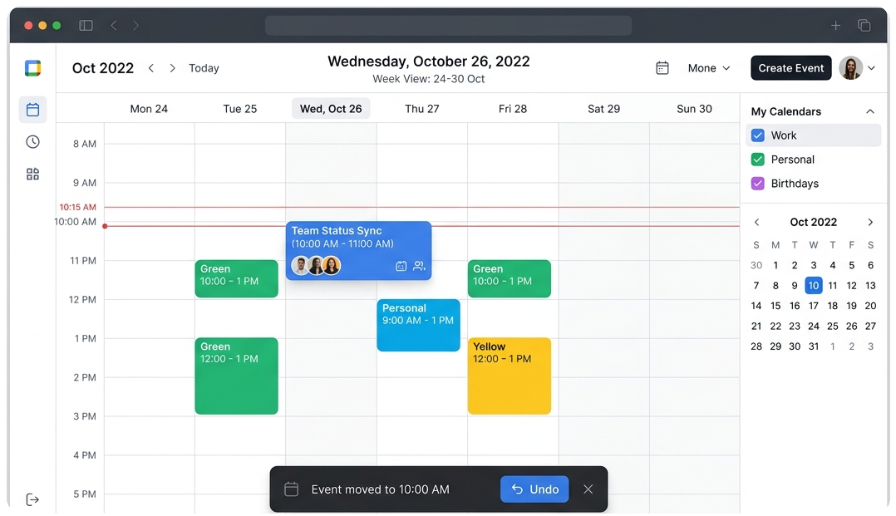

<!--
Look at this first practical implementation of NS03 in a web calendar application.

When a user drags a meeting block to reschedule it and accidentally drops it on the wrong time slot (`10:00 AM`), a poorly designed system either silently commits the error or interrupts every drag with an annoying *"Are you sure?"* popup modal.

Instead, modern interfaces allow direct manipulation immediately and surface a floating **Undo Toast** at the bottom of the screen: *"Event moved to 10:00 AM — **[Undo]** [✕]"*. With a single click, the mistake is reverted in milliseconds with zero friction.

💡 難字與專業術語解說：
- drag-and-drop: 拖放操作（按住滑鼠或手指直接搬移介面物件的直接操作模式）
- Undo Toast: 復原浮動快顯通知（畫面底部短暫浮現、附帶一鍵「復原」按鈕的輕量提示列）
- direct manipulation: 直接操作（直接拖拉物件而非透過填寫表單修改屬性）
-->
---
<!-- _class: title-image-slide -->
## NS03 in Practice (2/2): Email Trash "Undo" & Post "Discard" Exits

  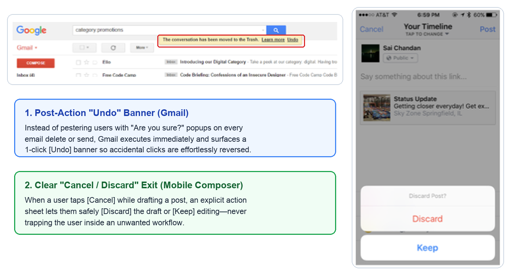

<!--
Here are two more everyday masterpieces of NS03 across desktop email and mobile social apps:

On the left, when a user deletes an email thread or hits "Send" a second too early in Gmail, a prominent banner offers an instant **`Undo`** link—implemented on the backend by holding the outgoing message in a queue for 5 to 30 seconds before actual SMTP transmission!

On the right, when backing out of a half-written mobile post, the app does not silently discard the user's writing nor lock them inside the editor; it presents a clear action sheet (**`Discard`**, **`Save Draft`**, or **`Keep Editing`**) so the user stays in complete control.

💡 難字與專業術語解說：
- email thread: 電子郵件對話串
- action sheet: 底部操作選單（行動裝置由下往上滑出、提供明確分支選項的面板）
- discard vs. keep: 捨棄修改 vs. 保留繼續編輯
-->
---
## NS04: Consistency & Standards (Jakob's Law)

* **Heuristic Principle:**
  > "Users **should not have to wonder** whether **different words, situations, or actions mean the same thing**. Follow **platform and industry conventions**."
* **Jakob's Law of Internet User Experience:**
  - Users spend 99% of their digital lives on **other websites and apps**.
  - They expect your software to follow established conventions (e.g., logo at top-left returns home, shopping cart at top-right, magnifying glass indicates search).
* **Two Dimensions of Consistency:**
  - **Internal Consistency:** Uniform fonts, button styles, padding, and terminology across your own app (Design Systems).
  - **External Consistency:** Adhering to platform standards (Apple HIG for iOS, Material Design for Android).

<!--
Now let's examine the second heuristic violated by our wrench-icon checkout screen: **NS04: Consistency and Standards**.

Nielsen states: *"Users should not have to wonder whether different words, situations, or actions mean the same thing. Follow platform and industry conventions."*

Why is reinventing standard icons (like using a wrench for a shopping cart) or reversing button color semantics so destructive? Because of **Jakob's Law**: your users spend 99% of their time on *other* apps! They bring deeply ingrained muscle memory to your software. Professional engineers maintain consistency across two dimensions:
1. **Internal Consistency**: Using a unified Design System (consistent typography, spacing tokens, terminology, and button hierarchy across every screen of your product).
2. **External Consistency**: Honoring industry and OS conventions (Apple Human Interface Guidelines on iOS, Material Design on Android, cart at top-right, search as a magnifying glass).

💡 難字與專業術語解說：
- consistency & standards: 一致性與標準性（詞彙、圖示與操作邏輯在產品內外保持統一）
- industry convention: 產業通用慣例（全網使用者早已習以為常的標準設計模式）
- internal vs. external consistency: 內部一致性（產品自身各頁面統一）vs. 外部一致性（符合主流平台慣例）
- Design System & Design Tokens: 設計系統與設計變數（統一管理色彩、字級、間距與元件規格的工程規範）
- Apple HIG & Material Design: 蘋果人機介面指南與 Google Material 設計規範
-->
---
<!-- _class: title-image-slide -->
## NS04 in Practice (1/2): Consistent Form Controls & Button Hierarchy

  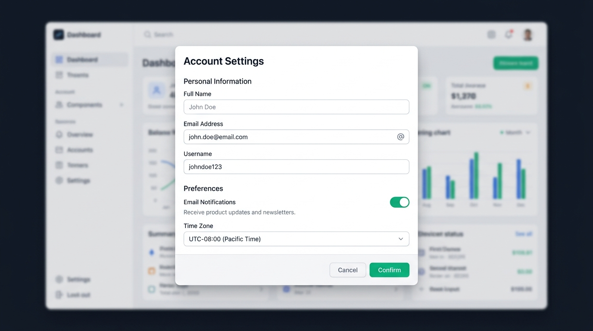

<!--
Examine how NS04 is implemented in this SaaS Account Settings modal dialog.

Notice both internal and external consistency working together:
- Every form label sits consistently above its input field with uniform vertical rhythm and padding.
- Toggle switches follow the universal platform standard: grey and left when off, vibrant green and right when active.
- Most importantly, look at the bottom action bar: the neutral secondary **`Cancel`** button sits on the left, while the high-contrast green primary **`Confirm`** CTA sits on the right. Keeping this button order consistent across all 50 dialogs in an enterprise system prevents catastrophic muscle-memory misclicks.

💡 難字與專業術語解說：
- form control: 表單控制項（輸入框、下拉選單、開關滑桿等互動元件的統稱）
- button hierarchy: 按鈕視覺階層（區分主要行動按鈕 Primary CTA 與次要取消按鈕的視覺對比）
- toggle switch: 切換開關（代表二元啟用/停用狀態的滑桿元件）
- spatial muscle memory: 空間肌肉記憶（使用者習慣性點擊視窗固定角落的直覺反應）
-->
---
<!-- _class: title-image-slide -->
## NS04 in Practice (2/2): Platform-Standard Keyboard Conventions

  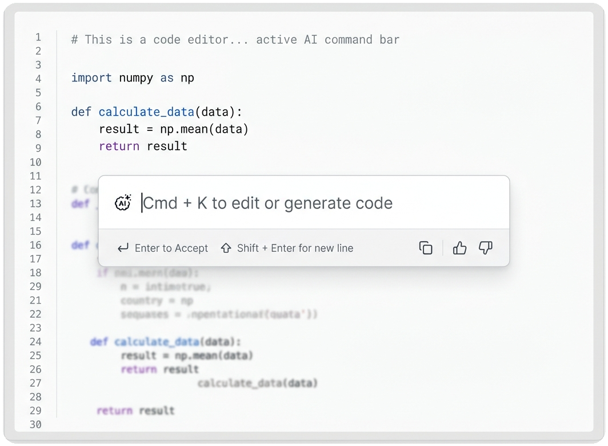

<!--
Here is a second example of NS04 in modern developer tools and AI-powered IDEs.

Whether a developer is working in VS Code, Cursor, Notion, Linear, or Slack, pressing **`Cmd+K`** (or **`Ctrl+K`**) invokes the inline command palette, pressing **`Enter`** confirms and submits, and pressing **`Shift+Enter`** inserts a line break.

Because these tools honor cross-platform keyboard conventions, an engineer switching to a new IDE does not have to read a manual—their existing muscle memory works on minute one!

💡 難字與專業術語解說：
- keyboard convention: 鍵盤快捷鍵慣例（跨軟體通用的標準按鍵組合）
- command palette / command bar: 命令面板 / 快捷指令列（透過快捷鍵喚出、可快速搜尋並執行動作的浮動輸入框）
- muscle memory transfer: 肌肉記憶轉移（將在舊工具練就的操作習慣無縫應用至新工具）
-->
---
## Challenge: What's Wrong with this Checkout Screen?

> **Scenario:** A shopper reaches the final checkout screen, but realizes they mistyped their apartment number (`Apt 4B`).

* **1. User Control & Escape Hatches (Can you go back?):**
  - There is no *"Back"* button, the stepper is locked, and shipping details are read-only.
  - Notice the red banner: *"Clicking pay finalizes immediately. No refunds, no cancelation, no undo!"*
* **2. UI Conventions & Visual Hierarchy (Does this feel familiar?):**
  - Why is the top-right shopping cart button represented by a **wrench icon**?
  - Why is the primary button a giant red *"Delete & Empty Cart"* trap, while *"Place Order ($299.00)"* is a faint, disabled-looking ghost button?
* **Discussion Prompt:**
  - What makes this checkout flow a usability nightmare?

    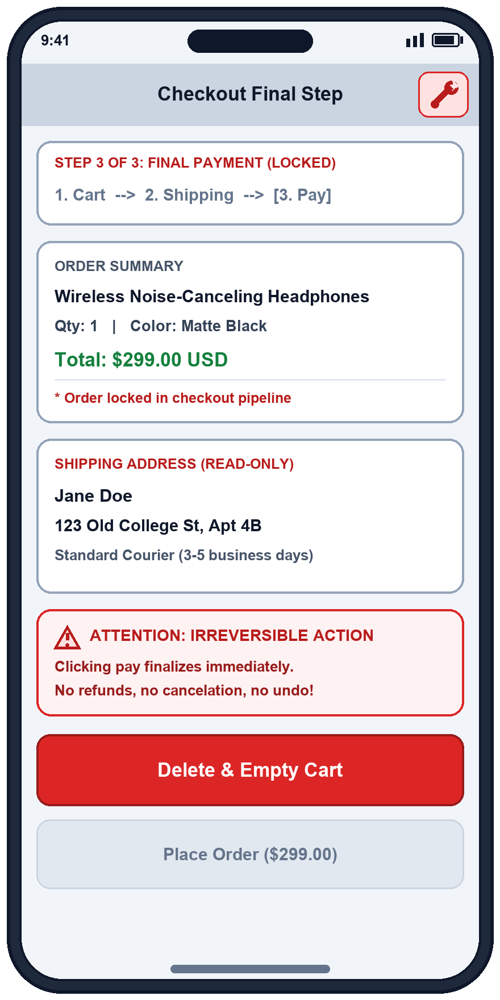

<!--
Now that we have covered NS03 and NS04, let's test your diagnostic eye with our second Classroom Challenge! Look at the e-commerce checkout screen on the right (`checkout_bad.png`).

Imagine a shopper reaches Step 3 (Final Payment) for a $299 pair of headphones, and suddenly notices a typo in their shipping apartment number (`Apt 4B`). Look closely at the traps on this screen:
1. **User Control & Escape Hatches**: There is **no `< Back` button** in the top bar! The stepper says `STEP 3 OF 3: FINAL PAYMENT (LOCKED)`, the shipping address says `(READ-ONLY)` with no Edit link, and the red warning box screams: *"Clicking pay finalizes immediately. No refunds, no cancelation, no undo!"*
2. **UI Conventions & Visual Hierarchy**: Look at the top-right corner—why is the shopping cart button drawn as a **red wrench icon**?! And look at the bottom buttons: why is the giant, high-contrast primary button a bright red **`Delete & Empty Cart`** trap, while **`Place Order ($299.00)`** looks like a disabled grey ghost button?!

💡 難字與專業術語解說：
- escape hatch: 逃生出口（讓使用者安全退回上一步或取消操作的介面管道）
- read-only: 唯讀狀態（僅供檢視、禁止修改鎖定的欄位）
- irreversible action: 不可逆操作（一旦執行便無法撤銷或復原的動作）
- wrench icon: 板手圖示（通常代表系統設定或維修工具，絕不應拿來代表購物車）
- ghost button: 幽靈按鈕（僅有淺色邊框或低對比背景、視覺權重極低的次要或禁用按鈕）
-->
---
## Challenge Revealed: Redesigning for NS03 & NS04

> **The Solution:** Honor platform standards and Jakob's Law, while guaranteeing non-destructive emergency exits and an undo safety net.

🔍 Hover to see original UI design (p.33)

* **NS03 Redesign (User Control & Freedom):**
  - ✅ **Non-Destructive Stepper:** Shoppers can click back to *"Cart"* or *"Shipping"* anytime without losing entered data.
  - ✅ **Direct In-Line Edits:** Clear `[Edit Items]` and `[Change]` links beside order items and delivery addresses.
  - ✅ **15-Second Undo Guarantee:** Reassuring safety net allows 1-click cancelation right after tapping pay.
* **NS04 Redesign (Consistency & Standards):**
  - ✅ **Platform Conventions:** Standard shopping cart icon at top-right, standard `< Cart` back navigation at top-left.
  - ✅ **Expected Button Hierarchy:** Prominent green CTA for *"Place Order ($299.00)"* with a clean neutral *"Cancel & Return to Cart"* exit below.

    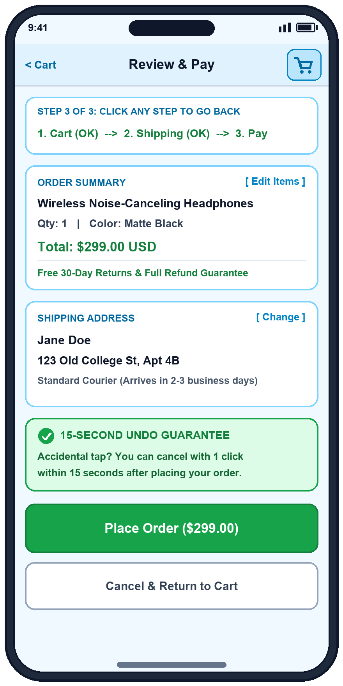

<!--
Now let's reveal the refactored E-Commerce Checkout screen (`checkout_good.png`) applying **NS03** and **NS04**!

1. **NS03 Redesign (User Control & Freedom)**:
   - Top-left provides a clear **`< Cart`** back button, and the stepper (`1. Cart (OK) → 2. Shipping (OK) → 3. Pay`) allows clicking back to any previous step without losing data.
   - Both the Order Summary and Shipping Address cards include inline **`[ Edit Items ]`** and **`[ Change ]`** links so fixing `Apt 4B` takes a single tap!
   - A green banner provides a **15-Second Undo Guarantee** right after placing the order.
2. **NS04 Redesign (Consistency & Standards)**:
   - The bizarre red wrench icon is replaced by a standard **Shopping Cart icon** in the top-right corner.
   - Button hierarchy follows universal e-commerce standards: a prominent green primary CTA (**`Place Order ($299.00)`**) paired with a clean neutral exit (**`Cancel & Return to Cart`**) below.

💡 難字與專業術語解說：
- non-destructive stepper: 非破壞性步驟導覽列（允許自由來回切換步驟而不遺失已填資料）
- inline edit: 行內直接編輯（在當前卡片旁直接點擊修改，無需重走整個流程）
- undo safety net: 復原安全網（允許使用者在誤觸下單後短時間內無條件撤銷的保護機制）
-->
---
## NS05: Error Prevention

* **Heuristic Principle:**
  > "Even better than good error messages is a **careful design** which **prevents a problem from occurring** **in the first place**."
* **Defensive Design Patterns:**
  - **Eliminate Error-Prone States:** Grey out or disable the "Submit" button until all mandatory fields pass real-time validation.
  - **Input Constraints:** Use visual Date Pickers instead of freeform text boxes to prevent date formatting syntax errors (`MM/DD/YYYY` vs. `DD/MM/YYYY`).
  - **Confirmation for Irreversible Actions:** Display high-friction confirmation dialogs before permanent actions (e.g., typing the repository name to delete a GitHub repo).
  - **Intelligent Defaults:** Pre-fill sensible default parameters to eliminate blank-form intimidation.

<!--
This flight booking nightmare demonstrates why **NS05: Error Prevention** is one of the highest-leverage principles in software engineering.

Read Nielsen's definition carefully: *"Even better than good error messages is a careful design which prevents a problem from occurring in the first place."*

Cognitive psychologist Don Norman distinguishes between two types of human errors:
- **Slips**: The user intends the right action, but their finger slips or loses focus (e.g., accidentally clicking "Delete Profile" next to another button).
- **Mistakes**: The user has an incorrect mental model or misunderstands the required format (e.g., typing `11/05/2026` vs. `05/11/2026`).
Defensive UI engineering prevents both by using **Input Constraints** (calendar date pickers that disable past dates), **Disabled Submit States** until validation passes, and **High-Friction Confirmation Dialogs** for destructive actions!

💡 難字與專業術語解說：
- error prevention: 防錯設計 / 防呆機制（透過介面限制讓錯誤從一開始就無法發生）
- slip vs. mistake: 操作失誤（手滑/分心按錯）vs. 認知錯誤（誤解規則或格式而填錯）
- input constraint: 輸入約束（以日曆、下拉選單或步進器取代自由文字框，物理性排除非法輸入）
- high-friction confirmation: 高阻力確認機制（針對永久刪除等危險操作，要求輸入專案名稱以強迫大腦清醒確認）
-->
---
<!-- _class: title-image-slide -->
## NS05 in Practice (1/2): Destructive Safeguards & Missing Attachment Check

  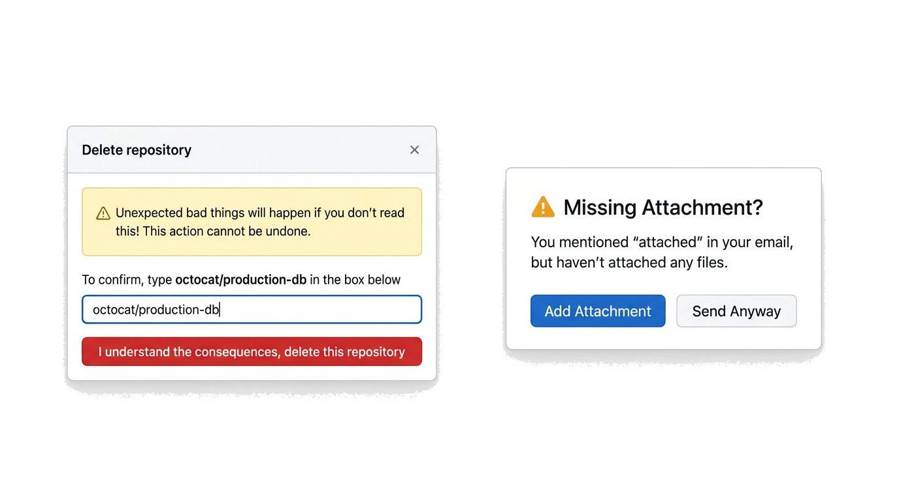

<!--
Look at these two classic industrial implementations of NS05 on screen:

On the left is GitHub's repository deletion safeguard. Because deleting a code repository is permanent and catastrophic, a simple "OK / Cancel" popup is not enough—users click "OK" out of habitual muscle memory! GitHub introduces intentional cognitive friction: the user must manually type the exact repository string (`user/repo`) before the red delete button unlocks.

On the right is Gmail's proactive "Forgotten Attachment Detector": when the email body contains words like *"I have attached the PDF"*, but zero files are attached, the system intercepts the Send action before an embarrassing human slip occurs!

💡 難字與專業術語解說：
- destructive safeguard: 破壞性操作防護機制
- intentional cognitive friction: 刻意的認知阻力（在危險操作前故意打斷自動化反射動作，喚醒大腦注意力）
- proactive interception: 主動式攔截（在錯誤送出前預先偵測矛盾並提醒使用者）
-->
---
<!-- _class: title-image-slide -->
## NS05 in Practice (2/2): Disabled Action Until Explicit Name Match

  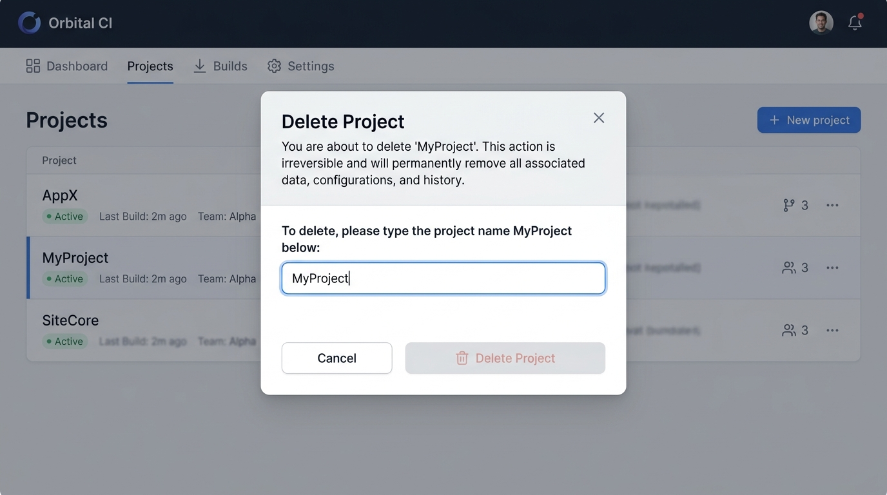

<!--
Here is a second close-up example of NS05 in a cloud CI/CD deployment platform.

When an engineer clicks to delete a production project (`MyProject`), look at the state of the red **`Delete Project`** button at the bottom right: it is rendered in a **disabled, unclickable state** while the text box is incomplete.

Only when the typed string matches `MyProject` 100% does the button state transition to active. Combining explicit string matching with a disabled button state makes accidental one-click deletion physically impossible.

💡 難字與專業術語解說：
- disabled state: 禁用反灰狀態（按鈕暫時不可點擊，防止未滿足條件時誤觸送出）
- explicit string match: 明確字串完全比對（要求親手輸入目標名稱以確認刪除意圖）
- accidental one-click disaster: 一鍵誤觸災難
-->
---
## NS06: Recognition Rather Than Recall

* **Heuristic Principle:**
  > "**Minimize the user's memory load** by making **objects, actions, and options visible**. The user **should not have to remember information** from one part of the dialogue to another."
* **Cognitive Psychology Foundation:**
  - **Recognition (Easy):** Identifying something you have seen before when presented with visual cues (e.g., multiple-choice quiz).
  - **Recall (Hard):** Retrieving information entirely from memory without assistance (e.g., blank-slate command line terminal).
* **UI Implementations:**
  - Autocomplete search dropdowns displaying recent search keywords.
  - Visual thumbnails of recently edited documents instead of raw filenames.
  - Contextual action toolbars appearing when text is selected.

<!--
Now let's examine the second heuristic violated by forcing travelers to memorize `TPE` and `KIX`: **NS06: Recognition Rather Than Recall**.

Nielsen states: *"Minimize the user's memory load by making objects, actions, and options visible. The user should not have to remember information from one part of the dialogue to another."*

Why is this grounded in human neurobiology? Because human **working memory** (short-term memory) is severely limited—George Miller's famous law shows we can hold only **7 ± 2 chunks** (and modern research suggests closer to **4 chunks**) at a time!
- **Recall** (like a blank command-line prompt or fill-in-the-blank exam) forces the brain to retrieve exact syntax from thin air—high cognitive load!
- **Recognition** (like a visual menu, autocomplete dropdown, or multiple-choice question) lets the brain visually identify the answer on screen—almost zero cognitive load!

💡 難字與專業術語解說：
- recognition rather than recall: 辨識取代回憶（將選項視覺化呈現讓大腦直接認出，而非強迫大腦憑空背誦）
- working memory load: 工作記憶負荷（大腦短期暫存與處理資訊的心智負擔）
- blank-slate terminal: 空白終端機介面（毫無視覺提示、全靠背誦指令語法的介面）
- contextual action toolbar: 情境式操作工具列（選取物件時直接在旁邊浮現可用功能的選單）
-->
---
<!-- _class: title-image-slide -->
## NS06 in Practice (1/2): Forced Recall vs. Search History Recognition

  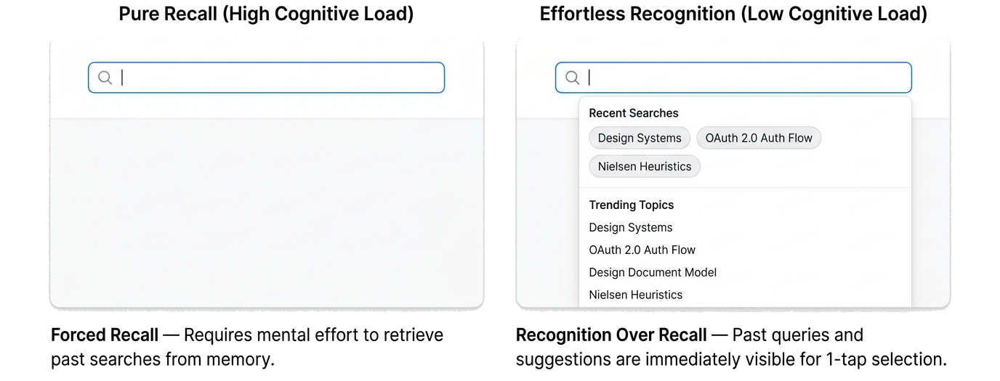

<!--
This side-by-side comparison of search interfaces illustrates Recall versus Recognition in everyday web applications.

On the left ("Forced Recall"), clicking into the search bar shows nothing but an empty white rectangle. If a user wants to re-run a complex query they searched yesterday, they must recall the exact keywords from memory.

On the right ("Recognition"), the moment the search input receives focus, a dropdown immediately surfaces **Recent Searches** and **Trending Categories**. A task that required mental memory retrieval + 15 keystrokes is reduced to a 1-second visual recognition and a single tap!

💡 難字與專業術語解說：
- forced recall: 強迫憑記憶回想
- search keyword retention: 搜尋關鍵字歷程保留（自動記住並顯示近期搜尋詞彙）
- focus state: 焦點狀態（當游標點擊進入輸入框時的互動狀態）
-->
---
## NS06 in Practice (2/2): Contextual Menus Eliminate Recall

> **Why Is This a Recall vs. Recognition Issue?** Without contextual menus, users must **memorize and recall** *which* top-level menu (`Edit`, `Tools`, or `Format`) or hotkey hides an action!

* **The Recall Burden (Traditional Menu / CLI):**
  - After highlighting a paragraph, a user must search their memory: *"Where is the summarize tool? Is it buried under `Tools → AI` or `Edit → Transform`? What was the shortcut?"*
* **The Recognition Solution (Contextual Toolbar):**
  - The moment text is highlighted, valid actions (**`Translate`**, **`Summarize`**, **`Improve Writing`**) appear **visibly right beside the cursor**.
  - Users **see and recognize** available options on the spot—zero menu hunting or command memorization!

    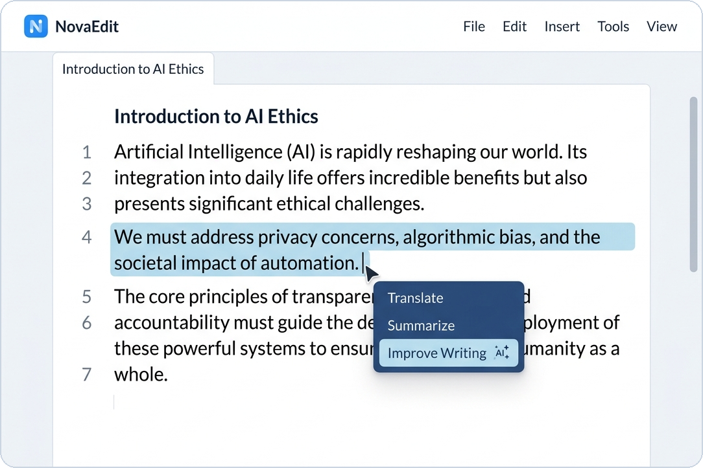

<!--
Here is a second powerful application of NS06 in modern document editors (such as Notion, Medium, or AI writing tools): **Contextual Floating Toolbars**.

Why is a floating toolbar an NS06 (Recognition vs. Recall) pattern? Think about traditional desktop word processors with 10 top-level menus (`File`, `Edit`, `View`, `Insert`, `Format`, `Tools`...): after highlighting a sentence, a user must **recall from memory** which top-level menu hides the *"Summarize"* or *"Translate"* command, or memorize an obscure keyboard hotkey!

With a contextual floating toolbar, the moment text is highlighted, the relevant actions (**`Translate`**, **`Summarize`**, **`Improve Writing`**) appear right beside the cursor. The user sees and **recognizes** the action immediately without hunting through deep menu trees.

💡 難字與專業術語解說：
- contextual floating toolbar: 情境式浮動工具列（隨選取動作在游標旁即時浮現的快捷選單）
- recall burden: 記憶提取負擔（必須背誦功能藏在哪一層頂部選單的認知消耗）
- menu hunting: 選單迷航 / 翻找選單（在多層下拉選單中來回尋找某項功能）
-->
---
## Challenge: What's Wrong with this Flight Booking Screen?

> **Scenario:** A traveler is booking round-trip tickets from Taipei to Osaka for an upcoming autumn vacation.

* **1. Input Guardrails & Validation (Why let errors happen?):**
  - Requires manual string typing for dates (`YYYY-MM-DD`) instead of a calendar picker.
  - Accepts past dates (`2026-11-10`) and impossible logic (*Return date `2026-11-05` earlier than Departure!*).
  - Red *"Delete Profile"* button triggers instant 1-click deletion with no confirmation.
* **2. Memory Load vs. Visual Cues (Why force memorization?):**
  - Forces users to recall 3-letter IATA airport codes (`TPE`, `KIX`) from memory.
  - Zero city autocomplete, search history, or popular destination chips.
* **Discussion Prompt:**
  - How could defensive design eliminate these errors before submission?

    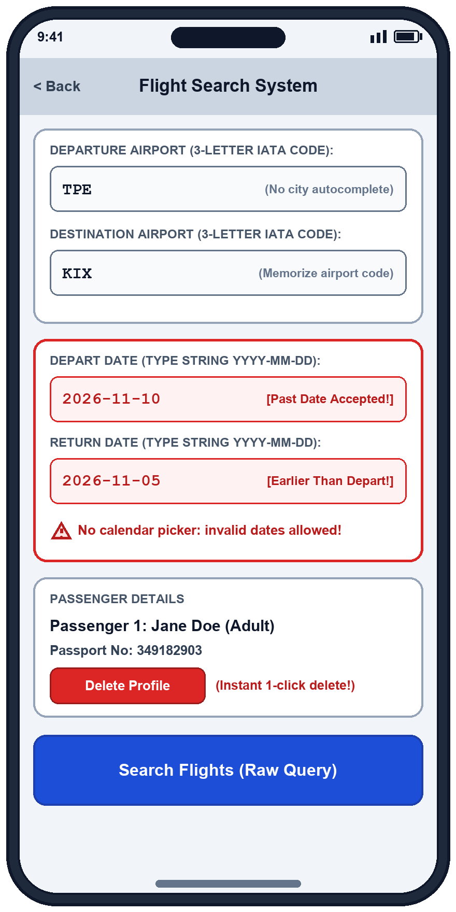

<!--
Let's move to our third Classroom Challenge! Examine the Flight Booking screen on the right (`flight_booking_bad.png`).

A traveler wants to book a round-trip flight from Taipei to Osaka. Look at the usability traps engineered into this form:
1. **Input Guardrails & Validation**: Instead of a visual calendar picker, the form forces the user to manually type raw `YYYY-MM-DD` strings! Even worse, it accepts **`2026-11-10` (`[Past Date Accepted!]`)** and a return date of **`2026-11-05` (`[Earlier Than Depart!]`)**! And in the passenger card, a bright red **`Delete Profile`** button deletes the traveler's passport record in 1 click with zero confirmation!
2. **Memory Load vs. Visual Cues**: Look at the airport boxes—the user must recall 3-letter IATA airport codes (**`TPE`**, **`KIX`**) from raw memory, with no city name autocomplete and no recent search chips!

💡 難字與專業術語解說：
- input guardrail: 輸入防護圍欄 / 防呆限制（在前端控制項層級直接攔截不合法輸入的設計）
- IATA airport code: 國際航空運輸協會三碼機場代號（如桃園 TPE、關西 KIX）
- autocomplete: 自動補全（輸入部分字元即自動聯想並帶出完整城市與機場名稱）
- recent search chip: 最近搜尋標籤膠囊（可一鍵點擊帶入歷史搜尋條件的圓角按鈕）
-->
---
## Challenge Revealed: Redesigning for NS05 & NS06

> **The Solution:** Constrain inputs to eliminate error-prone conditions, and surface visual suggestions so users recognize instead of recall.

🔍 Hover to see original UI design (p.41)

* **NS05 Redesign (Proactive Error Prevention):**
  - ✅ **Visual Calendar Guardrails:** Past dates disabled; return dates strictly constrained to departure or later.
  - ✅ **Constrained Stepper Controls:** Stepper buttons (`[-] 1 [+]`) enforce valid passenger bounds (1–9).
  - ✅ **Smart Validation:** Searches only execute when all parameters form a logically coherent query.
* **NS06 Redesign (Recognition Rather Than Recall):**
  - ✅ **Natural City Autocomplete:** Displays full names (*Taipei, Osaka*) with IATA codes automatically populated.
  - ✅ **Recent Search Chips:** 1-tap recognition chips (*Tokyo, Seoul*) eliminate repetitive typing and memory retrieval.

    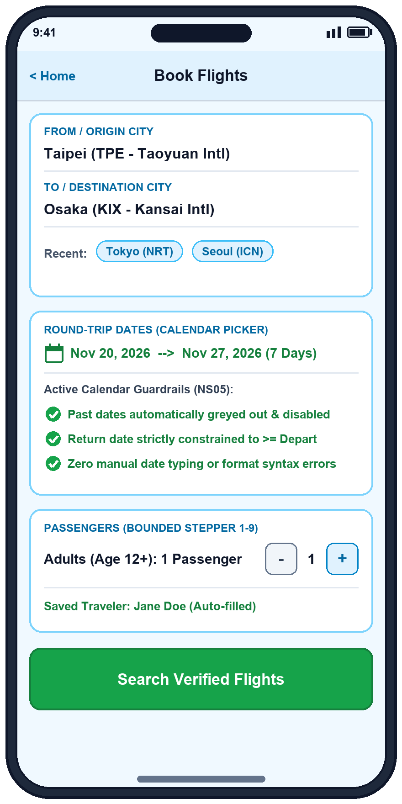

<!--
Let's reveal the refactored Flight Booking screen (`flight_booking_good.png`) applying **NS05** and **NS06**!

1. **NS06 Redesign (Recognition Rather Than Recall)**:
   - Travelers type or select familiar city names (**`Taipei (TPE - Taoyuan Intl)`**, **`Osaka (KIX - Kansai Intl)`**) with automatic IATA lookup.
   - Clickable **`Recent:`** destination chips (**`Tokyo (NRT)`**, **`Seoul (ICN)`**) allow 1-tap recognition without retyping.
2. **NS05 Redesign (Proactive Error Prevention)**:
   - Raw date text boxes are replaced by a **Constrained Calendar Picker** (`Nov 20, 2026 --> Nov 27, 2026 (7 Days)`) where past dates are greyed out and return dates are strictly constrained to `>= Depart`.
   - Passenger count uses a bounded stepper (**`[-] 1 [+]`**) and saved traveler profiles auto-fill safely without an unguarded 1-click delete trap!

💡 難字與專業術語解說：
- proactive error prevention: 主動式防錯設計（在輸入階段即透過元件限制排除錯誤可能）
- calendar guardrail: 日曆防呆限制（禁用過去日期並確保回程晚於去程的邏輯約束）
- bounded stepper: 具上下限約束的步進控制器（如限制人數僅能在 1–9 人之間增減的按鈕）
-->
---
## NS07: Flexibility & Efficiency of Use (Accelerators)

* **Heuristic Principle:**
  > "**Accelerators**—unseen by the novice user—may often **speed up the interaction for the expert user** such that the system can **cater to both inexperienced and experienced users**."
* **Dual-Track Interaction Design:**
  - **Novice Path:** Guided visual menus, onboarding tours, wizard steppers, and descriptive labels.
  - **Expert Accelerators:** Keyboard shortcuts (`Cmd+K` command palette), multi-touch gestures, reusable templates, and batch actions.
* **Progressive Mastery:**
  - Display keyboard shortcut hints directly inside dropdown menus, enabling novices to gradually transition into power users.

<!--
That agonizing 4-click task board brings us to **NS07: Flexibility and Efficiency of Use**.

Nielsen states: *"Accelerators—unseen by the novice user—may often speed up the interaction for the expert user such that the system can cater to both inexperienced and experienced users."*

This is the art of **Dual-Track Interaction Design**:
- **Novice Path**: A new intern joining the team on Day 1 needs visible buttons, clear labels, and guided menus so they can use the software immediately.
- **Expert Path (Accelerators)**: A senior engineer triaging 100 tickets a day needs **Global Command Palettes (`Cmd+K`)**, **Single-Key Hotkeys** (`C` to create, `E` to edit), **Code Snippets**, and **Multi-Select Batch Actions**.
By displaying shortcut hints quietly inside dropdown menus, you create a bridge for novices to naturally evolve into power users!

💡 難字與專業術語解說：
- flexibility & efficiency of use: 彈性與使用效率（同時兼顧新手易學性與專家高效操作的雙軌設計）
- novice user vs. expert / power user: 新手使用者 vs. 資深專家 / 重度進階使用者
- dual-track interaction design: 雙軌互動設計（表面提供直覺圖形按鈕給新手，底層內建快捷鍵給專家）
- progressive mastery: 漸進式熟練（在選單旁標註快捷鍵提示，幫助新手在日常操作中自然學會快捷鍵）
-->
---
<!-- _class: title-image-slide -->
## NS07 in Practice (1/2): Keyboard Shortcuts & Code Snippet Accelerators

  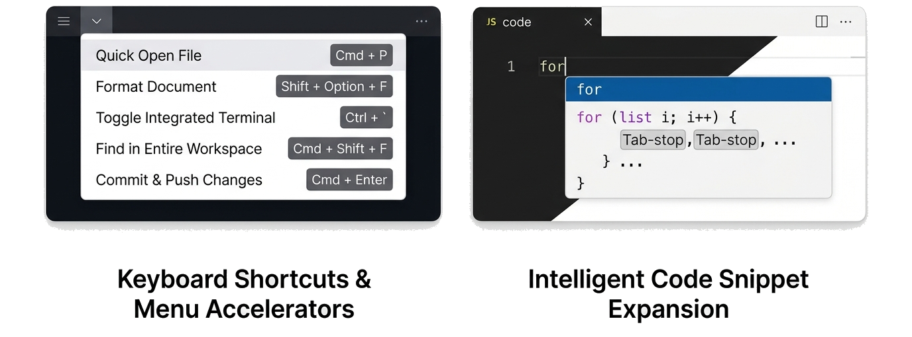

<!--
Look at these two developer-focused implementations of NS07 on screen:

On the left, dropdown menu items display their corresponding keyboard shortcuts right-aligned in subtle grey text (`Cmd+P`, `Shift+Option+F`). A beginner can click the menu item with their mouse, while an experienced user sees the hint a few times and transitions to keyboard speed.

On the right, code snippet accelerators allow typing a 3-letter trigger (`for`) and pressing `Tab` to expand an entire loop structure with interactive cursor tab-stops—multiplying coding throughput without cluttering the UI.

💡 難字與專業術語解說：
- code snippet accelerator: 程式碼片段加速器（輸入簡短縮寫即自動展開完整語法模板的功能）
- tab-stop: Tab 鍵游標停駐點（展開模板後按 Tab 鍵即可依序跳轉填寫變數的位置）
- throughput: 產出效能、單位時間處理量
-->
---
<!-- _class: title-image-slide -->
## NS07 in Practice (2/2): Multi-Select Batch Operations for Power Users

  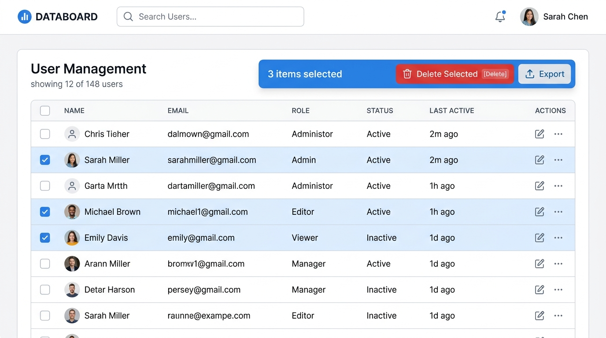

<!--
Here is a second indispensable NS07 pattern for enterprise web applications: **Multi-Select Batch Operations**.

In an admin data table, a novice user or someone updating a single row can simply click the edit or trash icon on the right side of that row.

However, when a system administrator needs to clean up 50 inactive accounts or export 30 records, forcing them to click 50 times is torture! By supporting checkbox multi-selection (and `Shift+Click` range selection), a floating **Batch Action Bar** (`3 items selected: Delete Selected [Delete] | Export`) appears dynamically—turning 50 repetitive mouse trips into a single keystroke.

💡 難字與專業術語解說：
- batch operation / bulk action: 批次操作 / 大量處理（一次選取多筆資料並同步執行相同動作）
- range selection (`Shift+Click`): 範圍連選（按住 Shift 點擊首尾項目即可一次勾選中間所有資料列）
- repetitive strain: 重複性操作疲勞（因機械式重複點擊滑鼠造成的身心耗損）
-->
---
## NS08: Aesthetic & Minimalist Design

* **Heuristic Principle:**
  > "Dialogues should **not contain information which is irrelevant** or rarely needed. Every **extra unit of information** in a dialogue **competes with the relevant units** and **diminishes their relative visibility**."
* **The Signal-to-Noise Ratio (SNR):**
  - **Signal:** Information directly relevant to the user's immediate decision.
  - **Noise:** Visual clutter, redundant borders, unnecessary badges, decorative chrome.
* **Technique: Progressive Disclosure:**
  - Show only the primary, essential controls upfront.
  - Tuck advanced settings behind "Advanced Options" accordions or secondary tabs.

<!--
Now let's pair NS07 with **NS08: Aesthetic and Minimalist Design**.

Read Nielsen's definition carefully—this is one of the most misunderstood heuristics in software engineering:
*"Dialogues should not contain information which is irrelevant or rarely needed. Every extra unit of information in a dialogue competes with the relevant units and diminishes their relative visibility."*

In UX engineering, "minimalism" does **not** mean making everything flat white or hiding essential buttons! It means maximizing the **Signal-to-Noise Ratio (SNR)**:
- **Signal**: Information directly required for the user's current task decision.
- **Noise**: Database BLOB IDs, decorative borders, rainbow badges, and promotional bloat.
When you strip away the noise and use **Progressive Disclosure** to tuck secondary details behind a secondary view, the primary signal shines with crystal clarity.

💡 難字與專業術語解說：
- aesthetic & minimalist design: 簡約美學設計（剔除無關冗餘資訊，而非單純追求視覺留白）
- Signal-to-Noise Ratio (SNR): 訊噪比（核心決策訊號與無關視覺雜訊的比值）
- diminish relative visibility: 削弱相對能見度（畫面塞滿次要資訊時，真正重要的按鈕反而被淹沒）
- decorative chrome: 裝飾性外框雜訊（無助於理解內容的多餘邊框、陰影或花俏裝飾）
- progressive disclosure: 漸進式揭露（首層僅展示核心資訊，次要進階參數收納於展開面板後）
-->
---
<!-- _class: title-image-slide -->
## NS08 in Practice (1/2): Information Overload vs. Minimalist Clarity

  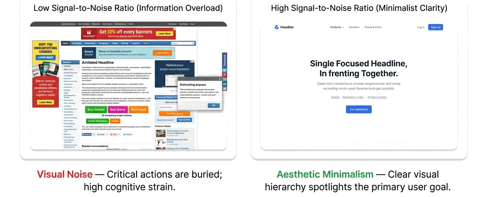

<!--
Look at this visual contrast of Signal-to-Noise Ratio on screen.

On the left, information overload buries the user's primary goal under dozens of competing banners, widgets, and tightly packed links—resulting in visual paralysis.

On the right, minimalist design uses generous whitespace, clear typographic scale, and strict visual grouping to spotlight the primary task—allowing the user's eye to lock onto the core action in less than a second.

💡 難字與專業術語解說：
- information overload: 資訊過載（畫面同時呈現過多資訊，超過人類注意力頻寬）
- visual paralysis: 視覺麻痺 / 決策癱瘓（因干擾項過多而不知所措）
- typographic scale: 字級比例階層（透過標題、副標與內文的大小對比建立閱讀次序）
-->
---
<!-- _class: title-image-slide -->
## NS08 in Practice (2/2): Focused KPI Dashboard with Progressive Disclosure

  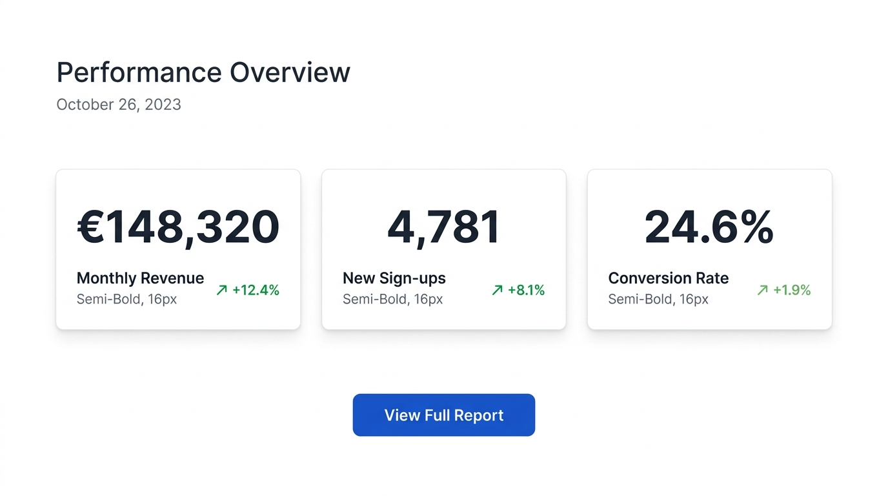

<!--
Here is our second practical example of NS08 in an executive analytics dashboard.

A common anti-pattern in business intelligence (BI) software is cramming 25 charts, 10 filter bars, and raw SQL tables onto the home screen.

Look at how this dashboard applies NS08 and **Progressive Disclosure**: the primary view surfaces only the **3 top-level KPIs** (*Monthly Revenue*, *New Sign-ups*, and *Conversion Rate*) with bold, scannable numbers and clean trend indicators. Detailed drill-down tables and secondary parameters are deferred behind the **`View Full Report`** action—keeping daily executive scanning effortless.

💡 難字與專業術語解說：
- KPI (Key Performance Indicator) dashboard: 關鍵績效指標儀表板
- anti-pattern: 反模式（看似合理、實則會帶來嚴重負面後果的常見錯誤設計）
- drill-down table: 下鑽明細表（點擊總覽指標後深入檢視底層逐筆資料的表格）
-->
---
## Challenge: What's Wrong with this Task Manager Screen?

> **Scenario:** A software engineer opens their enterprise team task board to triage their daily bugs.

* **1. Visual Clutter & Signal-to-Noise Ratio (What matters here?):**
  - Drowning in backend noise: `INTERNAL_DB_ID`, server `Ping: 28ms`, shard names, and daemon timestamps.
  - Clashing 5-color rainbow tags, heavy borders, and a yellow promotional ad banner compete for attention.
* **2. Speed & Shortcuts for Daily Experts (Why so many clicks?):**
  - Zero keyboard shortcuts (`Cmd+K` and `Enter` are disabled).
  - No multi-select batch actions—editing a task requires clicking through 4 nested mouse submenus (`Submenu 1..3`, `Actions...`).
* **Discussion Prompt:**
  - How would you declutter this interface and empower power-user workflows?

    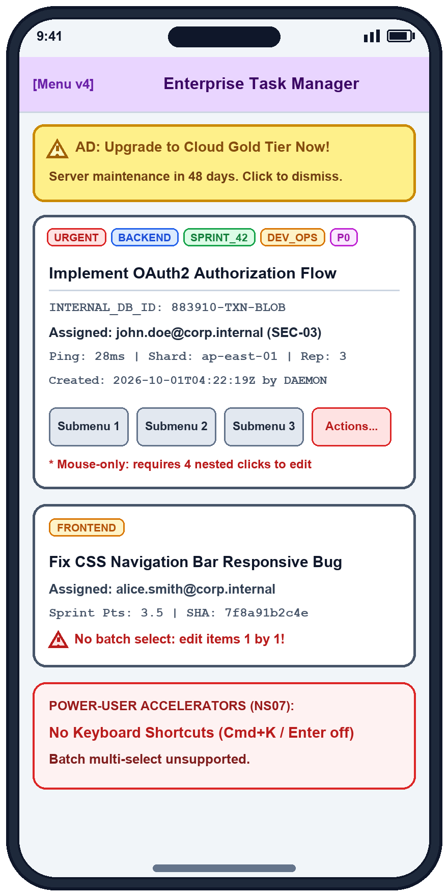

<!--
Now let's tackle our fourth Classroom Challenge! Look at the Enterprise Task Manager screen on the right (`task_management_bad.png`).

Imagine you are a software engineer who uses this issue tracker 8 hours a day to triage sprint bugs. Look at the two major usability failures on this screen:
1. **Visual Clutter & Signal-to-Noise Ratio**: Every card is drowning in irrelevant backend metadata (`INTERNAL_DB_ID: 883910-TXN-BLOB`, `Ping: 28ms | Shard: ap-east-01`, `Created: ... by DAEMON`), 5 clashing rainbow badges (`URGENT`, `BACKEND`, `SPRINT_42`, `DEV_OPS`, `P0`), thick dark borders, and a loud yellow cloud upgrade ad banner at the top!
2. **Zero Accelerators for Daily Experts**: Look at the bottom notice—keyboard shortcuts (`Cmd+K` / `Enter`) and batch multi-select are completely disabled! Updating a single task requires clicking through 4 nested mouse buttons (`Submenu 1`, `Submenu 2`, `Submenu 3`, `Actions...`)!

💡 難字與專業術語解說：
- triage daily bugs: 每日缺陷檢傷分類與優先級排定
- visual clutter: 視覺雜訊、畫面雜亂堆積
- database shard & daemon: 資料庫分片節點與背景常駐程式（純後端底層資訊，不應暴露於一般任務卡片）
- nested mouse submenu: 巢狀多層滑鼠子選單（必須逐層點擊多次才能觸達目標動作的設計）
-->
---
## Challenge Revealed: Redesigning for NS07 & NS08

> **The Solution:** Strip away irrelevant technical noise to maximize signal, and empower power users with omnipresent keyboard shortcuts.

🔍 Hover to see original UI design (p.49)

* **NS07 Redesign (Accelerators & Flexibility):**
  - ✅ **Universal Command Palette:** `Cmd+K` / `Ctrl+K` launches instant actions from anywhere.
  - ✅ **Inline Keybinds:** Press `E` to edit, `C` to create quick tasks without touching the mouse.
  - ✅ **Batch Operations:** Multi-select shift-click lets power users triage 10 tasks simultaneously.
* **NS08 Redesign (Aesthetic & Minimalist Design):**
  - ✅ **Noise Eradicated:** Internal database shards and latency stats hidden behind details view.
  - ✅ **High Signal-to-Noise:** Generous whitespace, clean priority tags (*High Priority, Due Tomorrow*).

    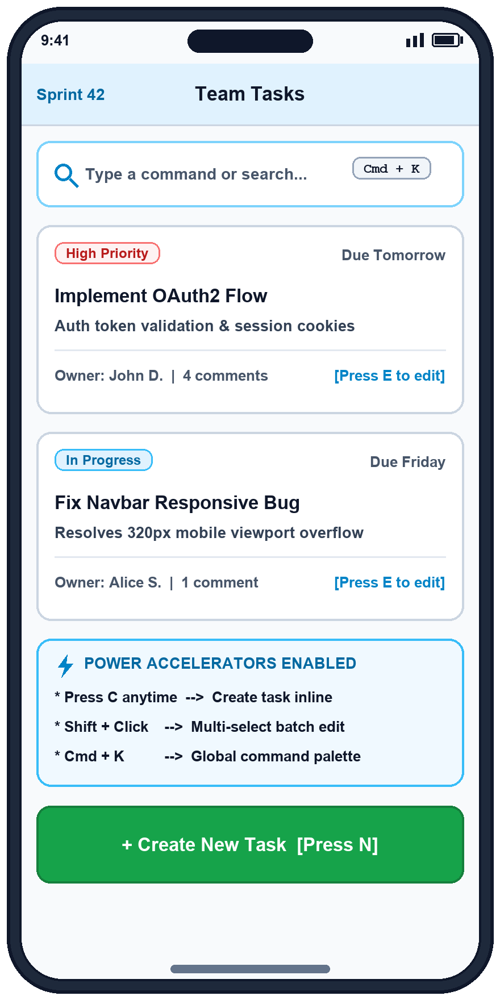

<!--
Now let's reveal the refactored Task Manager workspace (`task_management_good.png`) combining **NS07** and **NS08**!

1. **NS08 Redesign (Aesthetic & Minimalist Design)**:
   - The yellow ad banner, 5-color rainbow tags, and raw database shard/ping metadata (`INTERNAL_DB_ID`) are completely eradicated from the card surface.
   - Each card displays only high-signal information: a single priority badge (**`High Priority`** / **`In Progress`**), due date (**`Due Tomorrow`**), clear task title, owner, and comment count with generous whitespace.
2. **NS07 Redesign (Flexibility & Efficiency Accelerators)**:
   - A global command bar at the top supports **`Cmd + K`** instant search and command execution.
   - Cards feature inline **`[Press E to edit]`** triggers, **`Press C`** for inline creation, **`Shift + Click`** for multi-select batch editing, and **`[Press N]`** on the primary CTA!

💡 難字與專業術語解說：
- omnipresent keyboard shortcut: 無處不在的全域鍵盤快捷鍵
- inline keybind: 行內快捷鍵綁定（無需點開子選單，直接按單鍵如 E 或 C 即可原地編輯或新增）
- eradicate noise: 徹底根除視覺雜訊
-->
---
## NS09: Help Users Recognize, Diagnose, & Recover from Errors

* **Heuristic Principle:**
  > "Error messages should be expressed in **plain language** (**no codes**), **precisely indicate the problem**, and **constructively suggest a solution**."
* **The Anatomy of a Terrible Error Message:**
  - ❌ *"Error 0x80004005: Unexpected runtime exception in thread main."* (Terrifies the user; completely unhelpful).
* **The Anatomy of a Great Error Message:**
  - ✅ **Plain Language:** *"We couldn't charge your credit card."*
  - ✅ **Precise Cause:** *"The expiration date entered (05/23) is in the past."*
  - ✅ **Constructive Recovery:** *"Please enter an updated expiration date or choose a different payment method [Update Card]."*

<!--
That hostile registration form brings us to **NS09: Help Users Recognize, Diagnose, and Recover from Errors**.

Nielsen's rule for error messages has three mandatory parts:
1. **Express in plain language (no codes)**: Never expose raw stack traces, SQL exceptions, or hex codes like `0x80004005`.
2. **Precisely indicate the problem**: Instead of a vague *"Invalid input"* or *"Password rejected"*, state the exact cause (*"The expiration date entered (05/23) is in the past"*).
3. **Constructively suggest a solution**: Give the user an immediate, actionable recovery path or clickable link (*"Please enter an updated expiration date or [Update Card]"*), and **never wipe valid form fields**!

💡 難字與專業術語解說：
- recognize, diagnose, and recover: 辨識、診斷與修復錯誤（使用者發現出錯、理解原因並成功修正的三階段）
- plain language: 平易白話的自然語言（不含程式碼與系統縮寫的日常用語）
- runtime exception & stack trace: 執行期例外與呼叫堆疊追蹤（程式崩潰時的內部除錯資訊）
- constructive recovery: 具建設性的修復引導（明確告訴使用者「現在該怎麼做才能解決問題」）
-->
---
<!-- _class: title-image-slide -->
## NS09 in Practice (1/2): Cryptic 404 Dead-End vs. Helpful 404 Recovery

  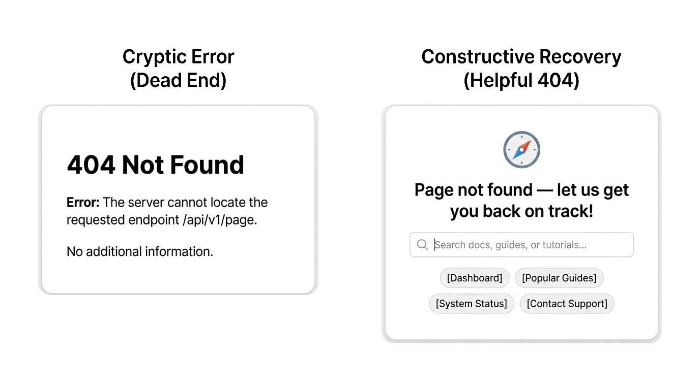

<!--
Look at this side-by-side comparison of a 404 Page Not Found error (`NS09 in Practice 1/2`).

On the left ("Cryptic 404 Dead-End"), the server dumps `HTTP 404: Cannot locate requested endpoint /api/v1/page` on a stark screen with zero navigation—leaving the user stranded at a dead end.

On the right ("Helpful 404 Recovery"), the page explains in friendly language that the link may have moved, provides an embedded **Search Bar** right in the center, and offers one-click recovery buttons (**`Go to Dashboard`**, **`Popular Guides`**, **`Contact Support`**) so the user can recover immediately.

💡 難字與專業術語解說：
- dead-end error page: 死胡同錯誤頁（只告知出錯、卻不提供任何返回或下一步出口的畫面）
- endpoint: API 端點 / 網址路徑
- navigation hub: 導覽樞紐（提供搜尋框與常用捷徑以協助使用者重新定向的頁面）
-->
---
<!-- _class: title-image-slide -->
## NS09 in Practice (2/2): Plain-Language Upload Diagnosis & Recovery

  

<!--
Here is our second practical example of NS09 in a file upload workflow.

When a user tries to upload a `.tiff` or `.bmp` image, a lazy implementation throws a red toast saying *"Error: Invalid MIME Type"* or *"Upload Failed (Code 415)"*.

Look at how this modal dialog implements all three pillars of NS09:
1. **What failed (Plain Language)**: *"Upload failed: File format not supported."*
2. **Why it failed (Precise Cause)**: *"We only accept PNG or JPG files under 5MB (your file is 12.4MB TIFF)."*
3. **How to recover (Constructive Action)**: Provides a prominent primary button (**`Choose Another File`**) right inside the dialog!

💡 難字與專業術語解說：
- MIME Type (Multipurpose Internet Mail Extensions): 多用途網際網路郵件擴充類型（標準檔案格式識別碼，一般用戶不熟悉此術語）
- actionable error modal: 可直接採取修復行動的錯誤對話框
- file format & size constraint: 檔案格式與容量上限規範
-->
---
## NS10: Help and Documentation

* **Heuristic Principle:**
  > "Even though it is better if the system can be used without documentation, it may be necessary to provide help and documentation. Any such information should be **easy to search**, **focused on the user's task**, **list concrete steps** to be carried out, and **not be too large**."
* **Modern Documentation Paradigms:**
  - **Contextual Tooltips:** Inline `?` icons explaining complex form requirements on hover.
  - **Interactive Onboarding Tours:** Lightweight, multi-step interactive walkthroughs highlighting key UI areas for first-time signups.
  - **Searchable Task-Oriented Help Centers:** Documentation organized by customer goals rather than internal system architecture.

<!--
Now let's examine the tenth and final heuristic: **NS10: Help and Documentation**.

Nielsen writes: *"Even though it is better if the system can be used without documentation, it may be necessary to provide help and documentation. Any such information should be easy to search, focused on the user's task, list concrete steps to be carried out, and not be too large."*

In modern software engineering, dumping a 180-page PDF manual on users is unacceptable. Instead, documentation is **contextual and embedded directly inside the UI**:
- **Contextual Tooltips (`?`)**: Microcopy popovers right next to complex fields (like `2FA` or `API Key`).
- **Interactive Onboarding Spotlight Tours**: Guided 3-step walkthroughs on first login.
- **Searchable, Task-Oriented Help Widgets**: Organized around what the user wants to accomplish, not how the backend modules are named.

💡 難字與專業術語解說：
- help & documentation: 說明文件與求助支援
- contextual tooltip / microcopy: 情境式微提示 / 介面微文案（嵌入在欄位旁、在疑惑發生當下給予解答的精簡說明）
- interactive onboarding tour: 互動式新手導覽（首次登入時以聚光燈高亮逐步引導操作的教學流程）
- task-oriented knowledge base: 任務導向知識庫（依使用者目標而非系統模組分類的可搜尋說明中心）
-->
---
<!-- _class: title-image-slide -->
## NS10 in Practice (1/2): Contextual Tooltips & Interactive Spotlight Tours

  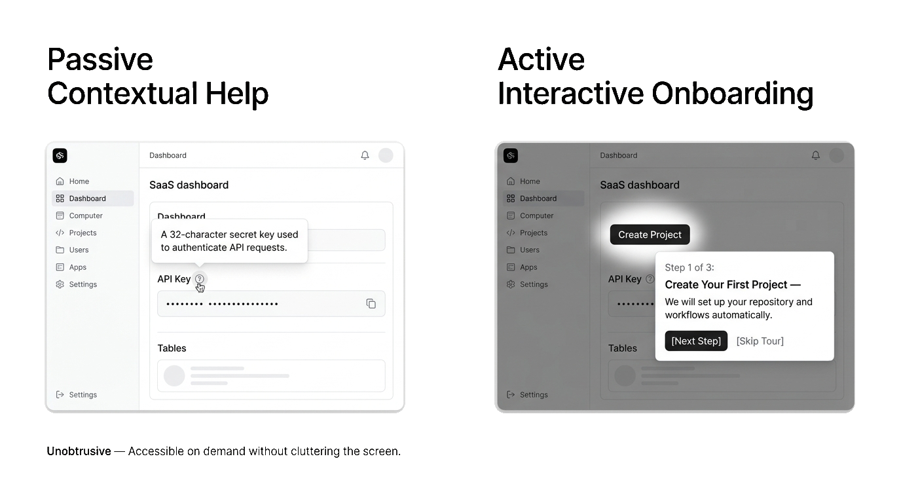

<!--
Look at these two complementary embedded documentation patterns on screen (`NS10 in Practice 1/2`):

On the left is **Passive Contextual Help**: a subtle `?` icon placed right beside an advanced technical field (`API Key` / `Webhook URL`). It takes up zero screen space until the user hovers or taps it, revealing a concise two-sentence explanation right in place.

On the right is **Active Interactive Onboarding**: when a new user creates their first workspace, a spotlight overlay dims the background and highlights Step 1 of 3 with a clear action pointer—teaching by doing rather than forcing the user to read a manual.

💡 難字與專業術語解說：
- passive vs. active help: 被動式求助（使用者有疑問時主動點擊 `?` 觸發）vs. 主動式導覽（系統偵測到新用戶時自動彈出引導）
- spotlight overlay: 聚光燈遮罩（將背景壓暗、僅打亮當前教學目標按鈕的視覺引導技術）
- learning by doing: 做中學（在真實介面互動中自然學會操作，而非閱讀靜態手冊）
-->
---
<!-- _class: title-image-slide -->
## NS10 in Practice (2/2): Task-Focused Step-by-Step Guided Walkthrough

  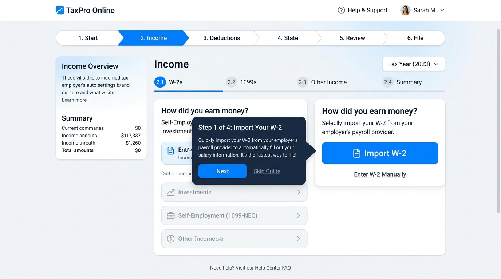

<!--
Here is a second real-world example of NS10 in a complex domain: an online tax-filing application (`NS10 in Practice 2/2`).

Filing taxes involves intimidating legal terminology like *"Form W-2 Wage and Tax Statement"*. Instead of sending the user to read IRS tax codes, a contextual popover (**`Step 1 of 4: Import Your W-2`**) points directly to the **`Import W-2`** button, explains in two plain sentences how to auto-import payroll data, and crucially includes both a **`Next`** button and a **`Skip Guide`** link (honoring NS03 User Control!).

💡 難字與專業術語解說：
- tax-filing workflow: 報稅申報工作流（高專業門檻、極需情境式說明輔助的典型領域）
- contextual popover: 情境式彈出說明氣泡（指向特定按鈕並提供步驟指引的浮動卡片）
- skip tour / skip guide: 跳過導覽（允許熟練用戶隨時略過新手教學的控制出口）
-->
---
## Challenge: What's Wrong with this Account Setup Screen?

> **Scenario:** A new employee is creating an account on their company portal and clicks *"Submit & Try Again"*.

* **1. Error Diagnosis & Recovery (What went wrong, and why wipe the form?):**
  - Screams a cryptic fatal hex code (`ERROR CODE 0x800A03EA`) and `REG_VALIDATION_ERR_SYNTAX` with no plain-language explanation.
  - Punishes the user by wiping the entire form blank—forcing them to retype their email!
  - Rejects the password without stating *which* policy rule failed.
* **2. Contextual Guidance & Help (Where do you get answers?):**
  - Asks for a *"TOTP 2FA SEED / TOKEN ID"* with no inline tooltip or `(?)` explainer.
  - The only help offered is a link to *"Download 180-Page Admin PDF (45MB)"*!
* **Discussion Prompt:**
  - How can we make error messages constructive and guidance contextual?

    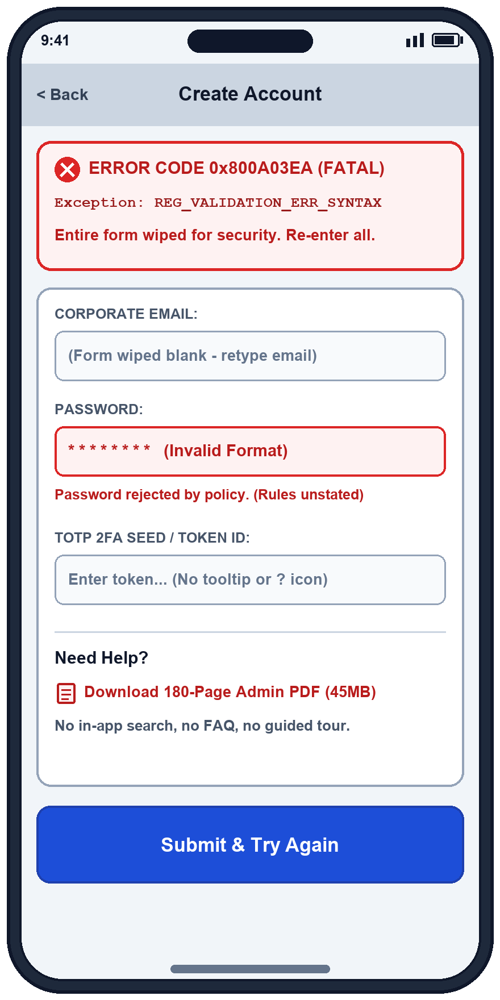

<!--
Let's examine our fifth and final Classroom Challenge (`signup_help_bad.png`), covering the last two heuristics!

Imagine a new employee is registering their enterprise account and clicks **`Submit & Try Again`**. Look at what happens on the screen:
1. **Error Diagnosis & Recovery**: A terrifying red banner screams **`ERROR CODE 0x800A03EA (FATAL)`** and **`Exception: REG_VALIDATION_ERR_SYNTAX`**. Worse still, it says *"Entire form wiped for security. Re-enter all"*—wiping their email blank! And under Password, it says *"Password rejected by policy. (Rules unstated)"* without telling them *which* rule failed!
2. **Contextual Guidance & Help**: The form asks for a **`TOTP 2FA SEED / TOKEN ID`** with zero inline tooltip or `(?)` icon. And at the bottom under *"Need Help?"*, the only option is **`Download 180-Page Admin PDF (45MB)`**!

💡 難字與專業術語解說：
- hex error code: 十六進位錯誤碼（如 `0x800A03EA`，僅供底層除錯、對一般使用者毫無意義的代碼）
- form wiping: 清空重置表單（表單驗證失敗時惡意把使用者已填對的欄位也一併清空的糟糕設計）
- TOTP 2FA (Time-based One-Time Password Two-Factor Authentication): 基於時間的一次性密碼雙重驗證
- inline tooltip: 行內微提示（點擊或懸停於欄位旁 `?` 圖示時即時彈出的簡短說明框）
-->
---
## Challenge Revealed: Redesigning for NS09 & NS10

> **The Solution:** Deliver plain-language error diagnostics with live recovery checklists, and embed contextual inline guidance right at the point of action.

🔍 Hover to see original UI design (p.57)

* **NS09 Redesign (Constructive Error Recovery):**
  - ✅ **No Form Wiping:** Email and previously entered data are safely preserved upon validation errors.
  - ✅ **Real-Time Password Checklist:** Dynamic indicators (*Length, Number, Symbol*) confirm exactly which rules pass or fail.
* **NS10 Redesign (Help & Documentation):**
  - ✅ **Inline Contextual Tooltips:** Inline `Help (?)` explainer defines 2FA in 2 plain sentences without leaving the screen.
  - ✅ **Searchable Instant FAQs:** Replaces 180-page static PDF manual with an interactive in-app search query box.

    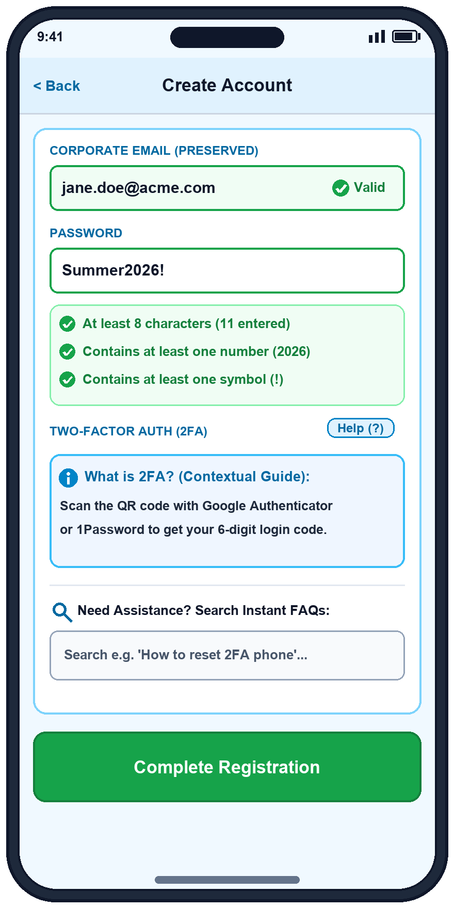

<!--
Now let's reveal the refactored Account Registration screen (`signup_help_good.png`) applying **NS09** and **NS10**—completing all five of our Heuristic Challenges!

1. **NS09 Redesign (Constructive Error Recovery)**:
   - **Zero Form Wiping**: The user's valid corporate email (`jane.doe@acme.com`) is safely preserved with a green **`✓ Valid`** badge!
   - **Live Constructive Checklist**: Instead of a cryptic hex error or vague password rejection, a real-time green checklist confirms each satisfied rule (*At least 8 characters*, *Contains a number*, *Contains a symbol `!`*).
2. **NS10 Redesign (Contextual Help & Documentation)**:
   - Next to `TWO-FACTOR AUTH (2FA)`, a clickable **`Help (?)`** pill opens an inline contextual guide explaining in two clear sentences how to scan the QR code with Google Authenticator or 1Password.
   - At the bottom, the 180-page PDF download is replaced by an **Instant FAQ Search Bar**!

💡 難字與專業術語解說：
- preserved form state: 保留已填表單狀態（發生局部錯誤時，妥善留存使用者已輸入的正確欄位）
- live validation checklist: 即時動態驗證檢核表（隨使用者打字即時打勾回饋哪些密碼條件已達成）
- searchable instant FAQ: 可即時檢索的常見問答框
-->
---
### Concept Check Question 2: Usability Heuristics
<!-- id: ase-ch06-ccq2 -->

  

When designing an e-commerce checkout flow, a team replaces raw text date inputs with an interactive calendar picker and automatically disables the "Place Order" button until all required shipping addresses pass validation. Which Nielsen Heuristic is primarily demonstrated?

- **A.** NS01: Visibility of System Status.
- **B.** NS05: Error Prevention.
- **C.** NS07: Flexibility and Efficiency of Use.
- **D.** NS10: Help and Documentation.

  

  

    

<!--
Let's test our mastery of Section 6.2 with Concept Check Question 2!

Read the scenario: in an e-commerce checkout flow, the engineering team replaces raw text date inputs with an interactive calendar picker and automatically disables the "Place Order" button until all required shipping fields pass validation. Which Nielsen Heuristic is primarily demonstrated?

The correct answer is **Option B: NS05 (Error Prevention)**. Rather than waiting for the user to submit a malformed date string or an incomplete address and then throwing an error message (which would be NS09), the team used **input constraints** (a calendar picker) and **disabled invalid states** to prevent the error from occurring in the first place!

💡 難字與專業術語解說：
- malformed date string: 格式錯誤的日期字串
- proactive constraint vs. reactive error message: 事前主動防呆約束（NS05）vs. 事後錯誤訊息診斷（NS09）
-->
---
## Pair Discussion: Real-World Heuristic Audit (30 Mins)

> **Mission (⏱️ 30 Mins):** In pairs, choose **one** familiar system below and create a short **slide deck with annotated screenshots** showing which designs <strong>satisfy (✅)</strong> and which <strong>violate (❌)</strong> `NS01–NS10`.

### 1. Pick One Target System
1. **THSR Booking System (高鐵訂票系統 / T-EX):** Timetable search, discount filters, seat map, or ticket split/exchange flows.
2. **University Course System (大學選課系統):** Rush-hour queuing, course code lookup, schedule conflict checks, and session timeouts.
3. **Shopee / E-Commerce (蝦皮或其他購物平台):** Home screen pop-ups, coupon rules, cart checkout, and parcel tracking.
4. **Daily Super-Apps (LINE / Uber Eats / YouTube):** Message recall (`Unsend` vs. `Delete`), live delivery maps, or settings menus.
5. **Custom Choice (其他自定義系統):** Any web or mobile app your team uses daily.

### 2. Slide Deliverable (Screenshots)
- **✅ Satisfied Heuristics (2–3 Screenshots):**
  - Capture real screens, circle the good UI elements, tag the exact **`NS01–NS10`** code, and explain *why* it reduces cognitive load.
- **❌ Violated Heuristics (2–3 Screenshots):**
  - Capture frustrating screens, point out the exact design flaw, tag the violated **`NS01–NS10`** code, and rate its severity (`1–4`).
- **🛠️ One-Sentence Fix:**
  - Propose how your team would redesign the worst `❌` screen!

<!--
Before we move on to Section 6.3, let's put Nielsen's 10 Usability Heuristics into hands-on practice with a 30-minute Pair Discussion and Mini-Presentation!

Pair up with your neighbor and choose one real-world software system that you both use all the time:
1. **Taiwan High Speed Rail (THSR) Booking System or T-EX App**: Think about how it handles timetable selection, student discount filters, ticket modification, or split-ticket picking.
2. **Your University Course Registration System**: Every student has strong feelings about course selection day! Look for how it handles rush-hour status (NS01), course codes vs. recognition (NS06), schedule conflict prevention (NS05), or session timeouts (NS03/NS09).
3. **Shopee or another E-Commerce App**: Compare its awesome 4-stage logistics tracking (✅ NS01) against its crowded home screen pop-ups and gamified banners (❌ NS08).
4. **Or any custom system you use daily** (like LINE, Uber Eats, or Git/VS Code).

Over the next 30 minutes, take real screenshots on your phone or laptop and put together a short slide deck: show 2 to 3 screenshots where the system **satisfies (✅)** specific `NS01–NS10` principles, and 2 to 3 screenshots where it **violates (❌)** specific `NS01–NS10` principles—plus a quick redesign fix for the worst offender. Let's start the timer!

💡 難字與專業術語解說：
- heuristic audit: 啟發式可用性稽核（依據 NS01–NS10 原則逐項檢視真實系統介面的體檢過程）
- annotated screenshot: 標註式畫面截圖（在真實介面截圖上圈選特定元件並加上原則編號與說明）
- rush-hour queuing: 尖峰時段排隊佇列（如搶票或選課系統在瞬間高併發流量下的等待狀態回饋）
-->

---
<!-- _class: lead -->
<!-- header: '6.3 Tidwell Interaction & UI Patterns' -->

# **6.3 Jenifer Tidwell's Interaction & UI Design Patterns**

> "Patterns are not off-the-shelf components that you plug into a layout. They are living architectural blueprints rooted in human perception, habit, and behavior."  
> — *Jenifer Tidwell, Designing Interfaces*

<!--
Welcome to Section 6.3: Jenifer Tidwell's Interaction & UI Design Patterns.

In Section 6.2, Jakob Nielsen gave us ten diagnostic heuristics—the lenses to spot what is broken in an interface. Now we need the constructive engineering toolkit to build what is right. Just as the Gang of Four gave backend software engineers structural and behavioral design patterns like Factory, Observer, and Strategy, Jenifer Tidwell cataloged the foundational interaction design patterns for human-computer interfaces in her classic O'Reilly book, *Designing Interfaces*.

As Tidwell reminds us, users do not open our software to admire its visual chrome; they come to get work done, find answers, or complete a workflow without feeling foolish. Let's explore how UI patterns translate human psychology into concrete layout and interaction architectures.

💡 難字與專業術語解說：
- interaction design pattern: 互動設計模式（針對常見使用者介面互動問題的結構化可重用解決方案）
- visual chrome: 介面視覺邊框與裝飾框架（瀏覽器或應用程式中非內容本體的控制列與外框裝飾）
- foolish: 愚蠢的、受挫無助的（良好介面設計的核心目標是不讓使用者感到自己很笨）
-->
---
## What is an Interaction Design Pattern? (UI Patterns)

> **Core Definition:** A proven, reusable architectural solution to a commonly occurring human-computer interaction problem within a specific context.

### 1. Why Engineering Teams Rely on UI Patterns
- **Shared Cross-Functional Vocabulary**:
  - Unifies Product Managers, UI/UX Designers, and Full-Stack Engineers (e.g., agreeing on "Two-Panel Split View vs. One-Window Drilldown").
- **Eliminates Reinventing the Wheel**:
  - Mature interaction dilemmas (escape hatches, wizards, tabs, carousels) already have empirically validated solutions.
- **Reduces Cognitive Friction**:
  - Aligns with users' preexisting mental models (Jakob's Law), making complex systems feel effortlessly intuitive.

### 2. Jenifer Tidwell's Canon & Curated Scope
- **Pioneering Origins & Seminal Book (*Designing Interfaces*)**:
  - Pioneered HCI pattern languages at MIT (**1997** *"Common Ground"* catalog), inspired by Christopher Alexander (1977) & GoF (1994).
  - Authored ***Designing Interfaces*** (O'Reilly): <strong>1st Ed. (2005)</strong>, <strong>2nd Ed. (2010)</strong>, and **3rd Ed. (2020**, with C. Brewer & A. Valencia) across desktop, web, and mobile.
- **Vast Catalog of 100+ Patterns → 4 Core Dimensions**:
  - Encompasses 100+ patterns spanning forms, navigation, canvases, and data grids; we curate the highest-impact patterns into **4 architectural dimensions**.

<!--
Before we look at specific layouts, let's clarify what a UI Design Pattern actually is—and what it is not.

First, a UI pattern is not a copy-paste visual template or a CSS component library like Material UI or Tailwind. It is a reusable structural solution to a recurring human-computer interaction problem, balancing competing layout forces across different platforms.

Second, every pattern is rooted in empirical human psychology—how people perceive visual hierarchy, how much working memory they can hold, and how they scan screens under time pressure.

Third, think of the relationship between Nielsen and Tidwell as a two-sided coin: if Nielsen's ten heuristics are the diagnostic stethoscope that tells you a patient has high blood pressure, Tidwell's patterns are the concrete clinical prescriptions and surgical procedures that cure it.

💡 難字與專業術語解說：
- empirical psychology: 實證心理學（以真實人類認知與行為觀察為基礎的心理學法則）
- competing forces: 相互競爭的設計取捨力（如資訊密度與畫面簡潔度之間的拉扯）
- diagnostic lens: 診斷透鏡（用於檢測系統缺陷的評估視角）
- constructive toolkit: 建構式工具箱（提供具體實作藍圖與組件的工程方法論）
-->
---
## The 4 Core Dimensions of Tidwell's Architecture (The 4 Dimensions)

> **End-to-End Hierarchy:** Grounded in human cognitive behavior, scaling upward through layout, navigation, and complex data collections.

### Dimensions 1 & 2: Behaviors & Content Structure
- <strong>1. Core User Behaviors (Human Psychology)</strong>:
  - Designing for how the human brain actually operates: safe exploration, instant gratification, satisficing, habituation, and spatial memory.
- <strong>2. Organizing Content & Layout (Information Architecture)</strong>:
  - The content discovery trifecta (Search / Feature / Browse), dashboards, progressive disclosure, and multi-step wizards.

### Dimensions 3 & 4: Navigation & Data Display
- **3. Wayfinding & Navigation Mechanisms**:
  - Answering "Where am I, how much is left, and how do I get out?", modal panel rules, escape hatches, and 3-tier orientation.
- <strong>4. Data Display (Lists, Grids & Tables)</strong>:
  - Responsive list strategies: Desktop Two-Panel Split View vs. Mobile One-Window Drilldown, thumbnail grids, carousels, and live platform teardowns.

<!--
To give you a structured mental map of Tidwell's catalog, we organize her patterns into four core engineering dimensions.

Dimension 1 focuses on User Behavior & Core Operations—understanding how real humans satisfice, muddle through, and rely on safe exploration, instant gratification, and prospective memory.

Dimension 2 covers Organizing Content & Page Layout—choosing the right spatial architecture, such as Two-Panel Split Views, One-Window Drilldowns, Visual Frameworks, and Progressive Disclosure.

Dimension 3 addresses Wayfinding & Navigation—preventing spatial disorientation through Clear Entry Points, Escape Hatches, Breadcrumbs, and Annotated Scrollbars.

Dimension 4 tackles Data Display & Lists—helping users browse and compare massive datasets using Thumbnail Grids, Carousels, Alternating Row Striping, and Pagination. Let's dive into Dimension 1 first.

💡 難字與專業術語解說：
- mental map: 心智地圖（協助大腦組織複雜知識結構的空間分類框架）
- wayfinding: 尋路導引（源自建築學，指使用者在資訊空間中定位自身並規劃路徑的過程）
- spatial disorientation: 空間迷航（使用者在多層級視窗或深層選單中迷失位置與方向）
- alternating row striping: 奇偶列交錯底色／斑馬紋（透過深淺交錯背景色輔助水平視線追蹤）
-->
---
## Section 1: General Patterns & Core Behaviors (Core Behaviors)

> **Guiding Principle:** Interfaces must accommodate human cognitive vulnerabilities and physiological habits—never force humans to adapt to rigid machine logic.

### 1. Exploration & Immediate Feedback
- <strong>Safe Exploration (TW1.1)</strong>:
  - Eliminate the fear of clicking! Always provide low-cost trial and an instant, frictionless undo pathway (**Undo Toast**).
- <strong>Instant Gratification (TW1.2)</strong>:
  - Provide a one-click fast-track to the user's primary goal (e.g., e-commerce "Buy Again" button), bypassing multi-step funnels.
- <strong>Changes in Midstream (TW1.4)</strong>:
  - Allow users to modify query parameters mid-flow (e.g., train schedule "Earlier / Later Trains") without starting over from scratch.
- <strong>Deferred Choice (TW1.5)</strong>:
  - Minimize upfront friction; allow users to skip secondary setup steps (**Skip for now**).

### 2. Cognitive Load & Memory Support
- <strong>Incremental Construction (TW1.6)</strong>:
  - Provide instant, real-time live previews as users author content (e.g., Overleaf / Markdown editors) to reduce working memory load.
- <strong>Habituation (TW1.7)</strong>:
  - Adhere to standard conventions (e.g., persistent left sidebar) to build unconscious muscle memory.
- <strong>Spatial Memory (TW1.9)</strong>:
  - Keep critical tools fixed in place (e.g., Settings gear in the top-right corner); never allow core controls to randomly drift!
- <strong>Prospective Memory (TW1.10)</strong>:
  - Use visual badges and counter markers to remind users of future unfinished tasks.

<!--
Let's start with Section 1: Understanding User Behavior & Core Operations.

In software engineering, we often design interfaces for an imaginary, idealized user—someone who reads every manual, carefully analyzes every menu option, and follows our happy path step by step. In the real world, that user does not exist.

In 1956, Nobel laureate Herbert Simon coined a famous portmanteau word: **satisficing**—a blend of *satisfy* and *suffice*. Humans do not exhaustively examine every option on a screen to find the mathematically optimal path; instead, the moment they spot an option that looks "good enough" to move them closer to their goal, they click it and "muddle through" by trial and error.

Because users satisfice, Tidwell identifies twelve behavioral patterns that support real human cognition. Here we highlight six foundational ones: Safe Exploration (letting users poke around without fear of breaking things), Instant Gratification (giving immediate visual success within seconds), Deferred Choices (not forcing upfront account registration before users can try the app), Incremental Construction (letting users mold their work iteratively), Habituation (keeping keyboard shortcuts and gestures consistent so muscle memory never backfires), and Prospective Memory ("remembering to remember"—giving users lightweight pins, drafts, and reminders so they don't have to hold future tasks in their fragile biological RAM).

💡 難字與專業術語解說：
- satisficing: 滿意決策（Herbert Simon 提出之認知原則：人類傾向選擇第一個「夠好」的方案而非窮舉尋找全局最優解）
- muddling through: 摸索前行、邊試邊走（不看說明書、直接憑直覺點擊嘗試的操作行為）
- instant gratification: 即時滿足感（使用者進入系統後幾秒內即可看到具體的操作成果回饋）
- deferred choices: 延遲非必要決策（允許先跳過繁瑣設定或註冊，待核心任務推進後再補填）
- incremental construction: 漸進式建構（支援邊做邊改、逐步微調成形的創作與編輯體驗）
- habituation: 習慣化與肌肉記憶（重複操作形成的下意識反射動作，一旦跨介面不一致極易引發失誤）
- prospective memory: 前瞻性記憶（「記得未來要去某處做某事」的記憶能力，極易受外部干擾而遺忘）
-->
---
<!-- _class: full-image-slide -->

  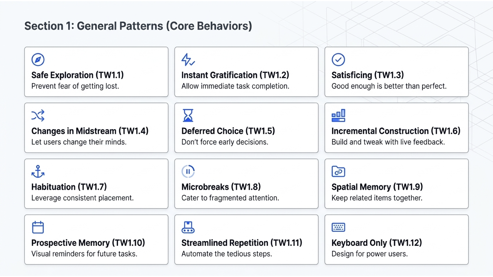

<!--
Look at this illustration of Satisficing versus Optimal Rationality.

On the left, the engineer's mental model assumes the user stands at a crossroads, calmly reading a five-hundred-page specification manual to calculate the optimal route. On the right is what actually happens in production: the user sprints straight through the bushes toward the first glowing sign that looks remotely related to their goal, relying on Undo if they hit a dead end.

Whenever you find yourself saying, "Why didn't the user read the three-paragraph instruction at the top of the modal?", remember this diagram. Users scan for action cues and satisfice.

💡 難字與專業術語解說：
- optimal rationality: 最佳理性模型（假設決策者具備無限時間與算力去評估所有可能選項的理想化假設）
- trial and error: 試誤學習法（透過不斷嘗試與修正錯誤來達成目標的探索過程）
- action cue: 行動視覺線索（畫面中引導點擊或操作的按鈕、連結與高對比圖示）
-->
---
<!-- _class: full-image-slide -->

  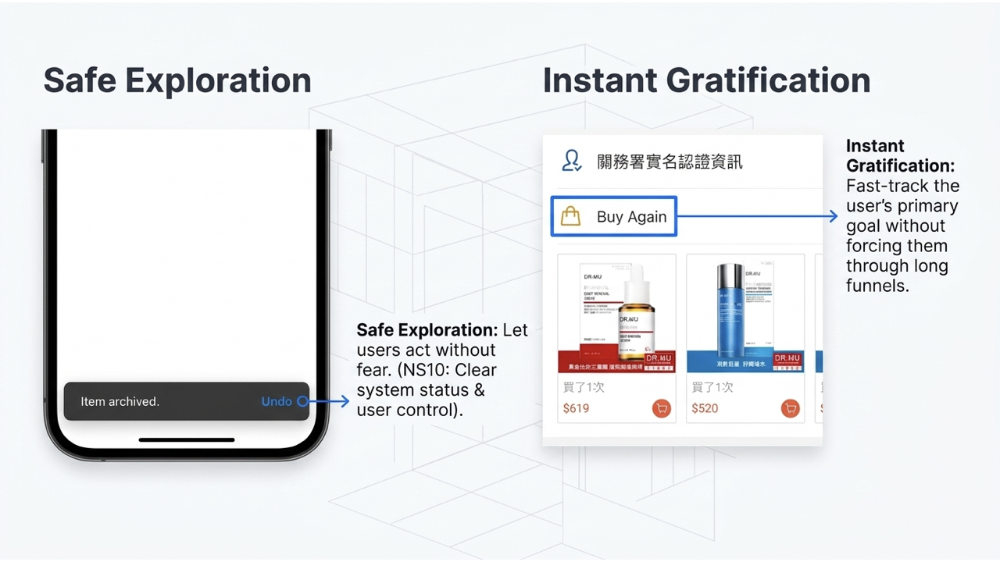

<!--
This architectural diagram maps out how Safe Exploration, Instant Gratification, and Deferred Choices work together during the first sixty seconds of user onboarding.

If a new user opens your graphic design tool or cloud IDE and is immediately blocked by a mandatory ten-field registration wall, credit card prompt, and project configuration wizard, they bounce. Instead, if you let them jump straight onto an interactive canvas (Safe Exploration), apply a one-click starter template that renders a live result in two seconds (Instant Gratification), and only ask them to name their project or create an account when they click "Save & Share" (Deferred Choices), activation rates skyrocket.

💡 難字與專業術語解說：
- onboarding: 新手引導與初次上手體驗（使用者首次接觸產品直到成功完成核心價值的過程）
- registration wall: 強制註冊牆（在體驗任何核心功能前強迫使用者先註冊登入的阻斷式設計）
- activation rate: 產品啟用轉換率（新使用者成功完成首次核心價值體驗的指標比例）
-->
---
<!-- _class: full-image-slide -->

  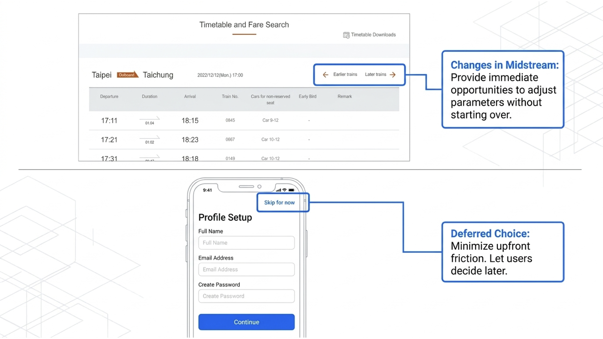

<!--
Here we see Incremental Construction and Habituation in action.

Incremental Construction is why modern code editors, document processors, and query builders provide live previews and hot-reloading. Humans cannot hold a complex finished artifact entirely in their head before typing; they sketch a rough draft, see how it looks, and iteratively refine it.

Meanwhile, Habituation explains why breaking platform conventions is so dangerous. Once a user has pressed `Cmd+S` to save or swiped right to go back ten thousand times, that action moves from conscious prefrontal cortex processing to automatic basal ganglia muscle memory. If your web app overrides `Cmd+S` to "Send & Publish Unfinished Draft to All Clients," your users' own muscle memory becomes a weapon against them.

💡 難字與專業術語解說：
- hot-reloading: 熱重載／即時預覽更新（修改局部內容或代碼後無須重啟即刻呈現視覺結果）
- muscle memory: 肌肉記憶（經長期重複訓練後不需大腦意識思考即可自動執行的程序性記憶）
- basal ganglia: 基底核（大腦中負責習慣化動作與程序性運動記憶的深層神經結構）
-->
---
<!-- _class: full-image-slide -->

  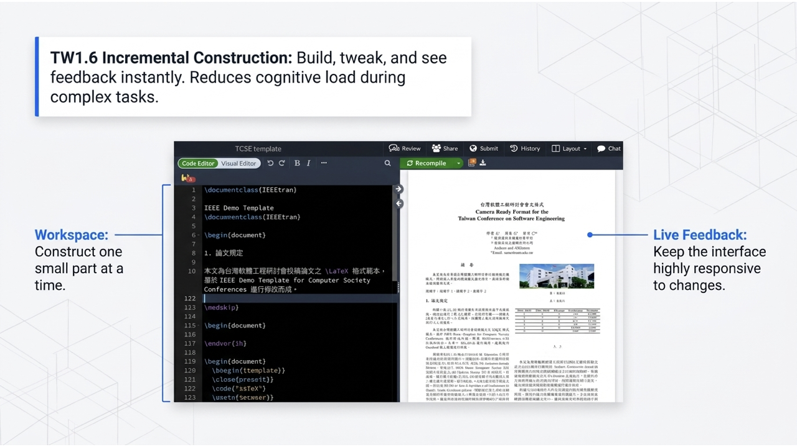

<!--
This diagram illustrates Prospective Memory—one of the most fragile aspects of human cognition.

Retrospective memory is remembering the past ("What did I eat yesterday?"). Prospective memory is remembering to perform an intended action in the future ("When I finish reviewing this pull request, I need to update the deployment config"). As soon as a Slack notification pops up or a colleague walks by, prospective memory evaporates.

Great interfaces externalize prospective memory directly into the workspace: letting users star an email, leave an inline `// TODO` comment, pin a tab, or save a half-written draft visibly in the sidebar so the interface remembers on their behalf.

💡 難字與專業術語解說：
- retrospective memory: 回溯性記憶（對過去已發生事件、知識或經驗的記憶提取）
- externalize: 認知外化（將原本需儲存在人腦內部的記憶或計算轉移至外部視覺工具中保存）
- intended action: 預期計畫行動（使用者打算在未來某個時間點或條件下執行的待辦動作）
-->
---
<!-- _class: full-image-slide -->

  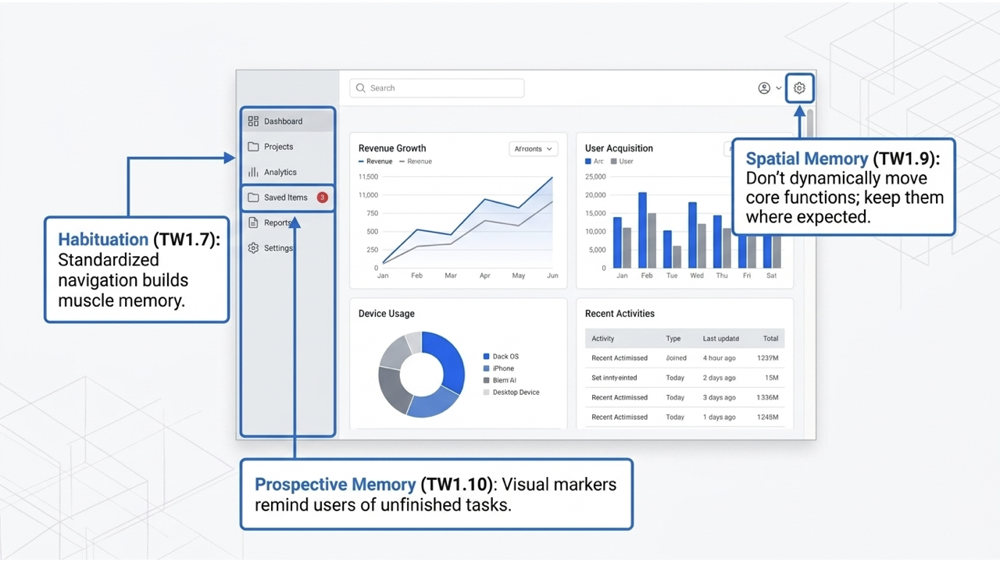

<!--
Now let's examine how these behavioral truths crystallize into concrete UI patterns.

Every modern authoring tool—from VS Code and Figma to Notion and Canva—relies on the **Safe Editing Trifecta**: Preview, Undo, and Autosave. Notice how each pillar neutralizes a specific psychological barrier: Live Preview eliminates the fear of the unknown before an action; Multi-level Undo eliminates the fear of human error after an action; and Cloud Autosave eliminates the fear of catastrophic hardware or network failure.

Beside that sits **Progressive Disclosure** (often implemented as "Show More" drawers, collapsible advanced panels, or tiered settings). Notice the golden engineering rule: display the 20% of controls that handle 80% of daily workflows upfront, and tuck the remaining 80% of edge-case parameters behind an on-demand expansion toggle. You satisfy both novices who need simplicity and power users who need granular control.

💡 難字與專業術語解說：
- trifecta: 黃金三要素、三連勝組合（三個相輔相成缺一不可的核心機制）
- multi-level undo: 多層次復原（支援連續回退多個歷史操作步驟的狀態堆疊機制）
- progressive disclosure: 漸進式揭露（依使用者需求分階段展開進階細節以控制初始認知負荷）
- Pareto distribution (80/20 rule): 柏拉圖八二法則（80% 的日常使用情境集中在 20% 的核心功能上）
- granular control: 細粒度控制（針對底層參數進行精密微調的能力）
-->
---
## Section 2: Organizing Content & Layout (Content & Layout)

> **Guiding Principle:** Screen real estate is finite while information is limitless; great layouts balance immediate discoverability with progressive depth.

### 1. Discovery Trifecta & Spatial Frameworks
- <strong>The Content Discovery Trifecta (TW2.1)</strong>:
  - **Search**: For high-intent users with direct, explicit queries.
  - <strong>Feature / Center Stage (TW4.2)</strong>: Curated system highlights that command immediate visual focus.
  - **Browse**: For exploratory users navigating category hierarchies.
- <strong>The Dashboard (TW2.5)</strong>:
  - Aggregates critical high-density KPIs in high-contrast visual tiles for rapid scanning.
- <strong>Alternative Views (TW2.9)</strong>:
  - Empowers users to toggle between representations of identical data (e.g., spatial Map View vs. linear List View).

### 2. Temporal Organization & Complexity Control
- **Progressive Disclosure**:
  - Keep initial screens clean; reveal advanced tools only when the user executes a relevant contextual action.
- <strong>The Wizard (TW2.7)</strong>:
  - Deconstructs an intimidating, multi-parameter process into a strict, predefined linear flow (Step 1 → 2 → 3).
- <strong>Module Tabs (TW4.5)</strong>:
  - Best for **mutually exclusive** datasets at the **same hierarchical level** (swapping global context).
- <strong>Accordion (TW4.6)</strong>:
  - Best for **drilling down into hierarchical details** (e.g., FAQs) without navigating away from the current page.

<!--
Look at this visual comparison of the Safe Editing Trifecta and Progressive Disclosure.

When all parameters—margins, color profiles, bleed settings, PostScript flags, and font subsetting—are dumped into a single flat dialog box, the user freezes. By separating the primary daily actions into a clean top-level view and placing rare configuration parameters inside an expandable "Advanced Settings" drawer, the visual noise drops dramatically while preserving 100% of the engineering capability.

💡 難字與專業術語解說：
- flat dialog box: 扁平無層次對話框（將所有初階與進階選項不分類別全部攤開在同一視窗的設計）
- expandable drawer: 可展開式抽屜面板（點擊後滑出或向下展開以顯示次要控制項的容器組件）
- visual noise: 視覺雜訊（畫面中干擾注意力集中於主要任務的多餘線條、文字與控制項）
-->
---
<!-- _class: full-image-slide -->

  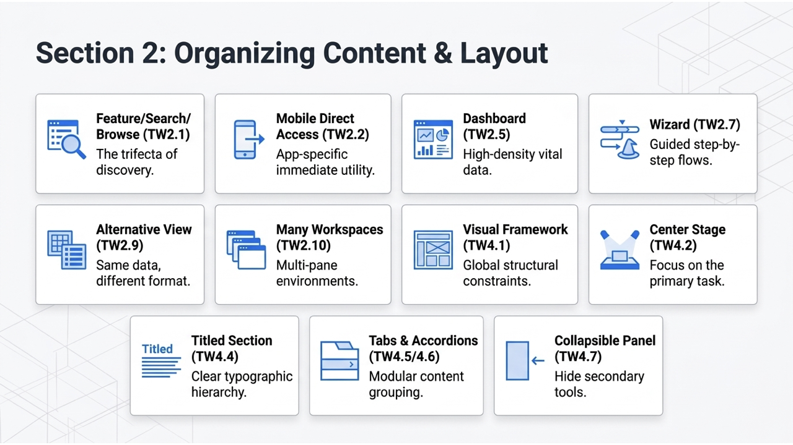

<!--
Now let's move to Section 2: Organizing Content & Page Layout—Macro-to-Micro Spatial Architecture.

When a user opens a new screen, they do not read top-to-bottom like a novel. Within the first two hundred milliseconds, their visual cortex performs pre-attentive processing, scanning the page's macro geometry—whitespace, contrast blocks, alignment, and scale—to deduce what is most important and where to start.

Let's examine four classic spatial architectures from Tidwell's catalog. First, **Two-Panel Split View (Master-Detail)**: keeping a selectable list on the left and rendering the selected item's details immediately on the right, which eliminates tedious back-and-forth page reloads. Second, **One-Window Drilldown**: ideal for mobile screens or step-by-step system settings where horizontal space is tight, replacing the entire viewport as the user drills deeper down a hierarchy. Third, **Visual Framework**: maintaining consistent headers, sidebars, typography, and color tokens across every view so the application feels like a single coherent building. And fourth, **Alternative Views**: allowing the exact same underlying data model to be toggled instantly between a Table, a Kanban Board, and a Calendar view.

💡 難字與專業術語解說：
- pre-attentive processing: 前注意力視覺處理（人類視覺皮層在 200 毫秒內無意識快速掃描色彩、大小與空間結構的生理機制）
- macro-to-micro: 從巨觀到微觀（先確立整體版面骨架，再雕琢局部組件細節的設計階層）
- two-panel split view (master-detail): 雙欄主從分割視圖（左側顯示清單目錄、右側即時連動顯示詳細內容的經典佈局）
- one-window drilldown: 單視窗下鑽導覽（在單一視窗區域內點擊項目後整頁切換至下一層級細節的行動端常見模式）
- pogo-sticking: 跳跳虎式反覆進出（因缺乏雙欄預覽而被迫在「列表頁 ↔ 詳情頁」之間不斷按返回鍵來回跳轉的痛苦操作）
- visual framework: 視覺框架系統（跨頁面維持一致的導覽列、網格與字體色彩規範）
-->
---
<!-- _class: full-image-slide -->

  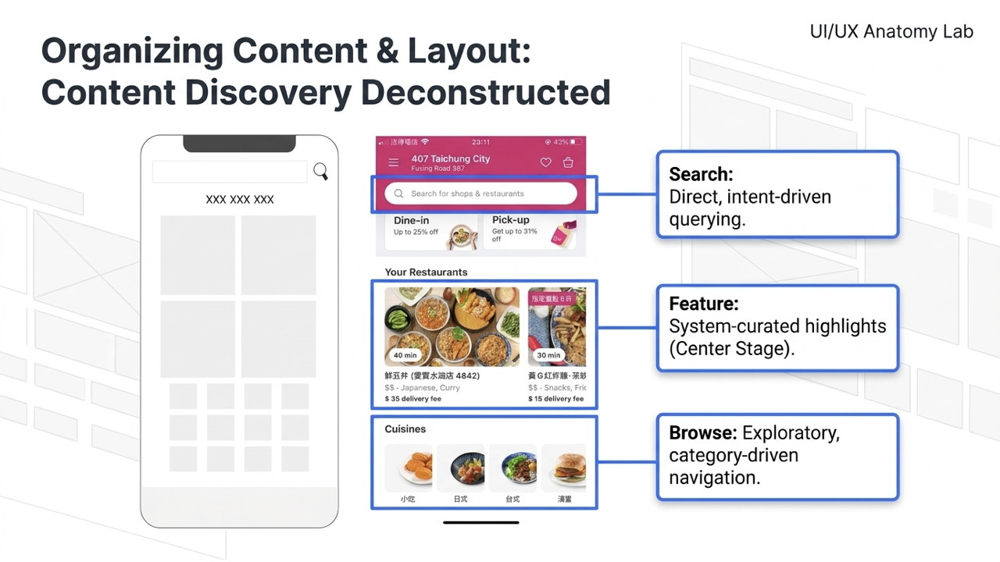

<!--
This diagram contrasts the four macro page architectures side by side.

Notice the crucial engineering trade-off between **Two-Panel Split View** and **One-Window Drilldown**. On a 27-inch desktop monitor, a Two-Panel Split View (like macOS Finder, Outlook, or VS Code's file explorer + editor) is unbeatable because it prevents "pogo-sticking"—jumping into an item, realizing it's the wrong one, clicking Back, and clicking the next item. However, on a 6-inch smartphone screen, squeezing two panels side by side crushes both into unreadable columns; there, responsive design automatically adapts the Master-Detail pattern into a One-Window Drilldown!

💡 難字與專業術語解說：
- viewport: 視埠／可視視窗區域（螢幕上實際可用於渲染畫面內容的矩形顯示區域）
- responsive adaptation: 響應式調適（依據螢幕尺寸與裝置特性自動轉換版面結構的設計機制）
- spatial hierarchy: 空間層級結構（透過區塊位置、面積大小與縮排距離傳達資訊主從關係）
-->
---
<!-- _class: full-image-slide -->

  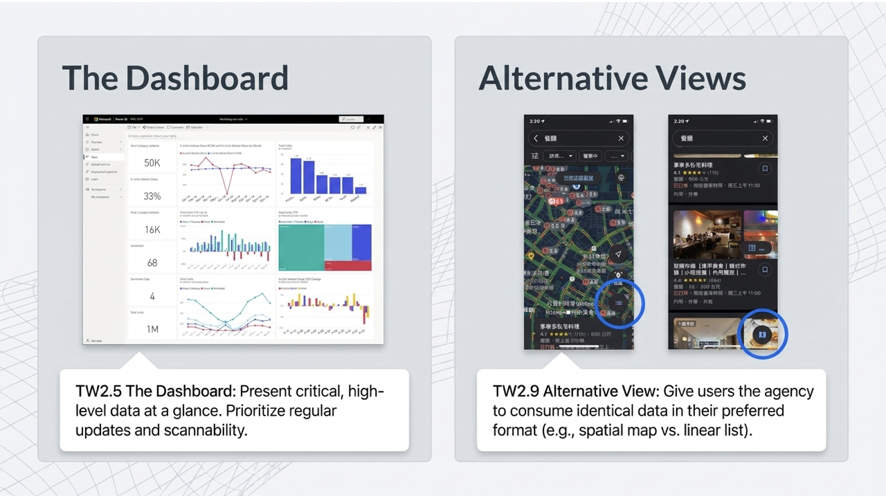

<!--
How do we organize multiple sections of content within a single workspace without overwhelming the screen? Tidwell gives us four workhorse container patterns: **Module Tabs**, **Accordion**, **Collapsible Panels**, and **Movable / Floating Panels**.

Notice the subtle but vital architectural distinction between **Module Tabs** and an **Accordion**:
- **Module Tabs** are **mutually exclusive (`1-of-N`)**: only one tab's content pane is visible at any moment, and all panes share the exact same fixed spatial footprint. Use tabs when categories are distinct peers and the user never needs to compare two tabs side by side.
- **Accordions** stack vertically and can allow **multiple panels to remain open simultaneously (`M-of-N`)**. This makes Accordions ideal for FAQ pages, multi-section inspector sidebars (like Figma or CSS dev tools), or stacked mobile forms where users want to keep two sections expanded at once.

💡 難字與專業術語解說：
- module tabs: 模組化分頁籤（共用同一顯示區域、每次僅呈現單一作用中分頁內容的切換組件）
- accordion: 手風琴摺疊面板（垂直堆疊且可支援單一或多個區塊同時展開收合的容器組件）
- mutually exclusive: 互斥關係（同一時間僅允許一個狀態成立，即 1-of-N 選擇邏輯）
- spatial footprint: 空間佔用面積（UI 組件在螢幕版面上所佔據的矩形像素範圍）
- floating palette: 浮動工具面板（可自由拖曳位置、懸浮於主畫布之上的專業工具列）
-->
---
<!-- _class: full-image-slide -->

  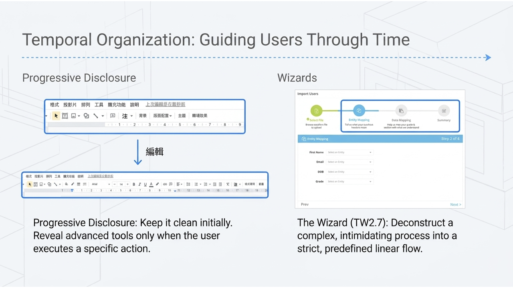

<!--
Look closely at this visual comparison of Module Tabs, Accordions, Collapsible Panels, and Floating Palettes.

A common rookie mistake in enterprise web apps is nesting Module Tabs inside another row of Module Tabs ("double-decked tabs"). When you stack two or three rows of tabs on top of each other, users lose track of which top tab owns which bottom tab. Whenever your hierarchy goes deeper than one level of tabs, switch to a left-hand vertical navigation tree combined with a content pane, or use Collapsible Panels within the page.

💡 難字與專業術語解說：
- double-decked tabs: 雙層堆疊分頁籤（在分頁籤下方又嵌套另一排分頁籤的反模式，極易造成階層混淆）
- navigation tree: 樹狀導覽結構（以垂直縮排展開多層級父子節點的側邊目錄）
- workspace customization: 工作區自訂化（允許進階使用者依個人工作流自由停靠或分離面板）
-->
---
<!-- _class: full-image-slide -->

  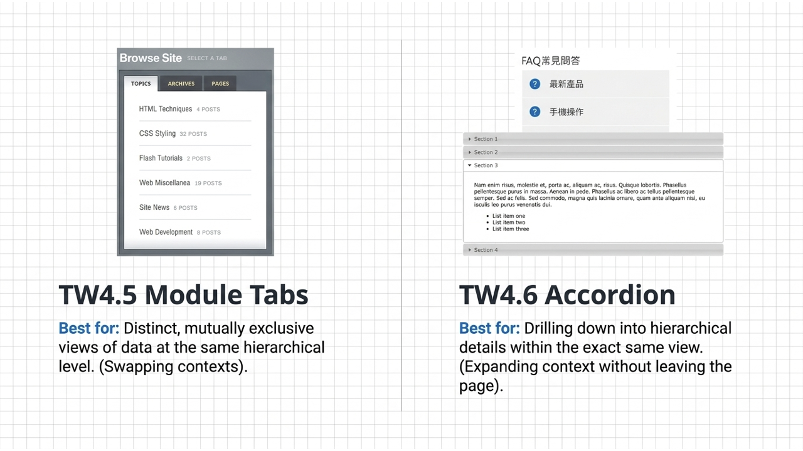

<!--
Let's examine two more essential layout patterns: **Right/Left Alignment** in forms, and **Responsive Disclosure**.

Look at the form alignment rules on the left. Have you ever filled out a wide desktop form where the text labels were left-aligned on the far left edge of the screen, and the input boxes were 400 pixels away on the right? Your eyes have to play ping-pong across a massive white gap, causing you to type values into the wrong row! Tidwell highlights two superior patterns: **Top-Aligned Labels** (placed directly above each input field, allowing a single vertical eye fixation for the fastest completion time) or **Right-Aligned Labels** (which hug the left edge of the input boxes tightly so label and field form a clean visual spine).

On the right, **Responsive Disclosure** shows how a multi-step checkout or configuration flow reveals the next logical section dynamically only after the current step is validated, keeping the screen calm and focused.

💡 難字與專業術語解說：
- eye fixation: 視覺凝視點（眼球在閱讀掃描過程中短暫停留聚焦以擷取資訊的座標點）
- visual spine: 視覺中軸線（表單中標籤右緣與輸入框左緣緊密對齊所形成的垂直視覺導引線）
- top-aligned labels: 頂部對齊標籤（將欄位名稱置於輸入框正上方，能大幅縮短視線移動距離）
- responsive disclosure: 響應式動態揭露（依據使用者前一步驟的選擇結果，動態顯示後續相關表單區塊）
-->
---
## Section 3: Wayfinding & Navigation Mechanisms (Wayfinding & Navigation)

> **Guiding Principle:** An effective navigation system answers the three fundamental questions of digital space: <strong>"Where am I? How much is left? How do I get out?"</strong>

### 1. Entry Points & The Golden Rule of Modals
- <strong>Clear Entry Points (TW3.1)</strong>:
  - An unmistakable starting line (e.g., bold "Get Started" or "Log In" CTAs) that eliminates hesitation.
- <strong>Sign-in Tools (TW3.9)</strong>:
  - Account profile, organization switches, and logout options anchored persistently in the top-right corner.
- **The Golden Rule of Modals**:
  - When forcing users into a <strong>Forced Response Panel (Modal Panels, TW3.4)</strong> to guarantee focus:
  - **You must explicitly engineer the Escape Hatch (TW3.6)!**
  - **The top-right "✕" close button is just as important as the Submit button.** Never trap users in dead-ends!

### 2. The 3-Tier Orientation & Progress Hierarchy
- <strong>Top Tier (Process Progress, TW3.10)</strong>:
  - **Progress Indicators**: Numbered stepper nodes (Step 1 → 2 → 3 → 4) answering *"How many steps remain?"* in multi-step flows.
- <strong>Middle Tier (Architectural Hierarchy, TW3.11)</strong>:
  - **Breadcrumbs**: Clickable hierarchical trails answering *"Where am I in the nested information tree?"*
- <strong>Bottom Tier (Page-Level Navigation, TW3.12)</strong>:
  - **Annotated Scrollbars**: Visual letter index or markers on the scrollbar answering *"Where am I in this massive list?"*

<!--
This diagram demonstrates the eye-tracking difference between poor form alignment and clean alignment.

Notice the jagged red zig-zag saccades when labels are far from their fields, versus the smooth, straight vertical scan path of top-aligned or tightly right-aligned labels. In high-frequency data entry software—like hospital electronic health records or financial trading desks—eliminating those extra eye saccades saves hours of cognitive fatigue every week.

💡 難字與專業術語解說：
- saccade: 眼球跳視（視線在兩個凝視點之間快速跳躍移動的過程，跳視距離越長越容易產生視覺疲勞）
- cognitive fatigue: 認知疲勞（因長時間處理繁瑣或不自然介面佈局而導致的注意力下降與疲倦感）
- scan path: 視覺掃描路徑（眼球在檢視畫面時依序停留與移動所構成的軌跡）
-->
---
<!-- _class: full-image-slide -->

  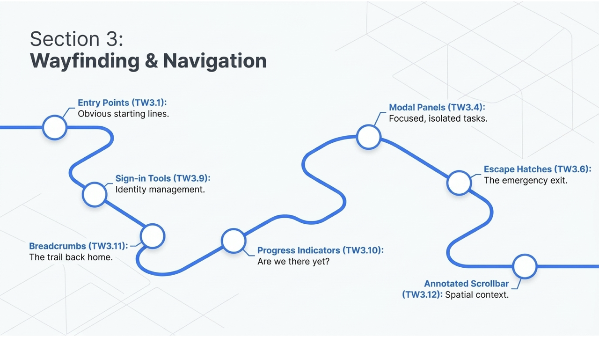

<!--
Now we enter Section 3: Wayfinding & Navigation—Preventing Spatial Disorientation.

Wayfinding is a term borrowed from urban architecture and environmental design (pioneered by Kevin Lynch). When you walk into an unfamiliar international airport, you immediately ask four questions: *Where am I? Where can I go? How do I get there? And how do I get back?* Users ask those exact same four questions inside your software.

Look at Tidwell's first two navigation patterns:
1. **Clear Entry Points**: Do not drop new or returning users into a dense, intimidating cockpit of fifty tiny menus. Present a calm, task-oriented gateway—for example, three prominent cards saying *"Create New Project"*, *"Open Recent File"*, or *"Explore Templates"*.
2. **Escape Hatch**: Whenever a user enters a deep wizard, a full-screen preview, a modal dialog, or an error state, provide an unmistakable, zero-penalty button (`Cancel`, `Close X`, or the top-left app logo) that teleports them safely back to a known home state.

💡 難字與專業術語解說：
- clear entry points: 清晰入口點（在首頁或空白狀態提供少數幾個任務導向的明確起點，引導使用者順利起步）
- escape hatch: 緊急逃生艙／安全退路（在深層流程、全螢幕模式或對話框中提供一鍵安全返回主畫面的明確出口）
- environmental design: 環境空間設計（研究建築、指標系統與人類空間認知互動的設計學科）
- task-oriented gateway: 任務導向入口（以使用者想完成的具體目標而非系統底層資料表來組織的首頁入口）
-->
---
<!-- _class: full-image-slide -->

  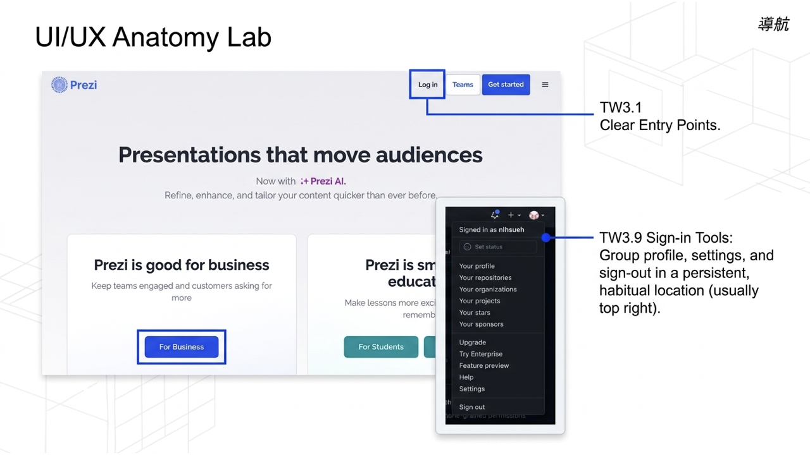

<!--
This diagram illustrates Clear Entry Points and Escape Hatches in practice.

Think about why modern IDEs and creative suites show a "Welcome Screen" with clear task entry points when you launch them with no file open, rather than an empty gray screen surrounded by two hundred disabled toolbar icons. And notice how every checkout flow or modal overlay needs an obvious Escape Hatch so users never feel trapped in a one-way tunnel.

💡 難字與專業術語解說：
- welcome screen: 歡迎起始畫面（軟體啟動時提供最近檔案、範本與快速入門導引的任務入口頁）
- modal overlay: 模態遮罩視窗（浮現於主畫面之上並鎖定背景互動，要求使用者先處理或關閉的焦點視窗）
- one-way tunnel: 單向死胡同（缺乏返回鍵或取消出口、強迫使用者只能一路按到底的壓迫式流程）
-->
---
<!-- _class: full-image-slide -->

  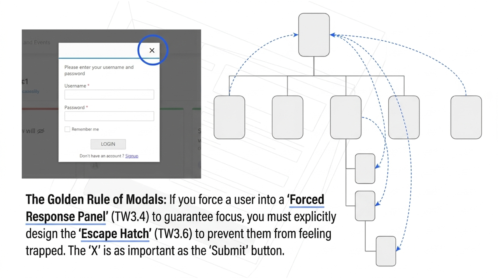

<!--
Next in Wayfinding, let's examine four orientation and跳转 (jump) patterns: **Breadcrumbs**, **Modal Dialogs**, **Sequence Map**, and **Annotated Scrollbar**.

- **Breadcrumbs** (`Home > Electronics > Audio > Headphones`) show the user's exact hierarchical ancestry—not their chronological browser history! Each segment is clickable, letting the user jump two or three levels up the hierarchy in a single click.
- **Modal Dialogs** intentionally interrupt the main workflow and dim the background. Because modals are disruptive, reserve them strictly for critical confirmations (like destructive actions) or short, self-contained sub-tasks.
- **Sequence Map (Step Indicator)** turns a multi-step wizard (`1. Cart → 2. Shipping → 3. Payment → 4. Review`) into a visual progress roadmap, showing completed steps, current position, and remaining effort.
- **Annotated Scrollbar** turns a passive scrollbar track into a high-density spatial minimap—marking search hits, compiler errors, Git diff changes, or timeline chapters right along the scroll track.

💡 難字與專業術語解說：
- breadcrumbs: 麵包屑導覽列（源自童話糖果屋，顯示當前頁面在網站階層結構中從根節點到當前位置的路徑）
- hierarchical ancestry: 階層父系路徑（在樹狀資訊架構中從根目錄一路向下到當前節點的從屬關係）
- sequence map (step indicator): 序列步驟地圖（在多步驟精靈流程頂部顯示總步數、已完成步驟與當前進度的導覽組件）
- annotated scrollbar: 標註型捲軸（在捲軸軌道上疊加搜尋命中點、錯誤位置或日期刻度標記的空間視覺化組件）
-->
---
<!-- _class: full-image-slide -->

  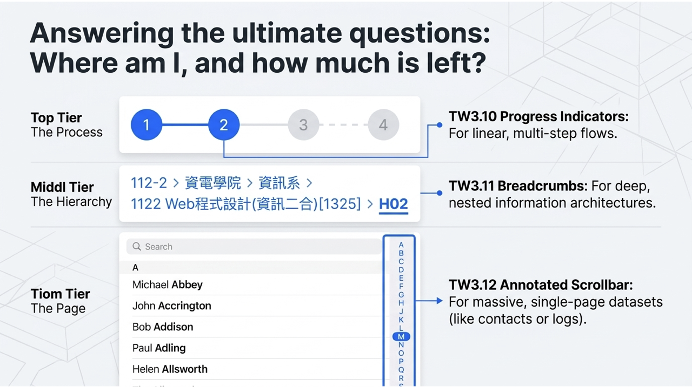

<!--
Look at how these four wayfinding patterns appear in real software interfaces.

Notice the Annotated Scrollbar on the bottom right: every developer who uses VS Code, IntelliJ, or Chrome DevTools relies on those colored tick marks in the scrollbar gutter—yellow ticks for search matches, red ticks for syntax errors, green and blue bars for Git additions and modifications—and Google Photos uses a date-annotated scrollbar so you can scrub directly to "October 2021" across fifty thousand photos in one second.

💡 難字與專業術語解說：
- scrollbar gutter: 捲軸溝槽軌道（視窗右側供捲軸滑塊移動與顯示標記的垂直長條區域）
- minimap: 微縮全覽圖（在程式碼編輯器或大型畫布側邊顯示整體結構縮圖以利快速定位的組件）
- scrub: 快速拖曳檢索（按住時間軸或捲軸滑塊高速滑動以即時預覽不同區段內容的操作）
-->
---
## Section 4: Data Display & Collections (Data Display & Lists)

> **Guiding Principle:** Optimize information consumption efficiency by tailoring data layout to device dimensions and user tasks.

### 1. Responsive List Architecture Strategies
- <strong>Desktop Context: Two-Panel Split View (TW7.1)</strong>:
  - Keeps the master list persistent on the left while displaying active record details on the right (e.g., Slack, Outlook).
  - **Key Benefit**: Completely eliminates back-and-forth round-trip navigation.
- <strong>Mobile Context: One-Window Drilldown (TW7.2)</strong>:
  - On narrow viewports, the master list is replaced entirely by the detail screen (e.g., iOS Mail).
  - **Mandatory Rule**: A prominent, unambiguous Back navigation button is strictly required.

### 2. Space Compression & Visual Scanning
- <strong>Thumbnail Grid (TW7.5)</strong>:
  - "Small but many" matrix layout (e.g., photo galleries) optimized for rapid human visual scanning and comparison.
- <strong>Carousel (TW7.6)</strong>:
  - Compresses multiple visual assets onto a single horizontal plane; demands clear directional affordances (arrows/dots).
- <strong>Pagination (TW7.7) & New-Item Row (TW7.10)</strong>:
  - Partitions massive datasets and provides inline creation at list boundaries.

<!--
Now let's explore Section 4: Data Display & Lists—Managing Information Density.

When your application needs to present hundreds or thousands of items—products, photos, log entries, or customer records—how you structure the list determines how fast users can scan and compare items.

Look at the visual comparison between a **Thumbnail Grid** and a **Carousel**:
- A **Thumbnail Grid** lays items out in a clean 2D matrix, maximizing visual density and letting users compare multiple visual items (photos, video thumbnails, e-commerce apparel, template cards) simultaneously with vertical scrolling.
- A **Carousel** displays a horizontal strip of featured items in a constrained vertical footprint, inviting discovery through horizontal peeking or scrolling. However, keep a critical usability finding in mind: **never turn on fast auto-advancing carousels** that yank a card away while the user is reading it, and never hide essential primary content on slide 4 of a carousel where most users will never scroll!

💡 難字與專業術語解說：
- information density: 資訊密度（單位螢幕面積內所呈現的有效資訊量與視覺元素比例）
- thumbnail grid: 縮圖網格佈局（以二維矩陣排列圖片卡片，適合視覺主導型商品的平行瀏覽與比較）
- carousel: 旋轉木馬橫向輪播組件（在有限垂直高度內透過水平滑動展示精選卡片的組件）
- banner blindness: 橫幅廣告盲視（使用者下意識忽略外觀或行為類似動態輪播廣告區塊的認知現象）
-->
---
<!-- _class: full-image-slide -->

  

<!--
This diagram compares Thumbnail Grids and Carousels side by side.

Notice how Netflix, Spotify, and App Stores combine both patterns thoughtfully: they use horizontal Carousels to showcase several distinct curated categories ("Continue Watching", "Trending Now", "Award-Winning Dramas") within a single viewport, and once you click into a specific genre or search result, they switch to a full 2D Thumbnail Grid for deep browsing.

💡 難字與專業術語解說：
- curated category: 策展精選分類（經編輯或演算法挑選主題後呈現的內容集合）
- horizontal peeking: 邊緣局部露頭提示（在橫向輪播最右側刻意露出下一張卡片的局部邊緣，暗示使用者可向左滑動）
- deep browsing: 深度探索瀏覽（使用者已有明確類別目標、需要大面積快速掃描大量項目的瀏覽模式）
-->
---
<!-- _class: full-image-slide -->

  

<!--
When data is text-heavy, multi-attribute, and quantitative—such as financial transactions, server logs, or issue trackers—Thumbnail Grids waste space. That's where **Alternating Row Striping** and **Pagination vs. Infinite Scroll** come in.

In wide data tables, a user's eye has to travel horizontally from the item name in Column 1 all the way to the action button in Column 8. Without visual guidance, the eye easily slips up or down one row. **Alternating Row Striping (Zebra Striping)** uses subtle, low-contrast background shading on every even row to create horizontal visual rails—though modern tables also pair this with subtle row-hover highlighting.

On the right, compare the three ways to load large lists:
1. **Pagination (`Page 1, 2, 3...`)**: Gives users a predictable sense of dataset scale, preserves access to the page footer, and lets someone bookmark or return to *"Page 4, middle row"*. Best for enterprise tables, search results, and admin dashboards.
2. **Infinite Scroll**: Continuously appends content as the user scrolls down. Great for social media feeds where users are casually browsing, but terrible if a user wants to find a specific item again or reach links in the website footer!
3. **"Load More" Button**: Often the goldilocks compromise for e-commerce—giving users explicit control over when to fetch the next batch of 24 items without trapping the footer.

💡 難字與專業術語解說：
- alternating row striping (zebra striping): 奇偶列斑馬紋底色（在寬表格中以極淡的深淺交錯背景色形成水平視覺軌道，防止跨欄看錯行）
- pagination: 分頁導覽器（將大型資料集切割為固定大小頁面並提供頁碼跳轉的控制組件）
- infinite scroll: 無限捲動載入（當捲動接近底部時自動非同步載入更多內容的無縫瀏覽模式）
- footer trap: 頁尾陷阱（因無限捲動不斷在底部塞入新內容，導致使用者永遠無法觸及頁面底部的版權與聯絡資訊列）
-->
---
<!-- _class: full-image-slide -->

  

<!--
Look at this side-by-side comparison of Zebra-Striped Tables, Pagination, and Infinite Scroll.

Every time you design a list view in a software project, ask yourself: *"Is my user grazing an endless entertainment stream, or are they hunting for a specific record to compare and act upon?"* If they are grazing, Infinite Scroll reduces click friction. If they are hunting, sorting, and comparing, Pagination (or a virtualized table with an annotated scrollbar) gives them spatial control and addressability.

💡 難字與專業術語解說：
- grazing vs. hunting: 漫遊瀏覽 vs. 目標狩獵（資訊尋求行為的兩種典型模式：消遣式隨意滑動 vs. 精準查找特定紀錄）
- addressability: 位置可尋址性（使用者能否精確記住、定位或透過網址連結回到資料集中的特定位置）
- click friction: 點擊摩擦成本（每一次額外要求使用者手動點擊按鈕或等待換頁所產生的操作阻力）
-->
---
## The Tidwell UX Mandate: Engineering Usability Checklist

> **The Engineering Mindset:** Patterns are not meant for mindless copying—they build resilient cognitive safety nets into software architectures.

### 1. The 3 Core Mandates
- **Build Familiarity**:
  - Leverage habituation and web conventions so users feel instantly at home on first launch.
- **Reduce Cognitive Load**:
  - Use progressive disclosure, wizards, and spatial memory so screens remain uncluttered at every moment.
- **Empower the User**:
  - Provide escape hatches, undo buttons, and alternative views so users maintain full agency and control.

### 2. Pre-Release Engineering Checklist
- ✅ **Safe to explore?** Is there a non-destructive Undo or rollback mechanism?
- ✅ **Escape hatch present?** Does every modal dialog have an obvious "✕" and ESC key dismiss?
- ✅ **Location clear?** Do breadcrumbs, steppers, or scrollbars answer *"Where am I?"*
- ✅ **Responsive parity?** Does desktop split view degrade gracefully to mobile drilldown with a Back button?
- ✅ **Discovery balanced?** Are search, editorial features, and category browsing working together?

<!--
Before we leave Section 6.3, let's synthesize Tidwell's entire pattern language into a five-point engineering mandate checklist that you can apply to every pull request and UI review.

1. **Respect Satisficing**: Make primary click targets obvious and offer an instant Escape Hatch + Undo so trial-and-error is always safe.
2. **Progressive Disclosure**: Never dump 100% of database columns or configuration flags onto the initial screen; show the essential 20% upfront and reveal advanced controls on demand.
3. **Eliminate Pogo-Sticking**: Use Two-Panel Split Views (Master-Detail) on desktop whenever users need to inspect items in a list rapidly.
4. **Orient the User**: Combine a consistent Visual Framework, Breadcrumbs, and Sequence Maps so users always know *where they are* and *what comes next*.
5. **Responsive Parity**: Adapt macro layouts gracefully across device form factors—for example, transforming a desktop Split View into a mobile One-Window Drilldown.

💡 難字與專業術語解說：
- pattern language: 模式語言（源自建築師 Christopher Alexander，指由一套相互關聯的設計模式所組成的完整系統架構方法）
- engineering mandate: 工程設計準則（研發團隊在程式碼與介面審查時必須共同遵守的規範要求）
- responsive parity: 跨裝置響應式對等性（確保桌面端與行動端雖採用不同空間佈局，但提供對等完整的功能與體驗）
-->
---
## Pair Discussion (Part 2): Tidwell UI Pattern Hunting in Real Systems

> **Mission (Continuing from 6.2):** Using the **same system** your pair audited in 6.2, **add annotated screenshots to your slides** showing which **Tidwell UI Patterns** it uses—and which patterns can fix the UX flaws you found earlier!

### 1. Target Systems & Pattern Clues
1. **THSR Booking (高鐵訂票系統 / T-EX):** *Deferred Choices* (search trains before login), *Wizard / Sequence Map* (booking steps), *Escape Hatch* (ticket split/cancel).
2. **University Course System (大學選課系統):** *Two-Panel Split View* (course list + live schedule grid), *Changes in Midstream*, *Pagination vs. Filtering*.
3. **Shopee / E-Commerce (蝦皮購物平台):** *Thumbnail Grid* vs. *Carousel*, *Hub & Spoke*, *Breadcrumbs*, *Fat Menus*, *Progress Indicators*.
4. **Daily Super-Apps / Custom (LINE / Uber Eats / 其他自定義):** *Safe Exploration* (`Unsend`), *Progressive Disclosure*, *One-Window Drilldown* (mobile).

### 2. Slide Deliverable (Annotated Screenshots)
- **🔍 Spot the Patterns (2–3 Screenshots):**
  - Circle UI components and label the exact **Tidwell Pattern** across the **4 Dimensions** (*1. User Behaviors, 2. Content Layout, 3. Wayfinding, 4. Data Display*).
- **🛠️ Prescribe a Pattern Fix (1–2 Cases):**
  - Take the worst `❌ NS01–NS10` violation you found in **6.2**, and prescribe a **Tidwell Pattern** to refactor it (e.g., *"Apply **Progressive Disclosure** + **Sequence Map** to fix the overloaded form"*).

<!--
Now let's connect Section 6.2 and Section 6.3 with **Pair Discussion (Part 2): Tidwell UI Pattern Hunting**!

Remember our medical analogy earlier: if **Nielsen's 10 Heuristics (`NS01–NS10`)** in 6.2 were the **diagnostic stethoscope** that helped you spot symptoms and usability bugs in your chosen system, **Jenifer Tidwell's UI Patterns** in 6.3 are the **architectural blueprints and surgical prescriptions** used to build and fix them!

Continuing with the **exact same partner and target system** from 6.2 (THSR Booking, University Course Registration, Shopee, LINE/Uber Eats, or your custom app), please add 2 to 3 slides to your deck:
1. **Spot the Patterns (2–3 Annotated Screenshots)**: Identify which specific Tidwell patterns are already implemented in the system across the 4 dimensions—for example, does the THSR app use *Deferred Choices* (letting you check train timetables before forcing login) and a *Sequence Map*? Does Shopee combine a top *Carousel* with a 2D *Thumbnail Grid*? Does your desktop Course Registration system use a *Two-Panel Split View* or force painful pogo-sticking?
2. **Prescribe a Pattern Refactoring (1–2 Cases)**: Look back at the worst `❌` heuristic violation you found in 6.2, and name the exact **Tidwell UI Pattern** you would use to fix it!

💡 難字與專業術語解說：
- pattern hunting: 設計模式獵尋（在真實上線產品中辨識並拆解其背後採用的標準架構模式）
- deferred choices: 延遲選擇／先體驗後註冊（允許使用者先查詢車次或瀏覽商品，直到最後結帳才要求登入的模式）
- pogo-sticking: 跳跳虎式來回跳轉（因缺乏雙欄分割檢視，被迫在列表頁與明細頁之間不斷按上一頁來回跳轉的痛苦行為）
- pattern-driven refactoring: 模式驅動重構（運用成熟的 UI 設計模式作為具體處方，修復啟發式評估發現的介面缺陷）
-->

---
<!-- _class: lead -->
<!-- header: '6.4 AI for UX (AI4UX)' -->

# **6.4 AI for UX (AI4UX): Amplifying Design Workflows**

> "AI will not replace UX designers, but UX designers who use AI will replace those who do not."

<!--
Welcome to Section 6.4: AI for UX (AI4UX).

Throughout this course, we pay close attention to the two-way relationship between Software Engineering and Artificial Intelligence. In the domain of User Experience, this relationship splits cleanly into two distinct directions:
- **Section 6.4 is AI for UX (AI4UX)**: How do we use Large Language Models and generative AI tools to accelerate and elevate the UX design and evaluation process itself?
- **Section 6.5 is UX for AI (UX4AI)**: How do we design trustworthy, usable human-centered interfaces *for* AI-powered software products whose outputs are probabilistic and non-deterministic?

Let's start with **AI4UX**—using AI as a force multiplier for the UX designer and software engineer.

💡 難字與專業術語解說：
- AI for UX (AI4UX): AI 賦能使用者體驗設計（運用生成式 AI 與大型語言模型加速 UX 研究、原型生成與啟發式評估）
- UX for AI (UX4AI): 為 AI 系統設計使用者體驗（針對非確定性 AI 模型設計透明、可控且具防呆護欄的人機介面）
- force multiplier: 戰力倍增器（能讓單一工程師或設計師產出效率與探索廣度成倍躍升的輔助工具）
-->
---
## What is AI for UX (AI4UX)?

* **The AI-Amplified Designer:**
  - Generative AI acts as a **cognitive partner and speed multiplier** across every stage of the design thinking process.
* **Core Application Areas:**
  - **Research & Empathy:** Generating diverse synthetic user personas, simulating edge-case user interviews.
  - **Ideation & Copywriting:** Rapidly generating microcopy variations, localization strings, and accessibility alt text.
  - **Automated Heuristic Audits:** Feeding UI screenshots to multimodal LLMs to identify Nielsen heuristic violations.
  - **Generative Prototyping:** Text-to-wireframe and text-to-code pipelines (v0, Figma AI, Galileo).

<!--
How does Generative AI transform the traditional UX workflow? Let's look at four high-impact applications of AI4UX, and one critical engineering warning.

First, **Synthetic Persona & Scenario Generation**: Before going into the field, LLMs can help teams brainstorm diverse edge-case user personas, accessibility scenarios, and stress-test user journeys that a homogeneous engineering team might overlook.
Second, **UI Copywriting & Microcopy Optimization**: Writing clear button labels, empathetic error messages (NS09), and localized tooltips is notoriously difficult for backend engineers. LLMs excel at transforming cryptic error codes into actionable, human-friendly microcopy across twenty languages.
Third, **Automated First-Pass Heuristic Audits**: Using multimodal Vision-Language Models (VLMs), you can feed a screenshot or DOM tree of your prototype into an AI auditor to scan for low contrast, missing escape hatches, or jargon before human reviewers even sit down.
Fourth, **Text-to-UI Rapid Prototyping**: Tools like v0, Bolt, and Claude Artifacts allow teams to generate 5 to 10 interactive HTML/React wireframe variations in minutes, breaking fixation on a single initial layout.

Now look at the warning at the bottom: **Synthetic users are NOT real users!** An LLM only reflects statistical patterns in its training data. It can accelerate ideation and catch obvious anti-patterns, but it can never replace empirical observation of real human beings struggling with your product in the wild.

💡 難字與專業術語解說：
- synthetic persona: 合成人物誌（由大型語言模型模擬生成的虛擬使用者角色與情境特徵）
- microcopy: 微文案（介面中決定操作成敗的極短文字，如按鈕標籤、錯誤提示、空白頁引導與工具提示）
- Vision-Language Model (VLM): 視覺語言多模態模型（能同時理解螢幕截圖視覺佈局與文字語意的 AI 模型）
- design fixation: 設計固著（設計者過度執著於第一個想到的版面方案，而忽略其他更優可能性之心理盲點）
-->
---
<!-- _class: title-image-slide -->
## AI for UX: The Augmented Human-AI Design Workflow

  

<!--
Look at this architecture diagram of the AI-Augmented UX Design Workflow.

Notice how AI acts as a high-speed diverging and screening engine across the early stages: expanding research hypotheses, generating multiple layout candidates, rewriting microcopy, and running automated heuristic pre-checks. Yet at the decisive validation gate, a real human-in-the-loop (HITL) and real target users remain the ultimate arbiters of usability.

💡 難字與專業術語解說：
- diverging and converging: 發散與收斂（設計思考中先大量產生多元方案、再經評估篩選出最佳解的雙鑽石過程）
- pre-check screening: 前置初篩檢驗（在投入昂貴真人測試前，先用自動化工具濾除低級排版與可用性缺陷）
- human-in-the-loop (HITL): 人類在環監督（在 AI 自動化流程的關鍵決策點保留人類專家審核與把關的機制）
-->
---
## The RTCF Prompt Engineering Framework for Designers

To get precise, professional UX output from AI models, avoid vague prompts (❌ *"Help me design a login page"*). Use the structured **RTCF Framework**:

* **R — Role:**
  - Define the AI's persona and expertise (e.g., *"Act as a Lead UX Researcher specializing in accessibility and WCAG 2.1 AA standards."*).
* **T — Task:**
  - Define the concrete objective (e.g., *"Conduct a heuristic evaluation of this mobile checkout wireframe."*).
* **C — Constraints:**
  - Enforce domain rules (e.g., *"Evaluate strictly against Nielsen's Heuristics NS01, NS03, and NS05; target a 375px mobile viewport."*).
* **F — Format:**
  - Specify the output structure (e.g., *"Provide results in a 4-column Markdown table: [Heuristic ID, Observed Issue, Severity (0-4), Concrete Fix Recommendation]."*).

<!--
If you simply paste a screenshot into an LLM and type, *"Is this UI good?"*, you will get vague, generic praise. To turn an LLM into a rigorous usability engineering assistant, we use the structured **RTCF Prompt Framework**: **Role**, **Task**, **Context**, and **Format**.

Look at how each component constrains the model's latent space:
- **Role (R)**: Assign a specific expert persona and diagnostic framework—for example, *"Act as a Senior UX Researcher and Accessibility Specialist trained in Jakob Nielsen's 10 Heuristics and WCAG 2.1 AA standards."*
- **Task (T)**: Define the exact analytical operation—*"Audit this mobile banking transfer screen to identify usability flaws and cognitive friction."*
- **Context (C)**: Specify the target user's environment and constraints—*"Target users include older adults (65+) with presbyopia operating the app one-handed on a moving bus."*
- **Format (F)**: Demand a structured, actionable engineering deliverable—*"Output a Markdown table with columns: [Heuristic ID | UI Element | Severity (1-4) | Concrete Redesign Fix + Rewritten Microcopy]."*

When you combine all four elements, the LLM stops giving vague opinions and produces a systematic, prioritized engineering audit table.

💡 難字與專業術語解說：
- RTCF Prompt Framework: 角色-任務-情境-格式提示框架（結構化提示工程方法，確保大型語言模型產出精準專業的工程分析）
- WCAG (Web Content Accessibility Guidelines): 網頁內容無障礙指南（W3C 制定的國際無障礙設計標準，如對比度與字級規範）
- presbyopia: 老花眼（隨年齡增長導致近距離對焦與細小低對比文字閱讀困難的視覺退化現象）
- cognitive friction: 認知摩擦力（介面設計與使用者直覺預期不符時所產生的理解阻礙與猶豫）
-->
---
## Multi-Agent Prototyping & Generative UI

* **Autonomous Multi-Agent Architecture:**
  - Modern IDEs and agent systems (e.g., Antigravity, Devin, Claude Code) orchestrate specialized agents working in tandem.
  - **UX Research Agent:** Analyzes customer tickets and synthesizes user pain points.
  - **Design System Agent:** Generates CSS tokens, typography scales, and accessible color palettes.
  - **Frontend Code Agent:** Translates specifications into responsive HTML/CSS/React components.
* **The Human-in-the-Loop Safeguard:**
  - AI generates rapid prototypes; human engineers evaluate ergonomics, brand voice, and real user empathy.

<!--
We can push AI4UX even further using **Multi-Agent Collaborative Prototyping**.

Instead of relying on a single LLM prompt, modern agentic workflows orchestrate a specialized team of AI agents that critique and refine a UI prototype in an iterative loop before presenting it to the human designer:
1. **Product Manager (PM) Agent**: Translates business requirements into user stories, acceptance criteria, and edge-case constraints.
2. **UI Generator / Frontend Agent**: Synthesizes clean HTML/Tailwind or React component trees applying Tidwell's layout patterns.
3. **Persona Simulator & Heuristic Critic Agent**: Role-plays multiple target personas (e.g., a rushed commuter, a screen-reader user, a first-time novice) and scores the generated DOM against Nielsen's 10 heuristics.
4. **Human Designer / Engineer (HITL)**: Reviews the surviving top variations, makes high-level aesthetic and architectural judgments, and validates with real users.

💡 難字與專業術語解說：
- multi-agent orchestration: 多代理協作編排（協調多個具備不同專業角色設定的 AI Agent 進行分工與交互審查）
- acceptance criteria: 驗收條件（敏捷開發中定義使用者故事必須滿足哪些具體行為才算完成的檢核標準）
- critic agent: 審查評論代理（專門負責在多代理迴路中挑出設計漏洞、無障礙缺失與啟發式違規的 AI 角色）
-->
---
<!-- _class: title-image-slide -->
## Multi-Agent Architecture: Collaborative Prototyping Pipelines

  

<!--
This diagram visualizes the Multi-Agent UX Prototyping & Heuristic Critique Loop.

Notice the closed feedback loop in the center: the UI Generator Agent produces a candidate interface, the Heuristic Critic Agent inspects it against NS01 through NS10 and WCAG rules, and if it detects a Severity 3 or 4 violation (like a missing Escape Hatch or a destructive button with no confirmation), it sends structured critique back to the Generator Agent to self-correct automatically before the human engineer even opens the preview!

💡 難字與專業術語解說：
- closed feedback loop: 閉迴路回饋系統（將輸出結果的檢測誤差自動回傳給輸入端進行自我修正的循環機制）
- self-correction: 自我修正（AI 代理根據審查回饋自動改寫代碼或調整版面結構的迭代過程）
- candidate interface: 候選介面方案（在多方案探索階段生成供評估比較之用的原型版本）
-->
---
<!-- _class: lead -->
<!-- header: '6.5 UX for AI (UX4AI)' -->

# **6.5 UX for AI (UX4AI): Designing Human-Centered AI**

> "The hardest part of building AI products is not training the model—it is designing the interface that makes probabilistic intelligence understandable, steerable, and trustworthy."

<!--
Now let's flip the coin to Section 6.5: **UX for AI (UX4AI)**.

This is one of the hottest challenges in modern software engineering. Why do traditional GUI patterns often break down when applied to AI-powered systems? Because for forty years, traditional software was **deterministic**: if you clicked `Sort by Price`, the database ran `ORDER BY price ASC` in 15 milliseconds and returned the exact same mathematically guaranteed result every single time.

Generative AI and LLM agents are fundamentally different. As our section quote states, designing for AI means designing for **probabilistic outputs**, **evolving context**, and **calibrated human trust**. Let's see how we extend Nielsen's classical heuristics to tame non-deterministic AI interfaces.

💡 難字與專業術語解說：
- deterministic vs. probabilistic: 確定性 vs. 機率性（傳統軟體相同輸入必得相同輸出；AI 模型則依機率分布取樣，輸出具變異性）
- calibrated human trust: 校準後的人類信任度（讓使用者對 AI 的能力邊界建立既不盲目迷信、也不過度排斥的準確信任感）
- non-deterministic system: 非確定性系統（輸出結果受隨機取樣、上下文細微差異影響而無法百分百預測的系統）
-->
---
## Unique UX Challenges in AI-Native Products

* **1. Non-Determinism & Unpredictability:**
  - Traditional software: `2 + 2` always returns `4`.
  - AI systems: Submitting the identical prompt twice may yield completely different phrasing, tone, or formatting.
* **2. The "Hallucination" Dilemma:**
  - Generative models can generate completely fabricated facts, non-existent API methods, or fake citations with total syntactic confidence.
* **3. Latency & the "Thinking" Black Box:**
  - Complex reasoning models (e.g., o1, Gemini Thinking) require 5 to 30 seconds of inference time before returning a single token.
* **4. The Calibration of Trust:**
  - **Over-trust:** Users blindly accept false AI code without reviewing it, leading to production outages.
  - **Under-trust:** Users abandon the AI after a single minor mistake, losing all productivity benefits.

<!--
Let's examine the four unique UX challenges that every engineer building an AI feature must solve:

1. **Non-Determinism & Probabilistic Outputs**: The exact same prompt can yield different answers across runs, and small phrasing changes can dramatically shift output quality.
2. **Hallucinations & Plausible Errors**: Unlike a traditional program that throws an obvious stack trace when it fails, an LLM fails by generating fluent, confident, grammatically flawless falsehoods! This creates **automation complacency**—users fall asleep at the wheel and trust wrong answers because they look so polished.
3. **High & Variable Inference Latency**: A SQL query takes 10 milliseconds; a deep-reasoning multi-step LLM agent can take 10 to 60 seconds. A traditional spinning wheel for 45 seconds makes users think the app crashed.
4. **The "Blank Canvas" Prompt Paralysis**: Dropping a user in front of an empty text box that says *"Ask me anything..."* violates Recognition Rather Than Recall (NS06). Users don't know what the AI is capable of or how to phrase an effective prompt.

💡 難字與專業術語解說：
- hallucination: AI 幻覺（大型語言模型一本正經地編造出語法流暢但違背事實或無中生有的錯誤資訊）
- plausible error: 貌似合理的錯誤（表面看似專業可信、極難第一時間肉眼察覺的隱蔽性錯誤）
- automation complacency: 自動化自滿／過度依賴（人類因系統長期表現看似良好而降低戒心、不再仔細查核輸出的心理陷阱）
- inference latency: 推論延遲時間（AI 模型從接收輸入提示詞到完成運算並產出回應所需的等待時間）
- prompt paralysis (blank canvas syndrome): 空白畫布提示詞癱瘓症（面對空無一物的對話輸入框時，不知該輸入什麼指令的無助狀態）
-->
---
## AI + NS01: Visibility of AI State & Thinking Traces

* **The Problem of AI Latency & Black Boxes:**
  - Long inference times (10-30s) leave users staring at blank screens, wondering if the server crashed.
* **Interaction Solutions:**
  - **Streaming Tokens:** Stream text responses token-by-token immediately, providing instant perceived performance.
  - **Collapsible Reasoning Traces:** Display interactive "Thinking Process" accordions showing internal reasoning steps and tool execution.
  - **RAG Grounding Citations:** Provide clickable source pills linking directly to retrieved reference documents.

<!--
How do we adapt **NS01 (Visibility of System Status)** for high-latency, multi-step AI systems?

If an AI agent takes twenty seconds to search your codebase, query three APIs, and synthesize an answer, a static spinner is a usability failure. Instead, modern UX4AI uses three patterns:
- **Streaming Tokens & Progressive Rendering**: Render tokens as they are generated so the user can start reading within 300 milliseconds instead of waiting for the entire response to finish.
- **Collapsible Reasoning & Tool-Call Traces**: Show live, human-readable micro-steps while the agent works—for example, *"Searching repository (`14 files matched`) → Reading `auth.ts` → Synthesizing security patch..."*—and collapse the trace cleanly once the final answer arrives so it doesn't clutter the screen.
- **Grounding Citations & Confidence Cues**: Attach inline clickable source badges (`[1]`, `[2]`) that highlight the exact paragraph in the source PDF or database record, letting users verify claims in one click and calibrate their trust.

💡 難字與專業術語解說：
- streaming tokens: 串流式逐字輸出（模型每生成一個詞元即刻推送至前端顯示，大幅降低體感等待時間）
- collapsible reasoning trace: 可摺疊推論軌跡（即時展示 AI 思考步驟與工具呼叫過程、完成後可收合的透明化面板）
- RAG grounding citation: 檢索增強生成之溯源引用標籤（將 AI 回答中的每一句話連結回原始文件段落的驗證標記）
-->
---
<!-- _class: title-image-slide -->
## AI + NS01 in Practice: Streaming Tokens & Collapsible Reasoning

  

<!--
Look at this visual showcase of AI + NS01: Streaming Tokens, Collapsible Thinking Traces, and Inline Source Citations.

Notice how the collapsible *"Thought for 6 seconds"* accordion gives the user complete peace of mind during a long reasoning step, and how hovering over citation badge `[1]` pops up a verification card showing the exact sentence from the underlying source document. This transforms the AI from an inscrutable black box into an inspectable glass box.

💡 難字與專業術語解說：
- black box vs. glass box: 黑盒子 vs. 透明玻璃盒（無法得知內部運作邏輯的封閉系統 vs. 可檢視推論過程與證據來源的透明系統）
- verification card: 溯源查核預覽卡（滑鼠懸停於引用標籤時浮現原始文獻片段以供快速比對的卡片）
- perceived latency: 體感延遲（使用者主觀感受到的等待時間，可透過串流輸出與進度解析大幅降低）
-->
---
## AI + NS02 & NS03: Grounding, Control & Human Agency

* **AI + NS02 (Match with Real World):**
  - **Transparent Bot Identity:** Clearly disclose that the system is an AI assistant; avoid deceptive pseudo-human personas.
  - **Conversational Grounding:** Establish shared context using familiar conversational turns and natural language.
* **AI + NS03 (User Control & Freedom):**
  - **Stop Generation Button:** Provide an instant button to abort runaway or misdirected responses.
  - **Prompt Branching:** Allow users to edit previous prompts and fork alternative conversation threads.
  - **Steerability Sliders:** Provide controls for temperature, brevity, and response tone.

<!--
Next, let's see how **NS02 (Match with the Real World)** and **NS03 (User Control and Freedom)** evolve for AI interfaces.

First, **Conversational Grounding & Scoped Context (NS02)**: Users often don't know *what* the AI can currently "see." Is it reading only the current file, the whole repository, or the public internet? Good AI interfaces display explicit **context chips** (e.g., `@CurrentFile: slide06.md`, `@Docs: UX Guidelines`) right above the prompt box so the shared mental context is unmistakable.

Second, **Stop Generation, Regenerate & Prompt Branching (NS03)**: Because LLM generation is slow and probabilistic, users need an immediate **"Stop Generating"** escape hatch the moment they see the AI heading down the wrong track. Even better, support **non-destructive prompt editing and branching** (`< 2 / 2 >`) so users can tweak an earlier prompt and explore a new conversation branch without losing their previous output!

Third, **Granular Output Steerability (NS03)**: Don't force users to regenerate a 500-word document from scratch just to fix one paragraph. Let them highlight a single sentence and click inline quick-actions like *"Make Shorter"*, *"More Formal"*, or *"Convert to Table"*.

💡 難字與專業術語解說：
- conversational grounding: 對話語境錨定（確保人類與 AI 對於「當前討論所引用的上下文資料範圍」達成明確共識）
- context chip: 上下文膠囊標籤（在輸入框上方顯示當前已掛載之檔案、資料庫或選取範圍的視覺化標籤）
- prompt branching: 提示詞分支探索（修改歷史提問時不覆蓋舊對話，而是建立平行分支供來回切換比較）
- granular steerability: 細粒度操控性（允許針對 AI 生成內容的局部段落進行精準微調，而非整篇重寫）
-->
---
<!-- _class: title-image-slide -->
## AI + NS03 in Practice: User Steerability & Cancelation Controls

  

<!--
This diagram illustrates Scoped Context Chips, Prompt Branching, and Inline Canvas Refinement.

Look at how modern canvas-based AI workspaces (like Claude Artifacts, ChatGPT Canvas, or Cursor inline diffs) move beyond pure linear chat: the chat thread on the left handles high-level intent, while the artifact canvas on the right supports direct manipulation and localized inline refinement.

💡 難字與專業術語解說：
- artifact canvas: 產出物共同編輯畫布（將對話紀錄與生成的程式碼或文件分離，支援直接在畫布上局部選取與修改的雙欄介面）
- linear chat: 線性對話流（傳統由上而下單向捲動、難以針對局部成果進行反覆雕琢的聊天室介面）
- localized refinement: 局部精煉微調（僅鎖定選取之句子或程式碼區塊進行重寫與優化）
-->
---
## AI + NS05: Error Prevention & Agentic Guardrails

* **The Extreme Stakes of Agentic AI:**
  - Autonomous agents can execute shell commands, edit production code, and interact with external APIs.
  - An unchecked hallucination can delete files, drop database tables, or leak API keys.
* **Human-in-the-Loop (HITL) Guardrails:**
  - **Pre-Execution Confirmation:** Require explicit developer approval before running terminal commands or modifying files.
  - **Diff Previews:** Display color-coded git-style diffs showing exactly what lines the AI proposes to modify.
  - **Sandboxed Execution:** Run unverified AI code in isolated containers before applying changes to host environments.

<!--
Now let's examine one of the most safety-critical areas of UX4AI: **NS05 (Error Prevention)** in the era of **Autonomous AI Agents**.

When an AI was just a passive chatbot, the worst mistake it could make was writing a bad poem. Today, agentic AI systems have tool-calling permissions to execute shell commands, modify production files, send emails, and trigger financial transactions! How do we prevent catastrophic agentic errors?

1. **Human-in-the-Loop (HITL) Confirmation Gates**: Classify agent actions by risk tier. Read-only actions (`read_file`, `search`) can run automatically, but any **external, state-mutating, or destructive action** (sending an email to clients, running `rm -rf`, executing a database migration, or charging a credit card) must pause and require explicit human approval.
2. **Diff Previews & Staged Execution**: Never let an AI agent silently overwrite a user's document or codebase in place. Render a clear **Red/Green Diff Preview** (`- old line` / `+ new line`) with granular `[Accept]`, `[Reject]`, or `[Edit]` controls per hunk.
3. **Sandboxed Execution**: Run AI-generated code inside isolated containers or dry-run sandboxes first so errors cannot corrupt the host environment.

💡 難字與專業術語解說：
- agentic guardrail: 代理型 AI 安全護欄（限制自主 AI 代理執行高風險操作、確保人類保有最終控制權的防呆機制）
- state-mutating action: 狀態變更操作（會修改外部資料庫、檔案系統或發送真實外部通訊的不可逆動作）
- diff preview: 差異比對預覽（以紅綠顏色標示刪除與新增內容，讓使用者在套用前清楚審視 AI 修改細節的視圖）
- sandboxed execution: 沙箱隔離執行（在受限的虛擬環境中先測試執行 AI 生成的程式碼，防止破壞主系統）
-->
---
<!-- _class: title-image-slide -->
## AI + NS05 in Practice (1/2): Pre-Execution HITL Gate & Diff Auditing

  

<!--
Let's examine the first two agentic guardrails from the previous slide in action: **Pre-Execution HITL Confirmation Gates** (left) and **Staged Diff Previews with Per-Hunk Auditing** (right).

On the left, when the developer asks the AI agent to *"Clean up obsolete staging order tables"*, the agent proposes running `DROP TABLE staging_orders CASCADE` and `rm -rf`. Instead of executing silently, **Guardrail 1** intercepts the state-mutating tool call, computes the **Blast Radius** (irreversible deletion of 14,820 QA records affecting 3 downstream microservices), and pauses for explicit human consent (`[X] Deny & Abort`, `[Edit] Modify Cmd`, or `[OK] Approve Once`).

On the right, **Guardrail 2** prevents silent file overwrites by staging proposed code changes as color-coded Git diffs. Notice how the AI fixed the SQL injection in **Hunk 1** (green), but also hallucinated an unrequested policy change in **Hunk 2** (changing `session.ttl_seconds` from 1 hour to 30 days!). Because of per-hunk diff auditing, the engineer can click **Accept Hunk 1** and **Reject Hunk 2**, maintaining 100% situational awareness.

💡 難字與專業術語解說：
- blast radius: 爆炸波及半徑／影響範圍（一旦高風險指令執行失敗或誤刪，將連帶摧毀的資料筆數與下游服務範圍）
- collateral edit: 附帶非預期修改（大型語言模型在修復目標問題時，順手擅自改動其他無關邏輯或參數的危險行為）
- per-hunk approval: 逐區塊審核批准（允許針對單一程式碼修改片段個別選擇接受或拒絕，而非全盤接收）
- situational awareness: 態勢感知能力（操作者對系統當前狀態、變更內容與潛在風險的全面掌握程度）
-->
---
<!-- _class: title-image-slide -->
## AI + NS05 in Practice (2/2): Sandboxed Execution & Input Guardrails

  

<!--
Now let's look at the third and fourth layers of defense: **Sandboxed Execution in Isolated Containers** (left) and **Proactive Input & Secret-Leak Prevention** (right).

On the left (**Guardrail 3**), human eyes alone cannot catch every subtle runtime bug or infinite loop in AI-generated code. Before any AI code touches the developer's host workspace, the system executes it inside an **Ephemeral Sandbox Container** (Docker / MicroVM) with three strict boundaries: a **Copy-on-Write filesystem snapshot**, a **blocked egress firewall** (so credentials cannot be exfiltrated), and **strict CPU/memory/timeout quotas**. Only after automated unit tests, SAST security scans, and dry-run migration checks pass is the change promoted to the host workspace.

On the right (**Guardrail 4**), error prevention also operates proactively at the **client input boundary**:
- **Pre-Submission Secret & PII Scanner**: When a user accidentally pastes a live `OPENAI_API_KEY` or `AWS_ACCESS_KEY_ID` into the prompt, the client-side guardrail blocks transmission and auto-redacts it with `[REDACTED_KEY]` before a single byte leaves the browser.
- **Attachment & Context Budget Constraints**: Immediately flags unsupported archive formats (`.rar`) and displays a live **Context Budget Meter (`62%`)** so prompts never fail mid-generation.

💡 難字與專業術語解說：
- ephemeral sandbox container: 短暫隔離沙箱容器（專為單次測試任務動態建立、執行完畢即銷毀的輕量級虛擬隔離環境）
- copy-on-write (CoW) snapshot: 寫入時複製快照（在沙箱內修改檔案僅寫入暫存差異層，絕不汙染真實主機檔案系統的技術）
- egress firewall: 對外連線防火牆（攔截容器向外部網際網路發起未授權連線，防止機密資料外洩或誤觸正式環境 API）
- secret redaction: 機密金鑰自動遮蔽（在提示詞發送至雲端模型前，於客戶端自動偵測並隱去 API Key 與個資的防漏機制）
-->
---
## AI + NS07 & NS10: Accelerators & Explainability (XAI)

* **AI + NS07 (Flexibility & Accelerators):**
  - **Slash Commands:** Quick keyboard triggers (`/explain`, `/refactor`, `/fix-tests`) allowing power users to bypass conversational typing.
  - **Multi-Modal Drag-and-Drop:** Allowing users to drag screenshots, PDF diagrams, and log files directly into the prompt box.
* **AI + NS10 (Explainable AI - XAI):**
  - <strong>"Why this answer?":</strong> Contextual tooltips explaining which source documents or prompt instructions triggered the recommendation.
  - **Model Cards & Confidence Meters:** Explicitly disclosing active model versions and estimated prediction confidence.

<!--
Finally in Section 6.5, let's look at how **NS06 (Recognition Rather Than Recall)**, **NS07 (Flexibility & Efficiency)**, and **NS10 (Help & Documentation)** combine in modern AI interfaces:

- **Starter Prompt Chips & Templates (NS06 + NS10)**: Cure "Blank Canvas Paralysis" on empty chat screens by displaying 3 to 4 clickable, role-relevant starter cards (e.g., *"Summarize this PDF"*, *"Find security bugs in `auth.py`"*, *"Draft a sprint retrospective"*). Users learn what the AI can do by clicking, not by reading a manual.
- **Slash Commands & Context Mentions (NS07)**: Give power users fast keyboard accelerators like `/summarize`, `/test`, `/fix`, and `@file` autocomplete menus so they can invoke complex structured workflows in two keystrokes.
- **Explainable AI (XAI) & Model Cards (NS10)**: Provide concise, transparent documentation about *why* a recommendation was made, what data sources the model can access, its cutoff date, and privacy guarantees (e.g., *"Your enterprise data is never used to train public models"*).

💡 難字與專業術語解說：
- starter prompt chip: 起始提示詞引導卡（在空白對話頁提供可一鍵點擊的範例指令卡片，消除空白畫布焦慮）
- slash command: 斜線快捷指令（輸入 `/` 即可喚出結構化功能選單的專家級鍵盤加速器）
- Explainable AI (XAI): 可解釋人工智慧（讓使用者理解 AI 模型為何做出特定預測或建議的透明化設計與說明機制）
- model card: 模型透明化說明卡（揭露 AI 模型的能力邊界、訓練資料時效、限制與隱私保護政策的標準化文件）
-->
---
<!-- _class: title-image-slide -->
## AI + NS10 in Practice: Explainable AI & Contextual Citations

  

<!--
Look at this visual synthesis of Starter Prompt Chips, Slash Command Accelerators, and Explainable AI (XAI) Cards.

Notice how a single well-designed AI input workspace serves both ends of the user spectrum simultaneously: a first-time novice clicks one of the visual Starter Prompt Cards above the input box (NS06), while a seasoned engineer types `/fix @auth.ts` directly into the command bar (NS07).

💡 難字與專業術語解說：
- user spectrum: 使用者熟練度光譜（涵蓋從初次接觸的生手到每天重度使用的專家之全體使用者分布）
- autocomplete menu: 自動補全選單（輸入關鍵字或符號時即時彈出候選指令與檔案名稱的輔助選單）
- capability boundary: 能力邊界（AI 系統擅長處理與無法可靠處理的任務範圍界線）
-->
---
### Concept Check Question 3: UX for AI Design
<!-- id: ase-ch06-ccq3 -->

  

When designing an autonomous AI coding assistant that can inspect directories, edit source files, and execute shell commands, which design pattern best fulfills <strong>Error Prevention (NS05)</strong> and <strong>User Agency (NS03)</strong>?

- **A.** Allowing the agent to execute all file deletions and shell scripts silently in the background without user interruption.
- **B.** Requiring explicit human-in-the-loop review and confirmation before executing high-risk file modifications or system terminal commands.
- **C.** Removing the ability to stop or cancel running background tasks once the AI begins executing code.
- **D.** Hiding all command execution logs from developers to avoid visual clutter and information overload.

  

  

    

<!--
Let's test your UX4AI intuition with Concept Check Question 3 (CCQ 3)!

Consider the severe security and stability risks of autonomous AI coding assistants that can inspect directories, edit source files, and execute shell commands on local or staging environments.

Why is **Option B** the exact right answer?
- **Option B** requires explicit **Human-in-the-Loop (HITL) review and confirmation** (such as pre-execution confirmation gates and staged red/green diff previews) before executing high-risk file modifications or terminal commands, directly fulfilling **Error Prevention (NS05)** and **User Agency (NS03)**.
- **Option A** (silent background deletions), **Option C** (removing the stop/cancel button), and **Option D** (hiding execution logs) violate NS01, NS03, and NS05 by stripping developers of situational awareness and emergency escape hatches.

💡 難字與專業術語解說：
- autonomous AI coding assistant: 自主型 AI 程式設計助手（具備工具呼叫、讀寫檔案與執行終端機指令能力的 AI 代理）
- human-in-the-loop (HITL): 人機迴路／人類在環控制（在高風險決策或不可逆操作執行前，強制由人類審查與批准的安全機制）
- user agency: 使用者主體性與控制權（確保人類始終保有最終決策、隨時中斷與覆寫 AI 行為的權力）
-->

---
<!-- _class: lead -->
<!-- header: '6.6 Evaluation & Synthesis' -->

# **6.6 Evaluation & Engineering Synthesis**

> "Evaluating usability with 5 users uncovers roughly 85% of all usability problems."
> — *Jakob Nielsen*

<!--
Welcome to our final section, Section 6.6: Evaluation & Engineering Synthesis.

We have learned the psychology of UX (6.1), Nielsen's 10 diagnostic heuristics (6.2), Tidwell's constructive UI patterns (6.3), and the bilateral AI-UX frontier (6.4 & 6.5). Now, how do we operationalize all of this inside a real software engineering sprint?

As Jakob Nielsen famously demonstrated, you do not need a million-dollar usability laboratory to catch 80% of your interface flaws—systematic inspection paired with lightweight empirical testing will transform your product quality.

💡 難字與專業術語解說：
- operationalize: 將理論轉化為可執行的標準作業流程（把抽象原則落實為日常研發團隊的具體工程實踐）
- usability laboratory: 可用性實驗室（配備眼動儀、單向鏡與錄影設備的專業使用者測試空間）
- empirical testing: 實證測試（透過實際觀察真實使用者操作產品來收集客觀行為數據的驗證方法）
-->
---
## Conducting a Formal Heuristic Evaluation

* **What is a Heuristic Evaluation?**
  - A discount usability inspection method where independent evaluators examine an interface against established heuristics (e.g., Nielsen's 10).
* **Nielsen's 5-Point Severity Rating Scale:**
  - **0 = Not a usability problem:** Does not affect user progress.
  - **1 = Cosmetic problem only:** Minor visual blemish; fix only if extra time is available.
  - **2 = Minor usability problem:** Low priority; causes minor inconvenience but user can recover.
  - **3 = Major usability problem:** High priority; severely delays or confuses users; must be fixed before release.
  - **4 = Usability catastrophe:** Imperative to fix! Completely blocks task completion; software cannot ship!

<!--
How do you conduct a formal **Heuristic Evaluation** in practice?

First, never rely on a single evaluator! Empirical research by Nielsen and Landauer shows that a single inspector only catches about 35% of usability problems. However, if you assemble **3 to 5 independent evaluators** to inspect the interface separately before aggregating their findings, they collectively uncover **75% to 80%** of all usability flaws—known as the classic **"Discount Usability Engineering"** curve.

Second, once the findings are aggregated, we don't fix everything blindly. Every usability defect is scored on **Nielsen's 0-to-4 Severity Scale** based on three factors: *Frequency* (how often does it occur?), *Impact* (how hard is it for the user to overcome?), and *Persistence* (is it a one-time annoyance or a permanent barrier?):
- **0 — Not a usability problem**: Disagreement or pure preference.
- **1 — Cosmetic problem**: Fix only if extra time is available in the sprint.
- **2 — Minor usability problem**: Low priority fix.
- **3 — Major usability problem**: High priority; causes significant user delay or error.
- **4 — Usability catastrophe**: **Mandatory release blocker!** Must be fixed before shipping (e.g., an irreversible destructive button with no confirmation, or a broken checkout flow).

💡 難字與專業術語解說：
- discount usability engineering: 精實／高性價比可用性工程（以 3 至 5 位評估者進行輕量級啟發式檢查與測試，以極低成本找出八成問題的方法）
- independent evaluator: 獨立評估者（在彙整討論前先各自獨立檢視介面以避免群體迷思的審查人員）
- persistence: 問題持續性（使用者學會一次後就能避開，還是每次操作都會反覆受困的程度）
- cosmetic problem: 外觀瑕疵級問題（嚴重度 1：僅影響局部視覺美觀但不妨礙任務完成的微小問題）
- usability catastrophe: 可用性災難（嚴重度 4：導致資料遺失、任務完全卡死或嚴重誤操作的發佈阻斷級缺陷）
-->
---
## Heuristic Evaluation vs. Empirical User Testing

| Dimension | Heuristic Evaluation (Expert Inspection) | Empirical User Testing (Real End-Users) |
| :--- | :--- | :--- |
| **Evaluators** | 3 to 5 UX Experts / Senior Engineers | 5 Real Representative End-Users |
| **When to Use** | Early in design (wireframes, early prototypes) | Later in development (interactive prototypes, staging) |
| **Cost & Speed** | Extremely fast (1–2 days); low financial cost | Slower (1–2 weeks); requires recruitment and lab setup |
| **Primary Strength** | Quickly finds obvious heuristic violations & edge cases | Reveals authentic human behavioral friction & surprises |
| **Limitation** | Experts can miss domain-specific workflow quirks | Users reveal *what* broke, but not always *why* or *how to fix* |

<!--
Engineers often ask: *"If we run a Heuristic Evaluation (or an AI4UX heuristic audit), do we still need Empirical User Testing with real humans?"*

Look closely at this comparison table—the answer is an emphatic **YES, because they catch different classes of bugs!**
- **Heuristic Evaluation (Expert / AI Inspection)** is fast (hours), cheap, and requires zero external user recruitment. It excels at catching **known structural violations**: missing back buttons, technical jargon, inconsistent button styles, and absent confirmation dialogs. Move it to **Shift-Left** (during wireframing and PR review).
- **Empirical User Testing (Think-Aloud Protocol with 5 Real Users)** takes days, requires recruiting real domain users, and observes them attempting realistic tasks while speaking their thoughts aloud. It excels at catching **unanticipated mental model mismatches**—when your interface follows every textbook rule, yet real domain users completely misunderstand your workflow concept!

Use Heuristic Evaluation first to clean up all the "rocks and potholes" on the road, so your precious Empirical User Testing sessions can focus on deep workflow and value validation.

💡 難字與專業術語解說：
- shift-left testing: 測試左移（將可用性與品質檢驗提早至需求與線框圖階段執行，大幅降低後期返工成本）
- think-aloud protocol: 放聲思考法（請受測者在操作介面時同步口述腦中的理解、疑惑與預期，以洞察其心智模型）
- mental model mismatch: 心智模型落差（設計師的系統模型與真實使用者的認知預期發生根本性的理解偏差）
-->
---
## Chapter Recap: Fill-in-the-Blank Challenge

Test your mastery of the core concepts in Chapter 6:

* **1.** A door with a pull handle that must be pushed to open is famously known as a **`___`** Door.
* **2.** **`___`** Law states that users spend most of their time on other websites, expecting your site to follow common conventions.
* **3.** Nielsen Heuristic **`___`** states that preventing mistakes beforehand is vastly superior to displaying polite error messages.
* **4.** The prompt engineering framework for designers consisting of Role, Task, Constraint, and Format is abbreviated **`___`**.
* **5.** In AI interfaces, displaying streaming tokens and collapsible reasoning steps exemplifies heuristic **`___`**: Visibility of System Status.
* **6.** On Nielsen's severity rating scale, a usability defect that completely blocks task completion and prevents product release is rated as a **`___`**.

<!--
Let's bring everything together with our interactive **Fill-in-the-Blank Conceptual Recap Challenge**!

Look at the Word Bank at the top of the slide: `Affordance`, `Signifiers`, `Satisfaction`, `NS05: Error Prevention`, `NS06: Recognition`, `Satisficing`, `Two-Panel Split View`, and `HITL Confirmation`.

Try to fill in all six blanks in your head (or click each blank in the HTML slide to reveal the answer):
1. Don Norman distinguishes between `[ _________ ]` (what actions an object physically or digitally allows) and `[ _________ ]` (visual cues like labels or shadows that communicate where and how to act).
2. According to ISO 9241-11, Usability consists of three measurable pillars: Effectiveness (accuracy), Efficiency (speed/effort), and `[ _________ ]` (comfort and freedom from frustration).
3. Replacing a manual terminal command with a visual pick-list of options exemplifies `[ _________ ]`, whereas disabling a Submit button until required fields are valid exemplifies `[ _________ ]`.
4. Herbert Simon observed that real users rarely optimize; instead, they practice `[ _________ ]`—picking the first "good enough" option and muddling through.
5. To eliminate tedious back-and-forth "pogo-sticking" between a list and item details on desktop screens, Tidwell recommends the `[ _________ ]` pattern.
6. In UX4AI, before an autonomous agent executes a destructive or external state-mutating tool call, the interface must enforce a `[ _________ ]` gate with a diff preview.

💡 難字與專業術語解說：
- conceptual recap: 核心觀念總複習（透過主動回想與填空配對強化長期記憶的學習檢核）
- word bank: 候選字彙庫（提供待選專業術語以供配對檢驗的提示詞雲）
-->
---
## Chapter Recap: Solution Key

Here are the completed principles and technical terms:

* **1.** A door with a pull handle that must be pushed to open is famously known as a **Norman** Door.
* **2.** **Jakob's** Law states that users spend most of their time on other websites, expecting your site to follow common conventions.
* **3.** Nielsen Heuristic **NS05: Error Prevention** states that preventing mistakes beforehand is vastly superior to displaying polite error messages.
* **4.** The prompt engineering framework for designers consisting of Role, Task, Constraint, and Format is abbreviated **RTCF**.
* **5.** In AI interfaces, displaying streaming tokens and collapsible reasoning steps exemplifies heuristic **NS01**: Visibility of System Status.
* **6.** On Nielsen's severity rating scale, a usability defect that completely blocks task completion and prevents product release is rated as a <strong>4 (Catastrophe)</strong>.

<!--
Here is the complete **Solution Key & Conceptual Synthesis** for our recap challenge!

Let's quickly verify the six connections:
1. **Affordance & Signifiers**: Capability versus perceivable visual cue—the foundation of fixing every Norman Door.
2. **Satisfaction**: Completing the ISO 9241-11 triad alongside Effectiveness and Efficiency.
3. **NS06: Recognition** vs. **NS05: Error Prevention**: Visual pick-lists relieve human memory (NS06), while smart constraints and validation guardrails prevent slips and mistakes before they happen (NS05).
4. **Satisficing**: Accepting that users scan and click the first plausible cue rather than reading manuals.
5. **Two-Panel Split View**: Keeping master list and detail view side by side on wide screens.
6. **HITL Confirmation**: Keeping humans in command of high-risk agentic actions.

💡 難字與專業術語解說：
- solution key: 解答與解析對照（提供標準答案與背後核心理論脈絡的總結頁）
- triad: 三位一體組合（ISO 9241-11 可用性標準中有效性、效率與滿意度三個相輔相成的維度）
-->
---
## Chapter Summary & Engineering Takeaways

* **1. Human Psychology Precedes Code:**
  - Excellent software engineers design for human cognitive limits (working memory, emotional frustration, mental models).
  - When users stumble, fix the interface affordances rather than blaming user competence.
* **2. Internalize Nielsen's 10 Heuristics:**
  - Make status visible (NS01), match real-world metaphors (NS02), offer undo exits (NS03), adhere to standards (NS04), prevent errors proactively (NS05), and write constructive error messages (NS09).
* **3. Master AI-Augmented Design (AI4UX & UX4AI):**
  - Use structured RTCF prompting to accelerate research, prototyping, and automated heuristic audits.
  - Design AI products for calibrated trust: stream tokens, show reasoning traces, mandate human confirmations for agentic actions, and provide in-place error recovery.

<!--
Let's wrap up Chapter 6 with our core engineering takeaways.

As software engineers, it is easy to fall into the trap of thinking our job ends when the backend API returns `HTTP 200 OK` and the unit tests pass. But remember the lesson of the 2020 Taiwan Mask App: to the human being holding the phone, **the User Interface IS the system**.

Whenever you build a feature from today onward, carry four layers of craft with you:
- First, **Empathy & Cognitive Humility (6.1)**: When a user makes a mistake, never blame the human—diagnose the signifiers, mental model mapping, and cognitive load.
- Second, **Diagnostic Precision (6.2)**: Use Jakob Nielsen's 10 Usability Heuristics as your daily code-review checklist for the frontend.
- Third, **Constructive Architecture (6.3)**: Reach for Jenifer Tidwell's proven UI patterns—Safe Exploration, Progressive Disclosure, Split Views, Escape Hatches, and Zebra Tables—so you never reinvent clumsy layouts from scratch.
- Fourth, **Future-Ready AI-UX Craft (6.4 & 6.5)**: Leverage structured RTCF prompts and multi-agent critiques to accelerate your design workflow (AI4UX), while building transparent reasoning traces, grounded citations, and HITL diff guardrails into every AI product you ship (UX4AI).

Thank you all, and have fun inspecting the interfaces around you with your new UX lens!

💡 難字與專業術語解說：
- cognitive humility: 認知謙遜（工程師承認自身具備專家盲點、不將自身心智模型強加於一般使用者的專業態度）
- diagnostic precision: 診斷精準度（能精確指出介面違反哪一項可用性原則而非僅憑主觀好惡批評的能力）
- constructive architecture: 建構式空間架構（運用經過驗證的設計模式系統化組織介面佈局的工程方法）
-->

