<!-- _class: lead -->
<!-- header: '' -->

# Software Engineering
### Chapter 6: User Experience (UX) Engineering & Interaction Design
#### From Cognitive Foundations & Quantitative Laws to Empirical Usability Engineering

**Prof. Nien-Lin Hsueh**
Department of Information Engineering and Computer Science
Feng Chia University

<!--
Welcome everyone to Chapter 6 of Software Engineering: User Experience (UX) Engineering, Human-Computer Interaction (HCI), and Interaction Design.

In previous chapters, we mastered how to elicit requirements, model system behavior with UML, and architect scalable backend systems. Yet even the most fault-tolerant, sub-millisecond microservice architecture will fail in the real world if human users cannot understand its conceptual model, navigate its interface, or recover from errors safely.

In this academic lecture, we approach UX not as subjective artistic decoration, but as a rigorous engineering and cognitive science discipline—combining pioneer profiles, conceptual diagrams, mathematical interaction laws, and empirical usability engineering.

To summarize this slide, remember this key takeaway: UX Engineering bridges human cognitive psychology and software design to ensure systems are useful, usable, accessible, and safe.
-->
---
<!-- _class: outline-slide -->

## Chapter 6: Roadmap & Core Curriculum

<h3>Part 1: Foundations, Cognition, Laws & Research</h3>
<ul>
<li><b>6.1 Foundations of HCI, UX & Usability:</b> Engelbart's GUI revolution, ISO 9241, Garrett's 5 Planes, and Nielsen's 5 usability dimensions.</li>
<li><b>6.2 Cognitive Psychology & Mental Models:</b> Don Norman's 7 Stages of Action, the Two Gulfs, Signifiers, Mental Models, and Cognitive Load.</li>
<li><b>6.3 Quantitative Laws & Visual Perception:</b> Ben Shneiderman's Direct Manipulation, Fitts's Law, Hick's Law, Gestalt grouping, and WCAG a11y.</li>
<li><b>6.4 Human-Centered Design & User Research:</b> Double Diamond lifecycle, 2×2 Research Matrix, Personas, JTBD, and Customer Journey Maps.</li>
</ul>

<h3>Part 2: Architecture, Heuristics, Testing & AI UX</h3>
<ul>
<li><b>6.5 Information Architecture & Prototyping:</b> LATCH taxonomy, Card Sorting, Tree Testing, Wireframing, and Brad Frost's Atomic Design.</li>
<li><b>6.6 Analytical Evaluation (Heuristics):</b> Jakob Nielsen's 10 Usability Heuristics, 0–4 Severity Scale, and Cognitive Walkthroughs.</li>
<li><b>6.7 Empirical Testing, Metrics & Ethics:</b> Herbert Simon's Think-Aloud protocol, N=5 Poisson curve, SUS 0–100, HEART, and Dark Patterns.</li>
<li><b>6.8 AI-Augmented UX & Synthesis:</b> AI for UX vs. UX for AI (Microsoft 18 HAI Guidelines), interactive recap quiz, and reference solutions.</li>
</ul>

<!--
Here is our comprehensive 8-section academic roadmap for Chapter 6, enriched with pioneer name cards, visual case studies, and custom architectural concept diagrams:

In Part 1 (Sections 6.1 to 6.4), we build our theoretical and empirical foundation:
Section 6.1 introduces the roots of HCI with Douglas Engelbart, defines UX and Usability via ISO 9241 standards, and maps Garrett's 5 Planes and Morville's UX Honeycomb.
Section 6.2 profiles Don Norman and explores Cognitive Psychology: the Model Human Processor, Norman's 7 Stages of Action, the Gulfs of Execution and Evaluation, Mental Models, and Sweller's Cognitive Load Theory.
Section 6.3 profiles Ben Shneiderman and covers Quantitative Laws of Interaction (Fitts's Law, Hick-Hyman Law, Jakob's Law, Tesler's Law), Gestalt visual grouping, and WCAG 2.2 accessibility.
Section 6.4 covers the Double Diamond HCD lifecycle, the 2×2 Empirical Research Matrix, Personas, Jobs-to-be-Done (JTBD), and Customer Journey Mapping.

In Part 2 (Sections 6.5 to 6.8), we move from structure and prototyping to analytical inspection, empirical testing, and AI:
Section 6.5 covers Information Architecture, Card Sorting, Tree Testing, the Prototyping Fidelity Spectrum, and Brad Frost's Atomic Design Systems.
Section 6.6 profiles Jakob Nielsen and examines Analytical Evaluation using his 10 Usability Heuristics and Cognitive Walkthroughs.
Section 6.7 profiles Herbert A. Simon and covers the Think-Aloud Protocol, the N=5 discovery model, the System Usability Scale (SUS), Google HEART, and Ethical UX (Dark Patterns).
Finally, Section 6.8 explores AI-Augmented UX (AI for UX vs. UX for AI) and synthesizes the entire chapter.

To summarize this slide, remember this key takeaway: Our curriculum follows the full UX engineering lifecycle from cognitive theory and user research to information architecture, heuristic inspection, and empirical validation.
-->
---
<!-- _class: lead -->
<!-- header: '6.1 Foundations of HCI, UX & Usability' -->

# **6.1 Foundations of HCI, UX & Usability Engineering**

> "Design is not just what it looks like and feels like. Design is how it works."  
> — *Steve Jobs (Co-founder of Apple)*

<!--
Welcome to Section 6.1: Foundations of HCI, UX, and Usability Engineering.

A common misconception among software engineers is equating User Experience (UX) with graphic design—choosing colors, border radii, or animations at the very end of a sprint. In reality, visual styling is only the outermost surface of a much deeper architectural structure.

In this section, we trace the birth of interactive computing with Douglas Engelbart, establish the formal definitions of HCI, User Experience (ISO 9241-210), and Usability (ISO 9241-11 & Jakob Nielsen), and visualize Garrett's 5 Planes and Morville's Honeycomb.

To summarize this slide, remember this key takeaway: UX Engineering is a foundational software engineering discipline that governs how a product works, not merely how its surface looks.
-->
---
## Pioneers of HCI: Douglas Engelbart & Interactive Computing

- **Role & Distinctions:**
  - Director, Augmentation Research Center (SRI International); **1997 ACM Turing Award Laureate**; National Medal of Technology.
- **The 1968 *"Mother of All Demos"* (San Francisco):**
  - When computing meant batch punch cards, Engelbart demonstrated live **bitmapped windows, hypertext links, real-time collaborative editing, video conferencing**, and his invention: the **Computer Mouse**.
- **Core Philosophy — Augmenting Human Intellect:**
  - Viewed software not as an isolated number-cruncher, but as a **co-evolving human-machine system** designed to amplify human cognitive capability.
- **Foundational HCI Maxim:**
  > *"The digital revolution is far more significant than the invention of writing or even of printing—because it augments collective human intellect."*

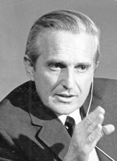

Douglas Engelbart (1925–2013)
<a href="https://en.wikipedia.org/wiki/Douglas_Engelbart" target="_blank">SRI International / ACM Turing Award</a>

<!--
Meet the pioneer who ignited the transition from batch mainframes to interactive human-computer systems: Dr. Douglas Engelbart.

In the 1960s, interacting with a computer meant punching holes in paper cards and waiting 24 hours for a printout. On December 9, 1968, at the Fall Joint Computer Conference in San Francisco—in a 90-minute live presentation forever known as "The Mother of All Demos"—Engelbart unveiled the oN-Line System (NLS).

In a single afternoon, Engelbart demonstrated the first computer mouse, clickable hypertext, networked collaborative document editing, and split-screen video conferencing! His work at SRI inspired Xerox PARC, Apple Macintosh, and the entire field of Human-Computer Interaction (HCI).

To summarize this slide, remember this key takeaway: Douglas Engelbart transformed computing from batch data processing into interactive visual systems that augment human intellect.
-->
---
## What is User Experience (UX)? Formal Definitions

> **ISO 9241-210 Definition:** User Experience is *"a person's perceptions and responses resulting from the use and/or anticipated use of a system, product or service."*

### 1. HCI vs. UX vs. UI vs. CX
- **Human-Computer Interaction (HCI)**:
  - The academic discipline uniting computer science, cognitive psychology, and ergonomics to study interactive computing systems.
- **User Interface (UI — The Conduit)**:
  - The concrete visual, auditory, or tactile presentation layer (buttons, typography, layouts, voice prompts) through which users interact.
- **User Experience (UX — The Holistic Outcome)**:
  - The end-to-end cognitive, behavioral, and emotional journey before, during, and after interacting with the system.
- **Customer Experience (CX)**:
  - The broader organizational umbrella encompassing marketing, pricing, retail support, and multi-channel brand interactions.

### 2. Why UI Alone Cannot Save a Broken UX
- **[Case Study] The Food Delivery Checkout Paradox**:
  - Suppose a Food Delivery app features award-winning gradients and smooth 120Hz animations (**Great UI**).
  - However, it hides delivery surge fees until the final step, loses the cart when switching payment methods, and offers no cancel button (**Broken UX**).
- **Engineering Insight**:
  - **UI** is the saddle, the stirrups, and the reins; **UX** is whether the rider actually reaches their destination safely and comfortably.
  - A beautiful UI on top of a flawed task workflow only accelerates user frustration.

<!--
Let's distinguish four terms that are frequently confused in industry: HCI, UI, UX, and CX.

Look at the left card:
Human-Computer Interaction (HCI) is the foundational academic field uniting computer science and cognitive science.
User Interface (UI) is the concrete presentation medium—the pixels, buttons, forms, and touch controls on the screen.
User Experience (UX), as defined by ISO 9241-210, encompasses the user's holistic perceptions, cognitive load, task efficiency, and emotional responses before, during, and after using the system.
Customer Experience (CX) extends even further to include brand marketing, pricing, and customer service hotline interactions.

Look at the right card: Why can't a polished UI save a broken UX?
Consider our Food Delivery platform: if the app has gorgeous typography and animations (UI), but wipes out the user's customized meal cart whenever a credit card fails validation (UX), users will abandon the app immediately.

To summarize this slide, remember this key takeaway: UI is the visible interaction surface, whereas UX encompasses the entire structural, functional, and cognitive journey of accomplishing a user goal.
-->
---
<!-- _class: title-image-slide -->

## Visual Comparison: UI vs. UX in Real-World Products

  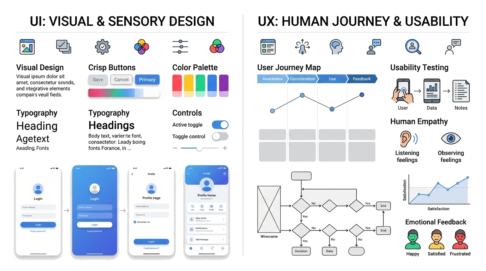

<!--
Examine this visual illustration contrasting User Interface (UI) design and User Experience (UX) design.

Notice the classic ketchup bottle analogy and digital product comparison:
The glass ketchup bottle on the left was designed with an iconic, aesthetically pleasing visual form (UI). Yet when a user actually tries to pour ketchup onto their plate, it either refuses to come out or splatters everywhere—a classic usability failure!
By contrast, the inverted squeeze bottle on the right was engineered around human ergonomics, physics, and the actual context of use (UX): the nozzle stays primed at the bottom, dispensing the exact amount needed with one squeeze.

In software systems, UI focuses on visual presentation, color palettes, and component styling, while UX focuses on information architecture, interaction flows, error prevention, and cognitive alignment with user goals.

To summarize this slide, remember this key takeaway: Great software products harmonize aesthetic UI presentation with ergonomic, goal-driven UX engineering.
-->
---
## Why UX Engineering Matters in Software Engineering

* **1. The Economic ROI (Boehm's Law in UX):**
  - Fixing a workflow flaw during **UX Prototyping** costs **$1** (5 minutes in a wireframe).
  - Fixing it after **Backend API & UI Coding** costs **$10–$20**; fixing it after **Production Release** costs **$50–$100+** in rework and churn.
* **2. Operational Throughput & Error Reduction:**
  - Every extra click or ambiguous label multiplied across 50,000 daily courier dispatches wastes thousands of labor hours.
* **3. Safety-Critical UX Disasters:**
  - **Therac-25 (1985)**: Cryptic codes (`Malfunction 54`) and mode confusion caused lethal overdoses.
  - **Hawaii Missile False Alarm (2018)**: Ambiguous text links with no confirmation dialog triggered statewide panic.

  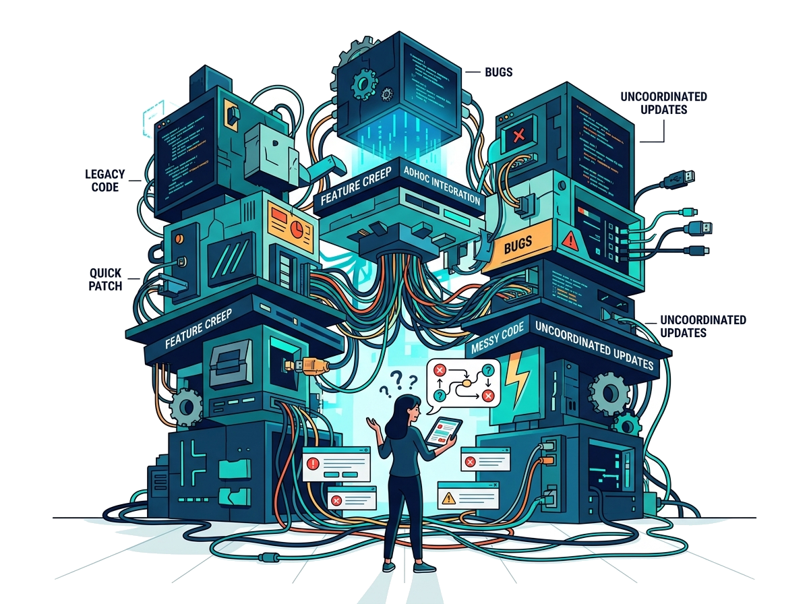

<!--
Why should backend and full-stack software engineers care deeply about UX Engineering?

Look at the left column:
First, Barry Boehm's Cost of Change curve applies directly to user interfaces! Discovering that a 5-step checkout flow confuses users during a 10-minute wireframe test costs $1 to fix. Discovering it after engineers have hardcoded database schemas, REST APIs, and React state machines costs 50 to 100 times more!
Second, in safety-critical domains—medical devices like Therac-25, aviation cockpits, or the 2018 Hawaii emergency alert system—poor UX is not a minor annoyance; it causes catastrophic human error.

And look at the illustration on the right: Why is UX engineering challenging? Because engineers, business executives, and end users view the system through completely different lenses! UX engineering provides the empirical methods to align those perspectives.

To summarize this slide, remember this key takeaway: Early UX engineering prevents expensive late-stage code rework, boosts operational productivity, and safeguards against catastrophic human error.
-->
---
## Structural Frameworks: Garrett's 5 Planes & Morville's Honeycomb

> **Architectural View of UX:** UX is built from the **bottom up**—from abstract business/user strategy to concrete visual pixels.

### 1. Jesse James Garrett's 5 Planes of UX (Bottom → Top)
1. **Surface Plane (Concrete)**: Visual sensory design—color palettes, typography, icons, and micro-animations.
2. **Skeleton Plane**: Interface layout, wireframes, navigation bars, and information presentation placement.
3. **Structure Plane**: **Interaction Design (IxD)** (system behavior over time) and **Information Architecture (IA)** (taxonomy).
4. **Scope Plane**: Functional specifications (feature set) and content requirements (*aligns with SRS!*).
5. **Strategy Plane (Abstract)**: User needs (Personas/JTBD) + Business objectives (ROI/KPIs).

### 2. Peter Morville's 7 Facets (The UX Honeycomb)
- **Useful**: Does the system solve a real, meaningful problem?
- **Usable**: Is the interface easy and intuitive to operate?
- **Findable**: Can users locate features and content when needed?
- **Credible**: Do users trust the system's security and accuracy?
- **Accessible**: Can users with diverse abilities (visual, motor, auditory, cognitive) use it effectively?
- **Desirable**: Does the aesthetic and brand evoke positive emotion?
- **Valuable**: Does it deliver measurable value to users and sponsors?

<!--
How do UX architects structure a software product systematically? Let's examine two foundational models in the field: Jesse James Garrett's 5 Planes of UX on the left, and Peter Morville's UX Honeycomb on the right.

In the left card, Garrett's 5 Planes demonstrate why UX must be engineered from the bottom up:
At the bottom is the **Strategy Plane** (Why are we building this, and for whom?), followed by the **Scope Plane** (What features belong in our Software Requirements Specification?).
Next comes the **Structure Plane**, where we define Information Architecture and Interaction Design flows.
Above that sits the **Skeleton Plane** (wireframes and control placement), and finally, at the very top, the **Surface Plane** (visual styling).

In the right card, Peter Morville's UX Honeycomb expands our evaluation criteria beyond mere usability into seven facets: Useful, Usable, Findable, Credible, Accessible, Desirable, and Valuable. Let's inspect the architectural diagram on the next slide!

To summarize this slide, remember this key takeaway: Garrett's 5 Planes organize UX design from abstract strategy up to visual surface, while Morville's Honeycomb defines the seven quality facets of a complete user experience.
-->
---
<!-- _class: title-image-slide -->

## Conceptual Architecture: Garrett's 5 Planes & The UX Honeycomb

  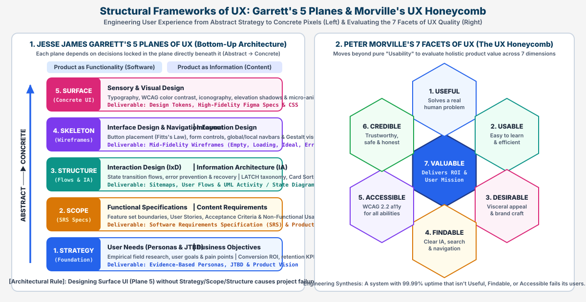

<!--
Examine this conceptual architecture diagram uniting Jesse James Garrett's 5 Planes of UX on the left and Peter Morville's 7-Facet UX Honeycomb on the right!

On the left, trace the upward arrow from Abstract to Concrete:
- **Plane 1 (Strategy)** produces Evidence-Based Personas, Jobs-to-be-Done (JTBD), and Business KPIs.
- **Plane 2 (Scope)** translates strategy into our Software Requirements Specification (SRS) and Product Backlog.
- **Plane 3 (Structure)** defines Information Architecture (LATCH taxonomies) and Interaction Design state machines.
- **Plane 4 (Skeleton)** creates mid-fidelity wireframes covering Empty, Loading, Ideal, and Error states.
- **Plane 5 (Surface)** applies Design Tokens, WCAG color contrast, and visual polish.
Notice the architectural rule at the bottom: if you try to paint Plane 5 (Surface UI) without locking Planes 1 through 4 beneath it, the product collapses!

On the right, see how Morville's Honeycomb centers on **Valuable** surrounded by **Useful, Usable, Desirable, Findable, Accessible, and Credible**.

To summarize this slide, remember this key takeaway: Every visual pixel on the Surface Plane rests upon a rigorous foundation of Wireframe Skeleton, IA Structure, SRS Scope, and User Strategy.
-->
---
## ISO 9241-11 & Jakob Nielsen's 5 Quality Components of Usability

> **ISO 9241-11 Definition:** Usability is the extent to which a system can be used by **specified users** to achieve **specified goals** with **effectiveness, efficiency, and satisfaction** in a **specified context of use**.

| Nielsen's 5 Usability Dimensions | Core Engineering Question | Empirical Measurement Metric (Quantitative) |
| :--- | :--- | :--- |
| **1. Learnability** | How easily can a **first-time novice** accomplish basic tasks upon first encounter? | First-attempt **Task Completion Rate (%)** & time to complete onboarding without assistance. |
| **2. Efficiency** | Once users have learned the system, **how quickly** can they perform frequent tasks? | **Time-on-Task (seconds)**, number of clicks/keystrokes, or orders processed per minute. |
| **3. Memorability** | After returning from a hiatus (weeks/months), how easily can users **re-establish proficiency**? | Task completion time & error count after a **30-day non-use interval**. |
| **4. Errors** | How many errors do users make, how **severe** are they, and how easily can they **recover**? | **Error Rate per Task**, frequency of critical dead-ends, and mean time to recover. |
| **5. Satisfaction** | How pleasant, comfortable, and frustration-free is the subjective experience? | Post-study standardized scales: **SUS (0–100)**, **CSAT**, or **Net Promoter Score (NPS)**. |

<!--
Now let's zoom in on the most testable engineering subset of UX: **Usability**.

ISO 9241-11 defines usability around three pillars—Effectiveness (can users complete the goal accurately?), Efficiency (how much effort/time does it take?), and Satisfaction (how comfortable do they feel?)—always evaluated relative to specific users, specific goals, and a specific environment.

Jakob Nielsen operationalized usability into **5 measurable quality components** shown in this table:
1. **Learnability**: How fast can a novice place their first food order without reading a manual?
2. **Efficiency**: How fast can an experienced restaurant cashier accept 20 incoming orders during the Friday dinner rush?
3. **Memorability**: If a user only files taxes once a year, can they remember how the interface works without starting from scratch?
4. **Errors**: How often do users make slips or mistakes, and how gracefully does the system help them recover?
5. **Satisfaction**: Measured empirically via instruments like the System Usability Scale (SUS).

To summarize this slide, remember this key takeaway: Usability is not a vague opinion; it is quantified across Learnability, Efficiency, Memorability, Errors, and Satisfaction.
-->
---
## The Aesthetic-Usability Effect & Norman's Emotional Design

* **1. The Aesthetic-Usability Effect (Kurosu & Kashimura, 1995):**
  - Tested 26 ATM layouts with identical buttons and logic.
  - Visually attractive layouts were rated **significantly easier to use** (`r = 0.589`), fostering trust and patience for minor hiccups—though aesthetics **never** rescue severe task failures!
* **2. Norman's 3 Levels of Emotional Design:**
  - **Visceral (`< 50ms`)**: Pre-conscious gut reaction to visual symmetry, color harmony, and craft.
  - **Behavioral (In-Use)**: Subconscious feel of functional usability, speed, and control.
  - **Reflective (Post-Use)**: Conscious pride, brand meaning, and peer recommendation.

  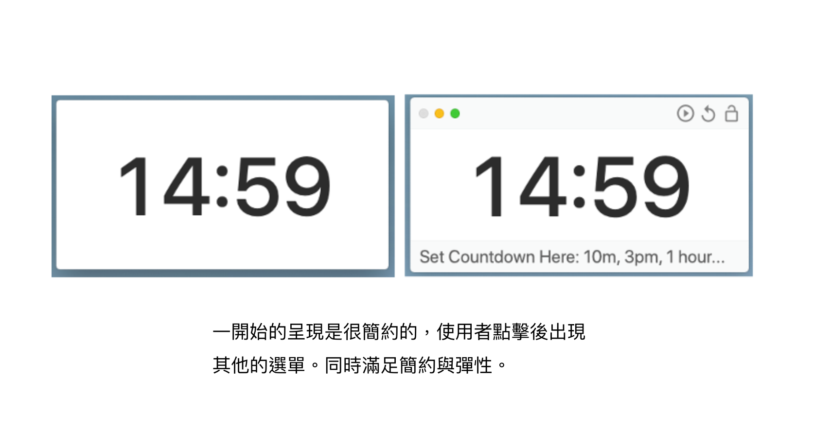

<!--
How do aesthetics and emotion interact with functional usability? Let's examine the Aesthetic-Usability Effect and Don Norman's Three Levels of Emotional Design.

In 1995, Japanese researchers Masaaki Kurosu and Kaori Kashimura tested 26 variations of an ATM interface with identical functional logic. They discovered the **Aesthetic-Usability Effect**: users consistently perceived visually attractive layouts as easier to use, and were more patient when minor issues occurred.

Don Norman's *Emotional Design* explains why this happens across three brain processing levels:
1. The **Visceral Level** is your immediate, pre-conscious reaction to visual appearance (`< 50ms`).
2. The **Behavioral Level** is the functional usability experienced during task execution.
3. The **Reflective Level** is your conscious post-use reflection, memory, and brand attachment.

To summarize this slide, remember this key takeaway: Visual aesthetics create positive visceral trust that cushions minor friction, while behavioral usability and reflective value sustain long-term adoption.
-->
---
### Concept Check Question 1 (CCQ 1)
<!-- id: ase-ch06-ccq1 -->

  

A hospital deploys a new Emergency Room Triage System. First-time nursing interns complete training in 10 minutes (**high novice learnability**), but veteran ER nurses require **14 mouse clicks across 5 modal dialogs** to register a single critical patient during mass-casualty surges. According to **Jakob Nielsen's 5 Quality Components of Usability**, which specific usability dimension is severely compromised?

- **A.** **Memorability**, because veteran nurses must re-learn the triage taxonomy after returning from annual leave.
- **B.** **Efficiency**, because expert users face excessive interaction steps when executing high-frequency tasks.
- **C.** **Learnability**, because first-time nursing interns cannot complete basic triage registration without manuals.
- **D.** **Visceral Aesthetics**, because the modal dialogs lack modern gradient styling and smooth micro-animations.

  

  

  

<!--
Let's check our understanding of Section 6.1 with Concept Check Question 1 (CCQ 1)!

Read the scenario carefully: First-time nursing interns learn the new ER Triage System in just 10 minutes, so **Learnability** (Option C) is already high. And veteran ER nurses use the system every single day, so this is not an intermittent-use **Memorability** problem (Option A), nor is it a visual styling issue (Option D).

Instead, once nurses have already learned the system, requiring 14 mouse clicks across 5 modal dialogs for every single critical patient severely bottlenecks their task execution speed during high-volume surges. In Jakob Nielsen's 5 usability dimensions, the speed and effort required by experienced users to perform frequent tasks is **Efficiency**!

Therefore, the correct answer is B!

To summarize this slide, remember this key takeaway: Learnability measures initial onboarding ease for novices, whereas Efficiency measures task execution speed and minimal interaction cost for experienced users.
-->
---
<!-- _class: lead -->
<!-- header: '6.2 Cognitive Psychology & Mental Models' -->

# **6.2 Cognitive Psychology & Human Information Processing**

> "People are not machines. When a user makes an error, it is almost always a design error—not a human error."  
> — *Don Norman (The Design of Everyday Things)*

<!--
Welcome to Section 6.2: Cognitive Psychology and Human Information Processing.

Every interactive software system involves two processors communicating across an interface: a silicon CPU/GPU executing code, and a biological human brain perceiving visuals, forming mental models, holding items in working memory, and executing motor actions.

In this section, we profile Don Norman, study the Model Human Processor, visualize the 7 Stages of Action and the Two Gulfs, examine Norman's Doors, and diagram Mental Models and Cognitive Load Theory.

To summarize this slide, remember this key takeaway: Designing usable software requires engineering interfaces that respect the biological limits of human perception, attention, and working memory.
-->
---
## Pioneers of UX & Cognitive Engineering: Don Norman

- **Role & Distinctions:**
  - Distinguished Professor of Cognitive Science, UC San Diego; Former VP of Advanced Technology, **Apple**; Co-founder, **Nielsen Norman Group (NN/g)**.
- **Originator of the Term *"User Experience (UX)"* (1993):**
  - Created the world's first *"User Experience Architect"* title at Apple to encompass the entire human experience of a product beyond the screen UI.
- **Seminal Contributions to HCI & Software Engineering:**
  - Authored ***The Design of Everyday Things*** (originally *The Psychology of Everyday Things*, 1988).
  - Formulated the **7 Stages of Action**, the **Gulfs of Execution & Evaluation**, **Perceived Affordances & Signifiers**, and the **Triad of Mental Models**.
- **Signature Engineering Maxim:**
  > *"Do not blame the user! Human error is usually the result of poor design that ignores cognitive psychology."*

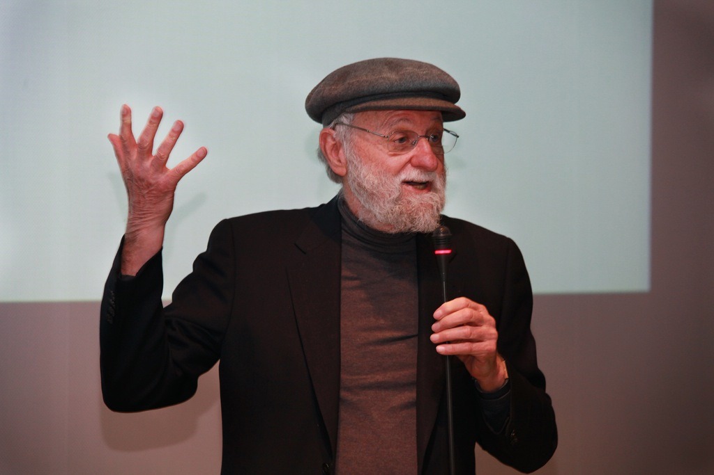

Don Norman
<a href="https://en.wikipedia.org/wiki/Don_Norman" target="_blank">UC San Diego / Apple / NN/g Co-Founder</a>

<!--
Meet the father of modern Cognitive Engineering and User Experience: Professor Don Norman.

Trained in electrical engineering at MIT and mathematical psychology at the University of Pennsylvania, Don Norman founded the Institute for Cognitive Science at UC San Diego before joining Apple in 1993 as Vice President of Advanced Technology. At Apple, he coined the term "User Experience Architect" because he felt "human interface" was too narrow to capture how industrial design, software, graphics, and manuals work together.

In 1988, he published his masterpiece, *The Design of Everyday Things*, giving software engineers the vocabulary we use every day: Affordances, Signifiers, Natural Mapping, Mental Models, and the Gulfs of Execution and Evaluation.

To summarize this slide, remember this key takeaway: Don Norman coined the term User Experience and established the cognitive engineering foundations of interaction design.
-->
---
## Norman's 7 Stages of Action, The Two Gulfs & MHP Thresholds

> **Core Interaction Cycle (Don Norman & Card/Moran/Newell):** Every human interaction bridges **Internal Psychological Goals** and **External Physical System State** within biological clock limits (`100ms / 1s / 10s`).

### 1. The 7 Stages & The Two Gulfs
- **Goal (Stage 1)**: Formulate the high-level objective (*"Order dinner for $15"*).
- **The Gulf of Execution (*"How do I work this?"*)**:
  - **2. Plan** → **3. Specify** → **4. Perform** physical action.
  - *Bridged by*: Clear **Signifiers**, **Affordances**, **Natural Mapping**, and **Constraints**.
- **The Gulf of Evaluation (*"What happened? Did it work?"*)**:
  - **5. Perceive** → **6. Interpret** → **7. Compare** to Goal.
  - *Bridged by*: Immediate **Status Feedback (`< 100ms`)** and clear **Conceptual Models**.

### 2. Model Human Processor (MHP) & Latency SLAs
- **Biological Cycle Times (Card, Moran & Newell, 1983)**:
  - **Perceptual (`τ_p ≈ 100 ms`)** + **Cognitive (`τ_c ≈ 70 ms`)** + **Motor (`τ_m ≈ 70 ms`)** = `~240 ms` simple reaction loop.
- **Jakob Nielsen's 3 Universal Response-Time Limits**:
  - **`0.1s (100 ms)`**: Feels **instantaneous** (direct manipulation: button ripple, scroll tracking).
  - **`1.0s (1,000 ms)`**: User's **flow of thought stays unbroken** without needing a progress bar.
  - **`10.0s (10,000 ms)`**: Max attention limit! Must show a **`%` Progress Bar** + time estimate + **`[Cancel]` exit**.

<!--
Now let's examine how **Don Norman's 7 Stages of Action** and the **Model Human Processor (MHP)** work together:

Look at the left card: Whenever a user interacts with your software, they form a **Goal** (Stage 1), cross the **Execution Bridge** (`Plan → Specify → Perform`), and then cross the **Evaluation Bridge** (`Perceive → Interpret → Compare`).
Where do usability failures occur? In the **Two Gulfs**:
- The **Gulf of Execution** occurs when a user knows *what* they want to achieve, but cannot figure out *how* to execute it in your UI.
- The **Gulf of Evaluation** occurs when a user clicks "Pay Now", the screen gives zero feedback, and they cannot tell if their click worked!

Look at the right card: Why must feedback appear in `< 100ms` (tactile state) or `< 1.0s` (page transition)? Because the human Perceptual Processor (`τ_p ≈ 100ms`) fuses events under `100ms` as instantaneous causality, while delays beyond `10s` fracture working memory! Let's inspect the complete visual model on the next slide.

To summarize this slide, remember this key takeaway: Great interaction design narrows the Gulf of Execution via clear signifiers and narrows the Gulf of Evaluation via feedback aligned with MHP latency thresholds.
-->
---
<!-- _class: title-image-slide -->

## Conceptual Model: 7 Stages of Action, The Two Gulfs & MHP

  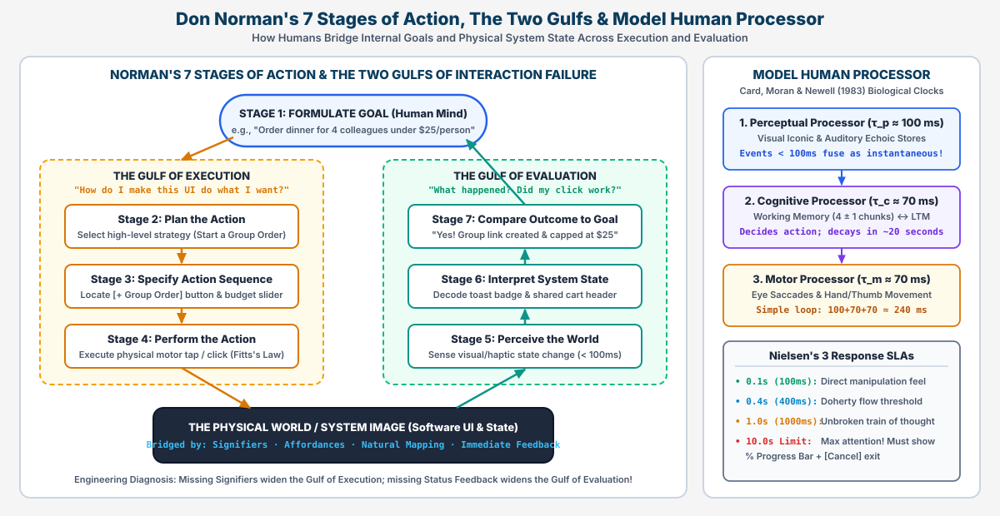

<!--
Examine this complete conceptual diagram of Don Norman's 7 Stages of Action on the left and the Model Human Processor (MHP) on the right!

Trace the loop on the left:
Starting at the top blue capsule (**Stage 1: Formulate Goal** in the Human Mind), the user descends down the amber left side across the **Gulf of Execution** (`Stage 2: Plan` → `Stage 3: Specify` → `Stage 4: Perform`) to act on **The Physical World / System Image** at the bottom.
Then the system updates its pixels, and the user ascends up the teal right side across the **Gulf of Evaluation** (`Stage 5: Perceive` → `Stage 6: Interpret` → `Stage 7: Compare Outcome to Goal`).

On the right, see how the three biological clocks of the Model Human Processor—Perceptual (`100ms`), Cognitive (`70ms`), and Motor (`70ms`)—dictate Nielsen's `0.1s`, `1.0s`, and `10s` software response-time SLAs.

To summarize this slide, remember this key takeaway: Every interaction traverses the 7-stage loop between human goal and system image, governed by the biological cycle times of perception, cognition, and motor control.
-->
---
## Affordances, Signifiers, Mappings & Feedback

> **Bridging the Gulfs:** Don Norman refined his framework to distinguish **Affordances** (what actions are possible) from **Signifiers** (the perceptible clues showing where and how to act).

| Core Design Concept | Formal Definition in HCI / UX | Software UI Engineering Application |
| :--- | :--- | :--- |
| **1. Affordance** | The relationship between a physical/digital object and a user that defines **what actions are possible**. | A scrollable viewport *affords* vertical panning; a text input box *affords* typing characters. |
| **2. Signifier** | Any **perceptible visual, auditory, or tactile clue** that communicates *where* and *how* an action should be taken. | An underlined blue label, a raised button shadow, a `[Search]` icon, or a visible scrollbar thumb. |
| **3. Natural Mapping** | The spatial or logical relationship between **controls and their effects** in the world. | Pressing the **Right Arrow `→`** advances to the next slide; dragging a slider up increases volume. |
| **4. Feedback** | Communicating the **results of an action** back to the user immediately and clearly. | Button ripple (`< 100ms`), toast confirmation (`"Added to Cart"`), or inline red validation text. |
| **5. Constraints** | Limiting possible actions (Physical, Cultural, Semantic, Logical) to **prevent invalid states**. | Disabling the `"Place Order"` button until a valid delivery address and payment method are selected. |

<!--
How do we concretely bridge the Gulf of Execution and the Gulf of Evaluation? Don Norman defines five fundamental design primitives shown in this table:

1. **Affordance**: An objective relationship defining what actions are possible (e.g., a touch screen *affords* tapping and swiping).
2. **Signifier**: Because digital screens are flat glass, users cannot see hidden affordances unless designers provide **Signifiers**—perceptible clues like button borders, cursor changes, icons, or placeholder prompts that signal *"Tap here!"*
3. **Natural Mapping**: Aligning the layout of controls with their real-world spatial or logical effects, reducing cognitive translation effort to zero.
4. **Feedback**: Immediately confirming that an input was received and showing its effect on system state.
5. **Constraints**: Proactively blocking illegal actions before an error can even occur.

To summarize this slide, remember this key takeaway: Affordances define possible actions, Signifiers make those actions discoverable, Mappings align controls with outcomes, and Feedback confirms state changes.
-->
---
<!-- _class: title-image-slide -->

## Case Study: Norman's Door & Signifier Failure

  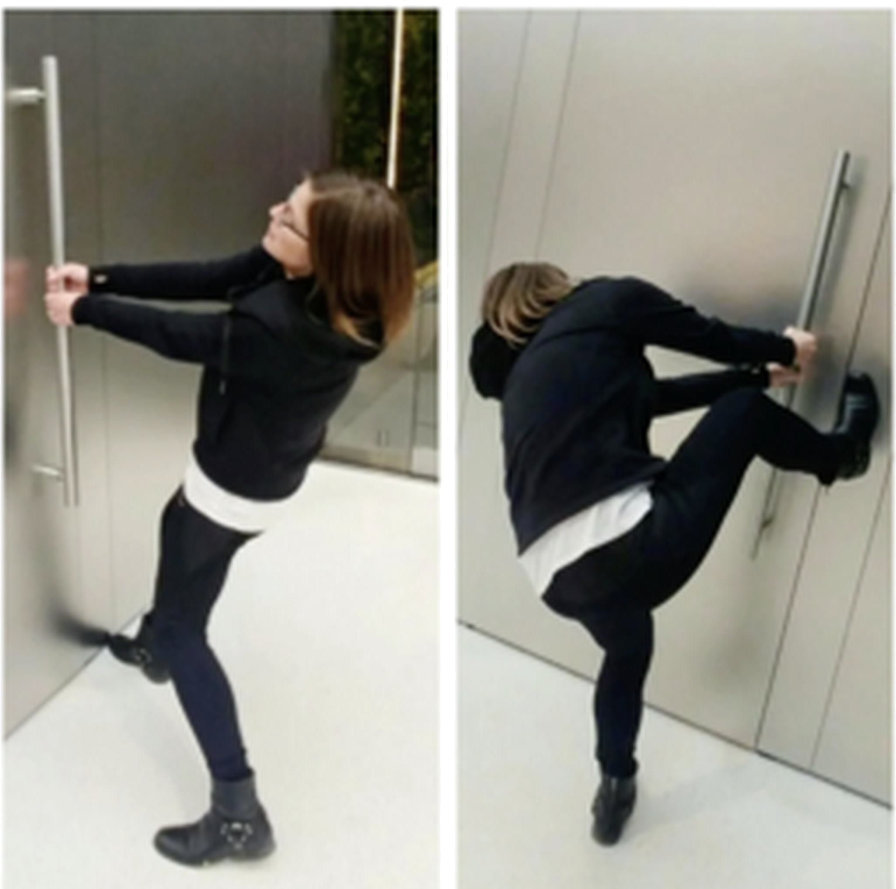

<!--
Look at this famous everyday example that gave birth to the term **"Norman's Door"**:

When you walk up to a door that has identical grab-handles on both the push side and the pull side, what happens? The handle acts as a misleading **Signifier** that screams *"Pull me!"* even when the door hinges only allow pushing! To fix their design failure, building managers end up taping ugly paper signs reading `"PUSH"` onto the handle.

A well-engineered door requires zero instructions: the pull side has a vertical grab handle (signifying pulling), while the push side has a flat metal plate (affording only pushing and naturally signifying where to place your hand).

In software interfaces, whenever you have to write a multi-line instruction paragraph explaining *"Click the gray text above to save, do not click the green button below"*, you have built a digital Norman's Door!

To summarize this slide, remember this key takeaway: If a standard user interface control requires an instructional warning label to prevent misuse, its signifiers and mappings are fundamentally flawed.
-->
---
## Mental Models vs. Conceptual Models & Cognitive Load Theory

> **Norman's Triad & Sweller's Cognitive Load (1988):** Designers communicate with users **only through the System Image**, while human **Working Memory** holds only **`4 ± 1` active chunks** (`~20s` decay).

### 1. Norman's Triad of Models
- **1. Designer's Conceptual Model (Implementation)**:
  - Normalized SQL tables, foreign keys, Kafka partitions, and state machines.
- **2. User's Mental Model (Everyday Beliefs)**:
  - Shopping carts, paper receipts, folders, and instant Undo.
- **3. The System Image (The Bridge)**:
  - The visible UI, labels, metaphors, and error messages.
  - **[Anti-Pattern] Implementation Model Leak**: Exposing raw SQL errors (`ORA-02292`) or internal shard IDs to end users breaks their Mental Model!

### 2. Sweller's 3 Types of Cognitive Load
- **Intrinsic Load (Inherent Task Complexity)**:
  - Managed by breaking complex flows into **step-by-step wizards**.
- **Extraneous Load (Bad UI Friction)**:
  - Wasted mental effort caused by visual clutter, inconsistent menus, or forcing users to memorize promo codes across screens. **Goal: Reduce to ~0%!**
- **Germane Load (Schema Mastery)**:
  - Productive effort invested in learning reusable patterns.

<!--
Let's unite two crucial cognitive frameworks: **Don Norman's Triad of Mental Models** on the left, and **John Sweller's Cognitive Load Theory** on the right.

Look at the left card: Once your software ships, you are not sitting next to the user explaining how the backend works. The **Designer's Model** and the **User's Mental Model** meet *exclusively* through the **System Image**. When a developer lets the backend Implementation Model leak into the System Image—throwing raw database exceptions or asking users to configure internal technical parameters—the user's Mental Model shatters!

Look at the right card: Why do cluttered interfaces fail? Because human **Working Memory** holds only **`4 ± 1` active chunks** (Cowan, 2001). When bad UI design inflates **Extraneous Cognitive Load**, it overflows working memory and causes immediate task abandonment! Let's inspect the visual architecture of both models on the next slide.

To summarize this slide, remember this key takeaway: Engineers must align the System Image with the User's Mental Model while ruthlessly eliminating Extraneous Cognitive Load.
-->
---
<!-- _class: title-image-slide -->

## Conceptual Diagram: Mental Models & Cognitive Load Architecture

  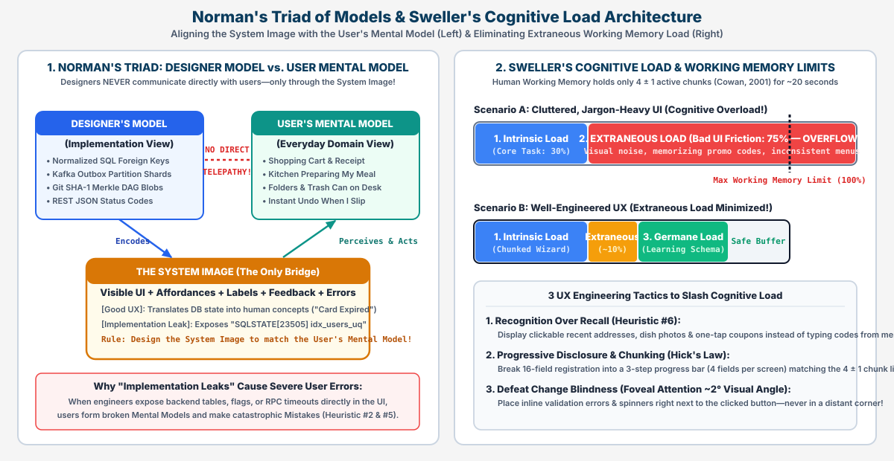

<!--
Examine this visual diagram illustrating Norman's Triad of Models on the left and Sweller's Cognitive Load Architecture on the right!

On the left, notice the red dashed line between the **Designer's Model** (SQL foreign keys, Kafka shards, Git SHA-1 DAGs) and the **User's Mental Model** (Shopping cart, kitchen preparing meal, folders on a desk): **There is no direct telepathy between engineer and user!** Everything must pass through **The System Image** at the bottom.

On the right, compare Scenario A and Scenario B in the Working Memory capacity bars:
In **Scenario A (Cluttered UI)**, a massive red block of **Extraneous Load (75%)**—caused by visual noise and forcing users to memorize codes across screens—pushes total mental effort past the **100% Working Memory Limit**!
In **Scenario B (Well-Engineered UX)**, chunking, Recognition over Recall, and inline feedback shrink Extraneous Load to `~10%`, leaving ample cognitive headroom for the user to complete their task effortlessly.

To summarize this slide, remember this key takeaway: Hiding implementation complexity behind a familiar System Image and shrinking Extraneous Load keeps total cognitive demand safely inside Working Memory capacity.
-->
---
### Concept Check Question 2 (CCQ 2)
<!-- id: ase-ch06-ccq2 -->

  

In a cloud deployment dashboard, an engineer clicks the **"Deploy to Production"** button. Because the frontend lacks a loading spinner, toast message, or state change for 8 seconds, the engineer assumes the click failed and clicks the button three more times, triggering conflicting deployments. In **Don Norman's Action Cycle**, which specific breakdown caused this error?

- **A.** A wide **Gulf of Execution**, because the engineer could not locate the deployment button on the screen.
- **B.** Excess **Intrinsic Cognitive Load**, because cloud deployment inherently requires memorizing Linux kernel flags.
- **C.** A wide **Gulf of Evaluation**, because the interface failed to provide immediate feedback on the system's new state.
- **D.** A **Natural Mapping** violation, because the deployment button was positioned on the right side of the toolbar.

  

  

  

<!--
Let's check our understanding of Section 6.2 with Concept Check Question 2 (CCQ 2)!

In this scenario, the engineer easily found and clicked the "Deploy to Production" button—so they crossed the Execution bridge without difficulty (eliminating Option A). Nor is this about Linux kernel flags (Option B) or toolbar spatial mapping (Option D).

Instead, *after* the engineer performed the action, the interface gave zero visual feedback for 8 seconds (violating the `100ms` tactile feedback threshold and `1.0s` flow threshold). Because the user could not perceive or interpret whether the system state had changed, they fell into a wide **Gulf of Evaluation** (*"What happened? Did my click register?"*) and repeatedly clicked the button!

Therefore, the correct answer is C!

To summarize this slide, remember this key takeaway: Failing to display immediate state feedback after a user action creates a wide Gulf of Evaluation, directly provoking duplicate submissions and user errors.
-->
---
<!-- _class: lead -->
<!-- header: '6.3 Quantitative Laws & Visual Perception' -->

# **6.3 Quantitative Laws of Interaction & Visual Perception**

> "Design is a science as much as an art: human motor movement, choice reaction time, and visual grouping obey mathematical laws."

<!--
Welcome to Section 6.3: Quantitative Laws of Interaction and Visual Perception.

Many computer science students are surprised to discover that Human-Computer Interaction has mathematical equations that accurately predict how many milliseconds a user needs to point to a button (`Fitts's Law`) or choose from a menu (`Hick-Hyman Law`).

In this section, we profile interaction pioneer Ben Shneiderman, master the mathematical and behavioral laws of UX, visualize Gestalt grouping and thumb ergonomics, and inspect real-world visual contrast and information overload failures.

To summarize this slide, remember this key takeaway: Quantitative HCI laws and perceptual principles allow software engineers to optimize pointing speed, decision latency, visual hierarchy, and accessibility mathematically.
-->
---
## Pioneers of Interaction Design: Ben Shneiderman

- **Role & Distinctions:**
  - Distinguished University Professor of Computer Science, University of Maryland; Founding Director, **Human-Computer Interaction Lab (HCIL)**; IEEE & ACM Fellow; NAE Member.
- **Pioneered Concepts & Inventions:**
  - Coined **Direct Manipulation (1982)**: Continuous visual representation of objects, physical actions/pointing instead of complex command syntax, and rapid reversible incremental operations.
  - Invented the **highlighted clickable web hyperlink**, dynamic sliders, **Treemaps** for hierarchical data visualization, and **Human-Centered AI (HCAI)**.
- **Author of the Classic Textbook:**
  - *Designing the User Interface* (**Eight Golden Rules of Interface Design**: Consistency, Universal Usability, Informative Feedback, Closure, Error Prevention, Easy Reversal, Internal Locus of Control, Short-Term Memory Load).

Ben Shneiderman
<a href="https://en.wikipedia.org/wiki/Ben_Shneiderman" target="_blank">Univ. of Maryland HCIL / ACM Fellow</a>

<!--
Meet one of the most influential computer scientists in Human-Computer Interaction: Professor Ben Shneiderman, founding director of the Human-Computer Interaction Lab (HCIL) at the University of Maryland.

In 1982, studying why users loved early visual editors and video games while struggling with command-line terminals, Shneiderman coined the term **"Direct Manipulation"**:
1. Continuous visual representation of the objects of interest.
2. Physical pointing, dragging, and tapping instead of memorizing complex command syntax.
3. Rapid, incremental, immediately reversible operations whose impact on the object is immediately visible (`< 100ms`).

Shneiderman also invented the blue highlighted clickable link (adopted by Tim Berners-Lee for the World Wide Web!), Treemaps for visualizing disk and financial hierarchies, the famous **Eight Golden Rules of Interface Design**, and the modern framework for **Human-Centered AI (HCAI)**.

To summarize this slide, remember this key takeaway: Ben Shneiderman formalized Direct Manipulation and the Eight Golden Rules that govern modern graphical and touch interfaces.
-->
---
## Mathematical & Behavioral Laws: Fitts, Hick, Jakob & Tesler

> **Predictive HCI Modeling:** Human motor targeting (`Fitts`), decision latency (`Hick`), convention transfer (`Jakob`), and complexity conservation (`Tesler`) follow strict engineering laws.

### 1. Fitts's Law & Hick-Hyman Law
- **Fitts's Law (1954 — Motor Targeting Speed)**:
  - `MT = a + b · log``2``(D / W + 1)` (`D` = Distance, `W` = Target Width).
  - **UI Rules**: Make primary CTAs large (`>= 44×44 px` / `48×48 dp`, `↑ W`) inside the mobile **Bottom Thumb Zone (`↓ D`)**; pin global menus to **Screen Edges/Corners (`W = ∞`)**; isolate destructive buttons!
- **Hick-Hyman Law (1952 — Choice Reaction Time)**:
  - `RT = a + b · log``2``(n + 1)` (`n` = number of choices).
  - **UI Rules**: Apply **Progressive Disclosure** (show 3–5 core choices + `[Recommended]` default; tuck rare options under `"More..."`).

### 2. Jakob's, Tesler's, Postel's & Doherty Laws
- **Jakob's Law**: Users spend most of their time on *other* sites—follow standard conventions (top-right `[Cart]`, `Ctrl+Z`) so navigation takes **0% learning load**.
- **Doherty Threshold (`< 400 ms`)**: Keep system-human interaction under `400 ms` via **Skeleton Screens & Optimistic UI**.
- **Tesler's Law (Conservation of Complexity)**: Shift irreducible complexity from the User to the Code (e.g., auto-fill City/State from ZIP code).
- **Postel's Law (Robustness Principle)**: Accept flexible human input (`0912-345-678` or `0912345678`) liberally and normalize in code!

<!--
Let's synthesize the core quantitative and behavioral laws of interaction design:

In the left card:
1. **Fitts's Law** (`MT = a + b * log2(D/W + 1)`) governs physical pointing and tapping. It explains why primary mobile buttons belong in the bottom easy thumb zone with large tap targets (`>= 48dp`), why right-click context menus appear at `D = 0`, and why the macOS top menu bar has infinite target depth (`W = ∞`).
2. **Hick-Hyman Law** (`RT = a + b * log2(n + 1)`) governs decision latency. Instead of dumping 28 payment methods on screen, we use **Progressive Disclosure** and smart defaults.

In the right card:
3. **Jakob's Law** reminds us to honor familiar platform conventions.
4. **The Doherty Threshold (`< 400 ms`)** keeps users in a flow state.
5. **Tesler's Law** and **Postel's Law** shift formatting work from human fingers into frontend parser code. Let's inspect the visual diagram of Fitts's Law, Thumb Zones, Hick's Law, and Gestalt Grouping on the next slide!

To summarize this slide, remember this key takeaway: Fitts's and Hick's laws optimize physical pointing and cognitive choice mathematically, while Jakob's, Tesler's, and Postel's laws eliminate unnecessary interaction friction.
-->
---
<!-- _class: title-image-slide -->

## Conceptual Diagram: Fitts's Law, Hick's Law & Gestalt Grouping

  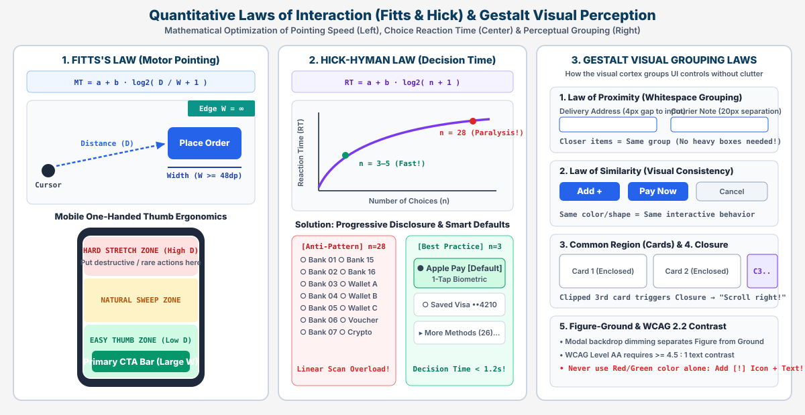

<!--
Examine this 3-panel visual diagram illustrating Fitts's Law, Hick-Hyman Law, and Gestalt Visual Grouping!

1. In **Panel 1 (Left — Fitts's Law)**:
   - At the top, see how movement time depends on Distance (`D`) divided by Target Width (`W`), and why screen edges act as "magic corners" (`W = ∞`).
   - At the bottom, inspect the **Mobile One-Handed Thumb Ergonomics Map**: the bottom green arc is the **Easy Thumb Zone (Low D)** where primary CTA bars belong, while the top-left red corner is the **Hard Stretch Zone (High D)** where destructive or rare actions should be isolated!
2. In **Panel 2 (Center — Hick-Hyman Law)**:
   - See the logarithmic reaction-time curve (`RT`) and the visual contrast between an `[Anti-Pattern]` flat list of `n = 28` banks vs. `[Best Practice]` Progressive Disclosure (`n = 3` choices with Apple Pay pre-selected as default, cutting decision time to `< 1.2s`).
3. In **Panel 3 (Right — Gestalt Visual Grouping Laws)**:
   - See how **Proximity** (`4px` label gap vs. `20px` field gap), **Similarity** (consistent primary button color), **Common Region** (cards), and **Closure** (partially clipped 3rd carousel card signaling horizontal scroll) organize interfaces cleanly!

To summarize this slide, remember this key takeaway: Combining thumb-zone Fitts ergonomics, progressive Hick disclosure, and Gestalt perceptual grouping creates effortlessly scannable interfaces.
-->
---
## Gestalt Visual Hierarchy & WCAG 2.2 Accessibility Engineering

* **1. Visual Hierarchy & Eye-Tracking (F / Z Patterns):**
  - Users **scan** interfaces rather than reading word-for-word.
  - Enforce a clear typographic scale (`H1 > H2 > Body`), line width `50–75 chars` (`65ch`), and **Gestalt Proximity** whitespace.
* **2. W3C WCAG 2.2 Accessibility (POUR Mandate):**
  - **Luminance Contrast (Level AA)**: Minimum **`4.5 : 1`** for normal text (`3.0 : 1` for large text `>= 18pt` and UI controls).
  - **Color-Blindness Safety**: Never rely on Red vs. Green alone (~8% of males have Deuteranopia/Protanopia)—always pair color with **`[!] Icon + Text Label`**.
  - **Keyboard & Screen Reader**: Semantic `<button>`, focus rings, and `aria-label`.

  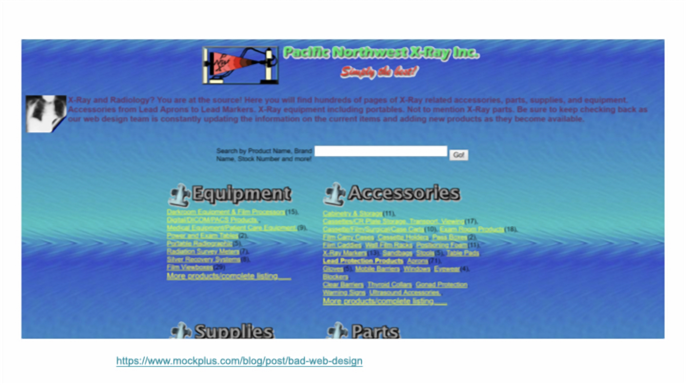

<!--
Look at how Visual Hierarchy and **WCAG 2.2 Accessibility (POUR: Perceivable, Operable, Understandable, Robust)** prevent the real-world visual failures shown on the right!

In the image on the right, notice what happens when an interface violates **WCAG Contrast (`1.4.3`)** and **Gestalt Figure-Ground**: low-contrast text placed over busy background imagery or washed-out pastel colors becomes completely illegible—especially for older adults, users with low vision, or couriers looking at their phone screen under bright outdoor sunlight!

To engineer accessible interfaces:
1. Enforce a minimum **`4.5 : 1` contrast ratio** for body text (verifiable in Chrome DevTools Accessibility Inspector).
2. Never communicate form errors or system status by red/green color alone—always include a distinct icon (`[!]`) and descriptive text.
3. Ensure every interactive control is a native semantic HTML element (`<button>`, `<input>`, `<nav>`) operable via the `Tab` and `Enter` keys.

To summarize this slide, remember this key takeaway: Accessible visual design pairs scannable Gestalt hierarchy with WCAG 4.5:1 contrast, color-independent indicators, and keyboard-operable semantic HTML.
-->
---
### Peer Discussion 6.3: Diagnosing a High-Friction Checkout Screen

  

  **UX Engineering Audit: Refactoring the Food Delivery Checkout UI (4 Mins)**
  - **Scenario:** A junior developer built the checkout screen for our **Food Delivery App**, and cart abandonment jumped to **62%**. An inspection reveals four design flaws:
    1. The **"Place Order"** button is a tiny `24×18 px` text link at the top-left corner of the mobile screen, right next to **"Empty Entire Cart"** (`2px` gap).
    2. The payment selector displays all **28 supported banks and wallets** in a single unsorted radio-button list.
    3. The phone number field rejects `0912-345-678` with a red popup: *"Error: Numeric digits only! Re-enter all 8 address fields."*
    4. Required fields are marked *only* by changing their border color from green to red (`#ef4444` on `#e5e7eb` gray background, contrast `2.1:1`).
  - **Discussion Tasks:**
    - **Q1.** Identify which specific **Law of UX or Accessibility Standard** (Fitts's, Hick's, Tesler's/Postel's, WCAG) is violated by each of the 4 flaws (`#1` to `#4`).
    - **Q2.** Propose the concrete **UI refactoring fix** for each flaw!

  

  

    
  

<!--
Let's take 4 minutes for Peer Discussion 6.3!

Work with your neighbor to audit this high-friction Food Delivery checkout screen where 62% of users abandon their cart.
Look at the four flaws (`#1` through `#4`):
In Flaw #1, look at the size (`24x18 px`), placement (top-left hard stretch zone of a mobile screen), and proximity (`2px` from "Empty Entire Cart"). Which mathematical law is violated here?
In Flaw #2, dumping 28 unsorted banks and wallets into a single flat radio list violates which decision-time law?
In Flaw #3, rejecting hyphens in a phone number and wiping out all 8 address fields violates which robustness and complexity laws?
And in Flaw #4, relying solely on red vs. green borders with a `2.1:1` contrast ratio violates which WCAG accessibility rules?

Full reference solutions are provided in Appendix B at the end of the slide deck!

To summarize this slide, remember this key takeaway: Auditing interfaces against Fitts's Law, Hick's Law, Postel's Law, and WCAG standards turns subjective UI critique into systematic engineering diagnosis.
-->
---
### Concept Check Question 3 (CCQ 3)
<!-- id: ase-ch06-ccq3 -->

  

According to the Shannon formulation of **Fitts's Law** (`MT = a + b · log``2``(D / W + 1)`), why do desktop operating systems place critical global menus (such as the macOS Menu Bar or the Windows Start button) flush against the **extreme edges or corners of the screen**?

- **A.** Screen edges reduce the number of menu items `n`, lowering cognitive choice reaction time under Hick's Law.
- **B.** The monitor bezel blocks the cursor from overshooting, giving edge targets an effectively infinite width `W`.
- **C.** Placing menus at the screen edge increases luminance contrast ratios to satisfy WCAG 2.2 Level AAA standards.
- **D.** Peripheral vision processes corner pixels in `< 20ms`, bypassing the Model Human Processor's motor stage.

  

  

  

<!--
Let's check our mastery of Section 6.3 with Concept Check Question 3 (CCQ 3)!

The question asks: According to Fitts's Law (`MT = a + b * log2(D/W + 1)`), why are the macOS Menu Bar and Windows Start button pinned flush against the extreme edges or corners of the display?

Let's evaluate the four options:
Option A confuses Fitts's Law (motor pointing) with Hick's Law (number of choices `n`).
Option B is exact: when a button sits in the middle of the screen, the user must decelerate their hand carefully so the cursor does not overshoot the button's width `W`. When a target sits flush against the edge or corner of the screen, the physical screen boundary stops the cursor automatically—giving the target an **effectively infinite width (`W = ∞`)** along the movement axis and slashing the Index of Difficulty!
Options C and D are fabricated claims about contrast and peripheral vision.

Therefore, the correct answer is B!

To summarize this slide, remember this key takeaway: Under Fitts's Law, pinning controls flush against screen edges or corners prevents cursor overshoot and grants effectively infinite target depth.
-->
---
<!-- _class: lead -->
<!-- header: '6.4 HCD Process & User Research' -->

# **6.4 The Human-Centered Design (HCD) Process & User Research**

> "You are not the user! Every assumption you make about how people will use your software is a hypothesis waiting to be tested."  
> — *Jakob Nielsen & Don Norman*

<!--
Welcome to Section 6.4: The Human-Centered Design (HCD) Process and Empirical User Research.

Perhaps the single greatest trap in software engineering is the **False-Consensus Effect**: engineers naturally assume that because *they* understand recursive folder trees, regular expressions, or modal state transitions, everyday users think the exact same way.

Hence the First Golden Rule of UX Engineering: **"You Are Not the User!"**
In this section, we study the ISO 9241-210 Human-Centered Design lifecycle, the UK Design Council's Double Diamond model, the 2×2 Empirical User Research Matrix, Personas, Jobs-to-be-Done (JTBD), and Customer Journey Mapping.

To summarize this slide, remember this key takeaway: Human-Centered Design replaces developer assumptions with empirical user research across iterative divergent and convergent phases.
-->
---
## The Double Diamond Lifecycle & ISO 9241-210 HCD Process

* **1. Diamond 1 — Problem Space (*"Design the Right Thing"*):**
  - **Discover (Diverge `<`)**: Field observation (**Contextual Inquiry**) and user interviews to uncover real pain points.
  - **Define (Converge `>`)**: Synthesize findings into **Personas**, **JTBD**, and a focused Problem Statement (**SRS Scope**).
* **2. Diamond 2 — Solution Space (*"Design the Thing Right"*):**
  - **Develop (Diverge `<`)**: Explore Information Architecture, low-fidelity sketches, and wireframes.
  - **Deliver (Converge `>`)**: Run iterative usability tests, refine UI tokens, and ship in agile sprints.

  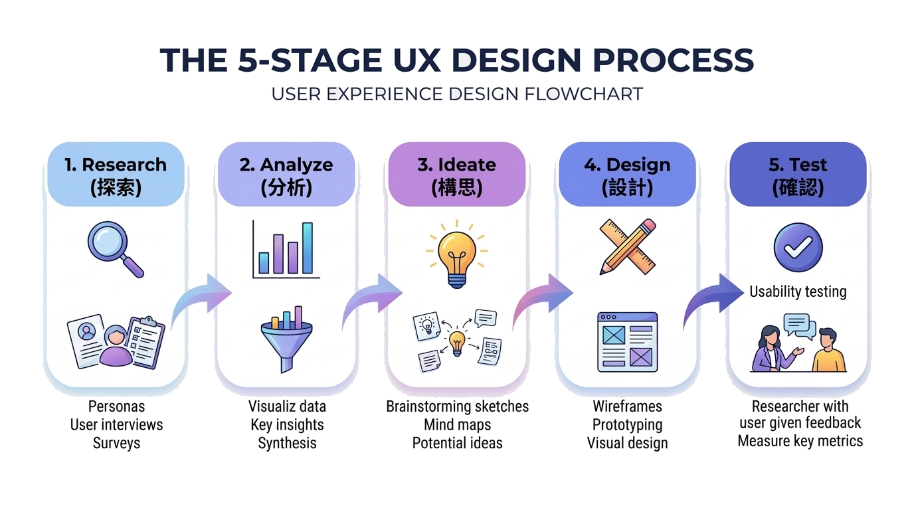

<!--
How does UX Engineering fit into the broader Software Development Lifecycle (SDLC)? Let's examine the **UK Design Council's Double Diamond Model** on the left and the **ISO 9241-210 Iterative HCD Loop** on the right.

Why is it called the **Double Diamond**? Because great design alternates between **Divergent Thinking** (expanding to explore possibilities) and **Convergent Thinking** (narrowing down to focused decisions) across two diamonds:
- **Diamond 1 (Problem Space — "Build the Right Thing")**: First we **Discover** via field user research, then we **Define** the core personas, Jobs-to-be-Done, and problem statement.
- **Diamond 2 (Solution Space — "Build the Thing Right")**: Next we **Develop** alternative wireframes and prototypes, and finally we **Deliver** through usability testing and sprint implementation.

Let's examine the complete conceptual diagram uniting the Double Diamond, SRS traceability, and the 2×2 User Research Matrix on the next slide!

To summarize this slide, remember this key takeaway: The Double Diamond enforces exploring and defining the Problem Space before diverging and converging in the Solution Space.
-->
---
<!-- _class: title-image-slide -->

## Conceptual Diagram: Double Diamond & 2×2 User Research Matrix

  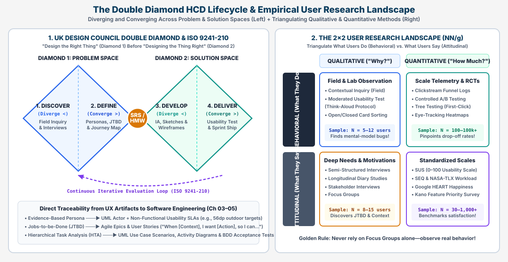

<!--
Examine this dual conceptual diagram showing the **Double Diamond HCD Lifecycle** on the left and the **NN/g 2×2 User Research Landscape** on the right!

In the left panel:
- Notice how **Diamond 1 (Problem Space: Discover → Define)** converges onto our **SRS / How-Might-We Problem Statement** in the center, which then launches **Diamond 2 (Solution Space: Develop → Deliver)** with a continuous iterative evaluation loop underneath.
- At the bottom-left, review the direct traceability to Software Engineering (Chapters 3–5): **Personas** map to **UML Actors & Usability NFRs**; **Jobs-to-be-Done (JTBD)** map to **Agile User Stories**; and **Hierarchical Task Analysis (HTA)** maps to **UML Use Case & Activity Diagrams**.

In the right panel:
- See how empirical research methods are organized across **Behavioral (What Users Actually Do)** vs. **Attitudinal (What Users Say)** on the vertical axis, and **Qualitative (Why & How to Fix, `N = 5–12`)** vs. **Quantitative (How Much, `N = 100+`)** on the horizontal axis.
- Best engineering practice **triangulates** both: Clickstream funnel logs tell you *where* users drop off (`62% at step 3`), while **Contextual Inquiry** and **Think-Aloud Testing** reveal *why*!

To summarize this slide, remember this key takeaway: Combining Double Diamond problem-space discipline with Behavioral + Attitudinal triangulation ensures software requirements are grounded in empirical reality.
-->
---
## Synthesizing Research: Personas, JTBD, Journey Maps & HTA

> **From Raw Field Notes to Engineering Models:** Distill qualitative observations into **Goal-Directed Personas** (*Who*), **Jobs-to-be-Done** (*Why*), **Customer Journey Maps** (*Macro Timeline*), and **Hierarchical Task Analysis** (*Micro Steps*).

### 1. Personas (Alan Cooper) & JTBD (Christensen)
- **Alan Cooper's Goal-Directed Personas (*The Inmates Are Running the Asylum*)**:
  - Empirical behavioral archetypes clustered via **Affinity Diagramming (KJ Method)**—never fictional marketing stereotypes!
  - Captures **Context of Use** (e.g., *"Courier Wei, operates one-handed on a scooter in rain"*), **Goals**, and **Frustrations**.
- **Jobs-to-be-Done (JTBD Template)**:
  - **When** `[Situation]`, **I want to** `[Action]`, **so I can** `[Outcome]`.
  - *Example*: *"When working overtime with 4 colleagues at 8 PM, I want to share a group cart link capped at $25/person, so we can order dinner without passing my phone around."*

### 2. Customer Journey Maps & Task Analysis (HTA)
- **Customer Journey Map (Macro Experience & Emotion Curve)**:
  - Plots user actions, thoughts, and **Emotional Peaks/Valleys (`Delight (+) ↔ Frustration (−)`)** across timeline stages.
  - Exposes the infamous **"Post-Payment Anxiety Valley"** in food delivery!
- **Hierarchical Task Analysis (HTA — Micro Task Tree)**:
  - Decomposes `Goal 0` into numbered sub-tasks (`1, 2, 3...`) and conditional execution **`Plans`**—mapping directly to **UML Activity Diagrams** and **BDD Acceptance Tests**!

<!--
Once we return from field observations and user interviews, how do we synthesize qualitative notes into rigorous software engineering artifacts?

In the left card:
1. **Alan Cooper's Goal-Directed Personas**: Pioneered by Alan Cooper (creator of Visual Basic and author of *The Inmates Are Running the Asylum*), a Persona represents an empirical behavioral cluster—capturing physical context, domain goals, and pain points.
2. **Jobs-to-be-Done (JTBD)**: Frames requirements around the situational job the user "hires" the software to accomplish (`When [Situation], I want to [Action], so I can [Outcome]`).

In the right card:
3. **Customer Journey Maps** plot the emotional trajectory across stages, pinpointing where user anxiety spikes.
4. **Hierarchical Task Analysis (HTA)** breaks high-level goals into structured sub-tasks and execution plans. Let's inspect our Food Delivery Customer Journey Map diagram on the next slide!

To summarize this slide, remember this key takeaway: Personas and JTBD define who uses the system and why, while Journey Maps and HTA model the temporal experience and task hierarchy.
-->
---
<!-- _class: title-image-slide -->

## Visual Case Study: Customer Journey Map in Food Delivery

  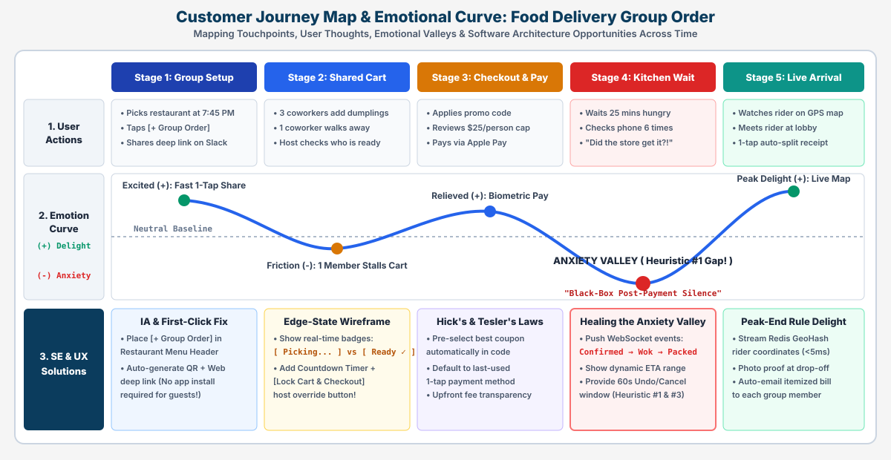

<!--
Examine this complete **Customer Journey Map** for our Food Delivery Group Order scenario!

Trace the three horizontal swimlanes across the 5 stages (`Stage 1: Group Setup` → `Stage 2: Shared Cart` → `Stage 3: Checkout & Pay` → `Stage 4: Kitchen Wait` → `Stage 5: Live Arrival`):
1. In **Row 1 (User Actions)**, see what the host and coworkers are physically doing at each stage.
2. In **Row 2 (Emotion Curve)**, follow the blue trajectory:
   - Notice the minor dip at **Stage 2** when one coworker walks away from their desk and stalls the shared cart.
   - And look at the deep red **ANXIETY VALLEY at Stage 4 (Kitchen Wait)**: the user has already paid $95, money has left their bank account, and for 25 minutes they stare at a static screen wondering, *"Did the restaurant even receive our order?!"*
3. In **Row 3 (SE & UX Solutions)**, see how each emotional dip translates directly into a concrete software engineering feature:
   - To fix Stage 2 stall friction, we add `[Picking...]` vs. `[Ready ✓]` badges and a **Host Override (`[Lock Cart & Checkout]`)** button.
   - To heal the Stage 4 Anxiety Valley, we engineer **WebSocket event streaming (`Confirmed → Wok → Packed`)** and **Redis Geo-Hash live rider tracking**!

To summarize this slide, remember this key takeaway: Customer Journey Maps transform emotional valleys of user anxiety into high-impact frontend and backend architectural requirements.
-->
---
<!-- _class: lead -->
<!-- header: '6.5 IA, Wireframing & Prototyping' -->

# **6.5 Information Architecture, Wireframing & Prototyping**

> "If a user can't find it, it doesn't exist."  
> — *Steve Krug (Author of Don't Make Me Think)*

<!--
Welcome to Section 6.5 (and Part 2 of our lecture): Information Architecture (IA), Wireframing, and Prototyping.

Once we have researched our users and defined their goals in Sections 6.1–6.4, how do we structure the software's content, navigation, and screen layouts before writing frontend code?

In this section, we examine Information Architecture (LATCH taxonomies), empirical taxonomy validation using Card Sorting and Tree Testing, the Prototyping Fidelity Spectrum, and scalable UI engineering via Brad Frost's Atomic Design Systems.

To summarize this slide, remember this key takeaway: Information Architecture and iterative prototyping validate content findability and interaction flows before costly frontend coding begins.
-->
---
## Information Architecture (IA), Card Sorting & Atomic Design

> **Structure Before Pixels:** Never let backend database schemas dictate your UI menu hierarchy—validate mental models via **Card Sorting & Tree Testing**, and scale UI via **Brad Frost's Atomic Design**.

### 1. IA Systems, Card Sorting & Tree Testing
- **4 IA Systems (Rosenfeld & Morville)**:
  - **Organization (LATCH)**: **L**ocation, **A**lphabet, **T**ime, **C**ategory, **H**ierarchy.
  - **Labeling, Navigation (`Global / Local / Breadcrumb`) & Search**.
- **Empirical IA Validation**:
  1. **Card Sorting (Generative — Bottom-Up)**: `15–20` users group feature cards into piles (**Open Sort** invents category labels; **Closed Sort** tests fixed buckets).
  2. **Tree Testing (Evaluative — Reverse Card Sort)**: Tests a plain-text menu tree for **Findability Success (%)** and **First-Click Directness (%)** (`87%` win if 1st click is right vs. `46%` if wrong!).

### 2. Brad Frost's Atomic Design System (2013)
- **Single Source of Truth (`Figma ↔ React / iOS / Android`)**:
  - **0. Design Tokens**: Semantic JSON variables (`--color-primary`, `--space-md`) enforcing **Dark Mode & WCAG contrast**.
  - **1. Atoms**: Indivisible primitives (`<Button>`, `<Input>`, `<Icon>`).
  - **2. Molecules**: Simple functional groups (`<PromoCodeBox>`).
  - **3. Organisms**: Self-contained UI sections (`<RestaurantCard>`).
  - **4. Templates**: Content-agnostic page layout grids.
  - **5. Pages**: Real dynamic payloads testing edge cases (`80-char` dish names).

<!--
Let's examine how we structure and scale an application's interface: **Information Architecture (IA)** on the left, and **Brad Frost's Atomic Design System** on the right.

In the left card:
1. Richard Saul Wurman's **LATCH** principle shows that information can be organized by Location, Alphabet, Time, Category, or Hierarchy.
2. Before drawing a single screen, we validate our taxonomy empirically using **Card Sorting** (where users group feature cards into mental-model piles) followed by **Tree Testing** (where users navigate a plain-text accordion menu tree to measure First-Click Accuracy and Findability).

In the right card:
Once we begin building UI components, **Brad Frost's Atomic Design** structures our frontend codebase from **Design Tokens** and primitive **Atoms** (`<Button>`) up to **Molecules**, **Organisms**, **Templates**, and **Pages**—guaranteeing 100% consistency (Nielsen's Heuristic #4) and built-in WCAG accessibility across every team! Let's inspect the visual architecture diagram on the next slide.

To summarize this slide, remember this key takeaway: Card Sorting and Tree Testing validate menu findability empirically, while Atomic Design scales consistent UI components from Tokens and Atoms to Pages.
-->
---
<!-- _class: title-image-slide -->

## Conceptual Diagram: Card Sorting, Tree Testing & Atomic Design

  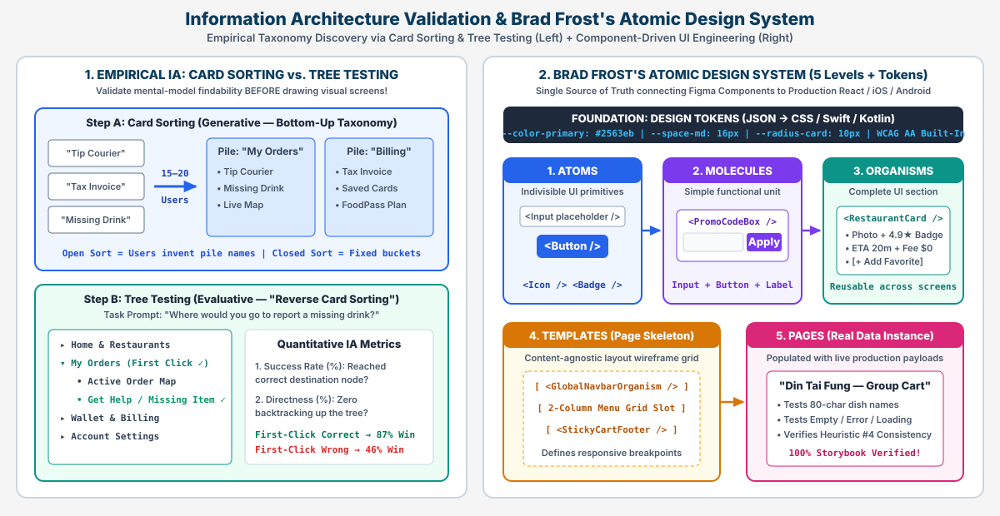

<!--
Examine this dual conceptual diagram illustrating Empirical IA Validation on the left and Brad Frost's Atomic Design System on the right!

In the left panel:
- **Step A (Card Sorting)** is generative and bottom-up: `15–20` users sort feature cards like `"Tip Courier"`, `"Tax Invoice"`, and `"Missing Drink"` into natural mental-model piles (`"My Orders"` vs. `"Billing"`).
- **Step B (Tree Testing)** is evaluative and top-down: we strip away all visual graphics and ask users to locate `"Missing Item"` inside a plain-text menu tree, measuring **Success Rate (%)** and **Directness (First-Click Accuracy)**. Notice the empirical rule: when a user's first click is right, `87%` succeed; when their first click is wrong, success drops to `46%`!

In the right panel:
- Trace the 5-level **Atomic Design Hierarchy** resting on **Design Tokens**: **1. Atoms** (`<Input>`, `<Button>`) combine into **2. Molecules** (`<PromoCodeBox>`), which assemble into **3. Organisms** (`<RestaurantCard>`), **4. Templates** (page wireframe grids), and **5. Pages** (live data instances verified in Storybook).

To summarize this slide, remember this key takeaway: Card Sorting and Tree Testing prevent developer-centric navigation trees, while Atomic Design enforces modular component reuse across design and code.
-->
---
## The Prototyping Fidelity Spectrum: Sketch → Wireframe → Prototype

> **Bill Buxton's Dual Mandate (*Sketching User Experiences*):** Early low-fidelity sketches focus on **"Getting the Right Design"** (exploring alternatives cheaply); late high-fidelity prototypes focus on **"Getting the Design Right"**.

### 1. Low & Mid-Fidelity Wireframes (`Cost: Minutes/Hours`)
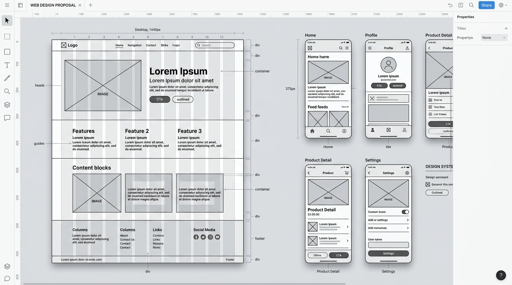

- **Purpose**: Divergent exploration, IA layout, and locking down the **4 Mandatory UI States** (`Empty`, `Loading`, `Ideal`, `Error`).
- **Sunk-Cost Immunity**: Nobody hesitates to critique or discard a 5-minute grayscale sketch!

### 2. High-Fidelity Interactive Prototypes (`Cost: Days`)
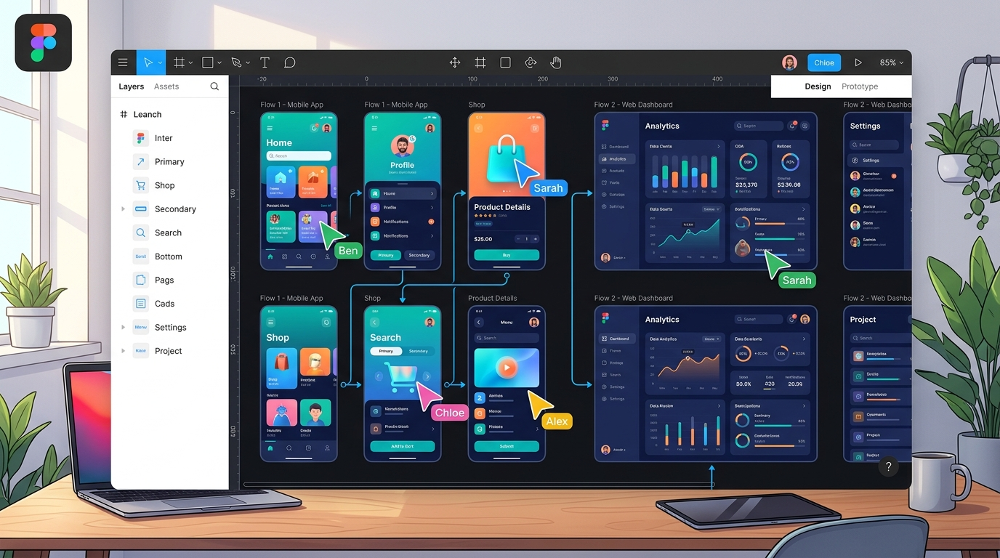

- **Purpose**: Realistic clickable Figma flows, Design Token contrast verification, summative usability testing, and exact developer handoff.
- **Risk if Used Too Early**: Premature pixel-polishing locks teams into a flawed workflow!

<!--
Compare the two ends of the **Prototyping Fidelity Spectrum** illustrated on this slide:

In the left card (**Low & Mid-Fidelity Wireframes**):
Why do experienced UX engineers always begin with paper sketches or grayscale wireframes?
First, **Sunk-Cost Immunity**: you can sketch 4 radically different checkout flows in 20 minutes and throw away 3 without regret.
Second, **Honest User Feedback**: when test participants see a rough grayscale wireframe, they critique the fundamental workflow; when they see a glossy, pixel-perfect screen, they hold back and only comment on colors!
Third, Mid-Fi wireframes force engineers to design all **4 Mandatory UI States**: `Empty State`, `Loading State`, `Ideal State`, and `Error State`.

In the right card (**High-Fidelity Interactive Prototypes**):
Once the workflow is validated, high-fidelity Figma prototypes apply real Design Tokens, food photography, and interactive transitions for realistic usability testing and developer handoff.

To summarize this slide, remember this key takeaway: Use low- and mid-fidelity wireframes to explore workflows and all 4 UI states cheaply, then advance to high-fidelity prototypes for interaction validation.
-->
---
### Peer Discussion 6.5: IA & Wireframe States for Group Ordering

  

  **UX Architecture Exercise: Designing the "Office Group Order" Flow (4 Mins)**
  - **Scenario:** You are designing the **Group Order (Shared Cart)** feature for our Food Delivery App based on the JTBD from Section 6.4 (*Host invites 4 colleagues via link; budget cap $25/person*).
  - **1. Information Architecture & Labeling:**
    - Where in the app's hierarchy should `"Start Group Order"` live so users find it on their **first click** (Restaurant Menu header vs. Account Settings vs. Checkout Screen)?
  - **2. Mid-Fidelity Wireframe & The 4 UI States:**
    - Specify the **Host's Shared Cart Wireframe**, explicitly addressing the **4 Mandatory UI States**:
      - **Empty State**: Host just created the link; 0 colleagues have joined yet. What signifiers/actions are shown?
      - **Loading / Active State**: 3 colleagues have added items; 1 colleague is still *"Choosing..."*.
      - **Error / Edge State**: A colleague adds a $32 item exceeding the $25 cap, OR walks away without clicking *"I'm Ready"*. How does the UI prevent the Host from getting stuck?

  

  

    
  

<!--
Let's take 4 minutes for Peer Discussion 6.5!

Imagine you are the UX Architect pairing with a Frontend Tech Lead to design the **Group Order (Shared Cart)** feature in our Food Delivery App.
Discuss two crucial architectural questions with your partner:
First, **Information Architecture & First-Click Findability**: If a user opens the app wanting to order lunch with 4 coworkers from a specific restaurant, where does their Mental Model expect to find the `"[+ Group Order]"` button?
Second, **Wireframing the 4 UI States**: Novice designers only draw the "Happy Path" (Ideal State). In real life, what should the wireframe show in the **Empty State** (0 friends joined), the **Partial Progress State** (3 ready, 1 still browsing), and the **Edge/Error State** (one coworker walked away from their desk—how can the Host proceed to checkout without losing everyone else's food)?

We will review the complete reference architecture in Appendix B!

To summarize this slide, remember this key takeaway: Robust interaction design requires placing features where mental models expect them and explicitly designing Empty, Loading, Partial, and Error states—not just the Happy Path.
-->
---
### Concept Check Question 4 (CCQ 4)
<!-- id: ase-ch06-ccq4 -->

  

Before designing any visual screens for a banking portal, a UX engineer presents 30 participants with a **plain-text collapsible menu hierarchy** (stripped of all graphics, colors, and page layouts) and asks: *"Where would you click to freeze a lost debit card?"* Which specific UX evaluation method is being conducted, and what does it measure?

- **A.** **Open Card Sorting**, which discovers how users invent new category names from unorganized feature cards.
- **B.** **Tree Testing**, which evaluates menu findability and first-click accuracy within an existing hierarchy.
- **C.** **A/B Split Testing**, which measures live production conversion rates between two visual button styles.
- **D.** **Atomic Design Auditing**, which verifies that UI molecules inherit CSS tokens from primitive atoms.

  

  

  

<!--
Let's check our understanding of Section 6.5 with Concept Check Question 4 (CCQ 4)!

Read the method description carefully: The UX engineer already has a proposed menu hierarchy, strips away all visual layout and styling to show *only* the text menu tree, and measures whether users can navigate the tree to find a specific target (`"Freeze a lost debit card"`).

Let's compare the options:
Option A (**Open Card Sorting**) is generative: you give users an unorganized deck of cards and ask them to group them into piles and invent category names.
Option B (**Tree Testing**, or Reverse Card Sorting) is evaluative: you give users a plain-text menu tree and measure **Success Rate** and **Directness (First-Click Accuracy)** to validate whether your Information Architecture labels and hierarchy are findable independent of visual layout!
Options C and D refer to live traffic experimentation and design system architecture, respectively.

Therefore, the correct answer is B!

To summarize this slide, remember this key takeaway: Tree Testing isolates the pure text hierarchy of an Information Architecture to measure first-click accuracy and findability before visual wireframing begins.
-->
---
<!-- _class: lead -->
<!-- header: '6.6 Nielsen 10 Usability Heuristics' -->

# **6.6 Analytical Evaluation: Nielsen's 10 Usability Heuristics**

> "Heuristic evaluation is a discount usability engineering method: 3 to 5 independent evaluators can identify 75% to 80% of major usability problems before a single user test is run."  
> — *Jakob Nielsen (1994)*

<!--
Welcome to Section 6.6: Analytical Evaluation and Jakob Nielsen's 10 Usability Heuristics.

In software engineering, before we run expensive integration tests in production, we perform **Static Code Analysis and Peer Code Reviews** to catch bugs early. In UX Engineering, the exact equivalent of a static code review is **Analytical Usability Inspection**—led by **Heuristic Evaluation** and **Cognitive Walkthroughs**.

In this section, we profile usability pioneer Jakob Nielsen, master the formal Heuristic Evaluation protocol, inspect all 10 Usability Heuristics with rich visual examples, and compare Heuristic Evaluation against Cognitive Walkthroughs.

To summarize this slide, remember this key takeaway: Heuristic Evaluation is the UX equivalent of static code inspection, systematically catching interface defects against 10 time-tested design principles.
-->
---
## Pioneers of Usability Engineering: Jakob Nielsen

- **Role & Distinctions:**
  - Co-founder, **Nielsen Norman Group (NN/g)** (with Don Norman); Former Sun Microsystems Distinguished Engineer; Ph.D. in HCI, Technical University of Denmark; **SIGCHI Lifetime Achievement Award**.
- **Champion of *"Discount Usability Engineering"* (1989–1994):**
  - Proved that software teams do not need million-dollar biometric labs to build usable software—combining **Simplified Thinking Aloud (`N = 5` users)**, **Paper Prototyping**, and **Heuristic Evaluation** delivers massive ROI rapidly.
- **Core Contributions to Software Engineering:**
  - Formulated the **10 Usability Heuristics (1994)**, **5 Quality Components of Usability**, **Jakob's Law**, **3 Response-Time Limits (`0.1s/1s/10s`)**, and **F-Pattern Eye-Tracking**.

Jakob Nielsen
<a href="https://en.wikipedia.org/wiki/Jakob_Nielsen_(usability_consultant)" target="_blank">Sun Microsystems / NN/g Co-Founder</a>

<!--
Meet the "King of Usability": Dr. Jakob Nielsen, co-founder of the Nielsen Norman Group (NN/g) alongside Don Norman.

In the late 1980s, many corporations refused to conduct usability testing because they believed it required 6-month studies with 100 participants in expensive one-way-mirror laboratories. Jakob Nielsen revolutionized the software industry by introducing **Discount Usability Engineering** (*Usability Engineering*, 1993):
He proved mathematically and empirically that 3 to 5 independent evaluators conducting a **Heuristic Evaluation**, paired with iterative rounds of **5-user Think-Aloud tests** on rapid prototypes, uncover ~80–85% of usability problems in days rather than months!

His **10 Usability Heuristics (1994)** remain the universal checklist taught in every computer science and UX engineering curriculum worldwide.

To summarize this slide, remember this key takeaway: Jakob Nielsen democratized usability engineering through his 10 Heuristics, the N=5 discovery model, and Discount Usability methods.
-->
---
## Heuristic Evaluation: Protocol, Evaluators & Severity Rating

> **Why Multiple Independent Evaluators? (Nielsen & Landauer, 1993):** A single evaluator finds only **`~35%`** of usability problems; aggregating **3 to 5 independent evaluators** uncovers **`75%–80%`** of issues!

### 1. The 4-Step Heuristic Evaluation Protocol
1. **Briefing & Task Scenarios**: Evaluators receive the target Persona, domain context, and core task flows to inspect.
2. **Independent Inspection (Crucial Rule!)**:
   - Each of the **3–5 evaluators** inspects the interface **alone** (Pass 1 for overall flow, Pass 2 auditing each screen against the 10 Heuristics) to prevent groupthink bias!
3. **Aggregation & Debriefing**: Combine duplicate findings into a master defect log, citing the specific **Heuristic (`#1–#10`)** violated.
4. **Severity Rating & Action Plan**: Score each defect (`0–4`) to prioritize engineering sprint fixes.

### 2. Nielsen's 0–4 Usability Severity Scale
- **Severity = f (`Frequency`, `Impact`, `Persistence`)**:
  - **`0` — Not a Problem**: Disagreement; no UX impact.
  - **`1` — Cosmetic Problem**: Fix only if extra time remains in the sprint (e.g., `2px` icon misalignment).
  - **`2` — Minor Usability Problem**: Low priority; causes brief hesitation but users recover quickly.
  - **`3` — Major Usability Problem**: High priority; causes significant confusion, delay, or repeated errors.
  - **`4` — Usability Catastrophe**: **Release Blocker (`P0`)!** Must be fixed before launch (causes data loss, double-charging, or task abandonment).

<!--
How is a formal **Heuristic Evaluation** conducted in software engineering teams?

Look at the left card: A critical procedural rule is that **each of the 3 to 5 evaluators must inspect the UI independently first** before meeting to compare notes! Why? Because if an outspoken lead developer speaks first in a group session, everyone else anchors on their opinion (**Groupthink**). Independent inspection ensures diverse coverage, catching 75% to 80% of all usability defects.

Look at the right card: Once defects are logged, Jakob Nielsen's **0-to-4 Severity Scale** prioritizes them using three factors—**Frequency** (how common?), **Impact** (how hard to overcome?), and **Persistence** (one-time annoyance vs. repeated trap?):
A **Level 4 Usability Catastrophe** is a `P0` release blocker, whereas a **Level 1 Cosmetic Problem** is deferred to polish sprints.

To summarize this slide, remember this key takeaway: Effective Heuristic Evaluation requires 3 to 5 independent inspections followed by collective severity ranking (0 to 4) to prioritize engineering fixes.
-->
---
## Nielsen's Heuristics #1 – #3: Status, Real World & User Control

* **#1 Visibility of System Status:**
  - Keep users informed of current state within reasonable latency (`100ms` button press, `1s` transition, `10s` `%` progress bar + live order steps).
* **#2 Match Between System & Real World:**
  - Speak the **user's language** and follow real-world spatial mappings (see the classic **Stove Burner Mapping** on the right!)—never leak SQL/RPC codes.
* **#3 User Control & Freedom:**
  - Always provide an **"Emergency Exit"** (`Undo`, `Redo`, `Cancel Order within 60s`, clear modal `×`) so users never feel trapped by an accidental click.

  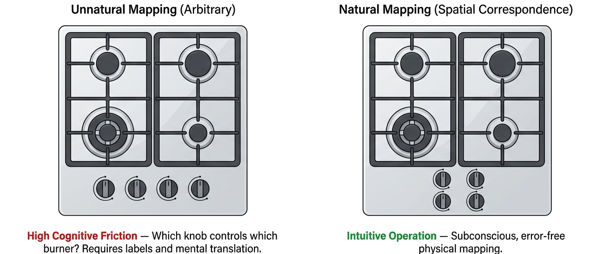

<!--
Let's examine Cluster 1 of Jakob Nielsen's 10 Usability Heuristics: **Heuristics #1, #2, and #3 (Transparency, Real-World Match, and User Agency)**:

1. **Heuristic #1 — Visibility of System Status**: Directly narrows Norman's Gulf of Evaluation. Whether it is a step progress bar (`Order Confirmed → Preparing → On the Way`) or an upload percentage indicator, never leave the user guessing whether the app is working or frozen!
2. **Heuristic #2 — Match Between System and the Real World**: Speak the user's natural language and honor real-world physical mappings. Look at the classic **Gas Stove Burner diagram on the right**: when four burners are arranged in a 2×2 square, but the four control knobs are arranged in a flat horizontal row, users constantly turn on the wrong burner! Staggering or arranging the knobs to match the 2×2 burner geometry eliminates the need for labels!
3. **Heuristic #3 — User Control and Freedom**: Always provide a safe, visible **Undo / Cancel** emergency exit. Let's inspect visual examples of Heuristic #1 on the next slide!

To summarize this slide, remember this key takeaway: Heuristics #1–#3 ensure users always see the current system state, benefit from natural real-world mappings, and possess a safe Undo/Cancel emergency exit.
-->
---
<!-- _class: title-image-slide -->

## Visual Examples: Heuristic #1 Visibility of System Status

  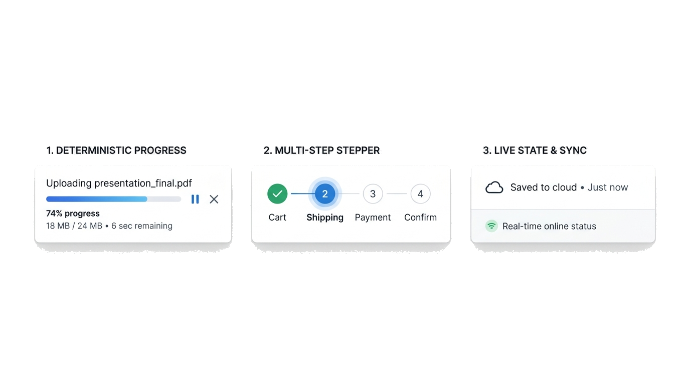

<!--
Examine these concrete visual examples of Heuristic #1 (**Visibility of System Status**):

Notice how different task durations require different visual status indicators:
- For instantaneous actions (`< 100 ms`), a tactile button press state, toggle switch animation, or badge count update immediately confirms receipt.
- For multi-second asynchronous operations (`1s–10s`), an indeterminate skeleton shimmer or spinner communicates that the request is actively processing.
- For long or multi-stage workflows (`> 10s` or multi-minute physical fulfillment like Food Delivery or file uploads), a deterministic step progress bar (`Order Received → Preparing → On the Way → Delivered`) with estimated time remaining eliminates uncertainty and prevents duplicate submissions!

To summarize this slide, remember this key takeaway: Matching status feedback granularity to operation duration keeps users informed and confident across every stage of execution.
-->
---
## Nielsen's Heuristics #4 – #7: Consistency, Errors, Memory & Speed

> **Cluster 2 (Cognitive Efficiency & Error Prevention):** Leverage conventions, prevent **Slips & Mistakes** before they happen, minimize memory load, and provide **Accelerators** for experts.

| Heuristic (`#4 – #7`) | Core Principle & Cognitive Rationale | Software UI Engineering Examples (`[Good]` vs. `[Violation]`) |
| :--- | :--- | :--- |
| **#4 Consistency & Standards** | Users should not have to wonder whether different words, situations, or actions mean the same thing (**Internal & External Consistency**). | **[Good]**: Using standard platform navigation and consistent button terminology (`"Place Order"` everywhere). **[Violation]**: Calling the cart `"Basket"` on screen 1, `"Tray"` on screen 2, and `"Bag"` on screen 3. |
| **#5 Error Prevention** | Better than a good error message is a **careful design that prevents a problem from occurring** in the first place (eliminate **Slips** & **Mistakes**). | **[Good]**: Graying out past calendar dates; Gmail warning *"You wrote 'attached' but attached no file."* **[Violation]**: Letting users type `"Feb 31"` in a plain text box and failing only after form submission. |
| **#6 Recognition Rather Than Recall** | Minimize user memory load by making **objects, actions, and options visible**; users should not have to remember info from one screen to another. | **[Good]**: Showing recent delivery addresses, dish thumbnails, and inline promo-code selector. **[Violation]**: Forcing users to memorize a 10-digit order ID from Page A to type into Support Page B. |
| **#7 Flexibility & Efficiency of Use** | Provide **Accelerators**—unseen by the novice user—that speed up interaction for the **expert user** (`Novice + Expert dual catering`). | **[Good]**: `"One-Tap Reorder Favorite"`, keyboard shortcuts (`Cmd+K` command palette), bulk actions. **[Violation]**: Forcing power-user cashiers through a 6-step novice wizard for every single order. |

<!--
Now let's examine Cluster 2: Heuristics #4, #5, #6, and #7, which govern **Cognitive Efficiency and Error Prevention**:

4. **Heuristic #4 — Consistency and Standards**: Encompasses both **Internal Consistency** (within your own product via an Atomic Design System) and **External Consistency** (following industry conventions per **Jakob's Law**).
5. **Heuristic #5 — Error Prevention**: Don Norman divides human errors into two types:
   - **Slips (Action Errors)**: The user has the *right intention*, but accidentally executes the wrong physical action (e.g., fat-fingering `"Delete"` next to `"Edit"`).
   - **Mistakes (Mental-Model Errors)**: The user forms the *wrong plan* because they misunderstood the system state. We prevent both via constraints, smart defaults, and high-stakes confirmation dialogs.
6. **Heuristic #6 — Recognition Rather Than Recall**: Keep options, recent searches, and context visible on screen!
7. **Heuristic #7 — Flexibility and Efficiency of Use**: Keep the default UI clean for novices, while embedding **Accelerators** (`Cmd+K`, swipe gestures, `"1-Click Reorder"`) for daily experts!

To summarize this slide, remember this key takeaway: Heuristics #4–#7 reduce cognitive friction through consistency, proactive constraint-based error prevention, visible context, and expert accelerators.
-->
---
## Nielsen's Heuristics #8 – #10 & Visual Error Handling

### 1. Heuristics #8, #9 & #10 (Signal & Recovery)
- **#8 Aesthetic & Minimalist Design (Signal-to-Noise)**:
  - Remove irrelevant marketing clutter that competes with core task controls (Edward Tufte's *Data-Ink Ratio*).
- **#9 Recognize, Diagnose & Recover from Errors**:
  - **3 Rules of Error Messages**: *(a)* Plain human language (no SQL/hex codes), *(b)* Precise diagnosis, *(c)* **Constructive recovery link/button** without wiping user input!
- **#10 Help & Documentation**:
  - Provide concise, contextual inline tooltips (`[?]`) and interactive onboarding spotlights focused on user tasks.

### 2. Visual Comparison: #5 Prevention vs. #9 Recovery
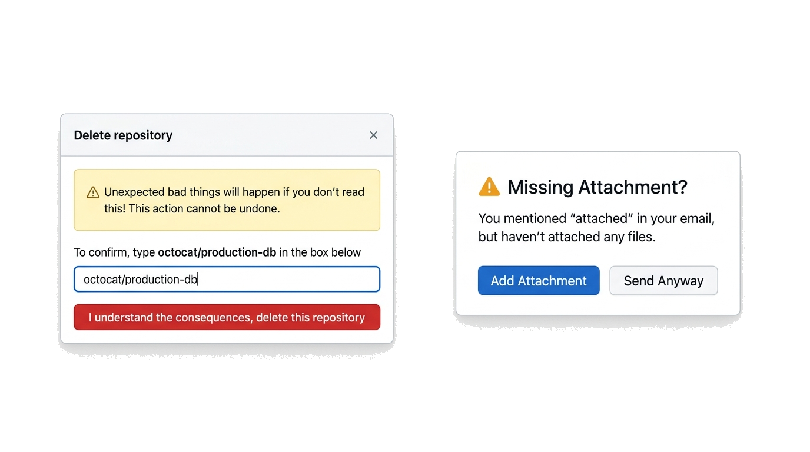
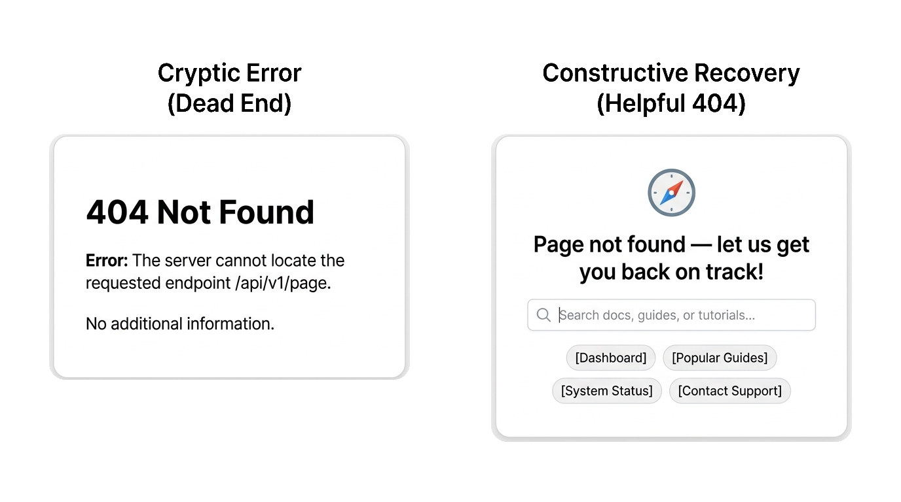

<!--
Now let's complete the 10 Heuristics with Cluster 3 (**Heuristics #8, #9, and #10**) on the left, paired with visual examples of Error Prevention (`#5`) and Error Recovery (`#9`) on the right!

Look at the left card:
8. **Heuristic #8 — Aesthetic and Minimalist Design**: Maximize the **Signal-to-Noise Ratio** so irrelevant badges and popups never drown out critical task controls.
9. **Heuristic #9 — Help Users Recognize, Diagnose, and Recover from Errors**: Whenever an error occurs, never show a raw error code (`Error 422`) or wipe out the user's form! Explain what went wrong in plain language and provide a one-click constructive recovery path.
10. **Heuristic #10 — Help and Documentation**: Deliver help right in context via inline `[?]` tooltips and empty-state guidance.

Look at the two visual examples in the right card:
- The top image illustrates **Heuristic #5 (Error Prevention)** for destructive actions—requiring specific confirmation (`"Delete 12 files"` rather than a generic `"OK"`) before irreversible data loss.
- The bottom image illustrates **Heuristic #9 (Error Recovery)**—turning a dead-end `404` error into a helpful search bar and quick navigation links!

To summarize this slide, remember this key takeaway: Heuristics #8–#10 keep interfaces focused on high-signal task information while providing actionable error recovery and contextual guidance.
-->
---
## Cognitive Walkthrough: Task-Focused Analytical Inspection

> **Complementing Heuristic Evaluation (Wharton, Rieman, Lewis & Polson, 1994):** While Heuristic Evaluation audits a UI broadly against 10 principles, a **Cognitive Walkthrough** steps through a specific **task action-by-action** to evaluate **first-time Learnability**.

### 1. The 4 Standard Questions Asked at Every Action Step
- For each micro-step `k` in a novice user's task sequence, evaluators ask **4 cognitive questions** (mapped to Norman's Action Cycle!):
  1. **Goal Formation**: Will the user realistically **try to achieve the right effect** at this step?
  2. **Visibility (Affordance)**: Will the user **notice that the correct UI control is available** on the screen?
  3. **Label Association (Signifier)**: Will the user **associate the control's label/icon with their intended goal**?
  4. **Feedback Evaluation**: After performing the action, will the user **see clear feedback confirming progress** toward their goal?

### 2. Heuristic Evaluation vs. Cognitive Walkthrough
| Comparison Dimension | Heuristic Evaluation | Cognitive Walkthrough |
| :--- | :--- | :--- |
| **Inspection Scope** | Holistic screen-by-screen audit against **10 Heuristics**. | Step-by-step trace of **specific task flows**. |
| **Primary Focus** | Overall usability (`#1–#10`), consistency & error handling. | **First-time Learnability** & exploratory discovery. |
| **Theoretical Root** | Empirical usability principles (Nielsen, 1994). | **CE+ Theory of Exploratory Learning** & Norman's Action Cycle. |
| **Output Artifact** | Defect log with **Heuristic ID & Severity (`0–4`)**. | Step failure trace (`Q1–Q4` breakdown per action). |

<!--
Along with Heuristic Evaluation, what is the second major **Analytical Inspection** method taught in academic HCI courses? The **Cognitive Walkthrough**, developed by Cathleen Wharton, John Rieman, Clayton Lewis, and Peter Polson (1994).

Look at the left card: Unlike Heuristic Evaluation (which evaluates whole screens against 10 broad rules), a **Cognitive Walkthrough** simulates a **first-time novice user** performing a concrete task step by step.
At every single click or tap in the ideal task path, the engineering team asks **4 strict questions**:
- **Q1 (Intent)**: Will the user even know they are supposed to do this step right now?
- **Q2 (Visibility)**: Is the button or control visible without hidden scrolling or hover traps?
- **Q3 (Signifier Match)**: Does the button's label match the words in the user's head so they know *this* is the button to click?
- **Q4 (Feedback)**: Once clicked, does the screen update clearly enough that the user knows they succeeded and moves to the next step?

To summarize this slide, remember this key takeaway: Cognitive Walkthroughs audit first-time task learnability by testing Goal Formation, Control Visibility, Label Association, and Feedback at every action step.
-->
---
### Concept Check Question 5 (CCQ 5)
<!-- id: ase-ch06-ccq5 -->

  

When a user attempts to register an account on a web portal, typing an already-registered email and clicking **"Submit"** clears the entire 12-field form and displays a banner reading: **`"SQLSTATE[23505]: Unique violation on key idx_users_email"`**. Which pair of **Jakob Nielsen's 10 Usability Heuristics** is most directly violated by this behavior?

- **A.** **#7 Flexibility and Efficiency of Use** and **#8 Aesthetic and Minimalist Design**.
- **B.** **#2 Match Between System and Real World** and **#9 Help Users Recognize, Diagnose, and Recover from Errors**.
- **C.** **#1 Visibility of System Status** and **#10 Help and Documentation**.
- **D.** **#4 Consistency and Standards** and **#6 Recognition Rather Than Recall**.

  

  

  

<!--
Let's check our mastery of Section 6.6 with Concept Check Question 5 (CCQ 5)!

Analyze what went wrong in this registration form:
First, instead of speaking the user's natural language (*"This email is already registered"*), the UI dumps a raw PostgreSQL database exception (`"SQLSTATE[23505]: Unique violation on key idx_users_email"`). Exposing internal database jargon directly violates **Heuristic #2: Match Between System and the Real World**!
Second, when the error occurs, the UI wipes out all 12 fields the user just typed and offers zero constructive recovery path (such as preserving their input and offering a *"Log in instead"* or *"Reset password"* link). That directly violates **Heuristic #9: Help Users Recognize, Diagnose, and Recover from Errors**!

Comparing the option pairs, Option B (`#2` and `#9`) is the exact match!

To summarize this slide, remember this key takeaway: Raw database exceptions and destructive form resets violate Heuristic #2 (Match Between System and Real World) and Heuristic #9 (Constructive Error Recovery).
-->
---
<!-- _class: lead -->
<!-- header: '6.7 Usability Testing, Metrics & Ethics' -->

# **6.7 Empirical Usability Testing, Metrics & Ethical UX**

> "Testing one user early in the project is better than testing 50 near the end."  
> — *Steve Krug (Rocket Surgery Made Easy)*

<!--
Welcome to Section 6.7: Empirical Usability Testing, Quantitative Metrics, and Ethical UX Engineering.

Analytical inspections like Heuristic Evaluation and Cognitive Walkthroughs are powerful, but they are still performed by experts—not by real end users. Even the most seasoned UX architect cannot predict every surprising way real humans will interpret an interface in the wild.

In this section, we profile Nobel and Turing Laureate Herbert A. Simon, master the Think-Aloud Protocol, visualize Jakob Nielsen's `N = 5` Poisson discovery curve and John Brooke's `0–100` SUS scale, and examine Ethical UX Engineering against **Dark Patterns**.

To summarize this slide, remember this key takeaway: Empirical usability testing validates software with real representative users, combining qualitative Think-Aloud insights with standardized quantitative metrics.
-->
---
## Pioneers of Cognitive Science & Think-Aloud: Herbert A. Simon

- **Role & Distinctions:**
  - Professor of Computer Science & Psychology, **Carnegie Mellon University (CMU)**; recipient of both the **1975 ACM Turing Award** and the **1978 Nobel Prize in Economics**.
- **Foundational Contributions to HCI & UX Engineering:**
  - **Bounded Rationality & *"Satisficing"*:** Proved that humans do not exhaustively scan every menu option for the mathematical optimum; they pick the **first reasonable option that seems "good enough"** (*explaining why users scan and click impulsively!*).
  - **The Attention Economy:** Formulated the law that information consumes human attention.
  - **The Think-Aloud Protocol (*Protocol Analysis*, with K. Anders Ericsson, 1984):** Established the rigorous cognitive methodology of having subjects verbalize Working Memory thoughts during problem-solving—now the **#1 usability testing method worldwide**.

Herbert A. Simon (1916–2001)
<a href="https://en.wikipedia.org/wiki/Herbert_A._Simon" target="_blank">CMU / Nobel &amp; ACM Turing Laureate</a>

<!--
Meet one of the towering intellects of the 20th century: Professor Herbert A. Simon of Carnegie Mellon University—the only person in history to win both the **ACM Turing Award (1975)** and the **Nobel Prize in Economics (1978)**!

Why is Herbert Simon so central to UX Engineering? Three reasons:
First, Simon coined **Bounded Rationality** and **Satisficing** (a blend of *satisfy* and *suffice*). Engineers often assume users carefully read every word on a screen before clicking. Simon proved that because cognitive effort is costly, humans *satisfice*: as soon as they spot a link that vaguely resembles their goal, they click it! (Steve Krug made this the cornerstone of *Don't Make Me Think*.)
Second, Simon identified the scarcity of human attention in an information-rich world.
Third, together with K. Anders Ericsson in *Protocol Analysis: Verbal Reports as Data (1984)*, Simon formalized the **Think-Aloud Protocol**—showing how concurrent verbalization reveals the contents of short-term Working Memory during task execution.

To summarize this slide, remember this key takeaway: Herbert A. Simon established Bounded Rationality (Satisficing), Attention Scarcity, and the scientific foundation of the Think-Aloud Protocol.
-->
---
## Formative vs. Summative Testing, Think-Aloud & Quantitative Metrics

> **Iterative Discovery (`N = 5`) + Psychometric Benchmarking (`SUS & HEART`):** Pair qualitative **Think-Aloud** observation during design with quantitative metrics at release.

### 1. Formative Think-Aloud (`N = 5` Poisson Model)
- **Formative (*"Find & Fix"* During Wireframing)**:
  - **Poisson Law (Nielsen & Landauer, 1993)**: `P = 1 − (1 − L)``n` (with `L ≈ 0.31`, **`n = 5` users uncovers `~85%`** of usability flaws!).
  - Run **3 iterative rounds × 5 users** (`v1 → fix → v2 → fix → v3`) rather than 1 giant round of 15 users!
- **3 Moderator Rules for Concurrent Think-Aloud**:
  1. Reassure: *"We are testing the software, never you."*
  2. Use **non-leading task scenarios** (never repeat the button's exact text label in your prompt!).
  3. Watch **actions** over polite verbal compliments.

### 2. Quantitative Metrics, SUS (`0–100`) & HEART
- **Behavioral Task Metrics (Summative `N = 20–30+`)**:
  - **Task Completion Rate (`%`)**, **Time-on-Task (`s`)**, **First-Click Accuracy (`%`)**, and **Lostness (`L > 0.5` = lost)**.
- **Standardized Psychometric Scales**:
  - **SEQ (Single Ease Question)**: `1–7` rating right after each task (benchmark `>= 5.5`).
  - **SUS (System Usability Scale — John Brooke, 1986)**: 10 items scored **`0–100`** (percentile rank: **`68` is 50th percentile average**; **`>= 80.3` is Grade A** / Top 10%).
- **Production Scale**: **A/B Testing** (with **Guardrail Metrics**) + **Google HEART** (`Happiness, Engagement, Adoption, Retention, Task Success`).

<!--
Let's synthesize the complete methodology of **Empirical Usability Testing and Quantitative Benchmarking**:

In the left card:
During **Formative Testing** on prototypes, Jakob Nielsen and Thomas Landauer's Poisson formula `P = 1 - (1 - L)^n` proves that testing **`n = 5` users** catches `~85%` of core usability flaws when average problem visibility `L = 0.31`. By running 3 iterative rounds of 5 users, you fix the obvious blockers in Round 1 and uncover deeper workflow issues in Rounds 2 and 3!

In the right card:
For **Summative Benchmarking** and production telemetry, we combine behavioral metrics (Task Completion %, Time-on-Task, Smith's Lostness `L`) with **John Brooke's System Usability Scale (SUS 0–100)** and **Google's HEART Framework**. Let's examine the visual diagram of the `N = 5` Poisson curve, the SUS grading scale, and Google HEART on the next slide!

To summarize this slide, remember this key takeaway: Iterative 5-user Think-Aloud testing uncovers ~85% of flaws qualitatively, while SUS (benchmark 68) and Google HEART quantify usability objectively.
-->
---
<!-- _class: title-image-slide -->

## Conceptual Diagram: Nielsen's N=5 Curve, SUS Scale & HEART

  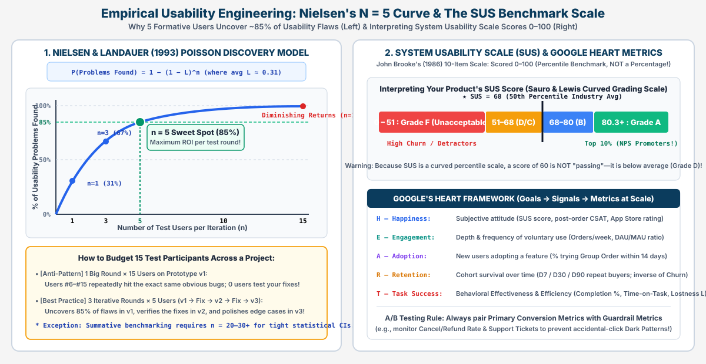

<!--
Examine this quantitative UX engineering diagram illustrating Nielsen's `N = 5` Poisson Discovery Curve on the left and the System Usability Scale (SUS) + Google HEART on the right!

In the left panel:
- Follow the blue curve `P = 1 - (1 - 0.31)^n`: `1` user finds `31%` of problems; `3` users find `67%`; and at **`n = 5` users (the green sweet spot), you uncover `85%`** of usability flaws! Beyond 5 users in a single unedited prototype round, diminishing returns set in rapidly.

In the right panel:
- At the top, inspect the **Sauro & Lewis Curved Grading Scale for SUS (`0–100`)**:
  - Remember that **SUS is NOT a percentage**! Because the 50th percentile historical industry average is **`SUS = 68`**, a score of `60` is actually a **Grade D**, and anything below `51` is a **Grade F (Unacceptable)**! To reach **Grade A (Top 10%, where users actively recommend your software)**, your product must achieve **`SUS >= 80.3`**.
- At the bottom, review **Google's HEART Framework** (`Happiness, Engagement, Adoption, Retention, Task Success`) and the golden rule of A/B Testing: always pair primary conversion metrics with **Guardrail Metrics**!

To summarize this slide, remember this key takeaway: Budget formative tests in iterative 5-user rounds, benchmark release usability against SUS = 68 (targeting 80.3+ for Grade A), and protect A/B tests with guardrail metrics.
-->
---
## Ethical UX Engineering: Dark Patterns vs. Transparent Design

* **What Are Dark Patterns? (Harry Brignull, 2010):**
  - Deceptive UI designs that exploit cognitive biases (**Default Bias, Sunk Cost, Visual Misdirection**) to trick users into unintended actions.
* **4 Classic Dark Patterns to Ban in Code Reviews:**
  - **1. Roach Motel**: 1-click sign-up, but canceling requires a phone call and 8 retention screens.
  - **2. Confirmshaming**: Guilt-tripping decline copy (*"No, I prefer wasting money"*).
  - **3. Sneak into Basket / Drip Pricing**: Pre-checked add-ons or hiding mandatory fees until the final step.
  - **4. Visual Misdirection**: Inverting button colors so users accidentally click `"Keep Subscription"`.
* **Legal Mandate**: Banned by **EU Digital Services Act (DSA Art. 25)**, **GDPR**, and **FTC Click-to-Cancel** rules!

  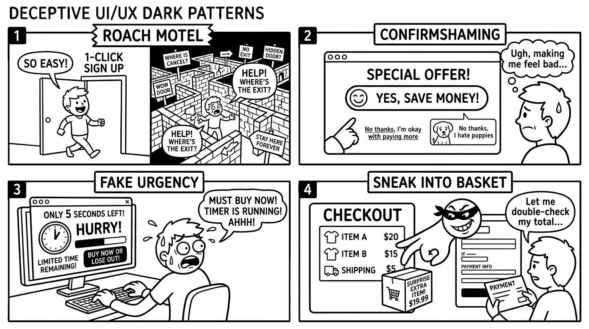

<!--
As software engineers and UX designers, our knowledge of cognitive psychology, Fitts's Law, and Gestalt hierarchy carries a serious ethical responsibility under the **ACM/IEEE Software Engineering Code of Ethics**.

In 2010, cognitive scientist **Harry Brignull** coined the term **Dark Patterns** (Deceptive Design) for interfaces engineered to trick users:
1. **Roach Motel**: Asymmetric friction—1 tap to subscribe, 8 hidden screens and a phone hotline to cancel.
2. **Confirmshaming**: Insulting the user on the decline button.
3. **Sneak into Basket & Drip Pricing**: Exploiting default bias via pre-checked boxes or hiding mandatory service fees until the user has already invested 10 minutes building their cart.
4. **Visual Misdirection**: Making `"Keep My Plan"` a giant bright button while disguising `"Confirm Cancel"` as tiny low-contrast text.

Today, Dark Patterns are not just unethical—they violate the **EU Digital Services Act (DSA)** and **FTC Click-to-Cancel regulations**, exposing companies to massive fines and immediate loss of user trust!

To summarize this slide, remember this key takeaway: Ethical UX engineering uses cognitive science to empower informed consent and symmetric control, never to trap users via Dark Patterns.
-->
---
### Peer Discussion 6.7: Designing a Usability Test Plan & Ethical Audit

  

  **Empirical UX Lab: Testing & Auditing "FoodPass" Subscription (4 Mins)**
  - **Scenario:** The business team wants to launch **FoodPass** (a $9.99/month free-delivery membership) inside our Food Delivery App.
  - **Part 1 — Formative & Summative Usability Test Plan:**
    - You have **2 weeks** before launch. How many participants (`N`) will you recruit for your **Formative Think-Aloud** wireframe rounds vs. your final **Summative Benchmark**?
    - Write **1 concrete, non-leading Task Scenario** (without using the exact button label `"Manage FoodPass"`) to test whether users can pause or cancel their membership, and list **2 Quantitative Metrics** you will record.
  - **Part 2 — Dark Pattern Ethical Audit:**
    - A PM proposes: *(a)* Pre-checking `"Add FoodPass ($9.99/mo)"` at checkout by default, and *(b)* Requiring users to go through 5 screens where `"Keep FoodPass"` is bright green and `"Cancel"` is a tiny gray link.
    - **Task:** Name the **2 Dark Patterns** present and rewrite the flow to achieve high ethical conversion without deception!

  

  

    
  

<!--
Let's take 4 minutes for Peer Discussion 6.7!

In this exercise, you are leading the UX Engineering release review for **FoodPass**, a $9.99/month membership program.
Work with your partner on two tasks:
In Part 1, design the **Usability Test Plan**:
- How do you apply Nielsen's `N = 5` rule across formative iterations vs. summative benchmarking?
- And how do you write a **non-leading Task Prompt** without giving away the exact label `"Manage FoodPass"`?
In Part 2, conduct a **Dark Pattern Audit** on the PM's proposal: identify the exact Dark Pattern names for `(a)` and `(b)`, and propose an ethical, transparent redesign.

Full reference solutions are in Appendix B!

To summarize this slide, remember this key takeaway: A rigorous usability test plan uses non-leading scenario prompts and objective metrics, while ethical design drives adoption through transparent value rather than Dark Patterns.
-->
---
<!-- _class: lead -->
<!-- header: '6.8 AI-Augmented UX & Synthesis' -->

# **6.8 AI-Augmented UX Engineering, Synthesis & References**

> "In the era of Generative AI, the paradigm shifts twice: we use AI to accelerate UX workflows (AI for UX), and we invent new interaction paradigms for probabilistic AI systems (UX for AI)."

<!--
Welcome to our final section, Section 6.8: AI-Augmented UX Engineering, Conceptual Synthesis, and References.

Today, Artificial Intelligence and Large Language Models (LLMs) are transforming User Experience along two distinct dimensions:
First, **AI for UX**: How UX researchers and UI engineers use generative AI as a copilot across the Double Diamond lifecycle.
Second, **UX for AI**: How we design trustworthy, controllable human-centered interfaces for AI-powered features that are inherently probabilistic, non-deterministic, and prone to hallucination!

Let's examine this dual paradigm with visual illustrations and then synthesize our entire curriculum.

To summarize this slide, remember this key takeaway: Modern software engineers must master both using AI to accelerate UX engineering (AI for UX) and designing safe, transparent interfaces for probabilistic AI agents (UX for AI).
-->
---
## The Dual Paradigm: "AI for UX" vs. "UX for AI" (Human-AI Interaction)

> **Deterministic GUI vs. Probabilistic AI:** Traditional GUIs are **100% deterministic** (`Click Button A → State B`); Generative AI interfaces are **probabilistic and fallible**, requiring **Human-Centered AI (HCAI)** patterns!

### 1. AI for UX (Copilot Across the HCD Lifecycle)

- **Research & Synthesis**: Clustering interview transcripts into **Affinity Diagrams** with verbatim quotes.
- **Prototyping & Pre-Audit**: Generating wireframe variants, domain microcopy, and running automated **WCAG / Heuristic pre-checks** (*never replacing real human testing!*).

### 2. UX for AI (Microsoft 18 HAI Guidelines, CHI '19)
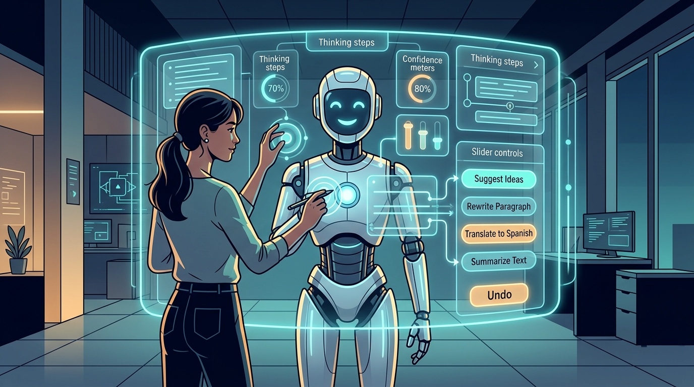

- **1. Hybrid Intent UI (Defeat Blank-Box Paralysis)**: Pair chat prompts with **clickable starter chips & GUI sliders** (Heuristic #6 Recognition over Recall).
- **2. Source Grounding & Streaming (`< 400ms`)**: Show provenance citations and confidence indicators.
- **3. Human-in-the-Loop Agency**: Require explicit **Diff Preview + One-Click Undo** before AI executes actions!

<!--
Let's unpack the visual contrast between **AI for UX** on the left and **UX for AI** on the right:

In the left card (**AI for UX**), Generative AI acts as a high-speed copilot across the Double Diamond: clustering interview transcripts into affinity themes, generating realistic domain copy and wireframe variations in seconds, and running automated WCAG and Heuristic pre-checks. Yet remember: **Synthetic LLM personas never replace observing real humans in the wild!**

In the right card (**UX for AI**), based on Saleema Amershi et al.'s landmark CHI 2019 paper (*Guidelines for Human-AI Interaction*) and Ben Shneiderman's *Human-Centered AI*:
1. **Defeat Blank-Canvas Paralysis**: A bare chat box has a wide Gulf of Execution! Pair natural-language prompts with clickable starter chips, scoped slash commands, and visual sliders.
2. **Stream Tokens & Ground Sources**: Stream first tokens under the `400ms` Doherty Threshold and show clickable citations so users can verify accuracy.
3. **Human-in-the-Loop Preview + Undo**: Never let a probabilistic AI agent execute destructive or financial actions without an explicit human **Preview Diff + Undo**!

To summarize this slide, remember this key takeaway: AI for UX accelerates research and prototyping, while UX for AI combines hybrid GUI-prompt controls, source grounding, and human-in-the-loop previews to tame probabilistic models.
-->
---
## 🧩 Conceptual Recap: Fill-in-the-Blank Quiz (Part 1)

  
🏷️ Word Bank:

  Gulf of Execution
  Gulf of Evaluation
  Fitts's Law
  Extraneous Cognitive Load

1. In Don Norman's 7 Stages of Action, the gap between a user's intention and the actions allowed by the interface (*"How do I work this?"*) is the [ _________ ].
2. When a user clicks a button and cannot tell whether the system registered the action due to missing status feedback, they face a wide [ _________ ].
3. In John Sweller's Cognitive Load Theory, unnecessary mental effort caused by cluttered layouts, inconsistent navigation, or cryptic jargon is called [ _________ ].
4. The logarithmic predictive model `MT = a + b · log``2``(D / W + 1)` governing pointing time as a function of target distance and size is [ _________ ].

💡 <em>Interactive Mode: Click any blank slot to reveal or hide the answer!</em>

<!--
Let's review the core cognitive and mathematical foundations from Part 1 of Chapter 6 using our interactive Fill-in-the-Blank Quiz (Part 1):

1. The gap between what the user wants to accomplish and figuring out how to operate the controls is Don Norman's **Gulf of Execution**!
2. The struggle to perceive and interpret whether the system state changed after acting is the **Gulf of Evaluation**!
3. Mental effort wasted decoding poor interface design—rather than inherent task complexity—is **Extraneous Cognitive Load**!
4. And the mathematical formula predicting motor target acquisition time from distance `D` and width `W` is **Fitts's Law**!

To summarize this slide, remember this key takeaway: Mastering the Two Gulfs, Cognitive Load Theory, and Fitts's Law provides a scientific foundation for diagnosing interaction bottlenecks.
-->
---
## 🧩 Conceptual Recap: Fill-in-the-Blank Quiz (Part 2)

  
🏷️ Word Bank:

  Tree Testing
  Recognition Rather Than Recall
  Think-Aloud Protocol
  Roach Motel

5. The empirical IA evaluation method ("reverse card sorting") that tests findability and first-click accuracy using a plain-text menu hierarchy is [ _________ ].
6. Showing recent delivery addresses and visual autocomplete suggestions instead of forcing users to memorize codes applies Nielsen's Heuristic #6: [ _________ ].
7. The formative usability testing method (Ericsson & Simon, 1984) in which participants continuously verbalize their thoughts while performing tasks is the [ _________ ].
8. A deceptive Dark Pattern that makes subscribing take 1 click while burying cancellation behind phone calls and 8 retention screens is a [ _________ ].

💡 <em>Interactive Mode: Click any blank slot to reveal or hide the answer!</em>

<!--
Now let's complete Part 2 of our interactive Fill-in-the-Blank Quiz covering Information Architecture, Heuristics, Usability Testing, and Ethics:

5. Testing findability on a stripped-down text hierarchy before designing screens is **Tree Testing**!
6. Making options and context visible on screen so users don't have to retrieve information from memory is Nielsen's Heuristic #6: **Recognition Rather Than Recall**!
7. Asking users to speak their thoughts out loud while completing tasks is Ericsson and Simon's **Think-Aloud Protocol**!
8. And an asymmetric deceptive flow that is trivial to enter but deliberately painful to exit is the **Roach Motel** Dark Pattern!

To summarize this slide, remember this key takeaway: Tree Testing, Recognition over Recall, Think-Aloud testing, and ethical anti-dark-pattern standards anchor professional UX engineering practice.
-->
---
## Core Curriculum Synthesis & Classic Academic Literature

| Section | Pioneer & Visual Concept Diagram | Golden UX Engineering Takeaway |
| :--- | :--- | :--- |
| **6.1 Foundations** | **Douglas Engelbart**; Garrett's 5 Planes & Morville Honeycomb SVG | UX is built bottom-up (`Strategy → Surface`); quantify Learnability, Efficiency, Memorability, Errors & Satisfaction. |
| **6.2 Cognition** | **Don Norman**; 7 Stages, 2 Gulfs, MHP & Cognitive Load SVGs | Narrow the **Gulfs of Execution & Evaluation**; align the **System Image** with the **User's Mental Model**; cut extraneous load. |
| **6.3 Laws & a11y** | **Ben Shneiderman**; Fitts's Law, Thumb Zones, Hick & Gestalt SVG | Maximize target `W`, minimize `D` & choice entropy `n`; absorb complexity in code; enforce `4.5:1` contrast & non-color cues. |
| **6.4 HCD Research** | Double Diamond, 2×2 Research Matrix & Journey Map SVGs | *"You are not the user!"* Triangulate behavioral & attitudinal research; trace Personas/JTBD/HTA directly to the **SRS**. |
| **6.5 IA & Prototyping** | Card Sorting, Tree Testing & Brad Frost Atomic Design SVG | Validate taxonomy findability first; sketch Lo-Fi to get the *right design*; scale UI via **Atoms → Organisms** & Tokens. |
| **6.6 Heuristics** | **Jakob Nielsen**; 10 Usability Heuristics (`0–4` Severity) & Stove Map | Run 3–5 independent inspections (`~80%` bug discovery); prevent Slips & Mistakes; audit novice steps via `Q1–Q4`. |
| **6.7 Testing & Ethics** | **Herbert A. Simon**; `N = 5` Poisson Curve, SUS `0–100` & HEART SVG | Test 5 users per round (**Think-Aloud**); benchmark via **SUS (`68` avg)**; reject **Roach Motel / Confirmshaming** Dark Patterns. |
| **6.8 AI & UX** | **AI for UX** vs. **UX for AI (Microsoft 18 HAI Guidelines)** | Pair natural language with GUI controls, ground sources, and require **Human-in-the-Loop Preview + Undo**. |

* **Essential References:** Don Norman (*The Design of Everyday Things*); Jakob Nielsen (*Usability Engineering*); Ben Shneiderman (*Designing the User Interface*); Herbert A. Simon & K. Anders Ericsson (*Protocol Analysis*); Steve Krug (*Don't Make Me Think*); ISO 9241-210 & W3C WCAG 2.2.

<!--
Review this comprehensive Chapter 6 Synthesis Matrix and reading list!

Notice how every single section connects pioneer scholarship, conceptual diagrams, and concrete software engineering practices:
From Douglas Engelbart and ISO usability standards (6.1) to Don Norman's cognitive psychology (6.2), Ben Shneiderman and mathematical interaction laws (6.3), empirical user research and Customer Journey Maps (6.4), Card Sorting, Tree Testing, and Brad Frost's Atomic Design (6.5), Jakob Nielsen's 10 Heuristics (6.6), Herbert A. Simon's Think-Aloud Protocol, SUS metrics, and ethical design (6.7), all the way to Human-AI Interaction (6.8).

To summarize this slide, remember this key takeaway: UX Engineering integrates cognitive science, mathematical laws, empirical research, and rigorous usability testing across the entire software lifecycle.
-->
---
<!-- header: '6.8 Appendix: Suggested Solutions' -->

## Appendix A: Suggested Answers for CCQ 1 – CCQ 5

| Question | Ans | Core UX / HCI Principle & Concise Engineering Rationale |
| :--- | :---: | :--- |
| **CCQ 1 (Sec 6.1)** *Usability Dimensions* | **B** | **Efficiency vs. Learnability (Nielsen's 5 Components)**: Novice interns learn in 10 mins (high *Learnability*), but requiring 14 clicks across 5 modals for experienced daily nurses bottlenecks expert task speed (**Efficiency**). |
| **CCQ 2 (Sec 6.2)** *Norman's Two Gulfs* | **C** | **Wide Gulf of Evaluation**: The engineer executed the click easily (narrow *Gulf of Execution*), but the lack of immediate visual feedback (`< 100ms` button state / `< 1s` spinner) prevented perceiving the new system state, causing duplicate clicks. |
| **CCQ 3 (Sec 6.3)** *Fitts's Law (`D` & `W`)* | **B** | **Infinite Target Width (`W = ∞`) at Screen Edges**: Under `MT = a + b · log2(D/W + 1)`, pinning global menus flush against screen edges/corners uses the display boundary to stop cursor overshoot, dramatically lowering the Index of Difficulty. |
| **CCQ 4 (Sec 6.5)** *IA Empirical Testing* | **B** | **Tree Testing (Reverse Card Sorting)**: Evaluates an existing text hierarchy stripped of visual layout to measure **Findability Success Rate (%)** and **First-Click Directness (%)** prior to wireframing. |
| **CCQ 5 (Sec 6.6)** *Nielsen's 10 Heuristics* | **B** | **#2 Match Real World & #9 Error Recovery**: Exposing raw SQL error codes (`SQLSTATE[23505]`) violates **#2** (system-oriented jargon); wiping out 12 user-typed fields with no constructive fix violates **#9** (and **#5 Error Prevention**). |

<!--
Appendix A provides the complete answer key and theoretical rationale for all five Concept Check Questions (CCQ 1 through CCQ 5) across Chapter 6.

Use this summary table when reviewing for quizzes and exams to verify your mastery of Nielsen's 5 Usability Components (6.1), Norman's Gulfs of Execution and Evaluation (6.2), Fitts's Law (6.3), Tree Testing vs. Card Sorting (6.5), and Nielsen's 10 Usability Heuristics (6.6).

To summarize this slide, remember this key takeaway: Every CCQ illustrates how theoretical HCI models diagnose concrete frontend engineering defects.
-->
---
## Appendix B: Suggested Solutions for Peer Discussions 6.3, 6.5 & 6.7

### 1. Solution — Peer Discussion 6.3 (Checkout Audit) & 6.5 (Group IA)
- **Peer Discussion 6.3 (4 Checkout Flaws & Fixes)**:
  1. **Fitts's Law + Heuristic #5**: Enlarge `"Place Order"` to full-width `52px` bottom bar (`↑ W`, `↓ D` in thumb zone); move `"Empty Cart"` into a top-right overflow menu with confirmation.
  2. **Hick-Hyman Law**: Replace 28 flat radio buttons with the user's **last-used payment method** as default + `3` top categories (`Card | Apple/Google Pay | Bank`).
  3. **Postel's & Tesler's Laws + Heuristic #9**: Auto-strip `-`/`()` spaces in JS; preserve all 8 address fields on validation error!
  4. **WCAG 2.2 Level AA (`1.4.1` & `1.4.3`)**: Increase contrast to `>= 4.5:1` (`#b91c1c` on `#fef2f2`) and add `[!] Required` icon + text below each missing field.
- **Peer Discussion 6.5 (Group Order IA & 4 States)**:
  - **IA Placement**: Place `"[+ Group Order]"` button directly in the **Restaurant Menu Header** (matches user mental model when browsing a restaurant).
  - **Edge State Override**: Show per-member status (`Adding...` vs. `Ready ✓`), auto-cap items at `$25` with inline split-pay option, and give Host a **"Lock Cart & Checkout Now"** override so 1 away coworker never blocks the order!

### 2. Solution — Peer Discussion 6.7 (Usability Test & Ethics)
- **Part 1 — Test Plan & Non-Leading Scenario**:
  - **Sample Plan**: Run **2 formative rounds × 5 users (`N = 10`)** using **Think-Aloud** on Figma prototypes to fix flows, then **1 summative round (`N = 25`)** to benchmark.
  - **Non-Leading Prompt**: *"Imagine you subscribed to FoodPass last month, but you are traveling abroad for 3 weeks and want to stop being billed next month. Show me what you would do."* (Never say the word `"Manage"` or `"Cancel"`!).
  - **Metrics**: **Task Completion Rate (%)**, **Time-on-Task (s)**, **First-Click Accuracy (%)**, and post-task **SEQ / SUS**.
- **Part 2 — Dark Pattern Audit & Ethical Redesign**:
  - **Violations**: `(a)` **Sneak into Basket** (pre-checked opt-out box); `(b)` **Roach Motel + Visual Misdirection** (5 retention screens with inverted button colors).
  - **Ethical Fix**: Show transparent math (*"Save $4.50 on this order with FoodPass — [Add Free Trial]"* explicit Opt-In) and provide a symmetric **1-Click Pause / Cancel** button in Account Settings!

<!--
Finally, Appendix B provides the complete reference solutions for all three hands-on Peer Discussions (6.3, 6.5, and 6.7), followed by our interactive Table of Contents and Quick-Jump scripts.

Thank you very much for your attention and active participation in Chapter 6: User Experience (UX) Engineering and Interaction Design!

To summarize this slide, remember this key takeaway: Applying quantitative UX laws, complete state wireframing, non-leading usability testing, and ethical transparency elevates software engineering from working code to empowering human experiences.
-->

