<!-- _class: lead -->
<!-- header: '' -->

# Software Engineering

### Chapter 7: Software Testing & Quality Verification

**Prof. Nien-Lin Hsueh**
Department of Information Engineering and Computer Science
Feng Chia University

<!--
Welcome to Chapter 7: Software Testing and Quality Verification.

In software engineering, writing code is only half the battle. Delivering a dependable, production-ready system requires rigorous, repeatable, and scientific verification techniques—spanning static code inspection, black-box specification testing, white-box structural and mutation analysis, and modular integration with test doubles.

💡 難字與專業術語解說：
- quality verification: 品質驗證（透過系統化檢視與測試確認軟體符合規格與品質標準的工程活動）
- static inspection: 靜態檢視（不執行程式碼，直接透過人工審查或語法樹分析找出潛在缺陷的技術）
- test double: 測試替身（在單元與整合測試中用以替代真實外部依賴的模擬物件總稱）
-->
---
<!-- _class: outline-slide -->
<!-- header: 'Chapter 7: Roadmap & Core Curriculum' -->

## Chapter 7: Roadmap & Core Curriculum

<div class="outline-columns">
  <div>
    <h3>Part 1: Foundations, Inspection & Black-Box</h3>
    <ul>
      <li><a href="#3"><b>7.1 Testing Foundations, Principles & Oracles:</b></a> ISTQB 7 principles, V&V, testing levels, testability, test pyramid, behavior Venn diagram, 3W2H landscape, Test Oracle problem, Metamorphic & Differential testing.</li>
      <li><a href="#33"><b>7.2 Static Software Inspection & Code Review:</b></a> Testing iceberg & IEEE 1028 review spectrum, Fagan 6-step process & 5 roles, full-lifecycle review targets (SRS, Design models, Code), automated static analysis & CI gates.</li>
      <li><a href="#38"><b>7.3 Black-Box Testing (BVA & EP):</b></a> Myers's philosophy, BVA formulas (4n+1, 6n+1, 5<sup>n</sup>, 7<sup>n</sup>), Triangle diversity deficit, Weak vs. Strong EP, Binary Search, NextDate December anomaly, Fault Masking, EP+BVA SOP.</li>
    </ul>
  </div>
  <div>
    <h3>Part 2: Combinatorial, White-Box & Integration</h3>
    <ul>
      <li><a href="#64"><b>7.4 Combinatorial, State & Property-Based Testing:</b></a> Pairwise (All-Pairs) & IPO greedy trace, AllPairs4J, State Transition testing, Property-Based Testing (jqwik & Shrinking), Metamorphic Relations (MR).</li>
      <li><a href="#86"><b>7.5 White-Box Coverage & Mutation Testing:</b></a> Spec-vs-Code 4 quadrants, SC/BC/CC, Short-Circuit & JaCoCo yellow diamond, MCC, Path explosion, Avionics MC/DC, 100% coverage myths, Mutation Testing (RIPR, Equivalent Mutants, PITest).</li>
      <li><a href="#107"><b>7.6 Integration Testing, Test Doubles & Mockito:</b></a> V-Model contract mismatch, Constructor DI, Bottom-Up (Drivers) vs. Top-Down (Stubs) vs. Sandwich, 5 Test Doubles, Mockito (mock, spy, verify), Brittle Tests.</li>
    </ul>
  </div>
</div>

<!--
Here is our comprehensive roadmap for Chapter 7, integrating the complete software quality and testing lifecycle.

In Part 1 (left column), we start with Section 7.1 on the ISTQB seven testing principles, multi-dimensional testing taxonomy, test case anatomy, and the Test Oracle problem in AI systems. In Section 7.2, we examine static software inspection, Fagan reviews, code smells, and OWASP security auditing. In Section 7.3, we master black-box Boundary Value Analysis and Equivalence Partitioning across classic case studies.

In Part 2 (right column), Section 7.4 covers Pairwise combinatorial testing, State Transition testing, and Property-Based / Metamorphic testing with jqwik. Section 7.5 opens the glass box for structural coverage up to avionics-grade MC/DC and Mutation Testing. Finally, Section 7.6 tackles Integration Testing strategies, Gerard Meszaros's five Test Doubles, and hands-on behavior verification with Mockito.

💡 難字與專業術語解說：
- combinatorial explosion: 組合爆炸（當輸入參數與取值增加時，測試組合數呈指數級暴增的現象）
- metamorphic relation (MR): 變質關係（在無標準答案系統中，輸入經特定變換後，前後兩次輸出間必須滿足的領域不變關係）
- mutation testing: 變異測試（故意在原始碼植入微小語法突變，用以檢驗測試套件是否具備足夠抓錯能力的技術）
-->
---
<!-- _class: lead -->
<!-- header: '7.1 Testing Foundations & Oracles' -->

# **7.1 Software Testing Foundations, Principles & Oracles**

> "Program testing can be used to show the presence of bugs, but never to show their absence! Testing is a risk-based empirical sampling science, not a blind infinite loop."
> — *Edsger W. Dijkstra & ISTQB CTFL v4.0*

<!--
We begin with Section 7.1: Software Testing Foundations, Principles, and Oracles (integrating SQA Sections 3.1, 3.2, 3.4, and 3.5).

Before writing a single JUnit assertion, every software engineer must understand the fundamental epistemology of testing. As Edsger Dijkstra famously stated, testing can prove that defects are present, but can never mathematically prove that a program is 100% defect-free.

💡 難字與專業術語解說：
- empirical sampling: 經驗取樣（基於實證與風險分析從龐大輸入空間中挑選代表性樣本的方法）
-->
---
## Overview: ISTQB 7 Core Software Testing Principles

<div class="card-deck">

> According to ISTQB CTFL v4.0 and Glenford Myers's *The Art of Software Testing*, mastering these seven principles prevents blind, wasteful testing.

<div class="two-columns">
<div class="card" data-marpit-fragment>

### Principles 1 to 3: Essence & Shift-Left Strategy
- **1. Testing Shows Presence of Defects:** Testing proves bugs exist, but even a million passing tests cannot prove "zero defects."
- **2. Exhaustive Testing is Impossible:** Combinatorial explosion makes testing all inputs impossible; testing must rely on **risk-based sampling**.
- **3. Early Testing (Shift-Left):** Static and dynamic verification must start during requirements and architecture (the `1:10:100` cost rule).

</div>
<div class="card" data-marpit-fragment>

### Principles 4 to 7: Defect Patterns & Fallacies
- **4. Defects Cluster Together:** The Pareto `80/20` rule—most severe bugs concentrate in a few highly complex, frequently modified modules.
- **5. Beware of the Pesticide Paradox:** Repeating the exact same test cases stops finding new bugs; test suites must continuously evolve.
- **6. Testing is Context Dependent:** Avionics flight control, financial ledgers, and agile web apps require radically different rigor.
- **7. Absence-of-Errors is a Fallacy:** A "zero-bug" system is still a total failure if it misses real customer needs or business regulations.

</div>
</div>
</div>

<!--
Let's survey the seven foundational principles codified by the International Software Testing Qualifications Board (ISTQB).

💡 難字與專業術語解說：
- Shift-Left testing: 測試左移（將檢視與測試活動從開發末期大幅提前至需求分析與架構設計階段）
- pesticide paradox: 殺蟲劑悖論（長期重複執行同一套測試案例將失去發現新缺陷的能力）
-->
---
<!-- _class: title-image-slide -->

## Visual Panorama: ISTQB 7 Software Testing Principles

<div class="image-wrapper">
  
</div>

<!--
This visual panorama summarizes the seven ISTQB principles side by side.

💡 難字與專業術語解說：
- quality assurance (QA): 軟體品質保證（確保軟體開發流程與最終產出物達到預期品質水準的系統化工程）
-->
---
## Principle 1: Testing Shows Presence of Defects, Not Absence

<div class="split64">
<div class="left">

* **Core Meaning (Dijkstra's 1970 Axiom):**
  - Testing proves that **defects are present**, but no matter how many thousands of tests pass, it **can never mathematically prove zero defects remain**.
  - Passing 1,000 unit tests only proves the system worked for those 1,000 specific input states and environment configurations.
* **True Engineering Objective of Testing:**
  - Falsification over verification: design **adversarial test cases** aimed at breaking assumptions, reducing residual production risk, and providing quantitative release confidence.
* **[AI Era Warning] The Fluency Bias Trap:**
  - AI-generated code looks syntactically clean and well-formatted, creating a dangerous illusion of correctness.
  - Yet LLM code frequently hides concurrency race conditions, memory leaks, or subtle off-by-one boundary bugs—green happy-path tests never guarantee defect-free code!

</div>
<div class="right">


</div>
</div>

<!--
Principle 1 directly reflects Dijkstra's axiom: testing shows the presence of defects, never their absence.

💡 難字與專業術語解說：
- fluency bias: 流暢性偏誤（因 AI 生成的文字或程式碼表面流暢工整，而誤以為其內部邏輯完全正確的認知偏誤）
-->
---
<!-- _class: title-image-slide -->

## Visual Illustration: Principle 1 — Presence of Defects

<div class="image-wrapper">
  
</div>

<!--
Sweeping one room with a flashlight and finding three bugs proves bugs exist in the house, but finding zero bugs in the living room never proves there aren't hundreds hiding behind the kitchen wall!

💡 難字與專業術語解說：
- latent defect: 潛伏缺陷（已存在於程式碼中，但尚未被特定輸入或環境狀態觸發顯現的隱藏錯誤）
-->
---
## Principle 2: Exhaustive Testing is Impossible

<div class="split64">
<div class="left">

* **The Reality of Combinatorial Explosion:**
  - A program with 100 boolean flags has 2<sup>100</sup> ≈ 1.27 × 10<sup>30</sup> states; even a 10-field checkout form with 10 choices each yields 10<sup>10</sup> combinations—impossible to exhaustively execute even at 10<sup>9</sup> tests/sec.
* **Bugs Lurk in Corners (Why Blind Random Testing Fails):**
  ```java
  int scale(int j) {
      j = j - 1; // Bug! Spec required: j = j + 1
      j = j / 3000;
      return j;
  }
  ```
  - Out of 65,536 16-bit integers, `j - 1` and `j + 1` after integer division `/ 3000` only differ at multiples of `3000` (just **18 corner values**)!
  - **Blind random hit probability** = `18 / 65536 ≈ 0.027%` → Engineering solution: replace brute force with **Equivalence Partitioning (EP), Boundary Value Analysis (BVA), and Pairwise sampling**!

</div>
<div class="right">


</div>
</div>

<!--
In `scale(int j)`, across 65,536 16-bit integers, only 18 corner inputs expose the `j - 1` vs `j + 1` bug—a random test has a mere 0.027% chance of catching it!

💡 難字與專業術語解說：
- integer truncation: 整數截斷（整數除法自動捨棄小數餘數，常導致非邊界區間的計算錯誤被掩蓋）
-->
---
## Principle 3: Early Testing / Shift-Left (1:10:100 Cost Rule)

<div class="split64">
<div class="left">

* **Core Meaning (Shift-Left Verification):**
  - Both static and dynamic verification must start at the <strong>earliest stages of the SDLC (Requirements & Architecture)</strong>—writing acceptance criteria and reviewing models before a single line of production code is written.
* **Economic Basis (Boehm's `1 : 10 : 100` Cost Escalation Rule):**
  - Catching a logical contradiction during SRS requirements review: **\$1** (edit one sentence in the specification).
  - Catching a bug during developer unit testing / TDD: **\$10** (rewrite local method & re-run CI).
  - Fixing a post-release production failure: **\$100 to \$1,000+** (emergency hotfix, DB migration, SLA penalties & customer churn)!
* **Practical Shift-Left Actions:**
  - Fagan SRS/Design inspections, Test-Driven Development (TDD), and automated static analysis / SAST gates in every pull request.

</div>
<div class="right">


</div>
</div>

<!--
Principle 3 is the economic foundation of Shift-Left testing: catching an ambiguous requirement during a specification review costs \$1, whereas fixing that same flaw in production costs \$100 to \$1,000+.

💡 難字與專業術語解說：
- cost escalation: 成本急遽攀升（缺陷越晚在開發生命週期中被發現，其修復與連帶賠償成本呈指數倍增）
-->
---
<!-- _class: title-image-slide -->

## The Economic Case for Shift-Left: Bug Fix Cost Curve

<div class="image-wrapper">
  
</div>

<!--
This curve illustrates why modern DevSecOps pipelines invest so heavily in static inspections, requirement reviews, and automated unit tests on the left side of the software development lifecycle.

💡 難字與專業術語解說：
- exponential growth curve: 指數成長曲線（隨著軟體進入整合、系統測試與正式營運，修復單一缺陷的成本呈倍數跳升）
-->
---
## Principle 4: Defects Cluster Together (80/20 Pareto Rule)

<div class="split64">
<div class="left">

* **Core Meaning (The 80/20 Pareto Distribution):**
  - Empirical studies (IBM, NASA, Microsoft) show that **~80% of production defects and crashes cluster inside ~20% of source modules**.
* **Why Do Defects Cluster in Hotspot Modules?**
  - High cyclomatic and cognitive complexity (`CC > 15`), legacy "God Classes," frequent requirement churn, shared mutable state, or fragile third-party integrations.
* **Risk-Based Resource Allocation:**
  - Never spread testing effort thinly and uniformly across trivial getter/setter classes!
  - Track **Git commit churn + historical bug density + complexity metrics** to identify hotspots, then focus **Fagan inspection, MC/DC, and PITest Mutation Testing** on those critical 20% modules!

</div>
<div class="right">


</div>
</div>

<!--
Principle 4 reminds us that defects never distribute uniformly: when you find ten bugs in one complex payment module, there are almost certainly twenty more hiding in that same module.

💡 難字與專業術語解說：
- defect hotspot: 缺陷熱區（高圈複雜度、頻繁修改且歷史錯誤密集的高風險程式碼模組）
-->
---
## Principle 5: Beware of the Pesticide Paradox

<div class="split64">
<div class="left">

* **Core Meaning (Boris Beizer's 1990 Metaphor):**
  - Spraying the exact same pesticide crop after crop leaves behind resistant super-pests; **running the exact same static test suite build after build stops uncovering new defects**.
  - Old tests remain valuable as a **regression safety net**, but their defect-discovery rate on evolved business logic drops toward zero.
* **Engineering Countermeasures:**
  - Periodically audit test efficacy with **Mutation Testing (PITest)**, retire redundant tests, and add **Property-Based Testing (`jqwik`)** to bombard code with fresh randomized inputs on every run.
* **[AI Era Warning] Self-Confirming False Green Lights:**
  - Asking the **same LLM context** to generate both production code and unit tests encodes the same hallucinated edge-case blind spots into the assertions—always use independent spec-driven oracles!

</div>
<div class="right">


</div>
</div>

<!--
Once developers fix the bugs caught by your initial test suite, that static suite becomes a regression safety net—it prevents old bugs from returning, but it cannot discover new bugs in untested gaps.

💡 難字與專業術語解說：
- self-confirming bias: 自我印證偏誤（由同一思維或同一 AI 上下文同時產出程式碼與測試，導致測試斷言完全順應錯誤實作）
-->
---
<!-- _class: title-image-slide -->

## Visual Illustration: Principle 5 — The Pesticide Paradox

<div class="image-wrapper">
  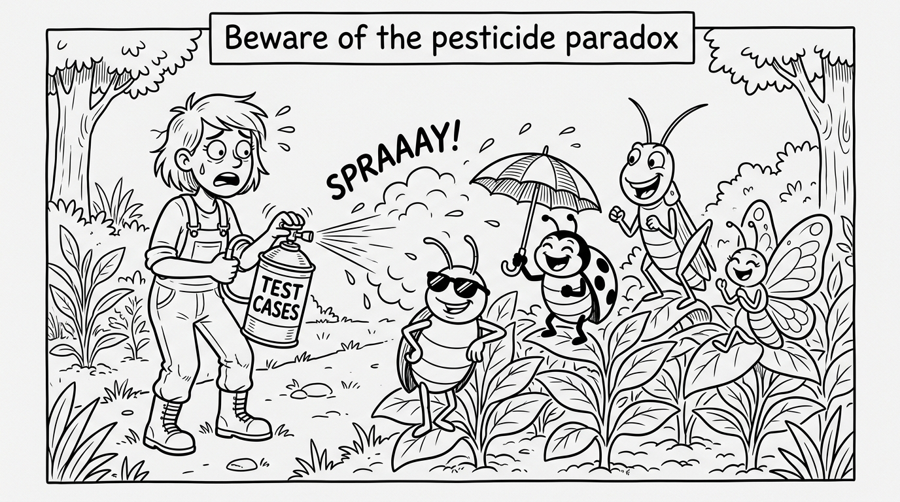
</div>

<!--
Bugs adapt around static, predictable traps. Evolving our test cases—and introducing generative property-based and mutation testing—keeps our verification sharp.

💡 難字與專業術語解說：
- test suite stagnation: 測試套件僵化（測試案例長期未隨業務與架構演進更新，導致抓錯能力退化）
-->
---
## Principle 6: Testing is Context Dependent & Principle 7: Absence-of-Errors Fallacy

<div class="split64">
<div class="left">

* **Principle 6 — Testing is Context Dependent:**
  - **Safety-Critical Avionics / Medical Devices:** Mandates DO-178C Level A, 100% MC/DC structural coverage, formal verification, and Hardware-in-the-Loop (HIL).
  - **Agile E-Commerce Web App:** Prioritizes fast CI/CD unit tests, API contract testing (Pact), high-concurrency load testing, and A/B usability experiments.
* **Principle 7 — Absence-of-Errors is a Fallacy:**
  - <strong>"Zero Bugs" ≠ "Successful System":</strong> Finding and fixing 100% of coding defects is useless if the software **fails to solve the customer's actual business problem** or violates domain regulations.
  - **[AI Era Warning]:** An LLM can generate code that compiles cleanly and passes 100% of unit tests, yet implements an outdated or illegal business formula!

</div>
<div class="right">

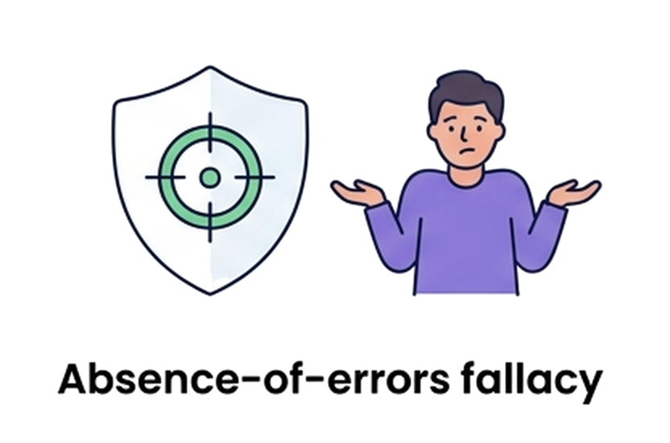

</div>
</div>

<!--
Principles 6 and 7 remind us to tailor testing rigor to domain risk and never confuse "zero technical crashes" with genuine customer value.

💡 難字與專業術語解說：
- absence-of-errors fallacy: 無錯謬誤（誤以為只要消除所有程式錯誤，軟體就必然能獲得使用者與商業成功）
-->
---
## Multi-Dimensional Taxonomy (1): Verification vs. Validation (V&V)

<div class="card-deck">

> Barry Boehm's classic distinction: Verification asks *"Are we building the product right?"* while Validation asks *"Are we building the right product?"*

<div class="two-columns">
<div class="card" data-marpit-fragment>

### Verification — Process & Spec Compliance
- **Core Question:** *"Are we building the product right?"*
- **Focus:** Confirms that software artifacts at each phase strictly conform to upstream specifications, architecture blueprints, and coding standards.
- **Techniques:** Static code reviews, formal inspections, static analysis (PMD / SonarQube), unit and integration testing.
- **Failure Mode:** Code passes 100% of unit tests against an outdated spec that no longer matches real clinical or business workflows.

</div>
<div class="card" data-marpit-fragment>

### Validation — Product & Value Alignment
- **Core Question:** *"Are we building the right product?"*
- **Focus:** Ensures the deployed software genuinely solves user pain points, fits operational environments, and delivers business value.
- **Techniques:** User Acceptance Testing (UAT), usability testing, beta field trials, and customer prototyping reviews.
- **Failure Mode:** Over-engineering a technically flawless product that users find unusable or irrelevant to their real tasks.

</div>
</div>
</div>

<!--
Verification checks conformance to specifications (*building the product right*), whereas Validation checks fitness for real human and business purpose (*building the right product*).

💡 難字與專業術語解說：
- conformance to specification: 符合規格性（軟體實作與需求規格書、介面契約的一致程度）
-->
---
<!-- _class: title-image-slide -->

## Visual Comparison: Verification vs. Validation (V&V)

<div class="image-wrapper">
  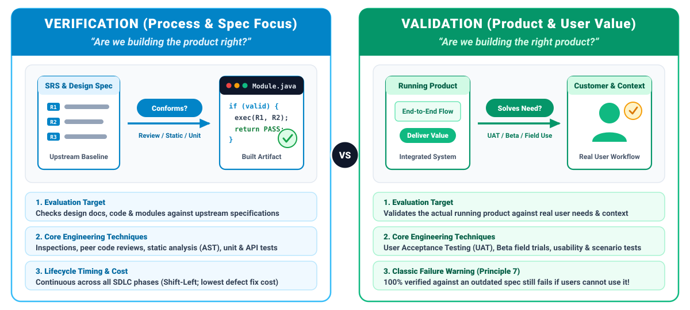
</div>

<!--
This diagram contrasts Verification (checking each artifact against its specification) with Validation (confirming the final product satisfies the user's true need).

💡 難字與專業術語解說：
- user acceptance testing (UAT): 使用者驗收測試（由最終客戶或領域專家在擬真環境下確認系統是否符合交付標準的測試）
-->
---
## Multi-Dimensional Taxonomy (2): Defect vs. Validation & Static vs. Dynamic

<div class="card-deck">

> Effective QA combines a constructive mindset (proving core workflows) with a destructive mindset (hunting latent faults), both statically and dynamically.

<div class="two-columns">
<div class="card" data-marpit-fragment>

### Defect Testing vs. Validation Testing
- **Validation Testing (Confirming Usage):**
  - Mindset: *"Demonstrate to the client that the system works."*
  - Executes normal business workflows (Happy Paths) to confirm expected functionality.
- **Defect Testing (Destructive Hunting):**
  - Mindset: *"Break the system to expose hidden vulnerabilities."*
  - Bombards boundaries, injects malformed payloads, and forces anomalous state transitions.

</div>
<div class="card" data-marpit-fragment>

### Static Testing vs. Dynamic Testing
- **Static Testing (Without Executing Code):**
  - Inspects requirements, design models, and source code via peer reviews and AST static analyzers.
  - Directly pinpoints root **Faults / Bugs** inside artifacts at low cost.
- **Dynamic Testing (Executing the Program):**
  - Runs the compiled binary with concrete test data and compares actual outputs against expected Oracles to observe runtime **Failures**.

</div>
</div>
</div>

<!--
Validation Testing walks the happy path to show the system works, while Defect Testing adopts an adversarial mindset to break the system at its corners. Static Testing finds Faults without executing code; Dynamic Testing runs code to observe Failures.

💡 難字與專業術語解說：
- fault vs. failure: 缺陷 (Fault/Bug) vs. 失效 (Failure)（靜態存在於程式碼中的邏輯錯誤稱為 Fault；程式執行時被觸發而外顯的異常結果稱為 Failure）
-->
---
<!-- _class: title-image-slide -->

## Multi-Dimensional Taxonomy (3): Black-Box vs. White-Box Testing

<div class="image-wrapper">
  
</div>

<!--
Black-Box Functional Testing derives test cases purely from external specifications, whereas White-Box Structural Testing inspects the internal control flow graph, branches, and bytecode paths.

💡 難字與專業術語解說：
- opaque box vs. glass box: 不透明黑盒 vs. 透明玻璃盒（對內部實作完全封裝隔離 vs. 針對內部邏輯分支透明檢視）
-->
---
## Multi-Dimensional Taxonomy (4): Three Core Testing Levels

<div class="card-deck">

> Software testing scales across three levels of granularity—and high **Testability** requires decoupling pure computation from UI and external I/O.

<div class="two-columns">
<div class="card" data-marpit-fragment>

### Three Core Testing Levels
- **1. Unit Testing (Component / Class Level):**
  - Verifies a single method or class in strict isolation from external I/O; executes in milliseconds.
- **2. Integration Testing (Interface & Contract Level):**
  - Verifies interface contracts, data serialization, and interaction protocols across modules or databases.
- **3. System Testing (End-to-End Environment Level):**
  - Verifies complete E2E user journeys and non-functional quality (load, stress, security) in staging.

</div>
<div class="card" data-marpit-fragment>

### Design for Testability (Decoupling Logic from I/O)
- Separate core business computation from UI prompts and external I/O so unit tests run automatically in CI:
```java
// Low Testability: Tightly coupled to interactive UI (Blocks CI!)
double divBad(double x, double y) {
    while (y == 0) y = uiPrompt("Divisor != 0:");
    return x / y;
}

// High Testability: Pure function + explicit exception contract
double divGood(double x, double y) {
    if (y == 0) throw new IllegalArgumentException("Divisor == 0");
    return x / y; // Verified in < 1ms via assertThrows!
}
```

</div>
</div>
</div>

<!--
Testing progresses across three distinct levels of granularity: Unit Testing, Integration Testing, and System Testing.

💡 難字與專業術語解說：
- granularity of testing: 測試粒度（從單一函式方法、跨模組介面到全系統端到端的檢驗範圍層次）
-->
---
<!-- _class: title-image-slide -->

## Hierarchy of the Three Core Testing Levels

<div class="image-wrapper">
  
</div>

<!--
Dozens of isolated unit tests form the foundation for component and integration testing, culminating in full system and acceptance verification.

💡 難字與專業術語解說：
- test hierarchy: 測試層級體系（由底層單元測試逐層向上組裝至整合測試、系統測試與驗收測試的結構）
-->

---
## Test Case Design: Venn Diagram of Specified, Programmed & Verified Behavior

<div class="card-deck">

> High-assurance software strives to align <strong>Specification (S)</strong>, <strong>Implementation (P)</strong>, and <strong>Test Suite (T)</strong> into maximum overlap.

<div class="two-columns">
<div class="card" data-marpit-fragment>

### Three Core Behavioral Sets
- **Specified Behavior (S):**
  - Functional requirements and constraints explicitly promised in the SRS.
- **Programmed Behavior (P):**
  - What the developer actually coded into the executable binary.
- **Verified Behavior (T):**
  - What the automated and manual test cases actually exercise and assert.

</div>
<div class="card" data-marpit-fragment>

### Critical Intersection Regions
- **Region 1 (S ∩ P ∩ T, Golden Core):** Specified, implemented, and verified!
- **Region 2 (S \ P, Missing Implementation):** Promised in the spec, but the developer forgot to code it.
- **Region 3 (P ∩ T \ S, Gold-Plating):** Unrequested feature coded and tested without spec approval.
- **Region 6 (P \ (S ∪ T), Highest Danger!):** **Undocumented AND untested code**—trojan backdoors, ghost logic, or latent time-bombs!

</div>
</div>
</div>

<!--
Pay special attention to Region 6: behavior that exists inside the compiled program P, but was never requested in Specification S AND is never touched by Test Suite T.

💡 難字與專業術語解說：
- ghost logic / backdoor: 幽靈邏輯／後門（存在於程式碼中但未載明於規格且未受測試監控的隱蔽行為）
-->
---
<!-- _class: title-image-slide -->

## Visual Model: The Software Behavior Venn Diagram (S, P, T)

<div class="image-wrapper">
  
</div>

<!--
Our goal as software engineers is to expand Region 1 (the central intersection) while driving Regions 2, 4, and especially Region 6 down to zero.

💡 難字與專業術語解說：
- set difference: 差集（例如 S \ P 代表規格有定義但程式未實作的遺漏需求集合）
-->
---
## Test Case vs. Test Data & The 5 Core Components of a Test Case

<div class="card-deck">

> "A **Test Case** is the architectural soul of verification logic; **Test Data** is merely the concrete value tuple substituted at runtime."

<div class="two-columns">
<div class="card" data-marpit-fragment>

### Test Case vs. Test Data
- **Test Case (Logical Specification):**
  - Defines *what scenario* to verify (e.g., *"Verify division throws an exception when divisor is zero"*), independent of specific numbers.
- **Test Data (Concrete Instances):**
  - The concrete parameter tuples `(5, 0)`, `(-99, 0)`, mock fixtures, or DB seeds fed into a parameterized test (`@ParameterizedTest`).

</div>
<div class="card" data-marpit-fragment>

### 5 Standard Test Case Components
1. **Test ID & Objective:** Unique traceable ID (e.g., `TC-AUTH-001`) and verification purpose.
2. **Preconditions:** Required initial state, auth tokens, and database fixtures (`Arrange`).
3. **Test Inputs:** Concrete parameters, API payloads, or user events (`Act`).
4. **Expected Oracle:** Expected return value, HTTP status, or exception (`Assert`).
5. **Postconditions:** State invariant check and environment cleanup (`Teardown`).

</div>
</div>
</div>

<!--
A Test Case is a complete logical specification comprising five essential components, whereas Test Data refers to the concrete input tuples substituted at runtime.

💡 難字與專業術語解說：
- test fixture: 測試固具／前置環境（為讓測試能穩定重複執行所預先準備的物件狀態、設定或資料庫初始資料）
-->
---
<!-- _class: title-image-slide -->

## Mindmap: Test Case vs. Test Data Structure

<div class="image-wrapper">
  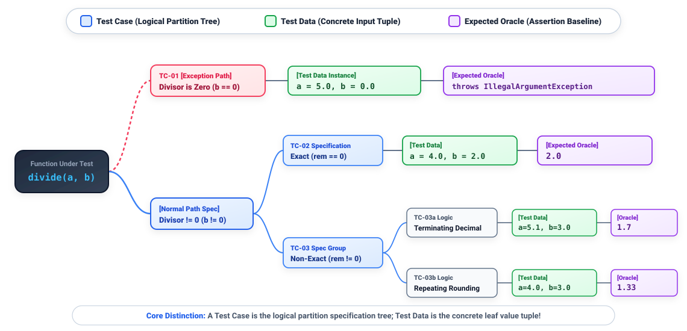
</div>

<!--
Using `divide(a, b)` as an example, Test Cases branch by logical partitions while leaf nodes hold concrete Test Data tuples.

💡 難字與專業術語解說：
- parameterized execution: 參數化執行（以同一套測試邏輯骨架自動巡迴注入多組測試資料的機制）
-->

---
<!-- _class: full-image-slide -->

<div class="mm-3w2h-stage" id="mm-3w2h-root">
<div class="mm-root-col">
<div class="mm-root-card">
<div class="mm-root-badge">3W2H TAXONOMY</div>
<div class="mm-root-title">Software Testing Landscape</div>
<div class="mm-root-sub">5 Core Dimensions of Quality Verification</div>
<div class="mm-root-actions">
<button type="button" class="mm-action-btn" id="mm-btn-toggle-all">➕ Expand All</button>
<button type="button" class="mm-action-btn mm-btn-secondary" id="mm-btn-step" title="Shortcut: Press 'n' key">▶ Next Branch (1/5) [n]</button>
</div>
</div>
</div>
<svg class="mm-fan-svg" viewBox="0 0 48 620" preserveAspectRatio="none">
<path d="M 0 310 C 24 310, 20 55, 48 55" fill="none" stroke="#3b82f6" stroke-width="2.8" />
<path d="M 0 310 C 22 310, 22 182, 48 182" fill="none" stroke="#10b981" stroke-width="2.8" />
<path d="M 0 310 L 48 310" fill="none" stroke="#f59e0b" stroke-width="2.8" />
<path d="M 0 310 C 22 310, 22 438, 48 438" fill="none" stroke="#8b5cf6" stroke-width="2.8" />
<path d="M 0 310 C 24 310, 20 565, 48 565" fill="none" stroke="#f43f5e" stroke-width="2.8" />
</svg>
<div class="mm-branches-col">
<div class="mm-branch-row mm-b1 is-collapsed" data-branch-idx="0">
<div class="mm-dim-node" title="Click to expand / collapse">
<div class="mm-dim-header">
<span class="mm-dim-tag">DIMENSION 1</span>
<span class="mm-toggle-pill">+</span>
</div>
<div class="mm-dim-title">1. WHO Tests?</div>
<div class="mm-dim-sub">Roles, Independence &amp; Alpha/Beta</div>
</div>
<div class="mm-leaf-bridge"></div>
<div class="mm-leaves-grid">
<div class="mm-leaf-card">
<div class="mm-leaf-title">Developers</div>
<div class="mm-leaf-desc"><strong>Unit testing &amp; TDD</strong>; white-box branch &amp; contract defense at coding time.</div>
</div>
<div class="mm-leaf-card">
<div class="mm-leaf-title">Peers &amp; Dedicated QA</div>
<div class="mm-leaf-desc">Code inspection, CI automation, load testing &amp; <strong>Alpha Testing</strong> (in-house staging).</div>
</div>
<div class="mm-leaf-card">
<div class="mm-leaf-title">Domain Experts &amp; Users</div>
<div class="mm-leaf-desc">Business <strong>UAT</strong> by Product Owners &amp; <strong>Beta Testing</strong> by customers in the wild.</div>
</div>
</div>
</div>
<div class="mm-branch-row mm-b2 is-collapsed" data-branch-idx="1">
<div class="mm-dim-node" title="Click to expand / collapse">
<div class="mm-dim-header">
<span class="mm-dim-tag">DIMENSION 2</span>
<span class="mm-toggle-pill">+</span>
</div>
<div class="mm-dim-title">2. WHAT is Tested?</div>
<div class="mm-dim-sub">Functional, Structural &amp; Quality</div>
</div>
<div class="mm-leaf-bridge"></div>
<div class="mm-leaves-grid">
<div class="mm-leaf-card">
<div class="mm-leaf-title">Functional Logic (Black-Box)</div>
<div class="mm-leaf-desc">SRS business rules, <strong>EP partitions</strong>, <strong>BVA boundaries</strong> &amp; decision tables.</div>
</div>
<div class="mm-leaf-card">
<div class="mm-leaf-title">Structural Paths (White-Box)</div>
<div class="mm-leaf-desc">Internal CFG <strong>Statement (SC)</strong>, <strong>Branch (BC)</strong>, Path &amp; avionics <strong>MC/DC</strong> coverage.</div>
</div>
<div class="mm-leaf-card">
<div class="mm-leaf-title">Scenario &amp; Non-Functional</div>
<div class="mm-leaf-desc">End-to-end user journeys, concurrency load/stress &amp; <strong>OWASP security</strong> gates.</div>
</div>
</div>
</div>
<div class="mm-branch-row mm-b3 is-collapsed" data-branch-idx="2">
<div class="mm-dim-node" title="Click to expand / collapse">
<div class="mm-dim-header">
<span class="mm-dim-tag">DIMENSION 3</span>
<span class="mm-toggle-pill">+</span>
</div>
<div class="mm-dim-title">3. WHY Test?</div>
<div class="mm-dim-sub">Risk, Contracts &amp; CI Confidence</div>
</div>
<div class="mm-leaf-bridge"></div>
<div class="mm-leaves-grid">
<div class="mm-leaf-card">
<div class="mm-leaf-title">Risk Mitigation</div>
<div class="mm-leaf-desc">Drastically reduce production failure probability and business blast radius.</div>
</div>
<div class="mm-leaf-card">
<div class="mm-leaf-title">Contract &amp; Invariant Defense</div>
<div class="mm-leaf-desc">Enforce Design-by-Contract (DbC) preconditions, postconditions &amp; invariants.</div>
</div>
<div class="mm-leaf-card">
<div class="mm-leaf-title">Regression Safety Net</div>
<div class="mm-leaf-desc">Guarantee new refactoring or commits never break existing production features.</div>
</div>
</div>
</div>
<div class="mm-branch-row mm-b4 is-collapsed" data-branch-idx="3">
<div class="mm-dim-node" title="Click to expand / collapse">
<div class="mm-dim-header">
<span class="mm-dim-tag">DIMENSION 4</span>
<span class="mm-toggle-pill">+</span>
</div>
<div class="mm-dim-title">4. HOW to Execute?</div>
<div class="mm-dim-sub">Scripted, Exploratory &amp; Fuzzing</div>
</div>
<div class="mm-leaf-bridge"></div>
<div class="mm-leaves-grid">
<div class="mm-leaf-card">
<div class="mm-leaf-title">Scripted CI/CD Automation</div>
<div class="mm-leaf-desc">Deterministic <strong>JUnit 5 / Playwright</strong> test suites executed on every Git push.</div>
</div>
<div class="mm-leaf-card">
<div class="mm-leaf-title">Exploratory Testing</div>
<div class="mm-leaf-desc">Simultaneous learning, test design &amp; adversarial probing by domain experts.</div>
</div>
<div class="mm-leaf-card">
<div class="mm-leaf-title">Fuzzing &amp; Record/Replay</div>
<div class="mm-leaf-desc">Random/mutated payload bombardment &amp; capturing real UI interaction traces.</div>
</div>
</div>
</div>
<div class="mm-branch-row mm-b5 is-collapsed" data-branch-idx="4">
<div class="mm-dim-node" title="Click to expand / collapse">
<div class="mm-dim-header">
<span class="mm-dim-tag">DIMENSION 5</span>
<span class="mm-toggle-pill">+</span>
</div>
<div class="mm-dim-title">5. HOW to Evaluate?</div>
<div class="mm-dim-sub">Test Oracles &amp; Coverage Metrics</div>
</div>
<div class="mm-leaf-bridge"></div>
<div class="mm-leaves-grid">
<div class="mm-leaf-card">
<div class="mm-leaf-title">Test Oracle Comparator</div>
<div class="mm-leaf-desc">Compares Program Under Test (<code>Actual y</code>) against Oracle (<code>Expected y*</code>).</div>
</div>
<div class="mm-leaf-card">
<div class="mm-leaf-title">The Test Oracle Problem</div>
<div class="mm-leaf-desc">Generative AI, search engines &amp; complex simulations lack a single exact answer.</div>
</div>
<div class="mm-leaf-card">
<div class="mm-leaf-title">Next-Gen AI/MT Oracles</div>
<div class="mm-leaf-desc">Solved via <strong>Metamorphic Relations (MR)</strong>, <strong>Differential Testing</strong> &amp; <strong>LLM Judge</strong>.</div>
</div>
</div>
</div>
</div>
</div>

<!--
In SQA Section 3.5, we organize the entire software testing universe through this interactive 3W2H Mind Map:
1. **Who Tests?** Developers (Unit/TDD), Peers & Dedicated QA (Inspection, CI, in-house Alpha testing), and Domain Experts/Customers (UAT & real-world Beta testing).
2. **What is Tested?** Functional logic, structural white-box code paths, end-to-end scenarios, and non-functional quality attributes.
3. **Why Do We Test?** Risk mitigation, contract/invariant defense, and continuous regression safety in CI/CD.
4. **How Do We Execute?** Scripted CI/CD automation, exploratory probing, random monkey fuzzing, and Record-and-Replay workflows.
5. **How Do We Evaluate?** Test Oracles (comparing actual vs. expected outcomes) and structural/mutation coverage metrics.

💡 難字與專業術語解說：
- 3W2H testing taxonomy: 3W2H 測試全景分類法（從 Who、What、Why、How 與 How to Evaluate 五大維度剖析測試體系）
- Alpha vs. Beta testing: Alpha 內部測試 vs. Beta 外部公測（在內部受控環境進行的測試 vs. 釋出予外部真實使用者在真實環境進行的公測）
- Record & Replay testing: 錄製與回放測試（記錄使用者在介面上的真實點擊與輸入軌跡，自動轉化為可重複執行之自動化測試腳本的技術）
-->
---
<!-- _class: title-image-slide -->

## 3W2H Deep Dive: Who Tests (Dim 1) & How to Execute (Dim 4)

<div class="image-wrapper">
  
</div>

<!--
This 6-card architectural comparison zooms in on Dimension 1 (Who Tests?) and Dimension 4 (How to Execute?) from the 3W2H Mind Map:
- Row 1 compares the three testing roles across the independence spectrum:
  1. Developers (Unit Testing & TDD): fastest feedback loop and deepest code intimacy, but lowest psychological independence (author bias).
  2. Peers & Dedicated QA (Code Review, Integration & Alpha Testing): adversarial mindset and controlled in-house staging simulation.
  3. Customers & End Users (UAT & Beta Testing): real-world business validation and external Beta trials in unpredictable customer environments.
- Row 2 compares the three execution paradigms:
  4. Scripted CI/CD Automation: deterministic JUnit 5 / Playwright regression checks executed on every commit.
  5. Exploratory Testing: time-boxed session charters combining simultaneous learning, test design, and adversarial probing to break the Pesticide Paradox.
  6. Fuzzing & Record-and-Replay: automated mutated-payload bombardment (AFL++ / Jazzer) and live user-journey capture into replayable scripts.
-->
---
## How to Evaluate: Test Oracles & The Test Oracle Problem

<div class="card-deck">

> Every test requires a **Test Oracle** to judge pass or fail—yet in complex simulations, search engines, and generative AI, knowing the single exact answer is impossible.

<div class="two-columns">
<div class="card" data-marpit-fragment>

### 1. What is a Test Oracle?
- **Ground-Truth Mechanism:**
  - The baseline authority (SRS formula, reference model, or invariant) used to determine whether the Program Under Test (`PUT`) produced the **correct output** for a given input.
- **Test Oracle Comparator Architecture:**
  - The same test input is fed to the <strong>Program Under Test (`PUT`)</strong> (`Actual Output y`) and the **Test Oracle** (`Expected Output y*`).
  - The comparator asserts `Actual == Expected` (`Match → PASS`, `Mismatch → FAIL`).

</div>
<div class="card" data-marpit-fragment>

### 2. The Test Oracle Problem
- **Traditional Deterministic Software:**
  - `f(x) → y` (e.g., tax calculation or sorting) has an exact, reproducible expected value (`assertEquals(expected, actual)`).
- **AI / LLM & Complex Non-Deterministic Systems:**
  - Stochastic sampling (`Temperature > 0`), autonomous driving perception, and open-ended natural language queries have **no single exact ground-truth string**.
  - Traditional hardcoded `assertEquals` completely breaks down!

</div>
</div>
</div>

<!--
Every test requires a Test Oracle that supplies the expected result to compare against the program's actual output. In complex scientific simulations, search engines, and generative AI, knowing the exact expected answer for a single input is often impossible—the **Test Oracle Problem**.

💡 難字與專業術語解說：
- Test Oracle Problem: 測試預言機難題（在複雜科學計算、搜尋推薦或生成式 AI 系統中，極難甚至無法預先得知單一輸入之標準正確答案的困境）
-->
---
## Breaking the Test Oracle Problem: Metamorphic, Differential & LLM Judge

<div class="card-deck">

> When no single ground-truth answer exists, we verify **cross-input transformation invariants**, **multi-model consensus**, and **structured rubric evaluation**.

<div class="two-columns">
<div class="card" data-marpit-fragment>

### 1. Metamorphic Testing (MT)
- **Verify Input-Output Relations (`x → x'`):**
  - Even if we don't know the exact output `f(x)`, applying a controlled transformation `x → x'` yields a <strong>Metamorphic Relation (MR)</strong> between `f(x)` and `f(x')` that must hold true!
- **Concrete Domain Examples:**
  - **Autonomous Driving:** Rotating a pedestrian image by `5°` or adding rain noise must still detect the pedestrian.
  - **Search Engine:** Results for `"TSMC AND revenue"` must be a strict subset (`⊆`) of results for `"TSMC"`.
  - **Shortest Path:** Doubling all road edge weights (`× 2`) must preserve the exact same optimal route node sequence.

</div>
<div class="card" data-marpit-fragment>

### 2. Differential Testing & LLM-as-a-Judge
- **Differential Testing (Cross-Implementation):**
  - Feed identical inputs into multiple independent implementations (e.g., `GCC` vs. `Clang`, legacy engine vs. refactored engine, `Claude` vs. `GPT`).
  - Any major output divergence immediately flags a bug or undefined edge behavior.
- **LLM-as-a-Judge & Guardrails:**
  - Evaluate generative outputs via structured rubrics:
    1. **Faithfulness:** Grounded in RAG context (no hallucination).
    2. **Answer Relevance:** Directly addresses user intent.
    3. **Safety Guardrails:** Zero prompt injection or toxic leakage.

</div>
</div>
</div>

<!--
Metamorphic Testing checks invariant relations across input transformations, Differential Testing compares independent implementations, and LLM-as-a-Judge evaluates generative AI outputs against structured rubrics.

💡 難字與專業術語解說：
- differential testing: 差分測試（將相同測試輸入同時餵給多個獨立實作版本，藉由比對輸出差異來自動揭露異常的技術）
-->
---
<!-- _class: title-image-slide -->

## Test Oracles & Modern Evaluation Architectures: 6 Core Paradigms

<div class="image-wrapper">
  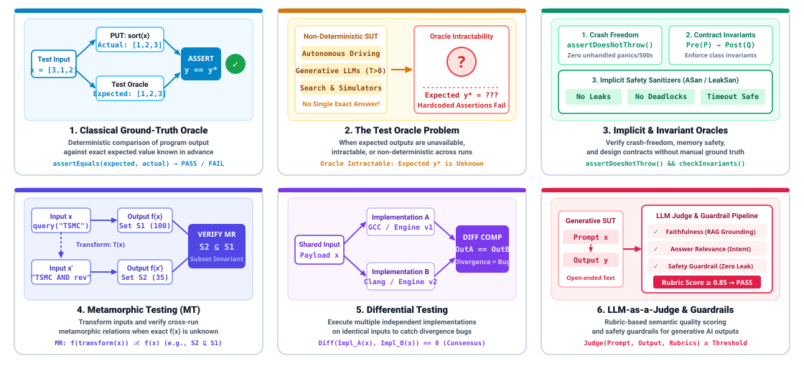
</div>

<!--
This concept map synthesizes the six core pillars of test evaluation covered in How to Evaluate:

Row 1 establishes the baseline dilemma:
1. Classical Ground-Truth Oracle: comparing actual program output against exact pre-calculated expected results via `assertEquals`.
2. The Test Oracle Problem: why traditional assertions break down when expected outputs are unavailable, continuous, or stochastic (AI, simulators, search).
3. Implicit & Invariant Oracles: verifying crash-freedom (`assertDoesNotThrow`), contract invariants, and memory safety without needing manual expected answers.

Row 2 highlights modern breakthrough strategies:
4. Metamorphic Testing (MT): verifying input-transformation invariants (`f(T(x)) R f(x)`) across multiple test executions.
5. Differential Testing: feeding identical test inputs into independent implementations to detect divergence bugs.
6. LLM-as-a-Judge & Guardrails: semantic rubric grading for generative AI outputs across Faithfulness, Relevance, and Safety.

💡 難字與專業術語解說：
- test evaluation: 測試評估判定（判定程式執行結果為 PASS 還是 FAIL 的決策機制）
- ground truth: 地面真值／基準事實（判定程式輸出是否正確的標準權威答案）
- relational invariant: 關聯不變量（輸入經特定轉換後，多次輸出之間必須恆常保持的數學關係）
-->
---
<!-- id: ase-ch07-ccq1 -->
## Concept Check Question 1: Testing Principles

<div class="ccq-columns">
<div class="ccq-text">

According to Dijkstra's foundational testing axiom and the Shift-Left principle, what is the primary capability and economic timing of software testing?

- **A.** It mathematically proves that a program is completely free of all defects when executed early in requirements.
- **B.** It can show the presence of defects but never their absence, and finding bugs early is drastically cheaper.
- **C.** It guarantees 100% statement coverage across all modules if automated regression tests are run continuously.
- **D.** It replaces the necessity for customer acceptance testing by eliminating defect clustering in production code.

</div>
<div class="ccq-logo">
  <a href="https://nlhsueh.github.io/nickedupocket/#/student/ase-ch07-ccq1" target="_blank"></a>
</div>
</div>

<!--
Let's pause for Concept Check Question 1 on foundational testing principles.
-->

---
## Concept Check Question 1: Answer & Explanation

- **Correct Answer: B**
- **Explanation:**
  - Edsger Dijkstra's famous axiom explicitly states: *"Program testing can be used to show the presence of bugs, but never to show their absence!"* Testing provides empirical evidence of flaws, but cannot mathematically prove zero bugs exist.
  - The Shift-Left principle emphasizes testing as early as requirements and design, because resolving defects early costs 10x to 100x less than fixing them in post-release maintenance.
  - *Why others are incorrect:* Option A contradicts Dijkstra's axiom. Option C confuses structural statement coverage with functional defect absence. Option D is false because automated tests never eliminate the need for customer validation (Principle 7).

<!--
The correct answer is **B**.
-->
---
## 🧩 7.1 Self-Practice: Advanced Foundations, V&V & Oracle Challenge

<div class="sp-quiz-stage" id="sp-quiz-71">
<div class="sp-mixed-grid">
<div class="sp-mixed-col">
<div class="sp-mc-card" data-ans="C">
<div class="sp-mc-stem">1. [MC — 25 pts] In the 3-Circle Venn Diagram (<code>S</code> = Spec, <code>P</code> = Code, <code>T</code> = Tests), an engineer deletes an untested legacy helper function. Compilation passes and 100% of existing tests pass, yet production crashes on an undocumented legacy API call. Which Venn region was that deleted code in?</div>
<div class="sp-mc-opts">
<div class="sp-mc-opt" data-opt="A"><strong>A.</strong> Region 2: <code>(S ∩ P) \ T</code> (Specified &amp; Implemented, Untested)</div>
<div class="sp-mc-opt" data-opt="B"><strong>B.</strong> Region 4: <code>(S ∩ T) \ P</code> (Specified &amp; Tested, Unimplemented)</div>
<div class="sp-mc-opt" data-opt="C"><strong>C.</strong> Region 6: <code>P \ (S ∪ T)</code> (Unspecified &amp; Untested Ghost Code)</div>
<div class="sp-mc-opt" data-opt="D"><strong>D.</strong> Region 7: <code>T \ (S ∪ P)</code> (Obsolete / Hallucinated Test)</div>
</div>
</div>
<div class="sp-mc-card" data-ans="B">
<div class="sp-mc-stem">2. [MC — 25 pts] An autonomous braking controller passes 100% MC/DC unit tests against its SRS formula, and passes track trials in dry weather. However, the SRS omitted icy-road friction physics, causing a skid in winter. Which statement accurately diagnoses the fault chain and V&amp;V status?</div>
<div class="sp-mc-opts">
<div class="sp-mc-opt" data-opt="A"><strong>A.</strong> Verification failed; the icy-road skid is the Fault (Defect), and the missing SRS formula is the Failure</div>
<div class="sp-mc-opt" data-opt="B"><strong>B.</strong> Verification succeeded but Validation failed; the engineer's omission is the Error, the missing SRS branch is the Fault, and the skid is the Failure</div>
<div class="sp-mc-opt" data-opt="C"><strong>C.</strong> Both Verification and Validation succeeded; the skid is an unavoidable hardware anomaly outside IEEE 610.12</div>
<div class="sp-mc-opt" data-opt="D"><strong>D.</strong> Validation succeeded but Verification failed due to the Pesticide Paradox on dry-weather tests</div>
</div>
</div>
</div>
<div class="sp-mixed-col">
<div class="sp-bank-bar">
<span class="sp-bank-label">[Word Bank] Confusable Word Bank (9 chips for 3 slots):</span>
<span class="sp-chip" data-word="Verification">Verification</span>
<span class="sp-chip" data-word="Validation">Validation</span>
<span class="sp-chip" data-word="Pesticide Paradox">Pesticide Paradox</span>
<span class="sp-chip" data-word="Defect Clustering">Defect Clustering</span>
<span class="sp-chip" data-word="Absence-of-Errors Fallacy">Absence-of-Errors Fallacy</span>
<span class="sp-chip" data-word="Metamorphic Relation">Metamorphic Relation</span>
<span class="sp-chip" data-word="Differential Oracle">Differential Oracle</span>
<span class="sp-chip" data-word="Fault (Defect / Bug)">Fault (Defect / Bug)</span>
<span class="sp-chip" data-word="Failure">Failure</span>
</div>
<div class="sp-q-item" style="font-size: 13.4px; padding: 7px 11px;"><strong>3. [Word Bank — 30 pts]</strong> Running the same regression suite for two years until it stops catching new bugs exhibits the <span class="sp-slot is-active" data-ans="Pesticide Paradox">[ 1. Click Chip ]</span>, whereas concentrating 80% of defects in 20% of complex modules reflects Pareto <span class="sp-slot" data-ans="Defect Clustering">[ 2. Click Chip ]</span>. Meanwhile, shipping a bug-free product that solves the wrong business workflow commits the <span class="sp-slot" data-ans="Absence-of-Errors Fallacy">[ 3. Click Chip ]</span>.</div>
<div class="sp-q-item" style="font-size: 13.4px; padding: 7px 11px;"><strong>4. [No Word Bank — Type Exact Term — 20 pts]</strong> In the testing architecture, the mechanism or principle used to judge whether a test execution passed or failed by comparing actual output against expected behavior is called a Test <span class="sp-free-input" data-ans="Oracle|Test Oracle" data-placeholder="Type 1 key term..."></span>.</div>
</div>
</div>
<div class="sp-footer-bar">
<div class="sp-btn-group">
<button type="button" class="sp-btn sp-btn-submit">Submit &amp; Check Score</button>
<button type="button" class="sp-btn sp-btn-reset">↺ Play Again</button>
</div>
<div class="sp-score-msg">Hint: Answer 2 MCQs + 3 Word-Bank slots + 1 Free-Text blank, then click Submit!</div>
</div>
</div>

<!--
This upgraded Section 7.1 self-practice combines two deep analytical multiple-choice questions (Venn Diagram Region 6 diagnosis and IEEE 610.12 Error-Fault-Failure + V&V distinction), a 9-chip confusable word bank for three slots (Pesticide Paradox vs. Defect Clustering vs. Absence-of-Errors Fallacy), and a direct free-text input blank testing the foundational term "Oracle" (Test Oracle).
-->
---
<!-- _class: lead -->
<!-- header: '7.2 Static Inspection & Code Review' -->

# **7.2 Static Software Inspection & Code Review**

> "Dynamic testing only illuminates the tip of the iceberg above water; only static inspection drains the sea to expose deep architectural reefs and code smells."

<!--
We now move to Section 7.2: Static Software Inspection and Code Review (integrating SQA Chapter 4: Sections 4.1, 4.2, and 4.5).

💡 難字與專業術語解說：
- static software inspection: 軟體靜態檢視（在不執行程式的前提下，透過結構化團隊審查與靜態分析工具檢驗規格、設計與原始碼的工程實踐）
-->
---
## Static Review Essence: The Testing Iceberg & IEEE 1028 Spectrum

<div class="split64">
<div class="left">

* **Why Dynamic Testing Only Sees the Tip of the Iceberg:**
  - **Path Coverage & Fault Masking:** Dynamic tests only exercise paths triggered by chosen test data; an early exception masks downstream flaws.
  - **Concrete Example:** `for (int i = 1; i < max; i++)` (skipping index `0`) is caught in 3 seconds of static review, but missed by dynamic tests if element `0` doesn't alter the test output!
* **Static vs. Dynamic Synergy & IEEE 1028 Spectrum:**
  - **Shift-Left ROI:** Static review examines artifacts **without executing code**, removing ~70% of defects before compilation at `1/10` the cost.
  - **Formal Inspection vs. Walkthrough (IEEE 1028):**
    - **Inspection:** Rigorous, checklist-driven; chaired by **Moderator**, paraphrased by **Reader**, logged by **Scribe**.
    - **Walkthrough:** Informal knowledge-sharing led by the **Author**.
  - **Golden Rule:** *Inspect the artifact, never use defect counts for HR punishment!*

</div>
<div class="right">

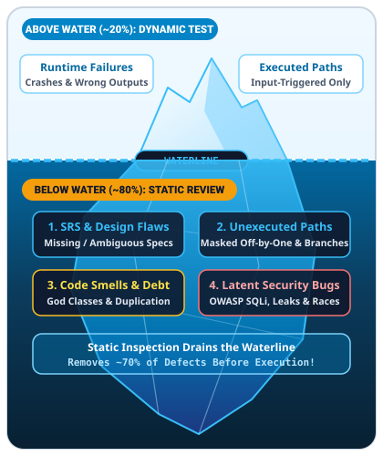

</div>
</div>

<!--
In dynamic testing, if your test data happens to put the target item at index 2, the test passes with a green light, leaving the skipped index `0` bug submerged beneath the waterline. In static review, an experienced peer or static analyzer spots `i = 1` immediately. Moreover, IEEE 1028 distinguishes formal Inspections (led by a Moderator and paraphrased by an independent Reader) from informal Walkthroughs (led by the Author).

💡 難字與專業術語解說：
- author blindness: 作者盲點／當局者迷（作者因大腦預設自身邏輯正確，自讀文件或程式碼時極難察覺自身筆誤或思維漏洞的現象）
- collective code ownership: 程式碼集體共有制（透過同儕審查讓團隊多數成員皆理解系統各模組邏輯，避免知識孤島）
-->
---
<!-- _class: title-image-slide -->

## Fagan Inspection Process: 6 Standard Steps & 5 Specialized Roles

<div class="image-wrapper">
  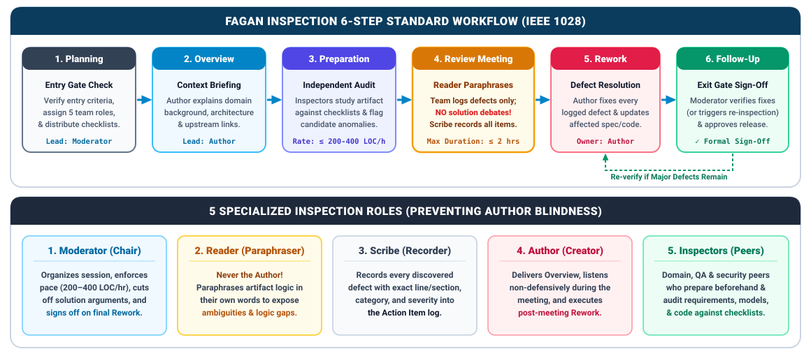
</div>

<!--
Michael Fagan (IBM, 1976) formalized Software Inspection into six disciplined steps and five specialized roles. During Step 4 (Review Meeting), the Reader—never the Author—paraphrases the artifact's logic out loud, while the Moderator enforces one iron rule: focus strictly on discovering and logging defects (at an optimal pace of 200–400 LOC/hr), and never waste meeting time debating how to fix them (that belongs in Step 5 Rework).

💡 難字與專業術語解說：
- Fagan Inspection: 范根檢視法（具備六大標準步驟與五大明確角色分工的正式軟體靜態檢視典範）
- optimal inspection rate: 最佳檢視速率（實證研究顯示每小時審查 200–400 行程式碼的抓錯率最高，超過 1,000 行會陷入走馬看花的橡皮圖章效應）
-->
---
<!-- _class: title-image-slide -->

## What Do We Review? Full-Lifecycle Artifacts & Key Inspection Focus

<div class="image-wrapper">
  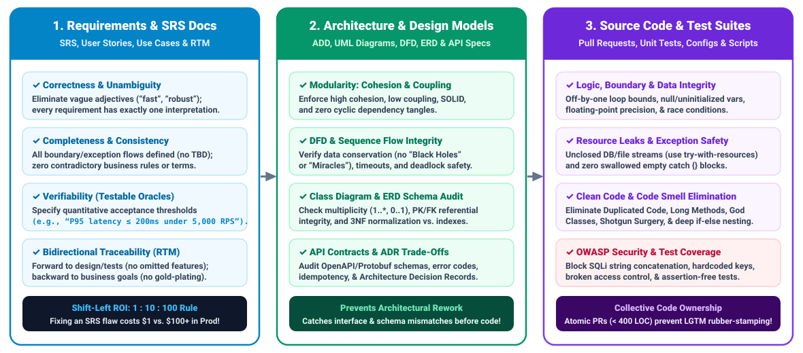
</div>

<!--
Static review applies to every software artifact across the entire SDLC—not just source code!
1. **Requirements & SRS Documents:** We inspect for Correctness, Unambiguity (eliminating vague words), Completeness, Consistency, Verifiability (testable quantitative thresholds), and Bidirectional Traceability (RTM).
2. **Architecture & Design Models (ADD, UML, DFD, ERD, API Contracts):** We audit Modularity (high cohesion, low coupling), DFD data conservation (no black holes or miracles), Class Diagram & ERD referential integrity, and OpenAPI contract consistency.
3. **Source Code & Test Suites:** We inspect for data/boundary/control-flow faults, resource leaks, Code Smells (Duplicated Code, God Class, Shotgun Surgery), and OWASP Top 10 security vulnerabilities.

💡 難字與專業術語解說：
- data conservation (DFD black hole / miracle): 資料守恆（在資料流程圖審查中，只有輸入卻無輸出的程序稱為黑洞 Black Hole；無輸入卻憑空產出資料稱為奇蹟 Miracle）
- code smell: 程式碼臭味（表面雖能編譯執行，但內部結構腐化、違反設計原則並預示深層維護風險的徵兆）
-->
---
<!-- _class: title-image-slide -->

## Automated Static Analysis Toolchain & Two-Stage CI/CD Quality Gate

<div class="image-wrapper">
  
</div>

<!--
Modern software engineering pairs human review with powerful automated static analysis tools that inspect ASTs, bytecode, and dependency graphs without executing the program:
1. **AST & Code Smell Linters (`PMD`, `Checkstyle`, `ESLint`, `Ruff`):** Catch unused variables, empty `catch {}` blocks, cyclomatic complexity bloat, and style violations in milliseconds.
2. **Bytecode & Dataflow Bug Finders (`SpotBugs`, `ErrorProne`, `Infer`):** Trace control/data flow to pinpoint null-pointer dereferences, resource leaks, and concurrency races.
3. **Security SAST & SCA Scanners (`SonarQube`, `Semgrep`, `Snyk`, `OWASP Dependency-Check`):** Detect SQLi/XSS taint paths and vulnerable third-party CVEs.
4. **AI Review Bots & Model Linters (`GitHub Copilot`, `CodeRabbit`, `Spectral`):** Audit SRS/OpenAPI specs and triage PR diffs—filtering out 80% of mechanical noise in **Stage 1** so human experts in **Stage 2** can focus 100% on domain business logic and system architecture!

💡 難字與專業術語解說：
- Abstract Syntax Tree (AST) static analyzer: 抽象語法樹靜態分析器（將原始碼解析為語法樹結構，透過規則匹配自動偵測壞味道與潛在缺陷的工具，如 PMD）
- SAST vs. SCA: 靜態應用程式安全測試 vs. 軟體組成分析（掃描自寫原始碼之安全弱點 vs. 掃描第三方開源套件是否含有已知 CVE 漏洞）
-->
---
<!-- _class: lead -->
<!-- header: '7.3 Black-Box Testing (BVA & EP)' -->

# **7.3 Black-Box Testing: Boundary Value Analysis & Equivalence Partitioning**

> "Without peeking at internal code structure, validate external system behavior strictly against specification contracts—hunting boundary defects with scientific precision across infinite input spaces."

<!--
We now enter Section 7.3: Black-Box Testing — Boundary Value Analysis (BVA) and Equivalence Partitioning (EP), integrating SQA Sections 5.1, 5.3, and 5.4.

💡 難字與專業術語解說：
- specification-based testing: 規格導向測試（完全依據外部需求規格書與介面契約設計測試案例的黑箱測試方法）
-->
---
## Black-Box Testing Concept Architecture & Why Exhaustive Testing Fails

<div class="split73">
<div class="left">

* **Three Core Elements of Black-Box Testing:**
  1. **Test Inputs:** Valid inputs, extreme boundary values, and malformed invalid inputs.
  2. **System Under Test (SUT):** Treated as an opaque black box; internal algorithms and data structures remain completely hidden.
  3. **Output Verification:** Compares actual outputs against expected specification Oracles (<strong>"What"</strong> the system does, decoupled from <strong>"How"</strong> it is coded—zero test breakage during internal refactoring!).
* **Why Exhaustive Testing is Mathematically Impossible:**
  - Even a simple 32-bit integer addition `int add(int a, int b)` has 2<sup>32</sup> × 2<sup>32</sup> = 2<sup>64</sup> ≈ 1.84 × 10<sup>19</sup> input pairs.
  - At <strong>1 billion tests/sec (1 GHz)</strong>, exhaustive testing would take **584 years**!
  - **Mission of Black-Box Engineering:** Select the **smallest representative subset** that captures the **maximum probability of defects**.

</div>
<div class="right">


</div>
</div>

<!--
A trivial two-integer function `int add(int a, int b)` has 2^64 possible input combinations, taking 584 years at 1 GHz to exhaustively test. Black-box methodologies select the smallest representative subset that maximizes defect discovery.

💡 難字與專業術語解說：
- decoupling from implementation: 與實作解耦（黑箱測試僅針對公開 API 契約斷言，因此內部重構演算法時測試程式碼無須修改）
-->
---
## Boundary Value Analysis (BVA): Core Philosophy & Single Fault Assumption

<div class="card-deck">

> "Bugs lurk in corners!" Empirical studies confirm that over 60% of functional defects occur right on the boundary edges of input domains.

<div class="two-columns">
<div class="card" data-marpit-fragment>

### Why Errors Cluster at Boundaries
- **Relational Operator Off-by-One Traps:**
  - Developers routinely confuse `<` with `<=`, or `>` with `>=`, or miscalculate loop bounds by `± 1`.
- **Code Comparison:**

| Code Written | Defect Nature | Test at `input = 10` |
| :--- | :--- | :--- |
| `if (input <= 10)` | Correct inclusive bound | Passes |
| `if (input < 10)` | Off-by-one bug (`10` excluded!) | **Fails & Exposes Bug!** |

</div>
<div class="card" data-marpit-fragment>

### The Single Fault Assumption
- **Core Premise:**
  - Failures are rarely caused by simultaneous defects of two or more variables; testing **one variable at its extreme boundaries** while holding all other variables at their <strong>nominal center (`norm`)</strong> catches most bugs.
- **5 Standard Sampling Points for `[min, max]`:**
  - **`min`** (minimum), **`min+`** (`min + 1`), **`norm`** (nominal midpoint), **`max-`** (`max - 1`), and **`max`** (maximum).

</div>
</div>
</div>

<!--
Under the Single Fault Assumption, when testing an n-variable function, we vary one variable across its boundary points (`min, min+, max-, max`) while keeping the other n - 1 variables anchored at their nominal midpoint (`norm`).

💡 難字與專業術語解說：
- Single Fault Assumption: 單一錯誤假設（假設系統失效主要由單一變數處於極端值即可觸發，無須多個變數同時取極端值）
-->
---
## Independent Normal BVA (`4n + 1`) & The Triangle Diversity Deficit

<div class="card-deck">

> For `n` independent variables, **Independent Normal BVA** requires **`4n + 1`** test cases—but watch out for the **Diversity Deficit** when holding `norm` fixed!

<div class="two-columns">
<div class="card" data-marpit-fragment>

### The `4n + 1` Formula Derivation
- **4 Boundary Points per Variable:**
  - Hold `n - 1` variables at `norm`, and vary target variable across `min`, `min+`, `max-`, `max`.
- **Plus 1 All-Nominal Center Case:**
  - `(norm, norm, ..., norm)` shared across all `n` variables.
- **Total Test Cases = `4n + 1`** (for `n = 3` → `13` cases).
- **Triangle Problem (`a, b, c ∈ [1, 200]`, `norm = 100`):**
  - Vary `a ∈ {1, 2, 199, 200}` with `(b=100, c=100)` (`4` cases)
  - Vary `b ∈ {1, 2, 199, 200}` with `(a=100, c=100)` (`4` cases)
  - Vary `c ∈ {1, 2, 199, 200}` with `(a=100, b=100)` (`4` cases)
  - Plus `(100, 100, 100)` Equilateral baseline (`1` case) = **13 cases**.

</div>
<div class="card" data-marpit-fragment>

### The "Diversity Deficit" Trap & Remedy
- **Why Blind `4n + 1` Fails on Triangle:**
  - In every single one of those 13 test cases, **at least two sides are fixed at `100`**!
  - Consequence: The 13 cases test *Equilateral* `(100,100,100)`, *Isosceles* `(2,100,100)`, and *Non-Triangle* `(200,100,100)`—**but 0 Scalene triangles (`a ≠ b ≠ c`) are ever tested!**
- **Engineering Remedies:**
  1. Assign **distinct nominal values** per variable (`a_norm = 100, b_norm = 101, c_norm = 102`).
  2. Always pair BVA with **Output-Guided Equivalence Partitioning**!

</div>
</div>
</div>

<!--
Never apply `4n + 1` mechanically without checking output partition coverage! Holding two sides of a triangle at `norm = 100` makes every test case have at least two equal sides, completely missing Scalene triangles.

💡 難字與專業術語解說：
- diversity deficit: 多樣性缺失（因機械式固定名義值 `norm` 導致產生出的測試案例全部落在相同輸出類別、遺漏其他重要業務分支的盲區）
-->
---
## Interactive BVA Explorer: 4n+1, 6n+1, 5ⁿ, 7ⁿ Sampling Spaces

<div class="bva-interactive-stage">
<div class="bva-nav-toolbar">
  <button class="bva-mode-btn is-active" data-bva="norm">1. Normal BVA (4n + 1)</button>
  <button class="bva-mode-btn" data-bva="robust">2. Robust BVA (6n + 1)</button>
  <button class="bva-mode-btn" data-bva="worst-norm">3. Worst Normal (5ⁿ)</button>
  <button class="bva-mode-btn" data-bva="worst-robust">4. Worst Robust (7ⁿ)</button>
</div>
<div class="bva-content-grid">
<div class="bva-svg-container">
<svg viewBox="0 0 480 480" width="440" height="420" style="display: block; max-width: 100%; max-height: 100%;">
  <rect x="95" y="95" width="290" height="290" fill="#f8fafc" stroke="#3b82f6" stroke-width="2" stroke-dasharray="6,4" rx="8" />
  <rect x="40" y="40" width="400" height="400" fill="none" stroke="#e2e8f0" stroke-width="1.5" stroke-dasharray="4,4" rx="10" />
  <line x1="40" y1="240" x2="440" y2="240" stroke="#94a3b8" stroke-width="1.8" />
  <line x1="240" y1="40" x2="240" y2="440" stroke="#94a3b8" stroke-width="1.8" />
  <text x="240" y="26" text-anchor="middle" font-size="12" font-weight="800" fill="#0369a1">x₂ (Variable 2)</text>
  <text x="460" y="244" text-anchor="start" font-size="12" font-weight="800" fill="#0369a1">x₁</text>
  <text x="40" y="258" text-anchor="middle" font-size="9" font-weight="700" fill="#e11d48">min-</text>
  <text x="95" y="258" text-anchor="middle" font-size="9" font-weight="700" fill="#0284c7">min</text>
  <text x="150" y="258" text-anchor="middle" font-size="9" font-weight="700" fill="#0284c7">min+</text>
  <text x="240" y="258" text-anchor="middle" font-size="9" font-weight="800" fill="#0f172a">norm</text>
  <text x="330" y="258" text-anchor="middle" font-size="9" font-weight="700" fill="#0284c7">max-</text>
  <text x="385" y="258" text-anchor="middle" font-size="9" font-weight="700" fill="#0284c7">max</text>
  <text x="440" y="258" text-anchor="middle" font-size="9" font-weight="700" fill="#e11d48">max+</text>
  <text x="232" y="444" text-anchor="end" font-size="9" font-weight="700" fill="#e11d48">min-</text>
  <text x="232" y="389" text-anchor="end" font-size="9" font-weight="700" fill="#0284c7">min</text>
  <text x="232" y="334" text-anchor="end" font-size="9" font-weight="700" fill="#0284c7">min+</text>
  <text x="232" y="154" text-anchor="end" font-size="9" font-weight="700" fill="#0284c7">max-</text>
  <text x="232" y="99" text-anchor="end" font-size="9" font-weight="700" fill="#0284c7">max</text>
  <text x="232" y="44" text-anchor="end" font-size="9" font-weight="700" fill="#e11d48">max+</text>
  <circle class="bva-pt is-worst-robust is-dimmed" data-cat="worst-robust" cx="40" cy="40" r="6.5" />
  <circle class="bva-pt is-worst-robust is-dimmed" data-cat="worst-robust" cx="40" cy="95" r="6.5" />
  <circle class="bva-pt is-worst-robust is-dimmed" data-cat="worst-robust" cx="40" cy="150" r="6.5" />
  <circle class="bva-pt is-robust-bva is-dimmed" data-cat="robust-bva" cx="40" cy="240" r="6.5" />
  <circle class="bva-pt is-worst-robust is-dimmed" data-cat="worst-robust" cx="40" cy="330" r="6.5" />
  <circle class="bva-pt is-worst-robust is-dimmed" data-cat="worst-robust" cx="40" cy="385" r="6.5" />
  <circle class="bva-pt is-worst-robust is-dimmed" data-cat="worst-robust" cx="40" cy="440" r="6.5" />
  <circle class="bva-pt is-worst-robust is-dimmed" data-cat="worst-robust" cx="95" cy="40" r="6.5" />
  <circle class="bva-pt is-worst-norm is-dimmed" data-cat="worst-norm" cx="95" cy="95" r="6.5" />
  <circle class="bva-pt is-worst-norm is-dimmed" data-cat="worst-norm" cx="95" cy="150" r="6.5" />
  <circle class="bva-pt is-norm-bva is-active" data-cat="norm-bva" cx="95" cy="240" r="6.5" />
  <circle class="bva-pt is-worst-norm is-dimmed" data-cat="worst-norm" cx="95" cy="330" r="6.5" />
  <circle class="bva-pt is-worst-norm is-dimmed" data-cat="worst-norm" cx="95" cy="385" r="6.5" />
  <circle class="bva-pt is-worst-robust is-dimmed" data-cat="worst-robust" cx="95" cy="440" r="6.5" />
  <circle class="bva-pt is-worst-robust is-dimmed" data-cat="worst-robust" cx="150" cy="40" r="6.5" />
  <circle class="bva-pt is-worst-norm is-dimmed" data-cat="worst-norm" cx="150" cy="95" r="6.5" />
  <circle class="bva-pt is-worst-norm is-dimmed" data-cat="worst-norm" cx="150" cy="150" r="6.5" />
  <circle class="bva-pt is-norm-bva is-active" data-cat="norm-bva" cx="150" cy="240" r="6.5" />
  <circle class="bva-pt is-worst-norm is-dimmed" data-cat="worst-norm" cx="150" cy="330" r="6.5" />
  <circle class="bva-pt is-worst-norm is-dimmed" data-cat="worst-norm" cx="150" cy="385" r="6.5" />
  <circle class="bva-pt is-worst-robust is-dimmed" data-cat="worst-robust" cx="150" cy="440" r="6.5" />
  <circle class="bva-pt is-robust-bva is-dimmed" data-cat="robust-bva" cx="240" cy="40" r="6.5" />
  <circle class="bva-pt is-norm-bva is-active" data-cat="norm-bva" cx="240" cy="95" r="6.5" />
  <circle class="bva-pt is-norm-bva is-active" data-cat="norm-bva" cx="240" cy="150" r="6.5" />
  <circle class="bva-pt is-nom is-active" data-cat="nom" cx="240" cy="240" r="6.5" />
  <circle class="bva-pt is-norm-bva is-active" data-cat="norm-bva" cx="240" cy="330" r="6.5" />
  <circle class="bva-pt is-norm-bva is-active" data-cat="norm-bva" cx="240" cy="385" r="6.5" />
  <circle class="bva-pt is-robust-bva is-dimmed" data-cat="robust-bva" cx="240" cy="440" r="6.5" />
  <circle class="bva-pt is-worst-robust is-dimmed" data-cat="worst-robust" cx="330" cy="40" r="6.5" />
  <circle class="bva-pt is-worst-norm is-dimmed" data-cat="worst-norm" cx="330" cy="95" r="6.5" />
  <circle class="bva-pt is-worst-norm is-dimmed" data-cat="worst-norm" cx="330" cy="150" r="6.5" />
  <circle class="bva-pt is-norm-bva is-active" data-cat="norm-bva" cx="330" cy="240" r="6.5" />
  <circle class="bva-pt is-worst-norm is-dimmed" data-cat="worst-norm" cx="330" cy="330" r="6.5" />
  <circle class="bva-pt is-worst-norm is-dimmed" data-cat="worst-norm" cx="330" cy="385" r="6.5" />
  <circle class="bva-pt is-worst-robust is-dimmed" data-cat="worst-robust" cx="330" cy="440" r="6.5" />
  <circle class="bva-pt is-worst-robust is-dimmed" data-cat="worst-robust" cx="385" cy="40" r="6.5" />
  <circle class="bva-pt is-worst-norm is-dimmed" data-cat="worst-norm" cx="385" cy="95" r="6.5" />
  <circle class="bva-pt is-worst-norm is-dimmed" data-cat="worst-norm" cx="385" cy="150" r="6.5" />
  <circle class="bva-pt is-norm-bva is-active" data-cat="norm-bva" cx="385" cy="240" r="6.5" />
  <circle class="bva-pt is-worst-norm is-dimmed" data-cat="worst-norm" cx="385" cy="330" r="6.5" />
  <circle class="bva-pt is-worst-norm is-dimmed" data-cat="worst-norm" cx="385" cy="385" r="6.5" />
  <circle class="bva-pt is-worst-robust is-dimmed" data-cat="worst-robust" cx="385" cy="440" r="6.5" />
  <circle class="bva-pt is-worst-robust is-dimmed" data-cat="worst-robust" cx="440" cy="40" r="6.5" />
  <circle class="bva-pt is-worst-robust is-dimmed" data-cat="worst-robust" cx="440" cy="95" r="6.5" />
  <circle class="bva-pt is-worst-robust is-dimmed" data-cat="worst-robust" cx="440" cy="150" r="6.5" />
  <circle class="bva-pt is-robust-bva is-dimmed" data-cat="robust-bva" cx="440" cy="240" r="6.5" />
  <circle class="bva-pt is-worst-robust is-dimmed" data-cat="worst-robust" cx="440" cy="330" r="6.5" />
  <circle class="bva-pt is-worst-robust is-dimmed" data-cat="worst-robust" cx="440" cy="385" r="6.5" />
  <circle class="bva-pt is-worst-robust is-dimmed" data-cat="worst-robust" cx="440" cy="440" r="6.5" />
</svg>
</div>
<div class="bva-info-card" id="bva-info-box">
  <div class="bva-info-header">
    <span class="bva-badge-pill bva-badge-blue" id="bva-mode-badge">Single Fault Assumption</span>
    <h3 class="bva-title-text" id="bva-mode-title">Normal Boundary Value Analysis</h3>
  </div>
  <div class="bva-stats-row">
    <div class="bva-stat-box">
      <div class="bva-stat-label">Formula</div>
      <div class="bva-stat-val" id="bva-stat-formula">4n + 1</div>
    </div>
    <div class="bva-stat-box">
      <div class="bva-stat-label">Active Points (n = 2)</div>
      <div class="bva-stat-val" id="bva-stat-count">9 Points</div>
    </div>
  </div>
  <ul class="bva-details-list" id="bva-details-list">
    <li><strong>Minimal Baseline Sampling:</strong> Tests <code>min, min+, max-, max</code> along each axis while anchoring other variables at <code>norm</code>.</li>
    <li><strong>Defect Target:</strong> Catches over 60% of common relational off-by-one errors (<code>&lt;</code> vs. <code>&lt;=</code>) with strictly linear growth.</li>
    <li><strong>Point Density:</strong> Lowest point count (<strong>9 points</strong> for 2 variables, 13 for 3).</li>
  </ul>
</div>
</div>
</div>

<!--
The 49 points on this 2D plane represent the entire boundary sampling space for two variables. Under Normal BVA (4n+1), only the 9 cross points along the nominal axes light up (minimal baseline). When selecting Robust BVA (6n+1), the 4 out-of-bounds tips (min-, max+) turn red. Worst-case Normal (5^n) activates all 25 points within the valid blue box. Finally, Worst-case Robust (7^n) illuminates all 49 points across the entire Cartesian product.

💡 難字與專業術語解說：
- boundary sampling space: 邊界取樣空間（在多變數輸入域中，由各變數極值、名義值與越界值張成之測試點候選集合）
- single fault assumption: 單一錯誤假設（假設系統失效絕大多數僅由單一變數抵達極值所誘發，因而測試時其餘變數固定在名義中心值）
- Cartesian product explosion: 笛卡爾乘積爆炸（當捨棄單一錯誤假設時，測試案例數由線性 O(n) 暴增為指數級 O(k^n) 的組合膨脹現象）
-->
---
## BVA Panorama Matrix & Key Practical FAQs (Out-On-In & Floating-Point)

<div class="card-deck">

> Choose **`6n + 1` Independent Robust BVA** for standard modules, and apply <strong>3-Point (`Out-On-In`)</strong> sampling and **Business Resolution** for continuous numbers.

<div class="two-columns">
<div class="card" data-marpit-fragment>

### The 4 BVA Formulas Selection Matrix
| BVA Strategy | Single-Fault (Independent) | Multiple-Fault (Worst-Case) |
| :--- | :---: | :---: |
| **Normal BVA** *(Valid)* | **`4n + 1`** *(`n=3 → 13`)* | **`5`<sup>`n`</sup>** *(`n=3 → 125`)* |
| **Robust BVA** *(`min-, max+`)* | **`6n + 1`** *(`n=3 → 19`)* | **`7`<sup>`n`</sup>** *(`n=3 → 343`)* |

- **Default Choice:** **`6n + 1` Independent Robust BVA** (linear cost + exception defense).
- **Coupled Critical Variables:** Apply local **`5`<sup>`n`</sup> Worst-Case BVA** to the 2–3 coupled inputs.

</div>
<div class="card" data-marpit-fragment>

### BVA Practical FAQs
- **Q1: 2-Point (`On-Off`) vs. 3-Point (`Out-On-In`) Sampling?**
  - **3-Point (`Out-On-In`, ISO 29119):** Tests **`99 (In), 100 (On), 101 (Out)`** to catch off-by-one slips (`>` vs. `>=`) on open/closed bounds.
- **Q2: Neighbor Points for Floating-Point (`double`)?**
  - **Business Resolution:** Step by minimum domain unit (`± 0.01` for currency, `± 0.1` for scores), or `Math.nextUp(x)` for IEEE 754 math.

</div>
</div>
</div>

<!--
Memorize the 2x2 BVA formula table on the left (`4n+1`, `6n+1`, `5^n`, `7^n`), and remember the two practical FAQs on the right: use 3-point Out-On-In (`99, 100, 101`) to catch `<` vs `<=`, and use business resolution (`± 0.01`) for floating-point boundaries.

💡 難字與專業術語解說：
- 3-point boundary value analysis (Out-On-In): 三點邊界分析法（針對每一個邊界同時取邊界內、邊界上與邊界外三點，以百分百攔截開閉區間關係運算子誤用的標準做法）
-->
---
## Implementing BVA in JUnit 5: `@ParameterizedTest` & `assertAll`

<div class="card-deck">

> Dense boundary suites face two coding pitfalls: **boilerplate duplication** across 19 test methods, and **Early Abort** when the first assertion fails.

<div class="two-columns">
<div class="card" data-marpit-fragment>

### 1. Batch Boundary Injection (`@ParameterizedTest`)
- Inject all boundary points into one parameterized test method:
```java
@ParameterizedTest
@ValueSource(ints = {1, 2, 100, 199, 200}) // 5 BVA points for side a
void testTriangleValidBoundariesForA(int a) {
    assertNotEquals("NotATriangle", Triangle.classify(a, 100, 100));
}

@ParameterizedTest
@CsvSource({
    "0,   3, FREE",   // V1 min & max
    "4,  12, CHILD",  // V2 min & max
    "13, 64, ADULT",  // V3 min & max
    "65,120, SENIOR"  // V4 min & max
})
void testPoolAgeBoundaries(int minAge, int maxAge, String tier) {
    assertEquals(tier, PoolTicket.eval(minAge));
    assertEquals(tier, PoolTicket.eval(maxAge));
}
```

</div>
<div class="card" data-marpit-fragment>

### 2. Grouped Assertions (`assertAll` Prevents Early Abort)
- **Solution (`assertAll` + Lambda `() ->`):** Wraps each boundary check in a deferred lambda so **every boundary executes and reports together**:
```java
@Test
void testGradeBoundariesWithoutEarlyAbort() {
    assertAll("Grade BVA Complete Check",
        () -> assertThrows(IllegalArgumentException.class,
                           () -> Grade.eval(-1)),  // min- (Invalid)
        () -> assertEquals("F", Grade.eval(0)),    // min
        () -> assertEquals("F", Grade.eval(59)),   // tier boundary
        () -> assertEquals("D", Grade.eval(60)),   // tier boundary+
        () -> assertEquals("A", Grade.eval(100)),  // max
        () -> assertThrows(IllegalArgumentException.class,
                           () -> Grade.eval(101))  // max+ (Invalid)
    );
}
```

</div>
</div>
</div>

<!--
Pairing `@ParameterizedTest` with `assertAll` lets you run dozens of boundary checks cleanly without boilerplate or early abort masking.

💡 難字與專業術語解說：
- grouped assertions (`assertAll`): 群組聚合斷言（JUnit 5 以 Lambda 封裝多個斷言，確保所有斷言皆被執行並一次彙整所有失敗結果的機制）
-->
---
## 🧩 BVA Interactive Matrix Game: Mortgage Rate Engine (`Amount × Term`)

<div class="bvag-stage" id="bva-loan-game">
<div class="bvag-board-card">
<svg xmlns="http://www.w3.org/2000/svg" id="bvag-svg" viewBox="0 0 490 480" width="430" height="420" style="display: block; max-width: 100%; max-height: 100%;">
<rect x="95" y="95" width="290" height="290" fill="#f0f9ff" fill-opacity="0.55" stroke="#0284c7" stroke-width="2" stroke-dasharray="6,4" rx="8" />
<rect x="40" y="40" width="400" height="400" fill="none" stroke="#cbd5e1" stroke-width="1.5" stroke-dasharray="4,4" rx="10" />
<line x1="40" y1="240" x2="440" y2="240" stroke="#94a3b8" stroke-width="1.8" />
<line x1="240" y1="40" x2="240" y2="440" stroke="#94a3b8" stroke-width="1.8" />
<text x="240" y="20" text-anchor="middle" font-family="sans-serif" font-size="12.5" font-weight="800" fill="#0b3c5d">Y: Loan Term (1 to 30 Years, step = 1 yr)</text>
<text x="240" y="472" text-anchor="middle" font-family="sans-serif" font-size="12.5" font-weight="800" fill="#0b3c5d">X: Loan Amount (100k to 10,000k NT$, step = 1k)</text>
<text x="40" y="258" text-anchor="middle" font-family="monospace" font-size="9.5" font-weight="800" fill="#e11d48">99k</text>
<text x="95" y="258" text-anchor="middle" font-family="monospace" font-size="9.5" font-weight="800" fill="#0284c7">100k</text>
<text x="150" y="258" text-anchor="middle" font-family="monospace" font-size="9.5" font-weight="800" fill="#0284c7">101k</text>
<text x="256" y="256" text-anchor="middle" font-family="monospace" font-size="9.5" font-weight="800" fill="#0f172a">5000k</text>
<text x="330" y="258" text-anchor="middle" font-family="monospace" font-size="9.5" font-weight="800" fill="#0284c7">9999k</text>
<text x="385" y="258" text-anchor="middle" font-family="monospace" font-size="9.5" font-weight="800" fill="#0284c7">10000k</text>
<text x="444" y="258" text-anchor="middle" font-family="monospace" font-size="9.5" font-weight="800" fill="#e11d48">10001k</text>
<text x="231" y="444" text-anchor="end" font-family="monospace" font-size="9.5" font-weight="800" fill="#e11d48">0yr</text>
<text x="231" y="389" text-anchor="end" font-family="monospace" font-size="9.5" font-weight="800" fill="#0284c7">1yr</text>
<text x="231" y="334" text-anchor="end" font-family="monospace" font-size="9.5" font-weight="800" fill="#0284c7">2yr</text>
<text x="231" y="233" text-anchor="end" font-family="monospace" font-size="9.5" font-weight="800" fill="#0f172a">15yr</text>
<text x="231" y="154" text-anchor="end" font-family="monospace" font-size="9.5" font-weight="800" fill="#0284c7">29yr</text>
<text x="231" y="99" text-anchor="end" font-family="monospace" font-size="9.5" font-weight="800" fill="#0284c7">30yr</text>
<text x="231" y="44" text-anchor="end" font-family="monospace" font-size="9.5" font-weight="800" fill="#e11d48">31yr</text>
<g id="bvag-dots-layer"></g>
</svg>
</div>
<div class="bvag-ctrl-card">
<div class="bvag-spec-box">
<strong>[Problem Specification] Mortgage Interest Rate Calculator:</strong><br/>
<code>calcRate(amountK, termYears)</code> computes a borrower's annual mortgage rate based on two integer inputs:<br/>
• <strong>Loan Amount (<code>X</code>)</strong>: Accepted from <strong>NT$ 100k</strong> up to <strong>NT$ 10,000k</strong> (in <code>1k</code> units; nominal center = <code>5000k</code>).<br/>
• <strong>Loan Term (<code>Y</code>)</strong>: Accepted from <strong>1 year</strong> up to <strong>30 years</strong> (in <code>1 yr</code> units; nominal center = <code>15yr</code>).<br/>
• Values outside these ranges are rejected. Deduce the boundary points on the 7×7 grid!
</div>
<div class="bvag-mission-box">
<div class="bvag-round-row">
<span class="bvag-round-pill" id="bvag-round-pill">CHALLENGE 1 OF 4 (RANDOMIZED)</span>
<span class="bvag-stat-pill" id="bvag-score-pill">Solved: 0 / 4 | Selected: 0 dots</span>
</div>
<div class="bvag-target-title" id="bvag-target-title">Target Strategy: Loading...</div>
<div class="bvag-target-hint">Click individual dots on the left matrix (or use the quick-toggle helpers below) to select the exact test suite required by this strategy, then click <strong>Submit Selection</strong>!</div>
</div>
<div class="bvag-quick-bar">
<span style="font-size: 11.5px; font-weight: 800; color: #475569;">Quick Helpers:</span>
<button type="button" class="bvag-qbtn" data-qact="valid-axes">± Toggle Valid Axes Cross</button>
<button type="button" class="bvag-qbtn" data-qact="outer-tips">± Toggle 4 Out-of-Bounds Tips</button>
<button type="button" class="bvag-qbtn" data-qact="valid-box">± Toggle Inner Valid Box</button>
<button type="button" class="bvag-qbtn" data-qact="all-grid">± Toggle Entire Grid</button>
<button type="button" class="bvag-qbtn" data-qact="clear">✕ Clear All</button>
</div>
<div class="bvag-action-row">
<button type="button" class="bvag-btn" id="bvag-btn-submit">Submit Selection</button>
<button type="button" class="bvag-btn btn-next" id="bvag-btn-next">Next Challenge ➔</button>
<button type="button" class="bvag-btn btn-reset" id="bvag-btn-reshuffle">↺ Reshuffle 4</button>
</div>
<div class="bvag-feedback-box" id="bvag-feedback-msg">Click dots on the matrix (blue = selected) to match the target BVA strategy above!</div>
</div>
</div>

<!--
This interactive 4-round game tests whether students truly understand the geometric sampling differences among the 4 BVA strategies (Independent Normal BVA, Independent Robust BVA, Worst-Case Normal BVA, and Worst-Case Robust BVA) without giving away the `4n+1 / 6n+1 / 5^n / 7^n` formulas. From the Mortgage Rate specification (`Loan Amount` in `[100k, 10000k]` and `Loan Term` in `[1yr, 30yr]`), students deduce the boundary coordinates (`99k, 100k, 101k, 5000k, 9999k, 10000k, 10001k` and `0yr, 1yr, 2yr, 15yr, 29yr, 30yr, 31yr`) and click the exact dots on the 7x7 matrix for each randomly ordered strategy.
-->
---
## Equivalence Partitioning (EP): Core Definition & 4 Coverage Strategies

<div class="card-deck">

> **Core Idea of EP:** Partition the vast input domain `D` into mutually exclusive **Equivalence Classes** where all values in a class trigger the **same execution path**—so testing **one representative** verifies the entire class!

<div class="two-columns">
<div class="card" data-marpit-fragment>

### 1. Mathematical Properties & Valid vs. Invalid
- **Two Formal Partition Axioms (`D = E₁ ∪ E₂ ∪ ... ∪ Eₖ`):**
  1. **Completeness (Union):** Every possible input belongs to at least one partition (`∪ Eᵢ = D`).
  2. **Disjointness (Mutual Exclusion):** No two partitions overlap (`Eᵢ ∩ Eⱼ = ∅` for `i ≠ j`).
- **Equal Defect-Detection Hypothesis:**
  - If one representative value in `Eᵢ` exposes a functional bug, any other value in `Eᵢ` will expose the same bug.
- **Two Types of Equivalence Classes:**
  - <strong>Valid Classes (`V`):</strong> Expected normal business rules & branches.
  - <strong>Invalid Classes (`I`):</strong> Out-of-range, `null`, or malformed inputs that must be rejected defensively.

</div>
<div class="card" data-marpit-fragment>

### 2. The 2 × 2 EP Strategy Matrix
- **Dimension A — Fault Assumption (`Weak` vs. `Strong`):**
  - <strong>Weak EP (`max(|V₁|, |V₂|)`):</strong> *Single Fault Assumption* — covers each partition at least once without full combinations.
  - <strong>Strong EP (`|V₁| × |V₂|`):</strong> *Multiple Fault Assumption* — tests the full Cartesian product of partitions to catch interaction bugs.
- **Dimension B — Invalid Input Handling (`Normal` vs. `Robust`):**
  - <strong>Normal EP:</strong> Tests **Valid classes (`V`) only**.
  - <strong>Robust EP:</strong> Adds **Invalid classes (`I`)**. In **Weak Robust EP**, we enforce the **Single Invalid Rule** (test only *one* invalid input per test case while keeping all other inputs valid) to prevent **Fault Masking**!

</div>
</div>
</div>

<!--
Before exploring the interactive EP matrix on the next slide, let's establish the formal definition and the 2x2 taxonomy of Equivalence Partitioning (EP).
First, an equivalence partition divides the input domain into mutually disjoint and collectively exhaustive subsets such that the software behaves identically for every value within the same subset. Thus, selecting a single representative value from the center of a partition is sufficient to represent millions of redundant values.
Second, combining our Fault Assumption (Weak = Single Fault `max`, Strong = Multi-Fault Cartesian Product) with Invalid Input Handling (Normal = Valid only, Robust = Valid + Invalid) yields the four standard EP strategies: Weak Normal, Strong Normal, Weak Robust (Single-Invalid Rule), and Strong Robust.

💡 難字與專業術語解說：
- mutually disjoint and collectively exhaustive: 互斥且完全窮盡（各等價類別之間交集為空集合，且所有類別之聯集完整涵蓋整個輸入定義域）
- equal defect-detection hypothesis: 等效抓錯假設（同一等價分割內的任意兩個輸入值，走過相同的條件分支，具備相同的揭露缺陷能力）
-->
---
## Interactive EP Explorer: Weak vs. Strong & Normal vs. Robust Matrix

<div class="ep-interactive-stage">

<div class="ep-nav-toolbar">
  <button class="ep-mode-btn is-active" data-ep="weak-norm">1. Weak Normal EP</button>
  <button class="ep-mode-btn" data-ep="strong-norm">2. Strong Normal EP</button>
  <button class="ep-mode-btn" data-ep="weak-robust">3. Weak Robust EP (Single-Invalid)</button>
  <button class="ep-mode-btn" data-ep="strong-robust">4. Strong Robust EP</button>
</div>

<div class="ep-content-grid">

<div class="ep-matrix-card">
  <table class="ep-table">
    <thead>
      <tr>
        <th style="width: 22%;">x₁ \ x₂</th>
        <th style="width: 19%; color: #e11d48;">I₂,₁ (Empty)</th>
        <th style="width: 20%; color: #059669;">V₂,₁ (Alpha [A-M])</th>
        <th style="width: 20%; color: #059669;">V₂,₂ (Beta [N-Z])</th>
        <th style="width: 19%; color: #e11d48;">I₂,₂ (Symbols)</th>
      </tr>
    </thead>
    <tbody>
      <tr>
        <th style="color: #e11d48;">I₁,₁ (&lt; 1)</th>
        <td class="is-invalid-zone"><span class="ep-pin is-invalid-pin" data-pin-id="p_i11_i21">TC₇</span></td>
        <td class="is-invalid-zone"><span class="ep-pin is-invalid-pin is-active-pin" data-pin-id="p_i11_v21">TC₄</span></td>
        <td class="is-invalid-zone"><span class="ep-pin is-invalid-pin" data-pin-id="p_i11_v22">TC₈</span></td>
        <td class="is-invalid-zone"><span class="ep-pin is-invalid-pin" data-pin-id="p_i11_i22">TC₉</span></td>
      </tr>
      <tr>
        <th style="color: #059669;">V₁,₁ (1..10)</th>
        <td class="is-invalid-zone"><span class="ep-pin is-invalid-pin" data-pin-id="p_v11_i21">TC₆</span></td>
        <td class="is-valid-zone"><span class="ep-pin is-active-pin" data-pin-id="p_v11_v21">TC₁</span></td>
        <td class="is-valid-zone"><span class="ep-pin" data-pin-id="p_v11_v22">TC₄</span></td>
        <td class="is-invalid-zone"><span class="ep-pin is-invalid-pin" data-pin-id="p_v11_i22">TC₇</span></td>
      </tr>
      <tr>
        <th style="color: #059669;">V₁,₂ (11..20)</th>
        <td class="is-invalid-zone"><span class="ep-pin is-invalid-pin" data-pin-id="p_v12_i21">TC₁₀</span></td>
        <td class="is-valid-zone"><span class="ep-pin" data-pin-id="p_v12_v21">TC₅</span></td>
        <td class="is-valid-zone"><span class="ep-pin is-active-pin" data-pin-id="p_v12_v22">TC₂</span></td>
        <td class="is-invalid-zone"><span class="ep-pin is-invalid-pin" data-pin-id="p_v12_i22">TC₁₁</span></td>
      </tr>
      <tr>
        <th style="color: #059669;">V₁,₃ (21..30)</th>
        <td class="is-invalid-zone"><span class="ep-pin is-invalid-pin" data-pin-id="p_v13_i21">TC₁₂</span></td>
        <td class="is-valid-zone"><span class="ep-pin is-active-pin" data-pin-id="p_v13_v21">TC₃</span></td>
        <td class="is-valid-zone"><span class="ep-pin" data-pin-id="p_v13_v22">TC₆</span></td>
        <td class="is-invalid-zone"><span class="ep-pin is-invalid-pin" data-pin-id="p_v13_i22">TC₁₃</span></td>
      </tr>
      <tr>
        <th style="color: #e11d48;">I₁,₂ (&gt; 30)</th>
        <td class="is-invalid-zone"><span class="ep-pin is-invalid-pin" data-pin-id="p_i12_i21">TC₁₄</span></td>
        <td class="is-invalid-zone"><span class="ep-pin is-invalid-pin" data-pin-id="p_i12_v21">TC₅</span></td>
        <td class="is-invalid-zone"><span class="ep-pin is-invalid-pin" data-pin-id="p_i12_v22">TC₁₅</span></td>
        <td class="is-invalid-zone"><span class="ep-pin is-invalid-pin" data-pin-id="p_i12_i22">TC₁₆</span></td>
      </tr>
    </tbody>
  </table>
</div>

<div class="ep-info-card" id="ep-info-box">
  <div class="ep-info-header">
    <span class="ep-badge-pill ep-badge-green" id="ep-mode-badge">Valid Only • Single Fault</span>
    <h3 class="ep-title-text" id="ep-mode-title">Weak Normal Equivalence Partitioning</h3>
  </div>
  
  <div class="ep-stats-row">
    <div class="ep-stat-box">
      <div class="ep-stat-label">Formula</div>
      <div class="ep-stat-val" id="ep-stat-formula">max(|P₁|, |P₂|)</div>
    </div>
    <div class="ep-stat-box">
      <div class="ep-stat-label">Active Test Cases</div>
      <div class="ep-stat-val" id="ep-stat-count">3 Cases</div>
    </div>
  </div>
  
  <ul class="ep-details-list" id="ep-details-list">
    <li><strong>Minimal Valid Coverage:</strong> Ensures each valid equivalence class of every variable appears in at least one test case.</li>
    <li><strong>Single Fault Hypothesis:</strong> Assumes functional defects are exposed when an individual partition is exercised with valid peers.</li>
    <li><strong>Execution Cost:</strong> Most economical baseline (<strong>max(3, 2) = 3 cases</strong>).</li>
  </ul>
</div>

</div>
</div>

<!--
Equivalence Partitioning spans 4 coverage dimensions. Under Weak Normal EP, only 3 green test cases are needed to cover every valid row and column. Strong Normal expands to all 6 combinations in the green valid zone. Weak Robust introduces the vital Single-Invalid Rule: 4 red test cases test each invalid partition in strict isolation against valid peers (7 cases total), preventing early exceptions from masking secondary defects. Strong Robust tests all 20 cells via brute-force Cartesian multiplication.

💡 難字與專業術語解說：
- Equivalence Partitioning (EP): 等價分割法（將輸入或輸出域切割為若干互斥子集合，使集合內任一輸入值對揭露缺陷具有同等效力的黑箱測試技術）
- single invalid rule: 單一非法值規則（在強固等價分割中，每次測試僅允許單一變數取非法值，其餘變數一律取合法值，防止例外中斷造成缺陷遮蔽）
- fault masking: 缺陷遮蔽（當一個輸入錯誤引發提前崩潰或例外返回時，下游其他變數潛藏的錯誤無法被執行或驗證的現象）
-->
---
## EP Case Study 1 (1/3): Binary Search Trace & Partition Dimensions

<div class="bs-interactive-stage">

<div class="bs-trace-card">
  <div class="bs-top-bar">
    <div style="display: flex; align-items: center;">
      <span style="font-size: 13px; font-weight: 800; color: #0b3c5d;">Target Key (k):</span>
      <input type="number" id="bs-input-k" value="35" class="bs-k-input" style="margin: 0 6px;" />
      <span style="font-size: 11px; font-weight: 700; color: #64748b; margin-right: 4px;">Presets:</span>
      <span class="bs-quick-pill" data-k="3">3 (Head)</span>
      <span class="bs-quick-pill" data-k="23">23 (Mid)</span>
      <span class="bs-quick-pill" data-k="35">35</span>
      <span class="bs-quick-pill" data-k="43">43 (Tail)</span>
      <span class="bs-quick-pill" data-k="8">8 (Miss)</span>
    </div>
    <div>
      <button class="bs-action-btn" id="bs-btn-step">▶ Next Step</button>
      <button class="bs-action-btn" id="bs-btn-reset" style="background: #64748b; margin-left: 6px;">↺ Reset</button>
    </div>
  </div>

  <div class="bs-status-banner">
    <span id="bs-status-text">Step 0: Initial search range [0..10], mid = floor((0+10)/2) = 5 (arr[5] = 23)</span>
    <span id="bs-status-tag" style="background: #e0f2fe; color: #0369a1; padding: 1px 8px; border-radius: 4px; font-size: 10.5px; font-weight: 800;">Ready</span>
  </div>

  <div class="bs-array-container" id="bs-array-container">
    <div class="bs-array-cell" data-idx="0"><span class="bs-cell-idx">0</span><span class="bs-cell-val">3</span><span class="bs-pointer-pill bs-ptr-low">low</span></div>
    <div class="bs-array-cell" data-idx="1"><span class="bs-cell-idx">1</span><span class="bs-cell-val">7</span></div>
    <div class="bs-array-cell" data-idx="2"><span class="bs-cell-idx">2</span><span class="bs-cell-val">11</span></div>
    <div class="bs-array-cell" data-idx="3"><span class="bs-cell-idx">3</span><span class="bs-cell-val">15</span></div>
    <div class="bs-array-cell" data-idx="4"><span class="bs-cell-idx">4</span><span class="bs-cell-val">19</span></div>
    <div class="bs-array-cell is-mid" data-idx="5"><span class="bs-cell-idx">5</span><span class="bs-cell-val">23</span><span class="bs-pointer-pill bs-ptr-mid">mid</span></div>
    <div class="bs-array-cell" data-idx="6"><span class="bs-cell-idx">6</span><span class="bs-cell-val">27</span></div>
    <div class="bs-array-cell" data-idx="7"><span class="bs-cell-idx">7</span><span class="bs-cell-val">31</span></div>
    <div class="bs-array-cell" data-idx="8"><span class="bs-cell-idx">8</span><span class="bs-cell-val">35</span></div>
    <div class="bs-array-cell" data-idx="9"><span class="bs-cell-idx">9</span><span class="bs-cell-val">39</span></div>
    <div class="bs-array-cell" data-idx="10"><span class="bs-cell-idx">10</span><span class="bs-cell-val">43</span><span class="bs-pointer-pill bs-ptr-high">high</span></div>
  </div>
</div>

<div class="two-columns" style="margin-top: 4px;">
<div class="card" style="padding: 12px 16px;">

### 4 Structural Partition Dimensions
- **1. Array Length (A):**
  - <code>a⁰</code>: Empty array (<code>[]</code>, length 0)
  - <code>a¹</code>: Single-element array (<code>[7]</code>)
  - <code>a*</code>: Multi-element sorted array (<code>[3, 7, 11, ...]</code>)
- **2. Search Outcome (F) & 3. Hit Position (C):**
  - <code>fᵗ</code> (Found): hits head (<code>c¹</code>), middle (<code>cᵐ</code>), or tail (<code>cᵗ</code>)
  - <code>fᶠ</code> (Not Found): key absent from array
- **4. Input Validity (K):** <code>k</code> (valid int) vs. <code>k!</code> (invalid type/null)

</div>
<div class="card" style="padding: 12px 16px;">

### Weak Coverage Strategy (8 Test Cases)
- **Why Weak Coverage?**
  - Exercises every partition of all 4 dimensions in at least one test case without Cartesian combinatorial explosion.
- **Representative Case Distribution:**
  - <strong>R₁..R₂:</strong> Single-element array (<code>a¹</code>) hit (<code>c¹</code>) & miss (<code>fᶠ</code>).
  - <strong>R₃..R₅:</strong> Multi-element array (<code>a*</code>) head (<code>c¹</code>), middle (<code>cᵐ</code>), & tail (<code>cᵗ</code>) hits.
  - <strong>R₆..R₇:</strong> Multi-element gap miss (<code>fᶠ</code>) & empty array defense (<code>a⁰</code>).
  - <strong>R₈:</strong> Invalid input defensive type/null rejection (<code>k!</code>).

</div>
</div>

</div>

<!--
Step through the interactive binary search trace at the top by clicking Next Step or typing any target k. On the bottom left, the 4 structural partition dimensions (Array cardinality A, Outcome F, Position C, and Validity K) capture the complete input-output domain. On the bottom right, the Weak Coverage strategy plans 8 representative cases R1..R8 touching every single partition.

💡 難字與專業術語解說：
- interval halving: 區間折半（二分搜尋每次比對中間元素後，依大小關係排除一半候選區間的核心機制，使時間複雜度降至 O(log N)）
- array cardinality: 陣列基數／元素個數（依空集合 0、單元素 1 與多元素 * 劃分的等價類）
-->

---
## EP Case Study 1 (2/3): Binary Search Weak Coverage Specification Table

<div class="table-compact">

| Case | Partition Combination (`A, F, C, K`) | Test Inputs (`k, A`) | Expected Output | Weak Coverage Verification Target |
| :---: | :--- | :--- | :--- | :--- |
| **R<sub>1</sub>** | `a`<sup>`1`</sup> `× f`<sup>`t`</sup> `× c`<sup>`1`</sup> `× k` | `k=7, A=[7]` | `index = 0` | Single-element hit (covers `a`<sup>`1`</sup>`, f`<sup>`t`</sup>`, c`<sup>`1`</sup>) |
| **R<sub>2</sub>** | `a`<sup>`1`</sup> `× f`<sup>`f`</sup> `× k` | `k=7, A=[8]` | `index = -1` | Single-element miss (covers `a`<sup>`1`</sup>`, f`<sup>`f`</sup>) |
| **R<sub>3</sub>** | `a`<sup>`*`</sup> `× f`<sup>`t`</sup> `× c`<sup>`1`</sup> `× k` | `k=7, A=[7, 9, 11]` | `index = 0` | Multi-element head hit (`a`<sup>`*`</sup>`, c`<sup>`1`</sup>) |
| **R<sub>4</sub>** | `a`<sup>`*`</sup> `× f`<sup>`t`</sup> `× c`<sup>`m`</sup> `× k` | `k=9, A=[7, 9, 11]` | `index = 1` | Multi-element middle hit (`a`<sup>`*`</sup>`, c`<sup>`m`</sup>) |
| **R<sub>5</sub>** | `a`<sup>`*`</sup> `× f`<sup>`t`</sup> `× c`<sup>`t`</sup> `× k` | `k=11, A=[7, 9, 11]` | `index = 2` | Multi-element tail hit (`a`<sup>`*`</sup>`, c`<sup>`t`</sup>) |
| **R<sub>6</sub>** | `a`<sup>`*`</sup> `× f`<sup>`f`</sup> `× k` | `k=8, A=[7, 9, 11]` | `index = -1` | Multi-element gap miss (`a`<sup>`*`</sup>`, f`<sup>`f`</sup>) |
| **R<sub>7</sub>** | `a`<sup>`0`</sup> `× f`<sup>`f`</sup> `× k` | `k=7, A=[]` | `index = -1` | Empty array boundary defense (`a`<sup>`0`</sup>`, f`<sup>`f`</sup>) |
| **R<sub>8</sub>** | `a`<sup>`*`</sup> `× k!` | `k="abc", A=[7, 9]` | Throws `TypeException` | Invalid input defensive rejection (`k!`) |

</div>

<div class="card" data-marpit-fragment style="margin-top: 6px; padding: 8px 14px; border-left: 4px solid #d97706; background: #fffbeb;">

<h3 style="font-size: 14.5px; margin: 0 0 4px 0; color: #b45309;">💡 Critical Reflection &amp; Design Questions</h3>

1. **Question 1 (Strong Coverage &amp; Invalid Isolation):** Why do we choose **Weak Coverage** over Strong Coverage? Does invalid input <code>k!</code> need to cross the **full Cartesian product** (<code>A × F × C</code>)?
2. **Question 2 (Array Parity &amp; Halving Asymmetry):** Binary search repeatedly halves via integer division <code>mid = (low + high) / 2</code>. Does our 3-way array classification of <code>A</code> (<code>a⁰, a¹, a*</code>) have an off-by-one blind spot?

</div>

<!--
Review the 8 representative test cases R1 to R8 in the specification table above. With just 8 cases, Weak EP systematically tests every valid and invalid partition. Now reflect on the two design questions highlighted in the amber box below before looking at the answers on the next slide.

💡 難字與專業術語解說：
- specification table: 規格測試對照表（將等價類組合、具體輸入值、預期輸出與驗證目標整合成結構化矩陣的測試工件）
- reflection questions: 反思提問（在提出標準答案前引導思考邊界分割與組合爆炸本質的教學提問法）
-->

---
## EP Case Study 1 (3/3): Answers to Design Questions

<div class="card-deck">

> Effective test partitioning must reflect **runtime control-flow semantics**: respect integer truncation and isolate defensive exceptions.

<div class="two-columns">
<div class="card" data-marpit-fragment style="padding: 14px 18px;">

### Answer 1: Infeasible Partitions & Single Invalid Rule
- **Why NOT Strong Coverage?**
  - **Infeasible Combinations:** Cartesian multiplication produces mathematically impossible tests!
    - E.g., <code>a⁰ × fᵗ × cᵐ</code> = "Key found at middle of empty array" (impossible!).
- **Does <code>k!</code> Cross the Full Product (<code>A × F × C</code>)?**
  - **NO! That violates the Single Invalid Rule!**
  - When <code>k!</code> is supplied (e.g. <code>null</code> or type error), the method's **entry guard clause throws an exception immediately**:
    <code>if (key == null) throw new IllegalArgumentException();</code>
  - **Fault Masking Hazard:** Downstream search logic is **never reached**. Crossing <code>k!</code> with all positions causes huge redundancy and masks actual algorithm defects!

</div>
<div class="card" data-marpit-fragment style="padding: 14px 18px;">

### Answer 2: Even vs. Odd Parity Partitioning (aᵒᵈᵈ vs. aᵉᵛᵉⁿ)
- **Integer Division Truncation (<code>Math.floor</code>):**
  - Integer formula: <code>mid = (low + high) / 2</code>.
  - **Odd Length (e.g. N = 7):** Slices **symmetrically** (<code>mid = 3</code> leaves <strong>3 left</strong> and <strong>3 right</strong> elements).
  - **Even Length (e.g. N = 8):** Slices **asymmetrically** (<code>mid = 3</code> leaves <strong>3 left</strong> but <strong>4 right</strong> elements!).
- **Hidden Boundary Off-by-One Bugs:**
  - Flawed midpoint logic (e.g., <code>high = mid</code> vs. <code>high = mid - 1</code>) may pass on odd arrays, yet trigger infinite loops or out-of-bounds on even arrays!
- **Refined Array Partition <code>A</code>:**
  - <code>a⁰</code> (empty), <code>a¹</code> (single), <code>aᵒᵈᵈ</code> (odd-length), <code>aᵉᵛᵉⁿ</code> (even-length).

</div>
</div>
</div>

<!--
These answers reveal two foundational software engineering principles. First, Strong Coverage on interdependent variables creates impossible combinations, while invalid inputs like k! must be tested in strict isolation under the Single Invalid Rule because early exception guards mask all subsequent code. Second, integer division discards remainders, making even-length arrays slice asymmetrically (3 vs 4 elements). Dividing multi-element arrays into odd and even parity classes guarantees catching off-by-one boundary bugs.

💡 難字與專業術語解說：
- integer division truncation: 整數除法向零捨入／截斷（二分搜尋計算中間索引時因捨去小數點導致偶數長度陣列被非對稱切割的現象）
- parity partitioning: 奇偶同位分割（將容器長度進一步依奇數與偶數切割為獨立等價類，以攔截非對稱折半邊界錯誤）
- entry guard clause: 前置防禦衛句（函式開頭針對非法參數立即拋出例外並返回的程式碼，會遮蔽後續程式邏輯）
-->

---
## EP Case Study 2 (1/3): `NextDate(Y, M, D)` Partition Discovery

> **Golden Rule of EP:** Same partition ↔ identical state transitions & downstream logic!

<div class="two-columns">
<div class="left">

- **Year (`Y`):** Input range `1812..2030`
  * **`Y₁` (Leap Year):** Divisible by 4 (not 100 unless 400; Feb has 29 days)
  * **`Y₂` (Common Year):** All other valid years (Feb has 28 days)
- **Month (`M`):** Input range `1..12`
  * **`M₁` (30-day months):** `{4, 6, 9, 11}` (Apr, Jun, Sep, Nov)
  * **`M₂` (31-day months):** `{1, 3, 5, 7, 8, 10}` (Jan, Mar, May, Jul, Aug, Oct)
  * **`M₃` (February):** `{2}` (Subject to leap-year rules)
  * **`M₄` (December):** `{12}` (★ *Dec 31 rolls Year; not equivalent to July!*)

</div>
<div class="right">

- **Day (`D`):** Input range `1..31`
  * **`D₁` (1..27):** Mid-month increment (`Day + 1`, Month/Year unchanged)
  * **`D₂` (28):** Feb common bound (rolls to Mar 1 in common year)
  * **`D₃` (29):** Feb leap bound (rolls to Mar 1 in leap year)
  * **`D₄` (30):** 30-day month rollover (rolls to Day 1, Month + 1)
  * **`D₅` (31):** 31-day month rollover (rolls to Day 1, Month + 1; Year if Dec)

</div>
</div>

<!--
Guide students through the interactive partition discovery of NextDate(Y, M, D). Listing Year, Month, and Day first allows you to prompt the class on how each domain should be divided. As you advance through the sub-bullets, reveal each partition class: leap vs. common year, month groupings, and the critical discovery of December (M4) triggered by the 12/31 year-rollover edge case!

💡 難字與專業術語解說：
- state transition divergence: 狀態轉移分歧（相同等價類之輸入在特定邊界觸發截然不同的變數更新，如年份進位與月份歸一，證明原劃分未達等價）
- domain-driven partitioning: 領域驅動等價分割（依據領域業務規則與日曆曆法物理約束進行的精密黑箱等價類劃分）
-->

---
## EP Case Study 2 (2/3): `NextDate()` Weak Coverage Matrix Table

<div class="table-compact">

| Case | Input | M₁ | M₂ | M₃ | M₄ | D₁ | D₂ | D₃ | D₄ | D₅ | Y₁ | Y₂ | Expected Output |Weak Coverage Verification Target (`max(4,5,2) = 5` Cases) |
| :---: | :---: | :---: | :---: | :---: | :---: | :---: | :---: | :---: | :---: | :---: | :---: | :---: | :--- | :--- |
| **TC₁** | `2023/05/15` | | ● | | | ● | | | | | | ● | `2023/05/16` | **Weak Base (1/5):** Mid-month increment (`Day + 1`; covers `M₂, D₁, Y₂`) |
| **TC₂** | `2024/02/28` | | | ● | | | ● | | | | ● | | `2024/02/29` | **Weak Base (2/5):** Leap Feb 28 increment (`Day + 1`; covers `M₃, D₂, Y₁`) |
| **TC₃** | `2024/02/29` | | | ● | | | | ● | | | ● | | `2024/03/01` | **Weak Base (3/5):** Leap Feb 29 month rollover (`Month + 1`; covers `D₃`) |
| **TC₄** | `2023/04/30` | ● | | | | | | | ● | | | ● | `2023/05/01` | **Weak Base (4/5):** 30-day month rollover (`Month + 1`; covers `M₁, D₄`) |
| **TC₅** | `2023/12/31` | | | | ● | | | | | ● | | ● | `2024/01/01` | **Weak Base (5/5):** ★ <strong>Dec 31 Year Rollover (`Year+1, Month=1`; covers `M₄, D₅`)</strong> |

</div>

<div class="card" style="margin-top: 6px; padding: 6px 14px; border-left: 4px solid #059669; background: #f0fdf4;">
<h3 style="font-size: 14px; margin: 0 0 3px 0; color: #166534;">🎯 100% Weak Coverage Achieved in Just 5 Base Cases (TC₁..TC₅)</h3>
<ul style="margin: 0; padding-left: 18px; font-size: 13.2px; line-height: 1.35;">
<li><strong>Vertical Column Inspection:</strong> Every single column across <code>M₁..M₄</code>, <code>D₁..D₅</code>, and <code>Y₁..Y₂</code> contains at least one dot (●) in <code>TC₁..TC₅</code> (<code>max(|M|, |D|, |Y|) = 5</code>)!</li>
</ul>
</div>

<div class="card" data-marpit-fragment style="margin-top: 6px; padding: 7px 14px; border-left: 4px solid #d97706; background: #fffbeb;">
<h3 style="font-size: 14px; margin: 0 0 3px 0; color: #b45309;">💡 Critical Reflection &amp; Design Questions: Is 100% Weak Coverage Enough?</h3>
<ol style="margin: 0; padding-left: 18px; font-size: 13.2px; line-height: 1.36;">
<li><strong>Question 1 (February 28 Coupling Blind Spot):</strong> <code>TC₂</code> only tests <code>02/28</code> in a <strong>Leap Year (<code>Y₁</code>)</strong> (<code>→ 02/29</code>). What if we never test <code>02/28</code> in a <strong>Common Year (<code>Y₂</code>)</strong>, or an invalid <code>2023/02/29</code>?</li>
<li><strong>Question 2 (December &amp; 31-Day Coupling Blind Spots):</strong> <code>D₅ (31)</code> is only tested with <code>M₄ (Dec)</code> in <code>TC₅</code>, and <code>M₄ (Dec)</code> is never tested with a normal day <code>D₁</code>. What bugs could hide here, and why not use full <strong>Strong Coverage (<code>4×5×2 = 40</code> cases)</strong>?</li>
</ol>
</div>

<!--
This matrix shows how 5 base test cases (TC1..TC5) satisfy 100% Weak Coverage—every column M1..M4, D1..D5, and Y1..Y2 has at least one dot. Next, click to reveal the amber reflection card and ask students: is 5 cases really enough for NextDate? Notice that Feb 28 (D2) was only tested in a Leap Year (2024/02/28 -> 02/29), never in a Common Year (2023/02/28 -> 03/01)! Let's see the solution on the next slide.

💡 難字與專業術語解說：
- coverage matrix table: 涵蓋矩陣表（以橫列表示測試案例、以直行標示所有等價類別，透過打點視覺化確認各直行皆被測試涵蓋的標準驗證工具）
- parameter coupling blind spot: 參數耦合盲區（單一分割雖已被弱涵蓋測過，但因未與特定相依參數組合而漏測關鍵業務分支的現象）
-->
---
## EP Case Study 2 (3/3): Answers — Coupled Supplements & Pruning

<div class="card-deck">

> **Weak Coverage (`5` cases)** misses coupled branches, while **Strong Coverage (`40` cases)** generates impossible dates—use **Risk-Driven Coupled Supplements (`+3` cases)**!

<div class="two-columns">
<div class="card" data-marpit-fragment style="padding: 8px 14px; font-size: 13.8px; line-height: 1.32;">

### Answer 1: The `02/28` & `12/31` Coupling Blind Spots
- **1. Why `02/28` (`D₂`) MUST Be Tested in Both `Y₁` & `Y₂`:**
  - `TC₂ (2024/02/28, Y₁)` only verifies **`Day + 1` (`→ 02/29`)**.
  - Without **`2023/02/28` (`M₃ × D₂ × Y₂ → 03/01`)**, a bug outputting `02/29` in common years goes **100% undetected**!
- **2. Why `D₅ (31)` & `M₄ (Dec)` Need Decoupled Peers:**
  - `TC₅ (2023/12/31)` pairs `D₅` only with `M₄`. If code has `if (day == 31) year++` or `if (month == 12) year++`, `TC₁..TC₅` **all pass**!

</div>
<div class="card" data-marpit-fragment style="padding: 8px 14px; font-size: 13.8px; line-height: 1.32;">

### Answer 2: Why Not Full Strong EP (`40` Cases)?
- **Infeasible Date Explosion (`4 × 5 × 2 = 40` Cases):**
  - Full Cartesian product generates **impossible dates**:
    - `M₃ (Feb) × D₄/D₅ (30/31)` → `Feb 30`, `Feb 31` (Impossible!)
    - `M₁ (30-day) × D₅ (31)` → `Apr 31 / Jun 31` (Impossible!)
    - `M₃ (Feb) × D₃ (29) × Y₂ (Common)` → `2023/02/29` (Invalid!)
- **Optimal Strategy (`5 Base + 3 Coupled = 8 Cases`):**
  - Keep `TC₁..TC₅` base + add **3 targeted cases (`TC₆..TC₈`)** below!

</div>
</div>
</div>

<div class="table-compact" data-marpit-fragment style="margin-top: 4px; font-size: 0.92em;">

| Added Case | Input | M₁ | M₂ | M₃ | M₄ | D₁ | D₂ | D₃ | D₄ | D₅ | Y₁ | Y₂ | Expected Output | Coupled Bug Caught by This Supplement |
| :---: | :---: | :---: | :---: | :---: | :---: | :---: | :---: | :---: | :---: | :---: | :---: | :---: | :--- | :--- |
| **TC₆ (+1)** | `2023/07/31` | | ● | | | | | | | ● | | ● | `2023/08/01` | **31-Day Non-Dec Rollover (`M₂×D₅`):** Catches `if (day==31) year++` bug |
| **TC₇ (+2)** | `2023/12/15` | | | | ● | ● | | | | | | ● | `2023/12/16` | **Normal Dec Increment (`M₄×D₁`):** Catches `if (month==12) year++` bug |
| **TC₈ (+3)** | `2023/02/28` | | | ● | | | ● | | | | | ● | `2023/03/01` | **Common-Year Feb 28 (`M₃×D₂×Y₂`):** Catches common-year `02/28 → 02/29` bug |

</div>

<!--
Here is the complete answer to our two NextDate reflection questions. First, because February 28th behaves completely differently in a leap year (advancing to Feb 29) versus a common year (rolling over to March 1), testing 02/28 only in a leap year leaves the common-year rollover branch completely untested! Similarly, testing Day 31 only in December or testing December only on Day 31 can miss premature year-increment bugs. Second, blindly running full Strong Coverage (40 combinations) wastes effort on impossible combinations like Feb 30, Feb 31, and April 31. Therefore, adding just 3 risk-driven coupled supplements (TC6: 2023/07/31, TC7: 2023/12/15, and TC8: 2023/02/28) achieves strong branch verification in 8 clean cases!

💡 難字與專業術語解說：
- precision supplements: 精準耦合補充案例（在弱涵蓋基線之上，針對高度耦合之邊界業務規則進行定向補充的高效測試策略）
- infeasible date pruning: 不可行日期剪枝（排除笛卡爾乘積中如 2 月 30 日、4 月 31 日等違反曆法約束之組合的過程）
-->

---
## Single Invalid Rule (Fault Masking) & Integrating EP + BVA 3-Step SOP

<div class="card-deck">

> Combine **Valid Partitions** aggressively to minimize test count, but isolate **Invalid Partitions** strictly one per test case; treat **BVA as boundary sampling inside EP**.

<div class="two-columns">
<div class="card" data-marpit-fragment>

### The Single Invalid Rule & Fault Masking
- **Why Never Combine Multiple Invalid Inputs in One Test?**
  - **Fault Masking Effect:** Defensive code checks preconditions sequentially (`if (pwdTooShort) throw ...; if (badEmail) throw ...;`).
  - If you pass **both** an invalid short password and an invalid email in one test case, the password check throws early and **masks any bug in the email validator**!
- **Golden Rule:**
  - **Valid Classes:** Pack multiple valid partitions into each test case.
  - **Invalid Classes:** Test **strictly one invalid partition at a time**, keeping all other inputs valid!

</div>
<div class="card" data-marpit-fragment>

### 3-Step Integrated EP + BVA SOP (Zero Duplication)
- **Myth Debunked:** A boundary (`0` or `100`) is the geometric edge of an Equivalence Partition—**never slice boundaries into separate partitions**!
- **3-Step Unified Sampling SOP:**
  1. **Step 1 (Partition via EP):** Identify all Valid (`V`) and Invalid (`I`) classes.
  2. **Step 2 (Mark Adjoining Boundaries):** Locate seam edges between adjacent classes (where `V1`'s `max+` equals `V2`'s `min`!).
  3. **Step 3 (Sample Boundaries + 1 Nominal per Valid Class):** Pick `{min, nom, max}` for each valid class and `1` adjacent out-of-bounds point for each outer invalid class.

</div>
</div>
</div>

<!--
Never put two invalid values in the same test vector—otherwise the first exception check short-circuits and masks bugs in later validation checks!

💡 難字與專業術語解說：
- Single Invalid Rule: 單一無效原則（設計無效等價類測試案例時，每筆測資僅能包含一個無效輸入，其餘參數皆須維持有效值，以防錯誤遮蔽）
-->
---
## EP & BVA Case Study (1/2): Swimming Pool Spec & 34-Point Trap

<div class="split64">
<div class="left">

<div class="card" style="padding: 8px 14px; border-left: 4px solid #0284c7; background: #f0f9ff; font-size: 13.8px; line-height: 1.36;">
<h3 style="font-size: 14.8px; margin: 0 0 4px 0; color: #0369a1;">1. Problem Specification: <code>calcPoolTicket(int age)</code></h3>
A municipal swimming pool prices admission by integer <code>age</code> (valid range <code>0..120</code>):<br/>
• <strong>Valid Tiers (4):</strong> <code>V₁ [0..3]</code> Free (<strong>$0</strong>) ｜ <code>V₂ [4..12]</code> Child (<strong>$100</strong>) ｜ <code>V₃ [13..64]</code> Adult (<strong>$250</strong>) ｜ <code>V₄ [65..120]</code> Senior (<strong>$120</strong>).<br/>
• <strong>Invalid Zones (2):</strong> <code>I₁ (age &lt; 0)</code> and <code>I₂ (age &gt; 120)</code> throw <code>IllegalArgumentException</code>.
</div>

<div class="card" data-marpit-fragment style="margin-top: 8px; padding: 8px 14px; border-left: 4px solid #dc2626; background: #fef2f2; font-size: 13.5px; line-height: 1.35;">
<h3 style="font-size: 14.5px; margin: 0 0 4px 0; color: #991b1b;">2. How Naive Separate EP + BVA Produces 34 Points</h3>
• <strong>Step A — Naive EP Alone (<code>6</code> pts):</strong> Pick 1 representative from each of the 6 classes: <code>{-5, 2, 8, 30, 80, 130}</code> → <strong>6 points</strong>.<br/>
• <strong>Step B — Naive 7-pt Robust BVA per Tier (<code>4 × 7 = 28</code> pts):</strong> Apply <code>{min-, min, min+, nom, max-, max, max+}</code> to each of the 4 valid tiers → <strong>28 points</strong>.<br/>
• <strong>Naive Total = <code>6 + 28 = 34</code> points!</strong>
</div>

<div class="card" data-marpit-fragment style="margin-top: 8px; padding: 8px 14px; border-left: 4px solid #d97706; background: #fffbeb; font-size: 13.2px; line-height: 1.34;">
<h3 style="font-size: 14.2px; margin: 0 0 3px 0; color: #b45309;">3. Diagnosis: 3 Sources of Duplicate Waste (20 Redundant Points!)</h3>
1. <strong>Seam Collisions (<code>-6</code> pts, Orange):</strong> <code>V₁</code>'s <code>{max=3, max+=4}</code> are identical to <code>V₂</code>'s <code>{min-=3, min=4}</code>! Same at <code>12|13</code> and <code>64|65</code>.<br/>
2. <strong>EP vs. BVA Overlap (<code>-6</code> pts, Yellow ★):</strong> EP nominals <code>{2,8,30,80}</code> &amp; outer invalids <code>{-5/-1, 130/121}</code> duplicate BVA's <code>nom</code> and outer <code>min-/max+</code>.<br/>
3. <strong>Interior <code>min+/max-</code> (<code>-8</code> pts, Gray):</strong> Under 2-Value BVA, <code>{1,2,5,11,14,63,66,119}</code> are redundant with <code>nom</code>.
</div>

</div>
<div class="right">


</div>
</div>

<!--
Let's walk through the Swimming Pool Ticket Age case study step by step. First, read the specification: integer age 0 to 120 is divided into 4 contiguous valid price tiers (Free 0..3, Child 4..12, Adult 13..64, Senior 65..120) plus 2 outer invalid ranges (<0 and >120). Next, ask how many test cases we get if an engineer mechanically applies EP and 7-point Robust BVA separately: 6 EP classes give 6 points, and 4 valid tiers times 7 BVA points give 28 points, totaling 34 points! Looking at the diagram on the right, we immediately spot 20 redundant points across three categories: orange seam collisions (3|4, 12|13, 64|65 tested twice), yellow EP/BVA nominal overlaps, and gray interior min+/max- points. Let's see how our 3-Step Unified SOP reduces 34 down to 14 exact points on the next slide!

💡 難字與專業術語解說：
- contiguous piecewise tiers: 連續分段級距（前一個有效區間的上限與下一個有效區間的下限緊密相連、無間隙的分段規格）
- seam collision: 接縫碰撞／重疊（前一段區間的 `max` 與 `max+` 恰好等於後一段區間的 `min-` 與 `min`，導致分開套用 BVA 時重複測試兩次）
-->
---
## EP & BVA Case Study (2/2): 3-Step Deduplication SOP (`34 → 14` Points)

> Treat **BVA as boundary sampling inside EP** with **2-Value BVA at each seam**: sample **`{min, nom, max}` per valid tier (`4 × 3 = 12`) + `2` outer off-points (`-1, 121`) = `14` exact points**!

<div class="split64">
<div class="left">

<div class="table-compact" style="font-size: 0.88em;">

| Step 1: EP Class | Step 2: Seam | Step 3: Unified Sample (`14` pts) | Expected Output & Deduplication Method |
| :--- | :---: | :---: | :--- |
| <strong>I<sub>1</sub> (`age < 0`)</strong> | `-1 \| 0` | **`-1`** *(1 pt: `min-` & `I₁`)* | `IllegalArgumentException` (merges BVA `min-` & EP `I₁`) |
| <strong>V<sub>1</sub> (`0..3`)</strong> | `0, 3` | **`0`**, **`2`**, **`3`** *(3 pts: `min,nom,max`)* | `FREE ($0)` — `3` also acts as V<sub>2</sub>'s left off-point `min-`! |
| <strong>V<sub>2</sub> (`4..12`)</strong> | `4, 12` | **`4`**, **`8`**, **`12`** *(3 pts: `min,nom,max`)* | `CHILD ($100)` — **`4` is V<sub>1</sub>'s `max+`; `12` is V<sub>3</sub>'s `min-`!** |
| <strong>V<sub>3</sub> (`13..64`)</strong> | `13, 64` | **`13`**, **`30`**, **`64`** *(3 pts: `min,nom,max`)* | `ADULT ($250)` — **`13` is V<sub>2</sub>'s `max+`; `64` is V<sub>4</sub>'s `min-`!** |
| <strong>V<sub>4</sub> (`65..120`)</strong> | `65, 120` | **`65`**, **`80`**, **`120`** *(3 pts: `min,nom,max`)* | `SENIOR ($120)` — **`65` is V<sub>3</sub>'s `max+`, zero overlap!** |
| <strong>I<sub>2</sub> (`age > 120`)</strong> | `120 \| 121` | **`121`** *(1 pt: `max+` & `I₂`)* | `IllegalArgumentException` (merges BVA `max+` & EP `I₂`) |

</div>

<div class="card" style="margin-top: 6px; padding: 6px 12px; border-left: 4px solid #059669; background: #f0fdf4; font-size: 12.8px; line-height: 1.35;">
<strong>3-Step Reduction Method (<code>34 - 20 = 14</code> Exact Test Points):</strong><br/>
1. <strong>Unify Nominals &amp; Outer Bounds (<code>-6</code> pts):</strong> Each tier's <code>nom</code> (<code>2, 8, 30, 80</code>) serves as its EP representative; outer off-points (<code>-1, 121</code>) represent <code>I₁, I₂</code>.<br/>
2. <strong>Share Internal Seam Pairs (<code>-6</code> pts) + Apply 2-Value BVA (<code>-8</code> pts):</strong> Every internal seam (<code>3|4</code>, <code>12|13</code>, <code>64|65</code>) is sampled once on each side, yielding <code>4 × 3 + 2 = 14</code> points!
</div>

</div>
<div class="right">

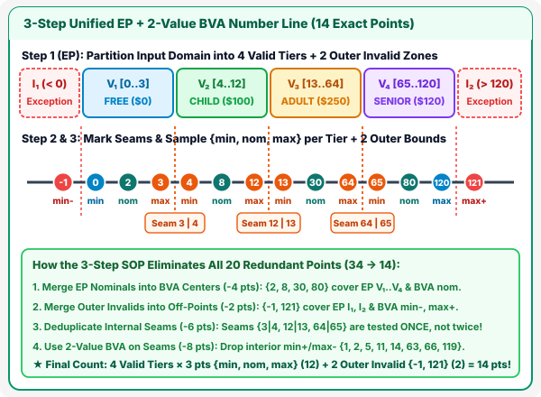

</div>
</div>

<!--
By unifying EP and BVA in three steps—sampling `{min, nom, max}` per valid tier plus `-1` and `121` at the outer invalid edges—we achieve 100% EP and 100% BVA coverage in 14 test values with zero duplication.

💡 難字與專業術語解說：
- contiguous piecewise partitions: 連續分段等價區間（前一個有效區間的右越界點 `max+` 恰好等於下一個有效區間的左邊界點 `min` 的規格結構）
-->
---
## Implementing EP in JUnit 5: `assertThrows` & Data-Driven `@CsvSource`

<div class="card-deck">

> Verify **Invalid Equivalence Classes** one at a time using `assertThrows`, and drive **Valid Equivalence Classes** cleanly via `@CsvSource` / `@CsvFileSource`.

<div class="two-columns">
<div class="card" data-marpit-fragment>

### 1. Invalid Partitions → `assertThrows`
- Enforce the **Single Invalid Rule**: each row injects exactly one invalid input while keeping the other sides valid (`5, 5`):
```java
@ParameterizedTest
@CsvSource({
    "-1,  5,  5", // Invalid side a <= 0 (b, c valid)
    " 5,  0,  5", // Invalid side b <= 0 (a, c valid)
    " 1,  2,  5"  // Invalid triangle inequality a + b <= c
})
void testTriangleInvalidPartitions(int a, int b, int c) {
    IllegalArgumentException ex = assertThrows(
        IllegalArgumentException.class,
        () -> Triangle.classifyOrThrow(a, b, c)
    );
    assertTrue(ex.getMessage().contains("Invalid triangle"));
}
```

</div>
<div class="card" data-marpit-fragment>

### 2. Valid Partitions → External `@CsvSource` Table
- Decouple equivalence partition test data from test logic so business analysts and QA can expand rows easily:
```java
@ParameterizedTest(name = "NextDate({0}/{1}/{2}) => {3}")
@CsvSource({
    "2023,  5, 15, 2023/05/16", // TC1: M2 x D1 x Y2
    "2024,  2, 28, 2024/02/29", // TC2: M3 x D2 x Y1 (Leap)
    "2024,  2, 29, 2024/03/01", // TC3: M3 x D3 x Y1 (Leap rollover)
    "2023,  4, 30, 2023/05/01", // TC4: M1 x D4 x Y2 (30-day)
    "2023, 12, 31, 2024/01/01"  // TC5: M4 x D5 x Y2 (Dec rollover!)
})
void testNextDateEquivalencePartitions(
        int y, int m, int d, String expected) {
    assertEquals(expected, NextDate.compute(y, m, d));
}
```

</div>
</div>
</div>

<!--
Notice how cleanly JUnit 5 expresses Equivalence Partitioning: `@CsvSource` separates the partition table from the assertion logic, while `assertThrows` verifies each invalid partition in strict isolation.

💡 難字與專業術語解說：
- data-driven testing (`@CsvSource`): 資料驅動測試（將測試輸入向量與預期輸出表格獨立於測試程式碼之外，由框架逐列載入執行的測試架構）
-->
---
<!-- id: ase-ch07-ccq2 -->
## Concept Check Question 2: Boundary Value Analysis

<div class="ccq-columns">
<div class="ccq-text">

A software module accepts **4 independent integer inputs**, each constrained to a valid range `[1, 100]`. How many test cases are required for **Independent Normal BVA** vs. **Independent Robustness BVA**?

- **A.** 16 test cases for Normal BVA; 24 test cases for Robustness BVA.
- **B.** 17 test cases for Normal BVA; 25 test cases for Robustness BVA.
- **C.** 20 test cases for Normal BVA; 28 test cases for Robustness BVA.
- **D.** 625 test cases for Normal BVA; 2,401 test cases for Robustness BVA.

</div>
<div class="ccq-logo">
  <a href="https://nlhsueh.github.io/nickedupocket/#/student/ase-ch07-ccq2" target="_blank"></a>
</div>
</div>

<!--
Let's check your mastery of the BVA formulas on Concept Check Question 2.
-->

---
## Concept Check Question 2: Answer & Explanation

- **Correct Answer: B**
- **Explanation:**
  - Under the **Single Fault Assumption** for `n = 4` input variables:
    - **Independent Normal BVA** uses the formula `4n + 1` = `4(4) + 1 = 17` test cases (4 boundary points `min, min+, max-, max` per variable while holding others at `norm`, plus 1 all-`norm` baseline case).
    - **Independent Robustness BVA** uses the formula `6n + 1` = `6(4) + 1 = 25` test cases (adding `min-` and `max+` out-of-bounds points for each of the 4 variables).
  - *Why others are incorrect:* Option A forgets the `+ 1` all-`norm` center point. Option C overcounts `norm` 4 times. Option D calculates Worst-Case Cartesian formulas (`5`<sup>`4`</sup> `= 625` and `7`<sup>`4`</sup> `= 2401`).

<!--
The correct answer is **B**: `4(4) + 1 = 17` for Normal BVA and `6(4) + 1 = 25` for Robustness BVA.
-->
---
## 🧩 7.3 Self-Practice (1/2): Advanced BVA Formulas & Geometric Traps

<div class="sp-quiz-stage" id="sp-quiz-73-1">
<div class="sp-mixed-grid">
<div class="sp-mixed-col">
<div class="sp-mc-card" data-ans="B">
<div class="sp-mc-stem">1. [MC — 25 pts] A flight-control module accepts 3 continuous inputs <code>(roll, pitch, yaw)</code>. An engineer upgrades the test suite from Independent Robust BVA (<code>6n + 1</code>) to Worst-Case Normal BVA (<code>5ⁿ</code>) to detect multi-variable corner coupling. How does the total number of test cases change, and what is traded off?</div>
<div class="sp-mc-opts">
<div class="sp-mc-opt" data-opt="A"><strong>A.</strong> Increases from 13 to 125 tests; gains out-of-bounds exception checks</div>
<div class="sp-mc-opt" data-opt="B"><strong>B.</strong> Increases from 19 to 125 tests; gains multi-variable corner coupling but loses <code>min- / max+</code> out-of-bounds checks</div>
<div class="sp-mc-opt" data-opt="C"><strong>C.</strong> Increases from 19 to 343 tests; covers both multi-variable corners and invalid bounds</div>
<div class="sp-mc-opt" data-opt="D"><strong>D.</strong> Increases from 13 to 243 tests; sacrifices the all-<code>norm</code> baseline center point</div>
</div>
</div>
<div class="sp-mc-card" data-ans="C">
<div class="sp-mc-stem">2. [MC — 25 pts] In the Triangle problem (<code>a, b, c ∈ [1, 200]</code>, <code>norm = 100</code>), why does the 13-case Independent Normal BVA suite exhibit a severe "Diversity Deficit" that misses a defective branch in <code>if (a != b &amp;&amp; b != c &amp;&amp; a != c)</code>?</div>
<div class="sp-mc-opts">
<div class="sp-mc-opt" data-opt="A"><strong>A.</strong> Because <code>norm = 100</code> violates the triangle inequality <code>a + b &gt; c</code> at <code>min = 1</code></div>
<div class="sp-mc-opt" data-opt="B"><strong>B.</strong> Because <code>4n + 1</code> only tests invalid out-of-bounds values like <code>0</code> and <code>201</code></div>
<div class="sp-mc-opt" data-opt="C"><strong>C.</strong> Because holding two variables at <code>norm = 100</code> forces at least two sides to be equal in every test, generating zero Scalene triangles</div>
<div class="sp-mc-opt" data-opt="D"><strong>D.</strong> Because <code>5³ = 125</code> Worst-Case BVA is required to generate Equilateral triangles</div>
</div>
</div>
</div>
<div class="sp-mixed-col">
<div class="sp-bank-bar">
<span class="sp-bank-label">[Word Bank] Confusable Formula Bank (9 chips for 3 slots):</span>
<span class="sp-chip" data-word="4n + 1">4n + 1</span>
<span class="sp-chip" data-word="6n + 1">6n + 1</span>
<span class="sp-chip" data-word="5ⁿ">5ⁿ</span>
<span class="sp-chip" data-word="7ⁿ">7ⁿ</span>
<span class="sp-chip" data-word="2ⁿ">2ⁿ</span>
<span class="sp-chip" data-word="n + 1">n + 1</span>
<span class="sp-chip" data-word="Single Fault Assumption">Single Fault Assumption</span>
<span class="sp-chip" data-word="Single Invalid Rule">Single Invalid Rule</span>
<span class="sp-chip" data-word="Cartesian Product">Cartesian Product</span>
</div>
<div class="sp-q-item" style="font-size: 13.4px; padding: 7px 11px;"><strong>3. [Word Bank — 30 pts]</strong> Independent Normal BVA (<span class="sp-slot is-active" data-ans="4n + 1">[ 1. Click Chip ]</span>) and Robust BVA (<span class="sp-slot" data-ans="6n + 1">[ 2. Click Chip ]</span>) rely on reliability theory's <span class="sp-slot" data-ans="Single Fault Assumption">[ 3. Click Chip ]</span>, holding all other <code>n - 1</code> variables fixed at <code>norm</code>.</div>
<div class="sp-q-item" style="font-size: 13.4px; padding: 7px 11px;"><strong>4. [No Word Bank — Type Exact Term — 20 pts]</strong> Because Independent BVA holds two sides of the Triangle at <code>100</code>, it tests Isosceles and Equilateral shapes but completely misses <span class="sp-free-input" data-ans="Scalene|Scalene triangle|Scalene triangles" data-placeholder="Type triangle type..."></span> triangles.</div>
</div>
</div>
<div class="sp-footer-bar">
<div class="sp-btn-group">
<button type="button" class="sp-btn sp-btn-submit">Submit &amp; Check Score</button>
<button type="button" class="sp-btn sp-btn-reset">↺ Play Again</button>
</div>
<div class="sp-score-msg">Hint (Part 1/2): Answer 2 MCQs + 3 Formula Chips + 1 Free-Text Term, then click Submit!</div>
</div>
</div>

<!--
Self-Practice 7.3 (Part 1/2) challenges students on BVA mathematical trade-offs (`6n + 1 = 19` vs. `5^3 = 125`), the geometric origin of the Triangle diversity deficit, confusable BVA/combinatorial formulas (`4n+1`, `6n+1`, `5^n`, `7^n`, `2^n`, `n+1`, Single Fault Assumption vs. Single Invalid Rule), and a direct free-text input blank for "Scalene".
-->
---
## 🧩 7.3 Self-Practice (2/2): Equivalence Partitioning, NextDate & JUnit 5

<div class="sp-quiz-stage" id="sp-quiz-73-2">
<div class="sp-mixed-grid">
<div class="sp-mixed-col">
<div class="sp-mc-card" data-ans="C">
<div class="sp-mc-stem">1. [MC — 25 pts] A loan engine has 3 inputs with Valid classes <code>|V₁|=4, |V₂|=3, |V₃|=2</code> and Invalid classes <code>|I₁|=2, |I₂|=2, |I₃|=1</code>. What is the minimum total number of test cases required to satisfy Weak Valid EP plus the Single Invalid Rule, versus Strong Valid EP plus the Single Invalid Rule?</div>
<div class="sp-mc-opts">
<div class="sp-mc-opt" data-opt="A"><strong>A.</strong> Weak + Invalid: 4 tests | Strong + Invalid: 24 tests</div>
<div class="sp-mc-opt" data-opt="B"><strong>B.</strong> Weak + Invalid: 5 tests | Strong + Invalid: 29 tests</div>
<div class="sp-mc-opt" data-opt="C"><strong>C.</strong> Weak + Invalid: 9 tests (<code>4 + 5</code>) | Strong + Invalid: 29 tests (<code>24 + 5</code>)</div>
<div class="sp-mc-opt" data-opt="D"><strong>D.</strong> Weak + Invalid: 9 tests | Strong + Invalid: 120 tests (<code>6 × 5 × 3</code>)</div>
</div>
</div>
<div class="sp-mc-card" data-ans="D">
<div class="sp-mc-stem">2. [MC — 25 pts] In <code>NextDate(month, day, year)</code>, if an engineer carelessly merges December into the 31-day month partition <code>{1,3,5,7,8,10,12}</code> and picks <code>July (7)</code> as the Weak EP representative for <code>Day = 31</code>, which critical logic branch goes 100% untested?</div>
<div class="sp-mc-opts">
<div class="sp-mc-opt" data-opt="A"><strong>A.</strong> The Leap-Year February 29 rollover branch (<code>month + 1, day = 1</code>)</div>
<div class="sp-mc-opt" data-opt="B"><strong>B.</strong> The 30-day month invalid date rejection branch (e.g., <code>April 31</code>)</div>
<div class="sp-mc-opt" data-opt="C"><strong>C.</strong> The mid-month normal day increment branch (<code>day = day + 1</code>)</div>
<div class="sp-mc-opt" data-opt="D"><strong>D.</strong> The New Year rollover branch (<code>year = year + 1; month = 1; day = 1</code>)</div>
</div>
</div>
</div>
<div class="sp-mixed-col">
<div class="sp-bank-bar">
<span class="sp-bank-label">[Word Bank] Confusable EP &amp; JUnit Bank (8 chips for 2 slots):</span>
<span class="sp-chip" data-word="max(|V₁|, |V₂|, ...)">max(|V₁|, |V₂|, ...)</span>
<span class="sp-chip" data-word="|V₁| × |V₂| × ...">|V₁| × |V₂| × ...</span>
<span class="sp-chip" data-word="|V₁| + |V₂| + ...">|V₁| + |V₂| + ...</span>
<span class="sp-chip" data-word="Single Invalid Rule">Single Invalid Rule</span>
<span class="sp-chip" data-word="Single Fault Assumption">Single Fault Assumption</span>
<span class="sp-chip" data-word="assertAll">assertAll</span>
<span class="sp-chip" data-word="assertThrows">assertThrows</span>
<span class="sp-chip" data-word="@CsvSource">@CsvSource</span>
</div>
<div class="sp-q-item" style="font-size: 13.4px; padding: 7px 11px;"><strong>3. [Word Bank — 25 pts]</strong> Weak Normal EP compresses valid combinations to <span class="sp-slot is-active" data-ans="max(|V₁|, |V₂|, ...)">[ 1. Click Chip ]</span> baseline test cases; in JUnit 5, wrapping multiple boundary checks inside <span class="sp-slot" data-ans="assertAll">[ 2. Click Chip ]</span> prevents the first assertion failure from hiding subsequent boundary bugs.</div>
<div class="sp-q-item" style="font-size: 13.4px; padding: 7px 11px;"><strong>4. [No Word Bank — Type Exact Term — 25 pts]</strong> When two invalid inputs (<code>age = -5</code> and <code>zip = "bad"</code>) are combined in one test case, the first exception aborts execution before the second check runs—a phenomenon called <span class="sp-free-input" data-ans="Fault Masking|Error Masking|Masking" data-placeholder="Type 2-word term..."></span>.</div>
</div>
</div>
<div class="sp-footer-bar">
<div class="sp-btn-group">
<button type="button" class="sp-btn sp-btn-submit">Submit &amp; Check Score</button>
<button type="button" class="sp-btn sp-btn-reset">↺ Play Again</button>
</div>
<div class="sp-score-msg">Hint (Part 2/2): Answer 2 MCQs + 2 Word-Bank Slots + 1 Free-Text Term, then click Submit!</div>
</div>
</div>

<!--
Self-Practice 7.3 (Part 2/2) tests quantitative Weak/Strong EP + Single Invalid Rule calculation (`max(4,3,2) + (2+2+1) = 9` vs. `4*3*2 + 5 = 29`), the NextDate December `M4` partition requirement, confusable EP/JUnit chips (`max` vs. product vs. sum; `assertAll` vs. `assertThrows`), and a direct free-text input blank for "Fault Masking".
-->
---
## 📝 7.3 Essay Case Study: Food Delivery Fee Engine (EP & BVA)

<div class="sp-essay-hero">
<div class="sp-essay-visual">

</div>
<div class="sp-prose-spec">
<div class="sp-prose-header"><span class="sp-prose-badge">Case Narrative</span><span>Business Requirements (Read &amp; Induce Partitions / Boundaries Yourself!)</span></div>
<p>FoodExpress computes delivery fees via <code>calcFee(subtotal, distanceKm, memberTier, isRainyPeak)</code>. Orders below <strong>NT$ 100</strong> or above <strong>NT$ 10,000</strong> are rejected with an exception. Base delivery fee starts at <strong>NT$ 60</strong>, drops to <strong>NT$ 35</strong> when food subtotal reaches at least <strong>NT$ 300</strong>, and becomes <strong>free (NT$ 0)</strong> at <strong>NT$ 800</strong> or more.</p>
<p>Delivery distance accepts whole kilometers from <strong>1 km to 15 km</strong> (outside is rejected): the first <strong>3 km</strong> add no surcharge; <strong>4 to 8 km</strong> add <strong>NT$ 10/km</strong> over 3 km; beyond <strong>8 km</strong> charges <strong>NT$ 50 + NT$ 20/km</strong> over 8 km. Rainy peak hours (<code>isRainyPeak = true</code>) add <strong>+NT$ 30</strong>. <code>VIP</code> members (vs. <code>NONE</code>) get base fee waived if subtotal &gt;= 300 plus <strong>20% off</strong> the total; final fee is clamped to <strong>NT$ 0 .. NT$ 250</strong>.</p>
</div>
</div>

<div class="sp-essay-grid-2col" id="sp-essay-food-73">
<div class="sp-essay-card">
<div class="sp-essay-q">
<strong>Essay Task 1: Induce Equivalence Partitions (EP)</strong> — Identify all 4 inputs' Valid (<code>V</code>) &amp; Invalid (<code>I</code>) partitions, and derive the minimum test count under <strong>Weak EP + Single Invalid Rule</strong>.
</div>
<div class="sp-essay-toggle">[Reveal] Click to Reveal EP Induction &amp; Test Count</div>
<div class="sp-essay-ans">
• <code>subtotal</code>: <strong>V₁</strong> [100..299] ($60), <strong>V₂</strong> [300..799] ($35), <strong>V₃</strong> [800..10000] ($0) | <strong>I₁</strong> (&lt;100), <strong>I₂</strong> (&gt;10000)<br/>
• <code>distanceKm</code>: <strong>D₁</strong> [1..3] (+$0), <strong>D₂</strong> [4..8] (+$10/km), <strong>D₃</strong> [9..15] (+$50+$20/km) | <strong>I₃</strong> (&lt;1), <strong>I₄</strong> (&gt;15)<br/>
• <code>memberTier</code>: <strong>M₁</strong> {NONE}, <strong>M₂</strong> {VIP} &nbsp;|&nbsp; <code>isRainyPeak</code>: <strong>R₁</strong> {false}, <strong>R₂</strong> {true}<br/>
• <strong>Total:</strong> <code>max(3,3,2,2) = 3</code> valid base + <code>4</code> isolated invalid (<code>I₁..I₄</code>) = <strong>7 EP test cases</strong>!
</div>
</div>
<div class="sp-essay-card card-bva">
<div class="sp-essay-q">
<strong>Essay Task 2: Derive Boundary Value Analysis (BVA) Seams</strong> — List all numerical pricing seams &amp; exact boundary test points for <code>subtotal</code> and <code>distanceKm</code> to catch off-by-one bugs.
</div>
<div class="sp-essay-toggle">[Reveal] Click to Reveal BVA Seam Test Points</div>
<div class="sp-essay-ans">
• <strong>Subtotal Seams (<code>dist=2, NONE, false</code>):</strong> Min (<code>99</code> throws | <code>100, 101</code> $60) • Tier S→M (<code>299</code> $60 | <code>300</code> $35) • Tier M→L (<code>799</code> $35 | <code>800</code> $0) • Max (<code>10000</code> $0 | <code>10001</code> throws)<br/>
• <strong>Distance Seams (<code>sub=500, NONE, false</code>):</strong> Sample <strong><code>{0 (throws), 1, 3, 4, 8, 9, 15, 16 (throws)}</code></strong> km across all 3 zone cutoffs!
</div>
</div>
</div>

<!--
In this Section 7.3 Essay Case Study, the Food Delivery Fee rules are presented as a realistic unstructured business narrative rather than pre-bucketed bullet tiers. Students must read the prose to induce the 4 input variables, their valid/invalid equivalence partitions, and exact BVA seam points before clicking to reveal the structured solutions. We will revisit this exact case study at the end of Section 7.4 to apply Pairwise and Property-Based Testing!
-->
---
## 🧩 7.3 Interactive Matrix Game: FoodExpress EP Partitions & BVA Seams

<div class="fdg-stage" id="fdg-ep-bva-game">
<div class="fdg-board-card">
<div class="fdg-board-title">Board A: 5 × 5 EP Partition Matrix (<code>Subtotal</code> Rows × <code>Distance</code> Columns)</div>
<table class="fdg-table" id="fdg-ep-table">
<thead>
<tr>
<th style="width: 20%;">Subtotal \ Dist</th>
<th style="width: 16%; color: #fda4af;">I₃: &lt; 1 km<br/>(0 km)</th>
<th style="width: 16%; color: #86efac;">D₁: 1..3 km<br/>(+$0)</th>
<th style="width: 16%; color: #86efac;">D₂: 4..8 km<br/>(+$10/km)</th>
<th style="width: 16%; color: #86efac;">D₃: 9..15 km<br/>(+$50+$20)</th>
<th style="width: 16%; color: #fda4af;">I₄: &gt; 15 km<br/>(16 km)</th>
</tr>
</thead>
<tbody id="fdg-ep-tbody"></tbody>
</table>
<div class="fdg-seam-box">
<div class="fdg-seam-title">Board B: <code>Subtotal</code> BVA Seam Number Line (Click Exact Boundary Points for Challenge BVA)</div>
<div class="fdg-chips-wrap" id="fdg-seam-chips">
<span class="fdg-seam-chip" data-val="50">$50</span>
<span class="fdg-seam-chip" data-val="99">$99</span>
<span class="fdg-seam-chip" data-val="100">$100</span>
<span class="fdg-seam-chip" data-val="101">$101</span>
<span class="fdg-seam-chip" data-val="200">$200</span>
<span class="fdg-seam-chip" data-val="299">$299</span>
<span class="fdg-seam-chip" data-val="300">$300</span>
<span class="fdg-seam-chip" data-val="301">$301</span>
<span class="fdg-seam-chip" data-val="500">$500</span>
<span class="fdg-seam-chip" data-val="799">$799</span>
<span class="fdg-seam-chip" data-val="800">$800</span>
<span class="fdg-seam-chip" data-val="801">$801</span>
<span class="fdg-seam-chip" data-val="5000">$5000</span>
<span class="fdg-seam-chip" data-val="9999">$9999</span>
<span class="fdg-seam-chip" data-val="10000">$10000</span>
<span class="fdg-seam-chip" data-val="10001">$10001</span>
</div>
</div>
</div>
<div class="fdg-ctrl-card">
<div class="bvag-spec-box">
<strong>[Rules Recap] FoodExpress <code>calcFee(subtotal, distanceKm)</code>:</strong><br/>
• <strong>Subtotal (<code>NT$</code>)</strong>: Valid <code>100..10000</code> (<code>&lt;100</code> or <code>&gt;10000</code> rejected). Tiers: <strong>V₁</strong> <code>100..299</code> ($60), <strong>V₂</strong> <code>300..799</code> ($35), <strong>V₃</strong> <code>800..10000</code> ($0 Free).<br/>
• <strong>Distance (<code>km</code>)</strong>: Valid <code>1..15</code> (<code>&lt;1</code> or <code>&gt;15</code> rejected). Zones: <strong>D₁</strong> <code>1..3</code> (+$0), <strong>D₂</strong> <code>4..8</code> (+$10/km), <strong>D₃</strong> <code>9..15</code> (+$50+$20/km).
</div>
<div class="bvag-mission-box">
<div class="bvag-round-row">
<span class="bvag-round-pill" id="fdg-round-pill">CHALLENGE 1 OF 4 (RANDOMIZED)</span>
<span class="bvag-stat-pill" id="fdg-score-pill">Solved: 0 / 4 | Selected: 0</span>
</div>
<div class="bvag-target-title" id="fdg-target-title">Target Strategy: Loading...</div>
<div class="bvag-target-hint" id="fdg-target-desc">Click cells in Board A (or seam chips in Board B) to construct your test suite, then click <strong>Submit Selection</strong>!</div>
</div>
<div class="bvag-quick-bar">
<span style="font-size: 11.5px; font-weight: 800; color: #475569;">Quick Helpers:</span>
<button type="button" class="bvag-qbtn" data-fdact="diag3">± 3 Diagonal Valid Cells</button>
<button type="button" class="bvag-qbtn" data-fdact="valid9">± All 9 Valid Cells</button>
<button type="button" class="bvag-qbtn" data-fdact="iso4">± 4 Isolated Invalid Cells</button>
<button type="button" class="bvag-qbtn" data-fdact="clear">✕ Clear All</button>
</div>
<div class="bvag-action-row">
<button type="button" class="bvag-btn" id="fdg-btn-submit">Submit Selection</button>
<button type="button" class="bvag-btn btn-next" id="fdg-btn-next">Next Challenge ➔</button>
<button type="button" class="bvag-btn btn-reset" id="fdg-btn-reshuffle">↺ Reshuffle 4</button>
</div>
<div class="bvag-feedback-box" id="fdg-feedback-msg">Select cells or boundary chips on the left to match the target challenge!</div>
</div>
</div>

<!--
This interactive 4-challenge game on Slide 61 reinforces Slide 60's FoodExpress fee specification by letting students actively select Equivalence Partitions on the 5x5 matrix (Weak Normal EP, Strong Normal EP, Weak Robust EP with the Single Invalid Rule) and select the exact 2-point On-Off boundary seam values (`99, 100, 299, 300, 799, 800, 10000, 10001`) on the Subtotal number line!
-->
---
<!-- _class: lead -->
<!-- header: '7.4 Combinatorial, State & PBT' -->

# **7.4 Combinatorial (Pairwise), State Transition & Property-Based Testing**

> "When multi-parameter combinatorial explosion renders exhaustive testing impossible, Pairwise testing captures 90% of interaction defects with mathematical elegance—while State Machines and Property-Based Testing conquer stateful and infinite domains."

<!--
We now advance to Section 7.4, integrating SQA Sections 5.5 (All-Pairs / Pairwise Testing), 5.8 (State Transition Testing), and 5.11 (Property-Based Testing & Metamorphic Testing).

💡 難字與專業術語解說：
- pairwise (all-pairs) testing: 全成對組合測試（確保系統中任意兩個輸入參數的所有取值配對皆至少在測試集中出現過一次的組合壓縮測試技術）
-->
---
## Combinatorial Explosion & NIST 2-Way Interaction Theory (Pairwise)

<div class="split64">
<div class="left">

* **The Combinatorial Explosion Problem:**
  - A configuration screen with `10` parameters, each having `3` possible values, requires **3<sup>10</sup> = 59,049** exhaustive Strong EP test cases!
* **NIST Empirical Discovery (Kuhn et al.):**
  - Across aerospace, medical, browser, and database bug repositories, **67% to 93% of all software faults** are triggered by a <strong>single parameter (1-way)</strong> or the <strong>interaction of just 2 parameters (2-way)</strong>!
  - Faults requiring 3 or more simultaneous parameter values account for `< 10%`.
* **The All-Pairs (Pairwise) Guarantee & Swimming Pool Example:**
  - **Rule:** Guarantee that **every possible value pair `(v`<sub>`i`</sub>`, v`<sub>`j`</sub>`)` of any two parameters appears together in at least one test case**.
  - **Swimming Pool Fee (`TimeSlot(3) × DayType(2) × Member(2)`):**
    - Full Cartesian product = `3 × 2 × 2 = 12` cases → **Pairwise covers all 16 pairs in just 6 test cases (50% reduction)!**

</div>
<div class="right">


</div>
</div>

<!--
Empirical research by NIST revealed that 67% to 93% of all multi-variable bugs are triggered by at most two variables interacting at once (2-way interaction).

💡 難字與專業術語解說：
- 2-way interaction fault: 雙因子交互作用缺陷（當且僅當兩個特定輸入參數同時取特定值時才會觸發的軟體錯誤）
-->
---
## Why Minimum Pairwise is NP-Hard & Greedy Heuristic Algorithms

<div class="card-deck">

> Finding the absolute smallest pairwise test set is mathematically equivalent to the **NP-Hard Minimum Set Cover Problem**; tools use polynomial-time greedy heuristics.

<div class="two-columns">
<div class="card" data-marpit-fragment>

### Mathematical Complexity: Minimum Set Cover
- **Problem Reduction:**
  - Across `k` parameters, the universe `U` contains `∑ (|V_i| × |V_j|)` value pairs (e.g., Swimming Pool has `6 + 6 + 4 = 16` pairs).
  - Each test case covers at most `C(k, 2)` pairs.
  - Finding the minimum number of rows to cover all pairs in `U` is **NP-Complete / NP-Hard**.
- **Practical Consequence:**
  - Exhaustive search for the global minimum explodes exponentially; we use fast greedy heuristics!

</div>
<div class="card" data-marpit-fragment>

### Industrial Heuristics: AETG & IPO + Greedy
- **1. AETG (`Automatic Efficient Test Generator`):**
  - Builds test suite row-by-row, greedily selecting candidate rows that eliminate the most uncovered pairs.
- **2. IPO (`In-Parameter-Order` — NIST ACTS / AllPairs4J):**
  1. **Base Expansion:** Expand the first two largest parameters `(T, D)` into full Cartesian rows (`3 × 2 = 6` rows).
  2. **Horizontal Greedy Extension:** Add Column 3 (`M`), scoring `m1` vs. `m2` on each row by how many **brand-new pairs** they cover!

</div>
</div>
</div>

---
## Step-by-Step Greedy IPO Trace: Swimming Pool Pricing

<div class="greedy-interactive-stage" id="greedy-explorer">
<div class="greedy-nav-toolbar">
  <div class="greedy-step-group">
    <button class="greedy-step-btn is-active" data-step="1">1. (t₁, d₁)</button>
    <button class="greedy-step-btn" data-step="2">2. (t₁, d₂)</button>
    <button class="greedy-step-btn" data-step="3">3. (t₂, d₁)</button>
    <button class="greedy-step-btn" data-step="4">4. (t₂, d₂)</button>
    <button class="greedy-step-btn" data-step="5">5. (t₃, d₁)</button>
    <button class="greedy-step-btn" data-step="6">6. (t₃, d₂)</button>
  </div>
  <div style="display: flex; gap: 8px;">
    <button class="greedy-action-btn" id="greedy-next-btn">Next Step &gt;</button>
    <button class="greedy-action-btn" id="greedy-reset-btn">Reset</button>
  </div>
</div>
<div class="greedy-content-grid">
  <div class="greedy-card">
    <div class="greedy-decision-box">
      <div style="display: flex; justify-content: space-between; align-items: center; margin-bottom: 2px;">
        <span style="font-size: 11.5px; font-weight: 800; color: #0284c7;" id="greedy-step-badge">STEP 1 OF 6</span>
        <span style="font-size: 11.5px; font-weight: 700; color: #475569;" id="greedy-base-info">Base: (Time = t₁, Day = d₁)</span>
      </div>
      <div class="greedy-eval-row">
        <div class="greedy-eval-item is-winner" id="greedy-eval-m1">
          <div class="greedy-eval-name">Candidate m₁ (Member)</div>
          <div class="greedy-eval-score" id="greedy-score-m1">+3 New Pairs</div>
          <div class="greedy-eval-pairs" id="greedy-pairs-m1">t₁d₁, t₁m₁, d₁m₁</div>
        </div>
        <div class="greedy-eval-item" id="greedy-eval-m2">
          <div class="greedy-eval-name">Candidate m₂ (Non-Member)</div>
          <div class="greedy-eval-score" id="greedy-score-m2">+3 New Pairs</div>
          <div class="greedy-eval-pairs" id="greedy-pairs-m2">t₁d₁, t₁m₂, d₁m₂</div>
        </div>
      </div>
      <div class="greedy-winner-banner" id="greedy-winner-banner">
        <span>[Greedy Winner]: <strong>m₁</strong> (Tie-breaker)</span>
        <span style="font-family: 'Fira Code', monospace; font-size: 12.5px;">Test Case: (t₁, d₁, m₁)</span>
      </div>
    </div>
    <div class="greedy-table-wrapper">
      <table class="greedy-table" id="greedy-trace-table">
        <thead>
          <tr>
            <th>Row</th>
            <th>Base (T, D)</th>
            <th>Greedy Scores</th>
            <th>Winning Test Case</th>
            <th>Cum. Pairs</th>
          </tr>
        </thead>
        <tbody>
          <tr data-row="1" class="is-current">
            <td><strong>1</strong></td>
            <td>(t₁, d₁)</td>
            <td>m₁: +3 vs. m₂: +3</td>
            <td><strong>(t₁, d₁, m₁)</strong></td>
            <td><strong>3 / 16</strong></td>
          </tr>
          <tr data-row="2" class="is-pending">
            <td><strong>2</strong></td>
            <td>(t₁, d₂)</td>
            <td>m₁: +2 vs. m₂: +3</td>
            <td>(t₁, d₂, m₂)</td>
            <td>6 / 16</td>
          </tr>
          <tr data-row="3" class="is-pending">
            <td><strong>3</strong></td>
            <td>(t₂, d₁)</td>
            <td>m₁: +2 vs. m₂: +3</td>
            <td>(t₂, d₁, m₂)</td>
            <td>9 / 16</td>
          </tr>
          <tr data-row="4" class="is-pending">
            <td><strong>4</strong></td>
            <td>(t₂, d₂)</td>
            <td>m₁: +3 vs. m₂: +1</td>
            <td>(t₂, d₂, m₁)</td>
            <td>12 / 16</td>
          </tr>
          <tr data-row="5" class="is-pending">
            <td><strong>5</strong></td>
            <td>(t₃, d₁)</td>
            <td>m₁: +2 vs. m₂: +2</td>
            <td>(t₃, d₁, m₁)</td>
            <td>14 / 16</td>
          </tr>
          <tr data-row="6" class="is-pending">
            <td><strong>6</strong></td>
            <td>(t₃, d₂)</td>
            <td>m₁: +1 vs. m₂: +2</td>
            <td>(t₃, d₂, m₂)</td>
            <td>16 / 16</td>
          </tr>
        </tbody>
      </table>
    </div>
  </div>
  <div class="greedy-card greedy-progress-card">
    <div>
      <div class="greedy-prog-header">
        <span>Pairwise Coverage</span>
        <span id="greedy-prog-stat">3 / 16 Pairs (19%)</span>
      </div>
      <div class="greedy-prog-bar-bg" style="margin-top: 5px;">
        <div class="greedy-prog-bar-fill" id="greedy-prog-bar" style="width: 18.75%;"></div>
      </div>
    </div>
    <div class="greedy-pairs-section">
      <div class="greedy-pairs-title">Time × Day (6 Pairs — Base Domain)</div>
      <div class="greedy-pairs-tags">
        <span class="greedy-pair-tag is-new" data-pair="t1d1">t₁d₁</span>
        <span class="greedy-pair-tag" data-pair="t1d2">t₁d₂</span>
        <span class="greedy-pair-tag" data-pair="t2d1">t₂d₁</span>
        <span class="greedy-pair-tag" data-pair="t2d2">t₂d₂</span>
        <span class="greedy-pair-tag" data-pair="t3d1">t₃d₁</span>
        <span class="greedy-pair-tag" data-pair="t3d2">t₃d₂</span>
      </div>
    </div>
    <div class="greedy-pairs-section">
      <div class="greedy-pairs-title">Time × Member (6 Pairs)</div>
      <div class="greedy-pairs-tags">
        <span class="greedy-pair-tag is-new" data-pair="t1m1">t₁m₁</span>
        <span class="greedy-pair-tag" data-pair="t1m2">t₁m₂</span>
        <span class="greedy-pair-tag" data-pair="t2m1">t₂m₁</span>
        <span class="greedy-pair-tag" data-pair="t2m2">t₂m₂</span>
        <span class="greedy-pair-tag" data-pair="t3m1">t₃m₁</span>
        <span class="greedy-pair-tag" data-pair="t3m2">t₃m₂</span>
      </div>
    </div>
    <div class="greedy-pairs-section">
      <div class="greedy-pairs-title">Day × Member (4 Pairs)</div>
      <div class="greedy-pairs-tags">
        <span class="greedy-pair-tag is-new" data-pair="d1m1">d₁m₁</span>
        <span class="greedy-pair-tag" data-pair="d1m2">d₁m₂</span>
        <span class="greedy-pair-tag" data-pair="d2m1">d₂m₁</span>
        <span class="greedy-pair-tag" data-pair="d2m2">d₂m₂</span>
      </div>
    </div>
  </div>
</div>
</div>

<!--
Trace the IPO + Greedy algorithm step-by-step: clicking each row illustrates how candidate values `m1` and `m2` are scored based on the number of brand-new parameter pairs they cover, progressively completing 100% of all 16 pairs in just 6 rows!

💡 難字與專業術語解說：
- In-Parameter-Order (IPO): 參數依序擴展演算法（先展開前兩個參數的笛卡爾積，再逐一水平加入新參數欄並以貪婪計分挑選能消除最多未覆蓋成對組合之值的多項式時間啟發式演算法）
-->
---
## Pairwise Testing Tools & Loan Calculator Case Study

<div class="split73">
<div class="left">

* **Industrial Automated Pairwise Tools:**
  - **`AllPairs4J` (Java / JUnit 5 Native):** Pure Java fluent builder API that generates `List<Case>` directly inside JUnit 5 `@TestFactory` dynamic tests!
  - **Microsoft `PICT` (CLI):** Industry-standard command-line generator supporting `.pict` model files, negative testing, and constraint pruning.
  - **NIST `ACTS`:** Supports higher-strength **`t`-way combinatorial coverage** (`3-way`, `4-way` for safety-critical systems) with SAT constraint solvers.
* **Mortgage `LoanCalculator` Case Study (`3 × 3 × 2 × 2 = 36` → `9` Cases):**
  - **4 Dimensions:** `LoanYears` (`≤10`, `11..20`, `>20`), `Amount` (`≤5M`, `6M`, `10M`), `IsYouth` (`true/false`), `IsMarried` (`true/false`).
  - Full Cartesian product = **36 cases** → `AllPairs4J` achieves <strong>100% 2-way coverage in just 9 cases (75% reduction)</strong>!

</div>
<div class="right">


</div>
</div>

<!--
In the Mortgage Loan Calculator case study, 4 parameters with `3 × 3 × 2 × 2` partitions require 36 full combinations, which `AllPairs4J` compresses to 9 test cases while covering 100% of parameter pairs.

💡 難字與專業術語解說：
- constraint pruning (SAT solver): 約束剪枝（利用布林可滿足性求解器在生成成對測試集時自動排除業務上互斥的非法參數組合，例如 `OS=iOS` 與 `Browser=IE`）
-->
---
## 🧩 Pairwise Solution Table: `LoanCalculator` (Complete Cases #8 & #9!)

> **Challenge:** Click the **bottom-right 4 cells** (`true` ↔ `false`) in `#8` and `#9` to cover all remaining 2-way pairs, then click **Submit**!

<div id="pw-loan-table-quiz">
<table>
<thead>
<tr>
<th style="width:65px;text-align:center;">Case</th>
<th style="width:140px;text-align:center;"><code>LoanYears</code> (3)</th>
<th style="width:120px;text-align:center;"><code>Amount</code> (3)</th>
<th style="width:130px;text-align:center;"><code>IsYouth</code> (2)</th>
<th style="width:130px;text-align:center;"><code>IsMarried</code> (2)</th>
<th style="text-align:left;">Key 2-Way Pairs Covered</th>
</tr>
</thead>
<tbody>
<tr><td style="text-align:center;"><strong>#1</strong></td><td style="text-align:center;"><code>≤ 10 yr</code> (5)</td><td style="text-align:center;"><code>≤ 5M</code> (4M)</td><td style="text-align:center;"><code>true</code></td><td style="text-align:center;"><code>true</code></td><td><code>(≤10, ≤5M)</code>, <code>(≤10, Y=T)</code>, <code>(≤10, M=T)</code>, <code>(≤5M, Y=T)</code>, <code>(≤5M, M=T)</code>, <code>(Y=T, M=T)</code></td></tr>
<tr><td style="text-align:center;"><strong>#2</strong></td><td style="text-align:center;"><code>≤ 10 yr</code> (5)</td><td style="text-align:center;"><code>6M</code></td><td style="text-align:center;"><code>false</code></td><td style="text-align:center;"><code>false</code></td><td><code>(≤10, 6M)</code>, <code>(≤10, Y=F)</code>, <code>(≤10, M=F)</code>, <code>(6M, Y=F)</code>, <code>(6M, M=F)</code>, <code>(Y=F, M=F)</code></td></tr>
<tr><td style="text-align:center;"><strong>#3</strong></td><td style="text-align:center;"><code>≤ 10 yr</code> (5)</td><td style="text-align:center;"><code>10M</code></td><td style="text-align:center;"><code>false</code></td><td style="text-align:center;"><code>true</code></td><td><code>(≤10, 10M)</code>, <code>(10M, Y=F)</code>, <code>(10M, M=T)</code>, <code>(Y=F, M=T)</code></td></tr>
<tr><td style="text-align:center;"><strong>#4</strong></td><td style="text-align:center;"><code>11..20 yr</code> (15)</td><td style="text-align:center;"><code>≤ 5M</code> (4M)</td><td style="text-align:center;"><code>false</code></td><td style="text-align:center;"><code>true</code></td><td><code>(11..20, ≤5M)</code>, <code>(11..20, Y=F)</code>, <code>(11..20, M=T)</code>, <code>(≤5M, Y=F)</code></td></tr>
<tr><td style="text-align:center;"><strong>#5</strong></td><td style="text-align:center;"><code>11..20 yr</code> (15)</td><td style="text-align:center;"><code>6M</code></td><td style="text-align:center;"><code>true</code></td><td style="text-align:center;"><code>false</code></td><td><code>(11..20, 6M)</code>, <code>(11..20, Y=T)</code>, <code>(11..20, M=F)</code>, <code>(6M, Y=T)</code>, <code>(Y=T, M=F)</code></td></tr>
<tr><td style="text-align:center;"><strong>#6</strong></td><td style="text-align:center;"><code>11..20 yr</code> (15)</td><td style="text-align:center;"><code>10M</code></td><td style="text-align:center;"><code>true</code></td><td style="text-align:center;"><code>false</code></td><td><code>(11..20, 10M)</code>, <code>(10M, Y=T)</code>, <code>(10M, M=F)</code></td></tr>
<tr><td style="text-align:center;"><strong>#7</strong></td><td style="text-align:center;"><code>&gt; 20 yr</code> (25)</td><td style="text-align:center;"><code>≤ 5M</code> (4M)</td><td style="text-align:center;"><code>true</code></td><td style="text-align:center;"><code>false</code></td><td><code>(&gt;20, ≤5M)</code>, <code>(&gt;20, Y=T)</code>, <code>(&gt;20, M=F)</code>, <code>(≤5M, M=F)</code></td></tr>
<tr style="background:#f0f9ff;"><td style="text-align:center;"><strong>#8</strong></td><td style="text-align:center;"><code>&gt; 20 yr</code> (25)</td><td style="text-align:center;"><code>6M</code></td><td style="text-align:center;"><button type="button" class="pw-sw-btn" data-id="c8y" data-expected="false" style="min-width:86px;padding:2px 10px;border-radius:6px;border:2px solid #0284c7;background:#e0f2fe;color:#0369a1;font-family:monospace;font-weight:700;font-size:15px;cursor:pointer;">true ⇄</button></td><td style="text-align:center;"><button type="button" class="pw-sw-btn" data-id="c8m" data-expected="true" style="min-width:86px;padding:2px 10px;border-radius:6px;border:2px solid #0284c7;background:#e0f2fe;color:#0369a1;font-family:monospace;font-weight:700;font-size:15px;cursor:pointer;">true ⇄</button></td><td id="pw-clue-8" style="color:#0369a1;font-weight:600;"><code>(&gt;20, 6M)</code> + <em>Which pairs are missing for <code>&gt;20</code> &amp; <code>6M</code>?</em></td></tr>
<tr style="background:#f0f9ff;"><td style="text-align:center;"><strong>#9</strong></td><td style="text-align:center;"><code>&gt; 20 yr</code> (25)</td><td style="text-align:center;"><code>10M</code></td><td style="text-align:center;"><button type="button" class="pw-sw-btn" data-id="c9y" data-expected="any" style="min-width:86px;padding:2px 10px;border-radius:6px;border:2px solid #0284c7;background:#e0f2fe;color:#0369a1;font-family:monospace;font-weight:700;font-size:15px;cursor:pointer;">true ⇄</button></td><td style="text-align:center;"><button type="button" class="pw-sw-btn" data-id="c9m" data-expected="any" style="min-width:86px;padding:2px 10px;border-radius:6px;border:2px solid #0284c7;background:#e0f2fe;color:#0369a1;font-family:monospace;font-weight:700;font-size:15px;cursor:pointer;">true ⇄</button></td><td id="pw-clue-9" style="color:#0369a1;font-weight:600;"><code>(&gt;20, 10M)</code> + <em>Helps cover remaining <code>&gt;20</code> pairs!</em></td></tr>
</tbody>
</table>
<div style="display:flex;align-items:center;gap:12px;margin-top:8px;">
<button type="button" id="pw-loan-submit" style="padding:5px 16px;border-radius:6px;border:none;background:#0284c7;color:#fff;font-weight:700;font-size:14.5px;cursor:pointer;">Submit Answer</button>
<button type="button" id="pw-loan-reset" style="padding:5px 12px;border-radius:6px;border:1px solid #94a3b8;background:#fff;color:#334155;font-weight:600;font-size:13.5px;cursor:pointer;">Reset</button>
<div id="pw-loan-feedback" style="font-size:14.5px;font-weight:600;color:#1e293b;"></div>
</div>
</div>
<script>
(function(){
  var root = document.getElementById('pw-loan-table-quiz');
  if (!root || root.dataset.bound) return;
  root.dataset.bound = '1';
  var btns = root.querySelectorAll('.pw-sw-btn');
  var fb = root.querySelector('#pw-loan-feedback');
  var clue8 = root.querySelector('#pw-clue-8');
  var clue9 = root.querySelector('#pw-clue-9');
  function setVal(b, v) {
    b.dataset.val = v;
    b.textContent = v + ' ⇄';
    b.style.background = v === 'true' ? '#e0f2fe' : '#fef3c7';
    b.style.borderColor = v === 'true' ? '#0284c7' : '#d97706';
    b.style.color = v === 'true' ? '#0369a1' : '#b45309';
  }
  btns.forEach(function(b){
    setVal(b, 'true');
    b.addEventListener('click', function(e){
      e.stopPropagation();
      setVal(b, b.dataset.val === 'true' ? 'false' : 'true');
      fb.textContent = '';
    });
  });
  root.querySelector('#pw-loan-submit').addEventListener('click', function(e){
    e.stopPropagation();
    var v = {};
    btns.forEach(function(b){ v[b.dataset.id] = b.dataset.val; });
    var missing = [];
    if (v.c8m !== 'true') missing.push('(6M, IsMarried=true) in #8');
    if (v.c8y !== 'false' && v.c9y !== 'false') missing.push('(>20 yr, IsYouth=false) in #8 or #9');
    if (v.c8m !== 'true' && v.c9m !== 'true') missing.push('(>20 yr, IsMarried=true) in #8 or #9');
    var c8mOk = (v.c8m === 'true');
    var yFalseOk = (v.c8y === 'false' || v.c9y === 'false');
    btns.forEach(function(b){
      var ok = true;
      if (b.dataset.id === 'c8m' && !c8mOk) ok = false;
      if ((b.dataset.id === 'c8y' || b.dataset.id === 'c9y') && !yFalseOk) ok = false;
      b.style.background = ok ? '#dcfce7' : '#fee2e2';
      b.style.borderColor = ok ? '#16a34a' : '#dc2626';
      b.style.color = ok ? '#15803d' : '#b91c1c';
    });
    if (missing.length === 0) {
      fb.style.color = '#15803d';
      fb.innerHTML = '✅ <strong>100% Pairwise Coverage (28/28 pairs)!</strong> <code>#8</code> covers <code>(6M, M=true)</code>, and <code>(&gt;20, Y=false)</code> &amp; <code>(&gt;20, M=true)</code> are covered!';
      clue8.innerHTML = '✅ <code>(&gt;20, 6M)</code>, <code>(6M, M=T)</code>, <code>(&gt;20, M=T)</code>' + (v.c8y === 'false' ? ', <code>(&gt;20, Y=F)</code>' : '');
      clue9.innerHTML = '✅ <code>(&gt;20, 10M)</code>' + (v.c9y === 'false' ? ', <code>(&gt;20, Y=F)</code>' : '') + ' — All 28 pairs complete!';
    } else {
      fb.style.color = '#b91c1c';
      fb.innerHTML = '❌ <strong>Incomplete 2-Way Coverage!</strong> Still missing: <code>' + missing.join('</code>, <code>') + '</code>.';
    }
  });
  root.querySelector('#pw-loan-reset').addEventListener('click', function(e){
    e.stopPropagation();
    btns.forEach(function(b){ setVal(b, 'true'); });
    fb.textContent = '';
    clue8.innerHTML = '<code>(&gt;20, 6M)</code> + <em>Which pairs are missing for <code>&gt;20</code> &amp; <code>6M</code>?</em>';
    clue9.innerHTML = '<code>(&gt;20, 10M)</code> + <em>Helps cover remaining <code>&gt;20</code> pairs!</em>';
  });
})();
</script>

<!--
Let us solve Cases #8 and #9 together by checking the uncovered 2-way pairs after Case #7:

First, look at the `LoanYears × Amount` (`3 × 3 = 9`) grid: `≤ 10 yr` and `11..20 yr` have each been paired with all three amounts (`≤ 5M`, `6M`, `10M`), whereas `> 20 yr` has only been paired with `≤ 5M` in Case #7. Therefore, Cases #8 and #9 MUST cover `(> 20 yr, 6M)` and `(> 20 yr, 10M)`!

Second, for Case #8 (`> 20 yr`, `6M`), inspect what `> 20 yr` and `6M` still need: in Case #7, `> 20 yr` already paired with `IsYouth = true` and `IsMarried = false`, so `> 20 yr` still needs `IsYouth = false` and `IsMarried = true`. Furthermore, in Cases #2 and #5, `6M` only paired with `IsMarried = false`, so `6M` also requires `IsMarried = true`! Setting `#8 = (> 20 yr, 6M, false, true)` covers all four missing pairs at once.

Third, for Case #9 (`> 20 yr`, `10M`), inspect `10M × IsYouth`: in Cases #3 and #6, `10M` only paired with `IsYouth = false` and never with `IsYouth = true`! Thus Case #9 must set `IsYouth = true` (and `IsMarried = true` or `false`), achieving 100% coverage of all 28 parameter pairs in just 9 test cases.

💡 難字與專業術語解說：
- pairwise coverage completion: 成對覆蓋完備性（檢驗所有參數兩兩配對組合皆至少在測試表中出現一次的驗證條件）
-->
---
## Pairwise in JUnit 5: AllPairs4J & Test Oracles

<div class="card-deck">

> `AllPairs4J` only generates **compressed Input Combinations**—use <strong>Strategy A (Dynamic Invariants)</strong> or <strong>Strategy B (2-Stage `@CsvSource` Exact Oracles)</strong> to verify outputs!

<div class="two-columns">
<div class="card" data-marpit-fragment>

### Strategy A: Dynamic Invariant Oracle (`@TestFactory`)
- Generates `List<Case>` at runtime and asserts universal **domain bounds** (`50 ≤ price ≤ 200`):
```java
AllPairs allPairs = new AllPairs.AllPairsBuilder()
    .withParameter(new Parameter("Time", "MORNING", "NOON", "OTHER"))
    .withParameter(new Parameter("Day",  "HOLIDAY", "WEEKDAY"))
    .withParameter(new Parameter("Mem",  "true", "false"))
    .build(); // Generates 6 pairwise cases

@TestFactory
Stream<DynamicTest> testPoolPairwiseInvariants() {
    return allPairs.getGeneratedCases().stream().map(c ->
        DynamicTest.dynamicTest(c.toString(), () -> {
            int p = Pool.calc(c.get("Time"), c.get("Day"), c.get("Mem"));
            assertTrue(p >= 50 && p <= 200);
        })
    );
}
```

</div>
<div class="card" data-marpit-fragment>

### Strategy B: 2-Stage Exact Oracle (`AllPairs` → `@CsvSource`)
- **Stage 1:** Use `AllPairs4J` to print a 6-row `@CsvSource` template with `TODO` output placeholders.
- **Stage 2:** Human engineer computes exact SRS prices for only those **6 rows** and runs `assertEquals`:
```java
@ParameterizedTest
@CsvSource({ // Stage 1 generated inputs -> Stage 2 human-filled Oracles
    "MORNING, HOLIDAY, true,  100",
    "MORNING, WEEKDAY, false,  80",
    "NOON,    HOLIDAY, false, 200",
    "NOON,    WEEKDAY, true,   50",
    "OTHER,   HOLIDAY, true,  100",
    "OTHER,   WEEKDAY, false, 100"
})
void testPoolPairwiseExactOracle(Time t, Day d, boolean m, int expected) {
    assertEquals(expected, Pool.calc(t, d, m));
}
```

</div>
</div>
</div>

<!--
Strategy A runs 100% automatically to check domain invariants and no-crash smoke properties, while Strategy B pairs automated input compression with exact SRS expected values on just the 6 pairwise rows.

💡 難字與專業術語解說：
- `@TestFactory` (`DynamicTest`): JUnit 5 動態測試工廠（允許在執行期由程式碼迴圈或外部產生器動態建立並回傳多個獨立測試節點的機制）
-->
---
## Interactive State Machine: Path & Coverage Explorer

<div class="sm-interactive-grid" id="sm-explorer">
<div class="sm-control-card">
<div class="sm-path-list">
<label class="sm-path-item is-checked"><input type="checkbox" class="sm-cb" value="1" checked /><span class="sm-path-label"><span class="sm-path-title">Path 1: Normal Boarding (Happy Path)</span><span class="sm-path-seq">giveInfo ➔ payMoney ➔ print ➔ giveTicket</span></span></label>
<label class="sm-path-item"><input type="checkbox" class="sm-cb" value="2" /><span class="sm-path-label"><span class="sm-path-title">Path 2: Cancel after Ticketed</span><span class="sm-path-seq">giveInfo ➔ payMoney ➔ print ➔ cancel</span></span></label>
<label class="sm-path-item"><input type="checkbox" class="sm-cb" value="3" /><span class="sm-path-label"><span class="sm-path-title">Path 3: Refund after Payment</span><span class="sm-path-seq">giveInfo ➔ payMoney ➔ cancel</span></span></label>
<label class="sm-path-item"><input type="checkbox" class="sm-cb" value="4" /><span class="sm-path-label"><span class="sm-path-title">Path 4: Cancel Reservation</span><span class="sm-path-seq">giveInfo ➔ cancel</span></span></label>
<label class="sm-path-item"><input type="checkbox" class="sm-cb" value="5" /><span class="sm-path-label"><span class="sm-path-title">Path 5: Non-Payment Timeout</span><span class="sm-path-seq">giveInfo ➔ payTimeExpire</span></span></label>
</div>
<div class="sm-btn-row">
<button type="button" class="sm-btn sm-btn-highlight" data-sm-action="node100">[Demo] 100% Node / 75% Edge (1+2+5)</button>
<button type="button" class="sm-btn" data-sm-action="all">Select All (100%)</button>
<button type="button" class="sm-btn" data-sm-action="clear">Clear</button>
</div>
<div class="sm-coverage-box">
<div class="sm-cov-row">
<div class="sm-cov-header"><span>[Node] State Coverage</span><span id="sm-node-stat">4 / 6 (67%)</span></div>
<div class="sm-cov-bar-bg"><div id="sm-node-bar" class="sm-cov-bar-fill" style="width: 66.7%; background: #0284c7;"></div></div>
</div>
<div class="sm-cov-row">
<div class="sm-cov-header"><span>[Edge] Transition Coverage</span><span id="sm-edge-stat">4 / 8 (50%)</span></div>
<div class="sm-cov-bar-bg"><div id="sm-edge-bar" class="sm-cov-bar-fill" style="width: 50%; background: #f59e0b;"></div></div>
</div>
<div id="sm-cov-note" style="font-size: 11px; font-weight: 700; color: #0369a1; margin-top: 2px;">Hint: Select test paths to observe live state and transition activations!</div>
</div>
</div>
<div class="sm-canvas-card">
<svg xmlns="http://www.w3.org/2000/svg" viewBox="0 0 940 445">
<defs>
<marker id="sm-arr" viewBox="0 0 10 10" refX="7" refY="5" markerWidth="6" markerHeight="6" orient="auto-start-reverse"><path d="M 0 1 L 9 5 L 0 9 z" fill="#0284c7" /></marker>
<marker id="sm-arr-cancel" viewBox="0 0 10 10" refX="7" refY="5" markerWidth="6" markerHeight="6" orient="auto-start-reverse"><path d="M 0 1 L 9 5 L 0 9 z" fill="#dc2626" /></marker>
</defs>
<rect width="940" height="445" fill="#ffffff" rx="10" />
<g transform="translate(20, 18)">
<text x="0" y="10" font-family="sans-serif" font-size="14px" font-weight="700" fill="#0b3c5d">Airline Reservation State Machine (6 States / 8 Transitions)</text>
<line x1="560" y1="6" x2="595" y2="6" stroke="#0284c7" stroke-width="3" marker-end="url(#sm-arr)" />
<text x="605" y="10" font-family="sans-serif" font-size="12px" font-weight="700" fill="#0369a1">Happy Path (4)</text>
<line x1="710" y1="6" x2="745" y2="6" stroke="#dc2626" stroke-width="2.5" stroke-dasharray="6 3" marker-end="url(#sm-arr-cancel)" />
<text x="755" y="10" font-family="sans-serif" font-size="12px" font-weight="700" fill="#dc2626">Cancel / Timeout (4)</text>
</g>
<circle cx="48" cy="110" r="14" fill="#0f172a" />
<text x="48" y="140" font-family="sans-serif" font-size="12px" font-weight="700" fill="#475569" text-anchor="middle">Init</text>
<g class="sm-edge is-active" data-edge="giveInfo" data-paths="1,2,3,4,5">
<path d="M 62 110 L 140 110" class="sm-line" stroke="#0284c7" stroke-width="2.5" fill="none" marker-end="url(#sm-arr)" />
<rect x="66" y="86" width="68" height="19" fill="#e0f2fe" rx="4" />
<text x="100" y="99" font-family="monospace" font-size="11.5px" font-weight="700" fill="#0369a1" text-anchor="middle">giveInfo</text>
</g>
<g class="sm-state is-active" data-state="Made" data-paths="1,2,3,4,5">
<rect x="144" y="80" width="130" height="60" rx="12" class="sm-main-rect" fill="#eff6ff" stroke="#0284c7" stroke-width="2.4" />
<text x="209" y="104" font-family="sans-serif" font-size="15px" font-weight="700" fill="#0b3c5d" text-anchor="middle">Made</text>
<text x="209" y="124" font-family="sans-serif" font-size="11.5px" fill="#475569" text-anchor="middle">Reservation Active</text>
</g>
<g class="sm-edge is-active" data-edge="payMoney" data-paths="1,2,3">
<path d="M 274 110 L 386 110" class="sm-line" stroke="#0284c7" stroke-width="2.5" fill="none" marker-end="url(#sm-arr)" />
<rect x="294" y="86" width="74" height="19" fill="#e0f2fe" rx="4" />
<text x="331" y="99" font-family="monospace" font-size="11.5px" font-weight="700" fill="#0369a1" text-anchor="middle">payMoney</text>
</g>
<g class="sm-state is-active" data-state="Paid" data-paths="1,2,3">
<rect x="390" y="80" width="130" height="60" rx="12" class="sm-main-rect" fill="#eff6ff" stroke="#0284c7" stroke-width="2.4" />
<text x="455" y="104" font-family="sans-serif" font-size="15px" font-weight="700" fill="#0b3c5d" text-anchor="middle">Paid</text>
<text x="455" y="124" font-family="sans-serif" font-size="11.5px" fill="#475569" text-anchor="middle">Payment Confirmed</text>
</g>
<g class="sm-edge is-active" data-edge="print" data-paths="1,2">
<path d="M 520 110 L 636 110" class="sm-line" stroke="#0284c7" stroke-width="2.5" fill="none" marker-end="url(#sm-arr)" />
<rect x="546" y="86" width="64" height="19" fill="#e0f2fe" rx="4" />
<text x="578" y="99" font-family="monospace" font-size="11.5px" font-weight="700" fill="#0369a1" text-anchor="middle">print</text>
</g>
<g class="sm-state is-active" data-state="Ticketed" data-paths="1,2">
<rect x="640" y="80" width="130" height="60" rx="12" class="sm-main-rect" fill="#eff6ff" stroke="#0284c7" stroke-width="2.4" />
<text x="705" y="104" font-family="sans-serif" font-size="15px" font-weight="700" fill="#0b3c5d" text-anchor="middle">Ticketed</text>
<text x="705" y="124" font-family="sans-serif" font-size="11.5px" fill="#475569" text-anchor="middle">E-Ticket Issued</text>
</g>
<g class="sm-edge is-active" data-edge="giveTicket" data-paths="1">
<path d="M 770 110 L 836 110 L 836 214" class="sm-line" stroke="#0284c7" stroke-width="2.5" fill="none" marker-end="url(#sm-arr)" />
<rect x="786" y="150" width="84" height="19" fill="#e0f2fe" rx="4" />
<text x="828" y="163" font-family="monospace" font-size="11.5px" font-weight="700" fill="#0369a1" text-anchor="middle">giveTicket</text>
</g>
<g class="sm-state is-active" data-state="Used" data-paths="1">
<rect x="760" y="220" width="152" height="64" rx="14" class="sm-main-rect" fill="#dcfce7" stroke="#15803d" stroke-width="2.6" />
<rect x="765" y="225" width="142" height="54" rx="10" fill="none" stroke="#15803d" stroke-width="1.3" />
<text x="836" y="246" font-family="sans-serif" font-size="15px" font-weight="700" fill="#166534" text-anchor="middle">Used (Final)</text>
<text x="836" y="266" font-family="sans-serif" font-size="11.5px" fill="#15803d" text-anchor="middle">Flight Boarded</text>
</g>
<g class="sm-edge" data-edge="cancel-made" data-paths="4">
<path d="M 235 140 L 235 275 L 356 275" class="sm-line" stroke="#dc2626" stroke-width="2.2" stroke-dasharray="6 3" fill="none" marker-end="url(#sm-arr-cancel)" />
<rect x="244" y="252" width="96" height="19" fill="#fee2e2" rx="4" />
<text x="292" y="265" font-family="monospace" font-size="11px" font-weight="700" fill="#b91c1c" text-anchor="middle">cancel (Path 4)</text>
</g>
<g class="sm-edge" data-edge="cancel-paid" data-paths="3">
<path d="M 455 140 L 455 256" class="sm-line" stroke="#dc2626" stroke-width="2.2" stroke-dasharray="6 3" fill="none" marker-end="url(#sm-arr-cancel)" />
<rect x="462" y="188" width="96" height="19" fill="#fee2e2" rx="4" />
<text x="510" y="201" font-family="monospace" font-size="11px" font-weight="700" fill="#b91c1c" text-anchor="middle">cancel (Path 3)</text>
</g>
<g class="sm-edge" data-edge="cancel-ticketed" data-paths="2">
<path d="M 685 140 L 685 275 L 564 275" class="sm-line" stroke="#dc2626" stroke-width="2.2" stroke-dasharray="6 3" fill="none" marker-end="url(#sm-arr-cancel)" />
<rect x="576" y="252" width="98" height="19" fill="#fee2e2" rx="4" />
<text x="625" y="265" font-family="monospace" font-size="11px" font-weight="700" fill="#b91c1c" text-anchor="middle">cancel (Path 2)</text>
</g>
<g class="sm-state" data-state="CancelledByCustomer" data-paths="2,3,4">
<rect x="360" y="260" width="200" height="64" rx="14" class="sm-main-rect" fill="#fef2f2" stroke="#dc2626" stroke-width="2.6" />
<rect x="365" y="265" width="190" height="54" rx="10" fill="none" stroke="#dc2626" stroke-width="1.3" />
<text x="460" y="286" font-family="sans-serif" font-size="14px" font-weight="700" fill="#b91c1c" text-anchor="middle">CancelledByCustomer</text>
<text x="460" y="306" font-family="sans-serif" font-size="11.5px" fill="#dc2626" text-anchor="middle">Customer Cancelled (Final)</text>
</g>
<g class="sm-edge" data-edge="expire" data-paths="5">
<path d="M 180 140 L 180 356" class="sm-line" stroke="#dc2626" stroke-width="2.2" stroke-dasharray="6 3" fill="none" marker-end="url(#sm-arr-cancel)" />
<rect x="72" y="205" width="102" height="19" fill="#fee2e2" rx="4" />
<text x="123" y="218" font-family="monospace" font-size="11px" font-weight="700" fill="#b91c1c" text-anchor="middle">payTimeExpire</text>
</g>
<g class="sm-state" data-state="CancelledNonPay" data-paths="5">
<rect x="108" y="360" width="198" height="64" rx="14" class="sm-main-rect" fill="#fef2f2" stroke="#dc2626" stroke-width="2.6" />
<rect x="113" y="365" width="188" height="54" rx="10" fill="none" stroke="#dc2626" stroke-width="1.3" />
<text x="207" y="386" font-family="sans-serif" font-size="14px" font-weight="700" fill="#b91c1c" text-anchor="middle">CancelledNonPay</text>
<text x="207" y="406" font-family="sans-serif" font-size="11.5px" fill="#dc2626" text-anchor="middle">Payment Expired (Final)</text>
</g>
</svg>
</div>
</div>

<!--
Interact with the 5 test paths to observe the difference between State (Node) Coverage and Transition (Edge) Coverage. Notice that selecting Paths 1+2+5 reaches 100% State Coverage (all 6 state boxes turn green/red), yet misses 2 cancellation edges! Only Transition Coverage guarantees complete test adequacy.

💡 難字與專業術語解說：
- state transition testing: 狀態轉換測試（依據系統在不同事件與條件下於有限狀態集合間流轉的行為模型設計測試路徑的技術）
- node coverage vs. edge coverage: 節點覆蓋對比邊覆蓋（節點覆蓋僅要求造訪各狀態，邊覆蓋則要求測試所有可能誘發狀態轉變之事件弧線）
-->
---
## State Coverage Criteria (`Node` vs. `0-Switch` / `1-Switch`) & JUnit 5 `@Nested`

<div class="card-deck">

> <strong>Transition Coverage (Edge / 0-Switch)</strong> strictly subsumes <strong>State Coverage (Node)</strong>; in JUnit 5, use `@BeforeEach` and `@Nested` classes to mirror state hierarchies cleanly.

<div class="two-columns">
<div class="card" data-marpit-fragment>

### State (Node) vs. Transition (`0-Switch`) Coverage
- **State Coverage (Node):** Visits all 6 states, but Paths `1+2+5` achieve `100% Node` while missing 2 cancel edges (`75% Edge`)!
- **Transition Coverage (`0-Switch` / Edge — Mandatory Baseline):**
  - Covers all `8/8` transitions via **5 paths**:
    1. `giveInfo → payMoney → print → giveTicket` *(Happy Path)*
    2. `giveInfo → payMoney → print → cancel` *(Ticketed cancel)*
    3. `giveInfo → payMoney → cancel` *(Paid cancel)*
    4. `giveInfo → cancel` *(Made cancel)*
    5. `giveInfo → payTimeExpire` *(Timeout auto-cancel)*
- **Negative State Testing:** Trigger invalid events per state!

</div>
<div class="card" data-marpit-fragment>

### Airline Ticket Sequence & State Verification (`@Nested`)
```java
class AirlineReservationStateTest {
    AirlineTicket ticket;
    @BeforeEach void init() { ticket = new AirlineTicket(); } // Init

    @Test void happyPathReachesUsedAndRejectsCancel() { // Path 1 + Guard
        ticket.giveInfo("TPE-NRT"); // Init -> Made
        ticket.payMoney(12500);     // Made -> Paid
        ticket.print();             // Paid -> Ticketed
        ticket.giveTicket();        // Ticketed -> Used (Final)
        assertEquals(State.USED, ticket.getState());
        assertThrows(IllegalStateException.class, () -> ticket.cancel());
    }

    @Nested class WhenReservationMade { // Sub-state: Made
        @BeforeEach void book() { ticket.giveInfo("TPE-NRT"); }
        @Test void timeoutTransitionsToCancelledNonPay() { // Path 5
            ticket.payTimeExpire();
            assertEquals(State.CANCELLED_NON_PAY, ticket.getState());
        }
    }
}
```

</div>
</div>
</div>

<!--
Transition Coverage (0-Switch) is the mandatory minimum baseline for state machine testing. On the right, we test the Airline Reservation state machine by firing a sequence of events (`giveInfo -> payMoney -> print -> giveTicket`), asserting that the ticket reaches the expected state (`State.USED`), and verifying negative state guards (`cancel()` after boarding throws `IllegalStateException`).

💡 難字與專業術語解說：
- Transition Coverage (0-Switch): 轉移覆蓋／零階轉換覆蓋（要求狀態機圖上的每一條轉移弧線皆至少被執行過一次，強度嚴格大於狀態節點覆蓋）
-->
---
## 🧩 Interactive Practice: Bounded Stack (`cap = 3`) State Machine

<div class="stk-lab-grid" id="stk-interactive-lab">
<div class="stk-ctrl-card">
<div class="stk-prompt-box">
<strong>Task:</strong> Model a <strong>Bounded Stack (<code>max=3</code>)</strong> &amp; test all transitions:<br/>
• <strong>Empty (<code>n=0</code>)</strong>: <code>pop()</code> is forbidden!<br/>
• <strong>Full (<code>n=3</code>)</strong>: <code>push()</code> is forbidden!
</div>
<svg xmlns="http://www.w3.org/2000/svg" id="stk-bucket-svg" viewBox="0 0 310 124" width="100%" height="114">
<rect width="310" height="124" rx="9" fill="#f8fafc" stroke="#cbd5e1" stroke-width="1.4" />
<text x="74" y="17" font-family="sans-serif" font-size="11" font-weight="800" fill="#0b3c5d" text-anchor="middle">Physical Stack (cap=3)</text>
<path d="M 24 24 L 24 114 L 124 114 L 124 24" fill="none" stroke="#334155" stroke-width="3.2" stroke-linecap="round" stroke-linejoin="round" />
<g id="stk-slot-3" style="opacity: 0.18;">
<rect x="30" y="27" width="88" height="24" rx="5" fill="#f97316" stroke="#c2410c" stroke-width="1.4" />
<text x="74" y="43" font-family="monospace" font-size="11" font-weight="800" fill="#ffffff" text-anchor="middle">Item #3 (Top)</text>
</g>
<g id="stk-slot-2" style="opacity: 0.18;">
<rect x="30" y="55" width="88" height="24" rx="5" fill="#0284c7" stroke="#0369a1" stroke-width="1.4" />
<text x="74" y="71" font-family="monospace" font-size="11" font-weight="800" fill="#ffffff" text-anchor="middle">Item #2</text>
</g>
<g id="stk-slot-1" style="opacity: 0.18;">
<rect x="30" y="83" width="88" height="24" rx="5" fill="#059669" stroke="#047857" stroke-width="1.4" />
<text x="74" y="99" font-family="monospace" font-size="11" font-weight="800" fill="#ffffff" text-anchor="middle">Item #1</text>
</g>
<rect x="138" y="20" width="162" height="94" rx="8" fill="#ffffff" stroke="#cbd5e1" stroke-width="1.3" />
<text x="219" y="38" font-family="sans-serif" font-size="10.5" font-weight="800" fill="#64748b" text-anchor="middle">CURRENT STATE</text>
<text id="stk-cur-state-txt" x="219" y="61" font-family="monospace" font-size="14.5" font-weight="900" fill="#0284c7" text-anchor="middle">EMPTY (n=0)</text>
<line x1="148" y1="71" x2="290" y2="71" stroke="#e2e8f0" stroke-width="1.2" />
<text x="219" y="87" font-family="sans-serif" font-size="10" font-weight="700" fill="#475569" text-anchor="middle">Allowed Events:</text>
<text id="stk-allowed-txt" x="219" y="103" font-family="monospace" font-size="10" font-weight="800" fill="#0369a1" text-anchor="middle">push() only [pop throws]</text>
</svg>
<div class="stk-btn-row">
<button type="button" class="stk-btn" id="stk-btn-push">+ push()</button>
<button type="button" class="stk-btn btn-pop" id="stk-btn-pop">- pop()</button>
<button type="button" class="stk-btn btn-reset" id="stk-btn-reset">↺ Reset</button>
</div>
<div class="stk-status-banner" id="stk-status-msg">Ready at <code>Empty (size = 0)</code>. Try clicking <code>- pop()</code> or <code>+ push()</code>!</div>
<div class="stk-cov-grid">
<div class="stk-cov-pill">States Visited<strong id="stk-node-cov">1 / 3 (33%)</strong></div>
<div class="stk-cov-pill">Transitions Fired<strong id="stk-edge-cov">0 / 7 (0%)</strong></div>
</div>
</div>
<div class="stk-canvas-card">
<div class="stk-q-toolbar">
<div class="stk-q-box">
<div class="stk-q-title">Q1. Draw the State Transition Diagram (STD)</div>
<div class="stk-q-desc">How many states exist for <code>BoundedStack(cap=3)</code>? What are all valid transitions &amp; guard conditions (<code>[n==1]</code>, <code>[n==2]</code>, <code>Empty</code>, <code>Full</code>)?</div>
<button type="button" class="stk-switch-btn" id="stk-btn-toggle-std">[Switch ON] Show State Transition Diagram (STD)</button>
</div>
<div class="stk-q-box q2-box">
<div class="stk-q-title">Q2. Design Test Cases (100% Transition + Guard)</div>
<div class="stk-q-desc">Design a test sequence covering <strong>100% of States (3)</strong>, <strong>Valid Transitions (5)</strong>, and <strong>Negative Guard Exceptions (2)</strong>!</div>
<button type="button" class="stk-switch-btn" id="stk-btn-toggle-tc">[Switch ON] Show Test Cases &amp; Optimal Sequence</button>
</div>
</div>
<div class="stk-std-stage" id="stk-std-stage">
<div class="stk-std-placeholder">
<div style="font-size: 16px; font-weight: 800; color: #0b3c5d;">State Transition Diagram (STD) Hidden for Student Practice</div>
<div style="font-size: 13px; max-width: 580px;">1. Experiment with <code>+ push()</code> and <code>- pop()</code> on the left to observe state changes and boundary exceptions.<br/>2. Sketch your <strong>State Transition Diagram (STD)</strong> &amp; <strong>Test Cases</strong>, then click the <strong>Switch ON</strong> buttons above!</div>
</div>
<svg xmlns="http://www.w3.org/2000/svg" id="stk-sm-svg" viewBox="0 0 820 275" width="100%" height="100%">
<defs>
<marker id="stk-arr-b" viewBox="0 0 10 10" refX="7" refY="5" markerWidth="6" markerHeight="6" orient="auto-start-reverse"><path d="M 0 1 L 9 5 L 0 9 z" fill="#0284c7" /></marker>
<marker id="stk-arr-g" viewBox="0 0 10 10" refX="7" refY="5" markerWidth="6" markerHeight="6" orient="auto-start-reverse"><path d="M 0 1 L 9 5 L 0 9 z" fill="#059669" /></marker>
<marker id="stk-arr-r" viewBox="0 0 10 10" refX="7" refY="5" markerWidth="6" markerHeight="6" orient="auto-start-reverse"><path d="M 0 1 L 9 5 L 0 9 z" fill="#dc2626" /></marker>
</defs>
<rect width="820" height="275" fill="#ffffff" rx="10" />
<text x="16" y="20" font-family="sans-serif" font-size="13.5" font-weight="800" fill="#0b3c5d">Bounded Stack STD (3 States • 5 Valid Arcs [E1..E5] • 2 Guard Exceptions [G1..G2])</text>
<circle cx="32" cy="148" r="10" fill="#0f172a" />
<text x="32" y="172" font-family="sans-serif" font-size="10.5" font-weight="700" fill="#475569" text-anchor="middle">new(3)</text>
<path d="M 42 148 L 88 148" stroke="#0f172a" stroke-width="2.4" marker-end="url(#stk-arr-b)" />
<g class="stk-sm-state is-current" id="stk-state-empty" transform="translate(92, 110)">
<rect width="160" height="76" rx="14" class="stk-node-rect" fill="#eff6ff" stroke="#0284c7" stroke-width="2.4" />
<text x="80" y="31" font-family="sans-serif" font-size="15.5" font-weight="800" fill="#0b3c5d" text-anchor="middle">1. Empty</text>
<text x="80" y="50" font-family="monospace" font-size="11.5" font-weight="700" fill="#0369a1" text-anchor="middle">size == 0</text>
<text x="80" y="66" font-family="sans-serif" font-size="10" font-weight="700" fill="#dc2626" text-anchor="middle">[pop() forbidden]</text>
</g>
<g class="stk-sm-state" id="stk-state-partial" transform="translate(346, 110)">
<rect width="176" height="76" rx="14" class="stk-node-rect" fill="#f0fdf4" stroke="#059669" stroke-width="2.4" />
<text x="88" y="31" font-family="sans-serif" font-size="15.5" font-weight="800" fill="#065f46" text-anchor="middle">2. Partial</text>
<text x="88" y="50" font-family="monospace" font-size="11.5" font-weight="700" fill="#047857" text-anchor="middle">0 &lt; size &lt; 3</text>
<text x="88" y="66" font-family="sans-serif" font-size="10" font-weight="700" fill="#059669" text-anchor="middle">[push &amp; pop allowed]</text>
</g>
<g class="stk-sm-state" id="stk-state-full" transform="translate(616, 110)">
<rect width="164" height="76" rx="14" class="stk-node-rect" fill="#fff7ed" stroke="#ea580c" stroke-width="2.4" />
<text x="82" y="31" font-family="sans-serif" font-size="15.5" font-weight="800" fill="#9a3412" text-anchor="middle">3. Full</text>
<text x="82" y="50" font-family="monospace" font-size="11.5" font-weight="700" fill="#c2410c" text-anchor="middle">size == 3 (max)</text>
<text x="82" y="66" font-family="sans-serif" font-size="10" font-weight="700" fill="#dc2626" text-anchor="middle">[push() forbidden]</text>
</g>
<g class="stk-sm-edge" id="stk-edge-e1">
<path d="M 252 130 Q 299 98, 344 130" fill="none" stroke="#0284c7" stroke-width="2.5" marker-end="url(#stk-arr-b)" />
<rect x="255" y="86" width="88" height="21" rx="5" fill="#e0f2fe" stroke="#38bdf8" stroke-width="1" />
<text x="299" y="100" font-family="monospace" font-size="10.5" font-weight="800" fill="#0369a1" text-anchor="middle">E1: push()</text>
</g>
<g class="stk-sm-edge" id="stk-edge-e2">
<path d="M 344 168 Q 299 200, 252 168" fill="none" stroke="#059669" stroke-width="2.5" marker-end="url(#stk-arr-g)" />
<rect x="241" y="191" width="116" height="21" rx="5" fill="#d1fae5" stroke="#34d399" stroke-width="1" />
<text x="299" y="205" font-family="monospace" font-size="10.5" font-weight="800" fill="#065f46" text-anchor="middle">E2: pop() [n==1]</text>
</g>
<g class="stk-sm-edge" id="stk-edge-e3">
<path d="M 404 110 C 390 52, 478 52, 464 110" fill="none" stroke="#0284c7" stroke-width="2.4" marker-end="url(#stk-arr-b)" />
<rect x="348" y="34" width="172" height="22" rx="5" fill="#eff6ff" stroke="#7dd3fc" stroke-width="1" />
<text x="434" y="49" font-family="monospace" font-size="10.5" font-weight="800" fill="#0369a1" text-anchor="middle">E3: push[n=1] / pop[n=2]</text>
</g>
<g class="stk-sm-edge" id="stk-edge-e4">
<path d="M 522 130 Q 569 98, 614 130" fill="none" stroke="#0284c7" stroke-width="2.5" marker-end="url(#stk-arr-b)" />
<rect x="511" y="86" width="116" height="21" rx="5" fill="#e0f2fe" stroke="#38bdf8" stroke-width="1" />
<text x="569" y="100" font-family="monospace" font-size="10.5" font-weight="800" fill="#0369a1" text-anchor="middle">E4: push() [n==2]</text>
</g>
<g class="stk-sm-edge" id="stk-edge-e5">
<path d="M 614 168 Q 569 200, 522 168" fill="none" stroke="#059669" stroke-width="2.5" marker-end="url(#stk-arr-g)" />
<rect x="525" y="191" width="88" height="21" rx="5" fill="#d1fae5" stroke="#34d399" stroke-width="1" />
<text x="569" y="205" font-family="monospace" font-size="10.5" font-weight="800" fill="#065f46" text-anchor="middle">E5: pop()</text>
</g>
<g class="stk-sm-edge" id="stk-edge-g1">
<path d="M 145 186 C 125 246, 215 246, 195 186" fill="none" stroke="#dc2626" stroke-width="2.4" stroke-dasharray="5 3" marker-end="url(#stk-arr-r)" />
<rect x="74" y="236" width="196" height="22" rx="5" fill="#fee2e2" stroke="#f87171" stroke-width="1.2" />
<text x="172" y="251" font-family="monospace" font-size="10.5" font-weight="800" fill="#b91c1c" text-anchor="middle">G1: pop() ➔ EmptyStackEx!</text>
</g>
<g class="stk-sm-edge" id="stk-edge-g2">
<path d="M 670 186 C 650 246, 740 246, 720 186" fill="none" stroke="#dc2626" stroke-width="2.4" stroke-dasharray="5 3" marker-end="url(#stk-arr-r)" />
<rect x="600" y="236" width="196" height="22" rx="5" fill="#fee2e2" stroke="#f87171" stroke-width="1.2" />
<text x="698" y="251" font-family="monospace" font-size="10.5" font-weight="800" fill="#b91c1c" text-anchor="middle">G2: push() ➔ StackFullEx!</text>
</g>
</svg>
</div>
<div class="stk-tc-panel" id="stk-tc-panel">
<strong>• Optimal 8-Step Sequence for 100% Transition + Guard Coverage (7 Arcs):</strong><br/>
<code>1. pop() [G1: UnderflowEx] ➔ 2. push(A) [E1: 0➔1] ➔ 3. push(B) [E3: 1➔2] ➔ 4. push(C) [E4: 2➔3 Full] ➔ 5. push(D) [G2: OverflowEx] ➔ 6. pop() [E5: 3➔2] ➔ 7. pop() [E3: 2➔1] ➔ 8. pop() [E2: 1➔0 Empty]</code>
</div>
</div>
</div>

<!--
This interactive practice challenges students to model and test a Bounded Stack (`capacity = 3`). Notice why a Bounded Stack has 3 distinct states rather than 2:
1. **Empty (`size == 0`)**: Only `push()` is valid (`E1`); calling `pop()` triggers negative guard transition `G1` (`EmptyStackException`).
2. **Partial (`0 < size < 3`)**: Both `push()` and `pop()` are valid! When `size == 1`, `push()` loops within Partial (`E3`) while `pop()` returns to Empty (`E2`). When `size == 2`, `push()` transitions to Full (`E4`) while `pop()` loops within Partial (`E3`).
3. **Full (`size == 3`)**: Only `pop()` is valid (`E5`); calling `push()` triggers negative guard transition `G2` (`StackOverflowException` / `IllegalStateException`).
-->
---
## Paradigm Shift: Example-Based (EBT) vs. Property-Based Testing (PBT) & John Hughes

<div class="content-columns">
<div class="content-text">

* **Example-Based Testing (EBT) Limits:** Hand-picked inputs (`add(2,3)==5`) suffer from confirmation bias and miss corner overflows (`0, -1, MAX_VALUE`).
* **Property-Based Testing (John Hughes, QuickCheck 2000):**
  - *"Don't write tests—specify universal properties!"*
  - **3 Automated Engines in `jqwik` (`Java` + `QuickCheck`):**
    1. **Property (`@Property`):** Declares a universal domain invariant.
    2. **Generator (`@ForAll`):** Bombards the method with **1,000 random + boundary inputs** (`0, -1, MAX_VALUE, empty lists`).
    3. **Shrinking:** Automatically binary-searches any failing input down to the **smallest minimal reproducible counterexample**!

</div>
<div class="content-figure">

<div class="name-card">
  
  <div class="name-card-caption">
    <span class="name-card-name">Prof. John Hughes</span>
    <span class="name-card-cc">Co-creator of QuickCheck (2000) / ACM Fellow</span>
  </div>
</div>

</div>
</div>

<!--
Why is Shrinking the killer feature of Property-Based Testing frameworks like Java's `jqwik`? Because when a random input fails, `jqwik` automatically runs a binary-search shrinking loop to report the smallest, simplest failing counterexample!

💡 難字與專業術語解說：
- counterexample shrinking: 測資收縮／反例極小化（當隨機大測資觸發錯誤時，PBT 框架自動透過二分搜尋刪減元素與數值，找出能重現該 Bug 之最小最簡反例的演算法）
-->
---
## 1. Property-Based Testing (PBT): Universal Invariants (`@Property` & `@ForAll`)

<div class="split64">
<div class="left">

* **Core Methodology:**
  - Replace hardcoded single-point examples (`assertEquals(5, add(2,3))`) with a **universal invariant `P(x, f(x)) == true`** tested across **1,000+ generated inputs** (`@ForAll`).
* **Example 1 — Math & Two's-Complement Overflow:**
  - Property: `Math.abs(x) >= 0` for all `int x` → <strong>Fails on `x = Integer.MIN_VALUE` (`-2147483648`)</strong>, exposing silent integer overflow!
* **Example 2 — E-Commerce Checkout Floor (`OrderDiscount`):**
  - Across 1,000 random `(Tier, CartAmount, Coupon, Points)` tuples, **`0 <= finalPay <= originalPrice`** (blocks negative-pay exploits!).
* **Example 3 — Idempotence (`f(f(x)) == f(x)`):**
  - Formatting code, normalizing URLs/paths, `String.trim()`, or applying an idempotent `PUT` update twice equals applying it once.

</div>
<div class="right">


</div>
</div>

<!--
In traditional Example-Based Testing (EBT), 3 hand-picked green dots give a false sense of security while missing the boundary cliff in the corner. In Property-Based Testing (PBT), `@ForAll` bombards the function with 1,000 randomized and boundary-weighted inputs against a universal invariant shield.

💡 難字與專業術語解說：
- Property-Based Testing (PBT): 屬性基礎測試（宣告系統在所有合法輸入下皆須遵守的通用數學不變量，由框架自動產生千組隨機測資尋找反例）
- idempotence: 冪等性（對同一輸入重複執行多次運算與僅執行一次運算所得結果完全相同的性質，即 `f(f(x)) == f(x)`）
-->
---
## 2. Round-Trip Invertibility & Structural Conservation Patterns

<div class="split64">
<div class="left">

* **Core Methodology:**
  - Verify 1,000 random inputs without pre-computing answers via <strong>Round-Trip Invertibility (`f⁻¹(f(x)) == x`)</strong> or <strong>Structural Conservation (`invariant(f(x))`)</strong>.
* **Example 1 — Codecs, Crypto & Serialization Round-Trip:**
  - `decrypt(encrypt(msg, k)) == msg`, `gunzip(gzip(b)) == b`, `Base64.decode(Base64.encode(s)) == s`, or `fromJson(toJson(dto)).equals(dto)`.
* **Example 2 — List Reversal & Sorting Conservation (`jqwik`):**
  ```java
  @Property boolean reverseTwiceRestoresList(@ForAll List<Integer> xs) {
      List<Integer> copy = new ArrayList<>(xs);
      Collections.reverse(copy); Collections.reverse(copy);
      return copy.equals(xs); // 1,000 random lists verified!
  }
  ```
  - **Sorting `Y = sort(L)`:** Must preserve **`Y.size() == L.size()`** (element conservation) AND **`Y[i] <= Y[i+1]`** (monotonic order).

</div>
<div class="right">

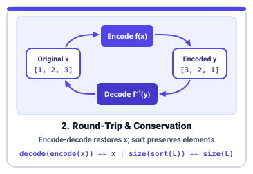

</div>
</div>

<!--
Round-Trip testing is the gold standard for serializers, compilers, encryption, and compression engines: you generate 1,000 arbitrary objects `x`, encode them to `y`, decode `y` back, and assert that the result equals `x`.

💡 難字與專業術語解說：
- round-trip property (invertibility): 往返可逆屬性（將原始資料經正向轉換與逆向還原後，必須百分百等於原始輸入的不變量）
-->
---
## 3. Automatic Test Case Shrinking (Minimal Counterexample)

<div class="split64">
<div class="left">

* **Core Methodology:**
  - When a random input fails (e.g., `amount = 48,752` or a 500-char string), **`jqwik`'s Shrinking Engine** binary-searches down to the **smallest minimal counterexample**!
* **Example 1 — E-Commerce `$3,000` Pricing Cliff (`OrderDiscount`):**
  ```java
  @Property // Buying $100 more must never cost less!
  boolean vipMonotonic(@ForAll @IntRange(min=100, max=50000) int amt) {
      return checkout(Tier.VIP, amt) <= checkout(Tier.VIP, amt + 100);
  }
  ```
  - **Random Hit:** `amt = 48,752` fails → **Auto-Shrunk in 6 steps to `amt = 2901`** (crossing `> $3,000` jumped rebate from `$100` to `$300`, making `$3,001` cheaper than `$2,901`!).
* **Example 2 — String / JSON Parser Crash:**
  - A 600-character fuzzing crash automatically shrinks to the 2-char minimal trigger `"\\\""`.

</div>
<div class="right">


</div>
</div>

<!--
Without shrinking, random fuzzing gives developers a 500-element array or an arbitrary number like `48,752` that takes hours to debug. With `jqwik` Shrinking, the framework automatically narrows the failure down to `amount = 2901`, pointing directly at the `$3,000` threshold cliff!

💡 難字與專業術語解說：
- minimal counterexample: 最小反例（能觸發並重現某個軟體缺陷的最簡短、數值最小的輸入組合）
-->
---
## 4. Metamorphic Testing (MT): Solving the Oracle Problem via 2 Runs

<div class="split64">
<div class="left">

* **Core Methodology:**
  - When **no exact Oracle exists for a single run `y = f(x)`**, apply a transformation **`x' = T(x)`** and verify the **Metamorphic Relation `MR(f(x), f(x'))`** across **two executions**!
* **Example 1 — Search Engine Subset Inclusion (`y' ⊆ y`):**
  - Source run `y = search("Java")` returns `3,842` hits (unknown if exact); narrowed follow-up `y' = search("Java SQA")` MUST return a strict subset (`|y'| <= |y|`, e.g., `128 <= 3,842`).
* **Example 2 — GPS Navigation Scaling & Subpath Consistency:**
  - Doubling all road weights (`× 2`) must preserve the exact same optimal route sequence; if `A → B → C` is optimal for `route(A, C)`, then `B → C` must be optimal for `route(B, C)`.
* **Example 3 — Compiler Optimization Equivalence (`-O0` vs. `-O3`):**
  - Inserting unreachable dead code into program `P → P'` must produce identical runtime output `exec(compile(P)) == exec(compile(P'))`.

</div>
<div class="right">


</div>
</div>

<!--
Notice the fundamental difference between PBT and MT: PBT checks a universal property on a single run `P(x, f(x))`, whereas Metamorphic Testing executes **two runs**—a source run `y = f(x)` and a transformed follow-up run `y' = f(T(x))`—and asserts the relational invariant `MR(y, y')`.

💡 難字與專業術語解說：
- source run vs. follow-up run: 原始執行 vs. 衍生執行（變質測試中先以基準輸入 `x` 求得 `y`，再以變換後輸入 `x' = T(x)` 求得 `y'` 以比對關係 `MR(y, y')` 的兩階段執行）
-->
---
## 5. Domain Monotonicity, Symmetry & Noise-Perturbation MRs

<div class="split64">
<div class="left">

* **Core Methodology:**
  - Design Metamorphic Relations around three domain laws: <strong>Monotonicity (directional order)</strong>, <strong>Symmetry (order invariance)</strong>, and **Noise Robustness**.
* **Example 1 — Commercial Tier & Mortgage Monotonicity:**
  - **E-Commerce:** **`pay(VIP) <= pay(REGULAR) <= pay(GUEST)`** for any identical cart.
  - **Mortgage (`LoanCalculator`):** Higher loan amount (`5M → 10M`) or Youth/Married flags must **never increase** interest rate.
* **Example 2 — Permutation Symmetry (`f(Permute(x)) == f(x)`):**
  - **Triangle:** `classify(a, b, c).equals(classify(b, c, a))`; SQL `UNION` order invariance.
* **Example 3 — Irrelevant Noise Perturbation (`f(x + noise) == f(x)`):**
  - Case/whitespace `search("  sqa ") == search("SQA")`; slight rain noise or `2°` tilt in autonomous driving vision preserves `"Pedestrian"` detection.

</div>
<div class="right">


</div>
</div>

<!--
Monotonicity, Symmetry, and Noise Perturbation give QA engineers an inexhaustible supply of automated tests for financial pricing, machine learning, and computer vision without needing manual human labeling for every input!

💡 難字與專業術語解說：
- monotonicity invariant: 單調性不變量（當輸入沿特定方向遞增或會員等級提升時，輸出必須單調不減或單調不增的商業守恆律）
-->
---
## 6. Differential Testing & LLM-as-a-Judge for AI Systems

<div class="split64">
<div class="left">

* **Core Methodology:**
  - Pair **Differential Testing** (comparing multiple independent implementations on identical inputs) with **LLM-as-a-Judge** (rubric-based AI evaluation).
* **Example 1 — Cross-Implementation Differential Testing:**
  - **Compilers:** Feed identical C code to `GCC` vs. `Clang`—any divergence flags a bug!
  - **Shadow Refactoring:** Run live requests through **Legacy v1** and **Refactored v2** in parallel (`assertEquals(v1(x), v2(x))`).
* **Example 2 — Cross-Model AI Regression (`Baseline v1` vs. `Candidate v2`):**
  - Feed prompts `x` into `Model A(x)` and `Model B(x)`; flag semantic drops (`Sim < 0.85`).
* **Example 3 — LLM-as-a-Judge Quality Gate (`Score >= 0.90`):**
  - Grade RAG/Agent outputs on **Faithfulness** (zero hallucination), **Answer Relevance**, and **Safety Guardrails** (zero prompt injection / PII leak).

</div>
<div class="right">

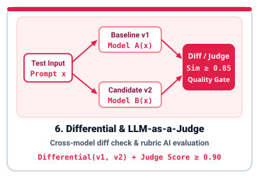

</div>
</div>

<!--
In industrial practice at AWS, Volvo, and Stripe, teams follow the **80/20 Golden Ratio**: 80% Example-Based Testing (BVA/EP/Pairwise) for deterministic business rules, combined with 20% Property-Based, Metamorphic, Differential, and LLM-as-a-Judge testing for complex and AI-driven subsystems.

💡 難字與專業術語解說：
- differential testing: 差分測試（將相同測試輸入同時餵給多個獨立實作或新舊版本模型，藉由比對輸出差異來自動揭露異常的技術）
- LLM-as-a-Judge: 大型語言模型裁判（以高階推理模型依據結構化評分規準自動檢驗生成式 AI 輸出之忠實度、相關性與安全性的評測架構）
-->
---
<!-- _class: title-image-slide -->

## Synthesis: 6 Core Pillars of Property-Based & Metamorphic Testing

<div class="image-wrapper">
  
</div>

<!--
This synthesis panorama brings together all six pillars we just explored:
1. **Property-Based Testing (PBT)** (`@Property` + `@ForAll` 1,000 random trials)
2. **Round-Trip & Structural Conservation** (`decode(encode(x)) == x`, `size(sort(L)) == size(L)`)
3. **Automatic Test Case Shrinking** (binary-searching failures down to the minimal counterexample `amount = 2901`)
4. **Metamorphic Testing (MT)** (verifying 2-run transformation relations `MR(f(x), f(T(x)))`)
5. **Monotonicity & Symmetry MRs** (`pay(VIP) <= pay(REG) <= pay(GUEST)`, permutation/noise invariance)
6. **Differential Testing & LLM-as-a-Judge** (cross-version comparison and rubric-based AI quality gates)
-->
---
<!-- id: ase-ch07-ccq3 -->
## Concept Check Question 3: Combinatorial Testing

<div class="ccq-columns">
<div class="ccq-text">

A cloud deployment dashboard has **10 configuration parameters**, each offering **3 possible settings**. Exhaustive testing requires 3<sup>10</sup> = 59,049 test cases. Why do engineers apply **Pairwise (All-Pairs) Testing** here?

- **A.** It guarantees 100% white-box path coverage across all nested loops by testing only 10 cases.
- **B.** It covers every possible pair of values between any two parameters, catching most interaction bugs with ~15–20 tests.
- **C.** It eliminates the need for expected outputs (Test Oracles) by converting all parameters into binary flags.
- **D.** It restricts testing to a single variable at a time while holding the other 9 variables at fixed nominal constants.

</div>
<div class="ccq-logo">
  <a href="https://nlhsueh.github.io/nickedupocket/#/student/ase-ch07-ccq3" target="_blank"></a>
</div>
</div>

<!--
Let's review Concept Check Question 3 on Combinatorial Pairwise Testing.
-->

---
## Concept Check Question 3: Answer & Explanation

- **Correct Answer: B**
- **Explanation:**
  - Empirical studies by NIST confirm that 67% to 93% of software defects are triggered by single parameters or **2-way interactions** between two parameters.
  - **Pairwise (All-Pairs) Testing** uses heuristic algorithms (like IPO + Greedy) to guarantee that every possible value pair across any two parameters appears in at least one test case—compressing 59,049 combinations down to roughly 15–20 tests.
  - *Why others are incorrect:* Option A confuses black-box combinatorial testing with white-box path coverage. Option C is false because pairwise generators only produce test inputs, still requiring an Oracle (invariant or `@CsvSource`). Option D describes `4n + 1` single-fault BVA, not pairwise coverage.

<!--
The correct answer is **B**.
-->
---
## 📝 7.4 Essay Follow-Up: Food Delivery Fee Engine (Pairwise & PBT)

<div class="sp-essay-hero">
<div class="sp-essay-visual">

</div>
<div class="sp-prose-spec">
<div class="sp-prose-header"><span class="sp-prose-badge">7.4 Follow-Up</span><span>From 36 Strong-EP Combinations to Pairwise &amp; Property-Based Testing</span></div>
<p>In Section 7.3, we induced <strong>4 valid input factors</strong> from the FoodExpress narrative: <code>subtotal</code> (<strong>3 tiers</strong>: <code>100..299</code>, <code>300..799</code>, <code>800..10000</code>), <code>distanceKm</code> (<strong>3 zones</strong>: <code>1..3</code>, <code>4..8</code>, <code>9..15</code>), <code>memberTier</code> (<strong>2 levels</strong>: <code>NONE, VIP</code>), and <code>isRainyPeak</code> (<strong>2 states</strong>: <code>false, true</code>).</p>
<p>Full Strong EP requires <strong>3 × 3 × 2 × 2 = 36</strong> valid combinations, whereas Weak EP (<strong>3 tests</strong>) misses 2-way feature interactions (e.g., whether <code>VIP</code> base-fee waiver &amp; 20% discount interact properly with <code>Zone 3</code> distance surcharges and the <strong>NT$ 250 cap</strong>). Now apply <strong>Pairwise (2-way) Testing</strong> and <strong><code>jqwik</code> Property-Based Testing (PBT)</strong>!</p>
</div>
</div>

<div class="sp-essay-grid-2col" id="sp-essay-food-74">
<div class="sp-essay-card">
<div class="sp-essay-q">
<strong>Essay Task 1: Pairwise (All-Pairs) Compression &amp; Oracle</strong> — For this <code>3 × 3 × 2 × 2</code> domain, derive the minimum 2-way Pairwise size, construct a 9-row table, and solve the Oracle problem.
</div>
<div class="sp-essay-toggle">[Reveal] Click to Reveal Pairwise Design (36 → 9 Tests)</div>
<div class="sp-essay-ans">
• <strong>Lower Bound (<code>36 → 9</code> tests, 75% reduction):</strong> Largest pair is <code>subtotal(3) × distanceKm(3) = 9</code> rows.<br/>
• <strong>9-Row Matrix:</strong> <code>(200,2,NONE,F→$60)</code>, <code>(200,5,VIP,T→$88)</code>, <code>(200,10,NONE,T→$180)</code>, <code>(500,2,VIP,T→$24)</code>, <code>(500,5,NONE,F→$55)</code>, <code>(500,10,VIP,F→$72)</code>, <code>(1200,2,NONE,T→$30)</code>, <code>(1200,5,NONE,T→$50)</code>, <code>(1200,10,VIP,F→$72)</code>.<br/>
• <strong>2-Stage Oracle:</strong> Generate 9 rows via <code>AllPairs4J</code>, then fill exact fees in JUnit 5 <code>@CsvSource</code>!
</div>
</div>
<div class="sp-essay-card card-pbt">
<div class="sp-essay-q">
<strong>Essay Task 2: Property-Based Testing (<code>jqwik</code> Invariants)</strong> — Formulate 3 universal <code>@Property</code> relations across 1,000 random valid orders <code>@ForAll(100..10000) sub, @ForAll(1..15) d, @ForAll m, @ForAll r</code>.
</div>
<div class="sp-essay-toggle">[Reveal] Click to Reveal 3 Universal PBT Properties</div>
<div class="sp-essay-ans">
• <strong>P1 (Global Clamp):</strong> <code>0 &lt;= calcFee(sub, d, m, r) &lt;= 250</code> for all valid tuples.<br/>
• <strong>P2 (Subtotal &amp; VIP Monotonicity):</strong> <code>calcFee(sub + 1, d, m, r) &lt;= calcFee(sub, d, m, r)</code> and <code>calcFee(sub, d, VIP, r) &lt;= calcFee(sub, d, NONE, r)</code>.<br/>
• <strong>P3 (Distance &amp; Surge Non-Decreasing):</strong> <code>calcFee(sub, d + 1, m, r) &gt;= calcFee(sub, d, m, r)</code> and <code>calcFee(sub, d, m, true) &gt;= calcFee(sub, d, m, false)</code>!
</div>
</div>
</div>

<!--
In Section 7.4, we follow up on the exact same Food Delivery Fee narrative introduced in Section 7.3. Task 1 demonstrates how Pairwise testing compresses the 36 Strong EP combinations (`3 x 3 x 2 x 2`) down to an orthogonal 9-row suite covering 100% of 2-way parameter interactions. Task 2 shows how Property-Based Testing (`jqwik`) verifies 1,000 random orders using universal range clamps and metamorphic monotonicity laws without needing hardcoded oracle outputs.
-->
---
## 🧩 7.4 Interactive Matching Game: FoodExpress PBT & MT Strategies

<div class="pbtm-stage" id="pbt-match-game">
<div class="pbtm-board" id="pbtm-board">
<div class="pbtm-col-left" id="pbtm-col-left">
<div class="pbtm-item-left is-active" data-skey="shrinking" data-color="#0284c7">
<div style="flex: 1;"><strong>1.</strong> A random test fails at <code>(sub=4852, dist=14, VIP, true)</code>; <code>jqwik</code> binary-searches down to <strong><code>(sub=300, dist=9, VIP, false)</code></strong> to pinpoint the exact off-by-one cliff.</div>
<span class="pbtm-port" style="border-color: #0284c7; color: #0284c7;">1</span>
</div>
<div class="pbtm-item-left" data-skey="roundtrip" data-color="#059669">
<div style="flex: 1;"><strong>2.</strong> Serializing a FoodExpress receipt to JSON and parsing it back yields the exact fee (<code>fromJson(toJson(r)).fee == r.fee</code>), and applying a <code>VIP</code> coupon twice equals applying it once.</div>
<span class="pbtm-port" style="border-color: #059669; color: #059669;">2</span>
</div>
<div class="pbtm-item-left" data-skey="monotonic" data-color="#d97706">
<div style="flex: 1;"><strong>3.</strong> Adding food or upgrading to <code>VIP</code> must <strong>never increase</strong> delivery fee (<code>calcFee(sub+50, d, m, r) &lt;= calcFee(sub, d, m, r)</code>), while extra distance never decreases it.</div>
<span class="pbtm-port" style="border-color: #d97706; color: #d97706;">3</span>
</div>
<div class="pbtm-item-left" data-skey="differential" data-color="#7c3aed">
<div style="flex: 1;"><strong>4.</strong> Feed 1,000 live checkout requests simultaneously into <strong>Legacy Fee Engine v1</strong> and <strong>Refactored Microservice v2</strong>, flagging any mismatch (<code>v1(x) != v2(x)</code>).</div>
<span class="pbtm-port" style="border-color: #7c3aed; color: #7c3aed;">4</span>
</div>
<div class="pbtm-item-left" data-skey="clamp" data-color="#e11d48">
<div style="flex: 1;"><strong>5.</strong> For any generated <code>@ForAll(100..10000) sub, @ForAll(1..15) d, @ForAll m, @ForAll r</code>, assert that <strong><code>0 &lt;= calcFee(sub, d, m, r) &lt;= 250</code></strong> holds without exception.</div>
<span class="pbtm-port" style="border-color: #e11d48; color: #e11d48;">5</span>
</div>
<div class="pbtm-item-left" data-skey="symmetry" data-color="#0d9488">
<div style="flex: 1;"><strong>6.</strong> Reordering cart items <code>[Burger, Fries, Cola]</code> vs. <code>[Cola, Burger, Fries]</code> (same subtotal) or adding trailing whitespace to promo codes yields the exact same fee.</div>
<span class="pbtm-port" style="border-color: #0d9488; color: #0d9488;">6</span>
</div>
</div>
<svg xmlns="http://www.w3.org/2000/svg" class="pbtm-svg-canvas" id="pbtm-svg-lines"></svg>
<div class="pbtm-col-right" id="pbtm-col-right">
<div class="pbtm-item-right" data-tkey="clamp">
<span class="pbtm-port">•</span>
<div style="flex: 1;"><span class="pbtm-label">Universal Range Invariant</span><span class="pbtm-sub">1,000 random <code>@ForAll</code> trials without oracle</span></div>
</div>
<div class="pbtm-item-right" data-tkey="roundtrip">
<span class="pbtm-port">•</span>
<div style="flex: 1;"><span class="pbtm-label">Round-Trip &amp; Idempotence</span><span class="pbtm-sub"><code>decode(encode(x)) == x</code> &amp; repeat stability</span></div>
</div>
<div class="pbtm-item-right" data-tkey="shrinking">
<span class="pbtm-port">•</span>
<div style="flex: 1;"><span class="pbtm-label">Automatic Test Case Shrinking</span><span class="pbtm-sub">Isolate minimal failing boundary seed</span></div>
</div>
<div class="pbtm-item-right" data-tkey="monotonic">
<span class="pbtm-port">•</span>
<div style="flex: 1;"><span class="pbtm-label">Monotonicity Metamorphic (MR)</span><span class="pbtm-sub">Directional 2-run anti-cliff inequality</span></div>
</div>
<div class="pbtm-item-right" data-tkey="symmetry">
<span class="pbtm-port">•</span>
<div style="flex: 1;"><span class="pbtm-label">Permutation Symmetry (MR)</span><span class="pbtm-sub">Order &amp; irrelevant noise invariance</span></div>
</div>
<div class="pbtm-item-right" data-tkey="differential">
<span class="pbtm-port">•</span>
<div style="flex: 1;"><span class="pbtm-label">Differential Shadow Testing</span><span class="pbtm-sub">Cross-version consensus oracle</span></div>
</div>
</div>
</div>
<div class="pbtm-footer">
<div class="sp-btn-group">
<button type="button" class="sp-btn" id="pbtm-btn-submit">Submit &amp; Check Score</button>
<button type="button" class="sp-btn sp-btn-reset" id="pbtm-btn-reset">↺ Shuffle &amp; Play Again</button>
</div>
<div class="sp-score-msg" id="pbtm-score-msg">Click a FoodExpress Scenario on the Left (1–6), then click its matching PBT / MT Strategy on the Right to draw a line! (0 / 6 linked)</div>
</div>
</div>

<!--
This interactive Connect-the-Lines matching quiz on Slide 82 reinforces the 6 Property-Based and Metamorphic Testing strategies from Section 7.4 by having students link each strategy on the left (Universal Range Invariant, Round-Trip & Idempotence, Automatic Test Case Shrinking, Monotonicity MR, Permutation Symmetry MR, and Differential Shadow Testing) to its concrete FoodExpress Delivery Fee verification scenario on the right.
-->
---
<!-- _class: lead -->
<!-- header: '7.5 White-Box & Mutation Testing' -->

# **7.5 White-Box Structural Coverage & Mutation Testing**

> "From basic statement execution up to Boeing and NASA's avionics-grade MC/DC standard—and onward to Mutation Testing that tests the test suite itself."

<!--
We now open the glass box in Section 7.5: White-Box Structural Coverage and Mutation Testing (integrating SQA Chapter 6: Sections 6.1 and 6.4).

💡 難字與專業術語解說：
- structural coverage criteria: 結構化涵蓋度準則（依據原始碼之陳述句、分支、條件或路徑被測試集執行之比例，量化評估測試充分性的指標體系）
-->
---
## White-Box Philosophy & The 4-Quadrant Spec-vs-Code Blind Spot Matrix

<div class="card-deck">

> Software defects hide in the gap between <strong>Specification (S)</strong> and <strong>Implementation (P)</strong>—requiring a hybrid **Black-Box First → White-Box Diagnosis** workflow.

<div class="two-columns">
<div class="card" data-marpit-fragment>

### 4-Quadrant Spec vs. Implementation Matrix
| Quadrant Scenario | Spec? | Code? | Black-Box Only | White-Box Only |
| :--- | :---: | :---: | :---: | :---: |
| **1. Normal Feature** | Yes | Yes | Verified | Covered |
| **2. Missing Req** | **Yes** | **No** | **Catches!** | **Blind at 100%!** |
| **3. Extra/Trojan** | **No** | **Yes** | **Blind!** | **Red lines expose!** |
| **4. Boundary Quirk** | Yes | Buggy | Easy to miss | **MC/DC & Mutation!** |

</div>
<div class="card" data-marpit-fragment>

### Hybrid 3-Step Engineering Strategy
- **Step 1: Black-Box Baseline First (EP / BVA / Pairwise):**
  - Derive baseline functional and boundary tests directly from the SRS to catch <strong>Missing Requirements (Quadrant 2)</strong>.
- **Step 2: White-Box Coverage Microscope (JaCoCo):**
  - Run the black-box suite under bytecode instrumentation and inspect <strong>red (uncovered)</strong> and <strong>yellow (partially covered)</strong> branches (**Quadrant 3 & 4**).
- **Step 3: Reverse Supplementation or Dead-Code Removal:**
  - If an uncovered branch is valid domain logic → **add a white-box test case**; if it is mathematically unreachable → **delete the dead code**!

</div>
</div>
</div>

<!--
Black-box specification testing catches Missing Requirements (Quadrant 2), while white-box coverage instrumentation catches Extra/Trojan Code (Quadrant 3) and boundary implementation quirks (Quadrant 4).

💡 難字與專業術語解說：
- missing requirement blind spot: 遺漏需求盲區（規格書有要求但工程師忘記實作的功能，白箱測試即使達 100% 覆蓋率也完全無法察覺）
-->
---
## White-Box Coverage Subsumption Hierarchy & Classic Benchmark Program

<div class="split73">
<div class="left">

* **Classic Double-Decision Benchmark Program:**
  ```java
  1: input A, B, X
  2: if (A > 1) and (B == 0) then   // Decision D1 (C1: A>1, C2: B==0)
  3:     Y = A
  4: if (A == 2) or (X > 1) then    // Decision D2 (C3: A==2, C4: X>1)
  5:     Y = X
  6: print Y
  ```
  - Contains <strong>2 Decisions (`D1, D2`)</strong>, <strong>4 Atomic Conditions (`C1..C4`)</strong>, and <strong>4 Control-Flow Paths (`a-c-e`, `a-c-d`, `a-b-e`, `a-b-d`)</strong>.
* **Coverage Subsumption Hierarchy (`A → B` means `100% A` guarantees `100% B`):**
  - **Path Coverage** → <strong>Multiple Condition (MCC, `2`<sup>`n`</sup>)</strong> → <strong>MC/DC (`n + 1`)</strong> → <strong>Branch/Condition (B/CC)</strong> → <strong>Branch Coverage (BC)</strong> → <strong>Statement Coverage (SC)</strong>.
  - *Critical Exception:* <strong>Condition Coverage (CC) does NOT subsume Branch Coverage (BC)</strong> (and vice versa under non-short-circuit evaluation)!

</div>
<div class="right">


</div>
</div>

<!--
We use this 6-line benchmark program and its Control Flow Graph on the right to compare Statement, Branch, Condition, MCC, Path, and MC/DC coverage.

💡 難字與專業術語解說：
- subsumption hierarchy: 涵蓋包含階層（若覆蓋準則 A 嚴格包含準則 B，代表任何達到 100% A 的測試集必然同時達到 100% B）
-->
---
## 1. Statement Coverage (SC) & 2. Branch / Decision Coverage (BC)

<div class="card-deck">

> **100% Statement Coverage** is the weakest baseline (achievable in 1 test case here!), whereas **100% Branch Coverage** requires every decision to evaluate to both `True` and `False`.

<div class="two-columns">
<div class="card" data-marpit-fragment>

### 1. Statement Coverage (`SC100` in Just 1 Test!)
- **Goal:** Execute every executable statement (Lines `1..6`) at least once.
- **Single Test Case:** **`t1 = (A=2, B=0, X=3)`**
  - Line 2: `(2 > 1) and (0 == 0)` is `True` → executes Line 3 (`Y = 2`).
  - Line 4: `(2 == 2) or (3 > 1)` is `True` → executes Line 5 (`Y = 3`).
  - **Result:** 100% Statement Coverage (`6/6` lines)!
- **Why `SC100` is Dangerously Weak:**
  - Even at `100% SC`, `(2, 0, 3)` **completely misses** if:
    1. Line 2 `and` was mistyped as `or`;
    2. Line 3 `Y = A` was mistyped as `Y = 999` (overwritten by Line 5!);
    3. Never tests the `False` branches (`b` and `d`)!

</div>
<div class="card" data-marpit-fragment>

### 2. Branch / Decision Coverage (`BC100` in 2 Tests)
- **Goal:** Every decision (`D1` and `D2`) must take its **`True` branch** and its **`False` branch** at least once (covers all edges `a, b, c, d, e`).

| Test Case `(A, B, X)` | `D1: (A>1) AND (B==0)` | `D2: (A==2) OR (X>1)` | CFG Path |
| :---: | :---: | :---: | :---: |
| **`t1 = (3, 0, 3)`** | **`True`** (edge `c`) | **`True`** (edge `e`) | `a → c → e` |
| **`t2 = (3, 1, 1)`** | **`False`** (edge `b`) | **`False`** (edge `d`) | `a → b → d` |

- **Remaining Blind Spot of `BC100`:**
  - Across `t1=(3,0,3)` and `t2=(3,1,1)`, atomic condition `C1 (A > 1)` is **always `True`** (`3 > 1`), and `C3 (A == 2)` is **always `False`** (`3 != 2`)!

</div>
</div>
</div>

<!--
100% Branch Coverage strictly subsumes 100% Statement Coverage, yet even 100% Branch Coverage can leave individual atomic conditions inside a compound `if` stuck at a single truth value.

💡 難字與專業術語解說：
- Statement Coverage vs. Branch Coverage: 敘述涵蓋度 vs. 分支涵蓋度（僅要求每行指令執行一次 vs. 要求每個決策判斷的真假分支走向皆被執行）
-->
---
## 3. Condition Coverage (CC), The Paradox & JaCoCo's "Yellow Diamond"

<div class="card-deck">

> <strong>Condition Coverage (CC)</strong> requires every atomic boolean condition (`C`<sub>`i`</sub>) to evaluate to both `True` and `False`—which leads to a famous paradox with Branch Coverage and **Short-Circuit Evaluation**!

<div class="two-columns">
<div class="card" data-marpit-fragment>

### The CC vs. BC Paradox (`100% CC ≠ 100% BC`)
- Consider `if (p && q)` under **non-short-circuit** evaluation:

| Test Case | Atomic `p` | Atomic `q` | Whole Decision `p && q` |
| :---: | :---: | :---: | :---: |
| **`t1`** | **`True`** | **`False`** | **`False`** |
| **`t2`** | **`False`** | **`True`** | **`False`** |

- Atomic condition `p` hits `{T, F}` (100%) and `q` hits `{F, T}` (100%) → **100% Condition Coverage**!
- Yet the overall decision `p && q` is **always `False`** → **only 50% Branch Coverage** (the `if`-body never executes)!
- **Branch/Condition Coverage (B/CC):** Combines both criteria (`100% CC + 100% BC`).

</div>
<div class="card" data-marpit-fragment>

### Short-Circuit Evaluation & JaCoCo's 75% Yellow Diamond
- **Short-Circuit Rule (`&&`, `||` in Java/C/Python):**
  - In `if (p && q)`, when `p == False` (`t2`), the CPU **short-circuits and skips evaluating `q`** (`q` is unexecuted, not `True`)!
  - To actually evaluate `q = True` and `q = False`, `p` must be `True`—which forces `p && q` to take both `True` and `False` (**requiring 3 tests: `(T,F), (F,x), (T,T)`**).
- **Why JaCoCo Shows a Yellow Diamond (`3/4 = 75%`) on `if (A && B)`:**
  - Java compilers compile `if (A && B)` into **2 bytecode jump instructions (`IFEQ A`, `IFEQ B`) = 4 bytecode branches**.
  - Testing only `(A=T, B=T)` and `(A=F, short-circuit)` covers `3 / 4` bytecode branches (leaving `A=T, B=F` unexercised → **75% Yellow Diamond**)!

</div>
</div>
</div>

<!--
At the JVM bytecode level, `if (A && B)` compiles into two conditional jump instructions (4 bytecode branches), explaining why JaCoCo shows a 75% yellow diamond until `(A=True, B=False)` is also tested.

💡 難字與專業術語解說：
- short-circuit evaluation: 短路求值（在 `A && B` 中若 `A` 為 False，或在 `A || B` 中若 `A` 為 True，程式直接略過不計算右式 `B` 的求值機制）
-->
---
## 4. Branch/Condition Walkthrough (`sample-code-01`: `CC100` vs. `BC100`)

<div class="card-deck">

> Trace how a 2-test suite can satisfy **100% Condition Coverage (`CC100`) while failing Branch Coverage**, and how a 3-test suite can satisfy **100% Branch Coverage (`BC100`) while failing Condition Coverage**!

<div class="two-columns">
<div class="card" data-marpit-fragment>

### Target Code (`sample-code-01`) & `SC100`
```java
1: read(X, Y)
2: if ((X > 10) && (Y == 1))  // c1: X>10, c2: Y==1, b1: c1&&c2
3:     X = 1;
4: else if ((X - Y) < 2)      // c3 (b2): (X - Y) < 2
5:     X = 2;
6: if (Y > 10)                // c4 (b3): Y > 10
7:     X = 3;
8: print X
```
- **Achieving `100% Statement Coverage (SC100)` in 2 tests:**
  - Must enter lines `3`, `5`, and `7`:
  - **`(X=11, Y=1)`** enters Line 3; **`(X=12, Y=11)`** enters Lines 5 & 7!

</div>
<div class="card" data-marpit-fragment>

### `CC100` (Not `BC100`) vs. `BC100` (Not `CC100`)
- **Suite A (`CC100`, but `b1` always `False` → fails `BC100`):**

| `X` | `Y` | `c1` | `c2` | `b1 (c1&&c2)` | `c3/b2` | `c4/b3` |
| :-: | :-: | :-: | :-: | :-: | :-: | :-: |
| **9** | **1** | F | T | **_F_** | F | F |
| **12** | **11** | T | F | **_F_** | T | T |

- **Suite B (`BC100`, but `c1` always `True` → fails `CC100`):**

| `X` | `Y` | `c1` | `c2` | `b1 (c1&&c2)` | `c3/b2` | `c4/b3` |
| :-: | :-: | :-: | :-: | :-: | :-: | :-: |
| **13** | **1** | **_T_** | T | **T** | - | F |
| **12** | **11** | **_T_** | F | **F** | T | T |
| **12** | **2** | **_T_** | F | **F** | F | F |

</div>
</div>
</div>

<!--
This concrete walkthrough on `sample-code-01` demonstrates why **Branch/Condition Coverage (B/CC)** requires satisfying both criteria simultaneously.

💡 難字與專業術語解說：
- Branch/Condition Coverage (B/CC): 分支與條件複合涵蓋度（同時要求每個原子條件皆經歷 T/F，且每個整體決策分支亦經歷 T/F 的覆蓋標準）
-->
---
## 5. Multiple Condition Coverage (MCC), 6. Path Coverage & 7. Avionics MC/DC

<div class="card-deck">

> When `2`<sup>`n`</sup> **MCC** and `4`<sup>`20`</sup> **Path Coverage** explode exponentially, <strong>MC/DC (Modified Condition / Decision Coverage)</strong> achieves rigorous condition independence in just **`n + 1` linear test cases**!

<div class="two-columns">
<div class="card" data-marpit-fragment>

### MCC (`2`<sup>`n`</sup>) & Path Explosion (`4`<sup>`20`</sup>)
- **Multiple Condition Coverage (MCC):**
  - Requires testing all **`2`<sup>`n`</sup> truth-table combinations** of atomic conditions inside each decision.
  - On our 2-decision benchmark (`n=2` each), MCC needs 4 tests: `(2,0,4), (2,1,1), (1,0,2), (1,1,1)`—which still misses control-flow path `a-c-d` (requires `(3,0,1)`)!
  - For a decision with `n = 10` conditions, MCC requires **2<sup>10</sup> = 1,024** tests!
- **Path Coverage & The Loop Explosion Trap:**
  - A single loop iterating up to 20 times with a 4-way branch inside generates **4<sup>20</sup> = 2<sup>40</sup> ≈ 1.1 × 10<sup>12</sup> (1.1 trillion) paths**—making exhaustive All-Path testing impossible for loops!

</div>
<div class="card" data-marpit-fragment>

### Avionics MC/DC (DO-178C Level A & ISO 26262 ASIL D)
- **Why Boeing, Airbus & Automotive Mandate MC/DC:**
  - Compresses **`2`<sup>`n`</sup>** combinations to **`n + 1` (max `2n`) linear tests**!
- **Core Requirement — Independence Pairs:**
  - Every condition **`C`<sub>`i`</sub>** must have a test pair `(Test X, Test Y)` where:
    1. <strong>Only `C`<sub>`i`</sub> flips (`T ↔ F`)</strong> while other conditions stay fixed;
    2. The overall <strong>Decision outcome also flips (`T ↔ F`)</strong>!

</div>
</div>
</div>

<!--
MC/DC proves that each atomic condition can independently flip the final decision outcome while all other conditions are held constant, requiring only `n + 1` test cases.

💡 難字與專業術語解說：
- Modified Condition / Decision Coverage (MC/DC): 修改條件／決策涵蓋度（要求證明每一個原子條件在固定其他條件不變下，皆能獨立翻轉整體決策結果的航太與車規最高白箱標準）
-->
---
## MC/DC Derivation (1/2): Truth Table for `Decision = (A || B) && C`

> For `n = 3` conditions (full truth table = `2`<sup>`3`</sup> `= 8` rows), we select just **`n + 1 = 4` rows `{#2, #4, #5, #6}`**!

| Row | `A` | `B` | `C` | `(A \|\| B) && C` | MC/DC Selection Status & Pairing Role |
| :---: | :---: | :---: | :---: | :---: | :--- |
| #1 | F | F | F | F | Omitted (`C = F` short-circuits & masks `(A \|\| B)`) |
| **#2** | **F** | **F** | **T** | **F** | **Selected (1/4):** Baseline anchor — pairs with **#6** for `A`, and with **#4** for `B` |
| #3 | F | T | F | F | Omitted (can use #5 instead to test `C`) |
| **#4** | **F** | **T** | **T** | **T** | **Selected (2/4):** Pairs with **#2** to prove `B` (`F → T`) independently flips Decision |
| **#5** | **T** | **F** | **F** | **F** | **Selected (3/4):** Pairs with **#6** to prove `C` (`F → T`) independently flips Decision |
| **#6** | **T** | **F** | **T** | **T** | **Selected (4/4):** Baseline anchor — pairs with **#2** for `A`, and with **#5** for `C` |
| #7 | T | T | F | F | Omitted (`A = T` and `B = T` mask each other in `A \|\| B`) |
| #8 | T | T | T | T | Omitted (`A = T` and `B = T` mask each other in `A \|\| B`) |

---
## MC/DC Derivation (2/2): Verifying the 3 Independence Pairs `{#2, #4, #5, #6}`

<div class="card-deck">

> By sharing **`#2`** and **`#6`** as anchor rows, **`n + 1 = 4` test cases** prove that `A`, `B`, and `C` each independently flip the decision!

<div class="two-columns">
<div class="card" data-marpit-fragment>

### Independence Pairs for `A` & `B`
- **1. Condition `A` → Pair `(#2, #6)`:**
  - `#2`: `(A=F, B=F, C=T) → Decision = F`
  - `#6`: `(A=T, B=F, C=T) → Decision = T`
  - *Proof:* `B=F, C=T` stay fixed; flipping <strong>`A` (`F↔T`)</strong> flips <strong>`Decision` (`F↔T`)</strong>!
- **2. Condition `B` → Pair `(#2, #4)`:**
  - `#2`: `(A=F, B=F, C=T) → Decision = F`
  - `#4`: `(A=F, B=T, C=T) → Decision = T`
  - *Proof:* `A=F, C=T` stay fixed; flipping <strong>`B` (`F↔T`)</strong> flips <strong>`Decision` (`F↔T`)</strong>!

</div>
<div class="card" data-marpit-fragment>

### Independence Pair for `C` & Takeaway
- **3. Condition `C` → Pair `(#5, #6)`:**
  - `#5`: `(A=T, B=F, C=F) → Decision = F`
  - `#6`: `(A=T, B=F, C=T) → Decision = T`
  - *Proof:* `A=T, B=F` stay fixed; flipping <strong>`C` (`F↔T`)</strong> flips <strong>`Decision` (`F↔T`)</strong>!
- **Engineering Conclusion:**
  - Instead of `2`<sup>`3`</sup> `= 8` MCC tests, <strong>`{#2, #4, #5, #6}` (`n + 1 = 4` tests)</strong> satisfies 100% DO-178C Level A MC/DC!

</div>
</div>
</div>

<!--
Because rows `#2` and `#6` serve as shared baseline anchors, the union `{#2, #4, #5, #6}` requires only `n + 1 = 4` test cases to prove independence for all three conditions.

💡 難字與專業術語解說：
- Independence Pair: 獨立影響配對（一對測試案例中，僅目標條件真假值改變、其餘條件固定不變，且整體決策輸出隨之翻轉的配對證據）
-->
---
## Safety-Critical Standards: DO-178C (Avionics) & ISO 26262 (Automotive)

<div class="card-deck">

> In safety-critical avionics and automotive systems, structural coverage is legally mandated before an aircraft can fly or an EV can ship.

<div class="two-columns">
<div class="card" data-marpit-fragment>

### Avionics DO-178C & Automotive ISO 26262
| Failure Severity | DO-178C | ISO 26262 | Mandated White-Box Coverage |
| :--- | :---: | :---: | :--- |
| **Catastrophic** | **DAL A** | **ASIL D** | **100% SC + BC + MC/DC** |
| **Hazardous** | **DAL B** | **ASIL C** | **100% SC + BC** *(MC/DC rec.)* |
| **Major** | **DAL C** | **ASIL B/A** | **100% SC** *(ASIL B: BC)* |
| **Minor** | **DAL D/E** | **QM** | Standard functional verification |

</div>
<div class="card" data-marpit-fragment>

### Unique-Cause vs. Masking MC/DC
- **1. Unique-Cause MC/DC:**
  - Strictly requires only 1 condition `C_i` to flip while all other conditions stay literally fixed.
  - *Limitation:* Fails when a variable appears twice in coupled expressions like `(A && B) || (!A && C)`.
- **2. Masking MC/DC (FAA Certified Standard):**
  - Allows coupled conditions to flip as long as unselected sub-expressions are logically masked from affecting the output!

</div>
</div>
</div>

---
## Debunking the 3 Myths of 100% Code Coverage (Goodhart's Law)

<div class="card-deck">

> "Code coverage is a diagnostic tool for finding untested blind spots—when coverage becomes a blind KPI target, it ceases to be a good measure (Goodhart's Law)."

<div class="three-columns">
<div class="card" data-marpit-fragment>

### 1. Diminishing ROI (`95% → 100%`)
- Going from `0% → 85%` catches core business bugs with high ROI.
- Forcing the final `5%` on trivial getters/setters, defensive `default` branches, or rare OS I/O exceptions explodes mocking cost and breeds brittle tests.

</div>
<div class="card" data-marpit-fragment>

### 2. Executed ≠ Verified
- Coverage only records *whether a line executed*, not whether assertions checked the result!
- An **assertion-free test** or `a + b` mistyped as `a * b` tested at `(2, 2)` yields 100% green coverage—**requires Mutation Testing**!

</div>
<div class="card" data-marpit-fragment>

### 3. Blind to Missing Code
- White-box tools can only measure code that was actually written.
- If a developer forgot to code a required VIP discount branch, existing code still hits 100% coverage!
- **Best Practice:** Target `85%–90%` on core domain logic + Black-Box + Mutation!

</div>
</div>
</div>

<!--
Know how DO-178C DAL A and ISO 26262 ASIL D map to 100% MC/DC on the left, and remember the three myths of 100% code coverage on the right.

💡 難字與專業術語解說：
- Goodhart's Law: 古德哈特定律（當一個度量指標被當作硬性績效考核目標時，工程師便會透過無斷言測試等方式迎合數字，使其失去衡量品質的意義）
-->
---
## White-Box Case Studies: `Triangle.java` Dead Branch & `LoanCalculator` Progression

<div class="card-deck">

> Bytecode coverage analysis exposes **mathematically infeasible dead branches** (`Triangle.java`) and quantifies how **Black-Box + White-Box supplementation** reaches `100% BC`.

<div class="two-columns">
<div class="card" data-marpit-fragment>

### 1. `Triangle.java` & The 83.3% Dead Branch
```java
if (a <= 0 || b <= 0 || c <= 0 ||
    a + b <= c || a + c <= b || b + c <= a) return "Invalid";
if (a == b && b == c && a == c) return "Equilateral"; // 5/6 (83.3%)!
if (a == b || b == c || a == c) return "Isosceles";
return "Scalene";
```
- **Transitivity Trap:** When `a == b` and `b == c` are `True`, **`a == c` can NEVER be `False`** (infeasible dead branch)!
- **Fix:** Remove redundant `&& a == c` → `100% (22/22)` branch coverage!

</div>
<div class="card" data-marpit-fragment>

### 2. `BinarySearch` & `LoanCalculator` Progression
- **`BinarySearch` (`100% BC` in 2 tests):** `search(1, [1,3,5]) → 0` and `search(6, [1,3]) → -1`.
- **`LoanCalculator` 3-Stage Coverage Evolution:**

| Testing Stage | Design Strategy | Branch Coverage |
| :--- | :--- | :---: |
| **1. WeakTest** | 2–3 Happy Path loans | **~65%** |
| **2. PairwiseTest** | `AllPairs4J` 2-way table (8 cases) | **~90%** |
| **3. StrongTest** | White-box supplement (`rate < 2.0`) | **100%** |

</div>
</div>
</div>

<!--
Look at how Stage 1 (Weak Happy Path), Stage 2 (Black-Box Pairwise), and Stage 3 (White-Box JaCoCo Supplementation) work together on `LoanCalculator`: Pairwise gets us to ~90% branch coverage automatically, and inspecting the JaCoCo report tells us we only need one high-discount case to trigger the `if (rate < 2.0) rate = 2.0;` floor branch to reach 100%!

💡 難字與專業術語解說：
- infeasible branch / path: 不可行分支／死路徑（因前後條件矛盾或數學遞移律限制，在任何輸入下皆不可能被觸發的邏輯分支）
-->
---
<!-- id: ase-ch07-ccq4 -->
## Concept Check Question 4: Condition vs. Branch Coverage

<div class="ccq-columns">
<div class="ccq-text">

Consider the compound conditional statement: `if (A && B)` where `A` and `B` are independent boolean variables (evaluated without short-circuit masking). If a test suite executes **Test 1: `(A = True, B = False)`** and **Test 2: `(A = False, B = True)`**, what coverage levels are achieved?

- **A.** 100% Branch Coverage, but only 50% Condition Coverage.
- **B.** 100% Condition Coverage, but only 50% Branch Coverage.
- **C.** Both 100% Condition Coverage and 100% Branch Coverage.
- **D.** Neither Condition Coverage nor Branch Coverage reaches 100%.

</div>
<div class="ccq-logo">
  <a href="https://nlhsueh.github.io/nickedupocket/#/student/ase-ch07-ccq4" target="_blank"></a>
</div>
</div>

<!--
Let's check your understanding of the Condition vs. Branch Coverage Paradox in Concept Check Question 4.
-->

---
## Concept Check Question 4: Answer & Explanation

- **Correct Answer: B**
- **Explanation:**
  - **Condition Coverage (100%):** Atomic condition `A` takes `True` (in Test 1) and `False` (in Test 2). Atomic condition `B` takes `False` (in Test 1) and `True` (in Test 2). Every individual condition has evaluated to both `True` and `False`.
  - **Branch / Decision Coverage (50%):** In Test 1, `True && False` evaluates to **`False`**. In Test 2, `False && True` also evaluates to **`False`**. The overall decision never evaluates to `True`, so the `True` branch is never executed!

<!--
The correct answer is **B**.
-->
---
<!-- id: ase-ch07-ccq5 -->
## Concept Check Question 5: Advanced Coverage Criteria (MC/DC)

<div class="ccq-columns">
<div class="ccq-text">

An avionics flight-control module contains a decision with **`n = 4` independent boolean conditions**. Under **DO-178C Level A**, what is the minimum number of test cases required to achieve **100% MC/DC**, compared to <strong>100% Multiple Condition Coverage (MCC)</strong>?

- **A.** MC/DC requires `n = 4` test cases; MCC requires `2n = 8` test cases.
- **B.** MC/DC requires `n + 1 = 5` test cases; MCC requires `2`<sup>`n`</sup> `= 16` test cases.
- **C.** MC/DC requires `4n + 1 = 17` test cases; MCC requires `5`<sup>`n`</sup> `= 625` test cases.
- **D.** MC/DC requires `2`<sup>`n`</sup> `= 16` test cases; MCC requires `n! = 24` test cases.

</div>
<div class="ccq-logo">
  <a href="https://nlhsueh.github.io/nickedupocket/#/student/ase-ch07-ccq5" target="_blank"></a>
</div>
</div>

<!--
Now let's test your understanding of MC/DC versus Multiple Condition Coverage (MCC) for `n = 4` boolean conditions.
-->

---
## Concept Check Question 5: Answer & Explanation

- **Correct Answer: B**
- **Explanation:**
  - <strong>MC/DC (Modified Condition / Decision Coverage)</strong> requires an independence pair for each of the `n` conditions while sharing baseline rows, requiring a minimum of **`n + 1 = 4 + 1 = 5` test cases** (linear growth).
  - <strong>MCC (Multiple Condition Coverage)</strong> requires testing the entire boolean truth table across all `n` conditions, requiring **`2`<sup>`n`</sup> `= 2`<sup>`4`</sup> `= 16` test cases** (exponential growth).
  - *Why others are incorrect:* Option C uses Black-Box Boundary Value Analysis formulas (`4n+1` and `5`<sup>`n`</sup>) rather than boolean condition formulas.

<!--
The correct answer is **B**.
-->
---
## Mutation Testing ("Who Tests the Tests?"): Core Philosophy & Foundations

<div class="split73">
<div class="left">

* **Core Philosophy — Test the Test Suite (`T`):**
  - Traditional testing uses test suite `T` to evaluate program `P`; **Mutation Testing** injects tiny syntactic faults (**Mutants `P', P''`**) into `P` to evaluate the **fault-detection power of test suite `T`**!
  - **Killed Mutant:** At least one test `t ∈ T` fails on `P'` (`P(t) != P'(t)`) → test suite caught the fault!
  - **Survived (Alive) Mutant:** All tests in `T` still pass on `P'` (`P(t) == P'(t)`) → **test data or assertions are too weak**; we must add a sharper test case!
* **Two Theoretical Pillars (DeMillo et al., 1978; Offutt, 1992):**
  1. **Competent Programmer Hypothesis (CPH):** Experienced engineers write code that is already very close to correct; real bugs are typically small syntactic slips (off-by-one `<=` vs. `<`).
  2. **The Coupling Effect:** Complex multi-point faults are tightly coupled to simple single-point faults—a test suite that kills **100% of First-Order (single-point) Mutants** empirically kills **> 99.5% of higher-order complex bugs**!

</div>
<div class="right">


</div>
</div>

<!--
Mutation Testing injects artificial single-point faults (mutants) into your code to verify whether your JUnit assertions actually turn red and kill them.

💡 難字與專業術語解說：
- Competent Programmer Hypothesis (CPH): 稱職程式設計師假設（假設工程師寫出的程式與正確版本在語法樹上僅有些微差距，因此微小變異算子能有效模擬真實缺陷）
- Coupling Effect Hypothesis: 耦合效應假設（能殺死所有一階單點微小變異體的敏銳測試集，亦能同時殺死 99% 以上複雜高階複合錯誤的實證定律）
-->
---
## 4 Mutation Operators, The RIPR Fault Model & Equivalent Mutants

<div class="card-deck">

> Killing a mutant requires traversing the **4-stage RIPR chain**; when computing the <strong>Mutation Score (`MS = K / (M - E)`)</strong>, we must subtract <strong>Equivalent Mutants (`E`)</strong> from the denominator!

<div class="two-columns">
<div class="card" data-marpit-fragment>

### 4 Mutation Operators & The RIPR Chain
- **4 Classic Mutation Operators (PITest):**
  - **ROR:** `>` ↔ `>=, <, ==` ｜ **COR:** `&&` ↔ `||`
  - **AOR:** `+` ↔ `-, *, /` ｜ **Return/Void Removal**
- **The 4-Stage RIPR Chain to Kill a Mutant:**
  1. **Reachability:** Execution reaches the mutated statement.
  2. **Infection:** Mutant alters internal state (needs BVA boundary!).
  3. **Propagation:** State difference reaches final return output.
  4. **Revealability:** JUnit `assertEquals` inspects that output!

</div>
<div class="card" data-marpit-fragment>

### Mutation Score & Equivalent Mutants (`E`)
- **Formula:** **`MS = K / (M - E)`** (`K`: Killed, `M`: Total, `E`: Equivalent).
- **Equivalent Mutant (`E`):** Syntax differs, but output is **100% identical for all inputs** (must be subtracted from `M`!):
```java
// Original P (integers a, b):
if (a < b) c = a;
// Equivalent Mutant P1 (always identical on ints):
if (a <= b - 1) c = a;
// Equivalent Mutant P2 (loop i=0; i++ hitting 10):
if (i == 10) break;  -->  if (i >= 10) break;
```

</div>
</div>
</div>

<!--
The RIPR Model (Reachability, Infection, Propagation, Revealability) explains why 100% statement coverage (Reachability alone) is never enough to kill a mutant—and why Equivalent Mutants (`E`) must be subtracted from `M` in `MS = K / (M - E)`.

💡 難字與專業術語解說：
- RIPR Model: RIPR 故障傳播模型（測試案例殺死變異體必經的可達、狀態感染、結果傳播與斷言揭露四階段）
- Equivalent Mutant: 等價變異體（語法雖然被修改，但在所有可能輸入下之執行結果皆與原程式完全一致、永遠無法被任何測試殺死的變異體）
-->
---
## Mutation Walkthrough 1: Array Max Index `p(a)` (`ex_mutation_test`)

<div class="card-deck">

> Given `p(a)` (returns the index `r` of the maximum element in a 3-element array) and 4 mutants `P1..P4`, evaluate `T = {t1, t2, t3}`!

<div class="two-columns">
<div class="card" data-marpit-fragment>

### Original `p(a)` & 4 Mutants (`P1..P4`)
```python
def p(a): # Returns index r of max value
    r = 0
    for i in [1, 2]:
        if a[i] > a[r]: r = i
    return r
# P1: for i in [0, 1, 2]     (checks i=0)
# P2: if i > a[r]: r = i     (compares index i)
# P3: if a[i] >= a[r]: r = i (> mutated to >=)
# P4: if True: r = i         (always returns 2)
```
- **`P1` is an Equivalent Mutant (`E = 1`):** At `i = 0`, `a[0] > a[0]` is always `False`.
- **`P3` Survives `t1..t3`:** Adding duplicate-max **`t4 = [2, 2, 1]`** makes `P` return `0` and `P3` return `1` (**Killed! `MS: 66.7% → 100%`**).

</div>
<div class="card" data-marpit-fragment>

### Mutant Execution & Hunting Matrix
| Test Case | Orig `P` | `P1` (`[0,1,2]`) | `P2` (`i>a[r]`) | `P3` (`>=`) | `P4` (`True`) |
| :---: | :---: | :---: | :---: | :---: | :---: |
| **`t1=[1,2,3]`** | `2` | `2` | <strong>`1` (Kill)</strong> | `2` | `2` |
| **`t2=[1,2,1]`** | `1` | `1` | `1` | `1` | <strong>`2` (Kill)</strong> |
| **`t3=[3,1,2]`** | `0` | `0` | `0` | `0` | <strong>`2` (Kill)</strong> |
| **Initial Status** | Base | <strong>Equiv (`E`)</strong> | **Killed** | **Alive!** | **Killed** |
| **Add `t4=[2,2,1]`** | `0` | `0` | `2` | <strong>`1` (Kill!)</strong> | `2` |

</div>
</div>
</div>

---
## Mutation Walkthrough 2: 5-Mutant Hunting Matrix (`func(X, Y)`)

<div class="card-deck">

> Given `func(X, Y)`, 5 non-equivalent mutants `P1..P5`, and initial suite `T = {(12,1), (6,5), (7,11)}`, compute `MS` and design kill inputs!

<div class="two-columns">
<div class="card" data-marpit-fragment>

### Original `func(X, Y)` & 5 Mutants
```java
int func(int X, int Y) {
    if ((X > 10) && (Y == 1))  // P1: X >= 10
        X = 1;                 // P2: && -> ||
    else if ((X - Y) < 2)      // P3: <= 2
        X = 2;
    if (Y > 10)                // P4: Y >= 10
        X = 3;                 // P5: X = 4
    return X;
}
```
- **Initial Score:** `t3=(7,11)` kills `P2` and `P5` → **`MS = 2 / 5 = 40%`**.
- **3 Boundary Supplements → `100% MS`:**
  - Kill `P1`: **`t4 = (10, 1)`** (`P=2, P1=1`)
  - Kill `P3`: **`t5 = (8, 6)`** (`P=8, P3=2`)
  - Kill `P4`: **`t6 = (7, 10)`** (`P=2, P4=3`)

</div>
<div class="card" data-marpit-fragment>

### Hunting Matrix (`MS: 40% → 100%`)
| Program / Mutant | `t1=(12,1)` | `t2=(6,5)` | `t3=(7,11)` | Status & Remedy |
| :--- | :---: | :---: | :---: | :--- |
| **Original `P`** | **`1`** | **`2`** | **`3`** | Baseline |
| <strong>`P1` (`X>=10`)</strong> | `1` | `2` | `3` | **Alive** → Add **`(10,1)`** |
| <strong>`P2` (`&&→\|\|`)</strong> | `1` | `2` | <strong>`1` (Kill)</strong> | **Killed by `t3`** |
| <strong>`P3` (`<2→<=2`)</strong> | `1` | `2` | `3` | **Alive** → Add **`(8,6)`** |
| <strong>`P4` (`Y>=10`)</strong> | `1` | `2` | `3` | **Alive** → Add **`(7,10)`** |
| <strong>`P5` (`X=3→4`)</strong> | `1` | `2` | <strong>`4` (Kill)</strong> | **Killed by `t3`** |

</div>
</div>
</div>

<!--
Notice the pattern across both walkthroughs: surviving relational mutants (`>` mutated to `>=` in `P3`, `P1`, and `P4`) are always killed by **exact boundary values** (`a[i] == a[r]` in `[2, 2, 1]`, `X == 10` in `(10, 1)`, `X - Y == 2` in `(8, 6)`, and `Y == 10` in `(7, 10)`)! That proves mathematically why Boundary Value Analysis (BVA) and Mutation Testing are deeply connected.

💡 難字與專業術語解說：
- mutation hunting matrix: 變異體獵殺矩陣（列出各測試案例在原程式與各變異體上之輸出，藉以識別存活變異體並設計補彈測資的分析表）
-->
---
## Industrial Mutation Testing: `BinarySearch` Loop Mutants & PITest Report

<div class="split73">
<div class="left">

* **`BinarySearch` Loop Boundary Mutants (`bs02` & `bs03`):**
  ```java
  // Original: while (left <= right) | bs02: while (left < right) | bs03: while (left >= right)
  ```
  - **Kill `bs02` (`left < right` dropped `==`):** Needs a search that converges to the final 1-element window **`left == right`** (e.g., **`search(2, [0, 1, 2])`** or **`search(1, [1])`**)!
  - **Kill `bs03` (`left >= right` reversed):** Single-element `[5]` (`0 >= 0`) fails to kill it; any array with **`length >= 2`** (e.g., **`search(1, [0, 1, 2])`** where `0 >= 2` is `False`) kills `bs03` immediately!
* **Industrial Bytecode Mutation with PITest (`pitest-maven`):**
  - Runs `mvn test-compile org.pitest:pitest-maven:mutationCoverage` to mutate JVM bytecode in memory and classify every line as <strong>`KILLED` (green)</strong>, <strong>`SURVIVED` (light red)</strong>, <strong>`NO_COVERAGE` (dark red)</strong>, or **`TIMED_OUT`**.

</div>
<div class="right">


</div>
</div>

<!--
Look at `bs02` (`while (left < right)`) and `bs03` (`while (left >= right)`):
- To kill `bs02`, the binary search must narrow down to a 1-element window where `left == right` (such as hitting the last element `2` in `[0, 1, 2]`).
- To kill `bs03`, the array must have at least 2 elements (`left < right` initially) so `left >= right` immediately skips the loop and returns `-1`.

💡 難字與專業術語解說：
- PITest (PIT Mutation Testing): Java 工業級變異測試框架（直接在記憶體中篡改 JVM 位元組碼並平行執行 JUnit 測試，自動產出變異刪除率報告的工具）
-->
---
<!-- _class: lead -->
<!-- header: '7.6 Integration Testing & Mockito' -->

# **7.6 Integration Testing, Test Doubles & Mockito in Action**

> "Two door handles each rotate smoothly in isolation (100% unit test pass), yet jam against each other when mounted on the same double door—that is why we need Integration Testing and disciplined Test Doubles."

<!--
We now arrive at Section 7.6: Integration Testing, Test Doubles, and Mockito in Action (integrating SQA Chapter 7: Sections 7.1 through 7.6).

💡 難字與專業術語解說：
- contract mismatch: 介面契約失配（呼叫端模組與被呼叫端模組對於前置條件防呆責任、例外型別或資料格式之假設不一致，導致整合時崩潰的缺陷）
-->
---
## Integration Testing in the V-Model & Pure Java Contract Mismatch Case

<div class="split73">
<div class="left">

* **6 Common Faults Exposed Only During Integration Testing:**
  1. **Interface Version Drift** (Module A upgrades API; Module B calls old signature).
  2. **Omitted / Conflicting Defensive Checks** (both sides assume the other validates `b != 0`!).
  3. **Inconsistent Data Structures / Units** (meters vs. centimeters, 0-based vs. 1-based index).
  4. **Violated Server Preconditions**, **5. Swapped Parameter Order**, **6. Multi-Thread Deadlocks**.
* **Pure Java Contract Mismatch (`Calculator` + `RealCalculatorService`):**
  ```java
  // Engineer A's Calculator.java (assumes Service throws IllegalArgumentException on /0)
  public int divide(int a, int b) { return service.divide(a, b); }
  // Engineer A's Unit Test with Mock --> 100% GREEN!
  when(mockService.divide(6, 0)).thenThrow(IllegalArgumentException.class);
  assertThrows(IllegalArgumentException.class, () -> calc.divide(6, 0));

  // Engineer B's RealCalculatorService.java (assumes Caller already checked b != 0!)
  public int divide(int a, int b) { return a / b; }
  // Real Integration: new Calculator(new RealCalculatorService()).divide(6, 0)
  // --> CRASHES with ArithmeticException (/ by zero) instead of IllegalArgumentException!
  ```

</div>
<div class="right">


</div>
</div>

<!--
Unit testing with a Mock only verifies your own assumptions about a dependency; real Integration Testing verifies that both modules actually honor the same contract!

💡 難字與專業術語解說：
- false green light from mocking: 模擬替身假綠燈（單元測試中因開發者對 Mock 設定了與真實底層實作不符的理想化回傳或例外，導致單元測試通過但真實整合崩潰的陷阱）
-->
---
## Architectural Foundation for Testability: Constructor Dependency Injection (DI)

<div class="card-deck">

> Never hardcode `new ConcreteDependency()` inside a business class; **depend on an abstraction (`interface`) and inject via the constructor** to enable seamless Top-Down, Mockito, and Bottom-Up testing!

<div class="two-columns">
<div class="card" data-marpit-fragment>

### Anti-Pattern: Hardcoded `new` Inside Class
```java
public class Prime {
    // Hardcoded concrete dependency locks the class!
    private final PrimeChecker checker = new RealPrimeChecker();
    public int[] allPrime(int n) { ... }
}
```
- **Why This Destroys Testability:**
  1. If `RealPrimeChecker` is unfinished or hits a live DB, `Prime` **cannot be unit-tested in isolation**!
  2. Cannot swap in a Top-Down `Stub` or `Mockito` mock.

</div>
<div class="card" data-marpit-fragment>

### Best Practice: Interface + Constructor DI
```java
public class Prime {
    private final PrimeChecker checker; // Interface!

    // External caller decides which implementation to inject
    public Prime(PrimeChecker checker) {
        this.checker = checker;
    }
    public int[] allPrime(int n) { ... }
}
```
- **One Class Supports All 3 Testing Modes:**
  1. **Top-Down Stub:** `new Prime(new StubPrimeChecker())`
  2. **Mockito Unit Test:** `new Prime(mock(PrimeChecker.class))`
  3. **Bottom-Up Real Integration:** `new Prime(new RealPrimeChecker())`

</div>
</div>
</div>

<!--
When `Prime` accepts a `PrimeChecker` interface through its constructor, the exact same production class can be tested top-down with a hand-written Stub, tested in isolation with a dynamic Mockito Mock, and tested bottom-up with the real `RealPrimeChecker`!

💡 難字與專業術語解說：
- Constructor Dependency Injection (Constructor DI): 建構子依賴注入（不於類別內部自行 `new` 具體底層依賴，而是透過建構子參數由外部傳入抽象介面實作的解耦設計模式）
-->
---
## Bottom-Up Integration Testing: 5-Step Progression & Pure Java `Prime` Assembly

<div class="split73">
<div class="left">

* **5-Step Bottom-Up Integration Progression (with Test Drivers):**
  1. **Step 1 (Leaf Modules):** Use Test Drivers `b, c, a` to verify leaf modules **`E, F, G, D`**.
  2. **Steps 2..4 (Subsystem Assembly):** Replace driver `b` with real **`B`**, using upper driver `a` to verify **`B-E-F`**, then **`B-C`** and **`B-C-D`**.
  3. **Step 5 (Full System):** Replace `a` with top module **`A`** to verify **`A-B-C-D-E-F-G`**.
* **Pure Java Bottom-Up Assembly (`RealPrimeChecker → Prime`, Zero Mocks!):**
  ```java
  @Test // Step 1: JUnit @Test is the Test Driver for leaf RealPrimeChecker!
  void testLeafRealPrimeCheckerDriver() {
      RealPrimeChecker leaf = new RealPrimeChecker();
      assertTrue(leaf.isPrime(2) && !leaf.isPrime(9));
  }
  @Test // Step 2: Assemble verified real leaf into upper Prime module!
  void testBottomUpPrimeIntegration() {
      Prime prime = new Prime(new RealPrimeChecker()); // Real B + E!
      assertArrayEquals(new int[]{2, 3, 5, 7}, prime.allPrime(10));
  }
  ```

</div>
<div class="right">


</div>
</div>

<!--
In Bottom-Up Integration, we test the lowest-level leaf modules first using JUnit `@Test` methods as Test Drivers, and then assemble real verified components upward without needing any Stubs!

💡 難字與專業術語解說：
- Bottom-Up Integration: 由下而上整合測試（從最底層無依賴之葉節點模組開始，藉由測試驅動程式 Driver 驗證後逐層往上真實組裝的策略）
-->
---
## Top-Down Integration Testing: Downward Progression with Test Stubs

<div class="split73">
<div class="left">

* **Top-Down Integration Philosophy (Using Test Stubs):**
  - When high-level workflow (`Displayer → Prime → PrimeChecker`) must be verified before lower algorithms exist, plug in lightweight **Test Stubs** returning canned data!
* **3-Stage Top-Down Progression on Prime Printing:**
  1. **Stage 1 (Test Top `Displayer` with `Prime` Stub):** `int[] allPrime(int n) { return new int[]{2,3,5,7}; }`
  2. **Stage 2 (Real `Prime` + `StubPrimeChecker` for Leaf):**
     ```java
     public class StubPrimeChecker implements PrimeChecker {
         public boolean isPrime(int n) { return (n == 2 || n == 3 || n == 5); }
     }
     @Test void testTopDownPrimeWithStub() {
         Prime prime = new Prime(new StubPrimeChecker());
         assertArrayEquals(new int[]{2, 3, 5}, prime.allPrime(5));
     }
     ```
  3. **Stage 3:** Replace `StubPrimeChecker` with `RealPrimeChecker`!

</div>
<div class="right">


</div>
</div>

<!--
In Top-Down Integration, we start from the top orchestrator module and substitute lightweight Test Stubs for unfinished lower layers, gradually replacing stubs downward with real implementations.

💡 難字與專業術語解說：
- Test Stub: 測試存根／假樁（在由上而下整合測試中，用以模擬尚未完成之底層被呼叫模組、回傳固定硬編碼結果的極簡替身）
-->
---
## Comprehensive Comparison Matrix: 4 Integration Testing Strategies

> Writing **Stubs** is harder than writing **Drivers** (`StubPrimeChecker` hardcoded up to `5` fails when `allPrime(10)` needs `7`!). **Sandwich Integration** combines the strengths of Top-Down and Bottom-Up.

| Dimension | Big-Bang | Top-Down | Bottom-Up | Sandwich (Hybrid) |
| :--- | :--- | :--- | :--- | :--- |
| **Direction** | Wire all modules at once | Top UI/control downward | Bottom leaf/DAO upward | Top & bottom meet at **middle layer** |
| **Test Harness** | None *(disastrous debug)* | **Test Stubs** *(harder)* | **Test Drivers** *(JUnit `@Test`!)* | Top Stubs + Bottom JUnit Drivers |
| **Key Strength** | Zero harness code | **Early UI & high-level flow check** | **Solid foundation; easy fault isolation** | Early flow check + solid core foundation |
| **Main Risk** | **Impossible fault isolation** | Stubs oversimplify complex state | **Top business flow verified last** | Requires coordinated dual schedule |
| **`Prime` Case** | Run `main()` at the end | `new Prime(new StubPrimeChecker())` | `new Prime(new RealPrimeChecker())` | UI Stubs + JUnit leaf meet at `Prime` |

<!--
Sandwich (Hybrid) Integration is industry's favorite compromise: test the bottom utility/DAO layer bottom-up with JUnit Drivers, test the top UI/controller layer top-down with lightweight Stubs, and meet in the middle business-service layer.

💡 難字與專業術語解說：
- Sandwich Integration: 三明治整合測試法（結合由上而下與由下而上策略，以中間核心業務層為會師目標同時推進的混合式整合策略）
-->
---
## From Stubs/Drivers to Gerard Meszaros's 5 Test Doubles

<div class="card-deck">

> In modern JUnit 5, **`@Test` is the Test Driver**, while the 5 substitutes that isolate external dependencies are known as **Test Doubles** (*xUnit Test Patterns*).

<div class="two-columns">
<div class="card" data-marpit-fragment>

### The 5 Test Doubles Explained
1. **Dummy:** Inert placeholder passed just to fill required parameter lists (`null`).
2. **Stub:** Feeds **pre-programmed canned answers** (`when().thenReturn()`) to the SUT.
3. **Spy:** Wraps a **real object**, running real code unless selectively stubbed while recording calls.
4. **Mock:** Verifies **interactions, call counts & arguments** (`verify(mock, times(1))`).
5. **Fake:** Working **simplified implementation** (e.g., in-memory `HashMap` DB).

</div>
<div class="card" data-marpit-fragment>

### Quick Comparison Table
| Test Double | Core Role & Mnemonic | Verification Focus |
| :--- | :--- | :---: |
| **1. Dummy** | Inert parameter filler | None |
| **2. Stub** | Canned return values | **State** |
| **3. Spy** | Real object + partial stub | State + Behavior |
| **4. Mock** | Verifies call interactions | **Behavior** |
| **5. Fake** | Lightweight `HashMap` DB | **State** |

</div>
</div>
</div>

---
## Why Isolate External APIs? Stock Portfolio Valuation (`MarketTest.java`)

<div class="card-deck">

> If `Market.getMarketValue()` calls a live stock-exchange API for TSMC (`2330`), prices fluctuate every second (**non-deterministic**) and fail offline—stub `StockService` while keeping `Stock` entities **real**!

<div class="two-columns">
<div class="card" data-marpit-fragment>

### Production Class (`Market.java`)
```java
public class Market {
    private StockService stockService; // External HTTP API
    private List<Stock> stocks;        // Portfolio holdings

    public double getMarketValue() {
        double total = 0.0;
        for (Stock s : stocks) {
            total += stockService.getPrice(s)
                   * s.getQuantity();
        }
        return total;
    }
}
```

</div>
<div class="card" data-marpit-fragment>

### Unit Test with Stub (`MarketTest.java`)
```java
@Test void testPortfolioMarketValue() {
    StockService svc = mock(StockService.class); // Stub API
    Market market = new Market(svc);
    Stock tsmc = new Stock("2330", "TSMC", 10);  // Real Entity!
    Stock etf  = new Stock("0050", "ETF50", 100);
    market.setStocks(List.of(tsmc, etf));

    when(svc.getPrice(tsmc)).thenReturn(1035.0); // Freeze price
    when(svc.getPrice(etf)).thenReturn(195.0);

    // 1035*10 + 195*100 = 29,850.0 (Deterministic & fast!)
    assertEquals(29850.0, market.getMarketValue());
}
```

</div>
</div>
</div>

<!--
In `MarketTest`, we mock `StockService` (the external network API whose live TSMC price changes every second), while keeping `Stock` value objects and `List.of(...)` 100% real!

💡 難字與專業術語解說：
- State Verification vs. Behavior Verification: 狀態驗證 vs. 行為驗證（狀態驗證透過 `assertEquals` 檢查方法回傳值或物件最終狀態；行為驗證透過 `verify` 檢查受測系統是否依預期次數與參數呼叫外部協作者）
-->
---
## Mockito in Action (1): Dynamic `mock()`, `@Mock / @InjectMocks` & `spy()`

<div class="card-deck">

> Mockito eliminates hand-written stub classes (`StubPrimeChecker.java`) via dynamic bytecode proxies, declarative `@InjectMocks`, and partial-mock `spy()` patching.

<div class="two-columns">
<div class="card" data-marpit-fragment>

### Declarative `@Mock` + `@InjectMocks` (`PrimePlusTest`)
```java
@ExtendWith(MockitoExtension.class)
class PrimePlusTest {
    @Mock        PrimeChecker mockChecker; // 1. Auto-creates Mock
    @InjectMocks Prime prime;              // 2. Calls new Prime(mockChecker)

    @Test void testAllPrimeAndException() {
        when(mockChecker.isPrime(2)).thenReturn(true);
        when(mockChecker.isPrime(3)).thenReturn(true);
        when(mockChecker.isPrime(4)).thenReturn(false);
        when(mockChecker.isPrime(5)).thenReturn(true);

        assertArrayEquals(new int[]{2, 3, 5}, prime.allPrime(5));

        // Simulate defensive exception on out-of-range input:
        when(mockChecker.isPrime(101))
            .thenThrow(new IllegalArgumentException("Max 100"));
        assertThrows(IllegalArgumentException.class,
            () -> prime.allPrime(101));
    }
}
```

</div>
<div class="card" data-marpit-fragment>

### `mock()` (Empty Shell) vs. `spy()` (Partial Real Object)
- **`mock(Class)`:** Unstubbed methods return default `0 / false / null`.
- **`spy(realObj)`:** Unstubbed methods execute the **real object's code**; only stubbed inputs are overridden (`doReturn().when(spy)`):
```java
@Test void testPatchingIncompleteStubWithSpy() {
    // StubPrimeChecker only hardcoded 2, 3, 5 (forgot 7!)
    PrimeChecker incomplete = new StubPrimeChecker();
    PrimeChecker spyChecker = spy(incomplete); // Wrap real object

    // Patch ONLY isPrime(7); 2..6 still run StubPrimeChecker's real code!
    doReturn(true).when(spyChecker).isPrime(7);

    Prime prime = new Prime(spyChecker);
    assertArrayEquals(new int[]{2, 3, 5, 7}, prime.allPrime(10));
}
```

</div>
</div>
</div>

<!--
A `mock()` is an empty virtual shell (any unstubbed call returns `0`, `false`, or `null`), whereas a `spy()` wraps a real object instance so unstubbed calls execute the real code, letting us selectively patch `isPrime(7)`.

💡 難字與專業術語解說：
- Partial Mocking (`spy`): 局部模擬／間諜包裝（以真實物件實體為基底，未特別佈樁的方法皆執行真實程式碼，僅針對特定方法或參數局部覆寫回傳值的機制）
-->
---
## Mockito in Action (2): `verify()` Interaction Counts & Avoiding Brittle Tests

<div class="card-deck">

> Use `verify()` to audit critical external interactions, but beware of **Over-Mocking** that couples tests to private implementation details (**Brittle Tests**)!

<div class="two-columns">
<div class="card" data-marpit-fragment>

### Behavior Verification with `verify()` (`PrimeTest`)
- Why did `assertArrayEquals` pass on `allPrime(10)`, yet `verify(mockChecker, times(1)).isPrime(1)` failed with **`Wanted but not invoked`**?
```java
int[] res = prime.allPrime(10);
assertArrayEquals(new int[]{2, 3, 5, 7}, res); // State assertion PASSES!

// Fails! Prime.allPrime(n) loops from i = 2..n, so isPrime(1) is NEVER called!
// verify(mockChecker, times(1)).isPrime(1);   // Wanted but not invoked!

// Correct interaction verification idioms:
verify(mockChecker, never()).isPrime(1);       // Confirm 1 is skipped!
verify(mockChecker, times(1)).isPrime(2);      // Exactly once
verify(mockChecker, atLeastOnce()).isPrime(3); // >= 1 time
verify(mockChecker, atMost(1)).isPrime(5);     // <= 1 time
```

</div>
<div class="card" data-marpit-fragment>

### When to Mock vs. Brittle Tests (Over-Mocking)
- **4 Valid Mock Targets:** External 3rd-party APIs (`StockService`), slow DB/file I/O, unfinished modules, non-deterministic `Clock/Random`.
- **Never Mock:** Pure domain logic, Value Objects (`Stock`), or `List/Map`.
- **3 Anti-Patterns of Over-Mocking (Brittle Tests):**
  1. **Mocking Everything:** Couples tests to internal lines; refactoring a `for` loop to a `Stream` breaks green tests!
  2. **Over-Verifying Internal Helper Calls** instead of public outputs.
  3. **Mock Contract Drift:** False green lights (always pair mocks with real Bottom-Up / Sandwich integration tests!).

</div>
</div>
</div>

<!--
Never mock value objects, collections, or pure domain algorithms. Test observable behavior and external boundaries, not internal implementation details.

💡 難字與專業術語解說：
- Brittle Test (Over-Mocking): 脆化測試／過度模擬反模式（因測試案例過度綁定受測類別內部實作細節與呼叫順序，導致在外部功能完全正確的重構後測試卻大面積損壞的現象）
-->
---
## 🧩 Conceptual Recap: Fill-in-the-Blank Quiz (Part 1)

<div class="word-bank">
  <span class="word-tag">Single Fault Assumption</span>
  <span class="word-tag">Fagan Inspection</span>
  <span class="word-tag">Metamorphic Testing</span>
  <span class="word-tag">Pesticide Paradox</span>
</div>

1. Repeating the exact same static test cases build after build eventually stops discovering new defects—a phenomenon known in ISTQB as the <span class="quiz-blank" data-answer="Pesticide Paradox">[ _________ ]</span>.
2. In AI vision, search engines, and LLMs where no single ground-truth answer exists (the Test Oracle Problem), <span class="quiz-blank" data-answer="Metamorphic Testing">[ _________ ]</span> verifies invariant relationships `R(f(x), f(x'))` across controlled input transformations `x → x'`.
3. Introduced at IBM in 1976, a formal <span class="quiz-blank" data-answer="Fagan Inspection">[ _________ ]</span> follows 6 structured steps with an independent Reader and Moderator, inspecting code at `200–400 LOC/hr` without debating solutions during the meeting.
4. Both Independent BVA (`4n + 1`, `6n + 1`) and Weak Equivalence Partitioning rely on the <span class="quiz-blank" data-answer="Single Fault Assumption">[ _________ ]</span>, varying one variable at a time while keeping other variables nominal or valid.

<!--
Let's review Part 1 of our Chapter 7 interactive fill-in-the-blank recap! Click each blank in the HTML slide to reveal and verify the key concept.
-->
---
## 🧩 Conceptual Recap: Fill-in-the-Blank Quiz (Part 2)

<div class="word-bank">
  <span class="word-tag">MC/DC (n + 1)</span>
  <span class="word-tag">Equivalent Mutants</span>
  <span class="word-tag">Pairwise (All-Pairs)</span>
  <span class="word-tag">Spy (Partial Mock)</span>
</div>

5. Based on NIST's finding that 67%–93% of bugs stem from 1-way or 2-way parameter interactions, <span class="quiz-blank" data-answer="Pairwise (All-Pairs)">[ _________ ]</span> testing uses IPO + Greedy heuristics to cover all value pairs in a fraction of the Cartesian product.
6. Mandated by DO-178C Level A avionics standards, <span class="quiz-blank" data-answer="MC/DC (n + 1)">[ _________ ]</span> proves that each atomic condition independently flips the decision outcome (Independence Pairs) in a linear minimum of `n + 1` test cases.
7. In Mutation Testing (`MS = K / (M - E)`), mutated programs whose input-output behavior is mathematically identical to the original program for all possible inputs are called <span class="quiz-blank" data-answer="Equivalent Mutants">[ _________ ]</span>.
8. Among Mockito's Test Doubles, a <span class="quiz-blank" data-answer="Spy (Partial Mock)">[ _________ ]</span> wraps a real object instance so unstubbed methods execute real production code while allowing selective `doReturn().when()` overrides.

<!--
Here is Part 2 of our Chapter 7 interactive fill-in-the-blank recap, covering Pairwise testing, avionics MC/DC, Equivalent Mutants, and Mockito Spies.
-->
---
## Chapter 7 Summary: Complete Software Quality & Testing Panorama

<div class="card-deck">

> High-assurance software engineering integrates **Static Inspection**, **Black-Box Specification & Property Testing**, **White-Box Coverage & Mutation Hunting**, and **DI-Enabled Integration Testing**.

<div class="two-columns">
<div class="card" data-marpit-fragment>

### 1. Principles, Inspection & Black-Box Arsenal
- **Foundations & Oracles (7.1):**
  - Respect ISTQB 7 principles, the Practical Test Pyramid, Behavior Venn Diagram (`S ∩ P ∩ T`), and overcome the AI Test Oracle Problem via **Metamorphic**, **Differential**, and **LLM-as-a-Judge** testing.
- **Static Inspection (7.2):**
  - Drain the testing iceberg early via **Fagan Inspections**, Clean Code checklists, **Code Smell refactoring**, and **OWASP Top 10 / SAST** gates.
- **Black-Box BVA, EP, Pairwise, State & PBT (7.3–7.4):**
  - Apply the **3-Step EP + BVA SOP**, **Single Invalid Rule**, <strong>IPO Pairwise (`AllPairs4J`)</strong>, **0-Switch/1-Switch State `@Nested` tests**, and **`jqwik` Property-Based Shrinking**.

</div>
<div class="card" data-marpit-fragment>

### 2. White-Box Coverage, Mutation & Integration
- **White-Box Structural Hierarchy (7.5):**
  - Start with Black-Box baselines, then diagnose uncovered bytecode branches with **JaCoCo** (`SC → BC / CC → MC/DC`), removing infeasible dead branches (`Triangle.java`).
- **Mutation Testing (`MS = K / (M - E)`):**
  - *Test the tests* via the **RIPR chain** and **PITest** bytecode mutators to eliminate assertion-free false green lights.
- **Integration Testing & Test Doubles (7.6):**
  - Design with **Constructor DI**; combine <strong>Bottom-Up (`@Test` Drivers)</strong> and <strong>Top-Down (`Stubs`)</strong> via **Sandwich Integration**; isolate external APIs with <strong>Mockito (`mock, spy, verify`)</strong> while avoiding **Brittle Over-Mocking**!

</div>
</div>
</div>

<!--
This final summary ties together every discipline in Chapter 7: from static inspections and black-box partition/combinatorial/property testing, through white-box MC/DC and mutation analysis, to constructor dependency injection and Mockito integration testing.
-->

<script>
(function() {
  // =========================================================================
  // 0. Dynamic Outline Link Calibration & Fill-in-the-Blank Click-to-Reveal
  // =========================================================================
  function initOutlineLinksAndQuizBlanks() {
    const slideSections = document.querySelectorAll('section[id]');
    const sectionMap = {};
    slideSections.forEach(sec => {
      const h1 = sec.querySelector('h1');
      if (h1) {
        const m = (h1.textContent || '').trim().match(/^(\d+\.\d+)/);
        if (m && !sectionMap[m[1]]) {
          sectionMap[m[1]] = sec.id;
        }
      }
    });
    document.querySelectorAll('section.outline-slide a, section.outline a').forEach(a => {
      const m = (a.textContent || '').trim().match(/^(\d+\.\d+)/);
      if (m && sectionMap[m[1]]) {
        a.setAttribute('href', '#' + sectionMap[m[1]]);
      }
    });

    document.querySelectorAll('.quiz-blank[data-answer]').forEach(blank => {
      if (blank.dataset.quizBound) return;
      blank.dataset.quizBound = 'true';
      blank.style.cursor = 'pointer';
      blank.title = 'Click to reveal / hide answer';
      blank.addEventListener('click', function(e) {
        e.stopPropagation();
        const isRevealed = blank.classList.toggle('is-revealed');
        if (isRevealed) {
          blank.textContent = ' ' + blank.dataset.answer + ' ';
        } else {
          blank.textContent = '[ _________ ]';
        }
      });
    });
  }

  // =========================================================================
  // 1. Header Dropdown (Table of Contents / Outline)
  // =========================================================================
  function initHeaderDropdown() {
    const sections = [];
    const seenTitles = new Set();
    const slideSections = document.querySelectorAll('section[id]');
    
    slideSections.forEach(sec => {
      const header = sec.querySelector('header');
      if (!header) return;
      
      let title = header.textContent.trim();
      title = title.replace(/^[◄◀]\s*/, '').replace(/\s*[►▶]$/, '').trim();
      if (!title || seenTitles.has(title)) return;
      
      seenTitles.add(title);
      sections.push({
        id: sec.id,
        title: title
      });
    });

    if (sections.length === 0) return;

    const allTitles = sections.map(s => s.title).join('');
    const isEn = !/[\u4e00-\u9fa5]/.test(allTitles);
    const txtOutline = isEn ? '📑 Table of Contents' : '📑 章節目錄';
    const txtTitleTooltip = isEn ? 'Click to pin or hover to view outline' : '點擊固定或懸停查看章節目錄';
    const txtPrev = isEn ? 'Previous Section' : '上一章節';
    const txtNext = isEn ? 'Next Section' : '下一章節';

    function createLangSwitchBtn(secId) {
      const btn = document.createElement('a');
      btn.className = 'header-lang-switch';
      btn.textContent = isEn ? '🌐 繁' : '🌐 EN';
      btn.title = isEn ? '切換至繁體中文版 (同頁碼)' : 'Switch to English version (same slide)';
      btn.href = '#';
      btn.addEventListener('click', function(e) {
        e.preventDefault();
        e.stopPropagation();
        const loc = window.location;
        const hash = loc.hash || ('#' + (secId || '1'));
        const swappedPath = loc.pathname.replace(/(slide\d+)([et])(_[^/]*\.html)$/i, function(_, p1, lang, p3) {
          return p1 + (lang.toLowerCase() === 't' ? 'e' : 't') + p3;
        });
        if (swappedPath !== loc.pathname) {
          window.location.href = swappedPath + (loc.search || '') + hash;
        }
      });
      return btn;
    }

    function createDropdownWrapper(currentTitle) {
      const wrapper = document.createElement('span');
      wrapper.className = 'header-nav-wrapper';
      
      const titleSpan = document.createElement('span');
      titleSpan.className = 'header-nav-title';
      titleSpan.title = txtTitleTooltip;
      titleSpan.innerHTML = currentTitle + '<span class="nav-caret"> ▾</span>';
      
      titleSpan.addEventListener('click', function(e) {
        e.stopPropagation();
        const wasOpen = wrapper.classList.contains('is-open');
        document.querySelectorAll('.header-nav-wrapper.is-open').forEach(w => w.classList.remove('is-open'));
        if (!wasOpen) {
          wrapper.classList.add('is-open');
        }
      });
      
      const dropdown = document.createElement('div');
      dropdown.className = 'nav-dropdown';
      
      dropdown.addEventListener('click', function(e) {
        e.stopPropagation();
      });
      
      const dropHeader = document.createElement('div');
      dropHeader.className = 'nav-dropdown-header';
      dropHeader.innerHTML = '<span>' + txtOutline + '</span>';
      dropdown.appendChild(dropHeader);
      
      const grid = document.createElement('div');
      grid.className = 'nav-dropdown-grid';
      
      sections.forEach(s => {
        const item = document.createElement('a');
        const isActive = (s.title === currentTitle);
        item.className = 'nav-dropdown-item' + (isActive ? ' active' : '');
        item.href = '#' + s.id;
        item.innerHTML = '<span class="badge">#' + s.id.padStart(2, '0') + '</span><span class="item-text" title="' + s.title + '">' + s.title + '</span>';
        
        item.addEventListener('click', function(e) {
          e.preventDefault();
          wrapper.classList.remove('is-open');
          dropdown.style.display = 'none';
          const targetHash = '#' + s.id;
          if (window.location.hash === targetHash) {
            window.dispatchEvent(new HashChangeEvent('hashchange'));
          } else {
            window.location.hash = targetHash;
          }
          setTimeout(() => { dropdown.style.display = ''; }, 350);
        });
        
        grid.appendChild(item);
      });
      
      dropdown.appendChild(grid);
      wrapper.appendChild(titleSpan);
      wrapper.appendChild(dropdown);
      return wrapper;
    }

    document.addEventListener('click', function(e) {
      if (!e.target.closest('.header-nav-wrapper')) {
        document.querySelectorAll('.header-nav-wrapper.is-open').forEach(w => w.classList.remove('is-open'));
      }
    });

    slideSections.forEach(sec => {
      const header = sec.querySelector('header');
      if (!header || header.dataset.navEnhanced) return;
      header.dataset.navEnhanced = 'true';
      
      const links = header.querySelectorAll('a');
      let prevLink = null;
      let nextLink = null;
      
      links.forEach(a => {
        const txt = a.textContent.trim();
        if (txt === '◄' || txt === '◀') prevLink = a;
        if (txt === '►' || txt === '▶') nextLink = a;
      });
      
      let title = header.textContent.trim();
      title = title.replace(/^[◄◀]\s*/, '').replace(/\s*[►▶]$/, '').trim();
      if (!title) return;
      
      header.innerHTML = '';
      header.appendChild(createLangSwitchBtn(sec.id));
      if (prevLink) {
        prevLink.className = 'header-nav-arrow';
        prevLink.title = txtPrev;
        header.appendChild(prevLink);
        header.appendChild(document.createTextNode(' '));
      }
      
      const wrapper = createDropdownWrapper(title);
      header.appendChild(wrapper);
      
      if (nextLink) {
        header.appendChild(document.createTextNode(' '));
        nextLink.className = 'header-nav-arrow';
        nextLink.title = txtNext;
        header.appendChild(nextLink);
      }
    });

    // Auto-link and calibrate section items on the Outline slide (Slide 2)
    const secByNum = {};
    slideSections.forEach(sec => {
      const h1 = sec.querySelector("h1");
      if (h1) {
        const m = (h1.textContent || "").trim().match(/^(\d+\.\d+)\b/);
        if (m && !secByNum[m[1]]) secByNum[m[1]] = sec.id;
      }
    });
    sections.forEach(s => {
      const m = s.title.match(/^(\d+\.\d+)\b/);
      if (m && !secByNum[m[1]]) secByNum[m[1]] = s.id;
    });
    const outlineSlide = document.querySelector("section.outline-slide, section.outline, section[id=\"2\"]");
    if (outlineSlide) {
      outlineSlide.querySelectorAll("li").forEach(li => {
        const existingLink = li.querySelector(":scope > a, :scope > strong > a, :scope > b > a");
        if (existingLink) {
          const m = existingLink.textContent.trim().match(/^(\d+\.\d+)\b/);
          if (m && secByNum[m[1]]) {
            existingLink.setAttribute("href", "#" + secByNum[m[1]]);
          }
          return;
        }
        const bold = li.querySelector(":scope > b, :scope > strong");
        if (bold) {
          const m = bold.textContent.trim().match(/^(\d+\.\d+)\b/);
          if (m && secByNum[m[1]]) {
            const a = document.createElement("a");
            a.setAttribute("href", "#" + secByNum[m[1]]);
            bold.parentNode.insertBefore(a, bold);
            a.appendChild(bold);
          }
        }
      });
    }

  }

  // =========================================================================
  // 2. Number Quick Jump (<kbd>Num</kbd> + <kbd>Enter</kbd>)
  // =========================================================================
  function initNumberQuickJump() {
    let inputBuffer = '';
    let timer = null;
    let hud = null;

    const slideSections = document.querySelectorAll('section[id]');
    let hasZh = false;
    slideSections.forEach(s => {
      if (/[\u4e00-\u9fa5]/.test(s.textContent || '')) hasZh = true;
    });
    const isEn = !hasZh;

    function getOrCreateHud() {
      if (!hud) {
        hud = document.createElement('div');
        hud.id = 'slide-quick-jump-hud';
        hud.style.cssText = [
          'position: fixed',
          'bottom: 36px',
          'left: 50%',
          'transform: translateX(-50%)',
          'background: rgba(15, 23, 42, 0.94)',
          'color: #ffffff',
          'padding: 8px 18px',
          'border-radius: 28px',
          'font-family: -apple-system, BlinkMacSystemFont, "Segoe UI", Roboto, system-ui, sans-serif',
          'font-size: 14px',
          'font-weight: 500',
          'box-shadow: 0 16px 36px rgba(0, 0, 0, 0.35), 0 0 0 1px rgba(255, 255, 255, 0.15)',
          'backdrop-filter: blur(16px)',
          '-webkit-backdrop-filter: blur(16px)',
          'z-index: 999999',
          'display: none',
          'align-items: center',
          'gap: 8px',
          'pointer-events: none',
          'opacity: 0',
          'transition: opacity 0.15s ease, transform 0.15s ease'
        ].join(';');
        const targetParent = document.fullscreenElement || document.body;
        targetParent.appendChild(hud);
      }
      const parent = document.fullscreenElement || document.body;
      if (hud.parentElement !== parent) {
        parent.appendChild(hud);
      }
      return hud;
    }

    function getTotalSlides() {
      const secs = document.querySelectorAll('section[id]');
      return secs.length || 1;
    }

    function showHud() {
      const el = getOrCreateHud();
      const total = getTotalSlides();
      const label = isEn ? 'Go to slide:' : '跳至頁碼:';
      const enterHint = isEn ? 'Enter ↵' : 'Enter 確認 ↵';
      el.innerHTML = '<span>🧭 ' + label + '</span> ' +
        '<strong style="color: #38bdf8; font-size: 20px; font-weight: 700; font-family: ui-monospace, SFMono-Regular, Menlo, monospace; letter-spacing: 1px;">' + inputBuffer + '</strong> ' +
        '<span style="opacity: 0.6; font-size: 13px;">/ ' + total + '</span> ' +
        '<span style="background: rgba(255,255,255,0.18); padding: 2px 7px; border-radius: 6px; font-size: 11px; margin-left: 2px; font-weight: 600;">' + enterHint + '</span>';
      el.style.display = 'flex';
      el.style.opacity = '1';

      if (timer) clearTimeout(timer);
      timer = setTimeout(clearInput, 2800);
    }

    function clearInput() {
      inputBuffer = '';
      if (timer) {
        clearTimeout(timer);
        timer = null;
      }
      if (hud) {
        hud.style.opacity = '0';
        setTimeout(() => {
          if (inputBuffer === '' && hud) hud.style.display = 'none';
        }, 150);
      }
    }

    function jumpToSlide(num) {
      const total = getTotalSlides();
      const target = Math.max(1, Math.min(num, total));
      const targetHash = '#' + target;
      
      const el = getOrCreateHud();
      const confirmedMsg = isEn ? ('✓ Slide ' + target) : ('✓ 第 ' + target + ' 頁');
      el.innerHTML = '<span style="color: #34d399; font-weight: 700; font-size: 15px;">' + confirmedMsg + '</span>';
      el.style.display = 'flex';
      el.style.opacity = '1';
      setTimeout(clearInput, 500);

      if (window.location.hash === targetHash) {
        window.dispatchEvent(new HashChangeEvent('hashchange'));
      } else {
        window.location.hash = targetHash;
      }
    }

    window.addEventListener('keydown', function(e) {
      const active = document.activeElement;
      if (active && (active.tagName === 'INPUT' || active.tagName === 'TEXTAREA' || active.tagName === 'SELECT' || active.isContentEditable)) {
        return;
      }

      if (e.ctrlKey || e.altKey || e.metaKey) {
        return;
      }

      let digit = null;
      if (e.key >= '0' && e.key <= '9') {
        digit = e.key;
      } else if (/^(?:Digit|Numpad)([0-9])$/.test(e.key)) {
        digit = e.key.replace(/^(?:Digit|Numpad)/, '');
      } else if (/^(?:Digit|Numpad)([0-9])$/.test(e.code || '')) {
        digit = (e.code || '').replace(/^(?:Digit|Numpad)/, '');
      }

      if (digit !== null) {
        inputBuffer += digit;
        if (inputBuffer.length > 4) inputBuffer = inputBuffer.slice(-4);
        showHud();
        return;
      }

      if ((e.key === 'Backspace' || e.code === 'Backspace') && inputBuffer.length > 0) {
        e.preventDefault();
        e.stopPropagation();
        inputBuffer = inputBuffer.slice(0, -1);
        if (inputBuffer.length === 0) {
          clearInput();
        } else {
          showHud();
        }
        return;
      }

      if ((e.key === 'Escape' || e.code === 'Escape') && inputBuffer.length > 0) {
        e.preventDefault();
        e.stopPropagation();
        clearInput();
        return;
      }

      if ((e.key === 'Enter' || e.code === 'Enter' || e.code === 'NumpadEnter') && inputBuffer.length > 0) {
        e.preventDefault();
        e.stopPropagation();
        const targetPage = parseInt(inputBuffer, 10);
        if (!isNaN(targetPage)) {
          jumpToSlide(targetPage);
        } else {
          clearInput();
        }
      }
    }, true);
  }

  // =========================================================================
  // 3. Split73 / Split64 Image In-Place Hover Zoom
  // =========================================================================
  function initSplitImageHoverZoom() {
    function updateInPlaceScale(img) {
      const isSplit73 = !!img.closest("div.split73");
      const baseScale = isSplit73 ? 1.52 : 1.38;
      const h = img.offsetHeight || 360;
      const maxAllowedScale = Math.max(1.22, Math.min(baseScale, 640 / h));
      img.style.setProperty("--split-zoom-scale", maxAllowedScale.toFixed(2));
    }

    const targets = document.querySelectorAll("div.split73 img:not(.emoji), div.split64 img:not(.emoji)");
    targets.forEach(img => {
      if (img.dataset.splitZoomBound) return;
      img.dataset.splitZoomBound = "true";
      img.addEventListener("mouseenter", function() {
        updateInPlaceScale(img);
      });
    });

    // Auto-clamp hover zoom scale (--zoom-scale) for code blocks and card images (SQA style)
    function updateCodeAndCardZoomScale(el) {
      const sec = el.closest("section");
      if (!sec) return;
      const w = el.offsetWidth;
      const h = el.offsetHeight;
      if (!w || !h) return;
      let x = 0, y = 0, cur = el;
      while (cur && cur !== sec && sec.contains(cur)) {
        x += cur.offsetLeft;
        y += cur.offsetTop;
        cur = cur.offsetParent;
      }
      const secW = sec.offsetWidth || 1280;
      const secH = sec.offsetHeight || 720;
      const padSide = 36;
      const padTop = 30;
      const isLeftOrigin = !!el.closest(":is(.two-columns, .two-columns-64, .two-columns-73, .three-columns) > .card:first-child, div.split64 > div.left, div.split73 > div.left");
      const availW = isLeftOrigin ? (secW - padSide - x) : ((x + w) - padSide);
      const tag = el.tagName ? el.tagName.toLowerCase() : "";
      const isCode = (tag === "pre" || tag === "marp-pre");
      const cy = y + h / 2;
      const availH = isCode ? ((y + h) - padTop) : (2 * Math.min(cy - padTop, (secH - 30) - cy));
      const cap = isCode ? 1.42 : 1.9;
      let maxS = Math.min(cap, availW / w, availH / h, (secH - 60) / h);
      if (maxS < 1.0) maxS = 1.0;
      el.style.setProperty("--zoom-scale", maxS.toFixed(3));
    }

    document.querySelectorAll(".card img:not(.emoji), div.content-figure img:not(.emoji), .card pre, .card marp-pre, div.split64 > div.left pre, div.split64 > div.left marp-pre, div.split73 > div.left pre, div.split73 > div.left marp-pre").forEach(el => {
      if (el.dataset.zoomBound) return;
      el.dataset.zoomBound = "true";
      el.addEventListener("mouseenter", function() { updateCodeAndCardZoomScale(el); });
      el.addEventListener("load", function() { updateCodeAndCardZoomScale(el); });
      updateCodeAndCardZoomScale(el);
    });

    const origBadges = document.querySelectorAll(".orig-ui-hover[data-orig-src]");
    origBadges.forEach(badge => {
      if (badge.dataset.origZoomBound) return;
      badge.dataset.origZoomBound = "true";
      badge.addEventListener("mouseenter", function() {
        const split = badge.closest("div.split64, div.split73");
        if (!split) return;
        const rightImg = split.querySelector("div.right img:not(.emoji)");
        if (!rightImg) return;
        if (!rightImg.dataset.annotatedSrc) {
          rightImg.dataset.annotatedSrc = rightImg.getAttribute("src");
        }
        rightImg.setAttribute("src", badge.dataset.origSrc);
        updateInPlaceScale(rightImg);
        rightImg.classList.add("is-inplace-zoomed");
      });
      badge.addEventListener("mouseleave", function() {
        const split = badge.closest("div.split64, div.split73");
        if (!split) return;
        const rightImg = split.querySelector("div.right img:not(.emoji)");
        if (!rightImg) return;
        rightImg.classList.remove("is-inplace-zoomed");
        if (rightImg.dataset.annotatedSrc) {
          rightImg.setAttribute("src", rightImg.dataset.annotatedSrc);
        }
      });
    });
  }

  // =========================================================================
  // 4. Interactive Full-Page 3W2H Mind Map Controller
  // =========================================================================
  function init3W2HMindMap() {
    const stage = document.getElementById("mm-3w2h-root");
    if (!stage || stage.dataset.mmBound) return;
    stage.dataset.mmBound = "true";

    const rows = Array.from(stage.querySelectorAll(".mm-branch-row"));
    const btnToggleAll = document.getElementById("mm-btn-toggle-all");
    const btnStep = document.getElementById("mm-btn-step");

    function syncRowUI() {
      let expandedCount = 0;
      let firstCollapsedIdx = -1;
      rows.forEach((row, idx) => {
        const isCollapsed = row.classList.contains("is-collapsed");
        const pill = row.querySelector(".mm-toggle-pill");
        if (pill) {
          pill.textContent = isCollapsed ? "+" : "−";
        }
        if (!isCollapsed) {
          expandedCount++;
        } else if (firstCollapsedIdx === -1) {
          firstCollapsedIdx = idx;
        }
      });

      if (btnToggleAll) {
        if (expandedCount === rows.length) {
          btnToggleAll.textContent = "➖ Collapse All";
        } else {
          btnToggleAll.textContent = "➕ Expand All";
        }
      }
      if (btnStep) {
        if (firstCollapsedIdx === -1) {
          btnStep.textContent = "↺ Reset Branches [n]";
        } else {
          btnStep.textContent = "▶ Next Branch (" + (firstCollapsedIdx + 1) + "/" + rows.length + ") [n]";
        }
      }
    }

    function stepNextBranch() {
      const nextRow = rows.find(r => r.classList.contains("is-collapsed"));
      if (nextRow) {
        nextRow.classList.remove("is-collapsed");
      } else {
        rows.forEach(r => r.classList.add("is-collapsed"));
      }
      syncRowUI();
    }

    rows.forEach(row => {
      const node = row.querySelector(".mm-dim-node");
      if (!node) return;
      node.addEventListener("click", function(e) {
        e.stopPropagation();
        row.classList.toggle("is-collapsed");
        syncRowUI();
      });
    });

    if (btnToggleAll) {
      btnToggleAll.addEventListener("click", function(e) {
        e.stopPropagation();
        const allExpanded = rows.every(r => !r.classList.contains("is-collapsed"));
        rows.forEach(r => {
          if (allExpanded) {
            r.classList.add("is-collapsed");
          } else {
            r.classList.remove("is-collapsed");
          }
        });
        syncRowUI();
      });
    }

    if (btnStep) {
      btnStep.addEventListener("click", function(e) {
        e.stopPropagation();
        stepNextBranch();
      });
    }

    document.addEventListener("keydown", function(e) {
      if (e.key !== "n" && e.key !== "N") return;
      if (e.ctrlKey || e.metaKey || e.altKey) return;
      const activeEl = document.activeElement;
      if (activeEl && (activeEl.tagName === "INPUT" || activeEl.tagName === "TEXTAREA" || activeEl.isContentEditable)) return;

      const sec = root.closest("section");
      let isCurrentSlide = false;
      if (sec) {
        const hashId = (window.location.hash || "").replace(/^#/, "");
        if (hashId && sec.id === hashId) {
          isCurrentSlide = true;
        } else {
          const rect = sec.getBoundingClientRect();
          if (rect.width > 0 && rect.height > 0 && rect.top >= -100 && rect.top < window.innerHeight * 0.6) {
            isCurrentSlide = true;
          }
        }
      }
      if (isCurrentSlide) {
        e.preventDefault();
        e.stopPropagation();
        stepNextBranch();
      }
    });

    syncRowUI();
  }

// Mock DOM check for syntax
function initBvaInteractiveExplorer() {
  const stage = document.querySelector('.bva-interactive-stage');
  if (!stage) return;
  const btns = stage.querySelectorAll('.bva-mode-btn');
  const pts = stage.querySelectorAll('.bva-pt');
  const badge = stage.querySelector('#bva-mode-badge');
  const title = stage.querySelector('#bva-mode-title');
  const formula = stage.querySelector('#bva-stat-formula');
  const count = stage.querySelector('#bva-stat-count');
  const details = stage.querySelector('#bva-details-list');

  const configs = {
    'norm': {
      badge: 'Single Fault Assumption',
      badgeClass: 'bva-badge-blue',
      title: 'Normal Boundary Value Analysis',
      formula: '4n + 1',
      count: '9 Points',
      activeCats: ['nom', 'norm-bva'],
      details: [
        '<strong>Minimal Baseline Sampling:</strong> Tests min, min+, max-, max along each axis with norm fixed.',
        '<strong>Defect Target:</strong> Catches over 60% of common relational off-by-one errors with linear growth.',
        '<strong>Point Density:</strong> Lowest point count (<strong>9 points</strong> for 2 variables, 13 for 3).'
      ]
    },
    'robust': {
      badge: 'Robustness Defense',
      badgeClass: 'bva-badge-red',
      title: 'Robust Boundary Value Analysis',
      formula: '6n + 1',
      count: '13 Points',
      activeCats: ['nom', 'norm-bva', 'robust-bva'],
      details: [
        '<strong>Defensive Bounds Testing:</strong> Adds invalid <code>min-</code> and <code>max+</code> tips to each axis.',
        '<strong>Defect Target:</strong> Verifies exception handling and input validation against unexpected out-of-range values.',
        '<strong>Point Density:</strong> Adds 4 out-of-bounds cross points (<strong>13 points</strong> for 2 variables, 19 for 3).'
      ]
    },
    'worst-norm': {
      badge: 'Multiple Fault Interaction',
      badgeClass: 'bva-badge-amber',
      title: 'Worst-Case Normal BVA',
      formula: '5ⁿ',
      count: '25 Points',
      activeCats: ['nom', 'norm-bva', 'worst-norm'],
      details: [
        '<strong>Multi-Variable Combinations:</strong> Rejects Single Fault Assumption across all valid boundary values.',
        '<strong>Defect Target:</strong> Uncovers boundary coupling defects where two variables simultaneously reach extremes.',
        '<strong>Point Density:</strong> Fills the entire 5×5 valid grid (<strong>25 points</strong> for 2 variables, 125 for 3).'
      ]
    },
    'worst-robust': {
      badge: 'Full Cartesian Explosion',
      badgeClass: 'bva-badge-purple',
      title: 'Worst-Case Robust BVA',
      formula: '7ⁿ',
      count: '49 Points',
      activeCats: ['nom', 'norm-bva', 'robust-bva', 'worst-norm', 'worst-robust'],
      details: [
        '<strong>Exhaustive Boundary Grid:</strong> Every valid and invalid boundary point crossed across all variables.',
        '<strong>Defect Target:</strong> High-reliability avionics and mission-critical controls where multi-faults are fatal.',
        '<strong>Point Density:</strong> Maximally dense sampling (<strong>49 points</strong> for 2 variables, 343 for 3).'
      ]
    }
  };

  btns.forEach(btn => {
    btn.addEventListener('click', function(e) {
      e.stopPropagation();
      const mode = this.getAttribute('data-bva');
      const cfg = configs[mode];
      if (!cfg) return;

      btns.forEach(b => b.classList.remove('is-active'));
      this.classList.add('is-active');

      pts.forEach(pt => {
        const cat = pt.getAttribute('data-cat');
        if (cfg.activeCats.includes(cat)) {
          pt.classList.add('is-active');
          pt.classList.remove('is-dimmed');
        } else {
          pt.classList.remove('is-active');
          pt.classList.add('is-dimmed');
        }
      });

      if (badge) {
        badge.textContent = cfg.badge;
        badge.className = 'bva-badge-pill ' + cfg.badgeClass;
      }
      if (title) title.textContent = cfg.title;
      if (formula) formula.textContent = cfg.formula;
      if (count) count.textContent = cfg.count;
      if (details) {
        details.innerHTML = cfg.details.map(d => `<li>${d}</li>`).join('');
      }
    });
  });

  const activeBtn = stage.querySelector('.bva-mode-btn.is-active') || btns[0];
  if (activeBtn) activeBtn.click();
}

function initEpInteractiveExplorer() {
  const stage = document.querySelector('.ep-interactive-stage');
  if (!stage) return;
  const btns = stage.querySelectorAll('.ep-mode-btn');
  const pins = stage.querySelectorAll('.ep-pin');
  const badge = stage.querySelector('#ep-mode-badge');
  const title = stage.querySelector('#ep-mode-title');
  const formula = stage.querySelector('#ep-stat-formula');
  const count = stage.querySelector('#ep-stat-count');
  const details = stage.querySelector('#ep-details-list');

  const configs = {
    'weak-norm': {
      badge: 'Valid Only • Single Fault',
      badgeClass: 'ep-badge-green',
      title: 'Weak Normal Equivalence Partitioning',
      formula: 'max(|P₁|, |P₂|)',
      count: '3 Cases',
      activePins: ['p_v11_v21', 'p_v12_v22', 'p_v13_v21'],
      details: [
        '<strong>Minimal Valid Coverage:</strong> Each valid equivalence class appears in at least one test case.',
        '<strong>Single Fault Hypothesis:</strong> Assumes functional defects are exposed when an individual partition is exercised.',
        '<strong>Execution Cost:</strong> Most economical baseline (<strong>max(3, 2) = 3 cases</strong>).'
      ]
    },
    'strong-norm': {
      badge: 'Valid Only • Multi-Fault Interaction',
      badgeClass: 'ep-badge-blue',
      title: 'Strong Normal Equivalence Partitioning',
      formula: '|P₁| × |P₂|',
      count: '6 Cases',
      activePins: ['p_v11_v21', 'p_v11_v22', 'p_v12_v21', 'p_v12_v22', 'p_v13_v21', 'p_v13_v22'],
      details: [
        '<strong>Full Valid Cartesian Product:</strong> Tests all combinations of valid equivalence classes.',
        '<strong>Interaction Defect Target:</strong> Catches multi-parameter coupling issues where two valid values conflict.',
        '<strong>Execution Cost:</strong> Multiplicative growth across valid inputs (<strong>3 × 2 = 6 cases</strong>).'
      ]
    },
    'weak-robust': {
      badge: 'Single Invalid Rule • Exception Defense',
      badgeClass: 'ep-badge-amber',
      title: 'Weak Robust Equivalence Partitioning',
      formula: 'max(|P₁|, |P₂) + ∑(Invalid)',
      count: '7 Cases',
      activePins: ['p_v11_v21', 'p_v12_v22', 'p_v13_v21', 'p_i11_v21', 'p_i12_v21', 'p_v11_i21', 'p_v11_i22'],
      details: [
        '<strong>Single-Invalid Isolation Rule:</strong> Each invalid class tested strictly in isolation against valid peers.',
        '<strong>Anti-Masking Defense:</strong> Avoids testing two invalid inputs simultaneously, preventing early abort from hiding secondary bugs.',
        '<strong>Execution Cost:</strong> Linear addition of invalid classes (<strong>3 valid + 4 invalid = 7 cases</strong>).'
      ]
    },
    'strong-robust': {
      badge: 'Full Cartesian Grid • Extreme Robustness',
      badgeClass: 'ep-badge-purple',
      title: 'Strong Robust Equivalence Partitioning',
      formula: '(|P₁|+2) × (|P₂|+2)',
      count: '20 Cases',
      activePins: 'all',
      details: [
        '<strong>Exhaustive Partition Grid:</strong> Tests every combination of valid and invalid classes.',
        '<strong>Multiple Error Defense:</strong> Verifies how system behaves when multiple illegal inputs collide simultaneously.',
        '<strong>Execution Cost:</strong> Full Cartesian explosion (<strong>5 × 4 = 20 cases</strong>).'
      ]
    }
  };

  btns.forEach(btn => {
    btn.addEventListener('click', function(e) {
      e.stopPropagation();
      const mode = this.getAttribute('data-ep');
      const cfg = configs[mode];
      if (!cfg) return;

      btns.forEach(b => b.classList.remove('is-active'));
      this.classList.add('is-active');

      pins.forEach(pin => {
        const id = pin.getAttribute('data-pin-id');
        if (cfg.activePins === 'all' || cfg.activePins.includes(id)) {
          pin.classList.add('is-active-pin');
        } else {
          pin.classList.remove('is-active-pin');
        }
      });

      if (badge) {
        badge.textContent = cfg.badge;
        badge.className = 'ep-badge-pill ' + cfg.badgeClass;
      }
      if (title) title.textContent = cfg.title;
      if (formula) formula.textContent = cfg.formula;
      if (count) count.textContent = cfg.count;
      if (details) {
        details.innerHTML = cfg.details.map(d => `<li>${d}</li>`).join('');
      }
    });
  });

  const activeBtn = stage.querySelector('.ep-mode-btn.is-active') || btns[0];
  if (activeBtn) activeBtn.click();
}

function initBinarySearchInteractive() {
  const stage = document.querySelector('.bs-interactive-stage');
  if (!stage) return;
  const inputK = stage.querySelector('#bs-input-k');
  const btnStep = stage.querySelector('#bs-btn-step');
  const btnReset = stage.querySelector('#bs-btn-reset');
  const statusText = stage.querySelector('#bs-status-text');
  const statusTag = stage.querySelector('#bs-status-tag');
  const pills = stage.querySelectorAll('.bs-quick-pill');
  const cells = stage.querySelectorAll('.bs-array-cell');

  const arr = [3, 7, 11, 15, 19, 23, 27, 31, 35, 39, 43];
  const maxIdx = arr.length - 1;
  let target = 35;
  let steps = [];
  let currentStepIdx = 0;

  function calculateSteps(k) {
    let low = 0, high = maxIdx;
    const history = [];

    while (low <= high) {
      const mid = Math.floor((low + high) / 2);
      const val = arr[mid];
      if (val === k) {
        history.push({
          low, high, mid,
          found: true,
          done: true,
          tag: 'HIT FOUND',
          tagBg: '#dcfce7', tagColor: '#15803d',
          text: 'Found key ' + k + ' at index ' + mid + '! (arr[' + mid + '] == ' + k + ')'
        });
        break;
      } else if (val < k) {
        history.push({
          low, high, mid,
          found: false,
          done: false,
          tag: 'ELIMINATE LEFT',
          tagBg: '#e0f2fe', tagColor: '#0369a1',
          text: 'arr[' + mid + ']=' + val + ' < ' + k + ' → Eliminate left [0..' + mid + '], set low = ' + (mid + 1)
        });
        low = mid + 1;
      } else {
        history.push({
          low, high, mid,
          found: false,
          done: false,
          tag: 'ELIMINATE RIGHT',
          tagBg: '#fef3c7', tagColor: '#b45309',
          text: 'arr[' + mid + ']=' + val + ' > ' + k + ' → Eliminate right [' + mid + '..' + maxIdx + '], set high = ' + (mid - 1)
        });
        high = mid - 1;
      }
    }

    if (low > high) {
      history.push({
        low, high, mid: -1,
        found: false,
        done: true,
        tag: 'NOT FOUND',
        tagBg: '#ffe4e6', tagColor: '#be123c',
        text: 'Target ' + k + ' not found in array! low (' + low + ') > high (' + high + ') → return -1'
      });
    }

    return history;
  }

  function renderState() {
    const s = steps[currentStepIdx];
    if (!s) return;

    cells.forEach((cell, idx) => {
      cell.className = 'bs-array-cell';
      cell.querySelectorAll('.bs-pointer-pill').forEach(p => p.remove());

      if (idx < s.low || idx > s.high) {
        cell.classList.add('is-eliminated');
      }

      if (s.found && idx === s.mid) {
        cell.classList.add('is-found');
      } else if (idx === s.mid && !s.done) {
        cell.classList.add('is-mid');
      }

      // Add pointer pills
      if (idx === s.low && s.low <= maxIdx && s.low >= 0) {
        cell.insertAdjacentHTML('beforeend', '<span class="bs-pointer-pill bs-ptr-low">low</span>');
      }
      if (idx === s.mid && s.mid >= 0) {
        const midBg = s.found ? 'style="background:#16a34a;"' : '';
        const midText = s.found ? 'hit!' : 'mid';
        cell.insertAdjacentHTML('beforeend', '<span class="bs-pointer-pill bs-ptr-mid" ' + midBg + '>' + midText + '</span>');
      }
      if (idx === s.high && s.high <= maxIdx && s.high >= 0) {
        cell.insertAdjacentHTML('beforeend', '<span class="bs-pointer-pill bs-ptr-high">high</span>');
      }
    });

    if (statusText) statusText.textContent = 'Step ' + (currentStepIdx + 1) + '/' + steps.length + ': ' + s.text;
    if (statusTag) {
      statusTag.textContent = s.tag;
      statusTag.style.background = s.tagBg;
      statusTag.style.color = s.tagColor;
    }

    if (btnStep) {
      if (s.done) {
        btnStep.textContent = '↺ Replay';
      } else {
        btnStep.textContent = '▶ Next Step (' + (currentStepIdx + 2) + '/' + steps.length + ')';
      }
    }
  }

  function resetSearch() {
    if (!inputK) return;
    const val = parseInt(inputK.value, 10);
    target = isNaN(val) ? 23 : val;
    steps = calculateSteps(target);
    currentStepIdx = 0;
    renderState();
  }

  pills.forEach(p => {
    p.addEventListener('click', function(e) {
      e.stopPropagation();
      const val = parseInt(this.getAttribute('data-k'), 10);
      inputK.value = val;
      resetSearch();
    });
  });

  if (inputK) {
    inputK.addEventListener('change', resetSearch);
    inputK.addEventListener('input', resetSearch);
  }

  if (btnStep) {
    btnStep.addEventListener('click', function(e) {
      e.stopPropagation();
      if (steps[currentStepIdx] && steps[currentStepIdx].done) {
        currentStepIdx = 0;
      } else {
        currentStepIdx = Math.min(currentStepIdx + 1, steps.length - 1);
      }
      renderState();
    });
  }

  if (btnReset) {
    btnReset.addEventListener('click', function(e) {
      e.stopPropagation();
      resetSearch();
    });
  }

  resetSearch();
}

function initGreedyIpoExplorer() {
  const stage = document.getElementById('greedy-explorer');
  if (!stage || stage.dataset.greedyBound) return;
  stage.dataset.greedyBound = 'true';

  const stepBtns = Array.from(stage.querySelectorAll('.greedy-step-btn'));
  const nextBtn = stage.querySelector('#greedy-next-btn');
  const resetBtn = stage.querySelector('#greedy-reset-btn');
  const stepBadge = stage.querySelector('#greedy-step-badge');
  const baseInfo = stage.querySelector('#greedy-base-info');
  const scoreM1 = stage.querySelector('#greedy-score-m1');
  const pairsM1 = stage.querySelector('#greedy-pairs-m1');
  const scoreM2 = stage.querySelector('#greedy-score-m2');
  const pairsM2 = stage.querySelector('#greedy-pairs-m2');
  const evalM1 = stage.querySelector('#greedy-eval-m1');
  const evalM2 = stage.querySelector('#greedy-eval-m2');
  const winnerBanner = stage.querySelector('#greedy-winner-banner');
  const tableRows = Array.from(stage.querySelectorAll('#greedy-trace-table tbody tr'));
  const progStat = stage.querySelector('#greedy-prog-stat');
  const progBar = stage.querySelector('#greedy-prog-bar');
  const pairTags = Array.from(stage.querySelectorAll('.greedy-pair-tag'));

  const stepData = [
    {
      step: 1,
      base: '(Time = t₁, Day = d₁)',
      m1Score: '+3 New Pairs',
      m1Pairs: 't₁d₁, t₁m₁, d₁m₁',
      m2Score: '+3 New Pairs',
      m2Pairs: 't₁d₁, t₁m₂, d₁m₂',
      winner: 'm₁',
      reason: 'Tie-breaker',
      testCase: '(t₁, d₁, m₁)',
      cumPairs: '3 / 16 Pairs (19%)',
      pct: 18.75,
      newPairs: ['t1d1', 't1m1', 'd1m1'],
      cumPairsList: ['t1d1', 't1m1', 'd1m1']
    },
    {
      step: 2,
      base: '(Time = t₁, Day = d₂)',
      m1Score: '+2 (t₁m₁ seen)',
      m1Pairs: 't₁d₂, d₂m₁',
      m2Score: '+3 New Pairs',
      m2Pairs: 't₁d₂, t₁m₂, d₂m₂',
      winner: 'm₂',
      reason: 'Higher Score (+3 vs +2)',
      testCase: '(t₁, d₂, m₂)',
      cumPairs: '6 / 16 Pairs (38%)',
      pct: 37.5,
      newPairs: ['t1d2', 't1m2', 'd2m2'],
      cumPairsList: ['t1d1', 't1m1', 'd1m1', 't1d2', 't1m2', 'd2m2']
    },
    {
      step: 3,
      base: '(Time = t₂, Day = d₁)',
      m1Score: '+2 (d₁m₁ seen)',
      m1Pairs: 't₂d₁, t₂m₁',
      m2Score: '+3 New Pairs',
      m2Pairs: 't₂d₁, t₂m₂, d₁m₂',
      winner: 'm₂',
      reason: 'Higher Score (+3 vs +2)',
      testCase: '(t₂, d₁, m₂)',
      cumPairs: '9 / 16 Pairs (56%)',
      pct: 56.25,
      newPairs: ['t2d1', 't2m2', 'd1m2'],
      cumPairsList: ['t1d1', 't1m1', 'd1m1', 't1d2', 't1m2', 'd2m2', 't2d1', 't2m2', 'd1m2']
    },
    {
      step: 4,
      base: '(Time = t₂, Day = d₂)',
      m1Score: '+3 New Pairs',
      m1Pairs: 't₂d₂, t₂m₁, d₂m₁',
      m2Score: '+1 (t₂m₂, d₂m₂ seen)',
      m2Pairs: 't₂d₂',
      winner: 'm₁',
      reason: 'Higher Score (+3 vs +1)',
      testCase: '(t₂, d₂, m₁)',
      cumPairs: '12 / 16 Pairs (75%)',
      pct: 75.0,
      newPairs: ['t2d2', 't2m1', 'd2m1'],
      cumPairsList: ['t1d1', 't1m1', 'd1m1', 't1d2', 't1m2', 'd2m2', 't2d1', 't2m2', 'd1m2', 't2d2', 't2m1', 'd2m1']
    },
    {
      step: 5,
      base: '(Time = t₃, Day = d₁)',
      m1Score: '+2 (d₁m₁ seen)',
      m1Pairs: 't₃d₁, t₃m₁',
      m2Score: '+2 (d₁m₂ seen)',
      m2Pairs: 't₃d₁, t₃m₂',
      winner: 'm₁',
      reason: 'Tie-breaker (D×M full)',
      testCase: '(t₃, d₁, m₁)',
      cumPairs: '14 / 16 Pairs (88%)',
      pct: 87.5,
      newPairs: ['t3d1', 't3m1'],
      cumPairsList: ['t1d1', 't1m1', 'd1m1', 't1d2', 't1m2', 'd2m2', 't2d1', 't2m2', 'd1m2', 't2d2', 't2m1', 'd2m1', 't3d1', 't3m1']
    },
    {
      step: 6,
      base: '(Time = t₃, Day = d₂)',
      m1Score: '+1 (t₃m₁, d₂m₁ seen)',
      m1Pairs: 't₃d₂',
      m2Score: '+2 New Pairs',
      m2Pairs: 't₃d₂, t₃m₂',
      winner: 'm₂',
      reason: 'Higher Score (+2 vs +1)',
      testCase: '(t₃, d₂, m₂)',
      cumPairs: '16 / 16 Pairs (100%)',
      pct: 100.0,
      newPairs: ['t3d2', 't3m2'],
      cumPairsList: ['t1d1', 't1m1', 'd1m1', 't1d2', 't1m2', 'd2m2', 't2d1', 't2m2', 'd1m2', 't2d2', 't2m1', 'd2m1', 't3d1', 't3m1', 't3d2', 't3m2']
    }
  ];

  let currentStepIdx = 0;

  function renderStep(idx) {
    currentStepIdx = idx;
    const d = stepData[idx];
    if (!d) return;

    stepBtns.forEach((b, i) => b.classList.toggle('is-active', i === idx));

    if (stepBadge) stepBadge.textContent = `STEP ${d.step} OF 6`;
    if (baseInfo) baseInfo.textContent = `Base: ${d.base}`;
    if (scoreM1) scoreM1.textContent = d.m1Score;
    if (pairsM1) pairsM1.textContent = d.m1Pairs;
    if (scoreM2) scoreM2.textContent = d.m2Score;
    if (pairsM2) pairsM2.textContent = d.m2Pairs;

    if (evalM1) evalM1.classList.toggle('is-winner', d.winner === 'm₁');
    if (evalM2) evalM2.classList.toggle('is-winner', d.winner === 'm₂');

    if (winnerBanner) {
      winnerBanner.innerHTML = `<span>[Greedy Winner]: <strong>${d.winner}</strong> (${d.reason})</span><span style="font-family: 'Fira Code', monospace; font-size: 12.5px;">Test Case: ${d.testCase}</span>`;
      winnerBanner.style.background = (idx === 5) ? '#16a34a' : '#0284c7';
    }

    tableRows.forEach((r, i) => {
      r.className = (i === idx) ? 'is-current' : (i < idx) ? 'is-done' : 'is-pending';
    });

    if (progStat) progStat.textContent = `${d.cumPairs}`;
    if (progBar) {
      progBar.style.width = `${d.pct}%`;
      progBar.style.background = (idx === 5) ? '#16a34a' : '#0284c7';
    }

    const cumSet = new Set(d.cumPairsList);
    const newSet = new Set(d.newPairs);

    pairTags.forEach(tag => {
      const p = tag.getAttribute('data-pair');
      if (newSet.has(p)) {
        tag.className = 'greedy-pair-tag is-covered is-new';
      } else if (cumSet.has(p)) {
        tag.className = 'greedy-pair-tag is-covered';
      } else {
        tag.className = 'greedy-pair-tag';
      }
    });
  }

  stepBtns.forEach((b, idx) => {
    b.addEventListener('click', (e) => {
      e.stopPropagation();
      renderStep(idx);
    });
  });

  if (nextBtn) {
    nextBtn.addEventListener('click', (e) => {
      e.stopPropagation();
      renderStep((currentStepIdx + 1) % 6);
    });
  }

  if (resetBtn) {
    resetBtn.addEventListener('click', (e) => {
      e.stopPropagation();
      renderStep(0);
    });
  }

  renderStep(0);
}

function initSmExplorer() {
  const smExplorer = document.getElementById("sm-explorer");
  if (!smExplorer || smExplorer.dataset.smBound) return;
  smExplorer.dataset.smBound = "true";

  const cbs = Array.from(smExplorer.querySelectorAll(".sm-cb"));
  const stateNodes = Array.from(smExplorer.querySelectorAll(".sm-state"));
  const edgeNodes = Array.from(smExplorer.querySelectorAll(".sm-edge"));
  const nodeStat = document.getElementById("sm-node-stat");
  const edgeStat = document.getElementById("sm-edge-stat");
  const nodeBar = document.getElementById("sm-node-bar");
  const edgeBar = document.getElementById("sm-edge-bar");
  const covNote = document.getElementById("sm-cov-note");

  function updateSmView() {
    const activePaths = new Set();
    cbs.forEach(cb => {
      const item = cb.closest(".sm-path-item");
      if (cb.checked) {
        activePaths.add(cb.value);
        if (item) item.classList.add("is-checked");
      } else {
        if (item) item.classList.remove("is-checked");
      }
    });

    let coveredStates = 0;
    stateNodes.forEach(el => {
      const paths = (el.getAttribute("data-paths") || "").split(",");
      const hit = paths.some(p => activePaths.has(p.trim()));
      el.classList.toggle("is-active", hit);
      if (hit) coveredStates++;
    });

    let coveredEdges = 0;
    edgeNodes.forEach(el => {
      const paths = (el.getAttribute("data-paths") || "").split(",");
      const hit = paths.some(p => activePaths.has(p.trim()));
      el.classList.toggle("is-active", hit);
      if (hit) coveredEdges++;
    });

    const nodePct = Math.round((coveredStates / 6) * 100);
    const edgePct = Math.round((coveredEdges / 8) * 100);
    if (nodeStat) nodeStat.textContent = `${coveredStates} / 6 (${nodePct}%)`;
    if (edgeStat) edgeStat.textContent = `${coveredEdges} / 8 (${edgePct}%)`;
    if (nodeBar) {
      nodeBar.style.width = `${((coveredStates / 6) * 100).toFixed(1)}%`;
      nodeBar.style.background = (coveredStates === 6) ? "#16a34a" : "#0284c7";
    }
    if (edgeBar) {
      edgeBar.style.width = `${((coveredEdges / 8) * 100).toFixed(1)}%`;
      edgeBar.style.background = (coveredEdges === 8) ? "#16a34a" : "#f59e0b";
    }
    if (covNote) {
      if (coveredEdges === 8) {
        covNote.style.color = "#15803d";
        covNote.textContent = "[Success] 100% Transition Coverage achieved (all 6 states and 8 transitions covered)!";
      } else if (coveredStates === 6 && coveredEdges < 8) {
        covNote.style.color = "#b45309";
        covNote.textContent = `[Paradox Demo] 100% State coverage reached, but ${8 - coveredEdges} cancellation edges are missed!`;
      } else if (coveredEdges === 0) {
        covNote.style.color = "#64748b";
        covNote.textContent = "[Action] Check test paths above to observe live state and transition activations.";
      } else {
        covNote.style.color = "#0369a1";
        covNote.textContent = `[Status] Covered ${coveredStates} states and ${coveredEdges} transitions. Continue selecting paths.`;
      }
    }
  }

  cbs.forEach(cb => cb.addEventListener("change", updateSmView));

  smExplorer.querySelectorAll("[data-sm-action]").forEach(btn => {
    btn.addEventListener("click", () => {
      const act = btn.getAttribute("data-sm-action");
      if (act === "all") {
        cbs.forEach(cb => { cb.checked = true; });
      } else if (act === "clear") {
        cbs.forEach(cb => { cb.checked = false; });
      } else if (act === "node100") {
        cbs.forEach(cb => {
          cb.checked = (cb.value === "1" || cb.value === "2" || cb.value === "5");
        });
      }
      updateSmView();
    });
  });

  updateSmView();
}

  // =========================================================================
  // Interactive Self-Practice Quizzes (Word Bank, Mixed Quiz, Free-Text & Essay)
  // =========================================================================
  function initSelfPracticeQuizzes() {
    document.querySelectorAll(".sp-quiz-stage").forEach(stage => {
      if (stage.dataset.spBound) return;
      stage.dataset.spBound = "true";

      stage.querySelectorAll(".sp-free-input").forEach(span => {
        const inp = document.createElement("input");
        inp.type = "text";
        inp.className = "sp-input";
        inp.dataset.ans = span.dataset.ans || "";
        inp.placeholder = span.dataset.placeholder || "Type key term...";
        span.replaceWith(inp);
      });

      const slots = Array.from(stage.querySelectorAll(".sp-slot"));
      const chips = Array.from(stage.querySelectorAll(".sp-chip"));
      const inputs = Array.from(stage.querySelectorAll(".sp-input"));
      const mcCards = Array.from(stage.querySelectorAll(".sp-mc-card"));
      const btnSubmit = stage.querySelector(".sp-btn-submit");
      const btnReset = stage.querySelector(".sp-btn-reset");
      const scoreMsg = stage.querySelector(".sp-score-msg");

      function getActiveSlot() {
        return stage.querySelector(".sp-slot.is-active") || slots.find(s => !s.dataset.filledWord);
      }

      function setActiveSlot(targetSlot) {
        slots.forEach(s => s.classList.remove("is-active"));
        if (targetSlot) targetSlot.classList.add("is-active");
      }

      inputs.forEach(inp => {
        ["click", "keydown", "keyup", "keypress", "input"].forEach(evtName => {
          inp.addEventListener(evtName, function(e) {
            e.stopPropagation();
            if (evtName === "input") {
              inp.classList.remove("is-correct", "is-wrong");
              const fb = inp.nextElementSibling;
              if (fb && fb.classList.contains("sp-input-feedback")) fb.remove();
            }
          });
        });
      });

      slots.forEach((slot, idx) => {
        slot.dataset.placeholder = "[ " + (idx + 1) + ". Click Chip ]";
        slot.addEventListener("click", function(e) {
          e.stopPropagation();
          slot.classList.remove("is-correct", "is-wrong");
          if (slot.dataset.filledWord) {
            const usedChip = chips.find(c => c.dataset.word === slot.dataset.filledWord && c.classList.contains("is-used"));
            if (usedChip) usedChip.classList.remove("is-used");
            delete slot.dataset.filledWord;
            slot.textContent = slot.dataset.placeholder;
            slot.classList.remove("is-filled");
          }
          setActiveSlot(slot);
        });
      });

      chips.forEach(chip => {
        chip.addEventListener("click", function(e) {
          e.stopPropagation();
          if (chip.classList.contains("is-used")) return;
          const active = getActiveSlot();
          if (!active) return;

          if (active.dataset.filledWord) {
            const prevChip = chips.find(c => c.dataset.word === active.dataset.filledWord && c.classList.contains("is-used"));
            if (prevChip) prevChip.classList.remove("is-used");
          }

          active.dataset.filledWord = chip.dataset.word;
          active.textContent = chip.dataset.word;
          active.classList.add("is-filled");
          active.classList.remove("is-correct", "is-wrong");
          chip.classList.add("is-used");

          const nextEmpty = slots.find(s => !s.dataset.filledWord);
          setActiveSlot(nextEmpty || null);
        });
      });

      mcCards.forEach(card => {
        const opts = Array.from(card.querySelectorAll(".sp-mc-opt"));
        opts.forEach(opt => {
          opt.addEventListener("click", function(e) {
            e.stopPropagation();
            opts.forEach(o => o.classList.remove("is-selected", "is-correct", "is-wrong"));
            opt.classList.add("is-selected");
            card.dataset.selectedOpt = opt.dataset.opt;
          });
        });
      });

      if (btnSubmit) {
        btnSubmit.addEventListener("click", function(e) {
          e.stopPropagation();
          let correctItems = 0;
          const totalItems = slots.length + mcCards.length + inputs.length;

          slots.forEach(slot => {
            slot.classList.remove("is-active", "is-correct", "is-wrong");
            const userWord = slot.dataset.filledWord || "";
            const expected = slot.dataset.ans || "";
            if (userWord === expected) {
              correctItems++;
              slot.classList.add("is-correct");
              slot.textContent = "✓ " + expected;
            } else {
              slot.classList.add("is-wrong");
              slot.textContent = (userWord ? ("✗ " + userWord + " → ") : "✗ Ans: ") + expected;
            }
          });

          inputs.forEach(inp => {
            inp.classList.remove("is-correct", "is-wrong");
            const prevFb = inp.nextElementSibling;
            if (prevFb && prevFb.classList.contains("sp-input-feedback")) prevFb.remove();

            const rawVal = (inp.value || "").trim();
            const normVal = rawVal.toLowerCase().replace(/[\s_-]+/g, " ");
            const acceptedList = (inp.dataset.ans || "").split("|").map(s => s.trim()).filter(Boolean);
            const primaryAns = acceptedList[0] || "";
            const isMatch = acceptedList.some(a => a.toLowerCase().replace(/[\s_-]+/g, " ") === normVal);

            const fb = document.createElement("span");
            fb.className = "sp-input-feedback " + (isMatch ? "is-correct" : "is-wrong");
            if (isMatch) {
              correctItems++;
              inp.classList.add("is-correct");
              fb.textContent = "✓ Correct!";
            } else {
              inp.classList.add("is-wrong");
              fb.textContent = "✗ Ans: " + primaryAns;
            }
            inp.insertAdjacentElement("afterend", fb);
          });

          mcCards.forEach(card => {
            const expected = card.dataset.ans;
            const selected = card.dataset.selectedOpt || "";
            const opts = Array.from(card.querySelectorAll(".sp-mc-opt"));
            opts.forEach(o => {
              o.classList.remove("is-correct", "is-wrong");
              if (o.dataset.opt === expected) {
                o.classList.add("is-correct");
              } else if (o.dataset.opt === selected && selected !== expected) {
                o.classList.add("is-wrong");
              }
            });
            if (selected === expected) correctItems++;
          });

          const score = Math.round((correctItems / Math.max(1, totalItems)) * 100);
          if (scoreMsg) {
            const badge = score === 100 ? "[Perfect Score!]" : (score >= 60 ? "[Good Effort!]" : "[Review & Try Again!]");
            scoreMsg.textContent = "Score: " + score + " / 100 (" + correctItems + " / " + totalItems + " Correct) — " + badge;
          }
        });
      }

      if (btnReset) {
        btnReset.addEventListener("click", function(e) {
          e.stopPropagation();
          slots.forEach((slot, idx) => {
            delete slot.dataset.filledWord;
            slot.classList.remove("is-filled", "is-correct", "is-wrong", "is-active");
            slot.textContent = slot.dataset.placeholder || ("[ " + (idx + 1) + ". Click Chip ]");
          });
          if (slots[0]) slots[0].classList.add("is-active");

          inputs.forEach(inp => {
            inp.value = "";
            inp.classList.remove("is-correct", "is-wrong");
            const prevFb = inp.nextElementSibling;
            if (prevFb && prevFb.classList.contains("sp-input-feedback")) prevFb.remove();
          });

          chips.forEach(c => c.classList.remove("is-used"));
          const bankBar = stage.querySelector(".sp-bank-bar");
          if (bankBar && chips.length > 1) {
            for (let i = chips.length - 1; i > 0; i--) {
              const j = Math.floor(Math.random() * (i + 1));
              bankBar.appendChild(chips[j]);
            }
          }

          mcCards.forEach(card => {
            delete card.dataset.selectedOpt;
            card.querySelectorAll(".sp-mc-opt").forEach(o => o.classList.remove("is-selected", "is-correct", "is-wrong"));
          });

          if (scoreMsg) {
            scoreMsg.textContent = "↺ Reset complete! Click a blank or option to play again.";
          }
        });
      }
    });

    document.querySelectorAll(".sp-essay-card").forEach(card => {
      if (card.dataset.essayBound) return;
      card.dataset.essayBound = "true";
      const toggle = card.querySelector(".sp-essay-toggle");
      if (toggle) {
        const origLabel = toggle.textContent;
        toggle.addEventListener("click", function(e) {
          e.stopPropagation();
          const isOpen = card.classList.toggle("is-open");
          toggle.textContent = isOpen ? "[Hide] Hide Solution" : origLabel;
        });
      }
    });
  }

  function initStackInteractiveLab() {
    const lab = document.getElementById("stk-interactive-lab");
    if (!lab || lab.dataset.stkBound) return;
    lab.dataset.stkBound = "true";

    let size = 0;
    const maxCap = 3;
    const visitedStates = new Set(["empty"]);
    const visitedEdges = new Set();

    const slot1 = lab.querySelector("#stk-slot-1");
    const slot2 = lab.querySelector("#stk-slot-2");
    const slot3 = lab.querySelector("#stk-slot-3");
    const curStateTxt = lab.querySelector("#stk-cur-state-txt");
    const allowedTxt = lab.querySelector("#stk-allowed-txt");
    const statusMsg = lab.querySelector("#stk-status-msg");
    const nodeCov = lab.querySelector("#stk-node-cov");
    const edgeCov = lab.querySelector("#stk-edge-cov");

    const stateNodes = {
      empty: lab.querySelector("#stk-state-empty"),
      partial: lab.querySelector("#stk-state-partial"),
      full: lab.querySelector("#stk-state-full")
    };

    const edgeNodes = {
      e1: lab.querySelector("#stk-edge-e1"),
      e2: lab.querySelector("#stk-edge-e2"),
      e3: lab.querySelector("#stk-edge-e3"),
      e4: lab.querySelector("#stk-edge-e4"),
      e5: lab.querySelector("#stk-edge-e5"),
      g1: lab.querySelector("#stk-edge-g1"),
      g2: lab.querySelector("#stk-edge-g2")
    };

    function getStateKey(n) {
      if (n <= 0) return "empty";
      if (n >= maxCap) return "full";
      return "partial";
    }

    function syncStackUI(lastEdgeKey, msgText, msgType) {
      if (slot1) slot1.style.opacity = size >= 1 ? "1" : "0.18";
      if (slot2) slot2.style.opacity = size >= 2 ? "1" : "0.18";
      if (slot3) slot3.style.opacity = size >= 3 ? "1" : "0.18";

      const stKey = getStateKey(size);
      visitedStates.add(stKey);
      if (lastEdgeKey) visitedEdges.add(lastEdgeKey);

      if (curStateTxt) {
        if (stKey === "empty") {
          curStateTxt.textContent = "EMPTY (n=0)";
          curStateTxt.setAttribute("fill", "#0284c7");
        } else if (stKey === "partial") {
          curStateTxt.textContent = "PARTIAL (n=" + size + ")";
          curStateTxt.setAttribute("fill", "#059669");
        } else {
          curStateTxt.textContent = "FULL (n=3)";
          curStateTxt.setAttribute("fill", "#ea580c");
        }
      }

      if (allowedTxt) {
        if (stKey === "empty") {
          allowedTxt.textContent = "push() only [pop throws]";
          allowedTxt.setAttribute("fill", "#0369a1");
        } else if (stKey === "partial") {
          allowedTxt.textContent = "Both push() & pop() valid";
          allowedTxt.setAttribute("fill", "#15803d");
        } else {
          allowedTxt.textContent = "pop() only [push throws]";
          allowedTxt.setAttribute("fill", "#c2410c");
        }
      }

      Object.keys(stateNodes).forEach(k => {
        const el = stateNodes[k];
        if (!el) return;
        el.classList.toggle("is-current", k === stKey);
      });

      Object.keys(edgeNodes).forEach(k => {
        const el = edgeNodes[k];
        if (!el) return;
        el.classList.toggle("is-visited", visitedEdges.has(k));
        el.classList.toggle("is-last-fired", k === lastEdgeKey);
      });

      if (statusMsg && msgText) {
        statusMsg.innerHTML = msgText;
        statusMsg.classList.remove("is-error", "is-ok");
        if (msgType === "error") statusMsg.classList.add("is-error");
        if (msgType === "ok") statusMsg.classList.add("is-ok");
      }

      if (nodeCov) {
        const nCnt = visitedStates.size;
        nodeCov.textContent = nCnt + " / 3 (" + Math.round((nCnt / 3) * 100) + "%)";
      }
      if (edgeCov) {
        const eCnt = visitedEdges.size;
        edgeCov.textContent = eCnt + " / 7 (" + Math.round((eCnt / 7) * 100) + "%)";
      }
    }

    const btnPush = lab.querySelector("#stk-btn-push");
    const btnPop = lab.querySelector("#stk-btn-pop");
    const btnReset = lab.querySelector("#stk-btn-reset");

    if (btnPush) {
      btnPush.addEventListener("click", function(e) {
        e.stopPropagation();
        if (size === 0) {
          size = 1;
          syncStackUI("e1", "[E1 Fired] <code>push()</code>: Stack transitioned <strong>Empty (0) ➔ Partial (1)</strong>.", "ok");
        } else if (size === 1) {
          size = 2;
          syncStackUI("e3", "[E3 Self-Loop] <code>push()</code>: Stack stayed in <strong>Partial (1 ➔ 2)</strong>.", "ok");
        } else if (size === 2) {
          size = 3;
          syncStackUI("e4", "[E4 Fired] <code>push()</code>: Stack reached capacity <strong>Partial (2) ➔ Full (3)</strong>!", "ok");
        } else {
          syncStackUI("g2", "[G2 Guard Exception!] <code>push()</code> when <strong>Full (n=3)</strong> throws <code>StackOverflowException</code>!", "error");
        }
      });
    }

    if (btnPop) {
      btnPop.addEventListener("click", function(e) {
        e.stopPropagation();
        if (size === 0) {
          syncStackUI("g1", "[G1 Guard Exception!] <code>pop()</code> when <strong>Empty (n=0)</strong> throws <code>EmptyStackException</code>!", "error");
        } else if (size === 1) {
          size = 0;
          syncStackUI("e2", "[E2 Fired] <code>pop()</code>: Last item removed <strong>Partial (1) ➔ Empty (0)</strong>.", "ok");
        } else if (size === 2) {
          size = 1;
          syncStackUI("e3", "[E3 Self-Loop] <code>pop()</code>: Stack stayed in <strong>Partial (2 ➔ 1)</strong>.", "ok");
        } else if (size === 3) {
          size = 2;
          syncStackUI("e5", "[E5 Fired] <code>pop()</code>: Stack freed top slot <strong>Full (3) ➔ Partial (2)</strong>.", "ok");
        }
      });
    }

    if (btnReset) {
      btnReset.addEventListener("click", function(e) {
        e.stopPropagation();
        size = 0;
        visitedStates.clear();
        visitedStates.add("empty");
        visitedEdges.clear();
        syncStackUI(null, "↺ Reset to <code>Empty (size = 0)</code>. Click <code>+ push()</code> or <code>- pop()</code> to test all transitions!", "");
      });
    }

    const btnToggleStd = lab.querySelector("#stk-btn-toggle-std");
    const stdStage = lab.querySelector("#stk-std-stage");
    if (btnToggleStd && stdStage) {
      btnToggleStd.addEventListener("click", function(e) {
        e.stopPropagation();
        const isRev = stdStage.classList.toggle("is-revealed");
        btnToggleStd.classList.toggle("is-on", isRev);
        btnToggleStd.textContent = isRev
          ? "[Switch OFF] Hide State Transition Diagram (STD)"
          : "[Switch ON] Show State Transition Diagram (STD)";
      });
    }

    const btnToggleTc = lab.querySelector("#stk-btn-toggle-tc");
    const tcPanel = lab.querySelector("#stk-tc-panel");
    if (btnToggleTc && tcPanel) {
      btnToggleTc.addEventListener("click", function(e) {
        e.stopPropagation();
        const isRev = tcPanel.classList.toggle("is-revealed");
        btnToggleTc.classList.toggle("is-on", isRev);
        btnToggleTc.textContent = isRev
          ? "[Switch OFF] Hide Test Cases & Optimal Sequence"
          : "[Switch ON] Show Test Cases & Optimal Sequence";
      });
    }

    syncStackUI(null, "Ready at <code>Empty (size = 0)</code>. Try clicking <code>- pop()</code> or <code>+ push()</code>!", "");
  }

  function initBvaLoanGame() {
    const game = document.getElementById("bva-loan-game");
    if (!game || game.dataset.bvaGameBound) return;
    game.dataset.bvaGameBound = "true";

    const dotsLayer = game.querySelector("#bvag-dots-layer");
    const roundPill = game.querySelector("#bvag-round-pill");
    const scorePill = game.querySelector("#bvag-score-pill");
    const targetTitle = game.querySelector("#bvag-target-title");
    const feedbackMsg = game.querySelector("#bvag-feedback-msg");
    const btnSubmit = game.querySelector("#bvag-btn-submit");
    const btnNext = game.querySelector("#bvag-btn-next");
    const btnReshuffle = game.querySelector("#bvag-btn-reshuffle");

    const xs = [40, 95, 150, 240, 330, 385, 440];
    const ys = [40, 95, 150, 240, 330, 385, 440];
    const xLabels = ["99k", "100k", "101k", "5000k", "9999k", "10000k", "10001k"];
    const yLabels = ["31yr", "30yr", "29yr", "15yr", "2yr", "1yr", "0yr"];

    const allDots = [];
    if (dotsLayer) {
      dotsLayer.innerHTML = "";
      for (let ix = 0; ix < 7; ix++) {
        for (let iy = 0; iy < 7; iy++) {
          const c = document.createElementNS("http://www.w3.org/2000/svg", "circle");
          c.setAttribute("cx", String(xs[ix]));
          c.setAttribute("cy", String(ys[iy]));
          c.setAttribute("r", "6.8");
          c.setAttribute("class", "bvag-pt");
          c.dataset.ix = String(ix);
          c.dataset.iy = String(iy);

          const isValidX = ix >= 1 && ix <= 5;
          const isValidY = iy >= 1 && iy <= 5;
          const isAxisX = iy === 3;
          const isAxisY = ix === 3;

          let cat = "worst-robust";
          if (ix === 3 && iy === 3) {
            cat = "nom";
          } else if ((isAxisX && isValidX) || (isAxisY && isValidY)) {
            cat = "norm-bva";
          } else if ((isAxisX && !isValidX) || (isAxisY && !isValidY)) {
            cat = "robust-bva";
          } else if (isValidX && isValidY) {
            cat = "worst-norm";
          }
          c.dataset.cat = cat;

          const titleEl = document.createElementNS("http://www.w3.org/2000/svg", "title");
          titleEl.textContent = "Amount = " + xLabels[ix] + ", Term = " + yLabels[iy];
          c.appendChild(titleEl);

          c.addEventListener("click", function(e) {
            e.stopPropagation();
            c.classList.remove("is-hit", "is-missed", "is-extra");
            c.classList.toggle("is-selected");
            updateCounters();
          });

          dotsLayer.appendChild(c);
          allDots.push(c);
        }
      }
    }

    const strategies = [
      {
        key: "norm",
        name: "Independent Normal BVA (Single-Fault, Valid Bounds Only)",
        cats: ["nom", "norm-bva"]
      },
      {
        key: "robust",
        name: "Independent Robust BVA (Single-Fault, With Out-of-Bounds Defense)",
        cats: ["nom", "norm-bva", "robust-bva"]
      },
      {
        key: "worst-norm",
        name: "Worst-Case Normal BVA (Multi-Fault, Valid Bounds Combinations)",
        cats: ["nom", "norm-bva", "worst-norm"]
      },
      {
        key: "worst-robust",
        name: "Worst-Case Robust BVA (Multi-Fault, Full Valid & Out-of-Bounds Grid)",
        cats: ["nom", "norm-bva", "robust-bva", "worst-norm", "worst-robust"]
      }
    ];

    let order = [0, 1, 2, 3];
    let curRoundIdx = 0;
    const solvedSet = new Set();

    function shuffleOrder() {
      order = [0, 1, 2, 3];
      for (let i = order.length - 1; i > 0; i--) {
        const j = Math.floor(Math.random() * (i + 1));
        const tmp = order[i];
        order[i] = order[j];
        order[j] = tmp;
      }
      curRoundIdx = 0;
      solvedSet.clear();
    }

    function clearSelection() {
      allDots.forEach(d => {
        d.classList.remove("is-selected", "is-hit", "is-missed", "is-extra");
      });
    }

    function updateCounters() {
      const selCnt = allDots.filter(d => d.classList.contains("is-selected")).length;
      if (scorePill) {
        scorePill.textContent = "Solved: " + solvedSet.size + " / 4 | Selected: " + selCnt + " dots";
      }
    }

    function loadRound() {
      clearSelection();
      const strat = strategies[order[curRoundIdx]];
      if (roundPill) {
        roundPill.textContent = "CHALLENGE " + (curRoundIdx + 1) + " OF 4 (RANDOMIZED)";
      }
      if (targetTitle && strat) {
        targetTitle.textContent = "Target: " + strat.name;
      }
      if (feedbackMsg) {
        feedbackMsg.className = "bvag-feedback-box";
        feedbackMsg.textContent = "Select the exact boundary test points on the matrix for the target strategy above, then click Submit Selection!";
      }
      updateCounters();
    }

    game.querySelectorAll(".bvag-qbtn").forEach(qbtn => {
      qbtn.addEventListener("click", function(e) {
        e.stopPropagation();
        const act = qbtn.getAttribute("data-qact");
        allDots.forEach(d => d.classList.remove("is-hit", "is-missed", "is-extra"));

        if (act === "clear") {
          clearSelection();
        } else {
          let targetDots = [];
          if (act === "valid-axes") {
            targetDots = allDots.filter(d => d.dataset.cat === "nom" || d.dataset.cat === "norm-bva");
          } else if (act === "outer-tips") {
            targetDots = allDots.filter(d => d.dataset.cat === "robust-bva");
          } else if (act === "valid-box") {
            targetDots = allDots.filter(d => ["nom", "norm-bva", "worst-norm"].includes(d.dataset.cat));
          } else if (act === "all-grid") {
            targetDots = allDots;
          }
          const allAlreadySelected = targetDots.every(d => d.classList.contains("is-selected"));
          targetDots.forEach(d => {
            d.classList.toggle("is-selected", !allAlreadySelected);
          });
        }
        updateCounters();
      });
    });

    if (btnSubmit) {
      btnSubmit.addEventListener("click", function(e) {
        e.stopPropagation();
        const strat = strategies[order[curRoundIdx]];
        if (!strat) return;

        let hits = 0, missed = 0, extra = 0, expectedTotal = 0;
        allDots.forEach(d => {
          d.classList.remove("is-hit", "is-missed", "is-extra");
          const shouldSelect = strat.cats.includes(d.dataset.cat);
          const isSelected = d.classList.contains("is-selected");
          if (shouldSelect) expectedTotal++;

          if (shouldSelect && isSelected) {
            hits++;
            d.classList.add("is-hit");
          } else if (shouldSelect && !isSelected) {
            missed++;
            d.classList.add("is-missed");
          } else if (!shouldSelect && isSelected) {
            extra++;
            d.classList.add("is-extra");
          }
        });

        if (missed === 0 && extra === 0) {
          solvedSet.add(strat.key);
          updateCounters();
          if (feedbackMsg) {
            feedbackMsg.className = "bvag-feedback-box is-win";
            feedbackMsg.textContent = "[Perfect Match!] All " + expectedTotal + " test points selected accurately! Click 'Next Challenge' for the next strategy.";
          }
        } else {
          updateCounters();
          if (feedbackMsg) {
            feedbackMsg.className = "bvag-feedback-box is-err";
            feedbackMsg.textContent = "[Not Quite] Hit: " + hits + " / " + expectedTotal + " | Missed (yellow dashed): " + missed + " | Extra wrong points (red): " + extra + ". Adjust your dots and re-submit!";
          }
        }
      });
    }

    if (btnNext) {
      btnNext.addEventListener("click", function(e) {
        e.stopPropagation();
        curRoundIdx = (curRoundIdx + 1) % 4;
        loadRound();
      });
    }

    if (btnReshuffle) {
      btnReshuffle.addEventListener("click", function(e) {
        e.stopPropagation();
        shuffleOrder();
        loadRound();
      });
    }

    shuffleOrder();
    loadRound();
  }

  function initFoodEpBvaGame() {
    const game = document.getElementById("fdg-ep-bva-game");
    if (!game || game.dataset.fdgBound) return;
    game.dataset.fdgBound = "true";

    const tbody = game.querySelector("#fdg-ep-tbody");
    const seamChips = Array.from(game.querySelectorAll(".fdg-seam-chip"));
    const roundPill = game.querySelector("#fdg-round-pill");
    const scorePill = game.querySelector("#fdg-score-pill");
    const targetTitle = game.querySelector("#fdg-target-title");
    const targetDesc = game.querySelector("#fdg-target-desc");
    const feedbackMsg = game.querySelector("#fdg-feedback-msg");
    const btnSubmit = game.querySelector("#fdg-btn-submit");
    const btnNext = game.querySelector("#fdg-btn-next");
    const btnReshuffle = game.querySelector("#fdg-btn-reshuffle");

    const rowHeaders = [
      { label: "I₁: < 100<br/>($50)", valid: false },
      { label: "V₁: 100..299<br/>(Base $60)", valid: true },
      { label: "V₂: 300..799<br/>(Base $35)", valid: true },
      { label: "V₃: 800..10000<br/>(Base $0)", valid: true },
      { label: "I₂: > 10000<br/>($12000)", valid: false }
    ];

    const allCells = [];
    if (tbody) {
      tbody.innerHTML = "";
      for (let r = 0; r < 5; r++) {
        const tr = document.createElement("tr");
        const th = document.createElement("th");
        th.innerHTML = rowHeaders[r].label;
        th.style.color = rowHeaders[r].valid ? "#15803d" : "#be123c";
        tr.appendChild(th);

        for (let c = 0; c < 5; c++) {
          const td = document.createElement("td");
          const isValidR = r >= 1 && r <= 3;
          const isValidC = c >= 1 && c <= 3;
          td.className = "fdg-cell " + (isValidR && isValidC ? "is-valid-zone" : "is-invalid-zone");
          td.dataset.r = String(r);
          td.dataset.c = String(c);

          const dot = document.createElement("span");
          dot.className = "fdg-dot";
          dot.textContent = "•";
          td.appendChild(dot);

          td.addEventListener("click", function(e) {
            e.stopPropagation();
            td.classList.remove("is-hit", "is-missed", "is-extra");
            td.classList.toggle("is-selected");
            updateCounters();
          });

          tr.appendChild(td);
          allCells.push(td);
        }
        tbody.appendChild(tr);
      }
    }

    seamChips.forEach(chip => {
      chip.addEventListener("click", function(e) {
        e.stopPropagation();
        chip.classList.remove("is-hit", "is-missed", "is-extra");
        chip.classList.toggle("is-selected");
        updateCounters();
      });
    });

    const challenges = [
      {
        key: "weak-norm",
        title: "Weak Normal EP (Minimum Valid Partition Coverage)",
        desc: "On Board A (5×5 Matrix), select a minimal test suite that covers all 3 Valid Subtotal tiers (V₁..V₃) and all 3 Valid Distance zones (D₁..D₃) with zero invalid inputs!"
      },
      {
        key: "weak-robust",
        title: "Weak Robust EP (Valid Coverage + Single Invalid Rule)",
        desc: "On Board A (5×5 Matrix), select a minimal Valid Weak EP baseline PLUS isolate each of the 4 Invalid partitions (I₁, I₂, I₃, I₄) strictly one at a time against valid peers (no double-invalid Fault Masking)!"
      },
      {
        key: "strong-norm",
        title: "Strong Normal EP (Full Valid Cartesian Combinations)",
        desc: "On Board A (5×5 Matrix), select all valid partition combinations required to test every 2-way interaction between Valid Subtotal tiers and Valid Distance zones!"
      },
      {
        key: "bva-seams",
        title: "Subtotal 2-Point (On-Off) BVA Seam Sampling",
        desc: "On Board B (Bottom Number Line), click the exact 8 boundary values (On-Off pairs) across all 4 Subtotal pricing seams (Min 100, Tier 300, Free 800, Max 10000) to catch < vs <= off-by-one bugs!"
      }
    ];

    let order = [0, 1, 2, 3];
    let curIdx = 0;
    const solvedSet = new Set();

    function shuffleOrder() {
      order = [0, 1, 2, 3];
      for (let i = order.length - 1; i > 0; i--) {
        const j = Math.floor(Math.random() * (i + 1));
        const tmp = order[i];
        order[i] = order[j];
        order[j] = tmp;
      }
      curIdx = 0;
      solvedSet.clear();
    }

    function clearAll() {
      allCells.forEach(td => td.classList.remove("is-selected", "is-hit", "is-missed", "is-extra"));
      seamChips.forEach(ch => ch.classList.remove("is-selected", "is-hit", "is-missed", "is-extra"));
    }

    function updateCounters() {
      const cellCnt = allCells.filter(td => td.classList.contains("is-selected")).length;
      const chipCnt = seamChips.filter(ch => ch.classList.contains("is-selected")).length;
      if (scorePill) {
        scorePill.textContent = "Solved: " + solvedSet.size + " / 4 | Cells: " + cellCnt + " | Chips: " + chipCnt;
      }
    }

    function loadRound() {
      clearAll();
      const ch = challenges[order[curIdx]];
      if (roundPill) roundPill.textContent = "CHALLENGE " + (curIdx + 1) + " OF 4 (RANDOMIZED)";
      if (targetTitle && ch) targetTitle.textContent = "Target: " + ch.title;
      if (targetDesc && ch) targetDesc.textContent = ch.desc;
      if (feedbackMsg) {
        feedbackMsg.className = "bvag-feedback-box";
        feedbackMsg.textContent = "Make your selection on Board A or Board B on the left, then click Submit Selection!";
      }
      updateCounters();
    }

    game.querySelectorAll("[data-fdact]").forEach(btn => {
      btn.addEventListener("click", function(e) {
        e.stopPropagation();
        const act = btn.getAttribute("data-fdact");
        allCells.forEach(td => td.classList.remove("is-hit", "is-missed", "is-extra"));
        seamChips.forEach(ch => ch.classList.remove("is-hit", "is-missed", "is-extra"));

        if (act === "clear") {
          clearAll();
        } else {
          let targets = [];
          if (act === "diag3") {
            targets = allCells.filter(td => (td.dataset.r === "1" && td.dataset.c === "1") || (td.dataset.r === "2" && td.dataset.c === "2") || (td.dataset.r === "3" && td.dataset.c === "3"));
          } else if (act === "valid9") {
            targets = allCells.filter(td => Number(td.dataset.r) >= 1 && Number(td.dataset.r) <= 3 && Number(td.dataset.c) >= 1 && Number(td.dataset.c) <= 3);
          } else if (act === "iso4") {
            targets = allCells.filter(td => (td.dataset.r === "0" && td.dataset.c === "2") || (td.dataset.r === "4" && td.dataset.c === "2") || (td.dataset.r === "2" && td.dataset.c === "0") || (td.dataset.r === "2" && td.dataset.c === "4"));
          }
          const allSel = targets.every(t => t.classList.contains("is-selected"));
          targets.forEach(t => t.classList.toggle("is-selected", !allSel));
        }
        updateCounters();
      });
    });

    if (btnSubmit) {
      btnSubmit.addEventListener("click", function(e) {
        e.stopPropagation();
        const ch = challenges[order[curIdx]];
        if (!ch) return;

        allCells.forEach(td => td.classList.remove("is-hit", "is-missed", "is-extra"));
        seamChips.forEach(c => c.classList.remove("is-hit", "is-missed", "is-extra"));

        const selCells = allCells.filter(td => td.classList.contains("is-selected"));

        if (ch.key === "bva-seams") {
          const expectedVals = new Set(["99", "100", "299", "300", "799", "800", "10000", "10001"]);
          let hits = 0, missed = 0, extra = 0;
          seamChips.forEach(c => {
            const v = c.getAttribute("data-val");
            const isSel = c.classList.contains("is-selected");
            const should = expectedVals.has(v);
            if (should && isSel) { hits++; c.classList.add("is-hit"); }
            else if (should && !isSel) { missed++; c.classList.add("is-missed"); }
            else if (!should && isSel) { extra++; c.classList.add("is-extra"); }
          });

          if (missed === 0 && extra === 0) {
            solvedSet.add(ch.key);
            updateCounters();
            feedbackMsg.className = "bvag-feedback-box is-win";
            feedbackMsg.textContent = "[Perfect BVA Seams!] All 8 On-Off boundary points ($99|$100, $299|$300, $799|$800, $10000|$10001) selected!";
          } else {
            feedbackMsg.className = "bvag-feedback-box is-err";
            feedbackMsg.textContent = "[Check Board B] Hit: " + hits + "/8 | Missed (yellow): " + missed + " | Extra interior/non-seam points (red): " + extra + ".";
          }
          return;
        }

        if (ch.key === "strong-norm") {
          let hits = 0, missed = 0, extra = 0;
          allCells.forEach(td => {
            const r = Number(td.dataset.r), c = Number(td.dataset.c);
            const should = r >= 1 && r <= 3 && c >= 1 && c <= 3;
            const isSel = td.classList.contains("is-selected");
            if (should && isSel) { hits++; td.classList.add("is-hit"); }
            else if (should && !isSel) { missed++; td.classList.add("is-missed"); }
            else if (!should && isSel) { extra++; td.classList.add("is-extra"); }
          });
          if (missed === 0 && extra === 0) {
            solvedSet.add(ch.key);
            updateCounters();
            feedbackMsg.className = "bvag-feedback-box is-win";
            feedbackMsg.textContent = "[Perfect Strong Normal EP!] All 9 valid Cartesian combinations (3 × 3) selected!";
          } else {
            feedbackMsg.className = "bvag-feedback-box is-err";
            feedbackMsg.textContent = "[Check Board A] Hit: " + hits + "/9 valid cells | Missed (yellow): " + missed + " | Extra invalid cells (red): " + extra + ".";
          }
          return;
        }

        // For Weak Normal EP & Weak Robust EP: check mathematical properties so any valid Latin-square / orthogonal choice is accepted!
        const coveredVRows = new Set();
        const coveredVCols = new Set();
        const coveredInv = { i1: 0, i2: 0, i3: 0, i4: 0 };
        let validCount = 0;
        let doubleInvalidCount = 0;

        selCells.forEach(td => {
          const r = Number(td.dataset.r), c = Number(td.dataset.c);
          const vR = r >= 1 && r <= 3;
          const vC = c >= 1 && c <= 3;
          if (vR && vC) {
            validCount++;
            coveredVRows.add(r);
            coveredVCols.add(c);
          } else if (!vR && !vC) {
            doubleInvalidCount++;
            td.classList.add("is-extra");
          } else {
            if (r === 0) coveredInv.i1++;
            if (r === 4) coveredInv.i2++;
            if (c === 0) coveredInv.i3++;
            if (c === 4) coveredInv.i4++;
          }
        });

        if (ch.key === "weak-norm") {
          const totalInv = coveredInv.i1 + coveredInv.i2 + coveredInv.i3 + coveredInv.i4 + doubleInvalidCount;
          if (validCount === 3 && coveredVRows.size === 3 && coveredVCols.size === 3 && totalInv === 0) {
            selCells.forEach(td => td.classList.add("is-hit"));
            solvedSet.add(ch.key);
            updateCounters();
            feedbackMsg.className = "bvag-feedback-box is-win";
            feedbackMsg.textContent = "[Perfect Weak Normal EP!] Exactly 3 valid cells covering all 3 Subtotal tiers (V₁..V₃) & all 3 Distance zones (D₁..D₃)!";
          } else {
            selCells.forEach(td => {
              const r = Number(td.dataset.r), c = Number(td.dataset.c);
              if (r < 1 || r > 3 || c < 1 || c > 3) td.classList.add("is-extra");
              else td.classList.add("is-hit");
            });
            feedbackMsg.className = "bvag-feedback-box is-err";
            feedbackMsg.textContent = "[Not Quite] Weak Normal EP requires exactly max(3,3) = 3 valid cells covering V₁,V₂,V₃ and D₁,D₂,D₃ with 0 invalid cells (you picked " + validCount + " valid, " + totalInv + " invalid).";
          }
          return;
        }

        if (ch.key === "weak-robust") {
          const invOk = coveredInv.i1 === 1 && coveredInv.i2 === 1 && coveredInv.i3 === 1 && coveredInv.i4 === 1 && doubleInvalidCount === 0;
          const valOk = validCount === 3 && coveredVRows.size === 3 && coveredVCols.size === 3;
          if (valOk && invOk) {
            selCells.forEach(td => td.classList.add("is-hit"));
            solvedSet.add(ch.key);
            updateCounters();
            feedbackMsg.className = "bvag-feedback-box is-win";
            feedbackMsg.textContent = "[Perfect Weak Robust EP!] 3 valid base cells + 4 isolated Single-Invalid cells = 7 total test cases (zero Fault Masking)!";
          } else {
            selCells.forEach(td => {
              const r = Number(td.dataset.r), c = Number(td.dataset.c);
              if ((r === 0 || r === 4) && (c === 0 || c === 4)) td.classList.add("is-extra");
              else td.classList.add("is-hit");
            });
            feedbackMsg.className = "bvag-feedback-box is-err";
            feedbackMsg.textContent = "[Check Single-Invalid Rule] Need 3 valid cells (covering V₁..V₃ & D₁..D₃) + 4 isolated invalid cells (one each for I₁, I₂, I₃, I₄ paired with a valid peer; never pick corner double-invalid cells!).";
          }
        }
      });
    }

    if (btnNext) {
      btnNext.addEventListener("click", function(e) {
        e.stopPropagation();
        curIdx = (curIdx + 1) % 4;
        loadRound();
      });
    }

    if (btnReshuffle) {
      btnReshuffle.addEventListener("click", function(e) {
        e.stopPropagation();
        shuffleOrder();
        loadRound();
      });
    }

    shuffleOrder();
    loadRound();
  }

  function initPbtMatchGame() {
    const stage = document.getElementById("pbt-match-game");
    if (!stage || stage.dataset.pbtmBound) return;
    stage.dataset.pbtmBound = "true";

    const board = stage.querySelector("#pbtm-board");
    const colRight = stage.querySelector("#pbtm-col-right");
    const svg = stage.querySelector("#pbtm-svg-lines");
    const leftItems = Array.from(stage.querySelectorAll(".pbtm-item-left"));
    const rightItems = Array.from(stage.querySelectorAll(".pbtm-item-right"));
    const btnSubmit = stage.querySelector("#pbtm-btn-submit");
    const btnReset = stage.querySelector("#pbtm-btn-reset");
    const scoreMsg = stage.querySelector("#pbtm-score-msg");

    // Map: left sKey -> right DOM element
    const links = new Map();
    let activeLeft = leftItems[0] || null;
    let isSubmitted = false;

    function setActiveLeft(el) {
      leftItems.forEach(item => item.classList.remove("is-active"));
      activeLeft = el;
      if (el) el.classList.add("is-active");
    }

    function drawLines() {
      if (!svg || !board) return;
      const svgRect = svg.getBoundingClientRect();
      if (svgRect.width === 0 || svgRect.height === 0) return;

      svg.setAttribute("viewBox", "0 0 " + svgRect.width + " " + svgRect.height);
      svg.innerHTML = "";

      leftItems.forEach((lEl, idx) => {
        const sKey = lEl.dataset.skey;
        const color = lEl.dataset.color || "#7c3aed";
        const rEl = links.get(sKey);
        if (!rEl) return;

        const lPort = lEl.querySelector(".pbtm-port");
        const rPort = rEl.querySelector(".pbtm-port");
        if (!lPort || !rPort) return;

        const lRect = lPort.getBoundingClientRect();
        const rRect = rPort.getBoundingClientRect();

        const x1 = lRect.left + lRect.width / 2 - svgRect.left;
        const y1 = lRect.top + lRect.height / 2 - svgRect.top;
        const x2 = rRect.left + rRect.width / 2 - svgRect.left;
        const y2 = rRect.top + rRect.height / 2 - svgRect.top;
        const cx1 = x1 + (x2 - x1) * 0.45;
        const cx2 = x1 + (x2 - x1) * 0.55;

        let strokeColor = color;
        let dash = "";
        if (isSubmitted) {
          const isOk = rEl.dataset.tkey === sKey;
          strokeColor = isOk ? "#16a34a" : "#dc2626";
          if (!isOk) dash = "6 4";
        }

        const path = document.createElementNS("http://www.w3.org/2000/svg", "path");
        path.setAttribute("d", "M " + x1 + " " + y1 + " C " + cx1 + " " + y1 + ", " + cx2 + " " + y2 + ", " + x2 + " " + y2);
        path.setAttribute("fill", "none");
        path.setAttribute("stroke", strokeColor);
        path.setAttribute("stroke-width", "3.2");
        path.setAttribute("stroke-linecap", "round");
        if (dash) path.setAttribute("stroke-dasharray", dash);
        svg.appendChild(path);
      });
    }

    function syncVisualStates() {
      leftItems.forEach((lEl, idx) => {
        const sKey = lEl.dataset.skey;
        const color = lEl.dataset.color || "#7c3aed";
        const paired = links.has(sKey);
        lEl.classList.toggle("is-paired", paired);
        lEl.style.borderColor = paired ? color : "";
        const port = lEl.querySelector(".pbtm-port");
        if (port) {
          port.style.background = paired ? color : "#e2e8f0";
          port.style.color = paired ? "#ffffff" : color;
          port.style.borderColor = color;
        }
      });

      rightItems.forEach(rEl => {
        let matchedLeft = null;
        let matchedIdx = -1;
        leftItems.forEach((lEl, idx) => {
          if (links.get(lEl.dataset.skey) === rEl) {
            matchedLeft = lEl;
            matchedIdx = idx + 1;
          }
        });
        const port = rEl.querySelector(".pbtm-port");
        if (matchedLeft) {
          const color = matchedLeft.dataset.color || "#7c3aed";
          rEl.classList.add("is-paired");
          rEl.style.borderColor = color;
          if (port) {
            port.textContent = String(matchedIdx);
            port.style.background = color;
            port.style.borderColor = color;
            port.style.color = "#ffffff";
          }
        } else {
          rEl.classList.remove("is-paired");
          rEl.style.borderColor = "";
          if (port) {
            port.textContent = "•";
            port.style.background = "#e2e8f0";
            port.style.borderColor = "#64748b";
            port.style.color = "#334155";
          }
        }
      });

      drawLines();
      if (!isSubmitted && scoreMsg) {
        scoreMsg.textContent = "Linked: " + links.size + " / 6 pairs. " + (links.size === 6 ? "Ready to click Submit & Check Score!" : "Click a left FoodExpress scenario, then click its matching right PBT/MT strategy!");
      }
    }

    leftItems.forEach(lEl => {
      lEl.addEventListener("click", function(e) {
        e.stopPropagation();
        isSubmitted = false;
        leftItems.forEach(i => i.classList.remove("is-correct", "is-wrong"));
        rightItems.forEach(i => i.classList.remove("is-correct", "is-wrong"));
        setActiveLeft(lEl);
        syncVisualStates();
      });
    });

    rightItems.forEach(rEl => {
      rEl.addEventListener("click", function(e) {
        e.stopPropagation();
        if (!activeLeft) setActiveLeft(leftItems[0]);
        if (!activeLeft) return;

        isSubmitted = false;
        leftItems.forEach(i => i.classList.remove("is-correct", "is-wrong"));
        rightItems.forEach(i => i.classList.remove("is-correct", "is-wrong"));

        // If this right item was already linked to another left item, unlink that previous left item
        leftItems.forEach(lEl => {
          if (links.get(lEl.dataset.skey) === rEl) {
            links.delete(lEl.dataset.skey);
          }
        });

        links.set(activeLeft.dataset.skey, rEl);

        // Auto-advance activeLeft to next unlinked left item
        const nextUnlinked = leftItems.find(lEl => !links.has(lEl.dataset.skey));
        setActiveLeft(nextUnlinked || null);
        syncVisualStates();
      });
    });

    if (btnSubmit) {
      btnSubmit.addEventListener("click", function(e) {
        e.stopPropagation();
        isSubmitted = true;
        let correctCount = 0;

        leftItems.forEach(lEl => {
          lEl.classList.remove("is-active", "is-correct", "is-wrong");
          const sKey = lEl.dataset.skey;
          const rEl = links.get(sKey);
          if (rEl && rEl.dataset.tkey === sKey) {
            correctCount++;
            lEl.classList.add("is-correct");
            rEl.classList.add("is-correct");
          } else {
            lEl.classList.add("is-wrong");
            if (rEl) rEl.classList.add("is-wrong");
          }
        });

        drawLines();
        const score = Math.round((correctCount / leftItems.length) * 100);
        if (scoreMsg) {
          const badge = score === 100 ? "[Perfect 100! All 6 PBT/MT Strategies Matched!]" : (score >= 60 ? "[Good Effort! Red dashed lines show mismatches]" : "[Review Mismatched Lines & Try Again!]");
          scoreMsg.textContent = "Score: " + score + " / 100 (" + correctCount + " / 6 Correct) — " + badge;
        }
      });
    }

    function resetAndShuffle() {
      isSubmitted = false;
      links.clear();
      leftItems.forEach(i => i.classList.remove("is-correct", "is-wrong", "is-paired"));
      rightItems.forEach(i => i.classList.remove("is-correct", "is-wrong", "is-paired"));
      if (colRight && rightItems.length > 1) {
        for (let i = rightItems.length - 1; i > 0; i--) {
          const j = Math.floor(Math.random() * (i + 1));
          colRight.appendChild(rightItems[j]);
        }
      }
      setActiveLeft(leftItems[0] || null);
      syncVisualStates();
      if (scoreMsg) {
        scoreMsg.textContent = "Click a FoodExpress Scenario on the Left (1–6), then click its matching PBT / MT Strategy on the Right to draw a line! (0 / 6 linked)";
      }
    }

    if (btnReset) {
      btnReset.addEventListener("click", function(e) {
        e.stopPropagation();
        resetAndShuffle();
      });
    }

    window.addEventListener("resize", drawLines);
    window.addEventListener("hashchange", function() {
      setTimeout(drawLines, 120);
    });
    syncVisualStates();
  }

  function init() {
    initOutlineLinksAndQuizBlanks();
    initHeaderDropdown();
    initNumberQuickJump();
    initSplitImageHoverZoom();
    init3W2HMindMap();
    initBvaInteractiveExplorer();
    initBvaLoanGame();
    initFoodEpBvaGame();
    initPbtMatchGame();
    initEpInteractiveExplorer();
    initBinarySearchInteractive();
    initGreedyIpoExplorer();
    initSmExplorer();
    initSelfPracticeQuizzes();
    initStackInteractiveLab();
  }

  if (document.readyState === 'loading') {
    document.addEventListener('DOMContentLoaded', init);
  } else {
    init();
  }
  setTimeout(init, 400);
})();

</script>
