<!-- _class: lead -->
<!-- header: '' -->

# Software Engineering

### Chapter 7: Software Testing & Quality Verification

**Prof. Nien-Lin Hsueh**
Department of Information Engineering and Computer Science
Feng Chia University

<!--
Welcome to Chapter 7: Software Testing and Quality Verification.

In software engineering, writing code is only half the battle. Delivering a dependable, production-ready system requires rigorous, repeatable, and scientific verification techniques—spanning static code inspection, black-box specification testing, white-box structural and mutation analysis, and modular integration with test doubles.

💡 難字與專業術語解說：
- quality verification: 品質驗證（透過系統化檢視與測試確認軟體符合規格與品質標準的工程活動）
- static inspection: 靜態檢視（不執行程式碼，直接透過人工審查或語法樹分析找出潛在缺陷的技術）
- test double: 測試替身（在單元與整合測試中用以替代真實外部依賴的模擬物件總稱）
-->
---
<!-- _class: outline-slide -->
<!-- header: 'Chapter 7: Roadmap & Core Curriculum' -->

## Chapter 7: Roadmap & Core Curriculum

<div class="outline-columns">
  <div>
    <h3>Part 1: Foundations, Inspection & Black-Box</h3>
    <ul>
      <li><a href="#3"><b>7.1 Testing Foundations, Principles & Oracles:</b></a> ISTQB 7 principles, V&V, testing levels, testability, test pyramid, behavior Venn diagram, 3W2H landscape, Test Oracle problem, Metamorphic & Differential testing.</li>
      <li><a href="#32"><b>7.2 Static Software Inspection & Code Review:</b></a> Testing iceberg & IEEE 1028 review spectrum, Fagan 6-step process & 5 roles, full-lifecycle review targets (SRS, Design models, Code), automated static analysis & CI gates.</li>
      <li><a href="#37"><b>7.3 Black-Box Testing (BVA & EP):</b></a> Myers's philosophy, BVA formulas (4n+1, 6n+1, 5<sup>n</sup>, 7<sup>n</sup>), Triangle diversity deficit, Weak vs. Strong EP, Binary Search, NextDate December anomaly, Fault Masking, EP+BVA SOP.</li>
    </ul>
  </div>
  <div>
    <h3>Part 2: Combinatorial, White-Box & Integration</h3>
    <ul>
      <li><a href="#55"><b>7.4 Combinatorial, State & Property-Based Testing:</b></a> Pairwise (All-Pairs) & IPO greedy trace, AllPairs4J, State Transition testing, Property-Based Testing (jqwik & Shrinking), Metamorphic Relations (MR).</li>
      <li><a href="#70"><b>7.5 White-Box Coverage & Mutation Testing:</b></a> Spec-vs-Code 4 quadrants, SC/BC/CC, Short-Circuit & JaCoCo yellow diamond, MCC, Path explosion, Avionics MC/DC, 100% coverage myths, Mutation Testing (RIPR, Equivalent Mutants, PITest).</li>
      <li><a href="#91"><b>7.6 Integration Testing, Test Doubles & Mockito:</b></a> V-Model contract mismatch, Constructor DI, Bottom-Up (Drivers) vs. Top-Down (Stubs) vs. Sandwich, 5 Test Doubles, Mockito (mock, spy, verify), Brittle Tests.</li>
    </ul>
  </div>
</div>

<!--
Here is our comprehensive roadmap for Chapter 7, integrating the complete software quality and testing lifecycle.

In Part 1 (left column), we start with Section 7.1 on the ISTQB seven testing principles, multi-dimensional testing taxonomy, test case anatomy, and the Test Oracle problem in AI systems. In Section 7.2, we examine static software inspection, Fagan reviews, code smells, and OWASP security auditing. In Section 7.3, we master black-box Boundary Value Analysis and Equivalence Partitioning across classic case studies.

In Part 2 (right column), Section 7.4 covers Pairwise combinatorial testing, State Transition testing, and Property-Based / Metamorphic testing with jqwik. Section 7.5 opens the glass box for structural coverage up to avionics-grade MC/DC and Mutation Testing. Finally, Section 7.6 tackles Integration Testing strategies, Gerard Meszaros's five Test Doubles, and hands-on behavior verification with Mockito.

💡 難字與專業術語解說：
- combinatorial explosion: 組合爆炸（當輸入參數與取值增加時，測試組合數呈指數級暴增的現象）
- metamorphic relation (MR): 變質關係（在無標準答案系統中，輸入經特定變換後，前後兩次輸出間必須滿足的領域不變關係）
- mutation testing: 變異測試（故意在原始碼植入微小語法突變，用以檢驗測試套件是否具備足夠抓錯能力的技術）
-->
---
<!-- _class: lead -->
<!-- header: '7.1 Testing Foundations & Oracles' -->

# **7.1 Software Testing Foundations, Principles & Oracles**

> "Program testing can be used to show the presence of bugs, but never to show their absence! Testing is a risk-based empirical sampling science, not a blind infinite loop."
> — *Edsger W. Dijkstra & ISTQB CTFL v4.0*

<!--
We begin with Section 7.1: Software Testing Foundations, Principles, and Oracles (integrating SQA Sections 3.1, 3.2, 3.4, and 3.5).

Before writing a single JUnit assertion, every software engineer must understand the fundamental epistemology of testing. As Edsger Dijkstra famously stated, testing can prove that defects are present, but can never mathematically prove that a program is 100% defect-free.

💡 難字與專業術語解說：
- empirical sampling: 經驗取樣（基於實證與風險分析從龐大輸入空間中挑選代表性樣本的方法）
-->
---
## Overview: ISTQB 7 Core Software Testing Principles

<div class="card-deck">

> According to ISTQB CTFL v4.0 and Glenford Myers's *The Art of Software Testing*, mastering these seven principles prevents blind, wasteful testing.

<div class="two-columns">
<div class="card" data-marpit-fragment>

### Principles 1 to 3: Essence & Shift-Left Strategy
- **1. Testing Shows Presence of Defects:** Testing proves bugs exist, but even a million passing tests cannot prove "zero defects."
- **2. Exhaustive Testing is Impossible:** Combinatorial explosion makes testing all inputs impossible; testing must rely on **risk-based sampling**.
- **3. Early Testing (Shift-Left):** Static and dynamic verification must start during requirements and architecture (the `1:10:100` cost rule).

</div>
<div class="card" data-marpit-fragment>

### Principles 4 to 7: Defect Patterns & Fallacies
- **4. Defects Cluster Together:** The Pareto `80/20` rule—most severe bugs concentrate in a few highly complex, frequently modified modules.
- **5. Beware of the Pesticide Paradox:** Repeating the exact same test cases stops finding new bugs; test suites must continuously evolve.
- **6. Testing is Context Dependent:** Avionics flight control, financial ledgers, and agile web apps require radically different rigor.
- **7. Absence-of-Errors is a Fallacy:** A "zero-bug" system is still a total failure if it misses real customer needs or business regulations.

</div>
</div>
</div>

<!--
Let's survey the seven foundational principles codified by the International Software Testing Qualifications Board (ISTQB).

💡 難字與專業術語解說：
- Shift-Left testing: 測試左移（將檢視與測試活動從開發末期大幅提前至需求分析與架構設計階段）
- pesticide paradox: 殺蟲劑悖論（長期重複執行同一套測試案例將失去發現新缺陷的能力）
-->
---
<!-- _class: title-image-slide -->

## Visual Panorama: ISTQB 7 Software Testing Principles

<div class="image-wrapper">
  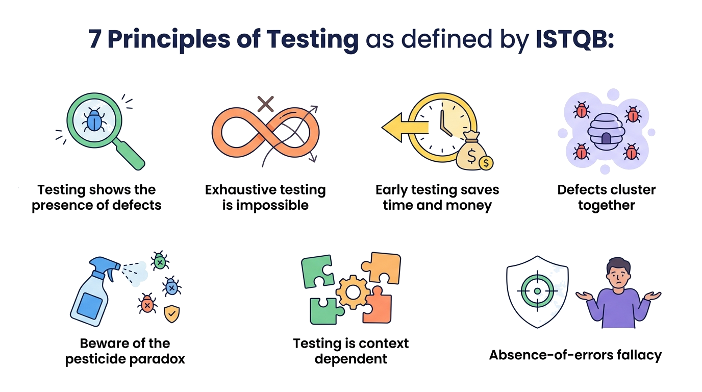
</div>

<!--
This visual panorama summarizes the seven ISTQB principles side by side.

💡 難字與專業術語解說：
- quality assurance (QA): 軟體品質保證（確保軟體開發流程與最終產出物達到預期品質水準的系統化工程）
-->
---
## Principle 1: Testing Shows Presence of Defects, Not Absence

<div class="split64">
<div class="left">

* **Core Meaning (Dijkstra's Axiom):**
  - Testing proves that **defects are present**, but no matter how many thousands of tests pass, it **can never prove that no defects remain**.
* **True Objective of Testing:**
  - Not to prove perfection, but to **reduce the risk of undiscovered defects** in production and provide objective release confidence.
* **[AI Era Warning] The Fluency Bias Trap:**
  - AI-generated code often looks syntactically clean and well-formatted, creating an illusion of correctness.
  - Yet LLM code frequently hides race conditions or subtle boundary bugs—a few green happy-path tests never guarantee defect-free code!

</div>
<div class="right">

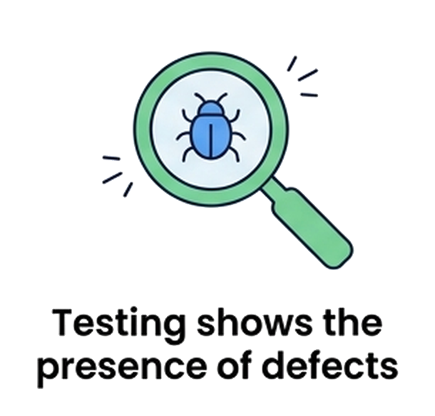

</div>
</div>

<!--
Principle 1 directly reflects Dijkstra's axiom: testing shows the presence of defects, never their absence.

💡 難字與專業術語解說：
- fluency bias: 流暢性偏誤（因 AI 生成的文字或程式碼表面流暢工整，而誤以為其內部邏輯完全正確的認知偏誤）
-->
---
<!-- _class: title-image-slide -->

## Visual Illustration: Principle 1 — Presence of Defects

<div class="image-wrapper">
  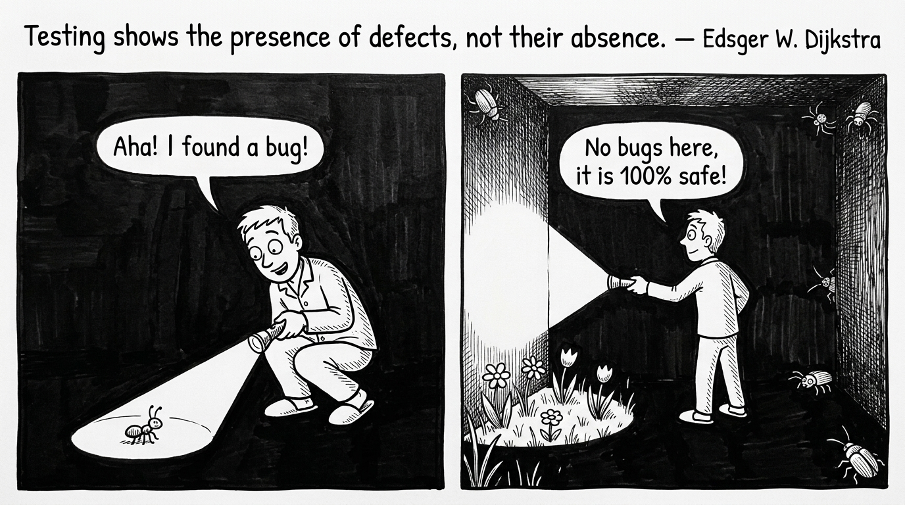
</div>

<!--
Sweeping one room with a flashlight and finding three bugs proves bugs exist in the house, but finding zero bugs in the living room never proves there aren't hundreds hiding behind the kitchen wall!

💡 難字與專業術語解說：
- latent defect: 潛伏缺陷（已存在於程式碼中，但尚未被特定輸入或環境狀態觸發顯現的隱藏錯誤）
-->
---
## Principle 2: Exhaustive Testing is Impossible

<div class="split64">
<div class="left">

* **The Reality of Combinatorial Explosion:**
  - A program with 100 boolean conditions has 2<sup>100</sup> ≈ 1.27 × 10<sup>30</sup> logical combinations—impossible to exhaustively execute.
* **Bugs Lurk in Corners (Why Random Testing Fails):**
  ```java
  int scale(int j) {
      j = j - 1; // Bug! Spec required: j = j + 1
      j = j / 3000;
      return j;
  }
  ```
  - Out of 65,536 16-bit integers, `j - 1` and `j + 1` after integer division `/ 3000` only differ at multiples of `3000` (just **18 corner values**)!
  - **Blind random hit probability** = `18 / 65536 ≈ 0.027%` → We must use **risk-based boundary sampling**!

</div>
<div class="right">

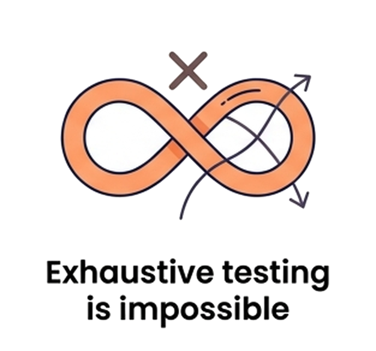

</div>
</div>

<!--
In `scale(int j)`, across 65,536 16-bit integers, only 18 corner inputs expose the `j - 1` vs `j + 1` bug—a random test has a mere 0.027% chance of catching it!

💡 難字與專業術語解說：
- integer truncation: 整數截斷（整數除法自動捨棄小數餘數，常導致非邊界區間的計算錯誤被掩蓋）
-->
---
## Principle 3: Early Testing / Shift-Left (1:10:100 Cost Rule)

<div class="split64">
<div class="left">

* **Core Meaning:**
  - Both static and dynamic verification activities must start at the **earliest stages of the SDLC (Requirements & Architecture)** rather than waiting until code completion.
* **Economic Basis (Boehm's `1 : 10 : 100` Cost Escalation Rule):**
  - Catching a logical contradiction during SRS requirements review: **\$1**
  - Catching a bug during developer unit testing: **\$10**
  - Fixing a post-release production failure & compensating customers: **\$100 to \$1,000+**!

</div>
<div class="right">


</div>
</div>

<!--
Principle 3 is the economic foundation of Shift-Left testing: catching an ambiguous requirement during a specification review costs \$1, whereas fixing that same flaw in production costs \$100 to \$1,000+.

💡 難字與專業術語解說：
- cost escalation: 成本急遽攀升（缺陷越晚在開發生命週期中被發現，其修復與連帶賠償成本呈指數倍增）
-->
---
<!-- _class: title-image-slide -->

## The Economic Case for Shift-Left: Bug Fix Cost Curve

<div class="image-wrapper">
  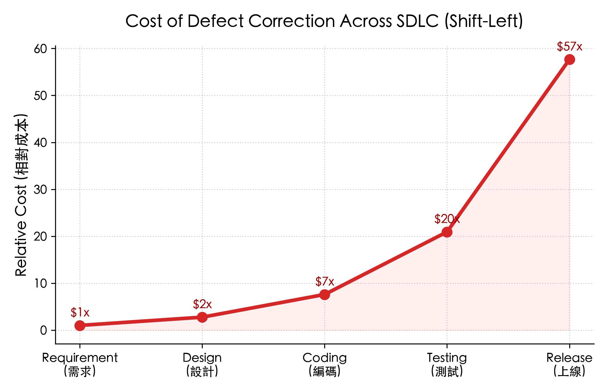
</div>

<!--
This curve illustrates why modern DevSecOps pipelines invest so heavily in static inspections, requirement reviews, and automated unit tests on the left side of the software development lifecycle.

💡 難字與專業術語解說：
- exponential growth curve: 指數成長曲線（隨著軟體進入整合、系統測試與正式營運，修復單一缺陷的成本呈倍數跳升）
-->
---
## Principle 4: Defects Cluster Together (80/20 Pareto Rule)

<div class="split64">
<div class="left">

* **Core Meaning (The 80/20 Pareto Principle):**
  - A small number of modules (~20%) typically contain the vast majority (~80%) of all discovered defects and operational failures.
* **Why Do Defects Cluster?**
  - High cyclomatic and cognitive complexity, legacy technical debt, frequent requirement churn, or fragile third-party integrations.
* **Engineering Action:**
  - When a module yields many bugs, never assume *"we found them all"*—concentrate **Mutation Testing** and **Property-Based Testing** on that defect hotspot!

</div>
<div class="right">

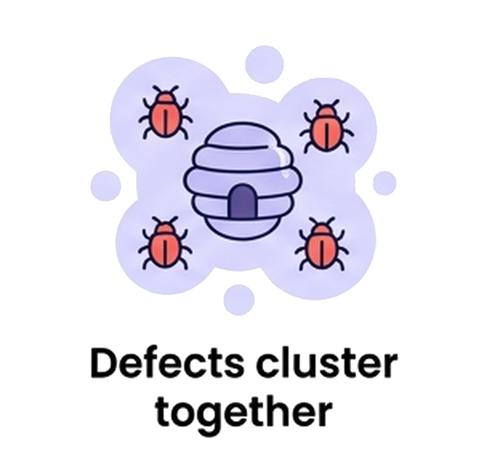

</div>
</div>

<!--
Principle 4 reminds us that defects never distribute uniformly: when you find ten bugs in one complex payment module, there are almost certainly twenty more hiding in that same module.

💡 難字與專業術語解說：
- defect hotspot: 缺陷熱區（高圈複雜度、頻繁修改且歷史錯誤密集的高風險程式碼模組）
-->
---
## Principle 5: Beware of the Pesticide Paradox

<div class="split64">
<div class="left">

* **Core Meaning:**
  - Spraying the exact same pesticide crop after crop leaves behind resistant pests; **running the exact same static test suite build after build stops uncovering new defects**.
* **Engineering Countermeasures:**
  - Continuously review, refactor, and expand regression suites as features evolve.
  - Adopt **Property-Based Testing (`jqwik`)** to bombard code with fresh randomized boundary inputs on every run.
* **[AI Era Warning] Self-Confirming False Green Lights:**
  - If you ask the same LLM session to write both the implementation code and its unit tests, the LLM copies its own flawed assumptions into the test assertions!

</div>
<div class="right">

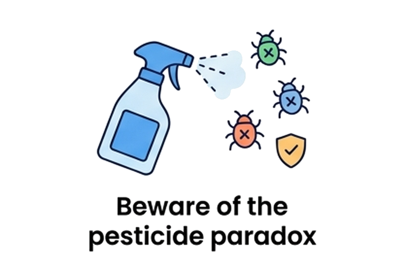

</div>
</div>

<!--
Once developers fix the bugs caught by your initial test suite, that static suite becomes a regression safety net—it prevents old bugs from returning, but it cannot discover new bugs in untested gaps.

💡 難字與專業術語解說：
- self-confirming bias: 自我印證偏誤（由同一思維或同一 AI 上下文同時產出程式碼與測試，導致測試斷言完全順應錯誤實作）
-->
---
<!-- _class: title-image-slide -->

## Visual Illustration: Principle 5 — The Pesticide Paradox

<div class="image-wrapper">
  
</div>

<!--
Bugs adapt around static, predictable traps. Evolving our test cases—and introducing generative property-based and mutation testing—keeps our verification sharp.

💡 難字與專業術語解說：
- test suite stagnation: 測試套件僵化（測試案例長期未隨業務與架構演進更新，導致抓錯能力退化）
-->
---
## Principle 6: Testing is Context Dependent & Principle 7: Absence-of-Errors Fallacy

<div class="split64">
<div class="left">

* **Principle 6 — Testing is Context Dependent:**
  - **Safety-Critical Avionics / Medical Devices:** Mandates DO-178C Level A, 100% MC/DC structural coverage, formal verification, and Hardware-in-the-Loop (HIL).
  - **Agile E-Commerce Web App:** Prioritizes fast CI/CD unit tests, API contract testing (Pact), high-concurrency load testing, and A/B usability experiments.
* **Principle 7 — Absence-of-Errors is a Fallacy:**
  - **"Zero Bugs" ≠ "Successful System":** Finding and fixing 100% of coding defects is useless if the software **fails to solve the customer's actual business problem** or violates domain regulations.
  - **[AI Era Warning]:** An LLM can generate code that compiles cleanly and passes 100% of unit tests, yet implements an outdated or illegal business formula!

</div>
<div class="right">


</div>
</div>

<!--
Principles 6 and 7 remind us to tailor testing rigor to domain risk and never confuse "zero technical crashes" with genuine customer value.

💡 難字與專業術語解說：
- absence-of-errors fallacy: 無錯謬誤（誤以為只要消除所有程式錯誤，軟體就必然能獲得使用者與商業成功）
-->
---
## Multi-Dimensional Taxonomy (1): Verification vs. Validation (V&V)

<div class="card-deck">

> Barry Boehm's classic distinction: Verification asks *"Are we building the product right?"* while Validation asks *"Are we building the right product?"*

<div class="two-columns">
<div class="card" data-marpit-fragment>

### Verification — Process & Spec Compliance
- **Core Question:** *"Are we building the product right?"*
- **Focus:** Confirms that software artifacts at each phase strictly conform to upstream specifications, architecture blueprints, and coding standards.
- **Techniques:** Static code reviews, formal inspections, static analysis (PMD / SonarQube), unit and integration testing.
- **Failure Mode:** Code passes 100% of unit tests against an outdated spec that no longer matches real clinical or business workflows.

</div>
<div class="card" data-marpit-fragment>

### Validation — Product & Value Alignment
- **Core Question:** *"Are we building the right product?"*
- **Focus:** Ensures the deployed software genuinely solves user pain points, fits operational environments, and delivers business value.
- **Techniques:** User Acceptance Testing (UAT), usability testing, beta field trials, and customer prototyping reviews.
- **Failure Mode:** Over-engineering a technically flawless product that users find unusable or irrelevant to their real tasks.

</div>
</div>
</div>

<!--
Verification checks conformance to specifications (*building the product right*), whereas Validation checks fitness for real human and business purpose (*building the right product*).

💡 難字與專業術語解說：
- conformance to specification: 符合規格性（軟體實作與需求規格書、介面契約的一致程度）
-->
---
<!-- _class: title-image-slide -->

## Visual Comparison: Verification vs. Validation (V&V)

<div class="image-wrapper">
  
</div>

<!--
This diagram contrasts Verification (checking each artifact against its specification) with Validation (confirming the final product satisfies the user's true need).

💡 難字與專業術語解說：
- user acceptance testing (UAT): 使用者驗收測試（由最終客戶或領域專家在擬真環境下確認系統是否符合交付標準的測試）
-->
---
## Multi-Dimensional Taxonomy (2): Defect vs. Validation & Static vs. Dynamic

<div class="card-deck">

> Effective QA combines a constructive mindset (proving core workflows) with a destructive mindset (hunting latent faults), both statically and dynamically.

<div class="two-columns">
<div class="card" data-marpit-fragment>

### Defect Testing vs. Validation Testing
- **Validation Testing (Confirming Usage):**
  - Mindset: *"Demonstrate to the client that the system works."*
  - Executes normal business workflows (Happy Paths) to confirm expected functionality.
- **Defect Testing (Destructive Hunting):**
  - Mindset: *"Break the system to expose hidden vulnerabilities."*
  - Bombards boundaries, injects malformed payloads, and forces anomalous state transitions.

</div>
<div class="card" data-marpit-fragment>

### Static Testing vs. Dynamic Testing
- **Static Testing (Without Executing Code):**
  - Inspects requirements, design models, and source code via peer reviews and AST static analyzers.
  - Directly pinpoints root **Faults / Bugs** inside artifacts at low cost.
- **Dynamic Testing (Executing the Program):**
  - Runs the compiled binary with concrete test data and compares actual outputs against expected Oracles to observe runtime **Failures**.

</div>
</div>
</div>

<!--
Validation Testing walks the happy path to show the system works, while Defect Testing adopts an adversarial mindset to break the system at its corners. Static Testing finds Faults without executing code; Dynamic Testing runs code to observe Failures.

💡 難字與專業術語解說：
- fault vs. failure: 缺陷 (Fault/Bug) vs. 失效 (Failure)（靜態存在於程式碼中的邏輯錯誤稱為 Fault；程式執行時被觸發而外顯的異常結果稱為 Failure）
-->
---
<!-- _class: title-image-slide -->

## Multi-Dimensional Taxonomy (3): Black-Box vs. White-Box Testing

<div class="image-wrapper">
  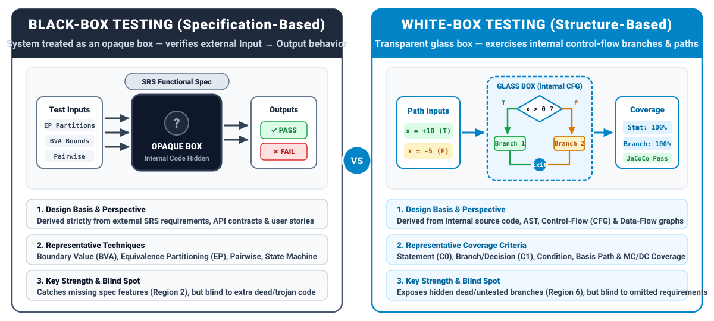
</div>

<!--
Black-Box Functional Testing derives test cases purely from external specifications, whereas White-Box Structural Testing inspects the internal control flow graph, branches, and bytecode paths.

💡 難字與專業術語解說：
- opaque box vs. glass box: 不透明黑盒 vs. 透明玻璃盒（對內部實作完全封裝隔離 vs. 針對內部邏輯分支透明檢視）
-->
---
## Multi-Dimensional Taxonomy (4): Three Core Testing Levels

<div class="card-deck">

> Software testing scales across three levels of granularity—and high **Testability** requires decoupling pure computation from UI and external I/O.

<div class="two-columns">
<div class="card" data-marpit-fragment>

### Three Core Testing Levels
- **1. Unit Testing (Component / Class Level):**
  - Verifies a single method or class in strict isolation from external I/O; executes in milliseconds.
- **2. Integration Testing (Interface & Contract Level):**
  - Verifies interface contracts, data serialization, and interaction protocols across modules or databases.
- **3. System Testing (End-to-End Environment Level):**
  - Verifies complete E2E user journeys and non-functional quality (load, stress, security) in staging.

</div>
<div class="card" data-marpit-fragment>

### Design for Testability (Decoupling Logic from I/O)
- Separate core business computation from UI prompts and external I/O so unit tests run automatically in CI:
```java
// Low Testability: Tightly coupled to interactive UI (Blocks CI!)
double divBad(double x, double y) {
    while (y == 0) y = uiPrompt("Divisor != 0:");
    return x / y;
}

// High Testability: Pure function + explicit exception contract
double divGood(double x, double y) {
    if (y == 0) throw new IllegalArgumentException("Divisor == 0");
    return x / y; // Verified in < 1ms via assertThrows!
}
```

</div>
</div>
</div>

<!--
Testing progresses across three distinct levels of granularity: Unit Testing, Integration Testing, and System Testing.

💡 難字與專業術語解說：
- granularity of testing: 測試粒度（從單一函式方法、跨模組介面到全系統端到端的檢驗範圍層次）
-->
---
<!-- _class: title-image-slide -->

## Hierarchy of the Three Core Testing Levels

<div class="image-wrapper">
  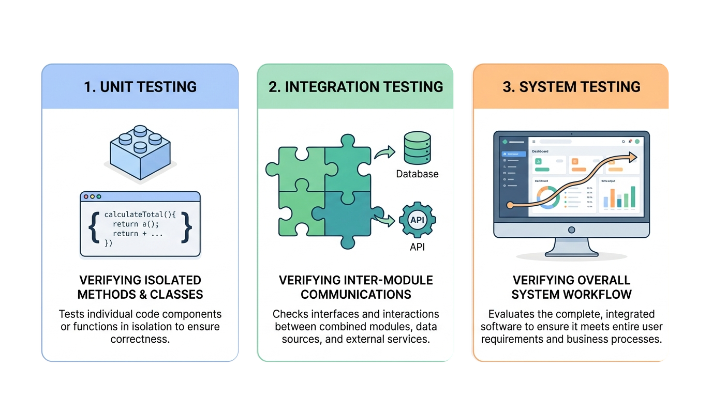
</div>

<!--
Dozens of isolated unit tests form the foundation for component and integration testing, culminating in full system and acceptance verification.

💡 難字與專業術語解說：
- test hierarchy: 測試層級體系（由底層單元測試逐層向上組裝至整合測試、系統測試與驗收測試的結構）
-->

---
## Test Case Design: Venn Diagram of Specified, Programmed & Verified Behavior

<div class="card-deck">

> High-assurance software strives to align **Specification (S)**, **Implementation (P)**, and **Test Suite (T)** into maximum overlap.

<div class="two-columns">
<div class="card" data-marpit-fragment>

### Three Core Behavioral Sets
- **Specified Behavior (S):**
  - Functional requirements and constraints explicitly promised in the SRS.
- **Programmed Behavior (P):**
  - What the developer actually coded into the executable binary.
- **Verified Behavior (T):**
  - What the automated and manual test cases actually exercise and assert.

</div>
<div class="card" data-marpit-fragment>

### Critical Intersection Regions
- **Region 1 (S ∩ P ∩ T, Golden Core):** Specified, implemented, and verified!
- **Region 2 (S \ P, Missing Implementation):** Promised in the spec, but the developer forgot to code it.
- **Region 3 (P ∩ T \ S, Gold-Plating):** Unrequested feature coded and tested without spec approval.
- **Region 6 (P \ (S ∪ T), Highest Danger!):** **Undocumented AND untested code**—trojan backdoors, ghost logic, or latent time-bombs!

</div>
</div>
</div>

<!--
Pay special attention to Region 6: behavior that exists inside the compiled program P, but was never requested in Specification S AND is never touched by Test Suite T.

💡 難字與專業術語解說：
- ghost logic / backdoor: 幽靈邏輯／後門（存在於程式碼中但未載明於規格且未受測試監控的隱蔽行為）
-->
---
<!-- _class: title-image-slide -->

## Visual Model: The Software Behavior Venn Diagram (S, P, T)

<div class="image-wrapper">
  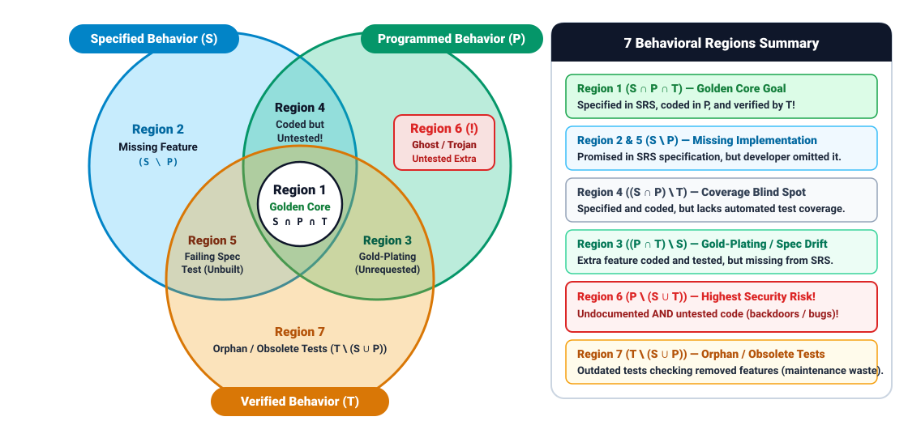
</div>

<!--
Our goal as software engineers is to expand Region 1 (the central intersection) while driving Regions 2, 4, and especially Region 6 down to zero.

💡 難字與專業術語解說：
- set difference: 差集（例如 S \ P 代表規格有定義但程式未實作的遺漏需求集合）
-->
---
## Test Case vs. Test Data & The 5 Core Components of a Test Case

<div class="card-deck">

> "A **Test Case** is the architectural soul of verification logic; **Test Data** is merely the concrete value tuple substituted at runtime."

<div class="two-columns">
<div class="card" data-marpit-fragment>

### Test Case vs. Test Data
- **Test Case (Logical Specification):**
  - Defines *what scenario* to verify (e.g., *"Verify division throws an exception when divisor is zero"*), independent of specific numbers.
- **Test Data (Concrete Instances):**
  - The concrete parameter tuples `(5, 0)`, `(-99, 0)`, mock fixtures, or DB seeds fed into a parameterized test (`@ParameterizedTest`).

</div>
<div class="card" data-marpit-fragment>

### 5 Standard Test Case Components
1. **Test ID & Objective:** Unique traceable ID (e.g., `TC-AUTH-001`) and verification purpose.
2. **Preconditions:** Required initial state, auth tokens, and database fixtures (`Arrange`).
3. **Test Inputs:** Concrete parameters, API payloads, or user events (`Act`).
4. **Expected Oracle:** Expected return value, HTTP status, or exception (`Assert`).
5. **Postconditions:** State invariant check and environment cleanup (`Teardown`).

</div>
</div>
</div>

<!--
A Test Case is a complete logical specification comprising five essential components, whereas Test Data refers to the concrete input tuples substituted at runtime.

💡 難字與專業術語解說：
- test fixture: 測試固具／前置環境（為讓測試能穩定重複執行所預先準備的物件狀態、設定或資料庫初始資料）
-->
---
<!-- _class: title-image-slide -->

## Mindmap: Test Case vs. Test Data Structure

<div class="image-wrapper">
  
</div>

<!--
Using `divide(a, b)` as an example, Test Cases branch by logical partitions while leaf nodes hold concrete Test Data tuples.

💡 難字與專業術語解說：
- parameterized execution: 參數化執行（以同一套測試邏輯骨架自動巡迴注入多組測試資料的機制）
-->

---
<!-- _class: full-image-slide -->

<div class="mm-3w2h-stage" id="mm-3w2h-root">
<div class="mm-root-col">
<div class="mm-root-card">
<div class="mm-root-badge">3W2H TAXONOMY</div>
<div class="mm-root-title">Software Testing Landscape</div>
<div class="mm-root-sub">5 Core Dimensions of Quality Verification</div>
<div class="mm-root-actions">
<button type="button" class="mm-action-btn" id="mm-btn-toggle-all">➕ Expand All</button>
<button type="button" class="mm-action-btn mm-btn-secondary" id="mm-btn-step">▶ Next Branch (1/5)</button>
</div>
</div>
</div>
<svg class="mm-fan-svg" viewBox="0 0 48 620" preserveAspectRatio="none">
<path d="M 0 310 C 24 310, 20 55, 48 55" fill="none" stroke="#3b82f6" stroke-width="2.8" />
<path d="M 0 310 C 22 310, 22 182, 48 182" fill="none" stroke="#10b981" stroke-width="2.8" />
<path d="M 0 310 L 48 310" fill="none" stroke="#f59e0b" stroke-width="2.8" />
<path d="M 0 310 C 22 310, 22 438, 48 438" fill="none" stroke="#8b5cf6" stroke-width="2.8" />
<path d="M 0 310 C 24 310, 20 565, 48 565" fill="none" stroke="#f43f5e" stroke-width="2.8" />
</svg>
<div class="mm-branches-col">
<div class="mm-branch-row mm-b1 is-collapsed" data-branch-idx="0">
<div class="mm-dim-node" title="Click to expand / collapse">
<div class="mm-dim-header">
<span class="mm-dim-tag">DIMENSION 1</span>
<span class="mm-toggle-pill">+</span>
</div>
<div class="mm-dim-title">1. WHO Tests?</div>
<div class="mm-dim-sub">Roles, Independence &amp; Alpha/Beta</div>
</div>
<div class="mm-leaf-bridge"></div>
<div class="mm-leaves-grid">
<div class="mm-leaf-card">
<div class="mm-leaf-title">Developers</div>
<div class="mm-leaf-desc"><strong>Unit testing &amp; TDD</strong>; white-box branch &amp; contract defense at coding time.</div>
</div>
<div class="mm-leaf-card">
<div class="mm-leaf-title">Peers &amp; Dedicated QA</div>
<div class="mm-leaf-desc">Code inspection, CI automation, load testing &amp; <strong>Alpha Testing</strong> (in-house staging).</div>
</div>
<div class="mm-leaf-card">
<div class="mm-leaf-title">Domain Experts &amp; Users</div>
<div class="mm-leaf-desc">Business <strong>UAT</strong> by Product Owners &amp; <strong>Beta Testing</strong> by customers in the wild.</div>
</div>
</div>
</div>
<div class="mm-branch-row mm-b2 is-collapsed" data-branch-idx="1">
<div class="mm-dim-node" title="Click to expand / collapse">
<div class="mm-dim-header">
<span class="mm-dim-tag">DIMENSION 2</span>
<span class="mm-toggle-pill">+</span>
</div>
<div class="mm-dim-title">2. WHAT is Tested?</div>
<div class="mm-dim-sub">Functional, Structural &amp; Quality</div>
</div>
<div class="mm-leaf-bridge"></div>
<div class="mm-leaves-grid">
<div class="mm-leaf-card">
<div class="mm-leaf-title">Functional Logic (Black-Box)</div>
<div class="mm-leaf-desc">SRS business rules, <strong>EP partitions</strong>, <strong>BVA boundaries</strong> &amp; decision tables.</div>
</div>
<div class="mm-leaf-card">
<div class="mm-leaf-title">Structural Paths (White-Box)</div>
<div class="mm-leaf-desc">Internal CFG <strong>Statement (SC)</strong>, <strong>Branch (BC)</strong>, Path &amp; avionics <strong>MC/DC</strong> coverage.</div>
</div>
<div class="mm-leaf-card">
<div class="mm-leaf-title">Scenario &amp; Non-Functional</div>
<div class="mm-leaf-desc">End-to-end user journeys, concurrency load/stress &amp; <strong>OWASP security</strong> gates.</div>
</div>
</div>
</div>
<div class="mm-branch-row mm-b3 is-collapsed" data-branch-idx="2">
<div class="mm-dim-node" title="Click to expand / collapse">
<div class="mm-dim-header">
<span class="mm-dim-tag">DIMENSION 3</span>
<span class="mm-toggle-pill">+</span>
</div>
<div class="mm-dim-title">3. WHY Test?</div>
<div class="mm-dim-sub">Risk, Contracts &amp; CI Confidence</div>
</div>
<div class="mm-leaf-bridge"></div>
<div class="mm-leaves-grid">
<div class="mm-leaf-card">
<div class="mm-leaf-title">Risk Mitigation</div>
<div class="mm-leaf-desc">Drastically reduce production failure probability and business blast radius.</div>
</div>
<div class="mm-leaf-card">
<div class="mm-leaf-title">Contract &amp; Invariant Defense</div>
<div class="mm-leaf-desc">Enforce Design-by-Contract (DbC) preconditions, postconditions &amp; invariants.</div>
</div>
<div class="mm-leaf-card">
<div class="mm-leaf-title">Regression Safety Net</div>
<div class="mm-leaf-desc">Guarantee new refactoring or commits never break existing production features.</div>
</div>
</div>
</div>
<div class="mm-branch-row mm-b4 is-collapsed" data-branch-idx="3">
<div class="mm-dim-node" title="Click to expand / collapse">
<div class="mm-dim-header">
<span class="mm-dim-tag">DIMENSION 4</span>
<span class="mm-toggle-pill">+</span>
</div>
<div class="mm-dim-title">4. HOW to Execute?</div>
<div class="mm-dim-sub">Scripted, Exploratory &amp; Fuzzing</div>
</div>
<div class="mm-leaf-bridge"></div>
<div class="mm-leaves-grid">
<div class="mm-leaf-card">
<div class="mm-leaf-title">Scripted CI/CD Automation</div>
<div class="mm-leaf-desc">Deterministic <strong>JUnit 5 / Playwright</strong> test suites executed on every Git push.</div>
</div>
<div class="mm-leaf-card">
<div class="mm-leaf-title">Exploratory Testing</div>
<div class="mm-leaf-desc">Simultaneous learning, test design &amp; adversarial probing by domain experts.</div>
</div>
<div class="mm-leaf-card">
<div class="mm-leaf-title">Fuzzing &amp; Record/Replay</div>
<div class="mm-leaf-desc">Random/mutated payload bombardment &amp; capturing real UI interaction traces.</div>
</div>
</div>
</div>
<div class="mm-branch-row mm-b5 is-collapsed" data-branch-idx="4">
<div class="mm-dim-node" title="Click to expand / collapse">
<div class="mm-dim-header">
<span class="mm-dim-tag">DIMENSION 5</span>
<span class="mm-toggle-pill">+</span>
</div>
<div class="mm-dim-title">5. HOW to Evaluate?</div>
<div class="mm-dim-sub">Test Oracles &amp; Coverage Metrics</div>
</div>
<div class="mm-leaf-bridge"></div>
<div class="mm-leaves-grid">
<div class="mm-leaf-card">
<div class="mm-leaf-title">Test Oracle Comparator</div>
<div class="mm-leaf-desc">Compares Program Under Test (<code>Actual y</code>) against Oracle (<code>Expected y*</code>).</div>
</div>
<div class="mm-leaf-card">
<div class="mm-leaf-title">The Test Oracle Problem</div>
<div class="mm-leaf-desc">Generative AI, search engines &amp; complex simulations lack a single exact answer.</div>
</div>
<div class="mm-leaf-card">
<div class="mm-leaf-title">Next-Gen AI/MT Oracles</div>
<div class="mm-leaf-desc">Solved via <strong>Metamorphic Relations (MR)</strong>, <strong>Differential Testing</strong> &amp; <strong>LLM Judge</strong>.</div>
</div>
</div>
</div>
</div>
</div>

<!--
In SQA Section 3.5, we organize the entire software testing universe through this interactive 3W2H Mind Map:
1. **Who Tests?** Developers (Unit/TDD), Peers & Dedicated QA (Inspection, CI, in-house Alpha testing), and Domain Experts/Customers (UAT & real-world Beta testing).
2. **What is Tested?** Functional logic, structural white-box code paths, end-to-end scenarios, and non-functional quality attributes.
3. **Why Do We Test?** Risk mitigation, contract/invariant defense, and continuous regression safety in CI/CD.
4. **How Do We Execute?** Scripted CI/CD automation, exploratory probing, random monkey fuzzing, and Record-and-Replay workflows.
5. **How Do We Evaluate?** Test Oracles (comparing actual vs. expected outcomes) and structural/mutation coverage metrics.

💡 難字與專業術語解說：
- 3W2H testing taxonomy: 3W2H 測試全景分類法（從 Who、What、Why、How 與 How to Evaluate 五大維度剖析測試體系）
- Alpha vs. Beta testing: Alpha 內部測試 vs. Beta 外部公測（在內部受控環境進行的測試 vs. 釋出予外部真實使用者在真實環境進行的公測）
- Record & Replay testing: 錄製與回放測試（記錄使用者在介面上的真實點擊與輸入軌跡，自動轉化為可重複執行之自動化測試腳本的技術）
-->
---
## How to Evaluate: Test Oracles & The Test Oracle Problem

<div class="card-deck">

> Every test requires a **Test Oracle** to judge pass or fail—yet in complex simulations, search engines, and generative AI, knowing the single exact answer is impossible.

<div class="two-columns">
<div class="card" data-marpit-fragment>

### 1. What is a Test Oracle?
- **Ground-Truth Mechanism:**
  - The baseline authority (SRS formula, reference model, or invariant) used to determine whether the Program Under Test (`PUT`) produced the **correct output** for a given input.
- **Test Oracle Comparator Architecture:**
  - The same test input is fed to the **Program Under Test (`PUT`)** (`Actual Output y`) and the **Test Oracle** (`Expected Output y*`).
  - The comparator asserts `Actual == Expected` (`Match → PASS`, `Mismatch → FAIL`).

</div>
<div class="card" data-marpit-fragment>

### 2. The Test Oracle Problem
- **Traditional Deterministic Software:**
  - `f(x) → y` (e.g., tax calculation or sorting) has an exact, reproducible expected value (`assertEquals(expected, actual)`).
- **AI / LLM & Complex Non-Deterministic Systems:**
  - Stochastic sampling (`Temperature > 0`), autonomous driving perception, and open-ended natural language queries have **no single exact ground-truth string**.
  - Traditional hardcoded `assertEquals` completely breaks down!

</div>
</div>
</div>

<!--
Every test requires a Test Oracle that supplies the expected result to compare against the program's actual output. In complex scientific simulations, search engines, and generative AI, knowing the exact expected answer for a single input is often impossible—the **Test Oracle Problem**.

💡 難字與專業術語解說：
- Test Oracle Problem: 測試預言機難題（在複雜科學計算、搜尋推薦或生成式 AI 系統中，極難甚至無法預先得知單一輸入之標準正確答案的困境）
-->
---
## Breaking the Test Oracle Problem: Metamorphic, Differential & LLM Judge

<div class="card-deck">

> When no single ground-truth answer exists, we verify **cross-input transformation invariants**, **multi-model consensus**, and **structured rubric evaluation**.

<div class="two-columns">
<div class="card" data-marpit-fragment>

### 1. Metamorphic Testing (MT)
- **Verify Input-Output Relations (`x → x'`):**
  - Even if we don't know the exact output `f(x)`, applying a controlled transformation `x → x'` yields a **Metamorphic Relation (MR)** between `f(x)` and `f(x')` that must hold true!
- **Concrete Domain Examples:**
  - **Autonomous Driving:** Rotating a pedestrian image by `5°` or adding rain noise must still detect the pedestrian.
  - **Search Engine:** Results for `"TSMC AND revenue"` must be a strict subset (`⊆`) of results for `"TSMC"`.
  - **Shortest Path:** Doubling all road edge weights (`× 2`) must preserve the exact same optimal route node sequence.

</div>
<div class="card" data-marpit-fragment>

### 2. Differential Testing & LLM-as-a-Judge
- **Differential Testing (Cross-Implementation):**
  - Feed identical inputs into multiple independent implementations (e.g., `GCC` vs. `Clang`, legacy engine vs. refactored engine, `Claude` vs. `GPT`).
  - Any major output divergence immediately flags a bug or undefined edge behavior.
- **LLM-as-a-Judge & Guardrails:**
  - Evaluate generative outputs via structured rubrics:
    1. **Faithfulness:** Grounded in RAG context (no hallucination).
    2. **Answer Relevance:** Directly addresses user intent.
    3. **Safety Guardrails:** Zero prompt injection or toxic leakage.

</div>
</div>
</div>

<!--
Metamorphic Testing checks invariant relations across input transformations, Differential Testing compares independent implementations, and LLM-as-a-Judge evaluates generative AI outputs against structured rubrics.

💡 難字與專業術語解說：
- differential testing: 差分測試（將相同測試輸入同時餵給多個獨立實作版本，藉由比對輸出差異來自動揭露異常的技術）
-->
---
<!-- id: ase-ch07-ccq1 -->
## Concept Check Question 1: Testing Principles

<div class="ccq-columns">
<div class="ccq-text">

According to Dijkstra's foundational testing axiom and the Shift-Left principle, what is the primary capability and economic timing of software testing?

- **A.** It mathematically proves that a program is completely free of all defects when executed early in requirements.
- **B.** It can show the presence of defects but never their absence, and finding bugs early is drastically cheaper.
- **C.** It guarantees 100% statement coverage across all modules if automated regression tests are run continuously.
- **D.** It replaces the necessity for customer acceptance testing by eliminating defect clustering in production code.

</div>
<div class="ccq-logo">
  <a href="https://nlhsueh.github.io/nickedupocket/#/student/ase-ch07-ccq1" target="_blank"></a>
</div>
</div>

<!--
Let's pause for Concept Check Question 1 on foundational testing principles.
-->

---
## Concept Check Question 1: Answer & Explanation

- **Correct Answer: B**
- **Explanation:**
  - Edsger Dijkstra's famous axiom explicitly states: *"Program testing can be used to show the presence of bugs, but never to show their absence!"* Testing provides empirical evidence of flaws, but cannot mathematically prove zero bugs exist.
  - The Shift-Left principle emphasizes testing as early as requirements and design, because resolving defects early costs 10x to 100x less than fixing them in post-release maintenance.
  - *Why others are incorrect:* Option A contradicts Dijkstra's axiom. Option C confuses structural statement coverage with functional defect absence. Option D is false because automated tests never eliminate the need for customer validation (Principle 7).

<!--
The correct answer is **B**.
-->
---
<!-- _class: lead -->
<!-- header: '7.2 Static Inspection & Code Review' -->

# **7.2 Static Software Inspection & Code Review**

> "Dynamic testing only illuminates the tip of the iceberg above water; only static inspection drains the sea to expose deep architectural reefs and code smells."

<!--
We now move to Section 7.2: Static Software Inspection and Code Review (integrating SQA Chapter 4: Sections 4.1, 4.2, and 4.5).

💡 難字與專業術語解說：
- static software inspection: 軟體靜態檢視（在不執行程式的前提下，透過結構化團隊審查與靜態分析工具檢驗規格、設計與原始碼的工程實踐）
-->
---
## Static Review Essence: The Testing Iceberg & IEEE 1028 Spectrum

<div class="split64">
<div class="left">

* **Why Dynamic Testing Only Sees the Tip of the Iceberg:**
  - **Path Coverage & Fault Masking:** Dynamic tests only exercise paths triggered by chosen test data; an early exception masks downstream flaws.
  - **Concrete Example:** `for (int i = 1; i < max; i++)` (skipping index `0`) is caught in 3 seconds of static review, but missed by dynamic tests if element `0` doesn't alter the test output!
* **Static vs. Dynamic Synergy & IEEE 1028 Spectrum:**
  - **Shift-Left ROI:** Static review examines artifacts **without executing code**, removing ~70% of defects before compilation at `1/10` the cost.
  - **Formal Inspection vs. Walkthrough (IEEE 1028):**
    - **Inspection:** Rigorous, checklist-driven; chaired by **Moderator**, paraphrased by **Reader**, logged by **Scribe**.
    - **Walkthrough:** Informal knowledge-sharing led by the **Author**.
  - **Golden Rule:** *Inspect the artifact, never use defect counts for HR punishment!*

</div>
<div class="right">


</div>
</div>

<!--
In dynamic testing, if your test data happens to put the target item at index 2, the test passes with a green light, leaving the skipped index `0` bug submerged beneath the waterline. In static review, an experienced peer or static analyzer spots `i = 1` immediately. Moreover, IEEE 1028 distinguishes formal Inspections (led by a Moderator and paraphrased by an independent Reader) from informal Walkthroughs (led by the Author).

💡 難字與專業術語解說：
- author blindness: 作者盲點／當局者迷（作者因大腦預設自身邏輯正確，自讀文件或程式碼時極難察覺自身筆誤或思維漏洞的現象）
- collective code ownership: 程式碼集體共有制（透過同儕審查讓團隊多數成員皆理解系統各模組邏輯，避免知識孤島）
-->
---
<!-- _class: title-image-slide -->

## Fagan Inspection Process: 6 Standard Steps & 5 Specialized Roles

<div class="image-wrapper">
  
</div>

<!--
Michael Fagan (IBM, 1976) formalized Software Inspection into six disciplined steps and five specialized roles. During Step 4 (Review Meeting), the Reader—never the Author—paraphrases the artifact's logic out loud, while the Moderator enforces one iron rule: focus strictly on discovering and logging defects (at an optimal pace of 200–400 LOC/hr), and never waste meeting time debating how to fix them (that belongs in Step 5 Rework).

💡 難字與專業術語解說：
- Fagan Inspection: 范根檢視法（具備六大標準步驟與五大明確角色分工的正式軟體靜態檢視典範）
- optimal inspection rate: 最佳檢視速率（實證研究顯示每小時審查 200–400 行程式碼的抓錯率最高，超過 1,000 行會陷入走馬看花的橡皮圖章效應）
-->
---
<!-- _class: title-image-slide -->

## What Do We Review? Full-Lifecycle Artifacts & Key Inspection Focus

<div class="image-wrapper">
  
</div>

<!--
Static review applies to every software artifact across the entire SDLC—not just source code!
1. **Requirements & SRS Documents:** We inspect for Correctness, Unambiguity (eliminating vague words), Completeness, Consistency, Verifiability (testable quantitative thresholds), and Bidirectional Traceability (RTM).
2. **Architecture & Design Models (ADD, UML, DFD, ERD, API Contracts):** We audit Modularity (high cohesion, low coupling), DFD data conservation (no black holes or miracles), Class Diagram & ERD referential integrity, and OpenAPI contract consistency.
3. **Source Code & Test Suites:** We inspect for data/boundary/control-flow faults, resource leaks, Code Smells (Duplicated Code, God Class, Shotgun Surgery), and OWASP Top 10 security vulnerabilities.

💡 難字與專業術語解說：
- data conservation (DFD black hole / miracle): 資料守恆（在資料流程圖審查中，只有輸入卻無輸出的程序稱為黑洞 Black Hole；無輸入卻憑空產出資料稱為奇蹟 Miracle）
- code smell: 程式碼臭味（表面雖能編譯執行，但內部結構腐化、違反設計原則並預示深層維護風險的徵兆）
-->
---
<!-- _class: title-image-slide -->

## Automated Static Analysis Toolchain & Two-Stage CI/CD Quality Gate

<div class="image-wrapper">
  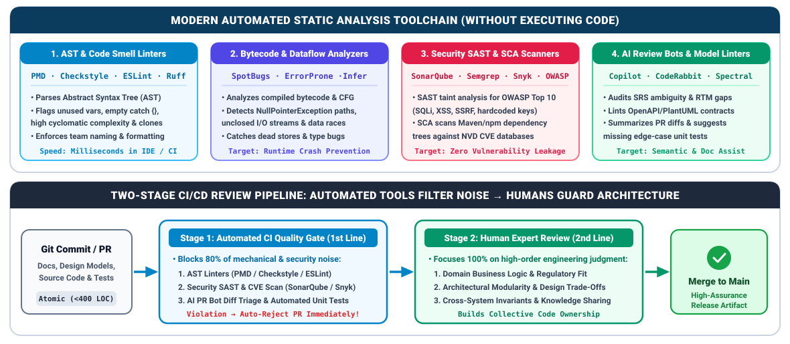
</div>

<!--
Modern software engineering pairs human review with powerful automated static analysis tools that inspect ASTs, bytecode, and dependency graphs without executing the program:
1. **AST & Code Smell Linters (`PMD`, `Checkstyle`, `ESLint`, `Ruff`):** Catch unused variables, empty `catch {}` blocks, cyclomatic complexity bloat, and style violations in milliseconds.
2. **Bytecode & Dataflow Bug Finders (`SpotBugs`, `ErrorProne`, `Infer`):** Trace control/data flow to pinpoint null-pointer dereferences, resource leaks, and concurrency races.
3. **Security SAST & SCA Scanners (`SonarQube`, `Semgrep`, `Snyk`, `OWASP Dependency-Check`):** Detect SQLi/XSS taint paths and vulnerable third-party CVEs.
4. **AI Review Bots & Model Linters (`GitHub Copilot`, `CodeRabbit`, `Spectral`):** Audit SRS/OpenAPI specs and triage PR diffs—filtering out 80% of mechanical noise in **Stage 1** so human experts in **Stage 2** can focus 100% on domain business logic and system architecture!

💡 難字與專業術語解說：
- Abstract Syntax Tree (AST) static analyzer: 抽象語法樹靜態分析器（將原始碼解析為語法樹結構，透過規則匹配自動偵測壞味道與潛在缺陷的工具，如 PMD）
- SAST vs. SCA: 靜態應用程式安全測試 vs. 軟體組成分析（掃描自寫原始碼之安全弱點 vs. 掃描第三方開源套件是否含有已知 CVE 漏洞）
-->
---
<!-- _class: lead -->
<!-- header: '7.3 Black-Box Testing (BVA & EP)' -->

# **7.3 Black-Box Testing: Boundary Value Analysis & Equivalence Partitioning**

> "Without peeking at internal code structure, validate external system behavior strictly against specification contracts—hunting boundary defects with scientific precision across infinite input spaces."

<!--
We now enter Section 7.3: Black-Box Testing — Boundary Value Analysis (BVA) and Equivalence Partitioning (EP), integrating SQA Sections 5.1, 5.3, and 5.4.

💡 難字與專業術語解說：
- specification-based testing: 規格導向測試（完全依據外部需求規格書與介面契約設計測試案例的黑箱測試方法）
-->
---
## Black-Box Testing Concept Architecture & Why Exhaustive Testing Fails

<div class="split73">
<div class="left">

* **Three Core Elements of Black-Box Testing:**
  1. **Test Inputs:** Valid inputs, extreme boundary values, and malformed invalid inputs.
  2. **System Under Test (SUT):** Treated as an opaque black box; internal algorithms and data structures remain completely hidden.
  3. **Output Verification:** Compares actual outputs against expected specification Oracles (**"What"** the system does, decoupled from **"How"** it is coded—zero test breakage during internal refactoring!).
* **Why Exhaustive Testing is Mathematically Impossible:**
  - Even a simple 32-bit integer addition `int add(int a, int b)` has 2<sup>32</sup> × 2<sup>32</sup> = 2<sup>64</sup> ≈ 1.84 × 10<sup>19</sup> input pairs.
  - At **1 billion tests/sec (1 GHz)**, exhaustive testing would take **584 years**!
  - **Mission of Black-Box Engineering:** Select the **smallest representative subset** that captures the **maximum probability of defects**.

</div>
<div class="right">

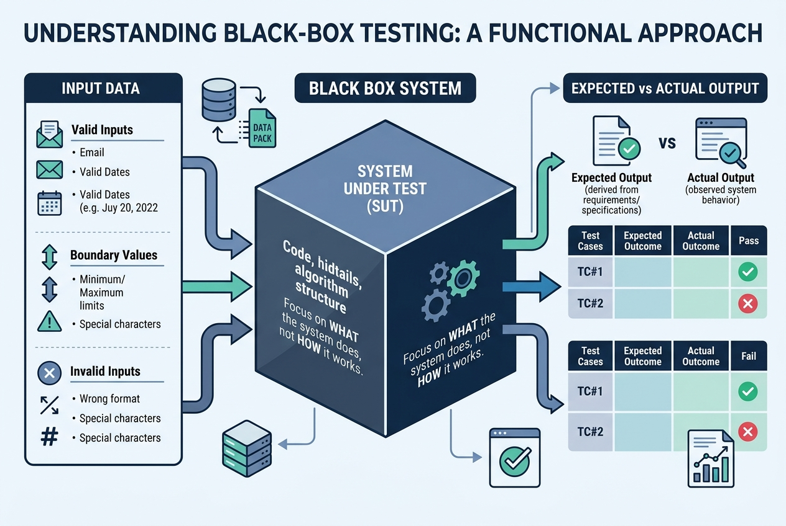

</div>
</div>

<!--
A trivial two-integer function `int add(int a, int b)` has 2^64 possible input combinations, taking 584 years at 1 GHz to exhaustively test. Black-box methodologies select the smallest representative subset that maximizes defect discovery.

💡 難字與專業術語解說：
- decoupling from implementation: 與實作解耦（黑箱測試僅針對公開 API 契約斷言，因此內部重構演算法時測試程式碼無須修改）
-->
---
## Father of Software Testing: Glenford J. Myers & The 5 Black-Box Methods

<div class="split73">
<div class="left">

* **Glenford J. Myers — *The Art of Software Testing* (1979):**
  - **Revolutionary Definition:** *"Testing is the process of executing a program with the intent of finding errors—not proving that errors do not exist."*
  - **Foundational Contributions:**
    1. Systematically formalized **Equivalence Partitioning (EP)**, **Boundary Value Analysis (BVA)**, **Cause-Effect Graphing**, and **Error Guessing**.
    2. Insisted that every test case must pre-define an **Expected Output (Test Oracle)** so testers don't subconsciously accept wrong outputs.
    3. Introduced the world-famous **Triangle Classification Problem** (`a, b, c`), showing how even a 3-input specification hides dozens of subtle boundary traps.

</div>
<div class="right">

<div class="name-card">
  
  <div class="name-card-caption">
    <span class="name-card-name">Glenford J. Myers</span>
    <span class="name-card-cc">Author: The Art of Software Testing (1979)</span>
  </div>
</div>

</div>
</div>

<!--
In 1979, Glenford J. Myers published *The Art of Software Testing*, shifting the psychology of testing from defensive confirmation to scientific defect hunting.

💡 難字與專業術語解說：
- error guessing: 錯誤猜測法（憑藉工程師過往經驗與直覺，針對極易出錯的空值、特殊字元或負數進行針對性測試的技術）
-->
---
## Boundary Value Analysis (BVA): Core Philosophy & Single Fault Assumption

<div class="card-deck">

> "Bugs lurk in corners!" Empirical studies confirm that over 60% of functional defects occur right on the boundary edges of input domains.

<div class="two-columns">
<div class="card" data-marpit-fragment>

### Why Errors Cluster at Boundaries
- **Relational Operator Off-by-One Traps:**
  - Developers routinely confuse `<` with `<=`, or `>` with `>=`, or miscalculate loop bounds by `± 1`.
- **Code Comparison:**

| Code Written | Defect Nature | Test at `input = 10` |
| :--- | :--- | :--- |
| `if (input <= 10)` | Correct inclusive bound | Passes |
| `if (input < 10)` | Off-by-one bug (`10` excluded!) | **Fails & Exposes Bug!** |

</div>
<div class="card" data-marpit-fragment>

### The Single Fault Assumption
- **Core Premise:**
  - Failures are rarely caused by simultaneous defects of two or more variables; testing **one variable at its extreme boundaries** while holding all other variables at their **nominal center (`norm`)** catches most bugs.
- **5 Standard Sampling Points for `[min, max]`:**
  - **`min`** (minimum), **`min+`** (`min + 1`), **`norm`** (nominal midpoint), **`max-`** (`max - 1`), and **`max`** (maximum).

</div>
</div>
</div>

<!--
Under the Single Fault Assumption, when testing an n-variable function, we vary one variable across its boundary points (`min, min+, max-, max`) while keeping the other n - 1 variables anchored at their nominal midpoint (`norm`).

💡 難字與專業術語解說：
- Single Fault Assumption: 單一錯誤假設（假設系統失效主要由單一變數處於極端值即可觸發，無須多個變數同時取極端值）
-->
---
## Independent Normal BVA (`4n + 1`) & The Triangle Diversity Deficit

<div class="card-deck">

> For `n` independent variables, **Independent Normal BVA** requires **`4n + 1`** test cases—but watch out for the **Diversity Deficit** when holding `norm` fixed!

<div class="two-columns">
<div class="card" data-marpit-fragment>

### The `4n + 1` Formula Derivation
- **4 Boundary Points per Variable:**
  - Hold `n - 1` variables at `norm`, and vary target variable across `min`, `min+`, `max-`, `max`.
- **Plus 1 All-Nominal Center Case:**
  - `(norm, norm, ..., norm)` shared across all `n` variables.
- **Total Test Cases = `4n + 1`** (for `n = 3` → `13` cases).
- **Triangle Problem (`a, b, c ∈ [1, 200]`, `norm = 100`):**
  - Vary `a ∈ {1, 2, 199, 200}` with `(b=100, c=100)` (`4` cases)
  - Vary `b ∈ {1, 2, 199, 200}` with `(a=100, c=100)` (`4` cases)
  - Vary `c ∈ {1, 2, 199, 200}` with `(a=100, b=100)` (`4` cases)
  - Plus `(100, 100, 100)` Equilateral baseline (`1` case) = **13 cases**.

</div>
<div class="card" data-marpit-fragment>

### The "Diversity Deficit" Trap & Remedy
- **Why Blind `4n + 1` Fails on Triangle:**
  - In every single one of those 13 test cases, **at least two sides are fixed at `100`**!
  - Consequence: The 13 cases test *Equilateral* `(100,100,100)`, *Isosceles* `(2,100,100)`, and *Non-Triangle* `(200,100,100)`—**but 0 Scalene triangles (`a ≠ b ≠ c`) are ever tested!**
- **Engineering Remedies:**
  1. Assign **distinct nominal values** per variable (`a_norm = 100, b_norm = 101, c_norm = 102`).
  2. Always pair BVA with **Output-Guided Equivalence Partitioning**!

</div>
</div>
</div>

<!--
Never apply `4n + 1` mechanically without checking output partition coverage! Holding two sides of a triangle at `norm = 100` makes every test case have at least two equal sides, completely missing Scalene triangles.

💡 難字與專業術語解說：
- diversity deficit: 多樣性缺失（因機械式固定名義值 `norm` 導致產生出的測試案例全部落在相同輸出類別、遺漏其他重要業務分支的盲區）
-->
---
## Independent Robust BVA (`6n + 1`) vs. Worst-Case BVA (`5`<sup>`n`</sup> & `7`<sup>`n`</sup>)

<div class="card-deck">

> **Robust BVA (`6n + 1`)** adds invalid out-of-bounds points (`min-, max+`), while **Worst-Case BVA (`5`<sup>`n`</sup>, `7`<sup>`n`</sup>)** drops the Single Fault Assumption via full Cartesian products.

<div class="two-columns">
<div class="card" data-marpit-fragment>

### 1. Independent Robust BVA (`6n + 1`)
<div style="text-align: center; margin-bottom: 6px;">
  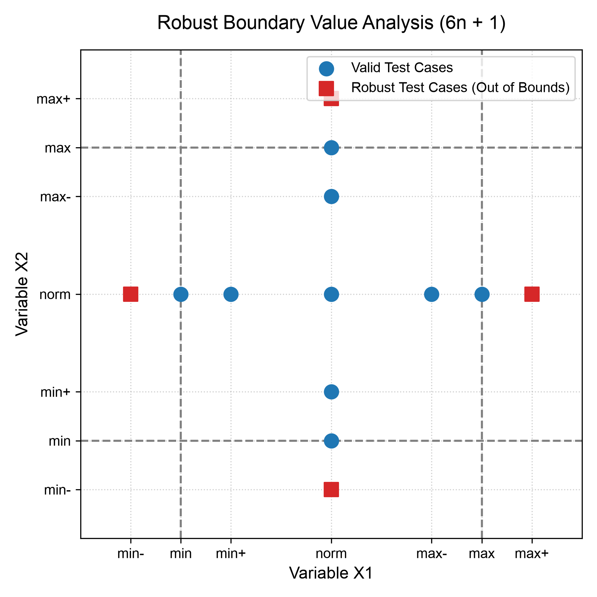
</div>

- Adds **2 invalid out-of-bounds points** per variable: **`min-`** (`min - 1`, e.g., `0`) and **`max+`** (`max + 1`, e.g., `201`) to verify defensive exception handling.
- **Formula:** **`6n + 1`** (for `n = 3` → **`19` cases**).

</div>
<div class="card" data-marpit-fragment>

### 2. Worst-Case Non-Independent BVA (`5`<sup>`n`</sup> / `7`<sup>`n`</sup>)
<div style="text-align: center; margin-bottom: 6px;">
  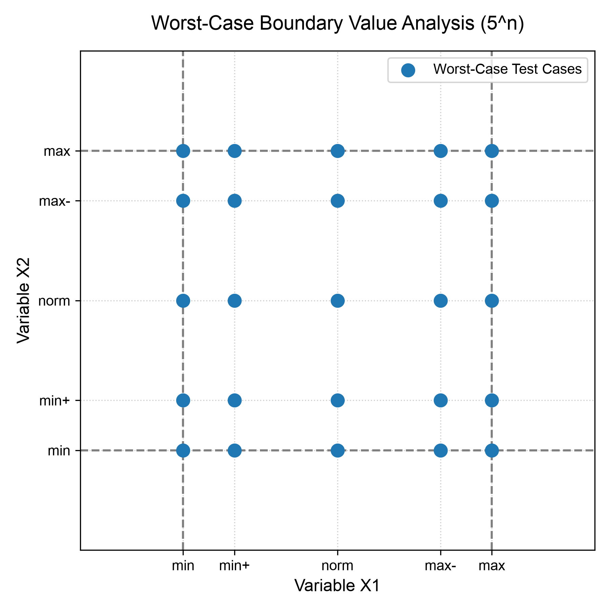
</div>

- Rejects Single Fault Assumption when variables interact tightly:
  - **Worst-Case Normal:** **`5`<sup>`n`</sup>** (`n=3 → 125` cases; `n=5 → 3,125`).
  - **Worst-Case Robust:** **`7`<sup>`n`</sup>** (`n=3 → 343` cases; `n=5 → 16,807`).

</div>
</div>
</div>

<!--
Compare the two 2D dot diagrams: Independent Robust BVA (`6n + 1`) forms a cross along the nominal axes with `min-` and `max+` tips, whereas Worst-Case BVA (`5^n` and `7^n`) fills the entire Cartesian grid to catch multi-variable boundary collisions.

💡 難字與專業術語解說：
- Robust Boundary Value Analysis: 強固邊界值分析（在標準邊界點外，額外加入微幅越界的 `min-` 與 `max+` 非法點以檢驗系統防禦與例外處理能力的測試法）
-->
---
## BVA Panorama Matrix & Key Practical FAQs (Out-On-In & Floating-Point)

<div class="card-deck">

> Choose **`6n + 1` Independent Robust BVA** for standard modules, and apply **3-Point (`Out-On-In`)** sampling and **Business Resolution** for continuous numbers.

<div class="two-columns">
<div class="card" data-marpit-fragment>

### The 4 BVA Formulas Selection Matrix
| BVA Strategy | Single-Fault (Independent) | Multiple-Fault (Worst-Case) |
| :--- | :---: | :---: |
| **Normal BVA** *(Valid)* | **`4n + 1`** *(`n=3 → 13`)* | **`5`<sup>`n`</sup>** *(`n=3 → 125`)* |
| **Robust BVA** *(`min-, max+`)* | **`6n + 1`** *(`n=3 → 19`)* | **`7`<sup>`n`</sup>** *(`n=3 → 343`)* |

- **Default Choice:** **`6n + 1` Independent Robust BVA** (linear cost + exception defense).
- **Coupled Critical Variables:** Apply local **`5`<sup>`n`</sup> Worst-Case BVA** to the 2–3 coupled inputs.

</div>
<div class="card" data-marpit-fragment>

### BVA Practical FAQs
- **Q1: 2-Point (`On-Off`) vs. 3-Point (`Out-On-In`) Sampling?**
  - **3-Point (`Out-On-In`, ISO 29119):** Tests **`99 (In), 100 (On), 101 (Out)`** to catch off-by-one slips (`>` vs. `>=`) on open/closed bounds.
- **Q2: Neighbor Points for Floating-Point (`double`)?**
  - **Business Resolution:** Step by minimum domain unit (`± 0.01` for currency, `± 0.1` for scores), or `Math.nextUp(x)` for IEEE 754 math.

</div>
</div>
</div>

<!--
Memorize the 2x2 BVA formula table on the left (`4n+1`, `6n+1`, `5^n`, `7^n`), and remember the two practical FAQs on the right: use 3-point Out-On-In (`99, 100, 101`) to catch `<` vs `<=`, and use business resolution (`± 0.01`) for floating-point boundaries.

💡 難字與專業術語解說：
- 3-point boundary value analysis (Out-On-In): 三點邊界分析法（針對每一個邊界同時取邊界內、邊界上與邊界外三點，以百分百攔截開閉區間關係運算子誤用的標準做法）
-->
---
## Implementing BVA in JUnit 5: `@ParameterizedTest` & `assertAll`

<div class="card-deck">

> Dense boundary suites face two coding pitfalls: **boilerplate duplication** across 19 test methods, and **Early Abort** when the first assertion fails.

<div class="two-columns">
<div class="card" data-marpit-fragment>

### 1. Batch Boundary Injection (`@ParameterizedTest`)
- Inject all boundary points into one parameterized test method:
```java
@ParameterizedTest
@ValueSource(ints = {1, 2, 100, 199, 200}) // 5 BVA points for side a
void testTriangleValidBoundariesForA(int a) {
    assertNotEquals("NotATriangle", Triangle.classify(a, 100, 100));
}

@ParameterizedTest
@CsvSource({
    "0,   3, FREE",   // V1 min & max
    "4,  12, CHILD",  // V2 min & max
    "13, 64, ADULT",  // V3 min & max
    "65,120, SENIOR"  // V4 min & max
})
void testPoolAgeBoundaries(int minAge, int maxAge, String tier) {
    assertEquals(tier, PoolTicket.eval(minAge));
    assertEquals(tier, PoolTicket.eval(maxAge));
}
```

</div>
<div class="card" data-marpit-fragment>

### 2. Grouped Assertions (`assertAll` Prevents Early Abort)
- **Solution (`assertAll` + Lambda `() ->`):** Wraps each boundary check in a deferred lambda so **every boundary executes and reports together**:
```java
@Test
void testGradeBoundariesWithoutEarlyAbort() {
    assertAll("Grade BVA Complete Check",
        () -> assertThrows(IllegalArgumentException.class,
                           () -> Grade.eval(-1)),  // min- (Invalid)
        () -> assertEquals("F", Grade.eval(0)),    // min
        () -> assertEquals("F", Grade.eval(59)),   // tier boundary
        () -> assertEquals("D", Grade.eval(60)),   // tier boundary+
        () -> assertEquals("A", Grade.eval(100)),  // max
        () -> assertThrows(IllegalArgumentException.class,
                           () -> Grade.eval(101))  // max+ (Invalid)
    );
}
```

</div>
</div>
</div>

<!--
Pairing `@ParameterizedTest` with `assertAll` lets you run dozens of boundary checks cleanly without boilerplate or early abort masking.

💡 難字與專業術語解說：
- grouped assertions (`assertAll`): 群組聚合斷言（JUnit 5 以 Lambda 封裝多個斷言，確保所有斷言皆被執行並一次彙整所有失敗結果的機制）
-->
---
## Equivalence Partitioning (EP): Core Motivation & Weak vs. Strong Coverage

<div class="split73">
<div class="left">

* **Core Principle of Equivalence Partitioning (EP):**
  - Partition the input/output domain into disjoint **Equivalence Classes** where every value in a class is processed identically (if one value catches a bug, any other value in that class catches it too).
  - **Dual Goals:** Achieve **completeness** (every valid and invalid partition has a representative) while eliminating **redundancy**.
* **Weak Coverage vs. Strong Coverage:**
  - **Weak Equivalence Partitioning (Weak EP — Single Fault):**
    - Every partition of each variable appears in **at least one test case**:
    - **`Total Test Cases = max(|P1|, |P2|, ..., |Pn|)`** *(4 blue diagonal dots on right)*.
  - **Strong Equivalence Partitioning (Strong EP — Multiple Fault):**
    - Tests the full **Cartesian product** across all variables:
    - **`Total Test Cases = |P1| × |P2| × ... × |Pn|`** *(all `3 × 4 = 12` grid cells)*.

</div>
<div class="right">

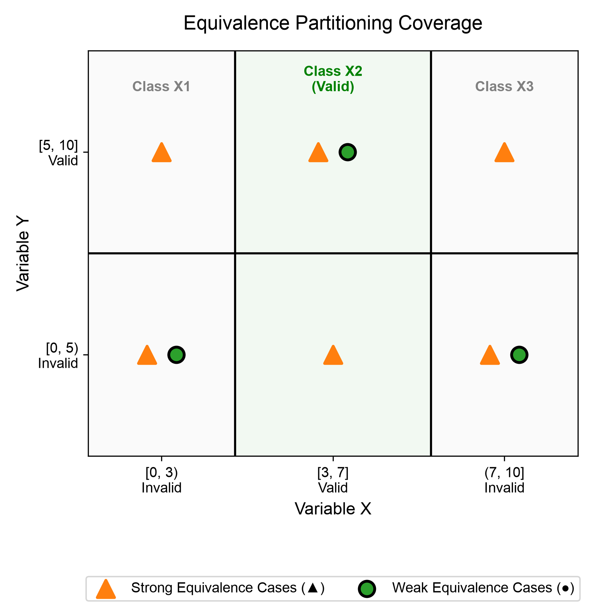

</div>
</div>

<!--
Under Weak EP (the blue dots), we only need max(3, 4) = 4 test cases to touch every row and every column at least once; under Strong EP, we test all 3 x 4 = 12 Cartesian combinations.

💡 難字與專業術語解說：
- Weak vs. Strong EP: 弱涵蓋 vs. 強涵蓋等價分割（僅要求各變數之每個等價類至少被測一次 vs. 要求所有變數等價類之笛卡爾乘積全組合皆被測試）
-->
---
## EP Case Study 1 (1/2): Binary Search Partition Design

<div class="card-deck">

> Partitioning Binary Search (`search(key, sortedArray)`) requires analyzing **array cardinality (`A`)**, **hit/miss outcome (`F`)**, **hit position (`C`)**, and **input validity (`K`)**.

<div class="two-columns">
<div class="card" data-marpit-fragment>

### 4 Structural Partition Dimensions
- **1. Array Length Dimension (`A`):**
  - `a`<sup>`0`</sup>: Empty array (`[]`, length 0)
  - `a`<sup>`1`</sup>: Single-element array (`[7]`)
  - `a`<sup>`*`</sup>: Multi-element sorted array (`[7, 9, 11]`)
- **2. Search Outcome (`F`) & 3. Hit Position (`C`):**
  - `f`<sup>`t`</sup> (Found): hits head (`c`<sup>`1`</sup>), middle (`c`<sup>`m`</sup>), or tail (`c`<sup>`l`</sup>)
  - `f`<sup>`f`</sup> (Not Found): target key absent from array
- **4. Input Validity (`K`):** `k` (valid int) vs. `k!` (invalid type)

</div>
<div class="card" data-marpit-fragment>

### Weak Coverage 8 Representative Cases (`R1..R8`)
- **R<sub>1</sub>:** Single element, found (`k=7, A=[7] → 0`)
- **R<sub>2</sub>:** Single element, not found (`k=7, A=[8] → -1`)
- **R<sub>3</sub>:** Multi-element, found at head (`k=7, A=[7,9,11] → 0`)
- **R<sub>4</sub>:** Multi-element, found at middle (`k=9, A=[7,9,11] → 1`)
- **R<sub>5</sub>:** Multi-element, found at tail (`k=11, A=[7,9,11] → 2`)
- **R<sub>6</sub>:** Multi-element, not found (`k=8, A=[7,9,11] → -1`)
- **R<sub>7</sub>:** Empty array, not found (`k=7, A=[] → -1`)
- **R<sub>8</sub>:** Invalid input type, throws exception (`k="abc"`)

</div>
</div>
</div>

---
## EP Case Study 1 (2/2): Binary Search Weak Coverage Specification Table

| Case | Partition Combination (`A, F, C, K`) | Test Inputs (`k, A`) | Expected Output | Weak Coverage Verification Target |
| :---: | :--- | :--- | :--- | :--- |
| **R<sub>1</sub>** | `a`<sup>`1`</sup> `× f`<sup>`t`</sup> `× c`<sup>`1`</sup> `× k` | `k=7, A=[7]` | `index = 0` | Single-element hit (covers `a`<sup>`1`</sup>`, f`<sup>`t`</sup>`, c`<sup>`1`</sup>) |
| **R<sub>2</sub>** | `a`<sup>`1`</sup> `× f`<sup>`f`</sup> `× k` | `k=7, A=[8]` | `index = -1` | Single-element miss (covers `a`<sup>`1`</sup>`, f`<sup>`f`</sup>) |
| **R<sub>3</sub>** | `a`<sup>`*`</sup> `× f`<sup>`t`</sup> `× c`<sup>`1`</sup> `× k` | `k=7, A=[7, 9, 11]` | `index = 0` | Multi-element head hit (`a`<sup>`*`</sup>`, c`<sup>`1`</sup>) |
| **R<sub>4</sub>** | `a`<sup>`*`</sup> `× f`<sup>`t`</sup> `× c`<sup>`m`</sup> `× k` | `k=9, A=[7, 9, 11]` | `index = 1` | Multi-element middle hit (`a`<sup>`*`</sup>`, c`<sup>`m`</sup>) |
| **R<sub>5</sub>** | `a`<sup>`*`</sup> `× f`<sup>`t`</sup> `× c`<sup>`l`</sup> `× k` | `k=11, A=[7, 9, 11]` | `index = 2` | Multi-element tail hit (`a`<sup>`*`</sup>`, c`<sup>`l`</sup>) |
| **R<sub>6</sub>** | `a`<sup>`*`</sup> `× f`<sup>`f`</sup> `× k` | `k=8, A=[7, 9, 11]` | `index = -1` | Multi-element gap miss (`a`<sup>`*`</sup>`, f`<sup>`f`</sup>) |
| **R<sub>7</sub>** | `a`<sup>`0`</sup> `× f`<sup>`f`</sup> `× k` | `k=7, A=[]` | `index = -1` | Empty array boundary defense (`a`<sup>`0`</sup>`, f`<sup>`f`</sup>) |
| **R<sub>8</sub>** | `a`<sup>`*`</sup> `× k!` | `k="abc", A=[7, 9]` | Throws `TypeException` | Invalid input defensive rejection (`k!`) |

<!--
With just 8 test cases (`R1` to `R8`), we systematically cover every structural and boundary scenario of Binary Search!

💡 難字與專業術語解說：
- array cardinality: 陣列基數／元素個數（在容器型輸入分割中，常細分為空集合 0、單元素 1 與多元素 * 三個等價類）
-->
---
## EP Case Study 2: Domain-Driven Partitioning on `NextDate()` & The December Anomaly

<div class="card-deck">

> **Golden Rule of EP:** Only inputs that trigger **identical downstream control-flow and state transitions** belong in the same equivalence class!

<div class="two-columns">
<div class="card" data-marpit-fragment>

### Version 1 Partitioning & The December Blind Spot
- **Naive Version 1 Partitions:**
  - `M`<sub>`1`</sub>: 30-day months `{4, 6, 9, 11}`
  - `M`<sub>`2`</sub>: 31-day months `{1, 3, 5, 7, 8, 10, 12}` *(Buggy grouping!)*
  - `M`<sub>`3`</sub>: February `{2}`
  - `D`<sub>`1`</sub>: `1..27`, `D`<sub>`2`</sub>: `28`, `D`<sub>`3`</sub>: `29`, `D`<sub>`4`</sub>: `30`, `D`<sub>`5`</sub>: `31`
  - `Y`<sub>`1`</sub>: Leap Year, `Y`<sub>`2`</sub>: Common Year
- **Why Version 1 Fails Under Weak EP:**
  - If the tester picks `2024/07/31 → 2024/08/01` to cover `M`<sub>`2`</sub> `× D`<sub>`5`</sub>, Weak EP considers `M`<sub>`2`</sub> "100% covered"—**completely missing `12/31` year-end rollover (`Year + 1, Month = 1`)**!

</div>
<div class="card" data-marpit-fragment>

### Version 2 Refactored Partitions (Isolating `M`<sub>`4`</sub> December)
- **Why December Breaks Equivalence with July:**
  - On `07/31`: `Day = 1, Month = Month + 1`, **`Year` unchanged**.
  - On `12/31`: `Day = 1`, **`Month = 1` (reset)**, **`Year = Year + 1` (rollover)**!
- **Refactored Month Partitions (`M`<sub>`1`</sub>`..M`<sub>`4`</sub>):**
  - **`M`<sub>`1`</sub>**: 30-day months `{4, 6, 9, 11}` *(month rollover only)*
  - **`M`<sub>`2`</sub>**: Non-Dec 31-day months `{1, 3, 5, 7, 8, 10}` *(month rollover only)*
  - **`M`<sub>`3`</sub>**: February `{2}` *(leap/common year logic)*
  - **`M`<sub>`4`</sub>**: **December `{12}` — Dedicated Year-End Rollover Class!**

</div>
</div>
</div>

<!--
Because `12/31` executes a completely different state transition (`Month = 1; Year++`), December is not equivalent to other 31-day months. Refactoring December into its own partition `M4` guarantees that even a minimal Weak EP suite tests New Year's Eve rollover!

💡 難字與專業術語解說：
- December Anomaly: 十二月跨年異常（在 NextDate 問題中，12 月底觸發年份加一與月份歸一，與一般 31 天月僅月份加一的控制流截然不同，必須獨立為 M4 等價類）
-->
---
## `NextDate()` Refactored Hybrid Test Suite (5 Weak Base + 3 Coupled Supplements)

| Case | Strategy Role | Partitions | Input (`Y/M/D`) | Expected | Target Business Rule & Branch Verified |
| :---: | :---: | :--- | :--- | :--- | :--- |
| **TC<sub>1</sub>** | **Weak Base (1/5)** | **M<sub>2</sub>×D<sub>1</sub>×Y<sub>2</sub>** | `2023/05/15` | `2023/05/16` | Mid-month increment (`Day + 1`; covers M<sub>2</sub>, D<sub>1</sub>, Y<sub>2</sub>) |
| **TC<sub>2</sub>** | **Weak Base (2/5)** | **M<sub>3</sub>×D<sub>2</sub>×Y<sub>1</sub>** | `2024/02/28` | `2024/02/29` | Leap Feb 28 increment (`Day + 1`; covers M<sub>3</sub>, D<sub>2</sub>, Y<sub>1</sub>) |
| **TC<sub>3</sub>** | **Weak Base (3/5)** | M<sub>3</sub>×**D<sub>3</sub>**×Y<sub>1</sub> | `2024/02/29` | `2024/03/01` | Leap Feb 29 month rollover (`Month + 1`; covers D<sub>3</sub>) |
| **TC<sub>4</sub>** | **Weak Base (4/5)** | **M<sub>1</sub>×D<sub>4</sub>**×Y<sub>2</sub> | `2023/04/30` | `2023/05/01` | 30-day month rollover (`Month + 1`; covers M<sub>1</sub>, D<sub>4</sub>) |
| **TC<sub>5</sub>** | **Weak Base (5/5)** | **M<sub>4</sub>×D<sub>5</sub>**×Y<sub>2</sub> | `2023/12/31` | `2024/01/01` | **★ Dec 31 Year Rollover (`Year + 1, Month = 1`; M<sub>4</sub>, D<sub>5</sub>)** |
| **TC<sub>6</sub>** | **Coupled (+1)** | M<sub>2</sub>×D<sub>5</sub>×Y<sub>2</sub> | `2023/07/31` | `2023/08/01` | Non-Dec 31-day rollover (`Month + 1`, Year unchanged) |
| **TC<sub>7</sub>** | **Coupled (+2)** | M<sub>4</sub>×D<sub>1</sub>×Y<sub>2</sub> | `2023/12/15` | `2023/12/16` | Normal Dec day increment (`Day + 1`, no premature rollover) |
| **TC<sub>8</sub>** | **Coupled (+3)** | M<sub>3</sub>×D<sub>2</sub>×Y<sub>2</sub> | `2023/02/28` | `2023/03/01` | Common-year Feb 28 rollover to Mar 1 (`M3×D2×Y2`) |

<!--
This 8-case Hybrid Coverage table achieves 100% partition coverage in `TC1..TC5` and adds 3 targeted Strong EP cases (`TC6..TC8`) for coupled month-end transitions.

💡 難字與專業術語解說：
- hybrid coverage strategy: 混合式涵蓋策略（以弱涵蓋為基底確保所有等價類皆被測試，再針對高度耦合的關鍵業務條件局部疊加強涵蓋的實務做法）
-->
---
## Single Invalid Rule (Fault Masking) & Integrating EP + BVA 3-Step SOP

<div class="card-deck">

> Combine **Valid Partitions** aggressively to minimize test count, but isolate **Invalid Partitions** strictly one per test case; treat **BVA as boundary sampling inside EP**.

<div class="two-columns">
<div class="card" data-marpit-fragment>

### The Single Invalid Rule & Fault Masking
- **Why Never Combine Multiple Invalid Inputs in One Test?**
  - **Fault Masking Effect:** Defensive code checks preconditions sequentially (`if (pwdTooShort) throw ...; if (badEmail) throw ...;`).
  - If you pass **both** an invalid short password and an invalid email in one test case, the password check throws early and **masks any bug in the email validator**!
- **Golden Rule:**
  - **Valid Classes:** Pack multiple valid partitions into each test case.
  - **Invalid Classes:** Test **strictly one invalid partition at a time**, keeping all other inputs valid!

</div>
<div class="card" data-marpit-fragment>

### 3-Step Integrated EP + BVA SOP (Zero Duplication)
- **Myth Debunked:** A boundary (`0` or `100`) is the geometric edge of an Equivalence Partition—**never slice boundaries into separate partitions**!
- **3-Step Unified Sampling SOP:**
  1. **Step 1 (Partition via EP):** Identify all Valid (`V`) and Invalid (`I`) classes.
  2. **Step 2 (Mark Adjoining Boundaries):** Locate seam edges between adjacent classes (where `V1`'s `max+` equals `V2`'s `min`!).
  3. **Step 3 (Sample Boundaries + 1 Nominal per Valid Class):** Pick `{min, nom, max}` for each valid class and `1` adjacent out-of-bounds point for each outer invalid class.

</div>
</div>
</div>

<!--
Never put two invalid values in the same test vector—otherwise the first exception check short-circuits and masks bugs in later validation checks!

💡 難字與專業術語解說：
- Single Invalid Rule: 單一無效原則（設計無效等價類測試案例時，每筆測資僅能包含一個無效輸入，其餘參數皆須維持有效值，以防錯誤遮蔽）
-->
---
## EP & BVA 3-Step SOP in Action: Swimming Pool Ticket Age (`0–120`)

> Unifying EP (`6` classes) and BVA across 4 contiguous tiers deduplicates shared seam edges (`3|4`, `12|13`, `64|65`) from 34 redundant points down to **14 exact test points**!

| Step 1: Partition | Step 2: Seams | Step 3: Unified Sample Points | Expected Output & Deduplication Insight |
| :--- | :---: | :---: | :--- |
| **I<sub>1</sub> Invalid (`age < 0`)** | `-1 \| 0` | **`-1`** *(Left Out + I<sub>1</sub>)* | `IllegalArgumentException` (covers BVA `min-` & EP `I1`) |
| **V<sub>1</sub> Free (`0..3`)** | `0, 3` | **`0`**`(min)`, **`2`**`(nom)`, **`3`**`(max)` | `FREE ($0)` — covers V<sub>1</sub> bounds & nominal |
| **V<sub>2</sub> Child (`4..12`)** | `4, 12` | **`4`**`(min)`, **`8`**`(nom)`, **`12`**`(max)` | `CHILD ($100)` — **`4` is V<sub>1</sub>'s `max+`, zero duplication!** |
| **V<sub>3</sub> Adult (`13..64`)** | `13, 64` | **`13`**`(min)`, **`30`**`(nom)`, **`64`**`(max)` | `ADULT ($250)` — **`13` is V<sub>2</sub>'s `max+`, zero duplication!** |
| **V<sub>4</sub> Senior (`65..120`)** | `65, 120` | **`65`**`(min)`, **`80`**`(nom)`, **`120`**`(max)` | `SENIOR ($120)` — **`65` is V<sub>3</sub>'s `max+`, zero duplication!** |
| **I<sub>2</sub> Invalid (`age > 120`)** | `120 \| 121` | **`121`** *(Right Out + I<sub>2</sub>)* | `IllegalArgumentException` (covers BVA `max+` & EP `I2`) |

<!--
By unifying EP and BVA in three steps—sampling `{min, nom, max}` per valid tier plus `-1` and `121` at the outer invalid edges—we achieve 100% EP and 100% BVA coverage in 14 test values with zero duplication.

💡 難字與專業術語解說：
- contiguous piecewise partitions: 連續分段等價區間（前一個有效區間的右越界點 `max+` 恰好等於下一個有效區間的左邊界點 `min` 的規格結構）
-->
---
## Implementing EP in JUnit 5: `assertThrows` & Data-Driven `@CsvSource`

<div class="card-deck">

> Verify **Invalid Equivalence Classes** one at a time using `assertThrows`, and drive **Valid Equivalence Classes** cleanly via `@CsvSource` / `@CsvFileSource`.

<div class="two-columns">
<div class="card" data-marpit-fragment>

### 1. Invalid Partitions → `assertThrows`
- Enforce the **Single Invalid Rule**: each row injects exactly one invalid input while keeping the other sides valid (`5, 5`):
```java
@ParameterizedTest
@CsvSource({
    "-1,  5,  5", // Invalid side a <= 0 (b, c valid)
    " 5,  0,  5", // Invalid side b <= 0 (a, c valid)
    " 1,  2,  5"  // Invalid triangle inequality a + b <= c
})
void testTriangleInvalidPartitions(int a, int b, int c) {
    IllegalArgumentException ex = assertThrows(
        IllegalArgumentException.class,
        () -> Triangle.classifyOrThrow(a, b, c)
    );
    assertTrue(ex.getMessage().contains("Invalid triangle"));
}
```

</div>
<div class="card" data-marpit-fragment>

### 2. Valid Partitions → External `@CsvSource` Table
- Decouple equivalence partition test data from test logic so business analysts and QA can expand rows easily:
```java
@ParameterizedTest(name = "NextDate({0}/{1}/{2}) => {3}")
@CsvSource({
    "2023,  5, 15, 2023/05/16", // TC1: M2 x D1 x Y2
    "2024,  2, 28, 2024/02/29", // TC2: M3 x D2 x Y1 (Leap)
    "2024,  2, 29, 2024/03/01", // TC3: M3 x D3 x Y1 (Leap rollover)
    "2023,  4, 30, 2023/05/01", // TC4: M1 x D4 x Y2 (30-day)
    "2023, 12, 31, 2024/01/01"  // TC5: M4 x D5 x Y2 (Dec rollover!)
})
void testNextDateEquivalencePartitions(
        int y, int m, int d, String expected) {
    assertEquals(expected, NextDate.compute(y, m, d));
}
```

</div>
</div>
</div>

<!--
Notice how cleanly JUnit 5 expresses Equivalence Partitioning: `@CsvSource` separates the partition table from the assertion logic, while `assertThrows` verifies each invalid partition in strict isolation.

💡 難字與專業術語解說：
- data-driven testing (`@CsvSource`): 資料驅動測試（將測試輸入向量與預期輸出表格獨立於測試程式碼之外，由框架逐列載入執行的測試架構）
-->
---
<!-- id: ase-ch07-ccq2 -->
## Concept Check Question 2: Boundary Value Analysis

<div class="ccq-columns">
<div class="ccq-text">

A software module accepts **4 independent integer inputs**, each constrained to a valid range `[1, 100]`. How many test cases are required for **Independent Normal BVA** vs. **Independent Robustness BVA**?

- **A.** 16 test cases for Normal BVA; 24 test cases for Robustness BVA.
- **B.** 17 test cases for Normal BVA; 25 test cases for Robustness BVA.
- **C.** 20 test cases for Normal BVA; 28 test cases for Robustness BVA.
- **D.** 625 test cases for Normal BVA; 2,401 test cases for Robustness BVA.

</div>
<div class="ccq-logo">
  <a href="https://nlhsueh.github.io/nickedupocket/#/student/ase-ch07-ccq2" target="_blank"></a>
</div>
</div>

<!--
Let's check your mastery of the BVA formulas on Concept Check Question 2.
-->

---
## Concept Check Question 2: Answer & Explanation

- **Correct Answer: B**
- **Explanation:**
  - Under the **Single Fault Assumption** for `n = 4` input variables:
    - **Independent Normal BVA** uses the formula `4n + 1` = `4(4) + 1 = 17` test cases (4 boundary points `min, min+, max-, max` per variable while holding others at `norm`, plus 1 all-`norm` baseline case).
    - **Independent Robustness BVA** uses the formula `6n + 1` = `6(4) + 1 = 25` test cases (adding `min-` and `max+` out-of-bounds points for each of the 4 variables).
  - *Why others are incorrect:* Option A forgets the `+ 1` all-`norm` center point. Option C overcounts `norm` 4 times. Option D calculates Worst-Case Cartesian formulas (`5`<sup>`4`</sup> `= 625` and `7`<sup>`4`</sup> `= 2401`).

<!--
The correct answer is **B**: `4(4) + 1 = 17` for Normal BVA and `6(4) + 1 = 25` for Robustness BVA.
-->
---
<!-- _class: lead -->
<!-- header: '7.4 Combinatorial, State & PBT' -->

# **7.4 Combinatorial (Pairwise), State Transition & Property-Based Testing**

> "When multi-parameter combinatorial explosion renders exhaustive testing impossible, Pairwise testing captures 90% of interaction defects with mathematical elegance—while State Machines and Property-Based Testing conquer stateful and infinite domains."

<!--
We now advance to Section 7.4, integrating SQA Sections 5.5 (All-Pairs / Pairwise Testing), 5.8 (State Transition Testing), and 5.11 (Property-Based Testing & Metamorphic Testing).

💡 難字與專業術語解說：
- pairwise (all-pairs) testing: 全成對組合測試（確保系統中任意兩個輸入參數的所有取值配對皆至少在測試集中出現過一次的組合壓縮測試技術）
-->
---
## Combinatorial Explosion & NIST 2-Way Interaction Theory (Pairwise)

<div class="split64">
<div class="left">

* **The Combinatorial Explosion Problem:**
  - A configuration screen with `10` parameters, each having `3` possible values, requires **3<sup>10</sup> = 59,049** exhaustive Strong EP test cases!
* **NIST Empirical Discovery (Kuhn et al.):**
  - Across aerospace, medical, browser, and database bug repositories, **67% to 93% of all software faults** are triggered by a **single parameter (1-way)** or the **interaction of just 2 parameters (2-way)**!
  - Faults requiring 3 or more simultaneous parameter values account for `< 10%`.
* **The All-Pairs (Pairwise) Guarantee & Swimming Pool Example:**
  - **Rule:** Guarantee that **every possible value pair `(v`<sub>`i`</sub>`, v`<sub>`j`</sub>`)` of any two parameters appears together in at least one test case**.
  - **Swimming Pool Fee (`TimeSlot(3) × DayType(2) × Member(2)`):**
    - Full Cartesian product = `3 × 2 × 2 = 12` cases → **Pairwise covers all 16 pairs in just 6 test cases (50% reduction)!**

</div>
<div class="right">

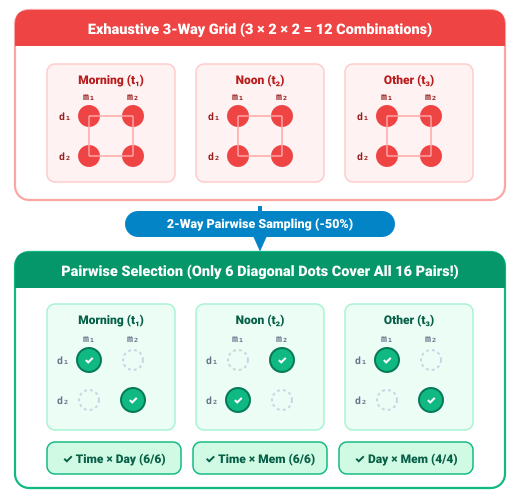

</div>
</div>

<!--
Empirical research by NIST revealed that 67% to 93% of all multi-variable bugs are triggered by at most two variables interacting at once (2-way interaction).

💡 難字與專業術語解說：
- 2-way interaction fault: 雙因子交互作用缺陷（當且僅當兩個特定輸入參數同時取特定值時才會觸發的軟體錯誤）
-->
---
## Why Minimum Pairwise is NP-Hard & Greedy Heuristic Algorithms

<div class="card-deck">

> Finding the absolute smallest pairwise test set is mathematically equivalent to the **NP-Hard Minimum Set Cover Problem**; tools use polynomial-time greedy heuristics.

<div class="two-columns">
<div class="card" data-marpit-fragment>

### Mathematical Complexity: Minimum Set Cover
- **Problem Reduction:**
  - Across `k` parameters, the universe `U` contains `∑ (|V_i| × |V_j|)` value pairs (e.g., Swimming Pool has `6 + 6 + 4 = 16` pairs).
  - Each test case covers at most `C(k, 2)` pairs.
  - Finding the minimum number of rows to cover all pairs in `U` is **NP-Complete / NP-Hard**.
- **Practical Consequence:**
  - Exhaustive search for the global minimum explodes exponentially; we use fast greedy heuristics!

</div>
<div class="card" data-marpit-fragment>

### Industrial Heuristics: AETG & IPO + Greedy
- **1. AETG (`Automatic Efficient Test Generator`):**
  - Builds test suite row-by-row, greedily selecting candidate rows that eliminate the most uncovered pairs.
- **2. IPO (`In-Parameter-Order` — NIST ACTS / AllPairs4J):**
  1. **Base Expansion:** Expand the first two largest parameters `(T, D)` into full Cartesian rows (`3 × 2 = 6` rows).
  2. **Horizontal Greedy Extension:** Add Column 3 (`M`), scoring `m1` vs. `m2` on each row by how many **brand-new pairs** they cover!

</div>
</div>
</div>

---
## Step-by-Step IPO + Greedy Trace: Swimming Pool Pricing (16 Pairs in 6 Rows)

| Row | Base `(T, D)` | Greedy Score: `m1` vs. `m2` New Uncovered Pairs Eliminated | Winning Test Case | Cumulative Pairs |
| :---: | :---: | :--- | :---: | :---: |
| **1** | **(t<sub>1</sub>, d<sub>1</sub>)** | `m1`: **+3** vs. `m2`: **+3** *(All pairs unseen; tie-breaker picks `m1`)* | **(t<sub>1</sub>, d<sub>1</sub>, m<sub>1</sub>)** | `3 / 16` |
| **2** | **(t<sub>1</sub>, d<sub>2</sub>)** | `m1`: +2 *(t<sub>1</sub>m<sub>1</sub> already covered)* vs. **`m2`: +3** *(t<sub>1</sub>d<sub>2</sub>, t<sub>1</sub>m<sub>2</sub>, d<sub>2</sub>m<sub>2</sub>)* | **(t<sub>1</sub>, d<sub>2</sub>, m<sub>2</sub>)** | `6 / 16` |
| **3** | **(t<sub>2</sub>, d<sub>1</sub>)** | `m1`: +2 *(d<sub>1</sub>m<sub>1</sub> already covered)* vs. **`m2`: +3** *(t<sub>2</sub>d<sub>1</sub>, t<sub>2</sub>m<sub>2</sub>, d<sub>1</sub>m<sub>2</sub>)* | **(t<sub>2</sub>, d<sub>1</sub>, m<sub>2</sub>)** | `9 / 16` |
| **4** | **(t<sub>2</sub>, d<sub>2</sub>)** | **`m1`: +3** *(t<sub>2</sub>d<sub>2</sub>, t<sub>2</sub>m<sub>1</sub>, d<sub>2</sub>m<sub>1</sub>)* vs. `m2`: +1 *(only t<sub>2</sub>d<sub>2</sub> is new)* | **(t<sub>2</sub>, d<sub>2</sub>, m<sub>1</sub>)** | `12 / 16` |
| **5** | **(t<sub>3</sub>, d<sub>1</sub>)** | `m1`: **+2** vs. `m2`: **+2** *(D×M already 100% full; tie picks `m1`)* | **(t<sub>3</sub>, d<sub>1</sub>, m<sub>1</sub>)** | `14 / 16` |
| **6** | **(t<sub>3</sub>, d<sub>2</sub>)** | `m1`: +1 *(t<sub>3</sub>m<sub>1</sub> seen)* vs. **`m2`: +2** *(completes t<sub>3</sub>d<sub>2</sub>, t<sub>3</sub>m<sub>2</sub>)* | **(t<sub>3</sub>, d<sub>2</sub>, m<sub>2</sub>)** | **`16 / 16` (100%)** |

<!--
Trace the IPO + Greedy algorithm row by row: by greedily choosing `m1` or `m2` to maximize newly covered pairs in each row, all 16 pairs across `T×D`, `T×M`, and `D×M` are 100% covered in 6 rows!

💡 難字與專業術語解說：
- In-Parameter-Order (IPO): 參數依序擴展演算法（先展開前兩個參數的笛卡爾積，再逐一水平加入新參數欄並以貪婪計分挑選能消除最多未覆蓋成對組合之值的多項式時間啟發式演算法）
-->
---
## Pairwise Tools (`AllPairs4J`, `PICT`, `ACTS`) & Loan Calculator Case

<div class="split73">
<div class="left">

* **Industrial Automated Pairwise Tools:**
  - **`AllPairs4J` (Java / JUnit 5 Native):** Pure Java fluent builder API that generates `List<Case>` directly inside JUnit 5 `@TestFactory` dynamic tests!
  - **Microsoft `PICT` (CLI):** Industry-standard command-line generator supporting `.pict` model files, negative testing, and constraint pruning.
  - **NIST `ACTS`:** Supports higher-strength **`t`-way combinatorial coverage** (`3-way`, `4-way` for safety-critical systems) with SAT constraint solvers.
* **Mortgage `LoanCalculator` Case Study (`3 × 3 × 2 × 2 = 36` → `9` Cases):**
  - **4 Dimensions:** `LoanYears` (`≤10`, `11..20`, `>20`), `Amount` (`≤5M`, `6M`, `10M`), `IsYouth` (`true/false`), `IsMarried` (`true/false`).
  - Full Cartesian product = **36 cases** → `AllPairs4J` achieves **100% 2-way coverage in just 9 cases (75% reduction)**!

</div>
<div class="right">


</div>
</div>

<!--
In the Mortgage Loan Calculator case study, 4 parameters with `3 × 3 × 2 × 2` partitions require 36 full combinations, which `AllPairs4J` compresses to 9 test cases while covering 100% of parameter pairs.

💡 難字與專業術語解說：
- constraint pruning (SAT solver): 約束剪枝（利用布林可滿足性求解器在生成成對測試集時自動排除業務上互斥的非法參數組合，例如 `OS=iOS` 與 `Browser=IE`）
-->
---
## Pairwise in JUnit 5: `AllPairs4J` + `@TestFactory` & Solving the Oracle Dilemma

<div class="card-deck">

> `AllPairs4J` only generates **compressed Input Combinations**—use **Strategy A (Dynamic Invariants)** or **Strategy B (2-Stage `@CsvSource` Exact Oracles)** to verify outputs!

<div class="two-columns">
<div class="card" data-marpit-fragment>

### Strategy A: Dynamic Invariant Oracle (`@TestFactory`)
- Generates `List<Case>` at runtime and asserts universal **domain bounds** (`50 ≤ price ≤ 200`):
```java
AllPairs allPairs = new AllPairs.AllPairsBuilder()
    .withParameter(new Parameter("Time", "MORNING", "NOON", "OTHER"))
    .withParameter(new Parameter("Day",  "HOLIDAY", "WEEKDAY"))
    .withParameter(new Parameter("Mem",  "true", "false"))
    .build(); // Generates 6 pairwise cases

@TestFactory
Stream<DynamicTest> testPoolPairwiseInvariants() {
    return allPairs.getGeneratedCases().stream().map(c ->
        DynamicTest.dynamicTest(c.toString(), () -> {
            int p = Pool.calc(c.get("Time"), c.get("Day"), c.get("Mem"));
            assertTrue(p >= 50 && p <= 200);
        })
    );
}
```

</div>
<div class="card" data-marpit-fragment>

### Strategy B: 2-Stage Exact Oracle (`AllPairs` → `@CsvSource`)
- **Stage 1:** Use `AllPairs4J` to print a 6-row `@CsvSource` template with `TODO` output placeholders.
- **Stage 2:** Human engineer computes exact SRS prices for only those **6 rows** and runs `assertEquals`:
```java
@ParameterizedTest
@CsvSource({ // Stage 1 generated inputs -> Stage 2 human-filled Oracles
    "MORNING, HOLIDAY, true,  100",
    "MORNING, WEEKDAY, false,  80",
    "NOON,    HOLIDAY, false, 200",
    "NOON,    WEEKDAY, true,   50",
    "OTHER,   HOLIDAY, true,  100",
    "OTHER,   WEEKDAY, false, 100"
})
void testPoolPairwiseExactOracle(Time t, Day d, boolean m, int expected) {
    assertEquals(expected, Pool.calc(t, d, m));
}
```

</div>
</div>
</div>

<!--
Strategy A runs 100% automatically to check domain invariants and no-crash smoke properties, while Strategy B pairs automated input compression with exact SRS expected values on just the 6 pairwise rows.

💡 難字與專業術語解說：
- `@TestFactory` (`DynamicTest`): JUnit 5 動態測試工廠（允許在執行期由程式碼迴圈或外部產生器動態建立並回傳多個獨立測試節點的機制）
-->
---
## State Transition Testing: Airline Reservation State Machine

<div class="split73">
<div class="left">

* **How Do You Test Stateful Objects & `void` Mutator Methods?**
  - Many OOP methods (e.g., `order.payMoney()`, `stack.push(x)`) return `void`—their correctness depends on **internal state transitions** (`Current State --[Event / Guard]--> Next State`).
* **Airline Reservation State Machine Analysis:**
  - **Happy Path (`4` transitions):**
    - `Init --[giveInfo]--> Made --[payMoney]--> Paid --[print]--> Ticketed --[giveTicket]--> Used (Final)`
  - **Customer Cancellation Branches (`3` transitions):**
    - From `Made`, `Paid`, or `Ticketed`, triggering `--[cancel]-->` transitions to **`CancelledByCustomer (Final)`**.
  - **Payment Timeout Branch (`1` transition):**
    - From `Made`, `--[payTimeExpire]-->` transitions to **`CancelledNonPay (Final)`**.

</div>
<div class="right">

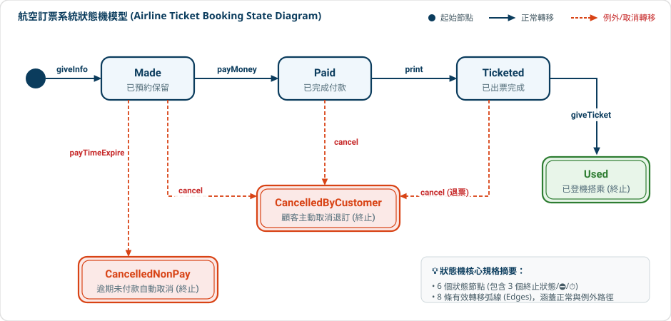

</div>
</div>

<!--
Look at the Airline Reservation state machine diagram on the right: it has 6 distinct states (nodes) and 8 directed transitions (edges).

💡 難字與專業術語解說：
- finite state machine (FSM): 有限狀態機（由有限個狀態節點、觸發事件、防衛條件與狀態轉移弧線組成的行為模型）
-->
---
## State Coverage Criteria (`Node` vs. `0-Switch` / `1-Switch`) & JUnit 5 `@Nested`

<div class="card-deck">

> **Transition Coverage (Edge / 0-Switch)** strictly subsumes **State Coverage (Node)**; in JUnit 5, use `@BeforeEach` and `@Nested` classes to mirror state hierarchies cleanly.

<div class="two-columns">
<div class="card" data-marpit-fragment>

### State (Node) vs. Transition (`0-Switch`) Coverage
- **State Coverage (Node):** Visits all 6 states, but Paths `1+2+5` achieve `100% Node` while missing 2 cancel edges (`75% Edge`)!
- **Transition Coverage (`0-Switch` / Edge — Mandatory Baseline):**
  - Covers all `8/8` transitions via **5 paths**:
    1. `giveInfo → payMoney → print → giveTicket` *(Happy Path)*
    2. `giveInfo → payMoney → print → cancel` *(Ticketed cancel)*
    3. `giveInfo → payMoney → cancel` *(Paid cancel)*
    4. `giveInfo → cancel` *(Made cancel)*
    5. `giveInfo → payTimeExpire` *(Timeout auto-cancel)*
- **Negative State Testing:** Trigger invalid events per state!

</div>
<div class="card" data-marpit-fragment>

### State-Hierarchy Modeling with JUnit 5 `@Nested`
```java
class StackStateTest {
    Stack<String> stack;
    @BeforeEach void init() { stack = new Stack<>(); } // State: Empty

    @Test void emptyStackPopThrows() { // Negative transition defense
        assertThrows(EmptyStackException.class, () -> stack.pop());
    }

    @Nested class AfterPushingElement { // Sub-state: Non-Empty
        @BeforeEach void pushOne() { stack.push("ItemA"); }

        @Test void isNoLongerEmpty() {
            assertFalse(stack.isEmpty());
        }
        @Test void popReturnsItemAndRestoresEmptyState() { // 1-Switch
            assertEquals("ItemA", stack.pop());
            assertTrue(stack.isEmpty());
        }
    }
}
```

</div>
</div>
</div>

<!--
Transition Coverage (0-Switch) is the mandatory minimum baseline for state machine testing, supplemented by 1-Switch (consecutive transition pairs like `push -> pop`) and negative invalid-event tests.

💡 難字與專業術語解說：
- Transition Coverage (0-Switch): 轉移覆蓋／零階轉換覆蓋（要求狀態機圖上的每一條轉移弧線皆至少被執行過一次，強度嚴格大於狀態節點覆蓋）
-->
---
<!-- _class: title-image-slide -->

## Property-Based Testing (PBT) & Metamorphic Testing (MT): 6 Core Concepts

<div class="image-wrapper">
  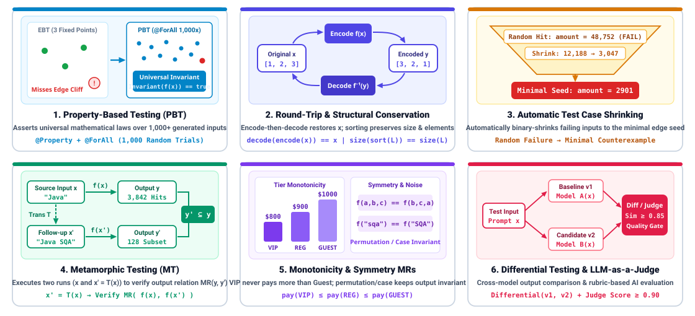
</div>

<!--
This visual overview highlights the six core pillars of Property-Based Testing (PBT) and Metamorphic Testing (MT).

💡 難字與專業術語解說：
- Property-Based Testing (PBT): 屬性基礎測試（宣告系統在所有合法輸入下皆須遵守的通用數學不變量，由框架自動產生千組隨機測資尋找反例）
-->
---
## Paradigm Shift: Example-Based (EBT) vs. Property-Based Testing (PBT) & John Hughes

<div class="split73">
<div class="left">

* **Example-Based Testing (EBT) Limits:** Hand-picked inputs (`add(2,3)==5`) suffer from confirmation bias and miss corner overflows (`0, -1, MAX_VALUE`).
* **Property-Based Testing (John Hughes, QuickCheck 2000):**
  - *"Don't write tests—specify universal properties!"*
  - **3 Automated Engines in `jqwik` (`Java` + `QuickCheck`):**
    1. **Property (`@Property`):** Declares a universal domain invariant.
    2. **Generator (`@ForAll`):** Bombards the method with **1,000 random + boundary inputs** (`0, -1, MAX_VALUE, empty lists`).
    3. **Shrinking:** Automatically binary-searches any failing input down to the **smallest minimal reproducible counterexample**!

</div>
<div class="right">

<div class="name-card">
  
  <div class="name-card-caption">
    <span class="name-card-name">Prof. John Hughes</span>
    <span class="name-card-cc">Co-creator of QuickCheck (2000) / ACM Fellow</span>
  </div>
</div>

</div>
</div>

<!--
Why is Shrinking the killer feature of Property-Based Testing frameworks like Java's `jqwik`? Because when a random input fails, `jqwik` automatically runs a binary-search shrinking loop to report the smallest, simplest failing counterexample!

💡 難字與專業術語解說：
- counterexample shrinking: 測資收縮／反例極小化（當隨機大測資觸發錯誤時，PBT 框架自動透過二分搜尋刪減元素與數值，找出能重現該 Bug 之最小最簡反例的演算法）
-->
---
## 4 Classic PBT Invariant Design Patterns & `jqwik` Syntax

<div class="card-deck">

> Use `@Property` and `@ForAll` in **`jqwik`** (**J**ava/JUnit 5 + **Quick**Check) to express the four universal invariant patterns.

<div class="two-columns">
<div class="card" data-marpit-fragment>

### 1. Round-Trip & 2. Conservation Patterns
- **① Round-Trip (Invertibility): `decode(encode(x)) == x`**
  - Compression, encryption, JSON serialization, or reversing a list twice:
  ```java
  @Property // Runs 1,000 random lists L automatically!
  boolean reverseTwiceIsIdentity(@ForAll List<Integer> list) {
      List<Integer> copy = new ArrayList<>(list);
      Collections.reverse(copy);
      Collections.reverse(copy);
      return copy.equals(list);
  }
  ```
- **② Structural & Feature Conservation: `invariant(f(x))`**
  - Sorting `sort(L)` preserves `L.size()`, and every adjacent element satisfies `L.get(i) <= L.get(i + 1)`.

</div>
<div class="card" data-marpit-fragment>

### 3. Idempotence & 4. Algebraic Symmetry
- **③ Idempotence: `f(f(x)) == f(x)`**
  - Applying an operation twice equals applying it once: `sort(sort(L)) == sort(L)`, `trim(trim(s)) == trim(s)`.
- **④ Algebraic & Permutation Symmetry:**
  - In **Triangle Classification**, permuting side order `(a, b, c) → (b, c, a)` must never change the triangle category:
  ```java
  @Property
  boolean trianglePermutationSymmetry(
      @ForAll @IntRange(min=1, max=200) int a,
      @ForAll @IntRange(min=1, max=200) int b,
      @ForAll @IntRange(min=1, max=200) int c) {
    return Triangle.classify(a, b, c)
           .equals(Triangle.classify(b, c, a));
  }
  ```

</div>
</div>
</div>

<!--
Mastering these four patterns—Round-Trip, Structural Conservation, Idempotence, and Algebraic Symmetry—allows you to write 5-line `@Property` tests that replace hundreds of brittle hand-written examples.

💡 難字與專業術語解說：
- idempotence: 冪等性（對同一輸入重複執行多次運算與僅執行一次運算所得結果完全相同的數學性質，即 `f(f(x)) == f(x)`）
-->
---
## `jqwik` Enterprise Logic: Financial Invariants & Shrinking a Pricing Cliff Bug

<div class="card-deck">

> In enterprise e-commerce and banking engines, PBT excels at catching **stacked discount negative-payment exploits** and **threshold cliff inversions**!

<div class="two-columns">
<div class="card" data-marpit-fragment>

### 3 Enterprise Financial Invariants
1. **E-Commerce Payment Conservation (`OrderDiscount`):**
   - Across 1,000 random `(MemberTier, Amount, PaymentType)` tuples:
   - **`0 <= finalPay <= originalPrice`** (zero negative-pay exploits!) and **`finalPay + discount == originalPrice`**.
2. **VIP Tier Monotonicity:**
   - For identical cart amount and payment method: **`pay(VIP) <= pay(REGULAR) <= pay(GUEST)`** (a VIP must never pay more than a Guest!).
3. **Mortgage Floor & Amount Monotonicity (`LoanCalculator`):**
   - Interest rate is always locked in **`[2.0%, 5.0%]`**, and borrowing `+1,000,000` more never increases the interest rate.

</div>
<div class="card" data-marpit-fragment>

### Shrinking in Action: Catching a `$3,000` Pricing Cliff!
```java
@Property // Property: Buying $100 more must never cost less!
boolean vipCheckoutMonotonic(
        @ForAll @IntRange(min = 100, max = 50000) int amt) {
    return OrderDiscount.checkout(Tier.VIP, amt)
        <= OrderDiscount.checkout(Tier.VIP, amt + 100);
}
```
- **Initial Hit:** `amt = 2964` fails → **Auto-Shrunk (6 steps):** **`amt = 2901`**!
- **Root Cause:** Crossing `> $3,000` jumped rebate from `$100` to `$300` (`$2,901` paid `$2,220.8`, while `$3,001` paid only `$2,100.8`)!

</div>
</div>
</div>

<!--
Look at how `jqwik` caught the pricing cliff bug on the right: when `amount = 2964` failed monotonicity, `jqwik` automatically shrank the input down to the exact boundary edge `amount = 2901`, immediately revealing the `$3,000` rebate jump bug!

💡 難字與專業術語解說：
- monotonicity invariant: 單調性不變量（當輸入沿特定方向遞增時，輸出必須單調不減或單調不增的商業守恆律）
-->
---
## Metamorphic Testing (MT): 3-Step Loop & 4 Classic MR Patterns

| MR Pattern | Formulation (`x → x'`) | Concrete Engineering Application |
| :--- | :--- | :--- |
| **1. Symmetry / Equivalence** | `f(Permute(x)) == f(x)` | **Triangle / Search:** `triangle(a,b,c) == triangle(b,c,a)`; case-insensitive `search("sqa") == search("SQA")`. |
| **2. Inclusion / Monotonicity** | `f(x') ⊆ f(x)` or `f(x1) ≤ f(x2)` | **Search / Loan:** Narrowed query `search("Java SQA") ⊆ search("Java")`; higher loan amount never increases interest rate. |
| **3. Scaling Consistency** | `f(k · x) == f(x)` or `k · f(x)` | **Triangle / Shortest Path:** Scaling sides `triangle(ka, kb, kc) == triangle(a,b,c)`; doubling road weights keeps optimal route. |
| **4. Irrelevant Perturbation** | `f(x + noise) == f(x)` | **Search / Vision / LLM:** Padding whitespace `"  SQA  "` or rotating street photo by `3°` preserves classification. |

* **PBT vs. MT:** PBT checks 1 synthetic run `P(x, f(x))`; MT compares **2 runs** (`Source y = f(x)` vs. `Follow-up y' = f(T(x))`) on real seed data (**80% EBT + 20% PBT/MT** golden ratio at AWS, Volvo, Stripe).

<!--
Notice the synergy between PBT and MT: for small discrete parameter combinations (like the 12 combinations of the Swimming Pool), Pairwise + `@CsvSource` is ideal; for huge continuous domains or oracle-free systems (like search engines, autonomous driving, and LLMs), PBT + MT is unmatched.

💡 難字與專業術語解說：
- source run vs. follow-up run: 原始執行 vs. 衍生執行（變質測試中先以基準輸入 `x` 求得 `y`，再以變換後輸入 `x' = T(x)` 求得 `y'` 以比對關係 `R(y, y')` 的兩階段執行）
-->
---
<!-- id: ase-ch07-ccq3 -->
## Concept Check Question 3: Combinatorial Testing

<div class="ccq-columns">
<div class="ccq-text">

A cloud deployment dashboard has **10 configuration parameters**, each offering **3 possible settings**. Exhaustive testing requires 3<sup>10</sup> = 59,049 test cases. Why do engineers apply **Pairwise (All-Pairs) Testing** here?

- **A.** It guarantees 100% white-box path coverage across all nested loops by testing only 10 cases.
- **B.** It covers every possible pair of values between any two parameters, catching most interaction bugs with ~15–20 tests.
- **C.** It eliminates the need for expected outputs (Test Oracles) by converting all parameters into binary flags.
- **D.** It restricts testing to a single variable at a time while holding the other 9 variables at fixed nominal constants.

</div>
<div class="ccq-logo">
  <a href="https://nlhsueh.github.io/nickedupocket/#/student/ase-ch07-ccq3" target="_blank"></a>
</div>
</div>

<!--
Let's review Concept Check Question 3 on Combinatorial Pairwise Testing.
-->

---
## Concept Check Question 3: Answer & Explanation

- **Correct Answer: B**
- **Explanation:**
  - Empirical studies by NIST confirm that 67% to 93% of software defects are triggered by single parameters or **2-way interactions** between two parameters.
  - **Pairwise (All-Pairs) Testing** uses heuristic algorithms (like IPO + Greedy) to guarantee that every possible value pair across any two parameters appears in at least one test case—compressing 59,049 combinations down to roughly 15–20 tests.
  - *Why others are incorrect:* Option A confuses black-box combinatorial testing with white-box path coverage. Option C is false because pairwise generators only produce test inputs, still requiring an Oracle (invariant or `@CsvSource`). Option D describes `4n + 1` single-fault BVA, not pairwise coverage.

<!--
The correct answer is **B**.
-->
---
<!-- _class: lead -->
<!-- header: '7.5 White-Box & Mutation Testing' -->

# **7.5 White-Box Structural Coverage & Mutation Testing**

> "From basic statement execution up to Boeing and NASA's avionics-grade MC/DC standard—and onward to Mutation Testing that tests the test suite itself."

<!--
We now open the glass box in Section 7.5: White-Box Structural Coverage and Mutation Testing (integrating SQA Chapter 6: Sections 6.1 and 6.4).

💡 難字與專業術語解說：
- structural coverage criteria: 結構化涵蓋度準則（依據原始碼之陳述句、分支、條件或路徑被測試集執行之比例，量化評估測試充分性的指標體系）
-->
---
## White-Box Philosophy & The 4-Quadrant Spec-vs-Code Blind Spot Matrix

<div class="card-deck">

> Software defects hide in the gap between **Specification (S)** and **Implementation (P)**—requiring a hybrid **Black-Box First → White-Box Diagnosis** workflow.

<div class="two-columns">
<div class="card" data-marpit-fragment>

### 4-Quadrant Spec vs. Implementation Matrix
| Quadrant Scenario | Spec? | Code? | Black-Box Only | White-Box Only |
| :--- | :---: | :---: | :---: | :---: |
| **1. Normal Feature** | Yes | Yes | Verified | Covered |
| **2. Missing Req** | **Yes** | **No** | **Catches!** | **Blind at 100%!** |
| **3. Extra/Trojan** | **No** | **Yes** | **Blind!** | **Red lines expose!** |
| **4. Boundary Quirk** | Yes | Buggy | Easy to miss | **MC/DC & Mutation!** |

</div>
<div class="card" data-marpit-fragment>

### Hybrid 3-Step Engineering Strategy
- **Step 1: Black-Box Baseline First (EP / BVA / Pairwise):**
  - Derive baseline functional and boundary tests directly from the SRS to catch **Missing Requirements (Quadrant 2)**.
- **Step 2: White-Box Coverage Microscope (JaCoCo):**
  - Run the black-box suite under bytecode instrumentation and inspect **red (uncovered)** and **yellow (partially covered)** branches (**Quadrant 3 & 4**).
- **Step 3: Reverse Supplementation or Dead-Code Removal:**
  - If an uncovered branch is valid domain logic → **add a white-box test case**; if it is mathematically unreachable → **delete the dead code**!

</div>
</div>
</div>

<!--
Black-box specification testing catches Missing Requirements (Quadrant 2), while white-box coverage instrumentation catches Extra/Trojan Code (Quadrant 3) and boundary implementation quirks (Quadrant 4).

💡 難字與專業術語解說：
- missing requirement blind spot: 遺漏需求盲區（規格書有要求但工程師忘記實作的功能，白箱測試即使達 100% 覆蓋率也完全無法察覺）
-->
---
## White-Box Coverage Subsumption Hierarchy & Classic Benchmark Program

<div class="split73">
<div class="left">

* **Classic Double-Decision Benchmark Program:**
  ```java
  1: input A, B, X
  2: if (A > 1) and (B == 0) then   // Decision D1 (C1: A>1, C2: B==0)
  3:     Y = A
  4: if (A == 2) or (X > 1) then    // Decision D2 (C3: A==2, C4: X>1)
  5:     Y = X
  6: print Y
  ```
  - Contains **2 Decisions (`D1, D2`)**, **4 Atomic Conditions (`C1..C4`)**, and **4 Control-Flow Paths (`a-c-e`, `a-c-d`, `a-b-e`, `a-b-d`)**.
* **Coverage Subsumption Hierarchy (`A → B` means `100% A` guarantees `100% B`):**
  - **Path Coverage** → **Multiple Condition (MCC, `2`<sup>`n`</sup>)** → **MC/DC (`n + 1`)** → **Branch/Condition (B/CC)** → **Branch Coverage (BC)** → **Statement Coverage (SC)**.
  - *Critical Exception:* **Condition Coverage (CC) does NOT subsume Branch Coverage (BC)** (and vice versa under non-short-circuit evaluation)!

</div>
<div class="right">

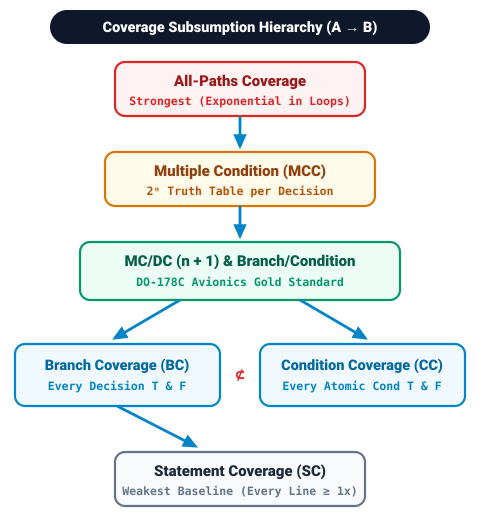

</div>
</div>

<!--
We use this 6-line benchmark program and its Control Flow Graph on the right to compare Statement, Branch, Condition, MCC, Path, and MC/DC coverage.

💡 難字與專業術語解說：
- subsumption hierarchy: 涵蓋包含階層（若覆蓋準則 A 嚴格包含準則 B，代表任何達到 100% A 的測試集必然同時達到 100% B）
-->
---
## 1. Statement Coverage (SC) & 2. Branch / Decision Coverage (BC)

<div class="card-deck">

> **100% Statement Coverage** is the weakest baseline (achievable in 1 test case here!), whereas **100% Branch Coverage** requires every decision to evaluate to both `True` and `False`.

<div class="two-columns">
<div class="card" data-marpit-fragment>

### 1. Statement Coverage (`SC100` in Just 1 Test!)
- **Goal:** Execute every executable statement (Lines `1..6`) at least once.
- **Single Test Case:** **`t1 = (A=2, B=0, X=3)`**
  - Line 2: `(2 > 1) and (0 == 0)` is `True` → executes Line 3 (`Y = 2`).
  - Line 4: `(2 == 2) or (3 > 1)` is `True` → executes Line 5 (`Y = 3`).
  - **Result:** 100% Statement Coverage (`6/6` lines)!
- **Why `SC100` is Dangerously Weak:**
  - Even at `100% SC`, `(2, 0, 3)` **completely misses** if:
    1. Line 2 `and` was mistyped as `or`;
    2. Line 3 `Y = A` was mistyped as `Y = 999` (overwritten by Line 5!);
    3. Never tests the `False` branches (`b` and `d`)!

</div>
<div class="card" data-marpit-fragment>

### 2. Branch / Decision Coverage (`BC100` in 2 Tests)
- **Goal:** Every decision (`D1` and `D2`) must take its **`True` branch** and its **`False` branch** at least once (covers all edges `a, b, c, d, e`).

| Test Case `(A, B, X)` | `D1: (A>1) AND (B==0)` | `D2: (A==2) OR (X>1)` | CFG Path |
| :---: | :---: | :---: | :---: |
| **`t1 = (3, 0, 3)`** | **`True`** (edge `c`) | **`True`** (edge `e`) | `a → c → e` |
| **`t2 = (3, 1, 1)`** | **`False`** (edge `b`) | **`False`** (edge `d`) | `a → b → d` |

- **Remaining Blind Spot of `BC100`:**
  - Across `t1=(3,0,3)` and `t2=(3,1,1)`, atomic condition `C1 (A > 1)` is **always `True`** (`3 > 1`), and `C3 (A == 2)` is **always `False`** (`3 != 2`)!

</div>
</div>
</div>

<!--
100% Branch Coverage strictly subsumes 100% Statement Coverage, yet even 100% Branch Coverage can leave individual atomic conditions inside a compound `if` stuck at a single truth value.

💡 難字與專業術語解說：
- Statement Coverage vs. Branch Coverage: 敘述涵蓋度 vs. 分支涵蓋度（僅要求每行指令執行一次 vs. 要求每個決策判斷的真假分支走向皆被執行）
-->
---
## 3. Condition Coverage (CC), The Paradox & JaCoCo's "Yellow Diamond"

<div class="card-deck">

> **Condition Coverage (CC)** requires every atomic boolean condition (`C`<sub>`i`</sub>) to evaluate to both `True` and `False`—which leads to a famous paradox with Branch Coverage and **Short-Circuit Evaluation**!

<div class="two-columns">
<div class="card" data-marpit-fragment>

### The CC vs. BC Paradox (`100% CC ≠ 100% BC`)
- Consider `if (p && q)` under **non-short-circuit** evaluation:

| Test Case | Atomic `p` | Atomic `q` | Whole Decision `p && q` |
| :---: | :---: | :---: | :---: |
| **`t1`** | **`True`** | **`False`** | **`False`** |
| **`t2`** | **`False`** | **`True`** | **`False`** |

- Atomic condition `p` hits `{T, F}` (100%) and `q` hits `{F, T}` (100%) → **100% Condition Coverage**!
- Yet the overall decision `p && q` is **always `False`** → **only 50% Branch Coverage** (the `if`-body never executes)!
- **Branch/Condition Coverage (B/CC):** Combines both criteria (`100% CC + 100% BC`).

</div>
<div class="card" data-marpit-fragment>

### Short-Circuit Evaluation & JaCoCo's 75% Yellow Diamond
- **Short-Circuit Rule (`&&`, `||` in Java/C/Python):**
  - In `if (p && q)`, when `p == False` (`t2`), the CPU **short-circuits and skips evaluating `q`** (`q` is unexecuted, not `True`)!
  - To actually evaluate `q = True` and `q = False`, `p` must be `True`—which forces `p && q` to take both `True` and `False` (**requiring 3 tests: `(T,F), (F,x), (T,T)`**).
- **Why JaCoCo Shows a Yellow Diamond (`3/4 = 75%`) on `if (A && B)`:**
  - Java compilers compile `if (A && B)` into **2 bytecode jump instructions (`IFEQ A`, `IFEQ B`) = 4 bytecode branches**.
  - Testing only `(A=T, B=T)` and `(A=F, short-circuit)` covers `3 / 4` bytecode branches (leaving `A=T, B=F` unexercised → **75% Yellow Diamond**)!

</div>
</div>
</div>

<!--
At the JVM bytecode level, `if (A && B)` compiles into two conditional jump instructions (4 bytecode branches), explaining why JaCoCo shows a 75% yellow diamond until `(A=True, B=False)` is also tested.

💡 難字與專業術語解說：
- short-circuit evaluation: 短路求值（在 `A && B` 中若 `A` 為 False，或在 `A || B` 中若 `A` 為 True，程式直接略過不計算右式 `B` 的求值機制）
-->
---
## 4. Branch/Condition Walkthrough (`sample-code-01`: `CC100` vs. `BC100`)

<div class="card-deck">

> Trace how a 2-test suite can satisfy **100% Condition Coverage (`CC100`) while failing Branch Coverage**, and how a 3-test suite can satisfy **100% Branch Coverage (`BC100`) while failing Condition Coverage**!

<div class="two-columns">
<div class="card" data-marpit-fragment>

### Target Code (`sample-code-01`) & `SC100`
```java
1: read(X, Y)
2: if ((X > 10) && (Y == 1))  // c1: X>10, c2: Y==1, b1: c1&&c2
3:     X = 1;
4: else if ((X - Y) < 2)      // c3 (b2): (X - Y) < 2
5:     X = 2;
6: if (Y > 10)                // c4 (b3): Y > 10
7:     X = 3;
8: print X
```
- **Achieving `100% Statement Coverage (SC100)` in 2 tests:**
  - Must enter lines `3`, `5`, and `7`:
  - **`(X=11, Y=1)`** enters Line 3; **`(X=12, Y=11)`** enters Lines 5 & 7!

</div>
<div class="card" data-marpit-fragment>

### `CC100` (Not `BC100`) vs. `BC100` (Not `CC100`)
- **Suite A (`CC100`, but `b1` always `False` → fails `BC100`):**

| `X` | `Y` | `c1` | `c2` | `b1 (c1&&c2)` | `c3/b2` | `c4/b3` |
| :-: | :-: | :-: | :-: | :-: | :-: | :-: |
| **9** | **1** | F | T | **_F_** | F | F |
| **12** | **11** | T | F | **_F_** | T | T |

- **Suite B (`BC100`, but `c1` always `True` → fails `CC100`):**

| `X` | `Y` | `c1` | `c2` | `b1 (c1&&c2)` | `c3/b2` | `c4/b3` |
| :-: | :-: | :-: | :-: | :-: | :-: | :-: |
| **13** | **1** | **_T_** | T | **T** | - | F |
| **12** | **11** | **_T_** | F | **F** | T | T |
| **12** | **2** | **_T_** | F | **F** | F | F |

</div>
</div>
</div>

<!--
This concrete walkthrough on `sample-code-01` demonstrates why **Branch/Condition Coverage (B/CC)** requires satisfying both criteria simultaneously.

💡 難字與專業術語解說：
- Branch/Condition Coverage (B/CC): 分支與條件複合涵蓋度（同時要求每個原子條件皆經歷 T/F，且每個整體決策分支亦經歷 T/F 的覆蓋標準）
-->
---
## 5. Multiple Condition Coverage (MCC), 6. Path Coverage & 7. Avionics MC/DC

<div class="card-deck">

> When `2`<sup>`n`</sup> **MCC** and `4`<sup>`20`</sup> **Path Coverage** explode exponentially, **MC/DC (Modified Condition / Decision Coverage)** achieves rigorous condition independence in just **`n + 1` linear test cases**!

<div class="two-columns">
<div class="card" data-marpit-fragment>

### MCC (`2`<sup>`n`</sup>) & Path Explosion (`4`<sup>`20`</sup>)
- **Multiple Condition Coverage (MCC):**
  - Requires testing all **`2`<sup>`n`</sup> truth-table combinations** of atomic conditions inside each decision.
  - On our 2-decision benchmark (`n=2` each), MCC needs 4 tests: `(2,0,4), (2,1,1), (1,0,2), (1,1,1)`—which still misses control-flow path `a-c-d` (requires `(3,0,1)`)!
  - For a decision with `n = 10` conditions, MCC requires **2<sup>10</sup> = 1,024** tests!
- **Path Coverage & The Loop Explosion Trap:**
  - A single loop iterating up to 20 times with a 4-way branch inside generates **4<sup>20</sup> = 2<sup>40</sup> ≈ 1.1 × 10<sup>12</sup> (1.1 trillion) paths**—making exhaustive All-Path testing impossible for loops!

</div>
<div class="card" data-marpit-fragment>

### Avionics MC/DC (DO-178C Level A & ISO 26262 ASIL D)
- **Why Boeing, Airbus & Automotive Mandate MC/DC:**
  - Compresses **`2`<sup>`n`</sup>** combinations to **`n + 1` (max `2n`) linear tests**!
- **Core Requirement — Independence Pairs:**
  - Every condition **`C`<sub>`i`</sub>** must have a test pair `(Test X, Test Y)` where:
    1. **Only `C`<sub>`i`</sub> flips (`T ↔ F`)** while other conditions stay fixed;
    2. The overall **Decision outcome also flips (`T ↔ F`)**!

</div>
</div>
</div>

<!--
MC/DC proves that each atomic condition can independently flip the final decision outcome while all other conditions are held constant, requiring only `n + 1` test cases.

💡 難字與專業術語解說：
- Modified Condition / Decision Coverage (MC/DC): 修改條件／決策涵蓋度（要求證明每一個原子條件在固定其他條件不變下，皆能獨立翻轉整體決策結果的航太與車規最高白箱標準）
-->
---
## MC/DC Derivation (1/2): Truth Table for `Decision = (A || B) && C`

> For `n = 3` conditions (full truth table = `2`<sup>`3`</sup> `= 8` rows), we select just **`n + 1 = 4` rows `{#2, #4, #5, #6}`**!

| Row | `A` | `B` | `C` | `(A \|\| B) && C` | MC/DC Selection Status & Pairing Role |
| :---: | :---: | :---: | :---: | :---: | :--- |
| #1 | F | F | F | F | Omitted (`C = F` short-circuits & masks `(A \|\| B)`) |
| **#2** | **F** | **F** | **T** | **F** | **Selected (1/4):** Baseline anchor — pairs with **#6** for `A`, and with **#4** for `B` |
| #3 | F | T | F | F | Omitted (can use #5 instead to test `C`) |
| **#4** | **F** | **T** | **T** | **T** | **Selected (2/4):** Pairs with **#2** to prove `B` (`F → T`) independently flips Decision |
| **#5** | **T** | **F** | **F** | **F** | **Selected (3/4):** Pairs with **#6** to prove `C` (`F → T`) independently flips Decision |
| **#6** | **T** | **F** | **T** | **T** | **Selected (4/4):** Baseline anchor — pairs with **#2** for `A`, and with **#5** for `C` |
| #7 | T | T | F | F | Omitted (`A = T` and `B = T` mask each other in `A \|\| B`) |
| #8 | T | T | T | T | Omitted (`A = T` and `B = T` mask each other in `A \|\| B`) |

---
## MC/DC Derivation (2/2): Verifying the 3 Independence Pairs `{#2, #4, #5, #6}`

<div class="card-deck">

> By sharing **`#2`** and **`#6`** as anchor rows, **`n + 1 = 4` test cases** prove that `A`, `B`, and `C` each independently flip the decision!

<div class="two-columns">
<div class="card" data-marpit-fragment>

### Independence Pairs for `A` & `B`
- **1. Condition `A` → Pair `(#2, #6)`:**
  - `#2`: `(A=F, B=F, C=T) → Decision = F`
  - `#6`: `(A=T, B=F, C=T) → Decision = T`
  - *Proof:* `B=F, C=T` stay fixed; flipping **`A` (`F↔T`)** flips **`Decision` (`F↔T`)**!
- **2. Condition `B` → Pair `(#2, #4)`:**
  - `#2`: `(A=F, B=F, C=T) → Decision = F`
  - `#4`: `(A=F, B=T, C=T) → Decision = T`
  - *Proof:* `A=F, C=T` stay fixed; flipping **`B` (`F↔T`)** flips **`Decision` (`F↔T`)**!

</div>
<div class="card" data-marpit-fragment>

### Independence Pair for `C` & Takeaway
- **3. Condition `C` → Pair `(#5, #6)`:**
  - `#5`: `(A=T, B=F, C=F) → Decision = F`
  - `#6`: `(A=T, B=F, C=T) → Decision = T`
  - *Proof:* `A=T, B=F` stay fixed; flipping **`C` (`F↔T`)** flips **`Decision` (`F↔T`)**!
- **Engineering Conclusion:**
  - Instead of `2`<sup>`3`</sup> `= 8` MCC tests, **`{#2, #4, #5, #6}` (`n + 1 = 4` tests)** satisfies 100% DO-178C Level A MC/DC!

</div>
</div>
</div>

<!--
Because rows `#2` and `#6` serve as shared baseline anchors, the union `{#2, #4, #5, #6}` requires only `n + 1 = 4` test cases to prove independence for all three conditions.

💡 難字與專業術語解說：
- Independence Pair: 獨立影響配對（一對測試案例中，僅目標條件真假值改變、其餘條件固定不變，且整體決策輸出隨之翻轉的配對證據）
-->
---
## Safety-Critical Standards: DO-178C (Avionics) & ISO 26262 (Automotive)

<div class="card-deck">

> In safety-critical avionics and automotive systems, structural coverage is legally mandated before an aircraft can fly or an EV can ship.

<div class="two-columns">
<div class="card" data-marpit-fragment>

### Avionics DO-178C & Automotive ISO 26262
| Failure Severity | DO-178C | ISO 26262 | Mandated White-Box Coverage |
| :--- | :---: | :---: | :--- |
| **Catastrophic** | **DAL A** | **ASIL D** | **100% SC + BC + MC/DC** |
| **Hazardous** | **DAL B** | **ASIL C** | **100% SC + BC** *(MC/DC rec.)* |
| **Major** | **DAL C** | **ASIL B/A** | **100% SC** *(ASIL B: BC)* |
| **Minor** | **DAL D/E** | **QM** | Standard functional verification |

</div>
<div class="card" data-marpit-fragment>

### Unique-Cause vs. Masking MC/DC
- **1. Unique-Cause MC/DC:**
  - Strictly requires only 1 condition `C_i` to flip while all other conditions stay literally fixed.
  - *Limitation:* Fails when a variable appears twice in coupled expressions like `(A && B) || (!A && C)`.
- **2. Masking MC/DC (FAA Certified Standard):**
  - Allows coupled conditions to flip as long as unselected sub-expressions are logically masked from affecting the output!

</div>
</div>
</div>

---
## Debunking the 3 Myths of 100% Code Coverage (Goodhart's Law)

<div class="card-deck">

> "Code coverage is a diagnostic tool for finding untested blind spots—when coverage becomes a blind KPI target, it ceases to be a good measure (Goodhart's Law)."

<div class="three-columns">
<div class="card" data-marpit-fragment>

### 1. Diminishing ROI (`95% → 100%`)
- Going from `0% → 85%` catches core business bugs with high ROI.
- Forcing the final `5%` on trivial getters/setters, defensive `default` branches, or rare OS I/O exceptions explodes mocking cost and breeds brittle tests.

</div>
<div class="card" data-marpit-fragment>

### 2. Executed ≠ Verified
- Coverage only records *whether a line executed*, not whether assertions checked the result!
- An **assertion-free test** or `a + b` mistyped as `a * b` tested at `(2, 2)` yields 100% green coverage—**requires Mutation Testing**!

</div>
<div class="card" data-marpit-fragment>

### 3. Blind to Missing Code
- White-box tools can only measure code that was actually written.
- If a developer forgot to code a required VIP discount branch, existing code still hits 100% coverage!
- **Best Practice:** Target `85%–90%` on core domain logic + Black-Box + Mutation!

</div>
</div>
</div>

<!--
Know how DO-178C DAL A and ISO 26262 ASIL D map to 100% MC/DC on the left, and remember the three myths of 100% code coverage on the right.

💡 難字與專業術語解說：
- Goodhart's Law: 古德哈特定律（當一個度量指標被當作硬性績效考核目標時，工程師便會透過無斷言測試等方式迎合數字，使其失去衡量品質的意義）
-->
---
## White-Box Case Studies: `Triangle.java` Dead Branch & `LoanCalculator` Progression

<div class="card-deck">

> Bytecode coverage analysis exposes **mathematically infeasible dead branches** (`Triangle.java`) and quantifies how **Black-Box + White-Box supplementation** reaches `100% BC`.

<div class="two-columns">
<div class="card" data-marpit-fragment>

### 1. `Triangle.java` & The 83.3% Dead Branch
```java
if (a <= 0 || b <= 0 || c <= 0 ||
    a + b <= c || a + c <= b || b + c <= a) return "Invalid";
if (a == b && b == c && a == c) return "Equilateral"; // 5/6 (83.3%)!
if (a == b || b == c || a == c) return "Isosceles";
return "Scalene";
```
- **Transitivity Trap:** When `a == b` and `b == c` are `True`, **`a == c` can NEVER be `False`** (infeasible dead branch)!
- **Fix:** Remove redundant `&& a == c` → `100% (22/22)` branch coverage!

</div>
<div class="card" data-marpit-fragment>

### 2. `BinarySearch` & `LoanCalculator` Progression
- **`BinarySearch` (`100% BC` in 2 tests):** `search(1, [1,3,5]) → 0` and `search(6, [1,3]) → -1`.
- **`LoanCalculator` 3-Stage Coverage Evolution:**

| Testing Stage | Design Strategy | Branch Coverage |
| :--- | :--- | :---: |
| **1. WeakTest** | 2–3 Happy Path loans | **~65%** |
| **2. PairwiseTest** | `AllPairs4J` 2-way table (8 cases) | **~90%** |
| **3. StrongTest** | White-box supplement (`rate < 2.0`) | **100%** |

</div>
</div>
</div>

<!--
Look at how Stage 1 (Weak Happy Path), Stage 2 (Black-Box Pairwise), and Stage 3 (White-Box JaCoCo Supplementation) work together on `LoanCalculator`: Pairwise gets us to ~90% branch coverage automatically, and inspecting the JaCoCo report tells us we only need one high-discount case to trigger the `if (rate < 2.0) rate = 2.0;` floor branch to reach 100%!

💡 難字與專業術語解說：
- infeasible branch / path: 不可行分支／死路徑（因前後條件矛盾或數學遞移律限制，在任何輸入下皆不可能被觸發的邏輯分支）
-->
---
<!-- id: ase-ch07-ccq4 -->
## Concept Check Question 4: Condition vs. Branch Coverage

<div class="ccq-columns">
<div class="ccq-text">

Consider the compound conditional statement: `if (A && B)` where `A` and `B` are independent boolean variables (evaluated without short-circuit masking). If a test suite executes **Test 1: `(A = True, B = False)`** and **Test 2: `(A = False, B = True)`**, what coverage levels are achieved?

- **A.** 100% Branch Coverage, but only 50% Condition Coverage.
- **B.** 100% Condition Coverage, but only 50% Branch Coverage.
- **C.** Both 100% Condition Coverage and 100% Branch Coverage.
- **D.** Neither Condition Coverage nor Branch Coverage reaches 100%.

</div>
<div class="ccq-logo">
  <a href="https://nlhsueh.github.io/nickedupocket/#/student/ase-ch07-ccq4" target="_blank"></a>
</div>
</div>

<!--
Let's check your understanding of the Condition vs. Branch Coverage Paradox in Concept Check Question 4.
-->

---
## Concept Check Question 4: Answer & Explanation

- **Correct Answer: B**
- **Explanation:**
  - **Condition Coverage (100%):** Atomic condition `A` takes `True` (in Test 1) and `False` (in Test 2). Atomic condition `B` takes `False` (in Test 1) and `True` (in Test 2). Every individual condition has evaluated to both `True` and `False`.
  - **Branch / Decision Coverage (50%):** In Test 1, `True && False` evaluates to **`False`**. In Test 2, `False && True` also evaluates to **`False`**. The overall decision never evaluates to `True`, so the `True` branch is never executed!

<!--
The correct answer is **B**.
-->
---
<!-- id: ase-ch07-ccq5 -->
## Concept Check Question 5: Advanced Coverage Criteria (MC/DC)

<div class="ccq-columns">
<div class="ccq-text">

An avionics flight-control module contains a decision with **`n = 4` independent boolean conditions**. Under **DO-178C Level A**, what is the minimum number of test cases required to achieve **100% MC/DC**, compared to **100% Multiple Condition Coverage (MCC)**?

- **A.** MC/DC requires `n = 4` test cases; MCC requires `2n = 8` test cases.
- **B.** MC/DC requires `n + 1 = 5` test cases; MCC requires `2`<sup>`n`</sup> `= 16` test cases.
- **C.** MC/DC requires `4n + 1 = 17` test cases; MCC requires `5`<sup>`n`</sup> `= 625` test cases.
- **D.** MC/DC requires `2`<sup>`n`</sup> `= 16` test cases; MCC requires `n! = 24` test cases.

</div>
<div class="ccq-logo">
  <a href="https://nlhsueh.github.io/nickedupocket/#/student/ase-ch07-ccq5" target="_blank"></a>
</div>
</div>

<!--
Now let's test your understanding of MC/DC versus Multiple Condition Coverage (MCC) for `n = 4` boolean conditions.
-->

---
## Concept Check Question 5: Answer & Explanation

- **Correct Answer: B**
- **Explanation:**
  - **MC/DC (Modified Condition / Decision Coverage)** requires an independence pair for each of the `n` conditions while sharing baseline rows, requiring a minimum of **`n + 1 = 4 + 1 = 5` test cases** (linear growth).
  - **MCC (Multiple Condition Coverage)** requires testing the entire boolean truth table across all `n` conditions, requiring **`2`<sup>`n`</sup> `= 2`<sup>`4`</sup> `= 16` test cases** (exponential growth).
  - *Why others are incorrect:* Option C uses Black-Box Boundary Value Analysis formulas (`4n+1` and `5`<sup>`n`</sup>) rather than boolean condition formulas.

<!--
The correct answer is **B**.
-->
---
## Mutation Testing ("Who Tests the Tests?"): Core Philosophy & Foundations

<div class="split73">
<div class="left">

* **Core Philosophy — Test the Test Suite (`T`):**
  - Traditional testing uses test suite `T` to evaluate program `P`; **Mutation Testing** injects tiny syntactic faults (**Mutants `P', P''`**) into `P` to evaluate the **fault-detection power of test suite `T`**!
  - **Killed Mutant:** At least one test `t ∈ T` fails on `P'` (`P(t) != P'(t)`) → test suite caught the fault!
  - **Survived (Alive) Mutant:** All tests in `T` still pass on `P'` (`P(t) == P'(t)`) → **test data or assertions are too weak**; we must add a sharper test case!
* **Two Theoretical Pillars (DeMillo et al., 1978; Offutt, 1992):**
  1. **Competent Programmer Hypothesis (CPH):** Experienced engineers write code that is already very close to correct; real bugs are typically small syntactic slips (off-by-one `<=` vs. `<`).
  2. **The Coupling Effect:** Complex multi-point faults are tightly coupled to simple single-point faults—a test suite that kills **100% of First-Order (single-point) Mutants** empirically kills **> 99.5% of higher-order complex bugs**!

</div>
<div class="right">

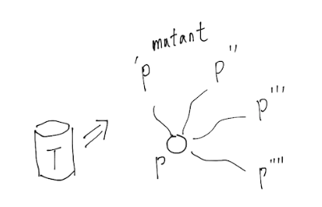

</div>
</div>

<!--
Mutation Testing injects artificial single-point faults (mutants) into your code to verify whether your JUnit assertions actually turn red and kill them.

💡 難字與專業術語解說：
- Competent Programmer Hypothesis (CPH): 稱職程式設計師假設（假設工程師寫出的程式與正確版本在語法樹上僅有些微差距，因此微小變異算子能有效模擬真實缺陷）
- Coupling Effect Hypothesis: 耦合效應假設（能殺死所有一階單點微小變異體的敏銳測試集，亦能同時殺死 99% 以上複雜高階複合錯誤的實證定律）
-->
---
## 4 Mutation Operators, The RIPR Fault Model & Equivalent Mutants

<div class="card-deck">

> Killing a mutant requires traversing the **4-stage RIPR chain**; when computing the **Mutation Score (`MS = K / (M - E)`)**, we must subtract **Equivalent Mutants (`E`)** from the denominator!

<div class="two-columns">
<div class="card" data-marpit-fragment>

### 4 Mutation Operators & The RIPR Chain
- **4 Classic Mutation Operators (PITest):**
  - **ROR:** `>` ↔ `>=, <, ==` ｜ **COR:** `&&` ↔ `||`
  - **AOR:** `+` ↔ `-, *, /` ｜ **Return/Void Removal**
- **The 4-Stage RIPR Chain to Kill a Mutant:**
  1. **Reachability:** Execution reaches the mutated statement.
  2. **Infection:** Mutant alters internal state (needs BVA boundary!).
  3. **Propagation:** State difference reaches final return output.
  4. **Revealability:** JUnit `assertEquals` inspects that output!

</div>
<div class="card" data-marpit-fragment>

### Mutation Score & Equivalent Mutants (`E`)
- **Formula:** **`MS = K / (M - E)`** (`K`: Killed, `M`: Total, `E`: Equivalent).
- **Equivalent Mutant (`E`):** Syntax differs, but output is **100% identical for all inputs** (must be subtracted from `M`!):
```java
// Original P (integers a, b):
if (a < b) c = a;
// Equivalent Mutant P1 (always identical on ints):
if (a <= b - 1) c = a;
// Equivalent Mutant P2 (loop i=0; i++ hitting 10):
if (i == 10) break;  -->  if (i >= 10) break;
```

</div>
</div>
</div>

<!--
The RIPR Model (Reachability, Infection, Propagation, Revealability) explains why 100% statement coverage (Reachability alone) is never enough to kill a mutant—and why Equivalent Mutants (`E`) must be subtracted from `M` in `MS = K / (M - E)`.

💡 難字與專業術語解說：
- RIPR Model: RIPR 故障傳播模型（測試案例殺死變異體必經的可達、狀態感染、結果傳播與斷言揭露四階段）
- Equivalent Mutant: 等價變異體（語法雖然被修改，但在所有可能輸入下之執行結果皆與原程式完全一致、永遠無法被任何測試殺死的變異體）
-->
---
## Mutation Walkthrough 1: Array Max Index `p(a)` (`ex_mutation_test`)

<div class="card-deck">

> Given `p(a)` (returns the index `r` of the maximum element in a 3-element array) and 4 mutants `P1..P4`, evaluate `T = {t1, t2, t3}`!

<div class="two-columns">
<div class="card" data-marpit-fragment>

### Original `p(a)` & 4 Mutants (`P1..P4`)
```python
def p(a): # Returns index r of max value
    r = 0
    for i in [1, 2]:
        if a[i] > a[r]: r = i
    return r
# P1: for i in [0, 1, 2]     (checks i=0)
# P2: if i > a[r]: r = i     (compares index i)
# P3: if a[i] >= a[r]: r = i (> mutated to >=)
# P4: if True: r = i         (always returns 2)
```
- **`P1` is an Equivalent Mutant (`E = 1`):** At `i = 0`, `a[0] > a[0]` is always `False`.
- **`P3` Survives `t1..t3`:** Adding duplicate-max **`t4 = [2, 2, 1]`** makes `P` return `0` and `P3` return `1` (**Killed! `MS: 66.7% → 100%`**).

</div>
<div class="card" data-marpit-fragment>

### Mutant Execution & Hunting Matrix
| Test Case | Orig `P` | `P1` (`[0,1,2]`) | `P2` (`i>a[r]`) | `P3` (`>=`) | `P4` (`True`) |
| :---: | :---: | :---: | :---: | :---: | :---: |
| **`t1=[1,2,3]`** | `2` | `2` | **`1` (Kill)** | `2` | `2` |
| **`t2=[1,2,1]`** | `1` | `1` | `1` | `1` | **`2` (Kill)** |
| **`t3=[3,1,2]`** | `0` | `0` | `0` | `0` | **`2` (Kill)** |
| **Initial Status** | Base | **Equiv (`E`)** | **Killed** | **Alive!** | **Killed** |
| **Add `t4=[2,2,1]`** | `0` | `0` | `2` | **`1` (Kill!)** | `2` |

</div>
</div>
</div>

---
## Mutation Walkthrough 2: 5-Mutant Hunting Matrix (`func(X, Y)`)

<div class="card-deck">

> Given `func(X, Y)`, 5 non-equivalent mutants `P1..P5`, and initial suite `T = {(12,1), (6,5), (7,11)}`, compute `MS` and design kill inputs!

<div class="two-columns">
<div class="card" data-marpit-fragment>

### Original `func(X, Y)` & 5 Mutants
```java
int func(int X, int Y) {
    if ((X > 10) && (Y == 1))  // P1: X >= 10
        X = 1;                 // P2: && -> ||
    else if ((X - Y) < 2)      // P3: <= 2
        X = 2;
    if (Y > 10)                // P4: Y >= 10
        X = 3;                 // P5: X = 4
    return X;
}
```
- **Initial Score:** `t3=(7,11)` kills `P2` and `P5` → **`MS = 2 / 5 = 40%`**.
- **3 Boundary Supplements → `100% MS`:**
  - Kill `P1`: **`t4 = (10, 1)`** (`P=2, P1=1`)
  - Kill `P3`: **`t5 = (8, 6)`** (`P=8, P3=2`)
  - Kill `P4`: **`t6 = (7, 10)`** (`P=2, P4=3`)

</div>
<div class="card" data-marpit-fragment>

### Hunting Matrix (`MS: 40% → 100%`)
| Program / Mutant | `t1=(12,1)` | `t2=(6,5)` | `t3=(7,11)` | Status & Remedy |
| :--- | :---: | :---: | :---: | :--- |
| **Original `P`** | **`1`** | **`2`** | **`3`** | Baseline |
| **`P1` (`X>=10`)** | `1` | `2` | `3` | **Alive** → Add **`(10,1)`** |
| **`P2` (`&&→\|\|`)** | `1` | `2` | **`1` (Kill)** | **Killed by `t3`** |
| **`P3` (`<2→<=2`)** | `1` | `2` | `3` | **Alive** → Add **`(8,6)`** |
| **`P4` (`Y>=10`)** | `1` | `2` | `3` | **Alive** → Add **`(7,10)`** |
| **`P5` (`X=3→4`)** | `1` | `2` | **`4` (Kill)** | **Killed by `t3`** |

</div>
</div>
</div>

<!--
Notice the pattern across both walkthroughs: surviving relational mutants (`>` mutated to `>=` in `P3`, `P1`, and `P4`) are always killed by **exact boundary values** (`a[i] == a[r]` in `[2, 2, 1]`, `X == 10` in `(10, 1)`, `X - Y == 2` in `(8, 6)`, and `Y == 10` in `(7, 10)`)! That proves mathematically why Boundary Value Analysis (BVA) and Mutation Testing are deeply connected.

💡 難字與專業術語解說：
- mutation hunting matrix: 變異體獵殺矩陣（列出各測試案例在原程式與各變異體上之輸出，藉以識別存活變異體並設計補彈測資的分析表）
-->
---
## Industrial Mutation Testing: `BinarySearch` Loop Mutants & PITest Report

<div class="split73">
<div class="left">

* **`BinarySearch` Loop Boundary Mutants (`bs02` & `bs03`):**
  ```java
  // Original: while (left <= right) | bs02: while (left < right) | bs03: while (left >= right)
  ```
  - **Kill `bs02` (`left < right` dropped `==`):** Needs a search that converges to the final 1-element window **`left == right`** (e.g., **`search(2, [0, 1, 2])`** or **`search(1, [1])`**)!
  - **Kill `bs03` (`left >= right` reversed):** Single-element `[5]` (`0 >= 0`) fails to kill it; any array with **`length >= 2`** (e.g., **`search(1, [0, 1, 2])`** where `0 >= 2` is `False`) kills `bs03` immediately!
* **Industrial Bytecode Mutation with PITest (`pitest-maven`):**
  - Runs `mvn test-compile org.pitest:pitest-maven:mutationCoverage` to mutate JVM bytecode in memory and classify every line as **`KILLED` (green)**, **`SURVIVED` (light red)**, **`NO_COVERAGE` (dark red)**, or **`TIMED_OUT`**.

</div>
<div class="right">

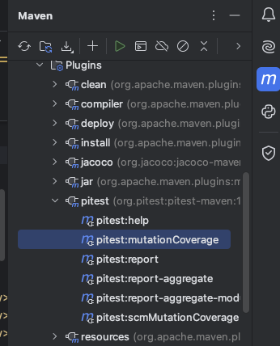

</div>
</div>

<!--
Look at `bs02` (`while (left < right)`) and `bs03` (`while (left >= right)`):
- To kill `bs02`, the binary search must narrow down to a 1-element window where `left == right` (such as hitting the last element `2` in `[0, 1, 2]`).
- To kill `bs03`, the array must have at least 2 elements (`left < right` initially) so `left >= right` immediately skips the loop and returns `-1`.

💡 難字與專業術語解說：
- PITest (PIT Mutation Testing): Java 工業級變異測試框架（直接在記憶體中篡改 JVM 位元組碼並平行執行 JUnit 測試，自動產出變異刪除率報告的工具）
-->
---
<!-- _class: lead -->
<!-- header: '7.6 Integration Testing & Mockito' -->

# **7.6 Integration Testing, Test Doubles & Mockito in Action**

> "Two door handles each rotate smoothly in isolation (100% unit test pass), yet jam against each other when mounted on the same double door—that is why we need Integration Testing and disciplined Test Doubles."

<!--
We now arrive at Section 7.6: Integration Testing, Test Doubles, and Mockito in Action (integrating SQA Chapter 7: Sections 7.1 through 7.6).

💡 難字與專業術語解說：
- contract mismatch: 介面契約失配（呼叫端模組與被呼叫端模組對於前置條件防呆責任、例外型別或資料格式之假設不一致，導致整合時崩潰的缺陷）
-->
---
## Integration Testing in the V-Model & Pure Java Contract Mismatch Case

<div class="split73">
<div class="left">

* **6 Common Faults Exposed Only During Integration Testing:**
  1. **Interface Version Drift** (Module A upgrades API; Module B calls old signature).
  2. **Omitted / Conflicting Defensive Checks** (both sides assume the other validates `b != 0`!).
  3. **Inconsistent Data Structures / Units** (meters vs. centimeters, 0-based vs. 1-based index).
  4. **Violated Server Preconditions**, **5. Swapped Parameter Order**, **6. Multi-Thread Deadlocks**.
* **Pure Java Contract Mismatch (`Calculator` + `RealCalculatorService`):**
  ```java
  // Engineer A's Calculator.java (assumes Service throws IllegalArgumentException on /0)
  public int divide(int a, int b) { return service.divide(a, b); }
  // Engineer A's Unit Test with Mock --> 100% GREEN!
  when(mockService.divide(6, 0)).thenThrow(IllegalArgumentException.class);
  assertThrows(IllegalArgumentException.class, () -> calc.divide(6, 0));

  // Engineer B's RealCalculatorService.java (assumes Caller already checked b != 0!)
  public int divide(int a, int b) { return a / b; }
  // Real Integration: new Calculator(new RealCalculatorService()).divide(6, 0)
  // --> CRASHES with ArithmeticException (/ by zero) instead of IllegalArgumentException!
  ```

</div>
<div class="right">

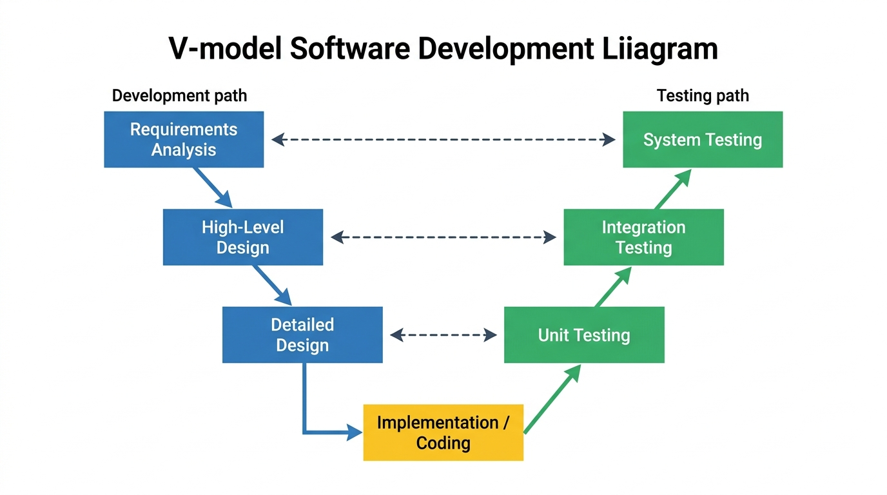

</div>
</div>

<!--
Unit testing with a Mock only verifies your own assumptions about a dependency; real Integration Testing verifies that both modules actually honor the same contract!

💡 難字與專業術語解說：
- false green light from mocking: 模擬替身假綠燈（單元測試中因開發者對 Mock 設定了與真實底層實作不符的理想化回傳或例外，導致單元測試通過但真實整合崩潰的陷阱）
-->
---
## Architectural Foundation for Testability: Constructor Dependency Injection (DI)

<div class="card-deck">

> Never hardcode `new ConcreteDependency()` inside a business class; **depend on an abstraction (`interface`) and inject via the constructor** to enable seamless Top-Down, Mockito, and Bottom-Up testing!

<div class="two-columns">
<div class="card" data-marpit-fragment>

### Anti-Pattern: Hardcoded `new` Inside Class
```java
public class Prime {
    // Hardcoded concrete dependency locks the class!
    private final PrimeChecker checker = new RealPrimeChecker();
    public int[] allPrime(int n) { ... }
}
```
- **Why This Destroys Testability:**
  1. If `RealPrimeChecker` is unfinished or hits a live DB, `Prime` **cannot be unit-tested in isolation**!
  2. Cannot swap in a Top-Down `Stub` or `Mockito` mock.

</div>
<div class="card" data-marpit-fragment>

### Best Practice: Interface + Constructor DI
```java
public class Prime {
    private final PrimeChecker checker; // Interface!

    // External caller decides which implementation to inject
    public Prime(PrimeChecker checker) {
        this.checker = checker;
    }
    public int[] allPrime(int n) { ... }
}
```
- **One Class Supports All 3 Testing Modes:**
  1. **Top-Down Stub:** `new Prime(new StubPrimeChecker())`
  2. **Mockito Unit Test:** `new Prime(mock(PrimeChecker.class))`
  3. **Bottom-Up Real Integration:** `new Prime(new RealPrimeChecker())`

</div>
</div>
</div>

<!--
When `Prime` accepts a `PrimeChecker` interface through its constructor, the exact same production class can be tested top-down with a hand-written Stub, tested in isolation with a dynamic Mockito Mock, and tested bottom-up with the real `RealPrimeChecker`!

💡 難字與專業術語解說：
- Constructor Dependency Injection (Constructor DI): 建構子依賴注入（不於類別內部自行 `new` 具體底層依賴，而是透過建構子參數由外部傳入抽象介面實作的解耦設計模式）
-->
---
## Bottom-Up Integration Testing: 5-Step Progression & Pure Java `Prime` Assembly

<div class="split73">
<div class="left">

* **5-Step Bottom-Up Integration Progression (with Test Drivers):**
  1. **Step 1 (Leaf Modules):** Use Test Drivers `b, c, a` to verify leaf modules **`E, F, G, D`**.
  2. **Steps 2..4 (Subsystem Assembly):** Replace driver `b` with real **`B`**, using upper driver `a` to verify **`B-E-F`**, then **`B-C`** and **`B-C-D`**.
  3. **Step 5 (Full System):** Replace `a` with top module **`A`** to verify **`A-B-C-D-E-F-G`**.
* **Pure Java Bottom-Up Assembly (`RealPrimeChecker → Prime`, Zero Mocks!):**
  ```java
  @Test // Step 1: JUnit @Test is the Test Driver for leaf RealPrimeChecker!
  void testLeafRealPrimeCheckerDriver() {
      RealPrimeChecker leaf = new RealPrimeChecker();
      assertTrue(leaf.isPrime(2) && !leaf.isPrime(9));
  }
  @Test // Step 2: Assemble verified real leaf into upper Prime module!
  void testBottomUpPrimeIntegration() {
      Prime prime = new Prime(new RealPrimeChecker()); // Real B + E!
      assertArrayEquals(new int[]{2, 3, 5, 7}, prime.allPrime(10));
  }
  ```

</div>
<div class="right">

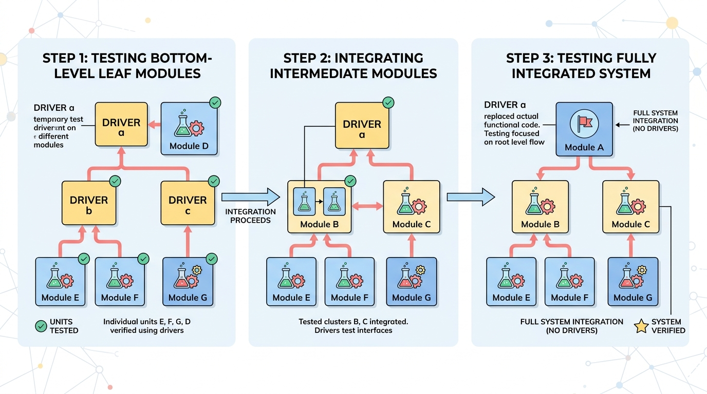

</div>
</div>

<!--
In Bottom-Up Integration, we test the lowest-level leaf modules first using JUnit `@Test` methods as Test Drivers, and then assemble real verified components upward without needing any Stubs!

💡 難字與專業術語解說：
- Bottom-Up Integration: 由下而上整合測試（從最底層無依賴之葉節點模組開始，藉由測試驅動程式 Driver 驗證後逐層往上真實組裝的策略）
-->
---
## Top-Down Integration Testing: Downward Progression with Test Stubs

<div class="split73">
<div class="left">

* **Top-Down Integration Philosophy (Using Test Stubs):**
  - When high-level workflow (`Displayer → Prime → PrimeChecker`) must be verified before lower algorithms exist, plug in lightweight **Test Stubs** returning canned data!
* **3-Stage Top-Down Progression on Prime Printing:**
  1. **Stage 1 (Test Top `Displayer` with `Prime` Stub):** `int[] allPrime(int n) { return new int[]{2,3,5,7}; }`
  2. **Stage 2 (Real `Prime` + `StubPrimeChecker` for Leaf):**
     ```java
     public class StubPrimeChecker implements PrimeChecker {
         public boolean isPrime(int n) { return (n == 2 || n == 3 || n == 5); }
     }
     @Test void testTopDownPrimeWithStub() {
         Prime prime = new Prime(new StubPrimeChecker());
         assertArrayEquals(new int[]{2, 3, 5}, prime.allPrime(5));
     }
     ```
  3. **Stage 3:** Replace `StubPrimeChecker` with `RealPrimeChecker`!

</div>
<div class="right">

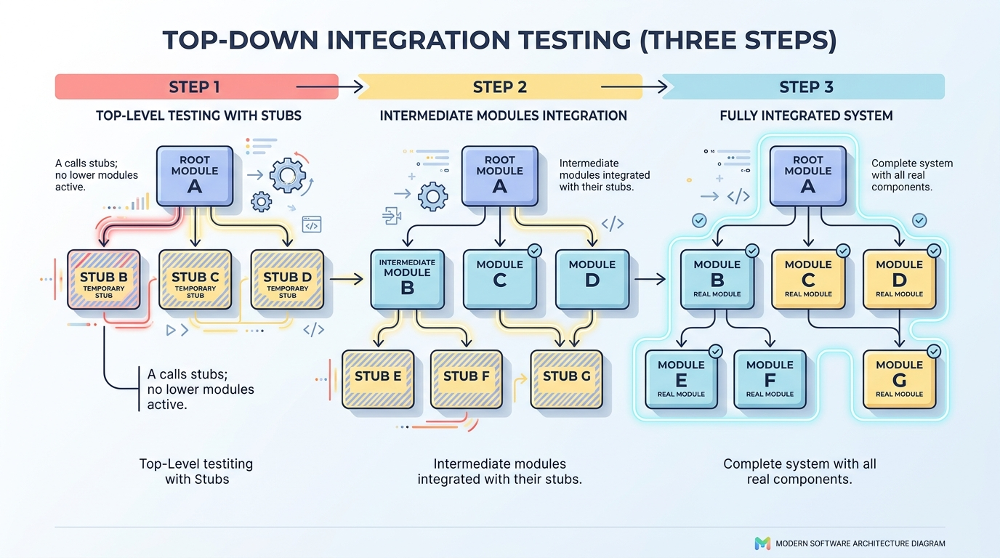

</div>
</div>

<!--
In Top-Down Integration, we start from the top orchestrator module and substitute lightweight Test Stubs for unfinished lower layers, gradually replacing stubs downward with real implementations.

💡 難字與專業術語解說：
- Test Stub: 測試存根／假樁（在由上而下整合測試中，用以模擬尚未完成之底層被呼叫模組、回傳固定硬編碼結果的極簡替身）
-->
---
## Comprehensive Comparison Matrix: 4 Integration Testing Strategies

> Writing **Stubs** is harder than writing **Drivers** (`StubPrimeChecker` hardcoded up to `5` fails when `allPrime(10)` needs `7`!). **Sandwich Integration** combines the strengths of Top-Down and Bottom-Up.

| Dimension | Big-Bang | Top-Down | Bottom-Up | Sandwich (Hybrid) |
| :--- | :--- | :--- | :--- | :--- |
| **Direction** | Wire all modules at once | Top UI/control downward | Bottom leaf/DAO upward | Top & bottom meet at **middle layer** |
| **Test Harness** | None *(disastrous debug)* | **Test Stubs** *(harder)* | **Test Drivers** *(JUnit `@Test`!)* | Top Stubs + Bottom JUnit Drivers |
| **Key Strength** | Zero harness code | **Early UI & high-level flow check** | **Solid foundation; easy fault isolation** | Early flow check + solid core foundation |
| **Main Risk** | **Impossible fault isolation** | Stubs oversimplify complex state | **Top business flow verified last** | Requires coordinated dual schedule |
| **`Prime` Case** | Run `main()` at the end | `new Prime(new StubPrimeChecker())` | `new Prime(new RealPrimeChecker())` | UI Stubs + JUnit leaf meet at `Prime` |

<!--
Sandwich (Hybrid) Integration is industry's favorite compromise: test the bottom utility/DAO layer bottom-up with JUnit Drivers, test the top UI/controller layer top-down with lightweight Stubs, and meet in the middle business-service layer.

💡 難字與專業術語解說：
- Sandwich Integration: 三明治整合測試法（結合由上而下與由下而上策略，以中間核心業務層為會師目標同時推進的混合式整合策略）
-->
---
## From Stubs/Drivers to Gerard Meszaros's 5 Test Doubles

<div class="card-deck">

> In modern JUnit 5, **`@Test` is the Test Driver**, while the 5 substitutes that isolate external dependencies are known as **Test Doubles** (*xUnit Test Patterns*).

<div class="two-columns">
<div class="card" data-marpit-fragment>

### The 5 Test Doubles Explained
1. **Dummy:** Inert placeholder passed just to fill required parameter lists (`null`).
2. **Stub:** Feeds **pre-programmed canned answers** (`when().thenReturn()`) to the SUT.
3. **Spy:** Wraps a **real object**, running real code unless selectively stubbed while recording calls.
4. **Mock:** Verifies **interactions, call counts & arguments** (`verify(mock, times(1))`).
5. **Fake:** Working **simplified implementation** (e.g., in-memory `HashMap` DB).

</div>
<div class="card" data-marpit-fragment>

### Quick Comparison Table
| Test Double | Core Role & Mnemonic | Verification Focus |
| :--- | :--- | :---: |
| **1. Dummy** | Inert parameter filler | None |
| **2. Stub** | Canned return values | **State** |
| **3. Spy** | Real object + partial stub | State + Behavior |
| **4. Mock** | Verifies call interactions | **Behavior** |
| **5. Fake** | Lightweight `HashMap` DB | **State** |

</div>
</div>
</div>

---
## Why Isolate External APIs? Stock Portfolio Valuation (`MarketTest.java`)

<div class="card-deck">

> If `Market.getMarketValue()` calls a live stock-exchange API for TSMC (`2330`), prices fluctuate every second (**non-deterministic**) and fail offline—stub `StockService` while keeping `Stock` entities **real**!

<div class="two-columns">
<div class="card" data-marpit-fragment>

### Production Class (`Market.java`)
```java
public class Market {
    private StockService stockService; // External HTTP API
    private List<Stock> stocks;        // Portfolio holdings

    public double getMarketValue() {
        double total = 0.0;
        for (Stock s : stocks) {
            total += stockService.getPrice(s)
                   * s.getQuantity();
        }
        return total;
    }
}
```

</div>
<div class="card" data-marpit-fragment>

### Unit Test with Stub (`MarketTest.java`)
```java
@Test void testPortfolioMarketValue() {
    StockService svc = mock(StockService.class); // Stub API
    Market market = new Market(svc);
    Stock tsmc = new Stock("2330", "TSMC", 10);  // Real Entity!
    Stock etf  = new Stock("0050", "ETF50", 100);
    market.setStocks(List.of(tsmc, etf));

    when(svc.getPrice(tsmc)).thenReturn(1035.0); // Freeze price
    when(svc.getPrice(etf)).thenReturn(195.0);

    // 1035*10 + 195*100 = 29,850.0 (Deterministic & fast!)
    assertEquals(29850.0, market.getMarketValue());
}
```

</div>
</div>
</div>

<!--
In `MarketTest`, we mock `StockService` (the external network API whose live TSMC price changes every second), while keeping `Stock` value objects and `List.of(...)` 100% real!

💡 難字與專業術語解說：
- State Verification vs. Behavior Verification: 狀態驗證 vs. 行為驗證（狀態驗證透過 `assertEquals` 檢查方法回傳值或物件最終狀態；行為驗證透過 `verify` 檢查受測系統是否依預期次數與參數呼叫外部協作者）
-->
---
## Mockito in Action (1): Dynamic `mock()`, `@Mock / @InjectMocks` & `spy()`

<div class="card-deck">

> Mockito eliminates hand-written stub classes (`StubPrimeChecker.java`) via dynamic bytecode proxies, declarative `@InjectMocks`, and partial-mock `spy()` patching.

<div class="two-columns">
<div class="card" data-marpit-fragment>

### Declarative `@Mock` + `@InjectMocks` (`PrimePlusTest`)
```java
@ExtendWith(MockitoExtension.class)
class PrimePlusTest {
    @Mock        PrimeChecker mockChecker; // 1. Auto-creates Mock
    @InjectMocks Prime prime;              // 2. Calls new Prime(mockChecker)

    @Test void testAllPrimeAndException() {
        when(mockChecker.isPrime(2)).thenReturn(true);
        when(mockChecker.isPrime(3)).thenReturn(true);
        when(mockChecker.isPrime(4)).thenReturn(false);
        when(mockChecker.isPrime(5)).thenReturn(true);

        assertArrayEquals(new int[]{2, 3, 5}, prime.allPrime(5));

        // Simulate defensive exception on out-of-range input:
        when(mockChecker.isPrime(101))
            .thenThrow(new IllegalArgumentException("Max 100"));
        assertThrows(IllegalArgumentException.class,
            () -> prime.allPrime(101));
    }
}
```

</div>
<div class="card" data-marpit-fragment>

### `mock()` (Empty Shell) vs. `spy()` (Partial Real Object)
- **`mock(Class)`:** Unstubbed methods return default `0 / false / null`.
- **`spy(realObj)`:** Unstubbed methods execute the **real object's code**; only stubbed inputs are overridden (`doReturn().when(spy)`):
```java
@Test void testPatchingIncompleteStubWithSpy() {
    // StubPrimeChecker only hardcoded 2, 3, 5 (forgot 7!)
    PrimeChecker incomplete = new StubPrimeChecker();
    PrimeChecker spyChecker = spy(incomplete); // Wrap real object

    // Patch ONLY isPrime(7); 2..6 still run StubPrimeChecker's real code!
    doReturn(true).when(spyChecker).isPrime(7);

    Prime prime = new Prime(spyChecker);
    assertArrayEquals(new int[]{2, 3, 5, 7}, prime.allPrime(10));
}
```

</div>
</div>
</div>

<!--
A `mock()` is an empty virtual shell (any unstubbed call returns `0`, `false`, or `null`), whereas a `spy()` wraps a real object instance so unstubbed calls execute the real code, letting us selectively patch `isPrime(7)`.

💡 難字與專業術語解說：
- Partial Mocking (`spy`): 局部模擬／間諜包裝（以真實物件實體為基底，未特別佈樁的方法皆執行真實程式碼，僅針對特定方法或參數局部覆寫回傳值的機制）
-->
---
## Mockito in Action (2): `verify()` Interaction Counts & Avoiding Brittle Tests

<div class="card-deck">

> Use `verify()` to audit critical external interactions, but beware of **Over-Mocking** that couples tests to private implementation details (**Brittle Tests**)!

<div class="two-columns">
<div class="card" data-marpit-fragment>

### Behavior Verification with `verify()` (`PrimeTest`)
- Why did `assertArrayEquals` pass on `allPrime(10)`, yet `verify(mockChecker, times(1)).isPrime(1)` failed with **`Wanted but not invoked`**?
```java
int[] res = prime.allPrime(10);
assertArrayEquals(new int[]{2, 3, 5, 7}, res); // State assertion PASSES!

// Fails! Prime.allPrime(n) loops from i = 2..n, so isPrime(1) is NEVER called!
// verify(mockChecker, times(1)).isPrime(1);   // Wanted but not invoked!

// Correct interaction verification idioms:
verify(mockChecker, never()).isPrime(1);       // Confirm 1 is skipped!
verify(mockChecker, times(1)).isPrime(2);      // Exactly once
verify(mockChecker, atLeastOnce()).isPrime(3); // >= 1 time
verify(mockChecker, atMost(1)).isPrime(5);     // <= 1 time
```

</div>
<div class="card" data-marpit-fragment>

### When to Mock vs. Brittle Tests (Over-Mocking)
- **4 Valid Mock Targets:** External 3rd-party APIs (`StockService`), slow DB/file I/O, unfinished modules, non-deterministic `Clock/Random`.
- **Never Mock:** Pure domain logic, Value Objects (`Stock`), or `List/Map`.
- **3 Anti-Patterns of Over-Mocking (Brittle Tests):**
  1. **Mocking Everything:** Couples tests to internal lines; refactoring a `for` loop to a `Stream` breaks green tests!
  2. **Over-Verifying Internal Helper Calls** instead of public outputs.
  3. **Mock Contract Drift:** False green lights (always pair mocks with real Bottom-Up / Sandwich integration tests!).

</div>
</div>
</div>

<!--
Never mock value objects, collections, or pure domain algorithms. Test observable behavior and external boundaries, not internal implementation details.

💡 難字與專業術語解說：
- Brittle Test (Over-Mocking): 脆化測試／過度模擬反模式（因測試案例過度綁定受測類別內部實作細節與呼叫順序，導致在外部功能完全正確的重構後測試卻大面積損壞的現象）
-->
---
## 🧩 Conceptual Recap: Fill-in-the-Blank Quiz (Part 1)

<div class="word-bank">
  <span class="word-tag">Single Fault Assumption</span>
  <span class="word-tag">Fagan Inspection</span>
  <span class="word-tag">Metamorphic Testing</span>
  <span class="word-tag">Pesticide Paradox</span>
</div>

1. Repeating the exact same static test cases build after build eventually stops discovering new defects—a phenomenon known in ISTQB as the <span class="quiz-blank" data-answer="Pesticide Paradox">[ _________ ]</span>.
2. In AI vision, search engines, and LLMs where no single ground-truth answer exists (the Test Oracle Problem), <span class="quiz-blank" data-answer="Metamorphic Testing">[ _________ ]</span> verifies invariant relationships `R(f(x), f(x'))` across controlled input transformations `x → x'`.
3. Introduced at IBM in 1976, a formal <span class="quiz-blank" data-answer="Fagan Inspection">[ _________ ]</span> follows 6 structured steps with an independent Reader and Moderator, inspecting code at `200–400 LOC/hr` without debating solutions during the meeting.
4. Both Independent BVA (`4n + 1`, `6n + 1`) and Weak Equivalence Partitioning rely on the <span class="quiz-blank" data-answer="Single Fault Assumption">[ _________ ]</span>, varying one variable at a time while keeping other variables nominal or valid.

<!--
Let's review Part 1 of our Chapter 7 interactive fill-in-the-blank recap! Click each blank in the HTML slide to reveal and verify the key concept.
-->
---
## 🧩 Conceptual Recap: Fill-in-the-Blank Quiz (Part 2)

<div class="word-bank">
  <span class="word-tag">MC/DC (n + 1)</span>
  <span class="word-tag">Equivalent Mutants</span>
  <span class="word-tag">Pairwise (All-Pairs)</span>
  <span class="word-tag">Spy (Partial Mock)</span>
</div>

5. Based on NIST's finding that 67%–93% of bugs stem from 1-way or 2-way parameter interactions, <span class="quiz-blank" data-answer="Pairwise (All-Pairs)">[ _________ ]</span> testing uses IPO + Greedy heuristics to cover all value pairs in a fraction of the Cartesian product.
6. Mandated by DO-178C Level A avionics standards, <span class="quiz-blank" data-answer="MC/DC (n + 1)">[ _________ ]</span> proves that each atomic condition independently flips the decision outcome (Independence Pairs) in a linear minimum of `n + 1` test cases.
7. In Mutation Testing (`MS = K / (M - E)`), mutated programs whose input-output behavior is mathematically identical to the original program for all possible inputs are called <span class="quiz-blank" data-answer="Equivalent Mutants">[ _________ ]</span>.
8. Among Mockito's Test Doubles, a <span class="quiz-blank" data-answer="Spy (Partial Mock)">[ _________ ]</span> wraps a real object instance so unstubbed methods execute real production code while allowing selective `doReturn().when()` overrides.

<!--
Here is Part 2 of our Chapter 7 interactive fill-in-the-blank recap, covering Pairwise testing, avionics MC/DC, Equivalent Mutants, and Mockito Spies.
-->
---
## Chapter 7 Summary: Complete Software Quality & Testing Panorama

<div class="card-deck">

> High-assurance software engineering integrates **Static Inspection**, **Black-Box Specification & Property Testing**, **White-Box Coverage & Mutation Hunting**, and **DI-Enabled Integration Testing**.

<div class="two-columns">
<div class="card" data-marpit-fragment>

### 1. Principles, Inspection & Black-Box Arsenal
- **Foundations & Oracles (7.1):**
  - Respect ISTQB 7 principles, the Practical Test Pyramid, Behavior Venn Diagram (`S ∩ P ∩ T`), and overcome the AI Test Oracle Problem via **Metamorphic**, **Differential**, and **LLM-as-a-Judge** testing.
- **Static Inspection (7.2):**
  - Drain the testing iceberg early via **Fagan Inspections**, Clean Code checklists, **Code Smell refactoring**, and **OWASP Top 10 / SAST** gates.
- **Black-Box BVA, EP, Pairwise, State & PBT (7.3–7.4):**
  - Apply the **3-Step EP + BVA SOP**, **Single Invalid Rule**, **IPO Pairwise (`AllPairs4J`)**, **0-Switch/1-Switch State `@Nested` tests**, and **`jqwik` Property-Based Shrinking**.

</div>
<div class="card" data-marpit-fragment>

### 2. White-Box Coverage, Mutation & Integration
- **White-Box Structural Hierarchy (7.5):**
  - Start with Black-Box baselines, then diagnose uncovered bytecode branches with **JaCoCo** (`SC → BC / CC → MC/DC`), removing infeasible dead branches (`Triangle.java`).
- **Mutation Testing (`MS = K / (M - E)`):**
  - *Test the tests* via the **RIPR chain** and **PITest** bytecode mutators to eliminate assertion-free false green lights.
- **Integration Testing & Test Doubles (7.6):**
  - Design with **Constructor DI**; combine **Bottom-Up (`@Test` Drivers)** and **Top-Down (`Stubs`)** via **Sandwich Integration**; isolate external APIs with **Mockito (`mock, spy, verify`)** while avoiding **Brittle Over-Mocking**!

</div>
</div>
</div>

<!--
This final summary ties together every discipline in Chapter 7: from static inspections and black-box partition/combinatorial/property testing, through white-box MC/DC and mutation analysis, to constructor dependency injection and Mockito integration testing.
-->

<script>
(function() {
  // =========================================================================
  // 0. Dynamic Outline Link Calibration & Fill-in-the-Blank Click-to-Reveal
  // =========================================================================
  function initOutlineLinksAndQuizBlanks() {
    const slideSections = document.querySelectorAll('section[id]');
    const sectionMap = {};
    slideSections.forEach(sec => {
      const h1 = sec.querySelector('h1');
      if (h1) {
        const m = (h1.textContent || '').trim().match(/^(\d+\.\d+)/);
        if (m && !sectionMap[m[1]]) {
          sectionMap[m[1]] = sec.id;
        }
      }
    });
    document.querySelectorAll('section.outline-slide a, section.outline a').forEach(a => {
      const m = (a.textContent || '').trim().match(/^(\d+\.\d+)/);
      if (m && sectionMap[m[1]]) {
        a.setAttribute('href', '#' + sectionMap[m[1]]);
      }
    });

    document.querySelectorAll('.quiz-blank[data-answer]').forEach(blank => {
      if (blank.dataset.quizBound) return;
      blank.dataset.quizBound = 'true';
      blank.style.cursor = 'pointer';
      blank.title = 'Click to reveal / hide answer';
      blank.addEventListener('click', function(e) {
        e.stopPropagation();
        const isRevealed = blank.classList.toggle('is-revealed');
        if (isRevealed) {
          blank.textContent = ' ' + blank.dataset.answer + ' ';
        } else {
          blank.textContent = '[ _________ ]';
        }
      });
    });
  }

  // =========================================================================
  // 1. Header Dropdown (Table of Contents / Outline)
  // =========================================================================
  function initHeaderDropdown() {
    const sections = [];
    const seenTitles = new Set();
    const slideSections = document.querySelectorAll('section[id]');
    
    slideSections.forEach(sec => {
      const header = sec.querySelector('header');
      if (!header) return;
      
      let title = header.textContent.trim();
      title = title.replace(/^[◄◀]\s*/, '').replace(/\s*[►▶]$/, '').trim();
      if (!title || seenTitles.has(title)) return;
      
      seenTitles.add(title);
      sections.push({
        id: sec.id,
        title: title
      });
    });

    if (sections.length === 0) return;

    const allTitles = sections.map(s => s.title).join('');
    const isEn = !/[\u4e00-\u9fa5]/.test(allTitles);
    const txtOutline = isEn ? '📑 Table of Contents' : '📑 章節目錄';
    const txtTitleTooltip = isEn ? 'Click to pin or hover to view outline' : '點擊固定或懸停查看章節目錄';
    const txtPrev = isEn ? 'Previous Section' : '上一章節';
    const txtNext = isEn ? 'Next Section' : '下一章節';

    function createDropdownWrapper(currentTitle) {
      const wrapper = document.createElement('span');
      wrapper.className = 'header-nav-wrapper';
      
      const titleSpan = document.createElement('span');
      titleSpan.className = 'header-nav-title';
      titleSpan.title = txtTitleTooltip;
      titleSpan.innerHTML = currentTitle + '<span class="nav-caret"> ▾</span>';
      
      titleSpan.addEventListener('click', function(e) {
        e.stopPropagation();
        const wasOpen = wrapper.classList.contains('is-open');
        document.querySelectorAll('.header-nav-wrapper.is-open').forEach(w => w.classList.remove('is-open'));
        if (!wasOpen) {
          wrapper.classList.add('is-open');
        }
      });
      
      const dropdown = document.createElement('div');
      dropdown.className = 'nav-dropdown';
      
      dropdown.addEventListener('click', function(e) {
        e.stopPropagation();
      });
      
      const dropHeader = document.createElement('div');
      dropHeader.className = 'nav-dropdown-header';
      dropHeader.innerHTML = '<span>' + txtOutline + '</span>';
      dropdown.appendChild(dropHeader);
      
      const grid = document.createElement('div');
      grid.className = 'nav-dropdown-grid';
      
      sections.forEach(s => {
        const item = document.createElement('a');
        const isActive = (s.title === currentTitle);
        item.className = 'nav-dropdown-item' + (isActive ? ' active' : '');
        item.href = '#' + s.id;
        item.innerHTML = '<span class="badge">#' + s.id.padStart(2, '0') + '</span><span class="item-text" title="' + s.title + '">' + s.title + '</span>';
        
        item.addEventListener('click', function(e) {
          e.preventDefault();
          wrapper.classList.remove('is-open');
          dropdown.style.display = 'none';
          const targetHash = '#' + s.id;
          if (window.location.hash === targetHash) {
            window.dispatchEvent(new HashChangeEvent('hashchange'));
          } else {
            window.location.hash = targetHash;
          }
          setTimeout(() => { dropdown.style.display = ''; }, 350);
        });
        
        grid.appendChild(item);
      });
      
      dropdown.appendChild(grid);
      wrapper.appendChild(titleSpan);
      wrapper.appendChild(dropdown);
      return wrapper;
    }

    document.addEventListener('click', function(e) {
      if (!e.target.closest('.header-nav-wrapper')) {
        document.querySelectorAll('.header-nav-wrapper.is-open').forEach(w => w.classList.remove('is-open'));
      }
    });

    slideSections.forEach(sec => {
      const header = sec.querySelector('header');
      if (!header || header.dataset.navEnhanced) return;
      header.dataset.navEnhanced = 'true';
      
      const links = header.querySelectorAll('a');
      let prevLink = null;
      let nextLink = null;
      
      links.forEach(a => {
        const txt = a.textContent.trim();
        if (txt === '◄' || txt === '◀') prevLink = a;
        if (txt === '►' || txt === '▶') nextLink = a;
      });
      
      let title = header.textContent.trim();
      title = title.replace(/^[◄◀]\s*/, '').replace(/\s*[►▶]$/, '').trim();
      if (!title) return;
      
      header.innerHTML = '';
      if (prevLink) {
        prevLink.className = 'header-nav-arrow';
        prevLink.title = txtPrev;
        header.appendChild(prevLink);
        header.appendChild(document.createTextNode(' '));
      }
      
      const wrapper = createDropdownWrapper(title);
      header.appendChild(wrapper);
      
      if (nextLink) {
        header.appendChild(document.createTextNode(' '));
        nextLink.className = 'header-nav-arrow';
        nextLink.title = txtNext;
        header.appendChild(nextLink);
      }
    });

    // Auto-link and calibrate section items on the Outline slide (Slide 2)
    const secByNum = {};
    slideSections.forEach(sec => {
      const h1 = sec.querySelector("h1");
      if (h1) {
        const m = (h1.textContent || "").trim().match(/^(\d+\.\d+)\b/);
        if (m && !secByNum[m[1]]) secByNum[m[1]] = sec.id;
      }
    });
    sections.forEach(s => {
      const m = s.title.match(/^(\d+\.\d+)\b/);
      if (m && !secByNum[m[1]]) secByNum[m[1]] = s.id;
    });
    const outlineSlide = document.querySelector("section.outline-slide, section.outline, section[id=\"2\"]");
    if (outlineSlide) {
      outlineSlide.querySelectorAll("li").forEach(li => {
        const existingLink = li.querySelector(":scope > a, :scope > strong > a, :scope > b > a");
        if (existingLink) {
          const m = existingLink.textContent.trim().match(/^(\d+\.\d+)\b/);
          if (m && secByNum[m[1]]) {
            existingLink.setAttribute("href", "#" + secByNum[m[1]]);
          }
          return;
        }
        const bold = li.querySelector(":scope > b, :scope > strong");
        if (bold) {
          const m = bold.textContent.trim().match(/^(\d+\.\d+)\b/);
          if (m && secByNum[m[1]]) {
            const a = document.createElement("a");
            a.setAttribute("href", "#" + secByNum[m[1]]);
            bold.parentNode.insertBefore(a, bold);
            a.appendChild(bold);
          }
        }
      });
    }

  }

  // =========================================================================
  // 2. Number Quick Jump (<kbd>Num</kbd> + <kbd>Enter</kbd>)
  // =========================================================================
  function initNumberQuickJump() {
    let inputBuffer = '';
    let timer = null;
    let hud = null;

    const slideSections = document.querySelectorAll('section[id]');
    let hasZh = false;
    slideSections.forEach(s => {
      if (/[\u4e00-\u9fa5]/.test(s.textContent || '')) hasZh = true;
    });
    const isEn = !hasZh;

    function getOrCreateHud() {
      if (!hud) {
        hud = document.createElement('div');
        hud.id = 'slide-quick-jump-hud';
        hud.style.cssText = [
          'position: fixed',
          'bottom: 36px',
          'left: 50%',
          'transform: translateX(-50%)',
          'background: rgba(15, 23, 42, 0.94)',
          'color: #ffffff',
          'padding: 8px 18px',
          'border-radius: 28px',
          'font-family: -apple-system, BlinkMacSystemFont, "Segoe UI", Roboto, system-ui, sans-serif',
          'font-size: 14px',
          'font-weight: 500',
          'box-shadow: 0 16px 36px rgba(0, 0, 0, 0.35), 0 0 0 1px rgba(255, 255, 255, 0.15)',
          'backdrop-filter: blur(16px)',
          '-webkit-backdrop-filter: blur(16px)',
          'z-index: 999999',
          'display: none',
          'align-items: center',
          'gap: 8px',
          'pointer-events: none',
          'opacity: 0',
          'transition: opacity 0.15s ease, transform 0.15s ease'
        ].join(';');
        const targetParent = document.fullscreenElement || document.body;
        targetParent.appendChild(hud);
      }
      const parent = document.fullscreenElement || document.body;
      if (hud.parentElement !== parent) {
        parent.appendChild(hud);
      }
      return hud;
    }

    function getTotalSlides() {
      const secs = document.querySelectorAll('section[id]');
      return secs.length || 1;
    }

    function showHud() {
      const el = getOrCreateHud();
      const total = getTotalSlides();
      const label = isEn ? 'Go to slide:' : '跳至頁碼:';
      const enterHint = isEn ? 'Enter ↵' : 'Enter 確認 ↵';
      el.innerHTML = '<span>🧭 ' + label + '</span> ' +
        '<strong style="color: #38bdf8; font-size: 20px; font-weight: 700; font-family: ui-monospace, SFMono-Regular, Menlo, monospace; letter-spacing: 1px;">' + inputBuffer + '</strong> ' +
        '<span style="opacity: 0.6; font-size: 13px;">/ ' + total + '</span> ' +
        '<span style="background: rgba(255,255,255,0.18); padding: 2px 7px; border-radius: 6px; font-size: 11px; margin-left: 2px; font-weight: 600;">' + enterHint + '</span>';
      el.style.display = 'flex';
      el.style.opacity = '1';

      if (timer) clearTimeout(timer);
      timer = setTimeout(clearInput, 2800);
    }

    function clearInput() {
      inputBuffer = '';
      if (timer) {
        clearTimeout(timer);
        timer = null;
      }
      if (hud) {
        hud.style.opacity = '0';
        setTimeout(() => {
          if (inputBuffer === '' && hud) hud.style.display = 'none';
        }, 150);
      }
    }

    function jumpToSlide(num) {
      const total = getTotalSlides();
      const target = Math.max(1, Math.min(num, total));
      const targetHash = '#' + target;
      
      const el = getOrCreateHud();
      const confirmedMsg = isEn ? ('✓ Slide ' + target) : ('✓ 第 ' + target + ' 頁');
      el.innerHTML = '<span style="color: #34d399; font-weight: 700; font-size: 15px;">' + confirmedMsg + '</span>';
      el.style.display = 'flex';
      el.style.opacity = '1';
      setTimeout(clearInput, 500);

      if (window.location.hash === targetHash) {
        window.dispatchEvent(new HashChangeEvent('hashchange'));
      } else {
        window.location.hash = targetHash;
      }
    }

    window.addEventListener('keydown', function(e) {
      const active = document.activeElement;
      if (active && (active.tagName === 'INPUT' || active.tagName === 'TEXTAREA' || active.tagName === 'SELECT' || active.isContentEditable)) {
        return;
      }

      if (e.ctrlKey || e.altKey || e.metaKey) {
        return;
      }

      let digit = null;
      if (e.key >= '0' && e.key <= '9') {
        digit = e.key;
      } else if (/^(?:Digit|Numpad)([0-9])$/.test(e.key)) {
        digit = e.key.replace(/^(?:Digit|Numpad)/, '');
      } else if (/^(?:Digit|Numpad)([0-9])$/.test(e.code || '')) {
        digit = (e.code || '').replace(/^(?:Digit|Numpad)/, '');
      }

      if (digit !== null) {
        inputBuffer += digit;
        if (inputBuffer.length > 4) inputBuffer = inputBuffer.slice(-4);
        showHud();
        return;
      }

      if ((e.key === 'Backspace' || e.code === 'Backspace') && inputBuffer.length > 0) {
        e.preventDefault();
        e.stopPropagation();
        inputBuffer = inputBuffer.slice(0, -1);
        if (inputBuffer.length === 0) {
          clearInput();
        } else {
          showHud();
        }
        return;
      }

      if ((e.key === 'Escape' || e.code === 'Escape') && inputBuffer.length > 0) {
        e.preventDefault();
        e.stopPropagation();
        clearInput();
        return;
      }

      if ((e.key === 'Enter' || e.code === 'Enter' || e.code === 'NumpadEnter') && inputBuffer.length > 0) {
        e.preventDefault();
        e.stopPropagation();
        const targetPage = parseInt(inputBuffer, 10);
        if (!isNaN(targetPage)) {
          jumpToSlide(targetPage);
        } else {
          clearInput();
        }
      }
    }, true);
  }

  // =========================================================================
  // 3. Split73 / Split64 Image In-Place Hover Zoom
  // =========================================================================
  function initSplitImageHoverZoom() {
    function updateInPlaceScale(img) {
      const isSplit73 = !!img.closest("div.split73");
      const baseScale = isSplit73 ? 1.52 : 1.38;
      const h = img.offsetHeight || 360;
      const maxAllowedScale = Math.max(1.22, Math.min(baseScale, 640 / h));
      img.style.setProperty("--split-zoom-scale", maxAllowedScale.toFixed(2));
    }

    const targets = document.querySelectorAll("div.split73 img:not(.emoji), div.split64 img:not(.emoji)");
    targets.forEach(img => {
      if (img.dataset.splitZoomBound) return;
      img.dataset.splitZoomBound = "true";
      img.addEventListener("mouseenter", function() {
        updateInPlaceScale(img);
      });
    });

    // Auto-clamp hover zoom scale (--zoom-scale) for code blocks and card images (SQA style)
    function updateCodeAndCardZoomScale(el) {
      const sec = el.closest("section");
      if (!sec) return;
      const w = el.offsetWidth;
      const h = el.offsetHeight;
      if (!w || !h) return;
      let x = 0, y = 0, cur = el;
      while (cur && cur !== sec && sec.contains(cur)) {
        x += cur.offsetLeft;
        y += cur.offsetTop;
        cur = cur.offsetParent;
      }
      const secW = sec.offsetWidth || 1280;
      const secH = sec.offsetHeight || 720;
      const padSide = 36;
      const padTop = 30;
      const isLeftOrigin = !!el.closest(":is(.two-columns, .two-columns-64, .two-columns-73, .three-columns) > .card:first-child, div.split64 > div.left, div.split73 > div.left");
      const availW = isLeftOrigin ? (secW - padSide - x) : ((x + w) - padSide);
      const tag = el.tagName ? el.tagName.toLowerCase() : "";
      const isCode = (tag === "pre" || tag === "marp-pre");
      const cy = y + h / 2;
      const availH = isCode ? ((y + h) - padTop) : (2 * Math.min(cy - padTop, (secH - 30) - cy));
      const cap = isCode ? 1.42 : 1.9;
      let maxS = Math.min(cap, availW / w, availH / h, (secH - 60) / h);
      if (maxS < 1.0) maxS = 1.0;
      el.style.setProperty("--zoom-scale", maxS.toFixed(3));
    }

    document.querySelectorAll(".card img:not(.emoji), div.content-figure img:not(.emoji), .card pre, .card marp-pre, div.split64 > div.left pre, div.split64 > div.left marp-pre, div.split73 > div.left pre, div.split73 > div.left marp-pre").forEach(el => {
      if (el.dataset.zoomBound) return;
      el.dataset.zoomBound = "true";
      el.addEventListener("mouseenter", function() { updateCodeAndCardZoomScale(el); });
      el.addEventListener("load", function() { updateCodeAndCardZoomScale(el); });
      updateCodeAndCardZoomScale(el);
    });

    const origBadges = document.querySelectorAll(".orig-ui-hover[data-orig-src]");
    origBadges.forEach(badge => {
      if (badge.dataset.origZoomBound) return;
      badge.dataset.origZoomBound = "true";
      badge.addEventListener("mouseenter", function() {
        const split = badge.closest("div.split64, div.split73");
        if (!split) return;
        const rightImg = split.querySelector("div.right img:not(.emoji)");
        if (!rightImg) return;
        if (!rightImg.dataset.annotatedSrc) {
          rightImg.dataset.annotatedSrc = rightImg.getAttribute("src");
        }
        rightImg.setAttribute("src", badge.dataset.origSrc);
        updateInPlaceScale(rightImg);
        rightImg.classList.add("is-inplace-zoomed");
      });
      badge.addEventListener("mouseleave", function() {
        const split = badge.closest("div.split64, div.split73");
        if (!split) return;
        const rightImg = split.querySelector("div.right img:not(.emoji)");
        if (!rightImg) return;
        rightImg.classList.remove("is-inplace-zoomed");
        if (rightImg.dataset.annotatedSrc) {
          rightImg.setAttribute("src", rightImg.dataset.annotatedSrc);
        }
      });
    });
  }

  // =========================================================================
  // 4. Interactive Full-Page 3W2H Mind Map Controller
  // =========================================================================
  function init3W2HMindMap() {
    const stage = document.getElementById("mm-3w2h-root");
    if (!stage || stage.dataset.mmBound) return;
    stage.dataset.mmBound = "true";

    const rows = Array.from(stage.querySelectorAll(".mm-branch-row"));
    const btnToggleAll = document.getElementById("mm-btn-toggle-all");
    const btnStep = document.getElementById("mm-btn-step");

    function syncRowUI() {
      let expandedCount = 0;
      let firstCollapsedIdx = -1;
      rows.forEach((row, idx) => {
        const isCollapsed = row.classList.contains("is-collapsed");
        const pill = row.querySelector(".mm-toggle-pill");
        if (pill) {
          pill.textContent = isCollapsed ? "+" : "−";
        }
        if (!isCollapsed) {
          expandedCount++;
        } else if (firstCollapsedIdx === -1) {
          firstCollapsedIdx = idx;
        }
      });

      if (btnToggleAll) {
        if (expandedCount === rows.length) {
          btnToggleAll.textContent = "➖ Collapse All";
        } else {
          btnToggleAll.textContent = "➕ Expand All";
        }
      }
      if (btnStep) {
        if (firstCollapsedIdx === -1) {
          btnStep.textContent = "↺ Reset Branches";
        } else {
          btnStep.textContent = "▶ Next Branch (" + (firstCollapsedIdx + 1) + "/" + rows.length + ")";
        }
      }
    }

    rows.forEach(row => {
      const node = row.querySelector(".mm-dim-node");
      if (!node) return;
      node.addEventListener("click", function(e) {
        e.stopPropagation();
        row.classList.toggle("is-collapsed");
        syncRowUI();
      });
    });

    if (btnToggleAll) {
      btnToggleAll.addEventListener("click", function(e) {
        e.stopPropagation();
        const allExpanded = rows.every(r => !r.classList.contains("is-collapsed"));
        rows.forEach(r => {
          if (allExpanded) {
            r.classList.add("is-collapsed");
          } else {
            r.classList.remove("is-collapsed");
          }
        });
        syncRowUI();
      });
    }

    if (btnStep) {
      btnStep.addEventListener("click", function(e) {
        e.stopPropagation();
        const nextRow = rows.find(r => r.classList.contains("is-collapsed"));
        if (nextRow) {
          nextRow.classList.remove("is-collapsed");
        } else {
          rows.forEach(r => r.classList.add("is-collapsed"));
        }
        syncRowUI();
      });
    }

    syncRowUI();
  }

  function init() {
    initOutlineLinksAndQuizBlanks();
    initHeaderDropdown();
    initNumberQuickJump();
    initSplitImageHoverZoom();
    init3W2HMindMap();
  }

  if (document.readyState === 'loading') {
    document.addEventListener('DOMContentLoaded', init);
  } else {
    init();
  }
  setTimeout(init, 400);
})();

</script>
