<!-- _class: lead -->
<!-- header: '' -->

# **軟體工程**

### 第四課：系統塑模與統一架構 (System Modeling & Unified Architecture)

**授課教師：薛念林 教授**  
資訊工程學系  
逢甲大學

<!--
各位好，歡迎來到軟體工程第四課：系統塑模與統一架構。

在第三章中，我們學習了如何透過自然語言與使用者故事來發掘、分析與規格化軟體需求。然而，自然語言天生具備模糊性與不完整性，很難直接無縫轉化為穩健且無瑕疵的程式碼。

今天，我們將完成從抽象需求邁向形式化軟體模型的關鍵躍遷。我們將探討什麼是系統塑模、深入理解四大核心視角、回顧統一塑模語言（UML）的三巨頭歷史，並透徹掌握每一種不可或缺的 UML 圖表。

總結這張投影片，請記住這個核心觀念：系統塑模在人類的模糊需求與可執行的軟體程式碼之間，建立了正式且精確的觀念橋樑。
-->
---
<!-- _class: outline-slide -->

## 第四章：課程藍圖與核心架構

<div class="outline-columns">
<div>
<h3>第一部分：塑模基礎與核心靜態模型</h3>
<ul>
<li><b>4.1 系統塑模基礎：</b> 塑模本質、四大核心視角、五大必備圖表與盲人摸象寓言。</li>
<li><b>4.2 統一塑模語言 (UML)：</b> 1990 年代方法論之戰、三巨頭三位一體分工與 OMG 標準化。</li>
<li><b>4.3 功能塑模與使用案例：</b> 參與者目標、系統邊界、include/extend 關聯與 AI 提示詞指引。</li>
<li><b>4.4 結構塑模與領域類別圖：</b> 領域實體、可見度符號、關聯重數、整體與部分及 AI 提示詞。</li>
<li><b>4.5 互動塑模與循序圖：</b> 訊息傳遞時序、生命線、啟動條、BCE 模式與 AI 提示詞指引。</li>
</ul>
</div>
<div>
<h3>第二部分：工作流程、行為狀態與文字塑模</h3>
<ul>
<li><b>4.6 流程塑模與活動圖：</b> 並行流程、決策分支、分岔/結合、泳道職責與 AI 提示詞。</li>
<li><b>4.7 行為塑模與有限狀態機：</b> 反應型系統、訂單生命週期狀態機、事件觸發、守衛條件與 AI 提示詞。</li>
<li><b>4.8 PlantUML 宣告式文字塑模：</b> 架構即代碼 (Code-as-Architecture)、語法速查與多圖管線。</li>
<li><b>4.9 概念複習與統整：</b> 核心工程原則回顧、填空小測驗與經典文獻。</li>
</ul>
</div>
</div>

<!--
這裡是第四章全新調整後的完整學習藍圖。

在左側的第一部分，我們從系統塑模的哲學本質與四大視角出發，見證 UML 的歷史誕生與三巨頭整合，接著探討以使用者目標為導向的使用案例模型，並定義系統的靜態領域類別結構與動態循序圖。

在右側的第二部分，我們深入探討活動圖的並行流程與泳道分配、分析反應型系統的有限狀態機轉換，掌握現代 PlantUML 宣告式文字塑模技術，最後進行全面性的概念統整與測驗。

每個核心模型皆深度整合專屬的 AI 提示詞指南與外送平台實戰範例！

總結這張投影片，請記住這個核心觀念：本章帶領大家建立從需求意圖、架構設計到 AI 輔助落地的全方位系統塑模思維。
-->
---
<!-- _class: lead -->
<!-- header: '4.1 系統塑模基礎' -->

# **4.1 系統塑模基礎**

> "A language that doesn't affect the way you think about programming is not worth knowing."  
> — *Alan Perlis*

<!--
我們首先進入 4.1 小節：系統塑模基礎 (Foundations of System Modeling)。

在探討具體的圖表與語法之前，我們必須先釐清最根本的問題：什麼是「模型」？為什麼軟體工程師在敲代碼前必須先建立模型？以及多重視角如何幫助我們馴服軟體系統的內在複雜度？

總結這張投影片，請記住這個核心觀念：系統塑模是透過有目的的抽象化與多重視角投影，掌控軟體複雜度的核心工程方法。
-->
---
## 什麼是系統塑模？ (What is System Modeling?)

> "系統塑模是為系統開發抽象模型的過程，每個模型代表該系統不同的視角或觀點。"  
> — *Ian Sommerville, Software Engineering (10th ed.)*

- **系統塑模的核心工程原則：**
  - **抽象化 (Abstraction)：** 隱藏不必要的實作細節，突顯關鍵的架構結構、資料流動與相依關係。
  - **多重視角 (Multiple Perspectives)：** 沒有任何單一圖表能解釋整個複雜軟體；不同利害關係人需要不同的視角。
  - **溝通與驗證 (Communication & Verification)：** 作為產品經理、系統架構師、開發者與測試工程師之間的通用視覺語言。
  - **實作藍圖 (Blueprint for Implementation)：** 提供正式的結構與行為規格，作為後續編寫程式碼與資料庫結構的精確藍圖。

<!--
讓我們先建立系統塑模的根本定義。

Ian Sommerville 教授將塑模定義為建立抽象模型的過程，每個模型展現系統不同的視角。

請特別注意「抽象化」這個詞。試想：如果一張蓋房子的建築藍圖把混凝土中的每一顆分子都畫出來，工人根本不可能蓋出房子！你需要一張水電圖、一張結構圖、一張通風管線圖。

軟體工程也是完全相同的道理：沒有任何一張圖能包辦整個軟體系統，我們必須透過多種互補的視角來掌控複雜度。

總結這張投影片，請記住這個核心觀念：系統塑模透過多重視角的有目的抽象化，幫助軟體工程師全面駕馭軟體系統的複雜度。
-->
---
<!-- _class: title-image-slide -->

## 盲人摸象與多重視角模型 (The Parable of the Elephant & Multiple Perspectives)

<div class="image-wrapper">
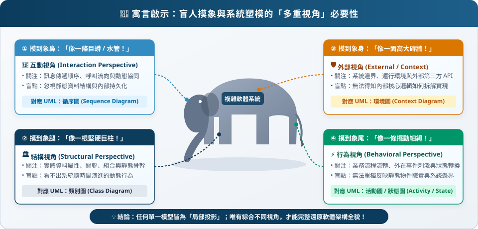
</div>

<!--
這張圖是軟體工程系統塑模中最經典的哲理啟示：「盲人摸象」。

古老寓言中，摸到象鼻的盲人堅持大象像水管；摸到象腿的盲人堅信大象像粗柱；摸到象身的盲人認為大象是一堵高牆；摸到象尾的則以為是一條細繩。每個人都說對了局部事實，卻都犯了「以偏概全 (Fallacy of Composition)」的認知謬誤。

軟體系統也是如此：它本質上是龐大、複雜且無形的抽象產物。
如果你只畫類別圖，就像只摸到象腿——你掌握了靜態結構與屬性骨幹，卻看不出資料如何隨時間流動；
如果你只看循序圖，就像只摸到象鼻——你看到訊息傳遞順序，卻不知道整體系統邊界與外部依賴；
如果你只看狀態圖，就像只摸到象尾——你掌握了反應動態，卻無法反映物件資料定義。

這正是為什麼我們「絕不可能僅用一張單一圖表或模型來描述整個軟體」！
軟體工程必須從外部 (Context)、互動 (Interaction)、結構 (Structural) 與行為 (Behavioral) 四大維度協同塑模，互為佐證，才能在腦海中拼湊出架構的完整真相。

總結這張投影片，請記住這個核心觀念：任何單一模型都是系統在特定維度的局部投影，唯有綜合多重視角，才能建構完整且無盲點的軟體架構。
-->
---
## 系統塑模的 4 大核心視角 (4 Core Perspectives)

- **1. 外部視角 (External Perspective)：**
  - 塑模系統處在的運行環境、外部合作夥伴與邊界範圍。
  - 明確劃分系統邊界：哪些由內部團隊開發，哪些委託給外部第三方服務。
- **2. 互動視角 (Interaction Perspective)：**
  - 塑模外部參與者與系統之間，或是內部協同物件之間的動態溝通與訊息傳遞。
- **3. 結構視角 (Structural Perspective)：**
  - 塑模系統資料組織、類別、屬性、方法與關聯性的靜態架構，與執行時間先後無關。
- **4. 行為視角 (Behavioral Perspective)：**
  - 塑模系統的動態執行行為、業務流程步驟，以及系統針對外在事件所產生的反應式狀態轉換。

<!--
國際軟體工程規範將系統模型有條不紊地理出四大核心視角：

第一，外部視角：系統的界線劃在哪裡？外部有哪些雲端服務和人類使用者會接觸它？
第二，互動視角：參與者與物件之間在時間軸上如何相互傳遞訊息？
第三，結構視角：系統內部的靜態資料表、類別、屬性與關聯長什麼樣子？
第四，行為視角：當事件發生或執行流程啟動時，系統的狀態如何動態反應與流轉？

優秀的軟體工程師必須根據眼前的問題，精準挑選最合適的視角來思考。

總結這張投影片，請記住這個核心觀念：四大核心塑模視角分別為外部、互動、結構與行為視角。
-->
---
## 現代實務必備的 5 大 UML 核心模型

| 模型 / 圖表 | 對應章節 | 所屬視角 | 動態 / 靜態本質 | 主要軟體工程職責 |
| :--- | :---: | :--- | :--- | :--- |
| **1. 使用案例模型** | 4.3 | 互動視角 | 功能契約 | 界定系統邊界、參與者目標與系統功能範疇 |
| **2. 領域類別圖** | 4.4 | 結構視角 | 靜態骨幹 | 定義領域實體、屬性、方法與整體/部分關聯 |
| **3. 物件循序圖** | 4.5 | 互動視角 | 動態時序 | 沿時間軸追蹤訊息傳遞與 BCE 強韌性職責劃分 |
| **4. 業務活動圖** | 4.6 | 行為視角 | 動態流程 | 塑模業務流程、並行分岔/結合與跨角色泳道 |
| **5. 有限狀態機圖** | 4.7 | 行為視角 | 反應生命週期 | 捕捉事件驅動的離散狀態流轉、守衛與不變量 |

> **落實與加速：** 透過 **4.8 PlantUML** (架構即代碼) 統一實踐，各章節深度整合專屬 **AI 提示詞指引**。

<!--
在 UML 2.5 定義的 14 種圖表中，本章聚焦於構成現代軟體架構骨幹的五大不可或缺核心模型：

第一，第 4.3 節探討使用案例模型，確立功能邊界與利害關係人契約。
第二，第 4.4 節深入類別模型，定義靜態領域實體、屬性與物件關聯。
第三，第 4.5 節分析循序圖，追蹤執行期跨時間的訊息交換與邊界–控制–實體 (BCE) 分工。
第四，第 4.6 節研究活動圖，視覺化呈現業務流程、分岔/結合並行與泳道責任分配。
第五，第 4.7 節剖析狀態機圖，塑模反應式物件生命週期、離散狀態與守衛不變量。

每個模型皆深度整合專屬的 AI 提示詞指引與外送平台實戰範例，並於第 4.8 節透過 PlantUML 架構即代碼進行統整。

總結這張投影片，請記住這個核心觀念：精通這五大核心 UML 模型，即可從外部、互動、結構與行為四大維度全面具備規格化、設計與驗證複雜軟體的能力。
-->
---
### 觀念檢核測驗 1 (CCQ 1)
<!-- id: ase-ch04-ccq1 -->
<div class="ccq-columns">
<div class="ccq-text">

軟體架構師若欲定義「**領域實體資料的靜態組織方式，以及類別之間的繼承、關聯與包含關係**」（完全不隨執行時序變動），應採取哪一種塑模視角？

- **A.** 外部視角 (External Perspective)
- **B.** 互動視角 (Interaction Perspective)
- **C.** 結構視角 (Structural Perspective)
- **D.** 行為視角 (Behavioral Perspective)

</div>
<div class="ccq-logo">
    <a href="https://nlhsueh.github.io/nickedupocket/#/student/ase-ch04-ccq1" target="_blank"></a>
  </div>
</div>

<!--
讓我們透過觀念檢核測驗 1 來檢驗對四大塑模視角的掌握度。

審視四大視角定義：
外部視角關注系統與環境邊界。
互動視角關注參與者與物件隨時間的訊息傳遞。
行為視角關注離散狀態轉換與動態工作流程。
結構視角則關注資料、類別、屬性與靜態關聯。

正確答案是選項 C，結構視角 (Structural Perspective)！

總結這張投影片，請記住這個核心觀念：結構模型專注於捕捉軟體靜態架構與實體關聯，不受執行時序變動影響。
-->
---
<!-- _class: lead -->
<!-- header: '4.2 統一塑模語言 (UML)' -->

# **4.2 統一塑模語言 (UML)**

> 「標準化的視覺語法，將軟體工程從封閉的方法論孤島，淬煉為全球共通的工程學門。」

<!--
現在進入 4.2 小節：統一塑模語言 (Unified Modeling Language, UML)。

在理解了塑模的哲學基礎與四大視角後，我們接著探討軟體工業界如何平息 1990 年代混亂的方法論之戰，讓 Rational 的 UML 三巨頭攜手合作，最終由 OMG 確立為全球軟體架構的通用世界語。

總結這張投影片，請記住這個核心觀念：UML 為物件導向軟體工程提供了統一且無可替代的視覺標準。
-->
---
## 標準化的迫切需求：1990 年代「方法論之戰」

- **物件導向程式設計的崛起 (1980 年代末至 1990 年代初)：**
  - 軟體產業從程序導向程式碼 (C, Pascal) 大規模轉移至物件導向典範 (C++, Smalltalk)。
  - 工程師迫切需要一套圖形符號來視覺化表達類別、物件與關聯。
- **百家爭鳴的「方法論之戰 (Method Wars)」時代：**
  - 超過 **50 種相互競爭的物件導向塑模記號**充斥商業市場。
  - 各派大師激烈爭論：類別究竟該畫成雲朵、矩形還是橢圓？繼承到底該用空心三角、實心箭頭還是虛線？
  - **嚴重的產業割裂碎片化：** 各公司之間無法交換架構模型，CASE 塑模軟體彼此互不相容，工程師換工作就得被迫重新學習一套新符號。

<!--
回到 1990 年代初期的軟體工程世界。當時軟體界正面臨嚴重的「方法論之戰」。

當時有超過 50 種記號相互廝殺：Booch 方法用雲朵表示類別，OMT 用矩形，OOSE 又是另一套。
每家公司、每套 CASE 工具都互不相容。工程師只要換一家公司，就得把以前學的繪圖記號全部作廢、從頭學起！

這種嚴重的產業內耗，催生了市場對單一、標準化視覺語言的迫切渴望。

總結這張投影片，請記住這個核心觀念：1990 年代的方法論之戰造成產業嚴重割裂，促成了 UML 標準化統一運動的誕生。
-->
---
## 統一與標準化：從 Rational 到 OMG

<div class="content-columns">
<div class="content-text">

- **1994 – Rational 展開歷史性大整合：**
  - Jim Rumbaugh 加入 Rational 與 Grady Booch 聯手，融合 Booch 方法與 OMT 為 Unified Method (v0.8)。
- **1995 – 三巨頭 (The Three Amigos) 合體：**
  - Ivar Jacobson 加入 Rational，帶入革命性的**使用案例 (Use Case)** 方法論 (OOSE)。
- **1997 – OMG 國際官方標準化：**
  - 正式提交至**物件管理組織 (OMG)**，於 1997 年 11 月一致通過採納為 **UML 1.1** 國際產業標準。
- **2005 – UML 2.0 重大架構改版：**
  - 擴充至 13 種（後續擴增至 14 種）正式圖表，具備形式化執行元模型 (Metamodels)。

</div>
<div class="content-figure">

<div class="name-card">

<div class="name-card-caption">
<span class="name-card-name">Unified Modeling Language</span>
<span class="name-card-cc"><a href="https://www.omg.org/uml/" target="_blank">Object Management Group (OMG)</a></span>
</div>
</div>

</div>
</div>

<!--
UML 的歷史轉捩點發生在 Rational Software 公司。

1994 年，Jim Rumbaugh 加入 Rational 與 Grady Booch 聯手；1995 年，Ivar Jacobson 也攜帶他的 Objectory 團隊加入。這三位原先在市場上激烈競爭的泰斗，決定放下門戶之見，合力打造一套統一的塑模語言。

1997 年，國際物件管理組織 OMG 正式將 UML 採納為全球軟體產業標準，徹底平息了混亂的方法論之戰。

總結這張投影片，請記住這個核心觀念：Rational Software 凝聚了三巨頭的智慧，促成 OMG 將 UML 定位為全球軟體工程的共通標準。
-->
---
## UML 奠基先驅：Grady Booch

<div class="content-columns">
<div class="content-text">

- **角色與學術榮譽：**
  - ACM Fellow、IEEE Fellow、IBM 院士、Rational 共同創辦人兼首席科學家。
- **開創經典方法論：**
  - **Booch 方法 (Booch Method)** 與重量級專書：《物件導向分析與設計》。
- **對 UML 的核心貢獻：**
  - 專精於**物件導向實作設計 (Design & Implementation)**，精確定義微觀物件協同與宏觀系統架構。
  - 賦予 UML 精準對應至 C++、Java 等 OOP 程式語言的實作直譯能力。
- **著名軟體工程箴言：**
  > *"良好的架構，是讓未來的重大決策顯得容易且自然的藝術。"*

</div>
<div class="content-figure">

<div class="name-card">

<div class="name-card-caption">
<span class="name-card-name">Grady Booch</span>
<span class="name-card-cc"><a href="https://en.wikipedia.org/wiki/Grady_Booch" target="_blank">Rational Software / IBM Fellow</a></span>
</div>
</div>

</div>
</div>

<!--
讓我們認識第一位靈魂人物：Grady Booch。

Booch 是軟體架構領域的傳奇大師。他在 1980 年代推動 Ada 與 C++ 的物件導向設計，他的著作是無數架構師的案頭聖經。

Booch 的核心貢獻在於「微觀設計與實作對應」：他確保 UML 上的每一個符號、每一個關聯，都能夠直接對應到 C++ 或 Java 的真實程式碼結構。

總結這張投影片，請記住這個核心觀念：Grady Booch 為 UML 注入了與物件導向程式碼深度對齊的微觀設計與架構哲學。
-->
---
## UML 奠基先驅：James Rumbaugh

<div class="content-columns">
<div class="content-text">

- **角色與學術榮譽：**
  - 奇異公司 (GE) 全球研發中心軟體主任研究員、Rational Software、IBM。
- **開創經典方法論：**
  - **物件塑模技術 (OMT, Object Modeling Technique)** 與專書：《物件導向塑模與設計》。
- **對 UML 的核心貢獻：**
  - 強調嚴謹的**領域分析 (Domain Analysis)**、語義資料塑模與實體關聯對應。
  - 首創將靜態物件結構與 David Harel 的**狀態圖 (Statecharts)** 深度結合，用以塑模動態反應式系統。
- **著名軟體工程箴言：**
  > *"如果不透徹理解領域的真實本質，就絕不可能打造出卓越的軟體。"*

</div>
<div class="content-figure">

<div class="name-card">

<div class="name-card-caption">
<span class="name-card-name">James Rumbaugh</span>
<span class="name-card-cc"><a href="https://en.wikipedia.org/wiki/James_Rumbaugh" target="_blank">GE Research / Rational Software</a></span>
</div>
</div>

</div>
</div>

<!--
認識第二位巨頭：James Rumbaugh 博士。

Jim Rumbaugh 早年在奇異公司企業研發中心帶領軟體技術研究。他所創立的 OMT 方法，被業界公認為數學結構最嚴謹的分析方法論。

Rumbaugh 的天才在於領域分析——精確捕捉真實世界的實體、資料庫關聯與狀態機。當 Rumbaugh 與 Booch 攜手時，正好在「分析領域問題」與「設計軟體架構」之間架起完美的平衡木。

總結這張投影片，請記住這個核心觀念：James Rumbaugh 為 UML 奠定了嚴謹的領域分析、資料關聯與狀態圖塑模根基。
-->
---
## UML 奠基先驅：Ivar Jacobson

<div class="content-columns">
<div class="content-text">

- **角色與學術榮譽：**
  - 愛立信 (Ericsson) 首席架構師、Objectory AB 創辦人、Rational Software、SEMAT 發起人。
- **開創經典方法論：**
  - **物件導向軟體工程 (OOSE)**。
- **對 UML 的核心貢獻：**
  - **使用案例 (Use Cases) 的發明者 (1986)：** 革命性地將系統架構錨定在可衡量的使用者目標之上。
  - 提出經典的**邊界–控制–實體 (BCE, Boundary–Control–Entity)** 強韌性分析模式與元件化架構。
- **著名軟體工程箴言：**
  > *"一個沒有使用者的系統，就沒有任何存在的理由。塑模永遠要先從使用者的目標開始。"*

</div>
<div class="content-figure">

<div class="name-card">

<div class="name-card-caption">
<span class="name-card-name">Ivar Jacobson</span>
<span class="name-card-cc"><a href="https://en.wikipedia.org/wiki/Ivar_Jacobson" target="_blank">Ericsson / Objectory / Rational</a></span>
</div>
</div>

</div>
</div>

<!--
認識第三位巨頭：Ivar Jacobson 博士。

Jacobson 早年在愛立信研發龐大的電話交換機系統，後來創立 Objectory 公司。他在 1986 年發明了「使用案例 (Use Cases)」。

在 Jacobson 之前，軟體需求大多是一篇篇生硬枯燥的條文式功能規格。Jacobson 徹底顛覆了這個視角，把焦點拉回人類使用者身上：究竟是「誰」在用系統？他們想達成什麼「商業目標」？他還提出了至今仍主導架構設計的 BCE 模式。

總結這張投影片，請記住這個核心觀念：Ivar Jacobson 發明了使用案例與 BCE 模式，讓軟體架構真正以使用者目標為依歸。
-->
---
## UML 三巨頭：軟體塑模的三位一體 (The Trinity of Modeling)

<div class="three-columns">
<div class="card">
<h3>Ivar Jacobson</h3>
<h4>核心回答「Why」(目標 / 使用者)</h4>
<ul>
<li><b>使用案例驅動：</b> 外部參與者想達成什麼目標？</li>
<li><b>BCE 強韌性分析：</b> 徹底分離 UI 邊界與核心資料實體。</li>
<li><b>元件契約規範：</b> 可重用子系統的架構邊界。</li>
</ul>
</div>
<div class="card">
<h3>James Rumbaugh</h3>
<h4>核心回答「What」(領域與資料)</h4>
<ul>
<li><b>領域物件分析：</b> 現實世界存在哪些核心概念？</li>
<li><b>類別與資料綱要：</b> 結構化的實體關聯關係。</li>
<li><b>有限狀態機：</b> 反應式事件驅動的生命週期。</li>
</ul>
</div>
<div class="card">
<h3>Grady Booch</h3>
<h4>核心回答「How」(設計與程式碼)</h4>
<ul>
<li><b>物件導向設計：</b> 類別之間如何精巧協同運作？</li>
<li><b>巨觀架構拆解：</b> 分層模組與相依性控制。</li>
<li><b>實作直譯對應：</b> 視覺模型與 OOP 程式碼直接對齊。</li>
</ul>
</div>
</div>

> 📌 **架構整合精髓：** Jacobson 捕捉系統存在的**初衷目的 (Why)**；Rumbaugh 塑模領域存在的**資料本質 (What)**；Booch 設計程式執行的**實作架構 (How)**。

<!--
請大家細細體會三巨頭之間天衣無縫的互補之美：

Ivar Jacobson 從使用者視角回答了「為什麼 (Why)」系統需要存在。
James Rumbaugh 梳理問題領域，回答了存在哪些資料實體的「本質 (What)」。
Grady Booch 規劃軟體架構，回答了這些元件在程式碼中如何高效運行的「作法 (How)」。

三巨頭的合體不僅成就了 UML，更奠定了 Rational 統一流程（RUP）等現代軟體工程方法的基石。

總結這張投影片，請記住這個核心觀念：UML 完美融合了使用者目標 (Why)、領域資料 (What) 與程式架構 (How) 的三位一體。
-->
---
### 觀念檢核測驗 2 (CCQ 2)
<!-- id: ase-ch04-ccq2 -->
<div class="ccq-columns">
<div class="ccq-text">

在被尊稱為「UML 三巨頭」的軟體工程大師中，哪一位以於 1986 年發明**使用案例 (Use Cases)**、將軟體架構直接錨定於使用者具體目標而聞名？

- **A.** Grady Booch
- **B.** James Rumbaugh
- **C.** Ivar Jacobson
- **D.** Martin Fowler

</div>
<div class="ccq-logo">
    <a href="https://nlhsueh.github.io/nickedupocket/#/student/ase-ch04-ccq2" target="_blank"></a>
  </div>
</div>

<!--
讓我們透過觀念測驗 2 來檢驗對 UML 發展史的理解。

檢視各個選項：
Grady Booch 開創了 Booch 方法，主攻物件導向設計與程式碼映射。
James Rumbaugh 開發了 OMT 方法，專精領域分析與物件狀態模型。
Martin Fowler 則是撰寫《UML 精華 (UML Distilled)》與《重構》的大師，但他並非三巨頭成員。

正確答案是 C：Ivar Jacobson！Jacobson 於 1986 年在愛立信提出使用案例，徹底將軟體架構引導向以使用者目標為核心的典範。

總結這張投影片，請記住這個核心觀念：Ivar Jacobson 發明了使用案例，將需求與架構聚焦於使用者具體目標。
-->
---
<!-- _class: lead -->
<!-- header: '4.3 功能與使用案例模型' -->

# **4.3 功能與使用案例模型**

> "使用案例是系統與其參與者之間為了達成可衡量業務目標所簽署的行為契約。"  
> — *Alistair Cockburn*

<!--
我們現在進入第 4.3 節：功能與使用案例模型。

在物件導向分析中，使用案例圖是系統對外部世界的「功能性契約」。它定義了系統的邊界：誰會使用系統？他們試圖達成什麼商業目標？哪些功能是內部開發的，哪些功能委託給第三方外部服務？

在這一節中，我們將透過精緻的視覺圖解，逐步掌握參與者、系統邊界、include 與 extend 關聯的正確用法，並學習如何撰寫正式的使用案例規格書與 AI 提示詞。

總結這張投影片，請記住這個核心觀念：使用案例模型是連結非技術利害關係人與工程團隊之間最關鍵的高階功能視覺契約。
-->
---
<!-- _class: title-image-slide -->

## 業務價值與使用者目標導向 (Business Value & User Goals)

<div class="image-wrapper">
  
</div>

<!--
請看畫面上的三個卡片。

左邊卡片指出塑模的焦點：商業價值與使用者目標。我們必須問：使用者到底想完成什麼事？例如『預訂航班』或『下單訂餐』。

中間藍色卡片是黃金法則：永遠從專案利害關係人的視角出發，而不是從程式設計師的視角！

右邊卡片提醒排除項：絕對不要畫資料流、功能分解或資料庫處理細節。不要把『輸入密碼』或『點擊按鈕』這種內部操作畫成使用案例。

總結這張投影片，請記住這個核心觀念：聚焦於使用者想要達成的商業目標，而非內部的技術實作細節。
-->
---
<!-- _class: title-image-slide -->

## 參與者分類學與系統邊界 (Actor Taxonomy & Boundaries)

<div class="image-wrapper">
  
</div>

<!--
請看畫面上的四個標註框，這正是構成使用案例圖的四大核心基石。

左上角是『參與者 (Actor)』：人形符號，代表與系統互動的外部實體，可以是真人、組織、第三方系統，甚至是定時排程器。

右上角是『使用案例 (Use Case)』：橢圓形，代表能為參與者交付具體可衡量價值的一連串動作。

左下角是『關聯 (Relationship)』：連線，表達參與者與使用案例之間的互動、相依或繼承關係。

右下角是『系統邊界 (System Boundary)』：灰色外框，清楚界定什麼屬於系統內部開發範圍，什麼屬於外部環境。

總結這張投影片，請記住這個核心觀念：使用案例圖由四大元素構成：參與者、使用案例、關聯線與系統邊界。
-->
---
<!-- _class: title-image-slide -->

## 使用案例關聯矩陣 (Use Case Relationship Matrix)

<div class="image-wrapper">
  
</div>

<!--
這張表格整理了 UML 中四種最核心的關聯與生活比喻：

第一行是『關聯 (Association)』：實線，代表參與者參與某個目標。就像顧客走進實體商店。

第二行是『<<include>> 包含』：虛線箭頭，代表每次必執行的強制共用邏輯。就像在結帳 checkout() 時，一定會呼叫 calculateTax() 計算稅金。

第三行是『<<extend>> 擴充』：虛線箭頭，代表特定條件觸發的可選邏輯。就像符合優惠資格時彈出折價券，或者例外錯誤處理。

第四行是『泛化 (Generalization)』：實線帶空心三角箭頭，代表『是一種 (is-a)』的繼承關係。例如國際學生也是一種學生，但具備額外的居留手續。

總結這張投影片，請記住這個核心觀念：牢記關聯差異：include 是強制必跑，extend 是條件可選，泛化則是角色繼承。
-->
---
<!-- _class: title-image-slide -->

### 清楚的使用案例命名語意 (Clear Use Case Naming)

<div class="image-wrapper">
  
</div>

<!--
使用案例與參與者該如何正確命名？

請看左邊綠色打勾的良好實踐：使用案例一律以『強動詞 + 領域名詞』開頭，例如『提領資金』、『配送貨物』。參與者一律使用單數角色名稱，如『客服專員』，且泛化必須通過『is-like』常理測試。

再看右邊紅色叉叉的壞味道：避免使用弱動詞，如『處理』、『執行』或『做』。嚴禁出現技術黑話，如『Process_DB』，且不要使用企業內部 HR 職稱，如『初階專員』。要塑模角色，而非辦公室抬頭！

總結這張投影片，請記住這個核心觀念：使用案例採用強動詞加名詞命名，參與者採用單數角色名稱。
-->
---
<!-- _class: title-image-slide -->

### 使用案例塑模核心法則 (Rules of Building Use Case Models)

<div class="image-wrapper">
  
</div>

<!--
請看這張投影片提示的三大防護原則，讓你的圖表保持乾淨清晰：

第一，最上方的儀表板：『最多兩層嵌套』。切勿層層 include（如 A 包含 B、B 又包含 C），否則會讓圖表退化成雜亂的流程圖！

第二，中間卡片：『嚴禁人連人』。參與者之間絕不可直接連線。現實中人跟人講話的互動，請寫在文字規格書中。

第三，下方卡片：『有目的地使用邊界框』。利用邊界框劃定系統範圍或不同交付階段（第一期、第二期）。

另外注意最底部的提示：用 <<system>> 標示外部系統，用時鐘圖示代表定時排程。

總結這張投影片，請記住這個核心觀念：限制嵌套深度在兩層內，禁止參與者互連，並有目的地劃定系統邊界。
-->
---
<!-- _class: title-image-slide -->

## 實戰案例：大學選課系統 (University Enrollment System)

<div class="image-wrapper">
  
</div>

<!--
讓我們透過具體案例來演練：大學選課系統。

這張投影片先將系統清楚拆解為左右兩大欄位：『Who（誰）』與『What（做什麼）』。

左邊是參與者：包括一般『學生 (Student)』作為主要參與者、具備特殊資格的『國際學生 (International Student)』，以及定時排程的『時間 (Time)』。

右邊是四個核心使用案例：『學生選課』、『選修研討課』、『執行安全查核』與『提交學費報告』。

在下一張投影片中，我們將把這兩邊完整串接起來！

總結這張投影片，請記住這個核心觀念：在連線之前，先清楚盤點系統中『誰參與 (Who)』與『做什麼 (What)』。
-->
---
<!-- _class: title-image-slide -->

### 實戰案例：參與者泛化與關聯整合 (Actor Generalization & Synthesis)

<div class="image-wrapper">
  
</div>

<!--
現在請看整合後的完整模型！跟著右側藍圖圖例的橘色編號一步步對照：

編號 1 是『泛化 (Generalization)』：空心箭頭代表國際學生繼承自一般學生，擁有基礎選課的所有權限。

編號 2 是『<<include>> 包含』：箭頭從學生選課指向選修研討課，代表選課時強制包含修習研討課。

編號 3 是『<<extend>> 擴充』：箭頭從執行安全查核指回學生選課，代表僅在特定條件下（如國際學生身分）才觸發安全查核。

編號 4 是『時間參與者 (Time)』：右邊的時鐘圖示每個月定時觸發『提交學費報告』。

總結這張投影片，請記住這個核心觀念：這張圖完整示範了泛化、包含、擴充與定時排程四大觀念在實務系統中的協同運作。
-->
---
<!-- _class: title-image-slide -->

## 使用案例常見反模式 (Common Anti-Patterns)

<div class="image-wrapper">
  
</div>

<!--
這張表格條列了初學者最常犯的四大錯誤、失敗原因與修正對策：

第一項：技術名稱（如 Process_DB_Transaction）。非技術利害關係人看不懂。修正：改用領域名稱（提領資金、產出報表）。

第二項：用箭頭畫資料流。關聯線只代表參與，不是資料搬運。修正：移除箭頭，改畫簡單實線。

第三項：濫用 <<extend>>。滿天飛的虛線箭頭會讓圖形變成蜘蛛網。修正：將次要條件移至文字規格書。

第四項：直接把顧客連到管理員。參與者之間不直接連線。修正：把人與人之間的溝通移到文字情境中敘述。

總結這張投影片，請記住這個核心觀念：避免技術命名、資料流箭頭與人連人連線，維持模型清爽精煉。
-->
---
<!-- _class: title-image-slide -->

### 使用案例最佳實踐檢核清單 (Best Practices Checklist)

<div class="image-wrapper">
  
</div>

<!--
在向團隊展示使用案例圖之前，請逐項檢查這九個方塊：

1. 是否使用了強動詞加領域名詞？
2. 參與者是否使用單數角色名稱，而非職稱？
3. 主要參與者是否放置在左上方？
4. 所有參與者是否都在系統邊界框之外？
5. <<include>> 是否嚴格限定於強制執行步驟？
6. <<extend>> 是否嚴格限定於可選或條件步驟？
7. 泛化繼承是否通過常理邏輯檢驗？
8. 參與者之間是否有零連線？
9. 詳細的擴充條件是否保留在文字規格中？

全數通過，代表你的模型具備高度專業品質！

總結這張投影片，請記住這個核心觀念：將這九項檢核清單作為正式交付前不可或缺的品質把關標準。
-->
---
### 使用案例規格書：UC-01 學生選課 (Enroll Student)

| 欄位名稱 | 規格細節說明 |
| :--- | :--- |
| **使用案例代號 / 名稱** | **UC-01：學生選課 (Enroll Student in Course)** |
| **主要參與者 (Actor)** | 學生 (透過學校單一登入 SSO 驗證身分) |
| **前置條件 (Preconditions)** | 學生具備有效學籍在學狀態；當前處於選課開放時段內 |
| **後置條件 (Postconditions)** | 學生正式納入該課程名冊；該課程剩餘修課名額自動扣減 1 |
| **主要成功路徑 (Main Flow)** | **1.** 學生依學系代碼或開課課號搜尋開放修習的課程清單。<br>**2.** 系統回傳並展示符合條件的班級資訊、上課時間表與剩餘名額。<br>**3.** 學生選定目標課程，向系統提出正式加選請求。<br>**4.** 系統執行 `<<include>> 檢查先修科目資格`，比對學生歷史歷年成績單。<br>**5.** 系統鎖定保留名額，寫入選課交易紀錄，並產生成員確認通知單。<br>**6.** 學生即時檢視個人更新後的課表，並收到選課成功通知信。 |
| **例外與擴充路徑 (Extensions)** | **4a. 先修科目未通過：** 系統提示未修畢之必要擋修科目代碼，中斷選課流程。<br>**4b. 上課時間衝堂：** 系統發出警告，提示與已選課程時間重疊，放棄本次加選。<br>**5a. 課程名額已滿：** 系統觸發 `<<extend>> 加入候補等候名單` 流程。 |

<!--
使用案例圖只是一張高階目錄，真正嚴謹的行為合約完整記錄在使用案例規格書中！

大家請看「UC-01 學生選課」的標準 Cockburn 規格書結構：
主要參與者是通過驗證的學生。
前置條件確保學籍有效且選課系統開放。
後置條件保證交易成功後名額扣減並登記在冊。

請特別注意主要成功路徑的第 4 步：它正式宣告並調用了被包含的子使用案例「檢查先修科目資格」。
在例外路徑中，清楚規範了擋修、衝堂與額滿時的處理方式。

總結這張投影片，請記住這個核心觀念：使用案例規格書以條理化的對話步驟、前置後置條件與例外處理，賦予圖表實質的工程合約約束力。
-->
---
## 觀念檢核測驗 3 (CCQ 3)
<!-- id: ase-ch04-ccq3 -->

<div class="ccq-columns">
<div class="ccq-text">

在 UML 使用案例模型中，若使用案例 A 與使用案例 B 之間存在 **`<<include>>`** 關聯（A 指向 B），這在軟體架構上代表什麼意義？

- **A.** 使用案例 B 是選擇性的，僅在特定異常狀況下才會由 A 觸發執行。
- **B.** 每當使用案例 A 執行時，使用案例 B 所定義的行為「必定且強制」會被納入執行。
- **C.** 使用案例 A 繼承了使用案例 B 的所有屬性與操作方法。
- **D.** 使用案例 B 是外部第三方系統，不屬於軟體邊界範疇。

</div>
<div class="ccq-logo">
    <a href="https://nlhsueh.github.io/nickedupocket/#/student/ase-ch04-ccq3" target="_blank"></a>
  </div>
</div>

<!--
讓我們透過觀念檢核測驗 3 來驗收對使用案例關聯的理解。

題目問的是：A include B 代表什麼？
檢視各選項：
選項 A 是 extend 的定義（選擇性條件觸發）。
選項 C 是泛化繼承的觀念。
選項 D 混淆了外部參與者的概念。

正確答案是 B！當 A 包含 B 時，代表 B 是 A 不可分割且必然會執行的共用子程序。

總結這張投影片，請記住這個核心觀念：Include 關聯代表強制執行的共用子流程，而 Extend 則是條件式的擴充行為。
-->
---
<!-- _class: v-center -->

### 觀念診斷練習：找出這張使用案例圖的 3 大致命錯誤！

<div class="split64">
<div class="left" style="display: flex; justify-content: center; align-items: center;">


</div>
<div class="right" style="font-size: 17px; line-height: 1.4;">

**審查這份學生繪製的使用案例圖草稿：**
你能找出圖中潛藏的 **3 大關鍵塑模謬誤（反模式）** 嗎？

- **1. 顆粒度與操作流程分解 (Granularity & Workflow)：**
  - 將 `輸入外送地址` ➔ `點擊送出按鈕` ➔ `送出外送訂單` 串聯成流程有何嚴重錯誤？
- **2. 關聯方向倒置 (Relationship Direction)：**
  - 仔細觀察 `處理線上扣款` 與 `送出外送訂單` 之間的 `<<include>>` 虛線箭頭方向！
- **3. 系統邊界與內部實體錯置 (Boundary & Actor Placement)：**
  - 檢視 `主廚 (Chef)` 與 `MySQL 資料庫`，兩者如何違反了 UML 系統邊界與參與者定義？

</div>
</div>

<!--
讓我們對這份學生繪製的使用案例圖草稿進行嚴格的架構診斷。圖中存在三大核心塑模謬誤：

謬誤一（功能分解與 UI 流程圖化）：
使用案例代表能夠為使用者帶來獨立商業價值的完整目標（使用者達成什麼），而非操作微步驟、按鈕點擊或工作流流程圖。「輸入外送地址」與「點擊送出按鈕」並非獨立的使用案例，它們只是「送出外送訂單」案例內部微小的輸入步驟，絕不能畫成橢圓形案例相互串接。

謬誤二（包含關聯箭頭逆向倒置）：
檢視「送出外送訂單」與「處理線上扣款」之間的依賴。虛線箭頭竟然逆向指回主案例！在 UML 規範中，基底案例必須「指向」被包含的子案例（Place Food Order . . > Process Payment : <<include>>），因為是主案例主動納入副常式，絕非倒過來包含。

謬誤三（邊界違反與內部實體誤植為參與者）：
首先，主廚 (Chef) 是人類角色參與者，卻被錯誤地畫在系統邊界方框內部——所有參與者一律必須嚴格置於邊界方框外部。其次，MySQL 資料庫被畫成了外部參與者並附帶資料流箭頭（writes SQL）。內部資料庫是系統內部的實作細節，絕非外部獨立通訊的參與者！

總結這張投影片，請記住這個核心觀念：嚴禁將使用案例畫成 UI 微步驟流程圖、確保 include 箭頭指向被包含常式，並將內部資料庫與內部角色排除於外部參與者之外。
-->

---

<!-- _class: v-center -->

### 觀念診斷解答：使用案例圖 3 大錯誤剖析與修正

<div class="split64">
<div class="left" style="display: flex; justify-content: center; align-items: center;">

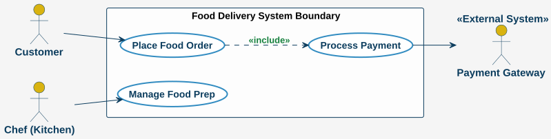

</div>
<div class="right" style="font-size: 17px; line-height: 1.4;">

**審查診斷結論與架構修正指引：**

- **1. 顆粒度太細與流程圖化 (Functional Decomposition)：**
  - 「輸入地址」與「點擊送出」僅是「下單」內部的微小 UI 步驟，不可獨立畫為使用案例。
- **2. 包含關聯方向顛倒 (Inverted <<include>>)：**
  - 基礎案例主動調用共用子程序，箭頭必須由 `下單` 指向 `處理付款` (`Place Food Order` ➔ `Process Payment`)。
- **3. 系統邊界與參與者錯置 (Boundary Violations)：**
  - `Chef` 是人員角色，必須置於邊界方框外；`MySQL Database` 是系統內部儲存，不可畫為外部參與者。

</div>
</div>

<!--
這是使用案例圖三大設計反模式的標準解答：

第一，避免功能分解與微步驟流程圖化。使用案例必須是為參與者帶來完整商業價值的目標，輸入地址或點擊按鈕應寫在步驟描述中，不可畫為獨立橢圓。

第二，<<include>> 箭頭方向永遠由主程序指向被包含的子程序。下單包含付款，因此箭頭必須指向付款。

第三，所有參與者都必須站在系統邊界之外。廚師誤放在方框內；內部資料庫是系統實作細節，絕非外部參與者。

總結這張投影片，請記住這個核心觀念：使用案例聚焦使用者目標、包含箭頭指向子程序、僅有真正的外部實體置於系統邊界之外。
-->
---
## AI 輔助指南：使用案例塑模 (Use Case Modeling)

- **1. 角色設定與系統邊界約束 (Persona & Boundary Priming)：**
  - 指示 AI 扮演「精通 UML 2.5 國際標準的資深需求分析師」。
  - **嚴格要求宣告邊界：** 必須先定義 `rectangle "System Name"`，禁止 AI 將外部雲端服務混入內部邊界。
- **2. 參與者與關聯性嚴格語義規範：**
  - **參與者分類：** 要求 AI 區分「主要參與者 (人)」與「次要外部支援服務 (金流 API、簡訊服務)」。
  - **`<<include>>` 規則：** 僅用於「每次下單必執行的強制共用子流程」。
  - **`<<extend>>` 規則：** 僅用於「具備特定觸發條件的可選附加行為」，並指明擴充點。
  - **反模式防護：** 嚴禁功能分解（禁止產生「點擊按鈕」、「輸入密碼」等瑣碎泡泡）。
- **3. 架構師人工審查清單 (Verification Checklist)：**
  - [ ] 每個使用案例是否皆以「動詞 + 受詞」命名（如 `下單訂購`、`追蹤外送`）？
  - [ ] 第三方基礎設施（金流閘道、簡訊）是否正確置於系統邊界外側？
  - [ ] include 箭頭是否正確指向被包含的共用功能？

<!--
使用生成式 AI 輔助產生使用案例圖時，精確的 Prompt 約束是成敗關鍵。

大型語言模型在沒有足夠指引時，最容易犯三個經典錯誤：
第一，功能分解過細，把按鈕點擊畫成使用案例；
第二，混淆 include 與 extend，把可選的功能畫成強制包含；
第三，把外部系統（如綠界金流）畫在系統邊界裡面。

透過設定專業角色、強制劃定矩形邊界與關聯語義規則，能讓 AI 在秒級內產出專業合規的模型代碼。

總結這張投影片，請記住這個核心觀念：引導 AI 產生使用案例圖時，必須嚴格約束系統邊界、動詞命名與 include/extend 語義邊界。
-->
---

<!-- _class: v-center -->

### AI 提示詞範例：外送平台使用案例模型

<div class="two-columns">
<div>

**1. 角色設定與任務指令：**
```text
你是一位資深系統分析架構師。
請根據以下需求描述，產生合規且簡練的
PlantUML 使用案例圖與使用案例規格書。
```

**2. 塑模約束條件：**
- 使用 `<<extends>>` 與 `<<includes>>` 建構模組化關係。
- 嚴禁功能分解（禁止出現「點擊按鈕」、「輸入密碼」等瑣碎用例）。
- 以 `rectangle "校園外送平台"` 劃定系統邊界。
- 外部金流閘道與簡訊服務置於邊界外作為次要參與者。

</div>
<div>

**3. 輸入需求敘述 (Requirements Statement)：**
> 「顧客可以在平台瀏覽餐廳菜單、將餐點加入購物車並進行結帳下單。
> 顧客下單時，系統必須強制連線外部**金流閘道**授權扣款，並驗證外送地址有效性。
> 結帳時，顧客可以自由選擇是否套用優惠券代碼 (`套用折扣優惠`)，或勾選放置門口的無接觸配送。
> **餐廳員工**可接收並審核進單、更新廚房備餐進度。
> **外送員**可承接外送任務、回報餐點取件與最終送達。
> 當訂單狀態變更時，系統會自動呼叫外部**簡訊服務**向顧客發送即時通知。」

</div>
</div>

<!--
這是一個標準的工業級 AI 提示詞範例。

在左側，我們給予 AI 明確的工程角色、輸出格式約束以及嚴格的語義規則：
要求必須用矩形宣告系統邊界，把金流與簡訊放在邊界外側，並明確指派 include 與 extend 的使用場景。

在右側，我們輸入一段結構化的外送平台商業需求。

AI 接收到這份提示詞後，即可直接輸出標準的 PlantUML 代碼，完全不需要人工反覆除錯。

總結這張投影片，請記住這個核心觀念：提供明確的邊界規則、參與者角色與關聯語意約束，能讓 AI 精準產出符合企業規範的使用案例圖。
-->
---

<!-- _class: v-center -->
<!-- header: '4.3 功能與使用案例模型' -->

### AI 生成之 PlantUML 與架構圖：外送平台使用案例模型

<div class="puml-output-grid">
<div class="puml-code-col">

<div class="puml-title">AI 生成之 PlantUML 規格代碼：</div>

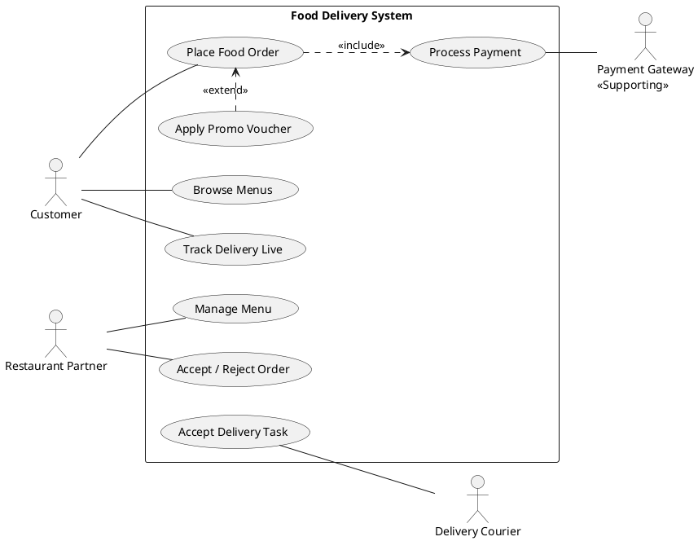

</div>
<div class="puml-diagram-col">

<div class="puml-title">渲染產出之架構圖：</div>

<div class="diagram-wrapper">
  
</div>

</div>
</div>

<!--
這是 AI 依據我們的結構化提示詞所產生的使用案例模型。

左側是簡潔精確的 PlantUML 代碼。請注意宣告式語法如何清晰界定參與者、系統邊界方框與使用案例橢圓。
關鍵關聯性：下單 (Place Food Order) 透過虛線箭頭與雙角括號包含 (include) 處理付款 (Process Payment)，而套用優惠券 (Apply Promo Voucher) 則延伸 (extend) 下單流程。

右側是編譯後的視覺化架構圖。注意左右邊界的角色分工：左側為主要參與者（消費者與餐廳店家），右側為支援系統與外部角色（金流閘道與外送員）。

總結這張投影片，請記住這個核心觀念：結構化的提示詞能引導 AI 產出合規的 PlantUML 代碼，並精準編譯為符合工業標準的使用案例圖。
-->
---
### 課堂活動：使用 AI 演進使用案例 (雙人動手實作)

<div class="discussion-columns">
  <div class="discussion-text">

  **動手實作實驗：變更業務需求並審核 AI 產出 (4 分鐘)**
  - **1. 在使用案例提示詞中加入一項新需求功能：**
    - *預約定時下單：* 允許 `顧客` 預約未來特定時段的外送服務。
    - *線上即時客服：* 建立 `顧客` 與 `客服人員` 或 `外送員` 的即時對談。
    - *揪團共同訂餐：* 允許多位使用者將餐點加入同一筆匯總購物車。
  - **2. 要求 AI 重新生成：** 提示 LLM 更新對應的 PlantUML 使用案例代碼。
  - **3. 渲染並嚴格審查：** 貼入 [PlantText](https://www.planttext.com) 渲染並審查：
    - AI 是否將外部系統/金流閘道保持在系統邊界**矩形之外**？
    - AI 是否正確區分**核心必經步驟** (`<<include>>`) 與**可選延伸功能** (`<<extend>>`)？
    - AI 是否成功避開了點擊按鈕等微觀 UI 反模式（例如：避免出現「點擊確認」）？

  </div>
  <div class="discussion-logo">
    
  </div>
</div>

<!--
現在讓我們進行一場雙人動手實作實驗！與旁邊的同學組隊，即時檢驗 AI 在需求塑模上的精確度。

請看螢幕上的實驗指引：
取用我們剛才的外送平台使用案例提示詞，並加入一項真實的業務新需求：
選項 A：預約未來特定時期的預約送餐。
選項 B：與外送員或客服團隊的即時文字客服系統。
選項 C：多人共享購物車的揪團訂餐機制。

提示你的 AI 助手更新 PlantUML 使用案例代碼，並貼到 PlantText 進行渲染，然後以架構師的嚴格眼光審查產出：
外部第三方服務是否嚴格保持在邊界方框外？
AI 有沒有正確分辨強制包含與可選延伸？
AI 有沒有掉入把按鈕點擊畫成使用案例的經典反模式陷阱？

總結這張投影片，請記住這個核心觀念：透過變更需求來挑戰 AI，能立即檢驗它是否真正理解系統邊界與使用者目標的本質。
-->
---
<!-- _class: lead -->
<!-- header: '4.4 結構與類別模型' -->

# **4.4 結構與領域類別模型**

> "類別圖是軟體系統的靜態建築骨幹；如果骨幹畸形，任何敏捷開發都拯救不了系統的崩潰。"

<!--
我們現在進入第 4.4 節：結構與領域類別模型。

如果說使用案例回答了系統「為了什麼目標而存在」，那麼類別圖回答的就是系統「由哪些靜態實體與資料結構所構成」。
類別圖是物件導向程式碼與關聯式資料庫結構的直接投影。

在這一節中，我們將深入剖析類別的三格解剖結構、可見度資訊隱藏、多種關聯性、整體與部分（聚合與組合）的生命週期相依，以及如何引導 AI 精確產生領域模型。

總結這張投影片，請記住這個核心觀念：類別圖奠定系統靜態物件導向架構與資料實體的堅實骨幹。
-->
---
<!-- _class: full-image-slide -->

<div class="centered-image">
  
</div>

<!--
請看這幅精緻的架構對照圖：『UML 類別圖解剖學』。

請大家特別看畫面右側這棟建築物的等角透視圖。把軟體想像成一棟實體建築：
中間貫穿上下的核心支柱是 System Core（系統核心基礎）；
旁邊設有伺服器機櫃的房間是 Data Vault（資料庫管理者 DatabaseManager）；
屋頂架著天線的通訊管制室是 Communications Hub（網路控制器 NetworkController）；
而正面的大門和落地窗則是 Public Interface（使用者介面 UserInterface）。

再看右下角的對照小表格：
類別就像一個個房間，屬性就像房間的尺寸規格，操作就是房間裡發生的活動，而關聯線就是連接各個房間的走廊與通道！
左邊則是這棟建築物在 UML 類別圖中的標準表示法。

總結這張投影片，請記住這個核心觀念：類別圖就像建築藍圖：類別是房間，而關聯線就是連接彼此的走廊。
-->
---
<!-- _class: title-image-slide -->

## 藍圖 vs. 實例：物件導向設計基石 (Blueprint vs. Instance)

<div class="image-wrapper">
  
</div>

<!--
這是物件導向設計最根本的核心概念：『藍圖 (Blueprint) vs. 實例 (Instance)』。

請看左邊小狗的工程藍圖：這就是**類別 (Class)**。它定義了所有狗共有的特徵：屬性有顏色、名字與品種；行為有搖尾巴、吠叫與吃東西。但請記住：你沒辦法撫摸一張藍圖！

再看右邊貼著的三張拍立得照片：這些才是**物件 (Objects)**！
分別是黃金獵犬 Buddy、巴哥犬 Max，以及貴賓犬 Daisy。
牠們都是從同一張狗藍圖打造出來的，但每一隻在現實世界中都擁有各自具體的顏色、名字與狀態。

總結這張投影片，請記住這個核心觀念：類別是設計藍圖，而物件是依據藍圖在記憶體中生成的真實實例。
-->
---
<!-- _class: title-image-slide -->

### 類別塑模的三大層次透視 (Three Perspectives)

<div class="image-wrapper">
  
</div>

<!--
請看頂部橫跨時間軸的三個欄位：類別塑模的三重視角。

左邊是**概念視角 (Conceptual)**：專案剛開始時，我們只關心大方向的業務名詞，畫出簡單的 User 與 Product 方塊，不涉及任何技術細節。

中間是**規格視角 (Specification)**：進入軟體分析階段，我們開始定義介面與型態（例如 login 方法與 price 屬性），定義軟體『做什麼』，但不綁定特定程式語言。

右邊是**實作視角 (Implementation)**：進入工程編碼階段，直接對齊真實程式碼，精確宣告 private 欄位、參數資料型態與方法實作。

總結這張投影片，請記住這個核心觀念：隨著開發進程推進，類別圖會從高階概念演進為軟體規格，最終落實為精確的程式碼結構。
-->
---
<!-- _class: title-image-slide -->

## UML 類別方塊解剖學 (Anatomy of the Class Box)

<div class="image-wrapper">
  
</div>

<!--
請看畫面中央立體拆解的三層三明治：『類別方塊解剖學』。每個標準的 UML 類別方塊都包含這三層結構：

最上層（藍色）：**類別名稱 (Class Name)**。這是唯一必填的資訊，例如 Customer。

中間層（橘色）：**屬性 (Attributes)**。用來儲存物件狀態，例如 name 與 email。請注意冒號後面標註的是資料型態，如 `name : String`。

最下層（紅色）：**操作與方法 (Operations / Methods)**。代表類別能對外提供的服務，例如 `calculateTotal()`。冒號後面則是回傳型態 `: double`。

總結這張投影片，請記住這個核心觀念：標準類別方塊由三層構成：頂層名稱、中層屬性資料，以及底層操作方法。
-->
---
<!-- _class: title-image-slide -->

### 成員可見度矩陣 (+, -, #, ~)

<div class="image-wrapper">
  
</div>

<!--
我們如何在類別中保護資料？請看『可見度矩陣 (Visibility Matrix)』。在 UML 中，我們在屬性或方法前方加上前綴符號：

第一行：**加號 (+)** 代表 **Public（公開）**。任何人都可以直接存取，對應右邊程式碼 `public String name;`。

第二行：**減號 (-)** 代表 **Private（私有）**。只有該類別內部才能存取。在良好的物件導向設計中，屬性幾乎都應該是私有的！

第三行：**井號 (#)** 代表 **Protected（保護）**。外部無法存取，但繼承它的子類別可以使用。

對照右側的程式碼範例，這些符號完美對應大家熟悉的 Java 或 C++ 關鍵字！

總結這張投影片，請記住這個核心觀念：屬性一律私有使用減號 (-)，公開服務使用加號 (+)，繼承保護使用井號 (#)。
-->
---
<!-- _class: title-image-slide -->

## 類別關聯分類學 (Taxonomy of Relationships)

<div class="image-wrapper">
  
</div>

<!--
請看橫跨畫面頂部的藍色光譜橫尺：『關聯光譜 (Taxonomy of Relationships)』。它呈現了類別之間從最鬆散到最緊密的四種結構強度：

最左端是**依賴 (Dependency)**：Class A 僅短暫借用 Class B（例如作為方法參數），彼此毫無擁有權。

往右是**普通關聯 (Association)**：兩個類別彼此認識並持有參考，例如顧客關聯到訂單。

再往右是**聚合 (Aggregation)**：弱整體關係，但部分可以獨立存活，例如圖書館擁有藏書。

最右端是**組合 (Composition) 與泛化繼承**：最緊密的生死關係。在組合中，整體消亡，部分隨之連帶毀滅；在繼承中，子類別嚴格繼承父類別的所有特徵。

總結這張投影片，請記住這個核心觀念：類別關聯橫跨連續光譜：從左側短暫借用的依賴，到右側生死相依的組合。
-->
---
<!-- _class: title-image-slide -->

### UML 連接線與箭頭速查表 (Connector Cheat Sheet)

<div class="image-wrapper">
  
</div>

<!--
這是一張讓大家考試與實作隨身必備的『連線符號速查表』。四個象限區分得非常清楚：

左上象限：**繼承 (Inheritance)**。實線搭配空心三角箭頭指向父類別，代表『是一種 (is-a)』。

右上象限：**實現 (Realization)**。虛線搭配空心三角箭頭指向介面，代表具體類別實現了介面合約。

左下象限：**依賴 (Dependency)**。虛線搭配開放箭頭，代表短暫的『uses 使用』關係。

右下象限：**一般關聯 (Simple Association)**。一條單純的實線，代表兩個對等類別之間的結構連線。

總結這張投影片，請記住這個核心觀念：精確分辨實線與虛線、空心三角與開放箭頭，避免傳達錯誤的依賴語義。
-->
---
<!-- _class: title-image-slide -->

### 生命週期診斷：聚合 vs. 組合 (Aggregation vs. Composition)

<div class="image-wrapper">
  
</div>

<!--
現在深入探討軟體工程最經典的考題：聚合 (Aggregation) 與組合 (Composition) 的差異。

請看左欄：**聚合**使用**空心菱形 (◇)**。代表『包含 (part-of)』，但生命週期各自獨立。看生活比喻：球隊與球員。如果球隊今天解散了，球員依然存在，可以加入其他球隊！

再看右欄：**組合**使用**實心菱形 (◆)**。這是嚴格的強包含與生命週期綁定！看生活比喻：房子與房間。如果房子被怪手拆毀了，房間也就隨之不復存在！

在程式碼中，組合代表刪除主訂單時，必須連帶 cascade-delete 所有的訂單明細。

總結這張投影片，請記住這個核心觀念：部分能獨立存活用空心菱形（聚合）；部分隨整體連帶銷毀用實心菱形（組合）。
-->
---
<!-- _class: title-image-slide -->

### 基數、多元性與業務約束 (Cardinality & Constraints)

<div class="image-wrapper">
  
</div>

<!--
請看畫面上由藍色與紅色方塊組成的網絡圖：『重數與約束 (Cardinality & Constraints)』。在 UML 中，重數規範了物件之間可連接的數量上限與下限：

左邊：**一對一 (1 to 1)**。一個藍方塊剛好對應一個紅方塊，就像一位國民持有一本護照。

中間：**一對多 (1 to *)**。一個藍方塊分支連到多個紅方塊，就像一位顧客可以建立多筆訂單。

右邊：**多對多 (* to *)**。藍紅方塊交織成網狀，就像學生選修多門課程，而每門課程也有多名學生。

標註這些數字能指導工程師在資料庫中該設計外鍵還是中繼關聯表！

總結這張投影片，請記住這個核心觀念：重數明確定義了類別實例在執行期能夠相互關聯的數量邊界。
-->
---
<!-- _class: title-image-slide -->

## 語法化為系統：電商訂單領域模型 (The Order Model)

<div class="image-wrapper">
  
</div>

<!--
現在讓我們看看所有觀念如何融合在真實的電商訂單模型中！跟著藍色對話框逐一看：

左下角對話框：注意 `- customerID`。減號代表這是**私有屬性 (Private)**，保護客戶機密資料。

上方中央對話框：Customer 與 Order 之間的連線標有 1 與 *，這是**一對多關聯 (One-to-Many)**。

右上角對話框：Order 伸出紅色實心菱形指向 LineItem，這是**組合 (Composition)**！訂單一旦刪除，所有購買明細連帶銷毀。

右下角對話框：虛線空心箭頭指向 PaymentInterface，這是**介面實現 (Realization)**。

這張圖優雅示範了可見度、重數、組合與介面合約的完整結合！

總結這張投影片，請記住這個核心觀念：一張成熟的類別圖能完整整合可見度、重數、組合依賴與介面合約。
-->
---
<!-- _class: v-center -->

### 觀念檢核：電商訂單模型判讀 (Model Comprehension)

<div class="split64">
<div class="left" style="display: flex; justify-content: center; align-items: center;">


</div>
<div class="right" style="font-size: 17px; line-height: 1.4;">

**根據右方類別圖，判斷下列 7 個陳述為「正確 (Correct)」或「錯誤 (Incorrect)」：**

- **1.** 顧客 "Nick" 在系統中可以同時擁有 3 筆訂單。
- **2.** 若一筆 `Order` 被刪除，其所屬的 `LineItem` (訂單明細) 仍會完整保留。
- **3.** 系統中可以存在未關聯任何 `Customer` 的孤立 `Order`。
- **4.** 外部類別可直接透過 `customer.customerID` 存取並修改其值。
- **5.** `LineItem` 實現了 `PaymentInterface` 所定義的介面操作。
- **6.** 新註冊的顧客帳號在系統中可以暫時擁有 0 筆訂單。
- **7.** 一筆 `Order` 可以同時由兩位不同的 `Customer` 共同擁有。

</div>
</div>

<!--
現在讓我們透過七個判讀題目，檢核大家對這張電商類別圖的掌握度：

1. 顧客 "Nick" 在系統中可以同時擁有 3 筆訂單。
   -> 【正確 (Correct)】：Order 端的重數為 '*'，代表零到多筆訂單。

2. 若一筆 Order 被刪除，其所屬的 LineItem 明細仍會完整保留。
   -> 【錯誤 (Incorrect)】：Order 端的實心菱形 ('◆') 代表組合 (Composition)，明細生命週期完全依附於訂單，主體刪除時連帶銷毀。

3. 系統中可以存在未關聯任何 Customer 的孤立 Order。
   -> 【錯誤 (Incorrect)】：Customer 端的重數嚴格標註為 '1'，每筆訂單必須隸屬於一位顧客。

4. 外部類別可直接透過 customer.customerID 存取並修改其值。
   -> 【錯誤 (Incorrect)】：屬性前綴 '-' 代表私有 (Private)，外部必須透過公開方法存取以落實封裝。

5. LineItem 實現了 PaymentInterface 所定義的介面操作。
   -> 【正確 (Correct)】：虛線搭配空心三角形箭頭代表介面實現 (Realization)。

6. 新註冊的顧客帳號在系統中可以暫時擁有 0 筆訂單。
   -> 【正確 (Correct)】：重數 '*' 包含 0..*，因此剛註冊尚未下單的顧客完全合法。

7. 一筆 Order 可以同時由兩位不同的 Customer 共同擁有。
   -> 【錯誤 (Incorrect)】：Customer 端的重數為 '1'，代表一筆訂單只能歸屬於單一顧客，不支援跨顧客共有。

總結這張投影片，請記住這個核心觀念：判讀類別圖時，必須同時精準解讀重數邊界、生命週期強弱、屬性可見度符號與介面實現連線。
-->
---
## 觀念檢核測驗 4 (CCQ 4)
<!-- id: ase-ch04-ccq4 -->
<div class="ccq-columns">
<div class="ccq-text">

在 UML 類別圖中，若類別 A 與類別 B 之間繪製了一條連線，且在 A 端標示了**實心黑色菱形 (Filled Black Diamond, ◆)** 指向 B，這代表什麼架構意涵？

- **A.** 類別 B 繼承了類別 A 的所有公開方法與屬性。
- **B.** 類別 A 組合 (Composition) 了類別 B；當物件 A 被銷毀時，所屬的物件 B 也將連帶被銷毀。
- **C.** 類別 A 與類別 B 是鬆散聚合關係，B 擁有獨立生存的生命週期。
- **D.** 類別 A 與類別 B 之間僅存在執行期的暫時性依賴。

</div>
<div class="ccq-logo">
    <a href="https://nlhsueh.github.io/nickedupocket/#/student/ase-ch04-ccq4" target="_blank"></a>
  </div>
</div>

<!--
讓我們透過觀念檢核測驗 4 來檢視對類別關聯性的掌握。

題目問的是：實心黑色菱形 (◆) 代表什麼？
檢視選項：
選項 A 是泛化繼承（空心三角箭頭）。
選項 C 是聚合關係（空心菱形 ◇）。
選項 D 是依賴關係（虛線箭頭）。

正確答案是 B！實心黑色菱形代表強整體組合關係 (Composition)，部分與整體共存亡，具備 cascade-delete 的生命週期約束。

總結這張投影片，請記住這個核心觀念：實心菱形代表生命週期緊密綁定的組合關係 (Composition)，整體消亡則部分連帶銷毀。
-->
---
<!-- _class: v-center -->

### 觀念診斷練習：棒球比賽類別模型錯誤審查

<div class="split64">
<div class="left" style="display: flex; justify-content: center; align-items: center;">


</div>
<div class="right" style="font-size: 17px; line-height: 1.4;">

**審查這份學生繪製的棒球比賽類別圖草稿：**
你能從**封裝、繼承、關係（重數與組合）**中找出重大架構謬誤嗎？

- **1. 整體與部分生命週期（聚合 vs. 組合）：**
  - 為何 `BaseballGame` 與 `Team` 使用實心菱形 (`◆`)？若刪除一場比賽紀錄，球隊會跟著消滅嗎？
- **2. 繼承 vs. 成員關聯（is-a vs. has-a）：**
  - 觀察 `Player` 與 `Team` 的連線，`Team <|-- Player` 在觀念上有何嚴重本質錯誤？
- **3. 重數與邊界限制（Multiplicity）：**
  - 一場比賽能只有 `1` 個球隊與 `1` 個局數嗎？棒球比賽實際上有幾隊、幾局？
- **4. 封裝性與職責分配（Encapsulation & Operations）：**
  - 為何所有屬性都是公開的 (`+`)？`pitchBall()` 該放在比賽還是球員？勝負該由單一球隊決定嗎？

</div>
</div>

<!--
讓我們對這份棒球比賽類別圖草稿進行嚴格的架構診斷。圖中存在四大核心設計謬誤：

謬誤一（毀滅性組合 vs. 聚合關係）：
BaseballGame 使用實心菱形 (組合) 連接 Team 且重數為 1。這意味著一旦這場比賽被取消或刪除，參賽的球隊（如洋基隊）將在系統中連帶被實體刪除！球隊只是「參與」比賽，應為聚合或一般關聯；且一場棒球比賽必定有 2 支球隊（主隊與客隊），重數絕非 1。

謬誤二（濫用繼承：is-a vs. has-a）：
圖中 Player 指向 Team 的實線空心三角形代表繼承（Player extends Team）。球員「不是」一種球隊，球員是球隊的「成員」（has-a / part-of）。用繼承表達從屬關係是極為經典的初學者反模式，應改為 Team 聚合 Player。

謬誤三（局數遺漏組合且重數錯誤）：
BaseballGame 與 Inning (局數) 使用一般關聯且重數標註為 1。然而某場比賽的特定局數（如第 4 局）離開該比賽便毫無存在意義，應使用實心菱形 (組合)；且正規棒球比賽由 9 局組成（或 1..*），重數絕非 1。

謬誤四（封裝崩壞與職責錯置）：
首先，所有屬性皆標註為 '+' (公開)，徹底破壞物件導向封裝原則。其次，pitchBall() (投球) 錯置於 BaseballGame 而非 Player (投手)。第三，局數得分硬編碼在比賽類別中 (inning1_score...)，而非封裝於 Inning 實體。最後，calculateWinner() 寫在 Team 內部——單一球隊無權私自判定誰是贏家，勝負判斷應是 BaseballGame 的職責！

總結這張投影片，請記住這個核心觀念：嚴格區分 is-a 與 has-a、部分獨立於主體時切勿使用組合、貫徹私有屬性封裝，並將方法指派給持有資料的合適實體。
-->

---

<!-- _class: v-center -->

### 觀念診斷解答：棒球比賽類別模型錯誤剖析與修正

<div class="split64">
<div class="left" style="display: flex; justify-content: center; align-items: center;">

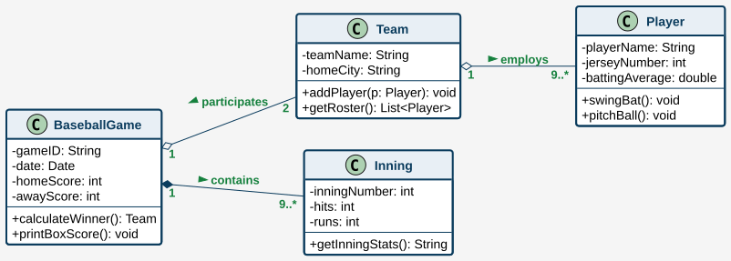

</div>
<div class="right" style="font-size: 17px; line-height: 1.4;">

**審查診斷結論與架構修正指引：**

- **1. 組合 vs. 聚合生命週期 (`BaseballGame` & `Team`)：**
  - 實心菱形 (`◆`) 會使比賽刪除時球隊跟著消滅！球隊獨立於比賽存在，應改用聚合 (`◇`)。一場比賽應有 `2` 隊與 `9` 局。
- **2. 濫用繼承 (is-a vs. has-a)：**
  - `Team <|-- Player` 嚴重錯誤。球員是球隊的成員 (has-a)，絕非球隊的一種 (is-a)。
- **3. 破壞封裝與職責分配錯亂：**
  - 屬性應設為私有 (`-`)。`pitchBall()` 應由球員/投手執行。單一球隊不可片面決定 `calculateWinner()`，應由比賽協調判定。

</div>
</div>

<!--
這是棒球比賽類別圖四大設計謬誤的標準解答：

第一，不可濫用組合關係。實心菱形代表生命週期連帶銷毀，刪除一場比賽絕不能把洋基隊消滅，應使用弱生命週期的聚合或關聯。此外，棒球比賽重數必須是 2 隊與 9 局。

第二，繼承代表 is-a 本質關係。球員不是球隊的一種，而是球隊擁有的成員，屬於 has-a 關聯。

第三，落實封裝與職責分工。公開屬性會破壞物件完整性；投球是球員的行為；勝負必須由裁判或比賽整體判定，單一球隊不能自己宣告獲勝。

總結這張投影片，請記住這個核心觀念：嚴格區分 is-a 與 has-a、防止毀滅性組合、將方法分配給持有資料的合適類別。
-->
---
## AI 輔助指南：類別塑模 (Class Modeling)

- **1. 角色設定與抽象層次界定 (Persona & Abstraction Level)：**
  - 指示 AI 扮演「物件導向領域模型專家 (Domain Architect)」，並明確要求產出「概念層領域模型」或「實作層設計模型」。
- **2. 整體與部分關聯性嚴格紀律 (Whole-Part Coupling)：**
  - **組合 (實心菱形, ◆)：** 強制 AI 辨識具備生命週期相依性的實體（整體銷毀時，部分連帶 cascade-delete）。
  - **聚合 (空心菱形, ◇)：** 要求部分具備獨立生命週期時使用空心菱形。
  - **禁止濫用泛型關聯：** 嚴禁 AI 全部使用普通實線 (實線) 敷衍了事，必須為每條線指明重數與關聯型態。
- **3. 封裝與雙向重數規範：**
  - 要求強制加上可見度符號（屬性私有 `-`、操作公開 `+`、型態宣告）。
  - 關聯線「兩端」皆必須明確標註重數（如 `1` 對 `1..*`）。
- **4. 架構師人工審查清單 (Verification Checklist)：**
  - [ ] AI 是否誤將繼承 (三角繼承箭頭) 當成組合 (實心菱形)？
  - [ ] 敏感屬性（密碼、金流 token、地址）是否皆設定為 `- private`？
  - [ ] 關聯重數在業務邏輯上是否合理（例如訂單能否包含 0 個項目）？

<!--
在引導 AI 產生類別圖時，最需要警惕的是「關係平庸化」與「繼承濫用」。

如果沒有給予嚴格提示，LLM 經常把所有實體都用普通實線連起來，遺失重要的組合與聚合語義；或者隨意濫用繼承，造成深層脆弱的類別階層。

透過提示詞強制規範組合 (Composition) 與聚合 (Aggregation) 的判定準則，並要求在兩端標註重數與可見度，架構師就能在數秒內獲得符合 Domain-Driven Design (DDD) 標準的乾淨模型。

總結這張投影片，請記住這個核心觀念：嚴格約束整體/部分生命週期、雙向重數與屬性封裝，防止 AI 產出淺薄失真的類別圖。
-->
---

<!-- _class: v-center -->

### AI 提示詞範例：外送平台領域類別模型

<div class="two-columns">
<div>

**1. 角色設定與任務指令：**
```text
你是一位資深物件導向軟體架構師。
請根據以下領域需求，產出符合 DDD 規範的
標準 PlantUML 類別圖 (Class Diagram)。
```

**2. 塑模約束條件：**
- `Order` 與 `OrderItem` 必須使用**組合關聯** (實心菱形，重數 `1` 對 `1..*`)。
- `Order` 與 `Courier` 必須使用**聚合關聯** (空心菱形，重數 `*` 對 `0..1`)。
- `OrderItem` 關聯至 `MenuItem` (`*` 對 `1`)。
- 所有屬性均須宣告 `- private` 與明確資料型態。
- 標註關鍵業務方法 (`+ calculateTotal()`, `+ assignCourier()`)。

</div>
<div>

**3. 輸入需求敘述 (Requirements Statement)：**
> 「系統包含 **Customer**（顧客 ID、姓名、Email、電話、外送地址）。
> **Restaurant**（餐廳 ID、店名、地址）擁有多項 **MenuItem**（餐點 ID、品名、單價、是否在庫）。
> 顧客可建立多筆 **Order**。每筆訂單包含訂單編號、狀態列舉 (OrderStatus: 待處理、製作中、配送中、已送達)、下單時間與總金額。
> 一筆訂單由一個或多個 **OrderItem**（購買數量、購買當下單價、小計）組成；若訂單被取消刪除，其明細項目必須連帶銷毀。
> 平台可指派一位 **Courier**（外送員 ID、姓名、電話、交通工具）負責配送訂單。
> 訂單透過 **PaymentProcessor** 介面委託第三方完成扣款。」

</div>
</div>

<!--
請看這份專為外送平台領域類別圖設計的 AI 提示詞範例。

在左側約束條件中，我們明確寫下了領域規則的骨幹：
Order 與 OrderItem 必須是組合（因為訂單明細脫離訂單就毫無存在的實體意義）；Order 與 Courier 則是聚合（因為外送員在完成配送後依然獨立存在於系統中）。

在右側，我們提供清晰的領域名詞與欄位定義。

這樣的提示詞結構能確保生成出來的 PlantUML 代碼具備極高的工程成熟度。

總結這張投影片，請記住這個核心觀念：在 Prompt 中直接指明實體的生命週期從屬性，能有效引導 AI 產出具備高內聚、低耦合的優雅類別圖。
-->
---

<!-- _class: v-center -->
<!-- header: '4.4 結構與領域類別模型' -->

### AI 生成之 PlantUML 與架構圖：外送平台領域類別模型

<div class="puml-output-grid">
<div class="puml-code-col">

<div class="puml-title">AI 生成之 PlantUML 規格代碼：</div>

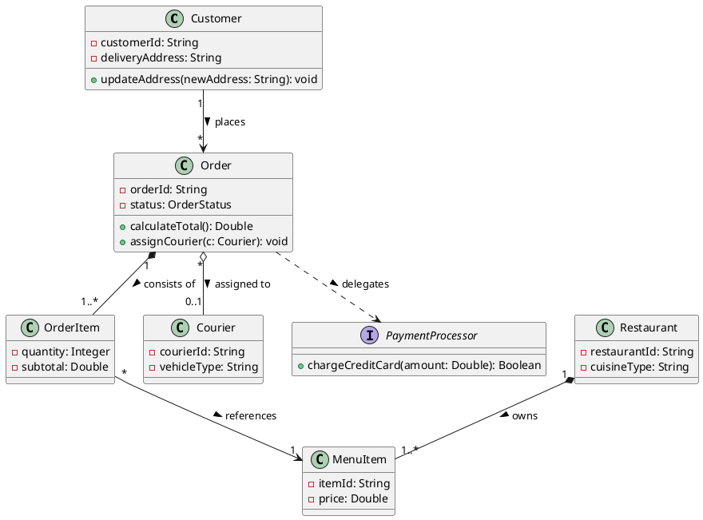

</div>
<div class="puml-diagram-col">

<div class="puml-title">渲染產出之架構圖：</div>

<div class="diagram-wrapper">
  
</div>

</div>
</div>

<!--
這是根據我們的架構提示詞所產生的正式類別模型。

請看左側的代碼：AI 忠實遵循了我們的塑模約束：
第一，訂單 (Order) 與訂單明細 (OrderItem) 之間使用實心菱形 (實心菱形) 建立嚴格的複合 (Composition) 關係。
第二，訂單與外送員 (Courier) 之間使用空心菱形 (空心菱形) 建立弱耦合的聚合 (Aggregation) 關係。
第三，屬性採用減號 (-) 設為私有封裝，並清楚宣告了 calculateTotal 與 assignCourier 等業務操作方法。

右側的架構圖精準傳遞了這些物件導向語意：實心菱形代表生命週期強綁定，空心菱形代表可獨立存在的引用，兩端皆標有嚴謹的重數 (Multiplicity)。

總結這張投影片，請記住這個核心觀念：在提示詞中明確規範 UML 連接線語法符號，能確保 AI 產出數學上語意精確的類別關聯。
-->
---
### 課堂活動：使用 AI 演進領域類別架構 (雙人動手實作)

<div class="discussion-columns">
  <div class="discussion-text">

  **動手實作實驗：變更架構規則並審核 AI 產出 (4 分鐘)**
  - **1. 在類別模型提示詞中加入一項新架構規則：**
    - *多店合併結帳：* 允許單一筆訂單跨多家餐廳合併下單結帳。
    - *外送小費與評價：* 增加對外送員的直接打賞與雙向服務評分。
    - *VIP 會員訂閱制：* 導入每月固定扣款的會員免運機制。
  - **2. 要求 AI 重新生成：** 提示 LLM 更新對應的 PlantUML 類別模型代碼。
  - **3. 渲染並嚴格審查：** 貼入 [PlantText](https://www.planttext.com) 渲染並審查：
    - AI 是否正確維持**複合 (◆)** 與**聚合 (◇)** 的生命週期差異？
    - **重數 (Multiplicities)** 是否合乎邏輯（跨店訂單需不需要拆分子訂單）？
    - 關鍵欄位是否維持 `- private` 封裝，且未被設計模式過度複雜化？

  </div>
  <div class="discussion-logo">
    
  </div>
</div>

<!--
現在讓我們進入類別塑模的雙人動手實作！請與夥伴共同測試 AI 如何因應領域實體關聯的擴充與演化。

請看螢幕上的指引：
在我們剛才的外送領域類別提示詞中，加入一項新的業務架構規則：
選項 A：允許一筆訂單同時打包多家不同餐廳的餐點（跨店外送）。
選項 B：增加對外送員的小費機制與顧客/外送員雙向評分。
選項 C：導入 VIP 會員訂閱免運機制。

要求 AI 產出更新後的 PlantUML 類別圖，貼入 PlantText 渲染，並以架構師的標準嚴厲審核：
在跨店情境下，AI 有沒有把訂單拆解為子訂單 (SubOrder)？重數是否有正確更新？
小費與評分實體的關聯是否正確指派給 Courier？
所有敏感欄位是否依然保持 `-` 私有封裝？

總結這張投影片，請記住這個核心觀念：當業務規則演進時，以明確的架構約束引導 AI，並批判性地審核 UML 結構的語意完整度。
-->
---
<!-- _class: lead -->
<!-- header: '4.5 互動與循序圖模型' -->

# **4.5 互動與循序圖模型**

> "時間是軟體架構中最嚴苛的考驗；循序圖將時間的流逝具象化為可驗證的訊息契約。"

<!--
歡迎進入第 4.5 節：互動與循序圖模型！

在前面幾節，我們透過使用案例了解了使用者想要什麼，也透過類別圖認識了系統有哪些靜態結構。但真實的軟體是隨時間動態運行的。當使用者點擊畫面按鈕時，物件之間會互相傳遞訊息、呼叫方法並回傳結果。

在這一節中，我們將學習 UML 循序圖 (Sequence Diagram)。我們將深入探討生命線、訊息箭頭、if-else 與迴圈等複合片段，並學習如何透過 AI 提示詞產出清晰嚴謹的循序模型。

總結這張投影片，請記住這個核心觀念：循序圖沿時間軸展示物件之間如何透過傳遞訊息相互協同，落實具體情境劇本。
-->
---
<!-- _class: full-image-slide -->

<div class="centered-image">
  
</div>

<!--
請看這張 3D 視角的循序圖架構藍圖。

畫面頂部有三個參與者：第一個是 Actor 1 使用者 (User)，第二個是 Actor 2 系統介面 (System Interface)，第三個是 Actor 3 後端服務 (Backend Service)。從每個角色向下延伸的垂直虛線就是生命線。

請沿著橘色箭頭由上往下追蹤編號 1 到 5 的訊息順序：
第一步，使用者向系統介面提交請求 (SubmitRequest)。
第二步，系統介面進行自我資料驗證 (Validate)。
第三步，介面向後端服務發起交易處理 (ProcessTransaction)。
第四步，後端更新資料庫並確認成功 (UpdateDatabase)。
第五步，系統介面將確認結果回傳給使用者 (ReturnResponse)。

這張圖非常直觀：誰跟誰通訊、先後順序為何，一目了然！

總結這張投影片，請記住這個核心觀念：循序圖以時間先後為序，為使用者、前端介面與後端服務之間的訊息交流提供清晰的動態藍圖。
-->
---
<!-- _class: title-image-slide -->

## 靜態結構 vs. 動態協作 (Static Structure vs. Dynamic Collaboration)

<div class="image-wrapper">
  
</div>

<!--
這張圖清楚對比了靜態模型與動態模型的核心差異。

左側藍色區塊是「靜態類別模型」：展示 Class A、Class B 與 Class C 之間的關聯。它告訴我們系統中有哪些零件、誰認識誰，但完全沒有時間或執行順序的概念。

右側金色區塊則是「動態循序模型」：展示兩個真正正在運行的物件 Object X 與 Object Y。此時時間順序至關重要！請看橘色箭頭：1 請求動作、2 處理資料、3 發送回應、4 確認完成。

打個比方：類別圖就像一張道路地圖，告訴你有哪幾條公路；而循序圖則是車輛在道路上依序行駛的即時導航記錄。

總結這張投影片，請記住這個核心觀念：類別圖定義系統的靜態結構，循序圖則展現系統隨時間推進的動態運作行為。
-->
---
<!-- _class: title-image-slide -->

## 從需求到程式碼管線：由故事至實作 (Requirements-to-Code Pipeline)

<div class="image-wrapper">
  
</div>

<!--
我們如何從模糊的客戶需求一步步走到精確的程式碼？這條四步驟管線展示了完整的工程脈絡。

第一步是 Use Case（使用案例）：定義系統在宏觀層面要做什麼，例如「預訂飯店房間」。
第二步是 Scenario（情境劇本）：展開該使用案例的具體路徑，例如「正常扣款成功的晴天路徑」或「信用卡過期的雨天路徑」。

第三步是 Sequence Diagram（循序圖）：針對特定劇本，精確畫出跨時間的物件、方法呼叫與訊息傳遞。
第四步是 Implementation（代碼實作）：工程師看著循序圖編寫類別與方法，完全不需盲目通靈猜測！

請看底部的金句：劇本是系統的一次執行過程，而循序圖正是這趟過程的精確架構藍圖。

總結這張投影片，請記住這個核心觀念：從高階使用案例拆解出具體劇本，再繪製循序圖分配物件職責，最後落實為高品質代碼。
-->
---
### 上游模型支撐：使用案例、場景描述與類別模型

<div class="three-columns">
<div class="card">
<h3>1. 使用案例模型</h3>
<div style="text-align: center; margin: 10px 0;">
  
</div>
<ul>
<li><b>主要參與者：</b> 顧客 (Customer)</li>
<li><b>次要參與者：</b> 第三方金流 (Payment Gateway)</li>
<li><b>系統邊界：</b> 訂單系統 (Order System)</li>
<li><b>業務目標：</b> 結帳並購買購物車餐點</li>
</ul>
</div>
<div class="card">
<h3>2. 使用案例情境描述</h3>
<div style="font-size: 15px; line-height: 1.42;">
<p style="margin-bottom: 5px;"><b>UC-01：</b> 結帳送出訂單</p>
<p style="margin-bottom: 5px;"><b>前置條件：</b> 購物車商品已確認且庫存有效</p>
<b>主要成功場景：</b>
<ol style="margin-top: 3px; padding-left: 18px;">
<li>顧客送出結帳並提交付款資訊。</li>
<li>系統驗證訂單項目與品項有效性。</li>
<li>系統向第三方金流請求授權扣款。</li>
<li>金流閘道確認交易並回傳扣款收據。</li>
<li>系統將訂單狀態更新為 <code>PAID</code>。</li>
<li>系統向顧客顯示結帳成功確認頁。</li>
</ol>
<p style="margin-top: 5px; margin-bottom: 0;"><b>後置條件：</b> 訂單狀態持久化儲存為 <code>PAID</code></p>
</div>
</div>
<div class="card">
<h3>3. 設計類別模型</h3>
<div style="text-align: center; margin: 4px 0;">
  
</div>
</div>
</div>

<!--
在深入探討動態循序圖與 Java 程式碼之前，我們先來理解它們是從何而來的。軟體架構絕非憑空捏造，而是沿著三個關鍵上游產出物層層推導落實：

首先，請看卡片 1：使用案例模型。這裡界定了商業情境——主要參與者 Customer 為了達成結帳購買的目標，跨越 Order System 邊界與外部 Payment Gateway 協同通訊。

其次，請看卡片 2：使用案例情境描述。這為我們提供了具體的行為合約與條列劇本：顧客送出結帳、系統驗證、委託金流扣款、取得收據、更新狀態為 PAID，最後回傳確認。

第三，請看卡片 3：設計類別模型。我們如何從結構上實現這些需求？我們分配類別職責：OrderController 作為邊界接收點，OrderService 協調核心商業邏輯 (validate, saveStatus)，PaymentGateway 則提供對外扣款合約介面。

這三個類別在執行期究竟如何隨時間動態傳遞訊息，精準執行情境描述中的每個步驟？讓我們翻到下一頁，看循序圖與對應的 Java 程式碼！

總結這張投影片，請記住這個核心觀念：使用案例界定目標、情境描述規範動態劇本，類別模型則分配靜態結構職責，三者為循序圖奠定堅實基礎。
-->
---
### 互動畫布：程式碼至循序圖映射

<div class="puml-output-grid">
<div class="puml-diagram-col">

<div class="puml-title">UML 循序圖：3 個物件與 7 大事件時序映射</div>

<div class="diagram-wrapper">
  
</div>

</div>
<div class="puml-code-col">

<div class="puml-title">原始程式碼 (Java)：執行時序流程</div>

```java
class OrderService {
    private PaymentGateway gateway;

    // [1] Controller 調用結帳方法
    public OrderResult checkout(String id, double amount) {
        // [2] 內部驗證訂單有效性 (自呼叫)
        boolean ok = this.validate(id); // [3] 回傳 true
        
        // [4] 調用第三方金流扣款
        Receipt receipt = gateway.charge(amount);
        // [5] 金流回傳付款收據
        
        // [6] 將狀態持久化為 PAID (自呼叫)
        this.saveStatus(OrderStatus.PAID);
        
        // [7] 回傳結帳結果給 Controller
        return new OrderResult(true, receipt);
    }
}
```

</div>
</div>

<!--
讓我們看看原始程式碼如何精確映射至 UML 循序圖的兩大核心軸線：

水平軸代表參與互動的 3 個物件實體：OrderController、OrderService 與外部 PaymentGateway。
垂直軸代表時間的流逝，由上往下依序展開 7 大時序事件：

事件 [1]：Controller 呼叫 checkout()，啟動 OrderService 活化條。
事件 [2] 與 [3]：OrderService 執行內部自我呼叫 (Self-call) validate() 驗證商品，完成後釋放嵌套活化條。
事件 [4] 與 [5]：OrderService 向外部 PaymentGateway 發送同步 charge() 訊息，等待金流回傳 Receipt 收據。
事件 [6]：OrderService 再次自我呼叫 saveStatus()，將訂單記錄為 PAID。
事件 [7]：OrderService 沿著虛線返回訊息，將 OrderResult 交付給 Controller。

程式碼中的每一行方法調用與返回值，在循序圖中都有一對一的精確幾何語義！

總結這張投影片，請記住這個核心觀念：循序圖能將程式碼的呼叫堆疊與跨物件依賴，以時間為縱軸做直觀無歧義的可視化映射。
-->
---
<!-- _class: title-image-slide -->

## 結構解剖學：生命線、活化條與時間流 (Structural Anatomy)

<div class="image-wrapper">
  
</div>

<!--
這是循序圖的四大核心解剖構造。請對照左側圖解與右側的四張卡片。

第一是頂部的 Actor（參與者）：代表啟動互動的外部使用者或外部系統角色。
第二是垂直向下的虛線 Lifeline（生命線）：代表該物件在時間軸上的存在週期。

第三是黃色長條形矩形 Focus of Control（控制焦點，又稱啟動條 Activation Bar）：代表該物件當前正積極執行程式代碼的區間，從上方的啟動時間 (Initiation Time) 一直持續到下方的完成時間 (Completion Time)。

第四是 Event（事件）：指時間軸上某個發生的時間點，例如一條訊息到達或發出的瞬間。事件觸發時，啟動條便隨之展開！

總結這張投影片，請記住這個核心觀念：參與者發起事件，生命線代表存在，而啟動條則標記物件正在積極執行運算的期間。
-->
---
<!-- _class: title-image-slide -->

### 訊息矩陣：同步呼叫、非同步訊號與生命週期 (Messaging Matrix)

<div class="image-wrapper">
  
</div>

<!--
這張訊息矩陣表是循序圖最重要的語法對照表，不同的箭頭在程式代碼中代表截然不同的行為。

第一，Call（呼叫）：實心線搭配實心箭頭，代表呼叫另一個物件的方法。
第二，Return（返回）：虛線搭配開放式箭頭，代表將執行結果傳回給呼叫者。

第三，Self（自我呼叫）：彎曲箭頭繞回同一個物件，代表呼叫自己內部的輔助方法。
第四，Recursive（遞迴呼叫）：在原本的啟動條上堆疊一個新的啟動條，代表方法自我遞迴。

第五，Create（建立）：虛線箭頭直接指向一個新的物件方塊，代表在運行時 new 出新物件。
第六，Destroy（消滅）：箭頭末端加上粗體叉叉 X，代表釋放記憶體或結束生命週期。

最後，Duration 標記兩個時間點之間的時長。

總結這張投影片，請記住這個核心觀念：實線實心箭頭代表方法呼叫，虛線代表資料返回或建立新物件，叉叉 X 則標記生命週期的終結。
-->
---
<!-- _class: title-image-slide -->

### UML 2.0 複合片段：alt, opt, loop, par

<div class="image-wrapper">
  
</div>

<!--
在早期的 UML 中，一張循序圖只能畫單一線性流程。一旦遇到 if-else 條件分支，工程師就必須畫兩張完全獨立的圖！

為了解決這個痛點，UML 2.0 推出了「複合片段 (Combined Fragments)」。它就像一個外框，框住特定區間的生命線來表達條件判斷或重複迴圈。

請觀察這個框架的三個關鍵部位：
第一，左上角的黃色標籤是「片段運算子 (Operator)」，例如圖中的 `alt` 代表互斥的條件分支。
第二，方括號內的 `[condition == true]` 是「守衛條件 (Guard)」，說明觸發該路徑的條件。
第三，中間的水平虛線是「分支分隔線 (Divider)」，上半部是條件成立時的執行路徑，下半部則是 else 的備用路徑。

總結這張投影片，請記住這個核心觀念：複合片段透過運算子標籤、守衛條件與分隔線，在單一圖表中優雅表達條件分支與迴圈邏輯。
-->
---
<!-- _class: title-image-slide -->

### 複合片段運算子轉換至正式程式碼邏輯 (Fragment Operators to Code)

<div class="image-wrapper">
  
</div>

<!--
這張對照表非常實用，它展示了 UML 片段運算子如何直接對應到程式代碼！

請特別注意前兩個運算子，這是初學者最常混淆的地方：
`alt` 代表 Alternatives（互斥分支）：只能執行其中一條路徑，直接對應到 `if ... else if ... else`。
`opt` 代表 Optional（可選路徑）：只有在條件成立時才執行，沒有 else 分支，對應到單純的 `if` 敘述。

接下來：
`loop` 代表重複迴圈，對應到 `while` 或 `for`。
`par` 代表 Parallel（平行並發），對應到多執行緒或非同步 async 任務。
`region` 是臨界區，對應到 Mutex 鎖或同步區塊。
`neg` 標記非法或錯誤路徑，對應到丟出 Exception。
`ref` 代表引用另一張循序圖，就像呼叫外部函式一樣，能避免單張圖過於龐大。

總結這張投影片，請記住這個核心觀念：`alt` 對應 if-else，`opt` 對應單純 if，`loop` 對應迴圈，而 `ref` 則能模組化分解複雜圖形。
-->
---
<!-- _class: title-image-slide -->

### 實戰案例研討：飯店客房預訂互動流程 (Hotel Reservation Flow)

<div class="image-wrapper">
  
</div>

<!--
讓我們透過一個真實的「飯店訂房」案例，來看所有觀念如何串聯運作。

頂部有四條生命線：使用者 User、前端預訂視窗 ReservationWindow、後端訂房系統 BookingSystem，以及 Reservation 預訂實體物件。

跟隨時間軸由上往下看：
首先，使用者在視窗點擊 `initiate()` 開始訂房。
接著，視窗呼叫 BookingSystem 的 `checkAvailability()` 查詢空房狀態。

這時進入了 `alt` 條件複合片段：
上半部如果 `[room available]` 有空房，BookingSystem 發送 create 虛線箭頭，建立全新的 Reservation 物件！
下半部如果是 `[else]` 沒有空房，BookingSystem 則透過虛線返回 `bookingFailed()` 失敗訊息給視窗。

成功與失敗分支在一張圖中表達得清清楚楚。

總結這張投影片，請記住這個核心觀念：真實的循序圖協調介面視窗、後端系統、實體建立與異常分支，構成嚴謹的互動防護網。
-->
---
## 觀念檢核測驗 5 (CCQ 5)
<!-- id: ase-ch04-ccq5 -->
<div class="ccq-columns">
<div class="ccq-text">

在 BCE (Boundary-Control-Entity) 架構循序圖中，當顧客透過結帳前端點擊『確認下單』按鈕時，該事件應先傳遞給哪一種類型的物件處理？

- **A.** 直接傳遞給 `Order` 實體物件立即寫入資料庫
- **B.** 直接呼叫 `PaymentGatewayAPI` 邊界物件立即刷卡扣款
- **C.** 傳遞給 `OrderController` 控制物件協調業務邏輯驗證與調用
- **D.** 直接傳遞給 `Restaurant` 實體物件確認餐廳接單

</div>
<div class="ccq-logo">
    <a href="https://nlhsueh.github.io/nickedupocket/#/student/ase-ch04-ccq5" target="_blank"></a>
  </div>
</div>

<!--
讓我們透過觀念檢核測驗 5 來檢驗對 BCE 架構職責分工的掌握。請掃描 QR Code 或點選連結進行線上作答。

題目詢問：當顧客點擊結帳介面的按鈕時，這個請求應該先交給誰？

我們逐一審視選項：
選項 A 主張直接交給 Order 實體物件，這嚴重違反了分層架構：前端介面絕對不能直接讀寫資料庫實體！
選項 B 主張直接呼叫金流服務，跳過內部驗證與訂單處理，是不合理的捷徑。
選項 D 也是前端直接碰觸實體物件。

正確答案是 C！請求必須先送到 `OrderController` 控制物件。由它負責驗證購物車、檢查庫存、協調金流授權，最後才建立訂單實體。

總結這張投影片，請記住這個核心觀念：控制物件負責統籌業務邏輯，是介於邊界介面與資料實體之間的核心中樞。
-->
---
<!-- _class: v-center -->

### 觀念診斷練習：找出這張循序圖的 4 大致命錯誤！

<div class="split64">
<div class="left" style="display: flex; justify-content: center; align-items: center;">


</div>
<div class="right" style="font-size: 17px; line-height: 1.4;">

**審查這份學生繪製的客房預訂循序圖草稿：**
你能從**架構分層、訊息語意、時序因果**中找出 4 大致命錯誤嗎？

- **1. 架構分層與封裝破壞 (Layering Violation)：**
  - 檢視 `BookingUI` 與 `MySQL_DB`，訊息 `[2]` (`SELECT ...`) 違反了什麼基本架構原則？
- **2. 同步 vs. 非同步訊息語意 (Message Syntax)：**
  - 觀察訊息 `[6]`，既然 `[5]` 是同步阻塞呼叫，回傳值為何誤用非同步虛線開放箭頭？
- **3. 複合片段 (`alt`) 守衛條件邏輯錯亂 (Invalid Guards)：**
  - 檢查 `alt` 方塊中的守衛條件：`[Room Available]` 與 `[else Payment Successful]` 有何荒謬之處？
- **4. 時序因果矛盾與活化條懸掛 (Chronological Paradox)：**
  - 訊息 `[7]`、`[8]` 的「預訂成功」與 `[9]` 的「寫入資料庫」順序為何顛倒？DB 活化條有閉合嗎？

</div>
</div>

<!--
讓我們對這份學生繪製的循序圖草稿進行嚴格的架構診斷。圖中存在四大核心設計反模式：

謬誤一（架構分層與封裝嚴重破壞）：
請看訊息 [2]：BookingUI 竟然繞過業務控制器，直接向 MySQL_DB 發送原始 SQL 查詢（SELECT * FROM rooms...）！在三層架構與 BCE 模式中，表現層邊界絕不可直接存取底層資料庫，這造成嚴重高耦合與安全隱患。

謬誤二（複合片段分支守衛條件荒謬錯亂）：
檢視 alt 複合片段：上方分支守衛條件為 [Room Available] (尚有空房)，下方 else 分支守衛卻寫成 [else Payment Successful] (付款成功)！alt 區塊內部的分支必須針對同一個業務命題進行互斥判定（例如 [尚有空房] 與 [else / 房間已滿]）。將「是否有空房」與「付款成功」混在同一個 alt 分支是邏輯完全錯亂。

謬誤三（時序因果矛盾：尚未寫入就宣稱成功）：
觀察訊息 [7] 與 [8]：BookingUI 竟然在訊息 [9] 的資料庫寫入執行之前，就提早向顧客顯示「預訂成功」！若後續資料庫寫入超時或失敗，顧客已被誤導訂單成立，造成災難性的資料不一致。資料必須先完成持久化驗收，方能回傳成功。

謬誤四（生命線活化條未正確閉合）：
訊息 [9] 觸發 MySQL_DB 活化條後，直到循序圖結束都未出現 deactivation，活化條懸掛在半空中。物件的執行期生命區間必須嚴謹閉合。

總結這張投影片，請記住這個核心觀念：循序圖必須嚴守架構分層、嚴謹對稱複合片段分支條件、維持正向時序因果，並完整閉合生命線活化條。
-->

---

<!-- _class: v-center -->

### 觀念診斷解答：循序圖 4 大致命錯誤剖析與修正

<div class="split64">
<div class="left" style="display: flex; justify-content: center; align-items: center;">

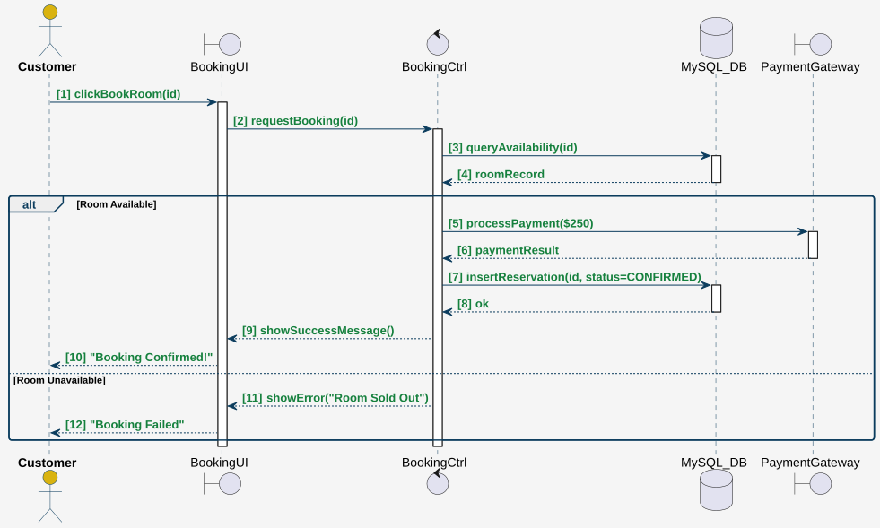

</div>
<div class="right" style="font-size: 17px; line-height: 1.4;">

**審查診斷結論與架構修正指引：**

- **1. 違反架構分層原則 (Layering Violation)：**
  - 前端 `BookingUI` 絕不可越權直接向 `MySQL_DB` 下達 SQL 查詢，必須經由 Controller/Service 業務邏輯層中介。
- **2. 複合片段 (`alt`) 守衛邏輯錯亂 (Invalid Guards)：**
  - `alt` 分支必須針對同一條件互斥 (如 `[Room Available]` 與 `[else / Unavailable]`)，不可混雜付款狀態。
- **3. 時序因果顛倒與過早確認 (Chronological Paradox)：**
  - 資料庫寫入 (`INSERT INTO bookings`) 必須成功後，才可向使用者顯示預訂成功訊息。
- **4. 活化條懸掛遺漏閉合 (Dangling Activation)：**
  - `MySQL_DB` 的活化長條在操作完成後必須立即終止閉合，不可無限延伸。

</div>
</div>

<!--
這是客房預訂循序圖四大架構謬誤的標準解答：

第一，嚴守三層式與 BCE 分層架構。前端畫面直接對資料庫下 SQL 會造成高度耦合與安全漏洞，必須由業務服務層進行協調。

第二，alt 複合片段的分支守衛條件必須在同一維度上嚴格互斥。將客房可用與付款成功混在同一個 else，邏輯完全斷裂。

第三，時序因果必須符合真實物理世界。在資料寫入資料庫之前就通知客人訂房成功，一旦寫入失敗將造成嚴重的資料不一致與客訴。

第四，活化條精確代表執行生命週期，查詢結束後必須立即閉合返回。

總結這張投影片，請記住這個核心觀念：分層呼叫不越權、alt 守衛互斥對齊、持久化先行於成功確認、活化條精準閉合。
-->
---
## AI 輔助指南：循序圖塑模 (Sequence Modeling)

- **1. 角色設定與架構模式約束 (Persona & Architecture Pattern)：**
  - 指示 AI 扮演「分散式系統與 API 整合架構師」。
  - **強制引入 BCE 模式：** 嚴格要求區分 Boundary (介面)、Control (業務邏輯)、Entity (資料庫實體)，嚴禁 UI 直接繞過控制器存取資料庫。
- **2. 訊息語法與複合片段嚴格規範：**
  - **同步呼叫 (`->`) 與返回 (`-->`)：** 強制要求對稱繪製返回虛線與回傳型態，避免啟動條無限懸空。
  - **非同步派發 (`->>`)：** 對於背景事件排隊、推播通知，強制使用開放式箭頭。
  - **複合片段 (`alt`)：** 強制要求 AI 必須針對業務失敗情境（如扣款失敗、超時）繪製 `alt [成功] else [失敗]` 區塊。
- **3. 架構師人工審查清單 (Verification Checklist)：**
  - [ ] 是否存在違背分層架構的「越級呼叫」（例如前端 UI 直接調用資料庫實體）？
  - [ ] `alt` 片段中是否具備互斥的守衛條件 `[guard]`？
  - [ ] 啟動條 (activate/deactivate) 的生命區間是否與方法呼叫週期完全吻合？

<!--
引導 AI 產生循序圖時，最容易出現的架構硬傷是「越級呼叫」與「只畫 Happy Path」。

如果缺乏架構約束，LLM 經常讓前端直接向資料庫查詢，破壞三層分層架構；而且它極度傾向只畫成功路徑，完全忽略真實世界隨處可見的網路超時與驗證失敗。

透過在提示詞中強制要求遵守 BCE 模式，並強制命令它用 alt 複合片段處理異常分支，就能產出生產級別的嚴謹循序圖。

總結這張投影片，請記住這個核心觀念：透過 BCE 分層約束、對稱返回箭頭與 alt 異常分支，確保 AI 產出的循序圖具備生產級強韌度。
-->
---

<!-- _class: v-center -->

### AI 提示詞範例：外送平台結帳循序模型

<div class="two-columns">
<div>

**1. 角色設定與任務指令：**
```text
你是一位資深分散式系統後端架構師。
請根據以下結帳情境，採用 BCE 模式
產出標準 PlantUML 循序圖 (Sequence Diagram)。
```

**2. 塑模約束條件：**
- 宣告生命線職責：
  - `boundary CheckoutUI as ":結帳介面"`
  - `control OrderCtrl as ":訂單控制器"`
  - `boundary StripeAPI as ":金流服務"`
  - `entity OrderEntity as ":訂單實體"`
  - `queue KitchenQueue as ":廚房事件佇列"`
- 必須使用 `alt` 片段處理 `[扣款成功]` 與 `[扣款失敗]`。
- 廚房通知必須使用非同步箭頭 `->>` 發送至事件佇列。

</div>
<div>

**3. 輸入需求敘述 (Requirements Statement)：**
> 「顧客在 **CheckoutUI** 點擊『立即付款』按鈕。
> **CheckoutUI** 轉發 `submitOrder(購物車清單, 支付憑據)` 至 **OrderCtrl**。
> **OrderCtrl** 呼叫 **StripeAPI** 執行 `authorizeCharge(金額, 憑據)`。
> 若授權成功：
> 1. StripeAPI 回傳授權碼 `chargeToken`。
> 2. OrderCtrl 呼叫 **OrderEntity** 建立持久化訂單紀錄（狀態設為 `PLACED`）。
> 3. OrderCtrl 以非同步訊息發布 `orderPlacedEvent` 至 **KitchenQueue**。
> 4. OrderCtrl 回傳 `orderSuccess(訂單編號)` 給 CheckoutUI。
> 若授權失敗：
> 1. StripeAPI 回傳 `declinedError`。
> 2. OrderCtrl 記錄失敗日誌，不建立訂單，直接回傳 `paymentFailed()`。」

</div>
</div>

<!--
這是一份引導 AI 產出 BCE 外送結帳循序圖的經典提示詞。

請看左側的約束條件：
我們不僅要求宣告 BCE 生命線角色，還特別指定了廚房事件佇列為非同步佇列。
同時，我們明確要求使用 alt 複合片段包辦成功與失敗兩條路徑。

右側的需求文字條理分明，步驟清晰。

這樣的提示詞送進 LLM，產出的循序圖絕對是架構評審會議上可以直接過關的高水準作品。

總結這張投影片，請記住這個核心觀念：明確定義 BCE 生命線角色與 alt 異常處理分支，能引導 AI 產出符合微服務實務的循序圖。
-->
---

<!-- _class: v-center -->
<!-- header: '4.5 互動與循序圖模型' -->

### AI 生成之 PlantUML 與架構圖：外送平台結帳循序模型

<div class="puml-output-grid">
<div class="puml-code-col">

<div class="puml-title">AI 生成之 PlantUML 規格代碼：</div>

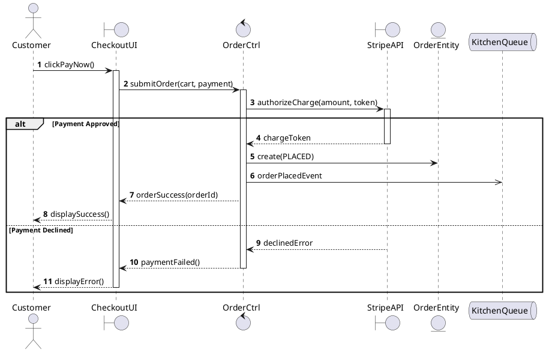

</div>
<div class="puml-diagram-col">

<div class="puml-title">渲染產出之架構圖：</div>

<div class="diagram-wrapper">
  
</div>

</div>
</div>

<!--
這是 AI 依據 BCE 模式自動生成的結帳循序圖。

請看左側的 PlantUML 代碼：
生命線被賦予明確的角色型態：參與者 Customer、邊界 CheckoutUI、控制器 OrderCtrl、第三方邊界 StripeAPI、實體 OrderEntity 與非同步佇列 KitchenQueue。
透過 alt 組合片段清晰劃分付款成功 (Payment Approved) 與扣款失敗 (Payment Declined) 兩大互斥分支。
使用非同步箭頭 (非同步雙箭頭) 將 orderPlacedEvent 事件派發至廚房佇列，避免阻塞前端請求。

右側的循序圖呈現了清晰的啟用長條 (Activation Bars) 與回傳流程，防止競態條件發生，並確保 UI 與後端資料實體徹底解耦。

總結這張投影片，請記住這個核心觀念：在提示詞中強制要求 BCE 刻板型態與控制片段，能確保 AI 產出具備生產級強健性的動態互動藍圖。
-->
---
### 課堂活動：使用 AI 演進循序模型 (雙人動手實作)

<div class="discussion-columns">
  <div class="discussion-text">

  **動手實作實驗：變更動態時序並審核 AI 產出 (4 分鐘)**
  - **1. 在結帳流程中加入一個極端邊界情境 (Edge Case)：**
    - *金流逾時 (Gateway Timeout)：* 外部付款閘道超過 5 秒未回應（觸發重試或補償）。
    - *拆分付款 (Split Payment)：* 允許顧客使用電子錢包點數折抵搭配信用卡差額支付。
    - *庫存售罄 (Out of Stock)：* 在付款授權過程中，餐廳剛好宣告餐點售罄。
  - **2. 要求 AI 重新生成：** 提示 LLM 更新對應的 PlantUML 循序圖代碼。
  - **3. 渲染並嚴格審查：** 貼入 [PlantText](https://www.planttext.com) 渲染並審查：
    - AI 是否維護**分層架構**（UI → 控制器），杜絕 UI 越權直連資料庫？
    - **成功與異常分支** (`alt`) 是否皆具備完整明確的回傳訊息？
    - 非同步後台通知（如通知廚房）是否確實與同步付款解耦？

  </div>
  <div class="discussion-logo">
    
  </div>
</div>

<!--
現在讓我們進行循序塑模的雙人動手實驗！與夥伴一起測試 AI 如何處理分散式系統中的極端異常流程。

請看螢幕指引：
在剛才的外送結帳循序提示詞中，加入一個真實世界的非同步邊界情境：
選項 A：外部金流閘道發生連線逾時，5 秒內無回應。
選項 B：混合拆分支付——部分由錢包餘額扣除，差額刷信用卡。
選項 C：餐點在庫存最後一刻被其他人搶購售罄。

要求 AI 生成更新後的循序圖，貼入 PlantText 渲染並審視：
AI 有沒有維持嚴謹的分層架構？有沒有發生 UI 繞過控制器直接寫入資料庫的低級反模式？
異常分支是否明確標註了防護條件與回傳值？
非同步推播有沒有正確使用非同步訊息符號？

總結這張投影片，請記住這個核心觀念：透過故障分支與逾時情境考驗 AI，能確保你的動態架構具備應對真實分散式系統挑戰的強韌度。
-->
---
<!-- _class: lead -->
<!-- header: '4.6 流程與活動圖模型' -->

# **4.6 流程與活動圖模型**

> "複雜的業務流程就像多條河流匯聚；活動圖能讓我們精確掌控每一道支流的並行與匯合。"

<!--
歡迎進入第 4.6 節：流程與活動圖模型！

在上一節中，循序圖向我們展示了單一情境劇本下物件之間的訊息往來。但在真實的現代軟體中，系統經常需要處理跨部門的商業工作流程、多方角色的責任交接，以及背景同時執行的平行任務。

UML 活動圖 (Activity Diagram) 正是為工作流程而生。在這一節中，我們將學習動作節點、決策菱形、平行分岔與結合棒，以及劃分責任的泳道。

總結這張投影片，請記住這個核心觀念：活動圖專門用於塑模動態業務流程、條件決策邏輯，以及多執行緒平行並行任務。
-->

---

<!-- _class: title-image-slide -->

## 視覺化邏輯：超越靜態結構的動態流程 (Visual Logic)

<div class="image-wrapper">
  
</div>

<!--
請看這張投影片呈現的強烈對比：『文字混亂 (The Chaos)』與『視覺清晰 (The Clarity)』。

左邊是純文字敘述的商業流程：冗長密集的一大段話，描述拆開包裹、初始化系統、建立檔案、編輯內容與存檔。面對密密麻麻的文字牆，團隊成員極容易遺漏關鍵步驟或產生理解分歧。

再看右邊：四個簡潔的方塊與清晰的箭頭，一目了然地標示出「拆開包裹 → 建立檔案 → 鍵入文件 → 儲存檔案」。

這正是我們繪製活動圖的原因：視覺化邏輯能將抽象模糊的敘述，轉化為直覺明瞭、一眼即可看懂的工程藍圖。

總結這張投影片，請記住這個核心觀念：活動圖用直觀清晰的步驟箭頭，徹底取代容易產生盲點與歧義的冗長文字牆。
-->

---

<!-- _class: v-center -->

### 採用活動圖塑模的三大觸發契機 (Three Triggers)

<div class="split64">
<div class="left" style="display: flex; justify-content: center; align-items: center;">


</div>
<div class="right" style="font-size: 17px; line-height: 1.4;">

**何時該動手繪製 UML 活動圖？**

- **1. 跨領域商業工作流 (Business Workflows)：**
  - **端到端價值鏈：** 串聯協調多個獨立的使用案例，達成完整的端到端業務目標。
  - **團隊認知對齊：** 讓業務利害關係人與工程團隊對整體運作全貌達成共識。
- **2. 複雜內部協同調度 (Complex Coordination)：**
  - **單一功能深度分析：** 追蹤單一使用案例內部重疊的多項作業、分支路徑與精確時序。
  - **並行任務管理：** 安全調度多執行緒平行任務，避免競態條件。
- **3. 情境狀態映射 (Contextual Mapping)：**
  - **前後置條件契約：** 明確界定動作執行前的必備前提，以及完成後的狀態保證。
- **核心價值：** 活動圖是連結高階使用案例與底層程式碼實作的最佳思維橋樑。

</div>
</div>

<!--
我們什麼時候該畫活動圖？請看這個環形圖中的三大觸發情境：

第一是「商業工作流程 (Business Workflows)」：當我們需要串聯協調多個不同的使用案例，來達成更大的業務目標時。
第二是「複雜協同調度 (Complex Coordination)」：當單一使用案例內部包含多個重疊作業，需要精確控制時序與並行時。
第三是「情境狀態映射 (Contextual Mapping)」：當我們必須精確界定每個步驟執行前的前置條件 (Pre-conditions) 與執行後的後置條件 (Post-conditions) 時。

總結這張投影片，請記住這個核心觀念：在跨使用案例的工作流、重疊的複雜調度，以及需要驗證前後置條件時，最適合採用活動圖。
-->
---
<!-- _class: v-center -->

### 傳統流程圖 vs. UML 活動圖核心差異 (Flowcharts vs. Activity Diagrams)

| 塑模能力 / 核心維度 | 傳統流程圖 (Flowchart) | UML 活動圖 (Activity Diagram) |
| :--- | :---: | :---: |
| **循序執行邏輯 (Sequential Logic)** | ✓ | ✓ |
| **條件分支判定 (Conditional Splits)** | ✓ | ✓ |
| **平行並行處理 (Parallel / Concurrency)** | ✗ | ✓ |
| **角色責任劃分 (Swimlanes / Partitions)** | ✗ | ✓ |
| **資料物件狀態流 (Object Flow & States)** | ✗ | ✓ |

<!--
很多人常問：『我們從小就會畫流程圖，為什麼還要學 UML 活動圖？』請看這張比較表。

前兩行：循序邏輯與條件分支，傳統流程圖和活動圖都能做到（都打勾）。
但請看下面三行，傳統流程圖全部被打上了灰色叉叉：
傳統流程圖無法表達「平行並行 (Concurrency)」——也就是兩件事同時發生；
傳統流程圖缺乏「泳道 (Swimlanes)」——無法指派每個動作的負責人或服務；
傳統流程圖也無法追蹤「資料物件」的狀態轉變。

UML 活動圖五個項目全部支援，這就是為什麼大型企業軟體必須使用活動圖！

總結這張投影片，請記住這個核心觀念：活動圖超越傳統流程圖，提供並行多執行緒、責任泳道與資料物件流等工業級能力。
-->
---
<!-- _class: title-image-slide -->

## 系統流程核心語彙：起點、動作與終點 (Core Vocabulary)

<div class="image-wrapper">
  
</div>

<!--
這是活動圖的四大核心詞彙。請對照畫面中央的圖形與四張卡片：

第一，最左側的實心黑色圓點是「初始節點 (Initial Node)」：代表整個流程被點燃的觸發起點。
第二，實線箭頭是「控制流 (Control Flow)」：指引執行權如何依序前進。

第三，中間的圓角矩形是「動作節點 (Action)」：代表使用者或系統執行的單一具體任務。
第四，最右側的雙同心圓靶心是「終止節點 (Activity Final Node)」：代表所有執行緒全部停止，流程正式結束。

總結這張投影片，請記住這個核心觀念：流程始於初始實心點，沿著控制箭頭穿過圓角動作方塊，最終抵達雙圓靶心結束。
-->
---
<!-- _class: v-center -->

### 條件分支邏輯：判定與合併節點 (Decision & Merge)

<div class="split64">
<div class="left" style="display: flex; justify-content: center; align-items: center;">


</div>
<div class="right" style="font-size: 17px; line-height: 1.4;">

**工作流程中的互斥條件路徑管理：**

- **決策節點 (上方菱形 ◇)：**
  - **條件分支分流點：** 評估外出控制流上的守衛條件（例如 `[需要圖片？ / 是]` vs. `[否]`）。
  - **嚴格互斥性：** 執行期根據布林條件判定，**恰好只有一條分支**會取得執行權。
- **合併節點 (下方菱形 ◇)：**
  - **替代路徑重新匯合：** 將互斥的分支重新收攏至單一控制流（如匯合後執行 `儲存檔案`）。
  - **無需同步等待：** **不等待**多個標記到達；哪一條分支先完成，就直接放行往下繼續。
- **核心要訣：** 菱形專門處理 **if-else** 互斥選擇，安全地切分並重聚邏輯路徑。

</div>
</div>

<!--
我們來看條件分支邏輯。請觀察圖中的兩個菱形：

上方第一個菱形是「決策節點 (Decision Node)」：它提出問題「需要圖片嗎？」。如果 Yes，走左邊進行開圖與貼圖；如果 No，直接走右邊繞過。決策節點根據條件「嚴格二選一」。

下方第二個菱形是「合併節點 (Merge Node)」：它將兩條互斥的分支重新匯合，接續執行儲存檔案。請特別注意：合併節點「不需要等待兩邊都完成」，因為原本就只會走其中一條路，哪一邊到了就直接往下走！

總結這張投影片，請記住這個核心觀念：決策菱形依守衛條件進行互斥分流，合併菱形則安全地將替代路徑重新收攏。
-->
---
<!-- _class: v-center -->

### 並行協作處理：分支與結合節點 (Fork & Join)

<div class="split64">
<div class="left" style="display: flex; justify-content: center; align-items: center;">


</div>
<div class="right" style="font-size: 17px; line-height: 1.4;">

**編排多執行緒平行任務與同步屏障：**

- **分岔節點 (上方粗黑橫棒 ▬)：**
  - **1 對多並行分流：** 接收單一輸入控制流，將其切分為**多條平行同時執行的執行緒**。
  - **同時並發執行：** `處理請款` 與 `備貨寄送` 同步展開，彼此互不阻塞。
- **結合節點 (下方粗黑橫棒 ▬)：**
  - **同步等待屏障：** 所有匯入的平行分支皆必須執行完畢，輸出控制流 (`關閉訂單`) 才會放行。
  - **等待保證：** 若請款 1 秒搞定、包裝需 10 秒，請款執行緒會在結合棒前掛起等待，直到兩者齊全。
- **核心要訣：** Fork 啟動平行並發執行緒；Join 擔任屏障，等待所有執行緒全數抵達才放行。

</div>
</div>

<!--
現在我們來看平行並行處理：注意圖中的兩條粗黑橫棒！

當「收到訂單」後，流程遇到了上方的「分岔節點 (Fork Node)」：
這條粗黑橫棒將單一流程切分為兩條同時發生的並行分支——一邊處理請款 (Handle Billing)，另一邊備貨寄送 (Fill & Send)。

再看下方的粗黑橫棒「結合節點 (Join Node)」：
結合棒是一個同步屏障！它會「嚴格等待兩條平行分支全部抵達」，確認帳款處理完且貨物也備妥後，才放行進入「關閉訂單」。若請款一秒搞定，它也會在結合棒前掛起等待，直到包裝完成！

總結這張投影片，請記住這個核心觀念：Fork 粗棒啟動平行並行任務，Join 粗棒則等待所有平行分支全部完成後才繼續前進。
-->
---
<!-- _class: v-center -->

## 多角色責任歸屬困境 (The Multi-Actor Accountability Problem)

<div class="split64">
<div class="left" style="display: flex; justify-content: center; align-items: center;">


</div>
<div class="right" style="font-size: 17px; line-height: 1.4;">

**明確的角色權責劃分消除流程模糊：**

- **核心困境：缺乏界線的流程混亂 (左側)：**
  - **無主任務交織：** 只知道「要做什麼」卻不知道「由誰負責」，流程勢必淪為一團混亂。
  - **責任真空盲點：** 義大利麵般的交錯箭頭，使員工與主管間的交接點模糊，導致工作踢皮球。
- **解法之道：泳道建立責任邊界 (右側)：**
  - **垂直分欄確立權責：** 以清楚的縱向泳道將職責切分為 `員工 (Employee)` 與 `經理 (Manager)`。
  - **精確跨欄交接：** 箭頭跨越泳道即代表一次清晰的責任移交（如員工申請 → 經理審核與撥款）。
- **核心法則：** 泳道將混亂的作業糾纏，轉化為權責清晰、邊界分明的工業級運作骨幹。

</div>
</div>

<!--
這是軟體工程常見的痛點：多方角色的當責模糊問題。

請看左邊「沒有泳道」的情況：七個動作方塊被蜘蛛網般的箭頭糾纏在一起。誰負責審查？誰負責請款？誰通知員工？完全看不出來，一旦出事大家就互相踢皮球。

再看右邊「引入泳道」的成果：我們畫出一條縱向分隔線，左欄是員工 (Employee)，右欄是主管 (Manager)。
責任瞬間清清楚楚：員工負責提交報銷與確認細節；主管負責審查、核准、對帳與撥款。

總結這張投影片，請記住這個核心觀念：泳道將畫布劃分為不同責任欄位，消滅工作交接過程中的職責模糊與推諉。
-->
---
<!-- _class: v-center -->

### 泳道與分割區：明確職責邊界 (Swimlanes & Partitions)

<div class="split64">
<div class="left" style="display: flex; justify-content: center; align-items: center;">


</div>
<div class="right" style="font-size: 17px; line-height: 1.4;">

**實務上的跨角色無縫交接塑模：**

- **角色分區 (泳道 Swimlanes)：**
  - 將動作依執行主體進行群組：左側為 `申請學生 (Applicant)`，右側為 `註冊組長 (Registrar)`。
  - 清晰界定不同組織、部門或子系統間的協同邊界。
- **註冊流程的交接生命週期：**
  - **1. 發起動作：** 申請學生填寫並繳交入學表格 (`Hand in Enrollment Form`)。
  - **2. 跨界審核：** 控制流跨越邊界至註冊組進行資料查驗 (`Inspect Forms` → `Determine Proper Fill`)。
  - **3. 結果通知與回傳：** 註冊組通知學生審核結果 (`Inform Student`)，執行權交還學生以完成繳費 (`Pay Initial Tuition`)。
- **核心要訣：** 每條跨越泳道的分隔線箭頭，都是不同角色或系統模組間最關鍵的介面合約。

</div>
</div>

<!--
讓我們透過一個大學新生報到的例子，來看泳道如何清晰展示跨角色交接。

畫面上劃分出兩個泳道：左邊是學生 (Applicant)，右邊是註冊組 (Registrar)。

請追蹤跨越分隔線的箭頭：
首先，學生填寫報到表單；
接著，箭頭跨越泳道交給註冊組：註冊組檢查表單、確認填寫無誤，並通知學生；
最後，箭頭再跨回學生泳道：學生繳交學雜費。

每次箭頭跨過泳道分界線，就代表一次清清楚楚的跨角色工作交接 (Handoff)。

總結這張投影片，請記住這個核心觀念：跨泳道箭頭直觀呈現不同角色、部門或微服務之間的實體工作交接點。
-->
---
<!-- _class: title-image-slide -->

## 活動圖完整視覺語法分類表 (Visual Taxonomy of Activity Diagrams)

<div class="image-wrapper">
  
</div>

<!--
這是一張活動圖的完整視覺語法全景速查表，結構分為三大欄：

第一欄「參與者 (The Actors)」：泳道與分區，負責將動作歸屬給特定角色或服務。
第二欄「動作與資料 (The Actions)」：包含代表任務的圓角動作節點，以及代表資料實體的直角物件節點。

第三欄「交通指揮官 (The Directors)」：
起點實心圓與終點雙圓圈；
實線控制流與虛線物件流；
菱形的條件決策與合併節點；
以及粗黑棒的並行分岔與同步結合節點。

隨時牢記這張全景表，你就能看懂並繪製任何專業的企業活動圖！

總結這張投影片，請記住這個核心觀念：活動圖由泳道角色、任務物件與控制流節點三大支柱組成，具備完整的動態表達力。
-->
---
<!-- _class: v-center -->

### 統整工作流程模型：泳道、並行與條件邏輯 (Unified Workflow Model)

<div class="split64">
<div class="left" style="display: flex; justify-content: center; align-items: center;">


</div>
<div class="right" style="font-size: 17px; line-height: 1.4;">

**完美融合泳道、平行並行與條件邏輯：**

- **1. 跨角色交接 (Cross-Actor Handoff)：**
  - `角色 A` 發起初始請求 (`Initial Request`)；控制流跨越泳道交由 `角色 B` 進行審查 (`Review Request`)。
- **2. 並行處理與物件資料流 (Concurrency & Object Flow)：**
  - **Fork 分岔棒：** 同步並行觸發 `角色 B` (執行分析) 與 `角色 C` (執行子程序)。
  - **物件狀態轉換：** 角色 B 分析後產出實體資料物件 `[Analysis Report]`。
- **3. 條件重試迴圈與同步等待屏障 (Join Barrier)：**
  - **決策菱形：** 角色 C 依 `[Success?]` 判定；失敗則迴圈重試，成功才放行。
  - **Join 結合棒：** 嚴格等待「分析報告」與「子程序成功」兩者皆抵達，才編譯最終產出並遞交結果。
- **核心要訣：** 將泳道權責、並行執行緒、資料物件與迴圈收攏為工業級標準工程藍圖。

</div>
</div>

<!--
看這張大成之作：所有活動圖核心要素在單一模型中完美融合！

畫面有三個泳道：Actor A、Actor B 與 Actor C。
跟著箭頭走一次完整流程：
1. Actor A 發起初始請求，跨泳道交給 Actor B 審查。
2. Actor B 審查後碰到 Fork 分岔棒，同時啟動兩條平行支流！
在 Actor B，執行分析並產出「分析報告」物件；
在 Actor C，執行子處理。注意那個菱形：如果不成功，會循環重試！
3. 當報告產出且子處理重試成功，兩者在 Actor C 的 Join 結合棒同步！
4. Actor C 產出最終成果，再跨泳道交回 Actor A 交付成果，抵達終點。

泳道分工、並行處理、重試迴圈與物件流動全部井然有序！

總結這張投影片，請記住這個核心觀念：融合泳道責任、Fork/Join 並行與決策重試迴圈，能打造企業級無懈可擊的工作流藍圖。
-->
---
## 觀念檢核測驗 6 (CCQ 6)
<!-- id: ase-ch04-ccq6 -->
<div class="ccq-columns">
<div class="ccq-text">

在 UML 活動圖中，**分岔/結合 (Fork/Join 同步條)** 與 **決策/合併 (Decision/Merge 菱形)** 的核心差異為何？

- **A.** Fork/Join 用於將單一流程切分為多條「並行同時執行」的執行緒；Decision/Merge 則依據布林條件由多條路徑中「嚴格選擇其一 (互斥)」執行。
- **B.** Fork/Join 用於類別繼承；Decision/Merge 用於物件實體化。
- **C.** Fork/Join 只能處理資料流；Decision/Merge 只能處理錯誤例外。
- **D.** Fork/Join 必須等待人工確認；Decision/Merge 由系統計時器自動觸發。

</div>
<div class="ccq-logo">
    <a href="https://nlhsueh.github.io/nickedupocket/#/student/ase-ch04-ccq6" target="_blank"></a>
  </div>
</div>

<!--
讓我們透過觀念檢核測驗 6 來驗收對活動圖並行節點與條件決策差異的理解。請掃描 QR Code 或點選連結進行線上作答。

題目問的是：Fork/Join 同步粗棒與 Decision/Merge 菱形的核心行為差異是什麼？

分析選項：
選項 B 混淆了結構化物件導向概念（繼承與實體化）。
選項 C 與資料流或例外處理無關。
選項 D 憑空捏造了人工確認與計時器的假規則。

選項 A 是正確答案！Fork 粗黑橫棒將單一控制流切分為多條平行並行執行緒，Join 則等待所有並行執行緒皆完成才放行；而 Decision 菱形是根據條件由多條路徑中嚴格二選一或多選一（互斥）。

總結這張投影片，請記住這個核心觀念：Fork/Join 管理多執行緒平行並行任務，而 Decision/Merge 負責互斥條件決策。
-->
---
<!-- _class: v-center -->

### 觀念診斷練習：找出這張活動圖的 4 大致命錯誤！

<div class="split64">
<div class="left" style="display: flex; justify-content: center; align-items: center;">


</div>
<div class="right" style="font-size: 17px; line-height: 1.4;">

**審查這份學生繪製的外送活動流程圖草稿：**
你能從**並行控制、條件分支、泳道責任歸屬**中找出重大流程謬誤嗎？

- **1. 並行分支 vs. 條件判斷 (Fork vs. Decision)：**
  - 仔細觀察 Kitchen 泳道內的 `fork` 分支條，在並行分支上標註 `[Card Payment]` 與 `[Cash on Delivery]` 條件守衛有何本質錯誤？
- **2. 泳道責任與角色錯置 (Swimlane Inversion)：**
  - 檢視 `Customer` 與 `Kitchen` 泳道內的動作，哪些職責被荒謬地顛倒了？
- **3. 懸空流程與終止節點遺漏 (Dangling Flow)：**
  - 追蹤 `[Out of Stock]` 判定後的 `Cancel Order` 路徑，該流程結束時缺少了什麼關鍵節點？
- **4. 流程死鎖與同步語意 (Deadlock Hazard)：**
  - 若將互斥的分支誤用並行結合條 (Join Bar) 匯合，在執行期會引發什麼致命系統問題？

</div>
</div>

<!--
讓我們對這份外送活動流程圖草稿進行嚴格的架構診斷。圖中存在四大核心流程謬誤：

謬誤一（混淆並行分岔與互斥決策分支）：
請看 Kitchen 泳道內的 fork 粗橫條：它分岔出 [Card Payment] 與 [Cash on Delivery] 兩條路徑。在 Fork 上標註條件守衛是嚴重的概念錯誤！Fork 分岔條代表「所有分支同時並行執行」；將互斥的付款方式放在 Fork 上，代表系統會同時進行線上刷卡「並且」準備現金找零！互斥決策必須使用菱形 (Decision Node)，絕不能使用 Fork。

謬誤二（荒謬的泳道職責顛倒）：
檢視泳道分工：廚房泳道內赫然出現「輸入送餐地址與電話」，而顧客泳道內竟然在執行「烹調餐點並包裝便當」！顧客在替餐廳做菜，餐廳在替顧客輸入個人資訊。活動圖的動作節點必須嚴格歸屬於真正負責該行為的參與者泳道。

謬誤三（懸空流程與終止節點遺漏）：
觀察決策菱形判定食材 [Out of Stock] (庫存不足) 後的流程：它執行了 Cancel Order 便在半空中戛然而止！在 UML 活動圖中，任何終止的執行路徑都必須明確連線至活動終止節點 (Activity Final Node，實心黑圓外加圓環) 或控制流終止節點。

謬誤四（錯誤結合引發永久死結）：
若將互斥的決策路徑錯誤地接入 Join Bar (結合條)，由於 Join 必須等待所有輸入路徑皆抵達才會放行，而互斥分支只會走其中一條，導致系統永遠陷入等待，引發死結 (Deadlock)。互斥路徑必須使用 Merge 菱形匯合，Join 條僅限用於並行執行緒的同步。

總結這張投影片，請記住這個核心觀念：Fork 條絕不能加條件守衛、泳道動作必須對齊職責邊界，且每條終止分支皆須閉合於正式終止節點。
-->

---

<!-- _class: v-center -->

### 觀念診斷解答：活動圖 4 大致命錯誤剖析與修正

<div class="split64">
<div class="left" style="display: flex; justify-content: center; align-items: center;">

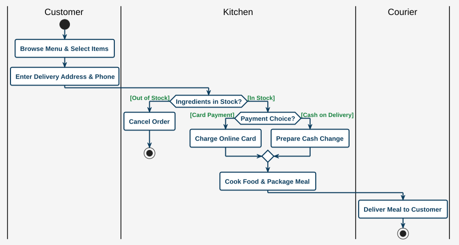

</div>
<div class="right" style="font-size: 17px; line-height: 1.4;">

**審查診斷結論與架構修正指引：**

- **1. 並行分支條 vs. 條件決策菱形 (Fork vs. Decision)：**
  - `fork` 分支條會同時並行觸發所有路徑！信用卡與貨到付款是互斥選項，必須使用決策菱形 (Decision Diamond)。
- **2. 泳道角色責任完全顛倒 (Swimlane Inversion)：**
  - 角色責任配置荒謬：顧客負責輸入地址與電話；廚房負責烹調食物與打包餐點。
- **3. 懸空流程與終止節點遺漏 (Dangling Flow)：**
  - `Cancel Order` 後流程懸空終止，所有結束路徑必須明確連至活動終止節點 (`◉`)。
- **4. 匯合條引發執行期死鎖 (Deadlock Hazard)：**
  - 結合條 (Join Bar) 必須等待所有並行路徑的 Token 全數到達才可推進。將互斥分支接至 Join 會導致系統永久等待而死鎖。

</div>
</div>

<!--
這是活動流程圖四大致命錯誤的標準解答：

第一，絕對不可在 Fork 並行條上加上互斥守衛條件。Fork 條代表多執行緒平行發起，把刷卡與付現掛在 Fork 上，代表系統同時刷卡又同時準備找零！互斥分支必須使用決策菱形。

第二，泳道職責必須符合真實世界。讓顧客自己做菜打包、讓廚房填寫外送地址，是典型的角色錯置。

第三，消除懸空未閉合流程。取消訂單後直接斷在半空中，必須補上雙重圓圈的活動終止節點。

第四，嚴禁互斥路徑接上 Join 結合條。Join 結合條要求「全部輸入條件同時滿足」，互斥分支只會走其中一條，導致 Join 永遠等不到另一條 Token 而引發死鎖。

總結這張投影片，請記住這個核心觀念：互斥用決策菱形、泳道職責分明、所有分支皆須終止、互斥匯合絕不用 Join 條。
-->
---
## AI 輔助指南：活動圖塑模 (Activity Modeling)

- **1. 角色設定與現代語法標準 (Persona & Syntax Standard)：**
  - 指示 AI 扮演「分散式工作流與業務流程架構師 (Workflow Architect)」。
  - **強制要求使用現代語法：** 指定採用 **PlantUML Activity Beta 新版語法** (`start`, `stop`, `if/else`, `fork/fork again/end fork`)，避免過時的舊版標記。
- **2. 泳道當責邊界嚴格分配 (Swimlane Accountability)：**
  - 要求明確定義泳道分區（如 `|顧客|`, `|餐廳廚房|`, `|調度引擎|`, `|外送員|`），動作必須歸屬在對應欄位中。
- **3. 並行與同步工程紀律：**
  - **分岔 (`fork` / `fork again`)：** 明確指示哪些流程必須平行運作（例如廚房做菜與系統配對司機）。
  - **同步結合 (`end fork` / `join`)：** 強制要求在取餐交件前必須同步，防止產生單獨無人外送的競爭條件 (Race Condition)。
- **4. 架構師人工審查清單 (Verification Checklist)：**
  - [ ] 每個 `fork` 是否都有對應的 `end fork` 結合屏障？
  - [ ] 跨泳道的控制流轉移是否合理且具備最小依賴？
  - [ ] 是否存在流程在結合棒無限等待、造成業務死結的缺陷？

<!--
引導 AI 產生活動圖時，最容易出現的破綻是「失去並行能力」與「泳道歸屬混亂」。

如果沒有嚴格限制，AI 經常把應該同時進行的任務畫成前後串聯的單線流水帳，或者畫出一個 Fork 分岔後卻忘了用 Join 棒同步，導致流程遺失同步屏障。

透過指定現代 PlantUML beta 語法、明確宣告四大角色泳道，並明確規定並行分岔與結合點，AI 就能在秒級內產出具備工業級精準度的端到端活動圖。

總結這張投影片，請記住這個核心觀念：約束現代語法、明確劃分泳道並嚴格規範 Fork/Join 配對，能確保 AI 產出零死結的高品質活動圖。
-->
---

<!-- _class: v-center -->

### AI 提示詞範例：外送平台廚房與外送並行活動模型

<div class="two-columns">
<div>

**1. 角色設定與任務指令：**
```text
你是一位分散式工作流程架構師。
請根據以下外送履約流程，使用 PlantUML
activity beta 語法產生具備泳道與並行的活動圖。
```

**2. 塑模約束條件：**
- 建立 4 個泳道：
  - `|顧客|`, `|餐廳廚房|`,
  - `|調度引擎|`, `|外送員|`
- 訂單付款後立即插入 `fork` 並行分岔：
  - 分支一：廚房接單、備餐並包裝餐點。
  - 分支二：調度系統規劃路徑、媒合司機、司機開車抵達店家。
- 使用 `end fork` (結合) 同步「包裝完成」與「司機抵達」。
- 結合後進行交餐配送，驗證 OTP 後 `stop`。

</div>
<div>

**3. 輸入需求敘述 (Requirements Statement)：**
> 「顧客在 **|顧客|** 泳道送出訂單並完成信用卡付款。
> 付款確認後，系統立即啟動兩條平行並行工作流：
> - 在 **|餐廳廚房|** 泳道：廚房列印工單、廚師開始烹調餐點、完成後將食物裝盒並貼上封條。
> - 同時間，在 **|調度引擎|** 泳道：系統計算配送里程、搜尋附近空閒外送員並派送接單推播；在 **|外送員|** 泳道，外送員點擊接單並騎車前往餐廳。
> **同步里程碑：** 外送員抵達櫃檯時，必須等待『餐點包裝完成』且『外送員已經抵店』兩項條件皆達成，才能進行實體交餐。
> 交餐後，外送員騎車前往顧客地址，顧客輸入 OTP 驗證簽收，流程結束。」

</div>
</div>

<!--
這是一份引導 AI 產出多泳道並行活動圖的示範提示詞。

請看左側的約束細節：
我們為 AI 規定了四個清楚的泳道分工，並特別強調了 Fork 分岔與 Join 結合的物理意義。
更重要的是，我們在需求中定義了「同步里程碑」：餐點不能無人取件變冷，司機也不能空手離開。

透過這份 Prompt，AI 會生成非常乾淨的 PlantUML 代碼，完美呈現兩條支流的同時展開與匯合。

總結這張投影片，請記住這個核心觀念：明確定義並行支流與結合里程碑，能讓 AI 正確處理多角色非同步工作流。
-->
---

<!-- _class: v-center -->
<!-- header: '4.6 流程與活動圖模型' -->

### AI 生成之 PlantUML 與架構圖：外送平台活動流程模型

<div class="puml-output-grid">
<div class="puml-code-col">

<div class="puml-title">AI 生成之 PlantUML 規格代碼：</div>

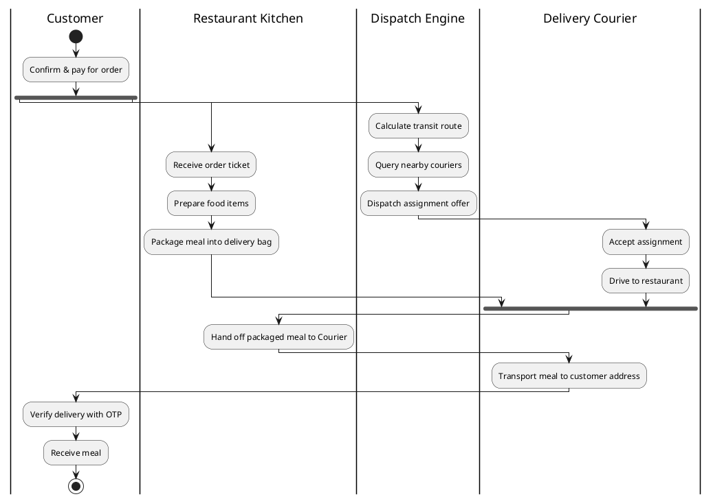

</div>
<div class="puml-diagram-col">

<div class="puml-title">渲染產出之架構圖：</div>

<div class="diagram-wrapper">
  
</div>

</div>
</div>

<!--
這是產出的並行泳道活動圖。

請看左側的代碼：
使用管線符號 (|) 明確定義了四大泳道：消費者、餐廳廚房、派單引擎與外送員。
利用 fork 與 fork again 結構，將廚房備餐與外送員調度精確建模為同時發生的並行分支。
在交接餐點前設置了 end fork 同步長條，強制要求必須「餐點打包完畢」且「外送員已抵達現場」兩項條件皆成立，才能執行交付動作。

右側圖形直觀呈現了各角色的職責泳道邊界與同步節點，邏輯毫無破綻。

總結這張投影片，請記住這個核心觀念：提示 AI 使用明確的泳道名稱與 Fork/Join 同步結構，能精確描繪複雜的非同步跨部門業務流程。
-->
---
### 課堂活動：使用 AI 演進活動工作流 (雙人動手實作)

<div class="discussion-columns">
  <div class="discussion-text">

  **動手實作實驗：變更流程邏輯並審核 AI 產出 (4 分鐘)**
  - **1. 在活動圖提示詞中加入一條流程規則：**
    - *外送員重新派單：* 若原配對之外送員拒絕接單，系統自動重新搜尋媒合下一位司機。
    - *品管出餐檢驗：* 廚房品檢若發現餐點焦掉，必須重新下鍋製作後方能打包。
    - *顧客自取模式：* 若顧客選擇自取，完全略過外送員調度與派送泳道。
  - **2. 要求 AI 重新生成：** 提示 LLM 更新對應的 PlantUML 活動圖代碼。
  - **3. 渲染並嚴格審查：** 貼入 [PlantText](https://www.planttext.com) 渲染並審查：
    - 各項活動步驟是否皆正確坐落於所屬角色的**職責泳道**？
    - **平行分岔 (Fork) 與匯聚 (Join)** 是否成對匹配，杜絕死結 (Deadlock)？
    - **決策菱形 (Decision Diamonds)** 是否標註了完整互斥的轉移防護條件？

  </div>
  <div class="discussion-logo">
    
  </div>
</div>

<!--
現在讓我們進行活動工作流程的雙人動手實作！與夥伴共同測試 AI 如何塑模並行跨部門協同與決策分支。

請看螢幕指引：
在我們剛才的外送活動提示詞中，加入一項新的流程規則：
選項 A：外送員拒單回圈——派單引擎必須回到搜尋狀態，重新調度另一名外送員。
選項 B：廚房出餐品檢——若打包不合格，退回重做。
選項 C：顧客現場自取——完全跳過外送員的調度與行車泳道。

要求 AI 產出更新後的 PlantUML 活動圖，貼入 PlantText 渲染並審查：
每個動作是否都落在正確的當責泳道上？
並行分岔與同步匯聚長條是否有成對閉合？會不會產生永遠等不到事件的死結？
決策菱形的判斷標籤是否清楚明瞭？

總結這張投影片，請記住這個核心觀念：測試 AI 處理重試回圈、退回重做與自取分流的能力，能確保工作流圖真實反映出強健的實務維運流程。
-->
---
<!-- _class: lead -->
<!-- header: '4.7 行為與狀態機模型' -->

# **4.7 行為與狀態機模型**

> "軟體系統在動態執行中的行為，取決於它當下所處的狀態，以及觸發狀態轉移的事件。"

<!--
歡迎來到第 4.7 節：行為與有限狀態機模型 (State Machine Diagrams)。

到目前為止，我們學習了類別圖（靜態結構）、循序圖（物件互動）以及活動圖（業務工作流）。

然而，在許多反應型系統中——例如自動駕駛、智慧空調、或是外送訂單系統——物件的行為取決於它「當前處於什麼狀態」。

在這一節中，我們將深入探討狀態機如何塑模離散狀態、事件觸發、狀態轉移、動作與活動、複合狀態以及系統歷史記憶。

總結這張投影片，請記住這個核心觀念：狀態機模型用來描繪反應型系統如何隨著時間與外部事件，在離散狀態之間精準流轉。
-->
---
<!-- _class: v-center -->

### 相同事件，因狀態不同而產生不同結果 (Same Event Different Results)

<div class="split64">
<div class="left" style="display: flex; justify-content: center; align-items: center;">


</div>
<div class="right" style="font-size: 17px; line-height: 1.4;">

**情境依存的動態行為響應：**

- **相同刺激，截然不同的結果：**
  - 輸入完全相同的觸發事件 (`pressSwitch()`)，卻因系統當前內部狀態而產生互斥結果。
- **內部狀態條件分流：**
  - **當前狀態 = Off (藍色路徑)：** 觸發開關閉合電路，系統轉移至 `On` 狀態。
  - **當前狀態 = On (紅色路徑)：** 觸發開關切斷電路，系統轉移至 `Off` 狀態。
- **核心架構定律：** 反應式系統的運作行為由 `(當前狀態, 輸入事件) → (目標狀態, 動作執行)` 嚴格決定。

</div>
</div>

<!--
請看這個最直觀的經典範例：『相同事件因狀態不同而產生完全不同的結果』。

看看圖中的電燈開關：當外部事件 `pressSwitch()` 發生時，它抵達了代表電燈狀態的菱形。

如果電燈當前處於「關閉狀態 (Off)」，順著藍色路徑，按開關會「打開電燈 (Turn Light On)」。

但如果電燈當前處於「開啟狀態 (On)」，順著紅色路徑，按下完全相同的開關，卻會「關閉電燈 (Turn Light Off)」！

系統的回應不僅僅是由輸入事件決定，而是完全取決於它過去的歷史與當前的狀態。

總結這張投影片，請記住這個核心觀念：在狀態相依系統中，完全相同的事件在不同狀態下會觸發截然不同的行為結果。
-->
---
<!-- _class: v-center -->

### 狀態機在 UML 生態系中的架構定位 (Positioning in UML)

<div class="split64">
<div class="left" style="display: flex; justify-content: center; align-items: center;">


</div>
<div class="right" style="font-size: 17px; line-height: 1.4;">

**行為塑模的兩大互補視角：**

- **循序圖 (跨物件互動時序)：**
  - **塑模範圍：** 多個物件沿著生命線彼此協同互動。
  - **覆蓋度：** 專注追蹤**單一執行場景**（如標準成功路徑或特定例外）。
- **狀態機圖 (單一物件生命週期全貌)：**
  - **塑模範圍：** 聚焦**單一核心實體**（如 `Order` 或 `Connection`）。
  - **覆蓋度：** 窮舉該實體在整個生命週期中**所有可能的狀態、事件與轉移**。
- **架構黃金法則：** 跨模組協議用循序圖；核心實體的狀態約束與不變量用狀態機。

</div>
</div>

<!--
請看狀態機圖在整個 UML 生態系中的戰略定位，特別是對比右邊的循序圖：

右邊的循序圖，追蹤的是「多個協同物件在單一線性情境下的訊息傳遞」。它展示的是特定業務流程下的物件通訊。

左邊的狀態機圖則剛好相反！它將鏡頭拉近至「單一獨立物件（例如一張訂單或一個網路連線）」，完整描摹它一生中面對「所有可能事件與狀態」的全貌。

一句話總結：循序圖看的是「一個情境下的許多物件」，狀態機圖看的是「一個物件的一生所有情境」。

總結這張投影片，請記住這個核心觀念：循序圖描繪多物件在單一情境的互動，狀態機圖則聚焦單一物件跨越所有情境的生命週期。
-->
---
<!-- _class: v-center -->

## 定義狀態：物件生命週期中的時間區間 (State Defined)

<div class="split64">
<div class="left" style="display: flex; justify-content: center; align-items: center;">


</div>
<div class="right" style="font-size: 17px; line-height: 1.4;">

**狀態的實質定義與生命週期區間：**

- **1. 初始偽狀態 (● Initial Pseudo-State)：**
  - 非實質狀態；標記物件生命週期被點燃的預設進入起點。
- **2. 狀態本體 (圓角方塊 The State)：**
  - **持續性時間區間：** 物件滿足特定不變量、持續執行常駐活動，或等待外部事件的期間。
  - **狀態 vs. 動作：** 狀態具備時間長度，與瞬間完成的不可分割動作截然不同。
- **3. 終止狀態 (◉ Final State)：**
  - 靶心符號標記生命週期正式結束，進行資源回收與銷毀。
- **核心法則：** 伺服器常駐常態系統通常省略終點；商業單據實體則必有終止靶心。

</div>
</div>

<!--
究竟什麼是『狀態 (State)』？請看圖中的定義與三個標號說明。

狀態絕非一瞬間的動作，而是物件生命週期中一段「持續存在的時間區間 (Time Interval)」。

圖中標註了三個核心元素：
第 1 點是 Initial Pseudo-State（初始偽狀態，實心黑圓圈）——物件生命週期的起跑線。
第 2 點是 The State（狀態本體）——條件被滿足、持續執行活動、或等待事件發生的活躍時間區間。
第 3 點是 Final State（終止狀態，牛眼圓圈）——物件生命週期的終點。

對於不會關機的連續運作系統（例如作業系統核心或恆溫控制器），終止狀態通常可以省略。

總結這張投影片，請記住這個核心觀念：狀態是物件生命週期中一段持續的時間區間，介於初始建立與最終終止之間。
-->
---
<!-- _class: v-center -->

### 觸發狀態轉移的四大事件類型 (Four Triggers)

<div class="split64">
<div class="left" style="display: flex; justify-content: center; align-items: center;">


</div>
<div class="right" style="font-size: 17px; line-height: 1.4;">

**驅動狀態轉移的四大觸發事件：**

- **1. 信號事件 (⚡ Signal Event)：**
  - 外部角色或子系統發送的非同步事件封包或訊息。
- **2. 呼叫事件 (⚙ Call Event)：**
  - 外部呼叫端同步調用該物件介面上的方法或操作。
- **3. 時間事件 (⌛ Time Event)：**
  - 基於時間流逝的計時器觸發（例如逾時機制 `after(30s)`）。
- **4. 變化事件 ([≥] Change Event)：**
  - 當布林條件運算式由偽轉真時瞬間引爆（例如 `when(temp > 100)`）。
  - **核心要訣：** 狀態機中所有的主動轉移，皆由這四種標準事件之一所點燃。

</div>
</div>

<!--
推動系統在不同狀態間流轉的四種觸發事件 (Triggers)：

左上角是訊號事件 (Signal Event，閃電圖標)：接收到外部傳來的非同步訊息或封包。
右上角是呼叫事件 (Call Event，齒輪圖標)：呼叫端調用了物件上的某個方法或操作。
左下角是時間事件 (Time Event，沙漏圖標)：經過了指定的時間間隔，例如 `after(30s)`。
右下角是變更事件 (Change Event，中括號圖標)：某個布林運算式成立的瞬間，例如 `when(temp > 100)`。

這四種事件構成了狀態機運作的全部感知來源。

總結這張投影片，請記住這個核心觀念：狀態轉換由四種事件觸發——非同步訊號、方法呼叫、經過時間與條件成立。
-->
---
<!-- _class: v-center -->

### 狀態轉移機制：事件、守衛條件與動作 (Mechanics of Transition)

<div class="split64">
<div class="left" style="display: flex; justify-content: center; align-items: center;">


</div>
<div class="right" style="font-size: 17px; line-height: 1.4;">

**狀態轉移漏斗管線運作機制：**

- **標準轉移語法方程式：**
  - UML 標準格式：`事件名稱 [守衛條件] / 執行動作`。
- **步步拆解轉移漏斗：**
  - **1. 事件觸發：** 傳入事件如同滾珠落入狀態處理漏斗。
  - **2. 守衛閘門驗證：** 布林條件閘門判定；若為 false 則事件被忽略，不發生轉移。
  - **3. 動作齒輪運轉：** 觸發不可中斷之原子動作，於瞬間執行完畢。
  - **4. 目標狀態著陸：** 離開來源狀態，正式進入目標狀態。
  - **無觸發完成轉移：** 無事件標註之轉移，於內部活動完成後自動放行。

</div>
</div>

<!--
請看狀態轉換的運作機制，這張圖用了一座極為生動的『漏斗機器』來做比喻！

先看上方的法定公式：
[來源狀態] + (事件) + [動作] = [目標狀態]。

現在跟著機器走一遍：
藍色的球代表「事件 (Event)」，掉入漏斗中。
拉桿控制著「守衛條件 [Guard Condition]」。只有當守衛條件為真時，閥門才會打開！
球通過旋轉的齒輪，這代表執行「動作 / Action」——瞬間完成的原子操作。
最後球滾出管道，穩穩落入「目標狀態 (Target State)」的箱子中！

如果轉換箭頭上沒有指定任何事件，它就是一個「自動完成轉換」，會在內部活動結束時自動觸發。

總結這張投影片，請記住這個核心觀念：狀態轉換需在事件發生且守衛條件為真時放行，並在轉移瞬間執行原子動作。
-->

---

<!-- _class: v-center -->

### 狀態轉移實例：外送訂單的事件、防衛與動作

<div class="split64">
<div class="left" style="display: flex; justify-content: center; align-items: center;">

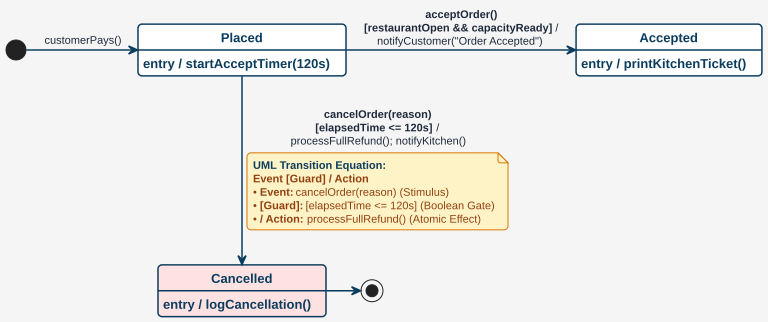

</div>
<div class="right" style="font-size: 17px; line-height: 1.4;">

**外送訂單生命週期的轉移管線實例：**

- **標準轉移語法結構：**
  - `cancelOrder(reason) [elapsedTime <= 120s] / processFullRefund(); notifyKitchen()`
- **1. 事件刺激 (`cancelOrder`)：**
  - 顧客從手機 App 發送主動取消請求。
- **2. 守衛條件 (`[elapsedTime <= 120s]`)：**
  - 嚴格限制下單後 120 秒內方可取消。若逾時（guard 為 false），轉移直接被阻擋，訂單保持在 `Placed`。
- **3. 動作執行 (`/ processFullRefund()`)：**
  - 轉移發生時瞬間原子性執行全額退款並通報餐廳廚房。
- **目標狀態著陸 (`Cancelled`)：**
  - 成功移轉至 `Cancelled` 並觸發 `entry / logCancellation()`。

</div>
</div>

<!--
我們來看狀態轉移公式在外送訂單系統中的真實運作！

請看左側的 Placed 狀態，此時顧客剛完成付款。

接著看往下指的這條轉移箭頭：
事件是 cancelOrder(reason)，也就是顧客在 App 上點擊取消訂單。
接著由中括號內的守衛條件進行把關：下單時間是否在 120 秒內？
若條件成立（True），轉移立刻觸發，並瞬間執行斜線後的動作：呼叫金流進行退款，同時通知廚房。
最後，訂單順利抵達目標狀態 Cancelled！

如果顧客超過兩分鐘才按取消呢？
守衛條件為 False，這條轉移根本不會引爆，訂單依然維持在 Placed，隨後由餐廳接單轉入 Accepted！

總結這張投影片，請記住這個核心觀念：只有當事件發生且防衛條件為真時，狀態轉移才會引爆並執行原子動作進入目標狀態。
-->

---

<!-- _class: v-center -->

## 執行引擎：動作 (Action) vs. 活動 (Activity)

<div class="split64">
<div class="left" style="display: flex; justify-content: center; align-items: center;">


</div>
<div class="right" style="font-size: 17px; line-height: 1.4;">

**瞬間原子動作 vs. 持續可中斷活動：**

- **動作 (Action，不可中斷原子運算)：**
  - **執行時間：** 瞬間完成（邏輯耗時為零）。
  - **中斷特性：** **絕對不可中斷**；一旦觸發必執行至結束，方能處理下個事件。
  - **放置位置：** 標註於轉移箭頭、`entry /` 或 `exit /`。
- **活動 (Activity，持續可中斷任務)：**
  - **執行時間：** 具時間跨度，狀態活躍期間持續運算。
  - **中斷特性：** **隨時可被中斷**；一旦外向轉移事件抵達立即強制中止。
  - **放置位置：** 宣告於狀態內部 `do / [activity]`。
  - **架構鐵律：** 嚴禁將耗時長任務置於 Action，否則將導致狀態機嚴重阻塞。

</div>
</div>

<!--
這張投影片點出了 UML 中最核心也最常被考到的觀念：動作 (Actions) 與活動 (Activities) 的本質差異！

請逐行比對表格中的四個維度：
第一，本質 (Nature)：動作是「原子計算」（例如呼叫方法或釋放物件）；活動是「非原子計算」。
第二，持續時間 (Duration)：動作是「瞬間完成」的，邏輯耗時為零；活動則是「持續進行」的，耗時較長。
第三，可中斷性 (Interruptibility)：特別看有顏色的字！動作「絕對不可被中斷」；活動則「隨時可以被事件中斷」！
第四，觸發時機 (Triggers)：動作在進入、離開或轉換時瞬間執行；活動則在停留於狀態期間持續執行 (`do /`)。

總結這張投影片，請記住這個核心觀念：Action 是瞬間不可中斷的原子操作，Activity 則是耗時進行且隨時可被事件中斷的持續計算。
-->

---

<!-- _class: v-center -->

### 邊界執行：進入動作與離開動作 (Entry & Exit Actions)

<div class="split64">
<div class="left" style="display: flex; justify-content: center; align-items: center;">

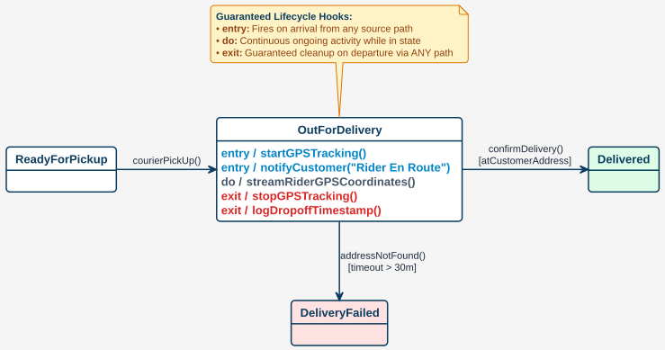

</div>
<div class="right" style="font-size: 17px; line-height: 1.4;">

**外送配送狀態的生命週期保證機制：**

- **進入動作 (`entry / startGPSTracking()` 等)：**
  - 外送員取餐跨入 `OutForDelivery` 的瞬間無條件觸發。
  - 立即啟動騎手手機 GPS 定位並推播通知「外送員已出發前往配送」。
- **持續活動 (`do / streamRiderGPSCoordinates()` 等)：**
  - 配送路程中持續串流即時座標；抵達顧客門口或逾時即刻中斷。
- **離開動作 (`exit / stopGPSTracking()` 等)：**
  - 無論外送成功 (`Delivered`) 或失敗 (`DeliveryFailed`)，離開時保證執行！
  - 關閉高耗電 GPS 晶片追蹤並寫入送達時間戳記。
- **架構價值：** 確保生命週期初始與清理邏輯完全內聚，免於在多條離開箭頭重複撰寫代碼。

</div>
</div>

<!--
請看狀態邊界的防護機制在外送系統中的運用：進入動作 (Entry) 與離開動作 (Exit)！

圖中聚焦在外送運送中狀態：OutForDelivery。

注意上方的藍色進入動作：entry / startGPSTracking() 與 notifyCustomer()。
只要外送員完成取餐跨入此狀態，不論從何而來，手機 GPS 追蹤與顧客通知保證百分之百立即啟動！

接著看灰色 do 活動：streamRiderGPSCoordinates()。這是外送途中持續串流外送員座標的進行中活動。

最後看紅色的離開動作：exit / stopGPSTracking() 與 logDropoffTimestamp()。
注意！不論外送員是順利送達，還是因為找不到地址而回報失敗，只要離開 OutForDelivery，離開動作保證絕對會執行，確實關閉 GPS 並記下時間！

總結這張投影片，請記住這個核心觀念：Entry 與 Exit 動作確保每次跨越狀態邊界時，初始設定與資源釋放保證絕對執行。
-->

---

<!-- _class: v-center -->

## 擴展架構：複合狀態與平行狀態 (Scaling Complexity)

<div class="split64">
<div class="left" style="display: flex; justify-content: center; align-items: center;">

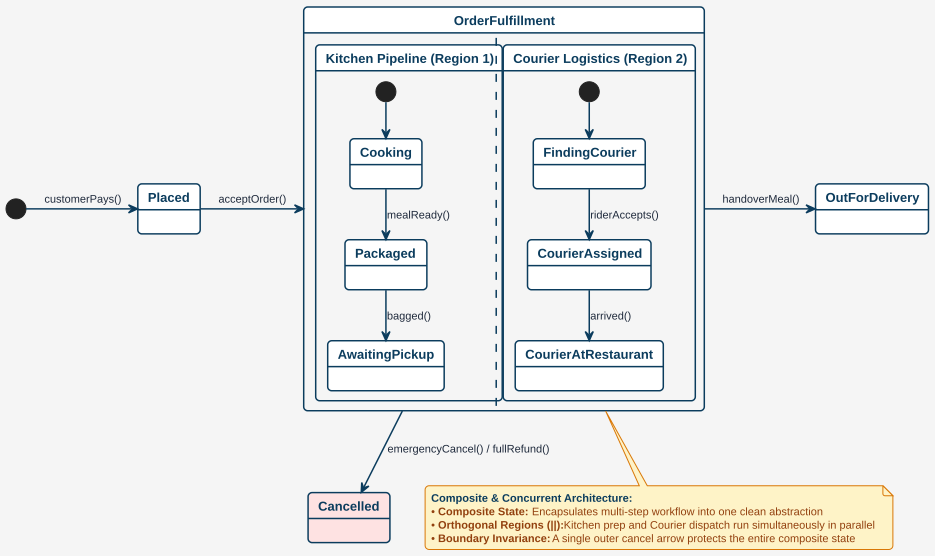

</div>
<div class="right" style="font-size: 17px; line-height: 1.4;">

**以階層結構駕馭外送履約的狀態複雜度：**

- **1. 簡單狀態 (`Placed`)：**
  - 單一原子狀態，等待餐廳確認接單。
- **2. 複合狀態 (`OrderFulfillment`)：**
  - 高階超狀態，封裝內部繁瑣之備餐與外送派件流程。
  - 外邊界轉移（如 `emergencyCancel() / fullRefund()`）統一適用於全體子狀態，大幅消除重複箭頭。
- **3. 正交並行區域 (`||` 並行軌道)：**
  - **廚房備餐管線 (Region 1)：** `Cooking` → `Packaged` → `AwaitingPickup`。
  - **外送員調度物流 (Region 2)：** `FindingCourier` → `CourierAssigned` → `CourierAtRestaurant`。
  - 雙管線同步且獨立並行運作！

</div>
</div>

<!--
當系統變得龐大時，扁平狀態圖會變成無法閱讀的蜘蛛網。看外送履約架構如何透過複合與平行狀態進行擴展：

左側 Placed 是「簡單狀態」：單一且不可分割的原子狀態。

中央大框框 OrderFulfillment 是「複合狀態」：它將內部多步驟的履約流程封裝成一個乾淨的高階容器。
注意底部的 emergencyCancel 箭頭：只要掛在外框邊界上，就能一體適用於內部所有子狀態！完全不需要畫五六條重複的取消箭頭！

現在看內部結構：垂直虛線將內部切分為兩個「正交並行區域」！
區域 1 是廚房備餐流程：下鍋烹調、包裝封盒、等待取餐。
區域 2 則是外送員調度管線：媒合騎手、接單確認、騎車前往餐廳。
兩條管線在真實世界中是百分之百同時並行運作的！

總結這張投影片，請記住這個核心觀念：複合狀態隱藏內部細節，並行正交區域則完美協調同時發生的多軌任務。
-->

---

<!-- _class: v-center -->

### 複合狀態與系統記憶 (History State)

<div class="split64">
<div class="left" style="display: flex; justify-content: center; align-items: center;">

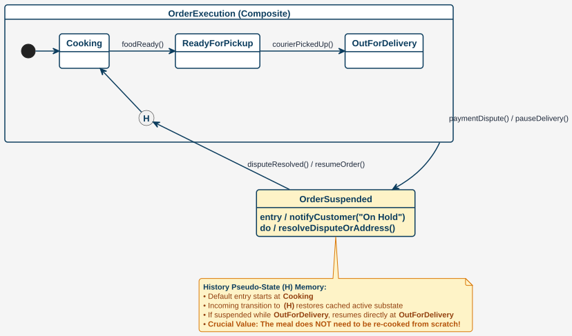

</div>
<div class="right" style="font-size: 17px; line-height: 1.4;">

**歷史記憶節點 (H)：外送中斷後的精確復原：**

- **預設進入流程：**
  - 新訂單正常進入 `OrderExecution` 時，一律從起點 `Cooking` 依序啟動。
- **歷史偽節點 `(H)` 的狀態快取：**
  - **中斷記憶：** 當訂單遭遇突發暫停（如信用卡盜刷查核、地址疑義），離開前自動記錄當下活躍狀態。
  - **精確跳轉復原：** 疑義排除後（`disputeResolved()`），箭頭指入 `(H)`，直接精準還原至 `OutForDelivery`！
- **極為關鍵的商業價值：**
  - **若沒有 (H)：** 系統將退回 `Cooking` 重新開煮，餐廳將浪費食材並重新備餐！
  - **具備 (H)：** 外送員直接在路上接續配送已經煮好的餐點。

</div>
</div>

<!--
當外送途中遭到突發中斷，系統如何記住上次進度？請看外送系統中的歷史記憶節點 (H)！

一般情況下，進入 OrderExecution 時，流程一定從起點 Cooking 重新開始。

但是想像一下：外送員已經在路上 (OutForDelivery)，此時銀行突然發出交易風險警報，訂單被迫轉入暫停狀態 OrderSuspended。
當客服排除了爭議，訂單該如何恢復？

看重新進入的箭頭：它指入帶有 (H) 的圓圈！
歷史狀態節點會記住中斷前當下活躍的子狀態。
因為剛才停在 OutForDelivery，系統直接精確還原到 OutForDelivery！

請思考這在商業上的巨大價值：如果沒有 (H)，訂單退回 Cooking，餐廳就得被迫把已經煮好打包的熱騰騰餐點倒掉重煮！

總結這張投影片，請記住這個核心觀念：歷史狀態節點作為快取記憶槽，能讓系統在中斷復原後直接回到上次活躍的子狀態。
-->

---

<!-- _class: title-image-slide -->

## 整合藍圖：外送訂單完整生命週期狀態圖

<div class="image-wrapper">
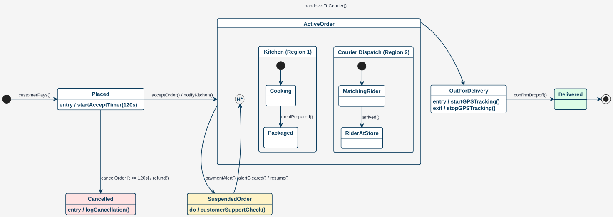
</div>

<!--
這就是狀態機的綜合實戰藍圖：外送訂單系統的完整生命週期！

看看這個架構有多麼優雅嚴整：

第一，左側訂單從 Placed 出發，帶有 cancelOrder [t <= 120s] / refund() 守衛轉移，嚴格把關取消規則。

第二，訂單進入 ActiveOrder 複合狀態，內部由正交區域將廚房烹調與外送員調度完全平行化處理！

第三，看下方的 SuspendedOrder：一旦突發警報暫停，透過深層歷史狀態節點 [H*]，排除狀況後直接精準恢復當前的並行子狀態，資料毫無遺失！

第四，餐點與騎手會合後轉入 OutForDelivery，透過嚴格的 entry 與 exit 邊界動作自動管理 GPS 定位與時間戳記，最後在顧客取餐確認後圓滿結束生命週期！

總結這張投影片，請記住這個核心觀念：真實工程架構將並行分區、進入離開動作、守衛觸發與歷史記憶整合為單一嚴整藍圖。
-->

---

<!-- _class: v-center -->

### 動態模型對照：狀態機圖 vs. 活動圖 (State Machine vs. Activity)

> 兩者皆為 UML 動態行為模型，但從根本上回答了完全不同的架構問題。

<div class="matrix-table">

| 比較維度 | 狀態機圖 (State Machine) | 活動圖 (Activity Diagram) |
| :--- | :--- | :--- |
| **核心視角** | **實體導向 / 被動反應 (Reactive)：** 聚焦於「單一實體」從生到死的生命週期。 | **流程導向 / 程序推進 (Procedural)：** 聚焦於跨越「多個參與者與系統」的端到端工作流程。 |
| **核心節點** | **狀態 (State)：** 實體處於等待事件或維持運作的靜止/持續模式。 | **動作 (Action / Activity)：** 系統或人員正在執行的主動計算或業務操作。 |
| **轉移驅動方式** | **事件驅動 (Event-Driven)：** 轉移必須等待外部或內部觸發事件 (`Event [Guard] / Action`)。 | **完成驅動 (Completion-Driven)：** 動作執行完畢後自動沿著控制流/物件流推進下一步。 |
| **平行並行模型** | **正交區域 (Orthogonal Regions)：** 複合狀態內的平行子狀態區塊 (並行軌道)。 | **分岔與結合節點 (Fork & Join)：** 跨越泳道 (Swimlanes) 的明確流程分流與同步。 |
| **最佳應用場景** | 領域實體生命週期（如外送訂單、帳戶狀態）、通訊協定、IoT 設備控制。 | 跨系統業務流程（如結帳到出貨流程）、ETL 批次管線、使用案例流程展開。 |

</div>

<!--
在進入 CCQ 之前，讓我們對照 UML 中兩大動態模型：狀態機圖與活動圖。

許多同學常問：兩者都有節點、動作與箭頭，到底該在什麼時機選擇哪一種？

第一，看核心視角：
狀態機圖是「實體導向」的。你鎖定單一關鍵物件（例如外送訂單 Order），追蹤它一生遭遇所有事件的模式轉移。
活動圖則是「流程導向」的。它不屬於單一物件，而是呈現跨越顧客、廚房、金流閘道與外送員的端到端業務工作流。

第二，看核心節點：
狀態機圖的節點是「名詞或形容詞」的狀態（如 Placed, Cooking），代表物體處於等待或持續運作的模式。
活動圖的節點則是「動詞」的動作（如驗證信用卡、通知廚房），代表主動執行的任務。

第三，看轉移驅動：
狀態機是「事件驅動」的。訂單停在 Placed，若沒有 cancelOrder 或 timeout 事件，它會永遠停在那裡。
活動圖是「完成驅動」的。前一個動作一完成，控制流立刻自動沿著箭頭推進到下一個動作。

第四，並行機制：
狀態機使用複合狀態內部的正交區域；活動圖則使用泳道搭配明確的分岔 (Fork) 與結合 (Join) 節點。

總結這張投影片，請記住這個核心觀念：為單一實體的生命週期與事件反應建模時選狀態機圖；為跨系統與跨人員的工作流程建模時選活動圖。
-->

---
## 觀念檢核測驗 7 (CCQ 7)
<!-- id: ase-ch04-ccq7 -->
<div class="ccq-columns">
<div class="ccq-text">

在 UML 狀態機圖中，**動作 (Action，如 transition 上的 `/ refund()` 或 `entry /`)** 與 **活動 (Activity，如 `do /`)** 最根本的執行語義差異為何？

- **A.** Action 是瞬間完成、不可中斷的原子性操作；Activity 是耗時進行的持續運算，且可被外來事件隨時中斷。
- **B.** Action 只能寫 Python；Activity 只能寫 SQL。
- **C.** Action 只能在進入狀態時執行；Activity 只能在離開狀態時執行。
- **D.** Action 專門處理例外失敗；Activity 專門處理成功路徑。

</div>
<div class="ccq-logo">
    <a href="https://nlhsueh.github.io/nickedupocket/#/student/ase-ch04-ccq7" target="_blank"></a>
  </div>
</div>

<!--
讓我們透過觀念檢核測驗 7 來檢驗對狀態機執行語義的掌握。

分析題目選項：
選項 B 與 D 混淆了具體技術與形式化 UML 語意。
選項 C 混淆了進入與離開動作。

正確答案是 A！在 UML 狀態機語意規格中：
Action（轉換動作、entry/、exit/）概念上邏輯耗時為零，具備原子性且絕對不可中斷。
Activity（以 `do /` 宣告）則代表一段耗時運算，只要有任何觸發狀態轉換的外來事件到達，該活動會被立即中斷並退出狀態。

總結這張投影片，請記住這個核心觀念：Action 是瞬間不可中斷的原子操作，Activity 則是耗時進行且隨時可被事件中斷的持續計算。
-->
---
<!-- _class: v-center -->

### 觀念診斷練習：找出這份狀態機模型的生命週期謬誤

<div class="split64">
<div class="left" style="display: flex; justify-content: center; align-items: center;">


</div>
<div class="right" style="font-size: 17px; line-height: 1.4;">

**審查這份學生繪製的訂單生命週期狀態機圖草稿：**
你能從**狀態語意、轉移條件、終止節點約束**中找出重大架構謬誤嗎？

- **1. 狀態 vs. 瞬時動作 (State vs. Action)：**
  - 檢視 `DeductCreditCard`，將一個耗時為零的瞬時動作繪製為持久狀態存在什麼語意錯誤？
- **2. 黑洞陷阱狀態 (Black Hole State)：**
  - 觀察 `RiskReview` 狀態，訂單一旦進入該狀態後會遭遇什麼致命問題？
- **3. 非確定性轉移衝突 (Non-Deterministic Conflict)：**
  - 檢視離開 `Paid` 狀態的兩條 `cancelOrder` 轉移線：當 `amount == 150` 時，系統該執行哪一條？
- **4. 終止狀態不可逆性 (Final State Invariant)：**
  - 從終止狀態 `[*]` 伸出箭頭 `reopenOrder()` 重新回到 `PendingPayment`，違反了什麼核心不變量？

</div>
</div>

<!--
讓我們對這份訂單狀態機圖草稿進行嚴格的架構診斷。圖中存在四大核心行為謬誤：

謬誤一（將瞬時動作誤畫為持久狀態）：
請看名為 DeductCreditCard 的狀態框。在 UML 狀態機規格中，狀態 (State) 代表物體處於某種滿足特定條件、執行持續活動或等待事件的持久期間（如 PendingPayment 或 Paid）。刷卡扣款是一瞬間完成的原子動作，應定義為轉移線上的動作（如 pay / deductCreditCard()）或進入動作，絕不能畫成獨立的狀態框！

謬誤二（黑洞陷阱狀態：只進不出）：
仔細觀察 RiskReview 狀態：雖然有來自 flagFraudTrigger 的轉移進入該狀態，但它卻「完全沒有任何離開的轉移線」！一旦訂單被標記為風險審查，就會被永久囚禁在該狀態中，永遠無法結案或取消。所有非終止狀態都必須擁有合理的退出路徑。

謬誤三（非確定性轉移條件衝突）：
檢視離開 Paid 狀態的兩條 cancelOrder 轉移：第一條標註 [amount > 100]，第二條卻「完全沒有標註條件守衛」！當退款金額為 150 時，兩條轉移線同時成立。UML 嚴格禁止這種競態衝突（Race Condition），同事件轉移的守衛條件必須嚴格互斥（如 [amount > 100] 與 [amount <= 100]）。

謬誤四（違反終止狀態不可逆不變量）：
圖中竟然從終止狀態 [*] 伸出轉移線 reopenOrder() 重新回到 PendingPayment。終止狀態 (Final State) 代表物件生命週期的終結與資源釋放，UML 規則嚴格禁止任何從終止狀態離開的轉移線！若訂單允許重新開啟，代表它當初根本就不該進入終止狀態。

總結這張投影片，請記住這個核心觀念：狀態代表持久情境而非瞬間動作、非終止狀態必須具備離開路徑、同事件轉移條件必須嚴格互斥，且終止狀態絕對不可逆。
-->

---

<!-- _class: v-center -->

### 觀念診斷解答：狀態機模型生命週期謬誤剖析與修正

<div class="split64">
<div class="left" style="display: flex; justify-content: center; align-items: center;">

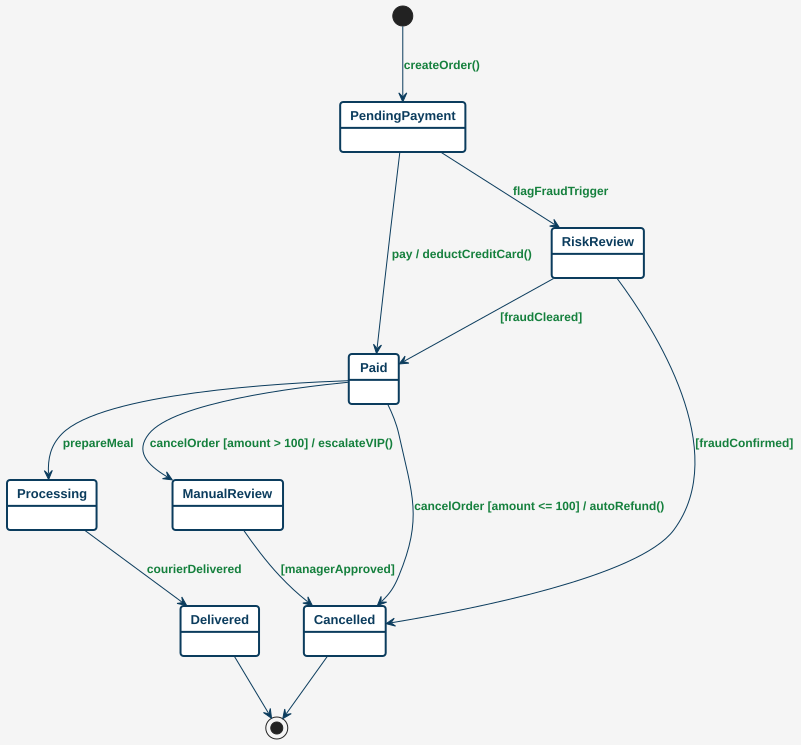

</div>
<div class="right" style="font-size: 17px; line-height: 1.4;">

**審查診斷結論與架構修正指引：**

- **1. 持久狀態 vs. 瞬時動作 (State vs. Action)：**
  - `DeductCreditCard` 是耗時為零的瞬時動作，應作為轉移線上的效果 (`pay / deductCard()`)，絕不可畫為狀態方塊。
- **2. 黑洞陷阱狀態 (Black Hole State)：**
  - `RiskReview` 只有進入箭頭、零離開路徑，訂單一旦進入審查即永久卡死，缺少核准或拒絕出口。
- **3. 非確定性轉移衝突 (Non-Deterministic Conflict)：**
  - 離開 `Paid` 的兩條 `cancelOrder` 線未設定互斥守衛，當 `amount == 150` 時兩條皆滿足，造成不可預期的競態衝突。
- **4. 終止狀態不可逆約束 (Final State Invariant)：**
  - 從終止狀態 `[*]` 拉出 `reopenOrder()` 嚴重違反 UML 規範；終止狀態代表生命週期結束，不可有離開箭頭。

</div>
</div>

<!--
這是訂單生命週期狀態機圖四大核心謬誤的標準解答：

第一，嚴格區分狀態與動作。狀態代表物件在一段時間內的持久存在條件（如 PendingPayment、Paid）。刷卡扣款是瞬時執行的行為，必須寫在轉換線的 Action 上，不可佔據狀態方塊。

第二，杜絕黑洞狀態。中間狀態必須至少具備一條對外的離開路徑，審查狀態必須提供「通過」或「不通過」的出口。

第三，確保轉移條件確定性。同一個事件觸發的多條轉移線，其守衛條件必須完全互斥（例如 amount > 100 與 amount <= 100），避免執行期無法判斷該走哪一條。

第四，終止狀態具備不可逆約束。終止節點代表物件實體生命終結，從終止節點伸出箭頭重新啟動訂單違反 UML 核心不變量。

總結這張投影片，請記住這個核心觀念：瞬時動作放轉換線、狀態必有出口、守衛條件嚴格互斥、終止狀態絕對不可逆。
-->
---
## AI 輔助指南：狀態機塑模 (State Machine Modeling)

- **1. 角色設定與形式化檢驗紀律 (Persona & Formal FSM Discipline)：**
  - 指示 AI 扮演「形式化系統驗證與有限狀態機 (FSM) 專家」。
  - **狀態命名嚴格紀律：** 狀態名稱必須代表物件的「客觀穩態條件」，一律採用形容詞或過去分詞（如 `Placed`, `Preparing`, `Delivered`），嚴禁使用動詞當作狀態名稱！
- **2. 轉換語法與防禦性不變量約束：**
  - **法定語法公式：** 強制要求轉換連線必須遵循 `事件名稱 [守衛條件] / 執行動作`。
  - **進入/離開動作：** 對於具備資源配置或通知的關鍵狀態，明確定義 `entry /` 與 `exit /`。
  - **嚴格封鎖非法路徑：** 明確宣告哪些狀態之間「絕對禁止跳轉」（例如配送中嚴禁直接點擊取消）。
- **3. 架構師人工審查清單 (Verification Checklist)：**
  - [ ] 是否存在無法抵達的「孤島狀態」或進得去出不來的「死結陷阱」？
  - [ ] 守衛條件 `[guard]` 是否互斥且覆蓋所有可能？
  - [ ] 終止狀態 (`[*]`) 是否正確對應至業務的終結？

<!--
引導 AI 產生狀態機圖時，最常見的失誤是「把狀態寫成動作」以及「遺漏非法跳轉的防護」。

初學者或 LLM 常常把狀態命名為『烹調餐點』、『指派司機』——這完全混淆了活動與狀態！狀態必須是『已接單』、『備餐中』或『已送達』。

透過在 Prompt 中要求遵循 UML 標準公式『事件 [守衛] / 動作』，並命令它設置進入與離開動作，就能產出具備強大防禦力、杜絕非法業務跳轉的狀態機。

總結這張投影片，請記住這個核心觀念：約束狀態為過去分詞命名、嚴格規範轉換語法公式並定義例外守衛，能確保 AI 產出數學上嚴格正確的狀態機。
-->
---

<!-- _class: v-center -->

### AI 提示詞範例：外送平台訂單生命週期狀態機模型

<div class="two-columns">
<div>

**1. 角色設定與任務指令：**
```text
你是一位形式化驗證工程師。
請根據以下訂單生命週期規則，產生標準合規的
PlantUML 狀態機圖 (State Machine Diagram)。
```

**2. 塑模約束條件：**
- 狀態清單：`Placed`, `Accepted`, `Preparing`, `ReadyForPickup`, `OutForDelivery`, `Delivered`, `Cancelled`。
- 轉換標籤必須遵循 `Event [Guard] / Action`。
- `OutForDelivery` 狀態必須包含 `entry / startGPSTracking()`。
- 僅允許在 `Placed` 與 `Accepted` 狀態下取消 `[cancellationWindow <= 120s]`；進入 `Preparing` 後嚴禁取消。

</div>
<div>

**3. 輸入需求敘述 (Requirements Statement)：**
> 「**Order** 生命週期從 `[*]` 開始，顧客完成扣款後進入 **Placed** (已下單)。
> 在 **Placed** 狀態下，餐廳點擊接受則觸發 `acceptOrder` 進入 **Accepted**；若餐廳拒絕則觸發 `rejectOrder` 進入 **Cancelled** `/ issueFullRefund()`。
> 顧客在 **Placed** 或 **Accepted** 狀態下可主動觸發 `cancelOrder`，但必須滿足守衛條件 `[timeElapsed <= 120s]` 才能轉入 **Cancelled**。
> 當廚房點擊開始做菜，觸發 `startCooking` 進入 **Preparing**；此時取消路徑完全鎖死。
> 餐點打包完成後觸發 `packagingComplete` 進入 **ReadyForPickup**。
> 外送員抵達掃描條碼後觸發 `courierPickedUp` 進入 **OutForDelivery**，同時執行 `entry / startGPSTracking()`。
> 顧客輸入 OTP 簽收後觸發 `confirmDropoff` 進入終止狀態 **Delivered**，最後轉入 `[*]`。」

</div>
</div>

<!--
請看這份外送訂單生命週期的 AI 提示詞示範。

注意左側的約束有多麼嚴密：
我們列舉了七個嚴格的狀態名稱，全部是過去分詞；我們明確指示了 OutForDelivery 的 entry 動作。
最關鍵的是業務防禦規則：一旦進入 Preparing，取消訂單的路徑直接封閉，且取消動作受 120 秒超時守衛保護。

這份提示詞送給 LLM，產出的狀態機代碼能直接作為後端開發者撰寫狀態模式 (State Pattern) 或 Spring StateMachine 的骨幹規格。

總結這張投影片，請記住這個核心觀念：明確列舉合法狀態、轉換語法與取消守衛邊界，能引導 AI 產出杜絕業務漏洞的狀態機模型。
-->
---

<!-- _class: v-center -->
<!-- header: '4.7 行為與狀態機模型' -->

### AI 生成之 PlantUML 與架構圖：外送平台狀態機模型

<div class="puml-output-grid">
<div class="puml-code-col">

<div class="puml-title">AI 生成之 PlantUML 規格代碼：</div>

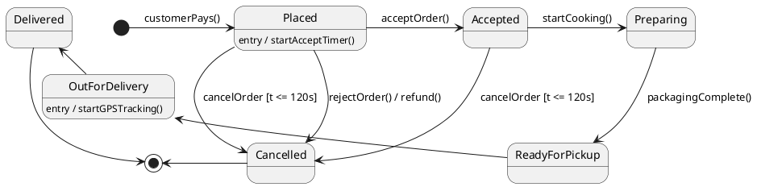

</div>
<div class="puml-diagram-col">

<div class="puml-title">渲染產出之架構圖：</div>

<div class="diagram-wrapper">
  
</div>

</div>
</div>

<!--
這是外送訂單生命週期的狀態機圖。

請看左側的代碼：
所有狀態皆以被動或過去分詞命名：Placed、Accepted、Preparing、ReadyForPickup、OutForDelivery、Delivered 與 Cancelled。
在狀態內部宣告進入動作 (entry actions)：Placed 狀態進入時啟動接單倒數計時，OutForDelivery 狀態進入時自動啟用 GPS 即時軌跡追蹤。
使用方括號標註轉移防護條件 (Guard Conditions)：消費者取消訂單被嚴格限制在下單後 120 秒內，一旦廚房開始烹調即鎖死取消路徑。

右側圖形為工程師與測試人員提供了清晰無歧義的狀態演進藍圖，杜絕非法轉移。

總結這張投影片，請記住這個核心觀念：在提示詞中明確指定轉移事件標籤、進入動作與防護條件，能確保 AI 產出具備確定性且可形式化驗證的狀態機。
-->
---
### 課堂活動：使用 AI 演進狀態機生命週期 (雙人動手實作)

<div class="discussion-columns">
  <div class="discussion-text">

  **動手實作實驗：變更生命週期並審核 AI 產出 (4 分鐘)**
  - **1. 在狀態機提示詞中加入一個生命週期不變量 (Invariant)：**
    - *司機途中棄單：* 若外送員中途車輛故障棄單，訂單狀態退回 `ReadyForPickup` 重新派單。
    - *顧客延期配送：* 允許在 `Preparing` 備餐中申請延後外送指定時段。
    - *外送失敗處理：* 抵達門前若聯絡不上顧客超過 10 分鐘，轉移至 `FailedDelivery` 並原車退回。
  - **2. 要求 AI 重新生成：** 提示 LLM 更新對應的 PlantUML 狀態機代碼。
  - **3. 渲染並嚴格審查：** 貼入 [PlantText](https://www.planttext.com) 渲染並審查：
    - AI 是否維護**狀態命名規範**（使用被動式/形容詞，不使用動詞）？
    - **非法狀態轉移**（如餐點在路上卻被隨意取消）是否被嚴格防護？
    - **進入/離開動作**與轉移事件之邏輯前後是否完全一致？

  </div>
  <div class="discussion-logo">
    
  </div>
</div>

<!--
現在讓我們進行狀態機塑模的雙人動手實作！與夥伴共同檢驗 AI 如何捍衛系統核心的業務不變量。

請看螢幕指引：
在我們剛才的外送訂單狀態機提示詞中，加入一個棘手的非預期生命週期例外：
選項 A：司機在送餐途中機車爆胎拋錨，狀態必須從 OutForDelivery 安全退回 ReadyForPickup，等待重新調度。
選項 B：顧客在廚房備餐時要求延後送達時程。
選項 C：外送員抵達門前按電鈴打電話無人回應，超時 10 分鐘後轉為 FailedDelivery 並啟動退餐流程。

提示 AI 更新狀態機 PlantUML，在 PlantText 渲染後審查：
狀態名稱是否保持為狀態特徵（如 Placed, Preparing）而非混淆成活動動作？
不合法的逆向轉移是否被嚴格阻擋？
進入動作（如開啟 GPS 追蹤）與防護條件是否正確指定？

總結這張投影片，請記住這個核心觀念：以異常生命週期情境考驗 AI，才能看清它是否真正能夠守衛系統核心的業務邏輯完整性。
-->
---
<!-- _class: lead -->
<!-- header: '4.8 PlantUML 宣告式文字塑模' -->

# **4.8 PlantUML 宣告式文字塑模**

> "告別手動拖拉圖框的痛苦。架構即代碼，讓軟體模型與程式碼在 Git 倉儲中一同進化。"

<div class="online-editor-link">
  <a href="https://www.planttext.com" target="_blank" rel="noopener noreferrer">
    <span class="editor-badge">線上編輯器</span> <strong>PlantText 線上實時沙盒</strong> (planttext.com) →
  </a>
</div>

<!--
歡迎來到第 4.8 節：PlantUML 宣告式文字塑模 (Text-Based Modeling with PlantUML)。

長期以來，許多工程師對 UML 敬而遠之，最大的痛點就是傳統 GUI 工具極度繁瑣：手動拖拉圖框、微調箭頭像素，而且二進位檔完全無法在 Git 中進行版本比對與審查。

PlantUML 帶來了「架構即代碼 (Diagram-as-Code)」的重大革新！

我們只需要撰寫清晰易讀的純文字標記，模型就能與源碼一同存放在 Git 倉儲中，在 Pull Request 中進行 diff 審查，並由引擎自動編譯渲染。

請看螢幕上的線上編輯器連結：你可以直接點擊進入 planttext.com 的 PlantText 沙盒，無須安裝任何本機環境，立刻在瀏覽器中實時體驗代碼塑模！

總結這張投影片，請記住這個核心觀念：PlantUML 實現了代碼驅動的架構塑模，消除手動排版負擔並完美整合 Git 工作流。
-->
---

<!-- _class: v-center -->

## PlantUML：以代碼驅動架構 (Code-Driven Architecture)

<div class="split64">
<div class="left" style="display: flex; justify-content: center; align-items: center;">


</div>
<div class="right" style="font-size: 17px; line-height: 1.4;">

**圖表即代碼（以純文字建構架構）：**

- **宣告式架構 (Declarative Architecture)：**
  - 撰寫簡潔易讀的純文字腳本，定義系統元件與資料流向。
- **PlantUML 語法範例：**
  ```plantuml
  component "Order Service" as OS
  database "Order DB" as ODB
  OS --> ODB : Stores Order Data
  ```
- **自動排版引擎 (Automated Layout)：**
  - 內建 Graphviz 自動計算座標、連線與對齊，消除手動拖拉負擔。
- **核心工程價值：** 取代脆弱的繪圖工具，使架構能納入 Git 進行 PR 審查。

</div>
</div>

<!--
請看這張視覺開場：『UML Modeling with PlantUML』。

左側是黑底的代碼編輯器，寫著極為簡練的宣告式語法：
`component "Order Service" as OS`
`database "Order DB" as ODB`
`OS -> ODB : Stores Order Data`

注意那道橘色箭頭穿透像素方塊，直接噴發到右側的架構圖中！

右側的渲染引擎自動將文字轉譯為清晰的 User Interface、Order Service 與 Order DB 結構圖。

你負責撰寫文字邏輯，排版與美化全部交由引擎自動完成！

總結這張投影片，請記住這個核心觀念：PlantUML 能秒級將純文字腳本自動轉譯為標準合規且美觀的架構圖表。
-->

---

<!-- _class: v-center -->

### 終結圖框拖曳地獄，直接撰寫架構 (Stop Dragging Boxes)

<div class="split64">
<div class="left" style="display: flex; justify-content: center; align-items: center;">


</div>
<div class="right" style="font-size: 17px; line-height: 1.4;">

**消除排版視覺摩擦與維護負債：**

- **傳統 GUI 繪圖方式（左側 — 視覺疲勞）：**
  - 白板與拖拉繪圖工具繁瑣緩慢，與原始碼完全脫節。
  - 每增修一個方塊，都需耗時重新手動微調數十條連接線。
- **PlantUML 文字塑模（右側 — 即時標準化）：**
  ```plantuml
  class User { +name : String }
  class Order { +id : Int }
  User "1" -- "*" Order
  ```
- **工程優勢：**
  - 100% 專注於軟體抽象概念與結構關聯，告別調像素的無效勞動。

</div>
</div>

<!--
這就是文字塑模的核心哲學：『停止拖拉方塊，開始以代碼撰寫架構』。

看看左邊的白板：歪歪斜斜的方塊、糾纏混亂的箭頭，還有一隻打著叉叉的哭泣滑鼠——這代表著傳統繪圖方式的「緩慢、手動與脫節」。

再看看右邊：深色編輯器裡只有簡短幾行定義 `User` 與 `Order` 的代碼，右邊立刻生成帶有 `1` 到 `*` 多重性關聯的發光類別圖——代表著「即時、版本控制與標準化」。

省下 80% 調整像素的時間，把精力集中在真正的架構決策上！

總結這張投影片，請記住這個核心觀念：文字化塑模消除了手動排版的疲勞，讓架構圖直接融入軟體工程的標準流程。
-->

---

<!-- _class: v-center -->

### 極簡環境配置：VS Code 即時渲染預覽 (Frictionless Setup)

<div class="split64">
<div class="left" style="display: flex; justify-content: center; align-items: center;">


</div>
<div class="right" style="font-size: 17px; line-height: 1.4;">

**三步驟啟動本地端高效架構繪圖：**

- **1. 安裝擴充套件 (Install)：**
  - 於 VS Code 市集安裝官方 **PlantUML** 擴充功能。
- **2. 撰寫架構代碼 (Write)：**
  - 建立任意 `.puml` 檔案，享有語法高亮與智慧自動補全。
- **3. 即時渲染預覽 (Render)：**
  - 按下 `Alt + D`（Mac: `Option + D`）啟動雙欄即時預覽。
- **多格式直接匯出：**
  - 原生支援直接匯出為向量 **SVG**、高解析度 **PNG** 或終端友善的 **ASCII 文字圖**。

</div>
</div>

<!--
請看零摩擦的開發環境設定，只需三個簡單步驟：

第一步（Install）：在 VS Code 市集中安裝 PlantUML 擴充套件。
第二步（Write）：建立副檔名為 `.puml` 的文字檔案。
第三步（Render）：按下快速鍵 `Alt + D`（Mac 上按 `Option + D`），即可啟動即時視覺預覽！

看看下方的 VS Code 視窗：
左側編輯器在輸入 `class Car` 時，享有語法高亮（標號 1）與代碼自動補全（標號 2）。
右側視窗即時渲染出 Car 類別框，還能直接匯出為 PNG、SVG 或 ASCII 圖（標號 3）！

總結這張投影片，請記住這個核心觀念：PlantUML 與主流編輯器無縫整合，提供輸入即預覽的極致開發體驗與多格式匯出能力。
-->

---

<!-- _class: v-center -->

## 架構師的五大核心視角全景 (5 Essential Lenses)

<div class="split64">
<div class="left" style="display: flex; justify-content: center; align-items: center;">


</div>
<div class="right" style="font-size: 17px; line-height: 1.4;">

**以統一語法覆蓋系統各維度架構視圖：**

- **結構圖 (靜態骨幹 - Static Backbone)：**
  - **類別圖 (Class Diagram)：** 定義領域實體、屬性、操作與靜態關聯。
- **行為圖 (動態行為 - Dynamic Motion)：**
  - **使用案例圖 (Use Case)：** 外部參與者互動與高階系統邊界。
  - **活動圖 (Activity)：** 業務工作流程、並行分支與泳道。
  - **循序圖 (Sequence)：** 跨生命線之時間時序訊息傳遞。
  - **狀態圖 (State)：** 單一實體生命週期狀態與事件躍遷。
- **核心價值：** 一套語法完整貫通五大關鍵 UML 視圖。

</div>
</div>

<!--
請看架構師的五大核心透鏡樹狀圖：

UML 圖表整體分支為兩大體系：

上方分支是「結構圖 (Structure Diagrams)」——靜態的系統藍圖，由類別圖 (Class Diagram) 掛帥，定義系統中的物件、屬性與操作。

下方分支是「行為圖 (Behavior Diagrams)」——動態運轉中的系統，涵蓋四大透鏡：
- 使用案例圖 (Use Case)：高階系統功能與參與者互動。
- 活動圖 (Activity)：業務流程與控制流轉。
- 循序圖 (Sequence)：跨時間的循序物件互動。
- 狀態圖 (State)：單一物件在不同條件下的生命週期。

一套 PlantUML 語法，就能同時駕馭結構與行為五大模型！

總結這張投影片，請記住這個核心觀念：PlantUML 以統一的語法體系，同時涵蓋一大結構模型與四大行為動態模型。
-->

---

<!-- _class: v-center -->

### 純文字宣告使用案例與功能邊界 (Use Case Syntax)

<div class="split64">
<div class="left" style="display: flex; justify-content: center; align-items: center;">


</div>
<div class="right" style="font-size: 17px; line-height: 1.4;">

**以純文字定義功能需求與系統範圍：**

- **直覺語法關鍵字：**
  - `actor Customer`：宣告外部參與者（自動渲染為火柴人）。
  - `usecase Login`：宣告系統功能案例（渲染為邊界橢圓）。
  - `Customer --> Login`：建立參與者與功能之通訊關聯。
- **PlantUML 腳本範例：**
  ```plantuml
  actor Customer
  usecase Login
  usecase Checkout
  Customer --> Login
  Customer --> Checkout
  ```
- **敏捷優勢：** 於編寫程式前迅速完成使用者故事對齊與範疇鎖定。

</div>
</div>

<!--
看看用 PlantUML 繪製使用案例圖有多麼簡單：

請看左側的代碼與兩條粉紅色對應箭頭：
輸入 `actor Customer`，立刻生成代表外部參與者的火柴人圖示！
輸入 `usecase Login` 與 `usecase Checkout`，立刻生成代表系統功能的橢圓形！
接著用 `Customer -> Login` 與 `Customer -> Checkout` 連線，關聯瞬間完成。

短短四行文字，就能在撰寫任何實作程式碼之前，精確鎖定敏捷開發的高階需求邊界。

總結這張投影片，請記住這個核心觀念：PlantUML 透過 actor 與 usecase 等直覺關鍵字，快速勾勒參與者與功能邊界。
-->

---

<!-- _class: v-center -->

### 類別圖語法：直接對映物件導向結構 (Class Syntax)

<div class="split64">
<div class="left" style="display: flex; justify-content: center; align-items: center;">


</div>
<div class="right" style="font-size: 17px; line-height: 1.4;">

**精確鏡像物件導向代碼結構：**

- **標準三層類別方框 (3 Compartments)：**
  - 頂部：類別名稱 (`class Animal`)。
  - 中部：屬性欄位 (`int id`, `String name`)。
  - 底部：操作方法 (`+int getId()`, `+void makeSound()`)。
- **可見度修飾詞符號 (Visibility)：**
  - `+` Public | `-` Private | `#` Protected | `~` Package
- **PlantUML 腳本範例：**
  ```plantuml
  class Animal {
    int id
    String name
    +int getId()
    +void makeSound()
  }
  ```

</div>
</div>

<!--
現在檢視類別圖的宣告式語法：

注意左側代碼的三段內容，精準對應到右側類別框的三個隔層：
`class Animal` 對應到頂層的類別名稱（The Blueprint）。
`int id` 與 `String name` 對應到中間層的屬性欄位（Attributes）。
`+int getId()` 與 `+void makeSound()` 對應到底層的操作方法（Operations/Methods）。

左上角提示了關鍵的可見度標記：`+` 代表 public、`-` 代表 private、`#` 代表 protected。
寫類別圖的感覺，就跟撰寫標準物件導向程式碼一模一樣！

總結這張投影片，請記住這個核心觀念：PlantUML 類別圖語法高度貼合物件導向程式碼習慣，具備直覺的三層區塊與可見度宣告。
-->

---

<!-- _class: v-center -->

### 類別關聯語法對照表：直觀象形符號 (Relationship Matrix)

<div class="split64">
<div class="left" style="display: flex; justify-content: center; align-items: center;">


</div>
<div class="right" style="font-size: 17px; line-height: 1.4;">

**易記且符合視覺形狀的關聯連線符號：**

- **繼承 (<|--)：**
  - 子類別繼承屬性與方法（空心尖三角形 `<|` 指向父類別）。
- **關聯 (--)：**
  - 結構化參照關聯，以單純實線連接兩類別。
- **聚合 (o--)：**
  - 共享「擁有」關係；部分可獨立存在（空心菱形 `o`）。
- **組合 (*--)：**
  - 強烈整體與部分歸屬；生命週期同生共死（實心菱形 `*`）。
- **象形助記設計：** 符號外觀完全對映標準 UML 圖例形狀。

</div>
</div>

<!--
請看這份極具助記效果的類別關聯符號矩陣：

PlantUML 的符號設計充滿了象形巧思：
- 繼承 (Inheritance)：三角繼承箭頭，尖角三角形指向父類別。
- 關聯 (Association)：實線，一條乾淨的實線。
- 聚合 (Aggregation)：空心菱形，小寫字母 o 剛好畫出一顆空心菱形，代表部分可獨立存在。
- 組合 (Composition)：實心菱形，星號剛好畫出一顆實心菱形，代表同生共死的強烈擁有權。

因為長得就像 UML 的箭頭，工程師完全不需要死背，單憑視覺直覺就能在鍵盤上敲出關聯。

總結這張投影片，請記住這個核心觀念：ASCII 象形符號（如 三角繼承箭頭、空心菱形、實心菱形）讓類別關聯的建立迅速、自然且不易出錯。
-->

---

<!-- _class: v-center -->

### 循序圖語法：純文字描繪時間順序 (Sequence Syntax)

<div class="split64">
<div class="left" style="display: flex; justify-content: center; align-items: center;">


</div>
<div class="right" style="font-size: 17px; line-height: 1.4;">

**以純文字捕捉動態訊息時序流：**

- **時序互動核心規則：**
  - 時間軸由上至下垂直流動。
  - 參與者使用 `participant Name` 宣告。
  - 實線箭頭 `->` 代表同步請求呼叫。
  - 虛線箭頭 `-->` 代表回傳回應結果。
- **PlantUML 腳本範例：**
  ```plantuml
  participant User
  participant OrderService
  User -> OrderService : Request to place order
  OrderService --> User : Confirm order placement
  ```
- **自動對齊：** 生命線、啟動條與箭頭水平對齊全由引擎運算。

</div>
</div>

<!--
循序圖是 PlantUML 最受開發者喜愛的殺手級功能：

循序圖捕捉動態行為與 API 調用，時間軸由上至下垂直流動。

看左側的代碼：
宣告 `participant User` 與 `participant OrderService`。
`User -> OrderService : Request to place order`（實線箭頭發送請求）。
`OrderService -> User : Confirm order placement`（虛線箭頭回傳結果）。

右側的生命線、啟動長條與水平訊息流全部自動生成對齊，毫無手動拉線的痛苦。

總結這張投影片，請記住這個核心觀念：PlantUML 循序圖將日常的對話式文字敘述，秒級轉化為精準對齊的時序訊息互動圖。
-->

---

<!-- _class: v-center -->

### 循序圖四大核心語法要素剖析 (Sequence Anatomy)

<div class="split64">
<div class="left" style="display: flex; justify-content: center; align-items: center;">


</div>
<div class="right" style="font-size: 17px; line-height: 1.4;">

**PlantUML 循序圖之核心視覺骨架：**

- **1. 生命線 (Lifelines)：**
  - 垂直虛線，代表協同互動之物件或微服務參與者。
- **2. 訊息箭頭 (Messages)：**
  - 水平通訊箭頭（`->` 同步請求、`->>` 非同步呼叫）。
- **3. 啟動長條 (Activation Boxes)：**
  - 生命線上的細長矩形（`activate` / `deactivate`），標示運算活躍期。
- **4. 生命週期事件 (Lifecycle Events)：**
  - 專屬語法（`create` / `destroy`），標示實體動態建立或銷毀。
- **核心價值：** 簡短文字代碼產出像素級精確的互動圖。

</div>
</div>

<!--
請看循序圖解剖學中的四大核心元素（橘色標籤）：

第一，生命線 (Lifelines)：垂直虛線，代表參與協同的物件或微服務元件。
第二，訊息 (Messages)：水平橫向箭頭，代表生命線之間的通訊互動（例如同步呼叫）。
第三，啟動長條 (Activation Boxes)：覆蓋在生命線上的細長矩形，標示物件正在主動處理運算的活躍期。
第四，生命週期事件 (Lifecycle Events)：專屬的生命週期訊息，例如 `new` 箭頭指向 `New Participant` 框，表示實體的動態建立或銷毀。

在 PlantUML 中，這些視覺元素都能用最簡單的文字關鍵字精準生成。

總結這張投影片，請記住這個核心觀念：循序圖由生命線、訊息箭頭、啟動長條與生命週期事件四大核心視覺骨架所構成。
-->

---

<!-- _class: v-center -->

### 活動圖與泳道語法：業務流程建模 (Activity Syntax)

<div class="split64">
<div class="left" style="display: flex; justify-content: center; align-items: center;">


</div>
<div class="right" style="font-size: 17px; line-height: 1.4;">

**業務流程與工作流建模語法：**

- **流程控制節點標記：**
  - `start`：自動渲染黑色實心初始起點節點。
  - `:動作名稱;`：以冒號與分號包覆宣告原子動作狀態框。
  - `stop`：自動渲染牛眼雙圓之結束終點節點。
- **PlantUML 腳本範例：**
  ```plantuml
  start
  :Customer Login;
  :Add to Cart;
  stop
  ```
- **進階流程控制支援：**
  - 以 `if (...) then (...) else (...) endif` 宣告決策菱形。
  - 以 `|泳道名稱|` 分割多角色職責泳道。

</div>
</div>

<!--
請看活動圖與業務流程工作流在 PlantUML 中的表現：

注意三條青色箭頭將左邊的文字代碼對齊到右邊的流程節點：
標號 1：`start` 生成黑色的起點圓圈 (Start Node)。
標號 2：`:Customer Login;` 與 `:Add to Cart;` 用冒號與分號包覆，生成圓角矩形的動作狀態 (Action States)。
標號 3：`stop` 生成牛眼圓圈的終點節點 (End Node)。

此外，語法還原生支援 `if/then/else` 條件分支與 `|Lane Name|` 泳道分割，宣告流程既簡潔又結構化。

總結這張投影片，請記住這個核心觀念：活動圖透過 start、冒號動作與 stop 等極簡標記，優雅呈現步驟分明的業務流程。
-->

---

<!-- _class: v-center -->

### 狀態圖語法：單一物件反應型生命週期 (State Syntax)

<div class="split64">
<div class="left" style="display: flex; justify-content: center; align-items: center;">


</div>
<div class="right" style="font-size: 17px; line-height: 1.4;">

**單一物件反應型生命週期建模：**

- **標準狀態轉移語法格式：**
  - 格式：`StateA --> StateB : 事件觸發說明`
- **PlantUML 腳本範例：**
  ```plantuml
  [*] --> NewOrder
  NewOrder --> Paid : Payment Processed
  Paid --> Shipped : Order Sent
  Shipped --> [*]
  ```
- **生命週期標記：**
  - `[*]`：同時代表起始偽狀態與結束終止狀態。
- **核心價值：** 數秒內建立有限狀態機，具備清晰躍遷事件標註。

</div>
</div>

<!--
請看狀態圖在 PlantUML 中的純文字定義：

活動圖關注多角色流程，狀態圖則嚴格聚焦在「單一物件的生命週期」。

看左側的標準格式框：`StateA -> StateB : Event String`。

沿著圖中粉紅色箭頭追蹤狀態流轉：
`[*] -> NewOrder` 代表生命週期起點。
`NewOrder -> Paid : Payment Processed` 代表付款成功引發狀態跳轉。
`Paid -> Shipped : Order Sent` 代表出貨跳轉。
`Shipped -> [*]` 代表生命週期終止。

幾行文字，就能完整規範單一核心實體面對所有外來事件的離散狀態。

總結這張投影片，請記住這個核心觀念：狀態圖透過箭頭轉換、事件標籤與起終點標記，簡潔定義物件的離散生命週期。
-->

---
### 觀念檢核測驗 8 (CCQ 8)
<!-- id: ase-ch04-ccq8 -->
<div class="ccq-columns">
<div class="ccq-text">

在軟體架構工程實踐中，相較於傳統以滑鼠手動拖拉圖框的二進位繪圖軟體（如 Visio 或特定商業 CASE 工具），採用 **PlantUML 宣告式文字塑模 (Code-as-Architecture)** 的最核心工程優勢為何？

- **A.** 能保證自動生成 100% 無 Bug 的 Java 實作程式碼，無需單元測試。
- **B.** 可以在純文字中編寫，輕鬆納入 Git 進行精確的行級版本控制、Pull Request 審查與 CI/CD 自動編譯。
- **C.** 完全廢除物件導向原則，讓系統架構不再需要考慮類別或介面。
- **D.** 限制只能產出循序圖，防止工程師建立過多無意義的圖表。

</div>
<div class="ccq-logo">
    <a href="https://nlhsueh.github.io/nickedupocket/#/student/ase-ch04-ccq8" target="_blank"></a>
  </div>
</div>

<!--
讓我們透過觀念檢核測驗 8 來檢驗對宣告式文字塑模工程價值的掌握。

分析選項：
選項 A 是誇大不實的神話，模型不能替代軟體測試。
選項 C 完全悖離物件導向宗旨。
選項 D 違背事實，PlantUML 支援全套 UML 圖表。

正確答案是 B！純文字宣告式架構讓模型成為代碼的一部分，享有 Git 行級 Diff、版本歷史比對與團隊 PR Code Review 的完整現代工程優勢。

總結這張投影片，請記住這個核心觀念：文字化塑模讓架構資產得以被 Git 版本控制，消除傳統繪圖二進位檔無法審查與協作的長期痛點。
-->
---
<!-- _class: lead -->
<!-- header: '4.9 概念複習與統整' -->

# **4.9 概念複習與統整**

> "模型是軟體工程的世界語；精通模型，方能洞見架構的真實靈魂。"

<!--
來到第四章的終章：4.9 概念複習與統整。

今天我們完成了一趟跨越歷史、理論、五大核心模型與現代 AI 輔助的壯麗旅程。從 1990 年代的三巨頭整合，到使用案例的功能契約、類別圖的靜態骨幹、循序圖的時間時序、活動圖的並行泳道、狀態機的守衛不變量，最後以 PlantUML 架構即代碼進行統一。

讓我們透過互動小測驗來驗收今天的豐碩學習成果。

總結這張投影片，請記住這個核心觀念：多重視角的系統塑模為我們提供了駕馭軟體內在複雜度最高效、最嚴謹的工程思維架構。
-->
---
## 核心觀念統整：互動填空小測驗

<div class="fill-blank-columns">
<div class="fill-blank-text">

測試你對本章核心架構概念的掌握度：

1. 於 Rational Software 攜手催生 UML 標準化的「UML 三巨頭」為 Grady Booch、Jim Rumbaugh 與 **`___`**。
2. 系統塑模的四大基礎核心視角為外部視角、**`___`** 視角、結構視角與行為視角。
3. 在使用案例模型中，多個使用案例強制共用的必要子程序應使用 **`___`** 關聯。
4. 徹底分離使用者介面、業務邏輯與資料庫持久實體的架構模式稱為 **`___`** 模式。
5. 在 UML 類別圖中，實心黑色菱形 (`◆`) 代表 **`___`** 關聯，部分與整體生命週期緊密綁定連帶銷毀。
6. 在 UML 類別圖中，空心菱形 (`◇`) 代表 **`___`** 關聯，部分具備獨立生存的生命週期。
7. UML 狀態機圖中，轉換標籤的國際標準語法為：事件觸發 [**`___`**] / 執行動作。

</div>
</div>

<!--
讓我們透過填空小測驗進行熱烈的課堂回顧：

1. 第三位巨頭是發明使用案例與 BCE 的 Ivar Jacobson！
2. 四大核心視角為外部、互動 (Interaction)、結構與行為！
3. 強制共用的必要子程序使用 <<include>> 包含關聯！
4. 分離 UI、邏輯與實體的架構模式是 Boundary-Control-Entity (BCE)！
5. 實心菱形代表生命週期綁定的組合 (Composition)！
6. 空心菱形代表鬆散獨立的聚合 (Aggregation)！
7. 中括號內的布林檢查條件是守衛條件 (Guard Condition)！

大家表現得非常出色！

總結這張投影片，請記住這個核心觀念：這些核心概念構成了現代物件導向軟體架構設計最堅實的基石。
-->
---
## 經典文獻與延伸閱讀 (References)

- **權威經典教科書與國際標準：**
  - Sommerville, I. (2016). *Software Engineering* (10th ed.). Chapter 5: System Modeling. Pearson.
  - Booch, G., Rumbaugh, J., & Jacobson, I. (2005). *The Unified Modeling Language User Guide* (2nd ed.). Addison-Wesley.
  - Fowler, M. (2003). *UML Distilled: A Brief Guide to the Standard Object Modeling Language* (3rd ed.). Addison-Wesley.
  - Cockburn, A. (2000). *Writing Effective Use Cases*. Addison-Wesley.
  - Object Management Group (OMG). (2017). *OMG Unified Modeling Language (OMG UML) Specification*, Version 2.5.1.
- **現代宣告式文字塑模資源：**
  - PlantUML 官方標準網站：[plantuml.com](https://plantuml.com)
  - Mermaid.js 宣告式圖表手冊：[mermaid.js.org](https://mermaid.js.org)

<!--
這裡是第四章的權威經典教科書、OMG 國際標準規格書與現代宣告式文字塑模工具資源。

Grady Booch、Jim Rumbaugh 與 Ivar Jacobson 合著的《UML 使用者指南》與 Martin Fowler 的《UML 精華》是不可不讀的傳世經典。Alistair Cockburn 的專書則是學習撰寫企業級使用案例規格書的金科玉律。

現代工程實務中，請務必善用 PlantUML 享受架構即代碼的高效樂趣。

感謝大家的熱情參與！
-->

<script>
(function() {
  // =========================================================================
  // 1. Header Dropdown (Table of Contents / Outline)
  // =========================================================================
  function initHeaderDropdown() {
    const sections = [];
    const seenTitles = new Set();
    const slideSections = document.querySelectorAll('section[id]');
    
    // 1. Scan unique section titles and their slide IDs
    slideSections.forEach(sec => {
      const header = sec.querySelector('header');
      if (!header) return;
      
      let title = header.textContent.trim();
      title = title.replace(/^[◄◀]\s*/, '').replace(/\s*[►▶]$/, '').trim();
      if (!title || seenTitles.has(title)) return;
      
      seenTitles.add(title);
      sections.push({
        id: sec.id,
        title: title
      });
    });

    if (sections.length === 0) return;

    // Detect language: if slide titles don't have Chinese characters, use English
    const allTitles = sections.map(s => s.title).join('');
    const isEn = !/[\u4e00-\u9fa5]/.test(allTitles);
    const txtOutline = isEn ? '📑 Table of Contents' : '📑 章節目錄';
    const txtTitleTooltip = isEn ? 'Click to pin or hover to view outline' : '點擊固定或懸停查看章節目錄';
    const txtPrev = isEn ? 'Previous Section' : '上一章節';
    const txtNext = isEn ? 'Next Section' : '下一章節';

    // Helper to create the dropdown DOM
    function createDropdownWrapper(currentTitle) {
      const wrapper = document.createElement('span');
      wrapper.className = 'header-nav-wrapper';
      
      const titleSpan = document.createElement('span');
      titleSpan.className = 'header-nav-title';
      titleSpan.title = txtTitleTooltip;
      titleSpan.innerHTML = currentTitle + '<span class="nav-caret"> ▾</span>';
      
      titleSpan.addEventListener('click', function(e) {
        e.stopPropagation();
        const wasOpen = wrapper.classList.contains('is-open');
        document.querySelectorAll('.header-nav-wrapper.is-open').forEach(w => w.classList.remove('is-open'));
        if (!wasOpen) {
          wrapper.classList.add('is-open');
        }
      });
      
      const dropdown = document.createElement('div');
      dropdown.className = 'nav-dropdown';
      
      dropdown.addEventListener('click', function(e) {
        e.stopPropagation();
      });
      
      const dropHeader = document.createElement('div');
      dropHeader.className = 'nav-dropdown-header';
      dropHeader.innerHTML = '<span>' + txtOutline + '</span>';
      dropdown.appendChild(dropHeader);
      
      const grid = document.createElement('div');
      grid.className = 'nav-dropdown-grid';
      
      sections.forEach(s => {
        const item = document.createElement('a');
        const isActive = (s.title === currentTitle);
        item.className = 'nav-dropdown-item' + (isActive ? ' active' : '');
        item.href = '#' + s.id;
        item.innerHTML = '<span class="badge">#' + s.id.padStart(2, '0') + '</span><span class="item-text" title="' + s.title + '">' + s.title + '</span>';
        
        item.addEventListener('click', function(e) {
          e.preventDefault();
          wrapper.classList.remove('is-open');
          dropdown.style.display = 'none';
          const targetHash = '#' + s.id;
          if (window.location.hash === targetHash) {
            window.dispatchEvent(new HashChangeEvent('hashchange'));
          } else {
            window.location.hash = targetHash;
          }
          setTimeout(() => { dropdown.style.display = ''; }, 350);
        });
        
        grid.appendChild(item);
      });
      
      dropdown.appendChild(grid);
      wrapper.appendChild(titleSpan);
      wrapper.appendChild(dropdown);
      return wrapper;
    }

    // Close any pinned dropdown when clicking anywhere outside
    document.addEventListener('click', function(e) {
      if (!e.target.closest('.header-nav-wrapper')) {
        document.querySelectorAll('.header-nav-wrapper.is-open').forEach(w => w.classList.remove('is-open'));
      }
    });

    // 2. Enhance each header element across all slides
    slideSections.forEach(sec => {
      const header = sec.querySelector('header');
      if (!header || header.dataset.navEnhanced) return;
      header.dataset.navEnhanced = 'true';
      
      const links = header.querySelectorAll('a');
      let prevLink = null;
      let nextLink = null;
      
      links.forEach(a => {
        const txt = a.textContent.trim();
        if (txt === '◄' || txt === '◀') prevLink = a;
        if (txt === '►' || txt === '▶') nextLink = a;
      });
      
      let title = header.textContent.trim();
      title = title.replace(/^[◄◀]\s*/, '').replace(/\s*[►▶]$/, '').trim();
      if (!title) return;
      
      header.innerHTML = '';
      if (prevLink) {
        prevLink.className = 'header-nav-arrow';
        prevLink.title = txtPrev;
        header.appendChild(prevLink);
        header.appendChild(document.createTextNode(' '));
      }
      
      const wrapper = createDropdownWrapper(title);
      header.appendChild(wrapper);
      
      if (nextLink) {
        header.appendChild(document.createTextNode(' '));
        nextLink.className = 'header-nav-arrow';
        nextLink.title = txtNext;
        header.appendChild(nextLink);
      }
    });
  }

  // =========================================================================
  // 2. Number Quick Jump (<kbd>Num</kbd> + <kbd>Enter</kbd>)
  // =========================================================================
  function initNumberQuickJump() {
    let inputBuffer = '';
    let timer = null;
    let hud = null;

    // Detect language: check titles or body text
    const slideSections = document.querySelectorAll('section[id]');
    let hasZh = false;
    slideSections.forEach(s => {
      if (/[\u4e00-\u9fa5]/.test(s.textContent || '')) hasZh = true;
    });
    const isEn = !hasZh;

    function getOrCreateHud() {
      if (!hud) {
        hud = document.createElement('div');
        hud.id = 'slide-quick-jump-hud';
        hud.style.cssText = [
          'position: fixed',
          'bottom: 36px',
          'left: 50%',
          'transform: translateX(-50%)',
          'background: rgba(15, 23, 42, 0.94)',
          'color: #ffffff',
          'padding: 8px 18px',
          'border-radius: 28px',
          'font-family: -apple-system, BlinkMacSystemFont, "Segoe UI", Roboto, system-ui, sans-serif',
          'font-size: 14px',
          'font-weight: 500',
          'box-shadow: 0 16px 36px rgba(0, 0, 0, 0.35), 0 0 0 1px rgba(255, 255, 255, 0.15)',
          'backdrop-filter: blur(16px)',
          '-webkit-backdrop-filter: blur(16px)',
          'z-index: 999999',
          'display: none',
          'align-items: center',
          'gap: 8px',
          'pointer-events: none',
          'opacity: 0',
          'transition: opacity 0.15s ease, transform 0.15s ease'
        ].join(';');
        const targetParent = document.fullscreenElement || document.body;
        targetParent.appendChild(hud);
      }
      const parent = document.fullscreenElement || document.body;
      if (hud.parentElement !== parent) {
        parent.appendChild(hud);
      }
      return hud;
    }

    function getTotalSlides() {
      const secs = document.querySelectorAll('section[id]');
      return secs.length || 1;
    }

    function showHud() {
      const el = getOrCreateHud();
      const total = getTotalSlides();
      const label = isEn ? 'Go to slide:' : '跳至頁碼:';
      const enterHint = isEn ? 'Enter ↵' : 'Enter 確認 ↵';
      el.innerHTML = '<span>🧭 ' + label + '</span> ' +
        '<strong style="color: #38bdf8; font-size: 20px; font-weight: 700; font-family: ui-monospace, SFMono-Regular, Menlo, monospace; letter-spacing: 1px;">' + inputBuffer + '</strong> ' +
        '<span style="opacity: 0.6; font-size: 13px;">/ ' + total + '</span> ' +
        '<span style="background: rgba(255,255,255,0.18); padding: 2px 7px; border-radius: 6px; font-size: 11px; margin-left: 2px; font-weight: 600;">' + enterHint + '</span>';
      el.style.display = 'flex';
      el.style.opacity = '1';

      if (timer) clearTimeout(timer);
      timer = setTimeout(clearInput, 2800);
    }

    function clearInput() {
      inputBuffer = '';
      if (timer) {
        clearTimeout(timer);
        timer = null;
      }
      if (hud) {
        hud.style.opacity = '0';
        setTimeout(() => {
          if (inputBuffer === '' && hud) hud.style.display = 'none';
        }, 150);
      }
    }

    function jumpToSlide(num) {
      const total = getTotalSlides();
      const target = Math.max(1, Math.min(num, total));
      const targetHash = '#' + target;
      
      // Visual flash confirmation
      const el = getOrCreateHud();
      const confirmedMsg = isEn ? ('✓ Slide ' + target) : ('✓ 第 ' + target + ' 頁');
      el.innerHTML = '<span style="color: #34d399; font-weight: 700; font-size: 15px;">' + confirmedMsg + '</span>';
      el.style.display = 'flex';
      el.style.opacity = '1';
      setTimeout(clearInput, 500);

      if (window.location.hash === targetHash) {
        window.dispatchEvent(new HashChangeEvent('hashchange'));
      } else {
        window.location.hash = targetHash;
      }
    }

    window.addEventListener('keydown', function(e) {
      // Don't intercept when focusing editable form elements
      const active = document.activeElement;
      if (active && (active.tagName === 'INPUT' || active.tagName === 'TEXTAREA' || active.tagName === 'SELECT' || active.isContentEditable)) {
        return;
      }

      // Ignore if modifier keys are pressed
      if (e.ctrlKey || e.altKey || e.metaKey) {
        return;
      }

      // Resolve digit from key or code (supports '2', 'Digit2', 'Numpad2')
      let digit = null;
      if (e.key >= '0' && e.key <= '9') {
        digit = e.key;
      } else if (/^(?:Digit|Numpad)([0-9])$/.test(e.key)) {
        digit = e.key.replace(/^(?:Digit|Numpad)/, '');
      } else if (/^(?:Digit|Numpad)([0-9])$/.test(e.code || '')) {
        digit = (e.code || '').replace(/^(?:Digit|Numpad)/, '');
      }

      if (digit !== null) {
        inputBuffer += digit;
        if (inputBuffer.length > 4) inputBuffer = inputBuffer.slice(-4);
        showHud();
        return;
      }

      // Backspace
      if ((e.key === 'Backspace' || e.code === 'Backspace') && inputBuffer.length > 0) {
        e.preventDefault();
        e.stopPropagation();
        inputBuffer = inputBuffer.slice(0, -1);
        if (inputBuffer.length === 0) {
          clearInput();
        } else {
          showHud();
        }
        return;
      }

      // Escape
      if ((e.key === 'Escape' || e.code === 'Escape') && inputBuffer.length > 0) {
        e.preventDefault();
        e.stopPropagation();
        clearInput();
        return;
      }

      // Enter key confirms numeric jump
      if ((e.key === 'Enter' || e.code === 'Enter' || e.code === 'NumpadEnter') && inputBuffer.length > 0) {
        e.preventDefault();
        e.stopPropagation();
        const targetPage = parseInt(inputBuffer, 10);
        if (!isNaN(targetPage)) {
          jumpToSlide(targetPage);
        } else {
          clearInput();
        }
      }
    }, true);
  }

  // Initialize both features
  function init() {
    initHeaderDropdown();
    initNumberQuickJump();
  }

  if (document.readyState === 'loading') {
    document.addEventListener('DOMContentLoaded', init);
  } else {
    init();
  }
  setTimeout(init, 400);
})();

</script>
