<!-- _class: lead -->
<!-- header: '' -->

# 軟體工程 (Software Engineering)
### 第五課：軟體設計、架構與物件導向原則 (Software Design & Architecture)
#### 從通用設計基石、架構推導塑模到 SOLID 匠藝

**薛念林 教授**
資訊工程學系
逢甲大學

<!--
各位同學們好！歡迎來到軟體工程第五講：軟體設計、軟體架構與物件導向設計原則。

在先前的章節中，我們透過需求工程探討了「要做什麼 (What)」，並透過系統塑模釐清了系統的行為與邊界。今天，我們正式跨入軟體工程中最具創造力、也最深遠的階段：軟體設計 (How to build)——我們該如何建構系統的骨幹，讓它在數十年的演進中依然兼具彈性、擴充性與易維護性？

在今天的課堂中，我們建立了最完整的學習脈絡：我們先從萬用設計準則出發，掌握「高凝聚、低耦合」這項最高黃金律；接著直搗軟體架構的核心，解答「架構如何推導、架構圖該怎麼畫（UML 與現代 C4 Model、4+1 視角、ADR 架構決策記錄）」；隨後探討經典架構模式與 ATAM 權衡分析，最後深入微觀的 SOLID 物件導向原則，並探討 AI 副駕駛在架構上的賦能與防盲點實務。

總結這張投影片，請記住這個核心觀念：軟體設計是將抽象需求轉化為堅固、可演進系統藍圖的核心工程實踐。
-->
---
<!-- _class: outline-slide -->

## 第五章：課程藍圖與核心主題

<div class="outline-columns">
<div>
<h3>第一部分：設計流程、原則與巨觀設計</h3>
<ul>
<li><b>5.1 軟體設計導論、流程與設計規格：</b> 四階段軟體設計流程 (Arch → Interface → OO → Data) 與 SDD / ADR 規格。</li>
<li><b>5.2 通用軟體設計核心原則：</b> 抽象化、封裝、關注點分離、模組化，以及內聚力與耦合度的層次光譜。</li>
<li><b>5.3 階段一 — 架構設計 (Architectural Design)：</b> 六大架構模式、外送平台複合合成、ATAM 與 <b>UML 套件圖 / 部屬圖</b>。</li>
<li><b>5.4 階段二 — 介面與契約規格 (Interface & Contract)：</b> <b>契約式設計 (DbC)</b> 與 <b>UML 組件圖</b> (棒棒糖與插座)。</li>
</ul>
</div>
<div>
<h3>第二部分：微觀物件導向、資料設計、AI 與統整</h3>
<ul>
<li><b>5.5 階段三 — 組件與物件導向設計 (OO Design)：</b> GoF 23 種設計模式與五大 SOLID 原則之 <b>UML 類別圖</b> 對照。</li>
<li><b>5.6 階段四 — 資料與持久化設計 (Data Design)：</b> 三層次資料塑模、<b>UML ERD</b>、3NF 正規化、Redis 快取與多模態儲存。</li>
<li><b>5.7 AI 賦能軟體設計與盲點防護：</b> 橫跨四階段的 AI 設計副駕駛與人機協同防護。</li>
<li><b>5.8 核心概念統整與參考文獻：</b> 全章多維度總結評量矩陣、經典文獻與研討交流。</li>
</ul>
</div>
</div>

<!--
這是我們第五章由巨觀到微觀、完全依照第 6 頁「四階段軟體設計流程」展開的完整學習藍圖：

在 5.1，我們建立軟體設計的宏觀全景：釐清「設計」與「寫程式」的本質差異、掌握由需求 (SRS/ASR) 轉化為藍圖的「四階段軟體設計流程」，並認識最終交付的軟體設計文件 (Software Design Document, SDD 與 ADR 架構決策記錄)。

在 5.2，我們深入探討貫穿所有設計階段的通用物理定律：「抽象化、封裝、關注點分離、模組化」，以及「高凝聚、低耦合」的 7 種內聚力與 6 種耦合度層次。

接著，5.3 到 5.6 嚴格依循軟體設計的四個階段依序推進，每一階段皆搭配專屬的 UML / 資料圖表：
在 5.3（階段一：架構設計），我們探索六大經典架構模式、外送平台複合合成與 ATAM 權衡，並運用 **UML 套件圖 (Package Diagram)** 與 **UML 部屬圖 (Deployment Diagram)** 描繪巨觀架構。
在 5.4（階段二：介面與契約規格），我們學習 Bertrand Meyer 的 **契約式設計 (Design by Contract, DbC)**，並運用 **UML 組件圖 (Component Diagram)** 的棒棒糖與插座符號塑模組件介面合約。
在 5.5（階段三：組件與物件導向設計），我們深入組件內部，介紹 GoF 23 種設計模式並透過 **UML 類別圖 (Class Diagram)** 精通五大 SOLID 物件導向原則。
在 5.6（階段四：資料與持久化設計），我們掌握三層次資料塑模、**UML ERD 實體關聯圖**、3NF 正規化與外送平台的多模態儲存（PostgreSQL + Redis + Kafka）。

最後在 5.7，我們探討 AI 設計副駕駛的協同應用與全章核心觀念統整。

總結這張投影片，請記住這個核心觀念：第五章嚴格依循「架構設計 → 介面契約規格 → 組件與物件導向設計 → 資料設計」四大流程推進，並為每個階段配置專屬的 UML 圖表。
-->
---
<!-- _class: lead -->
<!-- header: '5.1 軟體設計導論、流程與設計規格' -->

# **5.1 軟體設計導論、流程與設計規格**

> "構建軟體設計有兩種方法：一種是讓它簡單到明顯沒有缺陷，另一種是讓它複雜到沒有明顯的缺陷。"  
> — *C. A. R. Hoare (圖靈獎得主)*

<!--
歡迎進入 5.1 節：軟體設計導論、流程與設計規格。

在軟體工程中，如果需求工程是探索「要做什麼 (What)」，那麼軟體設計就是決定「如何建造 (How)」。

很多初學者一拿到需求就急著開 IDE 寫程式，但缺乏系統化的設計流程與軟體設計文件，程式碼很快就會演變成無法維護的泥淖。

在這一節中，我們將探討軟體設計的本質、不良設計的四大病徵，以及貫穿本章的「四階段軟體設計流程」與「軟體設計文件 (SDD 與 ADR)」。

總結這張投影片，請記住這個核心觀念：軟體設計是透過四階段系統化工程流程，將使用者需求轉化為架構、介面、物件與資料規格藍圖的關鍵階段。
-->
---
## 什麼是軟體設計？ (What is Software Design?)

* **從需求 (What) 到實作 (How) 的轉化過程：**
  - **需求工程 (Requirements / SRS)**：定義利益關係人的痛點、使用案例與品質期待（*建造什麼*）。
  - **軟體設計 (Software Design / SDD)**：構思結構分解、介面合約、類別階層與資料綱要（*如何建造*）。
* **軟體設計的核心任務：**
  - **建立工程規格與藍圖 (Blueprinting)**：產出架構模型、介面契約與資料庫綱要，讓工程團隊得以平行開發。
  - **進行權衡決策 (Trade-off Decision Making)**：在互斥的非功能需求間取得平衡（如低延遲 vs. 強一致性 vs. 雲端成本）。
* **「設計」與「寫程式 (Coding)」的本質區別：**
  - 寫程式是用特定程式語言語法實現演算法邏輯。
  - 設計則是決定**模組如何切割、介面契約如何規範、資料狀態如何持久化**以因應未來的變更。

<!--
什麼是軟體設計？

回顧先前的章節，需求工程給了我們功能規格，例如購物車結帳或使用者認證。

但如果工程師直接從需求跳進寫程式，馬上會面臨無數難題：API 該如何開？資料要存關聯式資料庫還是 NoSQL？當十萬人同時上線時系統會不會崩潰？

軟體設計就是有系統地回答這些問題的工程學科。它不是表面的視覺排版，而是整套軟體系統的結構與行為藍圖。

總結這張投影片，請記住這個核心觀念：軟體設計是連接抽象人類需求與具體可執行代碼的智慧藍圖。
-->
---
## 為什麼軟體設計至關重要？ (Why Design Matters?)

* **1. 杜絕「憑感覺寫代碼 (Vibe Coding)」與結構腐敗：**
  - 缺乏設計的程式碼會迅速誘發 Robert C. Martin 指出的「不良設計四大病徵」：
    - **僵直性 (Rigidity)**：改動一處引發數十個無關檔案骨牌式連鎖修改。
    - **脆弱性 (Fragility)**：修復模組 A 的錯誤，莫名其妙導致無關的模組 B 崩潰。
    - **不可移植性 (Immobility)**：組件糾纏不清，無法被抽取復用於其他系統。
    - **黏滯性 (Viscosity)**：照正規設計修改比硬湊 Hack 更費力，誘使工程師走捷徑。
* **2. 品質屬性是「設計」出來的，不是「測試」出來的：**
  - 可擴展性、容錯力、低延遲與安全性必須從第一天納入架構骨幹，無法靠日後補寫單元測試補救。
* **3. Barry Boehm 缺陷修復成本曲線 (Cost of Change)：**
  - 在**需求與設計階段**修復瑕疵只需 **1 美元**；若拖到**正式上線維護階段**，修復代價飆升高達 **50 到 100 倍**！

<!--
為什麼軟體設計至關重要？

第一，缺乏設計會導致盲目開發。初期感覺進度飛快，但幾週後代碼就變得無比僵硬且脆弱：動一行就壞三處。

第二，系統品質無法靠測試憑空產生。你不可能寫出一個高耦合的單體系統，然後靠幾個單元測試就把它變成全球分散式的容錯平台。

第三，Barry Boehm 著名的修復成本曲線顯示：在設計階段發現並解決架構盲點只要 1 塊錢，上線後才重構要花 50 到 100 倍！

總結這張投影片，請記住這個核心觀念：嚴謹的軟體設計能大幅降低長期維護成本，並將卓越品質深植於系統基因中。
-->
---
## 四階段軟體設計流程與交付設計產物 (SDD & ADR)

> **第五章展開主軸：** 本章依**「由巨觀至微觀 (5.3 → 5.6)」**順序講授四大設計階段與專屬 UML 圖；實務上各階段可依系統型態彈性切入並雙向迭代！

<div class="two-columns">
<div class="card" data-marpit-fragment>

### 1. 四大設計階段與實務彈性切入點
1. **階段一 — 架構設計 (5.3)**：架構模式、ATAM 與 **UML 套件/部屬圖**。
2. **階段二 — 介面與契約規格 (5.4)**：**DbC 契約** (`Pre/Post/Inv`) 與 **組件圖** (`—○`/`—(`)。
3. **階段三 — 組件與 OO 設計 (5.5)**：GoF 模式、**SOLID** 與 **類別圖**。
4. **階段四 — 資料與持久化設計 (5.6)**：三層 **ERD**、3NF、Redis 與多模態儲存。
- **非僵化單向瀑布！常見實務切入模式**：
  - **架構先行 (`1 → 2 → 3 → 4`)**：大型高併發、跨團隊分散式系統。
  - **資料先行 (`4 → 2 → 3`, Data-First)**：資訊系統 (CRUD/ERP) 或學期專題，常**先定 Stage 4 資料表 (ERD)**，再往外推導 **Stage 2 API** 與 **Stage 3 類別**！

</div>
<div class="card" data-marpit-fragment>

### 2. 軟體設計文件 (SDD 與 ADR 產物)
- **軟體設計文件 (Software Design Document, SDD — IEEE 1016)**：
  - **賦能平行開發**：前端、後端、DBA 與 QA 團隊依據鎖定的規格同步開發與撰寫測試，不必苦等實作完成。
  - **涵蓋內容**：套件/部屬架構圖、組件 API 合約 (OpenAPI/Protobuf)、類別模型與 DDL 綱要。
- **架構決策記錄 (ADR — Michael Nygard)**：
  - 納入 Git 版本控制的輕量文檔（記錄 `背景脈絡 Context`、`決策 Decision` 與 `正反面代價 Consequences`），保存架構取捨背後的 **Why**，杜絕「架構考古學」！

</div>
</div>

<!--
我們進一步拆解左欄的「四大設計階段」與右欄的「設計文件交付產物」。

請看左欄卡片上半部：這四個階段分別解答了軟體設計由巨觀到微觀的四個核心問題，並各自對應專屬的 UML 圖表：
階段一 (5.3 節) 決定巨觀架構模式，並用 UML 套件圖管原始碼相依、用 UML 部屬圖管雲端硬體容器；
階段二 (5.4 節) 規範模組邊界與契約式設計 (DbC)，並用 UML 組件圖的棒棒糖與插座接合 API；
階段三 (5.5 節) 走進組件內部，用 UML 類別圖落實 GoF 設計模式與 SOLID 原則；
階段四 (5.6 節) 用 UML ERD 實體關聯圖與多模態架構設計資料庫與快取。

但請同學特別注意左欄下半部的重點提醒：**為什麼我們課本按照 5.3 → 5.4 → 5.5 → 5.6 的順序講？** 因為從「一萬英尺高空的巨觀架構」一路推進到「地面上的類別與資料表」，最符合大腦建立全景認知的學習順序！
然而在真實工程與各位的畢業專題中，**Stage 1 到 Stage 4 絕不是死板的單向瀑布步驟**！
舉例來說：當大家開發選課系統、電商後台或企業資訊系統 (ERP/CRUD) 時，實務上最常見的反而是 **「資料先行 (Data-First：Stage 4 → Stage 2 → Stage 3)」**——團隊會先從 **Stage 4 (5.6 節)** 把核心資料庫 ERD 綱要與欄位確定下來，接著再往外定義 **Stage 2 (5.4 節)** 的前後端 API 契約與 **Stage 3 (5.5 節)** 的物件類別！若是做領域驅動設計 (DDD)，則會從 **Stage 3 領域物件模型** 先行切入。因此，請把這四個階段視為**彼此交織、雙向回饋的四個設計維度**！

再看右欄卡片：這四個維度的設計成果最終會匯聚為 **軟體設計文件 (SDD)** 與 **ADR 架構決策記錄**——既交代清楚「系統怎麼建 (How)」，也完整保存「為什麼這樣取捨 (Why)」！

總結這張投影片，請記住這個核心觀念：四大設計階段代表四個緊密交織的設計維度，實務上可依系統特性採「架構先行」或「資料先行」彈性切入，並產出完整的 SDD 與 ADR 藍圖。
-->
---
<!-- _class: title-image-slide -->

## 四階段軟體設計流程與軟體設計文件 (SDD & ADR) 全景圖

<div class="image-wrapper">
  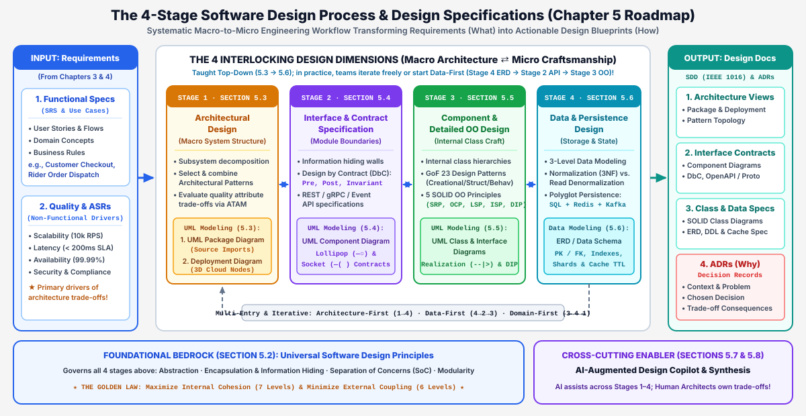
</div>

<!--
請看這張核心總覽圖——它將剛才我們所講的「四大設計維度與雙向迭代流程」完整視覺化，同時也是我們第五章的章節導覽地圖！

請看最左側的輸入：軟體設計承接需求工程的兩大輸入——功能規格 (SRS 與使用案例) 以及非功能品質驅動因子 (關鍵架構需求 ASR)。

再看正中央的四階段設計流程，每一階段皆搭配專屬的 UML 或資料圖表：
第一階段（**5.3 節**）是 **架構設計 (Architectural Design)**：進行子系統分解、組合架構模式、執行 ATAM 權衡，並以 **UML 套件圖** 與 **UML 部屬圖** 塑模巨觀結構。
第二階段（**5.4 節**）是 **介面與契約規格 (Interface & Contract Specification)**：建立資訊隱藏邊界、定義 **契約式設計 (DbC)**，並以 **UML 組件圖** 的棒棒糖與插座塑模組件合約。
第三階段（**5.5 節**）是 **組件與物件導向設計 (Component & Detailed OO Design)**：深入組件內部，運用 GoF 設計模式與 **SOLID 五大原則**，並以 **UML 類別圖** 塑模。
第四階段（**5.6 節**）是 **資料與持久化設計 (Data & Persistence Design)**：進行三層次資料塑模、繪製 **UML ERD 綱要**，並設計 SQL、Redis 與 Kafka 多模態儲存。

請特別留意四個方塊之間的**雙向箭頭**以及下方的**多起點迭代迴路**：教學上我們由左至右（巨觀 5.3 → 微觀 5.6）依序探索；但在實務開發中，你可以從 Stage 1（架構先行）切入，也可以從 Stage 4（資料結構 ERD 先行）往回推導 API 與類別！

總結這張投影片，請記住這個核心觀念：軟體設計串聯「架構 (5.3) ⇄ 介面契約 (5.4) ⇄ 物件導向 (5.5) ⇄ 資料設計 (5.6)」四大交織維度，透過雙向迭代產出 SDD 與 ADR 規格。
-->
---
<!-- _class: lead -->
<!-- header: '5.2 軟體設計核心原則' -->

# **5.2 通用軟體設計核心原則**

> "優良的設計極易修改；拙劣的設計在每一步都抗拒改變。"  
> — *Dave Thomas (The Pragmatic Programmer)*

<!--
歡迎進入 5.2 節：通用軟體設計核心原則。

無論你是在跨雲端環境設計一個由數十個 Kubernetes 叢集組成的微服務平台，還是在寫一個二十行的 Java 工具類別，軟體工程背後的物理定律是完全相同的。

在這一節中，我們將學習所有軟體設計的基石：模組化、抽象化、資訊隱藏、關注點分離，以及軟體工程最至高無上的黃金法則：高凝聚度與低耦合度。

總結這張投影片，請記住這個核心觀念：通用設計原則在軟體系統的每一個抽象層次中都如分形般一體適用。
-->
---
## 通用原則：貫穿全尺度的「分形 (Fractal)」特性

* **軟體設計具有分形特性 (Fractal Nature)：**
  - 同一套核心法則，在不同層級的放大鏡下展現出完全一致的規律：
    - **系統巨觀層級 (System Scale)**：微服務架構將業務領域拆解為獨立解耦、高凝聚的自治服務。
    - **模組套件層級 (Module Scale)**：Package 與函式庫將特定職責封裝於公開 API 邊界之後。
    - **類別微觀層級 (Class Scale)**：單一類別嚴格封裝狀態，只保留單一的改變理由 (SRP)。
* **原則的本質是為了克服人類心智的極限：**
  - 電腦記憶體有幾十 GB，但人類的「工作記憶 (Working Memory)」只有 7 ± 2 個區塊 (Miller's Law)。
  - 設計原則是工程心智工具，旨在確保大型軟體能被人類大腦理解、維護與擴充。

<!--
為什麼我們稱這些原則為「通用」原則？

因為軟體設計具備分形特性。從高空俯瞰整個企業系統，是服務與服務透過 API 互動；放大到單一微服務內部，是套件與套件透過介面溝通；再放大到單一套件內部，是類別與類別透過方法呼叫。

在每一個縮放視角下，規則始終如一：職責專一、彼此解耦、隱藏內部、關注點分離。

總結這張投影片，請記住這個核心觀念：通用設計原則在系統、套件與類別尺度中分形運作，保護人類工程師免於認知超載。
-->
---
## 經典設計準則：模組化、抽象化與關注點分離

* **1. 抽象化 (Abstraction) — *[認知簡化視角：定義「做什麼 What」]*：**
  - 萃取核心概念並建立高階公開介面合約 (`interface`)，省略無關實作細節，降低開發者的心智認知負荷。
* **2. 封裝與資訊隱藏 (Encapsulation) — *[防護邊界視角：守護「怎麼做 How」]*：**
  - *David Parnas 原則：* 將狀態與行為綑綁於模組膠囊內並鎖住 `private` 內部變數，防止外部代碼破壞狀態不變性。
* **3. 關注點分離 (Separation of Concerns, SoC) — *[邏輯維度：正交切分不同職責面向]*：**
  - 將系統依不同問題維度正交拆解（如：UI 呈現 vs. 業務規則 vs. SQL 查詢 vs. 日誌稽核），避免不同面向糾纏。
* **4. 模組化 (Modularity) — *[實體封裝：打造可獨立測試與插拔的結構單元]*：**
  - 在實體結構上將系統組織為邊界清晰、高內聚的獨立建構單元（如 Package、JAR、微服務），支援平行開發與熱替換。

<!--
這四大原則是乾淨程式碼的基石：
抽象化讓你在呼叫 map.insert 時，不必管底層是紅黑樹還是雜湊表；
封裝與資訊隱藏運用 private 關鍵字守護內部不變性；
關注點分離確保 UI 程式碼絕不拼接 SQL 語句；
模組化讓數十位工程師能夠同時開工而不互相衝突。

總結這張投影片，請記住這個核心觀念：抽象化、封裝、關注點分離與模組化是抵禦代碼複雜度的四大基石。
-->
---
## 至高黃金法則：高凝聚度與低耦合度

* **凝聚度 (Cohesion)：**
  - 衡量單一類別或模組內部所有責任與成員彼此關聯的緊密程度。
  - **工程目標：** **高凝聚度 (High Cohesion)**（一個模組只專注做好一件事）。
* **耦合度 (Coupling)：**
  - 衡量不同模組之間直接相依與牽扯的強烈程度。
  - **工程目標：** **低耦合度 (Low Coupling)**（模組間透過抽象合約互動，對彼此實作細節完全無知）。
* **軟體工程至高黃金法則：**
  > **「極大化凝聚度，極小化耦合度！」**  
  > 高凝聚確保模組專注好懂；低耦合確保改動不會引發骨牌式連鎖崩潰。

<!--
如果整堂課你只能記住一句話，請記住這八個字：高內聚、低耦合！

凝聚度衡量內部專注度：這個類別是只專注於算帳，還是同時包辦發信、產生 PDF 與連接資料庫？我們要追求高凝聚。

耦合度衡量外部牽連度：當我修改 A 類別時，會不會導致十個完全不相關的檔案全部編譯失敗？我們要追求低耦合。

總結這張投影片，請記住這個核心觀念：高凝聚確保內部職責單純聚焦，低耦合杜絕修改引發的致命連鎖反應。
-->
---
## 凝聚度與耦合度：不良設計 vs. 優良設計對比 (UML 視角)

<div class="centered-image">
  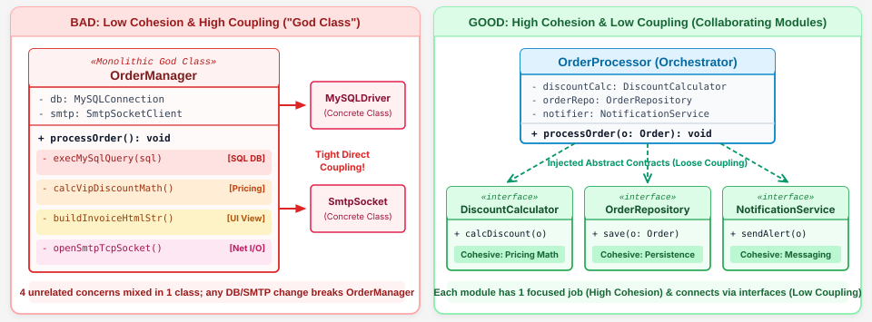
</div>

* **劣質設計 (`OrderManager` 上帝類別)**：單一類別塞入 SQL、折扣運算、HTML 與 SMTP 連線，導致**偶然性低內聚**與**緊密實體耦合**。
* **優良設計 (`OrderProcessor` 協同架構)**：各類別專注單一職責（**功能性高內聚**），並透過注入抽象介面協作（**鬆散介面解耦**）。

<!--
請看這段具體的 Java 代碼對照：

在上面的壞設計中，OrderManager 是典型的上帝類別：一個方法裡塞了 SQL、折扣計算、HTML 模板和底層網路通訊！只要郵件伺服器改通訊協定，結帳類別就得跟著改！

在下面的好設計中，OrderProcessor 只有一個高內聚職責：工作流調度。它把算數學交給 DiscountCalculator，把存檔交給 OrderRepository，把發信交給 NotificationService。每個協作者都能被獨立測試與替換！

總結這張投影片，請記住這個核心觀念：將臃腫的單體類別拆解為專注、協同的服務，是實踐高凝聚與低耦合的經典範例。
-->
---
## 內聚力的層次與類型：從弱到強 (Weak to Strong)

* **內聚力譜系 (Yourdon & Constantine)**：衡量單一模組內部各元素彼此關聯與聚焦的緊密程度：

| 層次 | 內聚力類型 | 核心特徵與運作機制 | 實務範例 | 品質評估 |
| :--- | :--- | :--- | :--- | :--- |
| **7** | **功能性 (Functional)** | 所有元素只為完成單一、明確的業務或運算目標 | `calculateTax()`, `sin(x)` | **最高境界** |
| **6** | **順序性 (Sequential)** | 前一步驟的輸出直接作為下一步驟的輸入（流水線） | `read() → parse() → validate()` | **強烈推薦** |
| **5** | **溝通性 (Communicational)**| 各項操作共用相同的輸入資料或產出相同輸出 | `updateAddr()` 兼 `printLabel()` | **可接受** |
| **4** | **過程性 (Procedural)** | 僅因特定執行先後順序而綁在一起，處理不同資料 | 先 `checkAuth()` 再 `auditLog()` | **普通 (中度)** |
| **3** | **時間性 (Temporal)** | 元素僅因「在同一時間點執行」而被包在一起 | `initStartup()`, `closeAll()` | **偏弱 (應重構)** |
| **2** | **邏輯性 (Logical)** | 包攬同類任務，由外部傳入的 Flag 決定執行分支 | `export(int mode)` (CSV/PDF) | **不良 (違 OCP)** |
| **1** | **偶然性 (Coincidental)** | 元素間毫無邏輯關聯，純屬隨機拼湊的大雜燴 | `CommonUtils`, `MiscHelper` | **最差 (杜絕)** |

<!--
讓我們深入探討 Larry Constantine 與 Edward Yourdon 提出的經典 7 大內聚力層次。

最高境界是「功能性內聚」：模組或類別只專注做好一件純粹而定義清晰的事情。每一行程式碼都為同一個目標效力。

其次是「順序性內聚」，如流水線般由前一步骤直接供應下一步骤。

而在階梯下方則是常見的反模式：時間性內聚將開機要做的事情全部塞進同一個肥大方法；邏輯性內聚用一個 flag 控制多種不同運算；最嚴重的則是偶然性內聚，也就是大家常見的 GeneralUtils 工具包，裡面什麼雜七雜八的函式都往裡塞。

總結這張投影片，請記住這個核心觀念：極力追求功能性與順序性內聚，並主動重構消除時間性、邏輯性與偶然性內聚。
-->
---
<!-- _class: title-image-slide -->

## 內聚力視覺化譜系：7 大內聚層次圖解 (從強到弱)

<div class="image-wrapper">
  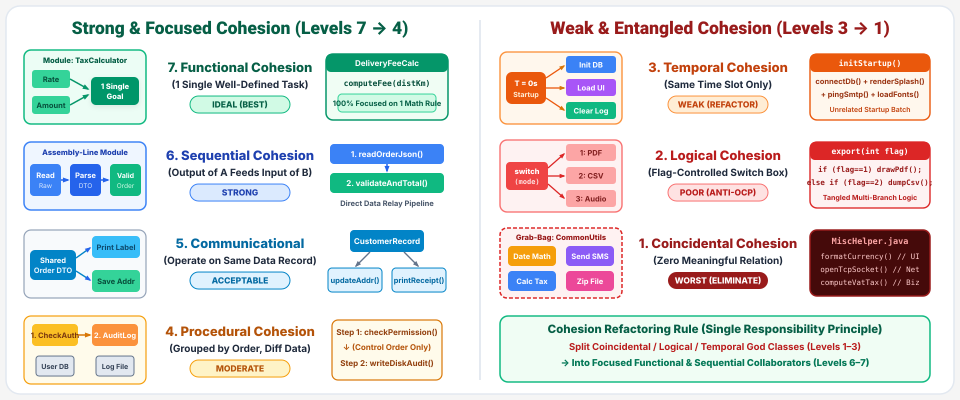
</div>

<!--
在看詳細對照表之前，我們先透過這張視覺化全景圖，直觀比較 7 種不同程度的「內聚力 (Cohesion)」。

左半部（綠與藍色系）代表高凝聚、職責清晰的優良設計：第 7 級「功能性內聚」所有元素只為完成單一明確目標；第 6 級「順序性內聚」如同流水線，前一步驟的輸出直接成為下一步驟的輸入；第 5 級「溝通性內聚」共用同一份資料結構；第 4 級「過程性內聚」則依控制流程先後執行。

右半部（橘與紅色系）則是職責糾纏的反模式：第 3 級「時間性內聚」只因同在開機瞬間執行就塞進 initStartup；第 2 級「邏輯性內聚」用外部傳入的 mode 旗標控制龐大的 switch 分支；最糟的第 1 級「偶然性內聚」則是毫無關聯的 CommonUtils 大雜燴。

總結這張投影片，請記住這個核心觀念：模組設計應極力向左上角的「功能性與順序性內聚」靠攏，並重構拆解右半部的旗標大傘與雜物箱類別。
-->
---
## 耦合度的層次與類型：從緊到鬆 (Tight to Loose)

* **耦合度譜系**：衡量不同模組之間呼叫、資料傳遞與知識共享的牽扯深度：

| 層次 | 耦合度類型 | 依賴機制與破壞風險 | 實務範例 | 品質評估 |
| :--- | :--- | :--- | :--- | :--- |
| **1** | **內容耦合 (Content)** | 直接存取或竄改另一模組的私有內部欄位或分支 | 繞過封裝直接改他者 `private` 欄位 | **最差 (極危險)** |
| **2** | **共用耦合 (Common)** | 多個模組共同讀寫全域可變變數或共享狀態 | 多執行緒共用未保護的全域 Flag | **高風險** |
| **3** | **控制耦合 (Control)** | 透過傳遞控制旗標 (Flag) 支配另一模組內部流程 | 傳入 `mode = 3` 操控被呼叫者分支 | **中高風險** |
| **4** | **標記耦合 (Stamp)** | 傳遞整包複合資料物件，但對方僅需其中一欄 | 只需 `zipCode` 卻傳入整包 `Customer` | **中度 (可改善)** |
| **5** | **資料耦合 (Data)** | 僅透過簡單、獨立且必要的純量參數進行通訊 | `calculateArea(width, height)` | **呼叫最佳** |
| **6** | **訊息/事件 (Message)**| 透過非同步事件通訊，彼此完全不知曉對方存在 | EventBus 發布 `OrderPlacedEvent` | **最理想 (解耦)** |

<!--
接著我們來看耦合度的 6 大層次，從最危險的緊密耦合邁向最優質的鬆散解耦。

最糟的稱為「內容耦合」：A 模組直接深入 B 模組的私有實作細節，徹底擊穿封裝。B 模組稍有改動，A 模組直接陣亡。

「共用耦合」則是多個模組共用全域變數，往往引發難以重現的並行競爭與副作用。

「控制耦合」是傳入 flag 決定對方的內部分支，這表示呼叫端對被呼叫端的內部實作細節知曉得太多。

「標記耦合」是傳遞過大的資料物件，造成不必要的資料結構綁定。

「資料耦合」是直接呼叫時的黃金標準：只傳入運算所需的純量參數。

而「訊息/事件解耦」則透過事件匯流排達到時空徹底分離。

總結這張投影片，請記住這個核心觀念：杜絕內容與共用耦合，降低控制耦合，優先採用資料耦合與事件驅動設計。
-->
---
<!-- _class: title-image-slide -->

## 耦合度視覺化譜系：6 大耦合層次圖解 (從鬆到緊)

<div class="image-wrapper">
  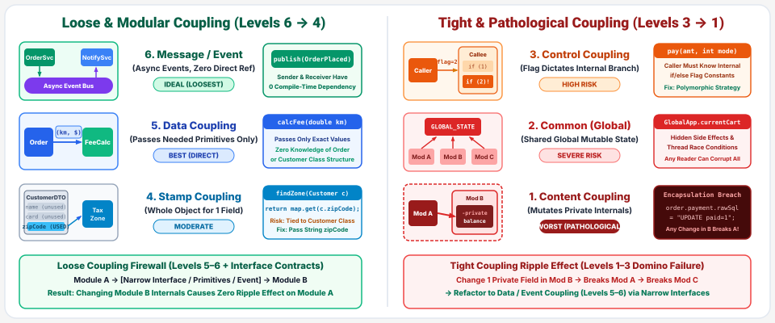
</div>

<!--
接著我們透過同樣的視覺化風格，對比模組之間 6 種不同程度的「耦合度 (Coupling)」。

左半部代表鬆散、低度牽連的優良耦合：第 6 級「訊息與事件耦合」透過非同步 Event Bus 通訊，發送端與接收端達到零編譯期依賴；第 5 級「資料耦合」只傳遞必要的純量參數（如距離與金額）；第 4 級「標記耦合」則傳遞了整包 CustomerDTO，但對方其實只讀取其中的 zipCode 欄位。

右半部則是高風險的緊密耦合反模式：第 3 級「控制耦合」由呼叫端傳入 flag=2 去遙控被呼叫端內部的 if-else 分支；第 2 級「共用耦合」讓多個模組同時讀寫同一個全域變數 GLOBAL_STATE，極易引發競爭條件；最致命的第 1 級「內容耦合」則直接刺穿封裝邊界，竄改另一模組的 private 私有欄位。

總結這張投影片，請記住這個核心觀念：鬆散耦合如同架構防火牆，能將修改影響完全隔離；緊密耦合則會引發骨牌效應，改動一個欄位就導致全系統連環崩潰。
-->
---
### 觀念檢核測驗 1 (CCQ 1)
<!-- id: ase-ch05-ccq1 -->
<div class="ccq-columns">
  <div class="ccq-text">

在軟體系統設計中，將**高凝聚度 (High Cohesion)** 與 **低耦合度 (Low Coupling)** 相互結合，其最主要的實質工程效益為何？

- **A.** 將所有輔助函式全部內聯至單一執行檔中，極大化處理器底層指令執行速度。
- **B.** 將內部實作變動隔離於模組邊界內，使單一類別修改不致引發跨模組連鎖損壞。
- **C.** 強制規定將所有領域資料結構集中存放於單一全域可變記憶體空間中統一管理。
- **D.** 徹底免除在持續整合管線中撰寫與執行自動化整合測試及回歸測試套件的負擔。

  </div>
  <div class="ccq-logo">
    <a href="https://nlhsueh.github.io/nickedupocket/#/student/ase-ch05-ccq1" target="_blank"></a>
  </div>
</div>

<!--
讓我們檢驗一下對凝聚度與耦合度的理解。

題目問：將高凝聚度與低耦合度結合，最主要的實質工程效益是什麼？

我們來分析選項：
選項 A，為了極致 CPU 效能把程式碼全混在一起，是在破壞模組化。
選項 C，使用全域變數，是低凝聚高耦合的教科書級反模式！
選項 D，免除寫測試，是不切實際的幻想。

正確答案是 B！高凝聚讓類別職責聚焦，低耦合確保邊界乾淨——因此改動單一類別時，波及範圍最小。

總結這張投影片，請記住這個核心觀念：高凝聚與低耦合嚴格限制代碼變更的衝擊半徑，確保長期的系統可維護性。
-->
---
<!-- _class: lead -->
<!-- header: '5.3 階段一：架構設計、模式與巨觀 UML' -->

# **5.3 階段一 — 架構設計：架構模式、ATAM 權衡與套件/部屬圖**

> 「軟體架構沒有完美的解法，只有持續的權衡取捨。」  
> — *Thomas Sowell*

<!--
歡迎來到 5.3 節：軟體設計流程的階段一 —— 架構設計：架構模式、ATAM 權衡與套件/部屬圖。

在 5.1 確立了四階段設計流程、並在 5.2 掌握了通用設計原則之後，我們正式進入第一階段：巨觀架構設計 (Architectural Design)。

在本節中，我們首先探索六大經典架構模式（MVC、Layered、Repository、Client-Server、Pipe & Filter 與 Microservices）、剖析外送平台的複合架構與 ATAM 品質權衡；緊接著示範如何使用專屬於架構設計階段的兩張巨觀 UML 圖表——**UML 套件圖 (Package Diagram)**（編譯期模組邊界）與 **UML 部屬圖 (Deployment Diagram)**（執行期雲端硬體拓撲）將系統架構完整描繪出來！

總結這張投影片，請記住這個核心觀念：階段一架構設計結合了架構模式合成、ATAM 權衡評估，以及 UML 套件圖與部屬圖的巨觀塑模。
-->
---
## 什麼是軟體架構？ (What is Software Architecture?)

* **正式定義 (IEEE 1471 / ISO 42010)：**
  > 軟體架構是系統的根本性組織，體現在其組件、組件彼此與環境之間的相互關係，以及指導其設計與演進的原則中。
* **架構的「橋樑角色 (The Bridge Role)」：**
  - **需求 (What)**：利益關係人的期望、使用者故事與限制條件。
  - **實作 (How)**：具體程式碼、資料表綱要與測試案例。
  - **架構 (橋樑)**：將混亂的人類需求轉化為結構化的子系統、服務邊界與部屬拓撲。
* **微觀架構 vs. 巨觀架構 (In the Small vs. In the Large)：**
  - **微觀架構 (In the Small)**：單一應用程式內部的模組組織與類別劃分。
  - **巨觀架構 (In the Large)**：企業級分散式系統、雲端叢集、事件匯流排與異質資料庫拓撲。

<!--
什麼是軟體架構？

軟體架構是系統的根本性組織，體現在其組件、組件與環境的關係，以及指導演進的原則中。

請注意它的橋樑角色：需求工程告訴我們要做什麼，寫程式是具體代碼的產出。架構是連接兩者的橋樑——它決定了系統的骨架模組、資料庫持久化策略與網路通訊協定。

因為架構決策是日後最難、成本最高更換的部分，儘早把架構做對，是專案成敗的關鍵。

總結這張投影片，請記住這個核心觀念：軟體架構透過建立高階組件結構與通訊邊界，串接起抽象需求與具體程式碼。
-->
---
## 什麼是軟體架構模式？ (Architectural Patterns)

* **架構模式的本質：**
  - 架構模式是在給定軟體工程情境下，針對**反覆出現的結構性設計問題，所提出經過實戰檢驗的通用可復用解法**。
  - 設計模式 (Design Patterns) 作用於微觀類別層次；架構模式則決定**整個系統的巨觀宏觀結構拓撲**。
* **架構模式的三大核心要素：**
  - **1. 情境 (Context)**：特定反覆出現的軟體系統開發環境與工程挑戰。
  - **2. 問題與作用力 (Problem & Forces)**：相互抗衡的需求拉扯（如：資料解耦 vs. 即時性延遲）。
  - **3. 解法與代價 (Solution & Consequences)**：組件劃分、通訊約束與必須接受的缺點妥協。
* **為什麼架構模式至關重要：**
  - 為大型工程團隊建立共通詞彙，避免重複犯下歷史上的經典架構錯誤。

<!--
什麼是軟體架構模式？

架構模式是針對反覆發生的結構性問題，淬鍊出的標準解法。

請注意，模式不是程式碼，而是結構原型。當架構師提出『分層架構加儲存庫模式』時，團隊每個人腦中立刻浮現出模組邊界與資料流向。

架構模式凝聚了業界數十年的智慧，為工程團隊建立了共同的架構詞彙與可預測的取捨。

總結這張投影片，請記住這個核心觀念：架構模式凝聚成熟結構經驗，為團隊建立共通溝通語言與可預測的權衡指標。
-->
---
## 六大經典架構模式全景對照總表

| 模式名稱 | 拓撲外觀特徵 | 核心運作機制 | 最適用場景 | 主要風險與承擔代價 |
| :--- | :--- | :--- | :--- | :--- |
| **1. MVC** | 三角循環迴圈 (`C → M → V`) | 徹底分離使用者介面與底層領域資料模型 | 具備豐富互動界面的 Web / 行動應用 | 對單純資料展示 (CRUD) 過於繁瑣複雜 |
| **2. 分層架構** | 垂直堆疊階層 (`N → N-1`) | 嚴格由上至下單向呼叫，跨層抽象隔離 | 企業級資訊系統、傳統關聯式資料庫應用 | 呼叫堆疊過深引發效能耗損（水槽反模式） |
| **3. 儲存庫架構**| 星狀輻射樞紐架構 | 主動協同組件圍繞被動共用資料庫 | 編譯器、IDE 開發環境、多工資料分析系統 | 中央資料庫成為效能瓶頸與單一故障點 (SPOF) |
| **4. 主從式架構**| 跨網路分散式 (`C ↔ S`) | 前端客戶端向集中式後端伺服器請求資源 | Web 網站、檔案伺服器、集中管控服務 | 網路延遲風險；尖峰流量伺服器過載 |
| **5. 管線過濾器**| 線性單向資料流串接 | 獨立過濾器藉由單向管線串接串流數據 | 影音轉檔、大數據 ETL、編譯詞法分析 | 不適用於互動式 GUI；相鄰介面資料轉換開銷 |
| **6. 微服務架構**| 去中心化服務網狀拓撲 | 獨立部署自治微服務，各擁專屬私有 DB | 超大型、團隊規模龐大、需極速迭代的雲平台 | 分散式系統複雜度：網路延遲、分散式交易 |

<!--
這份六大經典架構模式全景對照表，是架構師必備的工具庫：
MVC 解耦呈現與資料；
分層架構建立垂直嚴格邊界；
儲存庫架構圍繞中央資料庫運作；
主從式架構分散運算；
管線過濾器專精串流轉換；
微服務架構則將大系統拆解為獨立部署的網狀服務。

總結這張投影片，請記住這個核心觀念：全景矩陣提供了評估各種經典架構機制與取捨代價的清晰全貌指南。
-->
---
<!-- _class: title-image-slide -->

## 架構模式視覺導覽：5.3 六大經典架構樣式總覽

<div class="image-wrapper">
  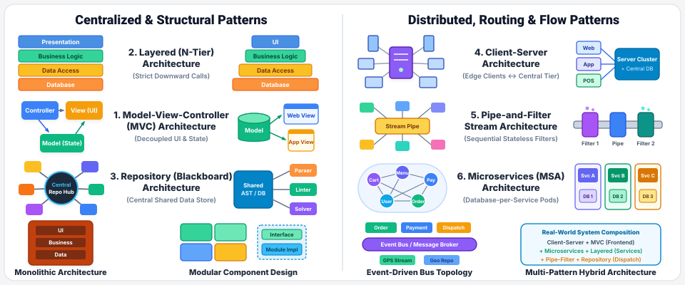
</div>

<!--
在逐一深入各個架構模式之前，請先看這張 5.3 節的「架構模式視覺全景導覽圖」。

我們可以將本節的六大經典架構模式分為左右兩大陣營：
左側是「集中式與結構型模式 (Centralized & Structural Patterns)」：
包含垂直分層的 Layered (N-Tier) 架構、分離畫面與狀態的 MVC 架構、圍繞中央資料樞紐運作的 Repository (黑板) 架構，以及最下方的單體架構與模組化組件基礎。

右側則是「分散式、路由與資料流模式 (Distributed, Routing & Flow Patterns)」：
包含跨越網路邊界的 Client-Server 架構、串接無狀態串流轉換的 Pipe-and-Filter 管線架構、各擁私有資料庫的 Microservices 微服務架構，以及底部的事件匯流排 (Event Bus) 與多模式複合架構！

總結這張投影片，請記住這個核心觀念：掌握「集中結構型」與「分散資料流型」兩大譜系，就能快速建立軟體架構的全景心智地圖。
-->
---
## 1. 模型-視圖-控制器模式 (MVC)：職責與權衡

* **三大核心組件職責切分：**
  - **Model (模型)**：封裝核心領域商業資料、驗證規則與真實狀態，對前端視覺呈現完全無知。
  - **View (視圖)**：負責將資料格式化並渲染成視覺介面（HTML、App 畫面、圖表），監聽模型狀態變化。
  - **Controller (控制器)**：攔截使用者輸入與 HTTP 請求，轉譯並調度商業邏輯以更新 Model，並選派對應 View。
* **適用場景與實務案例：**
  - 具備豐富使用者互動、或同一份領域資料需同時支援多種視覺呈現方式（如 Web 儀表板、行動介面、匯出報表）的系統。
* **工程優勢與取捨代價：**
  - **優勢**：徹底落實關注點分離；前端 UI 設計師與後端工程師可平行開發、獨立演進而不互相干擾。
  - **代價**：對極簡單的單純資料展示 (CRUD) 略顯繁瑣；若 View 繞過 Controller 直接修改狀態會破壞解耦邊界。

<!--
接著我們深入剖析 MVC 模式的職責分工與工程取捨。

透過將 Model、View 與 Controller 嚴格分離，前端工程師可以隨時改版網頁介面排版，完全不必觸碰底層核心的算帳與驗證程式碼！同時，同一份 Model 可以同時驅動網頁與手機 App 多種視圖。

不過在極簡單的單表維護功能中，完整套用 MVC 可能增加跳轉層級；團隊也必須避免把商業邏輯塞進 Controller 造成「肥控制器」反模式。

總結這張投影片，請記住這個核心觀念：MVC 以少許結構間接層為代價，換取前端視覺與後端領域模型的獨立演進彈性。
-->
---
<!-- _class: title-image-slide -->

## 1. 模型-視圖-控制器模式 (MVC) — 架構拓撲圖

<div class="image-wrapper">
  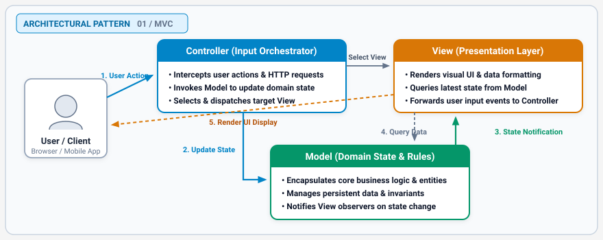
</div>

<!--
我們先透過架構拓撲圖來觀察第一個經典模式：Model-View-Controller (MVC)。

請順著圖中的編號箭頭觀察三角循環資料流：
第一步：User 透過瀏覽器或 App 發送操作請求給 Controller。
第二步：Controller 將操作轉譯為商業動作，呼叫 Model 更新領域狀態。
第三步：Model 狀態變更後，主動發送通知給觀察者 View。
第四步：View 向 Model 查詢最新狀態資料。
第五步：View 將最新畫面渲染呈現給使用者。

總結這張投影片，請記住這個核心觀念：MVC 透過 Controller、Model 與 View 的三角互動迴圈，徹底解耦視覺呈現與底層資料邏輯。
-->
---
## 2. 分層架構模式 (Layered Architecture)：職責與權衡

* **階層劃分與相依規則：**
  - 水平劃分為四層：**展示層 (Presentation) → 應用服務層 (Application) → 領域業務層 (Business) → 持久化層 (Persistence)**。
  - **嚴格分層原則 (Strict Layering)**：每一層僅相依於緊鄰的下一層 (`Layer N → Layer N-1`)，嚴禁由下往上逆向呼叫或越級跨層存取。
* **適用場景與實務案例：**
  - 標準企業資訊系統、電商後台、金融帳務核心系統等需要明確團隊分工與多層級資安防護的應用。
* **工程優勢與取捨代價：**
  - **優勢**：抽象職責清晰、變更隔離極佳——若底層資料庫由 MySQL 遷移至 DynamoDB，核心領域業務層完全零衝擊。
  - **代價**：易陷入**架構水槽反模式 (Architecture Sinkhole Anti-pattern)**（大量請求僅層層穿透轉發而無實質商業運算，徒增呼叫與物件轉換延遲）。

<!--
我們接著分析分層架構的核心規範與權衡代價。

分層架構之所以成為企業系統最普及的標準，是因為它的結構天然對齊工程團隊職責：前端、後端業務與資料庫管理各司其職。

它最大的價值在於「變更隔離」：當公司決定更換資料庫引擎時，只需抽換最底層的 Persistence 實作，上層商業邏輯一行都不必改！

但架構師必須防範「架構水槽反模式」：若多數請求只是機械式穿透四層卻沒有業務邏輯，將白白耗損記憶體轉換與呼叫延遲。

總結這張投影片，請記住這個核心觀念：分層架構確保底層技術變更不波及上層核心業務，但須避免無謂的跨層穿透耗損。
-->
---
<!-- _class: title-image-slide -->

## 2. 分層架構模式 (Layered Architecture) — 架構拓撲圖

<div class="image-wrapper">
  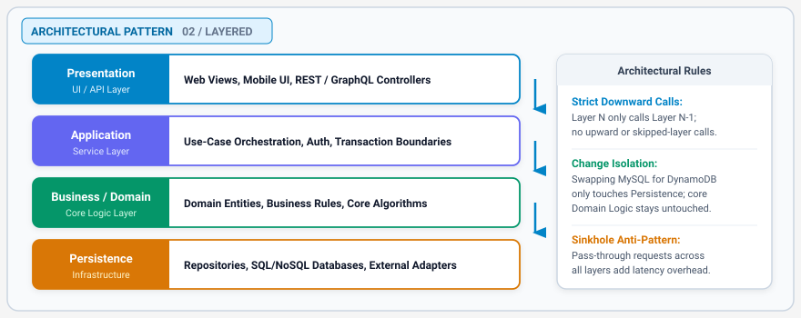
</div>

<!--
我們來看第二個模式：分層架構 (Layered Architecture) 的視覺拓撲圖。

圖中由上而下垂直堆疊了四個標準抽象層次：
最上層是 Presentation 展示層（Web 畫面、行動介面、REST API 控制器）；
第二層是 Application 應用服務層（負責使用案例工作流調度與交易邊界）；
第三層是 Business / Domain 領域業務層（封裝核心商業規則與實體演算法）；
最底層是 Persistence 持久化與基礎設施層（資料庫存取與外部系統介接）。

請特別注意右側向下的箭頭：每一層只允許單向呼叫其正下方的一層。

總結這張投影片，請記住這個核心觀念：分層架構將系統組織為由上而下嚴格單向呼叫的垂直抽象階層。
-->
---
## 3. 儲存庫架構模式 (Repository Architecture)：職責與權衡

* **核心組件與拓撲特徵：**
  - **中央儲存庫 (Central Repository)**：維護系統所有共享持久化狀態與資料一致性規則的被動儲存中心。
  - **獨立存取組件 (Active Subsystems)**：各自獨立運作的工具或分析子系統，彼此互不知曉，僅透過中央儲存庫讀寫共享資料。
* **適用場景與實務案例：**
  - 需要多個專業工具圍繞同一份龐大複雜資料結構協同處理的系統：**整合開發環境 (IDE)、編譯器 (共享 AST 語法樹)、CAD 工程繪圖系統、AI 黑板系統 (Blackboard)**。
* **工程優勢與取捨代價：**
  - **優勢**：徹底消除工具間的直接相依；新增外掛工具（如新語法檢查器）只需對接中央儲存庫，無須修改既有組件。
  - **代價**：中央儲存庫極易成為效能瓶頸與**單一故障點 (SPOF)**；一旦中央資料綱要 (Schema) 變更，所有相依子系統皆受影響。

<!--
接著看儲存庫架構的職責與取捨。

以大家每天用的 VS Code 或 IntelliJ IDE 為例：程式碼高亮器、編譯器、Linter 靜態分析器與除錯器，都需要讀取你正在寫的語法樹 (AST)。若讓工具之間彼此傳遞幾百 MB 的語法樹，記憶體早就爆了！透過中央儲存庫，各工具直接共享同一份核心狀態，外掛擴充無比輕鬆。

但它的致命傷在於單點故障與競爭瓶頸：中央儲存庫一旦當機或鎖死，外圍所有工具將瞬間全數停擺。

總結這張投影片，請記住這個核心觀念：儲存庫架構極度適合多工具高效共享海量複雜資料，但必須嚴密防範中央瓶頸與單一故障點風險。
-->
---
<!-- _class: title-image-slide -->

## 3. 儲存庫架構模式 (Repository Architecture) — 架構拓撲圖

<div class="image-wrapper">
  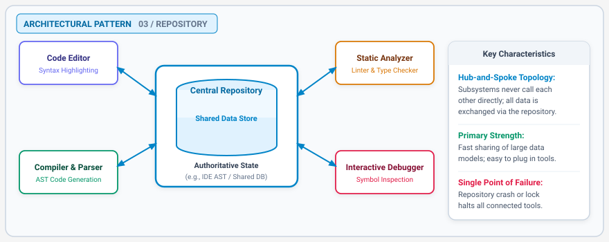
</div>

<!--
我們來看第三個模式：儲存庫架構 (Repository Architecture) 的視覺拓撲圖。

請觀察圖中的「星狀輻射樞紐 (Hub-and-Spoke)」結構：
正中央是 Central Repository 中央儲存庫，維護著全系統唯一的真實共享資料（例如 IDE 中的抽象語法樹 AST 或大型共用資料庫）。
四周圍繞著獨立運作的子系統：Code Editor、Compiler、Static Analyzer 與 Interactive Debugger。

請注意：這四個工具彼此之間完全沒有連線，所有資料交換與協作皆透過中央儲存庫完成。

總結這張投影片，請記住這個核心觀念：儲存庫架構透過中央共享資料樞紐，讓多個獨立工具在不產生直接耦合的前提下協同運作。
-->
---
## 4. 主從式架構模式 (Client-Server Architecture)：職責與權衡

* **分散式節點職責分工：**
  - **客戶端 (Client Tier)**：分散於使用者終端的消費者，負責介面渲染、本地互動，並向伺服端發起網路服務請求。
  - **伺服端 (Server Tier)**：集中式服務提供者，負責權限驗證、核心商業邏輯運算、並行存取控制與資料持久化。
* **適用場景與實務案例：**
  - 現代 Web 網站、行動銀行 App、企業內部系統與線上多人服務——凡需讓多地終端安全存取共享資料的場景皆適用。
* **工程優勢與取捨代價：**
  - **優勢**：機密資料與資安防護集中於伺服端治理；後端升級對客戶端透明；無狀態伺服器可透過負載平衡器輕鬆水平擴展。
  - **代價**：高度受制於網路延遲、封包遺失與斷線風險；集中式伺服器端點面臨尖峰流量過載與 DDoS 攻擊威脅。

<!--
我們來剖析主從式架構的工程職責與權衡。

主從式架構將最敏感的資料庫與商業邏輯鎖在受防火牆保護的伺服器叢集中，而把輕量化的操作介面交給瀏覽器與手機。當後端需要修補漏洞或升級演算法時，直接更新伺服器即可，全球使用者立即生效。

然而，跨越實體網路意味著「網路永遠是不可靠的」：架構師必須在設計中納入 TLS 加密、タイムアウト重試、快取與負載平衡機制，以應對延遲與流量洪峰。

總結這張投影片，請記住這個核心觀念：主從式架構實現了資料安全與核心運算的集中治理，但必須針對網路延遲與伺服器負載進行韌性設計。
-->
---
<!-- _class: title-image-slide -->

## 4. 主從式架構模式 (Client-Server Architecture) — 架構拓撲圖

<div class="image-wrapper">
  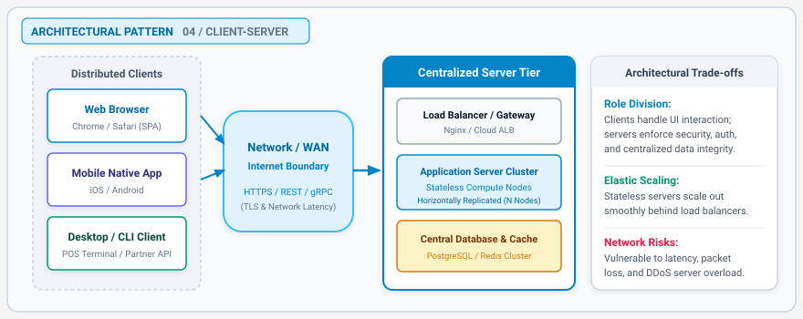
</div>

<!--
我們來看第四個模式：主從式架構 (Client-Server Architecture) 的視覺拓撲圖。

左側是分布在世界各地的多樣化客戶端 (Clients)：包含 Web 瀏覽器、iOS/Android 原生行動 App 以及門市 POS 終端機。
中間是網際網路邊界 (Network / WAN)，透過 HTTPS、REST 或 gRPC 傳輸加密封包。
右側則是集中式伺服器叢集 (Centralized Server Tier)：由負載平衡閘道器接收流量，分發給可水平擴展的無狀態應用伺服器，最後存取中央資料庫與快取叢集。

總結這張投影片，請記住這個核心觀念：主從式架構跨越網路邊界，將分散式前端互動終端與集中式後端運算儲存清楚分離。
-->
---
## 5. 管線與過濾器模式 (Pipe-and-Filter)：職責與權衡

* **資料流串流機制：**
  - **過濾器 (Filters)**：獨立、無狀態 (Stateless) 的資料轉換單元，只負責讀取輸入串流、執行單一轉換並產出輸出串流，完全不知曉上下游組件是誰。
  - **管線 (Pipes)**：單向資料傳輸通道，負責緩衝並將資料流從上游過濾器傳遞至下游過濾器。
* **適用場景與實務案例：**
  - 多階段循序資料轉換系統：**Unix Shell 指令管線 (`cat | grep | sort`)、編譯器前端、影音串流編解碼管線、大數據批次 ETL 資料工程**。
* **工程優勢與取捨代價：**
  - **優勢**：極致的高內聚與可重組性（各過濾器可自由抽換、重排或復用）；各階段天然支援多核心並行運算加速。
  - **代價**：完全不適合需要即時雙向回饋的互動式 GUI 系統；相鄰過濾器之間反覆解析與序列化資料流會帶來效能開銷。

<!--
接著我們檢視管線與過濾器模式的職責與優缺點。

因為每一個 Filter 都是無狀態且只認標準資料流，它完全不關心前一手是誰、後一手是誰。這帶來了極致的模組化：你可以隨時在管線中間插入一個「加密過濾器」或「日誌過濾器」，而不必修改任何既有程式碼！

但請注意它的限制：這種單向流水線完全不適合處理使用者隨機點擊的圖形互動介面，而且每一站對資料的打包與拆包也會消耗 CPU 資源。

總結這張投影片，請記住這個核心觀念：管線過濾器架構賦予資料流處理極致的組合彈性與並行能力，但不適用於互動式使用者介面。
-->
---
<!-- _class: title-image-slide -->

## 5. 管線與過濾器模式 (Pipe-and-Filter) — 架構拓撲圖

<div class="image-wrapper">
  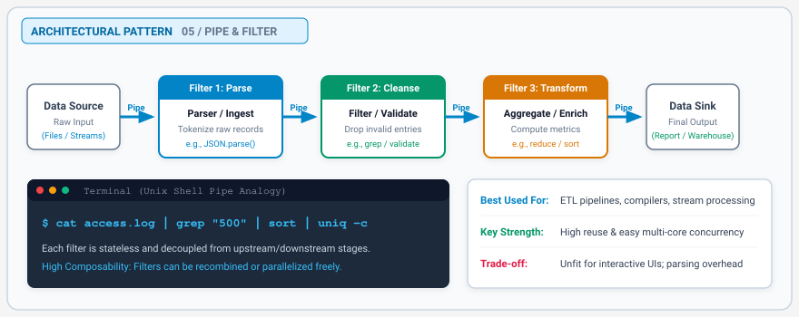
</div>

<!--
我們來看第五個模式：管線與過濾器 (Pipe-and-Filter Architecture) 的視覺拓撲圖。

請看上半部的單向資料處理流水線：
原始資料從左側 Data Source 流出，經由 Pipe 傳入 Filter 1 進行語法解析 (Parse)；
解析後的結構化串流經由下一段 Pipe 傳入 Filter 2 進行資料清洗與驗證 (Cleanse)；
接著再流入 Filter 3 進行統計聚合 (Transform)，最後輸出至右側 Data Sink。

下半部則是經典的 Unix 命令列管線實例：將 cat、grep、sort 與 uniq 串接成一氣呵成的處理管線。

總結這張投影片，請記住這個核心觀念：管線與過濾器模式將複雜資料處理拆解為一連串無狀態、單向串接的獨立轉換階段。
-->
---
## 6. 微服務架構模式 (Microservices, MSA)：職責與權衡

* **去中心化自治服務核心原則：**
  - **獨立領域服務 (Autonomous Services)**：圍繞業務領域邊界 (Bounded Context) 拆分為小型服務，各自運行於獨立容器並具備專屬 CI/CD 部署流水線。
  - **一服務一資料庫 (Database-per-Service)**：各微服務嚴格封裝專屬私有資料庫；跨服務僅能透過 API (REST/gRPC) 或非同步事件匯流排 (Event Bus) 通訊。
* **適用場景與實務案例：**
  - 組織規模龐大（數十個敏捷開發團隊）、業務領域複雜且需高頻獨立上線與局部彈性擴展的大型雲端平台（如 Netflix、Uber、Amazon）。
* **工程優勢與取捨代價：**
  - **優勢**：**卓越的故障隔離（控制衝擊半徑 Blast Radius）**；支援單點瓶頸服務獨立擴展；團隊自主部署與異質技術棧自由選用。
  - **代價**：分散式系統複雜度飆升：網路延遲、跨庫分散式交易 (Saga 最終一致性)、分散式追蹤除錯困難，以及高昂的 Kubernetes/DevOps 維運成本。

<!--
最後我們深入剖析微服務架構的核心規範與權衡代價。

微服務解決了超大型企業的兩大痛點：「故障雪崩」與「組織擴展瓶頸」。當支付服務發生異常時，商品瀏覽與搜尋服務依然正常運作，故障被嚴格鎖在單一容器邊界內；同時，數十個團隊每天可以各自獨立部署上線，互不卡關。

然而，微服務絕非銀彈：原本奈秒級的記憶體呼叫變成了可能失敗的網路呼叫，原本簡單的資料庫 ACID 交易變成了複雜的 Saga 最終一致性，更需要強大的 DevOps 團隊維運 Kubernetes 與分散式監控。

總結這張投影片，請記住這個核心觀念：微服務架構以承擔分散式網路與維運複雜度為代價，換取大型團隊極致的部署自治與故障隔離。
-->
---
<!-- _class: title-image-slide -->

## 6. 微服務架構模式 (Microservices, MSA) — 架構拓撲圖

<div class="image-wrapper">
  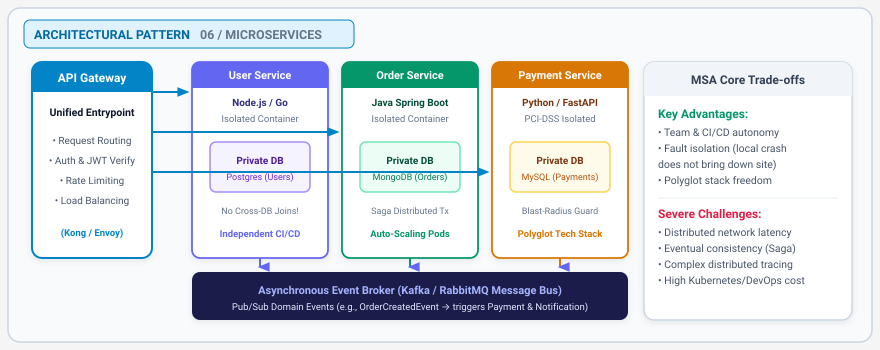
</div>

<!--
我們來看第六個模式：微服務架構 (Microservices Architecture, MSA) 的視覺拓撲圖。

請從左至右觀察整體雲原生拓撲：
左側所有外部請求統一經過 API Gateway 閘道器，完成路由分發、JWT 權限驗證與速率限制。
中間則是依業務領域拆分的自治微服務叢集：User 會員服務 (Node.js + Postgres)、Order 訂單服務 (Spring Boot + MongoDB) 與 Payment 支付服務 (Python + MySQL)。
請特別注意：每個微服務都擁有自己專屬的 Private DB，嚴禁跨服務直接連資料庫做 SQL JOIN！
底部則透過 Kafka / RabbitMQ 非同步事件匯流排發布領域事件，實現跨服務解耦協作。

總結這張投影片，請記住這個核心觀念：微服務架構將龐大系統拆解為獨立部署、各自封裝私有資料庫的自治領域服務叢集。
-->
---
## 單體架構 vs. 微服務架構：深度技術對比

| 比較維度 | 單體架構 (Monolithic Architecture) | 微服務架構 (Microservices Architecture) |
| :--- | :--- | :--- |
| **部署單元** | 單一巨大二進位執行檔 / WAR 包 / 容器 | 數十至數百個獨立運行的輕量微容器 |
| **資料儲存** | 單一共享全域關聯式資料庫 (Shared DB) | **各服務私有資料庫 (Database-per-Service)** |
| **通訊成本** | 極速奈秒級程序內記憶體呼叫 (In-memory) | 毫秒級網路呼叫 (RPC / REST / gRPC / 訊息佇列) |
| **故障隔離** | **極差**：模組 A 記憶體洩漏會導致全系統當機 | **卓越**：金流服務崩潰，使用者依然能正常瀏覽商品 |
| **團隊擴展** | 龐大代碼衝突、部署協調成本隨人數激增 | 獨立特徵團隊，每週自主上線部署數十次 |
| **維運門檻** | 低門檻（單一 CI/CD 流水線、集中式日誌） | 極高門檻（Kubernetes、分散式追蹤、服務網格） |
| **適用時機** | 新創公司、MVP 概念驗證、小型團隊 (<15人) | 組織規模龐大 (>50人)、業務領域極度複雜之企業 |

<!--
請仔細對比單體架構與微服務架構。

單體就像一棟摩天大樓，所有代碼同住在一個地基資料庫上。呼叫只要奈秒，維運極為簡單。但在十樓漏水，整棟大樓都受影響！

微服務就像獨立別墅社區，每棟房子有自己的水電系統。一間跳電，社區其他人家依然燈火通明。

但請牢記：別墅社區需要複雜的道路、管線維護。不要為了趕時髦而貿然採用微服務；小型團隊從模組化單體起步通常是更明智的選擇。

總結這張投影片，請記住這個核心觀念：微服務是以維運複雜度換取團隊自治與故障隔離；初期除非組織規模龐大，否則應謹慎採用。
-->
---
## 實戰案例解析：外送平台如何組合六大架構模式？

* **複合架構思維 (Multi-Pattern Composition)**：依**縮放層級 (Zoom Level)** 與**業務特性**組合模式：

| 架構模式 | 在 Food Delivery 系統中的對應部位與層級 | 解決的核心工程問題 |
| :--- | :--- | :--- |
| **1. MVC** | **顧客點餐 App 與商家接單看板 (前端互動層級)** | 同一份 `OrderModel` 狀態變更時，同步刷新「即時地圖 View」與「進度條 View」 |
| **2. 分層架構** | **`Order Service` 服務內部 (`Controller → Domain → Repo`)** | 將運費計算、滿額折抵等核心商業規則與底層 PostgreSQL 資料庫徹底隔離 |
| **3. 儲存庫架構**| **AI 智慧派單引擎 (`Geo-State Repository`)** | 路徑規劃、順路併單、動態加價等演算法圍繞中央「全城即時座標狀態庫」協作 |
| **4. 主從式架構**| **三大終端 App (顧客/餐廳/外送員) ↔ 雲端叢集** | 將菜單定價、優惠驗證與金流扣款集中於伺服端管控，防止客戶端竄改金額 |
| **5. 管線過濾器**| **外送員即時 GPS 串流 (`雜訊過濾 → 道路匹配 → ETA`)** | 以無狀態管線平行處理全城每秒 10 萬筆以上 GPS 軌跡座標與送達時間預估 |
| **6. 微服務架構**| **雲端後台領域拆分 (`Menu`, `Order`, `Pay`, `Dispatch`)** | 暴雨尖峰可單獨將派單服務擴展 20 倍；評價服務當機絕不波及點餐結帳 |

<!--
請看這張外送平台六大架構模式對照表，這正是軟體架構「分形與合成」的最佳典範：

第一，在前端 App 層級使用 MVC，確保訂單資料與多重視覺畫面解耦。
第二，在單一服務內部使用 Layered 分層架構，保護商業邏輯不受資料庫技術綁架。
第三，在 AI 智慧派單中心使用 Repository 黑板模式，讓多個最佳化演算法高效共享全城即時路況與訂單池。
第四，在跨網路邊界使用 Client-Server，集中守護資安與金流。
第五，在即時定位串流使用 Pipe-and-Filter，實現高吞吐量的串流清洗與 ETA 計算。
第六，在企業後台巨觀層級使用 Microservices，達成故障隔離與獨立彈性擴展。

這也直接引出我們下一節 5.4 的主題：架構設計不是逛街挑單一模式，而是由需求驅動的多視角合成！

總結這張投影片，請記住這個核心觀念：優秀的架構師不會死守單一模式，而是根據不同層級與非功能需求靈活組合多種架構模式。
-->
---
<!-- _class: title-image-slide -->

## 實戰案例：外送平台系統 (Food Delivery) — 複合架構全景圖

<div class="image-wrapper">
  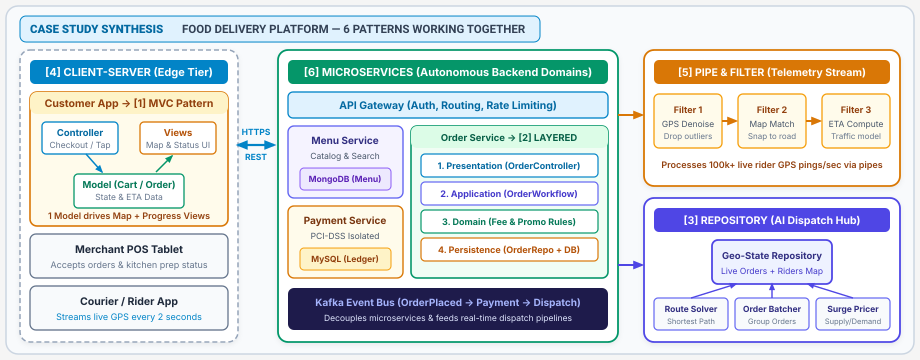
</div>

<!--
學完了六大經典架構模式後，請思考一個關鍵問題：真實世界的大型系統（例如 UberEats 或 foodpanda 外送平台），是只挑選其中一種模式來建造的嗎？

請看這張外送平台的複合架構全景圖，答案絕對是否定的！真實系統會在不同「縮放層級」與「子系統領域」中，巧妙組合這六種模式：

在左側系統邊界，採用 Client-Server 連接顧客、商家與外送員三大終端；而放大進到顧客 App 內部，則用 MVC 讓同一份訂單狀態同時驅動地圖畫面與進度列。
在中間雲端後台，巨觀上採用 Microservices 拆分菜單、訂單与支付服務；但放大進到單一 Order Service 內部，則是標準的四層 Layered 分層架構。
在右側即時資料流，採用 Pipe-and-Filter 管線處理每秒十萬筆外送員 GPS 訊號；而在智慧派單中心，則採用 Repository 儲存庫模式，讓路徑規劃、順路併單與動態加價演算法圍繞同一份全城即時地理狀態庫協同運算！

總結這張投影片，請記住這個核心觀念：真實世界的軟體架構絕非單一模式，而是跨層級、跨子系統的多模式分形組合。
-->
---
## 軟體架構直接決定非功能品質屬性

* **品質屬性無法在軟體完工後靠補丁外掛：**
  - 你無法建造一個高度緊耦合的單體系統，然後指望靠寫幾個單元測試就讓它具備百萬並行能力。
* **架構決策如何實質主宰品質屬性：**
  - ⚡ **效能 (Performance)**：由跨網路呼叫跳轉數、記憶體快取層與資料庫分割策略直接決定。
  - 🛡️ **安全性 (Security)**：由零信任網路隔離、API 閘道防護與機密資料庫階層切分嚴格把關。
  - 🦺 **安全性/防護力 (Safety)**：由關鍵控制核心與非關鍵模組之物理隔離所保障（如汽車煞車 vs. 影音娛樂系統）。
  - 🔄 **可用性與容錯 (Availability)**：由冗餘備援節點、健康檢查、斷路器 (Circuit Breaker) 與自動容錯轉移所構築。
  - 🔧 **可維護性 (Maintainability)**：由系統是否嚴格落實高凝聚與低耦合邊界所主宰。

<!--
為什麼說架構直接主宰了系統的品質屬性？

因為非功能品質屬性——效能、安全性、可用性、容錯力——是結構骨架產生的物理特性，根本無法在事後靠貼補丁加上去！

舉汽車軟體為例：如果把控制煞車的程式碼跟車載娛樂系統放在同一條未隔離的記憶體匯流排上，娛樂系統當機就可能導致煞車失靈！這就是為什麼安全關鍵系統必須有嚴密的實體隔離架構。

總結這張投影片，請記住這個核心觀念：非功能品質屬性是系統結構骨架的直接體現，絕無法在完工後憑空補救。
-->
---
## 架構權衡分析 (Architecture Trade-off Analysis) 與 ATAM

* **不可避免的衝突矩陣 (No Silver Bullet)：**
  - **效能 vs. 安全性**：深層封包檢測、加密與防詐審核必然增加回應延遲。
  - **可用性 vs. 一致性 (CAP 定理)**：分散式強一致性鎖定會在尖峰網路抖動時阻塞結帳。
  - **模組化 vs. 執行效能**：細粒度分層與跨微服務 RPC 呼叫會增加序列化開銷。
* **ATAM (架構權衡分析法 — 卡內基美隆大學 SEI)：**
  - 在寫程式前，透過具體「品質屬性情境 (Scenarios)」系統化評估架構決策：
    - **敏感點 (Sensitivity Points)**：對單一品質屬性起決定性作用的關鍵決策（如：`Payment Service` 的斷路器直接決定結帳**高可用性**）。
    - **權衡點 (Trade-off Points)**：同時拉扯多個互斥品質屬性的決策點（顧此則失彼）。
    - **風險點與非風險點 (Risks & Non-Risks)**：尚未緩解的架構脆弱點 vs. 已驗證安全的設計。

<!--
軟體架構最核心的修煉，就是權衡分析 (Trade-off Analysis)。

卡內基美隆大學軟體工程研究所 (SEI) 提出的 ATAM 架構權衡分析法，協助架構師在動工寫代碼前，用真實壓力情境找出系統的「敏感點」與「權衡點」。

下一頁我們立即以剛剛的「Food Delivery 外送平台」為例，實際演練一次 ATAM 架構權衡分析！

總結這張投影片，請記住這個核心觀念：ATAM 能在編碼前系統化揪出架構敏感點與品質衝突點，讓技術妥協成為透明的工程決策。
-->
---
## ATAM 實戰案例：外送平台 (Food Delivery) 架構權衡分析

* **以 Food Delivery 系統的 4 個關鍵架構決策演練 ATAM 權衡點：**

| 外送平台架構決策點 | 相互拉扯的品質屬性 (ATAM Trade-off Point) | 架構師的 ATAM 折衷解方 (Resolution) |
| :--- | :--- | :--- |
| **1. 外送員 GPS 回報頻率**<br>(`每 1 秒` vs. `每 15 秒`) | **地圖即時精準度 (易用性)** ↔ **手機耗電與伺服器頻寬 (資源效率)** | **動態自適應頻率**：接近顧客送達點時改為 `2 秒`；在餐廳等餐靜止時降為 `15 秒` |
| **2. 結帳扣款與廚房派單**<br>(`同步 2PC 鎖定` vs. `非同步 Saga`) | **跨服務強一致性** ↔ **暴雨尖峰高可用性與低延遲 (CAP 定理)** | **混合式 Saga**：金流授權採同步快速預扣，餐廳接單與派單則走 Kafka 非同步事件 |
| **3. AI 派單儲存庫狀態**<br>(`單一中央庫` vs. `地理分片`) | **全城全域路徑最佳化** ↔ **中央儲存庫單點故障風險 (SPOF)** | **依城市行政區分片 (Geo-Sharding)**：以 Redis 記憶體叢集分區儲存並配置熱備援 |
| **4. 優惠券與盜刷防詐檢查**<br>(`深層 ML 模型` vs. `輕量規則`) | **資安防詐嚴密性 (Security)** ↔ **結帳吞吐量與低延遲 (<200ms)** | **兩階段管線**：API Gateway 內嵌 `<15ms` 輕量規則攔截；事後背景非同步跑 ML 風控 |

<!--
讓我們把 ATAM 放到剛剛的 Food Delivery 外送平台上，看看架構師每天都在面對什麼樣的真實權衡：

第一個決策：外送員的手機 App 應該幾秒回傳一次 GPS？如果設成每 1 秒回傳，顧客看地圖上的小機車移動非常滑順（易用性高），但外送員的手機兩小時就沒電了，伺服器頻寬也暴增！ATAM 找出這個權衡點後，採取「動態自適應頻率」：快到顧客家時每 2 秒傳一次，在餐廳等餐時每 15 秒傳一次。

第二個決策：周五暴雨晚餐尖峰，結帳時如果要同步鎖定「訂單、金流、餐廳、派單」四個資料庫 (2PC)，只要派單慢一點，全站結帳就卡死！ATAM 決策將金流預授權設為同步，而通知餐廳與呼叫外送員改走 Kafka 非同步 Saga 事件，保住尖峰高可用性。

第三個決策：智慧派單的 Repository 中央儲存庫雖然讓配對最快，卻是單點故障 (SPOF) 的高度敏感點；因此透過「依城市分區分片 (Geo-Sharding) + 主從備援」來消除風險。

第四個決策：防盜刷風控若在結帳當下跑大型 AI 模型會拖慢速度，因此拆為「Gateway 15 毫秒快篩 + 事後非同步深度風控」。

總結這張投影片，請記住這個核心觀念：ATAM 幫助我們針對外送平台的真實壓力場景，在互斥的品質屬性之間設計出最精準的折衷機制。
-->
---
## UML 套件圖：核心符號規範與外送平台設計洞察

> **架構意義（編譯期模組視圖）：** 塑模**原始碼組織結構**、子系統命名空間可見度與**無環模組相依規則**。

<div class="two-columns">
<div class="card" data-marpit-fragment>

### UML 核心符號與語法規則 (Notations)
- **資料夾符號 (`Package`)**：將高內聚類別與介面歸入單一命名空間（如 `domain.order`）。
- **可見度修飾詞 (`+` Public vs. `-` Private)**：`+OrderApplicationService` 與 `+IOrderRepository` 對外公開；`-SurgePricingPolicy` 則嚴格隱藏於套件內。
- **相依虛線箭頭 (`- - ->`)**：標註 `«import»` 或 `«access»`，由相依端指向被相依端（Supplier 變動可能影響 Client）。
- **無環相依原則 (ADP)**：套件相依圖必須為有向無環圖 (DAG)，嚴禁雙向循環引用。

</div>
<div class="card" data-marpit-fragment>

### Food Delivery 外送平台設計洞察
- **領域限界上下文切分**：核心業務明確拆分為 `domain.order`、`domain.dispatch` 與 `domain.payment` 三大獨立套件。
- **依賴反轉原則 (DIP) 的視覺化體現**：
  - 上層 `ui.customer_app` 向下 `«import»` `domain.order`。
  - 底層 `infra.persistence` (`PostgresOrderRepoImpl`) 則是**向上反轉 `«import»`** `domain.order` 中的 `IOrderRepository` 介面！
- **架構效益**：整個 `domain.*` 核心層對 PostgreSQL、Redis、Kafka 與 Stripe SDK **零編譯期相依**。

</div>
</div>

<!--
我們進一步拆解 UML 套件圖的語法重點與外送平台的設計巧思。

請看左欄卡片的四個核心符號：
資料夾圖示代表 Package；內部的 `+` 號代表對外公開的 API 或介面，`-` 號則將內部演算法鎖在套件裡，防止外部模組越界耦合。
虛線箭頭代表 `«import»` 相依關係，而且必須嚴格遵守 ADP 無環相依原則。

再看右欄卡片的外送平台設計洞察：
初學者畫套件圖時，常讓 `domain.order` 向下依賴 `infra.persistence`；但在專業架構中，我們把 `+IOrderRepository` 介面放在 `domain.order` 套件內，讓底層的 `infra.persistence` 向上 `«import»` 領域層！
如此一來，無論未來把資料庫從 PostgreSQL 換成 MySQL，或把金流從 Stripe 換成 LINE Pay，`domain.*` 核心套件一行程式碼都不必重編譯！

總結這張投影片，請記住這個核心觀念：套件圖能一眼檢驗系統是否落實依賴反轉，確保核心業務邏輯不受底層基礎設施綁架。
-->
---
<!-- _class: title-image-slide -->

## 巨觀結構塑模 (1)：UML 套件圖 (Package Diagram)

<div class="image-wrapper">
  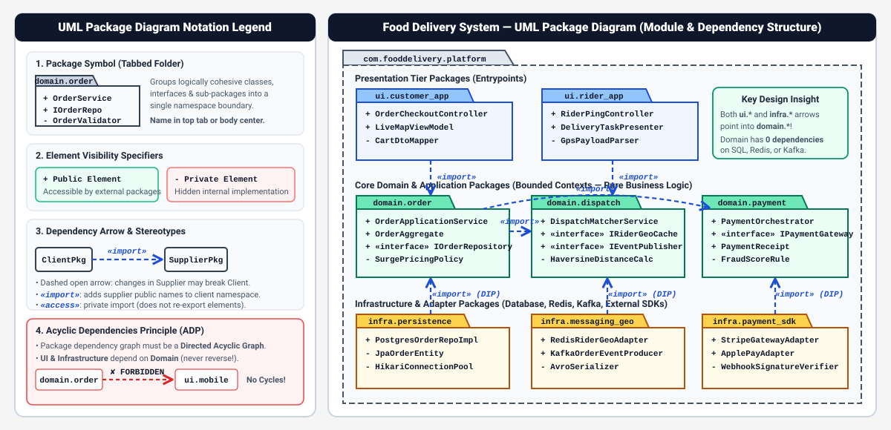
</div>

<!--
當我們選定了架構模式並完成 ATAM 權衡後，該如何用標準的 UML 圖表把「階段一：巨觀架構設計」畫出來？
在架構設計階段，我們使用兩張互補的巨觀 UML 圖表：第一張是 **UML 套件圖 (Package Diagram)**（描繪編譯期原始碼模組切分與相依規則），第二張是 **UML 部屬圖 (Deployment Diagram)**（描繪執行期雲端硬體與容器拓撲）。

我們先看第一張巨觀架構圖：UML 套件圖 (Package Diagram)，並以 Food Delivery 外送平台為例。

請先看左側面板的標準 UML 符號：
第一，Package 符號畫成一個帶有左上角標籤的資料夾 (Tabbed Folder)，用來將高內聚的類別與介面收納在同一個命名空間內。
第二，可見度符號 (Visibility)：加號 `+` 代表公開匯出給外部套件呼叫的元素（如 `+OrderService`、`+IOrderRepo`）；減號 `-` 代表封閉在套件內部的私有實作細節（如 `-OrderValidator`）。
第三，虛線開放箭頭 (`- - ->`) 搭配 `«import»` 或 `«access»`，代表編譯期相依：當被指向的供應端套件修改時，來源端套件就可能被迫重新編譯。
第四，架構治理的黃金鐵律——無環相依原則 (ADP)：套件之間的相依圖絕對不能出現循環 (`A → B → A`)！

再看右側面板的外送平台實例：無論是頂層的 UI 展示套件 (`ui.customer_app`, `ui.rider_app`)，還是底層的基礎設施套件 (`infra.persistence`, `infra.messaging_geo`, `infra.payment_sdk`)，所有的相依箭頭全部朝向中間的核心領域套件 (`domain.order`, `domain.dispatch`, `domain.payment`)！

總結這張投影片，請記住這個核心觀念：UML 套件圖負責規範編譯期命名空間邊界，並強制所有外部套件向核心領域單向相依。
-->
---
### 同儕討論：西洋棋遊戲之 MVC 架構與 UML 套件圖 (PlantUML 實戰)

<div class="discussion-columns">
  <div class="discussion-text">

  **動手塑模挑戰：以 PlantUML 繪製西洋棋 (Chess) MVC 套件圖 (4 分鐘)**
  - **情境設定：** 你的團隊正採用 **MVC (Model-View-Controller)** 架構模式開發一款**西洋棋遊戲 (Chess Game)**。
  - **1. 將類別歸入三大高內聚套件 (`package` 語法)：**
    - `chess.model`：`+Board`、`+Piece`、`+MoveValidator`、`-BitboardEngine`（純粹棋規與狀態，**嚴禁依賴 UI**）。
    - `chess.view`：`+BoardCanvasUI`、`+MoveHistoryPanel`、`+SoundPlayer`（畫面渲染與音效呈現）。
    - `chess.controller`：`+GameController`、`+TurnTimerHandler`（接收滑鼠點擊並調度棋局更新）。
  - **2. 於 [PlantText](https://www.planttext.com) 撰寫 PlantUML 套件圖代碼：**
    - 使用 `package "chess.model" { ... }` 定義邊界，並以虛線箭頭 `..> : «import»` 連接套件。
    - **架構審查問題：** 相依箭頭 `..>` 應該指向哪個方向？`chess.model` 是否完全零對外相依？你的套件圖是否符合 **無環相依原則 (ADP)**？

  </div>
  <div class="discussion-logo">
    
  </div>
</div>

<!--
現在我們進行 4 分鐘的同儕討論與動手塑模練習！

假設你的團隊正在開發一款「西洋棋遊戲 (Chess Game)」，並決定採用我們在 5.3 節學過的 **MVC (Model-View-Controller)** 架構模式。
請與鄰座同學合作，打開 PlantText.com，用 PlantUML 語法畫出它的 **UML 套件圖 (Package Diagram)**：
第一，定義三個套件：`chess.model`、`chess.view` 與 `chess.controller`，並在套件內標示公開類別（`+Board`、`+MoveValidator`）與私有內部引擎（`-BitboardEngine`）。
第二，畫出套件之間的虛線相依箭頭 `..> : «import»`。

請特別與夥伴討論檢查：哪一個套件應該「完全沒有向外射出的相依箭頭」，好讓它能在沒有視窗介面的情況下獨立跑單元測試？（答案是 `chess.model`！）此外，你要如何設計 `chess.view` 與 `chess.controller` 的關係，才不會違反「無環相依原則 (ADP)」產生循環依賴？

總結這張投影片，請記住這個核心觀念：透過 PlantUML 繪製 MVC 套件圖，能確保核心棋規模型 (Model) 與視覺介面 (View) 徹底解耦並符合無環相依原則。
-->
---
## UML 部屬圖：3D 節點、產物與外送平台雲端高可用性解析

> **架構意義（執行期基礎設施視圖）：** 塑模**硬體伺服器、雲端容器叢集、實體二進位檔與網路傳輸協定**。

<div class="two-columns">
<div class="card" data-marpit-fragment>

### UML 核心符號與語法規則 (Notations)
- **3D 立體節點 (`«device»` / `«executionEnv»`)**：
  - `«device»`：實體硬體或雲端主機（手機、AWS EC2、ALB）。
  - `«executionEnvironment»`：巢狀運行容器（K8s Pod、Docker、JVM、DBMS）。
- **部屬產物 (`«artifact»` + 📄 圖示)**：實體部署檔案（如 `order-service:v2.4.jar`、`rider-gps.apk`），用以實體化 (`«manifest»`) 邏輯組件。
- **通訊路徑與基數 (Multiplicity)**：實線標註底層協定（`«gRPC / HTTP2»`、`«JDBC / TLS»`）與叢集實例數（`[5..20]`）。

</div>
<div class="card" data-marpit-fragment>

### Food Delivery 外送平台設計洞察
- **揭露彈性擴縮容策略 (Auto-Scaling)**：
  - 面對晚餐尖峰每秒數萬筆 GPS 座標，`Dispatch Pod [5..20]` 的擴縮上限顯著高於 `Payment Pod [2..6]`。
- **消除單點故障 (SPOF) 與高可用配置**：
  - 明確標示 `RDS [1 Primary + 2 Replica]`、`Redis [6 Shards]` 與 `Kafka [3 Nodes]` 叢集拓撲。
- **網路安全與協定邊界透明化**：
  - 外網採用 `«HTTPS / WSS»`、內網東西向採用高效能 `«gRPC»`，連往外部 `Stripe Cloud` 則強制 `«HTTPS / mTLS»`。

</div>
</div>

<!--
我們來統整 UML 部屬圖的語法精髓與實務價值。

請看左欄卡片的三個核心元素：
第一，3D 立體方塊代表 Node（`«device»` 硬體主機或 `«executionEnvironment»` 容器環境）。
第二，`«artifact»` 文件方塊代表實際編譯出來的 `.jar`、`.apk` 或 `.sql` 檔案。
第三，實線通訊路徑標明了兩台機器之間到底走什麼網路協定與開幾台實例。

再看右欄卡片的外送平台洞察：
這張部屬圖呈現了原始碼階段完全看不到的維運關鍵——我們一眼就能檢查：派單服務有沒有設定 `[5..20]` 自動擴縮？PostgreSQL 有沒有設 Read Replica 防止單點故障？Redis 有沒有分片？連往外部 Stripe 金流有沒有走 mTLS 加密？

總結這張投影片，請記住這個核心觀念：部屬圖讓負載擴縮、叢集備援與網路安全邊界一目了然，是架構師與 DevOps 團隊溝通的共同語言。
-->
---
<!-- _class: title-image-slide -->

## 巨觀硬體拓撲塑模 (2)：UML 部屬圖 (Deployment Diagram)

<div class="image-wrapper">
  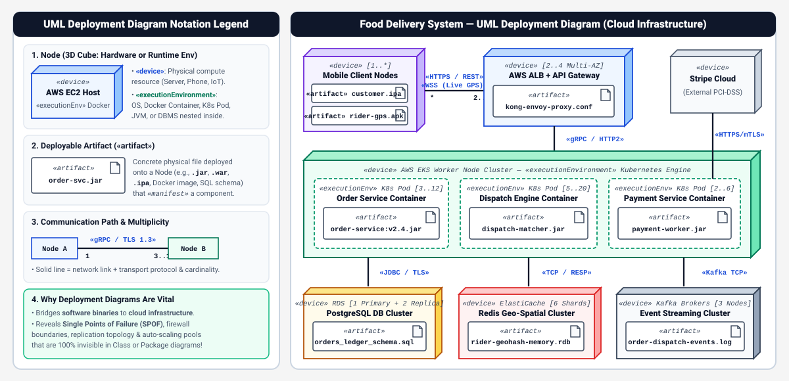
</div>

<!--
套件圖管的是編譯期原始碼資料夾，那如果要呈現主從式架構與微服務在 AWS 雲端上的執行期硬體拓撲，該畫哪張圖？答案就是 **UML 部屬圖 (Deployment Diagram)**！

請先看左側面板的標準 UML 部屬圖符號：
第一，節點 (Node) 一律畫成「3D 立體方塊」，分為兩類刻板印象：`«device»` 代表實體運算硬體（如智慧型手機、AWS EC2 主機、硬體負載平衡器）；`«executionEnvironment»` 則代表巢狀執行環境（如 Kubernetes Pod、Docker 容器、JVM 或資料庫引擎）。
第二，部屬產物 (`«artifact»`) 畫成帶有摺角文件圖示的方框，代表真正被複製並安裝到節點上的實體二進位檔案（例如 `order-service.jar`、`customer.ipa` 或 `orders_schema.sql`）。
第三，節點之間的實線稱為「通訊路徑 (Communication Path)」，必須標註網路傳輸協定（如 `«HTTPS»`、`«gRPC»`、`«TCP/RESP»`、`«JDBC/TLS»`）以及節點數量基數 (`[3..12]`)。

再看右側面板的外送平台實體雲端拓撲：顧客與外送員的手機節點透過 HTTPS 與 WSS 長連線連入跨可用區的 AWS API Gateway，再以 gRPC 轉發至 AWS EKS 叢集中的三個自動擴縮 Pod 群（Order `[3..12]`、Dispatch `[5..20]`、Payment `[2..6]`），底層則連接一主二從的 RDS PostgreSQL、6 分片的 Redis ElastiCache 以及 3 節點的 Kafka 叢集！

總結這張投影片，請記住這個核心觀念：UML 部屬圖將軟體二進位產物映射至 3D 硬體節點、容器叢集與網路協定上。
-->
---
<!-- _class: title-image-slide -->

## 5.3 架構設計總結回顧：結構型 vs. 分散與資料流模式

<div class="image-wrapper">
  
</div>

<!--
在 5.3 節（階段一：架構設計）的最後，讓我們再次回到這張六大架構模式視覺全景圖，為本節做一個完整的總結收斂。

回顧我們在階段一走過的學習軌跡：
我們先認識了左側的集中結構型模式（Layered 分層、MVC、Repository 儲存庫），接著掌握了右側的分散與資料流模式（Client-Server、Pipe-and-Filter、Microservices）。
透過 Food Delivery 外送平台的複合架構、ATAM 權衡分析，以及 **UML 套件圖**與**部屬圖**的塑模，我們完整掌握了巨觀架構設計的核心方法！

總結這張投影片，請記住這個核心觀念：階段一架構設計結合了六大模式合成、ATAM 權衡與 UML 套件/部屬圖塑模，奠定系統的巨觀骨架。
-->
---
### 觀念檢核測驗 2 (CCQ 2)
<!-- id: ase-ch05-ccq2 -->
<div class="ccq-columns">
  <div class="ccq-text">

在將單體架構 (Monolithic) 與微服務架構 (Microservices) 進行對比時，微服務之所以能夠提供卓越的**故障隔離能力 (Fault Isolation / 縮小衝擊半徑)**，其最核心的結構性原因為何？

- **A.** 所有微服務統一讀寫單一共享的企業級關聯式資料庫並共用全域資料表鎖定。
- **B.** 每個微服務皆運行於獨立行程與私有資料庫中，能阻斷跨服務的骨牌式崩潰。
- **C.** 分散式微服務呼叫能完全消除跨網路封包序列化開銷與節點間的傳輸延遲。
- **D.** 將單體系統拆解為微服務後，能大幅減少雲端叢集監控與自動化維運的人力。

  </div>
  <div class="ccq-logo">
    <a href="https://nlhsueh.github.io/nickedupocket/#/student/ase-ch05-ccq2" target="_blank"></a>
  </div>
</div>

<!--
讓我們檢驗一下對架構模式的理解。

題目問：微服務能提供卓越故障隔離能力的核心結構原因是什麼？

分析選項：
選項 A，共用資料庫是微服務的大忌，會造成資料嚴重耦合！
選項 C，微服務會增加網路傳輸延遲，不可能消除。
選項 D，微服務需要更多的維運與開發人力。

正確答案是 B！每個服務執行在獨立的 Process 與私有資料庫內，單一服務當機不會直接把其他服務拖下水。

總結這張投影片，請記住這個核心觀念：行程與資料庫的實體隔離，是微服務杜絕區域故障演變成全域崩潰的關鍵防線。
-->
---
<!-- _class: lead -->
<!-- header: '5.4 階段二：介面與契約規格 (DbC 與組件圖)' -->

# **5.4 階段二 — 介面與契約規格：契約式設計 (DbC) 與組件圖**

> 「將每一個軟體模組邊界視為具備明確權利 (Rights) 與義務 (Obligations) 的正式商業契約。」  
> — *Bertrand Meyer (契約式設計 Design by Contract 創立者)*

<!--
歡迎來到 5.4 節：軟體設計流程的階段二 —— 介面與契約規格：契約式設計 (DbC) 與組件圖！

在階段一（5.3 節）切分好套件與雲端節點之後，緊接著進入階段二：在各組團隊開始動手寫內部類別程式碼之前，我們該如何精確定義模組之間的**介面邊界與行為契約**，讓前端、後端與第三方金流團隊能平行開發而不互相踩雷？

在本節中，我們將深入學習 Bertrand Meyer 著名的 **契約式設計 (Design by Contract, DbC)**——前置條件、後置條件與類別不變量——並示範如何使用 **UML 組件圖 (Component Diagram)** 的「棒棒糖 (`—○`) 與插座 (`—(`)」符號將隨插即用的介面契約精準畫出來！

總結這張投影片，請記住這個核心觀念：階段二介面與契約規格透過契約式設計（DbC）嚴格定義行為邊界，並以 UML 組件圖進行視覺化塑模。
-->
---
## 契約式設計 (DbC)：權利義務矩陣與工業級 API 規格標準

> **Bertrand Meyer 契約核心精神：** 只要**呼叫端 (Client)** 履行了**前置條件**，**供應端 (Supplier)** 就有義務兌現**後置條件**並維持**類別不變量**。

<div class="two-columns">
<div class="card" data-marpit-fragment>

### DbC 三大契約支柱與權利義務對稱
- **1. 前置條件 (`Precondition` — 呼叫端義務)**：
  - 呼叫前必須為真（`!cart.isEmpty() && token.isValid()`）。
  - *供應端獲得之權益*：內部邏輯不必塞滿重複的防禦性檢查；若呼叫端違約，立即快速失敗 (Fail-Fast)！
- **2. 後置條件 (`Postcondition` — 供應端保證)**：
  - 執行後保證成立（`status == CONFIRMED && stock_after == stock_before - qty`）。
  - *呼叫端獲得之權益*：不必窺探供應端內部實作即可信賴結果。
- **3. 類別不變量 (`Class Invariant` — 領域恆真)**：
  - 方法執行前後恆成立（`order.totalAmount >= 0`）。

</div>
<div class="card" data-marpit-fragment>

### 工業級機器可讀介面規格標準 (API Specs)
- **為什麼要在 SDD 鎖定機器可讀契約？**
  - 讓手機 App、後端微服務與 QA 能透過 Mock Server **同步平行開發與執行契約測試 (Contract Testing)**。
- **三大現代介面規格標準 (外送平台實例)**：
  - **REST API**：**OpenAPI 3.1 (Swagger)** — 明確定義端點、JSON Schema、狀態碼 (`201`, `400`, `422`) 與欄位上下界。
  - **東西向 RPC**：**Protocol Buffers (`.proto`)** — 為微服務間 `gRPC` 通訊提供強型別二進位合約。
  - **事件串流**：**AsyncAPI / Apache Avro** — 定義 Kafka 事件綱要與**冪等鍵 (`idempotency_key: UUID`)**，防止網路重試重複扣款！

</div>
</div>

<!--
我們進一步剖析左欄的「契約式設計權利義務對稱」與右欄的「工業級 API 規格標準」。

請看左欄卡片：在商業合約中，有義務就有權利。
對呼叫端 (Client) 而言，遵守前置條件是義務，獲得後置條件的正確結果就是受保障的權利；
對供應端 (Supplier) 而言，達成後置條件與維持不變量是義務，而不必浪費程式碼處理違法輸入則是它的權利！

再看右欄卡片：在現代軟體工程中，我們如何把這些契約寫進軟體設計文件 (SDD)？
對外 REST API 使用 **OpenAPI 3.1**；內部微服務通訊使用 **gRPC Protocol Buffers (`.proto`)**；Kafka 非同步事件則使用 **AsyncAPI 與 Avro**——並且務必在付款與結帳合約中設計 `idempotency_key`（冪等鍵），確保顧客在網路斷線重按結帳時絕對不會被扣兩次錢！

總結這張投影片，請記住這個核心觀念：結合 DbC 邏輯規則與 OpenAPI/Protobuf 規格，能消除跨團隊溝通歧義並實現契約驅動的平行開發。
-->
---
<!-- _class: title-image-slide -->

## 正式介面規格與契約式設計 (Design by Contract, DbC)

<div class="image-wrapper">
  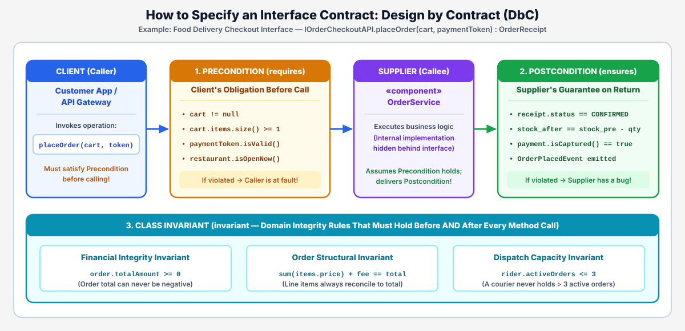
</div>

<!--
請看這張「階段二：正式介面規格與契約式設計 (DbC)」的全景架構圖，我們以 Food Delivery 外送平台的結帳介面 (`IOrderCheckoutAPI.placeOrder`) 為例！

請先看上半部：為什麼光寫一行方法簽章 `placeOrder(cart, token)` 不足以作為設計規格？因為它只規定了參數型別，完全沒規定行為義務與邊界條件！
圖靈獎級大師 Bertrand Meyer 提出的 **契約式設計 (Design by Contract, DbC)**，將每個公開 API 轉化為 **呼叫端 (Client)** 與 **供應端 (Supplier)** 之間具有約束力的三要素法律合約：
1. **前置條件 (`Precondition / require`)**：呼叫端在呼叫方法**之前**必須滿足的義務——購物車不可為空 (`!cart.isEmpty()`)、付款憑證有效 (`token.isValid()`) 且餐廳營業中。
2. **後置條件 (`Postcondition / ensure`)**：供應端在方法執行**完成後**保證兌現的結果——訂單狀態為 `CONFIRMED`、庫存精準扣除 `qty`，並發出 `OrderPlacedEvent`。
3. **類別不變量 (`Class Invariant / invariant`)**：在任何公開方法呼叫**前後皆必須恆為真**的領域約束——訂單總金額永遠 `>= 0` 且外送員同時接單數 `<= 3`。

再看下半部：DbC 消除了各模組重複寫 `if (x != null)` 的防禦性檢查地獄，並且直接對應後續的 **UML 組件圖（棒棒糖與插座）** 以及 5.5 節的 **里氏替換原則 (LSP)**！

總結這張投影片，請記住這個核心觀念：契約式設計（前置條件、後置條件、不變量）將靜態的方法簽章昇華為可驗證的工程行為合約。
-->
---
## 以 Javadoc 與 JML 撰寫正式契約規格：以 `OrderService` 為例

> **從概念圖表走向可驗證規格：** 如何運用 **擴充契約 Javadoc** 與 **JML (Java Modeling Language)** 精確描述 `OrderService.placeOrder()` 的設計規格？

<div class="two-columns">
<div class="card" data-marpit-fragment>

### 1. 契約擴充型 Javadoc 設計規格
```java
public interface OrderService {
  /**
   * 建立並確認外送平台顧客訂單。
   *
   * @invariant activeOrders >= 0
   * @param cart  購物車物件 (非 null 且至少 1 項餐點)
   * @param token 已授權之有效付款憑證
   * @return 狀態為 CONFIRMED 之訂單收據
   * @throws IllegalArgumentException 若違反前置條件
   * @pre  cart != null && !cart.isEmpty()
   *       && token != null && token.isValid()
   *       && stock >= cart.totalQty()
   * @post RESULT != null
   *       && RESULT.getStatus() == Status.CONFIRMED
   *       && stock == OLD(stock) - cart.totalQty()
   */
  OrderReceipt placeOrder(Cart cart, PaymentToken token);
}
```

</div>
<div class="card" data-marpit-fragment>

### 2. JML (Java Modeling Language) 形式化規格
```java
public class OrderService {
  //@ spec_public
  private int stock;
  //@ public invariant stock >= 0;

  /*@ public normal_behavior
    @   requires cart != null && !cart.isEmpty();
    @   requires token != null && token.isValid();
    @   requires stock >= cart.totalQty();
    @   assignable stock;
    @   ensures \result != null;
    @   ensures \result.status == Status.CONFIRMED;
    @   ensures stock == \old(stock) - cart.totalQty();
    @ also
    @ public exceptional_behavior
    @   requires cart == null || !token.isValid();
    @   assignable \nothing;
    @   signals_only IllegalArgumentException;
    @*/
  public OrderReceipt placeOrder(Cart cart, PaymentToken token);
}
```

</div>
</div>

<!--
我們該如何把前一頁圖中的「前置條件、後置條件、不變量」，真正寫進 Java 介面與類別的設計規格中？這裡展示業界與形式化驗證最常用的兩種寫法，以 `OrderService.placeOrder()` 為例：

請看左欄卡片（**契約擴充型 Javadoc 規格**）：
除了標準的 `@param`、`@return` 與 `@throws` 之外，我們明確標註 `@invariant`（類別不變量）、`@pre`（前置條件）與 `@post`（後置條件）。特別注意 `@post` 中利用 `OLD(stock)` 表達「執行後的庫存等於執行前庫存減去購買數量」。

再看右欄卡片（**JML — Java Modeling Language 形式化規格**）：
JML 將規格寫在特殊的 `/*@ ... @*/` 或 `//@` 註解內，一般 Java 編譯器會直接忽略它，但 OpenJML 與靜態驗證工具能將它編譯為執行期斷言或數學證明！
請認識 JML 的五大核心關鍵字：
1. `public invariant stock >= 0;`：宣告類別不變量。
2. `requires`：宣告呼叫端必須滿足的前置條件。
3. `assignable stock;`：宣告 Frame Condition（允許修改的欄位範圍；在 `exceptional_behavior` 中寫 `assignable \nothing` 代表發生例外時保證不改動任何狀態！）。
4. `ensures`：宣告後置條件，使用 `\result` 代表回傳值、`\old(stock)` 代表呼叫前的狀態快照。

總結這張投影片，請記住這個核心觀念：Javadoc 與 JML 透過 requires、assignable、ensures、\result 與 \old()，將抽象的契約式設計轉化為精確可驗證的程式碼規格。
-->
---
### 同儕討論：以 Javadoc 撰寫 `bubbleSort(int[] arr)` 之正式設計規格

<div class="discussion-columns">
  <div class="discussion-text">

  **雙人思辨挑戰：完成 Bubble Sort 的 Javadoc 契約規格 (4 分鐘)**
  - **實作任務：** 請與夥伴討論並補齊以下 `bubbleSort` 的 **Javadoc 設計規格 (`@throws`, `@pre`, `@post`)**：
```java
/**
 * 將傳入之整數陣列以原地 (in-place) 方式由小到大遞增排序。
 * @param  arr 待排序之整數陣列
 * @throws IllegalArgumentException 若 _____________________________
 * @pre    _________________________________________________________
 * @post   1. (Ordered 順序性)     forall i in [0, arr.length-2]: arr[i] <= arr[i+1]
 * @post   2. (Permutation 守恆性) _________________________________
 */
public static void bubbleSort(int[] arr)
```
  - **破綻追擊：** 如果只寫 `@post 1 (Ordered)`，某個惡意程式直接執行 `Arrays.fill(arr, 0)` 把陣列全填滿 `0`，竟然也能通過規格檢驗！該如何用 `OLD(arr)` 寫出 **`@post 2 (Permutation)`** 防堵此漏洞？

  </div>
  <div class="discussion-logo">
    
  </div>
</div>

<!--
現在我們馬上現學現賣！請與鄰座同學合作，仿照剛才 `OrderService` 的 Javadoc / JML 寫法，為大一最熟悉的 `public static void bubbleSort(int[] arr)` 補齊完整的 **Javadoc 設計規格 (Design Spec)**！

請跟著投影片上的 Javadoc 填空逐一思考：
第一，**`@pre` 與 `@throws` 怎麼寫？**
前置條件是 `@pre arr != null`（注意：空陣列 `arr.length == 0` 或單一元素陣列都是合法輸入，不需要拋出例外！）。若 `arr == null`，則 `@throws IllegalArgumentException`（或 `NullPointerException`）。

第二，**`@post 1 (Ordered 順序性)`**：
對於所有索引 `0 <= i <= arr.length - 2`，皆滿足 `arr[i] <= arr[i+1]`。

第三，**`@post 2 (Permutation 多重集置換守恆性)`**：
為什麼光寫 `@post 1` 會有致命漏洞？因為如果有人把 `bubbleSort` 實作成 `Arrays.fill(arr, 0)`，把所有元素全洗成 `[0, 0, 0, 0]`，它完全符合 `arr[i] <= arr[i+1]`，卻把顧客原本的資料全毀了！
因此，我們必須補上 `@post 2`：
`@post 2. (Permutation) 執行後 arr 之元素多重集為 OLD(arr) 之排列組合 (multiset(arr) == multiset(OLD(arr)))`，亦即每個數值在排序後出現的次數必須與排序前 (`OLD(arr)`) 完全相等！

總結這張投影片，請記住這個核心觀念：以 Javadoc 撰寫 bubbleSort 設計規格時，後置條件必須同時涵蓋「遞增順序性」與「相對於 OLD(arr) 的多重集排列守恆性」。
-->
---
## UML 組件圖：棒棒糖/插座符號與外送平台隨插即用設計

> **階段二塑模定位：** 塑模**高階可替換軟體組件**與**隨插即用介面合約**（將 **DbC 契約式設計**直接視覺化）。

<div class="two-columns">
<div class="card" data-marpit-fragment>

### UML 核心符號與 DbC 契約對應
- **組件方框 (`«component»` + ⧉ 圖示)**：封裝內部實作、僅透過明確介面與外界互動的可替換模組單元。
- **提供介面 (`—○` Lollipop 棒棒糖)**：供應端組件實作並對外提供的服務合約（承諾兌現 DbC **後置條件**）。
- **需求介面 (`—(` Socket 插座)**：呼叫端組件運作時所依賴的外部合約（承諾滿足 DbC **前置條件**）。
- **組裝連接器 (`—(○—` Ball-and-Socket)**：將需求插座扣合至提供棒棒糖，達成零實作耦合。
- **連接埠 (`□` Port) 與委派箭頭 (`- - ->`)**：組件邊界上的通訊端點，將外部請求轉發給內部子組件。

</div>
<div class="card" data-marpit-fragment>

### Food Delivery 外送平台設計洞察
- **複合組件封裝 (Composite Component)**：`Order Management` 內部封裝了 `OrderStateEngine` 與 `MenuPricingCalc`，外界僅能透過邊界 Port (`□`) 存取。
- **熱插拔替換能力 (Plug-and-Play)**：
  - `Order Management` 只認得 `IPaymentGateway` 插座。
  - 無論底層接上的是 `Stripe`、`ApplePay`，還是自動化測試時的 `MockPaymentStub` 棒棒糖，訂單組件皆**零程式碼修改**！
- **派單與空間索引解耦**：`Rider Dispatch Engine` 僅透過 `IGeoSpatialIndex` 介面查詢外送員座標。

</div>
</div>

<!--
我們來總結為什麼 UML 組件圖是「階段二：介面與契約規格」的最佳代言人。

請看左欄卡片的「棒棒糖與插座」如何與 DbC 完美對應：
圓球棒棒糖 (`—○`) 代表「我是供應端，我提供這份合約並保證兌現後置條件」；
半圓形插座 (`—(`) 代表「我是呼叫端，我需要這份合約並承諾滿足前置條件」。
當插座扣上棒棒糖，就構成 `—(○—` 組裝連接器！而邊界上的小方塊 Port (`□`) 則負責將外部流量安全地委派給內部的子組件。

再看右欄卡片的外送平台實例：
`Order Management` 是一個複合大組件，內部包含狀態機與計價引擎。它對下只伸出三個插座（`IPaymentGateway`、`IDispatchMatcher`、`IEventBus`）。
正因為採用了 Ball-and-Socket 介面契約，當我們在臺灣市場要把 Stripe 換成 LINE Pay，或者在 CI/CD 管線中換成 Mock 測試替身時，只要把新的棒棒糖插進 `IPaymentGateway` 插座即可，訂單核心組件完全不必動刀！

總結這張投影片，請記住這個核心觀念：組件圖的球窩接頭（Ball-and-Socket）具體落實了契約優先設計，賦予系統極致的熱插拔擴充彈性。
-->
---
<!-- _class: title-image-slide -->

## 視覺化介面契約塑模：UML 組件圖 (Component Diagram)

<div class="image-wrapper">
  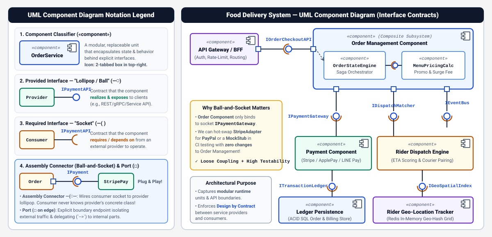
</div>

<!--
定義好契約式設計 (DbC) 後，我們該如何用標準 UML 圖表把「階段二：組件邊界與介面合約」視覺化畫出來？答案正是 **UML 組件圖 (Component Diagram)**！

請先看左側面板的 UML 2.x 標準組件圖符號：
第一，組件 (`«component»`) 畫成方框，並在右上角附帶一個「左側突出兩小格」的經典組件圖示。它代表一個可獨立替換、內部狀態完全封裝的軟體單元。
第二，提供介面 (Provided Interface) 畫成一根「棒棒糖 / 圓球 (Lollipop `—○`)」——這正是供應端對外公開的 DbC 合約（承諾兌現 Postcondition）。
第三，需求介面 (Required Interface) 畫成一個「半圓形插座 (Socket `—( `)」——這正是呼叫端對外部合約的依賴（承諾遵守 Precondition）。
第四，當需求端的「插座」扣上供應端的「棒棒糖」，就形成「組裝連接器 (Assembly Connector `—(○—`，俗稱 Ball-and-Socket 球窩接頭)」，搭配邊界上的方形「連接埠 (Port `□`)」轉發內部請求！

再看右側面板的外送平台組件圖：`Order Management` 複合組件透過左側 Port 對 `API Gateway` 提供 `IOrderCheckoutAPI` 棒棒糖；同時在下方伸出三個插座，分別接合 `Payment Component` 的 `IPaymentGateway`、`Rider Dispatch Engine` 的 `IDispatchMatcher` 與事件匯流排的 `IEventBus`！

總結這張投影片，請記住這個核心觀念：UML 組件圖透過棒棒糖（提供介面）與插座（需求介面）精準定義隨插即用的契約式架構。
-->
---
### 觀念檢核測驗 3 (CCQ 3)
<!-- id: ase-ch05-ccq3 -->
<div class="ccq-columns">
  <div class="ccq-text">

在設計流程的第二階段（**介面與契約規格**）中，當外送平台的 `Order Management` 組件透過 `IPaymentGateway` 介面呼叫 `Payment Component` 時，**契約式設計 (DbC)** 與 **UML 組件圖** 是如何對應運作的？

- **A.** `Order Management` 對外伸出棒棒糖 (`—○`)，且可任意傳入負數金額而不必負責驗證。
- **B.** 呼叫端插座 (`—(`) 負責滿足**前置條件**，而供應端棒棒糖 (`—○`) 保證兌現**後置條件**。
- **C.** UML 組件圖透過 3D 硬體節點方塊 (`«device»`) 自動略過所有執行期前後置條件檢查。
- **D.** 契約式設計要求呼叫端組件直接跨越邊界存取並修改供應端內部的私有資料表。

  </div>
  <div class="ccq-logo">
    <a href="https://nlhsueh.github.io/nickedupocket/#/student/ase-ch05-ccq3" target="_blank"></a>
  </div>
</div>

<!--
讓我們檢驗一下對階段二「契約式設計 (DbC)」與「UML 組件圖符號」的理解。

題目問：當呼叫端 `Order Management` 透過 `IPaymentGateway` 呼叫供應端 `Payment Component` 時，DbC 與組件圖符號如何對應？

分析選項：
選項 A 把方向弄反了：`Order Management` 是需要刷卡服務的呼叫端，不是提供端，更不能傳入違法負數。
選項 B 完全正確：呼叫端 `Order Management` 伸出需求插座 (`—(`)，有義務滿足**前置條件**（傳入有效憑證與正數金額）；供應端 `Payment Component` 提供棒棒糖 (`—○`)，保證兌現**後置條件**！
選項 C 混淆了部屬圖的 3D 節點符號。
選項 D 嚴重違反資訊隱藏與低耦合原則。

因此，正確答案是 B！

總結這張投影片，請記住這個核心觀念：在 UML 組件圖中，呼叫端的插座（`—(`）對應履行前置條件的義務，而供應端的棒棒糖（`—○`）對應兌現後置條件的承諾。
-->
---
<!-- _class: lead -->
<!-- header: '5.5 階段三：組件與物件導向設計 (SOLID 與類別圖)' -->

# **5.5 階段三 — 組件與物件導向設計：設計模式、SOLID 與類別圖**

> "優良的程式碼總是看起來像是出自一位真正關心它的人之手。"  
> — *Robert C. Martin (Uncle Bob)*

<!--
我們現在邁入 5.5 節：軟體設計流程的階段三 —— 組件與物件導向設計：設計模式、SOLID 與類別圖！

請看我們到目前為止極為順暢的推進脈絡：
在階段一（5.3 節），我們決定了巨觀架構模式，並用 UML 套件圖與部屬圖畫出系統骨架；
在階段二（5.4 節），我們定義了契約式設計 (DbC)，並用 UML 組件圖的棒棒糖與插座規範模組邊界；
現在進入階段三（5.5 節），我們把鏡頭推進到**單一組件的內部**，探討如何運用 **GoF 23 種設計模式**、**SOLID 五大原則** 與 **UML 類別圖 (Class Diagram)** 打造高擴充、高可測試的類別結構！

總結這張投影片，請記住這個核心觀念：階段三組件與物件導向設計深入單一組件內部，透過 GoF 模式、SOLID 原則與 UML 類別圖精雕細琢微觀結構。
-->
---
## 什麼是設計模式 (Design Patterns)？從 GoF 到 SOLID 基石

* **什麼是軟體設計模式 (Software Design Pattern)？**
  - **架構模式 (Architectural Patterns, 5.3 節)** 定義全系統的巨觀拓撲；而 **設計模式 (Design Patterns)** 則是針對單一組件內部「反覆出現的類別與物件設計問題」，提供可重用、經實務驗證的微觀結構解法。
* **百花齊放的設計模式家族（以經典 GoF 四人幫 23 種模式為例）：**
  - **生成型模式 (Creational, 5 種)**：*Factory Method, Abstract Factory, Builder, Singleton, Prototype*（解耦物件的建立過程）。
  - **結構型模式 (Structural, 7 種)**：*Adapter, Decorator, Facade, Proxy, Composite, Bridge*（優雅組合類別與介面）。
  - **行為型模式 (Behavioral, 11 種)**：*Strategy, Observer, Command, State, Template Method, Iterator*（協調物件間的職責與互動）。
* **本章聚焦核心 —— SOLID 五大設計原則 (Robert C. Martin)：**
  - 與其死背 23 種 GoF 模式，我們在此聚焦於支撐所有設計模式的**「第一性原理 (First Principles)」—— SOLID**（例如：*Strategy* 體現 **OCP**、*Adapter* 體現 **DIP**）！

<!--
在進入個別 UML 圖之前，我們先釐清一個關鍵觀念：什麼是設計模式 (Design Pattern)？它跟 SOLID 又有什麼關係？

在 5.3 節我們學的是「架構模式 (Architectural Patterns)」，像是微服務、分層架構等系統級藍圖。當我們把鏡頭拉近到單一組件內部，思考十幾個類別與介面該怎麼組合時，就進入了「物件導向設計模式 (Design Patterns)」的領域。

軟體工程史上最著名的設計模式聖經，是 1994 年由 Gamma、Helm、Johnson 與 Vlissides 四位大師（合稱 Gang of Four, GoF 四人幫）所整理的 23 種經典設計模式，分為三大類：生成型（如 Factory 工廠、Builder 生成器）、結構型（如 Adapter 轉接器、Facade 外觀）以及行為型（如 Strategy 策略、Observer 觀察者）。

既然設計模式這麼多，為什麼我們在這裡專門聚焦於 SOLID？因為 SOLID 是所有 GoF 設計模式背後的「物理定律（第一性原理）」！只要你真正看懂了 SOLID 在 UML 上的結構精神，未來學習任何 GoF 設計模式都會水到渠成。

總結這張投影片，請記住這個核心觀念：GoF 定義了 23 種具體的物件導向設計套路，而 SOLID 則是支撐所有設計模式得以成立的底層核心法則。
-->
---
## 概覽：以 UML 結構視角掌握 SOLID 五大設計原則

<div class="centered-image">
  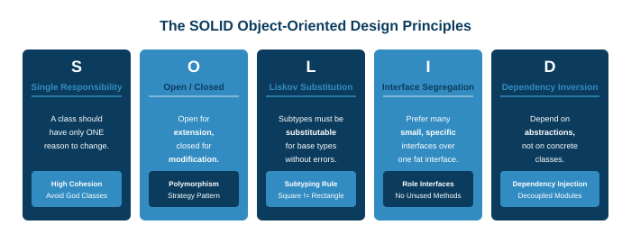
</div>

* **SOLID 如何決定 UML 類別與介面的拓撲結構：**
  - **S — 單一職責原則 (SRP)**：拆解臃腫的「上帝類別」，確保每個類別方框僅服務**單一利益關係人 (1 Actor / 1 Reason to Change)**。
  - **O — 開放封閉原則 (OCP)**：以穩定的 **`«interface»` 抽象介面**取代硬編碼相依，透過新增實作類別 (`- - -|>`) 無痛擴充。
  - **L — 里氏替換原則 (LSP)**：確保繼承 (`───|>`) 與實作 (`- - -|>`) 關係嚴格遵守父型態承諾之**行為契約與後置條件**。
  - **I — 介面隔離原則 (ISP)**：將包山包海的「肥大介面」拆解為多個**精巧專一的角色介面 (`Role Interfaces`)**。
  - **D — 相依反轉原則 (DIP)**：將跨層相依箭頭**向上反轉**，使高階業務與低階實作共同依賴於領域抽象介面。

<!--
請從 UML 圖表結構的角度來審視 SOLID 五大原則。

你會發現，SOLID 絕不是死背語法口訣，它其實是在教你「怎麼畫出乾淨的 UML 方框與箭頭」：
SRP 決定一個類別方框裡面該裝什麼、不該裝什麼；
OCP 教你如何用介面實作箭頭 (`- - -|>`) 取代脆弱的直接相依；
LSP 檢驗你的繼承箭頭 (`───|>`) 是否違反了父類別的行為契約；
ISP 規範介面方框的顆粒度，禁止出現肥大介面；
而 DIP 則將跨套件的相依箭頭徹底由下往上反轉！

接下來，我們逐一以「一頁全幅 UML 對照圖 ＋ 一頁結構解析」深入探討這五個原則。

總結這張投影片，請記住這個核心觀念：SOLID 五大原則在 UML 圖上直接體現為類別內聚度、介面顆粒度與相依箭頭方向的精準治理。
-->
---
## S — 單一職責原則 (SRP)：UML 結構與設計解析

> **核心定義 (Robert C. Martin)：** *「一個類別應該有且僅有一個引起它改變的原因（亦即：僅對單一利益關係人 Actor 負責）。」*

<div class="two-columns">
<div class="card" data-marpit-fragment>

### ❌ UML 反模式：多重角色的「上帝類別」
- **三條正交變更軸線碰撞於同一類別**：
  - `OrderInvoiceReport` 同時混雜了**財務計稅邏輯** (`calculateTaxAndSurge`)、**網頁排版渲染** (`renderHtmlInvoice`) 與 **SQL 資料庫寫入** (`saveToPostgresDb`)。
- **高脆弱性與 Git 合併衝突**：
  - 行銷部僅要求微調發票 HTML 配色，卻迫使包含核心計稅公式的整個類別重新編譯部署，極易引發非預期迴歸錯誤（淪為低階之**邏輯/巧合內聚**）。

</div>
<div class="card" data-marpit-fragment>

### ✅ UML 重構方案：一類別一角色 (1 Class per Actor)
- **依職責邊界高內聚拆解**：
  - `InvoiceTaxCalculator` ➔ 唯一變更源：**財務部門 (CFO)**。
  - `InvoiceHtmlRenderer` ➔ 唯一變更源：**UX / 行銷部門**。
  - `InvoiceSqlRepository` ➔ 唯一變更源：**DBA / 基礎設施團隊**。
- **架構效益**：
  - 達成最高等級之 **功能內聚 (Functional Cohesion)** 與 **資料耦合 (Data Coupling，僅傳遞 `OrderInvoice`)**，三個團隊可平行開發測試、互不干擾。

</div>
</div>

<!--
我們來歸納單一職責原則 (SRP) 的結構精髓。

Uncle Bob 後來在《Clean Architecture》書中特別澄清：「一個改變的理由」指的就是「一個特定的利益關係人或部門 (Actor)」。
請看左欄卡片：當財務部、行銷部與 DBA 三個部門的需求都指向同一個 `OrderInvoiceReport` 類別時，任何一邊改需求都會波及另外兩邊。

再看右欄卡片：重構後的 UML 將計算、渲染與持久化拆成三個獨立類別，共用純資料物件 `OrderInvoice`。現在行銷部怎麼改 HTML 樣式，都絕對不會影響到財務計稅與資料庫寫入！

總結這張投影片，請記住這個核心觀念：將 UML 類別邊界對齊組織中的利益關係人，確保每個類別只擁有一條獨立的變更軸線。
-->
---
<!-- _class: title-image-slide -->

## S — 單一職責原則 (SRP)：UML 重構對照

<div class="image-wrapper">
  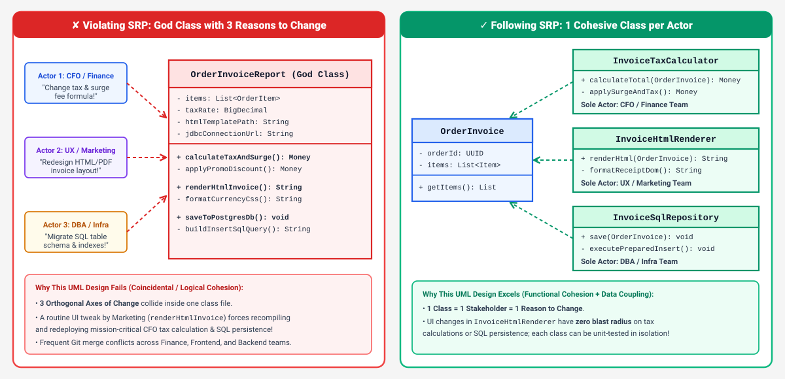
</div>

<!--
請看第一個原則：單一職責原則 (SRP) 的 UML 前後對照圖。

請先看左側面板（紅色違反 SRP 的設計）：
`OrderInvoiceReport` 是一個典型的「上帝類別 (God Class)」。注意左邊有三個截然不同的利益關係人（Actors）同時將相依箭頭指向它：
第一，財務長與會計部門（要求修改稅率與尖峰加成公式 `calculateTaxAndSurge`）；
第二，UX 與行銷團隊（要求修改 HTML/PDF 電子發票排版 `renderHtmlInvoice`）；
第三，DBA 資料庫團隊（要求修改 PostgreSQL 寫入語法 `saveToPostgresDb`）。

再看右側面板（綠色遵循 SRP 的重構設計）：
我們保留純粹的資料模型 `OrderInvoice`，並將三大正交職責拆分為三個獨立且高內聚的類別：`InvoiceTaxCalculator`（只對財務部負責）、`InvoiceHtmlRenderer`（只對 UX 團隊負責）與 `InvoiceSqlRepository`（只對 DBA 負責）！

總結這張投影片，請記住這個核心觀念：SRP 要求將多重角色的「上帝類別」拆解為各司其職的獨立類別，使每個類別僅對單一角色負責。
-->
---
## O — 開放封閉原則 (OCP)：UML 結構與設計解析

> **核心定義 (Bertrand Meyer)：** *「軟體實體（類別、模組、組件）應當**對擴充開放 (Open for Extension)**，但**對修改封閉 (Closed for Modification)**。」*

<div class="two-columns">
<div class="card" data-marpit-fragment>

### ❌ UML 反模式：直接耦合具體類別與條件分支
- **放射狀硬編碼相依 (`───>`)**：
  - `OrderNotificationService` 直接依賴所有具體通知類別 (`EmailSender`, `SmsSender`)，並以 `if / else if` 分派。
- **違反「對修改封閉」**：
  - 每當外送平台新增一種通知管道（如 `LineNotifySender`、`WhatsApp` 或 `Discord`），都必須**打開並修改**核心服務類別，隨時可能改壞原本正常的 Email/SMS 流程！

</div>
<div class="card" data-marpit-fragment>

### ✅ UML 重構方案：多型抽象介面樞紐 (Strategy / Plugin)
- **穩定抽象契約 (`«interface» INotificationChannel`)**：
  - `OrderNotificationService` 僅依賴 `INotificationChannel.send(msg)` 介面（**🔒 對修改封閉**）。
- **無限外掛擴充 (`- - -|>`)**：
  - `EmailChannel`、`SmsChannel` 與新增之 `LineNotifyChannel` 各自獨立實作該介面（**🔓 對擴充開放**）。
- **零侵入擴展**：新增通知管道只需新增一個實作類別，核心調度服務保持 **零修改、零迴歸風險**。

</div>
</div>

<!--
我們來剖析開放封閉原則 (OCP) 在 UML 圖上的關鍵差異。

請看左欄卡片：只要你的高階服務類別直接把實線相依箭頭 (`───>`) 射向具體的實作類別，每增加一種新變化，你就必須打開高階類別動手術。

再看右欄卡片：我們在中間放入一個 `«interface» INotificationChannel` 作為防火牆。高階服務只指向這個介面；底下無論要擴充多少種通知管道，全都是畫虛線空心三角箭頭 (`- - -|>`) 指向介面！
這就是策略模式 (Strategy Pattern) 與外掛架構的靈魂：核心引擎永久鎖定不必修改，新功能像插卡一樣無限擴充。

總結這張投影片，請記住這個核心觀念：善用 UML 抽象介面作為多型樞紐，即可同時達成核心邏輯「對修改封閉」與外圍能力「對擴充開放」。
-->
---
<!-- _class: title-image-slide -->

## O — 開放封閉原則 (OCP)：UML 重構對照

<div class="image-wrapper">
  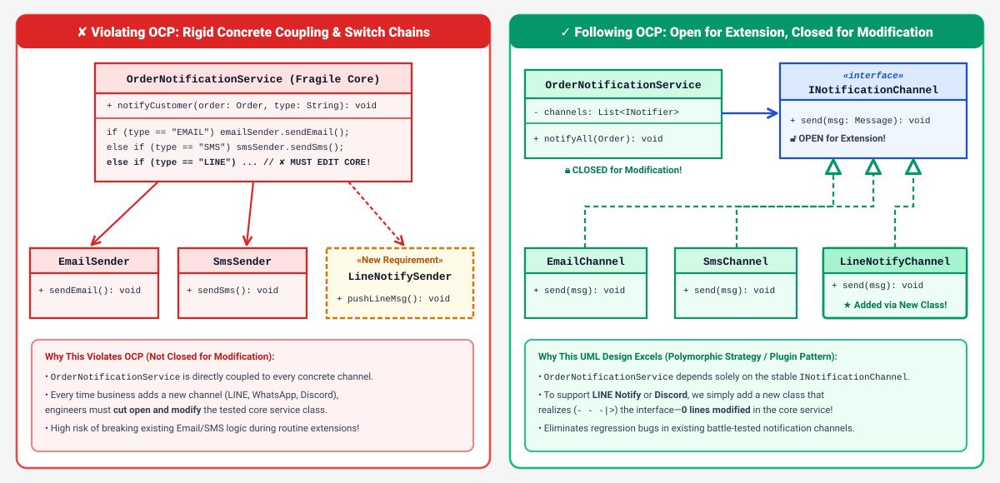
</div>

<!--
接著請看第二個原則：開放封閉原則 (OCP) 的 UML 前後對照圖。

請先看左側面板（紅色違反 OCP 的設計）：
`OrderNotificationService` 直接用實線箭頭硬編碼相依於具體的 `EmailSender` 與 `SmsSender`，並在內部靠 `if / else if` 分支判斷。當業務決定新增臺灣消費者最常用的 `LineNotifySender` 時，工程師被迫拿手術刀剖開已經在線上穩定運行的 `OrderNotificationService`，新增第三條相依箭頭並修改 `if/else` 邏輯！

再看右側面板（綠色遵循 OCP 的重構設計）：
我們在中間引入了一個穩定的抽象介面樞紐 `«interface» INotificationChannel`。
`OrderNotificationService` 只相依於這個介面（因此對修改封閉 🔒）；而 `EmailChannel`、`SmsChannel` 與新加入的 `LineNotifyChannel` 則透過虛線空心三角箭頭 (`- - -|>`) 實作該介面（對擴充開放 🔓）！新增 LINE 通知時，核心服務類別一行程式碼都不必改！

總結這張投影片，請記住這個核心觀念：OCP 透過抽象介面樞紐隔離變更，讓系統能以新增實作類別 (`- - -|>`) 的方式擴充功能，而不必修改既有核心類別。
-->
---
## L — 里氏替換原則 (LSP)：UML 結構與設計解析

> **核心定義 (Barbara Liskov)：** *「子型態 (Subtypes) 必須能夠在行為上無痛替換其基礎型態 (Base Types)，而不改變程式任何預期的正確性。」*

<div class="two-columns">
<div class="card" data-marpit-fragment>

### ❌ UML 反模式：誤踩「語意 IS-A」繼承陷阱
- **破壞父類別後置條件 (`Square ───|> Rectangle`)**：
  - 父類別 `Rectangle` 承諾：`setHeight(10)` 僅改變高度，`width` 維持不變。
  - 子類別 `Square` 覆寫時暗中連帶修改 `width`，導致呼叫端執行 `w=5, h=10` 時算出 `Area = 100 != 50`！
- **外送平台常見之 LSP 違規反例**：
  - 讓 `貨到付款 (CashOnDelivery)` 繼承 `線上刷卡 (OnlinePayment)`，卻在覆寫 `autoRefundCard()` 時拋出 `UnsupportedOperationException`！

</div>
<div class="card" data-marpit-fragment>

### ✅ UML 重構方案：行為子型態化 (Behavioral Subtyping)
- **解除錯誤繼承，改採平輩契約實作 (`- - -|> IShape`)**：
  - 移除 `Square` 對可變 `Rectangle` 的繼承箭頭。
  - 兩者改為不可變類別，平輩實作純粹的 `«interface» IShape` (`+ getArea(): int`)。
- **契約式設計 (Design by Contract) 鐵律**：
  - 子型態**絕不可強化前置條件**、**絕不可弱化後置條件**，亦**不可拋出父型態未宣告之異常**。

</div>
</div>

<!--
我們來總結里氏替換原則 (LSP) 的工程守則。

許多初學者學 UML 時被教導：「繼承 (`───|>`) 就是日常生活中的 IS-A（是一個）」。Barbara Liskov 提醒我們：日常語言的 IS-A 不代表軟體行為上的可替換性！

請看左欄卡片：無論是 `Square 繼承 Rectangle` 偷偷改動寬度，還是外送平台裡讓 `CashOnDelivery（貨到付款）` 繼承 `OnlinePayment` 並在自動退刷時拋出 `UnsupportedOperationException`，都會讓依賴父類別的呼叫端在執行期當機！

再看右欄卡片：只有當子類別 100% 履行父型態承諾的前置條件、後置條件與不變量（Invariants）時，才能畫繼承或實作箭頭。

總結這張投影片，請記住這個核心觀念：在 UML 中繪製繼承或實作箭頭前，務必檢驗子型態是否完全符合行為可替換性，而非僅憑字面語意。
-->
---
<!-- _class: title-image-slide -->

## L — 里氏替換原則 (LSP)：UML 重構對照

<div class="image-wrapper">
  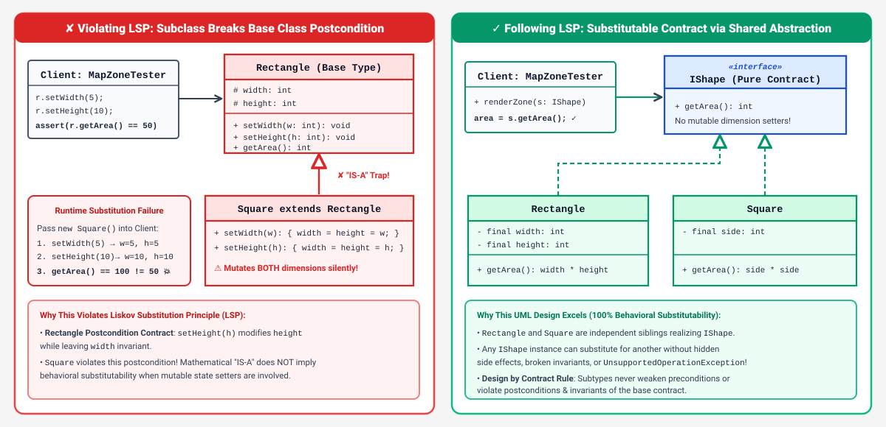
</div>

<!--
現在我們來看第三個原則：由圖靈獎得主 Barbara Liskov 提出的里氏替換原則 (LSP) UML 對照圖。

請先看左側面板（紅色違反 LSP 的經典「正方形繼承長方形」陷阱）：
在國中數學裡，正方形是一種長方形，所以初學者很自然地在 UML 圖上畫了一條實線空心三角繼承箭頭 (`───|>`)，讓 `Square` 繼承 `Rectangle`。
然而，`Rectangle` 提供了可變狀態的 `setWidth(w)` 與 `setHeight(h)`，其隱含的契約後置條件是：「修改高度時，寬度保持不變」。為了維持四邊等長，`Square` 覆寫了 `setHeight(10)`，偷偷把 `width` 也改成 `10`！結果當用戶端 `MapZoneTester` 把 `Square` 當作 `Rectangle` 傳入並執行 `寬 5 × 高 10` 時，面積竟然算出 `100` 而不是 `50`，直接導致系統契約崩潰！

再看右側面板（綠色遵循 LSP 的重構設計）：
我們拔除錯誤的父子繼承關係，改提取純粹的行為介面 `«interface» IShape` (`+ getArea(): int`)，並讓不可變 (Immutable) 的 `Rectangle` 與 `Square` 以平輩兄弟關係分別實作 (`- - -|>`) `IShape`。現在任何子型態替換進 `MapZoneTester`，都 100% 遵守契約、毫無副作用！

總結這張投影片，請記住這個核心觀念：LSP 要求 UML 繼承與實作關係必須嚴格履踐基礎型態的行為契約，絕不能因覆寫而產生破壞預期的副作用。
-->
---
## I — 介面隔離原則 (ISP)：UML 結構與設計解析

> **核心定義 (Robert C. Martin)：** *「客戶端（與實作類別）不應該被迫依賴於它們所不使用的方法或介面。」*

<div class="two-columns">
<div class="card" data-marpit-fragment>

### ❌ UML 反模式：包山包海的「肥大介面 (Fat Interface)」
- **受污染的單一合約 (`IMultiFunctionDevice`)**：
  - 將毫無關聯的列印、掃描與傳真方法硬塞進同一個 `«interface»` 方框中。
- **引發兩大架構災難**：
  - **1. 強迫實作空殼方法 (連帶違反 LSP)**：`KitchenThermalPrinter` 被迫在 `scan()` 與 `fax()` 中拋出異常。
  - **2. 幽靈重編譯耦合 (Phantom Coupling)**：當傳真方法 `sendVendorFax()` 的參數型態修改時，完全沒有傳真功能的廚房出單機竟然被迫重新編譯！

</div>
<div class="card" data-marpit-fragment>

### ✅ UML 重構方案：高內聚之角色介面 (Role Interfaces)
- **依角色能力精準切分介面**：
  - 拆解為 `«interface» IPrintable`、`«interface» IScannable` 與 `«interface» IFaxable`。
- **按需實作與多介面組合 (`- - -|>`)**：
  - 餐廳廚房出單機 `KitchenThermalPrinter` **僅實作 `IPrintable`**。
  - 高階事務機 `CorporateOfficeMFP` 則同時實作三個角色介面。
- **架構效益**：徹底消除空殼方法與跨模組的幽靈耦合。

</div>
</div>

<!--
請注意介面隔離原則 (ISP) 與前面 SRP、LSP 的巧妙呼應！

請看左欄卡片：如果說 SRP 禁止出現肥大的「上帝類別」，那麼 ISP 就是禁止出現肥大的「上帝介面」！一旦介面太肥大 (`IMultiFunctionDevice`)，簡單的設備 (`KitchenThermalPrinter`) 就被迫寫出拋出異常的假方法（同時違反了 LSP），而且只要傳真模組改參數，廚房出單機就跟著陪葬重編譯。

再看右欄卡片：將 UML 介面拆解為小巧專一的 `IPrintable`、`IScannable` 與 `IFaxable` 後，每個設備與呼叫端都只綁定自己真正需要的最小合約。

總結這張投影片，請記住這個核心觀念：寧可設計多個高內聚的小型角色介面，也絕不打造強迫客戶端買單無用方法的肥大介面。
-->
---
<!-- _class: title-image-slide -->

## I — 介面隔離原則 (ISP)：UML 重構對照

<div class="image-wrapper">
  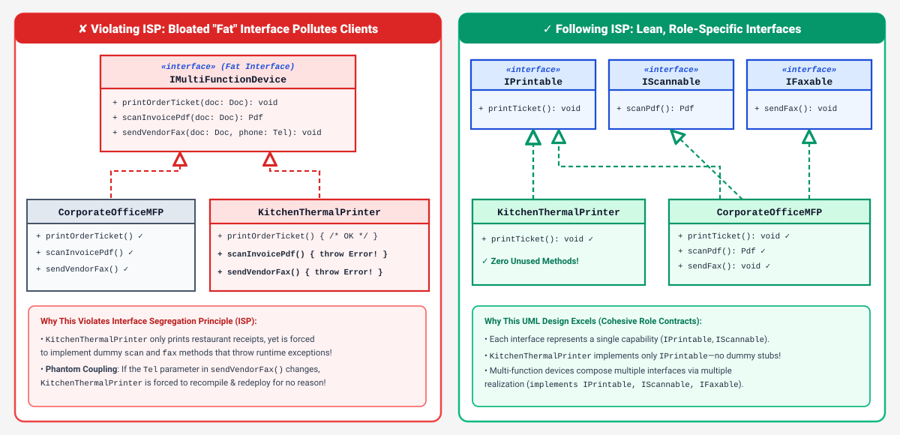
</div>

<!--
接著請看第四個原則：介面隔離原則 (ISP) 的 UML 前後對照圖。

請先看左側面板（紅色違反 ISP 的「肥大介面 Fat Interface」反模式）：
系統定義了一個包山包海的 `«interface» IMultiFunctionDevice`，裡面塞滿了列印訂單 (`printOrderTicket`)、掃描發票 (`scanInvoicePdf`) 與傳真給供應商 (`sendVendorFax`) 三個方法。
雖然企業辦公室的複合事務機 (`CorporateOfficeMFP`) 三個功能都有，但請看外送平台合作餐廳廚房裡的熱感應出單機 (`KitchenThermalPrinter`)：它只能印出單！卻因為實作了這個肥大介面，被迫為掃描和傳真寫出拋出錯誤的空殼方法！

再看右側面板（綠色遵循 ISP 的重構設計）：
我們將肥大介面精確拆解為三個專一的角色介面 (Role Interfaces)：`IPrintable`、`IScannable` 與 `IFaxable`。現在廚房熱感應出單機只需要乾淨地實作 (`- - -|>`) `IPrintable` 即可，完全不受掃描與傳真功能的污染！

總結這張投影片，請記住這個核心觀念：ISP 主張將臃腫的肥大介面拆解為精巧的角色介面，確保實作類別與客戶端絕不依賴其不需要的方法。
-->
---
## D — 相依反轉原則 (DIP)：UML 結構與設計解析

> **核心定義 (Robert C. Martin)：** *「1. 高階模組不應依賴低階模組，兩者皆應依賴於抽象介面。 2. 抽象介面不應依賴於細節實作，細節實作必須依賴於抽象介面。」*

<div class="two-columns">
<div class="card" data-marpit-fragment>

### ❌ UML 反模式：自上而下的傳統相依 (`domain ───> infra`)
- **高階商業邏輯綁死低階細節**：
  - `OrderCheckoutService` 直接持有並引用具體的 `MySqlOrderDatabase` 類別。
- **引發兩大致命問題**：
  - **不可移植性 (Immobility)**：若要將資料庫遷移至 PostgreSQL，必須修改高階領域類別。
  - **無法獨立單元測試**：要測試 `OrderCheckoutService` 的結帳計價邏輯，竟然必須先啟動一台真實的 MySQL 伺服器！

</div>
<div class="card" data-marpit-fragment>

### ✅ UML 重構方案：箭頭向上反轉 (`infra - - -|> domain`)
- **領域層擁有抽象介面所有權 (`IOrderRepository`)**：
  - `OrderCheckoutService` 僅相依於同屬 `domain.order` 套件的 `«interface» IOrderRepository`。
- **低階適配器向上實作 (`- - -|>`)**：
  - `PostgresOrderRepo` 與 `InMemoryMockRepo` 的實作箭頭**跨越套件邊界向上反轉**指向 `IOrderRepository`。
- **建構子依賴注入 (DI)**：正式環境注入 `PostgresOrderRepo`；單元測試則注入 `InMemoryMockRepo`，達成 **1 毫秒極速隔離測試**！

</div>
</div>

<!--
請將這張相依反轉原則 (DIP) 的 UML 圖，與我們在 5.4 節學過的外送平台套件圖與組件圖連結起來！

在左欄卡片中，傳統結構化設計的相依箭頭是一路向下的：高階業務依賴低階資料庫。這導致底層資料庫一換，高階業務就壞；而且沒有真實資料庫就無法跑單元測試。

在右欄卡片中，DIP 施展了一個關鍵魔法：把 `IOrderRepository` 介面放在高階的 `domain.order` 套件裡，強迫底層的 `infra.persistence` 實作類別把 `- - -|>` 箭頭**由下往上畫**！
透過建構子依賴注入 (Dependency Injection)，我們在生產環境傳入 PostgreSQL，在測試環境傳入記憶體內的 `InMemoryMockRepo`，一秒鐘就能跑完上千個領域邏輯測試！

總結這張投影片，請記住這個核心觀念：將跨套件邊界的 UML 相依箭頭向上反轉，能徹底保護核心業務邏輯不受基礎設施更迭影響，並賦予系統極致的可測試性。
-->
---
<!-- _class: title-image-slide -->

## D — 相依反轉原則 (DIP)：UML 重構對照

<div class="image-wrapper">
  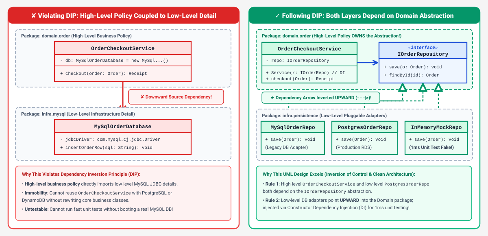
</div>

<!--
最後，請看第五個原則——也是整潔架構 (Clean Architecture) 的核心基石：相依反轉原則 (DIP) 的 UML 對照圖！

請特別觀察跨越水平套件邊界（`domain.order` 與 `infra.*`）的那根 UML 箭頭方向：
在左側面板（紅色違反 DIP 的設計）中，高階領域層的 `OrderCheckoutService` 直接建立並向下相依 (`───>`) 於低階基礎設施層的 `MySqlOrderDatabase`。這時執行期的控制流與編譯期的原始碼相依箭頭「雙雙朝下」，高階業務邏輯被底層 MySQL 死死綁架！

再看右側面板（綠色遵循 DIP 的重構設計）：
高階的 `domain.order` 套件自己定義並擁有 `«interface» IOrderRepository` 抽象介面，`OrderCheckoutService` 只依賴同套件內的這個介面。
而在底層的 `infra.persistence` 套件中，`MySqlOrderRepo`、`PostgresOrderRepo` 與測試用的 `InMemoryMockRepo`，全都畫出虛線空心三角箭頭 (`- - -|>`) **由下往上反轉指向領域層的 `IOrderRepository`**！

總結這張投影片，請記住這個核心觀念：DIP 將跨層的 UML 實作箭頭由下往上反轉，使底層基礎設施細節依賴於高階領域定義的抽象介面。
-->
---
### 同儕討論：探索 GoF 觀察者模式 (Observer Pattern) 之設計動機與結構

<div class="discussion-columns">
  <div class="discussion-text">

  **網路檢索與雙人結構剖析：GoF 觀察者設計模式 (4 分鐘)**
  - **1. 動手網路查詢：** 請上網搜尋經典 GoF **Observer Design Pattern（觀察者模式）**（如 *Refactoring.Guru*）。
  - **2. 探討設計動機 (Motivation — 它解決什麼痛點？)：**
    - 當單一**被觀察主題 (`Subject`)** 狀態改變時（例如外送平台 `Order` 狀態變為 `READY_FOR_PICKUP`），多個**相依觀察者**（`顧客推播`、`外送員地圖`、`餐廳看板`）必須自動收到通知並更新——且**不能在 `Order` 內部寫死對這些具體類別的直接呼叫**！
  - **3. 剖析 UML 結構與 SOLID 關聯（請與夥伴討論並繪出草圖）：**
    - 找出其 UML 類別圖中的四大角色：`Subject (Publisher)`、`«interface» IObserver (Subscriber)` 與多個 `ConcreteObserver`。
    - 觀察者模式是如何同時體現 **OCP（開放封閉原則）** 與 **DIP（相依反轉原則）** 的？

  </div>
  <div class="discussion-logo">
    
  </div>
</div>

<!--
現在讓我們透過 4 分鐘的網路探索與同儕討論，把剛學完的 SOLID 五大原則與 GoF 設計模式串聯起來！

請拿出筆電或手機，與鄰座同學一起上網搜尋 GoF 最著名的行為型模式之一：**Observer Pattern（觀察者模式）**（推薦參考 Refactoring.Guru 的圖解）。
請與夥伴討論並回答兩個核心問題：
第一，**設計動機 (Motivation)**：為什麼我們需要觀察者模式？想像外送平台的 `Order` 訂單物件：當訂單狀態改變時，顧客 App 要跳推播、餐廳平板要響鈴、外送員地圖要更新。如果我們在 `Order` 類別裡面直接寫死呼叫這三個具體類別，就會同時違反 SRP、OCP 與 DIP！
第二，**UML 結構 (Structure)**：請看觀察者模式的 UML 類別圖。`Subject`（發布者）只持有一個 `«interface» IObserver` 介面清單（提供 `attach()`、`detach()` 與 `notifyObservers()`），而各個具體觀察者則實作 `IObserver.update()`。
你有沒有發現，觀察者模式其實就是 **OCP + DIP 的完美結晶**？`Subject` 只依賴抽象的 `IObserver` 介面（落實 DIP），而且未來要新增第 4 個「數據分析觀察者」時，只要新增一個實作 `IObserver` 的類別註冊進去即可，`Subject` 一行程式碼都不用改（落實 OCP）！

總結這張投影片，請記住這個核心觀念：GoF 觀察者模式透過抽象訂閱介面解耦狀態發布者與接收者，完美體現了開放封閉原則與相依反轉原則。
-->
---
### 觀念檢核測驗 4 (CCQ 4)
<!-- id: ase-ch05-ccq4 -->
<div class="ccq-columns">
  <div class="ccq-text">

哪一個 SOLID 物件導向設計原則明確主張：當需要為系統引入新功能時，應當透過「新增新的類別」來擴充，而非直接修改既有已通過測試的原始碼？

- **A.** 單一職責原則 (SRP)
- **B.** 開放封閉原則 (OCP)
- **C.** 介面隔離原則 (ISP)
- **D.** 里氏替換原則 (LSP)

  </div>
  <div class="ccq-logo">
    <a href="https://nlhsueh.github.io/nickedupocket/#/student/ase-ch05-ccq4" target="_blank"></a>
  </div>
</div>

<!--
讓我們檢驗一下對 SOLID 原則的掌握。

題目問：哪一個原則主張新增功能時應當「新增類別」擴充，而非直接修改舊代碼？

分析選項：
選項 A，SRP，強調單一改變理由。
選項 B，OCP（開放封閉原則），明確主張對擴充開放、對修改封閉！
選項 C，ISP，強調介面不肥大。
選項 D，LSP，強調子類別替換父類別不破壞契約。

因此，正確答案是 B：開放封閉原則！

總結這張投影片，請記住這個核心觀念：開放封閉原則透過多型擴充保護生產環境的穩定舊碼，有效防止擴展功能時引入非預期迴歸錯誤。
-->
---
<!-- _class: lead -->
<!-- header: '5.6 階段四：資料與持久化設計 (ERD 與多模態儲存)' -->

# **5.6 階段四 — 資料與持久化設計：ERD 塑模、快取與多模態儲存**

> 「差勁的程式設計師擔心程式碼；優秀的程式設計師關心資料結構以及它們之間的關係。」  
> — *Linus Torvalds (Linux 與 Git 創立者)*

<!--
歡迎來到 5.6 節：軟體設計流程的階段四 —— 資料與持久化設計：ERD 塑模、快取與多模態儲存！

回顧我們走過的前三個設計階段：
階段一（5.3 節）設計了巨觀架構模式與套件/部屬圖；
階段二（5.4 節）定義了契約式設計 (DbC) 與組件圖；
階段三（5.5 節）設計了組件內部的 GoF 模式、SOLID 原則與類別圖；
現在進入第四階段（5.6 節）：系統的核心業務狀態與高頻即時資料，究竟該如何塑模、正規化、建立索引、快取並持久化到資料庫中？

在本節中，我們將掌握三層次資料塑模流程、**UML 資料 / ERD 實體關聯圖符號**、第三正規化 (3NF) 與實體索引調校，以及外送平台如何結合 **PostgreSQL (ACID)**、**Redis Geo-Hash (空間快取)** 與 **Apache Kafka (事件日誌)** 建構多模態儲存架構！

總結這張投影片，請記住這個核心觀念：階段四資料與持久化設計將領域模型轉化為高完整性之 ERD 資料庫綱要、記憶體快取與事件串流。
-->
---
## 1. 三層次資料塑模、UML ERD 符號與正規化 (3NF)

> **階段四塑模定位：** 將領域實體轉化為**具備參照完整性的關聯式綱要 (ERD)** 與**高速實體索引**。

<div class="two-columns">
<div class="card" data-marpit-fragment>

### 三層次資料塑模與 UML ERD 符號
- **1. 概念模型 → 2. 邏輯 ERD → 3. 實體綱要**：
  - 由商業實體推進至正規化資料表結構，最終落實為 DBMS 專屬索引與分區策略。
- **UML 資料 / ERD 核心符號規範**：
  - **`«PK»` (Primary Key 主鍵)**：唯一識別每筆資料列之不可變鍵值（如 `order_id: UUID`）。
  - **`«FK»` (Foreign Key 外來鍵)**：維護跨表參照完整性（如 `orders.customer_id` 參照 `customers`）。
  - **基數與組合 (`1 ── 0..*`, `1 ◆── 1..*`)**：區分一般關聯與生命週期綁定的強組合（`Order` ◆── `OrderItem`）。

</div>
<div class="card" data-marpit-fragment>

### 第三正規化 (3NF) vs. 實體效能最佳化
- **第三正規化 (3NF — 確保寫入一致性)**：
  - 每個非鍵欄位皆**僅直接相依於主鍵**（例如：`orders` 只存 `restaurant_id`，絕不在百萬筆訂單中重複抄寫餐廳地址字串）。
  - **效益**：徹底消除更新異常與冗餘不一致。
- **實體索引與分區調校 (加速讀取效能)**：
  - **複合索引 (`«idx»`)**：建立 `(customer_id, created_at DESC)` 複合 B-Tree 索引，使查詢「歷史訂單」由 `800ms` 全表掃描降至 `< 2ms`！
  - **按月表分區 (Partitioning)**：依 `created_at` 按月切分 `orders` 表，確保熱資料常駐記憶體。

</div>
</div>

<!--
我們進一步拆解左欄的「三層次資料塑模與 ERD 符號」以及右欄的「正規化與實體索引調校」。

請看左欄卡片：在繪製資料庫 ERD 時，有三個必備符號：
`«PK»` 代表主鍵，`«FK»` 代表外來鍵。特別注意關聯線上的菱形符號：`Customer 1 ── 0..* Order` 是一般關聯；而 `Order 1 ◆── 1..* OrderItem` 則是實心菱形「組合 (Composition)」——代表訂單明細完全隸屬於該張訂單，訂單刪除時明細也隨之銷毀。

再看右欄卡片：資料庫設計永遠在平衡「寫入正確性」與「讀取速度」：
為了確保寫入正確，我們在邏輯層採用 **第三正規化 (3NF)**，避免餐廳改電話號碼時要更新五十萬筆歷史訂單；
為了確保讀取飛快，我們在實體層加上 `(customer_id, created_at)` 複合索引與按月表分區，讓數億筆訂單依然保持毫秒級查詢！

總結這張投影片，請記住這個核心觀念：邏輯層的 3NF 正規化守護寫入資料完整性，而實體層的複合索引與分區則保障高併發讀取的低延遲。
-->
---
## 2. 多模態持久化 (Polyglot Persistence)、快取與分散式一致性

> **現代架構鐵律：** 根據資料的**一致性要求、讀寫頻率與結構特性**，組合關聯式資料庫、記憶體快取與事件日誌。

<div class="two-columns">
<div class="card" data-marpit-fragment>

### 外送平台之多模態儲存引擎分工
- **1. 關聯式交易庫 (`PostgreSQL` — 強 ACID)**：
  - *適用場景*：訂單 (`orders`)、明細與金流 (`payments`)。
  - *關鍵設計*：在 `payments` 表強制設定唯一約束 `«UQ» idempotency_key`，從資料庫底層杜絕重複扣款。
- **2. 記憶體空間與鍵值快取 (`Redis` — 高速暫態)**：
  - *適用場景*：外送員即時座標 (`rider:geo:{city}`) 與熱門餐廳菜單 **Cache-Aside 快取** (`TTL = 5 分鐘`)。
  - *關鍵設計*：支援每秒萬次寫入與 `< 5ms` 半徑查詢；設 `TTL = 30 秒` 自動剔除斷線外送員。
- **3. 不可變事件串流日誌 (`Kafka` — 非同步解耦)**：
  - *適用場景*：以 `order_id` 為 Partition Key 確保同筆訂單狀態事件嚴格保序。

</div>
<div class="card" data-marpit-fragment>

### 跨資料源一致性：ACID vs. BASE 與 Outbox
- **單一服務內部 (`ACID` 本地交易)**：
  - 藉由關聯式資料庫 Transaction 保證原子性與隔離性。
- **跨微服務與異質儲存 (`BASE` 最終一致性)**：
  - *經典雙寫難題 (Dual-Write Trap)*：若先寫入 PostgreSQL 再發送 Kafka，萬一中途斷電就會導致「訂單成立卻沒派單」！
  - *標準解法 —— **Transactional Outbox 模式***：
    1. 在**同一個本地 ACID 交易**中，同時寫入 `orders` 表與 `outbox_events` 表。
    2. 背景 Relay 行程再可靠地將 `outbox_events` 推播至 Kafka，搭配消費端冪等處理達成零掉單！

</div>
</div>

<!--
接著我們看階段四資料設計在分散式架構下的兩大關鍵議題：多模態持久化與跨庫一致性。

請看左欄卡片：在外送平台中，我們讓三種儲存引擎各司其職：
第一，金流與訂單用 **PostgreSQL**，並在資料表加上 `«UQ» idempotency_key` 唯一索引守住最後一道防重複扣款防線；
第二，熱門菜單用 **Redis Cache-Aside** 擋下 95% 的讀取流量，外送員即時 GPS 用 **Redis GeoHash + 30 秒 TTL** 避開 SQL 鎖表瓶頸；
第三，跨服務狀態變更用 **Kafka** 串流日誌，並以 `order_id` 作為分區鍵確保事件順序不亂跳。

再看右欄卡片：當一筆訂單同時涉及 PostgreSQL 與 Kafka 時，如何避免「資料庫寫成功、Kafka 卻發送失敗」的雙寫不一致？
答案就是業界標準的 **Transactional Outbox 模式**：利用 PostgreSQL 本地 ACID 交易同時寫入 `orders` 與 `outbox_events` 兩張表，再由背景程序轉發到 Kafka，優雅兼顧高吞吐量與資料零遺失！

總結這張投影片，請記住這個核心觀念：多模態持久化結合了 SQL 的 ACID 嚴謹性、Redis 的極速快取與 Kafka 的串流解耦，並透過 Transactional Outbox 確保最終一致性。
-->
---
<!-- _class: title-image-slide -->

## 三層次資料塑模、UML ERD 與外送平台多模態儲存

<div class="image-wrapper">
  
</div>

<!--
請看這張「階段四：資料與持久化設計」的全景架構圖，完整呈現了資料塑模三層次與外送平台的多模態儲存設計！

請先看左側面板：資料設計由抽象到具體分為三個層次：
1. **Level 1 概念資料模型 (Conceptual Data Model)**：與資料庫技術無關，專注於梳理核心業務實體與基數關係（如 `Customer 1 ── 0..* Order 1 ── 1..* Item`）。
2. **Level 2 邏輯 ERD 模型 (Logical ERD Model)**：明確定義欄位型別、主鍵 (`«PK»`)、外來鍵 (`«FK»`)，並執行第三正規化 (3NF) 以消除資料更新異常。
3. **Level 3 實體資料綱要 (Physical Data Schema)**：撰寫具體的 SQL DDL、建立複合索引 (`«idx»`)、按月資料表分區 (Partitioning)、設定 Redis 快取過期時間 (`TTL`) 與 Kafka 分區鍵。

再看右側面板：外送平台能不能只用單一資料庫打天下？絕對不行！現代架構採用 **多模態持久化 (Polyglot Persistence)**：
A. **PostgreSQL 關聯式資料庫 (ACID)**：儲存 `customers`、`restaurants`、`orders`、`order_items` 與 `payments`，利用 3NF 與嚴格 ACID 交易確保金流與訂單絕對不掉單、不重複扣款。
B. **Redis 記憶體空間資料庫 (In-Memory Spatial Store)**：面對 5 萬名外送員每 5 秒回傳一次 GPS（每秒 1 萬次寫入），使用 64-bit `GeoHash` 搭配 `TTL = 30 秒` 自動過期，在 5 毫秒內秒級找出最近外送員！
C. **Apache Kafka 不可變事件日誌 (Event Log)**：透過 Transactional Outbox 發布訂單事件，非同步同步派單與分析系統。

總結這張投影片，請記住這個核心觀念：資料設計結合三層次 ERD 綱要塑模與多模態持久化，針對不同讀寫特性匹配最適合的儲存引擎。
-->
---
### 觀念檢核測驗 5 (CCQ 5)
<!-- id: ase-ch05-ccq5 -->
<div class="ccq-columns">
  <div class="ccq-text">

在設計流程的第四階段（**資料與持久化設計**）中，為什麼外送平台將 `orders` 與 `payments` 儲存在 **PostgreSQL (關聯式 OLTP)**，卻將 5 萬名外送員的即時 GPS 座標儲存在 **Redis (`GeoHash` + `TTL = 30s`)**？

- **A.** PostgreSQL 缺乏資料表主鍵支援，而 Redis 則強制執行第三正規化外來鍵約束。
- **B.** Redis 用於永久歸檔歷史財務帳本，而 PostgreSQL 會在 30 秒後自動清除未付款訂單。
- **C.** PostgreSQL 保障帳務 ACID 交易完整性，而記憶體內 Redis 能以 `< 5ms` 處理高頻空間查詢。
- **D.** 將外送員即時 GPS 串流直接寫入 PostgreSQL 可完全消除手機端的無線網路延遲。

  </div>
  <div class="ccq-logo">
    <a href="https://nlhsueh.github.io/nickedupocket/#/student/ase-ch05-ccq5" target="_blank"></a>
  </div>
</div>

<!--
讓我們檢驗一下對階段四「資料與持久化設計」與「多模態持久化 (Polyglot Persistence)」的理解。

題目問：為什麼外送平台把訂單與金流存在 PostgreSQL，卻把 5 萬名外送員的即時 GPS 座標存在 Redis？

分析選項：
選項 A 說反了：PostgreSQL 才是支援主鍵、外來鍵與第三正規化 (3NF) 的關聯式資料庫。
選項 B 說反了：PostgreSQL 負責持久化保存歷史帳務，而 Redis 則透過 30 秒 TTL 自動淘汰過期的即時座標。
選項 C 完全正確：PostgreSQL 提供嚴格的 ACID 交易保證，確保金流絕不漏單或重複扣款；而記憶體內的 Redis GeoHash 則能輕鬆吞吐每秒上萬筆座標寫入，並在 5 毫秒內完成方圓 3 公里最近司機的空間搜尋！
選項 D 不合理：後端資料庫選型不可能消除手機端的物理無線網路延遲。

因此，正確答案是 C！

總結這張投影片，請記住這個核心觀念：多模態持久化依工作負載特性選用最適儲存引擎——以 ACID 關聯式資料庫守護金流正確性，以記憶體空間索引支撐高頻即時座標查詢。
-->
---
<!-- _class: lead -->
<!-- header: '5.7 AI 賦能軟體設計與盲點防護' -->

# **5.7 AI 賦能軟體設計與盲點防護**

> "AI 不會取代軟體架構師；但紮根嚴謹工程原則並善用 AI 的架構師，將會取代不用 AI 的人。"

<!--
歡迎進入 5.7 節：AI 賦能軟體設計與盲點防護。

在完整走過軟體設計的四個階段——階段一架構設計 (5.3)、階段二介面與契約規格 (5.4)、階段三組件與物件導向設計 (5.5)、以及階段四資料與持久化設計 (5.6) 之後，我們在本節探討生成式 AI 如何作為強大的「設計副駕駛」賦能這四個階段，以及人類架構師如何防範 AI 過度工程化的盲點。

總結這張投影片，請記住這個核心觀念：AI 能全面加速軟體設計的四大階段，但人類架構師必須依據真實組織脈絡把關並承擔最終決策責任。
-->
---
## AI 副駕駛如何賦能「四階段軟體設計流程」？

<div class="centered-image">
  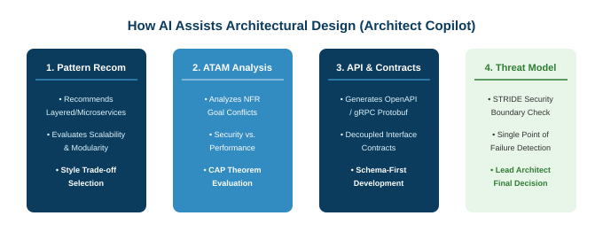
</div>

* **1. 賦能階段一（架構設計 — 5.3）**：模擬 **ATAM 極端故障場景**（*「若晚餐尖峰 Redis 分片當機，派單管線如何降級？」*）、草擬 **ADR 決策記錄**，並自動生成 **UML 套件圖/部屬圖** 之 PlantUML 代碼。
* **2. 賦能階段二（介面與契約 — 5.4）**：自動生成 **OpenAPI 3.1 / Protobuf** 契約，並推導 **DbC 前置條件、後置條件與邊界測試案例**。
* **3. 賦能階段三（組件與 OO 設計 — 5.5）**：在 PR 合併前自動掃描上帝類別與循環相依，將僵化的 `switch/case` 重構為 **SOLID 與 GoF 策略模式**。
* **4. 賦能階段四（資料設計 — 5.6）**：將領域模型轉譯為 **3NF SQL DDL**、建議複合索引 (`«idx»`)，並偵測 ORM `N+1` 查詢效能陷阱。

<!--
請看 AI 副駕駛如何精準對應並賦能我們在本章學過的四個設計階段：

第一，在「階段一：架構設計」，你可以請 LLM 扮演紅隊模擬 ATAM 壓力場景、草擬 ADR，並自動產出套件圖與部屬圖的 PlantUML 腳本；
第二，在「階段二：介面與契約規格」，AI 能快速生成 OpenAPI 3.1 與 gRPC `.proto` 規格，並幫你檢查有沒有漏掉契約式設計 (DbC) 的前置條件與冪等鍵；
第三，在「階段三：組件與 OO 設計」，AI 能自動偵測違反 SRP 或 DIP 的代碼異味，並重構為 GoF 設計模式；
第四，在「階段四：資料設計」，AI 能協助產生 3NF 正規化 SQL、推薦複合索引並抓出 N+1 查詢瓶頸！

總結這張投影片，請記住這個核心觀念：當工程師具備清晰的四階段設計思維時，AI 副駕駛能在架構、契約、類別與資料設計各環節發揮十倍速的賦能效益。
-->
---
## 人機協同防護：防範 AI 架構盲點 (Architectural Blind Spots)

* **盲目採納 AI 產生的三大致命風險：**
  - **過度複雜化 (Resume-Driven Architecture)**：AI 經常過度工程化，為 3 個人兩週就能搞定的內部工具推薦 Kubernetes、微服務與 Kafka！
  - **組織脈絡盲目 (Context Blindness)**：AI 完全不知道你們團隊無人會除錯分散式競態條件，也無視你們的雲端預算上限。
  - **膚淺表面重構 (Superficial Refactoring)**：僅替換變數名稱，卻未根本解決資料耦合與架構瓶頸。
* **系統架構的至高金科玉律：**
  > **「AI 提案得失，架構師裁奪決策！」**  
  > 人類工程師必須依據現實組織環境做裁量，並對系統的長期健全負起終極責任。

<!--
儘管 AI 威力無窮，架構師必須隨時保持清醒，提防 AI 的盲點。

大型語言模型常患有『履歷導向架構症候群』——動輒推薦分散式微服務與訊息佇列。但 AI 根本不知道你們團隊連 Docker 都不熟，也不知道雲端預算只剩一萬塊！

最可怕的失敗不是被 AI 取代，而是被 AI 推薦的過度工程化徹底搞垮。

總結這張投影片，請記住這個核心觀念：AI 加速得失探索，但人類架構師必須依據真實組織脈絡把關，堅守防範過度工程化的防線。
-->
---
<!-- _class: lead -->
<!-- header: '5.8 核心概念統整與參考文獻' -->

# **5.8 核心概念統整與參考文獻**

> "簡單是可靠性的絕對前提。"  
> — *Edsger W. Dijkstra (圖靈獎得主)*

<!--
恭喜大家完成了第五章的學習旅程！

在最後這一節（5.8 節）中，我們將橫跨四階段軟體設計流程的所有核心觀念收斂為一張全景自我評量矩陣，並引介必讀的經典文獻。

總結這張投影片，請記住這個核心觀念：軟體設計是一套貫穿萬用原則、巨觀架構、介面契約、微觀類別與資料持久化的完整四階段工程連續體。
-->
---
## 本章核心精華統整矩陣 (Curriculum Synthesis Matrix)

| 章節與設計階段 | 核心設計概念與專屬 UML / 資料模型 | 最關鍵工程啟發 Heuristic |
| :--- | :--- | :--- |
| **5.1 設計流程與規格** | 四階段設計流程、**SDD 與 ADR** | 設計階段修缺陷僅 $1（上線後 $100）；以 SDD 記 How、ADR 記 Why。 |
| **5.2 通用設計原則** | **高凝聚與低耦合** (UML 結構對照) | **極大化凝聚度，極小化耦合度！** 嚴格隱藏模組私有實作細節。 |
| **5.3 階段一：架構設計** | 六大架構模式、ATAM、**套件圖與部屬圖** | 真實系統皆為複合模式；以套件圖控管無環相依、部屬圖規劃雲端容錯。 |
| **5.4 階段二：介面契約** | **契約式設計 (DbC) 與 UML 組件圖** | 明確定義 `Pre`、`Post` 與 `Invariant`；以棒棒糖 (`—○`) 與插座 (`—(`) 熱插拔。 |
| **5.5 階段三：OO 設計** | GoF 23 模式、**SOLID 與 UML 類別圖** | 依賴抽象而非細節 (DIP)；子類別必須嚴守父類別 DbC 契約 (LSP)。 |
| **5.6 階段四：資料設計** | **三層次 ERD**、3NF 與多模態儲存 | 金流訂單用 SQL ACID、高頻座標用 Redis TTL、跨庫同步用 Outbox + Kafka。 |
| **5.7 AI 賦能設計** | 橫跨四階段之 AI 副駕駛典範 | AI 協助發散探索與草擬規格；人類架構師把關組織脈絡與最終責任！ |

<!--
請複習這份第五章全景統整矩陣，感受整章從頭到尾、嚴密相扣的工程邏輯！

5.1 確立了四階段軟體設計流程與 SDD/ADR 規格；
5.2 奠定了貫穿全章的「高凝聚、低耦合」萬用物理定律；
5.3（階段一：架構設計）教我們組合六大架構模式、執行 ATAM 權衡，並用 **UML 套件圖與部屬圖** 描繪巨觀架構；
5.4（階段二：介面契約規格）教我們定義 **契約式設計 (DbC)**，並用 **UML 組件圖** 的棒棒糖與插座規範模組邊界；
5.5（階段三：組件與 OO 設計）教我們運用 GoF 模式與 **SOLID 五大原則**，並用 **UML 類別圖** 設計內部結構；
5.6（階段四：資料與持久化設計）教我們繪製 **UML ERD**、落實 3NF 正規化與多模態儲存（PostgreSQL + Redis + Kafka）；
5.7 則引導我們在四個階段中理性駕馭 AI 設計副駕駛。

總結這張投影片，請記住這個核心觀念：軟體設計是一套連接巨觀架構、介面契約、微觀類別與資料持久化的完整四階段工程體系。
-->
---
## 經典學術與業界參考文獻 (References)

* **軟體架構與設計規格權威文獻：**
  - Len Bass, Paul Clements, Rick Kazman (SEI): *Software Architecture in Practice*, 4th Edition, Addison-Wesley.
  - Bertrand Meyer: *Object-Oriented Software Construction* (契約式設計 Design by Contract 創立著作), Prentice Hall.
  - IEEE Std 1016: *IEEE Standard for Information Technology—Systems Design—Software Design Descriptions (SDD)*.
  - Michael Nygard: *Documenting Architecture Decisions (ADR)*, 2011.
* **經典設計原則、UML、資料設計與設計模式著作：**
  - Robert C. Martin (Uncle Bob): *Clean Architecture: A Craftsman's Guide to Software Structure and Design*, Prentice Hall.
  - Erich Gamma, Richard Helm, Johnson, Vlissides: *Design Patterns: Elements of Reusable Object-Oriented Software (GoF)*, Addison-Wesley.
  - Martin Fowler: *UML Distilled* & *Patterns of Enterprise Application Architecture*, Addison-Wesley.
  - Martin Kleppmann: *Designing Data-Intensive Applications (DDIA)*, O'Reilly Media.

<!--
為了進一步精進軟體架構、介面契約、物件導向與資料系統設計造詣，建議大家研讀這些經典著作：

想深入架構模式與 ATAM 評估，必讀 SEI 的 Software Architecture in Practice；
想掌握契約式設計 (DbC)，必讀 Bertrand Meyer 的傳世經典；
想精進 SOLID 與設計模式，詳讀 Uncle Bob 的 Clean Architecture 與四人幫 (GoF)；
想畫出精準的 UML 圖表，參閱 Martin Fowler 的 UML Distilled；
想精通現代資料庫、快取與分散式一致性，必讀 Martin Kleppmann 的 DDIA！

總結這張投影片，請記住這個核心觀念：這些經典文獻匯聚了軟體產業半世紀以來在架構、契約、物件與資料工程上的集體智慧。
-->
---
<!-- id: ase-ch05-ccq1 -->
<!-- header: '5.8 附錄：隨堂測驗與討論建議解答' -->

## 附錄 A：隨堂觀念檢核 (CCQ 1 – CCQ 5) 建議解答與解析

| 題號與章節 | 解答 | 核心設計原則 / UML 規範與關鍵解析 |
| :--- | :---: | :--- |
| **CCQ 1 (5.2 節)**<br>*凝聚度與耦合度* | **B** | **低凝聚與內容耦合反模式**：`OrderReportUtils` 混雜算稅、HTML 與寄信（**邏輯/巧合凝聚**），且直接篡改他類別私有 `rawSqlString` 構成最惡劣的**內容耦合 (Content Coupling)**；應拆分為單一職責類別並以 **資料耦合 (Data Coupling)** 傳遞 DTO。 |
| **CCQ 2 (5.3 節)**<br>*巨觀 UML 圖表* | **C** | **編譯期結構 vs. 執行期硬體拓撲**：**UML 套件圖**塑模編譯期原始碼命名空間與單向無環 `«import»` 規則；**UML 部屬圖**則以 3D 節點塑模執行期雲端伺服器、容器環境與部署之 `«artifact»` 執行檔。 |
| **CCQ 3 (5.4 節)**<br>*契約式設計與組件圖* | **B** | **DbC 權利義務對稱與組件接合**：**呼叫端 (Client)** 負責滿足**前置條件 (`qty > 0`)**，**供應端 (Supplier)** 則保證兌現**後置條件**，並於 **UML 組件圖**中以供應端**棒棒糖 (`—○`)** 接合呼叫端**插座 (`—(`)**。 |
| **CCQ 4 (5.5 節)**<br>*SOLID 物件導向原則* | **A** | **違反 DIP 與 LSP**：高階結帳邏輯直接 `new MySqlOrderDatabase()` 違反**相依反轉原則 (DIP)**；子類別 `CryptoPayment` 覆寫 `refund()` 卻拋出不支援例外，直接毀棄父介面契約，嚴重違反**里氏替換原則 (LSP)** 與 **ISP**。 |
| **CCQ 5 (5.6 節)**<br>*多模態資料與快取* | **C** | **依工作負載適配多模態儲存**：金流與訂單需 **PostgreSQL (OLTP)** 保障嚴格 **ACID** 與 3NF 完整性；5 萬名外送員每 5 秒回傳之高頻暫態座標則需 **Redis (`GeoHash` + `TTL = 30s`)** 於記憶體內實現 **`< 5ms`** 極速鄰近查詢。 |

<!--
這張附錄總表彙整了本章五題隨堂觀念檢核（CCQ 1 至 CCQ 5）的標準解答與核心工程解析。

請同學對照檢視自己在 5.2 高凝聚低耦合、5.3 套件圖與部屬圖、5.4 契約式設計與組件圖、5.5 SOLID 五大原則，以及 5.6 多模態資料設計的掌握程度。

總結這張投影片，請記住這個核心觀念：每一題 CCQ 都印證了嚴謹模組邊界、正式契約規格與多模態資料分流如何防止系統架構腐化。
-->

[課堂互動](https://nlhsueh.github.io/nickedupocket/#/student/ase-ch05-ccq1)

<a href="https://nlhsueh.github.io/nickedupocket/#/student/ase-ch05-ccq1" target="_blank"></a>

---
## 附錄 B：同儕討論 5.3 建議解答 — 西洋棋 MVC 之 UML 套件圖

> **設計解答核心：** 將系統切分為 `ui.controller`、`ui.view` 與 `domain.model` 三大套件，且 **`domain.model` 嚴禁向上依賴任何 UI 套件**！

<div class="two-columns">
<div class="card" data-marpit-fragment>

### 1. 建議 PlantUML 套件圖源碼
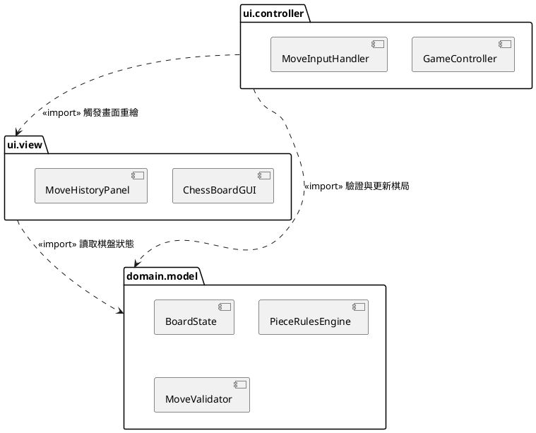

</div>
<div class="card" data-marpit-fragment>

### 2. 套件職責劃分與無環相依解析
- **1. 三大套件分類**：
  - `domain.model`：`BoardState`、`PieceRulesEngine`、`MoveValidator`（純西洋棋規則與狀態）。
  - `ui.view`：`ChessBoardGUI`、`MoveHistoryPanel`（純視覺繪製）。
  - `ui.controller`：`GameController`、`MoveInputHandler`（將滑鼠事件轉為領域操作）。
- **2. 單向無環相依原則 (ADP)**：
  - 所有相依箭頭皆**朝向 `domain.model`**。
  - **絕對禁止之反向相依**：嚴禁出現 `domain.model ..> ui.view`！正因 `domain.model` 不匯入任何 GUI 套件，我們才能在不啟動視窗的情況下 1 秒跑完一萬個 JUnit 棋規測試，或隨時將桌面視窗替換為手機 App 與網頁版！

</div>
</div>

<!--
這是 5.3 節同儕討論「西洋棋遊戲 MVC 架構之 UML 套件圖 (PlantUML)」的建議解答。

請看左欄完整的 PlantUML 程式碼：我們將 7 個類別乾淨地歸入 `ui.controller`、`ui.view` 與 `domain.model` 三個資料夾套件，並以虛線箭頭 `..>` 標示 `«import»` 方向。

再看右欄的設計重點：最關鍵的架構紀律就是 **`domain.model` 絕對不能 import `ui.view` 或 `ui.controller`**！只要守住這條單向邊界，西洋棋的核心規則引擎就能 100% 獨立進行自動化測試，未來要改成網頁版或手機版也完全不必修改任何一行棋規程式碼。

總結這張投影片，請記住這個核心觀念：在 MVC 套件圖中，相依箭頭必須單向指向核心領域模型，確保業務規則與視覺介面徹底解耦。
-->
---
## 附錄 C：同儕討論 5.4 建議解答 — `bubbleSort` 之 Javadoc 設計規格

> **設計解答核心：** 完整的排序後置條件必須同時規定 **「遞增有序 (Ordered)」** 與 **「元素排列守恆 (Permutation)」**，缺一不可！

<div class="two-columns">
<div class="card" data-marpit-fragment>

### 1. 契約擴充型 Javadoc 與 JML 規格
```java
/**
 * 將傳入之整數陣列以原地 (in-place) 方式由小到大遞增排序。
 *
 * @param arr 待排序之整數陣列（直接於原陣列內交換元素）
 * @throws IllegalArgumentException 若 {@code arr == null}
 *
 * @pre  arr != null（空陣列或單一元素陣列視為合法，直接返回）
 * @post 1. 長度不變：arr.length == \old(arr.length)
 * @post 2. 遞增有序：\forall int i; 0 <= i < arr.length - 1;
 *                   arr[i] <= arr[i + 1]
 * @post 3. 排列守恆 (Multiset Permutation)：
 *          排序後之 arr 必須為 \old(arr) 之重排列——所有元素之
 *          出現次數 (frequency count) 與排序前完全相同！
 * @invariant 外層迴圈不變量 (第 k 回合結束)：陣列最右側 k 個元素
 *          arr[n - k .. n - 1] 已就定位且為全陣列最大之 k 個值。
 */
public static void bubbleSort(int[] arr) { ... }
```

</div>
<div class="card" data-marpit-fragment>

### 2. 三大契約問題解析與反例驗證
- **Q1. 前置條件 (`@param` / `@throws`)**：
  - `arr != null`；若傳入 `null` 則拋出 `IllegalArgumentException`。注意 `arr.length == 0` 屬於合法輸入，不應拋出例外。
- **Q2 & Q3. 為何只寫 `arr[i] <= arr[i+1]` 會有致命漏洞？**：
  - 假設某個惡意或寫錯的實作直接在函式裡寫：
    `Arrays.fill(arr, 0);`（把陣列全部填滿 `0`）。
  - 請問 `[0, 0, 0, 0]` 有沒有滿足 `arr[i] <= arr[i+1]`？**完全滿足！**
  - 因此，嚴謹的排序後置條件 (Postcondition) **必須同時包含兩大子句**：
    1. **有序性 (Ordered)**：相鄰元素滿足 `arr[i] <= arr[i + 1]`。
    2. **排列守恆 (Permutation)**：輸出陣列的多重集 (Multiset) 必須等於 `\old(arr)`，嚴禁憑空竄改或遺失任何原始數值！

</div>
</div>

<!--
這是 5.4 節同儕討論「以 Javadoc 撰寫 `bubbleSort(int[] arr)` 設計規格」的建議解答。

請特別看右欄第 3 題的經典反例：為什麼後置條件只寫「相鄰元素 `arr[i] <= arr[i+1]`」是不合格的規格？
因為如果一個偷懶的工程師直接把陣列全部覆寫成 `0`（`Arrays.fill(arr, 0)`），產出的 `[0, 0, 0, 0]` 完全符合 `0 <= 0` 的遞增條件，但原本的資料卻全部毀了！
所以形式化規格提醒我們：完整的排序 Postcondition 必須同時宣告**「1. 遞增有序 (Ordered)」**與**「2. 元素排列守恆 (Permutation of `\old(arr)`)」**！

總結這張投影片，請記住這個核心觀念：嚴謹的排序契約必須同時規範「有序性」與「多重集排列守恆」，才能防止破壞資料的錯誤實作蒙混過關。
-->
---
## 附錄 D：同儕討論 5.5 建議解答 — GoF 觀察者模式 (Observer)

> **設計解答核心：** **觀察者模式**透過抽象通知介面 (`Observer`)，將狀態頻繁變動的 **主題 (`Subject`)** 與任意數量的 **觀察者** 徹底解耦！

<div class="two-columns">
<div class="card" data-marpit-fragment>

### 1. 設計動機與 GoF UML 角色結構
- **設計動機（輪詢浪費 vs. 硬編碼耦合之兩難）**：
  - 若不使用 Observer，要麼客戶端每秒瘋狂輪詢 (Polling) 耗盡資源，要麼 `OrderService` 在程式碼裡直接寫死呼叫 `CustomerApp`、`KitchenDisplay` 與 `RiderTracker`（嚴重違反 **SRP 與 OCP**）。
- **GoF 核心參與者角色**：
  - **`Subject` (`OrderEventPublisher`)**：維護 `List<OrderObserver>` 清單，提供 `+ attach(o)`、`+ detach(o)` 與 `+ notifyObservers(event)`。
  - **`«interface» OrderObserver`**：宣告統一通知合約 `+ onOrderStateChanged(OrderEvent e)`。
  - **`ConcreteObservers`**：`CustomerPushObserver`、`KitchenScreenObserver`、`RiderMapObserver` 實作該介面 (`..|>`)。

</div>
<div class="card" data-marpit-fragment>

### 2. 外送平台 UML 結構與 SOLID 原則印證
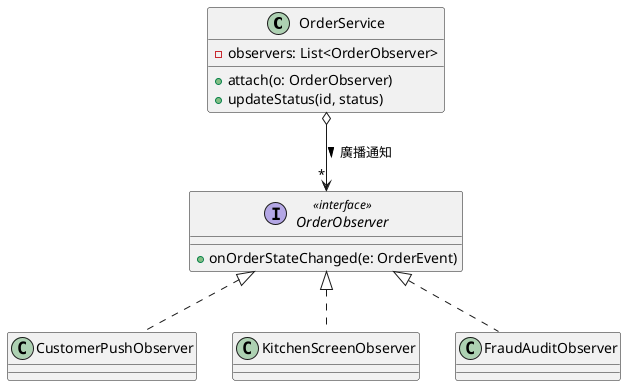
- **Observer 如何完美體現 DIP 與 OCP**：
  - **DIP (相依反轉)**：高階 `OrderService` 僅依賴抽象的 `«interface» OrderObserver`，完全不知曉底層推播細節。
  - **OCP (開放封閉)**：下個月若要新增「防詐稽核 (`FraudAuditObserver`)」，只需新增一個實作類別並呼叫 `attach()`——**`OrderService` 連一行程式碼都不必修改！**

</div>
</div>

<!--
這是 5.5 節同儕討論「探索 GoF 觀察者模式 (Observer Pattern) 之設計動機與結構」的建議解答。

請看左欄：當外送訂單狀態改變時，如果讓 `OrderService` 直接去呼叫顧客推播、餐廳螢幕與外送員地圖，每多一個通知對象就要改一次 `OrderService`。透過 Observer 模式，`OrderService` 只負責維護一個 `List<OrderObserver>` 並廣播事件。

再看右欄的 UML 圖與 SOLID 印證：這正是 **相依反轉原則 (DIP)** 與 **開放封閉原則 (OCP)** 的完美結晶！高階的 `OrderService` 只依賴抽象的 `OrderObserver` 介面；未來要新增「防詐稽核」或「簡訊通知」時，只要實作新類別並掛載 (`attach`) 上去即可，完全不必修改既有的核心訂單服務。

總結這張投影片，請記住這個核心觀念：GoF 觀察者模式結合了 DIP 與 OCP，讓一對多的狀態變更通知具備隨插即用的高度擴充性。
-->
---
<!-- _class: lead -->
<!-- header: '' -->

# **感謝聆聽，歡迎提問與深入交流！**
### Q & A · 共同討論

**薛念林 教授**
資訊工程學系
逢甲大學

<!--
非常感謝大家的專注聆聽與熱情參與！
現在開放現場提問、架構實務研討與專案設計交流。
-->

<script>
(function() {
  // =========================================================================
  // 1. Header Dropdown (Table of Contents / Outline)
  // =========================================================================
  function initHeaderDropdown() {
    const sections = [];
    const seenTitles = new Set();
    const slideSections = document.querySelectorAll('section[id]');
    
    // 1. Scan unique section titles and their slide IDs
    slideSections.forEach(sec => {
      const header = sec.querySelector('header');
      if (!header) return;
      
      let title = header.textContent.trim();
      title = title.replace(/^[◄◀]\s*/, '').replace(/\s*[►▶]$/, '').trim();
      if (!title || seenTitles.has(title)) return;
      
      seenTitles.add(title);
      sections.push({
        id: sec.id,
        title: title
      });
    });

    if (sections.length === 0) return;

    // Detect language: if slide titles don't have Chinese characters, use English
    const allTitles = sections.map(s => s.title).join('');
    const isEn = !/[\u4e00-\u9fa5]/.test(allTitles);
    const txtOutline = isEn ? '📑 Table of Contents' : '📑 章節目錄';
    const txtTitleTooltip = isEn ? 'Click to pin or hover to view outline' : '點擊固定或懸停查看章節目錄';
    const txtPrev = isEn ? 'Previous Section' : '上一章節';
    const txtNext = isEn ? 'Next Section' : '下一章節';

    // Helper to create the dropdown DOM
    function createDropdownWrapper(currentTitle) {
      const wrapper = document.createElement('span');
      wrapper.className = 'header-nav-wrapper';
      
      const titleSpan = document.createElement('span');
      titleSpan.className = 'header-nav-title';
      titleSpan.title = txtTitleTooltip;
      titleSpan.innerHTML = currentTitle + '<span class="nav-caret"> ▾</span>';
      
      titleSpan.addEventListener('click', function(e) {
        e.stopPropagation();
        const wasOpen = wrapper.classList.contains('is-open');
        document.querySelectorAll('.header-nav-wrapper.is-open').forEach(w => w.classList.remove('is-open'));
        if (!wasOpen) {
          wrapper.classList.add('is-open');
        }
      });
      
      const dropdown = document.createElement('div');
      dropdown.className = 'nav-dropdown';
      
      dropdown.addEventListener('click', function(e) {
        e.stopPropagation();
      });
      
      const dropHeader = document.createElement('div');
      dropHeader.className = 'nav-dropdown-header';
      dropHeader.innerHTML = '<span>' + txtOutline + '</span>';
      dropdown.appendChild(dropHeader);
      
      const grid = document.createElement('div');
      grid.className = 'nav-dropdown-grid';
      
      sections.forEach(s => {
        const item = document.createElement('a');
        const isActive = (s.title === currentTitle);
        item.className = 'nav-dropdown-item' + (isActive ? ' active' : '');
        item.href = '#' + s.id;
        item.innerHTML = '<span class="badge">#' + s.id.padStart(2, '0') + '</span><span class="item-text" title="' + s.title + '">' + s.title + '</span>';
        
        item.addEventListener('click', function(e) {
          e.preventDefault();
          wrapper.classList.remove('is-open');
          dropdown.style.display = 'none';
          const targetHash = '#' + s.id;
          if (window.location.hash === targetHash) {
            window.dispatchEvent(new HashChangeEvent('hashchange'));
          } else {
            window.location.hash = targetHash;
          }
          setTimeout(() => { dropdown.style.display = ''; }, 350);
        });
        
        grid.appendChild(item);
      });
      
      dropdown.appendChild(grid);
      wrapper.appendChild(titleSpan);
      wrapper.appendChild(dropdown);
      return wrapper;
    }

    // Close any pinned dropdown when clicking anywhere outside
    document.addEventListener('click', function(e) {
      if (!e.target.closest('.header-nav-wrapper')) {
        document.querySelectorAll('.header-nav-wrapper.is-open').forEach(w => w.classList.remove('is-open'));
      }
    });

    // 2. Enhance each header element across all slides
    slideSections.forEach(sec => {
      const header = sec.querySelector('header');
      if (!header || header.dataset.navEnhanced) return;
      header.dataset.navEnhanced = 'true';
      
      const links = header.querySelectorAll('a');
      let prevLink = null;
      let nextLink = null;
      
      links.forEach(a => {
        const txt = a.textContent.trim();
        if (txt === '◄' || txt === '◀') prevLink = a;
        if (txt === '►' || txt === '▶') nextLink = a;
      });
      
      let title = header.textContent.trim();
      title = title.replace(/^[◄◀]\s*/, '').replace(/\s*[►▶]$/, '').trim();
      if (!title) return;
      
      header.innerHTML = '';
      if (prevLink) {
        prevLink.className = 'header-nav-arrow';
        prevLink.title = txtPrev;
        header.appendChild(prevLink);
        header.appendChild(document.createTextNode(' '));
      }
      
      const wrapper = createDropdownWrapper(title);
      header.appendChild(wrapper);
      
      if (nextLink) {
        header.appendChild(document.createTextNode(' '));
        nextLink.className = 'header-nav-arrow';
        nextLink.title = txtNext;
        header.appendChild(nextLink);
      }
    });
  }

  // =========================================================================
  // 2. Number Quick Jump (<kbd>Num</kbd> + <kbd>Enter</kbd>)
  // =========================================================================
  function initNumberQuickJump() {
    let inputBuffer = '';
    let timer = null;
    let hud = null;

    // Detect language: check titles or body text
    const slideSections = document.querySelectorAll('section[id]');
    let hasZh = false;
    slideSections.forEach(s => {
      if (/[\u4e00-\u9fa5]/.test(s.textContent || '')) hasZh = true;
    });
    const isEn = !hasZh;

    function getOrCreateHud() {
      if (!hud) {
        hud = document.createElement('div');
        hud.id = 'slide-quick-jump-hud';
        hud.style.cssText = [
          'position: fixed',
          'bottom: 36px',
          'left: 50%',
          'transform: translateX(-50%)',
          'background: rgba(15, 23, 42, 0.94)',
          'color: #ffffff',
          'padding: 8px 18px',
          'border-radius: 28px',
          'font-family: -apple-system, BlinkMacSystemFont, "Segoe UI", Roboto, system-ui, sans-serif',
          'font-size: 14px',
          'font-weight: 500',
          'box-shadow: 0 16px 36px rgba(0, 0, 0, 0.35), 0 0 0 1px rgba(255, 255, 255, 0.15)',
          'backdrop-filter: blur(16px)',
          '-webkit-backdrop-filter: blur(16px)',
          'z-index: 999999',
          'display: none',
          'align-items: center',
          'gap: 8px',
          'pointer-events: none',
          'opacity: 0',
          'transition: opacity 0.15s ease, transform 0.15s ease'
        ].join(';');
        const targetParent = document.fullscreenElement || document.body;
        targetParent.appendChild(hud);
      }
      const parent = document.fullscreenElement || document.body;
      if (hud.parentElement !== parent) {
        parent.appendChild(hud);
      }
      return hud;
    }

    function getTotalSlides() {
      const secs = document.querySelectorAll('section[id]');
      return secs.length || 1;
    }

    function showHud() {
      const el = getOrCreateHud();
      const total = getTotalSlides();
      const label = isEn ? 'Go to slide:' : '跳至頁碼:';
      const enterHint = isEn ? 'Enter ↵' : 'Enter 確認 ↵';
      el.innerHTML = '<span>🧭 ' + label + '</span> ' +
        '<strong style="color: #38bdf8; font-size: 20px; font-weight: 700; font-family: ui-monospace, SFMono-Regular, Menlo, monospace; letter-spacing: 1px;">' + inputBuffer + '</strong> ' +
        '<span style="opacity: 0.6; font-size: 13px;">/ ' + total + '</span> ' +
        '<span style="background: rgba(255,255,255,0.18); padding: 2px 7px; border-radius: 6px; font-size: 11px; margin-left: 2px; font-weight: 600;">' + enterHint + '</span>';
      el.style.display = 'flex';
      el.style.opacity = '1';

      if (timer) clearTimeout(timer);
      timer = setTimeout(clearInput, 2800);
    }

    function clearInput() {
      inputBuffer = '';
      if (timer) {
        clearTimeout(timer);
        timer = null;
      }
      if (hud) {
        hud.style.opacity = '0';
        setTimeout(() => {
          if (inputBuffer === '' && hud) hud.style.display = 'none';
        }, 150);
      }
    }

    function jumpToSlide(num) {
      const total = getTotalSlides();
      const target = Math.max(1, Math.min(num, total));
      const targetHash = '#' + target;
      
      // Visual flash confirmation
      const el = getOrCreateHud();
      const confirmedMsg = isEn ? ('✓ Slide ' + target) : ('✓ 第 ' + target + ' 頁');
      el.innerHTML = '<span style="color: #34d399; font-weight: 700; font-size: 15px;">' + confirmedMsg + '</span>';
      el.style.display = 'flex';
      el.style.opacity = '1';
      setTimeout(clearInput, 500);

      if (window.location.hash === targetHash) {
        window.dispatchEvent(new HashChangeEvent('hashchange'));
      } else {
        window.location.hash = targetHash;
      }
    }

    window.addEventListener('keydown', function(e) {
      // Don't intercept when focusing editable form elements
      const active = document.activeElement;
      if (active && (active.tagName === 'INPUT' || active.tagName === 'TEXTAREA' || active.tagName === 'SELECT' || active.isContentEditable)) {
        return;
      }

      // Ignore if modifier keys are pressed
      if (e.ctrlKey || e.altKey || e.metaKey) {
        return;
      }

      // Resolve digit from key or code (supports '2', 'Digit2', 'Numpad2')
      let digit = null;
      if (e.key >= '0' && e.key <= '9') {
        digit = e.key;
      } else if (/^(?:Digit|Numpad)([0-9])$/.test(e.key)) {
        digit = e.key.replace(/^(?:Digit|Numpad)/, '');
      } else if (/^(?:Digit|Numpad)([0-9])$/.test(e.code || '')) {
        digit = (e.code || '').replace(/^(?:Digit|Numpad)/, '');
      }

      if (digit !== null) {
        inputBuffer += digit;
        if (inputBuffer.length > 4) inputBuffer = inputBuffer.slice(-4);
        showHud();
        return;
      }

      // Backspace
      if ((e.key === 'Backspace' || e.code === 'Backspace') && inputBuffer.length > 0) {
        e.preventDefault();
        e.stopPropagation();
        inputBuffer = inputBuffer.slice(0, -1);
        if (inputBuffer.length === 0) {
          clearInput();
        } else {
          showHud();
        }
        return;
      }

      // Escape
      if ((e.key === 'Escape' || e.code === 'Escape') && inputBuffer.length > 0) {
        e.preventDefault();
        e.stopPropagation();
        clearInput();
        return;
      }

      // Enter key confirms numeric jump
      if ((e.key === 'Enter' || e.code === 'Enter' || e.code === 'NumpadEnter') && inputBuffer.length > 0) {
        e.preventDefault();
        e.stopPropagation();
        const targetPage = parseInt(inputBuffer, 10);
        if (!isNaN(targetPage)) {
          jumpToSlide(targetPage);
        } else {
          clearInput();
        }
      }
    }, true);
  }

  // Initialize both features
  function init() {
    initHeaderDropdown();
    initNumberQuickJump();
  }

  if (document.readyState === 'loading') {
    document.addEventListener('DOMContentLoaded', init);
  } else {
    init();
  }
  setTimeout(init, 400);
})();

</script>
