<!-- _class: lead -->
<!-- header: '' -->

# 軟體工程 (Software Engineering)

### 第六課：使用者體驗 (UX) 設計與以人為本的 AI (UX Design & Human-Centered AI)

**授課教師：薛念林 教授**  
資訊工程學系  
逢甲大學

<!--
各位好，歡迎來到軟體工程第六課：使用者體驗 (UX) 設計與以人為本的 AI。

在先前的章節中，我們學習了如何擷取需求、塑模系統架構，以及建構具備高內聚低耦合的物件導向軟體。然而，即使你的後端演算法在數學上再極致優雅、程式碼一行 bug 都沒有，如果真實的人類使用者看不懂、不會用、用得滿肚子火，那麼這個軟體專案依然是一場徹底的災難。

軟體工程從本質上就是「以人為本」的學科。在這一章中，我們將跨越純工程邏輯與人類心理學之間的鴻溝。我們將探討使用者體驗（UX）的核心本質、透徹掌握 Jakob Nielsen 的十大易用性啟發式原則、學習現代工程師如何運用 AI 加速設計流程（AI for UX），並深入探討如何為具備不確定性的生成式 AI 系統打造值得信賴的使用者介面（UX for AI）。

💡 難字與專業術語解說：
- elicit requirements: 需求擷取 / 需求誘導（透過訪談與觀察挖掘使用者真實需求）
- User Experience (UX): 使用者體驗（使用者與系統互動全過程的主觀感受與成效）
- Human-Centered AI (HCAI): 以人為本的人工智慧（強調可控性、透明度與人類自主權的 AI 設計）
- deterministic: 確定性的（相同輸入必定產生相同輸出的傳統軟體特性）
- cognitive psychology: 認知心理學（研究人類注意力、記憶、感知與決策機制的學門）
-->
---
<!-- _class: outline-slide -->

## 第六章：課程藍圖與核心主題

  

    <h3>第一部分：UX 基礎、啟發法則與設計模式</h3>
    <ul>
      <li><b>6.1 使用者體驗 (UX) 基礎：</b> 什麼是 UX、諾曼門（Norman Doors）、三大不良設計原型、台灣健保快易通 App 改版案例、UI 與 UX 的本質差異、設計思考五大階段。</li>
      <li><b>6.2 尼爾森 10 大易用性啟發法則：</b> 系統狀態可見度、符合真實世界、使用者控制與自由、一致性與標準、防錯設計、辨識取代回憶、彈性與效率捷徑、簡約美學、協助使用者修復錯誤、說明文件。</li>
      <li><b>6.3 Tidwell 介面設計模式：</b> 四大架構維度、核心使用者行為模式、資訊架構與內容佈局、尋路與導航逃生機制、資料呈現與電商/平台解構實例。</li>
    </ul>
  

  

    <h3>第二部分：AI 賦能設計、智慧介面與評估</h3>
    <ul>
      <li><b>6.4 AI 賦能 UX 設計 (AI for UX)：</b> AI 作為設計放大器、RTCF 結構化提示詞工程框架、自動化啟發式稽核、多代理人協同原型打造。</li>
      <li><b>6.5 為 AI 打造卓越體驗 (UX for AI)：</b> 為機率性非確定性 AI 設計介面、延遲與思考軌跡管理、人類自主掌控權、幻覺防護圍欄、可解釋性 AI (XAI)。</li>
      <li><b>6.6 易用性評估與工程整合：</b> 尼爾森 0-4 級嚴重度評級、專家啟發式評估 vs. 真人使用者測試、章節回顧測驗與工程總結。</li>
    </ul>

<!--
這是我們第六章的學習藍圖。

在左側的第一部分，我們從日常認知心理學切入：探討為什麼好設計往往「看不見」，為什麼壞設計會引發使用者暴怒；接著系統性拆解 Jakob Nielsen 的十大易用性啟發原則；最後深入 Jenifer Tidwell 的經典 Web UI/UX 設計模式庫，掌握涵蓋核心行為、資訊架構、尋路導航與資料呈現的實戰藍圖。

在右側的第二部分，我們邁入 AI 時代的前沿設計與工程評估：分別探討 AI for UX（以 AI 加速原型與稽核）、UX for AI（為機率性系統設計透明可控的介面），以及正式的專家啟發式評估與真人測試方法。

💡 難字與專業術語解說：
- roadmap & core curriculum: 課程學習地圖與核心課綱
- archetype: 典型範例、原型態樣（反覆出現的代表性問題模式）
- usability heuristics: 易用性啟發式原則（評估介面是否好用的經驗法則與檢核準則）
- wayfinding & escape hatches: 尋路導航與逃生出口（協助使用者定位並安全撤離狀態的機制）
- non-deterministic: 非確定性的（如生成式 AI 每次推論結果皆具機率變異性）
- steerability & hallucination guardrails: 可操控性與幻覺防護圍欄（引導 AI 輸出並攔截虛構錯誤的設計）
-->
---
<!-- _class: lead -->
<!-- header: '6.1 使用者體驗基礎' -->

# **6.1 使用者體驗 (UX) 設計基礎**

> "Good design is actually a lot harder to notice than poor design, in part because good designs fit our needs so well that the design is invisible."  
> *(優秀的設計往往比糟糕的設計更難被察覺，因為好設計與我們的需求契合得天衣無縫，以至於它本身隱形了。)*  
> — *Don Norman (《設計的心理學》作者)*

<!--
我們首先進入 6.1 節：使用者體驗設計基礎。

你有沒有過這樣的經驗：走進一棟公共大樓，看到門把用力往前推，結果門紋風不動，才發現門上貼著「請用拉的」？當時你是不是覺得自己很笨？

認知心理學巨擘 Don Norman 告訴我們：你一點都不笨，笨的是那扇門！當一扇門裝著一片平板，人類的本能就是推；當裝著把手，人類的直覺就是拉。當一個把手竟然需要用「推」的，這扇門在設計上就徹底違背了人類的認知天性。

在這一節中，我們將探討日常設計心理學、分析三大經典不良設計原型、剖析真實世界健保 App 的改版歷程，並確立使用者體驗的正式範疇。

💡 難字與專業術語解說：
- invisible design: 隱形設計（設計完美契合人類直覺，使人專注於目標而感受不到工具阻礙）
- cognitive scientist: 認知科學家（研究人類心智運作與資訊處理的學者）
- instinct: 本能、直覺反應
- The Design of Everyday Things: 《設計的心理學》（Don Norman 的人機互動奠基經典著作）
-->
---
## 為什麼好設計如此重要？從「諾曼門」談起

> **什麼是「諾曼門 (Norman Door)」？** 一扇外觀給出**錯誤直覺暗示**的門——例如裝了明顯的「**拉把**」，實際上卻必須「**用推的**」才打得開！

* **當設計違背直覺時的真實情緒（尷尬與生氣）：**
  - 看到門把下意識用力拉，門卻紋風不動——瞬間讓人感到**尷尬、丟臉、懷疑自己，甚至惱怒生氣**。
  - Don Norman 指出：**這絕不是使用者的錯，而是糟糕的設計**違背了人類的本能反應！
* **從一扇門帶出 UX（使用者體驗）的核心價值：**
  - *「當一扇日常大門還需要貼上『**請用推的 (PUSH)**』字條時，這個設計本身就失敗了。」* —— Don Norman
  - 軟體介面同樣充滿「數位諾曼門」：好的 **UX 設計**讓視覺線索契合人類直覺，讓使用者感到**順暢與被尊重**，而非受挫生氣。

    

<!--
請看畫面上這個著名的「諾曼門」例子。

當你走向一扇裝著垂直拉把的門，大腦本能就會伸手去拉。結果門突然打不開，因為它其實是要用推的、甚至是橫拉的！在眾目睽睽之下開不了門，當下往往會覺得非常尷尬、丟臉，甚至一肚子火。

認知心理學家 Don Norman 指出，當人們操作日常物品受挫時，往往會怪自己笨，但其實真正有問題的是「違反人類本能的設計」。如果一扇門還得貼一張「請用推的」字條才能讓人打開，代表這個設計本身就失敗了。

這正是我們帶出 UX（使用者體驗）重要性的原因。軟體系統裡也到處都是這種「數位諾曼門」，常讓使用者點錯、找不到功能而感到挫折生氣。好的設計應該順應人類直覺，讓操作自然流暢。

💡 難字與專業術語解說：
- Norman Door: 諾曼門（視覺暗示與實際操作方式互相矛盾、讓人推拉錯亂的門）
- prominent pull handle: 顯眼的拉門把手
- instinctively: 出於本能地、直覺地
- visual cue / signifier: 視覺線索 / 意符（傳達「應如何操作」的視覺信號）
- affordance: 預設用途 / 可供性（物體本身具備並允許使用者執行的物理操作特性）
-->
---
## 劣質 UI/UX 所帶來的挫折與代價

> 「當介面混亂難用時，使用者很少怪罪系統架構師——他們只會感到**認知挫折**、懷疑自己，然後**憤而放棄產品**。」

* **糟糕軟體對使用者心理的摧殘：**
  - 引發認知超載、困惑迷惘、焦慮無助，最後導致使用者憤而放棄（User Rage & Churn）。
  - 使用者往往不會怪罪背後的資料庫或架構師，只會留下 1 星負評並怒刪 App。
* **劣質 UX 如何摧毀企業商業價值：**
  - **購物車放棄率高達 70%：** 結帳流程過於繁瑣、表單驗證不明確直接導致營收蒸發。
  - **龐大客服成本支出：** 數以萬計的客服電話與工單，根本源頭都是混亂的介面導覽。
  - **企業員工生產力內耗：** 難用的內部企業 ERP/CRM 系統，導致日常操作頻繁出錯與嚴重工時浪費。

    

<!--
糟糕的軟體設計背後伴隨著巨大的情緒與經濟成本。

當使用者遇到雜亂的表單、找不到送出按鈕、或是突然彈出看不懂的錯誤代碼時，會產生本能的憤怒與挫折感。在消費型產品中，使用者會直接解除安裝跳槽到競爭對手那裡；在企業內部，難用的系統每天都在浪費員工數千小時的生產力。

工程師必須深刻體會：易用性絕非可有可無的美化裝飾——它直接決定了產品的商業留存率、轉化率與軟體的生存命脈。

💡 難字與專業術語解說：
- emotional toll: 情緒耗損、心理代價
- cognitive overload: 認知過載（畫面資訊或步驟超過人類工作記憶可負荷的上限）
- cart abandonment: 購物車放棄率（將商品加入購物車卻因流程繁瑣而未完成結帳）
- convoluted: 盤根錯節的、過於迂迴複雜的
- employee burnout: 員工職業倦怠（長期被難用的內部系統折磨導致的精力耗竭）
-->
---
## 不良設計原型 (1)：「夜市擺攤風」的感官超載

> **「夜市擺攤風」(Arngren-Style Overload)：** 將數百項商品、閃爍跑馬燈與衝突連結全部硬塞進單一畫面，毫無視覺階層。

* **為什麼這種設計很糟糕？**
  - **模式識別失效：** 每個商品區塊的長寬比、對齊線與字體完全隨機，大腦無法建立模式，必須對每個點重新「對焦」，造成極度疲勞。
  - **缺乏網格系統與視覺錨點：** 沒有水平或垂直對齊軸線，視線無法順暢掃描。
  - **急性感官超載：** 當畫面上每個元素都同時大聲搶奪注意力時，使用者無法找到核心任務，跳出率極高。

    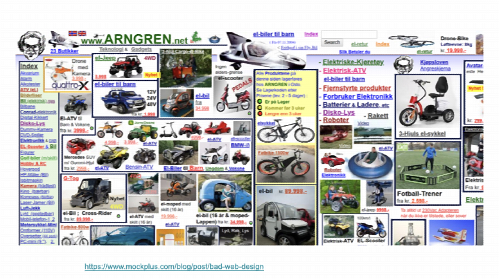

<!--
請看第一種經典不良設計原型：「夜市擺攤風」的感官超載，右圖是世界知名的挪威 Arngren 網站。

為什麼這個網站讓人看得眼花撩亂？第一，模式識別徹底失效。現代電商的商品卡片（圖片、價格、名稱）長寬比與位置都是固定的；但這裡每個區塊大小隨機、東一塊西一塊，大腦必須對每一個商品重新對焦。

第二，完全缺乏網格系統（Grid System）與留白，無人機、電動滑板車與模型爭搶著每一個像素。

💡 難字與專業術語解說：
- sensory overload: 感官過載（過多雜亂視覺刺激同時湧入導致大腦無法處理）
- visual hierarchy: 視覺階層（透過字級、色彩與空間引導視線先後順序的結構）
- pattern recognition: 模式辨識（大腦透過規律排版快速識別同類資訊的能力）
- aspect ratio: 長寬比（圖片或卡片的寬高比例）
- visual anchor: 視覺錨點（協助眼球定位與建立掃描起點的基準元素）
- cognitive fatigue & bounce: 認知疲勞與跳出（因心智耗竭而立即離開網頁）
-->
---
## 不良設計原型 (2)：「油漆不用錢」的色彩對比災難

> **「油漆不用錢」原型：** 濫用衝突刺眼的配色、波紋背景與浮雕陰影，徹底摧毀易讀性與專業品牌信賴感。

* **為什麼這種設計很糟糕？**
  - **色彩對比崩壞：** 在藍色波紋漸層背景上直接壓深紅細體字與亮黃字，產生視覺閃爍感，嚴重違反 **WCAG 無障礙對比度標準**。
  - **排版與字體災難：** 標題濫用厚重浮雕陰影增加視覺噪音；連結列表長短參差不齊，造成嚴重視覺疲勞。
  - **缺乏負空間且摧毀信賴感：** 內容塞得密不透風，尤其在專業醫療 X 光器材網站採用這種配色，會直接摧毀專業信任度。

    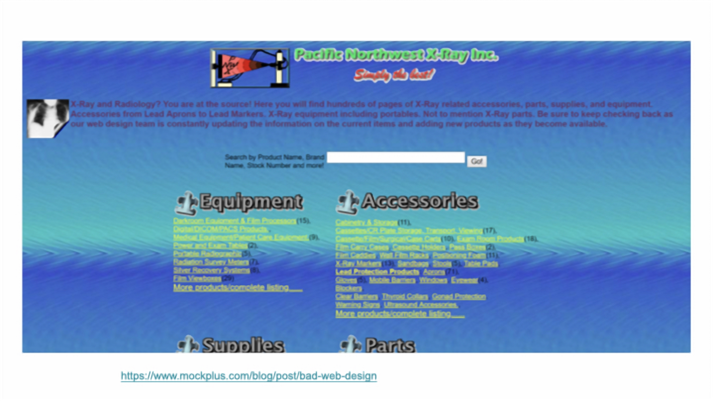

<!--
接著看第二種不良設計原型：「油漆不用錢」的色彩對比災難，右圖取自真實的醫療 X 光設備供應商網站。

請看左列分析為什麼這種設計令人痛苦：第一，色彩對比崩壞，在刺眼的藍色波紋背景上直接放深紅字與亮黃連結，完全違反 WCAG 無障礙標準，年長者或色弱使用者根本無法閱讀。

第二，標題加上厚重的立體浮雕陰影，毫無留白負空間；作為醫療器材商，這種隨意混搭的配色更直接摧毀了品牌的專業信賴感。

💡 難字與專業術語解說：
- clashing colors: 衝突撞色（高彩度互補色直接疊加造成視覺刺眼與顫動）
- drop-shadow: 陰影效果（文字或區塊後方的立體投影，過度使用會破壞易讀性）
- visual vibration: 視覺顫動（強對比色彩相鄰時在視網膜產生的閃爍不適感）
- WCAG (Web Content Accessibility Guidelines): 網頁內容無障礙指南（國際通用的明暗對比度與可及性標準）
- negative space (whitespace): 負空間 / 留白（不放任何元素的呼吸空間，用於分隔資訊群組）
- professional credibility: 專業可信度、品牌信賴感
-->
---
## 不良設計原型 (3)：「不知從何下手」的導覽與行寬失控

> **「不知從何下手」原型：** 滿螢幕充斥著數十個尺寸相同、未分主次的按鈕與超寬文字段落，缺乏明確的行動呼籲 (CTA)。

* **為什麼這種設計很糟糕？**
  - **缺乏視覺焦點與主次：** 左側一整排紅黑按鈕尺寸與視覺權重完全相同，沒有主要行動呼籲（CTA），使用者不知道該先按哪裡。
  - **資訊洪流無分類：** 頂部將電話、地址與標語全塞進刺眼的亮綠橫幅，毫無導覽層次。
  - **文字行寬失控 (Line Length)：** 右側段落直接橫跨整個寬螢幕，遠超過人類舒適閱讀的 **每行 45～75 字元** 上限，強迫眼球大幅擺動。

    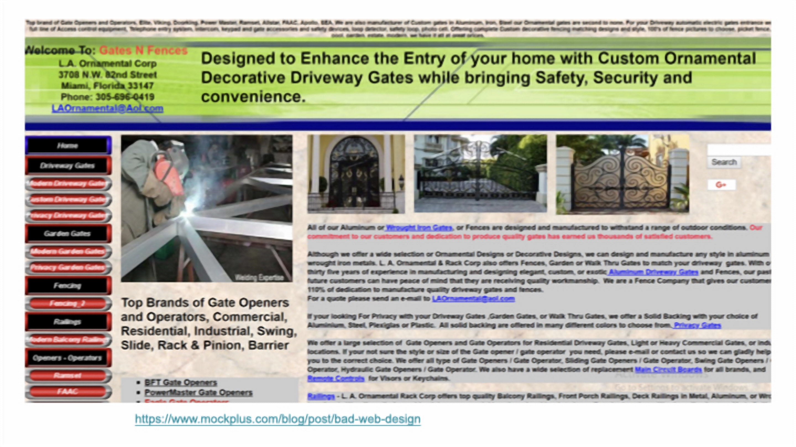

<!--
再看第三種不良設計原型：「不知從何下手」——缺乏視覺階層與行寬失控。

請對照右圖與左列原因：第一，畫面左側塞了十幾顆紅黑相間、視覺權重一模一樣的按鈕，缺乏明確的主要行動呼籲（CTA），使用者陷入選擇癱瘓。

第二，觀察右下方的文字段落：文字直接橫跨整個螢幕寬度。人因工程研究指出，人類最舒適的閱讀長度是每行 45 到 75 個字元；超寬排版強迫讀者的眼球與脖子大幅度左右擺動，極易跳行與疲勞。

💡 難字與專業術語解說：
- Call-to-Action (CTA): 行動召喚按鈕（頁面上最核心、引導使用者點擊推進流程的主按鈕）
- visual focal point: 視覺焦點（畫面上第一眼吸引注意力的核心區域）
- visual weight: 視覺權重（元素透過大小、色彩與對比度所佔據的視覺份量）
- ergonomic reading limit: 人因工程閱讀極限（最符合人眼水平掃視舒適度的單行字元數 45–75 字）
- return sweep: 換行回掃（視線讀完一行末端後移回下一行開頭的眼球運動）
-->
---
## 真實案例互動：健保快易通 App — 猜猜口罩去哪裡預約？

> **課堂挑戰：** 如果你想**預約購買口罩**，猜猜看應該點擊哪一個圖示（**1–6**）？

  

    <h3 style="color: #dc2626; margin-bottom: 8px;">第一版緊急上線：猜猜在哪裡買口罩 (1–6)？</h3>
    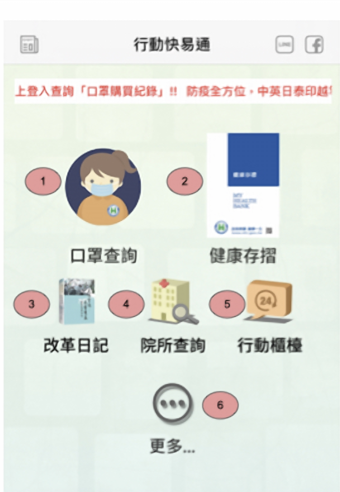
    
<strong>1.</strong> 口罩查詢 &nbsp;|&nbsp; <strong>2.</strong> 健康存摺 &nbsp;|&nbsp; <strong>3.</strong> 改革日記 <strong>4.</strong> 院所查詢 &nbsp;|&nbsp; <strong>5.</strong> 行動櫃檯 &nbsp;|&nbsp; <strong>6.</strong> 更多...

  

  

    <h3 style="color: #16a34a; margin-bottom: 8px;">解答：竟藏在 2 號「健康存摺」！→ 改版後九宮格</h3>
    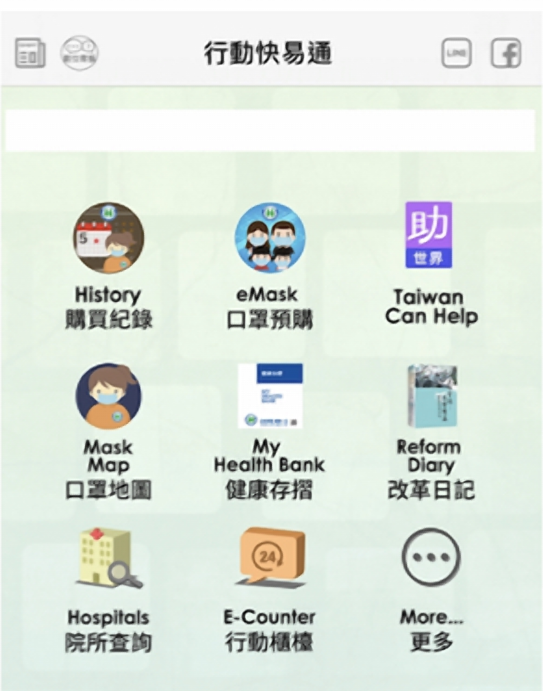
    
<strong>為何放「健康存摺」？</strong>因為裡面才有登入驗證模組！ <strong>改版後：</strong>直接將 <strong>eMask 口罩預購</strong> 獨立拉到第一排正中央。

<!--
這是一個發生在台灣、極具教學意義的真實案例：健保快易通 App 的口罩預購介面演進。

當年疫情剛爆發、政府緊急推出線上「口罩預約購買」功能，並在新聞上宣布：大家打開《行動快易通》App 就可以預約買口罩了！

現在請大家看著左邊這張第一版緊急上線的畫面，上面標了 1 到 6 號：
1 號是「口罩查詢」、2 號是「健康存摺」、3 號是「改革日記」、4 號是「院所查詢」、5 號是「行動櫃檯」、6 號是「更多」。
請各位同學猜猜看：如果你要「預約購買口罩」，應該點哪一顆按鈕？

當年幾乎全台灣民眾第一直覺都去點 1 號「口罩查詢」！結果點進去只有藥局地圖，根本不能預購口罩！

現在揭曉答案（點擊出現右圖）：真正的「口罩預購」功能，竟然被藏在 2 號的「健康存摺」裡面！
為什麼工程師會把「買口罩」塞進「健康存摺」？因為預購口罩需要「實名制身分認證登入」，而原本的 App 裡只有「健康存摺」寫好了登入驗證模組！工程師為了後端開發方便，就直接把口罩預購塞在健康存摺底下！

這就是典型的「以工程師後端架構思考，而非使用者心智模型思考」的不良設計。後來團隊從善如流，改版為右邊的標準化九宮格，把「eMask 口罩預購」、「購買紀錄」與「口罩地圖」清楚拆開並直接放在第一排最顯眼的位置。

💡 難字與專業術語解說：
- Taiwan NHI (National Health Insurance): 台灣全民健康保險
- pre-order: 預購、事先登記申購
- emergency launch: 緊急上線發布（在時間壓力下倉促推上線的版本）
- refactor: 重構（在不改變核心業務功能的前提下，重新調整結構以提升品質與易用性）
-->
---
## 案例剖析：工程師後端思維 vs. 使用者心智模型

* **第一版緊急上線為何讓民眾找不到？（以系統實作驅動 UI 的反模式）：**
  - **遷就後端認證模組（康威定律）：** 因為買口罩需要實名登入，工程師直接把功能掛在已經有登入機制的 **2 號「健康存摺」** 內，完全違背民眾對「存摺＝查就醫紀錄」的認知。
  - **誤導性的示能線索 (False Signifier)：** **1 號「口罩查詢」** 畫著戴口罩的圖示，吸引無數民眾誤點進入死胡同；頂部紅字跑馬燈看起來像純文字廣告，看不出可以點擊。
  - **視覺規格不一致：** 圓形、長方形存摺、立體書本混雜，缺乏統一網格與階層。
* **改版後如何解決問題？（以使用者目標驅動的九宮格重構）：**
  - **核心任務直接浮出表面：** 將 **「eMask 口罩預購」**、**「History 購買紀錄」** 與 **「Mask Map 口罩地圖」** 三大防疫任務直接獨立拉到最上排第一層。
  - **標準化視覺與雙語標籤：** 統一採用圓形圖示與整齊九宮格，並加上中英雙語標示，讓使用者一秒找到目標。

<!--
讓我們深入剖析健保快易通這個案例背後的核心軟體工程啟示。

為什麼第一版會讓全台灣民眾找不到買口罩的地方？因為它是典型的「以系統實作驅動 UI（Implementation-Driven UI）」。從後端工程師的角度來看，「健康存摺」已經有完整的身分證與健保卡認證程式碼，把口罩預購塞進去最快、最省事。

但從一般民眾的心智模型來看，「健康存摺」是看過去看病吃藥紀錄的地方，誰會想到要去存摺裡買口罩？同時 1 號「口罩查詢」又畫了一個戴口罩的人，形成了強烈的誤導線索。

在改版後的九宮格中，設計團隊打破了後端模組的藩籬，直接依照使用者的真實目標，把「口罩預購」、「購買紀錄」與「口罩地圖」拉到首頁第一層，並統一了九宮格的視覺語言。

💡 難字與專業術語解說：
- Implementation-Driven UI: 實作導向介面（依照後端程式碼模組或資料庫結構，而非使用者思維所排出的介面）
- authentication: 身分驗證（確認使用者真實身分的登入機制）
- false signifier: 錯誤意符 / 誤導性視覺線索（外觀看起來像某功能，點擊後卻不是該預期的行為）
- goal-directed: 目標導向的（以使用者想完成的任務為核心來組織介面）
- first-class action: 一級核心操作（無需深層鑽取、直接擺在首頁最顯眼處的功能）
-->
---
## 為什麼做好 UX 那麼難？

> **根本原因：** UX 之所以失敗，往往不是因為技術不夠好，而是因為工程思維的盲點與缺乏設計的開發習慣。

- **缺乏系統思考 (Lack of Systems Thinking)**
  - 只有模組思考；功能疊床架屋、來一個做一個 (Patchwork Construction)
- **缺乏使用者思考 (Lack of User Thinking)**
  - 沉溺於後端架構與資料結構，忽略使用者的核心目標
- **缺乏同理心思考 (Lack of Empathic Thinking)**
- **缺乏使用者研究與需求分析 (Lack of User Research)**
- **沒有設計就施工 (Lack of Prior Design)**
  - 跳過互動規劃與原型設計，直接寫程式硬幹
- **缺乏測試、反饋與迭代修正 (Lack of Testing & Iteration)**
  - 未經完整易用性測試與使用者回饋便直接上線

    

<!--
為什麼頂尖工程師與團隊常常做出極難使用的軟體？

核心問題在於軟體開發過程中的七大盲點：

第一，只有模組思考，沒有系統思考，各模組各做各的；第二，疊床架屋，來一個做一個，畫面越來越混亂；第三，只有系統思考，沒有使用者思考，凡事以後端架構為中心。

第四，缺乏同理心思考，無法感同身受使用者的困惑；第五，沒有使用者研究與真實需求分析，全憑工程師自己猜測；第六，沒有設計就直接施工編程；第七，缺乏測試反饋與修正機制，無法迭代進步。

💡 難字與專業術語解說：
- engineering-centric: 以工程師為中心的（從系統實作便利性而非使用者體驗出發的思維）
- fragmented: 支離破碎的、缺乏整體連貫性的
- patchwork construction: 拼湊式建造（缺乏頂層設計、東補西湊堆疊功能）
- empathic thinking: 同理心思維（設身處地感受使用者困惑與情緒的能力）
- Curse of Knowledge: 知識的詛咒（專家因過度熟悉系統內部邏輯，而無法理解新手為何看不懂）
-->
---
## UI (使用者介面) vs. UX (使用者體驗)

* **使用者介面 (UI / User Interface)：**
  - 人類與軟體互動時，所看見、聽見與觸摸的具體感官接觸點。
  - *元素涵蓋：* 按鈕外觀、字型排版、色彩配置、邊距間距、CSS 格線、圖示、過渡微動畫。
  - *核心關切：* 「這個畫面在視覺上看起來如何？渲染與動效順不順暢？」
* **使用者體驗 (UX / User Experience)：**
  - 人類與品牌、服務或系統在完整旅程中產生的整體心理與情感認知感受。
  - *元素涵蓋：* 任務達成效率、流程阻力、認知負擔、滿意度、容錯修復能力與信賴感。
  - *核心關切：* 「使用者是否能直覺、高效且愉悅地達成他們的目標？」
* **經典生動比喻：**
  - UI 是精緻的馬鞍、韁繩與馬鐙；UX 則是騎在馬背上奔馳的整體駕馭感受！

<!--
讓我們精確釐清 UI 與 UX 的根本界線。

UI 代表視覺感官接觸點：漂亮的漸層按鈕、優雅的 Google Fonts 字體、細緻的 CSS 動畫。

UX 則掌管整趟旅程的心理感受：我花了多久才把帳單繳完？操作過程有沒有焦慮？如果不小心按錯了，系統能不能讓我秒速復原？

經典的比喻非常傳神：UI 是雕刻精美的馬鞍與韁繩；UX 則是騎馬奔馳時的暢快與踏實感。

一個畫面可以擁有玻璃擬態（Glassmorphism）的高級 UI，但如果送出按鈕在手機上點了沒反應，UX 就是零分。

💡 難字與專業術語解說：
- tangible: 具體可感知的、有形的
- sensory touchpoint: 感官接觸點（使用者眼睛看到、手指觸碰到的介面元素）
- typography: 字體排印學（字型選擇、字級階層、行高與字距的排版設計）
- end-to-end journey: 端到端旅程（從產生需求、進入系統到最終完成目標的完整歷程）
- saddle, stirrup, and reins: 馬鞍、馬鐙與韁繩（比喻表面可見的操控器物，對比騎乘的整體體驗）
-->
---
<!-- _class: title-image-slide -->
## 視覺化比對：UI 與 UX 的互動架構解剖

  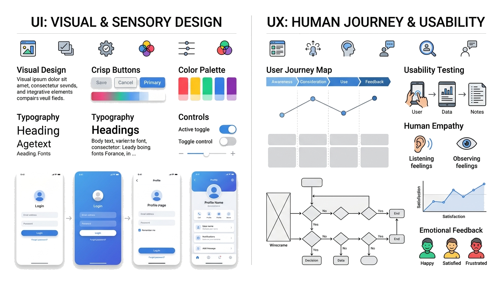

<!--
請看這張 UI 與 UX 的解剖對比圖。

左邊呈現 UI 的專屬範疇：視覺美學、字型、圖標、顏色搭配。

右邊呈現 UX 的宏觀面向：資訊架構、互動流程動線、易用性測試、使用者的情感反饋。

兩者缺一不可。但請記住：UI 是為 UX 服務的。一個視覺華麗卻讓使用者處處碰壁的介面，在軟體工程上就是失敗品。

💡 難字與專業術語解說：
- anatomy of interaction: 互動結構剖析
- wireframe: 線框稿（不含色彩與美化細節、專注於配置與流程的低擬真結構草圖）
- information architecture (IA): 資訊架構（系統內容的分類、階層組織與導覽標籤體系）
- symbiotic: 共生的、相輔相成的
-->
---
<!-- _class: title-image-slide -->

## 設計思考 5 大階段 (The 5-Stage Design Thinking)

  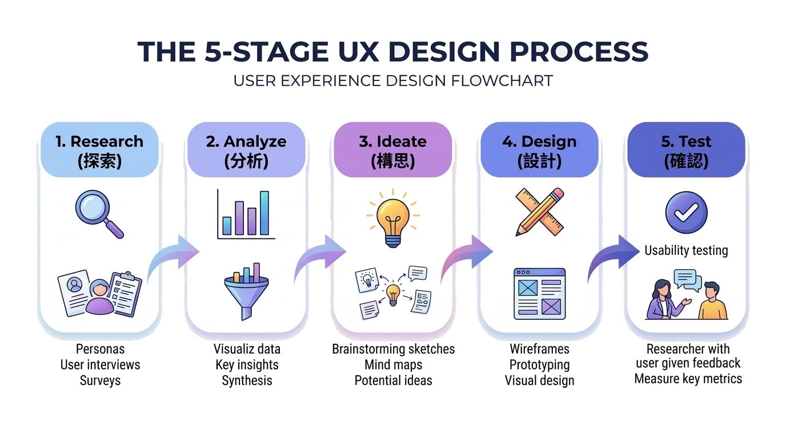

<!--
這是史丹佛大學 d.school 提出的經典設計思考（Design Thinking）五大階段架構。

請注意這套工程循環：軟體專案絕對不能一上來就寫程式或畫高傳真畫面！你必須從「同理（Empathize）」開始——親自觀察目標族群在真實場景中的行為。

接著「定義（Define）」真正要解決的核心痛點、天馬行空「構思（Ideate）」多元解法、動手打造低成本「原型（Prototype）」，最後交給真人進行「測試（Test）」。

💡 難字與專業術語解說：
- Design Thinking: 設計思考（以人為本、結合同理心與快速實驗迭代的問題解決方法論）
- Empathize / Define / Ideate / Prototype / Test: 同理 → 定義 → 發想 → 原型 → 測試（設計思考五階段）
- non-linear & iterative: 非線性且迭代的（允許隨時根據測試反饋回溯修正，而非單向瀑布流）
-->
---
## 設計思考五大階段詳細拆解

- **1. Empathize (同理 / 探索)：**
  - 進行質化訪談、現地情境觀察（Contextual Inquiry）與使用者行為追蹤。
  - 挖掘未被說出口的深層挫折與真實心理痛點。
- **2. Define (定義問題)：**
  - 將質化研究收斂為具象的人物誌（Personas）、同理心地圖與精確的 "How Might We (我們該如何...)" 問題陳述。
- **3. Ideate (構思解法)：**
  - 開展多元創意思考，暫緩評判；快速繪製低保真紙上草圖（Paper Wireframes）。
- **4. Prototype (打造原型)：**
  - 製作可供點擊測試的實體構件（Figma 可互動點擊原型、可運行的 HTML/CSS 假資料畫面）。
- **5. Test (驗證測試)：**
  - 將原型交由真實目標使用者操作，觀察卡關點，量化任務達成率並快速迭代修正。

<!--
細看設計思考的五個階段：

同理階段：放下工程師的預設立場，走入真實世界傾聽。
定義階段：把散碎的訪談收斂成清晰具體的問題定義。
構思階段：發想各種天馬行空的解決策略。
原型階段：用最低的成本做出可以按、可以測的假模型。
測試階段：觀察真人使用者的真實反應。

這個流程是高度雙向反覆的：測試時發現假設錯誤，立刻倒回定義階段重新修正。

💡 難字與專業術語解說：
- qualitative user interview: 質性使用者訪談（深入探索「為什麼」與動機的開放式訪談）
- contextual field inquiry: 情境實地調查（到使用者真實工作或生活現場觀察其自然行為）
- unarticulated frustration: 未被言明的挫折感（使用者習以為常、說不出口卻實際存在的痛點）
- synthesize: 綜合提煉、歸納統整
- persona & empathy map: 人物誌與同理心地圖（具象化目標用戶特徵、目標與痛點的模型）
- low-fidelity (lo-fi): 低擬真度（如紙本手繪草圖，旨在快速驗證概念而非視覺細節）
-->
---
### 概念核對問答 1 (CCQ 1)：預設用途 (Affordance) vs. 意符 (Signifier)
<!-- id: ase-ch06-ccq1 -->

  

某醫院重新設計自助報到機，為追求「極簡風 UI」，將 `「確認報到」` 設計成無邊框、無陰影的純灰字標籤。雖觸控螢幕**可以**感應點擊，卻有 **75% 的年長病患卡住**不知按哪裡。依 **Don Norman** 理論，此設計最核心的缺失為何？

- **A.** **缺乏預設用途 (Affordance)**；觸控螢幕硬體底層缺乏感應手指輕觸文字區塊的物理偵測能力。
- **B.** **缺乏意符 (Signifier)**；系統雖支援點擊，但欠缺邊框、立體陰影或對比色等可感知的視覺線索。
- **C.** **使用者教育訓練不足**；醫院應在自助報到機螢幕旁張貼字體放大的紙本操作步驟說明海報以引導病患。
- **D.** **後端系統模型延遲**；掛號資料庫的交易查詢架構過於繁瑣，必須導入快取機制以加速畫面渲染回應。

  

  

    

<!--
讓我們透過觀念檢核測驗 1 (CCQ 1) 來檢驗對 Don Norman「預設用途 (Affordance) vs. 意符 (Signifier)」以及「UI vs. UX」的掌握！

請仔細閱讀情境：醫院自助報到機為了追求極簡風 UI，把「確認報到」按鈕設計成無邊框、無陰影的純灰字標籤。雖然觸控螢幕在技術上「可以」感應點擊，但高達 75% 的長輩病患站在機器前完全不知道該按哪裡。

為什麼正確答案是 **B（缺乏意符 Signifier）**，而不是 A（缺乏預設用途 Affordance）？
- 請回想諾曼門的核心區分：**預設用途 (Affordance)** 指的是物體或系統在物理與數位上「支援什麼動作」——既然觸控螢幕實際上可以感應點擊，代表它已經具備可點擊的 Affordance（故 A 錯誤）。
- 真正缺失的是 **意符 (Signifier)**——也就是傳達「應該按哪裡、怎麼操作」的可感知視覺線索（如按鈕邊框、對比色彩與立體陰影）！
- 而選項 C「在機器旁貼一張紙本操作說明海報」，正是諾曼門最經典的錯誤：不去修復介面意符，反而試圖貼說明書怪罪使用者！

💡 難字與專業術語解說：
- check-in kiosk: 自助報到服務機（醫院或機場常見的觸控式自助終端機）
- affordance vs. signifier: 預設用途 vs. 意符（系統實際可支援的物理/數位動作 vs. 引導人類「按哪裡、怎麼操作」的可感知視覺線索）
- minimalist UI: 極簡風視覺介面（若過度去除邊框與陰影，極易犧牲意符而傷害 UX 可用性）
-->
---
<!-- _class: lead -->
<!-- header: "6.2 尼爾森 10 大啟發原則" -->

# **6.2 尼爾森 10 大易用性啟發法則**

> "Jakob's Law: Users spend most of their time on other sites. This means that users prefer your site to work the same way as all the other sites they already know."  
> *(雅各布定律：使用者絕大部分的時間都在別人的網站上。這意味著他們強烈偏好你的網站運作方式，與他們早已熟知的所有其他網站完全一樣。)*  
> — *Jakob Nielsen (Nielsen Norman Group 創辦人)*

<!--
我們現在邁入 6.2 節：Jakob Nielsen 的十大易用性啟發式原則（10 Usability Heuristics）。

由 Jakob Nielsen 與 Rolf Molich 於 1994 年歸納提出的這十條啟發原則，至今依然是數位互動介面設計的「世界憲法」。它們不是死板的數學公式，而是歷經數十年實證研究萃取出的經驗法則。

在這一節中，我們將透過真實的介面實例——從瓦斯爐旋鈕到 iPhone 鎖定畫面——逐一掌握這十條黃金原則如何指導軟體工程決策。

💡 難字與專業術語解說：
- usability heuristic: 易用性啟發式原則（輔助工程師快速檢視介面設計缺陷的經驗準則）
- Jakob's Law: 雅各布定律（使用者習慣將其他主流網站的操作經驗轉移到你的產品上）
- rule of thumb: 經驗法則（普遍適用且實用的大原則，而非死板的數學公式）
-->
---
## 概覽：尼爾森 10 大易用性啟發法則 (Overview)

> 「啟發式原則並非死板的教條，而是歷經數十年人機互動實證研究淬鍊出的經驗法則。」

  

    <ul>
      <li>🚦 <b>NS01. 系統狀態可見度：</b> 透過及時適當的回饋，讓使用者隨時掌握系統狀態。</li>
      <li>🌍 <b>NS02. 符合真實世界：</b> 採用使用者熟悉的語言詞彙、概念與實體隱喻。</li>
      <li>🚪 <b>NS03. 使用者控制與自由度：</b> 提供清晰明確的「緊急出口」（復原 Undo / 重做）。</li>
      <li>📐 <b>NS04. 一致性與標準性：</b> 遵循平台與產業通用規範（雅各布定律）。</li>
      <li>🛡️ <b>NS05. 防錯設計：</b> 事前透過審慎設計消除容易出錯的情境，勝過事後道歉。</li>
    </ul>
  

  

    <ul>
      <li>👁️ <b>NS06. 辨識取代記憶：</b> 將物件、動作與選項視覺化，減輕大腦記憶負擔。</li>
      <li>⚡ <b>NS07. 彈性與使用效率：</b> 提供捷徑（Accelerators）滿足高頻專業進階用戶。</li>
      <li>🎨 <b>NS08. 簡約美學設計：</b> 消除無關雜訊，將訊噪比（Signal-to-Noise）最大化。</li>
      <li>🩹 <b>NS09. 協助辨識與修復錯誤：</b> 用白話清楚說明問題，並建設性指出解法。</li>
      <li>📖 <b>NS10. 說明文件與求助支援：</b> 提供容易檢索、任務導向且情境化的即時引導。</li>
    </ul>

<!--
這是 Jakob Nielsen 十大易用性啟發原則的全貌清單。

每一位合格的軟體工程師、產品經理與 UI/UX 設計師都應該對這十條原則滾瓜爛熟。

請注意這十條原則的涵蓋範疇：從即時動態回饋（NS01）、真實世界隱喻（NS02）、逃生出口（NS03）、標準一致性（NS04）、防錯機制（NS05）、認知記憶減負（NS06）、高手快捷鍵（NS07）、視覺減法（NS08）、白話錯誤修復（NS09），到情境文件（NS10）。

接下來讓我們逐一深度解析。

💡 難字與專業術語解說：
- empirical HCI research: 實證人機互動研究（基於大量真實使用者測試數據歸納出的研究）
- emergency exit: 緊急出口（讓誤觸的使用者能立即撤銷或離開當前狀態的機制）
- recognition vs. recall: 辨識取代回憶（看見選項直接認出，遠比憑空背誦指令省力）
- accelerator: 加速器 / 快捷操作（讓資深使用者能跳過繁瑣步驟的高效捷徑）
- signal-to-noise ratio (SNR): 訊噪比（畫面上有效核心資訊與無關雜訊的比例）
-->
---
## NS01: 系統狀態可見度 (Visibility of System Status)

* **啟發原則定義：**
  > 「系統應在**合理的時間內**，透過**適當的回饋 (Feedback)**，始終**讓使用者明確掌握**當前正在發生什麼事。」
* **核心互動設計模式：**
  - **即時觸控回饋：** 按鈕點擊時的下沉態、微動效波紋（Ripple Effect），立即向使用者確認「輸入已被系統接收」。
  - **進度透明化：** 顯示具備確切百分比的進度條（%）、結帳步驟指示器（1. 購物車 &rarr; 2. 配送資訊 &rarr; 3. 付款）。
  - **背景任務即時狀態：** 旋轉進度環搭配具備動態文字的說明（*「正在上傳第 3 張相片，共 5 張...」*）。
  - **連線狀態提示：** 離線斷網即時警告橫幅、雲端同步狀態勾選指示。

<!--
原則一：系統狀態可見度。

沒有什麼比點了按鈕之後螢幕一片死寂更能引發使用者的恐慌了。扣款成功了嗎？當機了嗎？我要不要再按一次？這一按往往造成重複刷卡！

軟體必須隨時給予反饋。一秒鐘內的動作，給予按鈕回饋或輕量 spinner；數秒鐘的操作，提供確切的進度百分比；多步驟的表單，提供步驟指示器。

💡 難字與專業術語解說：
- visibility of system status: 系統狀態可見度（讓使用者隨時清楚系統當前運作進度與狀態）
- ripple effect & micro-animation: 水波紋動效與微動畫（點擊瞬間確認「已收到輸入」的視覺反饋）
- deterministic progress bar: 確定性進度條（明確顯示完成百分比與剩餘時間，而非無止境轉圈）
- multi-step checkout stepper: 多步驟結帳進度條（標示目前在第幾步、總共幾步的導覽元件）
-->
---
<!-- _class: title-image-slide -->
## NS01 實踐 (1/2)：進度條、步驟指示器與即時同步狀態

  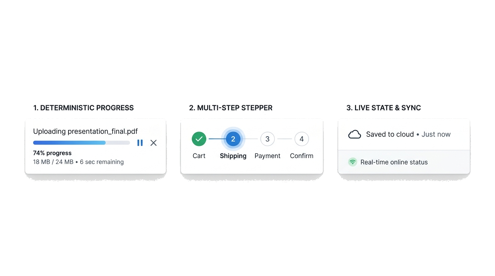

<!--
請看畫面上這幾個系統狀態可見度的具體實踐。

百分比下載進度條讓等待具備明確預期；多步驟精靈指引使用者當前在第幾步、還剩幾步；雲端同步狀態即時告知最新儲存時間。

每一個互動狀態都被清清楚楚地表達出來，使用者永遠處於被充分告知的安全感之中。

💡 難字與專業術語解說：
- status feedback: 狀態回饋（系統回應使用者操作或背景進度的訊號）
- sync state (synchronization state): 同步狀態（顯示本地端與雲端資料是否已一致更新）
- workflow funnel: 工作流漏斗（使用者從進入流程到最終完成目標的多階段路徑）
-->
---
<!-- _class: title-image-slide -->
## NS01 實踐 (2/2)：批次檔案匯入進度與預估剩餘時間

  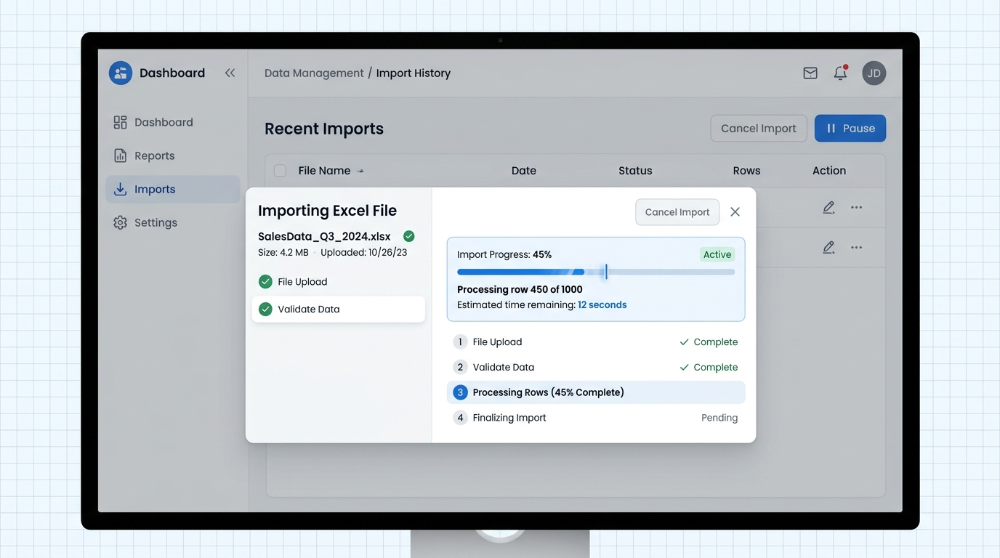

<!--
這是 NS01 在企業資料後台中的第二個經典範例。

當使用者匯入高達 1,000 筆資料的 Excel 報表時，系統沒有讓畫面卡死或只放一個無意義的轉圈圈，而是清楚顯示目前完成度 45%、正在處理第 450/1000 筆、預估剩餘 12 秒，以及四階段執行清單。

💡 難字與專業術語解說：
- batch file import: 批次檔案匯入（一次處理大量資料筆數的背景作業）
- indeterminate spinner: 非確定性轉圈動畫（只會一直旋轉、不提供任何進度比例或剩餘時間）
- asynchronous job: 非同步任務（在背景執行、不阻塞主執行緒的耗時運算）
- validating schema & indexing: 結構綱要驗證與建立索引（資料庫匯入的關鍵處理階段）
-->
---
## NS02: 符合真實世界 (Match System & Real World)

* **啟發原則定義：**
  > 「系統應**使用使用者的語言**，採用**使用者熟悉的詞彙、語句和概念**，而不是系統內部的術語。遵循**真實世界的通用慣例**。」
* **自然空間映射 (Natural Mapping)：**
  - 操作控制器在空間上的配置，應精確對應於被控制物體的物理空間幾何。
  - *經典反面教材：* 四口瓦斯爐排列為 2x2 方陣，但四個開關旋鈕卻排成一整條直線，強迫大腦進行繁複的空間座標換算，經常開錯爐火。
  - *優良設計：* 將四個旋鈕同樣排列為 2x2 矩陣，操作直覺秒懂且零出錯。
* **生活實體隱喻 (Familiar Metaphors)：**
  - 資源回收桶代表刪除、資料夾代表目錄階層、購物車代表待結帳商品。

<!--
原則二：符合真實世界。

軟體應該採用人類在真實世界早已累積的生活經驗與空間隱喻。桌面上的垃圾桶、電商的購物車都是大家耳熟能詳的經典範例。

請特別注意「自然空間映射（Natural Mapping）」：瓦斯爐是四個爐口排成 2x2 正方形，如果開關旋鈕硬要排成橫向一直線，你的大腦每次開火都要在腦子裡做座標映射。如果開關也排成 2x2，閉著眼睛都不會開錯。

💡 難字與專業術語解說：
- system-oriented terms: 系統導向術語（工程師內部使用的資料庫、網路或程式碼名詞）
- natural spatial mapping: 自然空間映射（控制項的排列位置直接對應受控物體在真實空間的幾何配置）
- counter-example: 反例、反面教材
- conceptual metaphor: 概念隱喻（借用真實世界熟悉的事物如「購物車、垃圾桶」來比喻數位操作）
-->
---
<!-- _class: title-image-slide -->
## NS02 實踐 (1/2)：控制項的自然空間幾何映射

  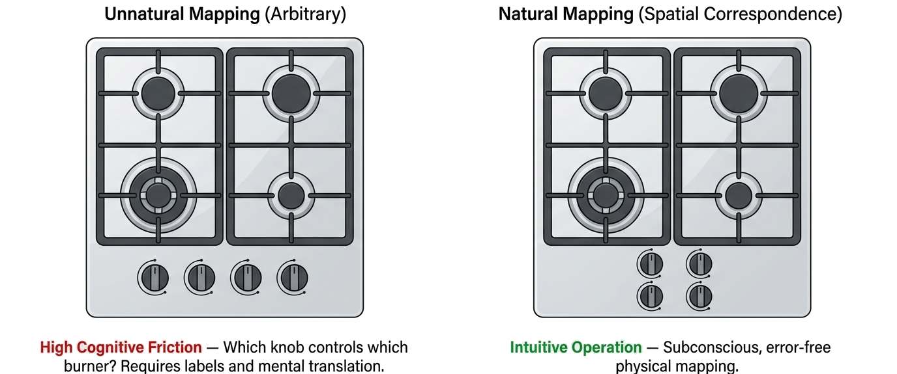

<!--
這張對比圖完美詮釋了自然空間映射的力量。

左側四個旋鈕排成一直線，使用者每次都要瞇著眼睛看標籤或在腦袋裡數「左二是哪一口爐子」，經常把空鍋子燒焦。

右側將四個旋鈕依照 2x2 空間排列，人類的大腦根本不需要經過任何邏輯運算，手伸出去就是正確的開關。

💡 難字與專業術語解說：
- burner & knob: 瓦斯爐口與控制旋鈕
- mental translation: 心智轉換（大腦必須先閱讀標籤再換算空間對應位置的認知負荷）
- spatial geometry: 空間幾何排列
- subconsciously: 下意識地、無須刻意動腦思考地
-->
---
## NS02 實踐 (2/2)：使用日常語言取代生硬的系統代碼

> **為什麼重要？** 將後端例外代碼（`HTTP 502`、`ERR_SOCKET_TIMEOUT`）直接丟給消費者，不僅讓人一頭霧水，更會引發「到底有沒有被重複扣款？」的恐慌。

* **系統導向的工程術語（不良設計）：**
  - ❌ *「Transaction Exception 403: Acquirer socket connection timed out.」*
  - 使用者陷入焦慮：*「我的信用卡到底刷過了沒？」*
* **以人為本的日常語言（優良設計）：**
  - ✅ **安心狀態確認：** 明確告知「**尚未完成扣款 (couldn't complete the charge)**」。
  - ✅ **生活化詞彙：** 以「目前付款通道繁忙」取代網路連線逾時術語。
  - ✅ **清楚下一步：** 提供直覺按鈕（**`重試付款`** 或 **`改用其他信用卡`**）。

    

<!--
請看 NS02 的第二個範例：在行動支付結帳畫面中「說使用者的日常語言」。

當信用卡扣款失敗時，以工程師為中心的系統往往會直接噴出「HTTP 403 Forbidden」或「Socket Timeout Exception」。而畫面中的設計則使用一般消費者熟悉的白話文：「目前付款通道繁忙，我們尚未完成扣款，請稍候再試或改用其他信用卡。」

💡 難字與專業術語解說：
- raw backend exception: 原始後端例外錯誤（未經包裝轉譯的程式底層錯誤訊息）
- decipher engineering jargon: 解讀工程行話（強迫一般用戶猜測技術名詞的含義）
- acquirer socket timeout: 收單機構網路連線逾時（金融刷卡通道的底層網路術語）
- reassuring: 令人安心的、消除疑慮的
- actionable next steps: 可立即採取的下一步行動方案
-->
---
## 課堂挑戰：這個外送 App 畫面到底出了什麼問題？

> **情境描述：** 肚子餓扁的小明在外送 App 點了晚餐並送出訂單，手機跳轉出了右方這個訂單追蹤畫面……

* **1. 狀態與即時回饋（到底發生了什麼事？）：**
  - 進度圈已經卡住轉了近 4 分鐘（`3m 42s`），完全沒有進度百分比與回應。
  - 店家接單了嗎？開始煮了沒？預計送達時間竟然顯示「未定 (`ETA: TBD`)」！
* **2. 語言與心智模型（這是誰的語言？）：**
  - 畫面上充斥著生硬代碼：`ITEM_SKU_90218` 與 `HTTP_204_NO_CONTENT`。
  - 按鈕居然要求飢餓的消費者去點擊「`Rollback TXN`」或「`Refresh Socket`」。
* **課堂分組任務：**
  - 請找出這張畫面的**前 3 大易用性災難**！

    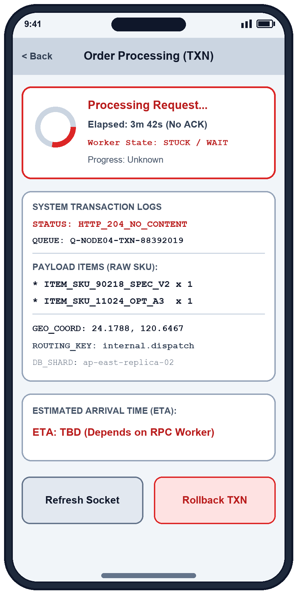

<!--
學完了 NS01 與 NS02 的核心觀念與實務案例後，現在換大家上場實戰診斷！來看這個在軟體開發中每天都在發生的真實慘劇：

請仔細觀察右邊這張高解析度手機畫面：一位飢腸轆轆的顧客剛刷完卡訂了晚餐，結果進入這個訂單追蹤畫面——頂部標題寫著 `Order Processing (TXN)`，紅色框裡的轉圈圈已經轉了 `3m 42s (No ACK)` 且顯示 `Progress Unknown / Stuck?`；中間直接吐出伺服器日誌 `STATUS: HTTP_204_NO_CONTENT`、佇列代碼與原始資料庫商品編號 `ITEM_SKU_99281_SPEC_A2`、經緯度座標 `24.1788, 120.6467`；預計送達時間寫著 `ETA: TBD (Depends on Worker)`；最底下的兩顆按鈕居然是 `Refresh Socket` 與 `Rollback TXN`！

請大家花 30 秒觀察左方的四個挑戰提示，跟旁邊的同學討論看看：這個介面到底犯了哪些嚴重的設計錯誤？為什麼會讓一般消費者感到無比的焦慮、困惑與無助？先記住你們的診斷，我們馬上透過 Nielsen 的前兩大原則來揭曉答案！

💡 難字與專業術語解說：
- spinner: 旋轉載入指示器（俗稱「轉圈圈」的等待動畫元件）
- elapsed time & ACK (Acknowledgment): 已耗用時間與確認回應訊號
- ETA (Estimated Time of Arrival) & TBD (To Be Determined): 預計送達時間與待定（未知）
- cryptic backend code: 晦澀難懂的後端代碼
- SKU (Stock Keeping Unit): 庫存單位編號（倉儲與資料庫內部的商品編碼）
- Rollback TXN (Transaction): 回滾交易（資料庫術語，一般消費者完全無法理解）
-->
---
## 挑戰揭曉：符合 NS01 與 NS02 的優化重構

> **重構核心：** 用「真實世界的認知模型」取代「工程底層術語」，用「多階段進度可視化」消除等待焦慮。

🔍 滑鼠懸停檢視原始問題介面 (p.25)

* **NS01 優化（系統狀態透明即時可見）：**
  - ✅ **明確的時間預估：** 以 *「12:35 (約 18 分鐘後)」* 取代未定 (*TBD*)。
  - ✅ **4 階段進度條：** 清楚標示「已接單 ➔ 製作中 ➔ 外送中 ➔ 已送達」，即時反應用戶處於哪一環節。
* **NS02 優化（符合真實世界的生活語言）：**
  - ✅ **真實餐點名稱：** 以「紅燒牛肉麵、燙青菜」取代生硬的資料庫 SKU。
  - ✅ **具體實體資訊：** 提供外送員姓名、機車車牌與中文地址，取代經緯度代碼。
  - ✅ **直覺的生活操作：** 以「聯絡外送員」、「線上客服」取代資料庫 `Rollback` 等工程命令。

    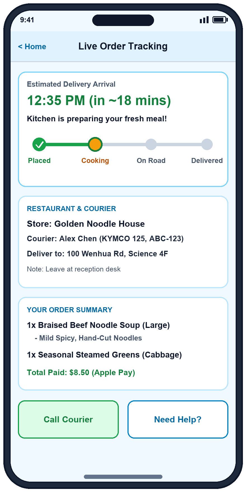

<!--
還記得前面那個讓人焦慮崩潰的外送追蹤畫面嗎？學完 NS01 與 NS02 後，這就是專業團隊的重構標準答案。

在 NS01 方面，我們消除了令人焦慮的無止境轉圈，給出了具體的送達時間（12:35，約 18 分鐘後），並用四階段進度條讓進度一目了然。

在 NS02 方面，工程代碼全數退場！使用者看到的是紅燒牛肉麵、外送員的名字與車牌、具體的文華路地址。操作按鈕也完全對齊真實世界的行動意圖：打電話給外送員或尋求客服支援。

💡 難字與專業術語解說：
- concrete ETA: 具體明確的預計送達時間
- culinary language: 餐飲生活語彙（人類日常點餐熟悉的菜名與口味描述）
- courier: 外送員、快遞人員
- braised beef noodle soup: 紅燒牛肉麵
-->
---
## NS03: 使用者控制與自由度 (User Control & Freedom)

* **啟發原則定義：**
  > 「使用者常因**誤操作**而誤入非預期的功能狀態，此時需要一個清晰標示的『**緊急出口 (Emergency Exit)**』，讓他們能**迅速脫離該狀態**，而不需經歷冗長的對話流程。」
* **必備的工程實踐模式：**
  - **全域復原 / 重做 (Universal Undo / Redo)：** 編輯器、畫布工具及破壞性狀態變更均應全面支援 `Ctrl+Z` / `Cmd+Z`。
  - **清晰的取消出口：** 彈跳視窗（Modals）、檔案上傳與批次處理中，必須提供高對比、易於點擊的「取消 (Cancel)」按鈕。
  - **非破壞性導覽：** 允許使用者隨時退出多步驟結帳或註冊精靈，且不應擅自抹煞已填寫的表單暫存資料。
  - **資源回收暫存區 (Soft Deletes)：** 刪除操作先移至垃圾桶，保留 30 天復原期後才永久清除。

<!--
原則三：使用者控制與自由度（緊急出口）。

人是充滿好奇心的，但人也很容易手滑按錯。如果一個系統讓使用者覺得「只要點錯一個按鈕，資料就會灰飛煙滅，或者信用卡立刻被扣款」，使用者會變得極度畏縮、不敢探索。

給使用者清晰的緊急出口！跳出來的彈跳視窗一定要有 Esc 鍵或關閉叉叉；刪除重要檔案時，提供 Undo 氣泡提示。

當使用者知道自己隨時能「後悔」、隨時能回到上一動時，他們才會帶著安全感自由探索軟體。

💡 難字與專業術語解說：
- user control & freedom: 使用者控制與自由度（賦予使用者隨時反悔、撤銷與退出的掌控權）
- extended dialogue: 冗長繁瑣的對話確認流程
- destructive state change: 破壞性狀態變更（如刪除資料、清空表單或正式扣款）
- non-destructive navigation: 非破壞性導覽（切換分頁或返回上一頁時，完整保留已填寫的表單資料）
- soft delete: 軟刪除（刪除時僅標記移入垃圾桶並保留 30 天復原期，而非立即物理抹除）
-->
---
<!-- _class: title-image-slide -->
## NS03 實踐 (1/2)：行事曆拖曳變更後的即時「復原 (Undo)」

  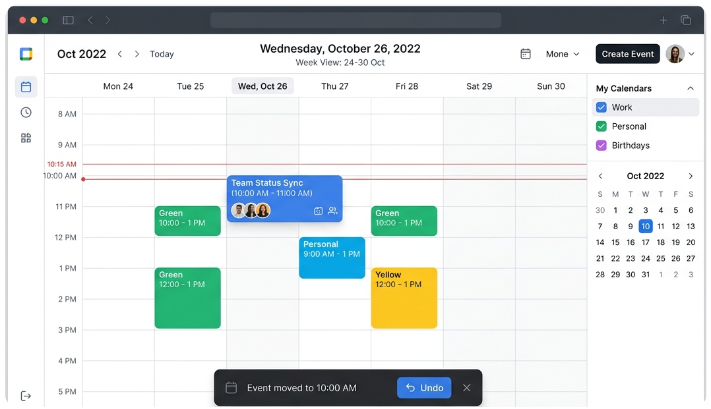

<!--
請看 NS03 的第一個實例：網頁行事曆中的一鍵復原機制。

當使用者在行事曆上不小心手滑把會議拖拉到 10:00 AM 時，系統不會強迫使用者自己慢慢找回原本的時段，而是在畫面底部立刻浮現「已將會議移至 10:00 AM」的 Toast 提示列，並附帶顯眼的藍色「Undo（復原）」按鈕與關閉叉叉。

💡 難字與專業術語解說：
- drag-and-drop: 拖放操作（按住滑鼠或手指直接搬移介面物件的直接操作模式）
- Undo Toast: 復原浮動快顯通知（畫面底部短暫浮現、附帶一鍵「復原」按鈕的輕量提示列）
- direct manipulation: 直接操作（直接拖拉物件而非透過填寫表單修改屬性）
-->
---
<!-- _class: title-image-slide -->
## NS03 實踐 (2/2)：信件刪除反悔機制與放棄編輯出口

  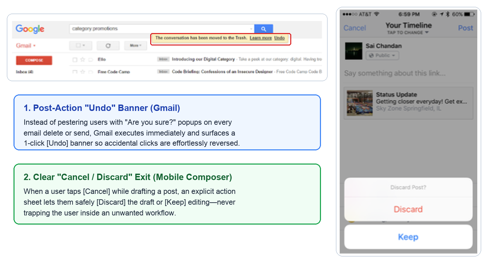

<!--
這是 NS03 的第二個實例：Gmail 與行動社群 App 的緊急出口。

左圖中，當使用者把信件丟進垃圾桶或剛按下寄出時，頂部黃色提示列提供即時「Undo（復原）」連結；右圖中，當使用者想離開寫到一半的貼文時，系統提供清楚的「Cancel（取消）」、「Discard（捨棄）」與「Keep（保留）」選項，絕不把使用者困死在編輯畫面。

💡 難字與專業術語解說：
- email thread: 電子郵件對話串
- action sheet: 底部操作選單（行動裝置由下往上滑出、提供明確分支選項的面板）
- discard vs. keep: 捨棄修改 vs. 保留繼續編輯
-->
---
## NS04: 一致性與標準性 (Consistency & Standards)

* **啟發原則定義：**
  > 「使用者**不應懷疑不同的詞彙、狀態或操作是否代表相同的事物**。應遵循**平台與產業通用的既定慣例**。」
* **網際網路體驗的「雅各布定律 (Jakob's Law)」：**
  - 你的使用者有 99% 的數位生命都在**別人的網站與 App 上度過**。
  - 他們預期你的軟體運作方式，與他們熟知的其他產品完全一致（例如：左上角 Logo 回首頁、右上角購物車、放大鏡代表搜尋）。
* **一致性的兩大工程維度：**
  - **內部一致性 (Internal Consistency)：** 產品內部統一的設計系統（Design Tokens）、按鈕樣式、字級比例與名詞定義。
  - **外部一致性 (External Consistency)：** 遵循作業系統平台人機介面指南（iOS HIG 與 Android Material Design）。

<!--
原則四：一致性與標準性。

很多新進工程師或熱血設計師常有一種衝動：想要「打破常規、重新發明輪子」——把導覽選單藏在右下角，或是把購物車畫成一個皮箱。

Jakob Nielsen 提出了著名的雅各布定律：你的使用者 99% 的時間都在用別人的產品！他們早就習慣了點左上角 Logo 回首頁、右上角是購物車、齒輪代表設定。

切勿為了與眾不同而違背使用者的通用直覺。遵從平台標準與設計系統，才能大幅降低上手門檻。

💡 難字與專業術語解說：
- consistency & standards: 一致性與標準性（詞彙、圖示與操作邏輯在產品內外保持統一）
- industry convention: 產業通用慣例（全網使用者早已習以為常的標準設計模式）
- internal vs. external consistency: 內部一致性（產品自身各頁面統一）vs. 外部一致性（符合主流平台慣例）
- Design System & Design Tokens: 設計系統與設計變數（統一管理色彩、字級、間距與元件規格的工程規範）
- Apple HIG & Material Design: 蘋果人機介面指南與 Google Material 設計規範
-->
---
<!-- _class: title-image-slide -->
## NS04 實踐 (1/2)：一致的表單控制項與按鈕視覺階層

  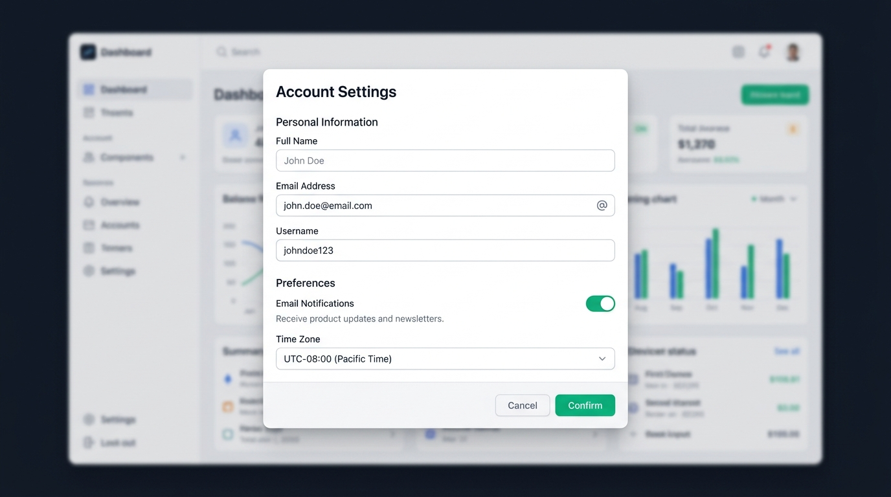

<!--
請看 NS04 的第一個實例：SaaS 系統中的帳號設定彈窗。

請注意其高度的內部與外部一致性：所有欄位標題一致置於輸入框正上方、啟用開關採用通用的綠色滑桿，而視窗右下角固定將次要的灰色「Cancel（取消）」放在左邊、主要的綠色「Confirm（確認）」放在右邊，徹底避免按鈕位置忽左忽右造成的空間記憶誤觸。

💡 難字與專業術語解說：
- form control: 表單控制項（輸入框、下拉選單、開關滑桿等互動元件的統稱）
- button hierarchy: 按鈕視覺階層（區分主要行動按鈕 Primary CTA 與次要取消按鈕的視覺對比）
- toggle switch: 切換開關（代表二元啟用/停用狀態的滑桿元件）
- spatial muscle memory: 空間肌肉記憶（使用者習慣性點擊視窗固定角落的直覺反應）
-->
---
<!-- _class: title-image-slide -->
## NS04 實踐 (2/2)：遵循跨平台標準慣例的快捷指令列

  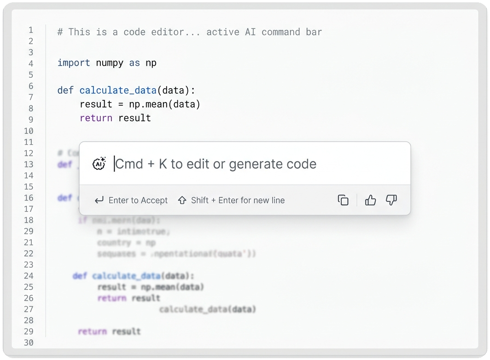

<!--
請看 NS04 的第二個實例：現代開發工具與生產力軟體的跨平台標準慣例。

無論在 VS Code、Cursor、Notion 或 Slack 中，按下 `Cmd+K`（或 `Ctrl+K`）都會喚出命令列，`Enter` 代表接受確認、`Shift+Enter` 代表換行。當你的軟體遵循這些業界既定標準時，使用者完全不需要重新學習就能直接上手。

💡 難字與專業術語解說：
- keyboard convention: 鍵盤快捷鍵慣例（跨軟體通用的標準按鍵組合）
- command palette / command bar: 命令面板 / 快捷指令列（透過快捷鍵喚出、可快速搜尋並執行動作的浮動輸入框）
- muscle memory transfer: 肌肉記憶轉移（將在舊工具練就的操作習慣無縫應用至新工具）
-->
---
## 課堂挑戰：這個電商結帳畫面到底出了什麼問題？

> **情境描述：** 消費者在電商購物流程進入最後付款頁，突然發現自己的收件地址填錯了門牌號碼（`Apt 4B`）……

* **1. 控制權與逃生出口（發現填錯了，回得去嗎？）：**
  - 完全找不到「返回上一頁」的按鈕，步驟條被鎖死，地址也標示為唯讀無法修改。
  - 下方更印著刺眼警告：*「付款流程不可逆，點擊後無法退款、取消或復原！」*
* **2. 介面慣例與視覺階層（符合一般電商直覺嗎？）：**
  - 為什麼右上角的購物車按鈕，被畫成了一把奇怪的**紅色板手圖示**？
  - 為什麼最大、最搶眼的紅色主按鈕居然是「`Delete & Empty Cart`（刪除並清空購物車）」，而真正結帳的「`Place Order ($299.00)`」卻做成淡淡的幽靈按鈕？
* **課堂任務：**
  - 這個設計違反了哪些人機互動原則？會引發什麼嚴重後果？

    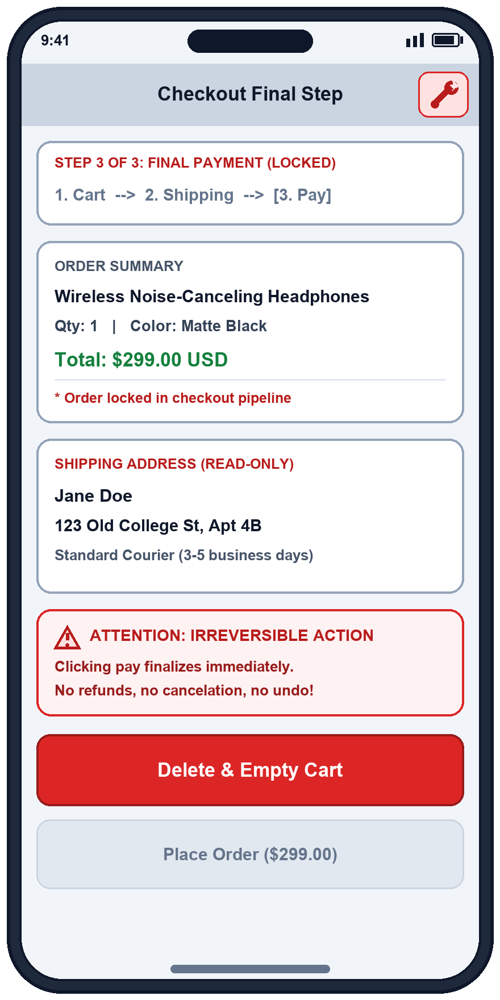

<!--
掌握了 NS03 與 NS04 之後，我們立刻來挑戰第二個真實案例：電商結帳的最後一哩路！

請看右邊的手機畫面：消費者挑選了一副 299 美元的降噪耳機，進入 `Checkout Final Step`。請大家沿著畫面從上往下找碴：
- 第一，看看右上角的圖示：在一般電商網站那個位置應該是購物車，這裡為什麼是一把「維修板手（Wrench）」？
- 第二，看看進度列寫著 `Step 3 of 3 (Locked - No Return)`，收件地址 `123 Old College St, Apt 4B (Typo?)` 發現打錯字想修改，後面卻標註 `(CANNOT EDIT)`，整個畫面完全沒有返回鍵或編輯鈕！
- 第三，紅色警告框寫著「點擊付款即不可逆、不可退款、不可取消」，而最底下全畫面最醒目、最鮮紅的實心大按鈕竟然是 `DELETE & EMPTY CART`（刪除並清空購物車），真正要結帳的 `Place Order ($299)` 反而在最下面長得像被停用的灰色按鈕！

如果你是這位趕時間的買家，你敢按下去嗎？這背後違反了哪兩條核心原則？我們馬上來揭曉！

💡 難字與專業術語解說：
- escape hatch: 逃生出口（讓使用者安全退回上一步或取消操作的介面管道）
- read-only: 唯讀狀態（僅供檢視、禁止修改鎖定的欄位）
- irreversible action: 不可逆操作（一旦執行便無法撤銷或復原的動作）
- wrench icon: 板手圖示（通常代表系統設定或維修工具，絕不應拿來代表購物車）
- ghost button: 幽靈按鈕（僅有淺色邊框或低對比背景、視覺權重極低的次要或禁用按鈕）
-->
---
## 挑戰揭曉：符合 NS03 與 NS04 的優化重構

> **重構核心：** 遵循平台通用慣例與雅各布定律，賦予使用者充分的掌控權與「後悔安全網」。

🔍 滑鼠懸停檢視原始問題介面 (p.33)

* **NS03 優化（使用者掌控權與緊急出口）：**
  - ✅ **非破壞性步驟條：** 隨時可點回「購物車」或「配送資訊」，已填資料絕不遺失。
  - ✅ **行內即時修改：** 商品與收件地址旁皆提供直覺的 `[Edit Items]` 與 `[Change]` 出口。
  - ✅ **15 秒冷靜撤回機制：** 點擊下單後提供即時「一鍵撤回」安全氣囊。
* **NS04 優化（一致性與平台慣例標準）：**
  - ✅ **標準購物車圖示：** 右上角回歸通用購物車圖示，左上角提供標準 `< Cart` 返回導覽。
  - ✅ **直覺的主次按鈕層次：** 底部綠色鮮明 CTA 為「確認下單 (`Place Order`)」，下方搭配中性「取消返回購物車」。

    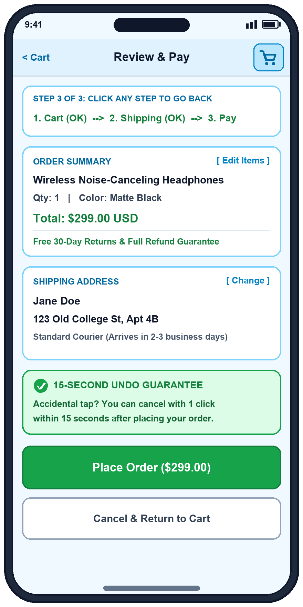

<!--
這就是針對 NS03 與 NS04 的標準重構對照。

在 NS03（使用者控制與自由度）方面，我們賦予了消費者百分之百的安心感：可以隨時切換步驟、單鍵修改收件地址，下單後更有 15 秒的即時撤回冷靜期。

在 NS04（一致性與標準）方面，全面對齊業界龍頭電商的操作習慣：購物車標誌回歸正常，主要按鈕與次要按鈕層次分明，使用者完全不需要花時間猜測「按了會發生什麼事」。

💡 難字與專業術語解說：
- non-destructive stepper: 非破壞性步驟導覽列（允許自由來回切換步驟而不遺失已填資料）
- inline edit: 行內直接編輯（在當前卡片旁直接點擊修改，無需重走整個流程）
- undo safety net: 復原安全網（允許使用者在誤觸下單後短時間內無條件撤銷的保護機制）
-->
---
## NS05: 防錯設計 (Error Prevention)

* **啟發原則定義：**
  > 「比起再怎麼友善詳盡的錯誤訊息，更卓越的工程設計是透過**審慎的防呆設計**，在**第一時間**就**防止錯誤發生**。」
* **主動防禦型設計模式：**
  - **消除容易出錯的情境：** 在必填欄位尚未通過即時驗證之前，將「送出」按鈕保持反灰禁用狀態。
  - **輸入約束與限制 (Input Constraints)：** 使用可視化日期選擇器（Date Picker）取代純文字輸入框，徹底杜絕日期格式輸入錯誤（如 `YYYY/MM/DD` vs `DD/MM/YYYY`）。
  - **針對不可逆破壞性操作引入高阻力確認：** 刪除 GitHub 儲存庫前，要求使用者手動鍵入專案全名以喚醒意識。
  - **智慧預設值 (Intelligent Defaults)：** 預填最常見的合理參數，減少空表單帶給使用者的心理壓力。

<!--
原則五：防錯設計。

在使用者出錯之後給予禮貌溫暖的錯誤訊息固然很好，但「一開始就設計成讓使用者根本無法犯錯」，才是最高段的工程美學。

為什麼要讓使用者在文字框裡隨意亂打日期，然後再跳出紅字罵他格式錯誤？直接給他一個日曆選擇器，他就連打錯的機會都沒有！

對於極度危險的動作（例如刪除整個雲端資料庫），故意加入合理的摩擦力——要求輸入資料庫名稱，徹底杜絕手滑造成的重大災難。

💡 難字與專業術語解說：
- error prevention: 防錯設計 / 防呆機制（透過介面限制讓錯誤從一開始就無法發生）
- slip vs. mistake: 操作失誤（手滑/分心按錯）vs. 認知錯誤（誤解規則或格式而填錯）
- input constraint: 輸入約束（以日曆、下拉選單或步進器取代自由文字框，物理性排除非法輸入）
- high-friction confirmation: 高阻力確認機制（針對永久刪除等危險操作，要求輸入專案名稱以強迫大腦清醒確認）
-->
---
<!-- _class: title-image-slide -->
## NS05 實踐 (1/2)：破壞性操作防呆與「忘記附件」主動攔截

  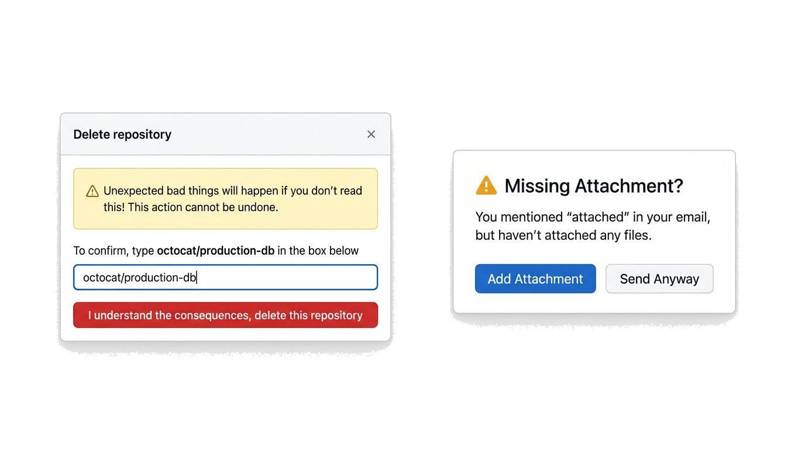

<!--
請看畫面上這兩個經典的防錯設計（NS05）實例。

左側是 GitHub 刪除儲存庫的高阻力確認框，強制要求開發者親手輸入完整專案名稱才能啟用刪除鍵；右側則是郵件系統的智慧防呆：當偵測到信件內文寫了「附件（attached）」但卻沒有夾帶任何檔案時，主動跳出提醒攔截，防止漏寄附件的尷尬失誤。

💡 難字與專業術語解說：
- destructive safeguard: 破壞性操作防護機制
- intentional cognitive friction: 刻意的認知阻力（在危險操作前故意打斷自動化反射動作，喚醒大腦注意力）
- proactive interception: 主動式攔截（在錯誤送出前預先偵測矛盾並提醒使用者）
-->
---
<!-- _class: title-image-slide -->
## NS05 實踐 (2/2)：未輸入完整專案名稱前禁用刪除按鈕

  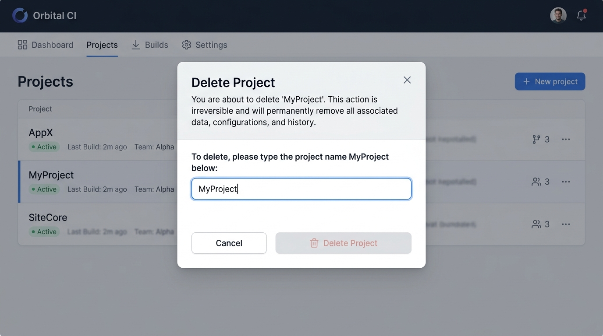

<!--
這是 NS05 在雲端 CI/CD 平台中的第二個實例。

請注意畫面右下角的「Delete Project」按鈕：在使用者還沒有把 `MyProject` 完整輸入正確之前，刪除按鈕是呈現反灰禁用（Disabled）狀態的。這能徹底防止使用者因為習慣性連點「確定」而誤刪線上專案。

💡 難字與專業術語解說：
- disabled state: 禁用反灰狀態（按鈕暫時不可點擊，防止未滿足條件時誤觸送出）
- explicit string match: 明確字串完全比對（要求親手輸入目標名稱以確認刪除意圖）
- accidental one-click disaster: 一鍵誤觸災難
-->
---
## NS06: 辨識取代記憶 (Recognition Rather Than Recall)

* **啟發原則定義：**
  > 「透過**將物件、操作和選項清晰可視化**，使**使用者的記憶負擔降到最低**。使用者**不應被迫記憶**從對話流程某一部分到另一部分的資訊。」
* **認知心理學基石：**
  - **辨識 (Recognition / 大腦輕鬆)：** 看到熟悉的視覺線索時能立刻認出（如同選擇題）。
  - **回憶 (Recall / 大腦耗能)：** 在毫無線索提示下，全憑記憶提取資訊（如同純文字終端機指令或申論題）。
* **UI 工程實踐：**
  - 搜尋輸入框點擊時自動展開最近搜尋歷史關鍵字與熱門建議。
  - 檔案列表顯示縮圖預覽，而非只有冰冷抽象的二進位檔名。
  - 文字選取時自動在游標旁邊浮現情境式編輯工具列。

<!--
原則六：辨識取代記憶。

人類的工作記憶容量極度有限——同時只能處理大約 4 到 7 個資訊組塊。

「辨識」是非常省力的大腦運作：就像選擇題，你看到答案就能秒選。「回憶」則非常耗能：像申論題，大腦要在虛無中搜索資訊。

絕不要讓使用者在第一頁記住一串長達 12 碼的訂單編號，再叫他手動抄到第三頁貼上！把選項、歷程記錄、縮圖清清楚楚放在視野範圍內。

💡 難字與專業術語解說：
- recognition rather than recall: 辨識取代回憶（將選項視覺化呈現讓大腦直接認出，而非強迫大腦憑空背誦）
- working memory load: 工作記憶負荷（大腦短期暫存與處理資訊的心智負擔）
- blank-slate terminal: 空白終端機介面（毫無視覺提示、全靠背誦指令語法的介面）
- contextual action toolbar: 情境式操作工具列（選取物件時直接在旁邊浮現可用功能的選單）
-->
---
<!-- _class: title-image-slide -->
## NS06 實踐 (1/2)：強迫記憶 (Recall) vs. 搜尋歷程辨識

  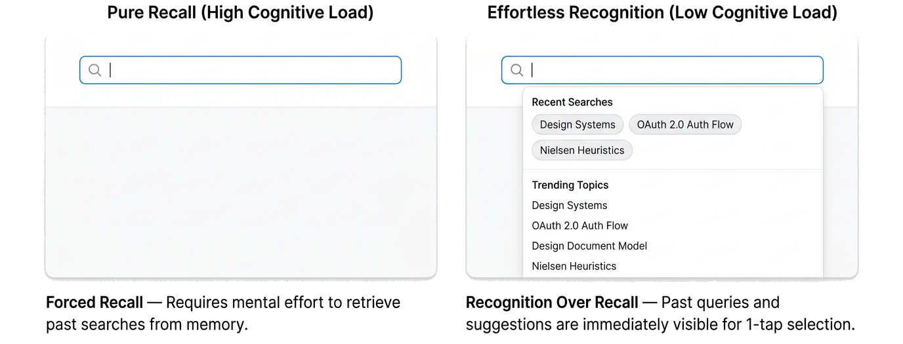

<!--
請看這張「回憶 vs. 辨識」的搜尋介面設計對照。

左側的空白搜尋框強迫使用者憑空回想上次查過的專有名詞；右側則在使用者點擊搜尋框的瞬間，主動列出最近搜尋紀錄與熱門主題標籤，讓大腦一看就能直接辨識並一鍵點選。

💡 難字與專業術語解說：
- forced recall: 強迫憑記憶回想
- search keyword retention: 搜尋關鍵字歷程保留（自動記住並顯示近期搜尋詞彙）
- focus state: 焦點狀態（當游標點擊進入輸入框時的互動狀態）
-->
---
## NS06 實踐 (2/2)：情境式工具列如何消除「記憶負擔」

> **為什麼這與「記憶 (Recall) vs. 辨識 (Recognition)」有關？** 若沒有情境選單，使用者必須**憑記憶回想**某個功能究竟藏在哪一個頂部選單（`Edit`、`Tools` 或 `Format`）或背誦快捷鍵！

* **傳統選單的記憶負擔 (Recall Burden)：**
  - 反白選取一段文字後，使用者必須在腦中苦思：*「摘要工具在哪裡？是藏在 `Tools → AI` 還是 `Edit` 底下？快捷鍵是什麼？」*
* **情境工具列的視覺辨識 (Recognition Solution)：**
  - 當文字被反白的瞬間，常用動作（**`Translate`**、**`Summarize`**、**`Improve Writing`**）直接**浮現在游標正旁邊**。
  - 使用者**看到選項即可立刻辨識點選**，完全不必記憶深層選單路徑！

    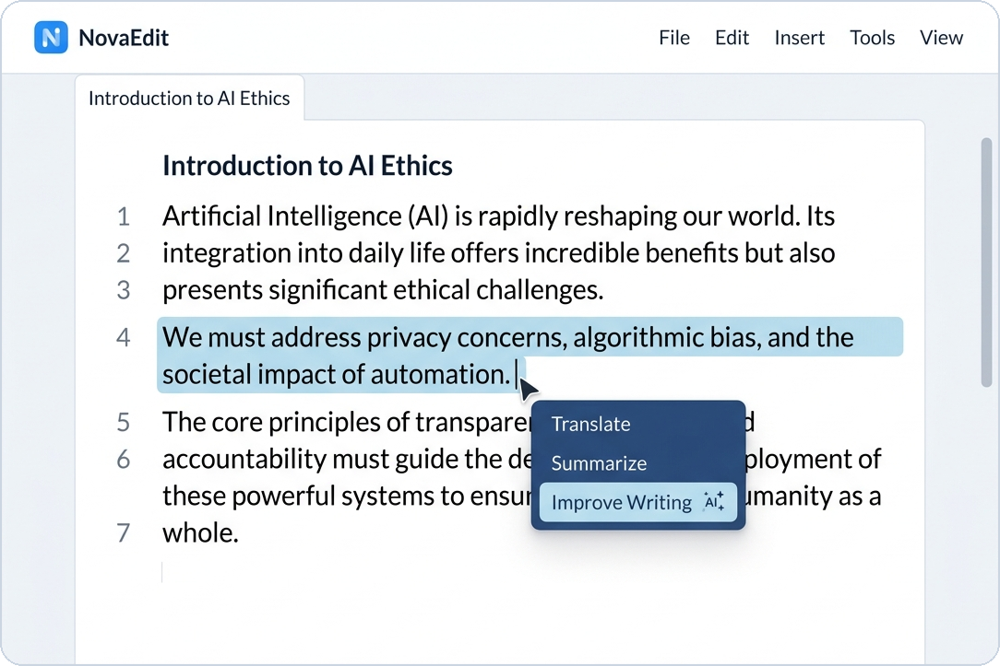

<!--
這是 NS06 在現代文件編輯器中的第二個實例。

使用者不需要費力去背誦「翻譯」或「摘要」功能究竟藏在頂部選單的哪一層子目錄下；只要用滑鼠反白選取一段文字，游標旁就會自動浮現情境式工具列（Translate、Summarize、Improve Writing），看到選項就能直接點擊。

💡 難字與專業術語解說：
- contextual floating toolbar: 情境式浮動工具列（隨選取動作在游標旁即時浮現的快捷選單）
- recall burden: 記憶提取負擔（必須背誦功能藏在哪一層頂部選單的認知消耗）
- menu hunting: 選單迷航 / 翻找選單（在多層下拉選單中來回尋找某項功能）
-->
---
## 課堂挑戰：這個機票預訂畫面到底出了什麼問題？

> **情境描述：** 旅客正準備預訂台北往返大阪的機票，打開了右方這個航班搜尋畫面……

* **1. 輸入防呆與驗證約束（為什麼允許荒謬輸入？）：**
  - 要求手打純文字日期字串（`YYYY-MM-DD`），沒有提供日曆選擇器。
  - 允許輸入「過去的日期（`2026-11-10`）」，甚至回程（`2026-11-05`）比出發還要早！
  - 旅客資料旁的紅色「`Delete Profile`」一按直接永久刪除，毫無二次確認。
* **2. 記憶負擔與視覺提示（為什麼強迫大腦死背代碼？）：**
  - 強迫一般人憑記憶背出並盲打 3 碼 IATA 機場代號（`TPE`、`KIX`）。
  - 完全沒有城市自動補全、熱門景點標籤或歷史搜尋紀錄。
* **課堂任務：**
  - 思考工程師如何透過「主動防禦設計」杜絕這些操作低級錯誤？

    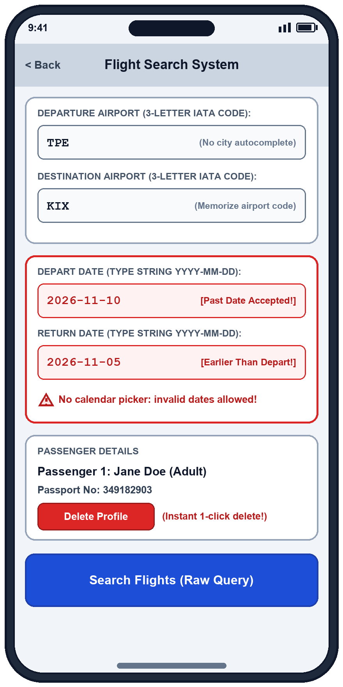

<!--
學完了 NS05 與 NS06 之後，現在請大家運用剛才的觀念，來診斷這個讓人抓狂的「機票訂購畫面」！

請仔細檢視右邊的手機畫面：一位旅客準備預訂從台北飛往大阪的機票。請大家觀察畫面中的三個致命設計缺陷：
- 第一，在 `Departure` 與 `Destination` 欄位，系統完全不提供城市下拉選單或自動補全，而是強迫旅客憑大腦記憶背出國際航空運輸協會（IATA）的三碼機場代碼（例如桃園是 `TPE`、關西是 `KIX`），甚至旁邊還嗆一句 `(Memorize Code)`！
- 第二，在 `Travel Dates` 欄位，系統沒有提供視覺化的月曆選擇器，而是叫使用者手動打字輸入 `YYYY/MM/DD`；結果旅客不小心把出發日打成 `2026/02/30`（根本不存在的 2 月 30 日），回程日打成 `2026/02/01`（回程竟然比出發還早將近一個月），系統也完全沒有即時攔截！
- 第三，底下的紅色危險按鈕 `Clear All Passenger Data` 緊貼在送出鈕上方，一旦手指滑到誤觸，沒有任何二次確認就會瞬間清空所有辛苦填寫的護照資料。

為什麼這個表單彷彿在跟人類大腦作對？讓我們透過 NS05 與 NS06 來剖析！

💡 難字與專業術語解說：
- input guardrail: 輸入防護圍欄 / 防呆限制（在前端控制項層級直接攔截不合法輸入的設計）
- IATA airport code: 國際航空運輸協會三碼機場代號（如桃園 TPE、關西 KIX）
- autocomplete: 自動補全（輸入部分字元即自動聯想並帶出完整城市與機場名稱）
- recent search chip: 最近搜尋標籤膠囊（可一鍵點擊帶入歷史搜尋條件的圓角按鈕）
-->
---
## 挑戰揭曉：符合 NS05 與 NS06 的優化重構

> **重構核心：** 透過防呆元件在第一時間消除出錯機會，提供可視化線索讓使用者「看到即認出」，徹底解放大腦記憶。

🔍 滑鼠懸停檢視原始問題介面 (p.41)

* **NS05 優化（主動式防錯設計）：**
  - ✅ **日曆元件主動約束：** 過去日期自動反灰禁用；回程日期嚴格綁定在出發日之後。
  - ✅ **計數器約束控制：** 人數使用增減步進器（`[-] 1 [+]`），杜絕負數或空值。
  - ✅ **防禦型送出驗證：** 所有搜尋條件在邏輯自洽且通過驗證時才可點擊搜尋。
* **NS06 優化（辨識取代記憶）：**
  - ✅ **自然城市名稱自動補全：** 支援直接搜尋「台北、大阪」，自動帶出對應機場代碼。
  - ✅ **歷史搜尋標籤卡：** 浮現「東京 (NRT)」、「首爾 (ICN)」單鍵點擊，免重複輸入。

    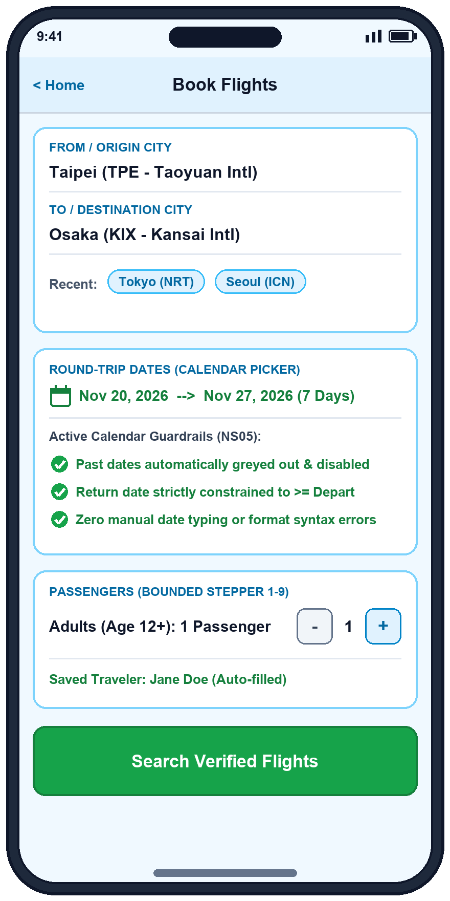

<!--
這就是針對 NS05 與 NS06 的標準重構對照。

在 NS05（防錯設計）方面，我們徹底拔除了自由文字框。日曆選擇器在物理上直接排除了「選到過去」或「回程比出發早」的荒謬錯誤，人數也透過計數按鈕嚴格限制在 1 到 9 人的合法範圍。

在 NS06（辨識取代記憶）方面，使用者不再需要背誦冰冷晦澀的 3 碼機場縮寫。直接輸入熟悉的大城市名稱，畫面更提供「最近搜尋」的視覺標籤，一眼認出就能一秒完成填寫。

💡 難字與專業術語解說：
- proactive error prevention: 主動式防錯設計（在輸入階段即透過元件限制排除錯誤可能）
- calendar guardrail: 日曆防呆限制（禁用過去日期並確保回程晚於去程的邏輯約束）
- bounded stepper: 具上下限約束的步進控制器（如限制人數僅能在 1–9 人之間增減的按鈕）
-->
---
## NS07: 彈性與使用效率 (Flexibility & Efficiency of Use)

* **啟發原則定義：**
  > 「**加速器 (Accelerators)**（新手使用者看不見）通常能**大幅加快資深專家的操作速度**，讓系統能**同時兼顧並滿足毫無經驗的生手與熟練的高手**。」
* **雙軌互動設計哲學 (Dual-Track Interaction)：**
  - **生手路徑 (Novice Path)：** 引導式圖形選單、功能導覽精靈、大按鈕與詳盡的文字解說。
  - **高手加速器 (Expert Accelerators)：** 全域快捷鍵 (`Cmd+K` / `Ctrl+K` 命令面板)、多指觸控手勢、可重用的巨集指令與批次處理。
* **漸進式熟練轉化：**
  - 在圖形選單中將快捷鍵組合標註於文字旁（如 `Cmd+S`），讓新手在日常點擊中自然習得快捷鍵，無痛晉升為進階用戶。

<!--
原則七：彈性與使用效率。

優良的軟體必須同時包容兩極端的族群：剛註冊的生手，以及每天泡在系統裡八小時的資深高手。

生手需要按部就班的精靈引導與大圖示；但如果一位每天處理 500 張發票的會計師每次都要用滑鼠點五層選單，他會精神崩潰。

提供鍵盤加速器：例如現代開發者極度仰賴的 Cmd+K 命令列，手不離鍵盤就能完成一切操作。

💡 難字與專業術語解說：
- flexibility & efficiency of use: 彈性與使用效率（同時兼顧新手易學性與專家高效操作的雙軌設計）
- novice user vs. expert / power user: 新手使用者 vs. 資深專家 / 重度進階使用者
- dual-track interaction design: 雙軌互動設計（表面提供直覺圖形按鈕給新手，底層內建快捷鍵給專家）
- progressive mastery: 漸進式熟練（在選單旁標註快捷鍵提示，幫助新手在日常操作中自然學會快捷鍵）
-->
---
<!-- _class: title-image-slide -->
## NS07 實踐 (1/2)：選單快捷鍵提示與智慧代碼片段展開

  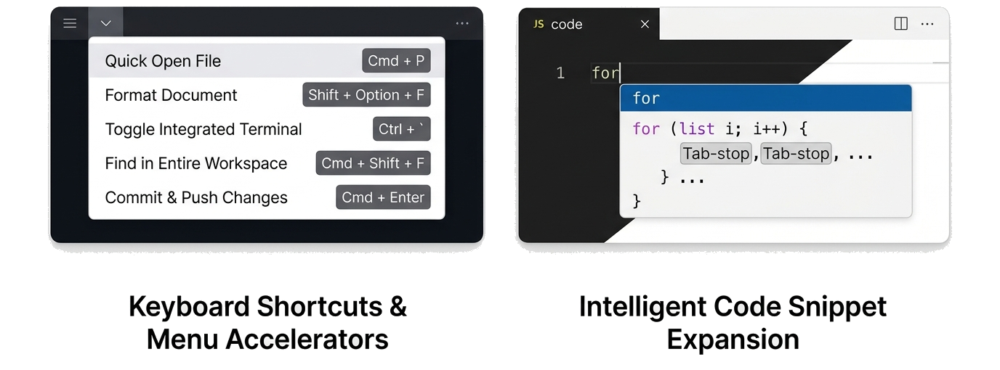

<!--
請看這組開發者工具中的加速器實踐。

左側選單在每個功能名稱旁標註快捷鍵（如 `Cmd+P`、`Shift+Option+F`），讓新手能用滑鼠點擊、專家能直接按鍵盤秒速執行；右側則展示輸入 `for` 即可一鍵展開完整迴圈模板（Code Snippet）。

💡 難字與專業術語解說：
- code snippet accelerator: 程式碼片段加速器（輸入簡短縮寫即自動展開完整語法模板的功能）
- tab-stop: Tab 鍵游標停駐點（展開模板後按 Tab 鍵即可依序跳轉填寫變數的位置）
- throughput: 產出效能、單位時間處理量
-->
---
<!-- _class: title-image-slide -->
## NS07 實踐 (2/2)：支援專家高效處理的多選批次操作列

  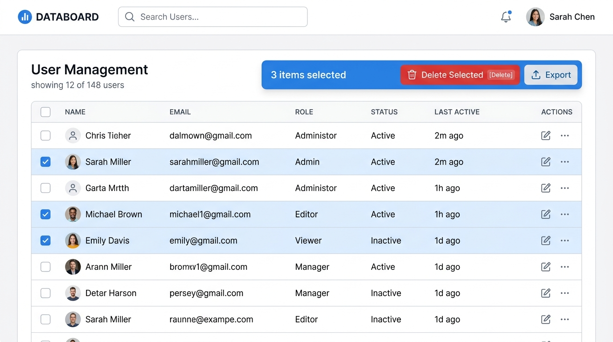

<!--
這是 NS07 在企業管理後台中的第二個重要實例：批次操作（Batch Operations）。

一般新手管理員可能習慣點擊右側圖示逐筆編輯；但當資深管理員需要一次清理或匯出數十筆帳號時，只要勾選多列核取方塊，上方就會自動浮現藍色批次操作列（「已選取 3 項：批次刪除 [Delete] | 批次匯出」），搭配鍵盤 Delete 快捷鍵即可瞬間完成。

💡 難字與專業術語解說：
- batch operation / bulk action: 批次操作 / 大量處理（一次選取多筆資料並同步執行相同動作）
- range selection (`Shift+Click`): 範圍連選（按住 Shift 點擊首尾項目即可一次勾選中間所有資料列）
- repetitive strain: 重複性操作疲勞（因機械式重複點擊滑鼠造成的身心耗損）
-->
---
## NS08: 簡約美學設計 (Aesthetic & Minimalist Design)

* **啟發原則定義：**
  > 「對話框與介面**不應包含無關或極少需要的冗餘資訊**。對話框中**每一單位多餘的資訊**，都在**與真正相關的資訊競爭使用者的有限注意力**，並**削弱其能見度**。」
* **極大化訊噪比 (Signal-to-Noise Ratio, SNR)：**
  - **訊號 (Signal)：** 與使用者當前任務決策直接息息相關的核心關鍵資訊。
  - **雜訊 (Noise)：** 喧賓奪主的裝飾線條、多餘徽章、冗長官樣廢話與閃爍橫幅。
* **工程技巧：漸進式揭露 (Progressive Disclosure)：**
  - 首頁與預設畫面僅展示最核心、80% 使用者必備的主要功能。
  - 將進階、低頻率的專業參數優雅收納於「進階設定 (Advanced)」摺疊面板或次級分頁中。

<!--
原則八：簡約美學設計。

在軟體工程中，「簡約」絕不是指把所有畫面留白或偷懶不刻功能，而是「極大化訊噪比（Signal-to-Noise Ratio）」。

使用者螢幕上的注意力是極其寶貴的有限頻寬。每一個花俏的裝飾邊框、每一句廢話，都在瓜分使用者的認知資源。

請掌握「漸進式揭露 (Progressive Disclosure)」的藝術：先把最核心、最常用的 20% 主要功能擺在眼前，把剩下的 80% 進階設定收進展開選單裡。

💡 難字與專業術語解說：
- aesthetic & minimalist design: 簡約美學設計（剔除無關冗餘資訊，而非單純追求視覺留白）
- Signal-to-Noise Ratio (SNR): 訊噪比（核心決策訊號與無關視覺雜訊的比值）
- diminish relative visibility: 削弱相對能見度（畫面塞滿次要資訊時，真正重要的按鈕反而被淹沒）
- decorative chrome: 裝飾性外框雜訊（無助於理解內容的多餘邊框、陰影或花俏裝飾）
- progressive disclosure: 漸進式揭露（首層僅展示核心資訊，次要進階參數收納於展開面板後）
-->
---
<!-- _class: title-image-slide -->
## NS08 實踐 (1/2)：資訊過載噪音 vs. 極簡視覺階層

  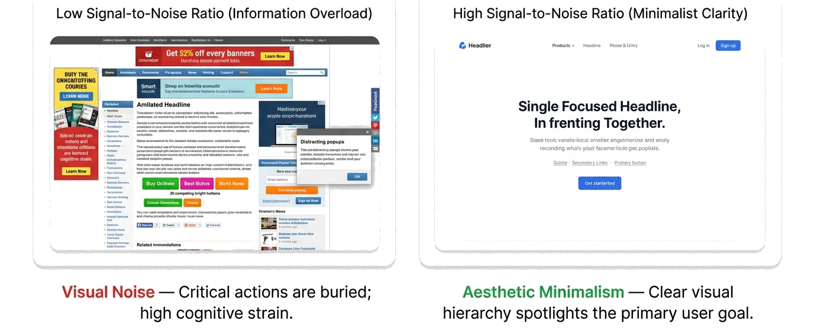

<!--
請看這張訊噪比（Signal-to-Noise Ratio）的強烈對比圖。

左邊的網站塞滿了五顏六色的廣告橫幅、彈出視窗與二十幾個按鈕，視覺雜訊徹底淹沒了核心功能；右邊的現代極簡設計則運用充沛的留白與清晰的字體階層，讓使用者的視線一秒聚焦在最重要的主要行動按鈕上。

💡 難字與專業術語解說：
- information overload: 資訊過載（畫面同時呈現過多資訊，超過人類注意力頻寬）
- visual paralysis: 視覺麻痺 / 決策癱瘓（因干擾項過多而不知所措）
- typographic scale: 字級比例階層（透過標題、副標與內文的大小對比建立閱讀次序）
-->
---
<!-- _class: title-image-slide -->
## NS08 實踐 (2/2)：聚焦核心指標與漸進式揭露的極簡儀表板

  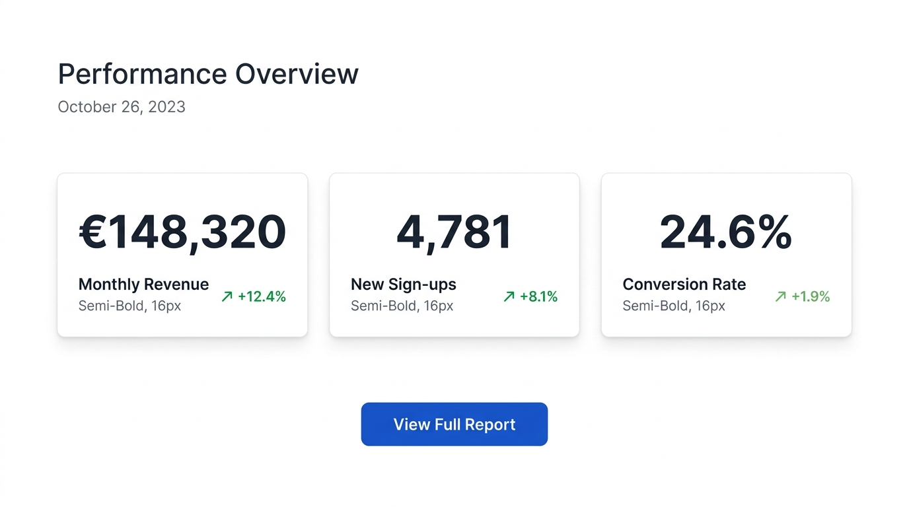

<!--
請看 NS08 的第二個實例：運用「漸進式揭露」打造的極簡營運儀表板。

這個畫面沒有把幾十張複雜折線圖與明細表全塞在首頁，而是只提取出決策者最關心的 3 個核心指標（本月營收、新增註冊數、轉換率），搭配大字體與乾淨留白；若需要細部數據，再點擊下方的「View Full Report」展開。

💡 難字與專業術語解說：
- KPI (Key Performance Indicator) dashboard: 關鍵績效指標儀表板
- anti-pattern: 反模式（看似合理、實則會帶來嚴重負面後果的常見錯誤設計）
- drill-down table: 下鑽明細表（點擊總覽指標後深入檢視底層逐筆資料的表格）
-->
---
## 課堂挑戰：這個團隊專案看板到底出了什麼問題？

> **情境描述：** 軟體工程師每天早上打開團隊工作看板，準備處理今天被指派的缺陷與任務……

* **1. 視覺雜訊與訊噪比（真正重要的資訊在哪裡？）：**
  - 充斥無關的底層代碼：`INTERNAL_DB_ID`、伺服器 `Ping: 28ms`、Shard 節點與系統時間戳記。
  - 五顏六色的標籤、粗黑外框與頂部刺眼的黃色升級廣告橫幅，嚴重干擾注意力。
* **2. 高頻專家操作效率（為什麼改個狀態要點 4 次滑鼠？）：**
  - 不支援任何鍵盤快捷鍵（`Cmd+K` 與 `Enter` 均被停用）。
  - 不支援多選批次操作，修改任務狀態必須逐一點擊 4 層子選單（`Submenu 1..3`、`Actions...`）！
* **課堂任務：**
  - 如何進行「視覺減法」並讓每天高頻使用的專業工程師發揮極致效率？

    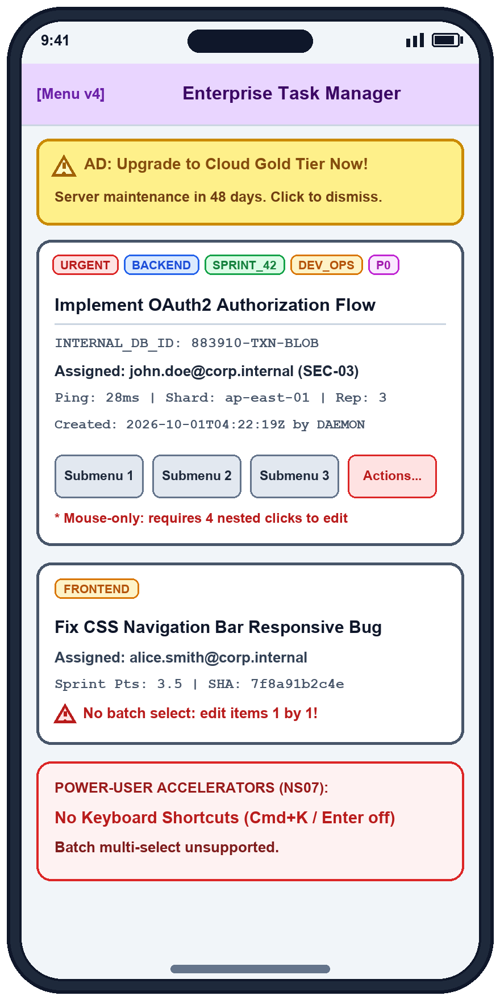

<!--
理解了 NS07 與 NS08 之後，請大家看看這張企業內部「專案任務管理 App」的畫面！

不論你是剛報到的實習生，還是每天要處理上百張票卡的資深工程師，打開這個畫面大概都會倒吸一口涼氣。請大家觀察幾個細節：
- 首先，畫面最上方被刺眼的紫紅色閃爍橫幅 `⚡ PROMO: UPGRADE TO ENTERPRISE PRO MAX!` 佔據，底下還塞滿了對日常工作毫無幫助的伺服器連線速率、記憶體位址 `0x7FFF5FBFF8C0` 與資料庫 Shard 狀態。
- 其次，中間的任務卡片擠滿了五顏六色的標籤、十六進位雜湊碼 `ID#99281-AX-09` 與 `DB_SYNC_OK` 旗標，真正重要的任務標題反而被視覺雜訊徹底淹沒。
- 最後，看看最底部的提示框：`Shortcuts Disabled — Use Menu to Edit`。資深工程師想按 `Cmd+K` 快速搜尋、想批次勾選多張卡片修改狀態，系統統統不支援，強迫你每一張票都得用滑鼠點開三層選單慢慢改！

這個畫面同時得罪了新手與老手，究竟違反了哪兩條黃金原則？我們馬上來看！

💡 難字與專業術語解說：
- triage daily bugs: 每日缺陷檢傷分類與優先級排定
- visual clutter: 視覺雜訊、畫面雜亂堆積
- database shard & daemon: 資料庫分片節點與背景常駐程式（純後端底層資訊，不應暴露於一般任務卡片）
- nested mouse submenu: 巢狀多層滑鼠子選單（必須逐層點擊多次才能觸達目標動作的設計）
-->
---
## 挑戰揭曉：符合 NS07 與 NS08 的優化重構

> **重構核心：** 剔除無關的工程底層雜訊以最大化訊噪比，並為高頻使用者內嵌無處不在的鍵盤加速器。

🔍 滑鼠懸停檢視原始問題介面 (p.49)

* **NS07 優化（彈性與高手操作加速器）：**
  - ✅ **全域命令列：** 隨時按下 `Cmd+K` / `Ctrl+K` 快速搜尋與執行任務指令。
  - ✅ **行內快捷鍵：** 按下 `E` 鍵直接修改、`C` 鍵行內新增，雙手無需離開鍵盤。
  - ✅ **批次處理能力：** 支援 `Shift + Click` 多選任務，一次性批次變更狀態。
* **NS08 優化（簡約美學與高訊噪比）：**
  - ✅ **徹底肅清視覺噪音：** 隱藏底層資料庫 Shard 與 Ping 值，保留充沛呼吸留白。
  - ✅ **高價值資訊凸顯：** 採用高雅乾淨的優先級標籤（*High Priority, Due Tomorrow*）。

    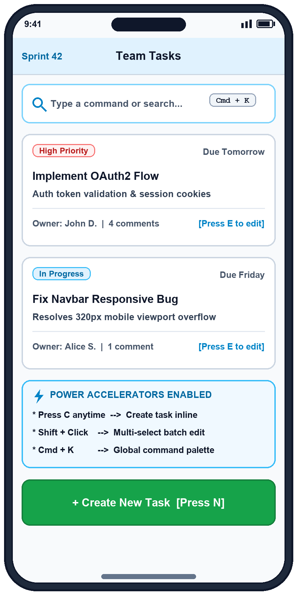

<!--
這就是針對 NS07 與 NS08 的標準重構對照。

在 NS08（簡約美學設計）方面，我們將所有工程雜音徹底清除。促銷橫幅與底層資料庫代碼消失了，取而代之的是極度舒適的留白空間、優雅的排版字體與層次分明的優先級標籤，讓團隊一眼就能聚焦在真正的核心工作上。

在 NS07（彈性與使用效率）方面，系統完美兼顧了生手與高手。剛加入的實習生可以點擊底部鮮明的「+ Create New Task」按鈕；而每天工作八小時的資深工程師，只要敲擊 Cmd+K 搜尋、按 C 新增、按 E 編輯，效率呈倍數爆發。

💡 難字與專業術語解說：
- omnipresent keyboard shortcut: 無處不在的全域鍵盤快捷鍵
- inline keybind: 行內快捷鍵綁定（無需點開子選單，直接按單鍵如 E 或 C 即可原地編輯或新增）
- eradicate noise: 徹底根除視覺雜訊
-->
---
## NS09: 協助使用者辨識、診斷與修復錯誤

* **啟發原則定義：**
  > 「錯誤訊息應採用**清晰平易的純文字**表達（**絕不出現晦澀代碼**），**精確指出問題的具體成因**，並**建設性地主動提出修復建議方案**。」
* **災難級錯誤訊息範例：**
  - ❌ *"Error 0x80004005: Unexpected runtime exception in thread main."* （讓使用者困惑恐慌，毫無幫助）。
* **卓越錯誤訊息的三大黃金法則：**
  - ✅ **平易白話：** *"我們無法為您的信用卡完成扣款。"*
  - ✅ **精確具體原因：** *"您輸入的有效期限 (05/23) 已經過期。"*
  - ✅ **建設性修復出口：** *"請更新您的信用卡到期日，或選擇其他付款方式 [更新付款資訊]。"*

<!--
原則九：協助使用者辨識與修復錯誤。

當使用者遇到錯誤時，他已經處於脆弱和受挫的情緒狀態中。千萬不要對著使用者吐出十六進位的記憶體代碼或是 Raw SQL Exception！

一條合格的錯誤訊息必須具備三要素：第一，用一般人看得懂的白話說明發生什麼事；第二，精確指出具體原因；第三，附上一個一鍵修復的按鈕或指引。

像現代網站會把冷冰冰的 404 Not Found 轉化為溫暖的搜尋導航頁，這就是極佳的修復實踐。

💡 難字與專業術語解說：
- recognize, diagnose, and recover: 辨識、診斷與修復錯誤（使用者發現出錯、理解原因並成功修正的三階段）
- plain language: 平易白話的自然語言（不含程式碼與系統縮寫的日常用語）
- runtime exception & stack trace: 執行期例外與呼叫堆疊追蹤（程式崩潰時的內部除錯資訊）
- constructive recovery: 具建設性的修復引導（明確告訴使用者「現在該怎麼做才能解決問題」）
-->
---
<!-- _class: title-image-slide -->
## NS09 實踐 (1/2)：死胡同報錯 vs. 具建設性引導的 404 頁面

  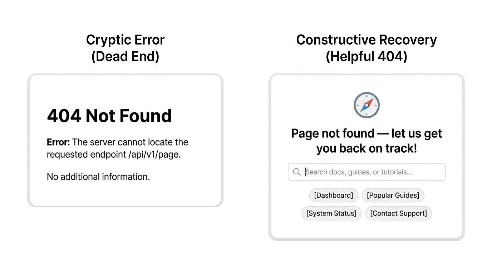

<!--
請看 NS09 的第一個對照實例：404 找不到頁面的錯誤復原設計。

左側只拋出冰冷的「Cannot locate requested endpoint /api/v1/page」，把使用者丟在死胡同裡；右側則以友善白話說明頁面可能已移動，並立即提供搜尋框與返回儀表板、熱門指南的快捷按鈕。

💡 難字與專業術語解說：
- dead-end error page: 死胡同錯誤頁（只告知出錯、卻不提供任何返回或下一步出口的畫面）
- endpoint: API 端點 / 網址路徑
- navigation hub: 導覽樞紐（提供搜尋框與常用捷徑以協助使用者重新定向的頁面）
-->
---
<!-- _class: title-image-slide -->
## NS09 實踐 (2/2)：白話說明上傳失敗原因並提供一鍵重選按鈕

  

<!--
這是 NS09 在檔案上傳流程中的第二個實例。

當使用者誤傳了不支援的檔案格式時，系統沒有顯示生硬的「Invalid MIME Type」，而是清楚告知：「上傳失敗：不支援此檔案格式。我們僅接受 PNG 或 JPG 格式（上限 5MB）」，並在下方直接提供「Choose Another File（重新選擇檔案）」按鈕與支援格式說明連結。

💡 難字與專業術語解說：
- MIME Type (Multipurpose Internet Mail Extensions): 多用途網際網路郵件擴充類型（標準檔案格式識別碼，一般用戶不熟悉此術語）
- actionable error modal: 可直接採取修復行動的錯誤對話框
- file format & size constraint: 檔案格式與容量上限規範
-->
---
## NS10: 說明文件與求助支援 (Help & Documentation)

* **啟發原則定義：**
  > 「雖然系統最好能夠達到無需任何說明手冊便能直覺操作，但仍有必要提供說明文件。相關資訊應**易於搜尋**、**緊密聚焦於使用者的具體任務**、**列出明確的操作步驟**，且**篇幅不宜過於冗長**。」
* **現代嵌入式文件的新典範：**
  - **情境式微提示 (Contextual Tooltips)：** 在複雜欄位旁提供小問號圖示 `?`，滑鼠懸停時即時浮現具體格式說明。
  - **互動式上手導覽 (Interactive Onboarding)：** 新用戶首次登入時，透過高亮聚光燈與步進卡片，在真實畫面上親手演練核心功能。
  - **任務導向的知識庫：** 說明文件依照使用者的「任務目標」分類檢索，而非依照內部 API 模組分類。

<!--
原則十：說明文件與求助支援。

雖然我們的終極目標是讓系統直覺到「沒有人需要讀說明書」，但在龐大複雜的企業級系統中，完備的支援依然不可或缺。

現代優秀的 documentation 絕不是丟一本厚達 100 頁的 PDF 讓使用者去啃，而是「情境化嵌入」：在有疑問的欄位旁放一個問號小提示，在新功能發布時提供互動式導覽體驗。

💡 難字與專業術語解說：
- help & documentation: 說明文件與求助支援
- contextual tooltip / microcopy: 情境式微提示 / 介面微文案（嵌入在欄位旁、在疑惑發生當下給予解答的精簡說明）
- interactive onboarding tour: 互動式新手導覽（首次登入時以聚光燈高亮逐步引導操作的教學流程）
- task-oriented knowledge base: 任務導向知識庫（依使用者目標而非系統模組分類的可搜尋說明中心）
-->
---
<!-- _class: title-image-slide -->
## NS10 實踐 (1/2)：情境式微提示 (`?`) 與主動式聚光燈導覽

  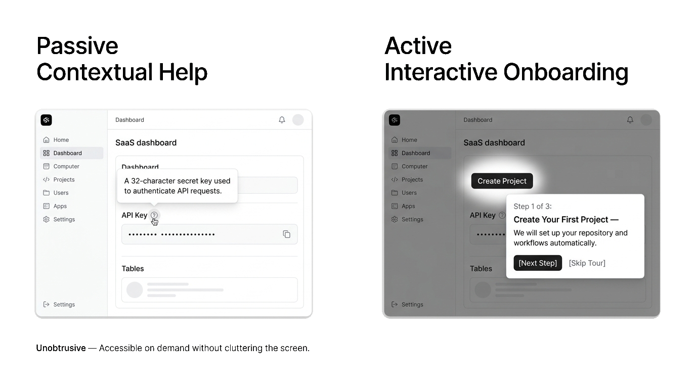

<!--
請看畫面上這兩種互補的嵌入式說明模式。

左側是「被動式情境說明」：在 API Key 欄位旁放置小巧的 `?` 圖示，滑鼠移上去才顯示精簡解釋，平時完全不佔空間；右側則是「主動式互動導覽」：透過聚光燈高亮帶領新用戶一步步完成第一個專案的建立。

💡 難字與專業術語解說：
- passive vs. active help: 被動式求助（使用者有疑問時主動點擊 `?` 觸發）vs. 主動式導覽（系統偵測到新用戶時自動彈出引導）
- spotlight overlay: 聚光燈遮罩（將背景壓暗、僅打亮當前教學目標按鈕的視覺引導技術）
- learning by doing: 做中學（在真實介面互動中自然學會操作，而非閱讀靜態手冊）
-->
---
<!-- _class: title-image-slide -->
## NS10 實踐 (2/2)：聚焦當下任務的步驟化引導與可跳過機制

  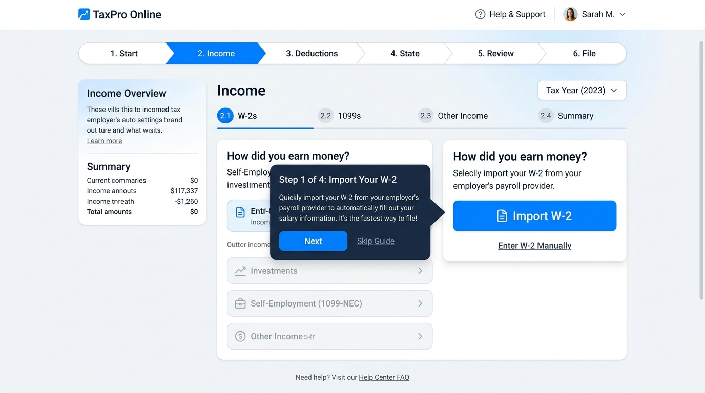

<!--
這是 NS10 在線上報稅系統中的第二個實例。

報稅流程涉及複雜的法規表格（如 W-2 所得表）。當使用者進入第 2 步「Income（所得申報）」時，畫面直接針對「Import W-2」按鈕彈出「Step 1 of 4」的情境導覽卡，用兩句話說明如何自動匯入薪資資料，並同時提供「Next」與「Skip Guide（跳過導覽）」選項。

💡 難字與專業術語解說：
- tax-filing workflow: 報稅申報工作流（高專業門檻、極需情境式說明輔助的典型領域）
- contextual popover: 情境式彈出說明氣泡（指向特定按鈕並提供步驟指引的浮動卡片）
- skip tour / skip guide: 跳過導覽（允許熟練用戶隨時略過新手教學的控制出口）
-->
---
## 課堂挑戰：這個帳號註冊畫面到底出了什麼問題？

> **情境描述：** 新進員工正在註冊公司企業門戶帳號，輸入資料後滿心期待地點擊「送出 (`Submit & Try Again`)」……

* **1. 錯誤診斷與復原體驗（哪裡填錯？為何清空整張表單？）：**
  - 跳出令人恐慌的十六進位錯誤碼 `ERROR CODE 0x800A03EA` 與 `REG_VALIDATION_ERR_SYNTAX`，毫無白話成因。
  - 懲罰性地把整頁表單全部清空抹煞，強迫使用者從頭重打 Email！
  - 密碼被拒絕（`Invalid Format`），卻完全不說究竟違反了哪一條密碼規則。
* **2. 情境式引導與求助支援（遇到專有名詞該問誰？）：**
  - 出現看不懂的專業欄位（`TOTP 2FA SEED / TOKEN ID`），周遭沒有任何 Tooltip 或 `(?)` 圖示說明。
  - 唯一的幫助連結，居然是叫使用者「下載 180 頁系統管理員 PDF 手冊 (`45MB`)」！
* **課堂任務：**
  - 如何將這場註冊災難，轉變為有同理心、有指引的流暢體驗？

    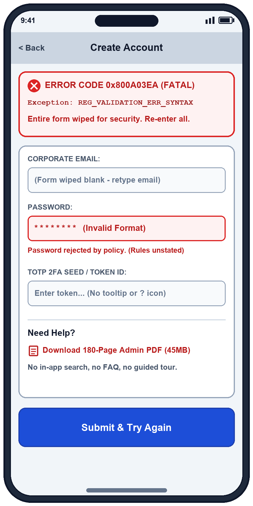

<!--
學完了最後兩條啟發式原則（NS09 與 NS10）後，來看這個壓軸挑戰：企業雲端系統的「帳號註冊畫面」！

一位剛入職的新員工填完註冊表單按下送出後，迎來了一場徹底的挫折。請看右邊手機畫面的三個災難現場：
- 第一，頂部跳出深紅色的系統崩潰方框，上面印著冰冷的十六進位錯誤碼 `FATAL EXCEPTION: ERR_0x800A03EA` 與 `Validation Failed in AuthController.java:412`——一般使用者怎麼可能知道 `0x800A03EA` 是什麼意思？
- 第二，更殘忍的是底下那行紅字：`Form fields cleared for security.` 系統因為一個小錯誤，竟然把使用者剛才辛苦填好的帳號與表單欄位全部清空重置！而密碼欄位只冷冷地寫著 `Password rejected (Policy Violation)`，卻完全不告訴你密碼規則到底要幾碼、缺了大寫還是特殊符號。
- 第三，當使用者卡在最下方深奧的 `2FA Secret Key (TOTP Hex Seed)` 不知所措時，欄位旁沒有任何提示小圖示；點擊底部的求助按鈕，系統居然叫他去下載一本 **180 頁的《System Admin Manual PDF》** 自己慢慢翻！

為什麼這樣的錯誤處理與說明文件會讓使用者直接放棄產品？讓我們進入 NS09 與 NS10！

💡 難字與專業術語解說：
- hex error code: 十六進位錯誤碼（如 `0x800A03EA`，僅供底層除錯、對一般使用者毫無意義的代碼）
- form wiping: 清空重置表單（表單驗證失敗時惡意把使用者已填對的欄位也一併清空的糟糕設計）
- TOTP 2FA (Time-based One-Time Password Two-Factor Authentication): 基於時間的一次性密碼雙重驗證
- inline tooltip: 行內微提示（點擊或懸停於欄位旁 `?` 圖示時即時彈出的簡短說明框）
-->
---
## 挑戰揭曉：符合 NS09 與 NS10 的優化重構

> **重構核心：** 用同理心提供建設性的錯誤修復動線，並在使用者產生疑惑的當下精準提供情境式微引導。

🔍 滑鼠懸停檢視原始問題介面 (p.57)

* **NS09 優化（協助辨識與修復錯誤）：**
  - ✅ **已填資料妥善保留：** 絕不惡意清空整頁表單，已填通過的 Email 完整留存。
  - ✅ **即時動態密碼檢核清單：** 清楚打勾已達成的規則（長度、數字、符號），指引明確。
* **NS10 優化（說明文件與求助支援）：**
  - ✅ **行內情境提示 Tooltip：** 專有名詞旁附帶 `Help (?)`，兩句話白話解釋什麼是 2FA。
  - ✅ **即時互動常見問答搜尋：** 用站內動態搜尋框取代厚重的 180 頁靜態 PDF 手冊。

    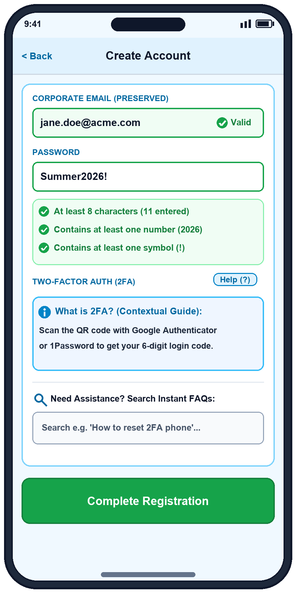

<!--
這就是針對 NS09 與 NS10 的標準重構對照，也是尼爾森十大原則的完整收官！

在 NS09（協助辨識與修復錯誤）方面，系統展現了高度的工程同理心：表單絕對不因為錯誤而惡意清空重置；密碼驗證採用動態打勾清單，使用者看一眼就知道自己只是少了一個特殊符號，輕鬆完成修復。

在 NS10（說明文件與求助支援）方面，我們將厚重的 180 頁 PDF 手冊丟進歷史堆，改以「在使用者產生疑問的原地提供解答」：在 2FA 旁提供輕量的 Tooltip 說明，並提供即時搜尋問答框。

💡 難字與專業術語解說：
- preserved form state: 保留已填表單狀態（發生局部錯誤時，妥善留存使用者已輸入的正確欄位）
- live validation checklist: 即時動態驗證檢核表（隨使用者打字即時打勾回饋哪些密碼條件已達成）
- searchable instant FAQ: 可即時檢索的常見問答框
-->
---
### 概念核對問答 2 (CCQ 2)：易用性啟發原則實踐
<!-- id: ase-ch06-ccq2 -->

  

在電商結帳流程中，工程團隊將原先自由輸入的文字日期框，替換為互動式日曆選擇器，並在所有必填地址通過格式驗證之前，自動將「確認下單」按鈕保持為反灰禁用狀態。請問這項設計主要體現了尼爾森十大原則中的哪一項？

- **A.** NS01: 系統狀態可見度 (Visibility of System Status)
- **B.** NS05: 防錯設計 (Error Prevention)
- **C.** NS07: 彈性與使用效率 (Flexibility and Efficiency of Use)
- **D.** NS10: 說明文件與求助支援 (Help and Documentation)

  

  

    

<!--
讓我們檢驗對尼爾森十大原則的理解。

分析團隊的具體行動：以受限的日曆選擇器取代自由打字，並在驗證過關前禁用按鈕。

正確答案是 B：尼爾森原則中的 NS05 防錯設計 (Error Prevention) 明確主張，比再好的錯誤提示訊息更卓越的，是從根本上杜絕問題發生的精心設計。透過日曆選擇器約束輸入並反灰未驗證按鈕，能在失誤發生前主動防呆。

💡 難字與專業術語解說：
- malformed date string: 格式錯誤的日期字串
- proactive constraint vs. reactive error message: 事前主動防呆約束（NS05）vs. 事後錯誤訊息診斷（NS09）
-->
---
## 雙人實戰討論：日常系統之 NS01–NS10 啟發式體檢 (30 分鐘)

> **課堂任務（⏱️ 30 分鐘）：** 請兩人一組，從下方任選一個熟悉的系統，**製作投影片（含真實截圖標註）**，具體說明該系統有哪些設計 **符合 (✅)**、又有哪些 **違反 (❌)** `NS01–NS10`。

### 1. 選擇一個目標系統（自選一項）
1. **高鐵訂票系統（網路訂票 / T-EX App）：** 車次查詢、大學生優惠篩選、座位偏好、分票或退換票付款流程。
2. **大學選課系統（或校務資訊系統）：** 搶課排隊狀態、選課代號輸入、衝堂防呆檢查、連線逾時與課表預覽。
3. **蝦皮購物（或其他電商購物平台）：** 首頁彈窗與促銷徽章、優惠券套用規則、結帳流程與包裹物流追蹤。
4. **日常高頻 App（LINE / Uber Eats 等）：** 訊息「收回 vs. 刪除」防呆、即時外送地圖追蹤、或複雜設定選單。
5. **其他（自定義系統）：** 你們日常最常使用的任何網站或 App。

### 2. 投影片製作規格（截圖診斷）
- **✅ 滿足原則之優良設計（2–3 張截圖）：**
  - 截圖圈出好用的介面細節，標註對應的 **`NS01–NS10` 編號**，說明它如何降低認知負擔或防呆。
- **❌ 違反原則之痛點設計（2–3 張截圖）：**
  - 截圖圈出讓人困惑或抓狂的設計，標註違反的 **`NS01–NS10` 編號**，並評估嚴重度（`1–4 級`）。
- **🛠️ 一句話重構建議：**
  - 針對最嚴重的 `❌` 畫面，提出你們的具體改善方案！

<!--
在進入 6.3 節之前，讓我們把剛才學完的尼爾森十大易用性啟發原則（NS01–NS10）化為實戰能力！接下來我們進行 30 分鐘的「雙人實戰討論與截圖簡報製作」。

請大家跟旁邊的同學兩人一組，從左邊卡片挑一個你們最熟悉、每天都在用的系統：
1. **高鐵訂票系統（或 T-EX 行動購票 App）**：想想看它在選車次、大學生優惠篩選、多人分票或付款流程上，有哪些貼心的好設計？又有哪些讓你卡住的地方？
2. **大學選課系統**：這絕對是大家共同的痛與記憶！早上九點搶課轉圈圈有沒有違反 NS01？要背四碼選課代號有沒有違反 NS06？衝堂防呆有沒有滿足 NS05？Session 逾時整頁重登有沒有違反 NS03 與 NS09？
3. **蝦皮購物（或其他購物平台）**：它的四階段包裹物流追蹤非常符合 NS01，但首頁滿滿的彈窗廣告、轉盤遊戲與五顏六色的標籤，是不是嚴重違反了 NS08（簡約美學與訊噪比）？
4. **或者你們自選任何一個常用系統**（例如 LINE 的「收回 vs. 刪除」、Uber Eats、甚至 Git / VS Code）。

請各組利用接下來 **半小時（30 分鐘）** 的時間，直接用手機或電腦截圖，製作一份精簡的投影片：包含 2 到 3 張「✅ 滿足 NS01–NS10」的截圖標註，以及 2 到 3 張「❌ 違反 NS01–NS10」的截圖標註與改善建議。計時 30 分鐘，現在開始！

💡 難字與專業術語解說：
- heuristic audit: 啟發式可用性稽核（依據 NS01–NS10 原則逐項檢視真實系統介面的體檢過程）
- annotated screenshot: 標註式畫面截圖（在真實介面截圖上圈選特定元件並加上原則編號與說明）
- rush-hour queuing: 尖峰時段排隊佇列（如搶票或選課系統在瞬間高併發流量下的等待狀態回饋）
-->
---
<!-- _class: lead -->
<!-- header: '6.3 Tidwell 介面設計模式' -->

# **6.3 Jenifer Tidwell 介面設計模式 (Interaction & UI Patterns)**

> "Patterns are not off-the-shelf components that you plug into a layout. They are living architectural blueprints rooted in human perception, habit, and behavior."  
> *(設計模式並非可隨意拼裝的現成零件，而是植根於人類感知、習慣與心理機制的活體架構藍圖。)*  
> — *Jenifer Tidwell (《Designing Interfaces》作者)*

<!--
歡迎進入 6.3 節：Jenifer Tidwell 介面設計模式（Interaction & UI Design Patterns）。

在軟體工程中，我們有 GoF 23 種物件導向設計模式，用來解決類別與物件結構的復用問題。而在人機互動與前端介面領域，同樣存在一套經典傳世的架構語彙——那就是 Jenifer Tidwell 所歸納的介面設計模式。

很多工程師在刻劃網頁或 App 時，往往隨興發揮，導致使用者在每一頁都得重新適應按鈕與導航邏輯。Tidwell 的模式庫為我們提煉了經過全球數十億使用者反覆驗證的標準結構，涵蓋底層心理認知、資訊架構、尋路導航到資料清單呈現。

在這一節中，我們將透過解剖真實世界中的高鐵、蝦皮、Airbnb、PChome 與 Slack 等產品，深入掌握這套工業級 UI/UX 設計模式體系。

💡 難字與專業術語解說：
- interaction design pattern: 互動設計模式（針對常見使用者介面互動問題的結構化可重用解決方案）
- visual chrome: 介面視覺邊框與裝飾框架（瀏覽器或應用程式中非內容本體的控制列與外框裝飾）
- foolish: 愚蠢的、受挫無助的（良好介面設計的核心目標是不讓使用者感到自己很笨）
-->
---
## 什麼是 Web UI/UX 設計模式？ (What is a UI Pattern?)

> **設計模式的本質：** 針對在特定情境下反覆出現的人機互動問題，所提煉出經過驗證的通用架構解決方案。

### 1. 為什麼工程團隊需要 UI 模式？
- **建立跨職能通用語彙 (Shared Vocabulary)**：
  - 產品經理、UI 設計師與前後端工程師能精準溝通（如：「這裡採 Two-Panel Split View 還是 One-Window Drilldown？」）。
- **杜絕重複造輪子 (Proven Solutions)**：
  - 成熟的互動問題（如逃生出口、漸進式揭露、分頁）已有最優解，不必盲目冒險。
- **大幅降低認知負荷 (Cognitive Load)**：
  - 吻合使用者的心智模型與習慣，讓軟體操作變得自然「隱形」。

### 2. Jenifer Tidwell 的模式體系與精選範疇
- **先驅起源與經典著作：《Designing Interfaces》**：
  - Tidwell 於 **1997 年** 在 MIT 發表《*Common Ground*》人機互動模式目錄（受建築學家 Christopher Alexander 1977 與 GoF 1994 啟發）。
  - O'Reilly 權威專書《***Designing Interfaces***》歷經 **第 1 版 (2005)**、**第 2 版 (2010)** 至 **第 3 版 (2020**，與 C. Brewer、A. Valencia 合著)，橫跨桌面、Web 與行動裝置。
- **涵蓋 100+ 模式 ➔ 濃縮為 4 大架構維度**：
  - 全書涵蓋逾百種模式（表單、導航、畫布、資料網格）；本課程嚴選最具代表性的高影響力模式，歸納為 **4 大核心架構維度** 深入剖析。

<!--
什麼是 Web UI/UX 設計模式？為什麼特別介紹 Jenifer Tidwell？

如同後端架構有單例模式、觀察者模式一樣，前端介面也有自己的設計模式。

請看左欄：為什麼我們不能憑空隨性設計介面？因為使用者在你的網站上花的時間，遠遠少於他們在其他所有網站花費的時間總和（Jakob 定律）。如果每個軟體都發明一套獨特的操作按鈕，使用者會崩潰。成熟的模式能建立跨團隊的共通語言，讓前端工程師光聽名字就知道元件階層怎麼寫。

請看右欄：Jenifer Tidwell 的經典著作《Designing Interfaces》（O'Reilly 出版）是介面模式領域的集大成之作，書中歸納了上百種豐富的設計模式。因為全書內容極為龐大，本課程精選了在軟體工程與全端開發中最關鍵的代表性模式，濃縮在「核心行為、內容佈局、路徑導航、資料呈現」四大核心維度中進行拆解。

💡 難字與專業術語解說：
- empirical psychology: 實證心理學（以真實人類認知與行為觀察為基礎的心理學法則）
- competing forces: 相互競爭的設計取捨力（如資訊密度與畫面簡潔度之間的拉扯）
- diagnostic lens: 診斷透鏡（用於檢測系統缺陷的評估視角）
- constructive toolkit: 建構式工具箱（提供具體實作藍圖與組件的工程方法論）
-->
---
## Tidwell 介面設計模式的四大架構維度 (The 4 Dimensions)

> **全景架構：** 從底層的人類行為動機，層層向上構築至資訊架構、尋路導航與海量資料呈現。

### 維度 1 & 2：行為認知與資訊架構
- **1. 核心使用者行為模式 (Core Behaviors)**：
  - 順應人類大腦的試錯探索、即時滿足、延遲抉擇、習慣化與空間記憶機制。
- **2. 資訊架構與內容佈局 (Content & Layout)**：
  - 內容發現三要素（搜尋 / 焦點精選 / 分類瀏覽）、儀表板、漸進式揭露與精靈步驟。

### 維度 3 & 4：尋路導航與資料呈現
- **3. 尋路機制與導航設計 (Wayfinding & Navigation)**：
  - 解答「我在哪裡、如何前往、如何離開」、模態對話框與逃生出口黃金法則、三層定位體系。
- **4. 資料呈現與集合展示 (Data Display & Lists)**：
  - 桌面端雙欄分割 vs. 行動端深入鑽取、縮圖網格、輪播卡片與真實電商平台解構。

<!--
Tidwell 將龐大的介面模式歸納為環環相扣的四大維度：

第一維度是「核心使用者行為」：深入人類認知心理學，研究使用者在面對螢幕時如何探索、猶豫、記憶與做決定；
第二維度是「資訊架構與內容佈局」：探討如何將海量資訊拆解成合理的結構、框架與漸進式揭露步驟；
第三維度是「尋路與導航」：宛如數位世界的交通路網，確保使用者隨時清楚自己身在何處，並且永遠擁有安全的逃生出口；
第四維度是「資料呈現」：聚焦於清單、表格、網格與輪播等高頻資料集合的最佳展示策略。

💡 難字與專業術語解說：
- mental map: 心智地圖（協助大腦組織複雜知識結構的空間分類框架）
- wayfinding: 尋路導引（源自建築學，指使用者在資訊空間中定位自身並規劃路徑的過程）
- spatial disorientation: 空間迷航（使用者在多層級視窗或深層選單中迷失位置與方向）
- alternating row striping: 奇偶列交錯底色／斑馬紋（透過深淺交錯背景色輔助水平視線追蹤）
-->
---
## Section 1：核心使用者行為與認知心理模式 (Core Behaviors)

> **核心設計哲學：** 介面必須主動包容人類的認知侷限與行為慣性，而非強迫使用者適應生硬的機器邏輯。

### 1. 試錯探索與即時反饋機制
- **安全探索 (Safe Exploration, TW1.1)**：
  - 消除使用者的點擊恐懼！永遠提供零風險的嘗試機會與明確的復原途徑（**Undo 復原**）。
- **即時滿足 (Instant Gratification, TW1.2)**：
  - 直通主要目標（如電商「再次購買」按鈕），跳過繁複漏斗流程。
- **中途變更 (Changes in Midstream, TW1.4)**：
  - 允許使用者在流程中途直接調整參數（如高鐵查詢即時切換更早/更晚車次），無須返回重填。
- **延遲抉擇 (Deferred Choice, TW1.5)**：
  - 降低首次體驗門檻，非核心資料允許「**稍後再說 (Skip for now)**」。

### 2. 認知負荷與記憶輔助機制
- **增量式建構 (Incremental Construction, TW1.6)**：
  - 一邊撰寫、一邊提供即時動態預覽（如 Overleaf/Markdown Live Preview），減輕工作記憶負荷。
- **習慣化 (Habituation, TW1.7)**：
  - 遵循標準介面慣例（如左側標準導覽列），培養使用者的無意識肌肉記憶。
- **空間記憶 (Spatial Memory, TW1.9)**：
  - 核心功能位置恆定（如右上角設定齒輪），嚴禁動態隨機漂移！
- **前瞻記憶 (Prospective Memory, TW1.10)**：
  - 透過未讀徽章、未完成標記等視覺提示，輔助使用者記住未來待辦任務。

<!--
我們進入 Section 1：核心使用者行為與認知心理模式。

在軟體工程中，系統崩潰最常見的原因不是硬體故障，而是使用者的誤操作。如果我們將使用者視為「會犯錯、沒耐心、注意力破碎」的真實人類，我們就能透過這 12 種行為模式進行防禦性設計：

請看左欄：Safe Exploration 是現代 App 最重要的模式之一——給予使用者一個明確的 Undo 按鈕，能讓他們安心大膽探索；Instant Gratification 則讓老顧客一鍵再買，省去五步驟結帳流程；而高鐵查詢的中途變更，更是免除了使用者重新打字的怒火。

請看右欄：增量建構讓工程師在寫代碼或 LaTeX 時隨時看見成果；空間記憶則嚴格要求設定齒輪必須老老實實待在右上角，不能今天放左邊、明天放底欄！

💡 難字與專業術語解說：
- satisficing: 滿意決策（Herbert Simon 提出之認知原則：人類傾向選擇第一個「夠好」的方案而非窮舉尋找全局最優解）
- muddling through: 摸索前行、邊試邊走（不看說明書、直接憑直覺點擊嘗試的操作行為）
- instant gratification: 即時滿足感（使用者進入系統後幾秒內即可看到具體的操作成果回饋）
- deferred choices: 延遲非必要決策（允許先跳過繁瑣設定或註冊，待核心任務推進後再補填）
- incremental construction: 漸進式建構（支援邊做邊改、逐步微調成形的創作與編輯體驗）
- habituation: 習慣化與肌肉記憶（重複操作形成的下意識反射動作，一旦跨介面不一致極易引發失誤）
- prospective memory: 前瞻性記憶（「記得未來要去某處做某事」的記憶能力，極易受外部干擾而遺忘）
-->
---
<!-- _class: full-image-slide -->

  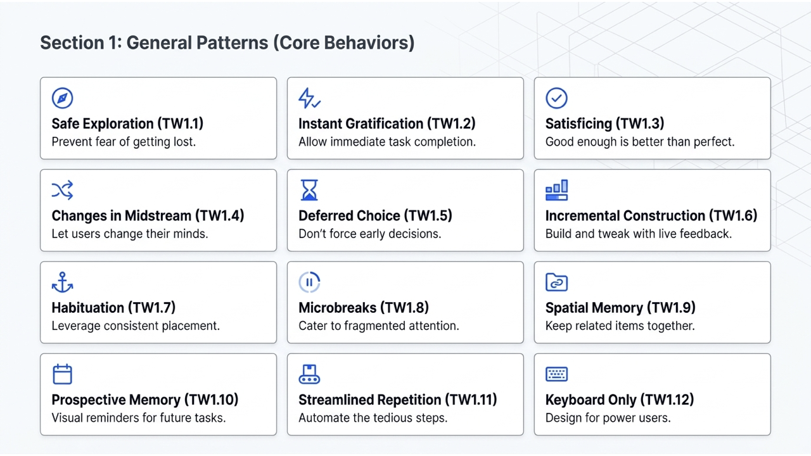

<!--
請看 Section 1 的 12 個通用行為模式總覽卡片：
從 Safe Exploration、Instant Gratification、Satisficing、Changes in Midstream，一路涵蓋到 Habituation、Spatial Memory 與 Keyboard Only。

每一個模式背後，都對應著人機互動與認知心理學的深刻實證定律。

💡 難字與專業術語解說：
- optimal rationality: 最佳理性模型（假設決策者具備無限時間與算力去評估所有可能選項的理想化假設）
- trial and error: 試誤學習法（透過不斷嘗試與修正錯誤來達成目標的探索過程）
- action cue: 行動視覺線索（畫面中引導點擊或操作的按鈕、連結與高對比圖示）
-->
---
<!-- _class: full-image-slide -->

  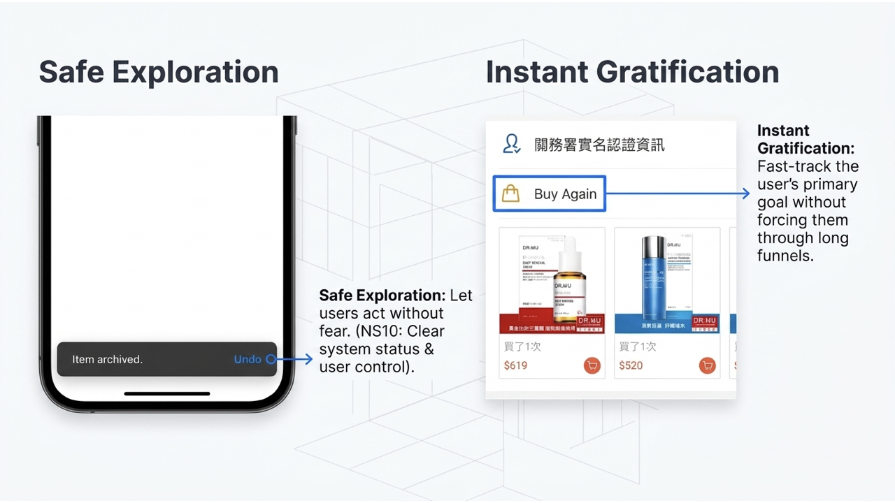

<!--
請看這兩組生動的實戰案例：

左側是 Safe Exploration：當使用者封存郵件或刪除項目時，畫面上彈出一個帶有「Undo」操作的吐司通知（Toast Notification）。這正是尼爾森原則中的使用者控制與自由（NS03）與防錯（NS05）的極致體現！

右側是 Instant Gratification：在電商 App 中，針對顧客買過的日常消耗品，直接提供「Buy Again（再次購買）」捷徑，省去搜尋、選規格、加購物車的漫長漏斗。

💡 難字與專業術語解說：
- onboarding: 新手引導與初次上手體驗（使用者首次接觸產品直到成功完成核心價值的過程）
- registration wall: 強制註冊牆（在體驗任何核心功能前強迫使用者先註冊登入的阻斷式設計）
- activation rate: 產品啟用轉換率（新使用者成功完成首次核心價值體驗的指標比例）
-->
---
<!-- _class: full-image-slide -->

  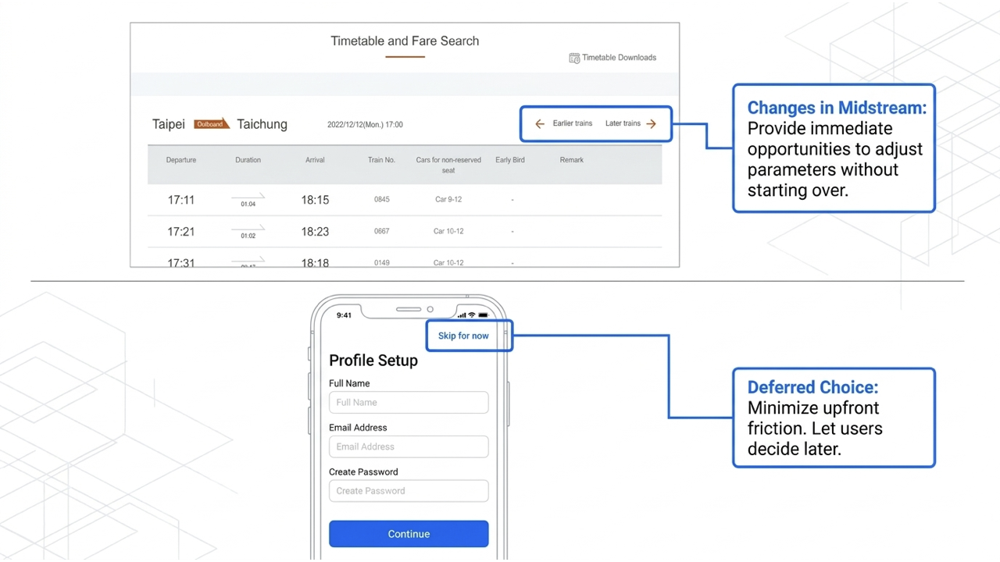

<!--
請看這兩個人性化設計案例：

上方是台灣高鐵時刻表查詢：當你查出 17:00 的班次後，如果發現客滿，右上角直接提供「更早車次 (Earlier trains)」與「更晚車次 (Later trains)」快捷鍵！使用者不需要重新按上一頁、重新選站名、重新填時間。這就是 Changes in Midstream。

下方是 Deferred Choice：在初次註冊流程中，除了輸入姓名密碼，右上角明確提供「Skip for now（稍後再填）」。先讓使用者進門體驗核心價值，而不是用十道個人資料問題把顧客嚇跑。

💡 難字與專業術語解說：
- hot-reloading: 熱重載／即時預覽更新（修改局部內容或代碼後無須重啟即刻呈現視覺結果）
- muscle memory: 肌肉記憶（經長期重複訓練後不需大腦意識思考即可自動執行的程序性記憶）
- basal ganglia: 基底核（大腦中負責習慣化動作與程序性運動記憶的深層神經結構）
-->
---
<!-- _class: full-image-slide -->

  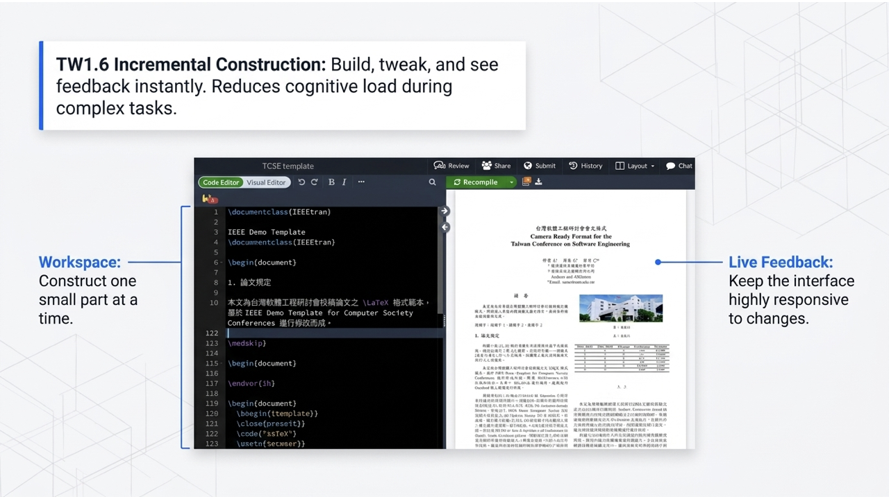

<!--
請看這張 Incremental Construction（增量式建構）的代表作：Overleaf / LaTeX 論文線上編輯器。

左側是原始碼工作區（Workspace），右側是即時編譯預覽（Live Feedback）。使用者每修改一段文字或一個公式，右側便以響應式回饋即時印證。這大幅降低了人類工作記憶的負擔，讓複雜的創造性任務變得可控且愉悅。

💡 難字與專業術語解說：
- retrospective memory: 回溯性記憶（對過去已發生事件、知識或經驗的記憶提取）
- externalize: 認知外化（將原本需儲存在人腦內部的記憶或計算轉移至外部視覺工具中保存）
- intended action: 預期計畫行動（使用者打算在未來某個時間點或條件下執行的待辦動作）
-->
---
<!-- _class: full-image-slide -->

  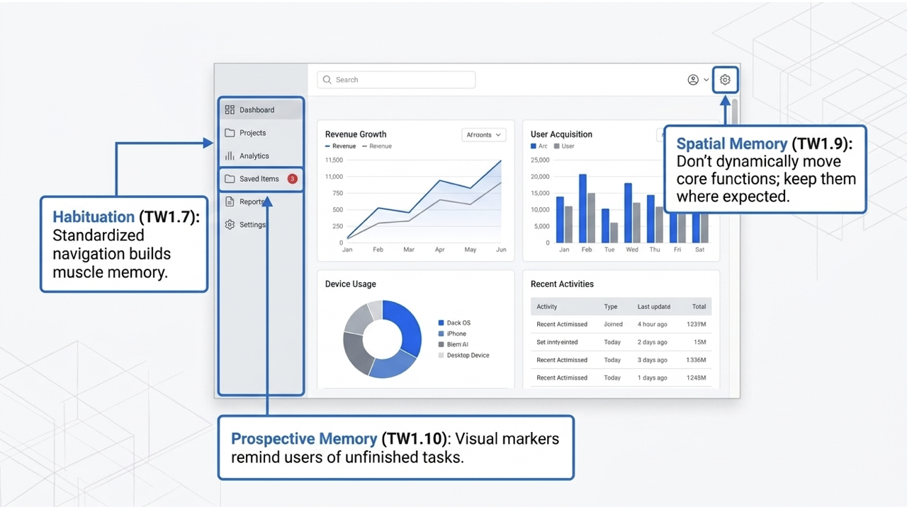

<!--
請看現代儀表板如何巧妙融合三大記憶機制：

左側是 Habituation（習慣化）：標準的側邊欄導覽，讓使用者憑肌肉記憶就能盲按；
側邊欄上的紅底數字標籤「Saved Items (3)」是 Prospective Memory（前瞻記憶）：提醒你還有 3 件儲存的項目尚未處理；
右上角的設定齒輪則是 Spatial Memory（空間記憶）：永遠固定在右上角，讓大腦不需要耗費視覺搜尋成本。

💡 難字與專業術語解說：
- trifecta: 黃金三要素、三連勝組合（三個相輔相成缺一不可的核心機制）
- multi-level undo: 多層次復原（支援連續回退多個歷史操作步驟的狀態堆疊機制）
- progressive disclosure: 漸進式揭露（依使用者需求分階段展開進階細節以控制初始認知負荷）
- Pareto distribution (80/20 rule): 柏拉圖八二法則（80% 的日常使用情境集中在 20% 的核心功能上）
- granular control: 細粒度控制（針對底層參數進行精密微調的能力）
-->
---
## Section 2：資訊架構與內容佈局模式 (Organizing Content & Layout)

> **核心設計哲學：** 螢幕空間有限而資訊無窮，優秀的佈局必須以使用者的發現路徑為核心，建立清晰的視覺階層。

### 1. 內容發現三要素與空間框架
- **內容發現三要素 (The Discovery Trifecta, TW2.1)**：
  - **搜尋 (Search)**：針對目標明確的使用者，提供直接、意圖驅動的文字查詢。
  - **焦點舞台 (Feature / Center Stage, TW4.2)**：系統主動推薦的核心精選，第一眼抓住眼球。
  - **分類瀏覽 (Browse)**：針對探索型使用者，提供依類別展開的圖文瀏覽清單。
- **儀表板 (The Dashboard, TW2.5)**：
  - 高密度匯總關鍵維運指標，提供一覽無遺的全局掌握力。
- **替代檢視 (Alternative Views, TW2.9)**：
  - 賦予使用者自主權，以偏好的形式消費同一份資料（如：地圖模式 vs. 清單模式）。

### 2. 時間組織與複雜度控制
- **漸進式揭露 (Progressive Disclosure)**：
  - 預設保持介面極簡乾淨；唯有當使用者觸發特定編輯情境時，才揭露進階工具箱。
- **步驟精靈 (The Wizard, TW2.7)**：
  - 將龐大、令人生畏的繁雜流程，拆解為線性、可預測的步驟導航（Step 1 → 2 → 3）。
- **模組分頁 (Module Tabs, TW4.5)**：
  - 適用於**同層級、互斥**的資料切換（如：按主題 / 按月份 / 按頁面）。
- **手風琴摺疊 (Accordion, TW4.6)**：
  - 適用於**原地向下深入展開層級細節**（如 FAQ 常見問答），不跳離當前頁面。

<!--
我們進入 Section 2：資訊架構與內容佈局模式。

很多工程師把所有能撈出來的資料一次性通通倒在畫面上，以為這叫功能齊全，結果使用者看到的是一片資訊雜訊。

請看左欄：任何平台的首頁都必須平衡「內容發現三要素」——想直接找店的人用 Search，想看熱門推薦的人看 Center Stage，閒晃探索的人用 Browse 分類；而當資料有多個維度時，務必提供 Alternative Views（例如叫外送或找餐廳時，有人喜歡看地圖距離，有人喜歡看文字清單）。

請看右欄：漸進式揭露是維護介面簡約的秘密武器；精靈步驟則讓原本可怕的 20 欄表格變成輕鬆闖關；而 Tabs 與 Accordion 的取捨更體現了工程師對資訊層級的深刻理解。

💡 難字與專業術語解說：
- flat dialog box: 扁平無層次對話框（將所有初階與進階選項不分類別全部攤開在同一視窗的設計）
- expandable drawer: 可展開式抽屜面板（點擊後滑出或向下展開以顯示次要控制項的容器組件）
- visual noise: 視覺雜訊（畫面中干擾注意力集中於主要任務的多餘線條、文字與控制項）
-->
---
<!-- _class: full-image-slide -->

  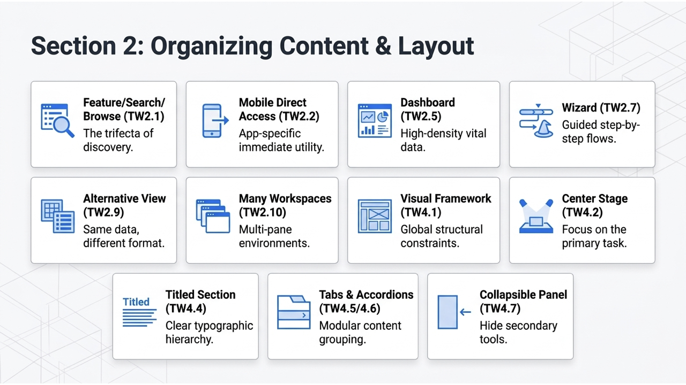

<!--
請看 Section 2 的模式矩陣：
涵蓋了 Feature/Search/Browse、Dashboard、Wizard、Alternative Views、Visual Framework、Center Stage、Tabs 與 Accordion 等 11 個經典版面組織模式。

💡 難字與專業術語解說：
- pre-attentive processing: 前注意力視覺處理（人類視覺皮層在 200 毫秒內無意識快速掃描色彩、大小與空間結構的生理機制）
- macro-to-micro: 從巨觀到微觀（先確立整體版面骨架，再雕琢局部組件細節的設計階層）
- two-panel split view (master-detail): 雙欄主從分割視圖（左側顯示清單目錄、右側即時連動顯示詳細內容的經典佈局）
- one-window drilldown: 單視窗下鑽導覽（在單一視窗區域內點擊項目後整頁切換至下一層級細節的行動端常見模式）
- pogo-sticking: 跳跳虎式反覆進出（因缺乏雙欄預覽而被迫在「列表頁 ↔ 詳情頁」之間不斷按返回鍵來回跳轉的痛苦操作）
- visual framework: 視覺框架系統（跨頁面維持一致的導覽列、網格與字體色彩規範）
-->
---
<!-- _class: full-image-slide -->

  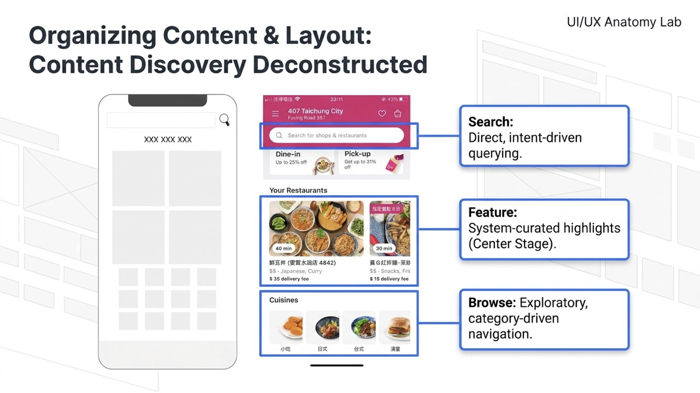

<!--
請看這張在 Foodpanda 外送 App 上的內容發現解構實例：

頂部是 Search（意圖驅動的直接查詢框）；
中間是 Feature（系統主動精選推薦的焦點餐廳，Center Stage）；
底部是 Browse（依料理類別如小吃、日式、台式、漢堡進行探索分類導航）。

無論是淘寶、Netflix、Spotify 還是外送平台，全世界最成功的數位產品首頁，骨子裡全都在運用這套「搜尋 + 精選 + 瀏覽」的黃金三要素！

💡 難字與專業術語解說：
- viewport: 視埠／可視視窗區域（螢幕上實際可用於渲染畫面內容的矩形顯示區域）
- responsive adaptation: 響應式調適（依據螢幕尺寸與裝置特性自動轉換版面結構的設計機制）
- spatial hierarchy: 空間層級結構（透過區塊位置、面積大小與縮排距離傳達資訊主從關係）
-->
---
<!-- _class: full-image-slide -->

  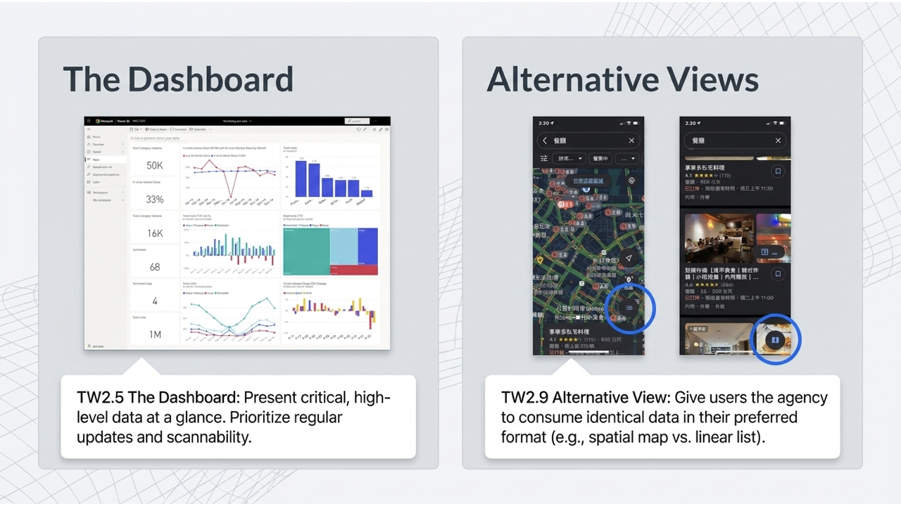

<!--
請看這兩大經典版面模式：

左側是 The Dashboard（儀表板）：將龐大的營收、成長率、裝置比例以高密度、高對比的圖表集中展示，提供最高效率的視覺掃描；
右側是 Alternative Views（替代檢視）：在餐廳探索頁中，右下角提供一個藍色切換鈕，讓使用者可以在「空間地圖視圖 (Spatial Map)」與「線性清單視圖 (Linear List)」之間無痛切換，滿足不同情境下的檢視偏好。

💡 難字與專業術語解說：
- module tabs: 模組化分頁籤（共用同一顯示區域、每次僅呈現單一作用中分頁內容的切換組件）
- accordion: 手風琴摺疊面板（垂直堆疊且可支援單一或多個區塊同時展開收合的容器組件）
- mutually exclusive: 互斥關係（同一時間僅允許一個狀態成立，即 1-of-N 選擇邏輯）
- spatial footprint: 空間佔用面積（UI 組件在螢幕版面上所佔據的矩形像素範圍）
- floating palette: 浮動工具面板（可自由拖曳位置、懸浮於主畫布之上的專業工具列）
-->
---
<!-- _class: full-image-slide -->

  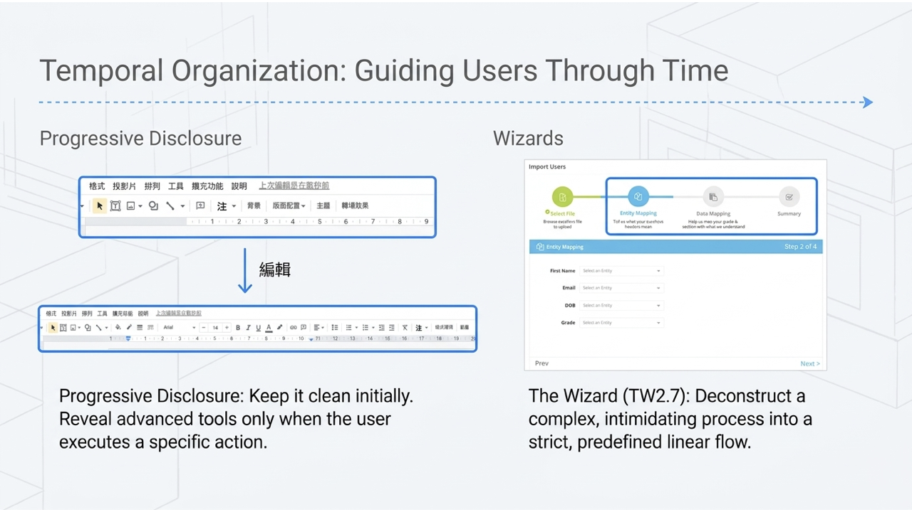

<!--
請看時間維度的資訊組織模式：

左側是 Progressive Disclosure（漸進式揭露）：平常工具列只顯示基本的粗體、斜體與對齊；當使用者點擊進階編輯時，才展開第二層完整的字型與段落面板，防止初始介面過度雜亂；
右側是 The Wizard（精靈步驟）：在進行大量使用者匯入時，將「選檔案 → 欄位對應 → 資料檢驗 → 總結」拆解為嚴格的線性向導，步步為營。

💡 難字與專業術語解說：
- double-decked tabs: 雙層堆疊分頁籤（在分頁籤下方又嵌套另一排分頁籤的反模式，極易造成階層混淆）
- navigation tree: 樹狀導覽結構（以垂直縮排展開多層級父子節點的側邊目錄）
- workspace customization: 工作區自訂化（允許進階使用者依個人工作流自由停靠或分離面板）
-->
---
<!-- _class: full-image-slide -->

  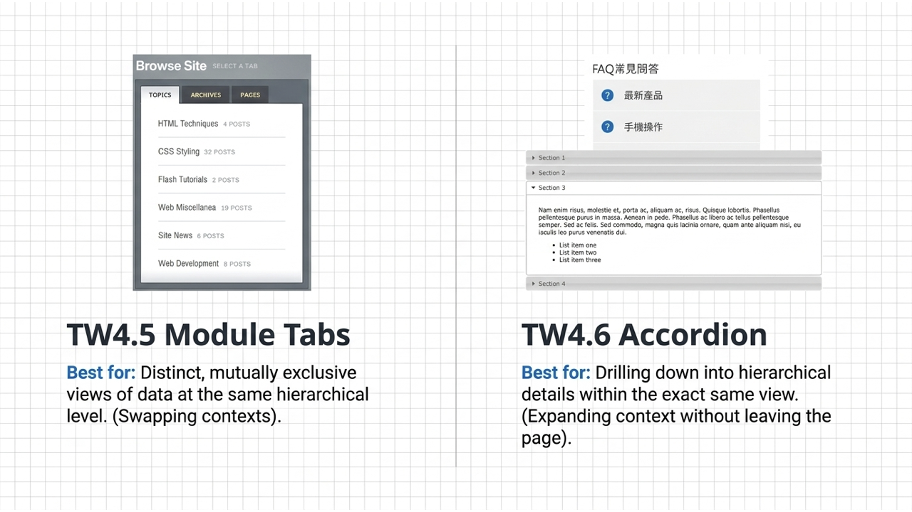

<!--
這是前端工程師最常面臨的抉擇：到底該用分頁 (Tabs) 還是手風琴 (Accordion)？

左側的 Module Tabs（模組分頁）：最適合在「同一個階層下，存在互斥檢視」的情境（如文章列表中的「主題 / 封存 / 頁面」），切換時會替換掉整個內容上下文；
右側的 Accordion（手風琴摺疊）：最適合在「完全相同的視圖中，展開階層細節」（如常見問答 FAQ），讓使用者在不跳離當前頁面的前提下原地展開深度資訊。

💡 難字與專業術語解說：
- eye fixation: 視覺凝視點（眼球在閱讀掃描過程中短暫停留聚焦以擷取資訊的座標點）
- visual spine: 視覺中軸線（表單中標籤右緣與輸入框左緣緊密對齊所形成的垂直視覺導引線）
- top-aligned labels: 頂部對齊標籤（將欄位名稱置於輸入框正上方，能大幅縮短視線移動距離）
- responsive disclosure: 響應式動態揭露（依據使用者前一步驟的選擇結果，動態顯示後續相關表單區塊）
-->
---
## Section 3：尋路機制與導航設計模式 (Wayfinding & Navigation)

> **核心設計哲學：** 優秀的導航系統解答人類在數位空間的三大終極問題：**「我在哪裡？還剩多少？如何離開？」**

### 1. 入口識別與模態逃生黃金法則
- **明確進入點 (Clear Entry Points, TW3.1)**：
  - 清晰的第一道起跑線（如首頁顯著的「登入」或行動號召大按鈕），消除觀望猶豫。
- **身分管理工具 (Sign-in Tools, TW3.9)**：
  - 個人檔案、組織切換與登出選單，固定於右上角習慣化位置（Habitual Placement）。
- **模態視窗的黃金法則 (The Golden Rule of Modals)**：
  - 當以**強制回應面板 (Modal Panels / Forced Response, TW3.4)** 鎖定使用者專注力時：
  - **必須無條件設計逃生出口 (Escape Hatches, TW3.6)！**
  - **右上角的「✕ 關閉按鈕」與「確定送出」按鈕同等重要！** 嚴禁讓使用者陷入無路可退的死胡同。

### 2. 三層次空間與進度感知定位體系
- **頂層流程進度 (Progress Indicators, TW3.10)**：
  - 針對線性、多步驟的任務流程，以編號節點（1 → 2 → 3 → 4）清楚標示「還剩多少步」。
- **中層階層定位 (Breadcrumbs, TW3.11)**：
  - 針對深層樹狀結構的資訊架構（如：`學年度 > 學院 > 系所 > 課程`），提供可點擊回溯的麵包屑軌跡。
- **底層長頁面定位 (Annotated Scrollbar, TW3.12)**：
  - 針對超長單頁海量資料（如通訊錄、日誌），在捲軸邊緣標註字母索引或視覺錨點，支援極速滑動跳轉。

<!--
我們進入 Section 3：尋路機制與導航設計模式（Wayfinding & Navigation）。

使用者進入一個軟體系統，就像走進一座陌生的建築物。如果建築物沒有路標、沒有出口，人們就會恐慌。

請看左欄：Entry Points 告訴使用者從哪裡開始；Sign-in Tools 則讓身分切換固定在右上角；特別注意「模態對話框的黃金法則」——很多初階工程師彈出一個浮動視窗，卻忘了做右上角的「X」或點擊遮罩關閉，導致使用者按 ESC 沒反應、除了重新整理別無他法，這是最嚴重的易用性災難！

請看右欄：回答「我在哪裡、還剩多少」的三層體系：流程用進度球、網站架構用麵包屑、長清單用帶註解的字母捲軸。

💡 難字與專業術語解說：
- saccade: 眼球跳視（視線在兩個凝視點之間快速跳躍移動的過程，跳視距離越長越容易產生視覺疲勞）
- cognitive fatigue: 認知疲勞（因長時間處理繁瑣或不自然介面佈局而導致的注意力下降與疲倦感）
- scan path: 視覺掃描路徑（眼球在檢視畫面時依序停留與移動所構成的軌跡）
-->
---
<!-- _class: full-image-slide -->

  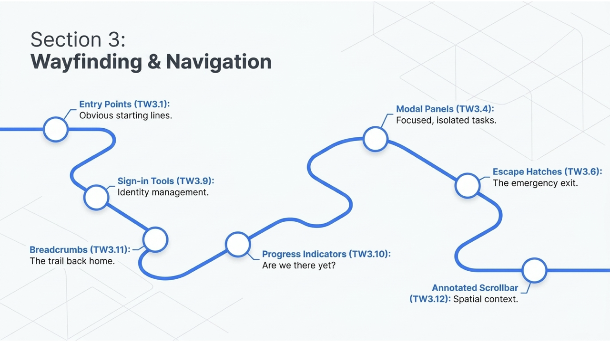

<!--
請看 Section 3 的尋路路徑圖：
從起點的 Entry Points 與 Sign-in Tools，經過局部的 Modal Panels 與 Escape Hatches，一路貫穿到 Breadcrumbs、Progress Indicators 與 Annotated Scrollbar。

這條路徑串聯了使用者在整個軟體旅程中的每一步位置感知。

💡 難字與專業術語解說：
- clear entry points: 清晰入口點（在首頁或空白狀態提供少數幾個任務導向的明確起點，引導使用者順利起步）
- escape hatch: 緊急逃生艙／安全退路（在深層流程、全螢幕模式或對話框中提供一鍵安全返回主畫面的明確出口）
- environmental design: 環境空間設計（研究建築、指標系統與人類空間認知互動的設計學科）
- task-oriented gateway: 任務導向入口（以使用者想完成的具體目標而非系統底層資料表來組織的首頁入口）
-->
---
<!-- _class: full-image-slide -->

  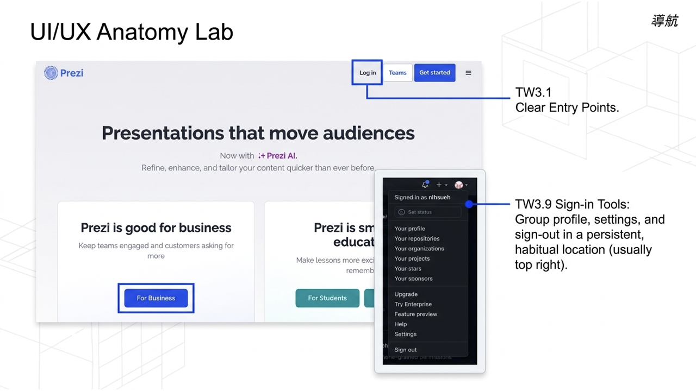

<!--
請看這兩個人性化導航案例：

上方是 Prezi 首頁：頂部有極為醒目的「Log in」與「Get started」按鈕，主視覺下方有清晰的大按鈕，提供明確的入口（TW3.1 Entry Points）；
右下方是 GitHub / 現代 Web 應用：點擊右上角頭像，展開的下拉選單將個人檔案、儲存庫、組織、設定與 Sign out 集中管理（TW3.9 Sign-in Tools），完全吻合使用者的習慣化肌肉記憶。

💡 難字與專業術語解說：
- welcome screen: 歡迎起始畫面（軟體啟動時提供最近檔案、範本與快速入門導引的任務入口頁）
- modal overlay: 模態遮罩視窗（浮現於主畫面之上並鎖定背景互動，要求使用者先處理或關閉的焦點視窗）
- one-way tunnel: 單向死胡同（缺乏返回鍵或取消出口、強迫使用者只能一路按到底的壓迫式流程）
-->
---
<!-- _class: full-image-slide -->

  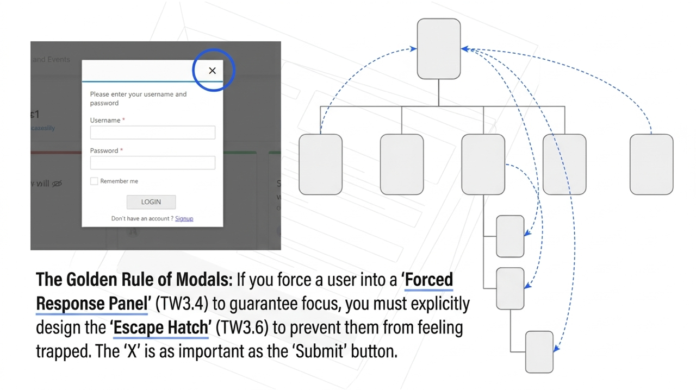

<!--
請全班同學務必牢記這張圖上的「模態對話框黃金法則」：

如果你為了強制使用者集中注意力，而使用「Forced Response Panel (TW3.4)」彈出一個阻斷背景的登入或輸入視窗，那麼你必須在架構上顯式設計「Escape Hatch (TW3.6 逃生出口)」！

看右側的樹狀架構圖：彈跳視窗可以從樹狀結構的任何節點觸發，但點擊右上角的「X」或者按鍵盤「ESC」，必須能夠無條件安全返回先前的節點。右上角的「X」與底部的「登入」按鈕同等重要！

💡 難字與專業術語解說：
- breadcrumbs: 麵包屑導覽列（源自童話糖果屋，顯示當前頁面在網站階層結構中從根節點到當前位置的路徑）
- hierarchical ancestry: 階層父系路徑（在樹狀資訊架構中從根目錄一路向下到當前節點的從屬關係）
- sequence map (step indicator): 序列步驟地圖（在多步驟精靈流程頂部顯示總步數、已完成步驟與當前進度的導覽組件）
- annotated scrollbar: 標註型捲軸（在捲軸軌道上疊加搜尋命中點、錯誤位置或日期刻度標記的空間視覺化組件）
-->
---
<!-- _class: full-image-slide -->

  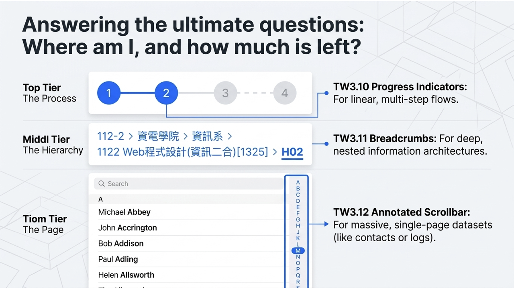

<!--
請看這張生動的三層定位對照圖：

頂層 (Top Tier - The Process)：進度指示器（TW3.10 Progress Indicators），用在多步驟購物結帳或註冊向導中，回答「流程還剩幾步」；
中層 (Middle Tier - The Hierarchy)：逢甲大學課程系統中的麵包屑記錄（TW3.11 Breadcrumbs），清晰展示「112-2 > 資電學院 > 資訊系 > Web程式設計」，回答「我在整座資訊樹的哪一層」；
底層 (Bottom Tier - The Page)：通訊錄側邊的字母捲軸（TW3.12 Annotated Scrollbar），回答「我在這份萬人名單的哪個英文字母段落」。

💡 難字與專業術語解說：
- scrollbar gutter: 捲軸溝槽軌道（視窗右側供捲軸滑塊移動與顯示標記的垂直長條區域）
- minimap: 微縮全覽圖（在程式碼編輯器或大型畫布側邊顯示整體結構縮圖以利快速定位的組件）
- scrub: 快速拖曳檢索（按住時間軸或捲軸滑塊高速滑動以即時預覽不同區段內容的操作）
-->
---
## Section 4：資料呈現與集合展示模式 (Data Display & Lists)

> **核心設計哲學：** 依據硬體螢幕尺寸與使用者任務目標，在空間利用率與視覺掃描效率之間取得最佳平衡。

### 1. 跨裝置響應式清單架構
- **桌面寬螢幕：雙欄分割檢視 (Two-Panel Split View, TW7.1)**：
  - 左側維持長駐清單，右側同步呈現詳細內容（如 Slack、Outlook）。
  - **核心價值**：徹底消除在清單頁與細節頁之間的來回往返跳轉。
- **行動窄螢幕：單視窗深入鑽取 (One-Window Drilldown, TW7.2)**：
  - 窄螢幕下清單被詳細內容完全覆蓋替換（如 iOS Mail）。
  - **核心要求**：左上角必須強制配置醒目的返回鍵（Back button）。

### 2. 空間壓縮與視覺掃描模式
- **縮圖網格 (Thumbnail Grid, TW7.5)**：
  - 「小而多」的高密度排列（如相簿網格），最適化人眼的高速視覺比對與掃描。
- **輪播切換 (Carousel, TW7.6)**：
  - 將多張大型圖片或卡片壓縮在單一水平視窗內，必須具備明確的方向性操作線索（左右箭頭與導航圓點）。
- **分頁控制 (Pagination, TW7.7)**：
  - 將海量資料切分為可控批次，避免單頁記憶體爆量與無限捲動疲勞。

<!--
我們進入 Section 4：資料呈現與集合展示模式（Data Display & Lists）。

軟體工程實務中，超過 80% 的商業畫面本質上都是「資料集合的展示與操作」。

請看左欄：在桌面端大螢幕上，請善用寬螢幕優勢，採用 Two-Panel Split View（左清單、右細節），讓使用者點選即預覽；但在手機等行動小螢幕上，空間不足以容納雙欄，必須優雅降級為 One-Window Drilldown，並且一定要在左上角提供明確的返回鍵。

請看右欄：相片或商品瀏覽適合用 Thumbnail Grid，首頁精選大圖適合用 Carousel，海量報表則需要 Pagination。

💡 難字與專業術語解說：
- information density: 資訊密度（單位螢幕面積內所呈現的有效資訊量與視覺元素比例）
- thumbnail grid: 縮圖網格佈局（以二維矩陣排列圖片卡片，適合視覺主導型商品的平行瀏覽與比較）
- carousel: 旋轉木馬橫向輪播組件（在有限垂直高度內透過水平滑動展示精選卡片的組件）
- banner blindness: 橫幅廣告盲視（使用者下意識忽略外觀或行為類似動態輪播廣告區塊的認知現象）
-->
---
<!-- _class: full-image-slide -->

  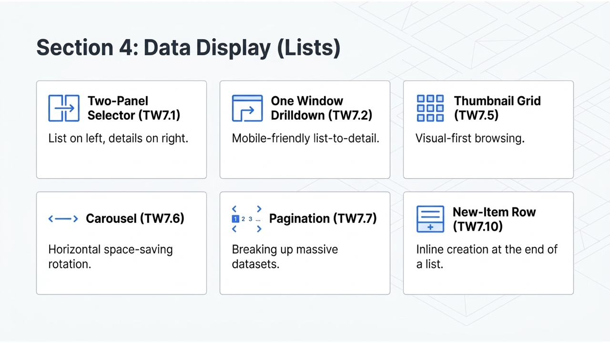

<!--
請看 Section 4 的資料呈現模式卡片：
涵蓋了 Two-Panel Selector、One Window Drilldown、Thumbnail Grid、Carousel、Pagination 與 New-Item Row。

這組模式專門處理現代軟體中最常見的陣列、列表與集合資料結構。

💡 難字與專業術語解說：
- curated category: 策展精選分類（經編輯或演算法挑選主題後呈現的內容集合）
- horizontal peeking: 邊緣局部露頭提示（在橫向輪播最右側刻意露出下一張卡片的局部邊緣，暗示使用者可向左滑動）
- deep browsing: 深度探索瀏覽（使用者已有明確類別目標、需要大面積快速掃描大量項目的瀏覽模式）
-->
---
<!-- _class: full-image-slide -->

  

<!--
請看這張極具啟發性的跨裝置對照實例：

左側是桌面端 Slack：採用 Two-Panel Split View（TW7.1），左側頻道與私訊清單恆定存在，右側為對話內容。使用者在切換頻道時不需要重新載入頁面；
右側是行動端 iOS Mail：採用 One-Window Drilldown（TW7.2），點擊郵件後整頁推進顯示信件細節，左上角提供明確的「Back」返回按鈕，同時頂部還提供上下箭頭（1 of 50）讓使用者直接換信。

💡 難字與專業術語解說：
- alternating row striping (zebra striping): 奇偶列斑馬紋底色（在寬表格中以極淡的深淺交錯背景色形成水平視覺軌道，防止跨欄看錯行）
- pagination: 分頁導覽器（將大型資料集切割為固定大小頁面並提供頁碼跳轉的控制組件）
- infinite scroll: 無限捲動載入（當捲動接近底部時自動非同步載入更多內容的無縫瀏覽模式）
- footer trap: 頁尾陷阱（因無限捲動不斷在底部塞入新內容，導致使用者永遠無法觸及頁面底部的版權與聯絡資訊列）
-->
---
<!-- _class: full-image-slide -->

  

<!--
請看視覺密度與空間壓縮的兩種模式：

上方是 Windows 相簿的 Thumbnail Grid（TW7.5 縮圖網格）：採用「小而多」的密集矩陣排列，讓人眼在 1 秒鐘內掃描數十張圖片；
下方是網站首頁的 Carousel（TW7.6 輪播橫幅）：在有限的螢幕高度內，將電腦系統、資訊安全、雲端運算三大主題橫向摺疊。請注意右側藍圈標出的箭頭指示符——輪播必須具備清晰的前進與後退操作線索！

💡 難字與專業術語解說：
- grazing vs. hunting: 漫遊瀏覽 vs. 目標狩獵（資訊尋求行為的兩種典型模式：消遣式隨意滑動 vs. 精準查找特定紀錄）
- addressability: 位置可尋址性（使用者能否精確記住、定位或透過網址連結回到資料集中的特定位置）
- click friction: 點擊摩擦成本（每一次額外要求使用者手動點擊按鈕或等待換頁所產生的操作阻力）
-->
---
## Tidwell 設計模式核心準則：從模式邁向直覺體驗

> **工程師必備心態：** 掌握模式不是為了生搬硬套，而是為了在系統架構中為人類認知弱點築起安全防護網。

### 1. 三大核心設計承諾 (The 3 Mandates)
- **建立親近感 (Build Familiarity)**：
  - 善用習慣化 (Habituation) 與通用慣例，讓使用者首次進入系統便能無師自通。
- **降低認知負荷 (Reduce Cognitive Load)**：
  - 以漸進式揭露、分部精靈與空間記憶，讓畫面在任何瞬間都只呈現關鍵資訊。
- **賦權使用者 (Empower the User)**：
  - 永遠提供逃生出口 (Escape Hatch)、撤銷復原 (Undo) 與多維檢視，讓使用者擁有絕對掌控權。

### 2. 工程落地啟發式檢核表 (Checklist)
- ✅ **探索安全嗎？** 是否具備無痛 Undo 或狀態復原機制？
- ✅ **逃生口在哪？** 任何彈出視窗是否都有清晰醒目的「✕」或取消按鈕？
- ✅ **位置明確嗎？** 是否同時提供麵包屑、進度條或捲軸錨點解答「我在哪」？
- ✅ **裝置適配嗎？** 桌面端雙欄分割檢視在手機端是否優雅降級為帶返回鍵的單視窗鑽取？
- ✅ **發現容易嗎？** 搜尋、精選與分類瀏覽是否各司其職？

<!--
在結束 6.3 節之前，請大家將這張「工程落地檢核表」銘記於心。

當你未來在公司開發前端畫面、或者進行程式碼審查 (Code Review) 時，不要只看 CSS 有沒有跑版，而是拿出這五道靈魂拷問：
探索安全嗎？逃生口在哪？位置明確嗎？裝置適配嗎？發現容易嗎？

只要落實這五點，你的產品就已經超越市面上 90% 粗製濫造的軟體系統。

💡 難字與專業術語解說：
- pattern language: 模式語言（源自建築師 Christopher Alexander，指由一套相互關聯的設計模式所組成的完整系統架構方法）
- engineering mandate: 工程設計準則（研發團隊在程式碼與介面審查時必須共同遵守的規範要求）
- responsive parity: 跨裝置響應式對等性（確保桌面端與行動端雖採用不同空間佈局，但提供對等完整的功能與體驗）
-->
---
## 雙人實戰討論 (Part 2)：日常系統之 Tidwell 設計模式解構

> **課堂任務（延續 6.2 討論）：** 請延續你們在 6.2 節選擇的**同一個系統**，**在投影片中補充截圖標註**，分析該系統運用了哪些 **Tidwell 介面設計模式**，並為 6.2 發現的痛點開出「模式重構處方」！

### 1. 目標系統與模式觀察線索
1. **高鐵訂票系統（網路訂票 / T-EX）：** *Deferred Choices*（免登入先查車次）、*Wizard / Sequence Map*（購票步驟條）、*Escape Hatch*（分票／退換票取消出口）。
2. **大學選課系統：** *Two-Panel Split View*（左側課程清單＋右側即時課表預覽）、*Changes in Midstream*（中途切換條件保狀態）、*Pagination vs. 篩選*。
3. **蝦皮購物（或其他電商平台）：** *Thumbnail Grid*（商品縮圖網格）vs. *Carousel*（首頁輪播）、*Hub & Spoke*、*Breadcrumbs*（麵包屑）、*Progress Indicators*。
4. **日常高頻 App／其他自定義（LINE / Uber Eats 等）：** *Safe Exploration*（訊息收回）、*Progressive Disclosure*（漸進揭露）、*One-Window Drilldown*（手機單視窗鑽取）。

### 2. 投影片延伸規格（截圖解構＋處方）
- **🔍 辨識現有設計模式（2–3 張截圖）：**
  - 在截圖上圈出元件，標註它採用了 **Tidwell 四大維度**（*1. 使用者行為、2. 內容佈局、3. 尋路導航、4. 資料呈現*）中的哪一個模式名稱。
- **🛠️ 開出「模式重構處方」（1–2 個案例）：**
  - 針對你們在 **6.2 節** 找到最嚴重的 `❌ NS01–NS10` 痛點畫面，具體指出應該導入哪一個 **Tidwell 模式** 來徹底修復它！

<!--
現在讓我們把 6.2 節與 6.3 節完美串聯起來，進行「雙人實戰討論 (Part 2)：日常系統之 Tidwell 設計模式解構」！

還記得我們前面說過的醫療比喻嗎？如果 **6.2 節的尼爾森十大原則（NS01–NS10）** 是幫系統找毛病的 **「聽診器（診斷問題）」**，那麼 **6.3 節的 Tidwell 介面設計模式** 就是具體開刀與建築施工的 **「臨床處方箋與結構藍圖（解決問題）」**！

請各組延續你們在 6.2 節選擇的 **同一個系統**（高鐵訂票系統、大學選課系統、蝦皮購物、LINE / Uber Eats 或自選系統），在剛才的簡報後面繼續加上 2 到 3 頁投影片：
1. **🔍 辨識現有設計模式（2–3 張截圖）**：看看這個系統在「核心行為、內容佈局、尋路導航、資料呈現」四大維度中，用到了哪些 Tidwell 模式？例如高鐵 App 是不是用了 *Deferred Choices*（讓你不必先登入就能查時刻表）與 *Sequence Map*？蝦皮是不是同時結合了頂部的 *Carousel*（橫向輪播）與下方的 *Thumbnail Grid*（二維縮圖網格）？桌面版選課系統有沒有做到 *Two-Panel Split View*（左邊選課列表、右邊即時對應的週課表），還是強迫你來回跳頁（Pogo-sticking）？
2. **🛠️ 開出模式重構處方（1–2 個案例）**：回頭看你們在 6.2 節抓出最嚴重的 `❌` 違規畫面，討論看看如果要重構它，應該套用哪一個 **Tidwell 設計模式**（例如用 *Progressive Disclosure 漸進式揭露* 或 *Two-Panel Split View*）來徹底根治！

💡 難字與專業術語解說：
- pattern hunting: 設計模式獵尋（在真實上線產品中辨識並拆解其背後採用的標準架構模式）
- deferred choices: 延遲選擇／先體驗後註冊（允許使用者先查詢車次或瀏覽商品，直到最後結帳才要求登入的模式）
- pogo-sticking: 跳跳虎式來回跳轉（因缺乏雙欄分割檢視，被迫在列表頁與明細頁之間不斷按上一頁來回跳轉的痛苦行為）
- pattern-driven refactoring: 模式驅動重構（運用成熟的 UI 設計模式作為具體處方，修復啟發式評估發現的介面缺陷）
-->
---
<!-- _class: lead -->
<!-- header: '6.4 AI for UX (AI4UX)' -->

# **6.4 AI 賦能 UX 設計：AI for UX (AI4UX)**

> "AI will not replace UX designers, but UX designers who use AI will replace those who do not."  
> *(AI 不會取代 UX 設計師，但善用 AI 的 UX 設計師將會取代不用 AI 的人。)*

<!--
我們現在邁入第二部分：AI 時代的互動設計前沿。

在 6.4 節中，我們探討 AI for UX（AI4UX）：軟體工程師與設計師如何善用大型語言模型、多模態視覺工具與自主代理人，全方位放大設計思維的每個環節？

我們將介紹專業設計師專屬的 RTCF 結構化提示詞工程框架、虛擬使用者人物誌生成，以及多代理人自動化原型建構。

💡 難字與專業術語解說：
- AI for UX (AI4UX): AI 賦能使用者體驗設計（運用生成式 AI 與大型語言模型加速 UX 研究、原型生成與啟發式評估）
- UX for AI (UX4AI): 為 AI 系統設計使用者體驗（針對非確定性 AI 模型設計透明、可控且具防呆護欄的人機介面）
- force multiplier: 戰力倍增器（能讓單一工程師或設計師產出效率與探索廣度成倍躍升的輔助工具）
-->
---
## 什麼是 AI 賦能 UX (AI4UX)？

* **AI 賦能下的超級設計師：**
  - 生成式 AI 在設計思考流程的每一個階段，扮演**認知放大器與效率倍增器**。
* **主要實戰應用範疇：**
  - **使用者研究與同理：** 生成多元化虛擬使用者人物誌（Synthetic Personas），模擬極端情境使用者訪談。
  - **文案發想與在地化：** 秒速生成數十種微文案（Microcopy）語氣變體、多國語系字串與無障礙替代文字（Alt Text）。
  - **自動化啟發式稽核：** 將 UI 畫面截圖餵給多模態 LLM，自動比對尼爾森十大原則並揪出違規點。
  - **生成式原型開發：** 文字直接生成 Wireframe 與可互動前端程式碼（v0、Figma AI、Galileo）。

<!--
什麼是 AI for UX？

簡單來說，就是運用生成式 AI 作為設計流程中的加速齒輪。

以往要花好幾天手動寫文案、整理人物誌，現在可以交由 LLM 在幾秒鐘內產出高品質草案。

多模態視覺模型更能直接「看懂」你的設計稿截圖，並自動執行尼爾森原則稽核，提前發現對比度不足或標籤遺漏。

💡 難字與專業術語解說：
- synthetic persona: 合成人物誌（由大型語言模型模擬生成的虛擬使用者角色與情境特徵）
- microcopy: 微文案（介面中決定操作成敗的極短文字，如按鈕標籤、錯誤提示、空白頁引導與工具提示）
- Vision-Language Model (VLM): 視覺語言多模態模型（能同時理解螢幕截圖視覺佈局與文字語意的 AI 模型）
- design fixation: 設計固著（設計者過度執著於第一個想到的版面方案，而忽略其他更優可能性之心理盲點）
-->
---
<!-- _class: title-image-slide -->
## AI for UX：人機協同的增強設計工作流程

  

<!--
請看這張現代人機協同設計流程圖。

人類設計師負責掌舵：提供策略目標、同理心洞察與美學品味；AI 副駕駛與代理人群則在下方高效產出排版替代方案、無障礙檢查清單與樣板程式碼。

設計生產力提升十倍，而人類的溫度與同理心依然穩坐駕駛座。

💡 難字與專業術語解說：
- diverging and converging: 發散與收斂（設計思考中先大量產生多元方案、再經評估篩選出最佳解的雙鑽石過程）
- pre-check screening: 前置初篩檢驗（在投入昂貴真人測試前，先用自動化工具濾除低級排版與可用性缺陷）
- human-in-the-loop (HITL): 人類在環監督（在 AI 自動化流程的關鍵決策點保留人類專家審核與把關的機制）
-->
---
## 設計師專屬的結構化提示詞框架：RTCF

為了從 AI 模型獲取精確、具備專業水準的 UX 產出，務必杜絕模糊指令（❌ *「幫我設計一個登入頁」*），採用嚴謹的 **RTCF 提示詞工程框架**：

* **R — Role (角色定位)：**
  - 明確定義 AI 的專家身分（例如：*「你是一位專精於 WCAG 2.1 AA 無障礙標準的資深 UX 研究員」*）。
* **T — Task (具體任務)：**
  - 清楚界定要達成的具體目標（例如：*「請對這張手機結帳線框圖進行易用性啟發式評估」*）。
* **C — Constraints (邊界約束)：**
  - 注入領域規則與規格限制（例如：*「嚴格依照尼爾森原則 NS01、NS03 與 NS05 進行評估；針對 375px 寬度手機螢幕」*）。
* **F — Format (輸出格式)：**
  - 指定結構化表格（例如：*「請輸出為四欄 Markdown 表格：[原則編號, 觀察問題, 嚴重程度 (0-4), 具體重構建議]」*）。

<!--
提示詞工程是一項嚴謹的軟體工程技能。

隨便輸入一句「幫我想幾個 App 點子」，AI 只會吐出空洞乏味的廢話。

套用 RTCF 框架：
Role：告訴 AI 它是無障礙專家。
Task：指派精確任務——審查這張結帳畫面。
Constraint：限制在尼爾森原則和手機尺寸之內。
Format：要求輸出為四欄表格並帶有嚴重度分數。

結構化的提示詞，才能換來可直接投入生產的專業分析。

💡 難字與專業術語解說：
- RTCF Prompt Framework: 角色-任務-情境-格式提示框架（結構化提示工程方法，確保大型語言模型產出精準專業的工程分析）
- WCAG (Web Content Accessibility Guidelines): 網頁內容無障礙指南（W3C 制定的國際無障礙設計標準，如對比度與字級規範）
- presbyopia: 老花眼（隨年齡增長導致近距離對焦與細小低對比文字閱讀困難的視覺退化現象）
- cognitive friction: 認知摩擦力（介面設計與使用者直覺預期不符時所產生的理解阻礙與猶豫）
-->
---
## 多代理人架構與生成式 UI 原型

* **自主多代理人 (Multi-Agent) 協同架構：**
  - 現代先進環境（如 Google Antigravity、Devin、Claude Code）協調專責代理人團隊平行運作：
  - **UX 研究代理人：** 自動爬梳分析客訴工單與 App Store 負評，萃取使用者痛點。
  - **設計系統代理人：** 依據無障礙規範生成一致的 CSS Token、字級比例與高對比色盤。
  - **前端實作代理人：** 將設計規格極速轉譯為具備響應式的 HTML/CSS/React 互動元件。
* **人機協同 (Human-in-the-Loop) 終極守門：**
  - AI 負責快速起草各類原型，人類工程師負責檢驗人因工學、品牌調性與使用者真實同理心。

<!--
檢視現代多代理人系統的工作模式。

在 Google Antigravity 等先進開發環境中，多個專門代理人分工合作：研究代理人分析痛點、設計系統代理人產出樣式變數、程式碼代理人生成前端元件。

請特別注意中央的人類工程師：Human-in-the-Loop。人類負責提供品味、架構把關與道德底線，確保產出的介面真正符合人性。

💡 難字與專業術語解說：
- multi-agent orchestration: 多代理協作編排（協調多個具備不同專業角色設定的 AI Agent 進行分工與交互審查）
- acceptance criteria: 驗收條件（敏捷開發中定義使用者故事必須滿足哪些具體行為才算完成的檢核標準）
- critic agent: 審查評論代理（專門負責在多代理迴路中挑出設計漏洞、無障礙缺失與啟發式違規的 AI 角色）
-->
---
<!-- _class: title-image-slide -->
## 多代理人架構：協同原型打造流水線

  

<!--
請看這張多代理人系統協同架構圖。

研究、設計與實作代理人如同專業軟體團隊般平行分工，最後匯總至人類開發者眼前進行確認。

在程式碼合併進正式分支前，人類永遠保有最終的核准把關權。

💡 難字與專業術語解說：
- closed feedback loop: 閉迴路回饋系統（將輸出結果的檢測誤差自動回傳給輸入端進行自我修正的循環機制）
- self-correction: 自我修正（AI 代理根據審查回饋自動改寫代碼或調整版面結構的迭代過程）
- candidate interface: 候選介面方案（在多方案探索階段生成供評估比較之用的原型版本）
-->
---
<!-- _class: lead -->
<!-- header: '6.5 UX for AI (UX4AI)' -->

# **6.5 為 AI 打造卓越體驗：UX for AI (UX4AI)**

> "The hardest part of building AI products is not training the model—it is designing the interface that makes probabilistic intelligence understandable, steerable, and trustworthy."  
> *(打造 AI 產品最困難的部分從來不是訓練模型——而是設計出能讓機率性智慧變得好懂、可控且值得信賴的互動介面。)*

<!--
我們現在進入 6.5 節：UX for AI（UX4AI）。

請大家注意這個重大的思維翻轉！在前一節，我們是「用 AI 來幫我們做設計 (AI for UX)」。現在，我們要探索一個更深奧的課題：「如何為 AI 產品本身設計出卓越的使用者體驗？(UX for AI)」。

像 ChatGPT、GitHub Copilot、Gemini 這類 AI 應用，其運作本質與傳統確定性軟體截然不同。它們充滿了隨機機率、會有推論延遲、會一本正經胡說八道產生幻覺。

我們該如何將尼爾森十大原則，昇華演進至這個生成式智慧的新時代？

💡 難字與專業術語解說：
- deterministic vs. probabilistic: 確定性 vs. 機率性（傳統軟體相同輸入必得相同輸出；AI 模型則依機率分布取樣，輸出具變異性）
- calibrated human trust: 校準後的人類信任度（讓使用者對 AI 的能力邊界建立既不盲目迷信、也不過度排斥的準確信任感）
- non-deterministic system: 非確定性系統（輸出結果受隨機取樣、上下文細微差異影響而無法百分百預測的系統）
-->
---
## AI 原生產品獨特的 UX 挑戰

* **1. 非確定性與不可預測性 (Non-Determinism)：**
  - 傳統軟體：輸入 `2 + 2` 永遠精確回傳 `4`。
  - AI 系統：即便輸入完全相同的提示詞，每次生成的措辭、語氣或程式碼結構皆可能完全不同。
* **2. 「模型幻覺 (Hallucination)」的兩難：**
  - 生成式模型具備用極度自信的語氣，憑空捏造出虛構事實、不存在的函式庫或假文獻的傾向。
* **3. 推論延遲與「思考黑盒子」：**
  - 具備深度推論能力的模型（如 o1、Gemini Thinking）在輸出第一個字前，需要 5 到 30 秒的計算時間。
* **4. 信任度的校準 (Calibration of Trust)：**
  - **過度盲信 (Over-trust)：** 使用者不加審查便直接部署 AI 程式碼，引發正式環境重大當機。
  - **過度懷疑 (Under-trust)：** 使用者因 AI 犯了一次小錯便徹底棄用，喪失所有生產力紅利。

<!--
為什麼為 AI 產品設計介面異常困難？

傳統軟體是確定性的：按下儲存，檔案就乖乖寫入磁碟。使用者心智模型是機械且可預期的。

AI 則是機率性的。它可能在週一寫出完美程式碼，週二卻憑空捏造一個不存在的 API。它還需要數十秒的推論時間。

UX for AI 的核心任務就是「信任度校準」：幫助使用者清楚知道 AI 能做什麼、不能做什麼，並讓檢查錯誤與修復錯誤變得輕而易舉。

💡 難字與專業術語解說：
- hallucination: AI 幻覺（大型語言模型一本正經地編造出語法流暢但違背事實或無中生有的錯誤資訊）
- plausible error: 貌似合理的錯誤（表面看似專業可信、極難第一時間肉眼察覺的隱蔽性錯誤）
- automation complacency: 自動化自滿／過度依賴（人類因系統長期表現看似良好而降低戒心、不再仔細查核輸出的心理陷阱）
- inference latency: 推論延遲時間（AI 模型從接收輸入提示詞到完成運算並產出回應所需的等待時間）
- prompt paralysis (blank canvas syndrome): 空白畫布提示詞癱瘓症（面對空無一物的對話輸入框時，不知該輸入什麼指令的無助狀態）
-->
---
## AI + NS01: 狀態可見度與思考軌跡揭露

* **AI 推論延遲與黑盒子難題：**
  - 數十秒的推論延遲若只顯示傳統靜態 loading 圈圈，會讓使用者誤以為網路斷線或當機。
* **突破性的互動解法：**
  - **串流文字輸出 (Streaming Tokens)：** 透過 SSE 逐字即時串流輸出，創造即時回應的極佳體感體驗。
  - **可折疊思考軌跡 (Collapsible Reasoning Traces)：** 提供可展開的「思考過程」面板，透明展示內部推論步驟與工具調用日誌。
  - **RAG 檢索文獻引註錨點：** 在回答文字中附上可點擊的引用標籤，直接定位對應的來源資料片段。

<!--
看第一原則——系統狀態可見度——在 AI 時代的演進。

當模型需要 15 秒推論時，傳統的轉圈圈會引發強烈焦慮。

現代頂尖介面採用多重戰術：逐字打字機串流輸出、附上可展開的「思考過程」摺疊框，以及標註檢索來源的點擊膠囊。

透明度化解了等待的焦慮。

💡 難字與專業術語解說：
- streaming tokens: 串流式逐字輸出（模型每生成一個詞元即刻推送至前端顯示，大幅降低體感等待時間）
- collapsible reasoning trace: 可摺疊推論軌跡（即時展示 AI 思考步驟與工具呼叫過程、完成後可收合的透明化面板）
- RAG grounding citation: 檢索增強生成之溯源引用標籤（將 AI 回答中的每一句話連結回原始文件段落的驗證標記）
-->
---
<!-- _class: title-image-slide -->
## AI + NS01 實踐：文字串流與思考過程可折疊面板

  

<!--
請看螢幕上這張現代 AI 推論介面。

上方醒目的「已思考 12 秒」摺疊面板可以隨時點開，檢視模型在幕後的思考脈絡與調用的工具。

搭配即時串流噴出的回答文字，等待感被即時的反饋完全取代。

💡 難字與專業術語解說：
- black box vs. glass box: 黑盒子 vs. 透明玻璃盒（無法得知內部運作邏輯的封閉系統 vs. 可檢視推論過程與證據來源的透明系統）
- verification card: 溯源查核預覽卡（滑鼠懸停於引用標籤時浮現原始文獻片段以供快速比對的卡片）
- perceived latency: 體感延遲（使用者主觀感受到的等待時間，可透過串流輸出與進度解析大幅降低）
-->
---
## AI + NS02 & NS03: 地面錨定、控制與人類自主權

* **AI + NS02 (符合真實世界 / 身份透明)：**
  - **坦白機器人身份：** 明確宣告自身為 AI 輔助系統，絕不使用欺騙性的偽人類語氣偽裝真人。
  - **對話脈絡錨定：** 遵循自然語言輪替習慣，與使用者建立共享上下文。
* **AI + NS03 (使用者控制與自由度 / 人類自主權)：**
  - **即時停止生成按鈕 (Stop Generation)：** 當 AI 回覆偏離軌道或開始無限跳針時，提供一鍵即時中斷機制。
  - **提示詞編輯與分支對話 (Prompt Branching)：** 允許使用者隨時回頭編輯上一句話，分支出全新對話樹。
  - **輸出操控拉桿：** 提供溫度（隨機性）、回答長度與語氣風格的即時調整控制項。

<!--
原則二與三在 AI 領域體現為身份透明與人類掌控權。

在 NS02 中，軟體絕不能欺騙使用者自己在和真人醫生或律師對話，必須開誠布公。

在 NS03 中，人類的掌控權至高無上：AI 講到一半講錯了，要有「停止生成」按鈕；使用者想換個問法，隨時能回頭編輯 prompt 開啟新分支。

💡 難字與專業術語解說：
- conversational grounding: 對話語境錨定（確保人類與 AI 對於「當前討論所引用的上下文資料範圍」達成明確共識）
- context chip: 上下文膠囊標籤（在輸入框上方顯示當前已掛載之檔案、資料庫或選取範圍的視覺化標籤）
- prompt branching: 提示詞分支探索（修改歷史提問時不覆蓋舊對話，而是建立平行分支供來回切換比較）
- granular steerability: 細粒度操控性（允許針對 AI 生成內容的局部段落進行精準微調，而非整篇重寫）
-->
---
<!-- _class: title-image-slide -->
## AI + NS03 實踐：使用者隨時中斷與提示詞重新編輯

  

<!--
請看這些賦予使用者主控權的介面細節。

推論中常駐的「停止生成」按鈕、游標懸停在歷史問題上時出現的編輯筆圖示，以及一鍵重新生成按鈕。

主導權永遠牢牢握在人類使用者手中。

💡 難字與專業術語解說：
- artifact canvas: 產出物共同編輯畫布（將對話紀錄與生成的程式碼或文件分離，支援直接在畫布上局部選取與修改的雙欄介面）
- linear chat: 線性對話流（傳統由上而下單向捲動、難以針對局部成果進行反覆雕琢的聊天室介面）
- localized refinement: 局部精煉微調（僅鎖定選取之句子或程式碼區塊進行重寫與優化）
-->
---
## AI + NS05: 防錯機制與代理人防護圍欄 (Guardrails)

* **自主代理人 (Agentic AI) 帶來的極限風險：**
  - 具備系統權限的自主代理人能自行執行終端機指令、修改本機專案程式碼與存取遠端資料庫。
  - 一旦產生幻覺，可能誤刪整個專案目錄、清空資料表或洩漏 API 密鑰。
* **人機協同 (HITL) 關鍵防護圍欄：**
  - **執行前強制確認 (Pre-Execution Confirmation)：** 涉及終端機指令或檔案修改的高風險動作，必須強制彈窗等候人類工程師點擊「確認執行」。
  - **Diff 差異視覺化預覽：** 以類似 Git 的綠紅顏色清楚標示 AI 企圖新增與刪除的程式碼行數。
  - **沙盒安全隔離執行 (Sandboxed Execution)：** 未經驗證的代碼先在隔離容器內試跑，確認安全無虞後才套用至本機。

<!--
在自主代理人時代，防錯原則（NS05）關乎系統的生死存亡。

一個擁有終端機權限的 AI 代理人如果產生幻覺，執行了「rm -rf」，幾秒鐘內你的專案就會化為烏有。

因此必須設置嚴密的人機協同防護圍欄：高風險操作必須強制暫停，展示 Git Diff 差異預覽，等待人類工程師點擊確認才准放行。

💡 難字與專業術語解說：
- agentic guardrail: 代理型 AI 安全護欄（限制自主 AI 代理執行高風險操作、確保人類保有最終控制權的防呆機制）
- state-mutating action: 狀態變更操作（會修改外部資料庫、檔案系統或發送真實外部通訊的不可逆動作）
- diff preview: 差異比對預覽（以紅綠顏色標示刪除與新增內容，讓使用者在套用前清楚審視 AI 修改細節的視圖）
- sandboxed execution: 沙箱隔離執行（在受限的虛擬環境中先測試執行 AI 生成的程式碼，防止破壞主系統）
-->
---
<!-- _class: title-image-slide -->
## AI + NS05 實踐 (1/2)：執行前 HITL 確認閘門與 Diff 逐區塊稽核

  

<!--
請看這張圖如何具體呈現前一頁的前兩道核心護欄：**執行前人機協同確認閘門（左圖，Guardrail 1）** 與 **紅綠 Diff 預覽逐區塊稽核（右圖，Guardrail 2）**。

請看左圖：當工程師要求 AI 代理人「清理過期的訂單測試資料表」時，AI 企圖執行 `DROP TABLE staging_orders CASCADE` 與 `rm -rf`。系統不會默默直接執行，而是由 **Guardrail 1** 強制攔截並自動計算「爆炸波及範圍（Blast Radius）」——明確警告此操作不可逆、將刪除 14,820 筆 QA 測試資料並影響 3 個下游微服務，等待人類工程師決定點擊「拒絕中止」、「修改指令」或「單次放行」。

再看右圖（**Guardrail 2**）：AI 在修改檔案時絕不能靜默覆蓋原檔，而是以 Git 紅綠差異視圖暫存（Staged Diff）。請注意看畫面中的細節：AI 在 **Hunk 1** 正確修補了 SQL Injection 漏洞（綠色區塊），但在 **Hunk 2** 卻自作主張把 `session.ttl_seconds` 從公司規定的 1 小時改成了 30 天！透過逐區塊審核（Per-Hunk Auditing），工程師可以點擊「接受 Hunk 1」並「拒絕 Hunk 2」，確保人類對正式環境代碼保有 100% 的掌控權。

💡 難字與專業術語解說：
- blast radius: 爆炸波及半徑／影響範圍（一旦高風險指令執行失敗或誤刪，將連帶摧毀的資料筆數與下游服務範圍）
- collateral edit: 附帶非預期修改（大型語言模型在修復目標問題時，順手擅自改動其他無關邏輯或參數的危險行為）
- per-hunk approval: 逐區塊審核批准（允許針對單一程式碼修改片段個別選擇接受或拒絕，而非全盤接收）
- situational awareness: 態勢感知能力（操作者對系統當前狀態、變更內容與潛在風險的全面掌握程度）
-->
---
<!-- _class: title-image-slide -->
## AI + NS05 實踐 (2/2)：沙箱容器隔離執行與輸入端防漏護欄

  

<!--
接著請看第三與第四道防線：**沙箱安全隔離執行（左圖，Guardrail 3）** 與 **輸入端主動防呆與機密防漏護欄（右圖，Guardrail 4）**。

請看左圖（**Guardrail 3**）：人類肉眼很難單靠閱讀 Diff 就抓出所有潛在的執行期崩潰或無窮迴圈。因此在套用至本機前，系統會先將 AI 生成的代碼丟進 **短暫隔離沙箱容器（Docker / MicroVM）** 中試跑，並設下三道鐵壁：**寫入時複製（Copy-on-Write）檔案快照**、**封鎖對外網路連線（Egress Firewall）** 以及 **嚴格的 CPU／記憶體與 30 秒逾時配額**。唯有當沙箱內的單元測試、SAST 靜態安全掃描與資料庫 Dry-Run 全部亮綠燈通過後，才允許點擊按鈕晉升（Promote）至真實主機工作區。

再看右圖（**Guardrail 4**）：防錯機制同樣要落實在使用者按下送出前的「客戶端輸入邊界」：
- **A. 機密金鑰與個資自動遮蔽掃描器**：當工程師不小心把含有真實 `OPENAI_API_KEY` 的設定檔貼進對話框時，前端護欄會立即攔截並自動替換為 `[REDACTED_KEY]` 安全佔位符，防止機密外洩至雲端模型。
- **B. 附件格式防呆與上下文額度表**：在附加檔案時即時攔截不支援的 `.rar` 格式，並在右上角常駐顯示 **Context Budget Meter（62%）**，從源頭杜絕對話中途因 Token 爆表而失敗。

💡 難字與專業術語解說：
- ephemeral sandbox container: 短暫隔離沙箱容器（專為單次測試任務動態建立、執行完畢即銷毀的輕量級虛擬隔離環境）
- copy-on-write (CoW) snapshot: 寫入時複製快照（在沙箱內修改檔案僅寫入暫存差異層，絕不汙染真實主機檔案系統的技術）
- egress firewall: 對外連線防火牆（攔截容器向外部網際網路發起未授權連線，防止機密資料外洩或誤觸正式環境 API）
- secret redaction: 機密金鑰自動遮蔽（在提示詞發送至雲端模型前，於客戶端自動偵測並隱去 API Key 與個資的防漏機制）
-->
---
## AI + NS07 & NS10: 快捷操作與可解釋性 (XAI)

* **AI + NS07 (彈性與高手快捷鍵)：**
  - **斜線指令 (Slash Commands)：** 透過鍵盤輸入 `/explain`、`/refactor`、`/fix-tests`，讓高手免於冗長的口語打字。
  - **多模態拖曳輸入：** 支援將螢幕截圖、報表 PDF 或錯誤日誌直接拖入對話框中進行即時分析。
* **AI + NS10 (可解釋性 AI / Explainable AI - XAI)：**
  - **「為什麼給出這個答案？」：** 提供情境微提示，說明此回答引用了哪幾篇知識庫文件或哪一條提示詞規範。
  - **信心指數與模型透明度：** 清楚揭露當前運行的模型版本與預測信心水準評估。

<!--
最後看原則七與十在 AI 中的體現。

在 NS07 中，工程師不想每次都打客氣的問句，直接輸入斜線指令 `/refactor` 或把 bug 截圖直接拖進視窗，極速解決問題。

在 NS10 中，說明文件昇華為「可解釋性 AI（XAI）」：使用者有權利知道為什麼 AI 會給出這個建議。透明的文獻引註讓神秘的黑盒子轉變為可被檢驗的專業工具。

💡 難字與專業術語解說：
- starter prompt chip: 起始提示詞引導卡（在空白對話頁提供可一鍵點擊的範例指令卡片，消除空白畫布焦慮）
- slash command: 斜線快捷指令（輸入 `/` 即可喚出結構化功能選單的專家級鍵盤加速器）
- Explainable AI (XAI): 可解釋人工智慧（讓使用者理解 AI 模型為何做出特定預測或建議的透明化設計與說明機制）
- model card: 模型透明化說明卡（揭露 AI 模型的能力邊界、訓練資料時效、限制與隱私保護政策的標準化文件）
-->
---
<!-- _class: title-image-slide -->
## AI + NS10 實踐：可解釋性引註與知識庫定位

  

<!--
請看畫面上的引註實踐。

每個段落後面標註著小小的引用編號膠囊，點擊後立刻在側邊欄展開知識庫中原本的文章段落。

透明度把虛無飄渺的 AI 幻覺，定錨在扎扎實實的事實依據之上。

💡 難字與專業術語解說：
- user spectrum: 使用者熟練度光譜（涵蓋從初次接觸的生手到每天重度使用的專家之全體使用者分布）
- autocomplete menu: 自動補全選單（輸入關鍵字或符號時即時彈出候選指令與檔案名稱的輔助選單）
- capability boundary: 能力邊界（AI 系統擅長處理與無法可靠處理的任務範圍界線）
-->
---
### 概念核對問答 3 (CCQ 3)：為 AI 打造體驗 (UX for AI)
<!-- id: ase-ch06-ccq3 -->

  

當設計一個具備讀取檔案目錄、修改專案原始碼與執行 Shell 終端機指令的自主 AI 寫程式代理人時，下列哪一項互動設計模式最能完整落實**防錯機制 (NS05)** 與 **使用者自主權 (NS03)**？

- **A.** 允許代理人在背景靜默執行所有檔案刪除與終端機指令，以避免打擾使用者。
- **B.** 在執行高風險檔案修改或終端機指令前，強制要求人類工程師進行審查確認並提供 Diff 預覽。
- **C.** 一旦 AI 開始執行，立即鎖死並移除中斷或停止運行的按鈕，以維持交易完整性。
- **D.** 將所有終端機執行日誌全部隱藏，以維持介面簡潔並降低資訊過載。

  

  

    

<!--
讓我們檢核對 UX for AI 核心原則的掌握。

思考自主代理人存取本機檔案系統時所面臨的嚴重安全與穩定風險。

正確答案是 B：落實 NS05 (防錯設計) 與 NS03 (使用者控制與自由度) 的標準架構就是 Human-in-the-Loop (人機協同)——代理人負責規劃提議，但高風險的實體執行必須強制提供 Diff 預覽，並等候人類工程師明確審查核准。

💡 難字與專業術語解說：
- refactor: 程式碼重構（在不改變外部行為的前提下改善內部程式碼結構）
- staging database: 預備環境資料庫（供測試與驗證使用的類正式環境資料庫）
- impact preview: 影響範圍預覽（在執行高風險指令前預先展示將受影響之資料筆數與結構變更）
-->
---
<!-- _class: lead -->
<!-- header: '6.6 評估與工程整合' -->

# **6.6 易用性評估與工程整合**

> "Evaluating usability with 5 users uncovers roughly 85% of all usability problems."  
> *(只要找 5 位代表性使用者進行測試，就能找出系統中大約 85% 的易用性問題。)*  
> — *Jakob Nielsen*

<!--
在第六章的尾聲，我們來到 6.6 節：易用性評估與工程整合。

軟體工程團隊在產品上線前後，究竟該如何科學化地檢驗介面的易用性？

在這一節中，我們將學習正式的專家啟發式評估（Heuristic Evaluation）方法、掌握尼爾森五級嚴重度評分標準、對比專家審查與真人測試的優劣，並進行全章填空回顧。

💡 難字與專業術語解說：
- operationalize: 將理論轉化為可執行的標準作業流程（把抽象原則落實為日常研發團隊的具體工程實踐）
- usability laboratory: 可用性實驗室（配備眼動儀、單向鏡與錄影設備的專業使用者測試空間）
- empirical testing: 實證測試（透過實際觀察真實使用者操作產品來收集客觀行為數據的驗證方法）
-->
---
## 執行正式專家啟發式評估 (Heuristic Evaluation)

* **什麼是啟發式評估？**
  - 由獨立評估者對照既定的易用性原則（如尼爾森十大原則），對介面進行逐頁檢查的折扣式易用性檢驗方法。
* **尼爾森 5 級易用性缺陷嚴重度量表 (Severity Rating Scale)：**
  - **0 級 = 不是問題 (Not a problem)：** 評估者個人的純主觀偏好，不影響任何使用者操作。
  - **1 級 = 僅表面外觀瑕疵 (Cosmetic problem)：** 微小的視覺排版瑕疵，僅在有多餘時間時才修復。
  - **2 級 = 輕微易用性問題 (Minor usability problem)：** 造成輕微不便，但使用者能自行摸索解決；修復優先級較低。
  - **3 級 = 重大易用性問題 (Major usability problem)：** 造成嚴重延遲或混淆，高優先級；產品發布前必須修復。
  - **4 級 = 易用性災難 (Usability catastrophe)：** 徹底阻斷任務進行，使用者無法完成目標；**修復前產品絕對禁止上線發布！**

<!--
如何落實專業的啟發式評估？

由 3 到 5 位獨立專家逐一檢查所有畫面，對照十條原則找出問題。

每發現一個缺陷，必須賦予 0 到 4 分的嚴重度：
0 級不算是問題。
1 級只是外觀小瑕疵。
2 級是輕度困擾。
3 級是重大缺陷——例如標籤嚴重誤導。
4 級是毀滅性災難——例如付款按鈕失靈。4 級問題不清零，軟體絕對不准發布！

💡 難字與專業術語解說：
- discount usability engineering: 精實／高性價比可用性工程（以 3 至 5 位評估者進行輕量級啟發式檢查與測試，以極低成本找出八成問題的方法）
- independent evaluator: 獨立評估者（在彙整討論前先各自獨立檢視介面以避免群體迷思的審查人員）
- persistence: 問題持續性（使用者學會一次後就能避開，還是每次操作都會反覆受困的程度）
- cosmetic problem: 外觀瑕疵級問題（嚴重度 1：僅影響局部視覺美觀但不妨礙任務完成的微小問題）
- usability catastrophe: 可用性災難（嚴重度 4：導致資料遺失、任務完全卡死或嚴重誤操作的發佈阻斷級缺陷）
-->
---
## 專家啟發式評估 vs. 真人使用者測試

| 評估維度 | 專家啟發式評估 (Heuristic Evaluation) | 真人使用者測試 (Empirical User Testing) |
| :--- | :--- | :--- |
| **評估人員** | 3 到 5 位 UX 專家 / 資深軟體工程師 | 5 位真實代表性目標終端使用者 |
| **適用時機** | 專案早期 (線框圖 Wireframes、早期原型) | 專案中後期 (具備互動功能之原型、測試環境) |
| **時間與成本** | 極為極速 (1–2 天內完成)；成本低廉 | 較耗時 (1–2 週)；需招募受測者與實驗室環境 |
| **核心優勢** | 能極速掃除明顯原則違規與極端邊界問題 | 揭露真實人類行為中的意想不到摩擦與驚喜 |
| **本質局限** | 專家有時難以預測深層領域特殊習慣 | 使用者能告訴你哪裡卡住，但不一定知道怎麼修 |

<!--
對比專家啟發式評估與真實使用者測試。

啟發式評估快又便宜，由內部專家在設計初期執行，能快速清除 75% 明顯的排版與防錯疏漏。

真實使用者測試則是將產品交到真實客戶手中，雖然耗時費力，但能揭露出專家永遠猜測不到的真實行為盲點。

兩者是絕佳的互補拍檔：先用啟發式評估掃除低級錯誤，再用真人測試驗證真實工作流。

💡 難字與專業術語解說：
- shift-left testing: 測試左移（將可用性與品質檢驗提早至需求與線框圖階段執行，大幅降低後期返工成本）
- think-aloud protocol: 放聲思考法（請受測者在操作介面時同步口述腦中的理解、疑惑與預期，以洞察其心智模型）
- mental model mismatch: 心智模型落差（設計師的系統模型與真實使用者的認知預期發生根本性的理解偏差）
-->
---
## 全章核心觀念統整：填空大挑戰

檢驗你對第六章核心概念的掌握度：

* **1.** 一扇裝著拉手但實際上必須用推的才能打開的門，在人機互動界被著名地稱為 **`___`** 門。
* **2.** **`___`** 定律指出，使用者絕大部分時間都在別人的網站上，因此預期你的系統遵循通用慣例。
* **3.** 尼爾森原則中的 **`___`** 主張，事前防範錯誤發生遠比事後提供優良錯誤訊息更有價值。
* **4.** 專為設計師量身定制的結構化提示詞工程框架，包含角色、任務、約束與格式，其英文縮寫為 **`___`**。
* **5.** 在 AI 產品介面中，提供串流文字輸出與可折疊思考過程，完美體現了原則 **`___`**：系統狀態可見度。
* **6.** 在尼爾森嚴重度評級中，會徹底阻斷任務進行、必須在發布前強制修復的缺陷被評為 **`___`** 級。

<!--
讓我們進行全章觀念大盤點！

請大家看著螢幕上的六個題目，在腦海中快速填入正確解答。

💡 難字與專業術語解說：
- conceptual recap: 核心觀念總複習（透過主動回想與填空配對強化長期記憶的學習檢核）
- word bank: 候選字彙庫（提供待選專業術語以供配對檢驗的提示詞雲）
-->
---
## 全章核心觀念統整：參考解答

以下為核心概念的標準解答：

* **1.** 一扇裝著拉手但實際上必須用推的才能打開的門，在人機互動界被著名地稱為 **諾曼 (Norman)** 門。
* **2.** **雅各布 (Jakob's)** 定律指出，使用者絕大部分時間都在別人的網站上，因此預期你的系統遵循通用慣例。
* **3.** 尼爾森原則中的 **NS05: 防錯設計 (Error Prevention)** 主張，事前防範錯誤發生遠比事後提供優良錯誤訊息更有價值。
* **4.** 專為設計師量身定制的結構化提示詞工程框架，包含角色、任務、約束與格式，其英文縮寫為 **RTCF**。
* **5.** 在 AI 產品介面中，提供串流文字輸出與可折疊思考過程，完美體現了原則 **NS01**：系統狀態可見度。
* **6.** 在尼爾森嚴重度評級中，會徹底阻斷任務進行、必須在發布前強制修復的缺陷被評為 **4 (災難級)**。

<!--
解答揭曉：

1. 諾曼門 (Norman Door)。
2. 雅各布定律 (Jakob's Law)。
3. NS05 防錯設計。
4. RTCF 提示詞框架。
5. NS01 系統狀態可見度。
6. 4 級（易用性災難）。

大家都掌握得非常精準！

💡 難字與專業術語解說：
- solution key: 解答與解析對照（提供標準答案與背後核心理論脈絡的總結頁）
- triad: 三位一體組合（ISO 9241-11 可用性標準中有效性、效率與滿意度三個相輔相成的維度）
-->
---
## 本章總結與工程實務核心啟示

* **1. 人性心理學永遠優先於程式碼 (Psychology Precedes Code)：**
  - 卓越的軟體工程師永遠會為人類有限的認知能力（工作記憶、挫折感）而設計。
  - 當使用者操作出錯時，優先檢討介面的預設用途（Affordance），而非責怪使用者的能力。
* **2. 深刻內化尼爾森十大原則：**
  - 隨時回饋狀態 (NS01)、符合實體隱喻 (NS02)、給予逃生出口 (NS03)、遵從平台標準 (NS04)、事前做好防錯 (NS05)、白話引導修復 (NS09)。
* **3. 駕馭 AI 時代的雙向設計典範 (AI4UX & UX4AI)：**
  - 善用 RTCF 結構化提示詞，加速使用者研究、原型生成與啟發式稽核。
  - 為 AI 產品建立校準信任：串流推論文字、揭露思考軌跡、對高風險動作設置人機協同確認，並提供原地修復動線。

<!--
在第六章的最後，請記住：科技的價值，永遠取決於它所賦能的人性體驗。

你可以寫出世界上最完美的並發架構，但如果人類使用者看不懂、不會用，所有的工程心血都將付諸流水。

深刻內化尼爾森原則，同理你的使用者。運用 AI 加速你的設計流程，並以透明、可控且尊嚴的原則打造 AI 產品。

最後，讓我們用一句話收斂整個第六章的核心精神：偉大的軟體工程，將頂尖的技術結構嚴謹度，與溫暖、直覺的以人為本設計完美融合。

💡 難字與專業術語解說：
- cognitive humility: 認知謙遜（工程師承認自身具備專家盲點、不將自身心智模型強加於一般使用者的專業態度）
- diagnostic precision: 診斷精準度（能精確指出介面違反哪一項可用性原則而非僅憑主觀好惡批評的能力）
- constructive architecture: 建構式空間架構（運用經過驗證的設計模式系統化組織介面佈局的工程方法）
-->

