<!-- _class: lead -->
<!-- header: '' -->

# 軟體工程 (Software Engineering)

### 第七章：軟體測試與品質驗證 (Software Testing & Quality Verification)

**薛念林 教授**
逢甲大學 資訊工程學系

<!--
歡迎來到第七章：軟體測試與品質驗證 (Software Testing and Quality Verification)。

在軟體工程中，撰寫程式碼只是完成了一半的工作。要交付一套高可靠度、可正式上線營運的系統，必須仰賴嚴謹、可重複且具科學基礎的品質驗證技術——涵蓋靜態程式碼檢視、黑箱規格導向測試、白箱結構與變異分析，以及結合測試替身 (Test Doubles) 的模組化整合測試。

難字與專業術語解說：
- quality verification: 品質驗證（透過系統化檢視與測試確認軟體符合規格與品質標準的工程活動）
- static inspection: 靜態檢視（不執行程式碼，直接透過人工審查或語法樹分析找出潛在缺陷的技術）
- test double: 測試替身（在單元與整合測試中用以替代真實外部依賴的模擬物件總稱）
-->
---
<!-- _class: outline-slide -->
<!-- header: '第七章：課程藍圖與核心架構' -->

## 第七章：課程藍圖與核心架構 (Roadmap & Core Curriculum)

<div class="outline-columns">
  <div>
    <h3>Part 1：測試基礎、靜態檢視與黑箱測試</h3>
    <ul>
      <li><a href="#3"><b>7.1 測試基礎、原則與預言機：</b></a>ISTQB 七大測試原則、驗證與確認 (V&amp;V)、測試層級、可測試性設計、行為文氏圖、3W2H 測試全景、測試預言機難題 (Test Oracle Problem)、變質測試與差分測試。</li>
      <li><a href="#33"><b>7.2 靜態軟體檢視與程式碼審查：</b></a>測試冰山理論與 IEEE 1028 審查光譜、Fagan 六大步驟與五大角色、全生命週期審查標的（SRS、設計模型、原始碼）、自動化靜態分析與 CI 品質閘門。</li>
      <li><a href="#38"><b>7.3 黑箱測試（邊界值分析與等價分割）：</b></a>Myers 測試哲學、BVA 公式（4n+1, 6n+1, 5<sup>n</sup>, 7<sup>n</sup>）、三角形多樣性缺失、弱／強等價分割 (Weak/Strong EP)、二元搜尋、NextDate 十二月異常、錯誤遮蔽、EP+BVA 標準作業程序。</li>
    </ul>
  </div>
  <div>
    <h3>Part 2：組合測試、白箱覆蓋與整合測試</h3>
    <ul>
      <li><a href="#64"><b>7.4 組合測試、狀態轉換與屬性基礎測試：</b></a>成對組合測試 (Pairwise / All-Pairs) 與 IPO 貪婪演算法追蹤、AllPairs4J、狀態轉換測試、屬性基礎測試（jqwik 與反例縮減 Shrinking）、變質關係 (MR)。</li>
      <li><a href="#86"><b>7.5 白箱覆蓋率、基本路徑與變異測試：</b></a>規格與程式碼四象限、敘述／分支／條件覆蓋率 (SC/BC/CC)、短路求值與 JaCoCo 黃色菱形、多重條件覆蓋 (MCC)、路徑爆炸、航太級 MC/DC、McCabe 圈複雜度 V(G) 與基本路徑測試、迴圈／資料流與認知複雜度 (CogC)、變異測試（RIPR 模型、等價變異體、PITest）。</li>
      <li><a href="#113"><b>7.6 整合測試、測試替身與 Mockito：</b></a>V 模型契約失配、建構子依賴注入 (Constructor DI)、由下而上（驅動模組 Drivers）vs. 由上而下（樁模組 Stubs）vs. 三明治策略、五大測試替身、Mockito（mock, spy, verify）、脆弱測試 (Brittle Tests)。</li>
    </ul>
  </div>
</div>

<!--
這是我們第七章的完整課程藍圖，統整了軟體品質與測試生命週期的核心技術。

在左欄的 Part 1 中，7.1 節從 ISTQB 七大軟體測試原則出發，探討多維度測試分類體系、測試案例解剖學，以及 AI 系統面臨的測試預言機難題 (Test Oracle Problem)；7.2 節剖析靜態軟體檢視、Fagan 正式檢視流程、全生命週期審查標的與自動化靜態分析工具鏈；7.3 節則深入黑箱邊界值分析 (BVA) 與等價分割法 (EP) 的經典案例。

在右欄的 Part 2 中，7.4 節涵蓋 Pairwise 組合測試、狀態轉換測試，以及結合 jqwik 的屬性基礎測試與變質測試；7.5 節打開透明玻璃盒，一路推進至航太級 MC/DC 結構覆蓋率與變異測試 (Mutation Testing)；最後 7.6 節探討整合測試策略、Gerard Meszaros 的五大測試替身，以及使用 Mockito 進行行為驗證的實務技巧。

難字與專業術語解說：
- combinatorial explosion: 組合爆炸（當輸入參數與取值增加時，測試組合數呈指數級暴增的現象）
- metamorphic relation (MR): 變質關係（在無標準答案系統中，輸入經特定變換後，前後兩次輸出間必須滿足的領域不變關係）
- mutation testing: 變異測試（故意在原始碼植入微小語法突變，用以檢驗測試套件是否具備足夠抓錯能力的技術）
-->
---
<!-- _class: lead -->
<!-- header: '7.1 測試基礎、原則與預言機' -->

# **7.1 軟體測試基礎、核心原則與測試預言機**

> 「程式測試只能用來證明錯誤的存在，永遠無法證明錯誤的不存在！測試是一門基於風險的經驗取樣科學，而非盲目的無窮迴圈。」
> — *Edsger W. Dijkstra & ISTQB CTFL v4.0*

<!--
我們首先進入 7.1 節：軟體測試基礎、核心原則與測試預言機（整合 SQA 第 3.1、3.2、3.4 與 3.5 節核心內容）。

在寫下第一行 JUnit 斷言之前，每位軟體工程師都必須先建立正確的測試認識論。正如計算機科學大師 Edsger Dijkstra 所言，測試能證明缺陷確實存在，但永遠無法從數學上證明一套程式百分之百沒有缺陷。

難字與專業術語解說：
- empirical sampling: 經驗取樣（基於實證與風險分析從龐大輸入空間中挑選代表性樣本的方法）
-->
---
## 總覽：ISTQB 七大軟體測試核心原則

<div class="card-deck">

> 依據 ISTQB CTFL v4.0 與 Glenford Myers《軟體測試的藝術》，掌握這七大基本原則能幫助團隊擺脫盲目且浪費資源的無效測試。

<div class="two-columns">
<div class="card" data-marpit-fragment>

### 原則 1 至 3：測試本質與測試左移策略
- **1. 測試顯示缺陷的存在：** 測試能證明程式有錯，但就算通過一百萬筆測試也無法證明「絕對零缺陷」。
- **2. 窮盡測試是不可能的：** 組合爆炸使窮盡所有輸入成為不可能；測試必須仰賴<strong>基於風險的科學取樣</strong>。
- **3. 及早測試（測試左移 Shift-Left）：** 靜態與動態驗證必須在需求與架構設計階段即刻介入（遵循 <code>1:10:100</code> 成本定律）。

</div>
<div class="card" data-marpit-fragment>

### 原則 4 至 7：缺陷分佈規律與認知謬誤
- **4. 缺陷群聚效應：** 柏拉圖 <code>80/20</code> 法則——絕大多數重大缺陷高度集中於少數高複雜度、頻繁修改的核心模組。
- **5. 謹防殺蟲劑悖論：** 反覆執行完全相同的測試案例將不再發現新缺陷；測試套件必須持續演進。
- **6. 測試依賴於情境：** 航太飛控、金融帳務與敏捷電商網站需要截然不同的測試嚴謹度與策略。
- **7. 無錯謬誤：** 一套「零程式錯誤」的系統，若偏離客戶真實需求或違反業務法規，依然是徹底的失敗。

</div>
</div>
</div>

<!--
讓我們先綜覽國際軟體測試認證委員會 (ISTQB) 所確立的七大軟體測試核心原則。

難字與專業術語解說：
- Shift-Left testing: 測試左移（將檢視與測試活動從開發末期大幅提前至需求分析與架構設計階段）
- pesticide paradox: 殺蟲劑悖論（長期重複執行同一套測試案例將失去發現新缺陷的能力）
-->
---
<!-- _class: title-image-slide -->

## 視覺化全景：ISTQB 七大軟體測試核心原則

<div class="image-wrapper">
  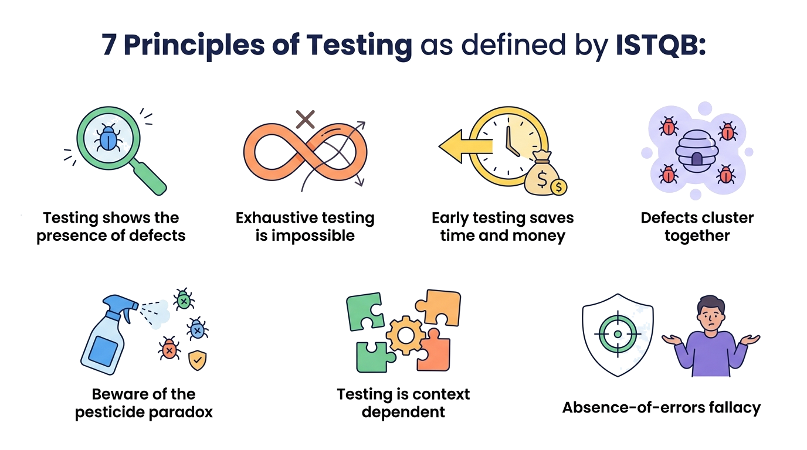
</div>

<!--
這張視覺化全景圖並列統整了 ISTQB 的七大測試原則，幫助我們在規劃測試策略時建立宏觀視角。

難字與專業術語解說：
- quality assurance (QA): 軟體品質保證（確保軟體開發流程與最終產出物達到預期品質水準的系統化工程）
-->
---
## 原則 1：測試顯示缺陷的存在，而非不存在

<div class="split64">
<div class="left">

* **核心意涵（Dijkstra 1970 經典公理）：**
  - 測試可以證明<strong>缺陷確實存在</strong>，但無論通過多少萬筆測試，都<strong>永遠無法從數學上證明系統已無殘留缺陷</strong>。
  - 通過 1,000 個單元測試，僅證明系統在這 1,000 組特定輸入狀態與環境組態下運作正常。
* **測試真正的工程目標：**
  - 否證優於印證 (Falsification over Verification)：設計具<strong>對抗性的測試案例</strong>以打破既有假設、降低線上殘留風險，並提供量化的發布信心。
* **[AI 時代警示] 流暢性偏誤陷阱 (Fluency Bias Trap)：**
  - AI 生成的程式碼語法乾淨、排版工整，極易營造出「邏輯完全正確」的危險幻覺。
  - 然而 LLM 產出的程式碼常暗藏並行競爭條件 (Race Conditions)、記憶體洩漏或差一 (Off-by-one) 邊界錯誤——Happy Path 全綠燈絕不保證零缺陷！

</div>
<div class="right">

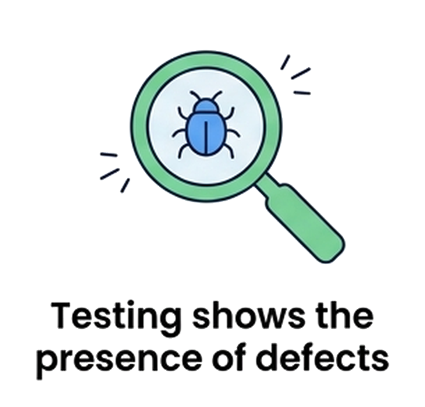

</div>
</div>

<!--
原則 1 直接呼應了 Dijkstra 的經典公理：測試只能顯示缺陷的存在，永遠無法證明缺陷不存在。特別在 AI 輔助開發時代，工程師更要警惕流暢性偏誤。

難字與專業術語解說：
- fluency bias: 流暢性偏誤（因 AI 生成的文字或程式碼表面流暢工整，而誤以為其內部邏輯完全正確的認知偏誤）
-->
---
<!-- _class: title-image-slide -->

## 視覺化圖解：原則 1 —— 測試顯示缺陷的存在

<div class="image-wrapper">
  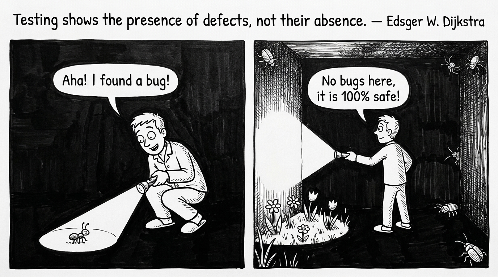
</div>

<!--
拿手電筒照亮客廳並抓到三隻蟲，證明屋子裡確實有蟲；但在客廳沒照到蟲，絕不代表廚房牆壁後面沒有躲著上百隻蟲！

難字與專業術語解說：
- latent defect: 潛伏缺陷（已存在於程式碼中，但尚未被特定輸入或環境狀態觸發顯現的隱藏錯誤）
-->
---
## 原則 2：窮盡測試是不可能的 (Exhaustive Testing is Impossible)

<div class="split64">
<div class="left">

* **組合爆炸的殘酷現實：**
  - 一個擁有 100 個布林旗標的程式具備 2<sup>100</sup> ≈ 1.27 × 10<sup>30</sup> 種狀態；即便只是 10 個欄位、各 10 種選項的結帳表單，也有 10<sup>10</sup> 種組合——就算每秒執行 10<sup>9</sup> 次測試也無法窮盡。
* **錯誤總是躲在角落（為何盲目隨機測試會失敗）：**
  ```java
  int scale(int j) {
      j = j - 1; // 缺陷！規格要求應為：j = j + 1
      j = j / 3000;
      return j;
  }
  ```
  - 在 65,536 個 16 位元整數中，`j - 1` 與 `j + 1` 經過整數除法 `/ 3000` 截斷後，僅在 `3000` 的倍數附近才會產生差異（僅有 <strong>18 個角落數值</strong>）！
  - **盲目隨機命中機率** = `18 / 65536 ≈ 0.027%` → 工程解方：以<strong>等價分割法 (EP)、邊界值分析 (BVA) 與成對組合取樣 (Pairwise)</strong> 取代蠻力測試！

</div>
<div class="right">

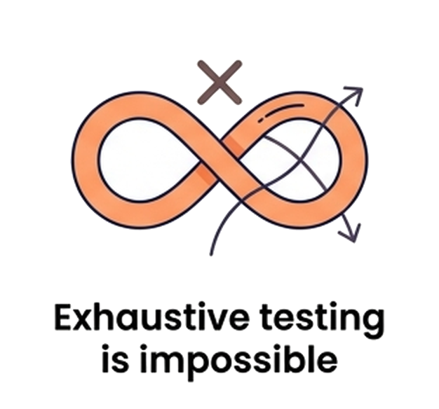

</div>
</div>

<!--
在 `scale(int j)` 範例中，跨越 65,536 個 16 位元整數，只有 18 個角落輸入能揭露 `j - 1` 與 `j + 1` 的差異——盲目隨機測試只有 0.027% 的機率能抓到這個 Bug！

難字與專業術語解說：
- integer truncation: 整數截斷（整數除法自動捨棄小數餘數，常導致非邊界區間的計算錯誤被掩蓋）
-->
---
## 原則 3：及早測試／測試左移（1:10:100 品質成本定律）

<div class="split64">
<div class="left">

* **核心意涵（驗證左移 Shift-Left Verification）：**
  - 靜態與動態驗證都必須在<strong>軟體開發生命週期 (SDLC) 的最早階段（需求與架構設計）</strong>啟動——在寫下第一行正式程式碼之前，就先撰寫驗收準則並審查設計模型。
* **經濟學依據（Boehm 的 `1 : 10 : 100` 成本攀升定律）：**
  - 在 SRS 需求審查階段抓出邏輯矛盾：<strong>\$1</strong>（只需修改規格書中的一句話）。
  - 在開發者單元測試／TDD 階段抓出缺陷：<strong>\$10</strong>（改寫局部方法並重跑 CI）。
  - 在軟體正式上線後修復生產環境故障：<strong>\$100 至 \$1,000+</strong>（緊急熱修復 Hotfix、資料庫遷移、SLA 違約賠償與客戶流失）！
* **具體的測試左移實踐：**
  - Fagan SRS／設計模型檢視、測試驅動開發 (TDD)，以及在每次 Pull Request 強制執行的自動化靜態分析／SAST 品質閘門。

</div>
<div class="right">


</div>
</div>

<!--
原則 3 是測試左移 (Shift-Left) 的經濟學基石：在規格審查階段抓出一個含糊矛盾的需求只需花費 1 美元，但若等到正式上線後才爆發，修復與賠償成本將飆升至 100 到 1,000 美元以上。

難字與專業術語解說：
- cost escalation: 成本急遽攀升（缺陷越晚在開發生命週期中被發現，其修復與連帶賠償成本呈指數倍增）
-->
---
<!-- _class: title-image-slide -->

## 測試左移的經濟學實證：缺陷修復成本曲線

<div class="image-wrapper">
  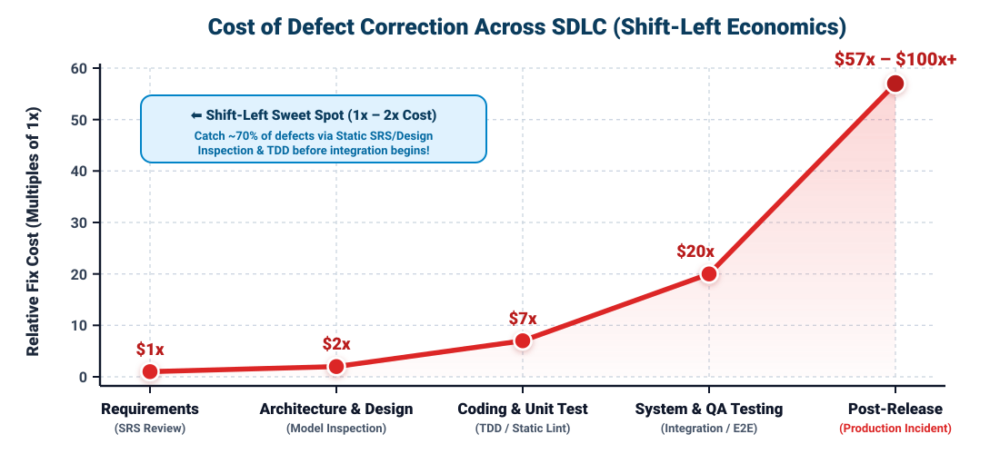
</div>

<!--
這條指數成長曲線說明了為何現代 DevSecOps 流水線會在軟體開發生命週期左半部投入大量資源進行靜態檢視、需求審查與自動化單元測試。

難字與專業術語解說：
- exponential growth curve: 指數成長曲線（隨著軟體進入整合、系統測試與正式營運，修復單一缺陷的成本呈倍數跳升）
-->
---
## 原則 4：缺陷群聚效應（80/20 柏拉圖法則）

<div class="split64">
<div class="left">

* **核心意涵（80/20 柏拉圖分佈）：**
  - 實證研究（IBM、NASA、Microsoft）顯示，**約 80% 的正式環境缺陷與當機事故，高度集中在約 20% 的原始碼模組中**。
* **為何缺陷會群聚於熱區模組 (Hotspot Modules)？**
  - 過高的圈複雜度與認知複雜度（`CC > 15`）、歷史遺留的「上帝類別 (God Classes)」、頻繁的需求變更、共享可變狀態，或脆弱的第三方外部整合。
* **基於風險的資源配置策略：**
  - 切勿將寶貴的測試火力平均且稀薄地分散在簡單的 getter/setter 類別上！
  - 結合 **Git 提交異動率 (Commit Churn) + 歷史缺陷密度 + 複雜度指標**鎖定高風險熱區，將 **Fagan 正式檢視、MC/DC 與 PITest 變異測試**集中火力投入這關鍵 20% 的核心模組！

</div>
<div class="right">

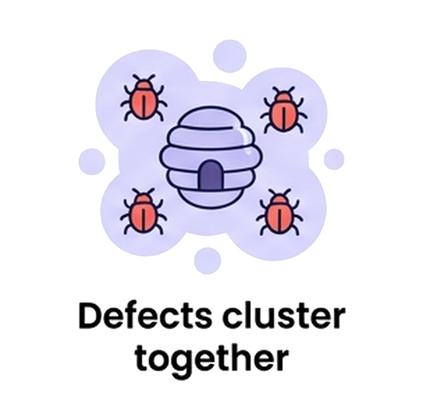

</div>
</div>

<!--
原則 4 提醒我們缺陷絕不會均勻分佈：當你在某個複雜的金流模組抓到 10 個 Bug 時，絕不代表該模組已經乾淨了，反而預示著裡面很可能還潛伏著另外 20 個深層缺陷。

難字與專業術語解說：
- defect hotspot: 缺陷熱區（高圈複雜度、頻繁修改且歷史錯誤密集的高風險程式碼模組）
-->
---
## 原則 5：謹防殺蟲劑悖論 (Beware of the Pesticide Paradox)

<div class="split64">
<div class="left">

* **核心意涵（Boris Beizer 1990 經典隱喻）：**
  - 日復一日噴灑同一種農藥，會篩選出具抗藥性的超級害蟲；**在每次建置中反覆執行完全相同的靜態測試套件，終將不再發現任何新缺陷**。
  - 舊測試案例作為<strong>回歸安全網 (Regression Safety Net)</strong> 依然深具價值，但對於演進後之新業務邏輯的抓錯率會趨近於零。
* **工程反制對策：**
  - 定期使用<strong>變異測試 (PITest)</strong> 稽核測試套件的抓錯力、淘汰冗餘測試，並導入<strong>屬性基礎測試 (`jqwik`)</strong> 在每次執行時以全新隨機測資轟炸系統。
* **[AI 時代警示] 自我印證的假綠燈 (Self-Confirming False Green Lights)：**
  - 若要求<strong>同一個 LLM 上下文</strong>同時撰寫正式程式碼與單元測試，AI 會將相同的幻覺與邊界盲點編碼進測試斷言中——務必採用獨立、規格導向的測試預言機！

</div>
<div class="right">

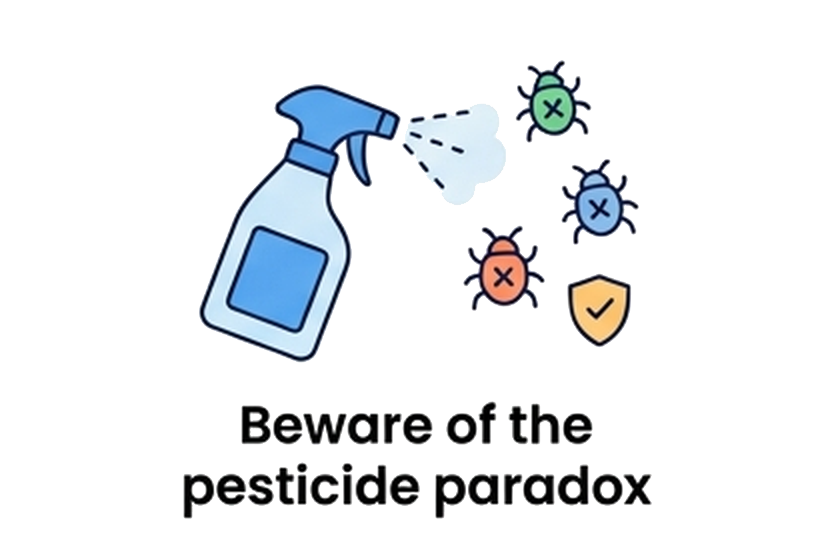

</div>
</div>

<!--
一旦開發者修掉了初始測試套件抓出的錯誤，該靜態測試套件就轉化為「回歸安全網」——它能防止舊錯誤死灰復燃，卻無法在尚未覆蓋的邏輯盲區中發現新缺陷。

難字與專業術語解說：
- self-confirming bias: 自我印證偏誤（由同一思維或同一 AI 上下文同時產出程式碼與測試，導致測試斷言完全順應錯誤實作）
-->
---
<!-- _class: title-image-slide -->

## 視覺化圖解：原則 5 —— 殺蟲劑悖論

<div class="image-wrapper">
  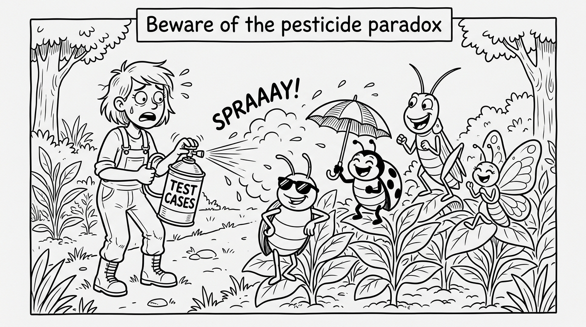
</div>

<!--
害蟲會演化並繞過固定、可預測的陷阱。持續演進測試案例——並導入生成式屬性基礎測試與變異測試——才能讓我們的品質防線保持敏銳。

難字與專業術語解說：
- test suite stagnation: 測試套件僵化（測試案例長期未隨業務與架構演進更新，導致抓錯能力退化）
-->
---
## 原則 6：測試依賴於情境 & 原則 7：無錯謬誤

<div class="split64">
<div class="left">

* **原則 6 —— 測試依賴於情境 (Testing is Context Dependent)：**
  - **安全關鍵航太飛控／醫療器材：** 強制要求遵循 DO-178C Level A 標準、100% MC/DC 結構覆蓋率、形式化驗證與硬體在環 (HIL) 測試。
  - **敏捷電商 Web 應用系統：** 優先注重快速 CI/CD 單元測試、API 契約測試 (Pact)、高並行負載壓測與 A/B 可用性實驗。
* **原則 7 —— 無錯謬誤 (Absence-of-Errors is a Fallacy)：**
  - <strong>「零 Bug」≠「成功的系統」：</strong>即使找出並修復了 100% 的程式錯誤，若軟體<strong>未能解決客戶真實的業務痛點</strong>或違反領域法規，依然毫無價值。
  - **[AI 時代警示]：** LLM 可以產出編譯完全通過、單元測試 100% 綠燈的程式碼，卻實作了已經過時或違法的商業計費公式！

</div>
<div class="right">

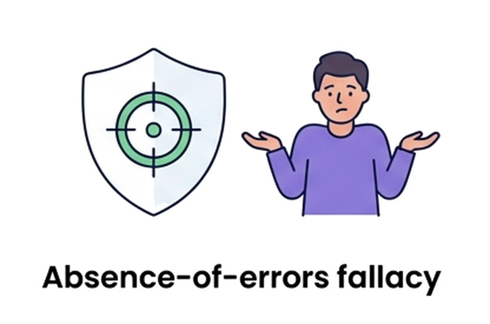

</div>
</div>

<!--
原則 6 與原則 7 提醒我們：測試嚴謹度必須依據領域風險量身裁適，且絕不可將「零技術當機」與「真正的客戶業務價值」混為一談。

難字與專業術語解說：
- absence-of-errors fallacy: 無錯謬誤（誤以為只要消除所有程式錯誤，軟體就必然能獲得使用者與商業成功）
-->
---
## 多維度測試分類體系 (1)：驗證 (Verification) vs. 確認 (Validation)

<div class="card-deck">

> Barry Boehm 的經典辨析：驗證 (Verification) 追問*「我們是否正確地建造產品？」*，而確認 (Validation) 追問*「我們是否建造了正確的產品？」*

<div class="two-columns">
<div class="card" data-marpit-fragment>

### 驗證 (Verification) —— 製程與規格合規導向
- **核心叩問：** *「Are we building the product right?（我們是否正確地建造產品？）」*
- **檢驗焦點：** 確認各階段的軟體產出物嚴格符合上游規格書、架構藍圖與編碼規範。
- **核心技術：** 靜態程式碼審查、正式檢視、靜態分析 (PMD / SonarQube)、單元與整合測試。
- **典型失敗模式：** 程式碼針對一份已過時、不符合真實臨床或業務流程的舊規格書跑出 100% 測試綠燈。

</div>
<div class="card" data-marpit-fragment>

### 確認 (Validation) —— 產品與業務價值對齊
- **核心叩問：** *「Are we building the right product?（我們是否建造了正確的產品？）」*
- **檢驗焦點：** 確保部署後的軟體真正解決使用者痛點、契合實際營運環境並創造商業價值。
- **核心技術：** 使用者驗收測試 (UAT)、可用性測試、Beta 實地公測與客戶雛型審查。
- **典型失敗模式：** 過度工程化打造出一套技術完美無瑕，但使用者覺得難用或與真實工作無關的系統。

</div>
</div>
</div>

<!--
驗證 (Verification) 檢驗產出物是否符合規格書（把產品做對），而確認 (Validation) 檢驗最終產品是否契合真實的人類與商業需求（做對的產品）。

難字與專業術語解說：
- conformance to specification: 符合規格性（軟體實作與需求規格書、介面契約的一致程度）
-->
---
<!-- _class: title-image-slide -->

## 視覺化對照：驗證 (Verification) vs. 確認 (Validation)

<div class="image-wrapper">
  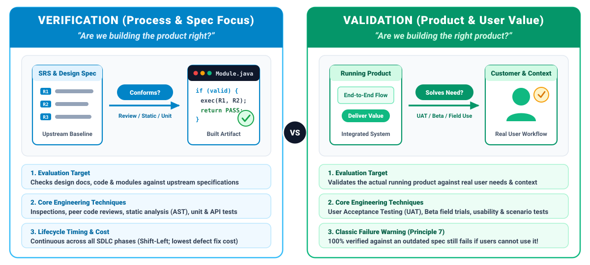
</div>

<!--
這張架構圖對比了驗證（逐階段核對產出物是否符合規格）與確認（核對最終產品是否滿足使用者的真實需求）。

難字與專業術語解說：
- user acceptance testing (UAT): 使用者驗收測試（由最終客戶或領域專家在擬真環境下確認系統是否符合交付標準的測試）
-->
---
## 多維度測試分類體系 (2)：缺失 vs. 確認測試 & 靜態 vs. 動態測試

<div class="card-deck">

> 高效能的品質保證結合了建設性思維（證明核心業務流程可用）與破壞性思維（獵捕潛伏缺陷），並同時運用靜態與動態技術。

<div class="two-columns">
<div class="card" data-marpit-fragment>

### 缺失測試 (Defect) vs. 確認測試 (Validation)
- **確認測試 (Validation Testing —— 印證可用性)：**
  - 核心心態：*「向客戶展示系統能正常運作。」*
  - 執行正常業務流程 (Happy Paths) 以確認預期功能符合需求。
- **缺失測試 (Defect Testing —— 破壞性獵捕)：**
  - 核心心態：*「搞壞系統以揭露隱藏弱點。」*
  - 轟炸極端邊界、注入畸形載荷 (Malformed Payloads)，並強制觸發異常狀態轉換。

</div>
<div class="card" data-marpit-fragment>

### 靜態測試 (Static) vs. 動態測試 (Dynamic)
- **靜態測試（不執行程式碼）：**
  - 透過同儕審查與 AST 抽象語法樹靜態分析器檢視需求、設計模型與原始碼。
  - 直接以極低成本精準定位產出物內部的根源<strong>缺陷 (Faults / Bugs)</strong>。
- **動態測試（實際執行程式）：**
  - 以具體測試資料執行編譯後的執行檔，並將實際輸出與預期預言機比對，以觀察執行期<strong>失效 (Failures)</strong>。

</div>
</div>
</div>

<!--
確認測試沿著正常路徑 (Happy Path) 證明系統可用，而缺失測試則採取對抗性思維在邊界角落擊潰系統。靜態測試在不執行程式碼下直接找出內部缺陷 (Faults)；動態測試則實際運行程式以觀察外顯失效 (Failures)。

難字與專業術語解說：
- fault vs. failure: 缺陷 (Fault/Bug) vs. 失效 (Failure)（靜態存在於程式碼中的邏輯錯誤稱為 Fault；程式執行時被觸發而外顯的異常結果稱為 Failure）
-->
---
<!-- _class: title-image-slide -->

## 多維度測試分類體系 (3)：黑箱測試 vs. 白箱測試

<div class="image-wrapper">
  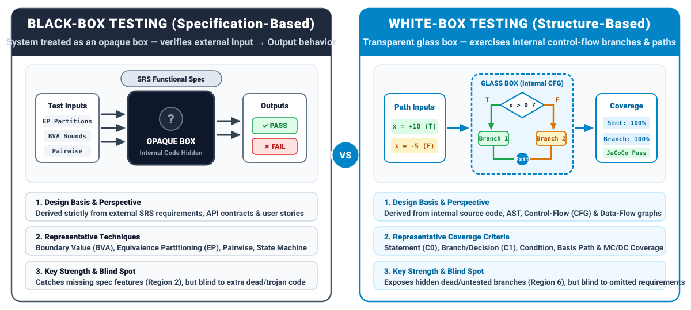
</div>

<!--
黑箱功能測試純粹從外部規格書推導測試案例，而白箱結構測試則深入檢視內部控制流程圖 (CFG)、邏輯分支與位元組碼執行路徑。

難字與專業術語解說：
- opaque box vs. glass box: 不透明黑盒 vs. 透明玻璃盒（對內部實作完全封裝隔離 vs. 針對內部邏輯分支透明檢視）
-->
---
## 多維度測試分類體系 (4)：三大核心測試層級與可測試性設計

<div class="card-deck">

> 軟體測試依粒度由小到大分為三個層級——而高<strong>可測試性 (Testability)</strong> 的關鍵在於將純商業運算邏輯與 UI 及外部 I/O 徹底解耦。

<div class="two-columns">
<div class="card" data-marpit-fragment>

### 三大核心測試層級
- **1. 單元測試 (Unit Testing —— 元件／類別層級)：**
  - 在與外部 I/O 嚴格隔離的狀態下驗證單一方法或類別；於數毫秒內執行完畢。
- **2. 整合測試 (Integration Testing —— 介面與契約層級)：**
  - 驗證跨模組或資料庫之間的介面契約、資料序列化與互動協定。
- **3. 系統測試 (System Testing —— 端到端環境層級)：**
  - 在擬真預備環境 (Staging) 中驗證完整端到端使用者旅程與非功能性品質（負載、壓力、資安）。

</div>
<div class="card" data-marpit-fragment>

### 可測試性設計（將業務邏輯與 I/O 解耦）
- 將核心商業運算與 UI 提示框及外部 I/O 分離，使單元測試能在 CI 中全自動高速執行：
```java
// 低可測試性：與互動式 UI 緊密耦合（會卡死 CI 流水線！）
double divBad(double x, double y) {
    while (y == 0) y = uiPrompt("Divisor != 0:");
    return x / y;
}

// 高可測試性：純函式 + 明確的例外契約
double divGood(double x, double y) {
    if (y == 0) throw new IllegalArgumentException("Divisor == 0");
    return x / y; // 透過 assertThrows 於 < 1ms 內完成自動化驗證！
}
```

</div>
</div>
</div>

<!--
測試依粒度推進分為三個明確層級：單元測試、整合測試與系統測試。良好的可測試性設計要求將純運算與外部 I/O 解耦。

難字與專業術語解說：
- granularity of testing: 測試粒度（從單一函式方法、跨模組介面到全系統端到端的檢驗範圍層次）
-->
---
<!-- _class: title-image-slide -->

## 三大核心測試層級之金字塔體系

<div class="image-wrapper">
  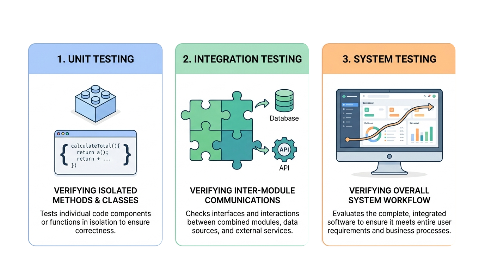
</div>

<!--
數十個隔離且高速的單元測試構成底層基石，向上支撐元件與整合測試，最終匯聚為全系統與驗收驗證。

難字與專業術語解說：
- test hierarchy: 測試層級體系（由底層單元測試逐層向上組裝至整合測試、系統測試與驗收測試的結構）
-->

---
## 測試案例設計：規格、實作與測試行為之三圓文氏圖

<div class="card-deck">

> 高保證軟體工程致力於讓<strong>規格行為 (Specification, S)</strong>、<strong>實作行為 (Implementation, P)</strong> 與<strong>測試驗證行為 (Test Suite, T)</strong> 三者達到最大重疊。

<div class="two-columns">
<div class="card" data-marpit-fragment>

### 三大核心行為集合
- **規格行為 (Specified Behavior, S)：**
  - 在 SRS 需求規格書中明確承諾的功能需求與限制條件。
- **實作行為 (Programmed Behavior, P)：**
  - 開發者實際編寫進入可執行檔中的程式行為。
- **已驗證行為 (Verified Behavior, T)：**
  - 自動化與人工測試案例實際執行並斷言檢驗的行為。

</div>
<div class="card" data-marpit-fragment>

### 關鍵交集與差集區域
- **區域 1 (S ∩ P ∩ T，黃金核心)：** 有規格定義、已實作且已通過測試驗證！
- **區域 2 (S \ P，遺漏實作)：** 規格有承諾，但開發者忘記撰寫程式碼。
- **區域 3 (P ∩ T \ S，鍍金功能 Gold-Plating)：** 未經規格核准卻自行編寫並測試的功能。
- **區域 6 (P \ (S ∪ T)，極度危險區！)：** <strong>未載明於規格且未受測試覆蓋的程式碼</strong>——木馬後門、幽靈邏輯或潛伏定時炸彈！

</div>
</div>
</div>

<!--
請特別留意區域 6 (Region 6)：已經存在於編譯後程式 P 中，卻從未在規格 S 中被要求，同時也從未被測試套件 T 觸及的幽靈程式碼。

難字與專業術語解說：
- ghost logic / backdoor: 幽靈邏輯／後門（存在於程式碼中但未載明於規格且未受測試監控的隱蔽行為）
-->
---
<!-- _class: title-image-slide -->

## 視覺化模型：軟體行為三圓文氏圖 (S, P, T)

<div class="image-wrapper">
  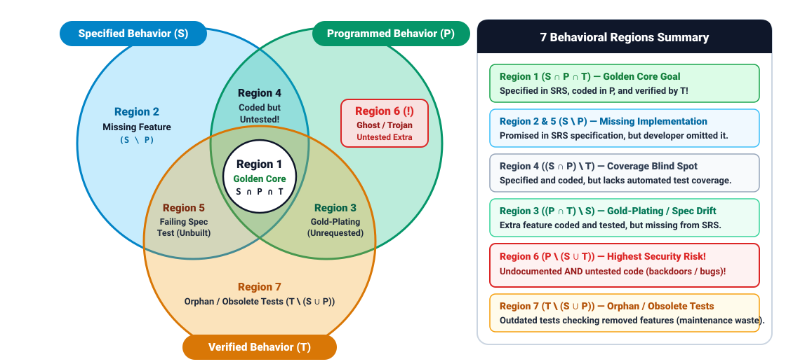
</div>

<!--
身為軟體工程師，我們的目標是極大化中央交集的區域 1，同時將區域 2、區域 4 以及最危險的區域 6 壓低至零。

難字與專業術語解說：
- set difference: 差集（例如 S \ P 代表規格有定義但程式未實作的遺漏需求集合）
-->
---
## 測試案例 (Test Case) vs. 測試資料 (Test Data) 與五大核心要件

<div class="card-deck">

> 「<strong>測試案例 (Test Case)</strong> 是驗證邏輯的架構靈魂；<strong>測試資料 (Test Data)</strong> 則是執行期代入的具體數值元組。」

<div class="two-columns">
<div class="card" data-marpit-fragment>

### 測試案例 vs. 測試資料
- **測試案例 (Test Case —— 邏輯規格)：**
  - 定義*要驗證何種情境*（例如：*「驗證除數為零時除法會拋出例外」*），獨立於具體數值之外。
- **測試資料 (Test Data —— 具體實例)：**
  - 餵入參數化測試 (`@ParameterizedTest`) 的具體參數元組 `(5, 0)`、`(-99, 0)`、模擬固具 (Mock Fixtures) 或資料庫種子資料。

</div>
<div class="card" data-marpit-fragment>

### 測試案例之五大標準組成要件
1. **測試編號與目標 (Test ID &amp; Objective)：** 唯一可追溯編號（如 `TC-AUTH-001`）與驗證目的。
2. **前置條件 (Preconditions)：** 必備初始狀態、授權權杖與資料庫固具 (`Arrange`)。
3. **測試輸入 (Test Inputs)：** 具體參數、API 載荷或使用者事件 (`Act`)。
4. **預期預言機 (Expected Oracle)：** 預期回傳值、HTTP 狀態碼或例外 (`Assert`)。
5. **後置條件 (Postconditions)：** 狀態不變量檢驗與環境清理還原 (`Teardown`)。

</div>
</div>
</div>

<!--
測試案例 (Test Case) 是包含五大核心要件的完整邏輯規格，而測試資料 (Test Data) 則是執行時實際代入的具體輸入數值元組。

難字與專業術語解說：
- test fixture: 測試固具／前置環境（為讓測試能穩定重複執行所預先準備的物件狀態、設定或資料庫初始資料）
-->
---
<!-- _class: title-image-slide -->

## 心智圖：測試案例 vs. 測試資料結構剖析

<div class="image-wrapper">
  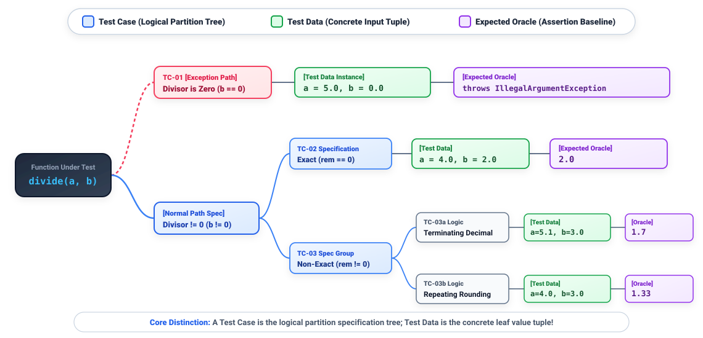
</div>

<!--
以 `divide(a, b)` 為例，測試案例依邏輯分割區間分支，而末梢葉節點則承載具體的測試資料數值元組。

難字與專業術語解說：
- parameterized execution: 參數化執行（以同一套測試邏輯骨架自動巡迴注入多組測試資料的機制）
-->

---
<!-- _class: full-image-slide -->

<div class="mm-3w2h-stage" id="mm-3w2h-root">
<div class="mm-root-col">
<div class="mm-root-card">
<div class="mm-root-badge">3W2H 測試分類體系</div>
<div class="mm-root-title">軟體測試全景地圖</div>
<div class="mm-root-sub">品質驗證的五大核心維度</div>
<div class="mm-root-actions">
<button type="button" class="mm-action-btn" id="mm-btn-toggle-all">➕ 全部展開</button>
<button type="button" class="mm-action-btn mm-btn-secondary" id="mm-btn-step" title="快捷鍵：按 'n' 鍵">▶ 下一個分支 (1/5) [n]</button>
</div>
</div>
</div>
<svg class="mm-fan-svg" viewBox="0 0 48 620" preserveAspectRatio="none">
<path d="M 0 310 C 24 310, 20 55, 48 55" fill="none" stroke="#3b82f6" stroke-width="2.8" />
<path d="M 0 310 C 22 310, 22 182, 48 182" fill="none" stroke="#10b981" stroke-width="2.8" />
<path d="M 0 310 L 48 310" fill="none" stroke="#f59e0b" stroke-width="2.8" />
<path d="M 0 310 C 22 310, 22 438, 48 438" fill="none" stroke="#8b5cf6" stroke-width="2.8" />
<path d="M 0 310 C 24 310, 20 565, 48 565" fill="none" stroke="#f43f5e" stroke-width="2.8" />
</svg>
<div class="mm-branches-col">
<div class="mm-branch-row mm-b1 is-collapsed" data-branch-idx="0">
<div class="mm-dim-node" title="點擊展開／收合">
<div class="mm-dim-header">
<span class="mm-dim-tag">DIMENSION 1</span>
<span class="mm-toggle-pill">+</span>
</div>
<div class="mm-dim-title">1. WHO 誰來測試？</div>
<div class="mm-dim-sub">角色分工、獨立性與 Alpha/Beta</div>
</div>
<div class="mm-leaf-bridge"></div>
<div class="mm-leaves-grid">
<div class="mm-leaf-card">
<div class="mm-leaf-title">開發工程師 (Developers)</div>
<div class="mm-leaf-desc"><strong>單元測試與 TDD</strong>；在編碼階段落實白箱分支與契約防禦。</div>
</div>
<div class="mm-leaf-card">
<div class="mm-leaf-title">同儕與專職 QA 團隊</div>
<div class="mm-leaf-desc">程式碼檢視、CI 自動化、負載壓測與 <strong>Alpha 測試</strong>（內部預備環境）。</div>
</div>
<div class="mm-leaf-card">
<div class="mm-leaf-title">領域專家與終端使用者</div>
<div class="mm-leaf-desc">產品負責人執行業務 <strong>UAT 驗收</strong>，以及外部客戶進行真實環境 <strong>Beta 公測</strong>。</div>
</div>
</div>
</div>
<div class="mm-branch-row mm-b2 is-collapsed" data-branch-idx="1">
<div class="mm-dim-node" title="點擊展開／收合">
<div class="mm-dim-header">
<span class="mm-dim-tag">DIMENSION 2</span>
<span class="mm-toggle-pill">+</span>
</div>
<div class="mm-dim-title">2. WHAT 測試什麼？</div>
<div class="mm-dim-sub">功能邏輯、結構路徑與品質屬性</div>
</div>
<div class="mm-leaf-bridge"></div>
<div class="mm-leaves-grid">
<div class="mm-leaf-card">
<div class="mm-leaf-title">功能邏輯（黑箱測試）</div>
<div class="mm-leaf-desc">SRS 業務規則、<strong>EP 等價分割</strong>、<strong>BVA 邊界值</strong>與決策表。</div>
</div>
<div class="mm-leaf-card">
<div class="mm-leaf-title">結構路徑（白箱測試）</div>
<div class="mm-leaf-desc">內部 CFG 之<strong>敘述 (SC)</strong>、<strong>分支 (BC)</strong>、路徑與航太級 <strong>MC/DC</strong> 覆蓋率。</div>
</div>
<div class="mm-leaf-card">
<div class="mm-leaf-title">情境與非功能性品質</div>
<div class="mm-leaf-desc">端到端使用者旅程、高並行負載／壓力測試與 <strong>OWASP 資安</strong>閘門。</div>
</div>
</div>
</div>
<div class="mm-branch-row mm-b3 is-collapsed" data-branch-idx="2">
<div class="mm-dim-node" title="點擊展開／收合">
<div class="mm-dim-header">
<span class="mm-dim-tag">DIMENSION 3</span>
<span class="mm-toggle-pill">+</span>
</div>
<div class="mm-dim-title">3. WHY 為何測試？</div>
<div class="mm-dim-sub">風險緩解、契約防禦與 CI 信心</div>
</div>
<div class="mm-leaf-bridge"></div>
<div class="mm-leaves-grid">
<div class="mm-leaf-card">
<div class="mm-leaf-title">風險緩解 (Risk Mitigation)</div>
<div class="mm-leaf-desc">大幅降低正式環境故障發生機率與業務衝擊半徑。</div>
</div>
<div class="mm-leaf-card">
<div class="mm-leaf-title">契約與不變量防禦</div>
<div class="mm-leaf-desc">強制落實契約式設計 (DbC) 之前置條件、後置條件與類別不變量。</div>
</div>
<div class="mm-leaf-card">
<div class="mm-leaf-title">回歸測試安全網</div>
<div class="mm-leaf-desc">確保重構或新提交的程式碼絕不破壞既有的正式環境功能。</div>
</div>
</div>
</div>
<div class="mm-branch-row mm-b4 is-collapsed" data-branch-idx="3">
<div class="mm-dim-node" title="點擊展開／收合">
<div class="mm-dim-header">
<span class="mm-dim-tag">DIMENSION 4</span>
<span class="mm-toggle-pill">+</span>
</div>
<div class="mm-dim-title">4. HOW 如何執行？</div>
<div class="mm-dim-sub">腳本自動化、探索式與模糊測試</div>
</div>
<div class="mm-leaf-bridge"></div>
<div class="mm-leaves-grid">
<div class="mm-leaf-card">
<div class="mm-leaf-title">腳本化 CI/CD 自動化</div>
<div class="mm-leaf-desc">每次 Git 推送時自動執行的確定性 <strong>JUnit 5 / Playwright</strong> 測試套件。</div>
</div>
<div class="mm-leaf-card">
<div class="mm-leaf-title">探索式測試 (Exploratory)</div>
<div class="mm-leaf-desc">由領域專家同步進行系統學習、測試設計與對抗性探測。</div>
</div>
<div class="mm-leaf-card">
<div class="mm-leaf-title">模糊測試與錄製回放</div>
<div class="mm-leaf-desc">隨機／突變載荷轟炸 (Fuzzing) 與捕捉真實 UI 互動軌跡 (Record/Replay)。</div>
</div>
</div>
</div>
<div class="mm-branch-row mm-b5 is-collapsed" data-branch-idx="4">
<div class="mm-dim-node" title="點擊展開／收合">
<div class="mm-dim-header">
<span class="mm-dim-tag">DIMENSION 5</span>
<span class="mm-toggle-pill">+</span>
</div>
<div class="mm-dim-title">5. HOW 如何評估判定？</div>
<div class="mm-dim-sub">測試預言機與覆蓋率度量</div>
</div>
<div class="mm-leaf-bridge"></div>
<div class="mm-leaves-grid">
<div class="mm-leaf-card">
<div class="mm-leaf-title">測試預言機比對器</div>
<div class="mm-leaf-desc">比對受測程式實際輸出 (<code>Actual y</code>) 與預言機預期輸出 (<code>Expected y*</code>)。</div>
</div>
<div class="mm-leaf-card">
<div class="mm-leaf-title">測試預言機難題 (Oracle Problem)</div>
<div class="mm-leaf-desc">生成式 AI、搜尋引擎與複雜科學模擬缺乏單一精確標準答案。</div>
</div>
<div class="mm-leaf-card">
<div class="mm-leaf-title">次世代 AI／變質預言機</div>
<div class="mm-leaf-desc">透過<strong>變質關係 (MR)</strong>、<strong>差分測試</strong>與 <strong>LLM 裁判 (LLM Judge)</strong> 突破困境。</div>
</div>
</div>
</div>
</div>
</div>

<!--
在 SQA 第 3.5 節中，我們透過這張互動式 3W2H 心智圖統整整個軟體測試宇宙：
1. **Who 誰來測試？** 開發者（單元測試／TDD）、同儕與專職 QA（檢視、CI、內部 Alpha 測試），以及領域專家與客戶（UAT 驗收與真實環境 Beta 公測）。
2. **What 測試什麼？** 功能邏輯、白箱結構路徑、端到端業務情境與非功能性品質屬性。
3. **Why 為何測試？** 風險緩解、契約與不變量防禦，以及 CI/CD 中的持續回歸安全網。
4. **How 如何執行？** 腳本化 CI/CD 自動化、探索式探測、隨機模糊測試 (Fuzzing) 與錄製回放 (Record-and-Replay) 流程。
5. **How 如何評估判定？** 測試預言機（比對實際與預期結果）以及結構與變異覆蓋率度量。

難字與專業術語解說：
- 3W2H testing taxonomy: 3W2H 測試全景分類法（從 Who、What、Why、How 與 How to Evaluate 五大維度剖析測試體系）
- Alpha vs. Beta testing: Alpha 內部測試 vs. Beta 外部公測（在內部受控環境進行的測試 vs. 釋出予外部真實使用者在真實環境進行的公測）
- Record & Replay testing: 錄製與回放測試（記錄使用者在介面上的真實點擊與輸入軌跡，自動轉化為可重複執行之自動化測試腳本的技術）
-->
---
<!-- _class: title-image-slide -->

## 3W2H 深度剖析：誰來測試 (維度 1) & 如何執行 (維度 4)

<div class="image-wrapper">
  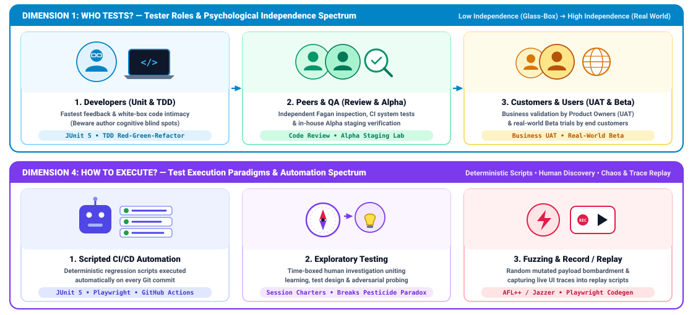
</div>

<!--
這張六宮格架構對照圖深入放大了 3W2H 心智圖中的維度 1（誰來測試？）與維度 4（如何執行？）：
- 第一列沿著「心理獨立性光譜」對比三種測試角色：
  1. 開發工程師（單元測試與 TDD）：回饋迴圈最快、對程式碼最熟悉，但心理獨立性最低（易有作者盲點）。
  2. 同儕與專職 QA（程式碼審查、整合與 Alpha 測試）：具備對抗性破防思維與受控的內部預備環境模擬。
  3. 客戶與終端使用者（UAT 驗收與 Beta 公測）：在真實且不可預測的客戶作業環境中進行商業價值確認與外部 Beta 實測。
- 第二列對比三種測試執行典範：
  4. 腳本化 CI/CD 自動化：每次提交時執行的確定性 JUnit 5 / Playwright 回歸檢查。
  5. 探索式測試：以時間盒 (Time-boxed) 任務章程同步結合系統學習、測試設計與對抗性探測，打破殺蟲劑悖論。
  6. 模糊測試與錄製回放：自動化突變載荷轟炸 (AFL++ / Jazzer) 以及捕捉真實使用者操作軌跡轉為可回放腳本。
-->
---
## 如何評估判定：測試預言機 (Test Oracles) 與預言機難題

<div class="card-deck">

> 每一個測試都必須仰賴<strong>測試預言機 (Test Oracle)</strong> 來判定通過或失敗——然而在複雜科學模擬、搜尋引擎與生成式 AI 中，幾乎不可能預先得知單一精確的標準答案。

<div class="two-columns">
<div class="card" data-marpit-fragment>

### 1. 什麼是測試預言機 (Test Oracle)？
- **地面真值判定機制 (Ground-Truth Mechanism)：**
  - 用以判定受測程式 (`PUT`) 針對特定輸入是否產出<strong>正確輸出</strong>的基準權威（如 SRS 規格公式、參考模型或不變量）。
- **測試預言機比對器架構：**
  - 將相同的測試輸入同時餵給<strong>受測程式 (`PUT`)</strong>（產出 `實際輸出 y`）與<strong>測試預言機</strong>（產出 `預期輸出 y*`）。
  - 比對器斷言檢驗 `Actual == Expected`（`吻合 → PASS`，`不吻合 → FAIL`）。

</div>
<div class="card" data-marpit-fragment>

### 2. 測試預言機難題 (The Test Oracle Problem)
- **傳統確定性軟體：**
  - `f(x) → y`（例如稅額計算或排序）擁有精確且可重現的預期值 (`assertEquals(expected, actual)`)。
- **AI / LLM 與複雜非確定性系統：**
  - 隨機取樣 (`Temperature > 0`)、自駕車視覺感知與開放式自然語言問答，<strong>不存在唯一的標準正確字串</strong>。
  - 傳統寫死的 `assertEquals` 在此徹底失效！

</div>
</div>
</div>

<!--
每項測試都需要一個提供預期結果的「測試預言機 (Test Oracle)」，用以與程式的實際輸出進行比對。但在複雜科學模擬、搜尋引擎與生成式 AI 中，預先得知單一輸入的精確標準答案往往是不可能的——這就是著名的「測試預言機難題 (Test Oracle Problem)」。

難字與專業術語解說：
- Test Oracle Problem: 測試預言機難題（在複雜科學計算、搜尋推薦或生成式 AI 系統中，極難甚至無法預先得知單一輸入之標準正確答案的困境）
-->
---
## 突破測試預言機難題：變質測試、差分測試與 LLM 裁判

<div class="card-deck">

> 當不存在單一標準答案時，我們改為驗證<strong>跨輸入轉換不變量</strong>、<strong>多模型共識對照</strong>以及<strong>結構化評分規準 (Rubric)</strong>。

<div class="two-columns">
<div class="card" data-marpit-fragment>

### 1. 變質測試 (Metamorphic Testing, MT)
- **驗證輸入與輸出間的轉換關係 (`x → x'`)：**
  - 即使不知道 `f(x)` 的精確標準答案，對輸入施加受控轉換 `x → x'` 後，前後輸出 `f(x)` 與 `f(x')` 之間必須滿足特定的<strong>變質關係 (Metamorphic Relation, MR)</strong>！
- **具體領域實例：**
  - **自動駕駛視覺：** 將行人影像旋轉 `5°` 或加入雨滴雜訊，系統依然必須偵測出該名行人。
  - **搜尋引擎：** 搜尋 `"TSMC AND revenue"` 的結果集合，必須是搜尋 `"TSMC"` 結果集合的嚴格子集 (`⊆`)。
  - **最短路徑導航：** 將所有道路權重加倍 (`× 2`)，計算出的最佳路線節點序列必須完全不變。

</div>
<div class="card" data-marpit-fragment>

### 2. 差分測試與 LLM 裁判 (LLM-as-a-Judge)
- **差分測試 (Differential Testing —— 跨實作對照)：**
  - 將完全相同的輸入餵給多個獨立實作版本（例如 `GCC` vs. `Clang`、舊版引擎 vs. 重構後新引擎、`Claude` vs. `GPT`）。
  - 一旦輸出出現顯著分歧，立即標記潛在缺陷或未定義邊界行為。
- **LLM 裁判 (LLM-as-a-Judge) 與安全護欄：**
  - 依據結構化評分規準 (Rubrics) 評估生成式輸出：
    1. **忠實度 (Faithfulness)：** 嚴格立基於 RAG 檢索上下文（零幻覺）。
    2. **回答切題度 (Answer Relevance)：** 直接回應使用者真實意圖。
    3. **安全護欄 (Safety Guardrails)：** 零提示詞注入或有害資訊洩漏。

</div>
</div>
</div>

<!--
變質測試 (MT) 檢驗輸入轉換前後的不變關係，差分測試 (Differential Testing) 比對多個獨立實作的輸出分歧，而 LLM 裁判 (LLM-as-a-Judge) 則依據結構化評分規準檢驗生成式 AI 的輸出品質。

難字與專業術語解說：
- differential testing: 差分測試（將相同測試輸入同時餵給多個獨立實作版本，藉由比對輸出差異來自動揭露異常的技術）
-->
---
<!-- _class: title-image-slide -->

## 測試預言機與現代評估判定架構：六大核心典範

<div class="image-wrapper">
  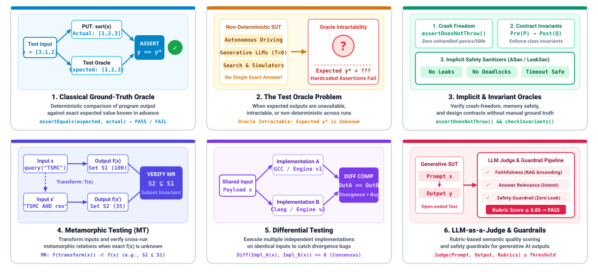
</div>

<!--
這張概念圖統整了測試評估判定的六大核心支柱：

第一列建立基準困境：
1. 傳統地面真值預言機 (Classical Ground-Truth Oracle)：透過 `assertEquals` 將程式實際輸出與預先計算的精確預期結果比對。
2. 測試預言機難題 (The Test Oracle Problem)：當預期輸出無法取得、連續變化或具隨機性（AI、模擬器、搜尋引擎）時，傳統斷言為何徹底失效。
3. 隱式與不變量預言機 (Implicit & Invariant Oracles)：無須人工撰寫標準答案，直接驗證零崩潰 (`assertDoesNotThrow`)、契約不變量與記憶體安全。

第二列展現現代突破策略：
4. 變質測試 (Metamorphic Testing, MT)：跨多次測試執行驗證輸入轉換不變量 (`f(T(x)) R f(x)`)。
5. 差分測試 (Differential Testing)：將相同測試輸入餵入多個獨立實作版本以偵測分歧錯誤。
6. LLM 裁判與安全護欄 (LLM-as-a-Judge & Guardrails)：針對生成式 AI 輸出進行忠實度、切題度與安全性的語意規準評分。

難字與專業術語解說：
- test evaluation: 測試評估判定（判定程式執行結果為 PASS 還是 FAIL 的決策機制）
- ground truth: 地面真值／基準事實（判定程式輸出是否正確的標準權威答案）
- relational invariant: 關聯不變量（輸入經特定轉換後，多次輸出之間必須恆常保持的數學關係）
-->
---
<!-- id: ase-ch07-ccq1 -->
## 概念核對問答 1：軟體測試核心原則

<div class="ccq-columns">
<div class="ccq-text">

依據 Dijkstra 的軟體測試基本公理與測試左移 (Shift-Left) 原則，軟體測試的主要能力邊界與最佳經濟時機為何？

- **A.** 在需求分析階段及早執行測試，即可從數學上嚴格證明系統已完全不存在任何潛伏的程式缺陷。
- **B.** 測試能證明缺陷存在但永遠無法證明其不存在，且越早在開發初期發現缺陷，修復成本就越低廉。
- **C.** 只要在持續整合流水線中不間斷執行自動化回歸測試，就能保證所有模組達到百分百敘述覆蓋率。
- **D.** 藉由徹底消除正式環境程式碼中的缺陷群聚效應，自動化測試即可完全取代客戶端的使用者驗收測試。

</div>
<div class="ccq-logo">
  <a href="https://nlhsueh.github.io/nickedupocket/#/student/ase-ch07-ccq1" target="_blank"></a>
</div>
</div>

<!--
讓我們暫停一下，進行概念核對問答 1，檢驗大家對軟體測試核心原則的掌握。
-->

---
## 概念核對問答 1：解答與解析

- **正確答案：B**
- **詳細解析：**
  - Edsger Dijkstra 的經典公理明確指出：*「程式測試只能用來證明錯誤的存在，永遠無法證明錯誤的不存在！」*測試能提供缺陷存在的實證，但無法從數學上證明零缺陷。
  - 測試左移 (Shift-Left) 原則強調在需求與設計階段即早介入驗證，因為在早期解決缺陷的成本比正式上線後再修復低上 10 倍至 100 倍。
  - *其他選項錯誤原因：* 選項 A 違背了 Dijkstra 公理；選項 C 將結構敘述覆蓋率與功能零缺陷混為一談；選項 D 錯誤，因為自動化測試永遠無法取代客戶端的商業價值確認（原則 7：無錯謬誤）。

<!--
正確答案為 **B**。
-->
---
## 🧩 7.1 自我練習：進階測試基礎、V&V 與預言機挑戰

<div class="sp-quiz-stage" id="sp-quiz-71">
<div class="sp-mixed-grid">
<div class="sp-mixed-col">
<div class="sp-mc-card" data-ans="C">
<div class="sp-mc-stem">1. [單選題 — 25 分] 在三圓行為文氏圖中（<code>S</code> = 規格、<code>P</code> = 程式碼、<code>T</code> = 測試），某工程師刪除了一個未受測試的舊輔助函式。編譯順利通過且既有測試 100% 綠燈，但正式環境卻因某個未載明於文件的舊 API 呼叫而當機。該被刪除的程式碼原本位於哪個文氏圖區域？</div>
<div class="sp-mc-opts">
<div class="sp-mc-opt" data-opt="A"><strong>A.</strong> 區域 2：<code>(S ∩ P) \ T</code>（有規格且已實作，但未測試）</div>
<div class="sp-mc-opt" data-opt="B"><strong>B.</strong> 區域 4：<code>(S ∩ T) \ P</code>（有規格且已測試，但未實作）</div>
<div class="sp-mc-opt" data-opt="C"><strong>C.</strong> 區域 6：<code>P \ (S ∪ T)</code>（未載明於規格且未測試之幽靈程式碼）</div>
<div class="sp-mc-opt" data-opt="D"><strong>D.</strong> 區域 7：<code>T \ (S ∪ P)</code>（過時或幻覺產生的孤兒測試）</div>
</div>
</div>
<div class="sp-mc-card" data-ans="B">
<div class="sp-mc-stem">2. [單選題 — 25 分] 某自動煞車控制器針對 SRS 規格公式通過了 100% MC/DC 單元測試，並在乾燥賽道實測通過。然而 SRS 遺漏了結冰路面摩擦係數物理公式，導致冬季打滑。下列何者正確診斷了其缺陷鏈與 V&amp;V 狀態？</div>
<div class="sp-mc-opts">
<div class="sp-mc-opt" data-opt="A"><strong>A.</strong> 驗證 (Verification) 失敗；結冰打滑是缺陷 (Fault)，而遺漏的 SRS 公式是失效 (Failure)</div>
<div class="sp-mc-opt" data-opt="B"><strong>B.</strong> 驗證 (Verification) 成功但確認 (Validation) 失敗；工程師疏忽是人為錯誤 (Error)，SRS 遺漏分支是缺陷 (Fault)，打滑則是失效 (Failure)</div>
<div class="sp-mc-opt" data-opt="C"><strong>C.</strong> 驗證與確認皆成功；結冰打滑屬於 IEEE 610.12 範圍外不可避免的硬體異常</div>
<div class="sp-mc-opt" data-opt="D"><strong>D.</strong> 確認 (Validation) 成功但驗證 (Verification) 失敗，因乾燥路面測試陷入殺蟲劑悖論</div>
</div>
</div>
</div>
<div class="sp-mixed-col">
<div class="sp-bank-bar">
<span class="sp-bank-label">[候選詞庫] 易混淆字彙庫（9 選 3）：</span>
<span class="sp-chip" data-word="驗證 (Verification)">驗證 (Verification)</span>
<span class="sp-chip" data-word="確認 (Validation)">確認 (Validation)</span>
<span class="sp-chip" data-word="殺蟲劑悖論 (Pesticide Paradox)">殺蟲劑悖論 (Pesticide Paradox)</span>
<span class="sp-chip" data-word="缺陷群聚 (Defect Clustering)">缺陷群聚 (Defect Clustering)</span>
<span class="sp-chip" data-word="無錯謬誤 (Absence-of-Errors Fallacy)">無錯謬誤 (Absence-of-Errors Fallacy)</span>
<span class="sp-chip" data-word="變質關係 (Metamorphic Relation)">變質關係 (Metamorphic Relation)</span>
<span class="sp-chip" data-word="差分預言機 (Differential Oracle)">差分預言機 (Differential Oracle)</span>
<span class="sp-chip" data-word="缺陷 (Fault / Bug)">缺陷 (Fault / Bug)</span>
<span class="sp-chip" data-word="失效 (Failure)">失效 (Failure)</span>
</div>
<div class="sp-q-item" style="font-size: 13.4px; padding: 7px 11px;"><strong>3. [詞庫填空 — 30 分]</strong> 連續兩年執行同一套回歸測試直到再也抓不到新 Bug，體現了 <span class="sp-slot is-active" data-ans="殺蟲劑悖論 (Pesticide Paradox)">[ 1. 點擊詞彙卡 ]</span>；而 80% 的錯誤集中在 20% 的高複雜度模組，則反映了柏拉圖 <span class="sp-slot" data-ans="缺陷群聚 (Defect Clustering)">[ 2. 點擊詞彙卡 ]</span>。同時，交付一套零 Bug 卻解決錯誤業務流程的產品，則是犯了 <span class="sp-slot" data-ans="無錯謬誤 (Absence-of-Errors Fallacy)">[ 3. 點擊詞彙卡 ]</span>。</div>
<div class="sp-q-item" style="font-size: 13.4px; padding: 7px 11px;"><strong>4. [無詞庫 — 直接輸入關鍵術語 — 20 分]</strong> 在測試架構中，透過比對程式實際輸出與預期行為，藉以判定測試執行為通過或失敗的基準機制或原則，稱為測試 <span class="sp-free-input" data-ans="Oracle|Test Oracle|預言機|測試預言機" data-placeholder="輸入關鍵術語..."></span>。</div>
</div>
</div>
<div class="sp-footer-bar">
<div class="sp-btn-group">
<button type="button" class="sp-btn sp-btn-submit">送出並檢查得分</button>
<button type="button" class="sp-btn sp-btn-reset">↺ 重新作答</button>
</div>
<div class="sp-score-msg">提示：完成 2 題單選 + 3 格詞庫填空 + 1 格自由輸入後點擊送出！</div>
</div>
</div>

<!--
這頁 7.1 節自我練習結合了兩題深度分析單選題（三圓文氏圖區域 6 診斷，以及 IEEE 610.12 Error-Fault-Failure 缺陷鏈與 V&V 辨析）、9 選 3 的易混淆詞庫填空（殺蟲劑悖論 vs. 缺陷群聚 vs. 無錯謬誤），以及直接檢驗核心術語「預言機 (Test Oracle)」的自由輸入填空。
-->
---
<!-- _class: lead -->
<!-- header: '7.2 靜態軟體檢視與程式碼審查' -->

# **7.2 靜態軟體檢視與程式碼審查**

> 「動態測試只能照亮浮出水面的冰山一角；唯有靜態檢視能抽乾海水，讓深層架構暗礁與程式碼臭味無所遁形。」

<!--
現在我們進入 7.2 節：靜態軟體檢視與程式碼審查（整合 SQA 第四章：第 4.1、4.2 與 4.5 節核心內容）。

難字與專業術語解說：
- static software inspection: 軟體靜態檢視（在不執行程式的前提下，透過結構化團隊審查與靜態分析工具檢驗規格、設計與原始碼的工程實踐）
-->
---
## 靜態審查本質：測試冰山理論與 IEEE 1028 審查光譜

<div class="split64">
<div class="left">

* **為何動態測試只能看到冰山一角：**
  - **路徑覆蓋限制與錯誤遮蔽：** 動態測試僅能觸發所選測試資料走過的路徑；前段拋出的例外會遮蔽下游潛伏的邏輯錯誤。
  - **具體程式碼實例：** `for (int i = 1; i < max; i++)`（漏掉索引值 `0`）在靜態審查中 3 秒鐘就能被資深同儕一眼識破；但若動態測試中元素 `0` 剛好不影響測試輸出，動態測試就會亮起假綠燈而徹底漏抓！
* **靜態與動態互補綜效 & IEEE 1028 審查光譜：**
  - **測試左移投報率 (Shift-Left ROI)：** 靜態審查在<strong>不執行程式碼</strong>的前提下檢驗產出物，能以 `1/10` 的成本在編譯前清除約 70% 的缺陷。
  - **正式檢視 (Inspection) vs. 走查 (Walkthrough)（IEEE 1028）：**
    - **檢視 (Inspection)：** 嚴謹且依循檢核表；由<strong>協調者 (Moderator)</strong> 主持、<strong>導讀者 (Reader)</strong> 轉述邏輯、<strong>記錄者 (Scribe)</strong> 登錄缺失。
    - **走查 (Walkthrough)：** 由<strong>作者 (Author)</strong> 本人主導的非正式知識分享與邏輯走讀。
  - **黃金鐵律：** *審查的是產出物而非個人，嚴禁將缺陷數量作為人事懲處或考績依據！*

</div>
<div class="right">

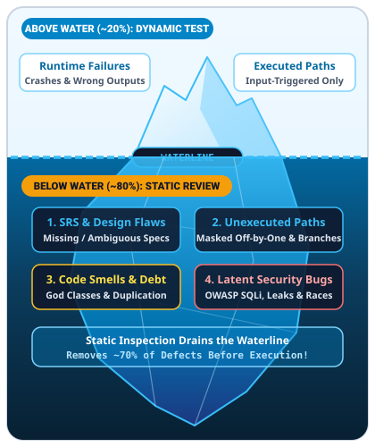

</div>
</div>

<!--
在動態測試中，如果你的測試資料剛好把目標元素放在索引值 2，測試就會亮綠燈通過，讓漏掉索引值 `0` 的錯誤繼續潛伏在水面之下。但在靜態審查中，有經驗的同儕或靜態分析器一眼就能抓出 `i = 1`。此外，IEEE 1028 嚴格區分了正式檢視（由協調者主持、獨立導讀者換句話說轉述邏輯）與非正式走查（由作者本人主導）。

難字與專業術語解說：
- author blindness: 作者盲點／當局者迷（作者因大腦預設自身邏輯正確，自讀文件或程式碼時極難察覺自身筆誤或思維漏洞的現象）
- collective code ownership: 程式碼集體共有制（透過同儕審查讓團隊多數成員皆理解系統各模組邏輯，避免知識孤島）
-->
---
<!-- _class: title-image-slide -->

## Fagan 檢視流程：六大標準步驟與五大專業角色分工

<div class="image-wrapper">
  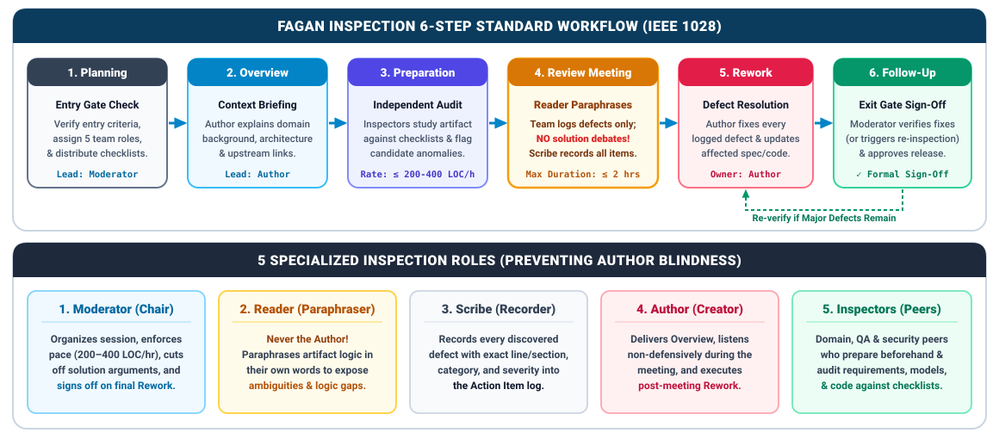
</div>

<!--
Michael Fagan (IBM, 1976) 將軟體檢視制度化為六個嚴謹步驟與五個專業角色。在步驟 4（檢視會議）中，由獨立的導讀者 (Reader)——絕非作者本人——大聲轉述產出物的邏輯，而協調者 (Moderator) 則嚴格執行一條鐵律：會議中專注於發現並記錄缺陷（將最佳檢視速率控制在每小時 200–400 行程式碼），絕不在會議上浪費時間爭辯如何修改（修改屬於步驟 5 重做 Rework 的工作）。

難字與專業術語解說：
- Fagan Inspection: 范根檢視法（具備六大標準步驟與五大明確角色分工的正式軟體靜態檢視典範）
- optimal inspection rate: 最佳檢視速率（實證研究顯示每小時審查 200–400 行程式碼的抓錯率最高，超過 1,000 行會陷入走馬看花的橡皮圖章效應）
-->
---
<!-- _class: title-image-slide -->

## 我們審查什麼？全生命週期產出物與關鍵檢視焦點

<div class="image-wrapper">
  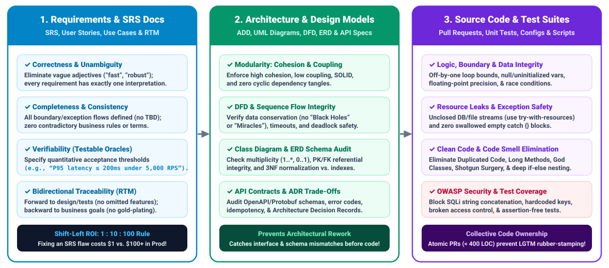
</div>

<!--
靜態審查適用於整個軟體開發生命週期 (SDLC) 的每一項產出物——絕不僅限於原始碼！
1. **需求與 SRS 規格文件：** 我們檢視正確性、無歧義性（剔除模稜兩可詞彙）、完整性、一致性、可驗證性（具可測試之量化門檻）以及雙向追溯性 (RTM)。
2. **架構與設計模型（ADD、UML、DFD、ERD、API 契約）：** 我們稽核模組化品質（高內聚、低耦合）、DFD 資料守恆（無黑洞或奇蹟）、類別圖與 ERD 參照完整性，以及 OpenAPI 契約一致性。
3. **原始碼與測試套件：** 我們檢視資料／邊界／控制流缺陷、資源洩漏、程式碼臭味（重複程式碼、上帝類別、霰彈槍手術）以及 OWASP Top 10 資安弱點。

難字與專業術語解說：
- data conservation (DFD black hole / miracle): 資料守恆（在資料流程圖審查中，只有輸入卻無輸出的程序稱為黑洞 Black Hole；無輸入卻憑空產出資料稱為奇蹟 Miracle）
- code smell: 程式碼臭味（表面雖能編譯執行，但內部結構腐化、違反設計原則並預示深層維護風險的徵兆）
-->
---
<!-- _class: title-image-slide -->

## 自動化靜態分析工具鏈與二階段 CI/CD 品質閘門

<div class="image-wrapper">
  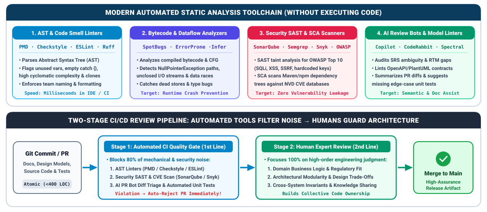
</div>

<!--
現代軟體工程將人工同儕審查與強大的自動化靜態分析工具相結合，在不執行程式的情況下自動檢驗 AST 抽象語法樹、位元組碼與相依性圖譜：
1. **AST 與程式碼臭味檢查器 (`PMD`, `Checkstyle`, `ESLint`, `Ruff`)：** 在數毫秒內抓出未使用變數、空的 `catch {}` 區塊、圈複雜度膨脹與編碼風格違規。
2. **位元組碼與資料流除錯器 (`SpotBugs`, `ErrorProne`, `Infer`)：** 追蹤控制流與資料流，精準定位空指標解參照 (Null-Pointer Dereference)、資源未關閉洩漏與並行競爭。
3. **資安 SAST 與 SCA 掃描器 (`SonarQube`, `Semgrep`, `Snyk`, `OWASP Dependency-Check`)：** 偵測 SQLi/XSS 污點傳播路徑與含已知 CVE 漏洞的第三方開源套件。
4. **AI 審查機器人與模型檢查器 (`GitHub Copilot`, `CodeRabbit`, `Spectral`)：** 稽核 SRS／OpenAPI 規格並初步篩檢 PR 差異——在**第一階段 (Stage 1)** 自動過濾掉 80% 的機械性雜訊，讓**第二階段 (Stage 2)** 的人類領域專家能將 100% 心力聚焦於領域商業邏輯與系統架構設計！

難字與專業術語解說：
- Abstract Syntax Tree (AST) static analyzer: 抽象語法樹靜態分析器（將原始碼解析為語法樹結構，透過規則匹配自動偵測壞味道與潛在缺陷的工具，如 PMD）
- SAST vs. SCA: 靜態應用程式安全測試 vs. 軟體組成分析（掃描自寫原始碼之安全弱點 vs. 掃描第三方開源套件是否含有已知 CVE 漏洞）
-->
---
<!-- _class: lead -->
<!-- header: '7.3 黑箱測試 (BVA 與 EP)' -->

# **7.3 黑箱測試：邊界值分析與等價分割法**

> 「不窺探程式碼內部結構，純粹依據規格契約驗證系統外顯行為——面對無限的輸入空間，以科學化精準度獵捕邊界缺陷。」

<!--
現在我們進入第 7.3 節：黑箱測試——邊界值分析 (Boundary Value Analysis, BVA) 與等價分割法 (Equivalence Partitioning, EP)，整合了 SQA 教材第 5.1、5.3 與 5.4 節的核心精髓。

難字與專業術語解說：
- specification-based testing: 規格導向測試（完全依據外部需求規格書與介面契約設計測試案例的黑箱測試方法）
-->
---
## 黑箱測試概念架構與為何窮舉測試不可能實現

<div class="split73">
<div class="left">

* **黑箱測試三大核心要件 (Three Core Elements)：**
  1. **測試輸入 (Test Inputs)：** 涵蓋合法輸入、極端邊界值，以及格式異常的非法輸入。
  2. **受測系統 (System Under Test, SUT)：** 視為不透明黑盒；內部演算法與資料結構完全隱藏。
  3. <strong>輸出驗證 (Output Verification)：</strong> 將實際輸出與規格預期預言機 (Oracles) 比對（聚焦系統<strong>「做什麼 (What)」</strong>，與<strong>「如何實作 (How)」</strong>徹底解耦——內部重構時測試零損壞！）。
* **為何窮舉測試 (Exhaustive Testing) 在數學上絕不可能：**
  - 即便是一個簡單的 32 位元整數加法 `int add(int a, int b)`，也擁有 2<sup>32</sup> × 2<sup>32</sup> = 2<sup>64</sup> ≈ 1.84 × 10<sup>19</sup> 組輸入配對。
  - 若以每秒執行 <strong>10 億次測試 (1 GHz)</strong> 的極速計算，窮舉測完仍需耗時 **584 年**！
  - **黑箱測試工程的核心使命：** 挑選**最小代表性測試子集**，捕捉**最高機率的潛在缺陷**。

</div>
<div class="right">

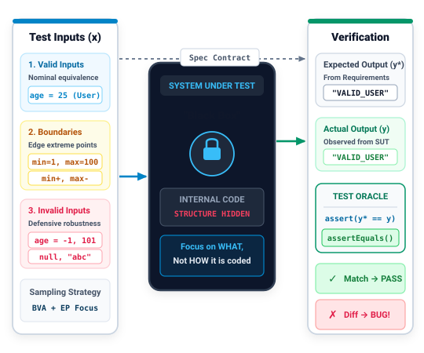

</div>
</div>

<!--
一個看似微不足道的雙整數加法函式 `int add(int a, int b)` 就有 2^64 種輸入組合，以 1 GHz 速度窮舉測試需耗時 584 年。黑箱測試方法論旨在挑選最具代表性的最小子集，以極大化缺陷揭露率。

難字與專業術語解說：
- decoupling from implementation: 與實作解耦（黑箱測試僅針對公開 API 契約斷言，因此內部重構演算法時測試程式碼無須修改）
-->
---
## 邊界值分析 (BVA)：核心哲學與單一錯誤假設

<div class="card-deck">

> 「錯誤總是潛伏在角落！」實證研究證實，超過 60% 的功能性缺陷都發生在輸入定義域的邊界邊緣上。

<div class="two-columns">
<div class="card" data-marpit-fragment>

### 為何錯誤高度群聚於邊界？
- **關係運算子差一錯誤 (Off-by-One Traps)：**
  - 開發者極常混淆 `<` 與 `<=`、或 `>` 與 `>=`，或是在計算迴圈上下界時產生 `± 1` 偏差。
- **程式碼良劣對照：**

| 程式碼寫法 | 缺陷本質 | 當 `input = 10` 時的測試結果 |
| :--- | :--- | :--- |
| `if (input <= 10)` | 正確的閉區間邊界 | 測試通過 (Passes) |
| `if (input < 10)` | 差一錯誤（`10` 被誤排除！） | <strong>測試失敗並揭露 Bug！</strong> |

</div>
<div class="card" data-marpit-fragment>

### 單一錯誤假設 (The Single Fault Assumption)
- **核心前提：**
  - 系統失效極少由兩個以上變數同時發生缺陷才觸發；每次僅讓**單一變數處於極端邊界值**，並將其餘變數固定於<strong>名義中心值 (`norm`)</strong>，即可捕捉絕大多數缺陷。
- **閉區間 `[min, max]` 的 5 大標準取樣點：**
  - <strong>`min`</strong>（最小值）、<strong>`min+`</strong>（`min + 1`）、<strong>`norm`</strong>（名義中心值）、<strong>`max-`</strong>（`max - 1`）與 <strong>`max`</strong>（最大值）。

</div>
</div>
</div>

<!--
在單一錯誤假設 (Single Fault Assumption) 下，測試 n 個變數的函式時，我們每次僅讓一個變數在邊界點 (`min, min+, max-, max`) 之間變動，同時將其餘 n - 1 個變數錨定在名義中心值 (`norm`)。

難字與專業術語解說：
- Single Fault Assumption: 單一錯誤假設（假設系統失效主要由單一變數處於極端值即可觸發，無須多個變數同時取極端值）
-->
---
## 獨立型一般邊界值分析 (`4n + 1`) 與三角形多樣性缺失陷阱

<div class="card-deck">

> 針對 `n` 個獨立變數，<strong>獨立型一般邊界值分析 (Independent Normal BVA)</strong> 需要 <strong>`4n + 1`</strong> 個測試案例——但務必當心固定 `norm` 時造成的<strong>多樣性缺失 (Diversity Deficit)</strong>！

<div class="two-columns">
<div class="card" data-marpit-fragment>

### `4n + 1` 公式推導
- **每個變數貢獻 4 個邊界點：**
  - 將 `n - 1` 個變數固定於 `norm`，並讓目標變數依序取 `min`、`min+`、`max-`、`max`。
- **加上 1 個全員正常中心點：**
  - 所有 `n` 個變數共用的 `(norm, norm, ..., norm)` 基準案例。
- <strong>測試案例總數 = `4n + 1`</strong>（當 `n = 3` → `13` 個案例）。
- **三角形問題 (`a, b, c ∈ [1, 200]`，`norm = 100`)：**
  - 變動 `a ∈ {1, 2, 199, 200}`，固定 `(b=100, c=100)`（`4` 例）
  - 變動 `b ∈ {1, 2, 199, 200}`，固定 `(a=100, c=100)`（`4` 例）
  - 變動 `c ∈ {1, 2, 199, 200}`，固定 `(a=100, b=100)`（`4` 例）
  - 加上 `(100, 100, 100)` 正三角形基準（`1` 例）= <strong>共 13 例</strong>。

</div>
<div class="card" data-marpit-fragment>

### 「多樣性缺失」陷阱與工程解方
- **為何盲目套用 `4n + 1` 在三角形問題會失靈：**
  - 在這 13 個測試案例中，每一個案例都**至少有兩條邊被固定為 `100`**！
  - 嚴重後果：這 13 個案例測了*正三角形* `(100,100,100)`、*等腰三角形* `(2,100,100)` 與*非三角形* `(200,100,100)`——<strong>卻有 0 個案例測到不等邊三角形 (`Scalene, a ≠ b ≠ c`)！</strong>
- **工程補救對策：**
  1. 為不同變數指派**相異的名義值** (`a_norm = 100, b_norm = 101, c_norm = 102`)。
  2. 務必將 BVA 與**輸出導向等價分割法 (Output-Guided EP)** 搭配使用！

</div>
</div>
</div>

<!--
切勿在未檢查輸出等價分割涵蓋率的情況下機械式套用 `4n + 1`！將三角形的兩邊固定在 `norm = 100` 會導致每一個測試案例至少有兩邊相等，徹底漏測不等邊三角形 (Scalene triangle)。

難字與專業術語解說：
- diversity deficit: 多樣性缺失（因機械式固定名義值 `norm` 導致產生出的測試案例全部落在相同輸出類別、遺漏其他重要業務分支的盲區）
-->
---
## 互動式 BVA 探索器：4n+1、6n+1、5ⁿ、7ⁿ 取樣空間

<div class="bva-interactive-stage">
<div class="bva-nav-toolbar">
  <button class="bva-mode-btn is-active" data-bva="norm">1. 一般 BVA (4n + 1)</button>
  <button class="bva-mode-btn" data-bva="robust">2. 強固 BVA (6n + 1)</button>
  <button class="bva-mode-btn" data-bva="worst-norm">3. 最壞情況一般 (5ⁿ)</button>
  <button class="bva-mode-btn" data-bva="worst-robust">4. 最壞情況強固 (7ⁿ)</button>
</div>
<div class="bva-content-grid">
<div class="bva-svg-container">
<svg viewBox="0 0 480 480" width="440" height="420" style="display: block; max-width: 100%; max-height: 100%;">
  <rect x="95" y="95" width="290" height="290" fill="#f8fafc" stroke="#3b82f6" stroke-width="2" stroke-dasharray="6,4" rx="8" />
  <rect x="40" y="40" width="400" height="400" fill="none" stroke="#e2e8f0" stroke-width="1.5" stroke-dasharray="4,4" rx="10" />
  <line x1="40" y1="240" x2="440" y2="240" stroke="#94a3b8" stroke-width="1.8" />
  <line x1="240" y1="40" x2="240" y2="440" stroke="#94a3b8" stroke-width="1.8" />
  <text x="240" y="26" text-anchor="middle" font-size="12" font-weight="800" fill="#0369a1">x₂ (變數 2)</text>
  <text x="460" y="244" text-anchor="start" font-size="12" font-weight="800" fill="#0369a1">x₁</text>
  <text x="40" y="258" text-anchor="middle" font-size="9" font-weight="700" fill="#e11d48">min-</text>
  <text x="95" y="258" text-anchor="middle" font-size="9" font-weight="700" fill="#0284c7">min</text>
  <text x="150" y="258" text-anchor="middle" font-size="9" font-weight="700" fill="#0284c7">min+</text>
  <text x="240" y="258" text-anchor="middle" font-size="9" font-weight="800" fill="#0f172a">norm</text>
  <text x="330" y="258" text-anchor="middle" font-size="9" font-weight="700" fill="#0284c7">max-</text>
  <text x="385" y="258" text-anchor="middle" font-size="9" font-weight="700" fill="#0284c7">max</text>
  <text x="440" y="258" text-anchor="middle" font-size="9" font-weight="700" fill="#e11d48">max+</text>
  <text x="232" y="444" text-anchor="end" font-size="9" font-weight="700" fill="#e11d48">min-</text>
  <text x="232" y="389" text-anchor="end" font-size="9" font-weight="700" fill="#0284c7">min</text>
  <text x="232" y="334" text-anchor="end" font-size="9" font-weight="700" fill="#0284c7">min+</text>
  <text x="232" y="154" text-anchor="end" font-size="9" font-weight="700" fill="#0284c7">max-</text>
  <text x="232" y="99" text-anchor="end" font-size="9" font-weight="700" fill="#0284c7">max</text>
  <text x="232" y="44" text-anchor="end" font-size="9" font-weight="700" fill="#e11d48">max+</text>
  <circle class="bva-pt is-worst-robust is-dimmed" data-cat="worst-robust" cx="40" cy="40" r="6.5" />
  <circle class="bva-pt is-worst-robust is-dimmed" data-cat="worst-robust" cx="40" cy="95" r="6.5" />
  <circle class="bva-pt is-worst-robust is-dimmed" data-cat="worst-robust" cx="40" cy="150" r="6.5" />
  <circle class="bva-pt is-robust-bva is-dimmed" data-cat="robust-bva" cx="40" cy="240" r="6.5" />
  <circle class="bva-pt is-worst-robust is-dimmed" data-cat="worst-robust" cx="40" cy="330" r="6.5" />
  <circle class="bva-pt is-worst-robust is-dimmed" data-cat="worst-robust" cx="40" cy="385" r="6.5" />
  <circle class="bva-pt is-worst-robust is-dimmed" data-cat="worst-robust" cx="40" cy="440" r="6.5" />
  <circle class="bva-pt is-worst-robust is-dimmed" data-cat="worst-robust" cx="95" cy="40" r="6.5" />
  <circle class="bva-pt is-worst-norm is-dimmed" data-cat="worst-norm" cx="95" cy="95" r="6.5" />
  <circle class="bva-pt is-worst-norm is-dimmed" data-cat="worst-norm" cx="95" cy="150" r="6.5" />
  <circle class="bva-pt is-norm-bva is-active" data-cat="norm-bva" cx="95" cy="240" r="6.5" />
  <circle class="bva-pt is-worst-norm is-dimmed" data-cat="worst-norm" cx="95" cy="330" r="6.5" />
  <circle class="bva-pt is-worst-norm is-dimmed" data-cat="worst-norm" cx="95" cy="385" r="6.5" />
  <circle class="bva-pt is-worst-robust is-dimmed" data-cat="worst-robust" cx="95" cy="440" r="6.5" />
  <circle class="bva-pt is-worst-robust is-dimmed" data-cat="worst-robust" cx="150" cy="40" r="6.5" />
  <circle class="bva-pt is-worst-norm is-dimmed" data-cat="worst-norm" cx="150" cy="95" r="6.5" />
  <circle class="bva-pt is-worst-norm is-dimmed" data-cat="worst-norm" cx="150" cy="150" r="6.5" />
  <circle class="bva-pt is-norm-bva is-active" data-cat="norm-bva" cx="150" cy="240" r="6.5" />
  <circle class="bva-pt is-worst-norm is-dimmed" data-cat="worst-norm" cx="150" cy="330" r="6.5" />
  <circle class="bva-pt is-worst-norm is-dimmed" data-cat="worst-norm" cx="150" cy="385" r="6.5" />
  <circle class="bva-pt is-worst-robust is-dimmed" data-cat="worst-robust" cx="150" cy="440" r="6.5" />
  <circle class="bva-pt is-robust-bva is-dimmed" data-cat="robust-bva" cx="240" cy="40" r="6.5" />
  <circle class="bva-pt is-norm-bva is-active" data-cat="norm-bva" cx="240" cy="95" r="6.5" />
  <circle class="bva-pt is-norm-bva is-active" data-cat="norm-bva" cx="240" cy="150" r="6.5" />
  <circle class="bva-pt is-nom is-active" data-cat="nom" cx="240" cy="240" r="6.5" />
  <circle class="bva-pt is-norm-bva is-active" data-cat="norm-bva" cx="240" cy="330" r="6.5" />
  <circle class="bva-pt is-norm-bva is-active" data-cat="norm-bva" cx="240" cy="385" r="6.5" />
  <circle class="bva-pt is-robust-bva is-dimmed" data-cat="robust-bva" cx="240" cy="440" r="6.5" />
  <circle class="bva-pt is-worst-robust is-dimmed" data-cat="worst-robust" cx="330" cy="40" r="6.5" />
  <circle class="bva-pt is-worst-norm is-dimmed" data-cat="worst-norm" cx="330" cy="95" r="6.5" />
  <circle class="bva-pt is-worst-norm is-dimmed" data-cat="worst-norm" cx="330" cy="150" r="6.5" />
  <circle class="bva-pt is-norm-bva is-active" data-cat="norm-bva" cx="330" cy="240" r="6.5" />
  <circle class="bva-pt is-worst-norm is-dimmed" data-cat="worst-norm" cx="330" cy="330" r="6.5" />
  <circle class="bva-pt is-worst-norm is-dimmed" data-cat="worst-norm" cx="330" cy="385" r="6.5" />
  <circle class="bva-pt is-worst-robust is-dimmed" data-cat="worst-robust" cx="330" cy="440" r="6.5" />
  <circle class="bva-pt is-worst-robust is-dimmed" data-cat="worst-robust" cx="385" cy="40" r="6.5" />
  <circle class="bva-pt is-worst-norm is-dimmed" data-cat="worst-norm" cx="385" cy="95" r="6.5" />
  <circle class="bva-pt is-worst-norm is-dimmed" data-cat="worst-norm" cx="385" cy="150" r="6.5" />
  <circle class="bva-pt is-norm-bva is-active" data-cat="norm-bva" cx="385" cy="240" r="6.5" />
  <circle class="bva-pt is-worst-norm is-dimmed" data-cat="worst-norm" cx="385" cy="330" r="6.5" />
  <circle class="bva-pt is-worst-norm is-dimmed" data-cat="worst-norm" cx="385" cy="385" r="6.5" />
  <circle class="bva-pt is-worst-robust is-dimmed" data-cat="worst-robust" cx="385" cy="440" r="6.5" />
  <circle class="bva-pt is-worst-robust is-dimmed" data-cat="worst-robust" cx="440" cy="40" r="6.5" />
  <circle class="bva-pt is-worst-robust is-dimmed" data-cat="worst-robust" cx="440" cy="95" r="6.5" />
  <circle class="bva-pt is-worst-robust is-dimmed" data-cat="worst-robust" cx="440" cy="150" r="6.5" />
  <circle class="bva-pt is-robust-bva is-dimmed" data-cat="robust-bva" cx="440" cy="240" r="6.5" />
  <circle class="bva-pt is-worst-robust is-dimmed" data-cat="worst-robust" cx="440" cy="330" r="6.5" />
  <circle class="bva-pt is-worst-robust is-dimmed" data-cat="worst-robust" cx="440" cy="385" r="6.5" />
  <circle class="bva-pt is-worst-robust is-dimmed" data-cat="worst-robust" cx="440" cy="440" r="6.5" />
</svg>
</div>
<div class="bva-info-card" id="bva-info-box">
  <div class="bva-info-header">
    <span class="bva-badge-pill bva-badge-blue" id="bva-mode-badge">單一錯誤假設 (Single Fault)</span>
    <h3 class="bva-title-text" id="bva-mode-title">一般邊界值分析 (Normal BVA)</h3>
  </div>
  <div class="bva-stats-row">
    <div class="bva-stat-box">
      <div class="bva-stat-label">計算公式</div>
      <div class="bva-stat-val" id="bva-stat-formula">4n + 1</div>
    </div>
    <div class="bva-stat-box">
      <div class="bva-stat-label">啟用測試點 (n = 2)</div>
      <div class="bva-stat-val" id="bva-stat-count">9 點</div>
    </div>
  </div>
  <ul class="bva-details-list" id="bva-details-list">
    <li><strong>最小基線取樣：</strong>沿各軸測試 <code>min, min+, max-, max</code>，同時將其餘變數錨定於 <code>norm</code>。</li>
    <li><strong>缺陷攔截目標：</strong>以嚴格線性成長成本，捕捉超過 60% 的常見關係運算子差一錯誤 (<code>&lt;</code> vs. <code>&lt;=</code>)。</li>
    <li><strong>取樣點密度：</strong>最低點數需求（2 變數僅需 <strong>9 點</strong>，3 變數為 13 點）。</li>
  </ul>
</div>
</div>
</div>

<!--
二維平面上的這 49 個點代表雙變數完整的邊界取樣空間。在一般 BVA (4n+1) 下，僅點亮沿著各名義軸交會的 9 個十字基準點（最小基線）。切換至強固 BVA (6n+1) 時，外圍 4 個越界端點 (min-, max+) 會亮起紅燈。最壞情況一般測試 (5^n) 會啟用藍色合法框內的全部 25 個點。最後，最壞情況強固測試 (7^n) 則會點亮完整笛卡爾乘積的全部 49 個點。

難字與專業術語解說：
- boundary sampling space: 邊界取樣空間（在多變數輸入域中，由各變數極值、名義值與越界值張成之測試點候選集合）
- single fault assumption: 單一錯誤假設（假設系統失效絕大多數僅由單一變數抵達極值所誘發，因而測試時其餘變數固定在名義中心值）
- Cartesian product explosion: 笛卡爾乘積爆炸（當捨棄單一錯誤假設時，測試案例數由線性 O(n) 暴增為指數級 O(k^n) 的組合膨脹現象）
-->
---
## BVA 全景矩陣與關鍵實務常見問答（Out-On-In 與浮點數）

<div class="card-deck">

> 常規模組首選 **`6n + 1` 獨立型強固 BVA**，並針對連續數值套用<strong>三點法 (`Out-On-In`)</strong> 取樣與**業務最小刻度 (Business Resolution)**。

<div class="two-columns">
<div class="card" data-marpit-fragment>

### 四大 BVA 公式選型矩陣
| BVA 測試策略 | 單一錯誤假設（獨立型） | 多重錯誤假設（最壞情況） |
| :--- | :---: | :---: |
| **一般 BVA** *(僅合法值)* | **`4n + 1`** *(`n=3 → 13`)* | **`5`<sup>`n`</sup>** *(`n=3 → 125`)* |
| **強固 BVA** *(`min-, max+`)* | **`6n + 1`** *(`n=3 → 19`)* | **`7`<sup>`n`</sup>** *(`n=3 → 343`)* |

- <strong>預設首選：</strong> <strong>`6n + 1` 獨立型強固 BVA</strong>（線性成本 + 例外防禦驗證）。
- **耦合關鍵變數：** 針對 2–3 個強耦合輸入局部套用 **`5`<sup>`n`</sup> 最壞情況 BVA**。

</div>
<div class="card" data-marpit-fragment>

### BVA 實務常見問答 (Practical FAQs)
- **Q1：二點法 (`On-Off`) vs. 三點法 (`Out-On-In`) 取樣？**
  - <strong>三點法 (`Out-On-In`, ISO 29119)：</strong> 同時測試 <strong>`99 (In), 100 (On), 101 (Out)`</strong>，能 100% 攔截開閉區間上的差一筆誤（`>` vs. `>=`）。
- **Q2：浮點數 (`double`) 的相鄰邊界點該如何選取？**
  - <strong>業務刻度原則 (Business Resolution)：</strong> 依領域最小單位步進（金額取 `± 0.01`、成績取 `± 0.1`），或底層 IEEE 754 運算呼叫 `Math.nextUp(x)`。

</div>
</div>
</div>

<!--
請熟記左側的 2x2 BVA 公式表 (`4n+1`, `6n+1`, `5^n`, `7^n`)，並掌握右側的兩個實務 FAQ：使用三點法 Out-On-In (`99, 100, 101`) 捕捉 `<` 與 `<=` 誤用，以及對浮點數邊界採用業務最小刻度 (`± 0.01`)。

難字與專業術語解說：
- 3-point boundary value analysis (Out-On-In): 三點邊界分析法（針對每一個邊界同時取邊界內、邊界上與邊界外三點，以百分百攔截開閉區間關係運算子誤用的標準做法）
-->
---
## 在 JUnit 5 中實作 BVA：`@ParameterizedTest` 與 `assertAll`

<div class="card-deck">

> 密集的邊界測試套件面臨兩大程式撰寫陷阱：跨 19 個測試方法的**樣板程式碼重複**，以及第一個斷言失敗即中斷後續檢查的**早期中斷 (Early Abort)**。

<div class="two-columns">
<div class="card" data-marpit-fragment>

### 1. 批次邊界點注入 (`@ParameterizedTest`)
- 將所有邊界點批次注入單一參數化測試方法中：
```java
@ParameterizedTest
@ValueSource(ints = {1, 2, 100, 199, 200}) // a 邊的 5 個 BVA 點
void testTriangleValidBoundariesForA(int a) {
    assertNotEquals("NotATriangle", Triangle.classify(a, 100, 100));
}

@ParameterizedTest
@CsvSource({
    "0,   3, FREE",   // V1 min & max
    "4,  12, CHILD",  // V2 min & max
    "13, 64, ADULT",  // V3 min & max
    "65,120, SENIOR"  // V4 min & max
})
void testPoolAgeBoundaries(int minAge, int maxAge, String tier) {
    assertEquals(tier, PoolTicket.eval(minAge));
    assertEquals(tier, PoolTicket.eval(maxAge));
}
```

</div>
<div class="card" data-marpit-fragment>

### 2. 群組聚合斷言（`assertAll` 防止早期中斷）
- **解決方案 (`assertAll` + Lambda `() ->`)：** 將每個邊界檢查封裝於延遲執行的 Lambda 中，確保**所有邊界點皆被執行並一次彙整回報**：
```java
@Test
void testGradeBoundariesWithoutEarlyAbort() {
    assertAll("Grade BVA Complete Check",
        () -> assertThrows(IllegalArgumentException.class,
                           () -> Grade.eval(-1)),  // min- (非法越界)
        () -> assertEquals("F", Grade.eval(0)),    // min
        () -> assertEquals("F", Grade.eval(59)),   // 級距邊界
        () -> assertEquals("D", Grade.eval(60)),   // 級距邊界+
        () -> assertEquals("A", Grade.eval(100)),  // max
        () -> assertThrows(IllegalArgumentException.class,
                           () -> Grade.eval(101))  // max+ (非法越界)
    );
}
```

</div>
</div>
</div>

<!--
將 `@ParameterizedTest` 與 `assertAll` 結合使用，能讓你乾淨俐落地執行數十個邊界檢查，徹底免除樣板重複與早期中斷遮蔽問題。

難字與專業術語解說：
- grouped assertions (`assertAll`): 群組聚合斷言（JUnit 5 以 Lambda 封裝多個斷言，確保所有斷言皆被執行並一次彙整所有失敗結果的機制）
-->
---
## 🧩 BVA 互動矩陣遊戲：房貸利率試算引擎 (`Amount × Term`)

<div class="bvag-stage" id="bva-loan-game">
<div class="bvag-board-card">
<svg xmlns="http://www.w3.org/2000/svg" id="bvag-svg" viewBox="0 0 490 480" width="430" height="420" style="display: block; max-width: 100%; max-height: 100%;">
<rect x="95" y="95" width="290" height="290" fill="#f0f9ff" fill-opacity="0.55" stroke="#0284c7" stroke-width="2" stroke-dasharray="6,4" rx="8" />
<rect x="40" y="40" width="400" height="400" fill="none" stroke="#cbd5e1" stroke-width="1.5" stroke-dasharray="4,4" rx="10" />
<line x1="40" y1="240" x2="440" y2="240" stroke="#94a3b8" stroke-width="1.8" />
<line x1="240" y1="40" x2="240" y2="440" stroke="#94a3b8" stroke-width="1.8" />
<text x="240" y="20" text-anchor="middle" font-family="sans-serif" font-size="12.5" font-weight="800" fill="#0b3c5d">Y: 貸款年限 (1 至 30 年, 刻度 = 1 yr)</text>
<text x="240" y="472" text-anchor="middle" font-family="sans-serif" font-size="12.5" font-weight="800" fill="#0b3c5d">X: 貸款金額 (100k 至 10,000k NT$, 刻度 = 1k)</text>
<text x="40" y="258" text-anchor="middle" font-family="monospace" font-size="9.5" font-weight="800" fill="#e11d48">99k</text>
<text x="95" y="258" text-anchor="middle" font-family="monospace" font-size="9.5" font-weight="800" fill="#0284c7">100k</text>
<text x="150" y="258" text-anchor="middle" font-family="monospace" font-size="9.5" font-weight="800" fill="#0284c7">101k</text>
<text x="256" y="256" text-anchor="middle" font-family="monospace" font-size="9.5" font-weight="800" fill="#0f172a">5000k</text>
<text x="330" y="258" text-anchor="middle" font-family="monospace" font-size="9.5" font-weight="800" fill="#0284c7">9999k</text>
<text x="385" y="258" text-anchor="middle" font-family="monospace" font-size="9.5" font-weight="800" fill="#0284c7">10000k</text>
<text x="444" y="258" text-anchor="middle" font-family="monospace" font-size="9.5" font-weight="800" fill="#e11d48">10001k</text>
<text x="231" y="444" text-anchor="end" font-family="monospace" font-size="9.5" font-weight="800" fill="#e11d48">0yr</text>
<text x="231" y="389" text-anchor="end" font-family="monospace" font-size="9.5" font-weight="800" fill="#0284c7">1yr</text>
<text x="231" y="334" text-anchor="end" font-family="monospace" font-size="9.5" font-weight="800" fill="#0284c7">2yr</text>
<text x="231" y="233" text-anchor="end" font-family="monospace" font-size="9.5" font-weight="800" fill="#0f172a">15yr</text>
<text x="231" y="154" text-anchor="end" font-family="monospace" font-size="9.5" font-weight="800" fill="#0284c7">29yr</text>
<text x="231" y="99" text-anchor="end" font-family="monospace" font-size="9.5" font-weight="800" fill="#0284c7">30yr</text>
<text x="231" y="44" text-anchor="end" font-family="monospace" font-size="9.5" font-weight="800" fill="#e11d48">31yr</text>
<g id="bvag-dots-layer"></g>
</svg>
</div>
<div class="bvag-ctrl-card">
<div class="bvag-spec-box">
<strong>[問題規格] 房貸利率試算器 (Mortgage Interest Rate Calculator)：</strong><br/>
<code>calcRate(amountK, termYears)</code> 依據兩個整數輸入計算借款人的房貸年利率：<br/>
• <strong>貸款金額 (<code>X</code>)</strong>：接受範圍從 <strong>NT$ 100k</strong> 至 <strong>NT$ 10,000k</strong>（以 <code>1k</code> 為單位；名義中心值 = <code>5000k</code>）。<br/>
• <strong>貸款年限 (<code>Y</code>)</strong>：接受範圍從 <strong>1 年</strong> 至 <strong>30 年</strong>（以 <code>1 yr</code> 為單位；名義中心值 = <code>15yr</code>）。<br/>
• 超出上述範圍的數值將被拒絕。請在左側 7×7 網格上推導並點選對應的邊界測試點！
</div>
<div class="bvag-mission-box">
<div class="bvag-round-row">
<span class="bvag-round-pill" id="bvag-round-pill">挑戰 1 / 4（隨機排序）</span>
<span class="bvag-stat-pill" id="bvag-score-pill">已過關: 0 / 4 | 已選取: 0 點</span>
</div>
<div class="bvag-target-title" id="bvag-target-title">目標策略：載入中...</div>
<div class="bvag-target-hint">請點擊左側矩陣上的測試點（或使用下方的快速切換輔助按鈕），選出該策略要求的精確測試點集合，接著點擊 <strong>送出答案 (Submit Selection)</strong>！</div>
</div>
<div class="bvag-quick-bar">
<span style="font-size: 11.5px; font-weight: 800; color: #475569;">快速輔助：</span>
<button type="button" class="bvag-qbtn" data-qact="valid-axes">± 切換合法十字軸</button>
<button type="button" class="bvag-qbtn" data-qact="outer-tips">± 切換 4 個越界端點</button>
<button type="button" class="bvag-qbtn" data-qact="valid-box">± 切換內部合法方框</button>
<button type="button" class="bvag-qbtn" data-qact="all-grid">± 切換全部網格</button>
<button type="button" class="bvag-qbtn" data-qact="clear">✕ 全部清除</button>
</div>
<div class="bvag-action-row">
<button type="button" class="bvag-btn" id="bvag-btn-submit">送出答案 (Submit Selection)</button>
<button type="button" class="bvag-btn btn-next" id="bvag-btn-next">下一關挑戰 ➔</button>
<button type="button" class="bvag-btn btn-reset" id="bvag-btn-reshuffle">↺ 重新洗牌 4 關</button>
</div>
<div class="bvag-feedback-box" id="bvag-feedback-msg">請點擊矩陣上的圓點（藍色 = 已選取）以符合上方指定的 BVA 測試策略！</div>
</div>
</div>

<!--
這項四回合互動遊戲能在不直接提示 `4n+1 / 6n+1 / 5^n / 7^n` 公式的情況下，檢驗學生是否真正理解四種 BVA 策略（獨立型一般 BVA、獨立型強固 BVA、最壞情況一般 BVA 與最壞情況強固 BVA）在幾何取樣上的差異。學生需從房貸利率規格（貸款金額 `Loan Amount` 為 `[100k, 10000k]`、貸款年限 `Loan Term` 為 `[1yr, 30yr]`）推導出邊界座標（`99k, 100k, 101k, 5000k, 9999k, 10000k, 10001k` 與 `0yr, 1yr, 2yr, 15yr, 29yr, 30yr, 31yr`），並在 7x7 矩陣中為隨機出題的策略點選出精確的測試點組合。
-->
---
## 等價分割法 (EP)：核心定義與四大涵蓋策略

<div class="card-deck">

> <strong>等價分割法 (EP) 核心思想：</strong> 將龐大的輸入定義域 `D` 切割為互斥的<strong>等價類別 (Equivalence Classes)</strong>，同一類別內的所有數值皆會觸發<strong>相同的執行路徑</strong>——因此只需測試<strong>一個代表值</strong>即可驗證整個類別！

<div class="two-columns">
<div class="card" data-marpit-fragment>

### 1. 數學性質與有效 vs. 無效類別
- **兩大形式化分割公理 (`D = E₁ ∪ E₂ ∪ ... ∪ Eₖ`)：**
  1. **完備性 (Completeness / Union)：** 每個可能輸入至少屬於一個分割區間 (`∪ Eᵢ = D`)。
  2. <strong>互斥性 (Disjointness / Mutual Exclusion)：</strong> 任兩個分割區間絕不重疊（當 `i ≠ j` 時，`Eᵢ ∩ Eⱼ = ∅`）。
- **等效抓錯假設 (Equal Defect-Detection Hypothesis)：**
  - 若 `Eᵢ` 中的一個代表值能揭露某功能缺陷，則 `Eᵢ` 內的任何其他值也必定能揭露同一缺陷。
- **兩大等價類別型態：**
  - <strong>有效等價類 (`Valid Classes, V`)：</strong> 符合預期的正常業務規則與分支。
  - <strong>無效等價類 (`Invalid Classes, I`)：</strong> 超出範圍、`null` 或格式錯誤，必須被防禦性拒絕的輸入。

</div>
<div class="card" data-marpit-fragment>

### 2. 2 × 2 EP 策略矩陣
- <strong>維度 A —— 錯誤假設 (`Weak` 弱涵蓋 vs. `Strong` 強涵蓋)：</strong>
  - <strong>弱等價分割 (`Weak EP, max(|V₁|, |V₂|)`)：</strong> *單一錯誤假設* —— 每個等價分割至少被涵蓋一次，不進行全組合乘積。
  - <strong>強等價分割 (`Strong EP, |V₁| × |V₂|`)：</strong> *多重錯誤假設* —— 測試所有分割區間的完整笛卡爾乘積，以捕捉交互作用缺陷。
- <strong>維度 B —— 無效輸入處理 (`Normal` 一般 vs. `Robust` 強固)：</strong>
  - <strong>一般等價分割 (`Normal EP`)：</strong> **僅測試有效等價類 (`V`)**。
  - <strong>強固等價分割 (`Robust EP`)：</strong> 納入<strong>無效等價類 (`I`)</strong>。在<strong>弱強固等價分割 (Weak Robust EP)</strong> 中，我們嚴格執行<strong>單一無效原則 (Single Invalid Rule)</strong>（每筆測試案例僅測試*一個*無效輸入，其餘輸入皆保持有效），以防止<strong>缺陷遮蔽 (Fault Masking)</strong>！

</div>
</div>
</div>

<!--
在進入下一頁的互動式 EP 矩陣之前，我們先建立等價分割法 (Equivalence Partitioning, EP) 的形式化定義與 2x2 分類體系。
首先，等價分割將輸入定義域切分為互斥且完全窮盡的子集，使軟體對同一子集內的每一個數值皆展現相同的處理行為。因此，從一個分割區間中心挑選單一代表值，就足以代表數百萬個冗餘數值。
其次，將「錯誤假設」（弱涵蓋 Weak = 單一錯誤 `max`，強涵蓋 Strong = 多重錯誤笛卡爾乘積）與「無效輸入處理」（一般 Normal = 僅測有效類，強固 Robust = 有效類 + 無效類）交叉組合，即可得出四種標準 EP 策略：弱一般 (Weak Normal)、強一般 (Strong Normal)、弱強固 (Weak Robust，遵循單一無效原則) 與強強固 (Strong Robust)。

難字與專業術語解說：
- mutually disjoint and collectively exhaustive: 互斥且完全窮盡（各等價類別之間交集為空集合，且所有類別之聯集完整涵蓋整個輸入定義域）
- equal defect-detection hypothesis: 等效抓錯假設（同一等價分割內的任意兩個輸入值，走過相同的條件分支，具備相同的揭露缺陷能力）
-->
---
## 互動式 EP 探索器：弱涵蓋 vs. 強涵蓋 & 一般 vs. 強固矩陣

<div class="ep-interactive-stage">

<div class="ep-nav-toolbar">
  <button class="ep-mode-btn is-active" data-ep="weak-norm">1. 弱一般 EP (Weak Normal)</button>
  <button class="ep-mode-btn" data-ep="strong-norm">2. 強一般 EP (Strong Normal)</button>
  <button class="ep-mode-btn" data-ep="weak-robust">3. 弱強固 EP (單一無效原則)</button>
  <button class="ep-mode-btn" data-ep="strong-robust">4. 強強固 EP (Strong Robust)</button>
</div>

<div class="ep-content-grid">

<div class="ep-matrix-card">
  <table class="ep-table">
    <thead>
      <tr>
        <th style="width: 22%;">x₁ \ x₂</th>
        <th style="width: 19%; color: #e11d48;">I₂,₁ (空字串)</th>
        <th style="width: 20%; color: #059669;">V₂,₁ (Alpha [A-M])</th>
        <th style="width: 20%; color: #059669;">V₂,₂ (Beta [N-Z])</th>
        <th style="width: 19%; color: #e11d48;">I₂,₂ (特殊符號)</th>
      </tr>
    </thead>
    <tbody>
      <tr>
        <th style="color: #e11d48;">I₁,₁ (&lt; 1)</th>
        <td class="is-invalid-zone"><span class="ep-pin is-invalid-pin" data-pin-id="p_i11_i21">TC₇</span></td>
        <td class="is-invalid-zone"><span class="ep-pin is-invalid-pin is-active-pin" data-pin-id="p_i11_v21">TC₄</span></td>
        <td class="is-invalid-zone"><span class="ep-pin is-invalid-pin" data-pin-id="p_i11_v22">TC₈</span></td>
        <td class="is-invalid-zone"><span class="ep-pin is-invalid-pin" data-pin-id="p_i11_i22">TC₉</span></td>
      </tr>
      <tr>
        <th style="color: #059669;">V₁,₁ (1..10)</th>
        <td class="is-invalid-zone"><span class="ep-pin is-invalid-pin" data-pin-id="p_v11_i21">TC₆</span></td>
        <td class="is-valid-zone"><span class="ep-pin is-active-pin" data-pin-id="p_v11_v21">TC₁</span></td>
        <td class="is-valid-zone"><span class="ep-pin" data-pin-id="p_v11_v22">TC₄</span></td>
        <td class="is-invalid-zone"><span class="ep-pin is-invalid-pin" data-pin-id="p_v11_i22">TC₇</span></td>
      </tr>
      <tr>
        <th style="color: #059669;">V₁,₂ (11..20)</th>
        <td class="is-invalid-zone"><span class="ep-pin is-invalid-pin" data-pin-id="p_v12_i21">TC₁₀</span></td>
        <td class="is-valid-zone"><span class="ep-pin" data-pin-id="p_v12_v21">TC₅</span></td>
        <td class="is-valid-zone"><span class="ep-pin is-active-pin" data-pin-id="p_v12_v22">TC₂</span></td>
        <td class="is-invalid-zone"><span class="ep-pin is-invalid-pin" data-pin-id="p_v12_i22">TC₁₁</span></td>
      </tr>
      <tr>
        <th style="color: #059669;">V₁,₃ (21..30)</th>
        <td class="is-invalid-zone"><span class="ep-pin is-invalid-pin" data-pin-id="p_v13_i21">TC₁₂</span></td>
        <td class="is-valid-zone"><span class="ep-pin is-active-pin" data-pin-id="p_v13_v21">TC₃</span></td>
        <td class="is-valid-zone"><span class="ep-pin" data-pin-id="p_v13_v22">TC₆</span></td>
        <td class="is-invalid-zone"><span class="ep-pin is-invalid-pin" data-pin-id="p_v13_i22">TC₁₃</span></td>
      </tr>
      <tr>
        <th style="color: #e11d48;">I₁,₂ (&gt; 30)</th>
        <td class="is-invalid-zone"><span class="ep-pin is-invalid-pin" data-pin-id="p_i12_i21">TC₁₄</span></td>
        <td class="is-invalid-zone"><span class="ep-pin is-invalid-pin" data-pin-id="p_i12_v21">TC₅</span></td>
        <td class="is-invalid-zone"><span class="ep-pin is-invalid-pin" data-pin-id="p_i12_v22">TC₁₅</span></td>
        <td class="is-invalid-zone"><span class="ep-pin is-invalid-pin" data-pin-id="p_i12_i22">TC₁₆</span></td>
      </tr>
    </tbody>
  </table>
</div>

<div class="ep-info-card" id="ep-info-box">
  <div class="ep-info-header">
    <span class="ep-badge-pill ep-badge-green" id="ep-mode-badge">僅合法值 • 單一錯誤假設</span>
    <h3 class="ep-title-text" id="ep-mode-title">弱一般等價分割 (Weak Normal EP)</h3>
  </div>
  
  <div class="ep-stats-row">
    <div class="ep-stat-box">
      <div class="ep-stat-label">計算公式</div>
      <div class="ep-stat-val" id="ep-stat-formula">max(|P₁|, |P₂|)</div>
    </div>
    <div class="ep-stat-box">
      <div class="ep-stat-label">啟用測試案例</div>
      <div class="ep-stat-val" id="ep-stat-count">3 個案例</div>
    </div>
  </div>
  
  <ul class="ep-details-list" id="ep-details-list">
    <li><strong>最小有效涵蓋：</strong>確保每個變數的每一個有效等價類，至少在一個測試案例中出現。</li>
    <li><strong>單一錯誤假設：</strong>假設當單一分割區間搭配其他變數的有效值執行時，即可揭露功能性缺陷。</li>
    <li><strong>執行成本：</strong>最經濟精簡的基準線（<strong>max(3, 2) = 3 個案例</strong>）。</li>
  </ul>
</div>

</div>
</div>

<!--
等價分割法涵蓋四種維度策略。在弱一般 EP (Weak Normal) 下，只需 3 個綠色測試案例即可涵蓋每一個有效橫列與直行。強一般 EP (Strong Normal) 則擴展至綠色有效區內的全部 6 種組合。弱強固 EP (Weak Robust) 引入了極為關鍵的「單一無效原則」：4 個紅色測試案例各自在搭配有效同儕值的嚴格隔離條件下測試每一個無效分割（共 7 個案例），防止早期例外中斷遮蔽了次要缺陷。強強固 EP (Strong Robust) 則以暴力笛卡爾乘積測試全部 20 個儲存格。

難字與專業術語解說：
- Equivalence Partitioning (EP): 等價分割法（將輸入或輸出域切割為若干互斥子集合，使集合內任一輸入值對揭露缺陷具有同等效力的黑箱測試技術）
- single invalid rule: 單一無效原則（在強固等價分割中，每次測試僅允許單一變數取無效值，其餘變數一律取有效值，防止例外中斷造成缺陷遮蔽）
- fault masking: 缺陷遮蔽（當一個輸入錯誤引發提前崩潰或例外返回時，下游其他變數潛藏的錯誤無法被執行或驗證的現象）
-->
---
## EP 實戰案例一 (1/3)：二元搜尋追蹤與等價分割維度

<div class="bs-interactive-stage">

<div class="bs-trace-card">
  <div class="bs-top-bar">
    <div style="display: flex; align-items: center;">
      <span style="font-size: 13px; font-weight: 800; color: #0b3c5d;">目標搜尋值 (k)：</span>
      <input type="number" id="bs-input-k" value="35" class="bs-k-input" style="margin: 0 6px;" />
      <span style="font-size: 11px; font-weight: 700; color: #64748b; margin-right: 4px;">快速預設值：</span>
      <span class="bs-quick-pill" data-k="3">3 (頭部)</span>
      <span class="bs-quick-pill" data-k="23">23 (中間)</span>
      <span class="bs-quick-pill" data-k="35">35</span>
      <span class="bs-quick-pill" data-k="43">43 (尾部)</span>
      <span class="bs-quick-pill" data-k="8">8 (未命中)</span>
    </div>
    <div>
      <button class="bs-action-btn" id="bs-btn-step">▶ 下一步</button>
      <button class="bs-action-btn" id="bs-btn-reset" style="background: #64748b; margin-left: 6px;">↺ 重置</button>
    </div>
  </div>

  <div class="bs-status-banner">
    <span id="bs-status-text">步驟 0：初始搜尋範圍 [0..10]，mid = floor((0+10)/2) = 5 (arr[5] = 23)</span>
    <span id="bs-status-tag" style="background: #e0f2fe; color: #0369a1; padding: 1px 8px; border-radius: 4px; font-size: 10.5px; font-weight: 800;">就緒</span>
  </div>

  <div class="bs-array-container" id="bs-array-container">
    <div class="bs-array-cell" data-idx="0"><span class="bs-cell-idx">0</span><span class="bs-cell-val">3</span><span class="bs-pointer-pill bs-ptr-low">low</span></div>
    <div class="bs-array-cell" data-idx="1"><span class="bs-cell-idx">1</span><span class="bs-cell-val">7</span></div>
    <div class="bs-array-cell" data-idx="2"><span class="bs-cell-idx">2</span><span class="bs-cell-val">11</span></div>
    <div class="bs-array-cell" data-idx="3"><span class="bs-cell-idx">3</span><span class="bs-cell-val">15</span></div>
    <div class="bs-array-cell" data-idx="4"><span class="bs-cell-idx">4</span><span class="bs-cell-val">19</span></div>
    <div class="bs-array-cell is-mid" data-idx="5"><span class="bs-cell-idx">5</span><span class="bs-cell-val">23</span><span class="bs-pointer-pill bs-ptr-mid">mid</span></div>
    <div class="bs-array-cell" data-idx="6"><span class="bs-cell-idx">6</span><span class="bs-cell-val">27</span></div>
    <div class="bs-array-cell" data-idx="7"><span class="bs-cell-idx">7</span><span class="bs-cell-val">31</span></div>
    <div class="bs-array-cell" data-idx="8"><span class="bs-cell-idx">8</span><span class="bs-cell-val">35</span></div>
    <div class="bs-array-cell" data-idx="9"><span class="bs-cell-idx">9</span><span class="bs-cell-val">39</span></div>
    <div class="bs-array-cell" data-idx="10"><span class="bs-cell-idx">10</span><span class="bs-cell-val">43</span><span class="bs-pointer-pill bs-ptr-high">high</span></div>
  </div>
</div>

<div class="two-columns" style="margin-top: 4px;">
<div class="card" style="padding: 12px 16px;">

### 四大結構化等價分割維度
- **1. 陣列長度 (Array Length, A)：**
  - <code>a⁰</code>：空陣列（<code>[]</code>，長度為 0）
  - <code>a¹</code>：單一元素陣列 (<code>[7]</code>)
  - <code>a*</code>：多元素已排序陣列 (<code>[3, 7, 11, ...]</code>)
- **2. 搜尋結果 (Outcome, F) 與 3. 命中位置 (Hit Position, C)：**
  - <code>fᵗ</code> (找到)：命中於頭部 (<code>c¹</code>)、中間 (<code>cᵐ</code>) 或尾部 (<code>cᵗ</code>)
  - <code>fᶠ</code> (未找到)：目標鍵值不存在於陣列中
- <strong>4. 輸入合法性 (Validity, K)：</strong> <code>k</code>（合法整數）vs. <code>k!</code>（非法型別或 null）

</div>
<div class="card" style="padding: 12px 16px;">

### 弱涵蓋策略（8 個代表性測試案例）
- **為何採用弱涵蓋 (Weak Coverage)？**
  - 在不引發笛卡爾乘積組合爆炸的前提下，確保全部 4 個維度的每一個分割區間至少在一個測試案例中被執行。
- **代表性案例分佈：**
  - <strong>R₁..R₂：</strong>單一元素陣列 (<code>a¹</code>) 的命中 (<code>c¹</code>) 與未命中 (<code>fᶠ</code>)。
  - <strong>R₃..R₅：</strong>多元素陣列 (<code>a*</code>) 的頭部 (<code>c¹</code>)、中間 (<code>cᵐ</code>) 與尾部 (<code>cᵗ</code>) 命中。
  - <strong>R₆..R₇：</strong>多元素區間空隙未命中 (<code>fᶠ</code>) 與空陣列防禦 (<code>a⁰</code>)。
  - <strong>R₈：</strong>非法輸入之型別／空值防禦性拒絕 (<code>k!</code>)。

</div>
</div>

</div>

<!--
點擊上方互動區「下一步」或輸入任意目標值 k，即可逐步追蹤二元搜尋的折半過程。左下方列出的 4 大結構化分割維度（陣列基數 A、搜尋結果 F、命中位置 C 與輸入合法性 K）完整描繪了輸入與輸出定義域；右下方則透過弱涵蓋策略規劃出 R1..R8 共 8 個代表性測試案例，涵蓋每一個分割區間。

難字與專業術語解說：
- interval halving: 區間折半（二分搜尋每次比對中間元素後，依大小關係排除一半候選區間的核心機制，使時間複雜度降至 O(log N)）
- array cardinality: 陣列基數／元素個數（依空集合 0、單元素 1 與多元素 * 劃分的等價類）
-->

---
## EP 實戰案例一 (2/3)：二元搜尋弱涵蓋測試規格表

<div class="table-compact">

| 案例 | 等價分割組合 (`A, F, C, K`) | 測試輸入 (`k, A`) | 預期輸出 | 弱涵蓋驗證目標 |
| :---: | :--- | :--- | :--- | :--- |
| <strong>R<sub>1</sub></strong> | `a`<sup>`1`</sup> `× f`<sup>`t`</sup> `× c`<sup>`1`</sup> `× k` | `k=7, A=[7]` | `index = 0` | 單一元素命中（涵蓋 `a`<sup>`1`</sup>`, f`<sup>`t`</sup>`, c`<sup>`1`</sup>） |
| <strong>R<sub>2</sub></strong> | `a`<sup>`1`</sup> `× f`<sup>`f`</sup> `× k` | `k=7, A=[8]` | `index = -1` | 單一元素未命中（涵蓋 `a`<sup>`1`</sup>`, f`<sup>`f`</sup>） |
| <strong>R<sub>3</sub></strong> | `a`<sup>`*`</sup> `× f`<sup>`t`</sup> `× c`<sup>`1`</sup> `× k` | `k=7, A=[7, 9, 11]` | `index = 0` | 多元素頭部命中（`a`<sup>`*`</sup>`, c`<sup>`1`</sup>） |
| <strong>R<sub>4</sub></strong> | `a`<sup>`*`</sup> `× f`<sup>`t`</sup> `× c`<sup>`m`</sup> `× k` | `k=9, A=[7, 9, 11]` | `index = 1` | 多元素中間命中（`a`<sup>`*`</sup>`, c`<sup>`m`</sup>） |
| <strong>R<sub>5</sub></strong> | `a`<sup>`*`</sup> `× f`<sup>`t`</sup> `× c`<sup>`t`</sup> `× k` | `k=11, A=[7, 9, 11]` | `index = 2` | 多元素尾部命中（`a`<sup>`*`</sup>`, c`<sup>`t`</sup>） |
| <strong>R<sub>6</sub></strong> | `a`<sup>`*`</sup> `× f`<sup>`f`</sup> `× k` | `k=8, A=[7, 9, 11]` | `index = -1` | 多元素空隙未命中（`a`<sup>`*`</sup>`, f`<sup>`f`</sup>） |
| <strong>R<sub>7</sub></strong> | `a`<sup>`0`</sup> `× f`<sup>`f`</sup> `× k` | `k=7, A=[]` | `index = -1` | 空陣列邊界防禦（`a`<sup>`0`</sup>`, f`<sup>`f`</sup>） |
| <strong>R<sub>8</sub></strong> | `a`<sup>`*`</sup> `× k!` | `k="abc", A=[7, 9]` | 拋出 `TypeException` | 非法輸入防禦性拒絕（`k!`） |

</div>

<div class="card" data-marpit-fragment style="margin-top: 6px; padding: 8px 14px; border-left: 4px solid #d97706; background: #fffbeb;">

<h3 style="font-size: 14.5px; margin: 0 0 4px 0; color: #b45309;">關鍵反思與測試設計提問</h3>

1. <strong>問題 1（強涵蓋與無效輸入隔離）：</strong> 為何我們選擇<strong>弱涵蓋 (Weak Coverage)</strong> 而非強涵蓋？無效輸入 <code>k!</code> 是否需要與<strong>完整笛卡爾乘積</strong> (<code>A × F × C</code>) 進行交叉組合？
2. <strong>問題 2（陣列奇偶性與折半不對稱性）：</strong> 二元搜尋透過整數除法 <code>mid = (low + high) / 2</code> 反覆折半。我們將陣列長度 <code>A</code> 分為三類 (<code>a⁰, a¹, a*</code>) 是否存在差一錯誤 (off-by-one) 盲區？

</div>

<!--
請檢視上方規格表中的 8 個代表性測試案例 R1 至 R8。僅用 8 個案例，弱等價分割便系統化地測試了每一個有效與無效分割區間。在翻到下一頁看解答前，請先思考下方琥珀色方框中的兩個設計提問。

難字與專業術語解說：
- specification table: 規格測試對照表（將等價類組合、具體輸入值、預期輸出與驗證目標整合成結構化矩陣的測試工件）
- reflection questions: 反思提問（在提出標準答案前引導思考邊界分割與組合爆炸本質的教學提問法）
-->

---
## EP 實戰案例一 (3/3)：測試設計提問深度解答

<div class="card-deck">

> 高效的測試分割必須反映**執行期控制流語意 (runtime control-flow semantics)**：正視整數除法截斷並嚴格隔離防禦性例外。

<div class="two-columns">
<div class="card" data-marpit-fragment style="padding: 14px 18px;">

### 解答 1：不可行分割組合與單一無效原則
- **為何不採用強涵蓋 (Strong Coverage)？**
  - **不可行組合 (Infeasible Combinations)：** 笛卡爾乘積會產生數學與邏輯上不可能存在的測試組合！
    - 例如：<code>a⁰ × fᵗ × cᵐ</code> =「在空陣列的中間位置找到目標值」（完全矛盾不可能！）。
- **無效輸入 <code>k!</code> 需要與完整乘積 (<code>A × F × C</code>) 交叉嗎？**
  - **絕對不用！那會違反單一無效原則 (Single Invalid Rule)！**
  - 當傳入 <code>k!</code>（如 <code>null</code> 或型別錯誤）時，方法的<strong>前置防禦衛句 (entry guard clause) 會立即拋出例外</strong>：
    <code>if (key == null) throw new IllegalArgumentException();</code>
  - **缺陷遮蔽風險 (Fault Masking Hazard)：** 下游搜尋邏輯**根本不會被執行到**。將 <code>k!</code> 與所有位置交叉只會製造龐大冗餘，並遮蔽真正的演算法缺陷！

</div>
<div class="card" data-marpit-fragment style="padding: 14px 18px;">

### 解答 2：奇偶同位分割 (Even vs. Odd Parity, aᵒᵈᵈ vs. aᵉᵛᵉⁿ)
- **整數除法截斷效應 (<code>Math.floor</code>)：**
  - 整數折半公式：<code>mid = (low + high) / 2</code>。
  - <strong>奇數長度（如 N = 7）：</strong> <strong>對稱切割</strong>（<code>mid = 3</code>，左半部剩 <strong>3 個元素</strong>、右半部剩 <strong>3 個元素</strong>）。
  - <strong>偶數長度（如 N = 8）：</strong> <strong>非對稱切割</strong>（<code>mid = 3</code>，左半部剩 <strong>3 個元素</strong>，但右半部有 <strong>4 個元素</strong>！）。
- **隱藏的邊界差一錯誤 (Off-by-One Bugs)：**
  - 有瑕疵的中點更新邏輯（如誤寫 <code>high = mid</code> vs. <code>high = mid - 1</code>）在奇數陣列上可能僥倖通過，卻會在偶數陣列上觸發無窮迴圈或陣列越界！
- **精煉後的陣列長度分割 <code>A</code>：**
  - <code>a⁰</code>（空陣列）、<code>a¹</code>（單元素）、<code>aᵒᵈᵈ</code>（奇數長度）、<code>aᵉᵛᵉⁿ</code>（偶數長度）。

</div>
</div>
</div>

<!--
這兩個解答揭示了兩項核心軟體工程原則。第一，對彼此相依的維度進行強涵蓋會產生不可能存在的組合；同時，像 k! 這類無效輸入必須在「單一無效原則」下嚴格隔離測試，因為前置例外衛句會直接中斷並遮蔽後續所有程式碼。第二，整數除法會捨去餘數，導致偶數長度陣列發生非對稱切割（左 3 右 4）。將多元素陣列進一步細分為奇數與偶數兩個等價類，能確保攔截折半邊界上的差一錯誤。

難字與專業術語解說：
- integer division truncation: 整數除法向零捨入／截斷（二分搜尋計算中間索引時因捨去小數點導致偶數長度陣列被非對稱切割的現象）
- parity partitioning: 奇偶同位分割（將容器長度進一步依奇數與偶數切割為獨立等價類，以攔截非對稱折半邊界錯誤）
- entry guard clause: 前置防禦衛句（函式開頭針對非法參數立即拋出例外並返回的程式碼，會遮蔽後續程式邏輯）
-->

---
## EP 實戰案例二 (1/3)：`NextDate(Y, M, D)` 等價分割探索

> **等價分割黃金法則：** 同一等價分割 ↔ 具備完全相同的狀態轉移與下游處理邏輯！

<div class="two-columns">
<div class="left">

- **年份 (`Year, Y`)：** 輸入範圍 `1812..2030`
  * <strong>`Y₁`（閏年 Leap Year）：</strong> 可被 4 整除（逢百不閏，逢 400 閏；2 月有 29 天）
  * <strong>`Y₂`（平年 Common Year）：</strong> 其他所有合法年份（2 月有 28 天）
- **月份 (`Month, M`)：** 輸入範圍 `1..12`
  * <strong>`M₁`（30 天小月）：</strong> `{4, 6, 9, 11}`（4、6、9、11 月）
  * <strong>`M₂`（31 天大月）：</strong> `{1, 3, 5, 7, 8, 10}`（1、3、5、7、8、10 月）
  * <strong>`M₃`（二月 February）：</strong> `{2}`（受閏平年規則制約）
  * <strong>`M₄`（十二月 December）：</strong> `{12}`（★ *12/31 會觸發年份進位，與 7 月絕不等價！*）

</div>
<div class="right">

- **日期 (`Day, D`)：** 輸入範圍 `1..31`
  * <strong>`D₁` (`1..27`)：</strong> 月中一般遞增（`Day + 1`，月份與年份不變）
  * <strong>`D₂` (`28`)：</strong> 平年 2 月底邊界（平年進位至 3 月 1 日）
  * <strong>`D₃` (`29`)：</strong> 閏年 2 月底邊界（閏年進位至 3 月 1 日）
  * <strong>`D₄` (`30`)：</strong> 30 天小月月底換月（進位至 `Day = 1, Month + 1`）
  * <strong>`D₅` (`31`)：</strong> 31 天大月月底換月（進位至 `Day = 1, Month + 1`；若為 12 月則跨年）

</div>
</div>

<!--
引導學生逐步探索 NextDate(Y, M, D) 的等價分割。先列出年、月、日三大變數，詢問學生該如何劃分定義域；接著點擊逐步揭示子項目：閏年 vs. 平年、大小月分群，以及最關鍵的發現——由 12/31 跨年邊界所催生出的獨立等價類「12 月 (M4)」！

難字與專業術語解說：
- state transition divergence: 狀態轉移分歧（相同等價類之輸入在特定邊界觸發截然不同的變數更新，如年份進位與月份歸一，證明原劃分未達等價）
- domain-driven partitioning: 領域驅動等價分割（依據領域業務規則與日曆曆法物理約束進行的精密黑箱等價類劃分）
-->

---
## EP 實戰案例二 (2/3)：`NextDate()` 弱涵蓋打點矩陣表

<div class="table-compact">

| 案例 | 測試輸入 | M₁ | M₂ | M₃ | M₄ | D₁ | D₂ | D₃ | D₄ | D₅ | Y₁ | Y₂ | 預期輸出 | 策略定位與驗證之業務分支 |
| :---: | :---: | :---: | :---: | :---: | :---: | :---: | :---: | :---: | :---: | :---: | :---: | :---: | :---: | :--- |
| <strong>TC₁</strong> | `2023/05/15` | | ● | | | ● | | | | | | ● | `2023/05/16` | <strong>弱涵蓋基底 (1/5)：</strong> 月中一般遞增（`Day + 1`；涵蓋 M₂, D₁, Y₂） |
| <strong>TC₂</strong> | `2024/02/28` | | | ● | | | ● | | | | ● | | `2024/02/29` | <strong>弱涵蓋基底 (2/5)：</strong> 閏年 2/28 遞增（`Day + 1`；涵蓋 M₃, D₂, Y₁） |
| <strong>TC₃</strong> | `2024/02/29` | | | ● | | | | ● | | | ● | | `2024/03/01` | <strong>弱涵蓋基底 (3/5)：</strong> 閏年 2/29 換月進位（`Month + 1`；涵蓋 D₃） |
| <strong>TC₄</strong> | `2023/04/30` | ● | | | | | | | ● | | | ● | `2023/05/01` | <strong>弱涵蓋基底 (4/5)：</strong> 30 天小月換月進位（`Month + 1`；涵蓋 M₁, D₄） |
| **TC₅** | `2023/12/31` | | | | ● | | | | | ● | | ● | `2024/01/01` | **弱涵蓋基底 (5/5)：** ★ <strong>12/31 跨年進位 (`Year+1, Month=1`；M₄, D₅)</strong> |

</div>

<div class="card" style="margin-top: 8px; padding: 6px 14px; border-left: 4px solid #059669; background: #f0fdf4;">
<h3 style="font-size: 14px; margin: 0 0 3px 0; color: #166534;">一眼看穿 100% 弱涵蓋 (Weak Coverage) 視覺化檢驗</h3>
<ul style="margin: 0; padding-left: 18px; font-size: 13.5px; line-height: 1.38;">
<li><strong>直行垂直檢視：</strong>沿著 <code>M₁..M₄</code>、<code>D₁..D₅</code> 與 <code>Y₁..Y₂</code> 每一行往下看，可以確認在 <code>TC₁..TC₅</code> 之中，<strong>每一個直行都至少包含一個圓點 (●)</strong>！</li>
<li><strong>極小化成本：</strong>僅需 <strong>5 個基底測試案例</strong> (<code>max(|M|, |D|, |Y|) = 5</code>) 即 100% 滿足弱涵蓋要求。</li>
</ul>
</div>

<div class="card" data-marpit-fragment style="margin-top: 8px; padding: 6px 14px; border-left: 4px solid #d97706; background: #fffbeb;">
<h3 style="font-size: 14px; margin: 0 0 3px 0; color: #92400e;">關鍵反思與測試設計提問（想一想）</h3>
<ul style="margin: 0; padding-left: 18px; font-size: 13.5px; line-height: 1.38;">
<li><strong>提問 1（弱涵蓋的致命盲區）：</strong>雖然 <code>TC₁..TC₅</code> 已達成 100% 弱涵蓋，但這 5 個案例真的夠嗎？例如：<code>02/28</code> (<code>D₂</code>) 在表中只搭配了<strong>閏年 (<code>Y₁</code>)</strong> 測試，卻完全沒測到<strong>平年 (<code>Y₂</code>) 的 <code>02/28</code></strong>！還有哪些被綁死耦合的組合漏測了？（見下一頁）</li>
<li><strong>提問 2（為何不直接跑強涵蓋）：</strong>既然弱涵蓋會漏掉跨變數互動，為什麼我們不直接執行全笛卡爾乘積 <strong>100% 強涵蓋 (<code>4 × 5 × 2 = 40</code> 個案例)</strong>？（見下一頁）</li>
</ul>
</div>

<!--
這張主控打點矩陣將等價分割涵蓋率極其清晰地視覺化呈現。沿著每一個直行往下檢視：每一個等價類都在前 5 個基底測試案例 (TC1..TC5) 中至少擁有一個打點，證實達成 100% 弱涵蓋。然而在課堂上，請點擊揭示下方的琥珀色反思問題卡片，引導學生深入思考：第一，僅靠這 5 個弱涵蓋案例真的足夠嗎？請學生觀察 D2 (28 日) 只在 TC2 (2024 閏年) 被測試到，平年的 2 月 28 日卻完全沒測！同理，D5 (31 日) 與 M4 (12 月) 在 TC5 中被綁在一起。第二，既然有耦合漏洞，為什麼我們不乾脆直接跑 4 x 5 x 2 = 40 個強涵蓋案例？先讓學生思考討論，下一頁揭曉解答與精準補強矩陣！

難字與專業術語解說：
- coverage matrix table: 涵蓋矩陣表（以橫列表示測試案例、以直行標示所有等價類別，透過打點視覺化確認各直行皆被測試涵蓋的標準驗證工具）
- coupling blind spot: 耦合盲區（在單一因素弱涵蓋下，特定等價類僅與單一其他變數組合配對，導致另一關鍵分支如平年 2/28 或非 12 月之 31 日完全未被執行到的測試漏洞）
-->

---
## EP 實戰案例二 (3/3)：提問解答 — 耦合補強與不可行日期剪枝

<div class="card-deck">

> 5 個弱涵蓋基底上定向加上 <strong>3 個精準耦合補強案例 (<code>TC₆..TC₈</code>)</strong>，僅需 <strong>8 個精實案例</strong>即可攔截所有跨變數進位錯誤並避開幽靈日期陷阱。

<div class="two-columns">
<div class="card" data-marpit-fragment style="padding: 8px 14px; font-size: 13.8px; line-height: 1.32;">

### 解答 1：`02/28` 與 `12/31` 的耦合盲區
- **平年 vs. 閏年的 `02/28` 分歧 (`M₃ × D₂ × Y`)：**
  - `TC₂ (2024/02/28)` 僅在**閏年 (`Y₁`)** 測試 (`Day + 1 → 02/29`)。
  - **平年 (`Y₂`)** 的 `02/28` 須**換月進位 (`→ 03/01`)**！若不補測 `2023/02/28` (`TC₈`)，平年 2 月底換月將是 0% 測試盲區。
- **解開 `M₄ (12 月)` 與 `D₅ (31 日)` 的綁定：**
  - `TC₅` 將 `M₄` 與 `D₅` 綁死。須補測**非 12 月 31 日 (`TC₆: 07/31`)** 與 **12 月一般日 (`TC₇: 12/15`)**，攔截 `if (month == 12) year++` 等錯誤！

</div>
<div class="card" data-marpit-fragment style="padding: 8px 14px; font-size: 13.8px; line-height: 1.32;">

### 解答 2：為何不直接用強涵蓋 (40 個案例)？
- **組合膨脹與「不存在的幽靈日期」 (`4 × 5 × 2 = 40`)：**
  - 盲目笛卡爾乘積會產生大量違反曆法約束的**不可行組合 (Infeasible Combinations)**：
    - `M₃ (2月) × D₄/D₅ (30/31日)` → **`02/30`、`02/31` 不存在！**
    - `M₁ (小月) × D₅ (31日)` → **`04/31`、`06/31` 不存在！**
    - `M₃ × D₃ (29日) × Y₂ (平年)` → **`2023/02/29` 無效日期！**
- **最佳策略 (`5 基底 + 3 耦合 = 8 案例`)：** 保留 `TC₁..TC₅` + 下方 `TC₆..TC₈`。

</div>
</div>

<div class="table-compact" data-marpit-fragment style="margin-top: 4px; font-size: 0.92em;">

| 補強案例 | 測試輸入 | M₁ | M₂ | M₃ | M₄ | D₁ | D₂ | D₃ | D₄ | D₅ | Y₁ | Y₂ | 預期輸出 | 定向解除之跨變數耦合盲區 |
| :---: | :---: | :---: | :---: | :---: | :---: | :---: | :---: | :---: | :---: | :---: | :---: | :---: | :---: | :--- |
| <strong>TC₆</strong> | `2023/07/31` | | ● | | | | | | | ● | | ● | `2023/08/01` | <strong>耦合補強 (+1)：</strong> 非 12 月之 31 天大月換月進位（`Month + 1`，年份不變） |
| <strong>TC₇</strong> | `2023/12/15` | | | | ● | ● | | | | | | ● | `2023/12/16` | <strong>耦合補強 (+2)：</strong> 12 月一般日正常遞增（`Day + 1`，不誤觸跨年進位） |
| <strong>TC₈</strong> | `2023/02/28` | | | ● | | | ● | | | | | ● | `2023/03/01` | <strong>耦合補強 (+3)：</strong> ★ <strong>平年 2/28 換月進位至 3/1 (`M₃ × D₂ × Y₂`)</strong> |

</div>

</div>

<!--
這一頁完整解答了前一頁的兩個關鍵測試設計提問。第一個解答說明為什麼只測 5 個弱涵蓋案例不夠：因為在 TC2 中，2 月 28 日只測了閏年（走到 2 月 29 日），卻漏掉了平年 2 月 28 日直接換月到 3 月 1 日的重要分支；同時 TC5 把 12 月與 31 日綁在一起，如果工程師寫錯成「只要是 12 月就跨年」或「只要是 31 日就跨年」，5 個基底案例竟然抓不出來！第二個解答則說明為什麼不盲目展開 4 x 5 x 2 = 40 個強涵蓋案例：因為日曆具有嚴格的跨變數物理約束，盲目做笛卡爾乘積會產生 2 月 30 日、4 月 31 日、平年 2 月 29 日等大量不可行的幽靈測試案例。最優雅的工程解法就是底部的表格：在 5 個弱涵蓋基底上，精準補上 TC6 (2023/07/31)、TC7 (2023/12/15) 與 TC8 (2023/02/28) 三個耦合補強案例，以 5 + 3 = 8 個測試案例達到 100% 業務分支防禦！

難字與專業術語解說：
- coupled supplements: 耦合補強案例（針對弱涵蓋中被綁定於同一測試案例的跨變數條件，刻意拆開進行正交配對以驗證獨立分支的補充測試案例）
- infeasible pruning: 不可行組合剪枝（在多變數組合測試中，剔除違反領域物理或業務約束而無法在真實世界成立之無效組合的過程）
-->

---
## 單一無效原則（缺陷遮蔽）與整合 EP + BVA 三步驟 SOP

<div class="card-deck">

> 積極合併<strong>有效等價類</strong>以極小化測試案例數，但對<strong>無效等價類</strong>則嚴格隔離（每例僅測一個無效值）；將 <strong>BVA 視為 EP 區間內部的邊界特化取樣</strong>。

<div class="two-columns">
<div class="card" data-marpit-fragment>

### 單一無效原則與缺陷遮蔽 (Fault Masking)
- **為何絕不能在同一個測試案例中放入多個無效輸入？**
  - **缺陷遮蔽效應 (Fault Masking Effect)：** 防禦性程式碼會依序檢查前置條件 (`if (pwdTooShort) throw ...; if (badEmail) throw ...;`)。
  - 若在同一個測試案例中**同時**傳入過短密碼與錯誤信箱，密碼檢查會先行拋出例外中斷，進而**遮蔽了信箱驗證器內部的任何 Bug**！
- **黃金準則：**
  - **有效等價類 (Valid Classes)：** 在單一測試案例中盡量打包涵蓋多個有效分割。
  - **無效等價類 (Invalid Classes)：** **每次嚴格只測試一個無效分割**，其餘所有輸入皆維持有效值！

</div>
<div class="card" data-marpit-fragment>

### 三步驟整合 EP + BVA 標準作業程序（零重複）
- <strong>破除迷思：</strong> 邊界點（如 `0` 或 `100`）只是等價分割區間的幾何邊緣——<strong>絕不要把邊界切為獨立的等價分割</strong>！
- **三步驟統一取樣 SOP：**
  1. <strong>步驟 1（以 EP 劃分區間）：</strong> 辨識所有有效類 (`V`) 與無效類 (`I`)。
  2. <strong>步驟 2（標記相鄰接縫邊界）：</strong> 定位相鄰類別間的接縫邊緣（注意 `V1` 的 `max+` 恰好等於 `V2` 的 `min`！）。
  3. <strong>步驟 3（取樣邊界點 + 各有效類 1 個名義值）：</strong> 為每個有效類選取 `{min, nom, max}`，並為外圍無效類各選取 `1` 個緊鄰越界點。

</div>
</div>
</div>

<!--
切勿在同一個測試向量中放入兩個無效值——否則第一個例外檢查就會短路返回，進而遮蔽後續驗證邏輯中的缺陷！

難字與專業術語解說：
- Single Invalid Rule: 單一無效原則（設計無效等價類測試案例時，每筆測資僅能包含一個無效輸入，其餘參數皆須維持有效值，以防錯誤遮蔽）
-->
---
## EP 與 BVA 整合實戰 (1/2)：游泳池年齡票價規格與 34 點重複陷阱

<div class="split64">
<div class="left">

<div class="card" style="padding: 8px 14px; border-left: 4px solid #0284c7; background: #f0f9ff; font-size: 13.8px; line-height: 1.36;">
<h3 style="font-size: 14.8px; margin: 0 0 4px 0; color: #0369a1;">1. 題目規格說明：<code>calcPoolTicket(int age)</code></h3>
市立游泳池依據整數年齡 <code>age</code>（合法範圍 <code>0..120</code> 歲）分為四段連續票價級距：<br/>
• <strong>4 個有效級距：</strong> <code>V₁ [0..3]</code> 免費 (<strong>$0</strong>) ｜ <code>V₂ [4..12]</code> 兒童票 (<strong>$100</strong>) ｜ <code>V₃ [13..64]</code> 全票 (<strong>$250</strong>) ｜ <code>V₄ [65..120]</code> 敬老票 (<strong>$120</strong>)。<br/>
• <strong>2 個外圍無效區間：</strong> <code>I₁ (age &lt; 0)</code> 與 <code>I₂ (age &gt; 120)</code> 一律拋出 <code>IllegalArgumentException</code>。
</div>

<div class="card" data-marpit-fragment style="margin-top: 8px; padding: 8px 14px; border-left: 4px solid #dc2626; background: #fef2f2; font-size: 13.5px; line-height: 1.35;">
<h3 style="font-size: 14.5px; margin: 0 0 4px 0; color: #991b1b;">2. 為何死板分開做 EP + BVA 會算出 34 個測試點？</h3>
• <strong>第一部分 — 單獨做 EP (<code>6</code> 點)：</strong> 6 個等價類各取 1 個代表值：<code>{-5, 2, 8, 30, 80, 130}</code> → <strong>6 點</strong>。<br/>
• <strong>第二部分 — 4 個有效區間各做 7 點強固 BVA (<code>4 × 7 = 28</code> 點)：</strong> 每段各自取 <code>{min-, min, min+, nom, max-, max, max+}</code> → <strong>28 點</strong>。<br/>
• <strong>兩者直接相加 = <code>6 + 28 = 34</code> 個點！</strong>
</div>

<div class="card" data-marpit-fragment style="margin-top: 8px; padding: 8px 14px; border-left: 4px solid #d97706; background: #fffbeb; font-size: 13.2px; line-height: 1.34;">
<h3 style="font-size: 14.2px; margin: 0 0 3px 0; color: #b45309;">3. 診斷分析：34 點中包含 3 大類、共 20 個重複／冗餘點！</h3>
1. <strong>相鄰接縫碰撞重複 (<code>-6</code> 點，橘色框)：</strong> <code>V₁</code> 的右邊界與右越界 <code>{3, 4}</code> 剛好就是 <code>V₂</code> 的左越界與左邊界 <code>{3, 4}</code>！同理 <code>12|13</code>、<code>64|65</code> 各被重複測了兩次。<br/>
2. <strong>EP 與 BVA 重疊 (<code>-6</code> 點，黃色框 ★)：</strong> EP 的 4 個有效代表值 <code>{2,8,30,80}</code> 與 2 個無效類，和 BVA 的 <code>nom</code> 及外圍 <code>min-/max+</code> 重複。<br/>
3. <strong>區間內部 <code>min+/max-</code> 冗餘 (<code>-8</code> 點，灰虛線框)：</strong> 改採 2 點 BVA 可省去 8 個內部鄰點。
</div>

</div>
<div class="right">

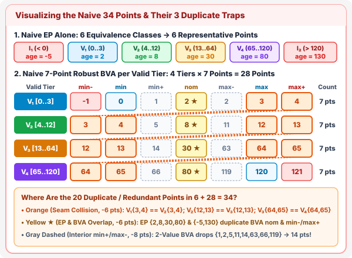

</div>
</div>

<!--
我們用兩頁完整講解游泳池年齡票價案例。第一頁先看清楚題目規格：整數年齡 0 到 120 歲分為 4 個連續有效票價級距（免費 0..3、兒童 4..12、全票 13..64、敬老 65..120），外加小於 0 與大於 120 兩個無效區間。接著看為什麼死板分開套用 EP 與 BVA 會算出 34 個點：單獨做 EP 有 6 類共 6 點；再對 4 個有效區間各自套用 7 點強固 BVA (4 x 7 = 28 點)，加起來就是 6 + 28 = 34 點！對照右方圖表可以一眼看出 20 個重複與冗餘點：橘色框是相鄰區間接縫碰撞（3與4、12與13、64與65 被上下兩列重複測了兩次，多出 6 點）、黃色星號框是 EP 代表值與 BVA 中心點及外圍越界點重疊（多出 6 點）、灰色虛線框則是 3 點 BVA 的內部鄰點 min+ 與 max-（多出 8 點）。下一頁我們看如何透過三步驟統一 SOP 縮減為 14 個精確測試點！

難字與專業術語解說：
- contiguous piecewise tiers: 連續分段級距（前一個有效區間的上限與下一個有效區間的下限緊密相連、無間隙的分段規格）
- seam collision: 接縫碰撞／重疊（前一段區間的 `max` 與 `max+` 恰好等於後一段區間的 `min-` 與 `min`，導致分開套用 BVA 時重複測試兩次）
-->
---
## EP 與 BVA 整合實戰 (2/2)：三步驟去重縮減法 (`34 → 14` 點)

> 將 <strong>BVA 視為 EP 區間內部的邊界取樣</strong>並於接縫處採用 <strong>2 點 BVA</strong>：每個有效級距取 <strong>`{min, nom, max}` (`4 × 3 = 12` 點) + `2` 個外圍越界點 (`-1, 121`) = `14` 個精確測試點</strong>！

<div class="split64">
<div class="left">

<div class="table-compact" style="font-size: 0.9em;">

| 步驟 1：EP 類別 | 步驟 2：接縫 | 步驟 3：統一取樣 (`14` 點) | 預期輸出與去重縮減方法 |
| :--- | :---: | :---: | :--- |
| <strong>I<sub>1</sub> (`age < 0`)</strong> | `-1 \| 0` | <strong>`-1`</strong> *(1 點：`min-` 與 `I₁`)* | `IllegalArgumentException`（合併 BVA `min-` 與 EP `I₁`） |
| <strong>V<sub>1</sub> (`0..3`)</strong> | `0, 3` | <strong>`0`, `2`, `3`</strong> *(3 點：`min,nom,max`)* | `FREE ($0)` —— `3` 同時自動作為 V<sub>2</sub> 的左越界 `min-`！ |
| <strong>V<sub>2</sub> (`4..12`)</strong> | `4, 12` | <strong>`4`, `8`, `12`</strong> *(3 點：`min,nom,max`)* | `CHILD ($100)` —— <strong>`4` 即 V<sub>1</sub> 的 `max+`；`12` 即 V<sub>3</sub> 的 `min-`！</strong> |
| <strong>V<sub>3</sub> (`13..64`)</strong> | `13, 64` | <strong>`13`, `30`, `64`</strong> *(3 點：`min,nom,max`)* | `ADULT ($250)` —— <strong>`13` 即 V<sub>2</sub> 的 `max+`；`64` 即 V<sub>4</sub> 的 `min-`！</strong> |
| <strong>V<sub>4</sub> (`65..120`)</strong> | `65, 120` | <strong>`65`, `80`, `120`</strong> *(3 點：`min,nom,max`)* | `SENIOR ($120)` —— <strong>`65` 即 V<sub>3</sub> 的 `max+`，零重複取樣！</strong> |
| <strong>I<sub>2</sub> (`age > 120`)</strong> | `120 \| 121` | <strong>`121`</strong> *(1 點：`max+` 與 `I₂`)* | `IllegalArgumentException`（合併 BVA `max+` 與 EP `I₂`） |

</div>

<div class="card" style="margin-top: 8px; padding: 8px 14px; border-left: 4px solid #059669; background: #f0fdf4; font-size: 13.2px; line-height: 1.38;">
<strong>三步驟縮減方法總結 (<code>34 - 20 = 14</code> 個精確測試點)：</strong><br/>
1. <strong>合併名義值與外圍無效點 (<code>-6</code> 點)：</strong> 以各級距的 <code>nom</code> (<code>2, 8, 30, 80</code>) 直接作為 EP 有效類代表；以外圍越界點 (<code>-1, 121</code>) 直接代表無效類 <code>I₁, I₂</code>。<br/>
2. <strong>共用內部接縫點 (<code>-6</code> 點) + 採用 2 點 BVA (<code>-8</code> 點)：</strong> 三處接縫 (<code>3|4</code>、<code>12|13</code>、<code>64|65</code>) 左右各取一點，總計 <code>4 × 3 + 2 = 14</code> 點！
</div>

</div>
<div class="right">

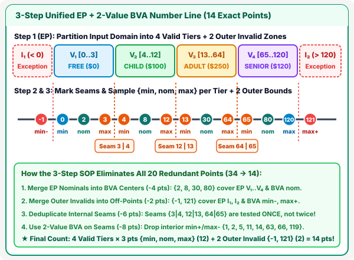

</div>
</div>

<!--
透過三步驟將 EP 與 BVA 統一整合——每個有效級距取樣 `{min, nom, max}`，加上外圍無效邊界的 `-1` 與 `121`——我們僅用 14 個測試值便達成 100% EP 與 100% BVA 涵蓋，且零重複。

難字與專業術語解說：
- contiguous piecewise partitions: 連續分段等價區間（前一個有效區間的右越界點 `max+` 恰好等於下一個有效區間的左邊界點 `min` 的規格結構）
-->
---
## 在 JUnit 5 中實作 EP：`assertThrows` 與資料驅動 `@CsvSource`

<div class="card-deck">

> 使用 `assertThrows` 每次隔離驗證一個**無效等價類**，並透過 `@CsvSource` / `@CsvFileSource` 乾淨地驅動**有效等價類**測試表。

<div class="two-columns">
<div class="card" data-marpit-fragment>

### 1. 無效等價分割 → `assertThrows`
- 嚴格落實**單一無效原則**：每一列僅注入一個無效輸入，同時讓其餘兩邊維持有效值 (`5, 5`)：
```java
@ParameterizedTest
@CsvSource({
    "-1,  5,  5", // 無效邊 a <= 0 (b, c 皆有效)
    " 5,  0,  5", // 無效邊 b <= 0 (a, c 皆有效)
    " 1,  2,  5"  // 違反三角不等式 a + b <= c
})
void testTriangleInvalidPartitions(int a, int b, int c) {
    IllegalArgumentException ex = assertThrows(
        IllegalArgumentException.class,
        () -> Triangle.classifyOrThrow(a, b, c)
    );
    assertTrue(ex.getMessage().contains("Invalid triangle"));
}
```

</div>
<div class="card" data-marpit-fragment>

### 2. 有效等價分割 → 外部 `@CsvSource` 規格表
- 將等價分割測試資料與測試邏輯解耦，讓業務分析師與 QA 能輕鬆擴充測試列：
```java
@ParameterizedTest(name = "NextDate({0}/{1}/{2}) => {3}")
@CsvSource({
    "2023,  5, 15, 2023/05/16", // TC1: M2 x D1 x Y2
    "2024,  2, 28, 2024/02/29", // TC2: M3 x D2 x Y1 (閏年)
    "2024,  2, 29, 2024/03/01", // TC3: M3 x D3 x Y1 (閏年換月)
    "2023,  4, 30, 2023/05/01", // TC4: M1 x D4 x Y2 (30天小月)
    "2023, 12, 31, 2024/01/01"  // TC5: M4 x D5 x Y2 (12月跨年!)
})
void testNextDateEquivalencePartitions(
        int y, int m, int d, String expected) {
    assertEquals(expected, NextDate.compute(y, m, d));
}
```

</div>
</div>
</div>

<!--
請注意 JUnit 5 表達等價分割法的優雅結構：`@CsvSource` 將分割規格表與斷言邏輯徹底分離，而 `assertThrows` 則在嚴格隔離狀態下驗證每一個無效分割。

難字與專業術語解說：
- data-driven testing (`@CsvSource`): 資料驅動測試（將測試輸入向量與預期輸出表格獨立於測試程式碼之外，由框架逐列載入執行的測試架構）
-->
---
<!-- id: ase-ch07-ccq2 -->
## 概念核對問答 (CCQ 2)：邊界值分析 (BVA)

<div class="ccq-columns">
<div class="ccq-text">

某軟體模組接受 **4 個彼此獨立的整數輸入**，每個輸入的合法範圍皆限制在 `[1, 100]`。請問採用**獨立型一般邊界值分析 (Independent Normal BVA)** 與**獨立型強固邊界值分析 (Independent Robustness BVA)** 分別需要多少個測試案例？

- **A.** 一般 BVA 需 16 個測試案例；強固 BVA 需 24 個測試案例。
- **B.** 一般 BVA 需 17 個測試案例；強固 BVA 需 25 個測試案例。
- **C.** 一般 BVA 需 20 個測試案例；強固 BVA 需 28 個測試案例。
- **D.** 一般 BVA 需 625 個測試案例；強固 BVA 需 2,401 個測試案例。

</div>
<div class="ccq-logo">
  <a href="https://nlhsueh.github.io/nickedupocket/#/student/ase-ch07-ccq2" target="_blank"></a>
</div>
</div>

<!--
讓我們透過概念核對問答 CCQ 2 檢驗各位對 BVA 公式的掌握程度。
-->

---
## 概念核對問答 (CCQ 2)：解答與解析

- **正確答案：B**
- **解析說明：**
  - 在**單一錯誤假設 (Single Fault Assumption)** 下，針對 `n = 4` 個輸入變數：
    - <strong>獨立型一般 BVA (Independent Normal BVA)</strong> 套用公式 `4n + 1` = `4(4) + 1 = 17` 個測試案例（每個變數在固定其他變數為 `norm` 下各測 `min, min+, max-, max` 4 個邊界點，外加 1 個全員皆為 `norm` 的中心基準案例）。
    - <strong>獨立型強固 BVA (Independent Robustness BVA)</strong> 套用公式 `6n + 1` = `6(4) + 1 = 25` 個測試案例（為 4 個變數各自額外加上 `min-` 與 `max+` 兩個越界點）。
  - *為何其他選項錯誤：* 選項 A 忘記加上 `+ 1` 的全員 `norm` 中心點；選項 C 將 `norm` 重複計算了 4 次；選項 D 則誤算為最壞情況笛卡爾乘積公式（`5`<sup>`4`</sup> `= 625` 與 `7`<sup>`4`</sup> `= 2401`）。

<!--
正確答案為 **B**：一般 BVA 為 `4(4) + 1 = 17` 個案例，強固 BVA 為 `6(4) + 1 = 25` 個案例。
-->
---
## 🧩 7.3 自我練習 (1/2)：進階 BVA 公式與幾何陷阱

<div class="sp-quiz-stage" id="sp-quiz-73-1">
<div class="sp-mixed-grid">
<div class="sp-mixed-col">
<div class="sp-mc-card" data-ans="B">
<div class="sp-mc-stem">1. [單選題 — 25 分] 某飛控模組接受 3 個連續輸入 <code>(roll, pitch, yaw)</code>。工程師為了偵測多變數角落耦合缺陷，將測試套件由獨立型強固 BVA (<code>6n + 1</code>) 升級為最壞情況一般 BVA (<code>5ⁿ</code>)。請問測試案例總數如何變化？又犧牲了什麼檢查？</div>
<div class="sp-mc-opts">
<div class="sp-mc-opt" data-opt="A"><strong>A.</strong> 從 13 例增至 125 例；獲得越界例外檢查能力</div>
<div class="sp-mc-opt" data-opt="B"><strong>B.</strong> 從 19 例增至 125 例；獲得多變數角落耦合覆蓋，但失去 <code>min- / max+</code> 越界檢查</div>
<div class="sp-mc-opt" data-opt="C"><strong>C.</strong> 從 19 例增至 343 例；同時涵蓋多變數角落與無效越界邊界</div>
<div class="sp-mc-opt" data-opt="D"><strong>D.</strong> 從 13 例增至 243 例；犧牲了全員 <code>norm</code> 基準中心點</div>
</div>
</div>
<div class="sp-mc-card" data-ans="C">
<div class="sp-mc-stem">2. [單選題 — 25 分] 在三角形問題（<code>a, b, c ∈ [1, 200]</code>，<code>norm = 100</code>）中，為何 13 例獨立型一般 BVA 測試集會出現嚴重的「多樣性缺失」，進而漏測 <code>if (a != b &amp;&amp; b != c &amp;&amp; a != c)</code> 分支中的缺陷？</div>
<div class="sp-mc-opts">
<div class="sp-mc-opt" data-opt="A"><strong>A.</strong> 因為當 <code>min = 1</code> 時，<code>norm = 100</code> 違反了三角不等式 <code>a + b &gt; c</code></div>
<div class="sp-mc-opt" data-opt="B"><strong>B.</strong> 因為 <code>4n + 1</code> 僅測試如 <code>0</code> 與 <code>201</code> 的無效越界值</div>
<div class="sp-mc-opt" data-opt="C"><strong>C.</strong> 因為將兩個變數固定在 <code>norm = 100</code> 會迫使每筆測試至少有兩邊相等，產生 0 個不等邊三角形</div>
<div class="sp-mc-opt" data-opt="D"><strong>D.</strong> 因為必須使用 <code>5³ = 125</code> 最壞情況 BVA 才能產生正三角形</div>
</div>
</div>
</div>
<div class="sp-mixed-col">
<div class="sp-bank-bar">
<span class="sp-bank-label">[字彙庫] 易混淆公式題庫（9 選 3）：</span>
<span class="sp-chip" data-word="4n + 1">4n + 1</span>
<span class="sp-chip" data-word="6n + 1">6n + 1</span>
<span class="sp-chip" data-word="5ⁿ">5ⁿ</span>
<span class="sp-chip" data-word="7ⁿ">7ⁿ</span>
<span class="sp-chip" data-word="2ⁿ">2ⁿ</span>
<span class="sp-chip" data-word="n + 1">n + 1</span>
<span class="sp-chip" data-word="Single Fault Assumption">Single Fault Assumption</span>
<span class="sp-chip" data-word="Single Invalid Rule">Single Invalid Rule</span>
<span class="sp-chip" data-word="Cartesian Product">Cartesian Product</span>
</div>
<div class="sp-q-item" style="font-size: 13.4px; padding: 7px 11px;"><strong>3. [字彙庫填充 — 30 分]</strong> 獨立型一般 BVA (<span class="sp-slot is-active" data-ans="4n + 1">[ 1. 點擊詞彙 ]</span>) 與強固 BVA (<span class="sp-slot" data-ans="6n + 1">[ 2. 點擊詞彙 ]</span>) 皆立基於可靠度理論的 <span class="sp-slot" data-ans="Single Fault Assumption">[ 3. 點擊詞彙 ]</span>（單一錯誤假設），將其餘 <code>n - 1</code> 個變數固定於 <code>norm</code>。</div>
<div class="sp-q-item" style="font-size: 13.4px; padding: 7px 11px;"><strong>4. [無字彙庫 — 輸入精確術語 — 20 分]</strong> 由於獨立型 BVA 將三角形的兩邊固定於 <code>100</code>，它測試了等腰與正三角形，卻完全漏測了 <span class="sp-free-input" data-ans="Scalene|Scalene triangle|Scalene triangles|不等邊|不等邊三角形" data-placeholder="輸入三角形類型..."></span> 三角形。</div>
</div>
</div>
<div class="sp-footer-bar">
<div class="sp-btn-group">
<button type="button" class="sp-btn sp-btn-submit">送出並檢視得分</button>
<button type="button" class="sp-btn sp-btn-reset">↺ 重新作答</button>
</div>
<div class="sp-score-msg">提示 (Part 1/2)：完成 2 題單選 + 3 個公式字彙槽 + 1 題自由輸入術語後，點擊送出！</div>
</div>
</div>

<!--
自我練習 7.3 (Part 1/2) 考驗學生對 BVA 數學權衡（`6n + 1 = 19` vs. `5^3 = 125`）、三角形多樣性缺失的幾何成因、易混淆 BVA／組合公式（`4n+1`、`6n+1`、`5^n`、`7^n`、`2^n`、`n+1`、單一錯誤假設 vs. 單一無效原則），以及直接輸入「不等邊 (Scalene)」的掌握度。
-->
---
## 🧩 7.3 自我練習 (2/2)：等價分割法、`NextDate` 與 JUnit 5

<div class="sp-quiz-stage" id="sp-quiz-73-2">
<div class="sp-mixed-grid">
<div class="sp-mixed-col">
<div class="sp-mc-card" data-ans="C">
<div class="sp-mc-stem">1. [單選題 — 25 分] 某核貸引擎有 3 個輸入，其有效等價類個數為 <code>|V₁|=4, |V₂|=3, |V₃|=2</code>，無效等價類個數為 <code>|I₁|=2, |I₂|=2, |I₃|=1</code>。請問滿足「弱有效 EP + 單一無效原則」與「強有效 EP + 單一無效原則」分別至少需要多少個測試案例？</div>
<div class="sp-mc-opts">
<div class="sp-mc-opt" data-opt="A"><strong>A.</strong> 弱 + 無效：4 例 | 強 + 無效：24 例</div>
<div class="sp-mc-opt" data-opt="B"><strong>B.</strong> 弱 + 無效：5 例 | 強 + 無效：29 例</div>
<div class="sp-mc-opt" data-opt="C"><strong>C.</strong> 弱 + 無效：9 例 (<code>4 + 5</code>) | 強 + 無效：29 例 (<code>24 + 5</code>)</div>
<div class="sp-mc-opt" data-opt="D"><strong>D.</strong> 弱 + 無效：9 例 | 強 + 無效：120 例 (<code>6 × 5 × 3</code>)</div>
</div>
</div>
<div class="sp-mc-card" data-ans="D">
<div class="sp-mc-stem">2. [單選題 — 25 分] 在 <code>NextDate(month, day, year)</code> 中，若工程師粗心地將 12 月併入 31 天大月分割 <code>{1,3,5,7,8,10,12}</code>，並在 <code>Day = 31</code> 的弱 EP 測試中挑選 <code>7 月 (July)</code> 作為代表值，哪一條關鍵邏輯分支將 100% 被漏測？</div>
<div class="sp-mc-opts">
<div class="sp-mc-opt" data-opt="A"><strong>A.</strong> 閏年 2 月 29 日的換月進位分支 (<code>month + 1, day = 1</code>)</div>
<div class="sp-mc-opt" data-opt="B"><strong>B.</strong> 30 天小月的非法日期拒絕分支（例如 <code>4 月 31 日</code>）</div>
<div class="sp-mc-opt" data-opt="C"><strong>C.</strong> 月中一般日期的遞增分支 (<code>day = day + 1</code>)</div>
<div class="sp-mc-opt" data-opt="D"><strong>D.</strong> 跨年元旦進位分支 (<code>year = year + 1; month = 1; day = 1</code>)</div>
</div>
</div>
</div>
<div class="sp-mixed-col">
<div class="sp-bank-bar">
<span class="sp-bank-label">[字彙庫] 易混淆 EP 與 JUnit 題庫（8 選 2）：</span>
<span class="sp-chip" data-word="max(|V₁|, |V₂|, ...)">max(|V₁|, |V₂|, ...)</span>
<span class="sp-chip" data-word="|V₁| × |V₂| × ...">|V₁| × |V₂| × ...</span>
<span class="sp-chip" data-word="|V₁| + |V₂| + ...">|V₁| + |V₂| + ...</span>
<span class="sp-chip" data-word="Single Invalid Rule">Single Invalid Rule</span>
<span class="sp-chip" data-word="Single Fault Assumption">Single Fault Assumption</span>
<span class="sp-chip" data-word="assertAll">assertAll</span>
<span class="sp-chip" data-word="assertThrows">assertThrows</span>
<span class="sp-chip" data-word="@CsvSource">@CsvSource</span>
</div>
<div class="sp-q-item" style="font-size: 13.4px; padding: 7px 11px;"><strong>3. [字彙庫填充 — 25 分]</strong> 弱一般 EP 將有效組合壓縮至 <span class="sp-slot is-active" data-ans="max(|V₁|, |V₂|, ...)">[ 1. 點擊詞彙 ]</span> 個基底測試案例；在 JUnit 5 中，將多個邊界檢查包裹於 <span class="sp-slot" data-ans="assertAll">[ 2. 點擊詞彙 ]</span> 內部，可防止第一個斷言失敗遮蔽後續的邊界缺陷。</div>
<div class="sp-q-item" style="font-size: 13.4px; padding: 7px 11px;"><strong>4. [無字彙庫 — 輸入精確術語 — 25 分]</strong> 當兩個無效輸入（<code>age = -5</code> 與 <code>zip = "bad"</code>）被合併在同一筆測試案例中時，第一個例外會在第二項檢查執行前就中止程式——此現象稱為 <span class="sp-free-input" data-ans="Fault Masking|Error Masking|Masking|缺陷遮蔽|錯誤遮蔽" data-placeholder="輸入專有術語..."></span>。</div>
</div>
</div>
<div class="sp-footer-bar">
<div class="sp-btn-group">
<button type="button" class="sp-btn sp-btn-submit">送出並檢視得分</button>
<button type="button" class="sp-btn sp-btn-reset">↺ 重新作答</button>
</div>
<div class="sp-score-msg">提示 (Part 2/2)：完成 2 題單選 + 2 個字彙槽 + 1 題自由輸入術語後，點擊送出！</div>
</div>
</div>

<!--
自我練習 7.3 (Part 2/2) 檢驗學生對弱／強 EP 搭配單一無效原則的定量計算（`max(4,3,2) + (2+2+1) = 9` vs. `4*3*2 + 5 = 29`）、`NextDate` 將 12 月獨立為 `M4` 的必要性、易混淆 EP／JUnit 字彙（`max` vs. 乘積 vs. 總和；`assertAll` vs. `assertThrows`），以及自由輸入「缺陷遮蔽 (Fault Masking)」的掌握度。
-->
---
## 📝 7.3 申論實戰案例：外送運費試算引擎 (EP 與 BVA)

<div class="sp-essay-hero">
<div class="sp-essay-visual">
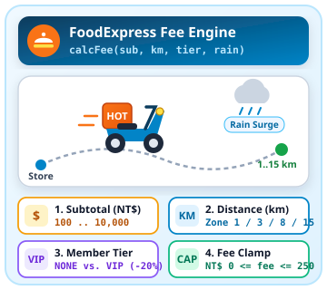
</div>
<div class="sp-prose-spec">
<div class="sp-prose-header"><span class="sp-prose-badge">案例敘述</span><span>業務需求規格（請自行閱讀並歸納等價分割與邊界點！）</span></div>
<p>FoodExpress 透過 <code>calcFee(subtotal, distanceKm, memberTier, isRainyPeak)</code> 計算外送運費。餐點小計低於 <strong>NT$ 100</strong> 或高於 <strong>NT$ 10,000</strong> 的訂單將拋出例外拒絕。基本運費起跳為 <strong>NT$ 60</strong>；當餐點小計達 <strong>NT$ 300</strong> 以上時降至 <strong>NT$ 35</strong>；達 <strong>NT$ 800</strong> 以上則享<strong>免基本運費 (NT$ 0)</strong>。</p>
<p>外送距離接受 <strong>1 km 至 15 km</strong> 的整數公里（超出範圍拒絕）：前 <strong>3 km</strong> 不收里程加價；<strong>4 至 8 km</strong> 針對超過 3 km 的部分每公里加收 <strong>NT$ 10/km</strong>；超過 <strong>8 km</strong> 則收 <strong>NT$ 50 + 超過 8 km 部分每公里 NT$ 20/km</strong>。雨天尖峰時段 (<code>isRainyPeak = true</code>) 額外加收 <strong>+NT$ 30</strong>。<code>VIP</code> 會員（相較於 <code>NONE</code>）在小計 &gt;= 300 時免收基本運費，且總運費再享 <strong>8 折 (20% off)</strong>；最終運費上下限鎖定於 <strong>NT$ 0 .. NT$ 250</strong>。</p>
</div>
</div>

<div class="sp-essay-grid-2col" id="sp-essay-food-73">
<div class="sp-essay-card">
<div class="sp-essay-q">
<strong>申論任務 1：歸納等價分割 (EP)</strong> —— 辨識全部 4 個輸入的有效類 (<code>V</code>) 與無效類 (<code>I</code>)，並推導在<strong>弱 EP + 單一無效原則</strong>下的最少測試案例數。
</div>
<div class="sp-essay-toggle">[揭曉答案] 點擊揭曉 EP 歸納與測試數量</div>
<div class="sp-essay-ans">
• <code>subtotal</code>：<strong>V₁</strong> [100..299] ($60), <strong>V₂</strong> [300..799] ($35), <strong>V₃</strong> [800..10000] ($0) | <strong>I₁</strong> (&lt;100), <strong>I₂</strong> (&gt;10000)<br/>
• <code>distanceKm</code>：<strong>D₁</strong> [1..3] (+$0), <strong>D₂</strong> [4..8] (+$10/km), <strong>D₃</strong> [9..15] (+$50+$20/km) | <strong>I₃</strong> (&lt;1), <strong>I₄</strong> (&gt;15)<br/>
• <code>memberTier</code>：<strong>M₁</strong> {NONE}, <strong>M₂</strong> {VIP} &nbsp;|&nbsp; <code>isRainyPeak</code>：<strong>R₁</strong> {false}, <strong>R₂</strong> {true}<br/>
• <strong>總計：</strong><code>max(3,3,2,2) = 3</code> 個有效基底 + <code>4</code> 個隔離無效案例 (<code>I₁..I₄</code>) = <strong>7 個 EP 測試案例</strong>！
</div>
</div>
<div class="sp-essay-card card-bva">
<div class="sp-essay-q">
<strong>申論任務 2：推導邊界值分析 (BVA) 接縫點</strong> —— 列出 <code>subtotal</code> 與 <code>distanceKm</code> 的所有數值計價接縫與精確邊界測試點，以攔截差一錯誤。
</div>
<div class="sp-essay-toggle">[揭曉答案] 點擊揭曉 BVA 接縫測試點</div>
<div class="sp-essay-ans">
• <strong>小計接縫 (<code>dist=2, NONE, false</code>)：</strong>下界 (<code>99</code> 拋例外 | <code>100, 101</code> $60) • 級距 S→M (<code>299</code> $60 | <code>300</code> $35) • 級距 M→L (<code>799</code> $35 | <code>800</code> $0) • 上界 (<code>10000</code> $0 | <code>10001</code> 拋例外)<br/>
• <strong>距離接縫 (<code>sub=500, NONE, false</code>)：</strong>橫跨 3 大里程分區臨界點取樣 <strong><code>{0 (拋例外), 1, 3, 4, 8, 9, 15, 16 (拋例外)}</code></strong> km！
</div>
</div>
</div>

<!--
在第 7.3 節的這道申論實戰案例中，外送運費規則以真實世界的非結構化業務敘述呈現，而非預先整理好的條列清單。學生必須先閱讀敘述文字，自行歸納出 4 個輸入變數、有效與無效等價分割區間，以及精確的 BVA 接縫點，接著再點擊揭曉結構化解答。我們將在第 7.4 節末尾再次回到同一個案例，進一步套用全成對測試 (Pairwise) 與屬性基礎測試 (PBT)！
-->
---
## 🧩 7.3 互動矩陣遊戲：FoodExpress EP 等價分割與 BVA 接縫挑戰

<div class="fdg-stage" id="fdg-ep-bva-game">
<div class="fdg-board-card">
<div class="fdg-board-title">面板 A：5 × 5 EP 等價分割矩陣（<code>Subtotal</code> 小計橫列 × <code>Distance</code> 距離直行）</div>
<table class="fdg-table" id="fdg-ep-table">
<thead>
<tr>
<th style="width: 20%;">小計 \ 距離</th>
<th style="width: 16%; color: #fda4af;">I₃: &lt; 1 km<br/>(0 km)</th>
<th style="width: 16%; color: #86efac;">D₁: 1..3 km<br/>(+$0)</th>
<th style="width: 16%; color: #86efac;">D₂: 4..8 km<br/>(+$10/km)</th>
<th style="width: 16%; color: #86efac;">D₃: 9..15 km<br/>(+$50+$20)</th>
<th style="width: 16%; color: #fda4af;">I₄: &gt; 15 km<br/>(16 km)</th>
</tr>
</thead>
<tbody id="fdg-ep-tbody"></tbody>
</table>
<div class="fdg-seam-box">
<div class="fdg-seam-title">面板 B：<code>Subtotal</code> 小計 BVA 接縫數線（在 BVA 挑戰中點選精確的邊界測試點）</div>
<div class="fdg-chips-wrap" id="fdg-seam-chips">
<span class="fdg-seam-chip" data-val="50">$50</span>
<span class="fdg-seam-chip" data-val="99">$99</span>
<span class="fdg-seam-chip" data-val="100">$100</span>
<span class="fdg-seam-chip" data-val="101">$101</span>
<span class="fdg-seam-chip" data-val="200">$200</span>
<span class="fdg-seam-chip" data-val="299">$299</span>
<span class="fdg-seam-chip" data-val="300">$300</span>
<span class="fdg-seam-chip" data-val="301">$301</span>
<span class="fdg-seam-chip" data-val="500">$500</span>
<span class="fdg-seam-chip" data-val="799">$799</span>
<span class="fdg-seam-chip" data-val="800">$800</span>
<span class="fdg-seam-chip" data-val="801">$801</span>
<span class="fdg-seam-chip" data-val="5000">$5000</span>
<span class="fdg-seam-chip" data-val="9999">$9999</span>
<span class="fdg-seam-chip" data-val="10000">$10000</span>
<span class="fdg-seam-chip" data-val="10001">$10001</span>
</div>
</div>
</div>
<div class="fdg-ctrl-card">
<div class="bvag-spec-box">
<strong>[規則回顧] FoodExpress <code>calcFee(subtotal, distanceKm)</code>：</strong><br/>
• <strong>餐點小計 (<code>NT$</code>)</strong>：合法範圍 <code>100..10000</code>（<code>&lt;100</code> 或 <code>&gt;10000</code> 拒絕）。級距：<strong>V₁</strong> <code>100..299</code> ($60)、<strong>V₂</strong> <code>300..799</code> ($35)、<strong>V₃</strong> <code>800..10000</code> ($0 免基本費)。<br/>
• <strong>外送距離 (<code>km</code>)</strong>：合法範圍 <code>1..15</code>（<code>&lt;1</code> 或 <code>&gt;15</code> 拒絕）。里程區：<strong>D₁</strong> <code>1..3</code> (+$0)、<strong>D₂</strong> <code>4..8</code> (+$10/km)、<strong>D₃</strong> <code>9..15</code> (+$50+$20/km)。
</div>
<div class="bvag-mission-box">
<div class="bvag-round-row">
<span class="bvag-round-pill" id="fdg-round-pill">挑戰 1 / 4（隨機排序）</span>
<span class="bvag-stat-pill" id="fdg-score-pill">已過關: 0 / 4 | 已選取: 0</span>
</div>
<div class="bvag-target-title" id="fdg-target-title">目標策略：載入中...</div>
<div class="bvag-target-hint" id="fdg-target-desc">請點擊面板 A 的矩陣儲存格（或面板 B 的接縫數值標籤）以建構測試套件，完成後點擊 <strong>送出答案 (Submit Selection)</strong>！</div>
</div>
<div class="bvag-quick-bar">
<span style="font-size: 11.5px; font-weight: 800; color: #475569;">快速輔助：</span>
<button type="button" class="bvag-qbtn" data-fdact="diag3">± 3 個對角線有效格</button>
<button type="button" class="bvag-qbtn" data-fdact="valid9">± 全部 9 個有效格</button>
<button type="button" class="bvag-qbtn" data-fdact="iso4">± 4 個隔離無效格</button>
<button type="button" class="bvag-qbtn" data-fdact="clear">✕ 全部清除</button>
</div>
<div class="bvag-action-row">
<button type="button" class="bvag-btn" id="fdg-btn-submit">送出答案 (Submit Selection)</button>
<button type="button" class="bvag-btn btn-next" id="fdg-btn-next">下一關挑戰 ➔</button>
<button type="button" class="bvag-btn btn-reset" id="fdg-btn-reshuffle">↺ 重新洗牌 4 關</button>
</div>
<div class="bvag-feedback-box" id="fdg-feedback-msg">請在左側選取儲存格或邊界數值標籤，以符合目標挑戰要求！</div>
</div>
</div>

<!--
第 61 頁的這項四關卡互動遊戲緊密呼應第 60 頁的 FoodExpress 運費規格：讓學生在 5x5 矩陣上親手選取等價分割組合（弱一般 EP、強一般 EP、遵循單一無效原則的弱強固 EP），並在小計數線上選取精確的二點法 On-Off 邊界接縫值（`99, 100, 299, 300, 799, 800, 10000, 10001`）！
-->
---
<!-- _class: lead -->
<!-- header: '7.4 組合測試、狀態機與屬性測試' -->

# **7.4 組合測試 (Pairwise)、狀態轉換與屬性基礎測試**

> 「當多參數組合爆炸使窮舉測試成為不可能時，全成對組合測試 (Pairwise) 以數學的優雅捕捉了 90% 的交互作用缺陷——而狀態機與屬性基礎測試則征服了有狀態與無限輸入值域。」

<!--
現在我們進入第 7.4 節，全面整合 SQA 教材第 5.5 節（全成對組合測試 All-Pairs / Pairwise Testing）、第 5.8 節（狀態轉換測試 State Transition Testing）以及第 5.11 節（屬性基礎測試 Property-Based Testing 與變質測試 Metamorphic Testing）。

難字與專業術語解說：
- pairwise (all-pairs) testing: 全成對組合測試（確保系統中任意兩個輸入參數的所有取值配對皆至少在測試集中出現過一次的組合壓縮測試技術）
-->
---
## 組合爆炸與 NIST 雙因子交互作用理論 (Pairwise)

<div class="split64">
<div class="left">

* <strong>組合爆炸問題 (The Combinatorial Explosion Problem)：</strong>
  - 一個擁有 `10` 個設定參數、每個參數有 `3` 種可能取值的系統畫面，若採用窮舉強等價分割 (Strong EP)，竟需要 <strong>3<sup>10</sup> = 59,049</strong> 組測試案例！
* <strong>NIST 實證研究發現 (Kuhn et al.)：</strong>
  - 橫跨航太、醫療設備、瀏覽器與資料庫的缺陷庫統計顯示，<strong>67% 至 93% 的軟體故障</strong>皆由<strong>單一參數 (1-way)</strong> 或<strong>僅兩個參數之間的交互作用 (2-way)</strong> 所觸發！
  - 需要 3 個（含）以上參數同時取特定值才會引爆的缺陷佔比 `< 10%`。
* <strong>全成對組合 (All-Pairs / Pairwise) 保證與游泳池案例：</strong>
  - <strong>核心法則：</strong> 保證<strong>任意兩個參數的所有可能取值配對 `(v`<sub>`i`</sub>`, v`<sub>`j`</sub>`)` 皆至少在同一組測試案例中共同出現過一次</strong>。
  - <strong>游泳池票價 (`TimeSlot(3) × DayType(2) × Member(2)`)：</strong>
    - 完整笛卡爾乘積 = `3 × 2 × 2 = 12` 組案例 → <strong>Pairwise 僅需 6 組測試案例即可 100% 涵蓋全部 16 個成對組合（縮減 50%）！</strong>

</div>
<div class="right">

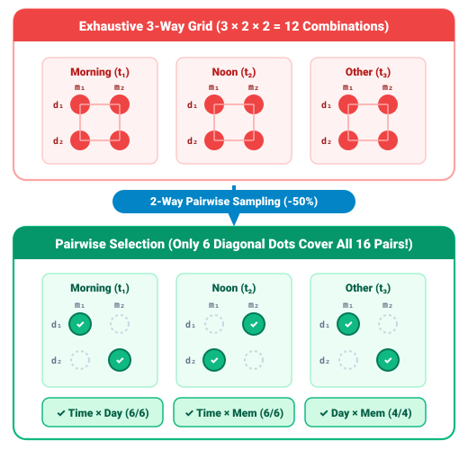

</div>
</div>

<!--
美國國家標準暨技術研究院 (NIST) 的實證研究揭露，67% 到 93% 的多變數軟體臭蟲最多僅由兩個變數同時交互作用 (2-way interaction) 所觸發。因此，透過全成對組合測試 (Pairwise Testing) 涵蓋所有雙參數配對，即可用極小的測試集攔截絕大多數的交互作用缺陷。

難字與專業術語解說：
- 2-way interaction fault: 雙因子交互作用缺陷（當且僅當兩個特定輸入參數同時取特定值時才會觸發的軟體錯誤）
-->
---
## 互動式手推設計：交錯法 (Alternating Method) 6 步建構全成對表

<div class="alt-interactive-stage" id="alt-pairwise-explorer">
<div class="alt-nav-toolbar">
  <div class="alt-step-group">
    <button type="button" class="alt-step-btn is-active" data-alt-step="1">1. 排 W (留空列)</button>
    <button type="button" class="alt-step-btn" data-alt-step="2">2. 交錯填 X</button>
    <button type="button" class="alt-step-btn" data-alt-step="3">3. 填 Y (列4-5調)</button>
    <button type="button" class="alt-step-btn" data-alt-step="4">4. 填 Z (列7-8調)</button>
    <button type="button" class="alt-step-btn" data-alt-step="5">5. 填 P (列1-2調)</button>
    <button type="button" class="alt-step-btn" data-alt-step="6">6. 填 Q (補空列)</button>
  </div>
  <div style="display: flex; gap: 6px;">
    <button type="button" class="greedy-action-btn" id="alt-next-btn">下一步 &gt;</button>
    <button type="button" class="greedy-action-btn" id="alt-reset-btn">重置</button>
  </div>
</div>
<div class="alt-content-grid">
  <div class="alt-card">
    <table class="alt-table" id="alt-matrix-table">
      <thead>
        <tr>
          <th>列</th>
          <th data-col="0" class="is-col-active">W (3)</th>
          <th data-col="1">X (2)</th>
          <th data-col="2">Y (2)</th>
          <th data-col="3">Z (2)</th>
          <th data-col="4">P (2)</th>
          <th data-col="5">Q (2)</th>
        </tr>
      </thead>
      <tbody>
        <tr data-r="1"><td class="alt-row-num">1</td><td class="is-new-col">w1</td><td></td><td></td><td></td><td></td><td></td></tr>
        <tr data-r="2"><td class="alt-row-num">2</td><td class="is-new-col">w1</td><td></td><td></td><td></td><td></td><td></td></tr>
        <tr data-r="3" class="is-buffer-row"><td class="alt-row-num">3</td><td>(預留)</td><td></td><td></td><td></td><td></td><td></td></tr>
        <tr data-r="4"><td class="alt-row-num">4</td><td class="is-new-col">w2</td><td></td><td></td><td></td><td></td><td></td></tr>
        <tr data-r="5"><td class="alt-row-num">5</td><td class="is-new-col">w2</td><td></td><td></td><td></td><td></td><td></td></tr>
        <tr data-r="6" class="is-buffer-row"><td class="alt-row-num">6</td><td>(預留)</td><td></td><td></td><td></td><td></td><td></td></tr>
        <tr data-r="7"><td class="alt-row-num">7</td><td class="is-new-col">w3</td><td></td><td></td><td></td><td></td><td></td></tr>
        <tr data-r="8"><td class="alt-row-num">8</td><td class="is-new-col">w3</td><td></td><td></td><td></td><td></td><td></td></tr>
      </tbody>
    </table>
    <div class="alt-legend-row">
      <span><span class="alt-legend-dot" style="background:#bae6fd;border:1px solid #0284c7;"></span>本步新增欄位</span>
      <span><span class="alt-legend-dot" style="background:#fde68a;border:1px solid #d97706;"></span>交錯對調 (⇄)</span>
      <span><span class="alt-legend-dot" style="background:#bbf7d0;border:1px solid #16a34a;"></span>空列補洞 (列3,6)</span>
    </div>
  </div>
  <div class="alt-card">
    <div>
      <div style="display:flex;justify-content:space-between;align-items:center;border-bottom:1.5px solid #e2e8f0;padding-bottom:8px;margin-bottom:10px;">
        <span class="ep-badge-pill ep-badge-blue" id="alt-step-badge" style="margin:0;">步驟 1 / 6</span>
        <span style="font-size:12px;font-weight:800;color:#475569;" id="alt-scope-label">變數：W(3)</span>
      </div>
      <h3 class="ep-title-text" id="alt-step-title" style="font-size:16.5px;margin-bottom:8px;">依取值數降冪排列，填寫 W 並預留空列</h3>
      <div class="alt-kpi-row" style="margin-bottom:10px;">
        <div class="alt-kpi-box">
          <div class="alt-kpi-label">目前啟用測試列數</div>
          <div class="alt-kpi-val" id="alt-kpi-rows">6 列</div>
        </div>
        <div class="alt-kpi-box">
          <div class="alt-kpi-label">對照全乘積 (壓縮率)</div>
          <div class="alt-kpi-val" id="alt-kpi-comp">3 組</div>
        </div>
      </div>
      <ul class="alt-guide-list" id="alt-guide-list">
        <li><strong>最多值放最左：</strong>先將具備最多可能值的變數 <code>W (w1, w2, w3)</code> 放最左欄，其餘變數依取值數由大到小向右排列。</li>
        <li><strong>依下一欄倍數重複：</strong>因下一個變數 <code>X</code> 有 2 種取值，故每個 <code>w</code> 重複寫 2 列（列 1–2、4–5、7–8）。</li>
        <li><strong>預留緩衝空列：</strong>刻意保留<strong>列 3 與列 6</strong> 為空白列，留待後續變數無法靠對調補齊時用來補洞！</li>
      </ul>
    </div>
    <div class="alt-mnemonic-box" id="alt-mnemonic-box">
      <strong>交錯法核心口訣：</strong>最多值放最左、組間預留空列；新增欄位依序輪流對調（<code>Y</code> 調列 4–5 ➔ <code>Z</code> 調列 7–8 ➔ <code>P</code> 調列 1–2），輪滿後再用預留空列 <code>3, 6</code> 補齊缺口！
    </div>
  </div>
</div>
</div>

<!--
交錯法（Alternating / Interleaving Method）是全成對組合測試（Pairwise Testing）最直覺的手工設計技術。在進入 NP-Hard 與電腦貪婪演算法前，本頁以 6 個變數 W(3) × X(2) × Y(2) × Z(2) × P(2) × Q(2)（全乘積高達 96 組）為例，透過 6 步互動引導展示如何以「最多值放最左 + 組間預留緩衝空列 + 輪流對調區塊」僅用 8 列即完成 100% 全成對覆蓋（縮減 91.7%）。
-->
---
## 為何最小成對組合屬於 NP-Hard？貪婪啟發式演算法解析

<div class="card-deck">

> 尋找絕對最小筆數的 Pairwise 測試集在數學上等價於 <strong>NP-Hard 最小集合覆蓋問題 (Minimum Set Cover Problem)</strong>；實務工具皆採用多項式時間的貪婪啟發式演算法。

<div class="two-columns">
<div class="card" data-marpit-fragment>

### 數學複雜度：最小集合覆蓋 (Minimum Set Cover)
- <strong>問題化約 (Problem Reduction)：</strong>
  - 在 `k` 個參數下，全宇集 `U` 包含 `∑ (|V_i| × |V_j|)` 個取值配對（例如游泳池案例共有 `6 + 6 + 4 = 16` 個配對）。
  - 每一筆測試案例最多能覆蓋 `C(k, 2)` 個配對。
  - 尋找能覆蓋 `U` 中所有配對的最少列數屬於 <strong>NP-Complete / NP-Hard</strong> 問題。
- <strong>工程實務影響：</strong>
  - 窮舉搜尋全局最小值會呈指數級爆炸；我們改用高速貪婪啟發式演算法！

</div>
<div class="card" data-marpit-fragment>

### 工業級啟發式演算法：AETG 與 IPO + Greedy
- <strong>1. AETG (`Automatic Efficient Test Generator`)：</strong>
  - 逐列建立測試集，每次貪婪挑選能消除最多「尚未覆蓋配對」的候選測試列。
- <strong>2. IPO (`In-Parameter-Order` — NIST ACTS / AllPairs4J)：</strong>
  1. <strong>基底展開 (Base Expansion)：</strong> 先將前兩個規模最大的參數 `(T, D)` 展開為完整笛卡爾乘積列（`3 × 2 = 6` 列）。
  2. <strong>水平貪婪擴展 (Horizontal Greedy Extension)：</strong> 加入第 3 欄 (`M`)，在每一列評估候選值 `m1` 與 `m2` 能帶來的<strong>全新未覆蓋配對數</strong>並擇優填入！

</div>
</div>
</div>

<!--
為什麼計算最小 Pairwise 測試集是 NP-Hard 問題？因為這等同於經典的最小集合覆蓋問題 (Minimum Set Cover)。工業界工具如 NIST ACTS 與 Java 的 `AllPairs4J` 皆採用 IPO (In-Parameter-Order) 結合貪婪計分策略，先固定前兩欄的基底組合，再逐欄水平擴展並挑選能覆蓋最多新配對的參數值。

難字與專業術語解說：
- Minimum Set Cover Problem: 最小集合覆蓋問題（在組合優化中尋找最少子集合以涵蓋全宇集所有元素的經典 NP-Hard 問題）
-->
---
## 逐步追蹤 Greedy IPO 演算法：游泳池票價案例

<div class="greedy-interactive-stage" id="greedy-explorer">
<div class="greedy-nav-toolbar">
  <div class="greedy-step-group">
    <button class="greedy-step-btn is-active" data-step="1">1. (t₁, d₁)</button>
    <button class="greedy-step-btn" data-step="2">2. (t₁, d₂)</button>
    <button class="greedy-step-btn" data-step="3">3. (t₂, d₁)</button>
    <button class="greedy-step-btn" data-step="4">4. (t₂, d₂)</button>
    <button class="greedy-step-btn" data-step="5">5. (t₃, d₁)</button>
    <button class="greedy-step-btn" data-step="6">6. (t₃, d₂)</button>
  </div>
  <div style="display: flex; gap: 8px;">
    <button class="greedy-action-btn" id="greedy-next-btn">下一步 &gt;</button>
    <button class="greedy-action-btn" id="greedy-reset-btn">重置</button>
  </div>
</div>
<div class="greedy-content-grid">
  <div class="greedy-card">
    <div class="greedy-decision-box">
      <div style="display: flex; justify-content: space-between; align-items: center; margin-bottom: 2px;">
        <span style="font-size: 11.5px; font-weight: 800; color: #0284c7;" id="greedy-step-badge">STEP 1 OF 6</span>
        <span style="font-size: 11.5px; font-weight: 700; color: #475569;" id="greedy-base-info">基底：(Time = t₁, Day = d₁)</span>
      </div>
      <div class="greedy-eval-row">
        <div class="greedy-eval-item is-winner" id="greedy-eval-m1">
          <div class="greedy-eval-name">候選值 m₁ (會員 Member)</div>
          <div class="greedy-eval-score" id="greedy-score-m1">+3 個新配對</div>
          <div class="greedy-eval-pairs" id="greedy-pairs-m1">t₁d₁, t₁m₁, d₁m₁</div>
        </div>
        <div class="greedy-eval-item" id="greedy-eval-m2">
          <div class="greedy-eval-name">候選值 m₂ (非會員 Non-Member)</div>
          <div class="greedy-eval-score" id="greedy-score-m2">+3 個新配對</div>
          <div class="greedy-eval-pairs" id="greedy-pairs-m2">t₁d₁, t₁m₂, d₁m₂</div>
        </div>
      </div>
      <div class="greedy-winner-banner" id="greedy-winner-banner">
        <span>[貪婪勝出者]：<strong>m₁</strong> (同分平手決勝)</span>
        <span style="font-family: 'Fira Code', monospace; font-size: 12.5px;">Test Case: (t₁, d₁, m₁)</span>
      </div>
    </div>
    <div class="greedy-table-wrapper">
      <table class="greedy-table" id="greedy-trace-table">
        <thead>
          <tr>
            <th>列號</th>
            <th>基底 (T, D)</th>
            <th>貪婪計分比對</th>
            <th>勝出測試案例</th>
            <th>累計覆蓋配對</th>
          </tr>
        </thead>
        <tbody>
          <tr data-row="1" class="is-current">
            <td><strong>1</strong></td>
            <td>(t₁, d₁)</td>
            <td>m₁: +3 vs. m₂: +3</td>
            <td><strong>(t₁, d₁, m₁)</strong></td>
            <td><strong>3 / 16</strong></td>
          </tr>
          <tr data-row="2" class="is-pending">
            <td><strong>2</strong></td>
            <td>(t₁, d₂)</td>
            <td>m₁: +2 vs. m₂: +3</td>
            <td>(t₁, d₂, m₂)</td>
            <td>6 / 16</td>
          </tr>
          <tr data-row="3" class="is-pending">
            <td><strong>3</strong></td>
            <td>(t₂, d₁)</td>
            <td>m₁: +2 vs. m₂: +3</td>
            <td>(t₂, d₁, m₂)</td>
            <td>9 / 16</td>
          </tr>
          <tr data-row="4" class="is-pending">
            <td><strong>4</strong></td>
            <td>(t₂, d₂)</td>
            <td>m₁: +3 vs. m₂: +1</td>
            <td>(t₂, d₂, m₁)</td>
            <td>12 / 16</td>
          </tr>
          <tr data-row="5" class="is-pending">
            <td><strong>5</strong></td>
            <td>(t₃, d₁)</td>
            <td>m₁: +2 vs. m₂: +2</td>
            <td>(t₃, d₁, m₁)</td>
            <td>14 / 16</td>
          </tr>
          <tr data-row="6" class="is-pending">
            <td><strong>6</strong></td>
            <td>(t₃, d₂)</td>
            <td>m₁: +1 vs. m₂: +2</td>
            <td>(t₃, d₂, m₂)</td>
            <td>16 / 16</td>
          </tr>
        </tbody>
      </table>
    </div>
  </div>
  <div class="greedy-card greedy-progress-card">
    <div>
      <div class="greedy-prog-header">
        <span>成對覆蓋率 (Pairwise Coverage)</span>
        <span id="greedy-prog-stat">3 / 16 Pairs (19%)</span>
      </div>
      <div class="greedy-prog-bar-bg" style="margin-top: 5px;">
        <div class="greedy-prog-bar-fill" id="greedy-prog-bar" style="width: 18.75%;"></div>
      </div>
    </div>
    <div class="greedy-pairs-section">
      <div class="greedy-pairs-title">Time × Day (6 組配對 — 基底值域)</div>
      <div class="greedy-pairs-tags">
        <span class="greedy-pair-tag is-new" data-pair="t1d1">t₁d₁</span>
        <span class="greedy-pair-tag" data-pair="t1d2">t₁d₂</span>
        <span class="greedy-pair-tag" data-pair="t2d1">t₂d₁</span>
        <span class="greedy-pair-tag" data-pair="t2d2">t₂d₂</span>
        <span class="greedy-pair-tag" data-pair="t3d1">t₃d₁</span>
        <span class="greedy-pair-tag" data-pair="t3d2">t₃d₂</span>
      </div>
    </div>
    <div class="greedy-pairs-section">
      <div class="greedy-pairs-title">Time × Member (6 組配對)</div>
      <div class="greedy-pairs-tags">
        <span class="greedy-pair-tag is-new" data-pair="t1m1">t₁m₁</span>
        <span class="greedy-pair-tag" data-pair="t1m2">t₁m₂</span>
        <span class="greedy-pair-tag" data-pair="t2m1">t₂m₁</span>
        <span class="greedy-pair-tag" data-pair="t2m2">t₂m₂</span>
        <span class="greedy-pair-tag" data-pair="t3m1">t₃m₁</span>
        <span class="greedy-pair-tag" data-pair="t3m2">t₃m₂</span>
      </div>
    </div>
    <div class="greedy-pairs-section">
      <div class="greedy-pairs-title">Day × Member (4 組配對)</div>
      <div class="greedy-pairs-tags">
        <span class="greedy-pair-tag is-new" data-pair="d1m1">d₁m₁</span>
        <span class="greedy-pair-tag" data-pair="d1m2">d₁m₂</span>
        <span class="greedy-pair-tag" data-pair="d2m1">d₂m₁</span>
        <span class="greedy-pair-tag" data-pair="d2m2">d₂m₂</span>
      </div>
    </div>
  </div>
</div>
</div>

<!--
逐步追蹤 IPO + Greedy 演算法：點擊每一列可觀察系統如何根據候選值 `m1` 與 `m2` 所能覆蓋的「全新參數配對數」進行計分，並在短短 6 列內逐步達成全部 16 個成對組合的 100% 覆蓋！

難字與專業術語解說：
- In-Parameter-Order (IPO): 參數依序擴展演算法（先展開前兩個參數的笛卡爾積，再逐一水平加入新參數欄並以貪婪計分挑選能消除最多未覆蓋成對組合之值的多項式時間啟發式演算法）
-->
---
## Pairwise 測試自動化工具與房貸試算案例研究

<div class="split73">
<div class="left">

* <strong>工業級自動化 Pairwise 工具：</strong>
  - <strong>`AllPairs4J` (Java / JUnit 5 原生整合)：</strong> 純 Java 流暢建構器 API，可在 JUnit 5 `@TestFactory` 動態測試中直接生成 `List<Case>`！
  - <strong>Microsoft `PICT` (CLI)：</strong> 業界標準命令列產生器，支援 `.pict` 模型檔、負向測試與約束剪枝 (Constraint Pruning)。
  - <strong>NIST `ACTS`：</strong> 支援高強度 <strong>`t`-way 組合覆蓋</strong>（針對安全關鍵系統的 `3-way`、`4-way` 測試），內建 SAT 約束求解器。
* <strong>房貸試算 `LoanCalculator` 案例研究（`3 × 3 × 2 × 2 = 36` → `9` 組案例）：</strong>
  - <strong>4 個維度：</strong> `LoanYears`（`≤10`、`11..20`、`>20`）、`Amount`（`≤5M`、`6M`、`10M`）、`IsYouth`（`true/false`）、`IsMarried`（`true/false`）。
  - 完整笛卡爾乘積 = <strong>36 組案例</strong> → `AllPairs4J` <strong>僅用 9 組案例即達成 100% 雙因子成對覆蓋（大幅縮減 75%）</strong>！

</div>
<div class="right">


</div>
</div>

<!--
在房貸試算 (Mortgage Loan Calculator) 案例研究中，4 個參數共有 `3 × 3 × 2 × 2` 個分割區間，完整窮舉需要 36 組組合，而透過 `AllPairs4J` 可在 100% 覆蓋所有參數成對組合的前提下，將測試集壓縮至僅 9 組測試案例。

難字與專業術語解說：
- constraint pruning (SAT solver): 約束剪枝（利用布林可滿足性求解器在生成成對測試集時自動排除業務上互斥的非法參數組合，例如 `OS=iOS` 與 `Browser=IE`）
-->
---
## 🧩 Pairwise 解答表：`LoanCalculator` 9 組測試案例（完成 #8 與 #9！）

> <strong>隨堂挑戰：</strong>點擊 `#8` 與 `#9` <strong>右下角 4 個按鈕</strong>切換 `true` ↔ `false` 以補齊所有雙參數配對，完成後按 <strong>Submit</strong>！

<div id="pw-loan-table-quiz-tw">
<table>
<thead>
<tr>
<th style="width:65px;text-align:center;">案例</th>
<th style="width:140px;text-align:center;"><code>LoanYears</code> (3)</th>
<th style="width:120px;text-align:center;"><code>Amount</code> (3)</th>
<th style="width:130px;text-align:center;"><code>IsYouth</code> (2)</th>
<th style="width:130px;text-align:center;"><code>IsMarried</code> (2)</th>
<th style="text-align:left;">已覆蓋之關鍵成對組合 (2-Way Pairs)</th>
</tr>
</thead>
<tbody>
<tr><td style="text-align:center;"><strong>#1</strong></td><td style="text-align:center;"><code>≤ 10 yr</code> (5)</td><td style="text-align:center;"><code>≤ 5M</code> (4M)</td><td style="text-align:center;"><code>true</code></td><td style="text-align:center;"><code>true</code></td><td><code>(≤10, ≤5M)</code>, <code>(≤10, Y=T)</code>, <code>(≤10, M=T)</code>, <code>(≤5M, Y=T)</code>, <code>(≤5M, M=T)</code>, <code>(Y=T, M=T)</code></td></tr>
<tr><td style="text-align:center;"><strong>#2</strong></td><td style="text-align:center;"><code>≤ 10 yr</code> (5)</td><td style="text-align:center;"><code>6M</code></td><td style="text-align:center;"><code>false</code></td><td style="text-align:center;"><code>false</code></td><td><code>(≤10, 6M)</code>, <code>(≤10, Y=F)</code>, <code>(≤10, M=F)</code>, <code>(6M, Y=F)</code>, <code>(6M, M=F)</code>, <code>(Y=F, M=F)</code></td></tr>
<tr><td style="text-align:center;"><strong>#3</strong></td><td style="text-align:center;"><code>≤ 10 yr</code> (5)</td><td style="text-align:center;"><code>10M</code></td><td style="text-align:center;"><code>false</code></td><td style="text-align:center;"><code>true</code></td><td><code>(≤10, 10M)</code>, <code>(10M, Y=F)</code>, <code>(10M, M=T)</code>, <code>(Y=F, M=T)</code></td></tr>
<tr><td style="text-align:center;"><strong>#4</strong></td><td style="text-align:center;"><code>11..20 yr</code> (15)</td><td style="text-align:center;"><code>≤ 5M</code> (4M)</td><td style="text-align:center;"><code>false</code></td><td style="text-align:center;"><code>true</code></td><td><code>(11..20, ≤5M)</code>, <code>(11..20, Y=F)</code>, <code>(11..20, M=T)</code>, <code>(≤5M, Y=F)</code></td></tr>
<tr><td style="text-align:center;"><strong>#5</strong></td><td style="text-align:center;"><code>11..20 yr</code> (15)</td><td style="text-align:center;"><code>6M</code></td><td style="text-align:center;"><code>true</code></td><td style="text-align:center;"><code>false</code></td><td><code>(11..20, 6M)</code>, <code>(11..20, Y=T)</code>, <code>(11..20, M=F)</code>, <code>(6M, Y=T)</code>, <code>(Y=T, M=F)</code></td></tr>
<tr><td style="text-align:center;"><strong>#6</strong></td><td style="text-align:center;"><code>11..20 yr</code> (15)</td><td style="text-align:center;"><code>10M</code></td><td style="text-align:center;"><code>true</code></td><td style="text-align:center;"><code>false</code></td><td><code>(11..20, 10M)</code>, <code>(10M, Y=T)</code>, <code>(10M, M=F)</code></td></tr>
<tr><td style="text-align:center;"><strong>#7</strong></td><td style="text-align:center;"><code>&gt; 20 yr</code> (25)</td><td style="text-align:center;"><code>≤ 5M</code> (4M)</td><td style="text-align:center;"><code>true</code></td><td style="text-align:center;"><code>false</code></td><td><code>(&gt;20, ≤5M)</code>, <code>(&gt;20, Y=T)</code>, <code>(&gt;20, M=F)</code>, <code>(≤5M, M=F)</code></td></tr>
<tr style="background:#f0f9ff;"><td style="text-align:center;"><strong>#8</strong></td><td style="text-align:center;"><code>&gt; 20 yr</code> (25)</td><td style="text-align:center;"><code>6M</code></td><td style="text-align:center;"><button type="button" class="pw-sw-btn" data-id="c8y" style="min-width:86px;padding:2px 10px;border-radius:6px;border:2px solid #0284c7;background:#e0f2fe;color:#0369a1;font-family:monospace;font-weight:700;font-size:15px;cursor:pointer;">true ⇄</button></td><td style="text-align:center;"><button type="button" class="pw-sw-btn" data-id="c8m" style="min-width:86px;padding:2px 10px;border-radius:6px;border:2px solid #0284c7;background:#e0f2fe;color:#0369a1;font-family:monospace;font-weight:700;font-size:15px;cursor:pointer;">true ⇄</button></td><td id="pw-clue-8-tw" style="color:#0369a1;font-weight:600;"><code>(&gt;20, 6M)</code> + <em>請觀察 <code>&gt;20</code> 與 <code>6M</code> 還缺哪些配對？</em></td></tr>
<tr style="background:#f0f9ff;"><td style="text-align:center;"><strong>#9</strong></td><td style="text-align:center;"><code>&gt; 20 yr</code> (25)</td><td style="text-align:center;"><code>10M</code></td><td style="text-align:center;"><button type="button" class="pw-sw-btn" data-id="c9y" style="min-width:86px;padding:2px 10px;border-radius:6px;border:2px solid #0284c7;background:#e0f2fe;color:#0369a1;font-family:monospace;font-weight:700;font-size:15px;cursor:pointer;">true ⇄</button></td><td style="text-align:center;"><button type="button" class="pw-sw-btn" data-id="c9m" style="min-width:86px;padding:2px 10px;border-radius:6px;border:2px solid #0284c7;background:#e0f2fe;color:#0369a1;font-family:monospace;font-weight:700;font-size:15px;cursor:pointer;">true ⇄</button></td><td id="pw-clue-9-tw" style="color:#0369a1;font-weight:600;"><code>(&gt;20, 10M)</code> + <em>協助補齊剩餘的 <code>&gt;20</code> 配對！</em></td></tr>
</tbody>
</table>
<div style="display:flex;align-items:center;gap:12px;margin-top:8px;">
<button type="button" id="pw-loan-submit-tw" style="padding:5px 16px;border-radius:6px;border:none;background:#0284c7;color:#fff;font-weight:700;font-size:14.5px;cursor:pointer;">Submit 提交驗證</button>
<button type="button" id="pw-loan-reset-tw" style="padding:5px 12px;border-radius:6px;border:1px solid #94a3b8;background:#fff;color:#334155;font-weight:600;font-size:13.5px;cursor:pointer;">Reset 重設</button>
<div id="pw-loan-feedback-tw" style="font-size:14.5px;font-weight:600;color:#1e293b;"></div>
</div>
</div>
<script>
(function(){
  var root = document.getElementById('pw-loan-table-quiz-tw');
  if (!root || root.dataset.bound) return;
  root.dataset.bound = '1';
  var btns = root.querySelectorAll('.pw-sw-btn');
  var fb = root.querySelector('#pw-loan-feedback-tw');
  var clue8 = root.querySelector('#pw-clue-8-tw');
  var clue9 = root.querySelector('#pw-clue-9-tw');
  function setVal(b, v) {
    b.dataset.val = v;
    b.textContent = v + ' ⇄';
    b.style.background = v === 'true' ? '#e0f2fe' : '#fef3c7';
    b.style.borderColor = v === 'true' ? '#0284c7' : '#d97706';
    b.style.color = v === 'true' ? '#0369a1' : '#b45309';
  }
  btns.forEach(function(b){
    setVal(b, 'true');
    b.addEventListener('click', function(e){
      e.stopPropagation();
      setVal(b, b.dataset.val === 'true' ? 'false' : 'true');
      fb.textContent = '';
    });
  });
  root.querySelector('#pw-loan-submit-tw').addEventListener('click', function(e){
    e.stopPropagation();
    var v = {};
    btns.forEach(function(b){ v[b.dataset.id] = b.dataset.val; });
    var missing = [];
    if (v.c8m !== 'true') missing.push('#8 的 (6M, IsMarried=true)');
    if (v.c8y !== 'false' && v.c9y !== 'false') missing.push('#8 或 #9 的 (>20 yr, IsYouth=false)');
    if (v.c8m !== 'true' && v.c9m !== 'true') missing.push('#8 或 #9 的 (>20 yr, IsMarried=true)');
    var c8mOk = (v.c8m === 'true');
    var yFalseOk = (v.c8y === 'false' || v.c9y === 'false');
    btns.forEach(function(b){
      var ok = true;
      if (b.dataset.id === 'c8m' && !c8mOk) ok = false;
      if ((b.dataset.id === 'c8y' || b.dataset.id === 'c9y') && !yFalseOk) ok = false;
      b.style.background = ok ? '#dcfce7' : '#fee2e2';
      b.style.borderColor = ok ? '#16a34a' : '#dc2626';
      b.style.color = ok ? '#15803d' : '#b91c1c';
    });
    if (missing.length === 0) {
      fb.style.color = '#15803d';
      fb.innerHTML = '✅ <strong>答對了！達成 100% Pairwise 覆蓋（28/28 組配對）！</strong> <code>#8</code> 補齊了 <code>(6M, M=true)</code>，且 <code>(&gt;20, Y=false)</code> 與 <code>(&gt;20, M=true)</code> 皆已涵蓋！';
      clue8.innerHTML = '✅ <code>(&gt;20, 6M)</code>, <code>(6M, M=T)</code>, <code>(&gt;20, M=T)</code>' + (v.c8y === 'false' ? ', <code>(&gt;20, Y=F)</code>' : '');
      clue9.innerHTML = '✅ <code>(&gt;20, 10M)</code>' + (v.c9y === 'false' ? ', <code>(&gt;20, Y=F)</code>' : '') + ' — 全部 28 組配對 100% 完成！';
    } else {
      fb.style.color = '#b91c1c';
      fb.innerHTML = '❌ <strong>尚未達成 100% 成對覆蓋！</strong> 仍缺少：<code>' + missing.join('</code>、<code>') + '</code>。';
    }
  });
  root.querySelector('#pw-loan-reset-tw').addEventListener('click', function(e){
    e.stopPropagation();
    btns.forEach(function(b){ setVal(b, 'true'); });
    fb.textContent = '';
    clue8.innerHTML = '<code>(&gt;20, 6M)</code> + <em>請觀察 <code>&gt;20</code> 與 <code>6M</code> 還缺哪些配對？</em>';
    clue9.innerHTML = '<code>(&gt;20, 10M)</code> + <em>協助補齊剩餘的 <code>&gt;20</code> 配對！</em>';
  });
})();
</script>

<!--
讓我們一起透過檢查案例 #7 之後尚未被覆蓋的「雙參數配對」來推導案例 #8 與 #9：

第一步，觀察 `LoanYears × Amount`（`3 × 3 = 9` 組配對）：`≤ 10 yr` 與 `11..20 yr` 皆已分別與三種金額（`≤ 5M`、`6M`、`10M`）配對完畢，唯獨 `> 20 yr` 在案例 #7 僅與 `≤ 5M` 配對過。因此，案例 #8 與 #9 的前兩欄必然是 `(> 20 yr, 6M)` 與 `(> 20 yr, 10M)`！

第二步，針對案例 #8 (`> 20 yr`, `6M`)，檢查 `> 20 yr` 與 `6M` 還缺少什麼布林配對：在案例 #7 中，`> 20 yr` 已配過 `IsYouth = true` 與 `IsMarried = false`，故 `> 20 yr` 還缺 `IsYouth = false` 與 `IsMarried = true`；同時在案例 #2 與 #5 中，`6M` 都只配過 `IsMarried = false`，還沒配過 `IsMarried = true`！因此將 #8 設為 `(> 20 yr, 6M, false, true)` 即可一次補齊這四組缺失配對。

第三步，針對案例 #9 (`> 20 yr`, `10M`)，檢查 `10M × IsYouth`：在案例 #3 與 #6 中，`10M` 都只配過 `IsYouth = false`，從未與 `IsYouth = true` 配對過！因此案例 #9 的 `IsYouth` 必須設為 `true`（而 `IsMarried` 設為 `true` 或 `false` 皆可），如此僅用 9 組測試案例即達成全部 28 個成對組合的 100% 覆蓋。

難字與專業術語解說：
- pairwise coverage completion: 成對覆蓋完備性（檢驗所有參數兩兩配對組合皆至少在測試表中出現一次的驗證條件）
-->
---
## JUnit 5 中的 Pairwise 實作：AllPairs4J 與測試預言機策略

<div class="card-deck">

> `AllPairs4J` 僅負責生成<strong>壓縮後的輸入組合</strong>——我們必須搭配<strong>策略 A（動態不變量預言機）</strong>或<strong>策略 B（兩階段 `@CsvSource` 精確預言機）</strong>來驗證輸出結果！

<div class="two-columns">
<div class="card" data-marpit-fragment>

### 策略 A：動態不變量預言機 (`@TestFactory`)
- 在執行期動態生成 `List<Case>`，並斷言所有組合皆滿足<strong>領域上下界不變量</strong> (`50 ≤ price ≤ 200`)：
```java
AllPairs allPairs = new AllPairs.AllPairsBuilder()
    .withParameter(new Parameter("Time", "MORNING", "NOON", "OTHER"))
    .withParameter(new Parameter("Day",  "HOLIDAY", "WEEKDAY"))
    .withParameter(new Parameter("Mem",  "true", "false"))
    .build(); // 生成 6 組 Pairwise 測試案例

@TestFactory
Stream<DynamicTest> testPoolPairwiseInvariants() {
    return allPairs.getGeneratedCases().stream().map(c ->
        DynamicTest.dynamicTest(c.toString(), () -> {
            int p = Pool.calc(c.get("Time"), c.get("Day"), c.get("Mem"));
            assertTrue(p >= 50 && p <= 200);
        })
    );
}
```

</div>
<div class="card" data-marpit-fragment>

### 策略 B：兩階段精確預言機 (`AllPairs` → `@CsvSource`)
- <strong>階段 1：</strong> 使用 `AllPairs4J` 印出帶有 `TODO` 輸出佔位符的 6 列 `@CsvSource` 範本。
- <strong>階段 2：</strong> 工程師僅需針對這 <strong>6 列</strong>依據 SRS 人工算出精確票價，並執行 `assertEquals`：
```java
@ParameterizedTest
@CsvSource({ // 階段 1 自動生成輸入 -> 階段 2 人工填入精確預言機
    "MORNING, HOLIDAY, true,  100",
    "MORNING, WEEKDAY, false,  80",
    "NOON,    HOLIDAY, false, 200",
    "NOON,    WEEKDAY, true,   50",
    "OTHER,   HOLIDAY, true,  100",
    "OTHER,   WEEKDAY, false, 100"
})
void testPoolPairwiseExactOracle(Time t, Day d, boolean m, int expected) {
    assertEquals(expected, Pool.calc(t, d, m));
}
```

</div>
</div>
</div>

<!--
策略 A 可 100% 自動化執行，用來檢驗領域不變量與不崩潰冒煙屬性；策略 B 則將自動化的輸入壓縮與人工計算的 SRS 精確預期值結合，工程師只需為壓縮後的 6 列計算預期輸出。

難字與專業術語解說：
- `@TestFactory` (`DynamicTest`): JUnit 5 動態測試工廠（允許在執行期由程式碼迴圈或外部產生器動態建立並回傳多個獨立測試節點的機制）
-->
---
## 互動狀態機：路徑與覆蓋率探索器

<div class="sm-interactive-grid" id="sm-explorer">
<div class="sm-control-card">
<div class="sm-path-list">
<label class="sm-path-item is-checked"><input type="checkbox" class="sm-cb" value="1" checked /><span class="sm-path-label"><span class="sm-path-title">路徑 1：正常登機流程 (Happy Path)</span><span class="sm-path-seq">giveInfo ➔ payMoney ➔ print ➔ giveTicket</span></span></label>
<label class="sm-path-item"><input type="checkbox" class="sm-cb" value="2" /><span class="sm-path-label"><span class="sm-path-title">路徑 2：出票後取消退票</span><span class="sm-path-seq">giveInfo ➔ payMoney ➔ print ➔ cancel</span></span></label>
<label class="sm-path-item"><input type="checkbox" class="sm-cb" value="3" /><span class="sm-path-label"><span class="sm-path-title">路徑 3：付款後取消退款</span><span class="sm-path-seq">giveInfo ➔ payMoney ➔ cancel</span></span></label>
<label class="sm-path-item"><input type="checkbox" class="sm-cb" value="4" /><span class="sm-path-label"><span class="sm-path-title">路徑 4：預訂後未付款即取消</span><span class="sm-path-seq">giveInfo ➔ cancel</span></span></label>
<label class="sm-path-item"><input type="checkbox" class="sm-cb" value="5" /><span class="sm-path-label"><span class="sm-path-title">路徑 5：逾期未付款自動取消</span><span class="sm-path-seq">giveInfo ➔ payTimeExpire</span></span></label>
</div>
<div class="sm-btn-row">
<button type="button" class="sm-btn sm-btn-highlight" data-sm-action="node100">[示範] 100% 節點 / 75% 邊 (1+2+5)</button>
<button type="button" class="sm-btn" data-sm-action="all">全選 (100%)</button>
<button type="button" class="sm-btn" data-sm-action="clear">清除</button>
</div>
<div class="sm-coverage-box">
<div class="sm-cov-row">
<div class="sm-cov-header"><span>[Node] 狀態節點覆蓋率 (State Coverage)</span><span id="sm-node-stat">4 / 6 (67%)</span></div>
<div class="sm-cov-bar-bg"><div id="sm-node-bar" class="sm-cov-bar-fill" style="width: 66.7%; background: #0284c7;"></div></div>
</div>
<div class="sm-cov-row">
<div class="sm-cov-header"><span>[Edge] 狀態轉移覆蓋率 (Transition Coverage)</span><span id="sm-edge-stat">4 / 8 (50%)</span></div>
<div class="sm-cov-bar-bg"><div id="sm-edge-bar" class="sm-cov-bar-fill" style="width: 50%; background: #f59e0b;"></div></div>
</div>
<div id="sm-cov-note" style="font-size: 11px; font-weight: 700; color: #0369a1; margin-top: 2px;">提示：勾選不同測試路徑，即時觀察狀態節點與轉移邊的活化情形！</div>
</div>
</div>
<div class="sm-canvas-card">
<svg xmlns="http://www.w3.org/2000/svg" viewBox="0 0 940 445">
<defs>
<marker id="sm-arr" viewBox="0 0 10 10" refX="7" refY="5" markerWidth="6" markerHeight="6" orient="auto-start-reverse"><path d="M 0 1 L 9 5 L 0 9 z" fill="#0284c7" /></marker>
<marker id="sm-arr-cancel" viewBox="0 0 10 10" refX="7" refY="5" markerWidth="6" markerHeight="6" orient="auto-start-reverse"><path d="M 0 1 L 9 5 L 0 9 z" fill="#dc2626" /></marker>
</defs>
<rect width="940" height="445" fill="#ffffff" rx="10" />
<g transform="translate(20, 18)">
<text x="0" y="10" font-family="sans-serif" font-size="14px" font-weight="700" fill="#0b3c5d">航空訂票狀態機 (6 個狀態 / 8 條轉移邊)</text>
<line x1="560" y1="6" x2="595" y2="6" stroke="#0284c7" stroke-width="3" marker-end="url(#sm-arr)" />
<text x="605" y="10" font-family="sans-serif" font-size="12px" font-weight="700" fill="#0369a1">正常流程 (4)</text>
<line x1="710" y1="6" x2="745" y2="6" stroke="#dc2626" stroke-width="2.5" stroke-dasharray="6 3" marker-end="url(#sm-arr-cancel)" />
<text x="755" y="10" font-family="sans-serif" font-size="12px" font-weight="700" fill="#dc2626">取消 / 逾時 (4)</text>
</g>
<circle cx="48" cy="110" r="14" fill="#0f172a" />
<text x="48" y="140" font-family="sans-serif" font-size="12px" font-weight="700" fill="#475569" text-anchor="middle">Init</text>
<g class="sm-edge is-active" data-edge="giveInfo" data-paths="1,2,3,4,5">
<path d="M 62 110 L 140 110" class="sm-line" stroke="#0284c7" stroke-width="2.5" fill="none" marker-end="url(#sm-arr)" />
<rect x="66" y="86" width="68" height="19" fill="#e0f2fe" rx="4" />
<text x="100" y="99" font-family="monospace" font-size="11.5px" font-weight="700" fill="#0369a1" text-anchor="middle">giveInfo</text>
</g>
<g class="sm-state is-active" data-state="Made" data-paths="1,2,3,4,5">
<rect x="144" y="80" width="130" height="60" rx="12" class="sm-main-rect" fill="#eff6ff" stroke="#0284c7" stroke-width="2.4" />
<text x="209" y="104" font-family="sans-serif" font-size="15px" font-weight="700" fill="#0b3c5d" text-anchor="middle">Made</text>
<text x="209" y="124" font-family="sans-serif" font-size="11.5px" fill="#475569" text-anchor="middle">已建立訂位</text>
</g>
<g class="sm-edge is-active" data-edge="payMoney" data-paths="1,2,3">
<path d="M 274 110 L 386 110" class="sm-line" stroke="#0284c7" stroke-width="2.5" fill="none" marker-end="url(#sm-arr)" />
<rect x="294" y="86" width="74" height="19" fill="#e0f2fe" rx="4" />
<text x="331" y="99" font-family="monospace" font-size="11.5px" font-weight="700" fill="#0369a1" text-anchor="middle">payMoney</text>
</g>
<g class="sm-state is-active" data-state="Paid" data-paths="1,2,3">
<rect x="390" y="80" width="130" height="60" rx="12" class="sm-main-rect" fill="#eff6ff" stroke="#0284c7" stroke-width="2.4" />
<text x="455" y="104" font-family="sans-serif" font-size="15px" font-weight="700" fill="#0b3c5d" text-anchor="middle">Paid</text>
<text x="455" y="124" font-family="sans-serif" font-size="11.5px" fill="#475569" text-anchor="middle">已完成付款</text>
</g>
<g class="sm-edge is-active" data-edge="print" data-paths="1,2">
<path d="M 520 110 L 636 110" class="sm-line" stroke="#0284c7" stroke-width="2.5" fill="none" marker-end="url(#sm-arr)" />
<rect x="546" y="86" width="64" height="19" fill="#e0f2fe" rx="4" />
<text x="578" y="99" font-family="monospace" font-size="11.5px" font-weight="700" fill="#0369a1" text-anchor="middle">print</text>
</g>
<g class="sm-state is-active" data-state="Ticketed" data-paths="1,2">
<rect x="640" y="80" width="130" height="60" rx="12" class="sm-main-rect" fill="#eff6ff" stroke="#0284c7" stroke-width="2.4" />
<text x="705" y="104" font-family="sans-serif" font-size="15px" font-weight="700" fill="#0b3c5d" text-anchor="middle">Ticketed</text>
<text x="705" y="124" font-family="sans-serif" font-size="11.5px" fill="#475569" text-anchor="middle">已開立機票</text>
</g>
<g class="sm-edge is-active" data-edge="giveTicket" data-paths="1">
<path d="M 770 110 L 836 110 L 836 214" class="sm-line" stroke="#0284c7" stroke-width="2.5" fill="none" marker-end="url(#sm-arr)" />
<rect x="786" y="150" width="84" height="19" fill="#e0f2fe" rx="4" />
<text x="828" y="163" font-family="monospace" font-size="11.5px" font-weight="700" fill="#0369a1" text-anchor="middle">giveTicket</text>
</g>
<g class="sm-state is-active" data-state="Used" data-paths="1">
<rect x="760" y="220" width="152" height="64" rx="14" class="sm-main-rect" fill="#dcfce7" stroke="#15803d" stroke-width="2.6" />
<rect x="765" y="225" width="142" height="54" rx="10" fill="none" stroke="#15803d" stroke-width="1.3" />
<text x="836" y="246" font-family="sans-serif" font-size="15px" font-weight="700" fill="#166534" text-anchor="middle">Used (終態)</text>
<text x="836" y="266" font-family="sans-serif" font-size="11.5px" fill="#15803d" text-anchor="middle">已登機使用</text>
</g>
<g class="sm-edge" data-edge="cancel-made" data-paths="4">
<path d="M 235 140 L 235 275 L 356 275" class="sm-line" stroke="#dc2626" stroke-width="2.2" stroke-dasharray="6 3" fill="none" marker-end="url(#sm-arr-cancel)" />
<rect x="244" y="252" width="96" height="19" fill="#fee2e2" rx="4" />
<text x="292" y="265" font-family="monospace" font-size="11px" font-weight="700" fill="#b91c1c" text-anchor="middle">cancel (Path 4)</text>
</g>
<g class="sm-edge" data-edge="cancel-paid" data-paths="3">
<path d="M 455 140 L 455 256" class="sm-line" stroke="#dc2626" stroke-width="2.2" stroke-dasharray="6 3" fill="none" marker-end="url(#sm-arr-cancel)" />
<rect x="462" y="188" width="96" height="19" fill="#fee2e2" rx="4" />
<text x="510" y="201" font-family="monospace" font-size="11px" font-weight="700" fill="#b91c1c" text-anchor="middle">cancel (Path 3)</text>
</g>
<g class="sm-edge" data-edge="cancel-ticketed" data-paths="2">
<path d="M 685 140 L 685 275 L 564 275" class="sm-line" stroke="#dc2626" stroke-width="2.2" stroke-dasharray="6 3" fill="none" marker-end="url(#sm-arr-cancel)" />
<rect x="576" y="252" width="98" height="19" fill="#fee2e2" rx="4" />
<text x="625" y="265" font-family="monospace" font-size="11px" font-weight="700" fill="#b91c1c" text-anchor="middle">cancel (Path 2)</text>
</g>
<g class="sm-state" data-state="CancelledByCustomer" data-paths="2,3,4">
<rect x="360" y="260" width="200" height="64" rx="14" class="sm-main-rect" fill="#fef2f2" stroke="#dc2626" stroke-width="2.6" />
<rect x="365" y="265" width="190" height="54" rx="10" fill="none" stroke="#dc2626" stroke-width="1.3" />
<text x="460" y="286" font-family="sans-serif" font-size="14px" font-weight="700" fill="#b91c1c" text-anchor="middle">CancelledByCustomer</text>
<text x="460" y="306" font-family="sans-serif" font-size="11.5px" fill="#dc2626" text-anchor="middle">顧客主動取消 (終態)</text>
</g>
<g class="sm-edge" data-edge="expire" data-paths="5">
<path d="M 180 140 L 180 356" class="sm-line" stroke="#dc2626" stroke-width="2.2" stroke-dasharray="6 3" fill="none" marker-end="url(#sm-arr-cancel)" />
<rect x="72" y="205" width="102" height="19" fill="#fee2e2" rx="4" />
<text x="123" y="218" font-family="monospace" font-size="11px" font-weight="700" fill="#b91c1c" text-anchor="middle">payTimeExpire</text>
</g>
<g class="sm-state" data-state="CancelledNonPay" data-paths="5">
<rect x="108" y="360" width="198" height="64" rx="14" class="sm-main-rect" fill="#fef2f2" stroke="#dc2626" stroke-width="2.6" />
<rect x="113" y="365" width="188" height="54" rx="10" fill="none" stroke="#dc2626" stroke-width="1.3" />
<text x="207" y="386" font-family="sans-serif" font-size="14px" font-weight="700" fill="#b91c1c" text-anchor="middle">CancelledNonPay</text>
<text x="207" y="406" font-family="sans-serif" font-size="11.5px" fill="#dc2626" text-anchor="middle">逾期未付取消 (終態)</text>
</g>
</svg>
</div>
</div>

<!--
透過與這 5 條測試路徑互動，觀察「狀態節點覆蓋率 (State / Node Coverage)」與「狀態轉移邊覆蓋率 (Transition / Edge Coverage)」的關鍵差異。請注意：當選擇路徑 1+2+5 時，雖然已經達成 100% 狀態節點覆蓋（全部 6 個狀態方塊皆被點亮），但卻漏掉了 2 條取消轉移邊！唯有達成 100% 轉移邊覆蓋，才能確保完整的狀態機測試充分性。

難字與專業術語解說：
- state transition testing: 狀態轉換測試（依據系統在不同事件與條件下於有限狀態集合間流轉的行為模型設計測試路徑的技術）
- node coverage vs. edge coverage: 節點覆蓋對比邊覆蓋（節點覆蓋僅要求造訪各狀態，邊覆蓋則要求測試所有可能誘發狀態轉變之事件弧線）
-->
---
## 狀態覆蓋準則 (`Node` vs. `0-Switch` / `1-Switch`) 與 JUnit 5 `@Nested`

<div class="card-deck">

> <strong>轉移邊覆蓋 (Edge / 0-Switch)</strong> 嚴格包含 <strong>狀態節點覆蓋 (Node)</strong>；在 JUnit 5 中，可善用 `@BeforeEach` 與 `@Nested` 巢狀類別清晰映射狀態階層。

<div class="two-columns">
<div class="card" data-marpit-fragment>

### 狀態節點 (Node) vs. 轉移邊 (`0-Switch`) 覆蓋
- <strong>狀態覆蓋 (Node Coverage)：</strong> 造訪全部 6 個狀態，但僅跑路徑 `1+2+5` 雖達 `100% Node`，卻漏測 2 條取消邊（僅 `75% Edge`）！
- <strong>轉移覆蓋 (`0-Switch` / Edge — 強制基本底線)：</strong>
  - 透過 <strong>5 條路徑</strong>涵蓋全部 `8/8` 條轉移弧線：
    1. `giveInfo → payMoney → print → giveTicket` *(正常登機)*
    2. `giveInfo → payMoney → print → cancel` *(出票後取消)*
    3. `giveInfo → payMoney → cancel` *(付款後取消)*
    4. `giveInfo → cancel` *(預訂後取消)*
    5. `giveInfo → payTimeExpire` *(逾時自動取消)*
- <strong>負向狀態測試：</strong> 在各狀態觸發非法事件以驗證防衛條件！

</div>
<div class="card" data-marpit-fragment>

### 航空機票序列與狀態驗證 (`@Nested`)
```java
class AirlineReservationStateTest {
    AirlineTicket ticket;
    @BeforeEach void init() { ticket = new AirlineTicket(); } // Init

    @Test void happyPathReachesUsedAndRejectsCancel() { // Path 1 + Guard
        ticket.giveInfo("TPE-NRT"); // Init -> Made
        ticket.payMoney(12500);     // Made -> Paid
        ticket.print();             // Paid -> Ticketed
        ticket.giveTicket();        // Ticketed -> Used (Final)
        assertEquals(State.USED, ticket.getState());
        assertThrows(IllegalStateException.class, () -> ticket.cancel());
    }

    @Nested class WhenReservationMade { // 子狀態：Made
        @BeforeEach void book() { ticket.giveInfo("TPE-NRT"); }
        @Test void timeoutTransitionsToCancelledNonPay() { // Path 5
            ticket.payTimeExpire();
            assertEquals(State.CANCELLED_NON_PAY, ticket.getState());
        }
    }
}
```

</div>
</div>
</div>

<!--
轉移覆蓋 (Transition Coverage / 0-Switch) 是狀態機測試的強制最低基準。在右側程式碼中，我們透過觸發事件序列 (`giveInfo -> payMoney -> print -> giveTicket`) 測試航空訂票狀態機，斷言機票抵達預期終態 (`State.USED`)，並驗證負向狀態防衛條件（登機後呼叫 `cancel()` 必須拋出 `IllegalStateException`）。

難字與專業術語解說：
- Transition Coverage (0-Switch): 轉移覆蓋／零階轉換覆蓋（要求狀態機圖上的每一條轉移弧線皆至少被執行過一次，強度嚴格大於狀態節點覆蓋）
-->
---
## 🧩 互動實作練習：有界堆疊 (`cap = 3`) 狀態機測試

<div class="stk-lab-grid" id="stk-interactive-lab">
<div class="stk-ctrl-card">
<div class="stk-prompt-box">
<strong>任務：</strong> 為 <strong>有界堆疊 Bounded Stack (<code>max=3</code>)</strong> 建立狀態機模型並測試所有轉移：<br/>
• <strong>空堆疊 Empty (<code>n=0</code>)</strong>：禁止呼叫 <code>pop()</code>！<br/>
• <strong>滿堆疊 Full (<code>n=3</code>)</strong>：禁止呼叫 <code>push()</code>！
</div>
<svg xmlns="http://www.w3.org/2000/svg" id="stk-bucket-svg" viewBox="0 0 310 124" width="100%" height="114">
<rect width="310" height="124" rx="9" fill="#f8fafc" stroke="#cbd5e1" stroke-width="1.4" />
<text x="74" y="17" font-family="sans-serif" font-size="11" font-weight="800" fill="#0b3c5d" text-anchor="middle">實體堆疊 (cap=3)</text>
<path d="M 24 24 L 24 114 L 124 114 L 124 24" fill="none" stroke="#334155" stroke-width="3.2" stroke-linecap="round" stroke-linejoin="round" />
<g id="stk-slot-3" style="opacity: 0.18;">
<rect x="30" y="27" width="88" height="24" rx="5" fill="#f97316" stroke="#c2410c" stroke-width="1.4" />
<text x="74" y="43" font-family="monospace" font-size="11" font-weight="800" fill="#ffffff" text-anchor="middle">Item #3 (Top)</text>
</g>
<g id="stk-slot-2" style="opacity: 0.18;">
<rect x="30" y="55" width="88" height="24" rx="5" fill="#0284c7" stroke="#0369a1" stroke-width="1.4" />
<text x="74" y="71" font-family="monospace" font-size="11" font-weight="800" fill="#ffffff" text-anchor="middle">Item #2</text>
</g>
<g id="stk-slot-1" style="opacity: 0.18;">
<rect x="30" y="83" width="88" height="24" rx="5" fill="#059669" stroke="#047857" stroke-width="1.4" />
<text x="74" y="99" font-family="monospace" font-size="11" font-weight="800" fill="#ffffff" text-anchor="middle">Item #1</text>
</g>
<rect x="138" y="20" width="162" height="94" rx="8" fill="#ffffff" stroke="#cbd5e1" stroke-width="1.3" />
<text x="219" y="38" font-family="sans-serif" font-size="10.5" font-weight="800" fill="#64748b" text-anchor="middle">目前狀態 (CURRENT STATE)</text>
<text id="stk-cur-state-txt" x="219" y="61" font-family="monospace" font-size="14.5" font-weight="900" fill="#0284c7" text-anchor="middle">EMPTY (n=0)</text>
<line x1="148" y1="71" x2="290" y2="71" stroke="#e2e8f0" stroke-width="1.2" />
<text x="219" y="87" font-family="sans-serif" font-size="10" font-weight="700" fill="#475569" text-anchor="middle">允許事件 (Allowed Events)：</text>
<text id="stk-allowed-txt" x="219" y="103" font-family="monospace" font-size="10" font-weight="800" fill="#0369a1" text-anchor="middle">push() only [pop throws]</text>
</svg>
<div class="stk-btn-row">
<button type="button" class="stk-btn" id="stk-btn-push">+ push()</button>
<button type="button" class="stk-btn btn-pop" id="stk-btn-pop">- pop()</button>
<button type="button" class="stk-btn btn-reset" id="stk-btn-reset">↺ 重置</button>
</div>
<div class="stk-status-banner" id="stk-status-msg">就緒於 <code>Empty (size = 0)</code>。試著點擊 <code>- pop()</code> 或 <code>+ push()</code>！</div>
<div class="stk-cov-grid">
<div class="stk-cov-pill">已造訪狀態<strong id="stk-node-cov">1 / 3 (33%)</strong></div>
<div class="stk-cov-pill">已觸發轉移<strong id="stk-edge-cov">0 / 7 (0%)</strong></div>
</div>
</div>
<div class="stk-canvas-card">
<div class="stk-q-toolbar">
<div class="stk-q-box">
<div class="stk-q-title">Q1. 繪製狀態轉換圖 (STD)</div>
<div class="stk-q-desc"><code>BoundedStack(cap=3)</code> 共有幾個狀態？有哪些合法轉移與防衛條件（<code>[n==1]</code>、<code>[n==2]</code>、<code>Empty</code>、<code>Full</code>）？</div>
<button type="button" class="stk-switch-btn" id="stk-btn-toggle-std">[Switch ON] 顯示狀態轉換圖 (STD)</button>
</div>
<div class="stk-q-box q2-box">
<div class="stk-q-title">Q2. 設計測試案例 (100% 轉移 + 防衛例外)</div>
<div class="stk-q-desc">設計一條能涵蓋 <strong>100% 狀態 (3)</strong>、<strong>合法轉移 (5)</strong> 與 <strong>負向防衛例外 (2)</strong> 的測試序列！</div>
<button type="button" class="stk-switch-btn" id="stk-btn-toggle-tc">[Switch ON] 顯示測試案例與最佳序列</button>
</div>
</div>
<div class="stk-std-stage" id="stk-std-stage">
<div class="stk-std-placeholder">
<div style="font-size: 16px; font-weight: 800; color: #0b3c5d;">狀態轉換圖 (STD) 已隱藏供隨堂練習</div>
<div style="font-size: 13px; max-width: 580px;">1. 先操作左側的 <code>+ push()</code> 與 <code>- pop()</code>，觀察狀態變化與邊界例外。<br/>2. 在紙上構思你的<strong>狀態轉換圖 (STD)</strong> 與<strong>測試案例序列</strong>，完成後點擊上方 <strong>Switch ON</strong> 按鈕揭曉解答！</div>
</div>
<svg xmlns="http://www.w3.org/2000/svg" id="stk-sm-svg" viewBox="0 0 820 275" width="100%" height="100%">
<defs>
<marker id="stk-arr-b" viewBox="0 0 10 10" refX="7" refY="5" markerWidth="6" markerHeight="6" orient="auto-start-reverse"><path d="M 0 1 L 9 5 L 0 9 z" fill="#0284c7" /></marker>
<marker id="stk-arr-g" viewBox="0 0 10 10" refX="7" refY="5" markerWidth="6" markerHeight="6" orient="auto-start-reverse"><path d="M 0 1 L 9 5 L 0 9 z" fill="#059669" /></marker>
<marker id="stk-arr-r" viewBox="0 0 10 10" refX="7" refY="5" markerWidth="6" markerHeight="6" orient="auto-start-reverse"><path d="M 0 1 L 9 5 L 0 9 z" fill="#dc2626" /></marker>
</defs>
<rect width="820" height="275" fill="#ffffff" rx="10" />
<text x="16" y="20" font-family="sans-serif" font-size="13.5" font-weight="800" fill="#0b3c5d">有界堆疊 STD (3 個狀態 • 5 條合法轉移 [E1..E5] • 2 條防衛例外 [G1..G2])</text>
<circle cx="32" cy="148" r="10" fill="#0f172a" />
<text x="32" y="172" font-family="sans-serif" font-size="10.5" font-weight="700" fill="#475569" text-anchor="middle">new(3)</text>
<path d="M 42 148 L 88 148" stroke="#0f172a" stroke-width="2.4" marker-end="url(#stk-arr-b)" />
<g class="stk-sm-state is-current" id="stk-state-empty" transform="translate(92, 110)">
<rect width="160" height="76" rx="14" class="stk-node-rect" fill="#eff6ff" stroke="#0284c7" stroke-width="2.4" />
<text x="80" y="31" font-family="sans-serif" font-size="15.5" font-weight="800" fill="#0b3c5d" text-anchor="middle">1. Empty</text>
<text x="80" y="50" font-family="monospace" font-size="11.5" font-weight="700" fill="#0369a1" text-anchor="middle">size == 0</text>
<text x="80" y="66" font-family="sans-serif" font-size="10" font-weight="700" fill="#dc2626" text-anchor="middle">[禁止 pop()]</text>
</g>
<g class="stk-sm-state" id="stk-state-partial" transform="translate(346, 110)">
<rect width="176" height="76" rx="14" class="stk-node-rect" fill="#f0fdf4" stroke="#059669" stroke-width="2.4" />
<text x="88" y="31" font-family="sans-serif" font-size="15.5" font-weight="800" fill="#065f46" text-anchor="middle">2. Partial</text>
<text x="88" y="50" font-family="monospace" font-size="11.5" font-weight="700" fill="#047857" text-anchor="middle">0 &lt; size &lt; 3</text>
<text x="88" y="66" font-family="sans-serif" font-size="10" font-weight="700" fill="#059669" text-anchor="middle">[允許 push 與 pop]</text>
</g>
<g class="stk-sm-state" id="stk-state-full" transform="translate(616, 110)">
<rect width="164" height="76" rx="14" class="stk-node-rect" fill="#fff7ed" stroke="#ea580c" stroke-width="2.4" />
<text x="82" y="31" font-family="sans-serif" font-size="15.5" font-weight="800" fill="#9a3412" text-anchor="middle">3. Full</text>
<text x="82" y="50" font-family="monospace" font-size="11.5" font-weight="700" fill="#c2410c" text-anchor="middle">size == 3 (max)</text>
<text x="82" y="66" font-family="sans-serif" font-size="10" font-weight="700" fill="#dc2626" text-anchor="middle">[禁止 push()]</text>
</g>
<g class="stk-sm-edge" id="stk-edge-e1">
<path d="M 252 130 Q 299 98, 344 130" fill="none" stroke="#0284c7" stroke-width="2.5" marker-end="url(#stk-arr-b)" />
<rect x="255" y="86" width="88" height="21" rx="5" fill="#e0f2fe" stroke="#38bdf8" stroke-width="1" />
<text x="299" y="100" font-family="monospace" font-size="10.5" font-weight="800" fill="#0369a1" text-anchor="middle">E1: push()</text>
</g>
<g class="stk-sm-edge" id="stk-edge-e2">
<path d="M 344 168 Q 299 200, 252 168" fill="none" stroke="#059669" stroke-width="2.5" marker-end="url(#stk-arr-g)" />
<rect x="241" y="191" width="116" height="21" rx="5" fill="#d1fae5" stroke="#34d399" stroke-width="1" />
<text x="299" y="205" font-family="monospace" font-size="10.5" font-weight="800" fill="#065f46" text-anchor="middle">E2: pop() [n==1]</text>
</g>
<g class="stk-sm-edge" id="stk-edge-e3">
<path d="M 404 110 C 390 52, 478 52, 464 110" fill="none" stroke="#0284c7" stroke-width="2.4" marker-end="url(#stk-arr-b)" />
<rect x="348" y="34" width="172" height="22" rx="5" fill="#eff6ff" stroke="#7dd3fc" stroke-width="1" />
<text x="434" y="49" font-family="monospace" font-size="10.5" font-weight="800" fill="#0369a1" text-anchor="middle">E3: push[n=1] / pop[n=2]</text>
</g>
<g class="stk-sm-edge" id="stk-edge-e4">
<path d="M 522 130 Q 569 98, 614 130" fill="none" stroke="#0284c7" stroke-width="2.5" marker-end="url(#stk-arr-b)" />
<rect x="511" y="86" width="116" height="21" rx="5" fill="#e0f2fe" stroke="#38bdf8" stroke-width="1" />
<text x="569" y="100" font-family="monospace" font-size="10.5" font-weight="800" fill="#0369a1" text-anchor="middle">E4: push() [n==2]</text>
</g>
<g class="stk-sm-edge" id="stk-edge-e5">
<path d="M 614 168 Q 569 200, 522 168" fill="none" stroke="#059669" stroke-width="2.5" marker-end="url(#stk-arr-g)" />
<rect x="525" y="191" width="88" height="21" rx="5" fill="#d1fae5" stroke="#34d399" stroke-width="1" />
<text x="569" y="205" font-family="monospace" font-size="10.5" font-weight="800" fill="#065f46" text-anchor="middle">E5: pop()</text>
</g>
<g class="stk-sm-edge" id="stk-edge-g1">
<path d="M 145 186 C 125 246, 215 246, 195 186" fill="none" stroke="#dc2626" stroke-width="2.4" stroke-dasharray="5 3" marker-end="url(#stk-arr-r)" />
<rect x="74" y="236" width="196" height="22" rx="5" fill="#fee2e2" stroke="#f87171" stroke-width="1.2" />
<text x="172" y="251" font-family="monospace" font-size="10.5" font-weight="800" fill="#b91c1c" text-anchor="middle">G1: pop() ➔ EmptyStackEx!</text>
</g>
<g class="stk-sm-edge" id="stk-edge-g2">
<path d="M 670 186 C 650 246, 740 246, 720 186" fill="none" stroke="#dc2626" stroke-width="2.4" stroke-dasharray="5 3" marker-end="url(#stk-arr-r)" />
<rect x="600" y="236" width="196" height="22" rx="5" fill="#fee2e2" stroke="#f87171" stroke-width="1.2" />
<text x="698" y="251" font-family="monospace" font-size="10.5" font-weight="800" fill="#b91c1c" text-anchor="middle">G2: push() ➔ StackFullEx!</text>
</g>
</svg>
</div>
<div class="stk-tc-panel" id="stk-tc-panel">
<strong>• 達成 100% 轉移與防衛覆蓋 (共 7 條弧線) 之最佳 8 步測試序列：</strong><br/>
<code>1. pop() [G1: UnderflowEx] ➔ 2. push(A) [E1: 0➔1] ➔ 3. push(B) [E3: 1➔2] ➔ 4. push(C) [E4: 2➔3 Full] ➔ 5. push(D) [G2: OverflowEx] ➔ 6. pop() [E5: 3➔2] ➔ 7. pop() [E3: 2➔1] ➔ 8. pop() [E2: 1➔0 Empty]</code>
</div>
</div>
</div>

<!--
本互動練習引導學生為有界堆疊 (`capacity = 3`) 建立狀態機模型並設計測試案例。請特別注意為何有界堆疊具有 3 個抽象狀態而非 2 個：
1. <strong>Empty (`size == 0`)</strong>：僅允許 `push()` (`E1`)；若呼叫 `pop()` 會觸發負向防衛轉移 `G1` (`EmptyStackException`)。
2. <strong>Partial (`0 < size < 3`)</strong>：同時允許 `push()` 與 `pop()`！當 `size == 1` 時，`push()` 在 Partial 內自迴圈 (`E3`)，而 `pop()` 則返回 Empty (`E2`)；當 `size == 2` 時，`push()` 轉移至 Full (`E4`)，而 `pop()` 則在 Partial 內自迴圈 (`E3`)。
3. <strong>Full (`size == 3`)</strong>：僅允許 `pop()` (`E5`)；若呼叫 `push()` 會觸發負向防衛轉移 `G2` (`StackOverflowException` / `IllegalStateException`)。
-->
---
## 典範轉移：範例基礎測試 (EBT) vs. 屬性基礎測試 (PBT) 與 John Hughes

<div class="content-columns">
<div class="content-text">

* <strong>範例基礎測試 (Example-Based Testing, EBT) 的侷限：</strong> 人工挑選的單點測資（如 `add(2,3)==5`）易受確認偏誤影響，且經常漏掉角落溢位（`0, -1, MAX_VALUE`）。
* <strong>屬性基礎測試 (John Hughes, QuickCheck 2000)：</strong>
  - *「不要手寫單點測試——請宣告通用屬性 (Universal Properties)！」*
  - <strong>`jqwik` (`Java` + `QuickCheck`) 的三大自動化引擎：</strong>
    1. <strong>屬性宣告 (`@Property`)：</strong> 宣告所有合法輸入皆須滿足的通用領域不變量。
    2. <strong>資料產生器 (`@ForAll`)：</strong> 自動以 <strong>1,000 組隨機 + 邊界測資</strong>（`0, -1, MAX_VALUE, 空串列`）密集轟炸待測方法。
    3. <strong>反例自動收縮 (Shrinking)：</strong> 一旦發現失敗測資，自動透過二分搜尋將其收縮至<strong>最小可重現反例 (Minimal Counterexample)</strong>！

</div>
<div class="content-figure">

<div class="name-card">
  
  <div class="name-card-caption">
    <span class="name-card-name">Prof. John Hughes</span>
    <span class="name-card-cc">QuickCheck 共同發明人 (2000) / ACM Fellow</span>
  </div>
</div>

</div>
</div>

<!--
為什麼「自動收縮 (Shrinking)」是 Java `jqwik` 等屬性基礎測試框架的殺手級功能？因為當隨機產生的大型複雜輸入觸發錯誤時，`jqwik` 會自動執行二分搜尋收縮迴圈，替開發者找出最簡短、數值最小的失敗反例！

難字與專業術語解說：
- counterexample shrinking: 測資收縮／反例極小化（當隨機大測資觸發錯誤時，PBT 框架自動透過二分搜尋刪減元素與數值，找出能重現該 Bug 之最小最簡反例的演算法）
-->
---
## 1. 屬性基礎測試 (PBT)：通用不變量 (`@Property` 與 `@ForAll`)

<div class="split64">
<div class="left">

* <strong>核心方法論：</strong>
  - 以涵蓋 <strong>1,000+ 組自動生成輸入</strong> (`@ForAll`) 的<strong>通用不變量 `P(x, f(x)) == true`</strong>，取代寫死的單點範例 (`assertEquals(5, add(2,3))`)。
* <strong>案例 1 — 數學運算與二補數整數溢位：</strong>
  - 屬性：對所有 `int x`，`Math.abs(x) >= 0` → <strong>在 `x = Integer.MIN_VALUE` (`-2147483648`) 時失敗</strong>，瞬間抓出靜默整數溢位！
* <strong>案例 2 — 電商結帳金額保底 (`OrderDiscount`)：</strong>
  - 橫跨 1,000 組隨機 `(Tier, CartAmount, Coupon, Points)` 組合，必滿足 <strong>`0 <= finalPay <= originalPrice`</strong>（徹底封堵負數倒貼漏洞！）。
* <strong>案例 3 — 冪等性 (`f(f(x)) == f(x)`)：</strong>
  - 程式碼排版、URL/路徑正規化、`String.trim()` 或重複執行冪等 `PUT` 更新兩次，其結果必與執行一次完全相同。

</div>
<div class="right">

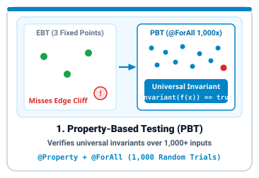

</div>
</div>

<!--
在傳統範例基礎測試 (EBT) 中，人工挑選的 3 個綠點帶來了虛假的安全感，卻漏掉了角落的邊界懸崖。而在屬性基礎測試 (PBT) 中，`@ForAll` 會以 1,000 組隨機與邊界加權測資對函式進行密集轟炸，並以通用不變量護盾加以檢驗。

難字與專業術語解說：
- Property-Based Testing (PBT): 屬性基礎測試（宣告系統在所有合法輸入下皆須遵守的通用數學不變量，由框架自動產生千組隨機測資尋找反例）
- idempotence: 冪等性（對同一輸入重複執行多次運算與僅執行一次運算所得結果完全相同的性質，即 `f(f(x)) == f(x)`）
-->
---
## 2. 往返可逆性 (Round-Trip) 與結構守恆模式

<div class="split64">
<div class="left">

* <strong>核心方法論：</strong>
  - 無須預先計算正確答案，即可透過<strong>往返可逆性 (`f⁻¹(f(x)) == x`)</strong> 或<strong>結構守恆律 (`invariant(f(x))`)</strong> 自動驗證 1,000 組隨機輸入。
* <strong>案例 1 — 編解碼、加解密與序列化往返：</strong>
  - `decrypt(encrypt(msg, k)) == msg`、`gunzip(gzip(b)) == b`、`Base64.decode(Base64.encode(s)) == s` 或 `fromJson(toJson(dto)).equals(dto)`。
* <strong>案例 2 — 串列反轉與排序結構守恆 (`jqwik`)：</strong>
  ```java
  @Property boolean reverseTwiceRestoresList(@ForAll List<Integer> xs) {
      List<Integer> copy = new ArrayList<>(xs);
      Collections.reverse(copy); Collections.reverse(copy);
      return copy.equals(xs); // 自動驗證 1,000 組隨機串列！
  }
  ```
  - <strong>排序 `Y = sort(L)`：</strong> 必須同時滿足 <strong>`Y.size() == L.size()`</strong>（元素個數守恆）且 <strong>`Y[i] <= Y[i+1]`</strong>（單調遞增順序）。

</div>
<div class="right">

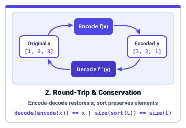

</div>
</div>

<!--
往返可逆測試 (Round-Trip Testing) 是序列化器、編譯器、加密與壓縮引擎的黃金標準：自動產生 1,000 個任意物件 `x`，將其編碼為 `y`，再將 `y` 解碼還原，並斷言還原結果完全等於原始 `x`。

難字與專業術語解說：
- round-trip property (invertibility): 往返可逆屬性（將原始資料經正向轉換與逆向還原後，必須百分百等於原始輸入的不變量）
-->
---
## 3. 測試案例自動收縮 (Shrinking：尋找最小反例)

<div class="split64">
<div class="left">

* <strong>核心方法論：</strong>
  - 當某組隨機輸入失敗時（例如 `amount = 48,752` 或長達 500 字元的字串），<strong>`jqwik` 的收縮引擎 (Shrinking Engine)</strong> 會自動透過二分搜尋將其收縮至<strong>最小可重現反例</strong>！
* <strong>案例 1 — 電商 `$3,000` 滿額折價懸崖 (`OrderDiscount`)：</strong>
  ```java
  @Property // 多買 $100 商品，結帳總額絕不能反而變便宜！
  boolean vipMonotonic(@ForAll @IntRange(min=100, max=50000) int amt) {
      return checkout(Tier.VIP, amt) <= checkout(Tier.VIP, amt + 100);
  }
  ```
  - <strong>隨機命中：</strong> `amt = 48,752` 觸發失敗 → <strong>僅經 6 步自動收縮至 `amt = 2901`</strong>（跨過 `> $3,000` 門檻時折價由 `$100` 暴增至 `$300`，導致買 `$3,001` 比買 `$2,901` 還便宜！）。
* <strong>案例 2 — 字串 / JSON 解析器崩潰：</strong>
  - 長達 600 字元的模糊測試崩潰字串，自動收縮為僅 2 個字元的最小觸發因子 `"\\\""`。

</div>
<div class="right">

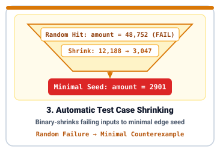

</div>
</div>

<!--
若沒有自動收縮機制，隨機模糊測試只會丟給開發者一個包含 500 個元素的陣列或像 `48,752` 這樣毫無頭緒的隨機數字，耗費數小時除錯。有了 `jqwik` Shrinking，框架會自動將失敗測資收斂至 `amount = 2901`，直接指出 `$3,000` 滿額門檻處的定價懸崖！

難字與專業術語解說：
- minimal counterexample: 最小反例（能觸發並重現某個軟體缺陷的最簡短、數值最小的輸入組合）
-->
---
## 4. 變質測試 (Metamorphic Testing, MT)：以兩次執行破解預言機難題

<div class="split64">
<div class="left">

* <strong>核心方法論：</strong>
  - 當<strong>單次執行 `y = f(x)` 無法得知標準答案（無精確預言機）</strong>時，對輸入施加變換 <strong>`x' = T(x)`</strong>，並檢驗<strong>兩次執行結果</strong>之間的<strong>變質關係 `MR(f(x), f(x'))`</strong>！
* <strong>案例 1 — 搜尋引擎子集合包含關係 (`y' ⊆ y`)：</strong>
  - 原始搜尋 `y = search("Java")` 回傳 `3,842` 筆結果（無從得知是否精確）；但加上限制條件的衍生搜尋 `y' = search("Java SQA")` 必然是其嚴格子集（`|y'| <= |y|`，例如 `128 <= 3,842`）。
* <strong>案例 2 — GPS 導航比例縮放與子路徑一致性：</strong>
  - 將所有道路權重同乘 2 倍（`× 2`）必須維持完全相同的最佳路線序列；若 `A → B → C` 是 `route(A, C)` 的最佳路徑，則 `B → C` 必為 `route(B, C)` 的最佳路徑。
* <strong>案例 3 — 編譯器最佳化等價性 (`-O0` vs. `-O3`)：</strong>
  - 在程式 `P → P'` 中插入永遠不會執行的死碼 (Dead Code)，編譯後執行輸出必須完全相同 `exec(compile(P)) == exec(compile(P'))`。

</div>
<div class="right">

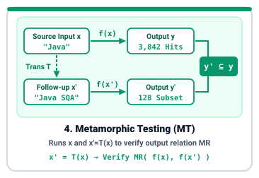

</div>
</div>

<!--
請注意 PBT 與 MT 的根本差異：PBT 是在單次執行上檢驗通用屬性 `P(x, f(x))`，而變質測試 (Metamorphic Testing) 則是執行<strong>兩次運算</strong>——原始執行 `y = f(x)` 與變換後的衍生執行 `y' = f(T(x))`——並斷言兩者輸出滿足關係不變量 `MR(y, y')`。

難字與專業術語解說：
- source run vs. follow-up run: 原始執行 vs. 衍生執行（變質測試中先以基準輸入 `x` 求得 `y`，再以變換後輸入 `x' = T(x)` 求得 `y'` 以比對關係 `MR(y, y')` 的兩階段執行）
-->
---
## 5. 領域單調性、對稱性與雜訊微擾變質關係 (MRs)

<div class="split64">
<div class="left">

* <strong>核心方法論：</strong>
  - 圍繞三大領域法則設計變質關係：<strong>單調性（方向次序）</strong>、<strong>對稱性（順序不變性）</strong>與<strong>雜訊強健性 (Noise Robustness)</strong>。
* <strong>案例 1 — 商業會員等級與房貸利率單調性：</strong>
  - <strong>電商結帳：</strong> 對任何相同購物車，必滿足 <strong>`pay(VIP) <= pay(REGULAR) <= pay(GUEST)`</strong>。
  - <strong>房貸試算 (`LoanCalculator`)：</strong> 提高貸款金額（`5M → 10M`）或具備青年／已婚優惠資格，利率<strong>絕不能反而上升</strong>。
* <strong>案例 2 — 排列對稱性 (`f(Permute(x)) == f(x)`)：</strong>
  - <strong>三角形分類：</strong> `classify(a, b, c).equals(classify(b, c, a))`；SQL `UNION` 查詢結果對集合順序具不變性。
* <strong>案例 3 — 無關雜訊微擾 (`f(x + noise) == f(x)`)：</strong>
  - 大小寫與空白 `search("  sqa ") == search("SQA")`；自駕車視覺加入輕微雨滴雜訊或 `2°` 傾角，仍須維持 `"Pedestrian"`（行人）辨識結果。

</div>
<div class="right">

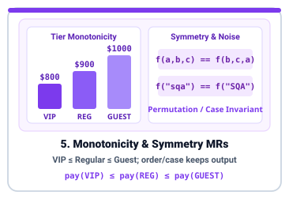

</div>
</div>

<!--
單調性、對稱性與雜訊微擾為 QA 工程師提供了源源不絕的自動化測試案例，特別適用於金融定價、機器學習與電腦視覺系統，無須為每一筆輸入耗費人工標註標準答案！

難字與專業術語解說：
- monotonicity invariant: 單調性不變量（當輸入沿特定方向遞增或會員等級提升時，輸出必須單調不減或單調不增的商業守恆律）
-->
---
## 6. 差分測試 (Differential Testing) 與 AI 系統之 LLM-as-a-Judge

<div class="split64">
<div class="left">

* <strong>核心方法論：</strong>
  - 將<strong>差分測試</strong>（以相同輸入比對多個獨立實作版本）與 <strong>LLM-as-a-Judge</strong>（基於評分規準的 AI 自動評測）相結合。
* <strong>案例 1 — 跨實作差分測試 (Cross-Implementation)：</strong>
  - <strong>編譯器驗證：</strong> 將相同 C 程式碼同時餵給 `GCC` 與 `Clang`——任何輸出分歧即代表潛在 Bug！
  - <strong>影子重構 (Shadow Refactoring)：</strong> 將線上真實請求平行送入 <strong>舊版 Legacy v1</strong> 與 <strong>重構版 v2</strong> 比對 (`assertEquals(v1(x), v2(x))`)。
* <strong>案例 2 — 跨模型 AI 迴歸測試 (`Baseline v1` vs. `Candidate v2`)：</strong>
  - 將提示詞 `x` 送入 `Model A(x)` 與 `Model B(x)`；自動標記語意相似度大幅滑落 (`Sim < 0.85`) 的退化案例。
* <strong>案例 3 — LLM-as-a-Judge 品質閘門 (`Score >= 0.90`)：</strong>
  - 針對 RAG / Agent 輸出自動評核<strong>忠實度 (Faithfulness，零幻覺)</strong>、<strong>回答相關性</strong>與<strong>安全護欄 (Safety Guardrails，零提示詞注入／個資外洩)</strong>。

</div>
<div class="right">

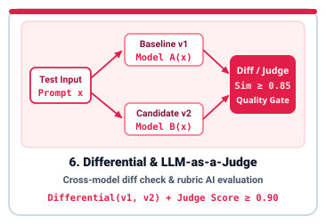

</div>
</div>

<!--
在 AWS、Volvo 與 Stripe 的工業界實務中，測試團隊遵循 <strong>80/20 黃金比例</strong>：80% 採用範例基礎測試（BVA / EP / Pairwise）驗證確定性商業規則，並搭配 20% 的屬性基礎測試、變質測試、差分測試與 LLM-as-a-Judge 來守護高複雜度與 AI 驅動的子系統。

難字與專業術語解說：
- differential testing: 差分測試（將相同測試輸入同時餵給多個獨立實作或新舊版本模型，藉由比對輸出差異來自動揭露異常的技術）
- LLM-as-a-Judge: 大型語言模型裁判（以高階推理模型依據結構化評分規準自動檢驗生成式 AI 輸出之忠實度、相關性與安全性的評測架構）
-->
---
<!-- _class: title-image-slide -->

## 綜合統整：屬性基礎測試與變質測試的六大核心支柱

<div class="image-wrapper">
  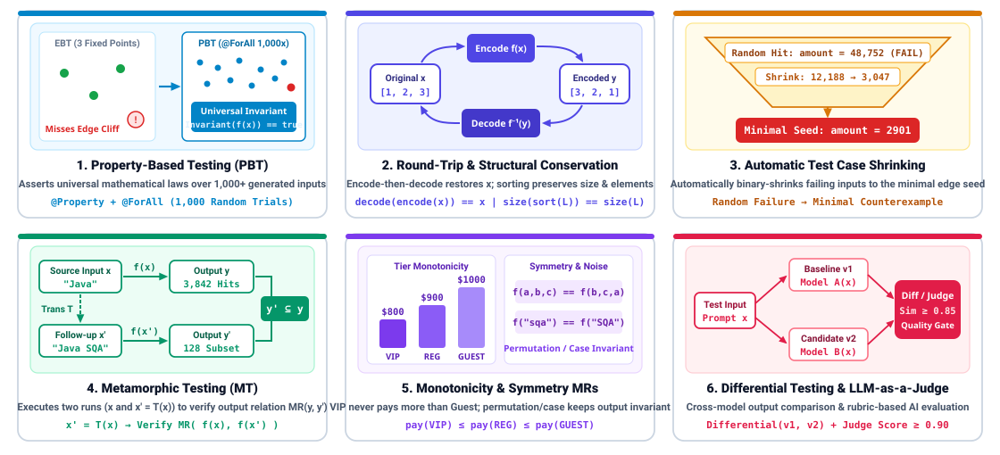
</div>

<!--
這張全景統整圖匯集了我們剛才深入探討的六大核心支柱：
1. <strong>屬性基礎測試 (PBT)</strong>（`@Property` + `@ForAll` 自動生成 1,000 組隨機測資）
2. <strong>往返可逆與結構守恆</strong>（`decode(encode(x)) == x`、`size(sort(L)) == size(L)`）
3. <strong>測試案例自動收縮 (Shrinking)</strong>（透過二分搜尋將失敗測資收斂至最小反例 `amount = 2901`）
4. <strong>變質測試 (MT)</strong>（透過兩次執行檢驗變換關係 `MR(f(x), f(T(x)))`）
5. <strong>單調性與對稱性變質關係</strong>（`pay(VIP) <= pay(REG) <= pay(GUEST)`、排列順序與雜訊不變性）
6. <strong>差分測試與 LLM-as-a-Judge</strong>（跨版本影子比對與基於評分規準的 AI 品質閘門）
-->
---
<!-- id: ase-ch07-ccq3 -->
## 概念核對問答 (CCQ 3)：組合測試 (Combinatorial Testing)

<div class="ccq-columns">
<div class="ccq-text">

某雲端部署儀表板擁有 <strong>10 個設定參數</strong>，每個參數皆提供 <strong>3 種可能選項</strong>。若執行完整窮舉測試共需 3<sup>10</sup> = 59,049 組測試案例。為什麼工程師在此情境下會採用<strong>全成對組合測試 (Pairwise / All-Pairs Testing)</strong>？

- **A.** 它僅需測試 10 組案例，就能保證所有巢狀迴圈達到 100% 白箱路徑覆蓋率。
- **B.** 它涵蓋任意兩個參數間的所有可能取值配對，僅需約 15–20 組測試即可捕捉絕大多數交互作用缺陷。
- **C.** 它將所有參數轉換為二元旗標，從而徹底免除撰寫預期輸出（測試預言機）的需求。
- **D.** 它限制每次僅變動單一變數，並將其餘 9 個變數固定為正常標稱常數以隔離錯誤。

</div>
<div class="ccq-logo">
  <a href="https://nlhsueh.github.io/nickedupocket/#/student/ase-ch07-ccq3" target="_blank"></a>
</div>
</div>

<!--
讓我們檢視關於全成對組合測試 (Pairwise Testing) 的概念核對問答 CCQ 3。
-->

---
## 概念核對問答 (CCQ 3)：解答與解析

- **正確答案：B**
- **解析：**
  - NIST 的實證研究證實，67% 至 93% 的軟體缺陷皆由單一參數或兩個參數之間的<strong>雙因子交互作用 (2-way interactions)</strong> 所觸發。
  - <strong>全成對組合測試 (Pairwise / All-Pairs Testing)</strong> 運用啟發式演算法（如 IPO + Greedy），保證任意兩個參數的每一種取值配對皆至少在一組測試案例中出現——將 59,049 種組合大幅壓縮至約 15–20 組測試。
  - *其他選項為何錯誤：* 選項 A 將黑箱組合測試與白箱路徑覆蓋混為一談；選項 C 錯誤，因為 Pairwise 產生器僅負責生成測試輸入，仍需搭配測試預言機（領域不變量或 `@CsvSource`）；選項 D 描述的是 `4n + 1` 單一故障假設之邊界值分析 (BVA)，而非成對組合覆蓋。

<!--
正確答案為 <strong>B</strong>。
-->
---
## 📝 7.4 延伸申論實作：美食外送運費引擎 (Pairwise 與 PBT)

<div class="sp-essay-hero">
<div class="sp-essay-visual">

</div>
<div class="sp-prose-spec">
<div class="sp-prose-header"><span class="sp-prose-badge">7.4 延伸實作</span><span>從 36 組強等價分割組合邁向 Pairwise 與屬性基礎測試</span></div>
<p>在第 7.3 節中，我們從 FoodExpress 敘述規格歸納出 <strong>4 個合法輸入因子</strong>：<code>subtotal</code>（<strong>3 個級距</strong>：<code>100..299</code>、<code>300..799</code>、<code>800..10000</code>）、<code>distanceKm</code>（<strong>3 個里程區</strong>：<code>1..3</code>、<code>4..8</code>、<code>9..15</code>）、<code>memberTier</code>（<strong>2 種等級</strong>：<code>NONE, VIP</code>）以及 <code>isRainyPeak</code>（<strong>2 種狀態</strong>：<code>false, true</code>）。</p>
<p>完整強等價分割 (Strong EP) 需要 <strong>3 × 3 × 2 × 2 = 36</strong> 組合法組合，而弱等價分割（僅 <strong>3 組測試</strong>）則會漏測雙因子交互作用（例如 <code>VIP</code> 免基本費與 8 折優惠是否能與 <code>Zone 3</code> 遠距加成及 <strong>NT$ 250 運費上限</strong>正確互動）。現在請運用 <strong>Pairwise (2-way) 組合測試</strong>與 <strong><code>jqwik</code> 屬性基礎測試 (PBT)</strong>！</p>
</div>
</div>

<div class="sp-essay-grid-2col" id="sp-essay-food-74">
<div class="sp-essay-card">
<div class="sp-essay-q">
<strong>申論任務 1：Pairwise (All-Pairs) 壓縮與預言機</strong> — 針對此 <code>3 × 3 × 2 × 2</code> 值域，推導最小 2-way Pairwise 測試筆數、建構 9 列測試表並解決預言機問題。
</div>
<div class="sp-essay-toggle">[揭曉] 點擊顯示 Pairwise 設計解答 (36 → 9 組測試)</div>
<div class="sp-essay-ans">
• <strong>理論下界（<code>36 → 9</code> 組測試，縮減 75%）：</strong> 最大成對維度為 <code>subtotal(3) × distanceKm(3) = 9</code> 列。<br/>
• <strong>9 列正交矩陣：</strong> <code>(200,2,NONE,F→$60)</code>、<code>(200,5,VIP,T→$88)</code>、<code>(200,10,NONE,T→$180)</code>、<code>(500,2,VIP,T→$24)</code>、<code>(500,5,NONE,F→$55)</code>、<code>(500,10,VIP,F→$72)</code>、<code>(1200,2,NONE,T→$30)</code>、<code>(1200,5,NONE,T→$50)</code>、<code>(1200,10,VIP,F→$72)</code>。<br/>
• <strong>兩階段預言機：</strong> 先由 <code>AllPairs4J</code> 生成 9 列輸入組合，再將精確運費填入 JUnit 5 <code>@CsvSource</code>！
</div>
</div>
<div class="sp-essay-card card-pbt">
<div class="sp-essay-q">
<strong>申論任務 2：屬性基礎測試 (<code>jqwik</code> 不變量)</strong> — 針對 1,000 筆隨機合法訂單 <code>@ForAll(100..10000) sub, @ForAll(1..15) d, @ForAll m, @ForAll r</code>，訂定 3 條通用 <code>@Property</code> 關係。
</div>
<div class="sp-essay-toggle">[揭曉] 點擊顯示 3 條通用 PBT 屬性不變量</div>
<div class="sp-essay-ans">
• <strong>P1 (全局上下界夾擠)：</strong> 對所有合法組合，恆滿足 <code>0 &lt;= calcFee(sub, d, m, r) &lt;= 250</code>。<br/>
• <strong>P2 (金額與 VIP 單調不增)：</strong> <code>calcFee(sub + 1, d, m, r) &lt;= calcFee(sub, d, m, r)</code> 且 <code>calcFee(sub, d, VIP, r) &lt;= calcFee(sub, d, NONE, r)</code>。<br/>
• <strong>P3 (距離與雨天加成單調不減)：</strong> <code>calcFee(sub, d + 1, m, r) &gt;= calcFee(sub, d, m, r)</code> 且 <code>calcFee(sub, d, m, true) &gt;= calcFee(sub, d, m, false)</code>！
</div>
</div>
</div>

<!--
在第 7.4 節中，我們延續第 7.3 節的 FoodExpress 美食外送運費引擎規格。任務 1 展示如何透過 Pairwise 測試將 36 組強等價分割組合 (`3 x 3 x 2 x 2`) 壓縮為 100% 涵蓋雙參數交互作用的 9 列測試表；任務 2 則展示如何運用屬性基礎測試 (`jqwik`) 的全局上下界與變質單調性法則，在不需手寫標準答案的情況下自動檢驗 1,000 筆隨機訂單。
-->
---
## 🧩 7.4 互動連線配對遊戲：FoodExpress PBT 與 MT 測試策略

<div class="pbtm-stage" id="pbt-match-game">
<div class="pbtm-board" id="pbtm-board">
<div class="pbtm-col-left" id="pbtm-col-left">
<div class="pbtm-item-left is-active" data-skey="shrinking" data-color="#0284c7">
<div style="flex: 1;"><strong>1.</strong> 隨機測試於 <code>(sub=4852, dist=14, VIP, true)</code> 失敗；<code>jqwik</code> 自動二分搜尋收縮至 <strong><code>(sub=300, dist=9, VIP, false)</code></strong>，精準定位差一錯誤懸崖。</div>
<span class="pbtm-port" style="border-color: #0284c7; color: #0284c7;">1</span>
</div>
<div class="pbtm-item-left" data-skey="roundtrip" data-color="#059669">
<div style="flex: 1;"><strong>2.</strong> 將 FoodExpress 收據序列化為 JSON 再解析還原，運費完全不變 (<code>fromJson(toJson(r)).fee == r.fee</code>)，且重複套用 <code>VIP</code> 優惠券兩次等於套用一次。</div>
<span class="pbtm-port" style="border-color: #059669; color: #059669;">2</span>
</div>
<div class="pbtm-item-left" data-skey="monotonic" data-color="#d97706">
<div style="flex: 1;"><strong>3.</strong> 加點餐點或升級為 <code>VIP</code> <strong>絕不能使運費變貴</strong> (<code>calcFee(sub+50, d, m, r) &lt;= calcFee(sub, d, m, r)</code>)，而增加外送距離絕不能使運費變便宜。</div>
<span class="pbtm-port" style="border-color: #d97706; color: #d97706;">3</span>
</div>
<div class="pbtm-item-left" data-skey="differential" data-color="#7c3aed">
<div style="flex: 1;"><strong>4.</strong> 將 1,000 筆線上真實結帳請求同時送入 <strong>舊版運費引擎 v1</strong> 與 <strong>重構微服務版 v2</strong>，自動標記任何計算分歧 (<code>v1(x) != v2(x)</code>)。</div>
<span class="pbtm-port" style="border-color: #7c3aed; color: #7c3aed;">4</span>
</div>
<div class="pbtm-item-left" data-skey="clamp" data-color="#e11d48">
<div style="flex: 1;"><strong>5.</strong> 對任意生成的 <code>@ForAll(100..10000) sub, @ForAll(1..15) d, @ForAll m, @ForAll r</code>，斷言 <strong><code>0 &lt;= calcFee(sub, d, m, r) &lt;= 250</code></strong> 無一例外恆成立。</div>
<span class="pbtm-port" style="border-color: #e11d48; color: #e11d48;">5</span>
</div>
<div class="pbtm-item-left" data-skey="symmetry" data-color="#0d9488">
<div style="flex: 1;"><strong>6.</strong> 重新排列購物車品項順序 <code>[漢堡, 薯條, 可樂]</code> vs. <code>[可樂, 漢堡, 薯條]</code>（小計相同）或在優惠碼尾端加上空白字元，算出的運費完全相同。</div>
<span class="pbtm-port" style="border-color: #0d9488; color: #0d9488;">6</span>
</div>
</div>
<svg xmlns="http://www.w3.org/2000/svg" class="pbtm-svg-canvas" id="pbtm-svg-lines"></svg>
<div class="pbtm-col-right" id="pbtm-col-right">
<div class="pbtm-item-right" data-tkey="clamp">
<span class="pbtm-port">•</span>
<div style="flex: 1;"><span class="pbtm-label">通用值域範圍不變量 (Universal Range Invariant)</span><span class="pbtm-sub">無須預言機之 1,000 次隨機 <code>@ForAll</code> 驗證</span></div>
</div>
<div class="pbtm-item-right" data-tkey="roundtrip">
<span class="pbtm-port">•</span>
<div style="flex: 1;"><span class="pbtm-label">往返可逆與冪等性 (Round-Trip &amp; Idempotence)</span><span class="pbtm-sub"><code>decode(encode(x)) == x</code> 與重複執行穩定性</span></div>
</div>
<div class="pbtm-item-right" data-tkey="shrinking">
<span class="pbtm-port">•</span>
<div style="flex: 1;"><span class="pbtm-label">測資自動收縮 (Automatic Test Case Shrinking)</span><span class="pbtm-sub">二分搜尋隔離最小失敗邊界種子</span></div>
</div>
<div class="pbtm-item-right" data-tkey="monotonic">
<span class="pbtm-port">•</span>
<div style="flex: 1;"><span class="pbtm-label">單調性變質關係 (Monotonicity MR)</span><span class="pbtm-sub">雙次執行方向性防懸崖不等式</span></div>
</div>
<div class="pbtm-item-right" data-tkey="symmetry">
<span class="pbtm-port">•</span>
<div style="flex: 1;"><span class="pbtm-label">排列對稱性變質關係 (Permutation Symmetry MR)</span><span class="pbtm-sub">順序調換與無關雜訊微擾不變性</span></div>
</div>
<div class="pbtm-item-right" data-tkey="differential">
<span class="pbtm-port">•</span>
<div style="flex: 1;"><span class="pbtm-label">差分影子測試 (Differential Shadow Testing)</span><span class="pbtm-sub">跨版本平行比對共識預言機</span></div>
</div>
</div>
</div>
<div class="pbtm-footer">
<div class="sp-btn-group">
<button type="button" class="sp-btn" id="pbtm-btn-submit">送出並檢查得分</button>
<button type="button" class="sp-btn sp-btn-reset" id="pbtm-btn-reset">↺ 重新洗牌再玩一次</button>
</div>
<div class="sp-score-msg" id="pbtm-score-msg">請先點擊左側的 FoodExpress 測試情境 (1–6)，再點擊右側對應的 PBT / MT 測試策略以繪製連線！(已連結 0 / 6)</div>
</div>
</div>

<!--
第 82 頁的互動連線配對遊戲幫助學生鞏固第 7.4 節的 6 大屬性基礎測試 (PBT) 與變質測試 (MT) 策略：將左側的 6 個 FoodExpress 外送運費驗證情境，與右側對應的測試策略（通用值域範圍不變量、往返可逆與冪等性、測資自動收縮、單調性變質關係、排列對稱性變質關係、差分影子測試）進行連線配對。
-->
---
<!-- _class: lead -->
<!-- header: '7.5 白箱涵蓋度與變異測試' -->

# **7.5 白箱結構涵蓋度與變異測試 (Mutation Testing)**

> 「從基礎敘述句執行，一路提升至波音與 NASA 航太等級的 MC/DC 標準——並進一步邁向能夠『測試測試案例本身』的變異測試。」

<!--
現在我們打開玻璃箱，進入第 7.5 節：白箱結構涵蓋度與變異測試（整合 SQA 第 6 章第 6.1 與 6.4 節的核心技術）。

難字與專業術語解說：
- structural coverage criteria: 結構化涵蓋度準則（依據原始碼之陳述句、分支、條件或路徑被測試集執行之比例，量化評估測試充分性的指標體系）
-->
---
## 白箱測試哲學與「規格 vs. 實作」四象限盲區矩陣

<div class="card-deck">

> 軟體缺陷往往潛伏於<strong>規格（Specification, S）</strong>與<strong>實作（Implementation, P）</strong>的落差之間——必須仰賴<strong>「黑箱優先 → 白箱診斷」</strong>的混合雙軌工程流程。

<div class="two-columns">
<div class="card" data-marpit-fragment>

### 規格 vs. 實作四象限盲區矩陣
| 象限情境 | 有規格？ | 有程式？ | 僅做黑箱測試 | 僅做白箱測試 |
| :--- | :---: | :---: | :---: | :---: |
| **1. 正常功能** | 是 | 是 | 已驗證 | 已涵蓋 |
| **2. 遺漏需求** | **是** | **否** | **成功抓出！** | **100% 覆蓋仍漏抓！** |
| **3. 幽靈／後門程式** | **否** | **是** | **完全盲區！** | **紅底未覆蓋行立刻揪出！** |
| **4. 邊界實作瑕疵** | 是 | 有缺陷 | 容易漏測 | **MC/DC 與變異測試精準獵殺！** |

</div>
<div class="card" data-marpit-fragment>

### 混合式三步驟工程實務策略
- **步驟 1：黑箱基線優先（EP / BVA / Pairwise）：**
  - 直接根據軟體需求規格書（SRS）推導功能與邊界基線測試，第一時間揪出<strong>遺漏需求（象限 2）</strong>。
- **步驟 2：白箱覆蓋率顯微鏡診斷（JaCoCo）：**
  - 在位元組碼插裝（Bytecode Instrumentation）下執行黑箱測試集，檢視<strong>紅色（未覆蓋）</strong>與<strong>黃色（部分覆蓋）</strong>分支（<strong>象限 3 與 4</strong>）。
- **步驟 3：反向補強測資或清除死碼（Dead Code）：**
  - 若未覆蓋分支屬於合法業務邏輯 → <strong>補寫白箱測試案例</strong>；若在數學上永遠無法到達 → <strong>直接刪除死碼</strong>！

</div>
</div>
</div>

<!--
黑箱規格測試能抓出「遺漏需求（象限 2）」，而白箱覆蓋率插裝則能揪出「幽靈／後門程式（象限 3）」與「邊界實作細節瑕疵（象限 4）」。

難字與專業術語解說：
- missing requirement blind spot: 遺漏需求盲區（規格書有要求但工程師忘記實作的功能，白箱測試即使達 100% 覆蓋率也完全無法察覺）
-->
---
## 白箱涵蓋度包含階層 (Subsumption Hierarchy) 與經典基準程式

<div class="split73">
<div class="left">

* **經典雙決策基準程式 (Double-Decision Benchmark)：**
  ```java
  1: input A, B, X
  2: if (A > 1) and (B == 0) then   // 決策 D1 (條件 C1: A>1, C2: B==0)
  3:     Y = A
  4: if (A == 2) or (X > 1) then    // 決策 D2 (條件 C3: A==2, C4: X>1)
  5:     Y = X
  6: print Y
  ```
  - 包含 <strong>2 個決策（<code>D1, D2</code>）</strong>、<strong>4 個原子條件（<code>C1..C4</code>）</strong>，以及 <strong>4 條控制流路徑（<code>a-c-e</code>、<code>a-c-d</code>、<code>a-b-e</code>、<code>a-b-d</code>）</strong>。
* **涵蓋度包含階層（`A → B` 代表達成 `100% A` 必然保證達成 `100% B`）：**
  - **路徑涵蓋度 (Path Coverage)** → <strong>多重條件涵蓋度 (MCC, `2`<sup>`n`</sup>)</strong> → <strong>MC/DC (`n + 1`)</strong> → <strong>分支／條件複合涵蓋度 (B/CC)</strong> → <strong>分支涵蓋度 (BC)</strong> → <strong>敘述涵蓋度 (SC)</strong>。
  - *關鍵例外：*<strong>條件涵蓋度 (CC) 並不包含分支涵蓋度 (BC)</strong>（在非短路求值下反之亦然）！

</div>
<div class="right">

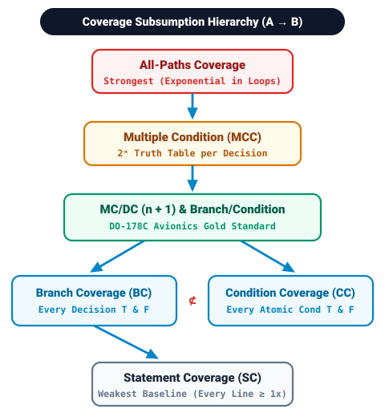

</div>
</div>

<!--
我們使用這段 6 行基準程式與右側的控制流程圖（CFG），系統化對比敘述涵蓋度、分支涵蓋度、條件涵蓋度、多重條件涵蓋度、路徑涵蓋度與 MC/DC。

難字與專業術語解說：
- subsumption hierarchy: 涵蓋包含階層（若覆蓋準則 A 嚴格包含準則 B，代表任何達到 100% A 的測試集必然同時達到 100% B）
-->
---
## 互動式白箱涵蓋度動態探索器：SC、BC、CC、B/CC、MC/DC 與 Path

<div class="wbc-interactive-stage" id="wbc-explorer">
<div class="wbc-nav-toolbar">
  <button type="button" class="wbc-mode-btn is-active" data-wbc="sc">1. 敘述涵蓋 (SC100)</button>
  <button type="button" class="wbc-mode-btn" data-wbc="bc">2. 分支涵蓋 (BC100)</button>
  <button type="button" class="wbc-mode-btn" data-wbc="cc">3. CC100 悖論 (BC=50%)</button>
  <button type="button" class="wbc-mode-btn" data-wbc="bcc">4. 分支/條件 (B/CC100)</button>
  <button type="button" class="wbc-mode-btn" data-wbc="mcdc">5. 航太級 MC/DC (n+1)</button>
  <button type="button" class="wbc-mode-btn" data-wbc="path">6. 路徑涵蓋 (Path100)</button>
</div>

<div class="wbc-content-grid">
<div class="wbc-left-card">
  <div class="wbc-code-cfg-row">
    <div class="wbc-code-panel">
      <div class="wbc-code-line" data-line="1"><span>1: input A, B, X</span><span class="wbc-cond-chip" id="wbc-l1-tag">入口</span></div>
      <div class="wbc-code-line" data-line="2"><span>2: if (A&gt;1) and (B==0)</span><span><span class="wbc-cond-chip" id="wbc-c1-chip">C1:--</span><span class="wbc-cond-chip" id="wbc-c2-chip">C2:--</span></span></div>
      <div class="wbc-code-line" data-line="3"><span>3: &nbsp;&nbsp;&nbsp;&nbsp;Y = A</span><span class="wbc-cond-chip" id="wbc-ec-chip">邊 c</span></div>
      <div class="wbc-code-line" data-line="4"><span>4: if (A==2) or (X&gt;1)</span><span><span class="wbc-cond-chip" id="wbc-c3-chip">C3:--</span><span class="wbc-cond-chip" id="wbc-c4-chip">C4:--</span></span></div>
      <div class="wbc-code-line" data-line="5"><span>5: &nbsp;&nbsp;&nbsp;&nbsp;Y = X</span><span class="wbc-cond-chip" id="wbc-ee-chip">邊 e</span></div>
      <div class="wbc-code-line" data-line="6"><span>6: print Y</span><span class="wbc-cond-chip" id="wbc-l6-tag">出口</span></div>
    </div>
    <div class="wbc-cfg-panel">
<svg xmlns="http://www.w3.org/2000/svg" viewBox="0 0 230 205" width="100%" height="100%">
<defs>
<marker id="wbc-arr-on" viewBox="0 0 10 10" refX="7" refY="5" markerWidth="5" markerHeight="5" orient="auto-start-reverse"><path d="M 0 1 L 9 5 L 0 9 z" fill="#16a34a"/></marker>
<marker id="wbc-arr-off" viewBox="0 0 10 10" refX="7" refY="5" markerWidth="5" markerHeight="5" orient="auto-start-reverse"><path d="M 0 1 L 9 5 L 0 9 z" fill="#cbd5e1"/></marker>
</defs>
<path id="wbc-edge-a" d="M 115 6 L 115 24" stroke="#16a34a" stroke-width="2.6" fill="none" marker-end="url(#wbc-arr-on)"/>
<text x="123" y="18" font-size="9.5" font-weight="800" fill="#0f172a">a</text>
<polygon id="wbc-node-d1" points="115,25 168,45 115,65 62,45" fill="#eff6ff" stroke="#0284c7" stroke-width="2"/>
<text x="115" y="48" font-size="9.5" font-weight="800" fill="#0b3c5d" text-anchor="middle">D1: C1 ∧ C2</text>
<path id="wbc-edge-c" d="M 168 45 L 195 45 L 195 75 L 115 103" stroke="#cbd5e1" stroke-width="2.4" fill="none" marker-end="url(#wbc-arr-off)"/>
<rect x="166" y="54" width="54" height="22" rx="4" fill="#f0fdf4" stroke="#16a34a" stroke-width="1.4" id="wbc-node-l3"/>
<text x="193" y="68" font-size="9" font-weight="800" fill="#166534" text-anchor="middle">L3: Y=A</text>
<text x="180" y="39" font-size="9" font-weight="800" fill="#15803d">c (T)</text>
<path id="wbc-edge-b" d="M 62 45 L 36 45 L 36 86 L 115 103" stroke="#cbd5e1" stroke-width="2.4" fill="none" marker-end="url(#wbc-arr-off)"/>
<text x="26" y="68" font-size="9" font-weight="800" fill="#be123c">b (F)</text>
<polygon id="wbc-node-d2" points="115,105 168,125 115,145 62,125" fill="#eff6ff" stroke="#0284c7" stroke-width="2"/>
<text x="115" y="128" font-size="9.5" font-weight="800" fill="#0b3c5d" text-anchor="middle">D2: C3 ∨ C4</text>
<path id="wbc-edge-e" d="M 168 125 L 195 125 L 195 155 L 115 182" stroke="#cbd5e1" stroke-width="2.4" fill="none" marker-end="url(#wbc-arr-off)"/>
<rect x="166" y="134" width="54" height="22" rx="4" fill="#f0fdf4" stroke="#16a34a" stroke-width="1.4" id="wbc-node-l5"/>
<text x="193" y="148" font-size="9" font-weight="800" fill="#166534" text-anchor="middle">L5: Y=X</text>
<text x="180" y="119" font-size="9" font-weight="800" fill="#15803d">e (T)</text>
<path id="wbc-edge-d" d="M 62 125 L 36 125 L 36 166 L 115 182" stroke="#cbd5e1" stroke-width="2.4" fill="none" marker-end="url(#wbc-arr-off)"/>
<text x="26" y="148" font-size="9" font-weight="800" fill="#be123c">d (F)</text>
<rect x="78" y="182" width="74" height="19" rx="4" fill="#e0f2fe" stroke="#0284c7" stroke-width="1.5"/>
<text x="115" y="195" font-size="9.5" font-weight="800" fill="#0369a1" text-anchor="middle">L6: print Y</text>
</svg>
    </div>
  </div>

  <div class="wbc-tc-section">
    <div class="wbc-tc-header">
      <span>點擊上方預設準則或手動點選下方測試向量 <code>(A, B, X)</code> 觀察動態變化：</span>
      <span id="wbc-active-tc-count" style="color: #0284c7;">已啟用：1 筆測資</span>
    </div>
    <div class="wbc-tc-grid">
      <div class="wbc-tc-pill is-active" data-tc="t1"><span>t₁(2, 0, 3)</span><span class="wbc-tc-tag">a-c-e</span></div>
      <div class="wbc-tc-pill" data-tc="t2"><span>t₂(1, 1, 1)</span><span class="wbc-tc-tag">a-b-d</span></div>
      <div class="wbc-tc-pill" data-tc="t3"><span>t₃(2, 1, 1)</span><span class="wbc-tc-tag">a-b-e</span></div>
      <div class="wbc-tc-pill" data-tc="t4"><span>t₄(1, 0, 2)</span><span class="wbc-tc-tag">a-b-e</span></div>
      <div class="wbc-tc-pill" data-tc="t5"><span>t₅(3, 0, 1)</span><span class="wbc-tc-tag">a-c-d</span></div>
      <div class="wbc-tc-pill" data-tc="t6"><span>t₆(3, 1, 1)</span><span class="wbc-tc-tag">a-b-d</span></div>
    </div>
  </div>

  <div class="wbc-meters-box">
    <div class="wbc-meter-row"><span>1. 敘述涵蓋 (SC)</span><div class="wbc-bar-bg"><div class="wbc-bar-fill" id="wbc-bar-sc"></div></div><span class="wbc-meter-val" id="wbc-val-sc">6/6 (100%)</span></div>
    <div class="wbc-meter-row"><span>2. 分支涵蓋 (BC)</span><div class="wbc-bar-bg"><div class="wbc-bar-fill" id="wbc-bar-bc"></div></div><span class="wbc-meter-val" id="wbc-val-bc">2/4 (50%)</span></div>
    <div class="wbc-meter-row"><span>3. 條件涵蓋 (CC)</span><div class="wbc-bar-bg"><div class="wbc-bar-fill" id="wbc-bar-cc"></div></div><span class="wbc-meter-val" id="wbc-val-cc">4/8 (50%)</span></div>
    <div class="wbc-meter-row"><span>4. MC/DC 獨立配對</span><div class="wbc-bar-bg"><div class="wbc-bar-fill" id="wbc-bar-mcdc"></div></div><span class="wbc-meter-val" id="wbc-val-mcdc">0/4 (0%)</span></div>
    <div class="wbc-meter-row"><span>5. 路徑涵蓋 (Path)</span><div class="wbc-bar-bg"><div class="wbc-bar-fill" id="wbc-bar-path"></div></div><span class="wbc-meter-val" id="wbc-val-path">1/4 (25%)</span></div>
  </div>
</div>

<div class="wbc-right-card">
  <div>
    <span class="ep-badge-pill ep-badge-green" id="wbc-mode-badge">最薄弱基線 • 僅需 1 筆測資</span>
    <h3 class="ep-title-text" id="wbc-mode-title" style="font-size: 17px; margin-top: 2px;">1. 敘述涵蓋度 (Statement Coverage, SC = 100%)</h3>
  </div>
  <div class="ep-stats-row" style="margin: 6px 0;">
    <div class="ep-stat-box" style="padding: 6px 10px;">
      <div class="ep-stat-label">涵蓋準則目標</div>
      <div class="ep-stat-val" id="wbc-stat-formula" style="font-size: 16px;">每行指令皆執行過</div>
    </div>
    <div class="ep-stat-box" style="padding: 6px 10px;">
      <div class="ep-stat-label">已涵蓋路徑</div>
      <div class="ep-stat-val" id="wbc-stat-paths" style="font-size: 16px;">a-c-e (1/4)</div>
    </div>
  </div>
  <ul class="ep-details-list" id="wbc-details-list" style="font-size: 12.6px; line-height: 1.42; flex: 1;">
    <li><strong>僅憑 1 筆測資達成 100% SC：</strong> <code>t₁(2, 0, 3)</code> 使 <code>D1=True</code>（執行第 3 行）且 <code>D2=True</code>（執行第 5 行），6 行程式碼全數亮綠燈！</li>
    <li><strong>為何 SC100 極度脆弱：</strong> 控制流圖上的 False 分支邊 <code>b</code> 與邊 <code>d</code> 完全未被測試（<strong>BC 僅 50%</strong>）。</li>
    <li><strong>隱藏缺陷遮蔽盲區：</strong> 若第 3 行有 Bug（如誤寫 <code>Y = 999</code>），沿路徑 <code>a-c-e</code> 走到第 5 行時會立刻被 <code>Y = X</code> 覆寫而漏抓！</li>
  </ul>
  <div id="wbc-diag-banner" style="padding: 7px 10px; border-radius: 8px; background: #fffbeb; border: 1.4px solid #f59e0b; color: #92400e; font-size: 11.8px; font-weight: 700; line-height: 1.35;">
    💡 互動診斷提示：點擊上方「2. 分支涵蓋 (BC100)」或「3. CC100 悖論」按鈕，即時觀察條件涵蓋與分支涵蓋的分歧！
  </div>
</div>
</div>
</div>

<!--
這座互動式白箱涵蓋度探索器（比照第 47 頁的黑箱互動模式）讓學生能一鍵切換 6 種結構化涵蓋度準則（敘述 SC、分支 BC、條件 CC 悖論、分支/條件 B/CC、航太級 MC/DC 與全路徑 Path），或手動點選個別測試案例 `t1..t6`，即時觀察左側程式碼行顏色、控制流圖（CFG）分支邊 `a..e`、原子條件真假值標籤 `C1..C4` 以及下方五條涵蓋度進度條的連動變化。

難字與專業術語解說：
- Control Flow Graph (CFG) edge activation: 控制流圖邊激活（當測試案例實際走過決策節點的 True 或 False 分支時，將對應控制流邊點亮標記為已涵蓋的動態追蹤機制）
-->
---
## 1. 敘述涵蓋度 (SC) 與 2. 分支／決策涵蓋度 (BC)

<div class="card-deck">

> **100% 敘述涵蓋度 (Statement Coverage)** 是最薄弱的起點（本例僅需 1 筆測資即可達成！），而 **100% 分支涵蓋度 (Branch Coverage)** 則要求每個決策判斷皆須走過 `True` 與 `False` 兩條分支。

<div class="two-columns">
<div class="card" data-marpit-fragment>

### 1. 敘述涵蓋度（僅需 1 筆測資即達 `SC100`！）
- **目標：** 讓每一行可執行敘述句（第 `1..6` 行）至少被執行過一次。
- **單一測試案例：** <strong><code>t1 = (A=2, B=0, X=3)</code></strong>
  - 第 2 行：`(2 > 1) and (0 == 0)` 為 `True` → 執行第 3 行（`Y = 2`）。
  - 第 4 行：`(2 == 2) or (3 > 1)` 為 `True` → 執行第 5 行（`Y = 3`）。
  - **結果：** 達成 100% 敘述涵蓋度（`6/6` 行全綠）！
- **為何 `SC100` 極度脆弱且危險：**
  - 即使達成 `100% SC`，測資 `(2, 0, 3)` 仍會**完全漏抓**以下致命錯誤：
    1. 第 2 行的 `and` 被誤寫為 `or`；
    2. 第 3 行的 `Y = A` 被誤寫為 `Y = 999`（因為隨即被第 5 行覆寫！）；
    3. 從未測試過 `False` 分支（邊 `b` 與邊 `d`）！

</div>
<div class="card" data-marpit-fragment>

### 2. 分支／決策涵蓋度（2 筆測資達成 `BC100`）
- **目標：** 每個決策（`D1` 與 `D2`）的 **`True` 分支**與 **`False` 分支**皆須至少走過一次（涵蓋所有控制流邊 `a, b, c, d, e`）。

| 測試案例 `(A, B, X)` | `D1: (A>1) AND (B==0)` | `D2: (A==2) OR (X>1)` | CFG 路徑 |
| :---: | :---: | :---: | :---: |
| **`t1 = (3, 0, 3)`** | <strong><code>True</code></strong>（走邊 <code>c</code>） | <strong><code>True</code></strong>（走邊 <code>e</code>） | `a → c → e` |
| **`t2 = (3, 1, 1)`** | <strong><code>False</code></strong>（走邊 <code>b</code>） | <strong><code>False</code></strong>（走邊 <code>d</code>） | `a → b → d` |

- **`BC100` 殘留的盲區：**
  - 在 `t1=(3,0,3)` 與 `t2=(3,1,1)` 兩筆測資中，原子條件 `C1 (A > 1)` <strong>恆為 `True`</strong>（`3 > 1`），且 `C3 (A == 2)` <strong>恆為 `False`</strong>（`3 != 2`）！

</div>
</div>
</div>

<!--
100% 分支涵蓋度嚴格包含 100% 敘述涵蓋度；然而即便達到 100% 分支涵蓋度，複合 `if` 判斷式內部的個別原子條件仍可能始終卡在單一真假值而從未翻轉。

難字與專業術語解說：
- Statement Coverage vs. Branch Coverage: 敘述涵蓋度 vs. 分支涵蓋度（僅要求每行指令執行一次 vs. 要求每個決策判斷的真假分支走向皆被執行）
-->
---
## 3. 條件涵蓋度 (CC)、覆蓋率悖論與 JaCoCo 的「黃色菱形」

<div class="card-deck">

> <strong>條件涵蓋度 (Condition Coverage, CC)</strong> 要求每個原子布林條件（`C`<sub>`i`</sub>）皆須經歷 `True` 與 `False`——這與分支涵蓋度及<strong>短路求值 (Short-Circuit Evaluation)</strong> 產生了著名的覆蓋率悖論！

<div class="two-columns">
<div class="card" data-marpit-fragment>

### CC vs. BC 覆蓋率悖論（`100% CC ≠ 100% BC`）
- 考慮 `if (p && q)` 在**非短路求值**下的真值組合：

| 測試案例 | 原子條件 `p` | 原子條件 `q` | 整體決策 `p && q` |
| :---: | :---: | :---: | :---: |
| **`t1`** | **`True`** | **`False`** | **`False`** |
| **`t2`** | **`False`** | **`True`** | **`False`** |

- 原子條件 `p` 涵蓋了 `{T, F}`（100%），`q` 也涵蓋了 `{F, T}`（100%）→ **達成 100% 條件涵蓋度 (CC)**！
- 但整體決策 `p && q` 卻<strong>恆為 `False`</strong> → <strong>分支涵蓋度 (BC) 僅有 50%</strong>（`if` 區塊內部一行都沒執行到）！
- **分支／條件複合涵蓋度 (B/CC)：** 同時要求滿足兩者（`100% CC + 100% BC`）。

</div>
<div class="card" data-marpit-fragment>

### 短路求值與 JaCoCo 的 75% 黃色菱形解密
- **短路求值規則（Java/C/Python 中的 `&&` 與 `||`）：**
  - 在 `if (p && q)` 中，當 `p == False`（如 `t2`）時，CPU 會<strong>直接短路跳過、不計算 `q`</strong>（此時 `q` 是「未執行」，而非 `True`）！
  - 若要讓 `q` 真正經歷 `True` 與 `False`，前提是 `p` 必須為 `True`——這也迫使整體 `p && q` 同時經歷 `True` 與 `False`（<strong>共需 3 筆測資：<code>(T,F), (F,x), (T,T)</code></strong>）。
- **為何 JaCoCo 在 `if (A && B)` 顯示黃色菱形（`3/4 = 75%`）：**
  - Java 編譯器會將 `if (A && B)` 編譯為 **2 道位元組碼條件跳躍指令（`IFEQ A`, `IFEQ B`）= 共 4 個位元組碼分支**。
  - 若僅測試 `(A=T, B=T)` 與 `(A=F, 短路)`，只走過 `3 / 4` 個位元組碼分支（漏掉 `A=T, B=F` → <strong>顯示 75% 黃色菱形</strong>）！

</div>
</div>
</div>

<!--
在 JVM 位元組碼層級，`if (A && B)` 會被拆解為兩道條件跳躍指令（共 4 個位元組碼分支），這完美解釋了為何在補齊 `(A=True, B=False)` 測資之前，JaCoCo 會一直顯示 75% 的黃色菱形警告。

難字與專業術語解說：
- short-circuit evaluation: 短路求值（在 `A && B` 中若 `A` 為 False，或在 `A || B` 中若 `A` 為 True，程式直接略過不計算右式 `B` 的求值機制）
-->
---
## 4. 分支／條件實戰推演（`sample-code-01`：`CC100` vs. `BC100`）

<div class="card-deck">

> 實際追蹤為何 2 筆測資能達成 **100% 條件涵蓋度 (`CC100`) 卻未達分支涵蓋度**，而另一組 3 筆測資能達成 **100% 分支涵蓋度 (`BC100`) 卻未達條件涵蓋度**！

<div class="two-columns">
<div class="card" data-marpit-fragment>

### 目標程式碼 (`sample-code-01`) 與 `SC100`
```java
1: read(X, Y)
2: if ((X > 10) && (Y == 1))  // c1: X>10, c2: Y==1, b1: c1&&c2
3:     X = 1;
4: else if ((X - Y) < 2)      // c3 (b2): (X - Y) < 2
5:     X = 2;
6: if (Y > 10)                // c4 (b3): Y > 10
7:     X = 3;
8: print X
```
- **以 2 筆測資達成 `100% 敘述涵蓋度 (SC100)`：**
  - 必須進入第 `3`、`5` 與 `7` 行：
  - **`(X=11, Y=1)`** 進入第 3 行；**`(X=12, Y=11)`** 則同時進入第 5 行與第 7 行！

</div>
<div class="card" data-marpit-fragment>

### `CC100`（非 `BC100`）vs. `BC100`（非 `CC100`）
- **測試集 A（達成 `CC100`，但 `b1` 恆為 `False` → 未達 `BC100`）：**

| `X` | `Y` | `c1` | `c2` | `b1 (c1&&c2)` | `c3/b2` | `c4/b3` |
| :-: | :-: | :-: | :-: | :-: | :-: | :-: |
| **9** | **1** | F | T | **_F_** | F | F |
| **12** | **11** | T | F | **_F_** | T | T |

- **測試集 B（達成 `BC100`，但 `c1` 恆為 `True` → 未達 `CC100`）：**

| `X` | `Y` | `c1` | `c2` | `b1 (c1&&c2)` | `c3/b2` | `c4/b3` |
| :-: | :-: | :-: | :-: | :-: | :-: | :-: |
| **13** | **1** | **_T_** | T | **T** | - | F |
| **12** | **11** | **_T_** | F | **F** | T | T |
| **12** | **2** | **_T_** | F | **F** | F | F |

</div>
</div>
</div>

<!--
透過 `sample-code-01` 的具體推演可以清楚看出，為何**分支／條件複合涵蓋度 (Branch/Condition Coverage, B/CC)** 必須同時強制要求兩項準則皆達 100%。

難字與專業術語解說：
- Branch/Condition Coverage (B/CC): 分支與條件複合涵蓋度（同時要求每個原子條件皆經歷 T/F，且每個整體決策分支亦經歷 T/F 的覆蓋標準）
-->
---
## 5. 多重條件涵蓋度 (MCC)、6. 路徑涵蓋度與 7. 航太級 MC/DC

<div class="card-deck">

> 當 `2`<sup>`n`</sup> 的**多重條件涵蓋度 (MCC)** 與 `4`<sup>`20`</sup> 的**路徑涵蓋度 (Path Coverage)** 發生指數級爆炸時，<strong>MC/DC（修改條件／決策涵蓋度）</strong>僅需 **`n + 1` 筆線性測試案例**即可嚴格證明每個條件的獨立影響力！

<div class="two-columns">
<div class="card" data-marpit-fragment>

### MCC (`2`<sup>`n`</sup>) 與迴圈路徑爆炸 (`4`<sup>`20`</sup>)
- **多重條件涵蓋度 (Multiple Condition Coverage, MCC)：**
  - 要求測試單一決策內部所有原子條件的 **`2`<sup>`n`</sup> 種真值表排列組合**。
  - 在雙決策基準程式中（各含 `n=2` 個條件），MCC 僅需 4 筆測資：`(2,0,4), (2,1,1), (1,0,2), (1,1,1)`——但卻仍漏掉控制流路徑 `a-c-d`（需補 `(3,0,1)`）！
  - 若單一決策含 `n = 10` 個條件，MCC 將暴增至 **2<sup>10</sup> = 1,024** 筆測試！
- **路徑涵蓋度 (Path Coverage) 與迴圈爆炸陷阱：**
  - 一個最多迭代 20 次且內含 4 分支判斷的單一迴圈，會產生 **4<sup>20</sup> = 2<sup>40</sup> ≈ 1.1 × 10<sup>12</sup>（1.1 兆）條路徑**——證明含迴圈程式絕不可能窮舉所有路徑！

</div>
<div class="card" data-marpit-fragment>

### 航太級 MC/DC（DO-178C Level A 與 ISO 26262 ASIL D）
- **為何波音、空中巴士與車規標準強制要求 MC/DC：**
  - 將 **`2`<sup>`n`</sup>** 種指數組合精準壓縮至 **`n + 1`（至多 `2n`）筆線性測資**！
- **核心要求——獨立影響配對 (Independence Pairs)：**
  - 每一個原子條件 **`C`<sub>`i`</sub>** 都必須找到一組測試配對 `(Test X, Test Y)`，滿足：
    1. <strong>僅有 `C`<sub>`i`</sub> 的真假值翻轉（`T ↔ F`）</strong>，其餘所有條件均保持固定不變；
    2. 整體的<strong>決策輸出結果也隨之翻轉（`T ↔ F`）</strong>！

</div>
</div>
</div>

<!--
MC/DC 的精髓在於證明：在固定其他所有條件不變的前提下，每一個原子條件皆能「獨立翻轉」最終的決策結果，且理論上最少僅需 `n + 1` 筆測試案例。

難字與專業術語解說：
- Modified Condition / Decision Coverage (MC/DC): 修改條件／決策涵蓋度（要求證明每一個原子條件在固定其他條件不變下，皆能獨立翻轉整體決策結果的航太與車規最高白箱標準）
-->
---
## MC/DC 推導實戰 (1/2)：`Decision = (A || B) && C` 真值表分析

> 針對 `n = 3` 個條件（完整真值表共 `2`<sup>`3`</sup> `= 8` 列），我們只需精挑 **`n + 1 = 4` 列 `{#2, #4, #5, #6}`**！

| 列號 | `A` | `B` | `C` | `(A \|\| B) && C` | MC/DC 挑選狀態與獨立配對角色 |
| :---: | :---: | :---: | :---: | :---: | :--- |
| #1 | F | F | F | F | 捨棄（`C = F` 會短路並遮蔽 `(A \|\| B)` 的變化） |
| **#2** | **F** | **F** | **T** | **F** | **入選 (1/4)：** 共用基準錨點——與 **#6** 配對驗證 `A`，並與 **#4** 配對驗證 `B` |
| #3 | F | T | F | F | 捨棄（可改用 #5 搭配 #6 來測試條件 `C`） |
| **#4** | **F** | **T** | **T** | **T** | **入選 (2/4)：** 與 **#2** 配對，證明翻轉 `B`（`F → T`）能獨立翻轉整體決策 |
| **#5** | **T** | **F** | **F** | **F** | **入選 (3/4)：** 與 **#6** 配對，證明翻轉 `C`（`F → T`）能獨立翻轉整體決策 |
| **#6** | **T** | **F** | **T** | **T** | **入選 (4/4)：** 共用基準錨點——與 **#2** 配對驗證 `A`，並與 **#5** 配對驗證 `C` |
| #7 | T | T | F | F | 捨棄（在 `A \|\| B` 中 `A = T` 與 `B = T` 會互相遮蔽） |
| #8 | T | T | T | T | 捨棄（在 `A \|\| B` 中 `A = T` 與 `B = T` 會互相遮蔽） |

---
## MC/DC 推導實戰 (2/2)：驗證 3 組獨立影響配對 `{#2, #4, #5, #6}`

<div class="card-deck">

> 透過共用 **`#2`** 與 **`#6`** 作為基準錨點列，僅需 **`n + 1 = 4` 筆測試案例**即可完整證明 `A`、`B`、`C` 三個條件皆能獨立翻轉決策結果！

<div class="two-columns">
<div class="card" data-marpit-fragment>

### 條件 `A` 與條件 `B` 的獨立影響配對
- **1. 條件 `A` → 配對 `(#2, #6)`：**
  - `#2`：`(A=F, B=F, C=T) → Decision = F`
  - `#6`：`(A=T, B=F, C=T) → Decision = T`
  - *證明：* `B=F, C=T` 保持固定；僅翻轉 <strong><code>A</code>（<code>F↔T</code>）</strong>即導致 <strong><code>Decision</code>（<code>F↔T</code>）</strong>隨之翻轉！
- **2. 條件 `B` → 配對 `(#2, #4)`：**
  - `#2`：`(A=F, B=F, C=T) → Decision = F`
  - `#4`：`(A=F, B=T, C=T) → Decision = T`
  - *證明：* `A=F, C=T` 保持固定；僅翻轉 <strong><code>B</code>（<code>F↔T</code>）</strong>即導致 <strong><code>Decision</code>（<code>F↔T</code>）</strong>隨之翻轉！

</div>
<div class="card" data-marpit-fragment>

### 條件 `C` 的獨立影響配對與工程結論
- **3. 條件 `C` → 配對 `(#5, #6)`：**
  - `#5`：`(A=T, B=F, C=F) → Decision = F`
  - `#6`：`(A=T, B=F, C=T) → Decision = T`
  - *證明：* `A=T, B=F` 保持固定；僅翻轉 <strong><code>C</code>（<code>F↔T</code>）</strong>即導致 <strong><code>Decision</code>（<code>F↔T</code>）</strong>隨之翻轉！
- **工程實務結論：**
  - 無須執行 `2`<sup>`3`</sup> `= 8` 筆 MCC 窮舉測試，僅憑 <strong><code>{#2, #4, #5, #6}</code>（<code>n + 1 = 4</code> 筆測資）</strong>即可 100% 滿足 DO-178C Level A 的 MC/DC 認證要求！

</div>
</div>
</div>

<!--
因為第 `#2` 列與第 `#6` 列同時扮演多組配對的共用基準錨點（Anchor Rows），聯集 `{#2, #4, #5, #6}` 總共僅需 `n + 1 = 4` 筆測試案例，即可完成三個條件的獨立性證明。

難字與專業術語解說：
- Independence Pair: 獨立影響配對（一對測試案例中，僅目標條件真假值改變、其餘條件固定不變，且整體決策輸出隨之翻轉的配對證據）
-->
---
## 安全關鍵系統標準：航太 DO-178C 與車規 ISO 26262

<div class="card-deck">

> 在安全關鍵（Safety-Critical）的航太與車用電子系統中，結構化白箱涵蓋度是飛機獲准首航或電動車獲准量產上市前具法律強制力的適航認證門檻。

<div class="two-columns">
<div class="card" data-marpit-fragment>

### 航太 DO-178C 與車規 ISO 26262 等級對照表
| 失效嚴重度 | DO-178C | ISO 26262 | 強制要求之白箱結構涵蓋度 |
| :--- | :---: | :---: | :--- |
| **災難級 (Catastrophic)** | **DAL A** | **ASIL D** | **100% SC + BC + MC/DC** |
| **危險級 (Hazardous)** | **DAL B** | **ASIL C** | **100% SC + BC** *(建議 MC/DC)* |
| **重大級 (Major)** | **DAL C** | **ASIL B/A** | **100% SC** *(ASIL B 要求 BC)* |
| **輕微級 (Minor)** | **DAL D/E** | **QM** | 標準功能性驗證 |

</div>
<div class="card" data-marpit-fragment>

### 唯一成因 (Unique-Cause) vs. 遮蔽式 (Masking) MC/DC
- **1. 唯一成因 MC/DC (Unique-Cause MC/DC)：**
  - 嚴格要求字面上僅能有 1 個條件 `C_i` 翻轉，其餘所有條件字面值必須完全固定。
  - *限制：* 當同一變數在耦合判斷式如 `(A && B) || (!A && C)` 中重複出現兩次時，將無法找到唯一成因配對。
- **2. 遮蔽式 MC/DC (Masking MC/DC，FAA 認證採認標準)：**
  - 允許耦合的子條件同步變動，只要非受測的子運算式在邏輯上被短路或遮蔽（Masked）而不影響最終輸出即可！

</div>
</div>
</div>

---
## 破除 100% 程式碼覆蓋率的三大迷思（古德哈特定律 Goodhart's Law）

<div class="card-deck">

> 「程式碼覆蓋率是用來診斷未測盲區的聽診器——當覆蓋率數字本身變成盲目追求的 KPI 目標時，它就不再是個好指標（古德哈特定律）。」

<div class="three-columns">
<div class="card" data-marpit-fragment>

### 1. 邊際效益遞減 (`95% → 100%`)
- 從 `0% → 85%` 能以極高投資報酬率（ROI）抓出核心業務邏輯錯誤。
- 為了強行湊滿最後 `5%` 的單純 Getter/Setter、防禦性 `default` 分支或罕見底層 OS I/O 例外，會導致 Mock 成本暴增並產生脆弱測試。

</div>
<div class="card" data-marpit-fragment>

### 2. 有執行 ≠ 有驗證 (Executed ≠ Verified)
- 覆蓋率工具只記錄「該行程式碼是否被 CPU 執行過」，卻不管測試案例有沒有寫斷言（Assertion）檢查結果！
- **無斷言測試 (Assertion-Free Test)**，或是將 `a + b` 誤寫成 `a * b` 卻只測 `(2, 2)`，都會拿到 100% 滿分綠燈——**必須靠變異測試揪出**！

</div>
<div class="card" data-marpit-fragment>

### 3. 對「遺漏未寫的程式碼」完全失明
- 白箱工具只能測量「已經寫進原始碼檔案裡」的指令。
- 若工程師根本忘記實作規格要求的「VIP 折扣分支」，現有程式碼依然能輕鬆達成 100% 覆蓋率！
- **最佳實踐：** 核心領域邏輯鎖定 `85%–90%` 覆蓋率 + 黑箱規格測試 + 變異測試！

</div>
</div>
</div>

<!--
請熟記航太 DO-178C DAL A 與車規 ISO 26262 ASIL D 對 100% MC/DC 的強制映射關係，並警惕古德哈特定律下的 100% 覆蓋率三大迷思。

難字與專業術語解說：
- Goodhart's Law: 古德哈特定律（當一個度量指標被當作硬性績效考核目標時，工程師便會透過無斷言測試等方式迎合數字，使其失去衡量品質的意義）
-->
---
## 白箱案例研討：`Triangle.java` 死分支與 `LoanCalculator` 三階段演進

<div class="card-deck">

> 位元組碼覆蓋率分析能精準揭露<strong>數學上不可行的死分支</strong>（`Triangle.java`），並量化驗證<strong>「黑箱測試 + 白箱補強」</strong>如何逐步推進至 `100% BC`。

<div class="two-columns">
<div class="card" data-marpit-fragment>

### 1. `Triangle.java` 與永遠卡在 83.3% 的死分支
```java
if (a <= 0 || b <= 0 || c <= 0 ||
    a + b <= c || a + c <= b || b + c <= a) return "Invalid";
if (a == b && b == c && a == c) return "Equilateral"; // 5/6 (83.3%)!
if (a == b || b == c || a == c) return "Isosceles";
return "Scalene";
```
- <strong>數學遞移律陷阱：</strong> 當 `a == b` 與 `b == c` 同時為 `True` 時，<strong>`a == c` 在數學上永遠不可能為 `False`</strong>（不可行死分支）！
- **修復方案：** 移除多餘的 `&& a == c` → 立即達成 `100% (22/22)` 分支涵蓋度！

</div>
<div class="card" data-marpit-fragment>

### 2. `BinarySearch` 與 `LoanCalculator` 覆蓋率演進
- **`BinarySearch`（2 筆測資達 `100% BC`）：** `search(1, [1,3,5]) → 0` 與 `search(6, [1,3]) → -1`。
- **`LoanCalculator` 三階段覆蓋率演進：**

| 測試階段 | 測試設計策略 | 分支涵蓋度 (BC) |
| :--- | :--- | :---: |
| **1. WeakTest** | 2–3 筆正常路徑 (Happy Path) 貸款測資 | **~65%** |
| **2. PairwiseTest** | `AllPairs4J` 二維成對組合表（8 筆測資） | **~90%** |
| **3. StrongTest** | 白箱顯微鏡補強（觸發 `rate < 2.0` 地板值） | **100%** |

</div>
</div>
</div>

<!--
觀察 `LoanCalculator` 的三階段演進：階段 1（快樂路徑）、階段 2（黑箱 Pairwise 成對組合）能自動推進至約 90% 分支涵蓋度；接著透過階段 3 檢視 JaCoCo 紅黃標記，發現只差一筆多重優惠疊加觸發 `if (rate < 2.0) rate = 2.0;` 利率下限的測資，補上後即完美達成 100%！

難字與專業術語解說：
- infeasible branch / path: 不可行分支／死路徑（因前後條件矛盾或數學遞移律限制，在任何輸入下皆不可能被觸發的邏輯分支）
-->
---
## 基本路徑測試 (McCabe, 1976)：四步 SOP 與複合條件拆解

<div class="card-deck">

> **Thomas J. McCabe (1976)** 將圖論引入軟體工程：以**圈複雜度 `V(G)`** 精確定義控制流程圖中「**線性獨立基本路徑基底**」的數量上限，保證達成 **100% 敘述與分支涵蓋**！

<div class="two-columns">
<div class="card" data-marpit-fragment style="padding: 8px 14px; font-size: 13.8px; line-height: 1.33;">

### McCabe 基本路徑測試四步驟標準流程
1. **步驟 1 — 繪製控制流程圖 (CFG)：**
   - 將所有複合布林條件（如 `if (A && B)`）**拆解為獨立的單一二元判定節點**！
2. **步驟 2 — 計算圈複雜度 `V(G)`（三種等價公式）：**
   - **平面區域公式：** **`V(G) = R`**（封閉區域數 + 外部無限區域 `1`）
   - **歐拉邊點公式：** **`V(G) = E - N + 2`**（`E` 為有向邊數，`N` 為節點數）
   - **判定節點公式：** **`V(G) = P + 1`**（`P` 為二元判定節點數；無分支時 `V(G) = 1`）
3. **步驟 3 — 導出 `V(G)` 條線性獨立基本路徑：**
   - 每一條新路徑都必須**至少走過一條先前未走過的新邊**。
4. **步驟 4 — 設計測資並排查不可行路徑 (Infeasible Paths)：**
   - 求解各路徑輸入條件；若路徑前後邏輯矛盾則併入其他可行路徑驗證。

</div>
<div class="card" data-marpit-fragment style="padding: 8px 14px; font-size: 13.8px; line-height: 1.33;">

### 四大 CFG 基本構件與複合條件拆解法則
| 結構類型 | CFG 節點與邊特徵 | 對 `V(G)` 貢獻 (`+P`) |
| :--- | :--- | :---: |
| **1. 循序 (Sequence)** | 連續無分支指令合併為 1 個基本區塊節點 | **`+ 0`** |
| **2. 雙向選擇 (`if-else`)** | 1 個二元判定節點（分出 True / False 兩條邊） | **`+ 1`** |
| **3. 迴圈 (`while / for`)** | 1 個迴圈條件判定節點 + 迴圈體回邊 | **`+ 1`** |
| **4. 多向選擇 (`switch`)** | 含 `k` 個 `case`（不含 `default`）等同 `k` 次判斷 | **`+ k`** |

- **為何 `if (A && B)` 必須拆成 2 個判定節點？**
  - 在短路求值下，`A && B` 具備 **3 條不同出口路徑**（`A=F` 直接跳過、`A=T & B=F`、`A=T & B=T`）。含 `m` 個邏輯算子（`&&`, `||`）的判斷式須拆為 **`m + 1` 個判定節點**！

</div>
</div>
</div>

<!--
Thomas McCabe 於 1976 年提出的基本路徑測試（Basis Path Testing）運用圖論解決了一個核心工程問題：「最少需要幾條線性獨立路徑，才能 100% 涵蓋程式中所有的敘述句與所有的條件分支？」只要在繪製控制流程圖（CFG）時將複合條件（`&&`、`||`）拆解為單一二元判定節點，並透過三種等價公式 `V(G) = R = E - N + 2 = P + 1` 算出圈複雜度，就能直接鎖定獨立路徑基底的精確上限！

難字與專業術語解說：
- Cyclomatic Complexity `V(G)`: 圈複雜度／循環複雜度（McCabe 提出的圖論度量指標，量化程式控制流圖中線性獨立路徑的數量上限）
- linearly independent path: 線性獨立路徑（在控制流圖中，與先前已選路徑相比至少包含一條全新未走過之有向邊的控制流路徑）
-->
---
## 互動式基本路徑與圈複雜度實驗室：`computeAverage(grade[])`

<div class="bpt-interactive-stage" id="bpt-explorer">
<div class="bpt-toolbar-wrap">
  <div class="bpt-toolbar-row">
    <span class="bpt-row-label">步驟 2：V(G) = 6</span>
    <button type="button" class="bpt-btn is-active" data-bpt="vg-r">① 區域法：V(G) = R = 6</button>
    <button type="button" class="bpt-btn" data-bpt="vg-en">② 邊點法：E(16) - N(12) + 2 = 6</button>
    <button type="button" class="bpt-btn" data-bpt="vg-p">③ 判定點法：P(5) + 1 = 6</button>
  </div>
  <div class="bpt-toolbar-row">
    <span class="bpt-row-label">步驟 3–4：6 條路徑</span>
    <button type="button" class="bpt-btn is-infeasible" data-bpt="p1">Path 1 (不可行!)</button>
    <button type="button" class="bpt-btn" data-bpt="p2">Path 2 (空輸入)</button>
    <button type="button" class="bpt-btn" data-bpt="p3">Path 3 (滿50筆)</button>
    <button type="button" class="bpt-btn" data-bpt="p4">Path 4 (&lt;下限)</button>
    <button type="button" class="bpt-btn" data-bpt="p5">Path 5 (&gt;上限)</button>
    <button type="button" class="bpt-btn" data-bpt="p6">Path 6 (正常平均)</button>
  </div>
</div>

<div class="bpt-content-grid">
<div class="bpt-left-card">
  <div class="bpt-code-cfg-split">
    <div class="bpt-code-box">
      <div class="bpt-code-line" data-bnode="1"><span>sum=0,max=100,min=10,valid=0,i=0;</span><span class="bpt-node-badge">(1)</span></div>
      <div class="bpt-code-line" data-bnode="2"><span>while (grade[i] != -999</span><span class="bpt-node-badge is-pred">P1 (2)</span></div>
      <div class="bpt-code-line" data-bnode="3"><span>&nbsp;&nbsp;&nbsp;&nbsp;&amp;&amp; i &lt; 50) {</span><span class="bpt-node-badge is-pred">P2 (3)</span></div>
      <div class="bpt-code-line" data-bnode="4"><span>&nbsp;&nbsp;if (grade[i] &gt;= min</span><span class="bpt-node-badge is-pred">P3 (4)</span></div>
      <div class="bpt-code-line" data-bnode="5"><span>&nbsp;&nbsp;&nbsp;&nbsp;&nbsp;&nbsp;&amp;&amp; grade[i] &lt;= max) {</span><span class="bpt-node-badge is-pred">P4 (5)</span></div>
      <div class="bpt-code-line" data-bnode="6"><span>&nbsp;&nbsp;&nbsp;&nbsp;sum += grade[i]; valid++;</span><span class="bpt-node-badge">(6)</span></div>
      <div class="bpt-code-line" data-bnode="7"><span>&nbsp;&nbsp;} else print("成績範圍錯誤");</span><span class="bpt-node-badge">(7)</span></div>
      <div class="bpt-code-line" data-bnode="8"><span>&nbsp;&nbsp;i++; }</span><span class="bpt-node-badge">(8)</span></div>
      <div class="bpt-code-line" data-bnode="9"><span>if (valid &gt; 0)</span><span class="bpt-node-badge is-pred">P5 (9)</span></div>
      <div class="bpt-code-line" data-bnode="10"><span>&nbsp;&nbsp;avg = (double) sum / valid;</span><span class="bpt-node-badge">(10)</span></div>
      <div class="bpt-code-line" data-bnode="11"><span>else avg = -999.0;</span><span class="bpt-node-badge">(11)</span></div>
      <div class="bpt-code-line" data-bnode="12"><span>return avg;</span><span class="bpt-node-badge">(12)</span></div>
    </div>
  <div class="bpt-cfg-box">
<svg xmlns="http://www.w3.org/2000/svg" id="bpt-cfg-svg" viewBox="0 0 285 340" width="100%" height="100%">
<defs>
<marker id="bpt-arr-def" viewBox="0 0 10 10" refX="7" refY="5" markerWidth="5" markerHeight="5" orient="auto-start-reverse"><path d="M 0 1 L 9 5 L 0 9 z" fill="#94a3b8"/></marker>
<marker id="bpt-arr-act" viewBox="0 0 10 10" refX="7" refY="5" markerWidth="5.5" markerHeight="5.5" orient="auto-start-reverse"><path d="M 0 1 L 9 5 L 0 9 z" fill="#16a34a"/></marker>
<marker id="bpt-arr-new" viewBox="0 0 10 10" refX="7" refY="5" markerWidth="6" markerHeight="6" orient="auto-start-reverse"><path d="M 0 1 L 9 5 L 0 9 z" fill="#ea580c"/></marker>
<marker id="bpt-arr-inf" viewBox="0 0 10 10" refX="7" refY="5" markerWidth="5.5" markerHeight="5.5" orient="auto-start-reverse"><path d="M 0 1 L 9 5 L 0 9 z" fill="#e11d48"/></marker>
</defs>
<g id="bpt-regions-layer">
<circle cx="128" cy="96" r="10.5" fill="#dbeafe" stroke="#2563eb" stroke-width="1.4"/><text x="128" y="100" font-size="9" font-weight="900" fill="#1d4ed8" text-anchor="middle">R₁</text>
<circle cx="62" cy="186" r="10.5" fill="#dcfce7" stroke="#16a34a" stroke-width="1.4"/><text x="62" y="190" font-size="9" font-weight="900" fill="#15803d" text-anchor="middle">R₂</text>
<circle cx="151" cy="197" r="10.5" fill="#fef3c7" stroke="#d97706" stroke-width="1.4"/><text x="151" y="201" font-size="9" font-weight="900" fill="#b45309" text-anchor="middle">R₃</text>
<circle cx="184" cy="240" r="10.5" fill="#f3e8ff" stroke="#7c3aed" stroke-width="1.4"/><text x="184" y="244" font-size="9" font-weight="900" fill="#6d28d9" text-anchor="middle">R₄</text>
<circle cx="238" cy="175" r="10.5" fill="#ffedd5" stroke="#ea580c" stroke-width="1.4"/><text x="238" y="179" font-size="9" font-weight="900" fill="#c2410c" text-anchor="middle">R₅</text>
<rect x="6" y="6" width="52" height="20" rx="5" fill="#ffe4e6" stroke="#e11d48" stroke-width="1.4"/><text x="32" y="19" font-size="9" font-weight="900" fill="#be123c" text-anchor="middle">R₆(外部)</text>
</g>
<g id="bpt-edges-layer">
<path id="bpt-e-1-2" data-bedge="1-2" d="M 168 30 L 168 48" stroke="#94a3b8" stroke-width="2" fill="none" marker-end="url(#bpt-arr-def)"/>
<path id="bpt-e-2-3" data-bedge="2-3" d="M 168 74 L 168 96" stroke="#94a3b8" stroke-width="2" fill="none" marker-end="url(#bpt-arr-def)"/>
<path id="bpt-e-2-9" data-bedge="2-9" d="M 154 62 L 73 118" stroke="#94a3b8" stroke-width="2" fill="none" marker-end="url(#bpt-arr-def)"/>
<path id="bpt-e-3-9" data-bedge="3-9" d="M 154 110 L 76 127" stroke="#94a3b8" stroke-width="2" fill="none" marker-end="url(#bpt-arr-def)"/>
<path id="bpt-e-3-4" data-bedge="3-4" d="M 168 122 L 168 144" stroke="#94a3b8" stroke-width="2" fill="none" marker-end="url(#bpt-arr-def)"/>
<path id="bpt-e-4-5" data-bedge="4-5" d="M 168 170 L 168 194" stroke="#94a3b8" stroke-width="2" fill="none" marker-end="url(#bpt-arr-def)"/>
<path id="bpt-e-4-7" data-bedge="4-7" d="M 155 162 L 122 252" stroke="#94a3b8" stroke-width="2" fill="none" marker-end="url(#bpt-arr-def)"/>
<path id="bpt-e-5-7" data-bedge="5-7" d="M 157 214 L 127 254" stroke="#94a3b8" stroke-width="2" fill="none" marker-end="url(#bpt-arr-def)"/>
<path id="bpt-e-5-6" data-bedge="5-6" d="M 179 214 L 212 254" stroke="#94a3b8" stroke-width="2" fill="none" marker-end="url(#bpt-arr-def)"/>
<path id="bpt-e-6-8" data-bedge="6-8" d="M 212 276 L 180 307" stroke="#94a3b8" stroke-width="2" fill="none" marker-end="url(#bpt-arr-def)"/>
<path id="bpt-e-7-8" data-bedge="7-8" d="M 126 276 L 156 307" stroke="#94a3b8" stroke-width="2" fill="none" marker-end="url(#bpt-arr-def)"/>
<path id="bpt-e-8-2" data-bedge="8-2" d="M 182 315 C 282 310, 282 62, 184 61" stroke="#94a3b8" stroke-width="2" fill="none" marker-end="url(#bpt-arr-def)"/>
<path id="bpt-e-9-11" data-bedge="9-11" d="M 52 142 L 32 174" stroke="#94a3b8" stroke-width="2" fill="none" marker-end="url(#bpt-arr-def)"/>
<path id="bpt-e-9-10" data-bedge="9-10" d="M 70 142 L 92 174" stroke="#94a3b8" stroke-width="2" fill="none" marker-end="url(#bpt-arr-def)"/>
<path id="bpt-e-11-12" data-bedge="11-12" d="M 32 198 L 53 230" stroke="#94a3b8" stroke-width="2" fill="none" marker-end="url(#bpt-arr-def)"/>
<path id="bpt-e-10-12" data-bedge="10-12" d="M 92 198 L 71 230" stroke="#94a3b8" stroke-width="2" fill="none" marker-end="url(#bpt-arr-def)"/>
</g>
<g id="bpt-nodes-layer">
<circle data-bcfgnode="1" cx="168" cy="18" r="12" fill="#f1f5f9" stroke="#475569" stroke-width="1.8"/><text x="168" y="22" font-size="10" font-weight="800" fill="#0f172a" text-anchor="middle">1</text>
<circle data-bcfgnode="2" data-ispred="1" cx="168" cy="61" r="13" fill="#fef3c7" stroke="#d97706" stroke-width="2"/><text x="168" y="65" font-size="10" font-weight="900" fill="#92400e" text-anchor="middle">2</text>
<circle data-bcfgnode="3" data-ispred="1" cx="168" cy="109" r="13" fill="#fef3c7" stroke="#d97706" stroke-width="2"/><text x="168" y="113" font-size="10" font-weight="900" fill="#92400e" text-anchor="middle">3</text>
<circle data-bcfgnode="4" data-ispred="1" cx="168" cy="157" r="13" fill="#fef3c7" stroke="#d97706" stroke-width="2"/><text x="168" y="161" font-size="10" font-weight="900" fill="#92400e" text-anchor="middle">4</text>
<circle data-bcfgnode="5" data-ispred="1" cx="168" cy="207" r="13" fill="#fef3c7" stroke="#d97706" stroke-width="2"/><text x="168" y="211" font-size="10" font-weight="900" fill="#92400e" text-anchor="middle">5</text>
<circle data-bcfgnode="6" cx="218" cy="265" r="12" fill="#f1f5f9" stroke="#475569" stroke-width="1.8"/><text x="218" y="269" font-size="10" font-weight="800" fill="#0f172a" text-anchor="middle">6</text>
<circle data-bcfgnode="7" cx="118" cy="265" r="12" fill="#f1f5f9" stroke="#475569" stroke-width="1.8"/><text x="118" y="269" font-size="10" font-weight="800" fill="#0f172a" text-anchor="middle">7</text>
<circle data-bcfgnode="8" cx="168" cy="315" r="12" fill="#f1f5f9" stroke="#475569" stroke-width="1.8"/><text x="168" y="319" font-size="10" font-weight="800" fill="#0f172a" text-anchor="middle">8</text>
<circle data-bcfgnode="9" data-ispred="1" cx="62" cy="131" r="13" fill="#fef3c7" stroke="#d97706" stroke-width="2"/><text x="62" y="135" font-size="10" font-weight="900" fill="#92400e" text-anchor="middle">9</text>
<circle data-bcfgnode="10" cx="96" cy="186" r="12" fill="#f1f5f9" stroke="#475569" stroke-width="1.8"/><text x="96" y="190" font-size="10" font-weight="800" fill="#0f172a" text-anchor="middle">10</text>
<circle data-bcfgnode="11" cx="28" cy="186" r="12" fill="#f1f5f9" stroke="#475569" stroke-width="1.8"/><text x="28" y="190" font-size="10" font-weight="800" fill="#0f172a" text-anchor="middle">11</text>
<circle data-bcfgnode="12" cx="62" cy="242" r="12" fill="#f1f5f9" stroke="#475569" stroke-width="1.8"/><text x="62" y="246" font-size="10" font-weight="800" fill="#0f172a" text-anchor="middle">12</text>
</g>
</svg>
    </div>
  </div>

  <div class="wbc-meters-box" style="padding: 5px 10px;">
    <div class="wbc-meter-row">
      <span>累積 CFG 邊涵蓋</span>
      <div class="wbc-bar-bg"><div class="wbc-bar-fill" id="bpt-bar-edges" style="width: 100%; background: #0284c7;"></div></div>
      <span class="wbc-meter-val" id="bpt-val-edges">16/16 (100%)</span>
    </div>
  </div>
</div>

<div class="bpt-right-card">
  <div>
    <div style="display: flex; justify-content: space-between; align-items: center; margin-bottom: 4px;">
      <span class="ep-badge-pill ep-badge-blue" id="bpt-mode-badge">方法 1：平面區域空間公式</span>
      <span style="font-size: 12px; font-weight: 900; color: #0b3c5d; font-family: 'Fira Code', monospace;" id="bpt-formula-pill">V(G) = R = 5 + 1 = 6</span>
    </div>
    <h3 class="ep-title-text" id="bpt-mode-title" style="font-size: 16px; margin-bottom: 4px;">平面區域計算：5 個封閉區域 + 1 個外部無限區域 = 6</h3>
    <div id="bpt-dynamic-desc" style="font-size: 12px; color: #334155; line-height: 1.38; background: #f8fafc; border: 1.2px solid #cbd5e1; border-radius: 8px; padding: 6px 10px; margin-bottom: 6px;">
      • <strong>5 個內部封閉區域：</strong> <code>R₁(2-3-9)</code>、<code>R₂(9-11-12-10)</code>、<code>R₃(4-5-7)</code>、<code>R₄(5-6-8-7)</code> 與 <code>R₅(2-3-4-5-6-8-2 迴圈)</code>。<br/>
      • <strong>+ 1 個外部無限區域 (<code>R₆</code>)</strong> ➔ <strong>圈複雜度 <code>V(G) = 6</code>（最多 6 條線性獨立路徑）</strong>！
    </div>
  </div>

  <div style="flex: 1; overflow: hidden;">
    <div style="font-size: 11px; font-weight: 800; color: #0b3c5d; margin-bottom: 3px;">6 條線性獨立基本路徑表（點擊任一列或上方按鈕動態追蹤 CFG 軌跡）：</div>
    <table class="bpt-path-table">
      <thead>
        <tr>
          <th style="width: 12%;">路徑</th>
          <th style="width: 32%;">CFG 節點走向序列</th>
          <th style="width: 18%;">新增獨立邊</th>
          <th style="width: 38%;">測試輸入 <code>grade[]</code> 與預期輸出</th>
        </tr>
      </thead>
      <tbody>
        <tr class="bpt-path-row is-infeasible-row" data-prow="p1">
          <td><strong>Path 1</strong></td>
          <td><code>1➔2➔9➔10➔12</code></td>
          <td><strong style="color:#e11d48;">不可行路徑!</strong></td>
          <td><strong style="color:#be123c;">矛盾：</strong><code>valid==0</code> 無法走 <code>9➔10</code></td>
        </tr>
        <tr class="bpt-path-row" data-prow="p2">
          <td><strong>Path 2</strong></td>
          <td><code>1➔2➔9➔11➔12</code></td>
          <td><code>2➔9, 9➔11</code></td>
          <td><code>{-999}</code> ➔ <strong><code>-999.0</code></strong>（首筆即終止符）</td>
        </tr>
        <tr class="bpt-path-row" data-prow="p3">
          <td><strong>Path 3</strong></td>
          <td><code>1➔2➔3➔9➔10➔12</code></td>
          <td><code>2➔3, 3➔9</code></td>
          <td><code>51 筆成績 (80×50, 90)</code> ➔ <strong><code>80.0</code></strong></td>
        </tr>
        <tr class="bpt-path-row" data-prow="p4">
          <td><strong>Path 4</strong></td>
          <td><code>1➔2➔3➔4➔7➔8➔2..</code></td>
          <td><code>3➔4, 4➔7</code></td>
          <td><code>{5, -999}</code>（<code>&lt; 下限 10</code>）➔ <strong><code>-999.0</code></strong></td>
        </tr>
        <tr class="bpt-path-row" data-prow="p5">
          <td><strong>Path 5</strong></td>
          <td><code>1➔2➔3➔4➔5➔7➔8..</code></td>
          <td><code>4➔5, 5➔7</code></td>
          <td><code>{105, -999}</code>（<code>&gt; 上限 100</code>）➔ <strong><code>-999.0</code></strong></td>
        </tr>
        <tr class="bpt-path-row" data-prow="p6">
          <td><strong>Path 6</strong></td>
          <td><code>1➔2➔3➔4➔5➔6➔8..10</code></td>
          <td><code>5➔6, 9➔10</code></td>
          <td><code>{80, 90, -999}</code> ➔ <strong><code>85.0</code></strong>（含 <code>9➔10</code>）</td>
        </tr>
      </tbody>
    </table>
  </div>

  <div id="bpt-bottom-tip" style="padding: 6px 10px; border-radius: 7px; background: #eff6ff; border: 1.4px solid #38bdf8; color: #0369a1; font-size: 11.4px; font-weight: 700; line-height: 1.33;">
    💡 點擊上方 <strong>① 區域法</strong>、<strong>② 邊點法 (E-N+2)</strong> 或 <strong>③ 判定點法 (P+1)</strong> 檢視 V(G)=6 推導，再點擊 <strong>Path 1..Path 6</strong> 動態追蹤各路徑！
  </div>
</div>
</div>
</div>

<!--
這座互動式基本路徑與圈複雜度實驗室將 SQA 第 6.3 節完整動態化！點擊上方第一排的 ① 區域法（`V(G) = R = 6`）、② 邊點法（`V(G) = E - N + 2 = 16 - 12 + 2 = 6`）或 ③ 判定點法（`V(G) = P + 1 = 5 + 1 = 6`），左側 CFG 會即時高亮顯示 6 個平面區域 `R1..R6`、16 條邊與 12 個節點、或是 5 個黃色二元判定節點 `(2), (3), (4), (5), (9)`。點擊第二排的 `Path 1` 至 `Path 6`（或直接點擊右方表格任一列），左側程式碼與 CFG 會動態描繪該路徑走過的軌跡，並以亮橘色標出該路徑「新引入的線性獨立邊」，同時清楚展示為何 `Path 1 (1 -> 2 -> 9 -> 10 -> 12)` 屬於前後矛盾的不可行路徑（未進入迴圈時 `valid == 0`，不可能走進 `valid > 0` 的節點 10）！
-->
---
## 結構化迴圈測試 (7 點法)、資料流測試 (`DU-Pairs`) 與認知複雜度 (`CogC`)

<div class="card-deck">

> 結合 **Beizer 7 點迴圈邊界測試**、**資料流 `def-use` 生命週期異常分析**與 SonarQube **認知複雜度 (`CogC`)**，全方位強化白箱結構品質！

<div class="three-columns">
<div class="card" data-marpit-fragment style="padding: 10px 14px;">

### 1. 結構化迴圈測試 (Loop Testing)
- **簡單迴圈 7 點測試法（上限 `n` 次）：**
  1. **跳過迴圈（`0` 次）**
  2. **執行 `1` 次** 與 **執行 `2` 次**
  3. **典型中間次數 `m` 次**（`m < n`）
  4. **`n - 1` 次 (In)**、**`n` 次 (On)**、**`n + 1` 次 (Off)**
- **Beizer 巢狀迴圈由內而外降維法：**
  - 避免 `7² = 49` / `7³ = 343` 指數爆炸！
  - 先將外層固定為最小值 (`1` 次) 完整測試**最內層迴圈**；再將內層固定為典型值 `m` 次向外測試外層。

</div>
<div class="card" data-marpit-fragment style="padding: 10px 14px;">

### 2. 資料流測試 (`DU-Pairs`)
- 追蹤變數從**定義點 (`def`)** 沿無重定義路徑到達**計算使用 (`c-use`)** 或**判定使用 (`p-use`)** 的配對。
- **三大資料流生命週期異常：**
  - **`k → u` (`ur`, 未定義先讀)：** 未初始化即讀取或 Use-After-Free（**嚴重錯誤！**）。
  - **`d → d` (`dd`, 連續重複賦值)：** 連續賦值兩次卻未讀取（第一次為死碼或漏寫運算）。
  - **`d → k` (`dk`, 無效賦值)：** 賦值後直到離開作用域皆未使用（Unused Variable）。

</div>
<div class="card" data-marpit-fragment style="padding: 10px 14px;">

### 3. 複雜度指標：`V(G)` vs. `CogC`
| 度量指標 | 警戒門檻 | 架構問題與重構對策 |
| :--- | :---: | :--- |
| **`V(G)`** (圈複雜度) | **`<= 10`** | 分支過多難測試 → **提煉方法 (Extract Method)** |
| **`CogC`** (認知複雜度) | **`<= 15`** | 深層波動拳巢狀（`for` → `for` → `if` 計 `+1+2+3 = 6` 分，而平坦 `switch` 僅 `+1` 分）→ **衛語句 (Guard Clauses)** 提早返回！ |
| **`WMC`** (類別加權總和) | **`<= 30–40`** | **上帝類別 (God Class)** → **拆分類別 (Extract Class)** |

</div>
</div>
</div>

<!--
這一頁完整統整了 SQA 第 6.3 節後半部的三大進階白箱技術：（1）Boris Beizer 的 7 點簡單迴圈測試與由內而外巢狀迴圈降維策略；（2）資料流測試（`def`、`c-use`、`p-use` 與三大生命週期異常 `ur`、`dd`、`dk`）；以及（3）程式碼複雜度度量指標（`V(G) <= 10`、對深層巢狀加重計罰的 SonarQube 認知複雜度 `CogC <= 15`，以及類別加權方法複雜度 `WMC <= 30-40`）。

難字與專業術語解說：
- Definition-Use Pair (DU-Pair): 定義-使用配對（變數在某節點被賦值定義 `def` 後，沿著無重定義路徑到達被讀取計算 `c-use` 或條件判斷 `p-use` 的配對關係）
- Cognitive Complexity (`CogC`): 認知複雜度（SonarQube 提出之改良指標，對深層巢狀結構施加遞增權重懲罰，貼合人類大腦閱讀程式碼的心智負荷）
-->
---
<!-- id: ase-ch07-ccq4 -->
## 概念核對問答 (CCQ 4)：條件涵蓋度 vs. 分支涵蓋度

<div class="ccq-columns">
<div class="ccq-text">

考慮複合條件判斷式：`if (A && B)`，其中 `A` 與 `B` 為獨立的布林變數（假設採非短路求值）。若某測試集僅執行了 **測試 1：`(A = True, B = False)`** 與 **測試 2：`(A = False, B = True)`**，請問該測試集達成了何種涵蓋度水準？

- **A.** 達成 100% 分支涵蓋度，但僅有 50% 條件涵蓋度。
- **B.** 達成 100% 條件涵蓋度，但僅有 50% 分支涵蓋度。
- **C.** 同時達成 100% 條件涵蓋度與 100% 分支涵蓋度。
- **D.** 條件涵蓋度與分支涵蓋度皆未達到 100% 水準。

</div>
<div class="ccq-logo">
  <a href="https://nlhsueh.github.io/nickedupocket/#/student/ase-ch07-ccq4" target="_blank"></a>
</div>
</div>

<!--
讓我們透過概念核對問答 CCQ 4，檢驗各位對「條件涵蓋度 vs. 分支涵蓋度悖論」的理解。
-->

---
## 概念核對問答 (CCQ 4)：解答與解析

- **正確答案：B**
- **解析：**
  - **條件涵蓋度 (Condition Coverage, 100%)：** 原子條件 `A` 經歷了 `True`（測試 1）與 `False`（測試 2）；原子條件 `B` 也經歷了 `False`（測試 1）與 `True`（測試 2）。每一個個別原子條件皆已完整經歷過 `True` 與 `False`。
  - **分支／決策涵蓋度 (Branch / Decision Coverage, 50%)：** 在測試 1 中，`True && False` 的整體決策結果為 **`False`**；在測試 2 中，`False && True` 的整體決策結果依然為 **`False`**。整體決策從未出現過 `True`，因此 `True` 分支從未被執行，分支涵蓋度僅有 50%！

<!--
正確答案是 **B**。
-->
---
<!-- id: ase-ch07-ccq5 -->
## 概念核對問答 (CCQ 5)：進階白箱涵蓋度準則 (MC/DC)

<div class="ccq-columns">
<div class="ccq-text">

某航太飛控模組包含一個由 **`n = 4` 個獨立布林條件**組成的決策判斷式。依據 **DO-178C Level A** 標準，達成 **100% MC/DC** 所需的最少測試案例數量，與達成 <strong>100% 多重條件涵蓋度 (MCC)</strong> 相比為何？

- **A.** MC/DC 最少需要 `n = 4` 筆測試案例；MCC 則需要 `2n = 8` 筆測試案例。
- **B.** MC/DC 最少需要 `n + 1 = 5` 筆測試案例；MCC 則需要 `2`<sup>`n`</sup> `= 16` 筆測試案例。
- **C.** MC/DC 最少需要 `4n + 1 = 17` 筆測試案例；MCC 則需要 `5`<sup>`n`</sup> `= 625` 筆測試案例。
- **D.** MC/DC 最少需要 `2`<sup>`n`</sup> `= 16` 筆測試案例；MCC 則需要 `n! = 24` 筆測試案例。

</div>
<div class="ccq-logo">
  <a href="https://nlhsueh.github.io/nickedupocket/#/student/ase-ch07-ccq5" target="_blank"></a>
</div>
</div>

<!--
接著透過 CCQ 5 檢驗當布林條件數 `n = 4` 時，MC/DC 與多重條件涵蓋度（MCC）在測資規模上的線性與指數差異。
-->

---
## 概念核對問答 (CCQ 5)：解答與解析

- **正確答案：B**
- **解析：**
  - <strong>MC/DC（修改條件／決策涵蓋度）</strong>要求為 `n` 個條件各自建立一組獨立影響配對（Independence Pair），在共用基準錨點列之下，最少僅需 <strong>`n + 1 = 4 + 1 = 5` 筆測試案例</strong>（呈線性成長）。
  - <strong>MCC（多重條件涵蓋度）</strong>要求窮舉測試 `n` 個布林條件完整真值表的所有組合，因此需要 <strong>`2`<sup>`n`</sup> `= 2`<sup>`4`</sup> `= 16` 筆測試案例</strong>（呈指數爆炸成長）。
  - *為何其他選項錯誤：* 選項 C 混淆了黑箱邊界值分析（BVA）的公式（`4n+1` 與 `5`<sup>`n`</sup>），而非白箱布林條件涵蓋度公式。

<!--
正確答案是 **B**。
-->
---
## 變異測試 (Mutation Testing，「誰來測試你的測試？」)：核心哲學與理論基石

<div class="split73">
<div class="left">

* **核心哲學——測試你的測試集 (`T`)：**
  - 傳統測試使用測試集 `T` 來檢驗程式 `P`；<strong>變異測試 (Mutation Testing)</strong> 則故意在程式 `P` 中植入微小的語法錯誤（產生<strong>變異體 Mutants `P', P''`</strong>），藉以評估<strong>測試集 `T` 抓出缺陷的真實殺傷力</strong>！
  - **已殺死變異體 (Killed Mutant)：** 測試集 `T` 中至少有一筆測試 `t ∈ T` 在 `P'` 上執行失敗（`P(t) != P'(t)`）→ 代表測試集成功揪出該植入缺陷！
  - **存活變異體 (Survived / Alive Mutant)：** `T` 中所有測試在 `P'` 上依然全數通過綠燈（`P(t) == P'(t)`）→ **代表測試資料不夠敏銳或缺少斷言**，必須立即補寫更具殺傷力的測試案例！
* **兩大理論基石 (DeMillo et al., 1978; Offutt, 1992)：**
  1. **稱職程式設計師假設 (Competent Programmer Hypothesis, CPH)：** 有經驗的工程師寫出的程式已經非常接近正確版本；真實缺陷通常只是微小的語法筆誤（例如邊界 `<=` 誤寫成 `<`）。
  2. **耦合效應 (The Coupling Effect)：** 複雜的多點複合錯誤與簡單的單點錯誤高度耦合——一個能殺死 **100% 一階（單點）變異體**的敏銳測試集，在實證上能同時殺死 **> 99.5% 的高階複雜錯誤**！

</div>
<div class="right">

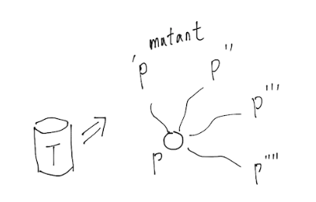

</div>
</div>

<!--
變異測試會在你的程式碼中自動植入人為的單點微小錯誤（變異體），藉此檢驗你的 JUnit 斷言是否真的會亮起紅燈並將其「殺死（Kill）」。

難字與專業術語解說：
- Competent Programmer Hypothesis (CPH): 稱職程式設計師假設（假設工程師寫出的程式與正確版本在語法樹上僅有些微差距，因此微小變異算子能有效模擬真實缺陷）
- Coupling Effect Hypothesis: 耦合效應假設（能殺死所有一階單點微小變異體的敏銳測試集，亦能同時殺死 99% 以上複雜高階複合錯誤的實證定律）
-->
---
## 四大變異算子、RIPR 故障傳播模型與等價變異體 (Equivalent Mutants)

<div class="card-deck">

> 殺死一隻變異體必須完整走完 **RIPR 四階段傳播鏈**；而在計算<strong>變異分數（Mutation Score, `MS = K / (M - E)`）</strong>時，務必從分母扣除永遠殺不死的<strong>等價變異體 (`E`)</strong>！

<div class="two-columns">
<div class="card" data-marpit-fragment>

### 四大變異算子與 RIPR 獵殺四階段
- **四大經典變異算子 (PITest)：**
  - **ROR（關係算子替換）：** `>` ↔ `>=, <, ==` ｜ **COR（條件算子替換）：** `&&` ↔ `||`
  - **AOR（算術算子替換）：** `+` ↔ `-, *, /` ｜ **回傳值篡改／Void 呼叫移除**
- **殺死變異體必經的 RIPR 四階段鏈：**
  1. **可達性 (Reachability)：** 執行流必須走到被變異的該行敘述。
  2. **感染性 (Infection)：** 變異點必須改變內部變數狀態（需靠 BVA 邊界值觸發！）。
  3. **傳播性 (Propagation)：** 內部狀態差異必須一路傳播至最終回傳輸出。
  4. **揭露性 (Revealability)：** JUnit 的 `assertEquals` 斷言必須實際檢查該輸出！

</div>
<div class="card" data-marpit-fragment>

### 變異分數公式與等價變異體 (`E`)
- <strong>計算公式：</strong> <strong>`MS = K / (M - E)`</strong>（`K`：已殺死數，`M`：總變異體數，`E`：等價變異體數）。
- <strong>等價變異體 (Equivalent Mutant, `E`)：</strong> 語法雖然被修改，但在<strong>所有可能輸入下的輸出行為皆與原程式 100% 相同</strong>（計算分數時必須從分母 `M` 扣除！）：
```java
// 原程式 P（整數 a, b）：
if (a < b) c = a;
// 等價變異體 P1（在整數域上與 a < b 永遠等價）：
if (a <= b - 1) c = a;
// 等價變異體 P2（迴圈 i=0; i++ 遞增至 10）：
if (i == 10) break;  -->  if (i >= 10) break;
```

</div>
</div>
</div>

<!--
RIPR 模型（可達 Reachability、感染 Infection、傳播 Propagation、揭露 Revealability）清楚解釋了為何 100% 敘述涵蓋度（僅滿足第一階段 Reachability）遠遠不足以殺死變異體；同時也說明了為何在計算 `MS = K / (M - E)` 時，必須將語意完全等價的等價變異體（`E`）從分母中扣除。

難字與專業術語解說：
- RIPR Model: RIPR 故障傳播模型（測試案例殺死變異體必經的可達、狀態感染、結果傳播與斷言揭露四階段）
- Equivalent Mutant: 等價變異體（語法雖然被修改，但在所有可能輸入下之執行結果皆與原程式完全一致、永遠無法被任何測試殺死的變異體）
-->
---
## 互動式變異測試實驗室：動態模擬 RIPR 傳播與獵殺變異體 (`MS = K/(M-E)`)

<div class="mut-interactive-stage" id="mut-explorer">
<div class="mut-nav-toolbar">
  <button type="button" class="mut-mode-btn is-active" data-mut="s1">1. 脆弱測試集 (t₁, t₂) → MS=40%</button>
  <button type="button" class="mut-mode-btn" data-mut="s2">2. +邊界 t₃(10,1) → 獵殺 P₁ (60%)</button>
  <button type="button" class="mut-mode-btn" data-mut="s3">3. +邊界 t₄(8,6) → 獵殺 P₃ (80%)</button>
  <button type="button" class="mut-mode-btn" data-mut="s4">4. +邊界 t₅(7,10) → 100% 全殲！</button>
  <button type="button" class="mut-mode-btn" data-mut="s5">5. 為何等價變異體 P₆ 須扣除 (M-E)</button>
</div>

<div class="mut-content-grid">
<div class="mut-left-card">
  <div>
    <div style="display: flex; justify-content: space-between; align-items: center; margin-bottom: 4px;">
      <span style="font-size: 12px; font-weight: 800; color: #0b3c5d;">目標程式 <code>func(X, Y)</code> 與植入之 6 隻變異體（點擊任一列檢視 RIPR 狀態）：</span>
      <span style="font-size: 10.5px; font-weight: 700; color: #64748b;">M=6, E=1 ➔ 可殺數=5</span>
    </div>
    <table class="mut-code-table">
      <thead>
        <tr>
          <th style="width: 14%;">編號</th>
          <th style="width: 44%;">原程式 vs. 植入之變異語法</th>
          <th style="width: 20%;">變異算子</th>
          <th style="width: 22%;">即時存活狀態</th>
        </tr>
      </thead>
      <tbody>
        <tr class="mut-row is-focused" data-mid="P1">
          <td><strong>P₁</strong> (L2)</td>
          <td><code>X &gt; 10</code> ➔ <strong style="color:#b45309;"><code>X &gt;= 10</code></strong></td>
          <td>ROR (關係邊界)</td>
          <td><span class="mut-status-pill is-alive" id="mut-st-P1">SURVIVED</span></td>
        </tr>
        <tr class="mut-row" data-mid="P2">
          <td><strong>P₂</strong> (L2)</td>
          <td><code>&amp;&amp; (Y==1)</code> ➔ <strong style="color:#0284c7;"><code>|| (Y==1)</code></strong></td>
          <td>COR (邏輯算子)</td>
          <td><span class="mut-status-pill is-killed" id="mut-st-P2">KILLED (t₂)</span></td>
        </tr>
        <tr class="mut-row" data-mid="P3">
          <td><strong>P₃</strong> (L4)</td>
          <td><code>(X-Y) &lt; 2</code> ➔ <strong style="color:#b45309;"><code>(X-Y) &lt;= 2</code></strong></td>
          <td>ROR (關係邊界)</td>
          <td><span class="mut-status-pill is-alive" id="mut-st-P3">SURVIVED</span></td>
        </tr>
        <tr class="mut-row" data-mid="P4">
          <td><strong>P₄</strong> (L6)</td>
          <td><code>Y &gt; 10</code> ➔ <strong style="color:#b45309;"><code>Y &gt;= 10</code></strong></td>
          <td>ROR (關係邊界)</td>
          <td><span class="mut-status-pill is-alive" id="mut-st-P4">SURVIVED</span></td>
        </tr>
        <tr class="mut-row" data-mid="P5">
          <td><strong>P₅</strong> (L7)</td>
          <td><code>X = 3;</code> ➔ <strong style="color:#0284c7;"><code>X = 4;</code></strong></td>
          <td>AOR / 常數替換</td>
          <td><span class="mut-status-pill is-killed" id="mut-st-P5">KILLED (t₂)</span></td>
        </tr>
        <tr class="mut-row" data-mid="P6">
          <td><strong>P₆</strong> (L4)</td>
          <td><code>(X-Y) &lt; 2</code> ➔ <strong style="color:#6b21a8;"><code>(X-Y) &lt;= 1</code></strong></td>
          <td>等價變異體 (E)</td>
          <td><span class="mut-status-pill is-equiv" id="mut-st-P6">EQUIVALENT</span></td>
        </tr>
      </tbody>
    </table>
  </div>

  <div class="wbc-tc-section">
    <div class="wbc-tc-header">
      <span>點選開關測試集 <code>T</code> 中的測試案例（即時觀察變異體被獵殺過程！）：</span>
      <span id="mut-active-tc-label" style="color: #0284c7;">已啟用：2 / 5 筆測資</span>
    </div>
    <div style="display: grid; grid-template-columns: repeat(5, 1fr); gap: 5px;">
      <div class="wbc-tc-pill is-active" data-mtc="t1"><span>t₁(12,1)</span></div>
      <div class="wbc-tc-pill is-active" data-mtc="t2"><span>t₂(7,11)</span></div>
      <div class="wbc-tc-pill" data-mtc="t3"><span>t₃(10,1)</span></div>
      <div class="wbc-tc-pill" data-mtc="t4"><span>t₄(8,6)</span></div>
      <div class="wbc-tc-pill" data-mtc="t5"><span>t₅(7,10)</span></div>
    </div>
  </div>

  <div class="wbc-meters-box" style="padding: 6px 10px;">
    <div class="wbc-meter-row">
      <span>敘述覆蓋 (SC)</span>
      <div class="wbc-bar-bg"><div class="wbc-bar-fill" id="mut-bar-sc" style="width: 100%; background: #16a34a;"></div></div>
      <span class="wbc-meter-val" id="mut-val-sc">100% (8/8)</span>
    </div>
    <div class="wbc-meter-row">
      <span>變異分數 (MS)</span>
      <div class="wbc-bar-bg"><div class="wbc-bar-fill" id="mut-bar-ms" style="width: 40%; background: #f59e0b;"></div></div>
      <span class="wbc-meter-val" id="mut-val-ms">40% (2/5)</span>
    </div>
  </div>
</div>

<div class="mut-right-card">
  <div>
    <div style="display: flex; justify-content: space-between; align-items: center; margin-bottom: 4px;">
      <span class="ep-badge-pill ep-badge-amber" id="mut-mode-badge">100% 敘述涵蓋度 ≠ 高品質測試！</span>
      <span style="font-size: 11.5px; font-weight: 800; color: #0f172a; font-family: 'Fira Code', monospace;" id="mut-score-formula">MS = 2 / (6 - 1) = 40%</span>
    </div>
    <table class="mut-matrix-table">
      <thead>
        <tr>
          <th>程式 \ 測資</th>
          <th>t₁(12,1)</th>
          <th>t₂(7,11)</th>
          <th>t₃(10,1)</th>
          <th>t₄(8,6)</th>
          <th>t₅(7,10)</th>
        </tr>
      </thead>
      <tbody>
        <tr>
          <th>原程式 <code>P</code></th>
          <td><strong>1</strong></td>
          <td><strong>3</strong></td>
          <td><strong>2</strong></td>
          <td><strong>8</strong></td>
          <td><strong>2</strong></td>
        </tr>
        <tr data-mrow="P1">
          <th>P₁ (<code>X&gt;=10</code>)</th>
          <td data-mcell="P1-t1">1</td>
          <td data-mcell="P1-t2">3</td>
          <td data-mcell="P1-t3">1 (Kill!)</td>
          <td data-mcell="P1-t4">8</td>
          <td data-mcell="P1-t5">2</td>
        </tr>
        <tr data-mrow="P2">
          <th>P₂ (<code>&amp;&amp;➔||</code>)</th>
          <td data-mcell="P2-t1">1</td>
          <td data-mcell="P2-t2">1 (Kill!)</td>
          <td data-mcell="P2-t3">1 (Kill!)</td>
          <td data-mcell="P2-t4">8</td>
          <td data-mcell="P2-t5">2</td>
        </tr>
        <tr data-mrow="P3">
          <th>P₃ (<code>&lt;=2</code>)</th>
          <td data-mcell="P3-t1">1</td>
          <td data-mcell="P3-t2">3</td>
          <td data-mcell="P3-t3">2</td>
          <td data-mcell="P3-t4">2 (Kill!)</td>
          <td data-mcell="P3-t5">2</td>
        </tr>
        <tr data-mrow="P4">
          <th>P₄ (<code>Y&gt;=10</code>)</th>
          <td data-mcell="P4-t1">1</td>
          <td data-mcell="P4-t2">3</td>
          <td data-mcell="P4-t3">2</td>
          <td data-mcell="P4-t4">8</td>
          <td data-mcell="P4-t5">3 (Kill!)</td>
        </tr>
        <tr data-mrow="P5">
          <th>P₅ (<code>X=4</code>)</th>
          <td data-mcell="P5-t1">1</td>
          <td data-mcell="P5-t2">4 (Kill!)</td>
          <td data-mcell="P5-t3">2</td>
          <td data-mcell="P5-t4">8</td>
          <td data-mcell="P5-t5">2</td>
        </tr>
        <tr data-mrow="P6">
          <th>P₆ (等價 <code>E</code>)</th>
          <td data-mcell="P6-t1">1 (==P)</td>
          <td data-mcell="P6-t2">3 (==P)</td>
          <td data-mcell="P6-t3">2 (==P)</td>
          <td data-mcell="P6-t4">8 (==P)</td>
          <td data-mcell="P6-t5">2 (==P)</td>
        </tr>
      </tbody>
    </table>
  </div>

  <div>
    <div style="font-size: 11.5px; font-weight: 800; color: #0b3c5d; margin-bottom: 3px;" id="mut-ripr-header">
      當前聚焦變異體 <code>P₁ (X &gt;= 10)</code> 之 RIPR 四階段傳播鏈診斷：
    </div>
    <div class="mut-ripr-chain">
      <div class="mut-ripr-step is-pass" id="mut-ripr-r"><span class="mut-ripr-title">1. 可達 Reach</span><span class="mut-ripr-sub" id="mut-ripr-r-txt">✓ 已執行第 2 行</span></div>
      <div class="mut-ripr-step is-fail" id="mut-ripr-i"><span class="mut-ripr-title">2. 感染 Infect</span><span class="mut-ripr-sub" id="mut-ripr-i-txt">✗ 需邊界 X==10!</span></div>
      <div class="mut-ripr-step is-fail" id="mut-ripr-p"><span class="mut-ripr-title">3. 傳播 Prop</span><span class="mut-ripr-sub" id="mut-ripr-p-txt">✗ 狀態未產生分歧</span></div>
      <div class="mut-ripr-step is-fail" id="mut-ripr-rev"><span class="mut-ripr-title">4. 揭露 Reveal</span><span class="mut-ripr-sub" id="mut-ripr-rev-txt">✗ P(t)==P₁(t)</span></div>
    </div>
  </div>

  <div id="mut-diag-box" style="padding: 7px 10px; border-radius: 8px; background: #fffbeb; border: 1.4px solid #f59e0b; color: #92400e; font-size: 11.6px; font-weight: 700; line-height: 1.35;">
    💡 <strong>為何 100% 敘述涵蓋度仍讓 P₁, P₃, P₄ 存活：</strong> <code>t₁(12,1)</code> 與 <code>t₂(7,11)</code> 雖執行了每一行，卻未踩在精確邊界點（<code>X=10</code>、<code>X-Y=2</code>、<code>Y=10</code>），導致<strong>階段 2（狀態感染 Infection）</strong>未觸發！請點擊上方按鈕 2、3、4 注入邊界測資獵殺！
  </div>
</div>
</div>
</div>

<!--
這座互動式變異測試實驗室動態詮釋了「獵殺變異體 (Kill Mutant)」與 RIPR 四階段模型：即便 `t1(12,1)` 與 `t2(7,11)` 已經達成 100% 敘述涵蓋度（SC = 100%），3 隻關係邊界變異體 `P1 (X>=10)`、`P3 (X-Y<=2)` 與 `P4 (Y>=10)` 依然全部存活（變異分數 MS 僅 40%），因為 RIPR 的第二階段「狀態感染 (Infection)」根本未被觸發！當學生依序點擊上方按鈕 2、3、4 注入精確的 BVA 邊界點測資 `t3(10,1)`、`t4(8,6)` 與 `t5(7,10)` 時，即可親眼看到 RIPR 四階段全數亮起綠燈並將變異體逐一擊殺（MS 推進至 100%）；點擊按鈕 5 則能清楚看到等價變異體 `P6` 為何永遠無法在整數域上被感染，因此必須在公式 `MS = K / (M - E)` 中從分母扣除。
-->
---
## 變異測試實戰推演 1：陣列最大值索引 `p(a)` (`ex_mutation_test`)

<div class="card-deck">

> 給定函式 `p(a)`（回傳 3 元素陣列中最大值的索引 `r`）與 4 隻變異體 `P1..P4`，評估測試集 `T = {t1, t2, t3}` 的變異分數並補刀獵殺存活變異體！

<div class="two-columns">
<div class="card" data-marpit-fragment>

### 原程式 `p(a)` 與 4 隻變異體 (`P1..P4`)
```python
def p(a): # 回傳最大值所在的索引 r
    r = 0
    for i in [1, 2]:
        if a[i] > a[r]: r = i
    return r
# P1: for i in [0, 1, 2]     (多檢查了 i=0)
# P2: if i > a[r]: r = i     (將 a[i] 誤寫為索引 i)
# P3: if a[i] >= a[r]: r = i (將 > 變異為 >=)
# P4: if True: r = i         (永遠回傳最後索引 2)
```
- **`P1` 是等價變異體 (`E = 1`)：** 當 `i = 0` 時，`a[0] > a[0]` 恆為 `False`，永遠不改變 `r`。
- <strong>`P3` 在 `t1..t3` 下存活：</strong> 補上含重複最大值的邊界測資 <strong>`t4 = [2, 2, 1]`</strong>，使原程式 `P` 回傳 `0`、變異體 `P3` 回傳 `1`（<strong>成功獵殺！`MS: 66.7% → 100%`</strong>）。

</div>
<div class="card" data-marpit-fragment>

### 變異體執行與獵殺矩陣
| 測試案例 | 原程式 `P` | `P1` (`[0,1,2]`) | `P2` (`i>a[r]`) | `P3` (`>=`) | `P4` (`True`) |
| :---: | :---: | :---: | :---: | :---: | :---: |
| **`t1=[1,2,3]`** | `2` | `2` | <strong><code>1</code> (殺死)</strong> | `2` | `2` |
| **`t2=[1,2,1]`** | `1` | `1` | `1` | `1` | <strong><code>2</code> (殺死)</strong> |
| **`t3=[3,1,2]`** | `0` | `0` | `0` | `0` | <strong><code>2</code> (殺死)</strong> |
| **初始狀態** | 基準 | <strong>等價 (<code>E</code>)</strong> | **已殺死** | **存活！** | **已殺死** |
| **補 `t4=[2,2,1]`** | `0` | `0` | `2` | <strong><code>1</code> (殺死！)</strong> | `2` |

</div>
</div>
</div>

---
## 變異測試實戰推演 2：5 變異體獵殺矩陣 (`func(X, Y)`)

<div class="card-deck">

> 給定 `func(X, Y)`、5 隻非等價變異體 `P1..P5` 與初始測試集 `T = {(12,1), (6,5), (7,11)}`，計算初始變異分數 `MS` 並設計精準邊界測資將其全數殲滅！

<div class="two-columns">
<div class="card" data-marpit-fragment>

### 原程式 `func(X, Y)` 與 5 隻變異體
```java
int func(int X, int Y) {
    if ((X > 10) && (Y == 1))  // P1: X >= 10
        X = 1;                 // P2: && -> ||
    else if ((X - Y) < 2)      // P3: <= 2
        X = 2;
    if (Y > 10)                // P4: Y >= 10
        X = 3;                 // P5: X = 4
    return X;
}
```
- **初始變異分數：** `t3=(7,11)` 殺死了 `P2` 與 `P5` → **`MS = 2 / 5 = 40%`**。
- **補上 3 筆精準邊界測資 → 達成 `100% MS`：**
  - 獵殺 `P1`：<strong>`t4 = (10, 1)`</strong>（`P=2, P1=1`）
  - 獵殺 `P3`：<strong>`t5 = (8, 6)`</strong>（`P=8, P3=2`）
  - 獵殺 `P4`：<strong>`t6 = (7, 10)`</strong>（`P=2, P4=3`）

</div>
<div class="card" data-marpit-fragment>

### 變異體獵殺矩陣 (`MS: 40% → 100%`)
| 程式／變異體 | `t1=(12,1)` | `t2=(6,5)` | `t3=(7,11)` | 狀態與補刀對策 |
| :--- | :---: | :---: | :---: | :--- |
| **原程式 `P`** | **`1`** | **`2`** | **`3`** | 正確基準輸出 |
| <strong><code>P1</code> (<code>X>=10</code>)</strong> | `1` | `2` | `3` | **存活** → 補 **`(10,1)`** |
| <strong><code>P2</code> (<code>&&→\|\|</code>)</strong> | `1` | `2` | <strong><code>1</code> (殺死)</strong> | **已被 `t3` 殺死** |
| <strong><code>P3</code> (<code><2→<=2</code>)</strong> | `1` | `2` | `3` | **存活** → 補 **`(8,6)`** |
| <strong><code>P4</code> (<code>Y>=10</code>)</strong> | `1` | `2` | `3` | **存活** → 補 **`(7,10)`** |
| <strong><code>P5</code> (<code>X=3→4</code>)</strong> | `1` | `2` | <strong><code>4</code> (殺死)</strong> | **已被 `t3` 殺死** |

</div>
</div>
</div>

<!--
請注意這兩個實戰推演的共通規律：所有存活下來的關係運算子變異體（例如將 `>` 變異為 `>=` 的 `P3`、`P1` 與 `P4`），全部都是被<strong>精確邊界值（On-Point Boundary Values）</strong>所殺死（包括 `[2, 2, 1]` 中的 `a[i] == a[r]`、`(10, 1)` 中的 `X == 10`、`(8, 6)` 中的 `X - Y == 2`，以及 `(7, 10)` 中的 `Y == 10`）！這從數學上完美證明了黑箱邊界值分析（BVA）與白箱變異測試之間的深刻內在連結。

難字與專業術語解說：
- mutation hunting matrix: 變異體獵殺矩陣（列出各測試案例在原程式與各變異體上之輸出，藉以識別存活變異體並設計補彈測資的分析表）
-->
---
## 工業級變異測試實戰：`BinarySearch` 迴圈變異體與 PITest 報告

<div class="split73">
<div class="left">

* **`BinarySearch` 迴圈邊界變異體（`bs02` 與 `bs03`）：**
  ```java
  // 原程式: while (left <= right) | bs02: while (left < right) | bs03: while (left >= right)
  ```
  - <strong>獵殺 `bs02`（`left < right` 漏掉 `==`）：</strong> 必須設計一筆需要收斂到最後單一元素視窗 <strong>`left == right`</strong> 才能找到目標的測資（例如 <strong>`search(2, [0, 1, 2])`</strong> 或單元素陣列 <strong>`search(1, [1])`</strong>）！
  - **獵殺 `bs03`（`left >= right` 方向反轉）：** 單元素陣列 `[5]`（因 `0 >= 0` 為真仍會進入迴圈）無法殺死它；任何**長度 `>= 2`** 且目標存在的陣列（例如 **`search(1, [0, 1, 2])`**，初始 `0 >= 2` 為假直接跳過迴圈回傳 `-1`）即可一擊必殺 `bs03`！
* **使用 PITest (`pitest-maven`) 執行工業級位元組碼變異測試：**
  - 執行 `mvn test-compile org.pitest:pitest-maven:mutationCoverage`，直接於記憶體中篡改 JVM 位元組碼並將每行標示為 <strong><code>KILLED</code>（深綠）</strong>、<strong><code>SURVIVED</code>（淺紅）</strong>、<strong><code>NO_COVERAGE</code>（深紅）</strong>或 **`TIMED_OUT`**。

</div>
<div class="right">

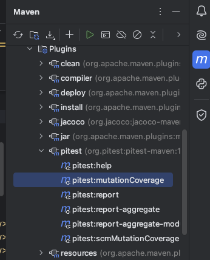

</div>
</div>

<!--
觀察 `bs02`（`while (left < right)`）與 `bs03`（`while (left >= right)`）：
- 為了殺死 `bs02`，二分搜尋必須一路收斂到 `left == right` 的最後一個單元素視窗（例如在 `[0, 1, 2]` 中尋找位於邊界的元素 `2`）。
- 為了殺死 `bs03`，陣列長度必須至少為 2（使初始 `left < right`），如此一來 `left >= right` 就會在第一步直接跳出迴圈並錯誤回傳 `-1`。

難字與專業術語解說：
- PITest (PIT Mutation Testing): Java 工業級變異測試框架（直接在記憶體中篡改 JVM 位元組碼並平行執行 JUnit 測試，自動產出變異刪除率報告的工具）
-->
---
<!-- _class: lead -->
<!-- header: '7.6 整合測試、測試替身與 Mockito' -->

# **7.6 整合測試、測試替身 (Test Doubles) 與 Mockito 實戰**

> 「兩個門把各自單獨轉動時都無比順暢（單元測試 100% 通過），但裝在同一扇雙開門上時卻互相卡死——這就是為什麼我們需要整合測試與嚴謹的測試替身。」

<!--
我們現在進入第 7.6 節：整合測試、測試替身（Test Doubles）與 Mockito 實戰（整合 SQA 第 7 章第 7.1 至 7.6 節）。

難字與專業術語解說：
- contract mismatch: 介面契約失配（呼叫端模組與被呼叫端模組對於前置條件防呆責任、例外型別或資料格式之假設不一致，導致整合時崩潰的缺陷）
-->
---
## V 模型中的整合測試定位與純 Java 介面契約失配案例

<div class="split73">
<div class="left">

* **唯有在整合測試階段才會暴露的 6 大常見缺陷：**
  1. <strong>介面版本漂移 (Interface Version Drift)</strong>（模組 A 升級了 API，模組 B 仍呼叫舊版簽章）。
  2. <strong>防禦性檢查遺漏或衝突</strong>（呼叫端與被呼叫端都以為對方會檢查分母 `b != 0`！）。
  3. <strong>資料結構或單位不一致</strong>（公尺 vs. 公分、0-based vs. 1-based 索引）。
  4. **違反伺服器前置條件**、**5. 參數順序顛倒**、**6. 多執行緒死結與競態條件**。
* **純 Java 介面契約失配實例（`Calculator` + `RealCalculatorService`）：**
  ```java
  // 工程師 A 的 Calculator.java（假設底層 Service 遇到除以 0 會拋出 IllegalArgumentException）
  public int divide(int a, int b) { return service.divide(a, b); }
  // 工程師 A 使用 Mock 的單元測試 --> 100% 綠燈通過！
  when(mockService.divide(6, 0)).thenThrow(IllegalArgumentException.class);
  assertThrows(IllegalArgumentException.class, () -> calc.divide(6, 0));

  // 工程師 B 的 RealCalculatorService.java（假設呼叫端已經先檢查過 b != 0！）
  public int divide(int a, int b) { return a / b; }
  // 真實整合測試：new Calculator(new RealCalculatorService()).divide(6, 0)
  // --> 直接拋出 ArithmeticException (/ by zero) 而非 IllegalArgumentException，當場崩潰！
  ```

</div>
<div class="right">

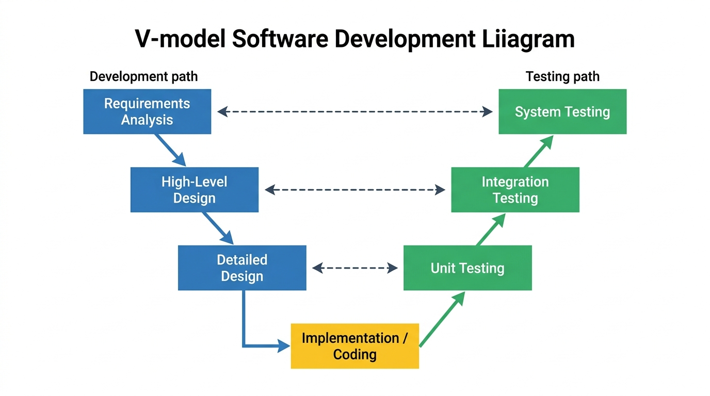

</div>
</div>

<!--
使用 Mock 替身進行的單元測試，只驗證了「你對外部依賴的主觀假設」；唯有真實的整合測試（Integration Testing），才能驗證兩個模組是否真正遵守同一份介面契約！

難字與專業術語解說：
- false green light from mocking: 模擬替身假綠燈（單元測試中因開發者對 Mock 設定了與真實底層實作不符的理想化回傳或例外，導致單元測試通過但真實整合崩潰的陷阱）
-->
---
## 可測試性 (Testability) 的架構基石：建構子依賴注入 (Constructor DI)

<div class="card-deck">

> 絕不在業務類別內部寫死 `new ConcreteDependency()`；**依賴於抽象介面 (`interface`) 並透過建構子注入**，才能無縫切換由上而下、Mockito 與由下而上三種測試模式！

<div class="two-columns">
<div class="card" data-marpit-fragment>

### 反模式：在類別內部寫死 `new` 具體依賴
```java
public class Prime {
    // 寫死具體依賴，將整個類別鎖死！
    private final PrimeChecker checker = new RealPrimeChecker();
    public int[] allPrime(int n) { ... }
}
```
- **為何這會徹底摧毀可測試性：**
  1. 若 `RealPrimeChecker` 尚未開發完成或需連線真實資料庫，`Prime` **將完全無法進行獨立單元測試**！
  2. 無法替換注入由上而下的 `Stub` 測試樁或 `Mockito` 模擬物件。

</div>
<div class="card" data-marpit-fragment>

### 最佳實踐：抽象介面 + 建構子依賴注入 (DI)
```java
public class Prime {
    private final PrimeChecker checker; // 依賴抽象介面！

    // 由外部呼叫端決定要注入哪一種實作
    public Prime(PrimeChecker checker) {
        this.checker = checker;
    }
    public int[] allPrime(int n) { ... }
}
```
- **同一份類別完美支援 3 種測試模式：**
  1. **由上而下測試樁 (Stub)：** `new Prime(new StubPrimeChecker())`
  2. **Mockito 隔離單元測試：** `new Prime(mock(PrimeChecker.class))`
  3. **由下而上真實整合測試：** `new Prime(new RealPrimeChecker())`

</div>
</div>
</div>

<!--
當 `Prime` 透過建構子接收 `PrimeChecker` 抽象介面時，完全同一份正式生產程式碼，既能搭配手寫 Stub 進行由上而下測試、也能搭配動態 Mockito Mock 進行隔離單元測試，更能搭配真實 `RealPrimeChecker` 進行由下而上整合測試！

難字與專業術語解說：
- Constructor Dependency Injection (Constructor DI): 建構子依賴注入（不於類別內部自行 `new` 具體底層依賴，而是透過建構子參數由外部傳入抽象介面實作的解耦設計模式）
-->
---
## 由下而上整合測試 (Bottom-Up)：5 步驟演進與純 Java `Prime` 組裝

<div class="split73">
<div class="left">

* **由下而上整合測試 5 步驟演進（搭配測試驅動程式 Test Drivers）：**
  1. **步驟 1（底層葉節點模組）：** 使用測試驅動程式 `b, c, a` 先行驗證最底層模組 **`E, F, G, D`**。
  2. **步驟 2..4（子系統向上組裝）：** 將驅動程式 `b` 替換為真實模組 **`B`**，由上層驅動程式 `a` 驗證子系統 **`B-E-F`**，再依序組裝驗證 **`B-C`** 與 **`B-C-D`**。
  3. **步驟 5（完整系統整合）：** 將 `a` 替換為頂層模組 **`A`**，完成全系統 **`A-B-C-D-E-F-G`** 驗證。
* **純 Java 由下而上真實組裝（`RealPrimeChecker → Prime`，零 Mock！）：**
  ```java
  @Test // 步驟 1：JUnit 的 @Test 方法本身就是底層葉節點 RealPrimeChecker 的 Test Driver！
  void testLeafRealPrimeCheckerDriver() {
      RealPrimeChecker leaf = new RealPrimeChecker();
      assertTrue(leaf.isPrime(2) && !leaf.isPrime(9));
  }
  @Test // 步驟 2：將已驗證完畢的真實葉節點向上組裝進上層 Prime 模組！
  void testBottomUpPrimeIntegration() {
      Prime prime = new Prime(new RealPrimeChecker()); // 真實 B + 真實 E！
      assertArrayEquals(new int[]{2, 3, 5, 7}, prime.allPrime(10));
  }
  ```

</div>
<div class="right">

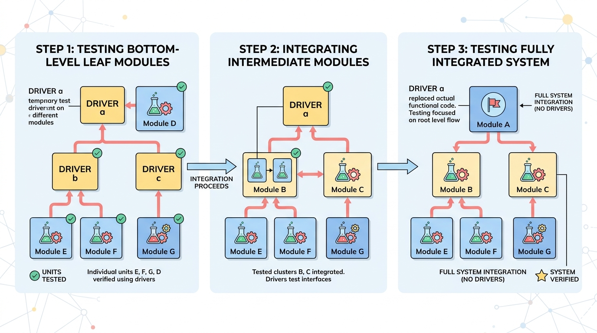

</div>
</div>

<!--
在由下而上整合測試（Bottom-Up Integration）中，我們先以 JUnit 的 `@Test` 方法作為測試驅動程式（Test Driver）驗證最底層的葉節點模組，接著逐層向上組裝已驗證的真實元件，全程完全不需要撰寫任何 Stub 測試樁！

難字與專業術語解說：
- Bottom-Up Integration: 由下而上整合測試（從最底層無依賴之葉節點模組開始，藉由測試驅動程式 Driver 驗證後逐層往上真實組裝的策略）
-->
---
## 由上而下整合測試 (Top-Down)：搭配測試樁 (Test Stubs) 向下推進

<div class="split73">
<div class="left">

* **由上而下整合哲學（使用測試樁 Test Stubs）：**
  - 當高階控制流程（`Displayer → Prime → PrimeChecker`）必須在底層演算法完成前先行驗證時，可插入回傳固定罐頭資料的輕量級**測試樁 (Test Stubs)**！
* **質數列印系統之由上而下 3 階段推進：**
  1. **階段 1（以 `Prime` Stub 測試頂層 `Displayer`）：** `int[] allPrime(int n) { return new int[]{2,3,5,7}; }`
  2. **階段 2（真實 `Prime` + 底層葉節點 `StubPrimeChecker`）：**
     ```java
     public class StubPrimeChecker implements PrimeChecker {
         public boolean isPrime(int n) { return (n == 2 || n == 3 || n == 5); }
     }
     @Test void testTopDownPrimeWithStub() {
         Prime prime = new Prime(new StubPrimeChecker());
         assertArrayEquals(new int[]{2, 3, 5}, prime.allPrime(5));
     }
     ```
  3. **階段 3：** 將 `StubPrimeChecker` 替換為真實的 `RealPrimeChecker`！

</div>
<div class="right">

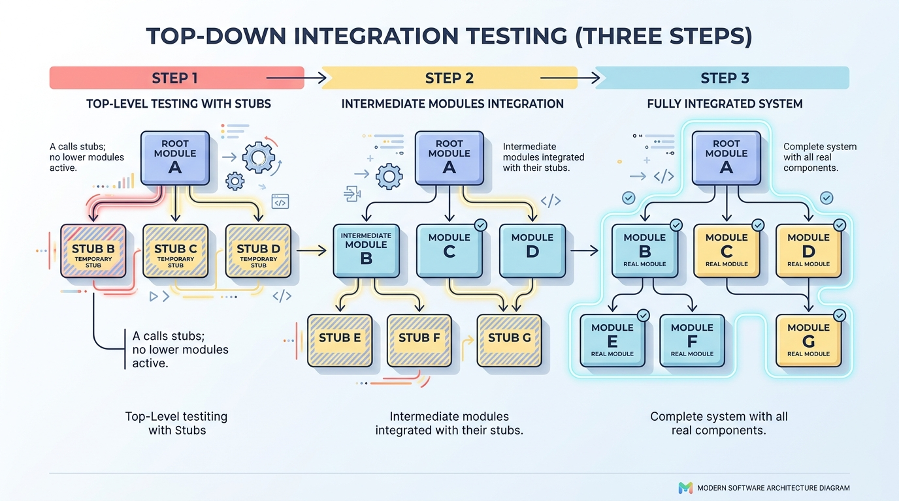

</div>
</div>

<!--
在由上而下整合測試（Top-Down Integration）中，我們從最頂層的協調控制模組開始，針對尚未完成的下層模組先以輕量級測試樁（Test Stubs）頂替，再由上往下逐步將測試樁替換為真實實作。

難字與專業術語解說：
- Test Stub: 測試樁／存根（在由上而下整合測試中，用以模擬尚未完成之底層被呼叫模組、回傳固定硬編碼結果的極簡替身）
-->
---
## 四大整合測試策略全方位對照矩陣

> 撰寫**測試樁 (Stubs)** 往往比撰寫**驅動程式 (Drivers)** 更困難（例如只寫死到 `5` 的 `StubPrimeChecker`，一旦遇到 `allPrime(10)` 需要判斷 `7` 時就會失靈！）。**三明治整合 (Sandwich Integration)** 結合了由上而下與由下而上的雙重優勢。

| 比較維度 | 大爆炸整合 (Big-Bang) | 由上而下整合 (Top-Down) | 由下而上整合 (Bottom-Up) | 三明治混合整合 (Sandwich) |
| :--- | :--- | :--- | :--- | :--- |
| **整合推進方向** | 所有模組一次全部接上 | 從頂層 UI／控制層向下推進 | 從底層葉節點／DAO 向上組裝 | 上下兩路並進，於**中間核心業務層**會師 |
| **所需測試治具** | 無 *(除錯是一場災難)* | **測試樁 Test Stubs** *(較難寫)* | **測試驅動程式 Test Drivers** *(即 JUnit `@Test`！)* | 上層用 Stubs + 底層用 JUnit Drivers |
| **核心優勢** | 零治具開發成本 | **提早驗證 UI 與高階控制流程** | **底層基礎穩固；錯誤隔離最容易** | 兼顧早期流程驗證與穩固底層基礎 |
| **主要風險** | **無法隔離定位錯誤來源** | Stub 過度簡化複雜狀態導致失真 | **最頂層業務流程到最後一刻才驗證** | 需妥善協調上下雙軌開發時程 |
| **`Prime` 案例** | 最後直接跑 `main()` | `new Prime(new StubPrimeChecker())` | `new Prime(new RealPrimeChecker())` | UI Stubs 與底層 JUnit 於 `Prime` 會師 |

<!--
三明治混合整合（Sandwich / Hybrid Integration）是業界最受青睞的折衷方案：底層工具與 DAO 資料存取層採用由下而上搭配 JUnit Drivers 穩固驗證，頂層 UI 與 Controller 採用由上而下搭配輕量 Stubs 提早驗證流程，最後在中間核心業務服務層（Service Layer）會師整合。

難字與專業術語解說：
- Sandwich Integration: 三明治整合測試法（結合由上而下與由下而上策略，以中間核心業務層為會師目標同時推進的混合式整合策略）
-->
---
## 從 Stubs / Drivers 邁向 Gerard Meszaros 的 5 大測試替身 (Test Doubles)

<div class="card-deck">

> 在現代 JUnit 5 架構中，<strong>`@Test` 方法本身就是測試驅動程式 (Test Driver)</strong>；而用來隔離受測系統外部依賴的 5 種替身物件，則統稱為<strong>測試替身 (Test Doubles)</strong>（出自經典名著 *xUnit Test Patterns*）。

<div class="two-columns">
<div class="card" data-marpit-fragment>

### 5 大測試替身精準解析
1. **Dummy（啞元物件）：** 純粹為了湊齊方法參數列而傳入、從未被實際呼叫的填充物（如 `null`）。
2. <strong>Stub（測試樁）：</strong> 向受測系統（SUT）餵入<strong>預先設定好的固定罐頭回傳值</strong>（`when().thenReturn()`）。
3. **Spy（間諜物件）：** 包裝**真實物件實體**，除非特定方法被局部覆寫，否則執行真實程式碼並暗中記錄呼叫歷程。
4. <strong>Mock（模擬物件）：</strong> 專注於驗證<strong>互動行為、呼叫次數與傳入參數</strong>（`verify(mock, times(1))`）。
5. <strong>Fake（偽造實作）：</strong> 具備真實運作邏輯的<strong>輕量簡化版實作</strong>（例如以記憶體內 `HashMap` 模擬資料庫）。

</div>
<div class="card" data-marpit-fragment>

### 5 大測試替身快速對照表
| 測試替身類型 | 核心角色與記憶口訣 | 驗證焦點 |
| :--- | :--- | :---: |
| **1. Dummy** | 湊參數用的無動作填充物 | 無 |
| **2. Stub** | 回傳預設罐頭答案控制流向 | **狀態驗證 (State)** |
| **3. Spy** | 真實物件包裝 + 局部方法覆寫 | 狀態 + 行為驗證 |
| **4. Mock** | 稽核外部協作者之互動呼叫次數 | **行為驗證 (Behavior)** |
| **5. Fake** | 輕量級可運作之 `HashMap` 假資料庫 | **狀態驗證 (State)** |

</div>
</div>
</div>

---
## 為何必須隔離外部 API？股票投資組合估值案例 (`MarketTest.java`)

<div class="card-deck">

> 若 `Market.getMarketValue()` 直接連線證交所真實 API 查詢台積電（`2330`）股價，報價每秒都在跳動（<strong>非確定性 Non-deterministic</strong>）且斷網即測試失敗——應以 Stub 替換外部 `StockService`，同時保持 `Stock` 實體物件為<strong>真實物件</strong>！

<div class="two-columns">
<div class="card" data-marpit-fragment>

### 正式生產類別 (`Market.java`)
```java
public class Market {
    private StockService stockService; // 外部 HTTP 報價 API
    private List<Stock> stocks;        // 投資組合持股清單

    public double getMarketValue() {
        double total = 0.0;
        for (Stock s : stocks) {
            total += stockService.getPrice(s)
                   * s.getQuantity();
        }
        return total;
    }
}
```

</div>
<div class="card" data-marpit-fragment>

### 使用測試樁的單元測試 (`MarketTest.java`)
```java
@Test void testPortfolioMarketValue() {
    StockService svc = mock(StockService.class); // 模擬外部 API
    Market market = new Market(svc);
    Stock tsmc = new Stock("2330", "TSMC", 10);  // 真實領域實體！
    Stock etf  = new Stock("0050", "ETF50", 100);
    market.setStocks(List.of(tsmc, etf));

    when(svc.getPrice(tsmc)).thenReturn(1035.0); // 凍結股價報價
    when(svc.getPrice(etf)).thenReturn(195.0);

    // 1035*10 + 195*100 = 29,850.0（100% 確定性且毫秒級完成！）
    assertEquals(29850.0, market.getMarketValue());
}
```

</div>
</div>
</div>

<!--
在 `MarketTest` 中，我們僅對 `StockService`（股價每秒跳動的外部網路 API）進行 Mock 佈樁，而讓 `Stock` 價值物件（Value Object）與 `List.of(...)` 保持 100% 真實運作！

難字與專業術語解說：
- State Verification vs. Behavior Verification: 狀態驗證 vs. 行為驗證（狀態驗證透過 `assertEquals` 檢查方法回傳值或物件最終狀態；行為驗證透過 `verify` 檢查受測系統是否依預期次數與參數呼叫外部協作者）
-->
---
## Mockito 實戰 (1)：動態 `mock()`、`@Mock / @InjectMocks` 與 `spy()` 局部模擬

<div class="card-deck">

> Mockito 透過動態位元組碼代理（Bytecode Proxy）、宣告式 `@InjectMocks` 自動注入與 `spy()` 局部模擬修補，徹底免除了手寫硬編碼測試樁類別（`StubPrimeChecker.java`）的負擔。

<div class="two-columns">
<div class="card" data-marpit-fragment>

### 宣告式 `@Mock` + `@InjectMocks` (`PrimePlusTest`)
```java
@ExtendWith(MockitoExtension.class)
class PrimePlusTest {
    @Mock        PrimeChecker mockChecker; // 1. 自動建立 Mock 代理
    @InjectMocks Prime prime;              // 2. 自動呼叫 new Prime(mockChecker)

    @Test void testAllPrimeAndException() {
        when(mockChecker.isPrime(2)).thenReturn(true);
        when(mockChecker.isPrime(3)).thenReturn(true);
        when(mockChecker.isPrime(4)).thenReturn(false);
        when(mockChecker.isPrime(5)).thenReturn(true);

        assertArrayEquals(new int[]{2, 3, 5}, prime.allPrime(5));

        // 模擬超出範圍輸入時拋出防禦性例外：
        when(mockChecker.isPrime(101))
            .thenThrow(new IllegalArgumentException("Max 100"));
        assertThrows(IllegalArgumentException.class,
            () -> prime.allPrime(101));
    }
}
```

</div>
<div class="card" data-marpit-fragment>

### `mock()`（空殼代理）vs. `spy()`（包裝真實物件）
- **`mock(Class)`：** 未設定（Unstubbed）的方法一律回傳預設空值 `0 / false / null`。
- **`spy(realObj)`：** 未設定的方法會**直接執行真實物件的原始程式碼**；僅針對特別指定的輸入進行局部覆寫（`doReturn().when(spy)`）：
```java
@Test void testPatchingIncompleteStubWithSpy() {
    // StubPrimeChecker 只寫死支援 2, 3, 5（漏寫了 7！）
    PrimeChecker incomplete = new StubPrimeChecker();
    PrimeChecker spyChecker = spy(incomplete); // 包裝真實物件

    // 僅局部修補 isPrime(7)；2..6 依然執行 StubPrimeChecker 的真實程式碼！
    doReturn(true).when(spyChecker).isPrime(7);

    Prime prime = new Prime(spyChecker);
    assertArrayEquals(new int[]{2, 3, 5, 7}, prime.allPrime(10));
}
```

</div>
</div>
</div>

<!--
`mock()` 是一個空殼虛擬代理（任何未設定的方法呼叫皆回傳 `0`、`false` 或 `null`）；而 `spy()` 則包裹了一個真實物件實體，使所有未特別設定的呼叫皆執行真實程式碼，讓我們能精準地只對 `isPrime(7)` 進行局部打補丁（Patching）。

難字與專業術語解說：
- Partial Mocking (`spy`): 局部模擬／間諜包裝（以真實物件實體為基底，未特別佈樁的方法皆執行真實程式碼，僅針對特定方法或參數局部覆寫回傳值的機制）
-->
---
## Mockito 實戰 (2)：`verify()` 互動次數稽核與避免脆化測試 (Brittle Tests)

<div class="card-deck">

> 善用 `verify()` 稽核關鍵外部互動行為，但務必警惕**過度模擬 (Over-Mocking)** 將測試案例死鎖在私有實作細節上，導致一重構就大面積壞掉的**脆化測試 (Brittle Tests)**！

<div class="two-columns">
<div class="card" data-marpit-fragment>

### 使用 `verify()` 進行行為驗證 (`PrimeTest`)
- 為何在 `allPrime(10)` 上 `assertArrayEquals` 狀態斷言通過，但 `verify(mockChecker, times(1)).isPrime(1)` 卻拋出 **`Wanted but not invoked`** 失敗？
```java
int[] res = prime.allPrime(10);
assertArrayEquals(new int[]{2, 3, 5, 7}, res); // 狀態斷言綠燈通過！

// 失敗！因為 Prime.allPrime(n) 迴圈從 i = 2..n 開始，根本不會呼叫 isPrime(1)！
// verify(mockChecker, times(1)).isPrime(1);   // Wanted but not invoked!

// 正確的互動行為驗證慣用法：
verify(mockChecker, never()).isPrime(1);       // 確認 1 被正確略過！
verify(mockChecker, times(1)).isPrime(2);      // 恰好呼叫 1 次
verify(mockChecker, atLeastOnce()).isPrime(3); // 至少呼叫 >= 1 次
verify(mockChecker, atMost(1)).isPrime(5);     // 至多呼叫 <= 1 次
```

</div>
<div class="card" data-marpit-fragment>

### 何時該 Mock vs. 脆化測試 (Over-Mocking) 反模式
- **4 大正當 Mock 目標：** 外部第三方 API（`StockService`）、緩慢的 DB／檔案 I/O、尚未開發完成的模組、非確定性來源（`Clock/Random`）。
- **絕不該 Mock 的對象：** 純領域邏輯、價值物件（Value Objects 如 `Stock`）或標準集合 `List/Map`。
- **過度模擬 (Over-Mocking) 的 3 大反模式（脆化測試）：**
  1. **萬物皆 Mock：** 將測試與內部行號耦合；僅將 `for` 迴圈重構為 `Stream` 就導致綠燈測試全數崩潰！
  2. **過度驗證內部輔助呼叫 (Helper Calls)** 而非公開輸出結果。
  3. **Mock 契約漂移：** 產生假綠燈（務必將 Mock 單元測試搭配真實的由下而上／三明治整合測試！）。

</div>
</div>
</div>

<!--
切記：絕不要對價值物件（Value Objects）、標準集合或純領域演算法進行 Mock。測試應該驗證「可觀測的外部行為與邊界互動」，而非綁死內部私有實作細節。

難字與專業術語解說：
- Brittle Test (Over-Mocking): 脆化測試／過度模擬反模式（因測試案例過度綁定受測類別內部實作細節與呼叫順序，導致在外部功能完全正確的重構後測試卻大面積損壞的現象）
-->
---
## 🧩 核心觀念統整：互動填空小測驗 (Part 1)

<div class="word-bank">
  <span class="word-tag">單一缺陷假設 (Single Fault Assumption)</span>
  <span class="word-tag">范根檢視法 (Fagan Inspection)</span>
  <span class="word-tag">蛻變測試 (Metamorphic Testing)</span>
  <span class="word-tag">殺蟲劑悖論 (Pesticide Paradox)</span>
</div>

1. 在每次建置中一再重複執行完全相同的靜態測試案例，最終將無法再發現任何新缺陷——此現象在 ISTQB 七大原則中稱為 <span class="quiz-blank" data-answer="殺蟲劑悖論 (Pesticide Paradox)">[ _________ ]</span>。
2. 在 AI 電腦視覺、搜尋引擎與大型語言模型（LLM）等缺乏唯一標準答案（測試預言機問題 Test Oracle Problem）的系統中，<span class="quiz-blank" data-answer="蛻變測試 (Metamorphic Testing)">[ _________ ]</span> 透過受控的輸入轉換 `x → x'`，驗證多次輸出之間的不變量關係 `R(f(x), f(x'))`。
3. 由 IBM 於 1976 年提出的正式 <span class="quiz-blank" data-answer="范根檢視法 (Fagan Inspection)">[ _________ ]</span> 遵循嚴謹的 6 大步驟，配置獨立的朗讀者（Reader）與主持人（Moderator），以 `200–400 LOC/hr` 的速率檢視程式碼，且在會議中「只記錄缺陷、不討論解法」。
4. 獨立邊界值分析（`4n + 1`、`6n + 1`）與弱等價分割法皆建立在 <span class="quiz-blank" data-answer="單一缺陷假設 (Single Fault Assumption)">[ _________ ]</span> 的基礎之上：每次僅將一個變數推向極端邊界或無效值，並將其餘變數固定於正常標稱值（Nominal Value）。

<!--
讓我們透過第 7 章互動填空小測驗 Part 1 回顧前半章的核心觀念！在 HTML 互動簡報中可直接點擊底線空格揭曉並核對答案。
-->
---
## 🧩 核心觀念統整：互動填空小測驗 (Part 2)

<div class="word-bank">
  <span class="word-tag">修改條件／決策涵蓋度 (MC/DC, n + 1)</span>
  <span class="word-tag">等價變異體 (Equivalent Mutants)</span>
  <span class="word-tag">成對組合測試 (Pairwise / All-Pairs)</span>
  <span class="word-tag">間諜替身 (Spy / Partial Mock)</span>
</div>

5. 基於 NIST 實證研究發現 67%–93% 的軟體缺陷皆源於單一參數或兩兩參數交互作用，<span class="quiz-blank" data-answer="成對組合測試 (Pairwise / All-Pairs)">[ _________ ]</span> 運用 IPO + 貪婪演算法，僅需笛卡兒積窮舉的一小部分測資即可 100% 涵蓋所有參數值對。
6. 為航太 DO-178C Level A 標準所強制要求，<span class="quiz-blank" data-answer="修改條件／決策涵蓋度 (MC/DC, n + 1)">[ _________ ]</span> 透過獨立影響配對（Independence Pairs），在最少僅需 `n + 1` 筆線性測試案例下，證明每個原子條件皆能獨立翻轉整體決策結果。
7. 在變異測試（`MS = K / (M - E)`）中，語法雖然被修改、但在所有可能輸入下的輸入輸出行為皆與原程式在數學上完全一致的變異程式，稱為 <span class="quiz-blank" data-answer="等價變異體 (Equivalent Mutants)">[ _________ ]</span>。
8. 在 Mockito 的測試替身中，<span class="quiz-blank" data-answer="間諜替身 (Spy / Partial Mock)">[ _________ ]</span> 會包裹一個真實物件實體，使未特別佈樁的方法直接執行真實生產程式碼，同時允許透過 `doReturn().when()` 進行局部方法覆寫。

<!--
接著是第 7 章互動填空小測驗 Part 2，涵蓋成對組合測試（Pairwise）、航太級 MC/DC、等價變異體與 Mockito Spy 間諜替身。
-->
---
## 第 7 章總結：軟體品質與測試工程全景圖

<div class="card-deck">

> 高可靠度軟體工程深度整合了**靜態正式檢視**、**黑箱規格與屬性測試**、**白箱結構涵蓋度與變異獵殺**，以及**基於依賴注入 (DI) 的整合測試**。

<div class="two-columns">
<div class="card" data-marpit-fragment>

### 1. 測試原則、靜態檢視與黑箱武器庫
- **測試基礎與預言機 (7.1)：**
  - 恪守 ISTQB 七大原則、實務測試金字塔與行為文氏圖（`S ∩ P ∩ T`），並藉由**蛻變測試**、**差分測試**與 **LLM-as-a-Judge** 克服 AI 測試預言機難題。
- **靜態檢視與安全把關 (7.2)：**
  - 透過**范根檢視法 (Fagan Inspection)**、Clean Code 查核表、**程式碼異味重構**與 **OWASP Top 10 / SAST** 靜態掃描，在早期排乾測試冰山。
- **黑箱 BVA、EP、Pairwise、狀態與 PBT (7.3–7.4)：**
  - 系統化運用 **EP + BVA 三步驟 SOP**、**單一無效值原則**、<strong>IPO 成對組合測試 (<code>AllPairs4J</code>)</strong>、**0-Switch/1-Switch `@Nested` 狀態測試**，以及 **`jqwik` 屬性基礎退化縮減 (Shrinking)**。

</div>
<div class="card" data-marpit-fragment>

### 2. 白箱涵蓋度、變異測試與整合測試
- **白箱結構化涵蓋階層 (7.5)：**
  - 以黑箱測試建立基線，再用 **JaCoCo** 顯微鏡診斷未覆蓋分支（`SC → BC / CC → MC/DC`），並清除不可行死分支（`Triangle.java`）。
- **變異測試 (`MS = K / (M - E)`)：**
  - 透過 **RIPR 傳播鏈**與 **PITest** 位元組碼變異算子「測試你的測試集」，徹底消滅無斷言的假綠燈測試。
- **整合測試與測試替身 (7.6)：**
  - 以**建構子依賴注入 (Constructor DI)** 為架構基石；透過**三明治整合**結合<strong>由下而上（<code>@Test</code> Drivers）</strong>與<strong>由上而下（<code>Stubs</code>）</strong>；善用 <strong>Mockito (<code>mock, spy, verify</code>)</strong> 隔離外部 API，並嚴格避免**過度模擬脆化測試 (Brittle Over-Mocking)**！

</div>
</div>
</div>

<!--
這張總結投影片將第 7 章的所有軟體品質與測試技術融會貫通：從靜態檢視、黑箱分割／組合／屬性測試，一路推進至白箱 MC/DC、變異測試，以及建構子依賴注入與 Mockito 整合測試。
-->
<script>
(function() {
  // =========================================================================
  // 0. Dynamic Outline Link Calibration & Fill-in-the-Blank Click-to-Reveal
  // =========================================================================
  function initOutlineLinksAndQuizBlanks() {
    const slideSections = document.querySelectorAll('section[id]');
    const sectionMap = {};
    slideSections.forEach(sec => {
      const h1 = sec.querySelector('h1');
      if (h1) {
        const m = (h1.textContent || '').trim().match(/^(\d+\.\d+)/);
        if (m && !sectionMap[m[1]]) {
          sectionMap[m[1]] = sec.id;
        }
      }
    });
    document.querySelectorAll('section.outline-slide a, section.outline a').forEach(a => {
      const m = (a.textContent || '').trim().match(/^(\d+\.\d+)/);
      if (m && sectionMap[m[1]]) {
        a.setAttribute('href', '#' + sectionMap[m[1]]);
      }
    });

    document.querySelectorAll('.quiz-blank[data-answer]').forEach(blank => {
      if (blank.dataset.quizBound) return;
      blank.dataset.quizBound = 'true';
      blank.style.cursor = 'pointer';
      blank.title = '點擊揭曉／隱藏答案';
      blank.addEventListener('click', function(e) {
        e.stopPropagation();
        const isRevealed = blank.classList.toggle('is-revealed');
        if (isRevealed) {
          blank.textContent = ' ' + blank.dataset.answer + ' ';
        } else {
          blank.textContent = '[ _________ ]';
        }
      });
    });
  }

  // =========================================================================
  // 1. Header Dropdown (Table of Contents / Outline)
  // =========================================================================
  function initHeaderDropdown() {
    const sections = [];
    const seenTitles = new Set();
    const slideSections = document.querySelectorAll('section[id]');
    
    slideSections.forEach(sec => {
      const header = sec.querySelector('header');
      if (!header) return;
      
      let title = header.textContent.trim();
      title = title.replace(/^[◄◀]\s*/, '').replace(/\s*[►▶]$/, '').trim();
      if (!title || seenTitles.has(title)) return;
      
      seenTitles.add(title);
      sections.push({
        id: sec.id,
        title: title
      });
    });

    if (sections.length === 0) return;

    const allTitles = sections.map(s => s.title).join('');
    const isEn = !/[\u4e00-\u9fa5]/.test(allTitles);
    const txtOutline = isEn ? '📑 Table of Contents' : '📑 章節目錄';
    const txtTitleTooltip = isEn ? 'Click to pin or hover to view outline' : '點擊固定或懸停查看章節目錄';
    const txtPrev = isEn ? 'Previous Section' : '上一章節';
    const txtNext = isEn ? 'Next Section' : '下一章節';

    function createLangSwitchBtn(secId) {
      const btn = document.createElement('a');
      btn.className = 'header-lang-switch';
      btn.textContent = isEn ? '🌐 繁' : '🌐 EN';
      btn.title = isEn ? '切換至繁體中文版 (同頁碼)' : 'Switch to English version (same slide)';
      btn.href = '#';
      btn.addEventListener('click', function(e) {
        e.preventDefault();
        e.stopPropagation();
        const loc = window.location;
        const hash = loc.hash || ('#' + (secId || '1'));
        const swappedPath = loc.pathname.replace(/(slide\d+)([et])(_[^/]*\.html)$/i, function(_, p1, lang, p3) {
          return p1 + (lang.toLowerCase() === 't' ? 'e' : 't') + p3;
        });
        if (swappedPath !== loc.pathname) {
          window.location.href = swappedPath + (loc.search || '') + hash;
        }
      });
      return btn;
    }

    function createDropdownWrapper(currentTitle) {
      const wrapper = document.createElement('span');
      wrapper.className = 'header-nav-wrapper';
      
      const titleSpan = document.createElement('span');
      titleSpan.className = 'header-nav-title';
      titleSpan.title = txtTitleTooltip;
      titleSpan.innerHTML = currentTitle + '<span class="nav-caret"> ▾</span>';
      
      titleSpan.addEventListener('click', function(e) {
        e.stopPropagation();
        const wasOpen = wrapper.classList.contains('is-open');
        document.querySelectorAll('.header-nav-wrapper.is-open').forEach(w => w.classList.remove('is-open'));
        if (!wasOpen) {
          wrapper.classList.add('is-open');
        }
      });
      
      const dropdown = document.createElement('div');
      dropdown.className = 'nav-dropdown';
      
      dropdown.addEventListener('click', function(e) {
        e.stopPropagation();
      });
      
      const dropHeader = document.createElement('div');
      dropHeader.className = 'nav-dropdown-header';
      dropHeader.innerHTML = '<span>' + txtOutline + '</span>';
      dropdown.appendChild(dropHeader);
      
      const grid = document.createElement('div');
      grid.className = 'nav-dropdown-grid';
      
      sections.forEach(s => {
        const item = document.createElement('a');
        const isActive = (s.title === currentTitle);
        item.className = 'nav-dropdown-item' + (isActive ? ' active' : '');
        item.href = '#' + s.id;
        item.innerHTML = '<span class="badge">#' + s.id.padStart(2, '0') + '</span><span class="item-text" title="' + s.title + '">' + s.title + '</span>';
        
        item.addEventListener('click', function(e) {
          e.preventDefault();
          wrapper.classList.remove('is-open');
          dropdown.style.display = 'none';
          const targetHash = '#' + s.id;
          if (window.location.hash === targetHash) {
            window.dispatchEvent(new HashChangeEvent('hashchange'));
          } else {
            window.location.hash = targetHash;
          }
          setTimeout(() => { dropdown.style.display = ''; }, 350);
        });
        
        grid.appendChild(item);
      });
      
      dropdown.appendChild(grid);
      wrapper.appendChild(titleSpan);
      wrapper.appendChild(dropdown);
      return wrapper;
    }

    document.addEventListener('click', function(e) {
      if (!e.target.closest('.header-nav-wrapper')) {
        document.querySelectorAll('.header-nav-wrapper.is-open').forEach(w => w.classList.remove('is-open'));
      }
    });

    slideSections.forEach(sec => {
      const header = sec.querySelector('header');
      if (!header || header.dataset.navEnhanced) return;
      header.dataset.navEnhanced = 'true';
      
      const links = header.querySelectorAll('a');
      let prevLink = null;
      let nextLink = null;
      
      links.forEach(a => {
        const txt = a.textContent.trim();
        if (txt === '◄' || txt === '◀') prevLink = a;
        if (txt === '►' || txt === '▶') nextLink = a;
      });
      
      let title = header.textContent.trim();
      title = title.replace(/^[◄◀]\s*/, '').replace(/\s*[►▶]$/, '').trim();
      if (!title) return;
      
      header.innerHTML = '';
      header.appendChild(createLangSwitchBtn(sec.id));
      if (prevLink) {
        prevLink.className = 'header-nav-arrow';
        prevLink.title = txtPrev;
        header.appendChild(prevLink);
        header.appendChild(document.createTextNode(' '));
      }
      
      const wrapper = createDropdownWrapper(title);
      header.appendChild(wrapper);
      
      if (nextLink) {
        header.appendChild(document.createTextNode(' '));
        nextLink.className = 'header-nav-arrow';
        nextLink.title = txtNext;
        header.appendChild(nextLink);
      }
    });

    // Auto-link and calibrate section items on the Outline slide (Slide 2)
    const secByNum = {};
    slideSections.forEach(sec => {
      const h1 = sec.querySelector("h1");
      if (h1) {
        const m = (h1.textContent || "").trim().match(/^(\d+\.\d+)\b/);
        if (m && !secByNum[m[1]]) secByNum[m[1]] = sec.id;
      }
    });
    sections.forEach(s => {
      const m = s.title.match(/^(\d+\.\d+)\b/);
      if (m && !secByNum[m[1]]) secByNum[m[1]] = s.id;
    });
    const outlineSlide = document.querySelector("section.outline-slide, section.outline, section[id=\"2\"]");
    if (outlineSlide) {
      outlineSlide.querySelectorAll("li").forEach(li => {
        const existingLink = li.querySelector(":scope > a, :scope > strong > a, :scope > b > a");
        if (existingLink) {
          const m = existingLink.textContent.trim().match(/^(\d+\.\d+)\b/);
          if (m && secByNum[m[1]]) {
            existingLink.setAttribute("href", "#" + secByNum[m[1]]);
          }
          return;
        }
        const bold = li.querySelector(":scope > b, :scope > strong");
        if (bold) {
          const m = bold.textContent.trim().match(/^(\d+\.\d+)\b/);
          if (m && secByNum[m[1]]) {
            const a = document.createElement("a");
            a.setAttribute("href", "#" + secByNum[m[1]]);
            bold.parentNode.insertBefore(a, bold);
            a.appendChild(bold);
          }
        }
      });
    }

  }

  // =========================================================================
  // 2. Number Quick Jump (<kbd>Num</kbd> + <kbd>Enter</kbd>)
  // =========================================================================
  function initNumberQuickJump() {
    let inputBuffer = '';
    let timer = null;
    let hud = null;

    const slideSections = document.querySelectorAll('section[id]');
    let hasZh = false;
    slideSections.forEach(s => {
      if (/[\u4e00-\u9fa5]/.test(s.textContent || '')) hasZh = true;
    });
    const isEn = !hasZh;

    function getOrCreateHud() {
      if (!hud) {
        hud = document.createElement('div');
        hud.id = 'slide-quick-jump-hud';
        hud.style.cssText = [
          'position: fixed',
          'bottom: 36px',
          'left: 50%',
          'transform: translateX(-50%)',
          'background: rgba(15, 23, 42, 0.94)',
          'color: #ffffff',
          'padding: 8px 18px',
          'border-radius: 28px',
          'font-family: -apple-system, BlinkMacSystemFont, "Segoe UI", Roboto, system-ui, sans-serif',
          'font-size: 14px',
          'font-weight: 500',
          'box-shadow: 0 16px 36px rgba(0, 0, 0, 0.35), 0 0 0 1px rgba(255, 255, 255, 0.15)',
          'backdrop-filter: blur(16px)',
          '-webkit-backdrop-filter: blur(16px)',
          'z-index: 999999',
          'display: none',
          'align-items: center',
          'gap: 8px',
          'pointer-events: none',
          'opacity: 0',
          'transition: opacity 0.15s ease, transform 0.15s ease'
        ].join(';');
        const targetParent = document.fullscreenElement || document.body;
        targetParent.appendChild(hud);
      }
      const parent = document.fullscreenElement || document.body;
      if (hud.parentElement !== parent) {
        parent.appendChild(hud);
      }
      return hud;
    }

    function getTotalSlides() {
      const secs = document.querySelectorAll('section[id]');
      return secs.length || 1;
    }

    function showHud() {
      const el = getOrCreateHud();
      const total = getTotalSlides();
      const label = isEn ? 'Go to slide:' : '跳至頁碼:';
      const enterHint = isEn ? 'Enter ↵' : 'Enter 確認 ↵';
      el.innerHTML = '<span>🧭 ' + label + '</span> ' +
        '<strong style="color: #38bdf8; font-size: 20px; font-weight: 700; font-family: ui-monospace, SFMono-Regular, Menlo, monospace; letter-spacing: 1px;">' + inputBuffer + '</strong> ' +
        '<span style="opacity: 0.6; font-size: 13px;">/ ' + total + '</span> ' +
        '<span style="background: rgba(255,255,255,0.18); padding: 2px 7px; border-radius: 6px; font-size: 11px; margin-left: 2px; font-weight: 600;">' + enterHint + '</span>';
      el.style.display = 'flex';
      el.style.opacity = '1';

      if (timer) clearTimeout(timer);
      timer = setTimeout(clearInput, 2800);
    }

    function clearInput() {
      inputBuffer = '';
      if (timer) {
        clearTimeout(timer);
        timer = null;
      }
      if (hud) {
        hud.style.opacity = '0';
        setTimeout(() => {
          if (inputBuffer === '' && hud) hud.style.display = 'none';
        }, 150);
      }
    }

    function jumpToSlide(num) {
      const total = getTotalSlides();
      const target = Math.max(1, Math.min(num, total));
      const targetHash = '#' + target;
      
      const el = getOrCreateHud();
      const confirmedMsg = isEn ? ('✓ Slide ' + target) : ('✓ 第 ' + target + ' 頁');
      el.innerHTML = '<span style="color: #34d399; font-weight: 700; font-size: 15px;">' + confirmedMsg + '</span>';
      el.style.display = 'flex';
      el.style.opacity = '1';
      setTimeout(clearInput, 500);

      if (window.location.hash === targetHash) {
        window.dispatchEvent(new HashChangeEvent('hashchange'));
      } else {
        window.location.hash = targetHash;
      }
    }

    window.addEventListener('keydown', function(e) {
      const active = document.activeElement;
      if (active && (active.tagName === 'INPUT' || active.tagName === 'TEXTAREA' || active.tagName === 'SELECT' || active.isContentEditable)) {
        return;
      }

      if (e.ctrlKey || e.altKey || e.metaKey) {
        return;
      }

      let digit = null;
      if (e.key >= '0' && e.key <= '9') {
        digit = e.key;
      } else if (/^(?:Digit|Numpad)([0-9])$/.test(e.key)) {
        digit = e.key.replace(/^(?:Digit|Numpad)/, '');
      } else if (/^(?:Digit|Numpad)([0-9])$/.test(e.code || '')) {
        digit = (e.code || '').replace(/^(?:Digit|Numpad)/, '');
      }

      if (digit !== null) {
        inputBuffer += digit;
        if (inputBuffer.length > 4) inputBuffer = inputBuffer.slice(-4);
        showHud();
        return;
      }

      if ((e.key === 'Backspace' || e.code === 'Backspace') && inputBuffer.length > 0) {
        e.preventDefault();
        e.stopPropagation();
        inputBuffer = inputBuffer.slice(0, -1);
        if (inputBuffer.length === 0) {
          clearInput();
        } else {
          showHud();
        }
        return;
      }

      if ((e.key === 'Escape' || e.code === 'Escape') && inputBuffer.length > 0) {
        e.preventDefault();
        e.stopPropagation();
        clearInput();
        return;
      }

      if ((e.key === 'Enter' || e.code === 'Enter' || e.code === 'NumpadEnter') && inputBuffer.length > 0) {
        e.preventDefault();
        e.stopPropagation();
        const targetPage = parseInt(inputBuffer, 10);
        if (!isNaN(targetPage)) {
          jumpToSlide(targetPage);
        } else {
          clearInput();
        }
      }
    }, true);
  }

  // =========================================================================
  // 3. Split73 / Split64 Image In-Place Hover Zoom
  // =========================================================================
  function initSplitImageHoverZoom() {
    function updateInPlaceScale(img) {
      const isSplit73 = !!img.closest("div.split73");
      const baseScale = isSplit73 ? 1.52 : 1.38;
      const h = img.offsetHeight || 360;
      const maxAllowedScale = Math.max(1.22, Math.min(baseScale, 640 / h));
      img.style.setProperty("--split-zoom-scale", maxAllowedScale.toFixed(2));
    }

    const targets = document.querySelectorAll("div.split73 img:not(.emoji), div.split64 img:not(.emoji)");
    targets.forEach(img => {
      if (img.dataset.splitZoomBound) return;
      img.dataset.splitZoomBound = "true";
      img.addEventListener("mouseenter", function() {
        updateInPlaceScale(img);
      });
    });

    // Auto-clamp hover zoom scale (--zoom-scale) for code blocks and card images (SQA style)
    function updateCodeAndCardZoomScale(el) {
      const sec = el.closest("section");
      if (!sec) return;
      const w = el.offsetWidth;
      const h = el.offsetHeight;
      if (!w || !h) return;
      let x = 0, y = 0, cur = el;
      while (cur && cur !== sec && sec.contains(cur)) {
        x += cur.offsetLeft;
        y += cur.offsetTop;
        cur = cur.offsetParent;
      }
      const secW = sec.offsetWidth || 1280;
      const secH = sec.offsetHeight || 720;
      const padSide = 36;
      const padTop = 30;
      const isLeftOrigin = !!el.closest(":is(.two-columns, .two-columns-64, .two-columns-73, .three-columns) > .card:first-child, div.split64 > div.left, div.split73 > div.left");
      const availW = isLeftOrigin ? (secW - padSide - x) : ((x + w) - padSide);
      const tag = el.tagName ? el.tagName.toLowerCase() : "";
      const isCode = (tag === "pre" || tag === "marp-pre");
      const cy = y + h / 2;
      const availH = isCode ? ((y + h) - padTop) : (2 * Math.min(cy - padTop, (secH - 30) - cy));
      const cap = isCode ? 1.42 : 1.9;
      let maxS = Math.min(cap, availW / w, availH / h, (secH - 60) / h);
      if (maxS < 1.0) maxS = 1.0;
      el.style.setProperty("--zoom-scale", maxS.toFixed(3));
    }

    document.querySelectorAll(".card img:not(.emoji), div.content-figure img:not(.emoji), .card pre, .card marp-pre, div.split64 > div.left pre, div.split64 > div.left marp-pre, div.split73 > div.left pre, div.split73 > div.left marp-pre").forEach(el => {
      if (el.dataset.zoomBound) return;
      el.dataset.zoomBound = "true";
      el.addEventListener("mouseenter", function() { updateCodeAndCardZoomScale(el); });
      el.addEventListener("load", function() { updateCodeAndCardZoomScale(el); });
      updateCodeAndCardZoomScale(el);
    });

    const origBadges = document.querySelectorAll(".orig-ui-hover[data-orig-src]");
    origBadges.forEach(badge => {
      if (badge.dataset.origZoomBound) return;
      badge.dataset.origZoomBound = "true";
      badge.addEventListener("mouseenter", function() {
        const split = badge.closest("div.split64, div.split73");
        if (!split) return;
        const rightImg = split.querySelector("div.right img:not(.emoji)");
        if (!rightImg) return;
        if (!rightImg.dataset.annotatedSrc) {
          rightImg.dataset.annotatedSrc = rightImg.getAttribute("src");
        }
        rightImg.setAttribute("src", badge.dataset.origSrc);
        updateInPlaceScale(rightImg);
        rightImg.classList.add("is-inplace-zoomed");
      });
      badge.addEventListener("mouseleave", function() {
        const split = badge.closest("div.split64, div.split73");
        if (!split) return;
        const rightImg = split.querySelector("div.right img:not(.emoji)");
        if (!rightImg) return;
        rightImg.classList.remove("is-inplace-zoomed");
        if (rightImg.dataset.annotatedSrc) {
          rightImg.setAttribute("src", rightImg.dataset.annotatedSrc);
        }
      });
    });
  }

  // =========================================================================
  // 4. Interactive Full-Page 3W2H Mind Map Controller
  // =========================================================================
  function init3W2HMindMap() {
    const stage = document.getElementById("mm-3w2h-root");
    if (!stage || stage.dataset.mmBound) return;
    stage.dataset.mmBound = "true";

    const rows = Array.from(stage.querySelectorAll(".mm-branch-row"));
    const btnToggleAll = document.getElementById("mm-btn-toggle-all");
    const btnStep = document.getElementById("mm-btn-step");

    function syncRowUI() {
      let expandedCount = 0;
      let firstCollapsedIdx = -1;
      rows.forEach((row, idx) => {
        const isCollapsed = row.classList.contains("is-collapsed");
        const pill = row.querySelector(".mm-toggle-pill");
        if (pill) {
          pill.textContent = isCollapsed ? "+" : "−";
        }
        if (!isCollapsed) {
          expandedCount++;
        } else if (firstCollapsedIdx === -1) {
          firstCollapsedIdx = idx;
        }
      });

      if (btnToggleAll) {
        if (expandedCount === rows.length) {
          btnToggleAll.textContent = "➖ 全部收合";
        } else {
          btnToggleAll.textContent = "➕ 全部展開";
        }
      }
      if (btnStep) {
        if (firstCollapsedIdx === -1) {
          btnStep.textContent = "↺ 重置分支 [n]";
        } else {
          btnStep.textContent = "▶ 下一個分支 (" + (firstCollapsedIdx + 1) + "/" + rows.length + ") [n]";
        }
      }
    }

    function stepNextBranch() {
      const nextRow = rows.find(r => r.classList.contains("is-collapsed"));
      if (nextRow) {
        nextRow.classList.remove("is-collapsed");
      } else {
        rows.forEach(r => r.classList.add("is-collapsed"));
      }
      syncRowUI();
    }

    rows.forEach(row => {
      const node = row.querySelector(".mm-dim-node");
      if (!node) return;
      node.addEventListener("click", function(e) {
        e.stopPropagation();
        row.classList.toggle("is-collapsed");
        syncRowUI();
      });
    });

    if (btnToggleAll) {
      btnToggleAll.addEventListener("click", function(e) {
        e.stopPropagation();
        const allExpanded = rows.every(r => !r.classList.contains("is-collapsed"));
        rows.forEach(r => {
          if (allExpanded) {
            r.classList.add("is-collapsed");
          } else {
            r.classList.remove("is-collapsed");
          }
        });
        syncRowUI();
      });
    }

    if (btnStep) {
      btnStep.addEventListener("click", function(e) {
        e.stopPropagation();
        stepNextBranch();
      });
    }

    document.addEventListener("keydown", function(e) {
      if (e.key !== "n" && e.key !== "N") return;
      if (e.ctrlKey || e.metaKey || e.altKey) return;
      const activeEl = document.activeElement;
      if (activeEl && (activeEl.tagName === "INPUT" || activeEl.tagName === "TEXTAREA" || activeEl.isContentEditable)) return;

      const sec = root.closest("section");
      let isCurrentSlide = false;
      if (sec) {
        const hashId = (window.location.hash || "").replace(/^#/, "");
        if (hashId && sec.id === hashId) {
          isCurrentSlide = true;
        } else {
          const rect = sec.getBoundingClientRect();
          if (rect.width > 0 && rect.height > 0 && rect.top >= -100 && rect.top < window.innerHeight * 0.6) {
            isCurrentSlide = true;
          }
        }
      }
      if (isCurrentSlide) {
        e.preventDefault();
        e.stopPropagation();
        stepNextBranch();
      }
    });

    syncRowUI();
  }

// Mock DOM check for syntax
function initBvaInteractiveExplorer() {
  const stage = document.querySelector('.bva-interactive-stage');
  if (!stage) return;
  const btns = stage.querySelectorAll('.bva-mode-btn');
  const pts = stage.querySelectorAll('.bva-pt');
  const badge = stage.querySelector('#bva-mode-badge');
  const title = stage.querySelector('#bva-mode-title');
  const formula = stage.querySelector('#bva-stat-formula');
  const count = stage.querySelector('#bva-stat-count');
  const details = stage.querySelector('#bva-details-list');

  const configs = {
    'norm': {
      badge: '單一錯誤假設 (Single Fault)',
      badgeClass: 'bva-badge-blue',
      title: '一般邊界值分析 (Normal BVA)',
      formula: '4n + 1',
      count: '9 個測試點',
      activeCats: ['nom', 'norm-bva'],
      details: [
        '<strong>最小基線取樣：</strong>固定其他變數為名義中心值 <code>norm</code>，沿各軸測試 <code>min, min+, max-, max</code>。',
        '<strong>抓錯目標：</strong>以線性成本攔截超過 60% 的關係運算子差一錯誤 (Off-by-One)。',
        '<strong>取樣密度：</strong>測試點數最精簡（雙變數僅需 <strong>9 點</strong>，三變數 13 點）。'
      ]
    },
    'robust': {
      badge: '強固邊界防禦 (Robustness)',
      badgeClass: 'bva-badge-red',
      title: '強固邊界值分析 (Robust BVA)',
      formula: '6n + 1',
      count: '13 個測試點',
      activeCats: ['nom', 'norm-bva', 'robust-bva'],
      details: [
        '<strong>防禦性越界測試：</strong>在各軸兩端外加無效越界點 <code>min-</code> 與 <code>max+</code>。',
        '<strong>抓錯目標：</strong>驗證系統對超出範圍之非法輸入的例外處理與防禦能力。',
        '<strong>取樣密度：</strong>外加 4 個軸向越界端點（雙變數共 <strong>13 點</strong>，三變數 19 點）。'
      ]
    },
    'worst-norm': {
      badge: '多重錯誤耦合 (Multi-Fault)',
      badgeClass: 'bva-badge-amber',
      title: '最壞情況一般邊界值分析 (Worst-Case Normal)',
      formula: '5ⁿ',
      count: '25 個測試點',
      activeCats: ['nom', 'norm-bva', 'worst-norm'],
      details: [
        '<strong>Multi-Variable Combinations:</strong> Rejects 單一錯誤假設 (Single Fault) across all valid boundary values.',
        '<strong>抓錯目標：</strong>揪出兩個以上變數同時處於極端邊界時才觸發的耦合缺陷。',
        '<strong>取樣密度：</strong>填滿內部 5×5 合法網格（雙變數 <strong>25 點</strong>，三變數 125 點）。'
      ]
    },
    'worst-robust': {
      badge: '完全笛卡爾乘積 (Full Cartesian)',
      badgeClass: 'bva-badge-purple',
      title: '最壞情況強固邊界值分析 (Worst-Case Robust)',
      formula: '7ⁿ',
      count: '49 個測試點',
      activeCats: ['nom', 'norm-bva', 'robust-bva', 'worst-norm', 'worst-robust'],
      details: [
        '<strong>窮舉邊界網格：</strong>將所有變數的合法邊界與非法越界點做完全笛卡爾交集。',
        '<strong>抓錯目標：</strong>適用於航太與車規安全關鍵系統，防範多重越界同時發生的致命失效。',
        '<strong>取樣密度：</strong>最高密度取樣（雙變數 <strong>49 點</strong>，三變數 343 點）。'
      ]
    }
  };

  btns.forEach(btn => {
    btn.addEventListener('click', function(e) {
      e.stopPropagation();
      const mode = this.getAttribute('data-bva');
      const cfg = configs[mode];
      if (!cfg) return;

      btns.forEach(b => b.classList.remove('is-active'));
      this.classList.add('is-active');

      pts.forEach(pt => {
        const cat = pt.getAttribute('data-cat');
        if (cfg.activeCats.includes(cat)) {
          pt.classList.add('is-active');
          pt.classList.remove('is-dimmed');
        } else {
          pt.classList.remove('is-active');
          pt.classList.add('is-dimmed');
        }
      });

      if (badge) {
        badge.textContent = cfg.badge;
        badge.className = 'bva-badge-pill ' + cfg.badgeClass;
      }
      if (title) title.textContent = cfg.title;
      if (formula) formula.textContent = cfg.formula;
      if (count) count.textContent = cfg.count;
      if (details) {
        details.innerHTML = cfg.details.map(d => `<li>${d}</li>`).join('');
      }
    });
  });

  const activeBtn = stage.querySelector('.bva-mode-btn.is-active') || btns[0];
  if (activeBtn) activeBtn.click();
}

function initEpInteractiveExplorer() {
  const stage = document.querySelector('.ep-interactive-stage');
  if (!stage) return;
  const btns = stage.querySelectorAll('.ep-mode-btn');
  const pins = stage.querySelectorAll('.ep-pin');
  const badge = stage.querySelector('#ep-mode-badge');
  const title = stage.querySelector('#ep-mode-title');
  const formula = stage.querySelector('#ep-stat-formula');
  const count = stage.querySelector('#ep-stat-count');
  const details = stage.querySelector('#ep-details-list');

  const configs = {
    'weak-norm': {
      badge: '僅合法類 • 單一錯誤假設',
      badgeClass: 'ep-badge-green',
      title: '弱一般等價分割 (Weak Normal EP)',
      formula: 'max(|P₁|, |P₂|)',
      count: '3 個案例',
      activePins: ['p_v11_v21', 'p_v12_v22', 'p_v13_v21'],
      details: [
        '<strong>最小合法覆蓋：</strong>確保每個變數的每一個合法等價類皆至少在一個測試案例中出現。',
        '<strong>單一錯誤假設：</strong>假設功能缺陷由單一分割區獨立觸發，無須窮舉跨變數乘積。',
        '<strong>測試成本：</strong>最經濟之測試基線（<strong>max(3, 2) = 3 個案例</strong>）。'
      ]
    },
    'strong-norm': {
      badge: '僅合法類 • 多重錯誤耦合',
      badgeClass: 'ep-badge-blue',
      title: '強一般等價分割 (Strong Normal EP)',
      formula: '|P₁| × |P₂|',
      count: '6 個案例',
      activePins: ['p_v11_v21', 'p_v11_v22', 'p_v12_v21', 'p_v12_v22', 'p_v13_v21', 'p_v13_v22'],
      details: [
        '<strong>合法類完全笛卡爾乘積：</strong>測試所有合法等價類別之間的全部排列組合。',
        '<strong>抓錯目標：</strong>攔截不同參數之合法類別相互衝突或耦合時的互動錯誤。',
        '<strong>測試成本：</strong>隨合法分割數呈乘法增長（<strong>3 × 2 = 6 個案例</strong>）。'
      ]
    },
    'weak-robust': {
      badge: '單一非法值規則 • 例外防禦',
      badgeClass: 'ep-badge-amber',
      title: '弱強固等價分割 (Weak Robust EP)',
      formula: 'max(|P₁|, |P₂) + ∑(Invalid)',
      count: '7 個案例',
      activePins: ['p_v11_v21', 'p_v12_v22', 'p_v13_v21', 'p_i11_v21', 'p_i12_v21', 'p_v11_i21', 'p_v11_i22'],
      details: [
        '<strong>單一非法值隔離規則：</strong>每次僅測試一個非法類別，其餘變數一律保持合法值。',
        '<strong>防範缺陷遮蔽：</strong>嚴禁同時放入兩個非法值，避免第一個例外中斷而遮蔽後續錯誤。',
        '<strong>測試成本：</strong>線性外加獨立非法案例（<strong>3 合法 + 4 非法 = 7 個案例</strong>）。'
      ]
    },
    'strong-robust': {
      badge: '完全乘積網格 • 極限強固',
      badgeClass: 'ep-badge-purple',
      title: '強強固等價分割 (Strong Robust EP)',
      formula: '(|P₁|+2) × (|P₂|+2)',
      count: '20 個案例',
      activePins: 'all',
      details: [
        '<strong>全分割窮舉網格：</strong>測試所有合法與非法等價類別的笛卡爾乘積組合。',
        '<strong>多重錯誤防禦：</strong>驗證多個非法輸入同時碰撞時的複合錯誤處理行為。',
        '<strong>測試成本：</strong>笛卡爾乘積爆炸（<strong>5 × 4 = 20 個案例</strong>）。'
      ]
    }
  };

  btns.forEach(btn => {
    btn.addEventListener('click', function(e) {
      e.stopPropagation();
      const mode = this.getAttribute('data-ep');
      const cfg = configs[mode];
      if (!cfg) return;

      btns.forEach(b => b.classList.remove('is-active'));
      this.classList.add('is-active');

      pins.forEach(pin => {
        const id = pin.getAttribute('data-pin-id');
        if (cfg.activePins === 'all' || cfg.activePins.includes(id)) {
          pin.classList.add('is-active-pin');
        } else {
          pin.classList.remove('is-active-pin');
        }
      });

      if (badge) {
        badge.textContent = cfg.badge;
        badge.className = 'ep-badge-pill ' + cfg.badgeClass;
      }
      if (title) title.textContent = cfg.title;
      if (formula) formula.textContent = cfg.formula;
      if (count) count.textContent = cfg.count;
      if (details) {
        details.innerHTML = cfg.details.map(d => `<li>${d}</li>`).join('');
      }
    });
  });

  const activeBtn = stage.querySelector('.ep-mode-btn.is-active') || btns[0];
  if (activeBtn) activeBtn.click();
}

function initBinarySearchInteractive() {
  const stage = document.querySelector('.bs-interactive-stage');
  if (!stage) return;
  const inputK = stage.querySelector('#bs-input-k');
  const btnStep = stage.querySelector('#bs-btn-step');
  const btnReset = stage.querySelector('#bs-btn-reset');
  const statusText = stage.querySelector('#bs-status-text');
  const statusTag = stage.querySelector('#bs-status-tag');
  const pills = stage.querySelectorAll('.bs-quick-pill');
  const cells = stage.querySelectorAll('.bs-array-cell');

  const arr = [3, 7, 11, 15, 19, 23, 27, 31, 35, 39, 43];
  const maxIdx = arr.length - 1;
  let target = 35;
  let steps = [];
  let currentStepIdx = 0;

  function calculateSteps(k) {
    let low = 0, high = maxIdx;
    const history = [];

    while (low <= high) {
      const mid = Math.floor((low + high) / 2);
      const val = arr[mid];
      if (val === k) {
        history.push({
          low, high, mid,
          found: true,
          done: true,
          tag: 'HIT FOUND',
          tagBg: '#dcfce7', tagColor: '#15803d',
          text: '成功命中目標值 ' + k + '，位於索引 ' + mid + '! (arr[' + mid + '] == ' + k + ')'
        });
        break;
      } else if (val < k) {
        history.push({
          low, high, mid,
          found: false,
          done: false,
          tag: 'ELIMINATE LEFT',
          tagBg: '#e0f2fe', tagColor: '#0369a1',
          text: 'arr[' + mid + ']=' + val + ' < ' + k + ' → 排除左半部 [0..' + mid + '], 更新 low = ' + (mid + 1)
        });
        low = mid + 1;
      } else {
        history.push({
          low, high, mid,
          found: false,
          done: false,
          tag: 'ELIMINATE RIGHT',
          tagBg: '#fef3c7', tagColor: '#b45309',
          text: 'arr[' + mid + ']=' + val + ' > ' + k + ' → 排除右半部 [' + mid + '..' + maxIdx + '], 更新 high = ' + (mid - 1)
        });
        high = mid - 1;
      }
    }

    if (low > high) {
      history.push({
        low, high, mid: -1,
        found: false,
        done: true,
        tag: 'NOT FOUND',
        tagBg: '#ffe4e6', tagColor: '#be123c',
        text: '目標值 ' + k + ' 不在陣列中！low (' + low + ') > high (' + high + ') → 回傳 -1'
      });
    }

    return history;
  }

  function renderState() {
    const s = steps[currentStepIdx];
    if (!s) return;

    cells.forEach((cell, idx) => {
      cell.className = 'bs-array-cell';
      cell.querySelectorAll('.bs-pointer-pill').forEach(p => p.remove());

      if (idx < s.low || idx > s.high) {
        cell.classList.add('is-eliminated');
      }

      if (s.found && idx === s.mid) {
        cell.classList.add('is-found');
      } else if (idx === s.mid && !s.done) {
        cell.classList.add('is-mid');
      }

      // Add pointer pills
      if (idx === s.low && s.low <= maxIdx && s.low >= 0) {
        cell.insertAdjacentHTML('beforeend', '<span class="bs-pointer-pill bs-ptr-low">low</span>');
      }
      if (idx === s.mid && s.mid >= 0) {
        const midBg = s.found ? 'style="background:#16a34a;"' : '';
        const midText = s.found ? 'hit!' : 'mid';
        cell.insertAdjacentHTML('beforeend', '<span class="bs-pointer-pill bs-ptr-mid" ' + midBg + '>' + midText + '</span>');
      }
      if (idx === s.high && s.high <= maxIdx && s.high >= 0) {
        cell.insertAdjacentHTML('beforeend', '<span class="bs-pointer-pill bs-ptr-high">high</span>');
      }
    });

    if (statusText) statusText.textContent = 'Step ' + (currentStepIdx + 1) + '/' + steps.length + ': ' + s.text;
    if (statusTag) {
      statusTag.textContent = s.tag;
      statusTag.style.background = s.tagBg;
      statusTag.style.color = s.tagColor;
    }

    if (btnStep) {
      if (s.done) {
        btnStep.textContent = '↺ 重新播放';
      } else {
        btnStep.textContent = '▶ 下一步 (' + (currentStepIdx + 2) + '/' + steps.length + ')';
      }
    }
  }

  function resetSearch() {
    if (!inputK) return;
    const val = parseInt(inputK.value, 10);
    target = isNaN(val) ? 23 : val;
    steps = calculateSteps(target);
    currentStepIdx = 0;
    renderState();
  }

  pills.forEach(p => {
    p.addEventListener('click', function(e) {
      e.stopPropagation();
      const val = parseInt(this.getAttribute('data-k'), 10);
      inputK.value = val;
      resetSearch();
    });
  });

  if (inputK) {
    inputK.addEventListener('change', resetSearch);
    inputK.addEventListener('input', resetSearch);
  }

  if (btnStep) {
    btnStep.addEventListener('click', function(e) {
      e.stopPropagation();
      if (steps[currentStepIdx] && steps[currentStepIdx].done) {
        currentStepIdx = 0;
      } else {
        currentStepIdx = Math.min(currentStepIdx + 1, steps.length - 1);
      }
      renderState();
    });
  }

  if (btnReset) {
    btnReset.addEventListener('click', function(e) {
      e.stopPropagation();
      resetSearch();
    });
  }

  resetSearch();
}

function initAltPairwiseExplorer() {
  const stage = document.getElementById('alt-pairwise-explorer');
  if (!stage || stage.dataset.altBound) return;
  stage.dataset.altBound = 'true';

  const altBtns = Array.from(stage.querySelectorAll('.alt-step-btn'));
  const altNext = stage.querySelector('#alt-next-btn');
  const altReset = stage.querySelector('#alt-reset-btn');
  const altBadge = stage.querySelector('#alt-step-badge');
  const altScope = stage.querySelector('#alt-scope-label');
  const altTitle = stage.querySelector('#alt-step-title');
  const altKpiRows = stage.querySelector('#alt-kpi-rows');
  const altKpiComp = stage.querySelector('#alt-kpi-comp');
  const altGuide = stage.querySelector('#alt-guide-list');
  const altThs = Array.from(stage.querySelectorAll('#alt-matrix-table thead th[data-col]'));
  const altTrs = Array.from(stage.querySelectorAll('#alt-matrix-table tbody tr'));

  const altData = [
    {
      step: 1, scope: '變數：W(3)', title: '依取值數降冪排列，填寫 W 並預留空列', rows: '6 列', comp: '3 組 (基底)', activeCol: 0,
      grid: [['w1','','','','',''],['w1','','','','',''],['(預留)','','','','',''],['w2','','','','',''],['w2','','','','',''],['(預留)','','','','',''],['w3','','','','',''],['w3','','','','','']],
      swaps: [], patches: [],
      bullets: [
        '<strong>最多值放最左：</strong>先將具備最多可能值的變數 <code>W (w1, w2, w3)</code> 放最左欄，其餘變數依取值數由大到小向右排列。',
        '<strong>依下一欄倍數重複：</strong>因下一個變數 <code>X</code> 有 2 種取值，故每個 <code>w</code> 重複寫 2 列（列 1–2、4–5、7–8）。',
        '<strong>預留緩衝空列：</strong>刻意保留<strong>列 3 與列 6</strong> 為空白列，留待後續變數無法靠對調補齊時用來補洞！'
      ]
    },
    {
      step: 2, scope: '變數：W(3) × X(2)', title: '交錯填入第二變數 X (x1, x2)', rows: '6 列', comp: '6 / 6 (100%)', activeCol: 1,
      grid: [['w1','x1','','','',''],['w1','x2','','','',''],['(預留)','','','','',''],['w2','x1','','','',''],['w2','x2','','','',''],['(預留)','','','','',''],['w3','x1','','','',''],['w3','x2','','','','']],
      swaps: [], patches: [],
      bullets: [
        '<strong>交錯配對：</strong>在每一組 <code>w</code> 區段內依序填入 <code>x1, x2</code>。',
        '<strong>達成 W × X 全覆蓋：</strong>6 列剛好完整覆蓋 <code>(w1..w3) × (x1, x2)</code> 全部 6 組配對！'
      ]
    },
    {
      step: 3, scope: '變數：W(3) × X(2) × Y(2)', title: '填入 Y 並在「列 4–5」交錯對調 (y2, y1)', rows: '6 列', comp: '12 ➔ 6 (-50%)', activeCol: 2,
      grid: [['w1','x1','y1','','',''],['w1','x2','y2','','',''],['(預留)','','','','',''],['w2','x1','y2 ⇄','','',''],['w2','x2','y1 ⇄','','',''],['(預留)','','','','',''],['w3','x1','y1','','',''],['w3','x2','y2','','','']],
      swaps: ['3-2','4-2'], patches: [],
      bullets: [
        '<strong>為何不能全填 y1, y2？</strong>若三組全填 <code>y1, y2</code>，則 <code>x1</code> 永遠只配 <code>y1</code>、<code>x2</code> 永遠只配 <code>y2</code>，漏掉 <code>(x1,y2)</code> 與 <code>(x2,y1)</code>！',
        '<strong>列 4–5 對調破局：</strong>將列 4–5 改為 <code>y2, y1</code>，立刻補齊 <code>X × Y</code> 與 <code>W × Y</code> 全部成對組合！'
      ]
    },
    {
      step: 4, scope: '變數：W × X × Y × Z', title: '填入 Z 並在「列 7–8」交錯對調 (z2, z1)', rows: '6 列', comp: '24 ➔ 6 (-75%)', activeCol: 3,
      grid: [['w1','x1','y1','z1','',''],['w1','x2','y2','z2','',''],['(預留)','','','','',''],['w2','x1','y2','z1','',''],['w2','x2','y1','z2','',''],['(預留)','','','','',''],['w3','x1','y1','z2 ⇄','',''],['w3','x2','y2','z1 ⇄','','']],
      swaps: ['6-3','7-3'], patches: [],
      bullets: [
        '<strong>錯開對調區塊：</strong><code>Y</code> 已在列 4–5 對調，因此 <code>Z</code> 改在<strong>列 7–8 對調為 <code>z2, z1</code></strong>。',
        '<strong>零增列達成 4 變數全成對：</strong>透過不同區塊錯開對調，<code>Z</code> 與 <code>W, X, Y</code> 所有兩兩配對一次補齊，仍只需 <strong>6 列</strong>（原全乘積 24 組）！'
      ]
    },
    {
      step: 5, scope: '變數：W × X × Y × Z × P', title: '填入 P 並在「列 1–2」交錯對調 (p2, p1)', rows: '6 列', comp: '48 ➔ 6 (-88%)', activeCol: 4,
      grid: [['w1','x1','y1','z1','p2 ⇄',''],['w1','x2','y2','z2','p1 ⇄',''],['(預留)','','','','',''],['w2','x1','y2','z1','p1',''],['w2','x2','y1','z2','p2',''],['(預留)','','','','',''],['w3','x1','y1','z2','p1',''],['w3','x2','y2','z1','p2','']],
      swaps: ['0-4','1-4'], patches: [],
      bullets: [
        '<strong>輪轉至最後一個區塊：</strong>列 4–5 與列 7–8 已被 <code>Y, Z</code> 使用，故 <code>P</code> 改在<strong>列 1–2 對調為 <code>p2, p1</code></strong>。',
        '<strong>極限壓縮 88%：</strong>5 個變數全乘積需 <code>3×2⁴ = 48</code> 組，交錯法至今仍僅需 <strong>6 列</strong>即達成 100% 2-Way 覆蓋！'
      ]
    },
    {
      step: 6, scope: '變數：W × X × Y × Z × P × Q', title: '填入 Q 並啟用預留空列 (列 3, 列 6) 補齊缺口！', rows: '8 列', comp: '96 ➔ 8 (-92%)', activeCol: 5,
      grid: [['w1','x1','y1','z1','p2','q1'],['w1','x2','y2','z2','p1','q2'],['*','x2','*','*','*','q1'],['w2','x1','y2','z1','p1','q1'],['w2','x2','y1','z2','p2','q2'],['*','x1','*','*','*','q2'],['w3','x1','y1','z2','p1','q1'],['w3','x2','y2','z1','p2','q2']],
      swaps: [], patches: ['2-1','2-5','5-1','5-5'],
      bullets: [
        '<strong>3 個對調位皆滿：</strong>加入第 6 變數 <code>Q</code> 時，若直接填 <code>q1, q2</code>，<code>X × Q</code> 會缺少 <code>(x2, q1)</code> 與 <code>(x1, q2)</code>。',
        '<strong>預留空列派上用場：</strong>啟用 Step 1 預留的<strong>列 3 填入 (x2, q1)</strong>、<strong>列 6 填入 (x1, q2)</strong>（<code>*</code> 格可填任意合法值），僅用 <strong>8 列</strong>取代 <strong>96 組</strong>全乘積！'
      ]
    }
  ];
  let altCur = 0;

  function renderAlt(idx) {
    altCur = idx;
    const d = altData[idx];
    if (!d) return;
    altBtns.forEach((b, i) => b.classList.toggle('is-active', i === idx));
    if (altBadge) altBadge.textContent = `步驟 ${d.step} / 6`;
    if (altScope) altScope.textContent = d.scope;
    if (altTitle) altTitle.textContent = d.title;
    if (altKpiRows) altKpiRows.textContent = d.rows;
    if (altKpiComp) altKpiComp.textContent = d.comp;
    if (altGuide) altGuide.innerHTML = d.bullets.map(b => `<li>${b}</li>`).join('');
    altThs.forEach((th, c) => th.classList.toggle('is-col-active', c === d.activeCol));
    const swapSet = new Set(d.swaps);
    const patchSet = new Set(d.patches);
    altTrs.forEach((tr, r) => {
      const tds = tr.querySelectorAll('td');
      for (let c = 0; c < 6; c++) {
        const td = tds[c + 1];
        if (!td) continue;
        td.textContent = d.grid[r][c];
        td.className = '';
        const key = `${r}-${c}`;
        if (patchSet.has(key)) td.className = 'is-patched';
        else if (swapSet.has(key)) td.className = 'is-swapped';
        else if (c === d.activeCol && d.grid[r][c] && d.grid[r][c] !== '(預留)' && d.grid[r][c] !== '*') td.className = 'is-new-col';
      }
    });
  }
  altBtns.forEach((b, idx) => b.addEventListener('click', e => { e.stopPropagation(); renderAlt(idx); }));
  if (altNext) altNext.addEventListener('click', e => { e.stopPropagation(); renderAlt((altCur + 1) % 6); });
  if (altReset) altReset.addEventListener('click', e => { e.stopPropagation(); renderAlt(0); });
  renderAlt(0);
}

function initGreedyIpoExplorer() {
  const stage = document.getElementById('greedy-explorer');
  if (!stage || stage.dataset.greedyBound) return;
  stage.dataset.greedyBound = 'true';

  const stepBtns = Array.from(stage.querySelectorAll('.greedy-step-btn'));
  const nextBtn = stage.querySelector('#greedy-next-btn');
  const resetBtn = stage.querySelector('#greedy-reset-btn');
  const stepBadge = stage.querySelector('#greedy-step-badge');
  const baseInfo = stage.querySelector('#greedy-base-info');
  const scoreM1 = stage.querySelector('#greedy-score-m1');
  const pairsM1 = stage.querySelector('#greedy-pairs-m1');
  const scoreM2 = stage.querySelector('#greedy-score-m2');
  const pairsM2 = stage.querySelector('#greedy-pairs-m2');
  const evalM1 = stage.querySelector('#greedy-eval-m1');
  const evalM2 = stage.querySelector('#greedy-eval-m2');
  const winnerBanner = stage.querySelector('#greedy-winner-banner');
  const tableRows = Array.from(stage.querySelectorAll('#greedy-trace-table tbody tr'));
  const progStat = stage.querySelector('#greedy-prog-stat');
  const progBar = stage.querySelector('#greedy-prog-bar');
  const pairTags = Array.from(stage.querySelectorAll('.greedy-pair-tag'));

  const stepData = [
    {
      step: 1,
      base: '(Time = t₁, Day = d₁)',
      m1Score: '+3 New Pairs',
      m1Pairs: 't₁d₁, t₁m₁, d₁m₁',
      m2Score: '+3 New Pairs',
      m2Pairs: 't₁d₁, t₁m₂, d₁m₂',
      winner: 'm₁',
      reason: 'Tie-breaker',
      testCase: '(t₁, d₁, m₁)',
      cumPairs: '3 / 16 Pairs (19%)',
      pct: 18.75,
      newPairs: ['t1d1', 't1m1', 'd1m1'],
      cumPairsList: ['t1d1', 't1m1', 'd1m1']
    },
    {
      step: 2,
      base: '(Time = t₁, Day = d₂)',
      m1Score: '+2 (t₁m₁ seen)',
      m1Pairs: 't₁d₂, d₂m₁',
      m2Score: '+3 New Pairs',
      m2Pairs: 't₁d₂, t₁m₂, d₂m₂',
      winner: 'm₂',
      reason: 'Higher Score (+3 vs +2)',
      testCase: '(t₁, d₂, m₂)',
      cumPairs: '6 / 16 Pairs (38%)',
      pct: 37.5,
      newPairs: ['t1d2', 't1m2', 'd2m2'],
      cumPairsList: ['t1d1', 't1m1', 'd1m1', 't1d2', 't1m2', 'd2m2']
    },
    {
      step: 3,
      base: '(Time = t₂, Day = d₁)',
      m1Score: '+2 (d₁m₁ seen)',
      m1Pairs: 't₂d₁, t₂m₁',
      m2Score: '+3 New Pairs',
      m2Pairs: 't₂d₁, t₂m₂, d₁m₂',
      winner: 'm₂',
      reason: 'Higher Score (+3 vs +2)',
      testCase: '(t₂, d₁, m₂)',
      cumPairs: '9 / 16 Pairs (56%)',
      pct: 56.25,
      newPairs: ['t2d1', 't2m2', 'd1m2'],
      cumPairsList: ['t1d1', 't1m1', 'd1m1', 't1d2', 't1m2', 'd2m2', 't2d1', 't2m2', 'd1m2']
    },
    {
      step: 4,
      base: '(Time = t₂, Day = d₂)',
      m1Score: '+3 New Pairs',
      m1Pairs: 't₂d₂, t₂m₁, d₂m₁',
      m2Score: '+1 (t₂m₂, d₂m₂ seen)',
      m2Pairs: 't₂d₂',
      winner: 'm₁',
      reason: 'Higher Score (+3 vs +1)',
      testCase: '(t₂, d₂, m₁)',
      cumPairs: '12 / 16 Pairs (75%)',
      pct: 75.0,
      newPairs: ['t2d2', 't2m1', 'd2m1'],
      cumPairsList: ['t1d1', 't1m1', 'd1m1', 't1d2', 't1m2', 'd2m2', 't2d1', 't2m2', 'd1m2', 't2d2', 't2m1', 'd2m1']
    },
    {
      step: 5,
      base: '(Time = t₃, Day = d₁)',
      m1Score: '+2 (d₁m₁ seen)',
      m1Pairs: 't₃d₁, t₃m₁',
      m2Score: '+2 (d₁m₂ seen)',
      m2Pairs: 't₃d₁, t₃m₂',
      winner: 'm₁',
      reason: 'Tie-breaker (D×M full)',
      testCase: '(t₃, d₁, m₁)',
      cumPairs: '14 / 16 Pairs (88%)',
      pct: 87.5,
      newPairs: ['t3d1', 't3m1'],
      cumPairsList: ['t1d1', 't1m1', 'd1m1', 't1d2', 't1m2', 'd2m2', 't2d1', 't2m2', 'd1m2', 't2d2', 't2m1', 'd2m1', 't3d1', 't3m1']
    },
    {
      step: 6,
      base: '(Time = t₃, Day = d₂)',
      m1Score: '+1 (t₃m₁, d₂m₁ seen)',
      m1Pairs: 't₃d₂',
      m2Score: '+2 New Pairs',
      m2Pairs: 't₃d₂, t₃m₂',
      winner: 'm₂',
      reason: 'Higher Score (+2 vs +1)',
      testCase: '(t₃, d₂, m₂)',
      cumPairs: '16 / 16 Pairs (100%)',
      pct: 100.0,
      newPairs: ['t3d2', 't3m2'],
      cumPairsList: ['t1d1', 't1m1', 'd1m1', 't1d2', 't1m2', 'd2m2', 't2d1', 't2m2', 'd1m2', 't2d2', 't2m1', 'd2m1', 't3d1', 't3m1', 't3d2', 't3m2']
    }
  ];

  let currentStepIdx = 0;

  function renderStep(idx) {
    currentStepIdx = idx;
    const d = stepData[idx];
    if (!d) return;

    stepBtns.forEach((b, i) => b.classList.toggle('is-active', i === idx));

    if (stepBadge) stepBadge.textContent = `STEP ${d.step} OF 6`;
    if (baseInfo) baseInfo.textContent = `Base: ${d.base}`;
    if (scoreM1) scoreM1.textContent = d.m1Score;
    if (pairsM1) pairsM1.textContent = d.m1Pairs;
    if (scoreM2) scoreM2.textContent = d.m2Score;
    if (pairsM2) pairsM2.textContent = d.m2Pairs;

    if (evalM1) evalM1.classList.toggle('is-winner', d.winner === 'm₁');
    if (evalM2) evalM2.classList.toggle('is-winner', d.winner === 'm₂');

    if (winnerBanner) {
      winnerBanner.innerHTML = `<span>[Greedy Winner]: <strong>${d.winner}</strong> (${d.reason})</span><span style="font-family: 'Fira Code', monospace; font-size: 12.5px;">Test Case: ${d.testCase}</span>`;
      winnerBanner.style.background = (idx === 5) ? '#16a34a' : '#0284c7';
    }

    tableRows.forEach((r, i) => {
      r.className = (i === idx) ? 'is-current' : (i < idx) ? 'is-done' : 'is-pending';
    });

    if (progStat) progStat.textContent = `${d.cumPairs}`;
    if (progBar) {
      progBar.style.width = `${d.pct}%`;
      progBar.style.background = (idx === 5) ? '#16a34a' : '#0284c7';
    }

    const cumSet = new Set(d.cumPairsList);
    const newSet = new Set(d.newPairs);

    pairTags.forEach(tag => {
      const p = tag.getAttribute('data-pair');
      if (newSet.has(p)) {
        tag.className = 'greedy-pair-tag is-covered is-new';
      } else if (cumSet.has(p)) {
        tag.className = 'greedy-pair-tag is-covered';
      } else {
        tag.className = 'greedy-pair-tag';
      }
    });
  }

  stepBtns.forEach((b, idx) => {
    b.addEventListener('click', (e) => {
      e.stopPropagation();
      renderStep(idx);
    });
  });

  if (nextBtn) {
    nextBtn.addEventListener('click', (e) => {
      e.stopPropagation();
      renderStep((currentStepIdx + 1) % 6);
    });
  }

  if (resetBtn) {
    resetBtn.addEventListener('click', (e) => {
      e.stopPropagation();
      renderStep(0);
    });
  }

  renderStep(0);
}

function initSmExplorer() {
  const smExplorer = document.getElementById("sm-explorer");
  if (!smExplorer || smExplorer.dataset.smBound) return;
  smExplorer.dataset.smBound = "true";

  const cbs = Array.from(smExplorer.querySelectorAll(".sm-cb"));
  const stateNodes = Array.from(smExplorer.querySelectorAll(".sm-state"));
  const edgeNodes = Array.from(smExplorer.querySelectorAll(".sm-edge"));
  const nodeStat = document.getElementById("sm-node-stat");
  const edgeStat = document.getElementById("sm-edge-stat");
  const nodeBar = document.getElementById("sm-node-bar");
  const edgeBar = document.getElementById("sm-edge-bar");
  const covNote = document.getElementById("sm-cov-note");

  function updateSmView() {
    const activePaths = new Set();
    cbs.forEach(cb => {
      const item = cb.closest(".sm-path-item");
      if (cb.checked) {
        activePaths.add(cb.value);
        if (item) item.classList.add("is-checked");
      } else {
        if (item) item.classList.remove("is-checked");
      }
    });

    let coveredStates = 0;
    stateNodes.forEach(el => {
      const paths = (el.getAttribute("data-paths") || "").split(",");
      const hit = paths.some(p => activePaths.has(p.trim()));
      el.classList.toggle("is-active", hit);
      if (hit) coveredStates++;
    });

    let coveredEdges = 0;
    edgeNodes.forEach(el => {
      const paths = (el.getAttribute("data-paths") || "").split(",");
      const hit = paths.some(p => activePaths.has(p.trim()));
      el.classList.toggle("is-active", hit);
      if (hit) coveredEdges++;
    });

    const nodePct = Math.round((coveredStates / 6) * 100);
    const edgePct = Math.round((coveredEdges / 8) * 100);
    if (nodeStat) nodeStat.textContent = `${coveredStates} / 6 (${nodePct}%)`;
    if (edgeStat) edgeStat.textContent = `${coveredEdges} / 8 (${edgePct}%)`;
    if (nodeBar) {
      nodeBar.style.width = `${((coveredStates / 6) * 100).toFixed(1)}%`;
      nodeBar.style.background = (coveredStates === 6) ? "#16a34a" : "#0284c7";
    }
    if (edgeBar) {
      edgeBar.style.width = `${((coveredEdges / 8) * 100).toFixed(1)}%`;
      edgeBar.style.background = (coveredEdges === 8) ? "#16a34a" : "#f59e0b";
    }
    if (covNote) {
      if (coveredEdges === 8) {
        covNote.style.color = "#15803d";
        covNote.textContent = "[成功] 已達成 100% 轉移覆蓋率（涵蓋全部 6 個狀態與 8 條轉移邊）！";
      } else if (coveredStates === 6 && coveredEdges < 8) {
        covNote.style.color = "#b45309";
        covNote.textContent = `[覆蓋率悖論] 已達 100% 狀態節點覆蓋，但遺漏了 ${8 - coveredEdges} 條取消轉移邊！`;
      } else if (coveredEdges === 0) {
        covNote.style.color = "#64748b";
        covNote.textContent = "[提示] 請勾選上方測試路徑以即時觀察狀態節點與轉移邊的覆蓋情形。";
      } else {
        covNote.style.color = "#0369a1";
        covNote.textContent = `[狀態] 目前已覆蓋 ${coveredStates} 個狀態與 ${coveredEdges} 條轉移邊，請持續勾選路徑。`;
      }
    }
  }

  cbs.forEach(cb => cb.addEventListener("change", updateSmView));

  smExplorer.querySelectorAll("[data-sm-action]").forEach(btn => {
    btn.addEventListener("click", () => {
      const act = btn.getAttribute("data-sm-action");
      if (act === "all") {
        cbs.forEach(cb => { cb.checked = true; });
      } else if (act === "clear") {
        cbs.forEach(cb => { cb.checked = false; });
      } else if (act === "node100") {
        cbs.forEach(cb => {
          cb.checked = (cb.value === "1" || cb.value === "2" || cb.value === "5");
        });
      }
      updateSmView();
    });
  });

  updateSmView();
}

  // =========================================================================
  // Interactive Self-Practice Quizzes (Word Bank, Mixed Quiz, Free-Text & Essay)
  // =========================================================================
  function initSelfPracticeQuizzes() {
    document.querySelectorAll(".sp-quiz-stage").forEach(stage => {
      if (stage.dataset.spBound) return;
      stage.dataset.spBound = "true";

      stage.querySelectorAll(".sp-free-input").forEach(span => {
        const inp = document.createElement("input");
        inp.type = "text";
        inp.className = "sp-input";
        inp.dataset.ans = span.dataset.ans || "";
        inp.placeholder = span.dataset.placeholder || "Type key term...";
        span.replaceWith(inp);
      });

      const slots = Array.from(stage.querySelectorAll(".sp-slot"));
      const chips = Array.from(stage.querySelectorAll(".sp-chip"));
      const inputs = Array.from(stage.querySelectorAll(".sp-input"));
      const mcCards = Array.from(stage.querySelectorAll(".sp-mc-card"));
      const btnSubmit = stage.querySelector(".sp-btn-submit");
      const btnReset = stage.querySelector(".sp-btn-reset");
      const scoreMsg = stage.querySelector(".sp-score-msg");

      function getActiveSlot() {
        return stage.querySelector(".sp-slot.is-active") || slots.find(s => !s.dataset.filledWord);
      }

      function setActiveSlot(targetSlot) {
        slots.forEach(s => s.classList.remove("is-active"));
        if (targetSlot) targetSlot.classList.add("is-active");
      }

      inputs.forEach(inp => {
        ["click", "keydown", "keyup", "keypress", "input"].forEach(evtName => {
          inp.addEventListener(evtName, function(e) {
            e.stopPropagation();
            if (evtName === "input") {
              inp.classList.remove("is-correct", "is-wrong");
              const fb = inp.nextElementSibling;
              if (fb && fb.classList.contains("sp-input-feedback")) fb.remove();
            }
          });
        });
      });

      slots.forEach((slot, idx) => {
        slot.dataset.placeholder = "[ " + (idx + 1) + ". 點選詞彙 ]";
        slot.addEventListener("click", function(e) {
          e.stopPropagation();
          slot.classList.remove("is-correct", "is-wrong");
          if (slot.dataset.filledWord) {
            const usedChip = chips.find(c => c.dataset.word === slot.dataset.filledWord && c.classList.contains("is-used"));
            if (usedChip) usedChip.classList.remove("is-used");
            delete slot.dataset.filledWord;
            slot.textContent = slot.dataset.placeholder;
            slot.classList.remove("is-filled");
          }
          setActiveSlot(slot);
        });
      });

      chips.forEach(chip => {
        chip.addEventListener("click", function(e) {
          e.stopPropagation();
          if (chip.classList.contains("is-used")) return;
          const active = getActiveSlot();
          if (!active) return;

          if (active.dataset.filledWord) {
            const prevChip = chips.find(c => c.dataset.word === active.dataset.filledWord && c.classList.contains("is-used"));
            if (prevChip) prevChip.classList.remove("is-used");
          }

          active.dataset.filledWord = chip.dataset.word;
          active.textContent = chip.dataset.word;
          active.classList.add("is-filled");
          active.classList.remove("is-correct", "is-wrong");
          chip.classList.add("is-used");

          const nextEmpty = slots.find(s => !s.dataset.filledWord);
          setActiveSlot(nextEmpty || null);
        });
      });

      mcCards.forEach(card => {
        const opts = Array.from(card.querySelectorAll(".sp-mc-opt"));
        opts.forEach(opt => {
          opt.addEventListener("click", function(e) {
            e.stopPropagation();
            opts.forEach(o => o.classList.remove("is-selected", "is-correct", "is-wrong"));
            opt.classList.add("is-selected");
            card.dataset.selectedOpt = opt.dataset.opt;
          });
        });
      });

      if (btnSubmit) {
        btnSubmit.addEventListener("click", function(e) {
          e.stopPropagation();
          let correctItems = 0;
          const totalItems = slots.length + mcCards.length + inputs.length;

          slots.forEach(slot => {
            slot.classList.remove("is-active", "is-correct", "is-wrong");
            const userWord = slot.dataset.filledWord || "";
            const expected = slot.dataset.ans || "";
            if (userWord === expected) {
              correctItems++;
              slot.classList.add("is-correct");
              slot.textContent = "✓ " + expected;
            } else {
              slot.classList.add("is-wrong");
              slot.textContent = (userWord ? ("✗ " + userWord + " → ") : "✗ 正解: ") + expected;
            }
          });

          inputs.forEach(inp => {
            inp.classList.remove("is-correct", "is-wrong");
            const prevFb = inp.nextElementSibling;
            if (prevFb && prevFb.classList.contains("sp-input-feedback")) prevFb.remove();

            const rawVal = (inp.value || "").trim();
            const normVal = rawVal.toLowerCase().replace(/[\s_-]+/g, " ");
            const acceptedList = (inp.dataset.ans || "").split("|").map(s => s.trim()).filter(Boolean);
            const primaryAns = acceptedList[0] || "";
            const isMatch = acceptedList.some(a => a.toLowerCase().replace(/[\s_-]+/g, " ") === normVal);

            const fb = document.createElement("span");
            fb.className = "sp-input-feedback " + (isMatch ? "is-correct" : "is-wrong");
            if (isMatch) {
              correctItems++;
              inp.classList.add("is-correct");
              fb.textContent = "✓ 答對！";
            } else {
              inp.classList.add("is-wrong");
              fb.textContent = "✗ 正解: " + primaryAns;
            }
            inp.insertAdjacentElement("afterend", fb);
          });

          mcCards.forEach(card => {
            const expected = card.dataset.ans;
            const selected = card.dataset.selectedOpt || "";
            const opts = Array.from(card.querySelectorAll(".sp-mc-opt"));
            opts.forEach(o => {
              o.classList.remove("is-correct", "is-wrong");
              if (o.dataset.opt === expected) {
                o.classList.add("is-correct");
              } else if (o.dataset.opt === selected && selected !== expected) {
                o.classList.add("is-wrong");
              }
            });
            if (selected === expected) correctItems++;
          });

          const score = Math.round((correctItems / Math.max(1, totalItems)) * 100);
          if (scoreMsg) {
            const badge = score === 100 ? "[滿分全對！]" : (score >= 60 ? "[表現不錯！]" : "[請複習後再試一次！]");
            scoreMsg.textContent = "得分: " + score + " / 100 (" + correctItems + " / " + totalItems + " 題正確) — " + badge;
          }
        });
      }

      if (btnReset) {
        btnReset.addEventListener("click", function(e) {
          e.stopPropagation();
          slots.forEach((slot, idx) => {
            delete slot.dataset.filledWord;
            slot.classList.remove("is-filled", "is-correct", "is-wrong", "is-active");
            slot.textContent = slot.dataset.placeholder || ("[ " + (idx + 1) + ". 點選詞彙 ]");
          });
          if (slots[0]) slots[0].classList.add("is-active");

          inputs.forEach(inp => {
            inp.value = "";
            inp.classList.remove("is-correct", "is-wrong");
            const prevFb = inp.nextElementSibling;
            if (prevFb && prevFb.classList.contains("sp-input-feedback")) prevFb.remove();
          });

          chips.forEach(c => c.classList.remove("is-used"));
          const bankBar = stage.querySelector(".sp-bank-bar");
          if (bankBar && chips.length > 1) {
            for (let i = chips.length - 1; i > 0; i--) {
              const j = Math.floor(Math.random() * (i + 1));
              bankBar.appendChild(chips[j]);
            }
          }

          mcCards.forEach(card => {
            delete card.dataset.selectedOpt;
            card.querySelectorAll(".sp-mc-opt").forEach(o => o.classList.remove("is-selected", "is-correct", "is-wrong"));
          });

          if (scoreMsg) {
            scoreMsg.textContent = "↺ 已重置並重新洗牌！請點選空格或選項再次挑戰。";
          }
        });
      }
    });

    document.querySelectorAll(".sp-essay-card").forEach(card => {
      if (card.dataset.essayBound) return;
      card.dataset.essayBound = "true";
      const toggle = card.querySelector(".sp-essay-toggle");
      if (toggle) {
        const origLabel = toggle.textContent;
        toggle.addEventListener("click", function(e) {
          e.stopPropagation();
          const isOpen = card.classList.toggle("is-open");
          toggle.textContent = isOpen ? "[隱藏] 收合解答" : origLabel;
        });
      }
    });
  }

  function initStackInteractiveLab() {
    const lab = document.getElementById("stk-interactive-lab");
    if (!lab || lab.dataset.stkBound) return;
    lab.dataset.stkBound = "true";

    let size = 0;
    const maxCap = 3;
    const visitedStates = new Set(["empty"]);
    const visitedEdges = new Set();

    const slot1 = lab.querySelector("#stk-slot-1");
    const slot2 = lab.querySelector("#stk-slot-2");
    const slot3 = lab.querySelector("#stk-slot-3");
    const curStateTxt = lab.querySelector("#stk-cur-state-txt");
    const allowedTxt = lab.querySelector("#stk-allowed-txt");
    const statusMsg = lab.querySelector("#stk-status-msg");
    const nodeCov = lab.querySelector("#stk-node-cov");
    const edgeCov = lab.querySelector("#stk-edge-cov");

    const stateNodes = {
      empty: lab.querySelector("#stk-state-empty"),
      partial: lab.querySelector("#stk-state-partial"),
      full: lab.querySelector("#stk-state-full")
    };

    const edgeNodes = {
      e1: lab.querySelector("#stk-edge-e1"),
      e2: lab.querySelector("#stk-edge-e2"),
      e3: lab.querySelector("#stk-edge-e3"),
      e4: lab.querySelector("#stk-edge-e4"),
      e5: lab.querySelector("#stk-edge-e5"),
      g1: lab.querySelector("#stk-edge-g1"),
      g2: lab.querySelector("#stk-edge-g2")
    };

    function getStateKey(n) {
      if (n <= 0) return "empty";
      if (n >= maxCap) return "full";
      return "partial";
    }

    function syncStackUI(lastEdgeKey, msgText, msgType) {
      if (slot1) slot1.style.opacity = size >= 1 ? "1" : "0.18";
      if (slot2) slot2.style.opacity = size >= 2 ? "1" : "0.18";
      if (slot3) slot3.style.opacity = size >= 3 ? "1" : "0.18";

      const stKey = getStateKey(size);
      visitedStates.add(stKey);
      if (lastEdgeKey) visitedEdges.add(lastEdgeKey);

      if (curStateTxt) {
        if (stKey === "empty") {
          curStateTxt.textContent = "EMPTY (n=0)";
          curStateTxt.setAttribute("fill", "#0284c7");
        } else if (stKey === "partial") {
          curStateTxt.textContent = "PARTIAL (n=" + size + ")";
          curStateTxt.setAttribute("fill", "#059669");
        } else {
          curStateTxt.textContent = "FULL (n=3)";
          curStateTxt.setAttribute("fill", "#ea580c");
        }
      }

      if (allowedTxt) {
        if (stKey === "empty") {
          allowedTxt.textContent = "僅允許 push() [pop 拋例外]";
          allowedTxt.setAttribute("fill", "#0369a1");
        } else if (stKey === "partial") {
          allowedTxt.textContent = "push() 與 pop() 皆合法";
          allowedTxt.setAttribute("fill", "#15803d");
        } else {
          allowedTxt.textContent = "僅允許 pop() [push 拋例外]";
          allowedTxt.setAttribute("fill", "#c2410c");
        }
      }

      Object.keys(stateNodes).forEach(k => {
        const el = stateNodes[k];
        if (!el) return;
        el.classList.toggle("is-current", k === stKey);
      });

      Object.keys(edgeNodes).forEach(k => {
        const el = edgeNodes[k];
        if (!el) return;
        el.classList.toggle("is-visited", visitedEdges.has(k));
        el.classList.toggle("is-last-fired", k === lastEdgeKey);
      });

      if (statusMsg && msgText) {
        statusMsg.innerHTML = msgText;
        statusMsg.classList.remove("is-error", "is-ok");
        if (msgType === "error") statusMsg.classList.add("is-error");
        if (msgType === "ok") statusMsg.classList.add("is-ok");
      }

      if (nodeCov) {
        const nCnt = visitedStates.size;
        nodeCov.textContent = nCnt + " / 3 (" + Math.round((nCnt / 3) * 100) + "%)";
      }
      if (edgeCov) {
        const eCnt = visitedEdges.size;
        edgeCov.textContent = eCnt + " / 7 (" + Math.round((eCnt / 7) * 100) + "%)";
      }
    }

    const btnPush = lab.querySelector("#stk-btn-push");
    const btnPop = lab.querySelector("#stk-btn-pop");
    const btnReset = lab.querySelector("#stk-btn-reset");

    if (btnPush) {
      btnPush.addEventListener("click", function(e) {
        e.stopPropagation();
        if (size === 0) {
          size = 1;
          syncStackUI("e1", "[觸發 E1] <code>push()</code>：堆疊狀態由 <strong>Empty (0) ➔ Partial (1)</strong>。", "ok");
        } else if (size === 1) {
          size = 2;
          syncStackUI("e3", "[觸發 E3 自迴圈] <code>push()</code>：堆疊維持於 <strong>Partial (1 ➔ 2)</strong>。", "ok");
        } else if (size === 2) {
          size = 3;
          syncStackUI("e4", "[觸發 E4] <code>push()</code>：堆疊已滿 <strong>Partial (2) ➔ Full (3)</strong>！", "ok");
        } else {
          syncStackUI("g2", "[觸發 G2 防衛例外！] 在 <strong>Full (n=3)</strong> 時呼叫 <code>push()</code> 拋出 <code>StackOverflowException</code>！", "error");
        }
      });
    }

    if (btnPop) {
      btnPop.addEventListener("click", function(e) {
        e.stopPropagation();
        if (size === 0) {
          syncStackUI("g1", "[觸發 G1 防衛例外！] 在 <strong>Empty (n=0)</strong> 時呼叫 <code>pop()</code> 拋出 <code>EmptyStackException</code>！", "error");
        } else if (size === 1) {
          size = 0;
          syncStackUI("e2", "[觸發 E2] <code>pop()</code>：取出最後元素 <strong>Partial (1) ➔ Empty (0)</strong>。", "ok");
        } else if (size === 2) {
          size = 1;
          syncStackUI("e3", "[觸發 E3 自迴圈] <code>pop()</code>：堆疊維持於 <strong>Partial (2 ➔ 1)</strong>。", "ok");
        } else if (size === 3) {
          size = 2;
          syncStackUI("e5", "[觸發 E5] <code>pop()</code>：釋放頂端空間 <strong>Full (3) ➔ Partial (2)</strong>。", "ok");
        }
      });
    }

    if (btnReset) {
      btnReset.addEventListener("click", function(e) {
        e.stopPropagation();
        size = 0;
        visitedStates.clear();
        visitedStates.add("empty");
        visitedEdges.clear();
        syncStackUI(null, "↺ 已重置回 <code>Empty (size = 0)</code>。請點擊 <code>+ push()</code> 或 <code>- pop()</code> 測試所有轉移弧！", "");
      });
    }

    const btnToggleStd = lab.querySelector("#stk-btn-toggle-std");
    const stdStage = lab.querySelector("#stk-std-stage");
    if (btnToggleStd && stdStage) {
      btnToggleStd.addEventListener("click", function(e) {
        e.stopPropagation();
        const isRev = stdStage.classList.toggle("is-revealed");
        btnToggleStd.classList.toggle("is-on", isRev);
        btnToggleStd.textContent = isRev
          ? "[關閉開關] 隱藏狀態轉換圖 (STD)"
          : "[開啟開關] 顯示狀態轉換圖 (STD)";
      });
    }

    const btnToggleTc = lab.querySelector("#stk-btn-toggle-tc");
    const tcPanel = lab.querySelector("#stk-tc-panel");
    if (btnToggleTc && tcPanel) {
      btnToggleTc.addEventListener("click", function(e) {
        e.stopPropagation();
        const isRev = tcPanel.classList.toggle("is-revealed");
        btnToggleTc.classList.toggle("is-on", isRev);
        btnToggleTc.textContent = isRev
          ? "[關閉開關] 隱藏測試案例與最佳序列"
          : "[開啟開關] 顯示測試案例與最佳序列";
      });
    }

    syncStackUI(null, "初始狀態為 <code>Empty (size = 0)</code>。請嘗試點擊 <code>- pop()</code> 或 <code>+ push()</code>！", "");
  }

  function initBvaLoanGame() {
    const game = document.getElementById("bva-loan-game");
    if (!game || game.dataset.bvaGameBound) return;
    game.dataset.bvaGameBound = "true";

    const dotsLayer = game.querySelector("#bvag-dots-layer");
    const roundPill = game.querySelector("#bvag-round-pill");
    const scorePill = game.querySelector("#bvag-score-pill");
    const targetTitle = game.querySelector("#bvag-target-title");
    const feedbackMsg = game.querySelector("#bvag-feedback-msg");
    const btnSubmit = game.querySelector("#bvag-btn-submit");
    const btnNext = game.querySelector("#bvag-btn-next");
    const btnReshuffle = game.querySelector("#bvag-btn-reshuffle");

    const xs = [40, 95, 150, 240, 330, 385, 440];
    const ys = [40, 95, 150, 240, 330, 385, 440];
    const xLabels = ["99k", "100k", "101k", "5000k", "9999k", "10000k", "10001k"];
    const yLabels = ["31yr", "30yr", "29yr", "15yr", "2yr", "1yr", "0yr"];

    const allDots = [];
    if (dotsLayer) {
      dotsLayer.innerHTML = "";
      for (let ix = 0; ix < 7; ix++) {
        for (let iy = 0; iy < 7; iy++) {
          const c = document.createElementNS("http://www.w3.org/2000/svg", "circle");
          c.setAttribute("cx", String(xs[ix]));
          c.setAttribute("cy", String(ys[iy]));
          c.setAttribute("r", "6.8");
          c.setAttribute("class", "bvag-pt");
          c.dataset.ix = String(ix);
          c.dataset.iy = String(iy);

          const isValidX = ix >= 1 && ix <= 5;
          const isValidY = iy >= 1 && iy <= 5;
          const isAxisX = iy === 3;
          const isAxisY = ix === 3;

          let cat = "worst-robust";
          if (ix === 3 && iy === 3) {
            cat = "nom";
          } else if ((isAxisX && isValidX) || (isAxisY && isValidY)) {
            cat = "norm-bva";
          } else if ((isAxisX && !isValidX) || (isAxisY && !isValidY)) {
            cat = "robust-bva";
          } else if (isValidX && isValidY) {
            cat = "worst-norm";
          }
          c.dataset.cat = cat;

          const titleEl = document.createElementNS("http://www.w3.org/2000/svg", "title");
          titleEl.textContent = "Amount = " + xLabels[ix] + ", Term = " + yLabels[iy];
          c.appendChild(titleEl);

          c.addEventListener("click", function(e) {
            e.stopPropagation();
            c.classList.remove("is-hit", "is-missed", "is-extra");
            c.classList.toggle("is-selected");
            updateCounters();
          });

          dotsLayer.appendChild(c);
          allDots.push(c);
        }
      }
    }

    const strategies = [
      {
        key: "norm",
        name: "獨立一般邊界值分析 (Independent Normal BVA — 單一錯誤假設、僅測合法邊界)",
        cats: ["nom", "norm-bva"]
      },
      {
        key: "robust",
        name: "獨立強固邊界值分析 (Independent Robust BVA — 單一錯誤假設、含越界防禦)",
        cats: ["nom", "norm-bva", "robust-bva"]
      },
      {
        key: "worst-norm",
        name: "最壞情況一般邊界值分析 (Worst-Case Normal BVA — 多重錯誤假設、合法邊界組合)",
        cats: ["nom", "norm-bva", "worst-norm"]
      },
      {
        key: "worst-robust",
        name: "最壞情況強固邊界值分析 (Worst-Case Robust BVA — 多重錯誤假設、完整合法與越界網格)",
        cats: ["nom", "norm-bva", "robust-bva", "worst-norm", "worst-robust"]
      }
    ];

    let order = [0, 1, 2, 3];
    let curRoundIdx = 0;
    const solvedSet = new Set();

    function shuffleOrder() {
      order = [0, 1, 2, 3];
      for (let i = order.length - 1; i > 0; i--) {
        const j = Math.floor(Math.random() * (i + 1));
        const tmp = order[i];
        order[i] = order[j];
        order[j] = tmp;
      }
      curRoundIdx = 0;
      solvedSet.clear();
    }

    function clearSelection() {
      allDots.forEach(d => {
        d.classList.remove("is-selected", "is-hit", "is-missed", "is-extra");
      });
    }

    function updateCounters() {
      const selCnt = allDots.filter(d => d.classList.contains("is-selected")).length;
      if (scorePill) {
        scorePill.textContent = "已通過: " + solvedSet.size + " / 4 | 已選取: " + selCnt + " 點";
      }
    }

    function loadRound() {
      clearSelection();
      const strat = strategies[order[curRoundIdx]];
      if (roundPill) {
        roundPill.textContent = "挑戰關卡 " + (curRoundIdx + 1) + " / 4 (隨機排序)";
      }
      if (targetTitle && strat) {
        targetTitle.textContent = "目標策略：" + strat.name;
      }
      if (feedbackMsg) {
        feedbackMsg.className = "bvag-feedback-box";
        feedbackMsg.textContent = "請在左方矩陣點選符合上方目標策略的所有邊界測試點，完成後點擊「提交批改」！";
      }
      updateCounters();
    }

    game.querySelectorAll(".bvag-qbtn").forEach(qbtn => {
      qbtn.addEventListener("click", function(e) {
        e.stopPropagation();
        const act = qbtn.getAttribute("data-qact");
        allDots.forEach(d => d.classList.remove("is-hit", "is-missed", "is-extra"));

        if (act === "clear") {
          clearSelection();
        } else {
          let targetDots = [];
          if (act === "valid-axes") {
            targetDots = allDots.filter(d => d.dataset.cat === "nom" || d.dataset.cat === "norm-bva");
          } else if (act === "outer-tips") {
            targetDots = allDots.filter(d => d.dataset.cat === "robust-bva");
          } else if (act === "valid-box") {
            targetDots = allDots.filter(d => ["nom", "norm-bva", "worst-norm"].includes(d.dataset.cat));
          } else if (act === "all-grid") {
            targetDots = allDots;
          }
          const allAlreadySelected = targetDots.every(d => d.classList.contains("is-selected"));
          targetDots.forEach(d => {
            d.classList.toggle("is-selected", !allAlreadySelected);
          });
        }
        updateCounters();
      });
    });

    if (btnSubmit) {
      btnSubmit.addEventListener("click", function(e) {
        e.stopPropagation();
        const strat = strategies[order[curRoundIdx]];
        if (!strat) return;

        let hits = 0, missed = 0, extra = 0, expectedTotal = 0;
        allDots.forEach(d => {
          d.classList.remove("is-hit", "is-missed", "is-extra");
          const shouldSelect = strat.cats.includes(d.dataset.cat);
          const isSelected = d.classList.contains("is-selected");
          if (shouldSelect) expectedTotal++;

          if (shouldSelect && isSelected) {
            hits++;
            d.classList.add("is-hit");
          } else if (shouldSelect && !isSelected) {
            missed++;
            d.classList.add("is-missed");
          } else if (!shouldSelect && isSelected) {
            extra++;
            d.classList.add("is-extra");
          }
        });

        if (missed === 0 && extra === 0) {
          solvedSet.add(strat.key);
          updateCounters();
          if (feedbackMsg) {
            feedbackMsg.className = "bvag-feedback-box is-win";
            feedbackMsg.textContent = "[完全正確！] 精準命中全部 " + expectedTotal + " 個邊界測試點！請點擊「下一關」挑戰下一個策略。";
          }
        } else {
          updateCounters();
          if (feedbackMsg) {
            feedbackMsg.className = "bvag-feedback-box is-err";
            feedbackMsg.textContent = "[尚未完全命中] 命中: " + hits + " / " + expectedTotal + " | 漏選 (黃色虛線): " + missed + " | 多選／錯選 (紅色): " + extra + "。請調整選取的測試點後重新送出！";
          }
        }
      });
    }

    if (btnNext) {
      btnNext.addEventListener("click", function(e) {
        e.stopPropagation();
        curRoundIdx = (curRoundIdx + 1) % 4;
        loadRound();
      });
    }

    if (btnReshuffle) {
      btnReshuffle.addEventListener("click", function(e) {
        e.stopPropagation();
        shuffleOrder();
        loadRound();
      });
    }

    shuffleOrder();
    loadRound();
  }

  function initFoodEpBvaGame() {
    const game = document.getElementById("fdg-ep-bva-game");
    if (!game || game.dataset.fdgBound) return;
    game.dataset.fdgBound = "true";

    const tbody = game.querySelector("#fdg-ep-tbody");
    const seamChips = Array.from(game.querySelectorAll(".fdg-seam-chip"));
    const roundPill = game.querySelector("#fdg-round-pill");
    const scorePill = game.querySelector("#fdg-score-pill");
    const targetTitle = game.querySelector("#fdg-target-title");
    const targetDesc = game.querySelector("#fdg-target-desc");
    const feedbackMsg = game.querySelector("#fdg-feedback-msg");
    const btnSubmit = game.querySelector("#fdg-btn-submit");
    const btnNext = game.querySelector("#fdg-btn-next");
    const btnReshuffle = game.querySelector("#fdg-btn-reshuffle");

    const rowHeaders = [
      { label: "I₁: < 100<br/>($50)", valid: false },
      { label: "V₁: 100..299<br/>(Base $60)", valid: true },
      { label: "V₂: 300..799<br/>(Base $35)", valid: true },
      { label: "V₃: 800..10000<br/>(Base $0)", valid: true },
      { label: "I₂: > 10000<br/>($12000)", valid: false }
    ];

    const allCells = [];
    if (tbody) {
      tbody.innerHTML = "";
      for (let r = 0; r < 5; r++) {
        const tr = document.createElement("tr");
        const th = document.createElement("th");
        th.innerHTML = rowHeaders[r].label;
        th.style.color = rowHeaders[r].valid ? "#15803d" : "#be123c";
        tr.appendChild(th);

        for (let c = 0; c < 5; c++) {
          const td = document.createElement("td");
          const isValidR = r >= 1 && r <= 3;
          const isValidC = c >= 1 && c <= 3;
          td.className = "fdg-cell " + (isValidR && isValidC ? "is-valid-zone" : "is-invalid-zone");
          td.dataset.r = String(r);
          td.dataset.c = String(c);

          const dot = document.createElement("span");
          dot.className = "fdg-dot";
          dot.textContent = "•";
          td.appendChild(dot);

          td.addEventListener("click", function(e) {
            e.stopPropagation();
            td.classList.remove("is-hit", "is-missed", "is-extra");
            td.classList.toggle("is-selected");
            updateCounters();
          });

          tr.appendChild(td);
          allCells.push(td);
        }
        tbody.appendChild(tr);
      }
    }

    seamChips.forEach(chip => {
      chip.addEventListener("click", function(e) {
        e.stopPropagation();
        chip.classList.remove("is-hit", "is-missed", "is-extra");
        chip.classList.toggle("is-selected");
        updateCounters();
      });
    });

    const challenges = [
      {
        key: "weak-norm",
        title: "弱一般等價分割 (Weak Normal EP — 最小合法分割覆蓋)",
        desc: "請在 Board A (5×5 矩陣) 點選最少數量的合法格子，使 V₁..V₃ 三種金額級距與 D₁..D₃ 三種距離區間皆至少被覆蓋一次（不含任何非法輸入）！"
      },
      {
        key: "weak-robust",
        title: "弱強固等價分割 (Weak Robust EP — 合法基線 + 單一非法值規則)",
        desc: "請在 Board A 點選最小合法 Weak EP 基線，並遵循「單一非法值規則」為 4 個非法類別 (I₁..I₄) 各選 1 個與合法值配對的獨立測試格（嚴禁選取角落雙重非法格）！"
      },
      {
        key: "strong-norm",
        title: "強一般等價分割 (Strong Normal EP — 合法分割完全笛卡爾乘積)",
        desc: "請在 Board A 點選所有合法訂單金額 (V₁..V₃) 與合法外送距離 (D₁..D₃) 的完整笛卡爾乘積組合！"
      },
      {
        key: "bva-seams",
        title: "訂單金額 (Subtotal) 雙點 (On-Off) 邊界接縫取樣",
        desc: "請在下方 Board B 數線點選訂單金額 4 個計費接縫（最低 100、減免 300、免運 800、上限 10000）的 8 個 On-Off 精確邊界值！"
      }
    ];

    let order = [0, 1, 2, 3];
    let curIdx = 0;
    const solvedSet = new Set();

    function shuffleOrder() {
      order = [0, 1, 2, 3];
      for (let i = order.length - 1; i > 0; i--) {
        const j = Math.floor(Math.random() * (i + 1));
        const tmp = order[i];
        order[i] = order[j];
        order[j] = tmp;
      }
      curIdx = 0;
      solvedSet.clear();
    }

    function clearAll() {
      allCells.forEach(td => td.classList.remove("is-selected", "is-hit", "is-missed", "is-extra"));
      seamChips.forEach(ch => ch.classList.remove("is-selected", "is-hit", "is-missed", "is-extra"));
    }

    function updateCounters() {
      const cellCnt = allCells.filter(td => td.classList.contains("is-selected")).length;
      const chipCnt = seamChips.filter(ch => ch.classList.contains("is-selected")).length;
      if (scorePill) {
        scorePill.textContent = "已通過: " + solvedSet.size + " / 4 | Cells: " + cellCnt + " | Chips: " + chipCnt;
      }
    }

    function loadRound() {
      clearAll();
      const ch = challenges[order[curIdx]];
      if (roundPill) roundPill.textContent = "挑戰關卡 " + (curIdx + 1) + " / 4 (隨機排序)";
      if (targetTitle && ch) targetTitle.textContent = "目標策略：" + ch.title;
      if (targetDesc && ch) targetDesc.textContent = ch.desc;
      if (feedbackMsg) {
        feedbackMsg.className = "bvag-feedback-box";
        feedbackMsg.textContent = "請在左方 Board A 或 Board B 點選測試點，完成後點擊「提交批改」！";
      }
      updateCounters();
    }

    game.querySelectorAll("[data-fdact]").forEach(btn => {
      btn.addEventListener("click", function(e) {
        e.stopPropagation();
        const act = btn.getAttribute("data-fdact");
        allCells.forEach(td => td.classList.remove("is-hit", "is-missed", "is-extra"));
        seamChips.forEach(ch => ch.classList.remove("is-hit", "is-missed", "is-extra"));

        if (act === "clear") {
          clearAll();
        } else {
          let targets = [];
          if (act === "diag3") {
            targets = allCells.filter(td => (td.dataset.r === "1" && td.dataset.c === "1") || (td.dataset.r === "2" && td.dataset.c === "2") || (td.dataset.r === "3" && td.dataset.c === "3"));
          } else if (act === "valid9") {
            targets = allCells.filter(td => Number(td.dataset.r) >= 1 && Number(td.dataset.r) <= 3 && Number(td.dataset.c) >= 1 && Number(td.dataset.c) <= 3);
          } else if (act === "iso4") {
            targets = allCells.filter(td => (td.dataset.r === "0" && td.dataset.c === "2") || (td.dataset.r === "4" && td.dataset.c === "2") || (td.dataset.r === "2" && td.dataset.c === "0") || (td.dataset.r === "2" && td.dataset.c === "4"));
          }
          const allSel = targets.every(t => t.classList.contains("is-selected"));
          targets.forEach(t => t.classList.toggle("is-selected", !allSel));
        }
        updateCounters();
      });
    });

    if (btnSubmit) {
      btnSubmit.addEventListener("click", function(e) {
        e.stopPropagation();
        const ch = challenges[order[curIdx]];
        if (!ch) return;

        allCells.forEach(td => td.classList.remove("is-hit", "is-missed", "is-extra"));
        seamChips.forEach(c => c.classList.remove("is-hit", "is-missed", "is-extra"));

        const selCells = allCells.filter(td => td.classList.contains("is-selected"));

        if (ch.key === "bva-seams") {
          const expectedVals = new Set(["99", "100", "299", "300", "799", "800", "10000", "10001"]);
          let hits = 0, missed = 0, extra = 0;
          seamChips.forEach(c => {
            const v = c.getAttribute("data-val");
            const isSel = c.classList.contains("is-selected");
            const should = expectedVals.has(v);
            if (should && isSel) { hits++; c.classList.add("is-hit"); }
            else if (should && !isSel) { missed++; c.classList.add("is-missed"); }
            else if (!should && isSel) { extra++; c.classList.add("is-extra"); }
          });

          if (missed === 0 && extra === 0) {
            solvedSet.add(ch.key);
            updateCounters();
            feedbackMsg.className = "bvag-feedback-box is-win";
            feedbackMsg.textContent = "[BVA 接縫完全正確！] 精準選出全部 8 個 On-Off 邊界點 ($99|$100, $299|$300, $799|$800, $10000|$10001)！";
          } else {
            feedbackMsg.className = "bvag-feedback-box is-err";
            feedbackMsg.textContent = "[請檢查 Board B] 命中: " + hits + "/8 | Missed (yellow): " + missed + " | 多選非邊界內部點 (紅色): " + extra + ".";
          }
          return;
        }

        if (ch.key === "strong-norm") {
          let hits = 0, missed = 0, extra = 0;
          allCells.forEach(td => {
            const r = Number(td.dataset.r), c = Number(td.dataset.c);
            const should = r >= 1 && r <= 3 && c >= 1 && c <= 3;
            const isSel = td.classList.contains("is-selected");
            if (should && isSel) { hits++; td.classList.add("is-hit"); }
            else if (should && !isSel) { missed++; td.classList.add("is-missed"); }
            else if (!should && isSel) { extra++; td.classList.add("is-extra"); }
          });
          if (missed === 0 && extra === 0) {
            solvedSet.add(ch.key);
            updateCounters();
            feedbackMsg.className = "bvag-feedback-box is-win";
            feedbackMsg.textContent = "[Strong Normal EP 完全正確！] 精準選出全部 9 個 (3 × 3) 合法笛卡爾組合！";
          } else {
            feedbackMsg.className = "bvag-feedback-box is-err";
            feedbackMsg.textContent = "[請檢查 Board A] 命中: " + hits + "/9 valid cells | Missed (yellow): " + missed + " | Extra invalid cells (red): " + extra + ".";
          }
          return;
        }

        // For Weak Normal EP & Weak Robust EP: check mathematical properties so any valid Latin-square / orthogonal choice is accepted!
        const coveredVRows = new Set();
        const coveredVCols = new Set();
        const coveredInv = { i1: 0, i2: 0, i3: 0, i4: 0 };
        let validCount = 0;
        let doubleInvalidCount = 0;

        selCells.forEach(td => {
          const r = Number(td.dataset.r), c = Number(td.dataset.c);
          const vR = r >= 1 && r <= 3;
          const vC = c >= 1 && c <= 3;
          if (vR && vC) {
            validCount++;
            coveredVRows.add(r);
            coveredVCols.add(c);
          } else if (!vR && !vC) {
            doubleInvalidCount++;
            td.classList.add("is-extra");
          } else {
            if (r === 0) coveredInv.i1++;
            if (r === 4) coveredInv.i2++;
            if (c === 0) coveredInv.i3++;
            if (c === 4) coveredInv.i4++;
          }
        });

        if (ch.key === "weak-norm") {
          const totalInv = coveredInv.i1 + coveredInv.i2 + coveredInv.i3 + coveredInv.i4 + doubleInvalidCount;
          if (validCount === 3 && coveredVRows.size === 3 && coveredVCols.size === 3 && totalInv === 0) {
            selCells.forEach(td => td.classList.add("is-hit"));
            solvedSet.add(ch.key);
            updateCounters();
            feedbackMsg.className = "bvag-feedback-box is-win";
            feedbackMsg.textContent = "[Weak Normal EP 完全正確！] 僅用 3 個合法案例即 100% 涵蓋 V₁..V₃ 與 D₁..D₃！";
          } else {
            selCells.forEach(td => {
              const r = Number(td.dataset.r), c = Number(td.dataset.c);
              if (r < 1 || r > 3 || c < 1 || c > 3) td.classList.add("is-extra");
              else td.classList.add("is-hit");
            });
            feedbackMsg.className = "bvag-feedback-box is-err";
            feedbackMsg.textContent = "[尚未命中] Weak Normal EP 需恰好選取 max(3,3) = 3 個涵蓋 V₁..V₃ 與 D₁..D₃ 的合法格且 0 個非法格（您選了 " + validCount + " valid, " + totalInv + " invalid).";
          }
          return;
        }

        if (ch.key === "weak-robust") {
          const invOk = coveredInv.i1 === 1 && coveredInv.i2 === 1 && coveredInv.i3 === 1 && coveredInv.i4 === 1 && doubleInvalidCount === 0;
          const valOk = validCount === 3 && coveredVRows.size === 3 && coveredVCols.size === 3;
          if (valOk && invOk) {
            selCells.forEach(td => td.classList.add("is-hit"));
            solvedSet.add(ch.key);
            updateCounters();
            feedbackMsg.className = "bvag-feedback-box is-win";
            feedbackMsg.textContent = "[Weak Robust EP 完全正確！] 3 個合法基線格 + 4 個單一非法隔離格 = 共 7 個測試案例（零缺陷遮蔽）！";
          } else {
            selCells.forEach(td => {
              const r = Number(td.dataset.r), c = Number(td.dataset.c);
              if ((r === 0 || r === 4) && (c === 0 || c === 4)) td.classList.add("is-extra");
              else td.classList.add("is-hit");
            });
            feedbackMsg.className = "bvag-feedback-box is-err";
            feedbackMsg.textContent = "[請檢查單一非法值規則] 需選取 3 個合法基線格（涵蓋 V₁..V₃ 與 D₁..D₃）+ 4 個單一非法隔離格（I₁..I₄ 各一格且另一維度必須為合法值；嚴禁選取四個角落的雙重非法格）！";
          }
        }
      });
    }

    if (btnNext) {
      btnNext.addEventListener("click", function(e) {
        e.stopPropagation();
        curIdx = (curIdx + 1) % 4;
        loadRound();
      });
    }

    if (btnReshuffle) {
      btnReshuffle.addEventListener("click", function(e) {
        e.stopPropagation();
        shuffleOrder();
        loadRound();
      });
    }

    shuffleOrder();
    loadRound();
  }

  function initPbtMatchGame() {
    const stage = document.getElementById("pbt-match-game");
    if (!stage || stage.dataset.pbtmBound) return;
    stage.dataset.pbtmBound = "true";

    const board = stage.querySelector("#pbtm-board");
    const colRight = stage.querySelector("#pbtm-col-right");
    const svg = stage.querySelector("#pbtm-svg-lines");
    const leftItems = Array.from(stage.querySelectorAll(".pbtm-item-left"));
    const rightItems = Array.from(stage.querySelectorAll(".pbtm-item-right"));
    const btnSubmit = stage.querySelector("#pbtm-btn-submit");
    const btnReset = stage.querySelector("#pbtm-btn-reset");
    const scoreMsg = stage.querySelector("#pbtm-score-msg");

    // Map: left sKey -> right DOM element
    const links = new Map();
    let activeLeft = leftItems[0] || null;
    let isSubmitted = false;

    function setActiveLeft(el) {
      leftItems.forEach(item => item.classList.remove("is-active"));
      activeLeft = el;
      if (el) el.classList.add("is-active");
    }

    function drawLines() {
      if (!svg || !board) return;
      const svgRect = svg.getBoundingClientRect();
      if (svgRect.width === 0 || svgRect.height === 0) return;

      svg.setAttribute("viewBox", "0 0 " + svgRect.width + " " + svgRect.height);
      svg.innerHTML = "";

      leftItems.forEach((lEl, idx) => {
        const sKey = lEl.dataset.skey;
        const color = lEl.dataset.color || "#7c3aed";
        const rEl = links.get(sKey);
        if (!rEl) return;

        const lPort = lEl.querySelector(".pbtm-port");
        const rPort = rEl.querySelector(".pbtm-port");
        if (!lPort || !rPort) return;

        const lRect = lPort.getBoundingClientRect();
        const rRect = rPort.getBoundingClientRect();

        const x1 = lRect.left + lRect.width / 2 - svgRect.left;
        const y1 = lRect.top + lRect.height / 2 - svgRect.top;
        const x2 = rRect.left + rRect.width / 2 - svgRect.left;
        const y2 = rRect.top + rRect.height / 2 - svgRect.top;
        const cx1 = x1 + (x2 - x1) * 0.45;
        const cx2 = x1 + (x2 - x1) * 0.55;

        let strokeColor = color;
        let dash = "";
        if (isSubmitted) {
          const isOk = rEl.dataset.tkey === sKey;
          strokeColor = isOk ? "#16a34a" : "#dc2626";
          if (!isOk) dash = "6 4";
        }

        const path = document.createElementNS("http://www.w3.org/2000/svg", "path");
        path.setAttribute("d", "M " + x1 + " " + y1 + " C " + cx1 + " " + y1 + ", " + cx2 + " " + y2 + ", " + x2 + " " + y2);
        path.setAttribute("fill", "none");
        path.setAttribute("stroke", strokeColor);
        path.setAttribute("stroke-width", "3.2");
        path.setAttribute("stroke-linecap", "round");
        if (dash) path.setAttribute("stroke-dasharray", dash);
        svg.appendChild(path);
      });
    }

    function syncVisualStates() {
      leftItems.forEach((lEl, idx) => {
        const sKey = lEl.dataset.skey;
        const color = lEl.dataset.color || "#7c3aed";
        const paired = links.has(sKey);
        lEl.classList.toggle("is-paired", paired);
        lEl.style.borderColor = paired ? color : "";
        const port = lEl.querySelector(".pbtm-port");
        if (port) {
          port.style.background = paired ? color : "#e2e8f0";
          port.style.color = paired ? "#ffffff" : color;
          port.style.borderColor = color;
        }
      });

      rightItems.forEach(rEl => {
        let matchedLeft = null;
        let matchedIdx = -1;
        leftItems.forEach((lEl, idx) => {
          if (links.get(lEl.dataset.skey) === rEl) {
            matchedLeft = lEl;
            matchedIdx = idx + 1;
          }
        });
        const port = rEl.querySelector(".pbtm-port");
        if (matchedLeft) {
          const color = matchedLeft.dataset.color || "#7c3aed";
          rEl.classList.add("is-paired");
          rEl.style.borderColor = color;
          if (port) {
            port.textContent = String(matchedIdx);
            port.style.background = color;
            port.style.borderColor = color;
            port.style.color = "#ffffff";
          }
        } else {
          rEl.classList.remove("is-paired");
          rEl.style.borderColor = "";
          if (port) {
            port.textContent = "•";
            port.style.background = "#e2e8f0";
            port.style.borderColor = "#64748b";
            port.style.color = "#334155";
          }
        }
      });

      drawLines();
      if (!isSubmitted && scoreMsg) {
        scoreMsg.textContent = "已連線: " + links.size + " / 6 組。" + (links.size === 6 ? "已完成全部連線，請點擊「提交並計算得分」！" : "請先點選左方 FoodExpress 測試情境，再點選右方對應的 PBT/MT 測試策略！");
      }
    }

    leftItems.forEach(lEl => {
      lEl.addEventListener("click", function(e) {
        e.stopPropagation();
        isSubmitted = false;
        leftItems.forEach(i => i.classList.remove("is-correct", "is-wrong"));
        rightItems.forEach(i => i.classList.remove("is-correct", "is-wrong"));
        setActiveLeft(lEl);
        syncVisualStates();
      });
    });

    rightItems.forEach(rEl => {
      rEl.addEventListener("click", function(e) {
        e.stopPropagation();
        if (!activeLeft) setActiveLeft(leftItems[0]);
        if (!activeLeft) return;

        isSubmitted = false;
        leftItems.forEach(i => i.classList.remove("is-correct", "is-wrong"));
        rightItems.forEach(i => i.classList.remove("is-correct", "is-wrong"));

        // If this right item was already linked to another left item, unlink that previous left item
        leftItems.forEach(lEl => {
          if (links.get(lEl.dataset.skey) === rEl) {
            links.delete(lEl.dataset.skey);
          }
        });

        links.set(activeLeft.dataset.skey, rEl);

        // Auto-advance activeLeft to next unlinked left item
        const nextUnlinked = leftItems.find(lEl => !links.has(lEl.dataset.skey));
        setActiveLeft(nextUnlinked || null);
        syncVisualStates();
      });
    });

    if (btnSubmit) {
      btnSubmit.addEventListener("click", function(e) {
        e.stopPropagation();
        isSubmitted = true;
        let correctCount = 0;

        leftItems.forEach(lEl => {
          lEl.classList.remove("is-active", "is-correct", "is-wrong");
          const sKey = lEl.dataset.skey;
          const rEl = links.get(sKey);
          if (rEl && rEl.dataset.tkey === sKey) {
            correctCount++;
            lEl.classList.add("is-correct");
            rEl.classList.add("is-correct");
          } else {
            lEl.classList.add("is-wrong");
            if (rEl) rEl.classList.add("is-wrong");
          }
        });

        drawLines();
        const score = Math.round((correctCount / leftItems.length) * 100);
        if (scoreMsg) {
          const badge = score === 100 ? "[滿分 100！六大 PBT/MT 測試策略全數配對正確！]" : (score >= 60 ? "[表現不錯！紅色虛線標示配對錯誤項目]" : "[請檢查紅色虛線項目後重試！]");
          scoreMsg.textContent = "得分: " + score + " / 100 (" + correctCount + " / 6 題正確) — " + badge;
        }
      });
    }

    function resetAndShuffle() {
      isSubmitted = false;
      links.clear();
      leftItems.forEach(i => i.classList.remove("is-correct", "is-wrong", "is-paired"));
      rightItems.forEach(i => i.classList.remove("is-correct", "is-wrong", "is-paired"));
      if (colRight && rightItems.length > 1) {
        for (let i = rightItems.length - 1; i > 0; i--) {
          const j = Math.floor(Math.random() * (i + 1));
          colRight.appendChild(rightItems[j]);
        }
      }
      setActiveLeft(leftItems[0] || null);
      syncVisualStates();
      if (scoreMsg) {
        scoreMsg.textContent = "請先點選左方 FoodExpress 測試情境 (1–6)，再點選右方對應的 PBT / MT 策略進行連線！(已連 0 / 6)";
      }
    }

    if (btnReset) {
      btnReset.addEventListener("click", function(e) {
        e.stopPropagation();
        resetAndShuffle();
      });
    }

    window.addEventListener("resize", drawLines);
    window.addEventListener("hashchange", function() {
      setTimeout(drawLines, 120);
    });
    syncVisualStates();
  }

  function initWbcInteractiveExplorer() {
    const stage = document.getElementById("wbc-explorer");
    if (!stage || stage.dataset.wbcBound) return;
    stage.dataset.wbcBound = "true";

    const modeBtns = Array.from(stage.querySelectorAll(".wbc-mode-btn"));
    const tcPills = Array.from(stage.querySelectorAll(".wbc-tc-pill"));
    const codeLines = Array.from(stage.querySelectorAll(".wbc-code-line"));

    const tcs = {
      t1: { A: 2, B: 0, X: 3, c1: true,  c2: true,  d1: true,  c3: true,  c4: true,  d2: true,  path: "a-c-e", edges: ["a", "c", "e"], lines: [1, 2, 3, 4, 5, 6] },
      t2: { A: 1, B: 1, X: 1, c1: false, c2: false, d1: false, c3: false, c4: false, d2: false, path: "a-b-d", edges: ["a", "b", "d"], lines: [1, 2, 4, 6] },
      t3: { A: 2, B: 1, X: 1, c1: true,  c2: false, d1: false, c3: true,  c4: false, d2: true,  path: "a-b-e", edges: ["a", "b", "e"], lines: [1, 2, 4, 5, 6] },
      t4: { A: 1, B: 0, X: 2, c1: false, c2: true,  d1: false, c3: false, c4: true,  d2: true,  path: "a-b-e", edges: ["a", "b", "e"], lines: [1, 2, 4, 5, 6] },
      t5: { A: 3, B: 0, X: 1, c1: true,  c2: true,  d1: true,  c3: false, c4: false, d2: false, path: "a-c-d", edges: ["a", "c", "d"], lines: [1, 2, 3, 4, 6] },
      t6: { A: 3, B: 1, X: 1, c1: true,  c2: false, d1: false, c3: false, c4: false, d2: false, path: "a-b-d", edges: ["a", "b", "d"], lines: [1, 2, 4, 6] }
    };

    const modeConfigs = {
      sc: {
        activeTcs: ["t1"],
        badge: "最薄弱基線 • 僅需 1 筆測資",
        badgeClass: "ep-badge-green",
        title: "1. 敘述涵蓋度 (Statement Coverage, SC = 100%)",
        formula: "每行指令皆執行過",
        details: [
          "<strong>僅憑 1 筆測資達成 100% SC：</strong> <code>t₁(2, 0, 3)</code> 使 <code>D1=True</code>（執行第 3 行）且 <code>D2=True</code>（執行第 5 行），6 行程式碼全數亮綠燈！",
          "<strong>為何 SC100 極度脆弱：</strong> 控制流圖上的 False 分支邊 <code>b</code> 與邊 <code>d</code> 完全未被測試（<strong>BC 僅 50%</strong>）。",
          "<strong>隱藏缺陷遮蔽盲區：</strong> 若第 3 行有 Bug（如誤寫 <code>Y = 999</code>），沿路徑 <code>a-c-e</code> 走到第 5 行時會立刻被 <code>Y = X</code> 覆寫而漏抓！"
        ],
        tip: "💡 互動診斷提示：點擊上方「2. 分支涵蓋 (BC100)」或「3. CC100 悖論」按鈕，即時觀察條件涵蓋與分支涵蓋的分歧！"
      },
      bc: {
        activeTcs: ["t1", "t6"],
        badge: "每個決策皆走過 T 與 F • 2 筆測資",
        badgeClass: "ep-badge-blue",
        title: "2. 分支／決策涵蓋度 (Branch Coverage, BC = 100%)",
        formula: "D1∈{T,F} 且 D2∈{T,F}",
        details: [
          "<strong>5 條 CFG 控制流邊全數點亮：</strong> <code>t₁(2,0,3)</code> 走 True 分支邊 <code>c, e</code>；<code>t₆(3,1,1)</code> 走 False 分支邊 <code>b, d</code> → <strong>達成 100% 分支涵蓋度</strong>！",
          "<strong>包含保證 (Subsumption)：</strong> <code>100% BC</code> 必然保證達成 <code>100% SC</code>（6 行全綠）。",
          "<strong>殘留的原子條件盲區：</strong> 請看左側第 2 行的 <code>C1 (A&gt;1)</code> 標籤——在 <code>t₁(A=2)</code> 與 <code>t₆(A=3)</code> 中，<code>C1</code> <strong>恆為 True</strong>（從未測過 False → <strong>CC 僅 88%</strong>）！"
        ],
        tip: "💡 關鍵發現：100% 分支涵蓋度並不能保證 100% 條件涵蓋度！請接著點擊「3. CC100 悖論」。"
      },
      cc: {
        activeTcs: ["t3", "t4"],
        badge: "著名覆蓋率悖論 • 100% CC ≠ 100% BC",
        badgeClass: "ep-badge-amber",
        title: "3. 條件涵蓋度悖論 (CC = 100%，但 BC 僅 50%！)",
        formula: "每個原子條件 Cᵢ 皆經歷 {T, F}",
        details: [
          "<strong>100% 原子條件涵蓋度：</strong> 在 <code>t₃(2,1,1)</code> 與 <code>t₄(1,0,2)</code> 下，所有原子條件 <code>C1..C4</code> 皆經歷過 <code>True</code> 與 <code>False</code>（4 個標籤全亮綠燈 <code>T/F</code>）！",
          "<strong>為何分支涵蓋度崩跌至 50%：</strong> 在 <code>t₃</code> 中 <code>D1 = T ∧ F = False</code>；在 <code>t₄</code> 中 <code>D1 = F ∧ T = False</code>！且 <code>D2</code> 恆為 <code>True</code>！",
          "<strong>致命後果：</strong> 控制流邊 <code>c</code>（第 3 行 <code>Y = A</code>）與邊 <code>d</code> <strong>完全未被執行</strong>（敘述涵蓋度 SC 掉到 83%，第 3 行亮紅燈）！"
        ],
        tip: "⚠️ 悖論實證：100% 條件涵蓋度竟然連第 3 行的 if 內部區塊都沒進去過！"
      },
      bcc: {
        activeTcs: ["t1", "t2"],
        badge: "複合涵蓋準則 • 2 筆測資",
        badgeClass: "ep-badge-blue",
        title: "4. 分支／條件複合涵蓋度 (B/CC = 100%)",
        formula: "100% BC + 100% CC",
        details: [
          "<strong>同時滿足雙準則：</strong> 以 <code>t₁(2,0,3)</code>（全 True）搭配 <code>t₂(1,1,1)</code>（全 False），僅用 2 筆測資即同時達成 <strong>100% SC + 100% BC + 100% CC</strong>！",
          "<strong>為何 B/CC 仍被航太級 MC/DC 判定為 0%：</strong> 從 <code>t₁</code> 到 <code>t₂</code>，<code>C1</code> 與 <code>C2</code> 是<strong>同時一起翻轉</strong>的（<code>T,T ↔ F,F</code>）。",
          "<strong>耦合遮蔽風險：</strong> 當兩個條件同時改變時，無法證明究竟是哪一個條件獨立促成決策 <code>D1</code> 或 <code>D2</code> 翻轉！"
        ],
        tip: "💡 為何波音與 NASA 不接受 B/CC：同時翻轉多個條件無法隔離單一條件瑕疵。請點擊「5. 航太級 MC/DC」！"
      },
      mcdc: {
        activeTcs: ["t1", "t3", "t4", "t5"],
        badge: "DO-178C Level A • n + 1 線性測資",
        badgeClass: "ep-badge-purple",
        title: "5. 航太級 MC/DC（100% 獨立影響配對證明）",
        formula: "固定其餘條件、單獨翻轉 Cᵢ",
        details: [
          "<strong>決策 D1 (<code>C1 ∧ C2</code>) 之獨立影響配對：</strong><br/>• <strong>C1 配對 <code>(t₁, t₄)</code>：</strong> 固定 <code>C2=T</code>，單獨翻轉 <code>C1 (T↔F)</code> 使 <code>D1 (T↔F)</code> 翻轉！<br/>• <strong>C2 配對 <code>(t₁, t₃)</code>：</strong> 固定 <code>C1=T</code>，單獨翻轉 <code>C2 (T↔F)</code> 使 <code>D1 (T↔F)</code> 翻轉！",
          "<strong>決策 D2 (<code>C3 ∨ C4</code>) 之獨立影響配對：</strong><br/>• <strong>C3 配對 <code>(t₃, t₅)</code>：</strong> 固定 <code>C4=F</code>，單獨翻轉 <code>C3 (T↔F)</code> 使 <code>D2 (T↔F)</code> 翻轉！<br/>• <strong>C4 配對 <code>(t₄, t₅)</code>：</strong> 固定 <code>C3=F</code>，單獨翻轉 <code>C4 (T↔F)</code> 使 <code>D2 (T↔F)</code> 翻轉！"
        ],
        tip: "✅ 達成 100% MC/DC：C₁..C₄ 每一個原子條件皆擁有嚴格的獨立影響配對 (Independence Pair)！"
      },
      path: {
        activeTcs: ["t1", "t2", "t3", "t5"],
        badge: "窮舉 4 條控制流路徑 • 100% 路徑涵蓋",
        badgeClass: "ep-badge-green",
        title: "6. 路徑涵蓋度 (All-Path Coverage, 4 / 4 條路徑 = 100%)",
        formula: "涵蓋 {a-c-e, a-b-d, a-b-e, a-c-d}",
        details: [
          "<strong>走遍所有決策組合路徑：</strong><br/>• <code>t₁(2,0,3)</code> → <code>a-c-e</code> (T, T) &nbsp;｜&nbsp; <code>t₂(1,1,1)</code> → <code>a-b-d</code> (F, F)<br/>• <code>t₃(2,1,1)</code> → <code>a-b-e</code> (F, T) &nbsp;｜&nbsp; <code>t₅(3,0,1)</code> → <code>a-c-d</code> (T, F)",
          "<strong>跨決策交互檢驗：</strong> 路徑 <code>a-c-d</code> (<code>t₅</code>) 確保第 3 行設定的 <code>Y = A</code> 能不被第 5 行覆寫而一路傳遞至第 6 行輸出！",
          "<strong>迴圈路徑爆炸警告：</strong> 無迴圈雙菱形僅有 <code>2² = 4</code> 條路徑，但一旦包含 20 次迭代迴圈將暴增至 <code>4²⁰ ≈ 1.1 兆</code>條路徑！"
        ],
        tip: "🏆 4 條路徑全數走完！（若再勾選 t₄ 即可同時達成五大指標全部 100%！）歡迎手動點擊左側 t₁..t₆ 實驗！"
      }
    };

    function evaluateCustomSelection(activeKeys) {
      const linesHit = new Set();
      const edgesHit = new Set();
      const pathsHit = new Set();
      const condVals = { c1: new Set(), c2: new Set(), c3: new Set(), c4: new Set() };
      const activeList = activeKeys.map(k => tcs[k]).filter(Boolean);

      activeList.forEach(tc => {
        tc.lines.forEach(l => linesHit.add(l));
        tc.edges.forEach(e => edgesHit.add(e));
        pathsHit.add(tc.path);
        condVals.c1.add(tc.c1);
        condVals.c2.add(tc.c2);
        condVals.c3.add(tc.c3);
        condVals.c4.add(tc.c4);
      });

      let mcdcC1 = false, mcdcC2 = false, mcdcC3 = false, mcdcC4 = false;
      for (let i = 0; i < activeList.length; i++) {
        for (let j = i + 1; j < activeList.length; j++) {
          const u = activeList[i], v = activeList[j];
          if (u.c1 !== v.c1 && u.c2 === v.c2 && u.d1 !== v.d1) mcdcC1 = true;
          if (u.c2 !== v.c2 && u.c1 === v.c1 && u.d1 !== v.d1) mcdcC2 = true;
          if (u.c3 !== v.c3 && u.c4 === v.c4 && u.d2 !== v.d2) mcdcC3 = true;
          if (u.c4 !== v.c4 && u.c3 === v.c3 && u.d2 !== v.d2) mcdcC4 = true;
        }
      }
      const mcdcCount = (mcdcC1 ? 1 : 0) + (mcdcC2 ? 1 : 0) + (mcdcC3 ? 1 : 0) + (mcdcC4 ? 1 : 0);

      codeLines.forEach(lineEl => {
        const ln = Number(lineEl.getAttribute("data-line"));
        lineEl.classList.remove("is-hit", "is-partial", "is-miss");
        if (linesHit.has(ln)) {
          if (ln === 2 && !(edgesHit.has("b") && edgesHit.has("c"))) lineEl.classList.add("is-partial");
          else if (ln === 4 && !(edgesHit.has("d") && edgesHit.has("e"))) lineEl.classList.add("is-partial");
          else lineEl.classList.add("is-hit");
        } else {
          lineEl.classList.add("is-miss");
        }
      });

      function updateChip(id, label, setObj) {
        const el = stage.querySelector("#" + id);
        if (!el) return;
        const hasT = setObj.has(true), hasF = setObj.has(false);
        el.className = "wbc-cond-chip " + (hasT && hasF ? "is-both" : (hasT || hasF ? "is-partial" : ""));
        el.textContent = label + ":" + (hasT && hasF ? "T/F" : (hasT ? "T" : (hasF ? "F" : "--")));
      }
      updateChip("wbc-c1-chip", "C1", condVals.c1);
      updateChip("wbc-c2-chip", "C2", condVals.c2);
      updateChip("wbc-c3-chip", "C3", condVals.c3);
      updateChip("wbc-c4-chip", "C4", condVals.c4);

      ["a", "b", "c", "d", "e"].forEach(eName => {
        const pathEl = stage.querySelector("#wbc-edge-" + eName);
        if (!pathEl) return;
        const hit = edgesHit.has(eName);
        pathEl.setAttribute("stroke", hit ? (eName === "b" || eName === "d" ? "#e11d48" : "#16a34a") : "#cbd5e1");
        pathEl.setAttribute("stroke-width", hit ? "3" : "2.2");
        pathEl.setAttribute("marker-end", hit ? "url(#wbc-arr-on)" : "url(#wbc-arr-off)");
      });

      const l3Node = stage.querySelector("#wbc-node-l3");
      const l5Node = stage.querySelector("#wbc-node-l5");
      if (l3Node) l3Node.setAttribute("fill", linesHit.has(3) ? "#dcfce7" : "#f8fafc");
      if (l5Node) l5Node.setAttribute("fill", linesHit.has(5) ? "#dcfce7" : "#f8fafc");

      const scCnt = linesHit.size;
      const bcCnt = (edgesHit.has("b") ? 1 : 0) + (edgesHit.has("c") ? 1 : 0) + (edgesHit.has("d") ? 1 : 0) + (edgesHit.has("e") ? 1 : 0);
      const ccCnt = condVals.c1.size + condVals.c2.size + condVals.c3.size + condVals.c4.size;
      const pathCnt = pathsHit.size;

      function setMeter(idSuffix, cnt, total) {
        const pct = Math.round((cnt / total) * 100);
        const bar = stage.querySelector("#wbc-bar-" + idSuffix);
        const val = stage.querySelector("#wbc-val-" + idSuffix);
        if (bar) {
          bar.style.width = pct + "%";
          bar.style.background = pct === 100 ? "#16a34a" : (pct >= 50 ? "#0284c7" : "#f59e0b");
        }
        if (val) val.textContent = cnt + "/" + total + " (" + pct + "%)";
      }

      setMeter("sc", scCnt, 6);
      setMeter("bc", bcCnt, 4);
      setMeter("cc", ccCnt, 8);
      setMeter("mcdc", mcdcCount, 4);
      setMeter("path", pathCnt, 4);

      const cntLabel = stage.querySelector("#wbc-active-tc-count");
      if (cntLabel) cntLabel.textContent = "已啟用：" + activeKeys.length + " 筆測資";
      const pathsBox = stage.querySelector("#wbc-stat-paths");
      if (pathsBox) pathsBox.textContent = (pathsHit.size ? Array.from(pathsHit).join(", ") : "無") + " (" + pathCnt + "/4)";
    }

    function applyPreset(modeKey) {
      const cfg = modeConfigs[modeKey];
      if (!cfg) return;
      modeBtns.forEach(b => b.classList.toggle("is-active", b.getAttribute("data-wbc") === modeKey));
      tcPills.forEach(p => p.classList.toggle("is-active", cfg.activeTcs.includes(p.getAttribute("data-tc"))));

      const badge = stage.querySelector("#wbc-mode-badge");
      const title = stage.querySelector("#wbc-mode-title");
      const formula = stage.querySelector("#wbc-stat-formula");
      const details = stage.querySelector("#wbc-details-list");
      const tip = stage.querySelector("#wbc-diag-banner");

      if (badge) {
        badge.textContent = cfg.badge;
        badge.className = "ep-badge-pill " + cfg.badgeClass;
      }
      if (title) title.textContent = cfg.title;
      if (formula) formula.textContent = cfg.formula;
      if (details) details.innerHTML = cfg.details.map(d => "<li>" + d + "</li>").join("");
      if (tip) tip.textContent = cfg.tip;

      evaluateCustomSelection(cfg.activeTcs);
    }

    modeBtns.forEach(btn => {
      btn.addEventListener("click", function(e) {
        e.stopPropagation();
        applyPreset(this.getAttribute("data-wbc"));
      });
    });

    tcPills.forEach(pill => {
      pill.addEventListener("click", function(e) {
        e.stopPropagation();
        this.classList.toggle("is-active");
        const activeKeys = tcPills.filter(p => p.classList.contains("is-active")).map(p => p.getAttribute("data-tc"));
        evaluateCustomSelection(activeKeys);
      });
    });

    applyPreset("sc");
  }

  function initMutInteractiveExplorer() {
    const stage = document.getElementById("mut-explorer");
    if (!stage || stage.dataset.mutBound) return;
    stage.dataset.mutBound = "true";

    const modeBtns = Array.from(stage.querySelectorAll(".mut-mode-btn"));
    const tcPills = Array.from(stage.querySelectorAll("[data-mtc]"));
    const mutRows = Array.from(stage.querySelectorAll(".mut-row"));

    let focusedMutant = "P1";

    const killsMap = {
      P1: ["t3"],
      P2: ["t2", "t3"],
      P3: ["t4"],
      P4: ["t5"],
      P5: ["t2"],
      P6: []
    };

    const riprInfo = {
      P1: {
        name: "P₁ (第 2 行: X > 10 ➔ X >= 10)",
        reach: "✓ 已執行第 2 行",
        infectPass: "✓ t₃(10,1): 10>10(F) ≠ 10>=10(T)!",
        infectFail: "✗ 需精確邊界 X==10 且 Y==1!",
        propPass: "✓ X 變為 1 (原程式 P 為 2)",
        propFail: "✗ 分支走向與原程式相同",
        revPass: "✓ assertEquals(2, 1) 失敗 ➔ 殺死!",
        revFail: "✗ P(t) == P₁(t) (變異體存活)"
      },
      P2: {
        name: "P₂ (第 2 行: && ➔ ||)",
        reach: "✓ 已執行第 2 行",
        infectPass: "✓ 單邊為真時觸發 || 分支分歧!",
        infectFail: "✗ 需一真一假觸發邏輯分歧!",
        propPass: "✓ 誤入第 3 行將 X 改為 1",
        propFail: "✗ 分支走向與原程式相同",
        revPass: "✓ assertEquals(3, 1) 失敗 ➔ 殺死!",
        revFail: "✗ P(t) == P₂(t) (變異體存活)"
      },
      P3: {
        name: "P₃ (第 4 行: (X-Y) < 2 ➔ (X-Y) <= 2)",
        reach: "✓ D1 為假時抵達第 4 行",
        infectPass: "✓ t₄(8,6): (8-6)<2(F) ≠ (8-6)<=2(T)!",
        infectFail: "✗ 需精確邊界 (X - Y) == 2!",
        propPass: "✓ X 被改寫為 2 (原程式 P 為 8)",
        propFail: "✗ 分支走向與原程式相同",
        revPass: "✓ assertEquals(8, 2) 失敗 ➔ 殺死!",
        revFail: "✗ P(t) == P₃(t) (變異體存活)"
      },
      P4: {
        name: "P₄ (第 6 行: Y > 10 ➔ Y >= 10)",
        reach: "✓ 已執行第 6 行",
        infectPass: "✓ t₅(7,10): 10>10(F) ≠ 10>=10(T)!",
        infectFail: "✗ 需精確邊界 Y == 10!",
        propPass: "✓ X 被改寫為 3 (原程式 P 為 2)",
        propFail: "✗ 分支走向與原程式相同",
        revPass: "✓ assertEquals(2, 3) 失敗 ➔ 殺死!",
        revFail: "✗ P(t) == P₄(t) (變異體存活)"
      },
      P5: {
        name: "P₅ (第 7 行: X = 3 ➔ X = 4)",
        reach: "✓ 當 Y > 10 (t₂) 時抵達第 7 行",
        infectPass: "✓ t₂(7,11): 將 X 設為 4 而非 3!",
        infectFail: "✗ 未進入第 7 行 (需 Y > 10)",
        propPass: "✓ 最終回傳 4 (原程式 P 為 3)",
        propFail: "✗ 狀態差異未傳播",
        revPass: "✓ assertEquals(3, 4) 失敗 ➔ 殺死!",
        revFail: "✗ P(t) == P₅(t) (變異體存活)"
      },
      P6: {
        name: "P₆ (第 4 行: (X-Y) < 2 ➔ (X-Y) <= 1) [等價變異體]",
        reach: "✓ 已執行第 4 行",
        infectPass: "",
        infectFail: "✗ 整數域上 (X-Y)<2 ≡ (X-Y)<=1 恆等價!",
        propPass: "",
        propFail: "✗ 永遠不可能產生狀態分歧",
        revPass: "",
        revFail: "★ 必須從分母扣除 E=1 (M - E)!"
      }
    };

    const presetConfigs = {
      s1: {
        tcs: ["t1", "t2"],
        focus: "P1",
        badge: "100% 敘述涵蓋度 ≠ 高品質測試 (MS = 40%)",
        badgeClass: "ep-badge-amber",
        diag: "💡 <strong>為何 100% 敘述涵蓋度仍讓 P₁, P₃, P₄ 存活：</strong> <code>t₁(12,1)</code> 與 <code>t₂(7,11)</code> 雖執行了每一行，卻未踩在精確邊界點（<code>X=10</code>、<code>X-Y=2</code>、<code>Y=10</code>），導致<strong>階段 2（狀態感染 Infection）</strong>未觸發！"
      },
      s2: {
        tcs: ["t1", "t2", "t3"],
        focus: "P1",
        badge: "注入 BVA 邊界點 t₃(10,1) 獵殺 P₁ (MS: 40% ➔ 60%)",
        badgeClass: "ep-badge-blue",
        diag: "🎯 <strong>精準獵殺 P₁ (<code>X &gt; 10 ➔ X &gt;= 10</code>)：</strong> 補上邊界值 <code>t₃(10, 1)</code> 後，成功觸發<strong>階段 2 感染</strong>（原程式 <code>10&gt;10</code> 為假回傳 <code>2</code>，P₁ <code>10&gt;=10</code> 為真回傳 <code>1</code> ➔ <strong>斷言失敗擊殺！</strong>）。"
      },
      s3: {
        tcs: ["t1", "t2", "t3", "t4"],
        focus: "P3",
        badge: "注入 BVA 邊界點 t₄(8,6) 獵殺 P₃ (MS: 60% ➔ 80%)",
        badgeClass: "ep-badge-blue",
        diag: "🎯 <strong>精準獵殺 P₃ (<code>(X-Y) &lt; 2 ➔ (X-Y) &lt;= 2</code>)：</strong> 補上滿足 <code>X - Y == 2</code> 的邊界測資 <code>t₄(8, 6)</code>，使第 4 行發生狀態感染（原程式回傳 <code>8</code>，P₃ 誤入第 5 行回傳 <code>2</code> ➔ <strong>擊殺！</strong>）。"
      },
      s4: {
        tcs: ["t1", "t2", "t3", "t4", "t5"],
        focus: "P4",
        badge: "5 隻可殺變異體全數殲滅！(MS = 5/5 = 100%)",
        badgeClass: "ep-badge-green",
        diag: "🏆 <strong>達成 100% 變異分數！</strong> 補上 <code>t₅(7, 10)</code>（精確踩在 <code>Y == 10</code> 邊界）一舉擊殺 <code>P₄</code>！這證明了<strong>黑箱 BVA 邊界點正是獵殺白箱關係變異體 (ROR) 的數學利器</strong>！"
      },
      s5: {
        tcs: ["t1", "t2", "t3", "t4", "t5"],
        focus: "P6",
        badge: "等價變異體 P₆ (E = 1) • 必須從分母 (M - E) 扣除",
        badgeClass: "ep-badge-purple",
        diag: "🧬 <strong>為何 P₆ 永遠殺不死：</strong> 對整數 <code>X, Y</code> 而言，<code>(X - Y) &lt; 2</code> 與 <code>(X - Y) &lt;= 1</code> 在數學上 100% 等價！RIPR 階段 2（感染）永遠不可能發生，故須從分母扣除 <code>E = 1</code>：<code>MS = 5 / (6 - 1) = 100%</code>。"
      }
    };

    function updateMutView() {
      const activeTcs = tcPills.filter(p => p.classList.contains("is-active")).map(p => p.getAttribute("data-mtc"));
      const activeSet = new Set(activeTcs);

      let killedCount = 0;
      ["P1", "P2", "P3", "P4", "P5"].forEach(mid => {
        const killers = killsMap[mid].filter(t => activeSet.has(t));
        const isKilled = killers.length > 0;
        if (isKilled) killedCount++;
        const stEl = stage.querySelector("#mut-st-" + mid);
        if (stEl) {
          stEl.className = "mut-status-pill " + (isKilled ? "is-killed" : "is-alive");
          stEl.textContent = isKilled ? ("KILLED (" + killers[0] + ")") : "SURVIVED";
        }
      });

      ["P1", "P2", "P3", "P4", "P5", "P6"].forEach(mid => {
        ["t1", "t2", "t3", "t4", "t5"].forEach(tid => {
          const cell = stage.querySelector('[data-mcell="' + mid + '-' + tid + '"]');
          if (!cell) return;
          cell.classList.remove("is-kill-cell", "is-survive-cell", "is-dim-cell");
          if (!activeSet.has(tid)) {
            cell.classList.add("is-dim-cell");
          } else if (killsMap[mid] && killsMap[mid].includes(tid)) {
            cell.classList.add("is-kill-cell");
          } else {
            cell.classList.add("is-survive-cell");
          }
        });
      });

      mutRows.forEach(r => r.classList.toggle("is-focused", r.getAttribute("data-mid") === focusedMutant));

      const rInfo = riprInfo[focusedMutant];
      const fKillers = (killsMap[focusedMutant] || []).filter(t => activeSet.has(t));
      const fKilled = fKillers.length > 0;
      const rHeader = stage.querySelector("#mut-ripr-header");
      if (rHeader && rInfo) {
        rHeader.innerHTML = "當前聚焦變異體 <code>" + rInfo.name + "</code> 之 RIPR 四階段傳播鏈診斷：";
      }

      const stepR = stage.querySelector("#mut-ripr-r");
      const stepI = stage.querySelector("#mut-ripr-i");
      const stepP = stage.querySelector("#mut-ripr-p");
      const stepRev = stage.querySelector("#mut-ripr-rev");
      const txtR = stage.querySelector("#mut-ripr-r-txt");
      const txtI = stage.querySelector("#mut-ripr-i-txt");
      const txtP = stage.querySelector("#mut-ripr-p-txt");
      const txtRev = stage.querySelector("#mut-ripr-rev-txt");

      if (rInfo) {
        const hasAnyTest = activeTcs.length > 0;
        if (stepR) stepR.className = "mut-ripr-step " + (hasAnyTest ? "is-pass" : "is-fail");
        if (txtR) txtR.textContent = hasAnyTest ? rInfo.reach : "✗ 未啟用任何測資";

        if (stepI) stepI.className = "mut-ripr-step " + (fKilled ? "is-pass" : "is-fail");
        if (txtI) txtI.textContent = fKilled ? rInfo.infectPass : rInfo.infectFail;

        if (stepP) stepP.className = "mut-ripr-step " + (fKilled ? "is-pass" : "is-fail");
        if (txtP) txtP.textContent = fKilled ? rInfo.propPass : rInfo.propFail;

        if (stepRev) stepRev.className = "mut-ripr-step " + (fKilled ? "is-pass" : "is-fail");
        if (txtRev) txtRev.textContent = fKilled ? rInfo.revPass : rInfo.revFail;
      }

      const msPct = Math.round((killedCount / 5) * 100);
      const barMs = stage.querySelector("#mut-bar-ms");
      const valMs = stage.querySelector("#mut-val-ms");
      const formulaEl = stage.querySelector("#mut-score-formula");
      const tcLabel = stage.querySelector("#mut-active-tc-label");

      if (barMs) {
        barMs.style.width = msPct + "%";
        barMs.style.background = msPct === 100 ? "#16a34a" : (msPct >= 60 ? "#0284c7" : "#f59e0b");
      }
      if (valMs) valMs.textContent = msPct + "% (" + killedCount + "/5)";
      if (formulaEl) formulaEl.textContent = "MS = " + killedCount + " / (6 - 1) = " + msPct + "%";
      if (tcLabel) tcLabel.textContent = "已啟用：" + activeTcs.length + " / 5 筆測資";

      const scPct = activeTcs.length === 0 ? 0 : (activeSet.has("t1") && activeSet.has("t2") ? 100 : 75);
      const barSc = stage.querySelector("#mut-bar-sc");
      const valSc = stage.querySelector("#mut-val-sc");
      if (barSc) barSc.style.width = scPct + "%";
      if (valSc) valSc.textContent = scPct + "% (" + (scPct === 100 ? "8/8" : (scPct === 75 ? "6/8" : "0/8")) + ")";
    }

    function applyMutPreset(key) {
      const cfg = presetConfigs[key];
      if (!cfg) return;
      modeBtns.forEach(b => b.classList.toggle("is-active", b.getAttribute("data-mut") === key));
      tcPills.forEach(p => p.classList.toggle("is-active", cfg.tcs.includes(p.getAttribute("data-mtc"))));
      focusedMutant = cfg.focus;

      const badge = stage.querySelector("#mut-mode-badge");
      const diag = stage.querySelector("#mut-diag-box");
      if (badge) {
        badge.textContent = cfg.badge;
        badge.className = "ep-badge-pill " + cfg.badgeClass;
      }
      if (diag) diag.innerHTML = cfg.diag;

      updateMutView();
    }

    modeBtns.forEach(btn => {
      btn.addEventListener("click", function(e) {
        e.stopPropagation();
        applyMutPreset(this.getAttribute("data-mut"));
      });
    });

    tcPills.forEach(pill => {
      pill.addEventListener("click", function(e) {
        e.stopPropagation();
        this.classList.toggle("is-active");
        updateMutView();
      });
    });

    mutRows.forEach(row => {
      row.addEventListener("click", function(e) {
        e.stopPropagation();
        focusedMutant = this.getAttribute("data-mid") || "P1";
        updateMutView();
      });
    });

    applyMutPreset("s1");
  }

  function initBptInteractiveExplorer() {
    const stage = document.getElementById("bpt-explorer");
    if (!stage || stage.dataset.bptBound) return;
    stage.dataset.bptBound = "true";

    const btns = Array.from(stage.querySelectorAll(".bpt-btn"));
    const codeLines = Array.from(stage.querySelectorAll(".bpt-code-line"));
    const cfgEdges = Array.from(stage.querySelectorAll("[data-bedge]"));
    const cfgNodes = Array.from(stage.querySelectorAll("[data-bcfgnode]"));
    const pathRows = Array.from(stage.querySelectorAll(".bpt-path-row"));
    const regionsLayer = stage.querySelector("#bpt-regions-layer");

    const modeData = {
      "vg-r": {
        type: "vg",
        showRegions: true,
        predGlow: false,
        allEdges: false,
        badge: "方法 1：平面區域空間公式",
        badgeClass: "ep-badge-blue",
        formula: "V(G) = R = 5 + 1 = 6",
        title: "平面區域計算：5 個封閉區域 + 1 個外部無限區域 = 6",
        desc: "• <strong>5 個內部封閉區域：</strong> <code>R₁(2-3-9)</code>、<code>R₂(9-11-12-10)</code>、<code>R₃(4-5-7)</code>、<code>R₄(5-6-8-7)</code> 與 <code>R₅(2-3-4-5-6-8-2 迴圈)</code>。<br/>• <strong>+ 1 個外部無限區域 (<code>R₆</code>)</strong> ➔ <strong>圈複雜度 <code>V(G) = 6</code>（最多 6 條線性獨立路徑）</strong>！",
        tip: "💡請看 CFG 圖上的 6 個彩色區域標籤 R₁..R₆！接著點擊上方「② 邊點法」或「③ 判定點法」。"
      },
      "vg-en": {
        type: "vg",
        showRegions: false,
        predGlow: false,
        allEdges: true,
        badge: "方法 2：歐拉圖論邊點公式",
        badgeClass: "ep-badge-green",
        formula: "V(G) = E - N + 2 = 16 - 12 + 2 = 6",
        title: "歐拉邊點計算：16 條有向邊 (E) - 12 個節點 (N) + 2 = 6",
        desc: "• <strong>有向邊數 (<code>E = 16</code>)：</strong> 連接所有判斷與基本區塊的箭頭總數（左側 CFG 16 條邊全亮綠燈）。<br/>• <strong>節點總數 (<code>N = 12</code>)：</strong> 節點 <code>(1)..(12)</code> ➔ <strong><code>V(G) = 16 - 12 + 2 = 6</code></strong>（適用於任何單一入口／出口之控制流圖）！",
        tip: "💡左側 16 條有向邊與 12 個節點已全數點亮！可清楚驗證 E - N + 2 = 6 與平面區域數完全相等。"
      },
      "vg-p": {
        type: "vg",
        showRegions: false,
        predGlow: true,
        allEdges: false,
        badge: "方法 3：拆解後之二元判定節點公式",
        badgeClass: "ep-badge-amber",
        formula: "V(G) = P + 1 = 5 + 1 = 6",
        title: "二元判定節點計算：5 個拆解後之單一條件判定點 + 1 = 6",
        desc: "• <strong>複合條件拆解：</strong> <code>while (A &amp;&amp; B)</code> 拆為 <code>P1(2)</code> 與 <code>P2(3)</code>；<code>if (C &amp;&amp; D)</code> 拆為 <code>P3(4)</code> 與 <code>P4(5)</code>；外加 <code>if (valid&gt;0)</code> 為 <code>P5(9)</code>。<br/>• <strong>二元判定節點總數 <code>P = 5</code></strong> ➔ <strong><code>V(G) = P + 1 = 5 + 1 = 6</code></strong>！",
        tip: "💡請看程式碼與 CFG 中發光的 5 個琥珀色判定節點 (2, 3, 4, 5, 9)！接著請點擊第二排 Path 1..Path 6！"
      },
      "p1": {
        type: "path",
        infeasible: true,
        nodes: [1, 2, 9, 10, 12],
        edges: ["1-2", "2-9", "9-10", "10-12"],
        newEdges: ["9-10", "10-12"],
        cumEdges: 4,
        badge: "Path 1 / 6 • 不可行基準路徑 (Infeasible)！",
        badgeClass: "ep-badge-purple",
        formula: "1 ➔ 2(F) ➔ 9(T) ➔ 10 ➔ 12",
        title: "Path 1：數學與資料流矛盾之不可行路徑 (Infeasible Path)！",
        desc: "• <strong>為何 Path 1 不可行：</strong> 若在節點 <code>(2)</code> 首筆即遇到 <code>-999</code> 跳出迴圈，有效筆數 <strong><code>valid</code> 必為 <code>0</code></strong>。<br/>• 因此到了節點 <code>(9) if (valid &gt; 0)</code> 時<strong>絕對不可能為 True 進入節點 <code>(10)</code></strong>！邊 <code>9➔10➔12</code> 須併入 Path 6 測試。",
        tip: "⚠️ 白箱核心洞察：圖論拓撲雖允許 1➔2➔9➔10➔12，但變數資料流語意使其成為不可行死路徑！"
      },
      "p2": {
        type: "path",
        infeasible: false,
        nodes: [1, 2, 9, 11, 12],
        edges: ["1-2", "2-9", "9-11", "11-12"],
        newEdges: ["1-2", "2-9", "9-11", "11-12"],
        cumEdges: 4,
        badge: "Path 2 / 6 • 可行最短基準路徑",
        badgeClass: "ep-badge-green",
        formula: "1 ➔ 2(F) ➔ 9(F) ➔ 11 ➔ 12",
        title: "Path 2：首筆即終止符跳出 (grade = {-999} ➔ avg = -999.0)",
        desc: "• <strong>新增線性獨立邊（亮橘色）：</strong> <code>1➔2</code>、<code>2➔9 (False)</code>、<code>9➔11 (False)</code>、<code>11➔12</code>。<br/>• <strong>測試案例：</strong> <code>grade = {-999}</code>（0 筆有效成績，<code>valid == 0</code> 於節點 9 走 False 分支進入節點 11 回傳 <code>-999.0</code>）。",
        tip: "✅ Path 2 涵蓋了 4 / 16 條 CFG 邊。請接著點擊 Path 3 測試 while 的第二個條件節點 (3)！"
      },
      "p3": {
        type: "path",
        infeasible: false,
        nodes: [1, 2, 3, 9, 10, 12],
        edges: ["1-2", "2-3", "3-9", "9-10", "10-12"],
        newEdges: ["2-3", "3-9"],
        cumEdges: 8,
        badge: "Path 3 / 6 • 迴圈容量上限邊界",
        badgeClass: "ep-badge-blue",
        formula: "1 ➔ 2(T) ➔ 3(F) ➔ 9 ➔ 10 ➔ 12",
        title: "Path 3：觸發 50 筆人數容量上限 (i == 50 於節點 3 跳出迴圈)",
        desc: "• <strong>新增線性獨立邊（亮橘色）：</strong> <code>2➔3 (True)</code> 與 <code>3➔9 (False: 滿 50 筆後 i &lt; 50 不成立跳出)</code>。<br/>• <strong>測試案例：</strong> 輸入 <code>51</code> 筆有效成績（如 50 個 <code>80</code> 後接 <code>90</code>）➔ 第 51 筆於節點 3 跳出並進入節點 10 算出平均 <code>80.0</code>！",
        tip: "✅ Path 3 證明了為何 while(A && B) 必須拆為節點 2 與節點 3！累積邊涵蓋：8 / 16 (50%)。"
      },
      "p4": {
        type: "path",
        infeasible: false,
        nodes: [1, 2, 3, 4, 7, 8, 9, 11, 12],
        edges: ["1-2", "2-3", "3-4", "4-7", "7-8", "8-2", "2-9", "9-11", "11-12"],
        newEdges: ["3-4", "4-7", "7-8", "8-2"],
        cumEdges: 12,
        badge: "Path 4 / 6 • 成績低於下限 (< 10)",
        badgeClass: "ep-badge-amber",
        formula: "1➔2➔3➔4(F)➔7➔8➔2➔9➔11➔12",
        title: "Path 4：成績低於下限錯誤分支 (grade = {5, -999} ➔ 節點 7)",
        desc: "• <strong>新增線性獨立邊（亮橘色）：</strong> <code>3➔4 (True)</code>、<code>4➔7 (False: grade &lt; min)</code>、<code>7➔8</code> 與迴圈回邊 <code>8➔2</code>。<br/>• <strong>測試案例：</strong> <code>grade = {5, -999}</code>（成績 <code>5 &lt; 10</code> 於判定節點 4 短路跳至節點 7 印出範圍錯誤，回傳 <code>-999.0</code>）。",
        tip: "✅ Path 4 驗證了 if(grade>=min && grade<=max) 的第一條短路 False 出口！累積邊涵蓋：12 / 16 (75%)。"
      },
      "p5": {
        type: "path",
        infeasible: false,
        nodes: [1, 2, 3, 4, 5, 7, 8, 9, 11, 12],
        edges: ["1-2", "2-3", "3-4", "4-5", "5-7", "7-8", "8-2", "2-9", "9-11", "11-12"],
        newEdges: ["4-5", "5-7"],
        cumEdges: 14,
        badge: "Path 5 / 6 • 成績高於上限 (> 100)",
        badgeClass: "ep-badge-amber",
        formula: "1➔2➔3➔4(T)➔5(F)➔7➔8➔2..",
        title: "Path 5：成績高於上限錯誤分支 (grade = {105, -999} ➔ 節點 5 至 7)",
        desc: "• <strong>新增線性獨立邊（亮橘色）：</strong> <code>4➔5 (True: &gt;= 10)</code> 與 <code>5➔7 (False: 105 &lt;= 100 不成立)</code>。<br/>• <strong>測試案例：</strong> <code>grade = {105, -999}</code>（通過節點 4 下限檢查，但於節點 5 上限檢查失敗進入節點 7）。",
        tip: "✅ Path 5 驗證了複合範圍判斷的第二段分支 (4➔5➔7)！累積邊涵蓋：14 / 16 (88%)。"
      },
      "p6": {
        type: "path",
        infeasible: false,
        nodes: [1, 2, 3, 4, 5, 6, 8, 9, 10, 12],
        edges: ["1-2", "2-3", "3-4", "4-5", "5-6", "6-8", "8-2", "2-9", "9-10", "10-12"],
        newEdges: ["5-6", "6-8", "9-10", "10-12"],
        cumEdges: 16,
        badge: "Path 6 / 6 • 正常累加與平均計算 (100% 完整涵蓋！)",
        badgeClass: "ep-badge-green",
        formula: "1➔2➔3➔4➔5➔6➔8➔2➔9(T)➔10➔12",
        title: "Path 6：有效成績累加與平均輸出 (grade = {80, 90, -999} ➔ 85.0)",
        desc: "• <strong>新增線性獨立邊（亮橘色）：</strong> <code>5➔6 (True)</code>、<code>6➔8</code>，並一併驗證可行的 <code>9➔10 (valid &gt; 0)</code> 與 <code>10➔12</code>！<br/>• <strong>測試案例：</strong> <code>grade = {80, 90, -999}</code>（成功累加 <code>valid = 2</code>，進入節點 10 算出正確平均 <code>85.0</code>）。",
        tip: "🏆 16 / 16 條 CFG 邊與 12 / 12 個節點全數涵蓋（100% SC + 100% BC + 100% 拆解條件涵蓋）！"
      }
    };

    function renderBptMode(key) {
      const d = modeData[key];
      if (!d) return;

      btns.forEach(b => b.classList.toggle("is-active", b.getAttribute("data-bpt") === key));
      pathRows.forEach(r => r.classList.toggle("is-selected", r.getAttribute("data-prow") === key));

      if (regionsLayer) {
        regionsLayer.style.opacity = d.showRegions ? "1" : "0.15";
      }

      const predNodes = new Set([2, 3, 4, 5, 9]);
      const activeNodes = new Set(d.nodes || []);
      const activeEdges = new Set(d.edges || []);
      const newEdges = new Set(d.newEdges || []);

      codeLines.forEach(line => {
        const n = Number(line.getAttribute("data-bnode"));
        line.classList.remove("is-pred-glow", "is-path-hit", "is-new-edge");
        if (d.type === "vg") {
          if (d.predGlow && predNodes.has(n)) line.classList.add("is-pred-glow");
          else if (d.allEdges) line.classList.add("is-path-hit");
        } else {
          if (activeNodes.has(n)) {
            line.classList.add(d.infeasible ? "is-new-edge" : "is-path-hit");
          }
        }
      });

      cfgNodes.forEach(c => {
        const n = Number(c.getAttribute("data-bcfgnode"));
        const isPred = predNodes.has(n);
        if (d.type === "vg") {
          if (d.predGlow && isPred) {
            c.setAttribute("fill", "#fde047");
            c.setAttribute("stroke", "#b45309");
            c.setAttribute("stroke-width", "3");
          } else if (d.allEdges) {
            c.setAttribute("fill", "#dcfce7");
            c.setAttribute("stroke", "#16a34a");
            c.setAttribute("stroke-width", "2.4");
          } else {
            c.setAttribute("fill", isPred ? "#fef3c7" : "#f1f5f9");
            c.setAttribute("stroke", isPred ? "#d97706" : "#475569");
            c.setAttribute("stroke-width", isPred ? "2" : "1.8");
          }
        } else {
          if (activeNodes.has(n)) {
            c.setAttribute("fill", d.infeasible ? "#ffe4e6" : "#dcfce7");
            c.setAttribute("stroke", d.infeasible ? "#e11d48" : "#16a34a");
            c.setAttribute("stroke-width", "2.8");
          } else {
            c.setAttribute("fill", "#f8fafc");
            c.setAttribute("stroke", "#cbd5e1");
            c.setAttribute("stroke-width", "1.5");
          }
        }
      });

      cfgEdges.forEach(eEl => {
        const eid = eEl.getAttribute("data-bedge");
        eEl.removeAttribute("stroke-dasharray");
        if (d.type === "vg") {
          if (d.allEdges) {
            eEl.setAttribute("stroke", "#16a34a");
            eEl.setAttribute("stroke-width", "2.6");
            eEl.setAttribute("marker-end", "url(#bpt-arr-act)");
          } else {
            eEl.setAttribute("stroke", "#64748b");
            eEl.setAttribute("stroke-width", "2");
            eEl.setAttribute("marker-end", "url(#bpt-arr-def)");
          }
        } else {
          if (newEdges.has(eid)) {
            eEl.setAttribute("stroke", d.infeasible ? "#e11d48" : "#ea580c");
            eEl.setAttribute("stroke-width", "3.4");
            if (d.infeasible) eEl.setAttribute("stroke-dasharray", "5,3");
            eEl.setAttribute("marker-end", d.infeasible ? "url(#bpt-arr-inf)" : "url(#bpt-arr-new)");
          } else if (activeEdges.has(eid)) {
            eEl.setAttribute("stroke", d.infeasible ? "#f43f5e" : "#16a34a");
            eEl.setAttribute("stroke-width", "2.8");
            eEl.setAttribute("marker-end", d.infeasible ? "url(#bpt-arr-inf)" : "url(#bpt-arr-act)");
          } else {
            eEl.setAttribute("stroke", "#cbd5e1");
            eEl.setAttribute("stroke-width", "1.6");
            eEl.setAttribute("marker-end", "url(#bpt-arr-def)");
          }
        }
      });

      const badge = stage.querySelector("#bpt-mode-badge");
      const formula = stage.querySelector("#bpt-formula-pill");
      const title = stage.querySelector("#bpt-mode-title");
      const desc = stage.querySelector("#bpt-dynamic-desc");
      const tip = stage.querySelector("#bpt-bottom-tip");
      const barEdges = stage.querySelector("#bpt-bar-edges");
      const valEdges = stage.querySelector("#bpt-val-edges");

      if (badge) {
        badge.textContent = d.badge;
        badge.className = "ep-badge-pill " + d.badgeClass;
      }
      if (formula) formula.textContent = d.formula;
      if (title) title.textContent = d.title;
      if (desc) desc.innerHTML = d.desc;
      if (tip) tip.innerHTML = d.tip;

      const edgeCnt = d.type === "vg" ? 16 : d.cumEdges;
      const pct = Math.round((edgeCnt / 16) * 100);
      if (barEdges) {
        barEdges.style.width = pct + "%";
        barEdges.style.background = d.infeasible ? "#e11d48" : (pct === 100 ? "#16a34a" : "#0284c7");
      }
      if (valEdges) valEdges.textContent = edgeCnt + "/16 (" + pct + "%)";
    }

    btns.forEach(btn => {
      btn.addEventListener("click", function(e) {
        e.stopPropagation();
        renderBptMode(this.getAttribute("data-bpt"));
      });
    });

    pathRows.forEach(row => {
      row.addEventListener("click", function(e) {
        e.stopPropagation();
        renderBptMode(this.getAttribute("data-prow"));
      });
    });

    renderBptMode("vg-r");
  }

  function init() {
    initOutlineLinksAndQuizBlanks();
    initHeaderDropdown();
    initNumberQuickJump();
    initSplitImageHoverZoom();
    init3W2HMindMap();
    initBvaInteractiveExplorer();
    initBvaLoanGame();
    initFoodEpBvaGame();
    initPbtMatchGame();
    initEpInteractiveExplorer();
    initBinarySearchInteractive();
    initAltPairwiseExplorer();
    initGreedyIpoExplorer();
    initSmExplorer();
    initSelfPracticeQuizzes();
    initStackInteractiveLab();
    initWbcInteractiveExplorer();
    initMutInteractiveExplorer();
    initBptInteractiveExplorer();
  }

  if (document.readyState === 'loading') {
    document.addEventListener('DOMContentLoaded', init);
  } else {
    init();
  }
  setTimeout(init, 400);
})();

</script>
