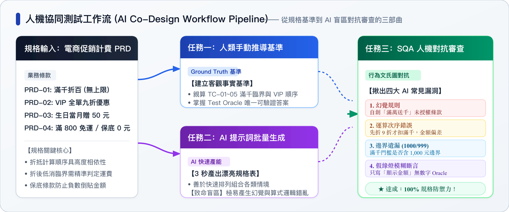
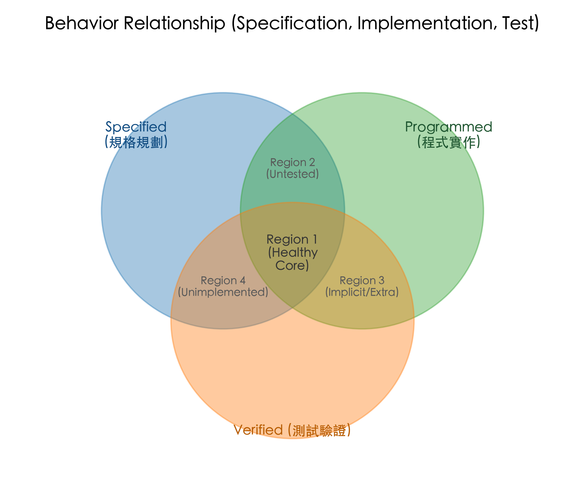

# 實驗 3-1：測試案例規格化設計 ＆ AI 協同生成盲區評審 (Test Spec & AI Co-Design)

> 💡 **單元對應**：Ch03 軟體測試基礎 —— **3.4 測試案例設計（Given-When-Then、五大要素）** 與 **行為文氏圖（規格 vs. 程式碼 vs. 測試）**

---

## 🎯 實驗目標 (Objectives)

1. **掌握專業規格化思維**：
   學會區分「測試案例 (Test Case)」與「測試資料 (Test Data)」，掌握 IEEE 829 / ISO 29119 規範的測試案例五大核心要件。
2. **行為文氏圖落地分析**：
   體會「軟體行為文氏圖」中三者的交集與偏差：
   * **規格 (Specified)**：系統應該做什麼。
   * **程式碼 (Programmed)**：工程師寫了什麼。
   * **測試 (Verified)**：QA 驗證了什麼。
3. **AI 時代人機協同實戰 (AI Prompting & Review)**：
   運用 Prompt Engineering 指示大型語言模型（ChatGPT / Claude / Copilot）批次生成測試案例，並扮演 SQA Reviewer 揪出 AI 的「幻覺規則」、「邊界模糊」與「缺乏有效 Oracle」盲區。

---

## 🧭 實驗三大任務邏輯關聯 (Workflow Pipeline)

本實驗設計為一套**層層遞進、人機對抗的 SQA 評審工作流 (Pipeline)**：

<div align="center">
  
</div>

* **任務一（立基準）**：你自己必須先親手算過、推導過規則細節，才能掌握客觀真理的「裁判權」。
* **任務二（測產能）**：將相同需求交由 AI 自動生成測試案例，體會現代 AI 的速度與格式優勢。
* **任務三（抓盲區）**：以任務一的標準去審核任務二的 AI 產出，實踐「規格 (Specified) vs 程式碼 (Programmed) vs 測試 (Verified)」的文氏圖對抗。

---

## 📋 業務需求規格書 (PRD 案例：智慧電商促銷折抵引擎)

假設你正在為一家跨國電商平台設計「結帳促銷計費引擎 (Checkout Discount Engine)」，產品經理 (PM) 交付了以下需求條款：

```text
【促銷規則規格條款 PRD-DISC-01 ~ 04】
1. 滿千折百 (PRD-DISC-01)：
   單筆訂單購物車有效商品「商品總額 (Subtotal)」達 NT$ 1,000 (含) 以上，
   立即折抵 NT$ 100；滿 NT$ 2,000 折抵 NT$ 200，依此類推，折抵無上限。

2. VIP 會員專屬優惠 (PRD-DISC-02)：
   若會員等級為 "VIP"，在滿千折百後之餘額享有「全單 9 折 (10% OFF)」優待。
   若非 VIP (一般會員/訪客)，無此折扣。

3. 生日當月禮 (PRD-DISC-03)：
   若結帳當日為會員生日月份，不論會員等級，額外贈送 NT$ 50 現金折價券，
   於最後金額扣抵。

4. 運費與低消保底 (PRD-DISC-04)：
   - 折抵後之實付金額若滿 NT$ 800 (含)，免運費 (運費 NT$ 0)。
   - 未滿 NT$ 800，加收物流處理費 NT$ 80。
   - 保底條款：任何促銷折抵後，實付金額 (不含運費) 最低為 NT$ 0，
     不可出現負數金額。
```

---

## ✍️ 任務一：人類工程師專業測試案例設計 (手動設計)

> ⚠️ **請勿直接使用 AI！** 測試工程師的核心價值在於深入理解業務規格。請先研讀示範案例，接著親自動手推導並完成學生挑戰任務表。

### 1. 📖 規格化範例導引 (TC-01 示範)

| 案例編號 (TC_ID) | 測試目的 / 業務情境 | 關聯條款 | 前置狀態 (Preconditions) | 測試輸入資料 (Inputs) | 操作步驟 (Steps) | 預期輸出結果 (Expected Result / Oracle) |
| :--- | :--- | :--- | :--- | :--- | :--- | :--- |
| **TC-01 (範例)** | 一般會員滿千折百正向流程 | PRD-01, 04 | 一般會員、非生日月 | 購物車商品總額：NT$ 1,200 | 1. 放入商品<br>2. 進入結帳頁 | 滿千折 100 $\to$ 實付 1,100。<br>滿 800 免運。<br>**最終應付：NT$ 1,100** |

* **💡 範例解析**：
  * **Precondition**：明確定義會員身分與生日月份，避免狀態模糊。
  * **Steps**：具體重現使用者在系統上的操作行為。
  * **Expected Result (Oracle)**：必須包含**具體推導算式與最終唯一金額**，絕不能只寫「折抵成功」等無效斷言！

---

### 2. 📝 學生動手挑戰表 (Student Exercise Table)

請依據 PRD 條款，在以下練習表中親自推導並填入相應的輸入與預期結果（特別注意邊界值、計算次序與保底規則）：

> 💡 **互動即時驗證**：請在「預期輸出結果」欄位中輸入你手算出的**「最終應付金額 (整數數字)」**，點擊**「驗證」**或按 **Enter**，系統將即時檢驗對錯並提供推導反饋！

| 案例編號 (TC_ID) | 測試目的 / 業務情境 | 關聯條款 | 前置狀態 (Preconditions) | 測試輸入資料 (Inputs) | 操作步驟 (Steps) | 預期輸出結果 (Expected Result / Oracle)<br>*(即時互動輸入驗證)* |
| :--- | :--- | :--- | :--- | :--- | :--- | :--- |
| **TC-02** | 滿千折百臨界邊界 (剛好滿 1,000 元) | PRD-01, 04 | 一般會員、非生日月 | 購物車商品總額：NT$ 1,000 | 1. 放入商品<br>2. 進入結帳頁 | <div style="display:flex;align-items:center;gap:6px;"><span>NT$</span><input type="number" id="tc02_in" placeholder="最終金額" style="width:88px;padding:3px 6px;border:1px solid #cbd5e1;border-radius:4px;font-size:13px;" onkeydown="if(event.key==='Enter')checkTC('tc02_in','tc02_fb',900,'滿千折100為900，滿800免運。','提示：滿1,000元剛好達到滿千折百門檻，折後滿800元享免運。')"><button onclick="checkTC('tc02_in','tc02_fb',900,'滿千折100為900，滿800免運。','提示：滿1,000元剛好達到滿千折百門檻，折後滿800元享免運。')" style="padding:3px 8px;background:#1e40af;color:#fff;border:none;border-radius:4px;cursor:pointer;font-size:12px;font-weight:600;">驗證</button></div><div id="tc02_fb" style="margin-top:4px;"></div> |
| **TC-03** | 未達滿千門檻與未達免運低消 | PRD-01, 04 | 一般會員、非生日月 | 購物車商品總額：NT$ 999 | 1. 放入商品<br>2. 進入結帳頁 | <div style="display:flex;align-items:center;gap:6px;"><span>NT$</span><input type="number" id="tc03_in" placeholder="最終金額" style="width:88px;padding:3px 6px;border:1px solid #cbd5e1;border-radius:4px;font-size:13px;" onkeydown="if(event.key==='Enter')checkTC('tc03_in','tc03_fb',999,'未達滿千門檻不折抵，滿800免運。','提示：999元未達1,000元折抵門檻，但大於800元享有免運。')"><button onclick="checkTC('tc03_in','tc03_fb',999,'未達滿千門檻不折抵，滿800免運。','提示：999元未達1,000元折抵門檻，但大於800元享有免運。')" style="padding:3px 8px;background:#1e40af;color:#fff;border:none;border-radius:4px;cursor:pointer;font-size:12px;font-weight:600;">驗證</button></div><div id="tc03_fb" style="margin-top:4px;"></div> |
| **TC-04** | VIP 疊加生日禮與免運臨界驗證 | PRD-01, 02, 03, 04 | VIP 會員、結帳日為生日月 | 購物車商品總額：NT$ 1,000 | 1. 放入商品<br>2. 進入結帳頁 | <div style="display:flex;align-items:center;gap:6px;"><span>NT$</span><input type="number" id="tc04_in" placeholder="最終金額" style="width:88px;padding:3px 6px;border:1px solid #cbd5e1;border-radius:4px;font-size:13px;" onkeydown="if(event.key==='Enter')checkTC('tc04_in','tc04_fb',840,'1000折100為900→VIP九折為810→生日折50為760(未滿800)+80運費=840。','提示：滿千折100為900，VIP打9折為810，生日扣50為760，未滿800低消需加80運費！')"><button onclick="checkTC('tc04_in','tc04_fb',840,'1000折100為900→VIP九折為810→生日折50為760(未滿800)+80運費=840。','提示：滿千折100為900，VIP打9折為810，生日扣50為760，未滿800低消需加80運費！')" style="padding:3px 8px;background:#1e40af;color:#fff;border:none;border-radius:4px;cursor:pointer;font-size:12px;font-weight:600;">驗證</button></div><div id="tc04_fb" style="margin-top:4px;"></div> |
| **TC-05** | 負數保底防護 (Negative Guard) | PRD-03, 04 | 一般會員、生日月 | 購物車商品總額：NT$ 30 | 1. 放入商品<br>2. 進入結帳頁 | <div style="display:flex;align-items:center;gap:6px;"><span>NT$</span><input type="number" id="tc05_in" placeholder="最終金額" style="width:88px;padding:3px 6px;border:1px solid #cbd5e1;border-radius:4px;font-size:13px;" onkeydown="if(event.key==='Enter')checkTC('tc05_in','tc05_fb',80,'生日禮折抵保底0元，加80運費，總計應付80元。','提示：商品30元扣50元生日禮原為-20元，依保底條款最低0元，未滿800加80運費，最終應付80元。')"><button onclick="checkTC('tc05_in','tc05_fb',80,'生日禮折抵保底0元，加80運費，總計應付80元。','提示：商品30元扣50元生日禮原為-20元，依保底條款最低0元，未滿800加80運費，最終應付80元。')" style="padding:3px 8px;background:#1e40af;color:#fff;border:none;border-radius:4px;cursor:pointer;font-size:12px;font-weight:600;">驗證</button></div><div id="tc05_fb" style="margin-top:4px;"></div> |

---

### 3. 🔍 點擊核對：參考答案與設計解析

<details>
<summary>👉 <b>完成後點擊展開【任務一：參考答案與算式解析】</b></summary>

| 案例編號 | 測試輸入資料 | 依據條款與推導算式 | 預期輸出結果 (Oracle) | 測試設計要點說明 |
| :--- | :--- | :--- | :--- | :--- |
| **TC-02** | 總額：NT$ 1,000<br>(一般/非生日) | 滿 1,000 (含) 折 100 $\to$ 實付 900。<br>實付滿 800 免運。 | **最終應付：NT$ 900** | 檢驗 PRD-01「含」門檻邊界值，確保不會寫成 `>`。 |
| **TC-03** | 總額：NT$ 999<br>(一般/非生日) | 未滿 1,000 折 0 $\to$ 實付 999。<br>實付滿 800 免運。 | **最終應付：NT$ 999** | 檢驗未達折抵門檻之上界（差 1 元），實付仍超過 800 享免運。 |
| **TC-04** | 總額：NT$ 1,000<br>(VIP/生日月) | 1. 滿千折 100 $\to$ 900。<br>2. VIP 9 折 $\to$ 810。<br>3. 生日禮折 50 $\to$ 760。<br>4. 未滿 800 加運費 80。 | **最終應付：NT$ 840** | 核心考驗「多重折抵次序」與「折抵後金額剛好跌破 800 元低消，須加收 80 元運費」的連鎖邊界！ |
| **TC-05** | 總額：NT$ 30<br>(一般/生日月) | 1. 未滿千折 0 $\to$ 30。<br>2. 生日禮折 50 $\to$ 原應為 -20。<br>3. 保底條款：最低 0 元。<br>4. 未滿 800 加運費 80。 | **最終應付：NT$ 80** | 檢驗資安與會計防線，嚴防「負數實付金額」導致平台反而退錢給客人的重大邏輯缺陷。 |

</details>

---

## 🤖 任務二：AI 協同生成對抗 (AI Prompting & Batch Generation)

現在，打開你常用的 AI 助手（ChatGPT、Claude、GitHub Copilot 或 Gemini），複製並貼上以下標準 SQA Prompt：

### 📥 提問 Prompt 樣板

```text
你現在是一位擁有 10 年經驗的資深軟體品質保證 (SQA) 架構師。
請根據以下「電商促銷計費引擎」需求條款，設計 6 組高品質的黑箱測試案例：

【需求規格】
1. 滿千折百：商品總額滿 1,000 (含) 折 100；滿 2,000 折 200，無上限。
2. VIP 優惠：VIP 會員滿千折百後享全單 9 折。
3. 生日禮：生日當月額外扣抵 50 元。
4. 運費與保底：折抵後實付滿 800 免運，否則運費 80 元；商品實付折抵最低 0 元，不可為負。

【輸出要求】
請使用 Markdown 表格輸出，欄位包含：
案例編號、測試類型 (正向/邊界/異常)、前置條件、輸入資料 (總額/身分/生日)、計算邏輯、預期實付金額。
```

---

## 🔍 任務三：SQA 評審員審查 (Blind Spot Review)

檢視 AI 生成的測試案例表格，扮演嚴格的 SQA 評審員，尋找以下常見的 **AI 生成盲區 (AI Hallucinations & Blind Spots)**：

<div align="center">
  
</div>

### 🚩 常見審查檢查清單 (Review Checklist)

1. **幻覺規格 (Hallucinated Specs)**：
   * AI 是否自行發明了 PRD 未說明的規則？（例如：自行規定「特價品不能疊加折抵」、「VIP 免運費」）。
2. **運算次序模糊 (Execution Order Ambiguity)**：
   * AI 是否算錯折抵先後順序？（例如先打 9 折才扣 100 元，導致金額算出偏差）。
3. **邊界混淆 (Boundary Condition Off-by-One)**：
   * 剛好滿 NT$ 999 時，AI 是否有測試？
   * 實付金額剛好 NT$ 800 時，AI 是否正確判定為免運費（而非收運費）？
4. **無效預期 (Vague Oracle)**：
   * 預期結果欄位是否出現「顯示折抵後金額」等模糊字眼，而非精準數值？

---

## 🎯 實驗小結與收穫

1. **測試案例不是隨機點擊**：完整的測試案例必須具備前置條件、明確步驟與唯一可驗證的預期結果（Oracle）。
2. **AI 是優秀的初稿草擬者，但不是負責者**：AI 善於快速列舉排列組合，但在業務邊界嚴密性、浮點數運算順序與規格忠實度上極易產生隱形盲區。
3. **SQA 的終極價值**：掌握「規格定義與邊界裁判權」，人機協同才能達到 10x 的測試效能與 100% 的品質守門！
