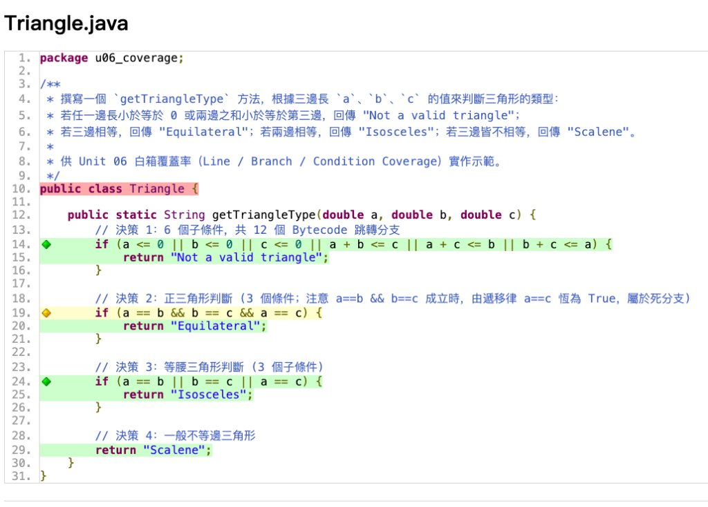

# White Box Testing Lab（JaCoCo 覆蓋率工具設置與報告判讀實作手冊）

本實驗手冊聚焦於 **JaCoCo 程式碼覆蓋率（Code Coverage）** 的實務操作，涵蓋 `pom.xml` 外掛設定、**IntelliJ IDEA** 與 **Maven CLI** 執行流程、**JaCoCo HTML 報告判讀**，以及課堂實作與 AI 輔助補彈練習。（白箱測試覆蓋率理論與公式請參閱第六章投影片。）

---

## ⚙️ PART 1：JaCoCo 環境設置 (`pom.xml`)

本課程 `LabDemo` 專案已於根目錄的 [pom.xml](../../pom.xml) 預先配置 `jacoco-maven-plugin`，不需額外安裝本機執行檔即可直接透過 Maven 產生覆蓋率報告。

### 1.1 `pom.xml` 標準設定

```xml
<plugin>
    <groupId>org.jacoco</groupId>
    <artifactId>jacoco-maven-plugin</artifactId>
    <version>0.8.12</version>
    <executions>
        <execution>
            <id>prepare-agent</id>
            <goals>
                <goal>prepare-agent</goal>
            </goals>
        </execution>
        <execution>
            <id>report</id>
            <phase>verify</phase>
            <goals>
                <goal>report</goal>
            </goals>
        </execution>
    </executions>
</plugin>
```

### 1.2 核心 Execution 與進階設定說明

| 設定項目 | 綁定生命週期 | 實務作用與產出 |
| :--- | :--- | :--- |
| **`prepare-agent`** | `initialize`（預設） | 在測試執行前自動注入 JaCoCo Java Agent 探針（Bytecode Instrumentation），將執行軌跡記錄至 `target/jacoco.exec`。 |
| **`report`** | `verify` | 讀取 `target/jacoco.exec` 與編譯後的 `.class` 檔，自動轉換為可視化的 HTML／XML／CSV 覆蓋率報告（輸出至 `target/site/jacoco/`）。 |
| **`check`（選用）** | `verify` | 可於 CI/CD 設置品質閘門（Quality Gate），例如規定 `BRANCH` 覆蓋率低於 `80%` 即讓 Build 失敗。 |
| **`<excludes>`（選用）** | 全域 `<configuration>` | 排除 DTO、設定檔或自動生成碼（如 `**/dto/**`），避免稀釋核心商業邏輯的覆蓋率統計。 |

---

## 🚀 PART 2：如何執行覆蓋率測試（IntelliJ vs. Maven）

實務開發中，通常在 **寫程式當下使用 IntelliJ IDEA 即時查看行內覆蓋顏色**，而在 **提交前或 CI 管線使用 Maven CLI 產出完整 JaCoCo HTML 報告**。

### 2.1 方法 A：使用 IntelliJ IDEA 執行（開發階段即時回饋）

1. 在 IntelliJ IDEA 開啟 `LabDemo` 專案，找到目標測試類別（例如 [TriangleCoverageTest.java](../../src/test/java/u06_coverage/TriangleCoverageTest.java)）。
2. 在測試類別名稱或方法左側點擊執行圖示，選擇 **Run 'TriangleCoverageTest' with Coverage**（或在編輯器按右鍵 ➔ **More Run/Debug ➔ Run with Coverage**）。
3. 執行完成後，觀察兩個區域：
   - **右側 Coverage 工具視窗**：即時列出各 Package 與 Class 的 `Class %`、`Method %`、`Line %`、`Branch %`。
   - **編輯器左側邊欄（Gutter）色條**：
     - 🟩 **綠色**：該行已完全執行。
     - 🟥 **紅色**：該行完全未被執行。
     - 🟨 **黃色**：該行有執行，但部分條件分支未走完（點擊黃色色條可展開各分支命中次數）。

> **💡 建議切換為 JaCoCo Coverage Runner（與 Maven 口徑一致）**：  
> IntelliJ 預設使用自家的 *IntelliJ IDEA* runner。若希望 IDE 與 Maven 報告的分支計數完全一致，請點擊右上角執行設定 ➔ **Edit Configurations... ➔ Modify options ➔ Code Coverage ➔ Choose coverage runner**，將引擎改為 **JaCoCo**。

---

### 2.2 方法 B：使用 Maven CLI 執行（產出完整 JaCoCo 報告）

請在終端機切換至 `LabDemo/` 目錄後，依需求選擇以下指令：

#### 1. 課堂最常用：只跑「單一測試類別」並立即產出報告（最快）
```bash
mvn clean test -Dtest=TriangleCoverageTest jacoco:report
```

#### 2. 執行整個 `u06_coverage` 單元測試套件並產出報告
```bash
mvn clean test -Dtest="u06_coverage.*Test" jacoco:report
```

#### 3. 執行完整建置生命週期（自動在 `verify` 階段產出報告）
```bash
mvn clean verify
```

#### Maven 常用生命週期與指令對照

| 指令／階段 | 說明 |
| :--- | :--- |
| **`clean`** | 清除舊的 `target/` 目錄（包含舊的 `jacoco.exec`，避免殘留前一次測試的覆蓋紀錄造成誤判）。 |
| **`test`** | 編譯並以 JUnit 5 執行單元測試（`LabDemo/pom.xml` 已預設排除需瀏覽器的 `u08_cucumber` 與 `u09_web`），同時透過 `prepare-agent` 寫入 `target/jacoco.exec`。 |
| **`jacoco:report`** | 立即根據 `target/jacoco.exec` 產出 HTML 報告至 `target/site/jacoco/index.html`，不需跑完後續 `package`／`verify`。 |
| **`verify`** | 依序執行 `compile ➔ test ➔ package ➔ verify`，並自動觸發 `pom.xml` 中綁定於 `verify` 的 JaCoCo `report` 與 PMD 檢查。 |

---

## 📊 PART 3：如何判讀 JaCoCo HTML 報告

Maven 執行完成後，使用瀏覽器開啟以下檔案即可檢視互動式報告：

```text
LabDemo/target/site/jacoco/index.html
```

報告採四層下鑽結構：**專案總覽 (`Packages`) ➔ 套件 (`Classes`) ➔ 類別 (`Methods`) ➔ 原始碼逐行標註**。

### 3.1 總覽表格欄位判讀

| 報告欄位 | 英文原名 | 判讀重點 |
| :--- | :--- | :--- |
| **Element** | 元素名稱 | 套件、類別或方法名稱，點擊可逐層往下展開至原始碼。 |
| **Missed Instructions / Cov.** | 未覆蓋位元組碼指令 | 最細粒度的覆蓋率（對應近似敘述涵蓋度）；長條圖**紅色＝未覆蓋、綠色＝已覆蓋**。 |
| **Missed Branches / Cov.** | 未覆蓋分支數與比例 | **白箱測試最關鍵指標**，統計所有 `if`、`else`、`switch`、三元運算子及 `&&`／`||` 的位元組碼分支。 |
| **Missed / Cxty** | 圈複雜度 (Cyclomatic Complexity) | 顯示該方法的 McCabe 圈複雜度 `v(G)`，以及尚未覆蓋到的獨立路徑數。 |
| **Missed / Lines** | 行覆蓋率 (Line Coverage) | 原始碼中被執行到的可執行行數比例。 |
| **Missed / Methods & Classes** | 方法／類別覆蓋率 | 至少被呼叫過一次的方法與類別數量（注意：工具類別的預設建構子若未測會顯示 Missed）。 |

### 3.2 原始碼逐行色塊與「菱形」標記判讀

點進某個類別（例如 `u06_coverage ➔ Triangle ➔ getTriangleType(...)`）後，每一行原始碼左側與背景會有三種標記：

| 標記與顏色 | 狀態意義 | 實務處理動作 |
| :--- | :--- | :--- |
| 🟩 **綠底＋綠菱形** | **完全覆蓋 (Fully Covered)**：該行所有指令與所有條件分支皆已執行。 | 確認斷言（Oracle）是否嚴謹，可進一步用 PITest 檢驗變異分數。 |
| 🟥 **紅底＋紅菱形** | **完全未覆蓋 (Not Covered)**：該行完全沒有被任何測試案例執行到。 | 立即補寫測試案例觸發該條路徑，或檢查是否為無效死碼（Dead Code）。 |
| 🟨 **黃底＋黃色菱形** | **部分覆蓋 (Partly Covered)**：該行有執行，但尚有部分分支未走到。 | **將滑鼠懸停在黃色菱形上**，JaCoCo 會提示例如 `2 of 6 branches missed`，據此反推缺少的真假組合！ |

#### 實戰截圖範例：`Triangle.java` JaCoCo 逐行覆蓋率報告



- **第 14 行與第 24 行（🟩 綠菱形）**：所有子條件的 True／False 分支皆已 100% 覆蓋。
- **第 19 行（🟨 黃色菱形）**：`if (a == b && b == c && a == c)` 顯示黃色菱形，因為當 `a == b` 與 `b == c` 皆為 True 時，依等號遞移律 `a == c` 恆為 True（False 分支為不可達之冗餘死分支）。
- **第 10 行（🟥 紅底）**：靜態工具類別 `Triangle` 未建立物件實例，因此編譯器自動產生的預設建構子顯示未覆蓋。

### 3.3 實務必知：為何 `if (A && B)` 在 JaCoCo 顯示 4 個分支？

- **JaCoCo 是在 JVM Bytecode（位元組碼）層級統計分支**，而非單純看原始碼有幾個 `if`。
- Java 編譯器為了實現**短路求值（Short-circuit Evaluation）**，會將複合條件 `if (A && B)` 拆成兩個條件跳轉指令：
  1. 判斷 `A` 為 True 或 False（2 個分支；若 `A=false` 直接短路跳出）。
  2. 判斷 `B` 為 True 或 False（2 個分支）。
- 因此，若你的測試只測了 `(A=false)` 與 `(A=true, B=true)`，JaCoCo 會回報 **Branch Coverage = 75%（1 of 4 branches missed）** 並標示**黃色菱形**——你必須補上 `(A=true, B=false)` 才能把黃色菱形消滅成綠色！

---

## 🧪 PART 4：課堂實作練習 (Hands-on Labs)

### 📋 Lab 1：Triangle 三角形覆蓋率分析與「消滅黃色菱形」
1. 開啟待測程式 [Triangle.java](../../src/main/java/u06_coverage/Triangle.java) 與測試類別 [TriangleCoverageTest.java](../../src/test/java/u06_coverage/TriangleCoverageTest.java)。
2. 執行以下指令產生初始報告並開啟 `target/site/jacoco/index.html`：
   ```bash
   mvn clean test -Dtest=TriangleCoverageTest jacoco:report
   ```
3. 點進 `u06_coverage ➔ Triangle`，記錄初始的 **Instructions**、**Branches** 與 **Lines** 覆蓋率，並將滑鼠移到所有**黃色菱形**上觀察缺少哪些分支。
4. 補充測試案例，嘗試將 **Branch Coverage 提升至 100%**。
5. **思考題**：若發現某個條件（例如 `a == b && b == c && a == c` 中的第三項）無論如何都無法讓黃色菱形變綠，請分析原因（是否屬於邏輯冗餘／不可達分支），並說明如何重構消除。

### 📋 Lab 2：Binary Search 二元搜尋覆蓋率實戰
1. 開啟 [BinarySearch.java](../../src/main/java/u06_coverage/BinarySearch.java) 與 [BinarySearchCoverageTest.java](../../src/test/java/u06_coverage/BinarySearchCoverageTest.java)。
2. 使用 IntelliJ **Run with Coverage**（或 `mvn clean test -Dtest=BinarySearchCoverageTest jacoco:report`）檢視 `while` 迴圈與 `if / else if / else` 各分支覆蓋狀態。
3. 逐步補充測資（如命中中間、向左搜尋、向右搜尋、目標不存在、空陣列），直到 **Line 與 Branch 覆蓋率雙雙達到 100%**。

### 📋 Lab 3：Loan Calculator 多測試集覆蓋率效益對照
針對 [LoanCalculator.java](../../src/main/java/u05_combinatorial/pair/LoanCalculator.java) 的貸款利率規則（基礎 5%、年限 >10 折 0.5% / >20 折 1%、金額 >500 萬每多 100 萬折 0.1%、青年折 1%、已婚折 0.5%、最低下限 2%）：
1. 分別建立三組測試案例集：
   - **集合 A**：滿足 Weak Coverage（SC 100%）。
   - **集合 B**：滿足 All-Pairs（全成對組合）。
   - **集合 C**：滿足 Strong / Branch 100%。
2. 透過 JaCoCo 報告比較三組測試集的 **案例數** 與 **實際 Branch Coverage %**，分析成本與覆蓋效益。

### 📋 Lab 4：AI 輔助覆蓋率「補彈」與 Oracle 審查
1. 挑選 Lab 1～Lab 3 中 JaCoCo 回報仍有**紅行或黃色菱形**的方法，將程式碼與 JaCoCo 的未覆蓋提示（例如 `Line 16: 1 of 6 branches missed`）貼給 AI：
   > **Prompt 範本**：  
   > 「你是 Java 單元測試與白箱測試專家。以下程式碼經 JaCoCo 檢測後，第 X 行顯示 `1 of 4 branches missed`（黃色菱形）。請分析哪一個短路條件分支未被覆蓋，並撰寫對應的 JUnit 5 測試方法。」
2. 將 AI 產出的測試加入專案，重新執行 `mvn clean test -Dtest=你的測試類 jacoco:report` 確認黃色菱形是否轉綠。
3. **安全防線（Oracle 審查）**：AI 只會合理化現有程式碼行為；務必人工核對 `assertEquals` 預期結果是否符合業務規格書，並提交你的 **Prompt、AI 原始輸出與人工審查後的最終測試碼**。
