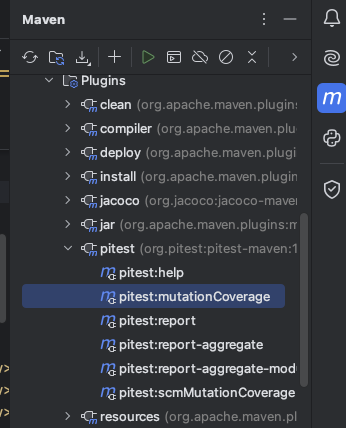
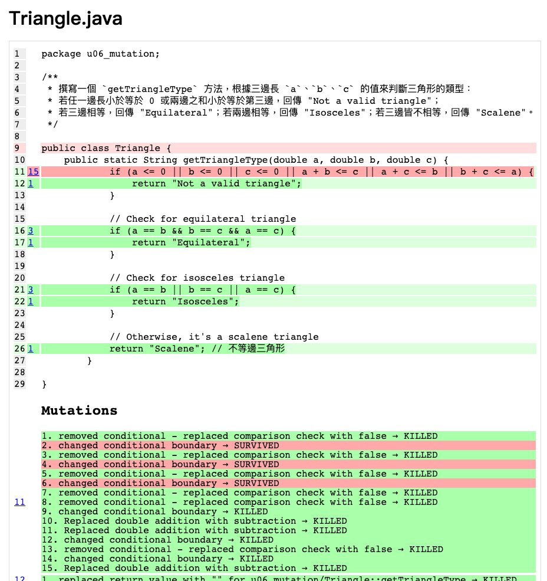

# Mutation Testing Lab（變異測試與 PITest 實戰手冊）

本實驗手冊帶你從「手動植入變異體獵殺」進階到工業界主流的 **PITest (PIT Mutation Testing)** 自動化位元組碼變異測試框架，全部整合於 `LabDemo` 專案（**Java 21 + JUnit 5 + Maven**）中直接執行。

---

## Part 1：手動變異體獵殺熱身 (`u06_mutation`)

### Triangle
* **待測原始碼**：[Triangle.java](../../src/main/java/u06_mutation/Triangle.java)
* **手動變異獵殺程式**：[TriangleMuTest.java](../../src/test/java/u06_mutation/TriangleMuTest.java)
* 在 `u06_mutation.mutant` 下已建立 3 隻手寫變異體（`Triangle02`、`Triangle03`、`Triangle04`），執行 `TriangleMuTest.main()`：
  1. 觀察每組測試資料執行後，哪些變異體被刪除（Killed）、哪些依然存活（Alive）。
  2. 嘗試自行新增更多變異體，觀察現有測資是否能將其刪除。
  3. 補充測試資料直到刪除所有非等價變異體；若發現無法刪除者，請說明其是否為**等價變異體 (Equivalent Mutant)**。

### BinarySearch
* **待測原始碼**：[BinarySearch.java](../../src/main/java/u06_mutation/BinarySearch.java)
* **手動變異獵殺程式**：[BinarySearchTest.java](../../src/test/java/u06_mutation/BinarySearchTest.java)
* 在 `u06_mutation.mutant` 下已建立 `BinarySearch02`（`while (left < right)`）與 `BinarySearch03`（`while (left >= right)`）：
  1. 執行 `BinarySearchTest.main()`，觀察如何設計邊界測資一擊必殺 `bs02`。
  2. 取消註解 `bs03` 相關程式碼，觀察單元素陣列與多元素陣列對 `bs03` 的獵殺結果。
  3. 思考：手工建立變異體是否耗時費力？這正是我們需要 **PITest** 自動化工具的原因！

---

## Part 2：PITest 自動化變異測試（JUnit 5 + Maven）

`LabDemo` 的 [pom.xml](../../pom.xml) 已完整配置 `pitest-maven` 與 `pitest-junit5-plugin`，可直接針對 JUnit 5 單元測試在記憶體中自動注入 Bytecode 變異體並產出 HTML 報告！

### 1. 對應程式碼與 JUnit 5 測試套件
* **Triangle**：[Triangle.java](../../src/main/java/u06_mutation/Triangle.java) ＆ [TrianglePitestTest.java](../../src/test/java/u06_mutation/TrianglePitestTest.java)
* **BinarySearch**：[BinarySearch.java](../../src/main/java/u06_mutation/BinarySearch.java) ＆ [BinarySearchPitestTest.java](../../src/test/java/u06_mutation/BinarySearchPitestTest.java)

### 2. 執行 PITest 指令（於 `LabDemo/` 目錄下）

* **只針對 `Triangle` 執行 PITest**：
  ```bash
  mvn test-compile org.pitest:pitest-maven:mutationCoverage \
      -DtargetClasses="u06_mutation.Triangle" \
      -DtargetTests="u06_mutation.TrianglePitestTest"
  ```
* **只針對 `BinarySearch` 執行 PITest**：
  ```bash
  mvn test-compile org.pitest:pitest-maven:mutationCoverage \
      -DtargetClasses="u06_mutation.BinarySearch" \
      -DtargetTests="u06_mutation.BinarySearchPitestTest"
  ```
* **一次掃描整個 Unit 06（`u06_mutation` + `u06_coverage`）**：
  ```bash
  mvn test-compile org.pitest:pitest-maven:mutationCoverage
  ```

### 3. 檢視 HTML 變異測試報告
* 執行完成後，開啟 **`target/pit-reports/index.html`** 檢視彩色報告：
  * 🟩 **`KILLED`**：測試亮紅燈失敗，成功攔截該變異體！
  * 🟥 **`SURVIVED`**：測試全綠燈通過，代表測資邊界或斷言不足！
  * 🟥 **`NO_COVERAGE`**：測試從未執行到該行程式碼。
  * ⏳ **`TIMED_OUT`**：變異造成無窮迴圈，被框架強制中止並計入攔截。
* 參考文件：[PITest Official Mutators Documentation](https://pitest.org/quickstart/mutators/)



#### `Triangle.java` 變異測試詳細報告範例（含第 11 行存活之邊界變異體）


### 4. 實作任務
1. 先暫時註解掉 `TrianglePitestTest` 中的 `testTriangleInequalityBoundary()`，重跑 PITest，觀察 **Line Coverage vs. Mutation Score** 的落差與存活變異體位置。
2. 恢復並補強測試案例，觀察 Mutation Score 提升幅度；檢查是否仍有無法被殺死的**等價變異體**（例如 `a == b && b == c && a == c` 中的遞移律冗餘條件）。
3. 對 `BinarySearchPitestTest` 執行相同實驗，比較 **Branch Coverage 100%** 與 **Mutation Score** 的差異。
