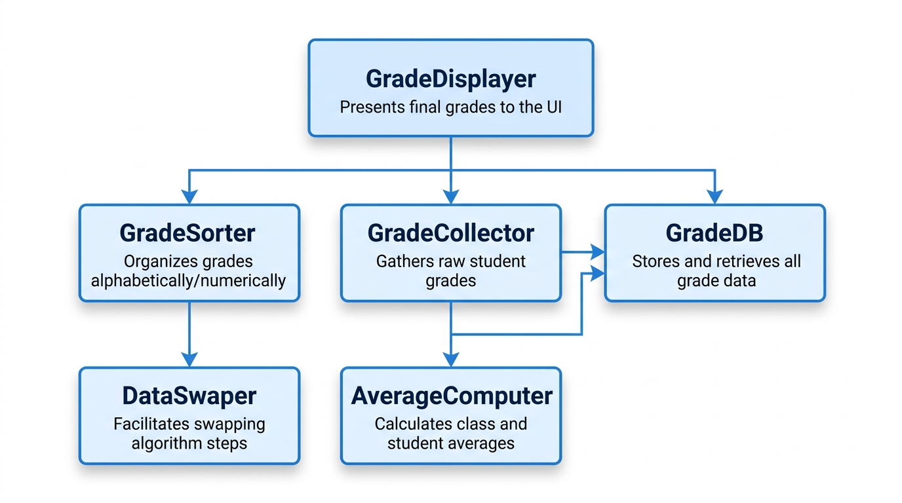

# 實習 09：整合測試與 Mockito 測試替身實戰 (`u07_mockito`)

> 🎯 **實習目標**：
> 1. 透過純 Java 建構子依賴注入 (`Constructor DI`)，實地體驗 **由上而下 (Top-Down + Stub)**、**由下而上 (Bottom-Up + Driver)** 與 **三明治漸進式整合**。
> 2. 掌握 **Mockito** 核心語法：`mock()`、`@Mock` / `@InjectMocks`、`when(...).thenReturn(...)`、`thenThrow()`、`spy()` 局部打樁與 `verify()` 行為驗證。
> 3. 完成課堂綜合設計練習：**成績顯示系統 (`GradeDisplayer`) 五人平行開發與整合測試規劃**。

---

## Part 1：質數系統 (`u07_mockito/prime`) —— 從手寫 Stub 到 Mockito 與 Spy

* **待測原始碼**：
  * `src/main/java/u07_mockito/prime/Prime.java`
  * `src/main/java/u07_mockito/prime/PrimeChecker.java`
  * `src/main/java/u07_mockito/prime/MockPrimeChecker.java`（手寫 Stub，僅硬編碼 `2, 3, 5` 為質數）
  * `src/main/java/u07_mockito/prime/RealPrimeChecker.java`（真實底層質數判定演算法）
* **測試程式碼**：
  * `src/test/java/u07_mockito/prime/PrimeTest.java`
  * `src/test/java/u07_mockito/prime/PrimePlusTest.java`
  * `src/test/java/u07_mockito/prime/PrimeSpyTest.java`

### 🧪 動手任務 1：
1. 執行 `PrimeTest.java`，觀察 `testAllPrimeWithMyMock()`（由上而下手寫 Stub）與 `testAllPrimeWithRealPrimeChecker()`（由下而上真實組裝）的差異。
2. 觀察 `testAllPrimeWithMockedIsPrime()` 為何在第 41 行 `verify(mockChecker, times(1)).isPrime(1)` 亮紅燈？請對照 `Prime.allPrime(n)` 的迴圈起點修正該行驗證使其通過。
3. 執行 `PrimeSpyTest.java`，觀察 `spy(new MockPrimeChecker())` 如何利用 `doReturn(true).when(spyChecker).isPrime(7)` 為半成品物件局部打補丁！

---

## Part 2：計算機系統 (`u07_mockito/calculator`) —— 揪出「前後置條件契約失配」

* **待測原始碼**：`Calculator.java`、`CalculatorService.java`、`RealCalculatorService.java`
* **測試程式碼**：`CalculatorTest.java`、`RealCalculatorTest.java`

### 🧪 動手任務 2：
1. 執行 `CalculatorTest.testDivideByZeroThrowsException()`，觀察使用 `@Mock` 時測試綠燈通過。
2. 在 `RealCalculatorTest.java` 新增一個**真實整合測試**（將 `new RealCalculatorService()` 傳入 `new Calculator(...)` 並呼叫 `divide(6, 0)`），觀察為何拋出的是 `ArithmeticException` 而非預期的 `IllegalArgumentException`？
3. 取消 `Calculator.java` 第 25~27 行的防呆註解，使上層與下層的例外契約達成一致！

---

## Part 3：股票市值系統 (`u07_mockito/stock`) —— 外部即時 API 隔離

* **待測原始碼**：`Market.java`、`Stock.java`、`StockService.java`
* **測試程式碼**：`MarketTest.java`

### 🧪 動手任務 3：
1. 執行 `MarketTest.testMarketValue()`，理解為何 `StockService`（外部網路股價 API）必須使用 `mock()` 佈樁，而 `Stock`（值物件）則直接 `new` 真實物件。
2. 在測試中新增第 3 檔持股（例如聯發科 `"2454"`, `"MediaTek"`, `20` 股），設定假設股價為 `1200.0` 元，並更新總市值斷言。

---

## Part 4：綜合演練 —— 成績顯示系統 (`GradeDisplayer`) 平行開發與整合測試設計

上圖為一個學生成績顯示系統的架構圖，其中 `subjectGrade[i][j]` 表示學生 `i` 在科目 `j` 上的成績，`grade[k]` 表示學生 `k` 所有科目的總平均。本專案採取**五人平行開發**，五個模組分別由 **A, B, C, D, F** 五位工程師負責。請回答並設計下列三個階段的測試策略：

1. **問題 1（初期平行開發 — 模組 A）**：
   * 一開始開發時，**A (`GradeDisplayer`)** 的開發重點為何？
   * 當 B (`GradeAverage`) 與 C (`GradeCollector`) 尚未完成時，A 該如何進行測試？（請說明誰該用 `mock`？哪個方法該做 `when().thenReturn()` stubbing？哪裡用 `verify()`？哪裡下 `assertEquals` assertion？）
2. **問題 2（初期平行開發 — 模組 C）**：
   * 同上，**C (`GradeCollector`)** 的開發重點為何？當底層 D 與 F 尚未完成時，C 該如何利用 JUnit Driver 與 Mock 進行測試？
3. **問題 3（中期漸進整合 — A + B + C）**：
   * 當 **B (`GradeAverage`)** 與 **C (`GradeCollector`)** 開發完成並通過各自測試後，A 的測試程式碼該做何種改變以完成漸進式整合？
