# 軟體品質與測試

### 第 3 章：軟體測試原則、理論與架構模型 (AI 時代前沿版)

授課教師：薛念林 教授

> 江 Sir 皺著眉頭：「對不起，我們還不能驗收。這個系統可絕不能在正式上線時出錯啊！」  
> 雄太拍著胸脯：「我敢保證！現在系統經過測試，絕對沒有任何錯誤了！」  
> 江 Sir 冷笑了一下：「我倒是懂得一點軟體測試的根本原則——**軟體測試只能證明程式有錯，永遠無法證明程式絕對沒有錯誤！**」  
> 雄太一下子愣住了...

---

<!-- _class: outline-slide -->
<!-- header: '本章大綱 (Outline)' -->

## 本章重點導讀 (Key Highlights)

<div class="outline-columns">
<div>

### 🧭 核心原則與多維體系
- **3.1 ISTQB 7 大軟體測試經典原則**：
  - 核心哲學：測試顯示缺陷存在而非不存在、窮盡測試不可能
  - 工程實務：及早測試 (Shift-Left)、缺陷群聚 (80/20)、殺蟲劑悖論與無錯謬誤
- **3.2 測試多維度分類體系與金字塔**：
  - 雙重靈魂叩問：驗證 (Verification - 製程) vs. 確認 (Validation - 價值)
  - 全方位矩陣：缺失 vs. 確認、靜態 vs. 動態、黑箱 vs. 白箱與測試金字塔
- **3.3 V 開發模型與水平雙向追溯 (RTM)**：
  - 階段水平對稱架構：需求對驗收、高階設計對整合、詳細設計對單元
  - 雙向追溯矩陣：正向杜絕覆蓋盲區、反向杜絕孤兒測試，破除後測偏差

</div>
<div>

### 📐 案例實務與測試全景
- **3.4 測試案例設計與 AI 協同實踐**：
  - 行為文氏圖：規格 (Specified)、程式碼 (Programmed) 與測試 (Verified) 交集
  - 測試案例 5 大要件（前置、輸入、步驟、預期、Oracle）與 AI 協同邊界補全
- **3.5 測試全景 3W2H 與 Test Oracle 難題**：
  - 測試全景體系：Who 誰測、What 測什麼、Why 為何測、How 如何測、How to Evaluate
  - 確定性等值比對 vs. 現代 AI 隨機系統之變質測試 (Metamorphic Testing)
- **3.6 綜合練習與實戰思維檢定**：
  - 經典原則辨析、V 模型追溯分析、MaxHeap 邊界案例與 AI 協同設計實戰

</div>
</div>

---

<!-- _class: lead -->
<!-- header: '3.1 ISTQB 軟體測試 7 大經典原則' -->

# **3.1 ISTQB 軟體測試 7 大經典原則**

> 「測試是一門基於風險取樣的經驗科學，  
> 而非盲目的無窮迴圈。」

---

### 權威標準與 ISTQB 7 大經典原則總覽

<div class="card-deck">

> 📚 依據 ISTQB CTFL v4.0 與 Myers《軟體測試的藝術》：測試是一門基於風險取樣的經驗科學，理解 7 大原則能避免盲目測試。

<div class="two-columns">
<div class="card" data-marpit-fragment>

### 🧭 原則 1 ～ 3：測試本質與左移戰略
- **1. 測試顯示缺陷存在，而非不存在**：測試能證明系統有錯，但無論執行多少測試，皆無法證明「絕對零缺陷」
- **2. 窮盡測試是不可能的 (Exhaustive)**：輸入組合爆炸使窮盡不可能，測試必須基於「風險取樣」尋找最佳投報率
- **3. 及早測試 / 測試左移 (Shift-Left)**：靜態與動態測試應在需求與架構初期介入，1:10:100 定律防患於未然

</div>
<div class="card" data-marpit-fragment>

### 🎯 原則 4 ～ 7：缺陷規律與工程盲點
- **4. 缺陷群聚效應 (Defect Clustering)**：80/20 法則，絕大多數重大缺陷高度集中於少數複雜度最高的核心模組
- **5. 殺蟲劑悖論 (Pesticide Paradox)**：重複執行相同測試將失去殺傷力，測試套件必須定期演進、重構與換新
- **6. 測試依賴情境 (Context Dependent)**：無一體適用策略，高敏金融、工業控制與敏捷 Web 應採不同驗證強度
- **7. 無錯謬誤 (Absence-of-Errors)**：即便系統修光所有 Bug、無任何當機，若未切中真實業務價值依然毫無意義

</div>
</div>
</div>

---

<!-- _class: title-image-slide -->

## ISTQB 軟體測試 7 大經典原則總覽

<div class="image-wrapper">
  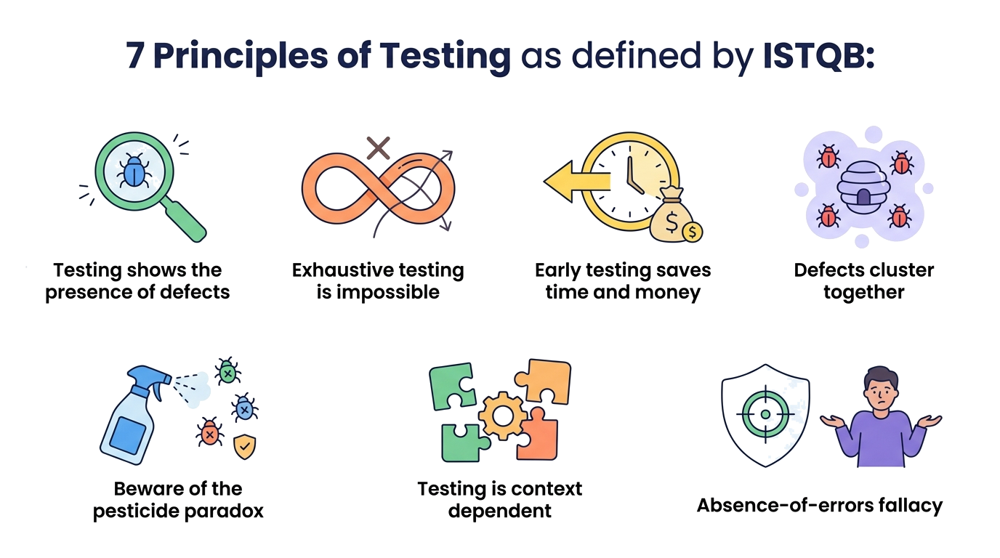
</div>

---

## 原則 1：測試顯示缺陷的存在，而非不存在

<div class="content-columns">
  <div class="content-text">

- **核心意涵**：
  - 測試能夠證明軟體中 **「存在缺陷」**，但無論執行了多少萬筆測試且全部通過，都 **「無法證明軟體絕對零缺陷」**。
- **測試的真正目的**：
  - 測試不是為了證明程式完美無瑕，而是為了**降低未被發現缺陷的風險**，提供軟體品質的客觀度量與發布信心。
- 🤖 **AI 時代警示【流暢性偏誤 (Fluency Bias)】**：
  - AI 生成的程式碼通常語法優美、排版工整，極易給人「絕對沒錯」的錯覺。
  - 但 AI 程式碼常潛伏並發競爭條件 (Race Conditions) 或隱蔽邊界例外，跑過幾次 Happy Path 綠燈絕不能保證其無錯！

  </div>
  <div class="content-figure">
    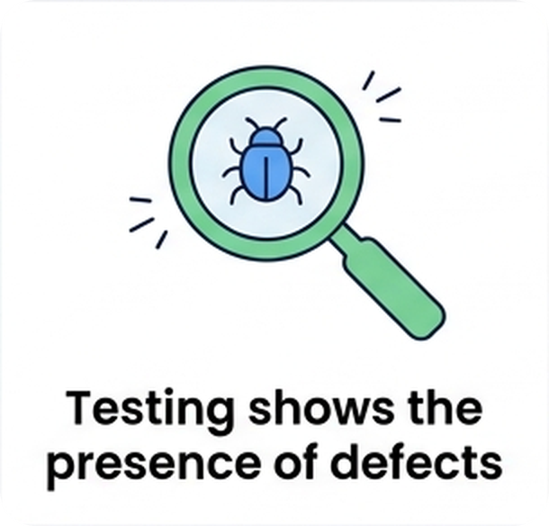
  </div>
</div>

---

<!-- _class: title-image-slide -->

## 原則 1 圖解：測試顯示缺陷存在，而非不存在

<div class="image-wrapper">
  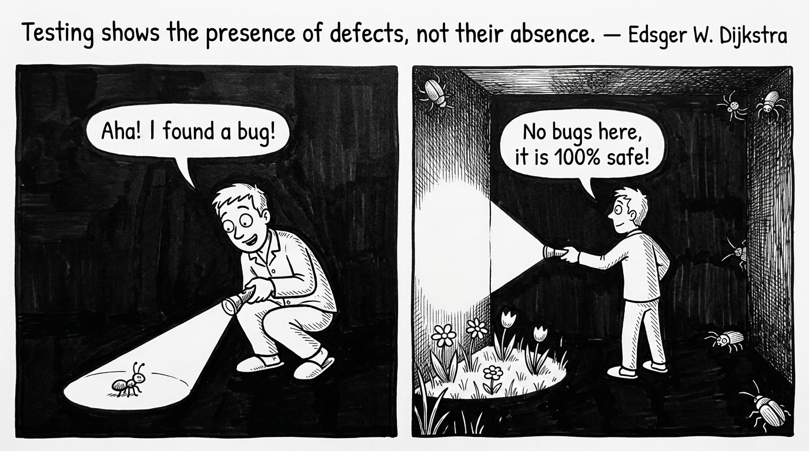
</div>

---

## 原則 2：窮盡測試是不可能的 (Exhaustive Testing is Impossible)

<div class="content-columns">
  <div class="content-text">

- **組合爆炸的現實**：
  - 簡單邏輯若有 100 個條件判斷式，組合數高達 $2^{100} \approx 1.27 \times 10^{30}$。加上作業系統、瀏覽器、網路波動與資料庫狀態，窮盡所有輸入在計算上是完全不可能的。
- **錯誤總是躲在角落 (Bugs lurk in corners)**：
  ```java
  int scale (int j) {
      j = j - 1; // ❌ 正確應為 j = j + 1
      j = j / 3000;
      return j;
  }
  ```
  - 🎲 **盲目隨機踩中錯誤的機率** $= 18 / 65536 \approx 0.00027$ (**0.027%**)。
  - 💡 測試必須是**基於風險的取樣（Risk-Based Testing）**，針對邊界精準打擊！

  </div>
  <div class="content-figure">
    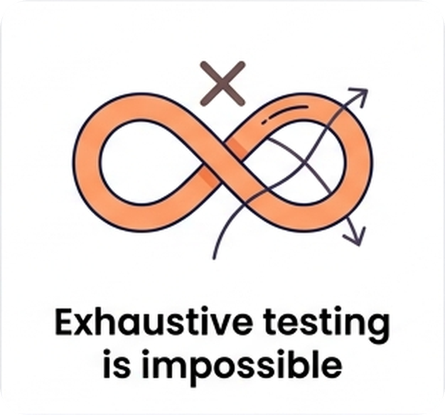
  </div>
</div>

---

## 原則 3：及早測試 / 測試左移 (Shift-Left)

<div class="content-columns">
  <div class="content-text">

- **核心意涵**：
  - 靜態與動態測試活動應在軟體開發生命週期的 **最早期（需求與架構階段）** 即刻介入。
- **經濟學依據（1:10:100 品質成本定律）**：
  - 需求審查時抓出一個邏輯矛盾：**\$1**
  - 開發單元測試時抓出 Bug：**\$10**
  - 軟體上線到生產環境後的維護與賠償代價：**\$100 ～ \$1000+**！

  </div>
  <div class="content-figure">
    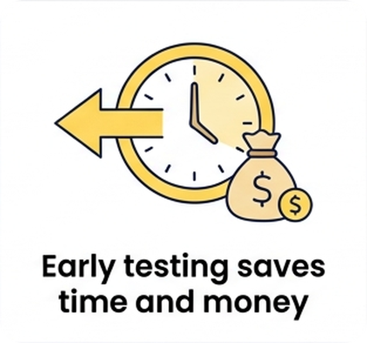
  </div>
</div>

---

<!-- _class: title-image-slide -->

## 缺陷修復成本曲線 (Bug Cost Curve)

<div class="image-wrapper">
  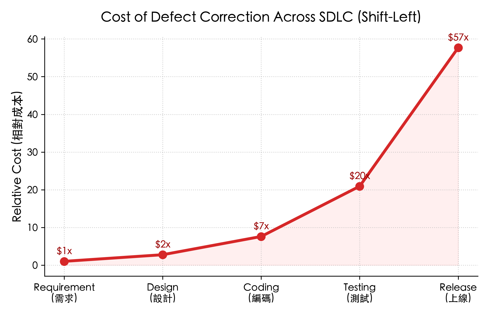
</div>

---

## 原則 4：缺陷群聚效應 (Defects Cluster Together)

<div class="content-columns">
  <div class="content-text">

- **核心意涵（80/20 法則）**：
  - 軟體系統中絕大多數的重大缺陷，往往高度集中在**少數幾個複雜度最高、變更最頻繁、或涉及多方外部整合的模組中**。
- **工程實務啟示**：
  - 當在某個模組發現了大量 Bug 時，不要以為抓完就沒事了；
  - 該模組很可能還潛伏著更多深層缺陷，應對其加大變異測試 (Mutation Testing) 與屬性測試力度！

  </div>
  <div class="content-figure">
    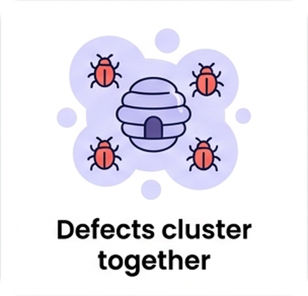
  </div>
</div>

---

## 原則 5：小心殺蟲劑悖論 (Beware of Pesticide Paradox)

<div class="content-columns">
  <div class="content-text">

- **核心意涵**：
  - 同一種農藥噴久了，害蟲會產生抗藥性；
  - **同一套測試案例反覆跑久了，將無法再挖掘出任何新的 Bug！**
- **SQA 2.0 的應對之道**：
  - 測試案例必須定期審查、重構並動態演進。
  - 導入 **屬性基礎測試 (Property-Based Testing / jqwik)**：每次執行自動隨機生成萬組全新測資。
- 🤖 **AI 時代警示【自我印證的假綠燈】**：
  - 若讓 AI 為自己生成的程式碼寫單元測試，AI 會**依照自身錯誤的邏輯去設計測試**，導致測試與程式碼共同錯在盲區！

  </div>
  <div class="content-figure">
    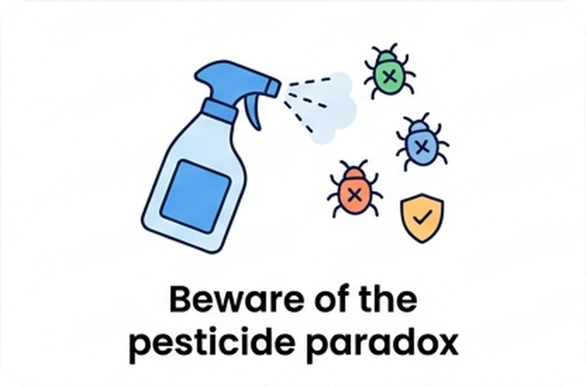
  </div>
</div>

---

<!-- _class: title-image-slide -->

## 原則 5 圖解：殺蟲劑悖論 (Pesticide Paradox)

<div class="image-wrapper">
  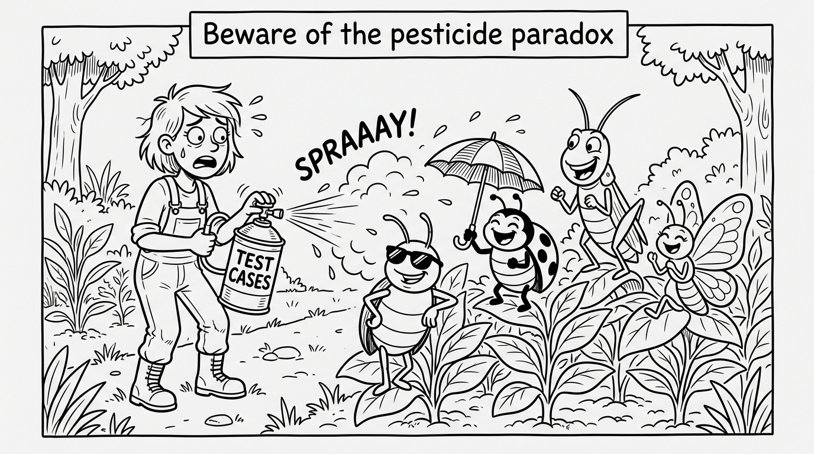
</div>

---

## 原則 6：測試取決於上下文 (Testing is Context Dependent)

<div class="content-columns">
  <div class="content-text">

- **核心意涵**：
  - 世上沒有一套放之四海皆準的通用測試方法，測試策略必須依據領域風險客製化。
- **實例對比**：
  - **醫療儀器 / 航太飛控系統**：
    - 需嚴格遵循 DO-178C 等標準，要求 MC/DC 覆蓋率 100%、形式化邏輯驗證與硬體在環 (HIL) 測試。
  - **敏捷電商 Web App**：
    - 著重快速回歸、高併發壓測、微服務契約測試 (Pact) 與 A/B 測試。

  </div>
  <div class="content-figure">
    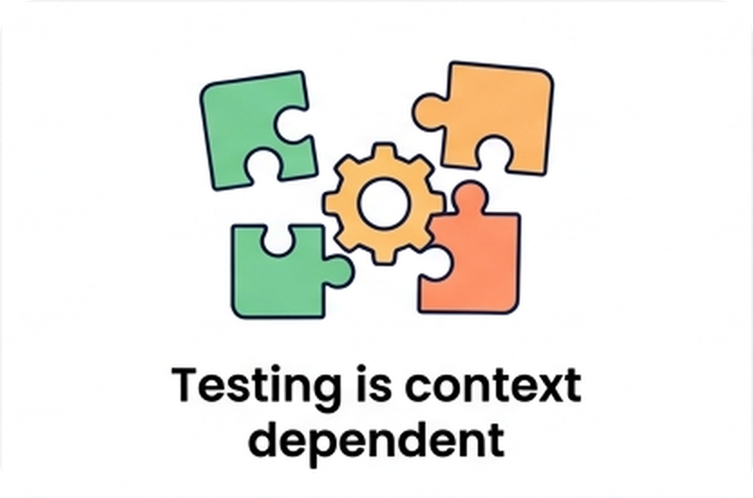
  </div>
</div>

---

## 原則 7：無錯謬誤 (Absence-of-Errors is a Fallacy)

<div class="content-columns">
  <div class="content-text">

- **核心意涵**：
  - **「零 Bug 的系統」並不等於「成功的系統」**。
  - 即使團隊投入巨大資源修復了所有 Bug，但如果軟體**根本沒有滿足使用者的真實業務需求**，或者操作體驗極其反人類，這套軟體在商業與品質上依然是徹底失敗的。
- 🤖 **AI 時代警示【Prompt 幻覺】**：
  - AI 產生的程式碼可能編譯 100% 通過且無語法錯誤，但若 Prompt 對領域規則理解有誤，產出的依然是「符合規格但無用的垃圾」。

  </div>
  <div class="content-figure">
    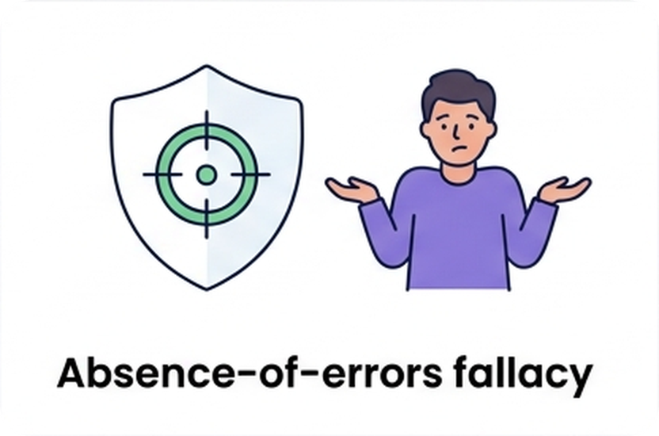
  </div>
</div>

---

<!-- id: sqa-ch03-ccq1 -->
## 🙋 概念核對問答 (CCQ 3.1)

<div class="ccq-columns">
  <div class="ccq-text">

**問題**：某工程師使用 AI 秒速生成一套複雜利息計算演算法，隨即讓同一個 AI 幫忙生成單元測試。測試跑出 100% 覆蓋率全綠燈通過，但在實際上線後卻被金融主管機關判定年息公式違反法規。依據 ISTQB 測試原則，這最主要反映何種問題？

- **A.** 測試工程師未安裝最新的 JDK 執行環境
- **B.** AI 測試陷入「殺蟲劑悖論（自我印證盲區）」與「原則 7：無錯謬誤（程式碼無語法錯誤但偏離法規與真實業務需求）」
- **C.** 只要測試覆蓋率達 100%，系統必然在法律上具備合規性
- **D.** 這是硬體浮點數運算器的製造缺陷

  </div>
  <div class="ccq-logo">
    <a href="https://nlhsueh.github.io/nickedupocket/#/student/sqa-ch03-ccq1" target="_blank"></a>
  </div>
</div>

---

<!-- _class: lead -->
<!-- header: '3.2 測試的多維度分類體系' -->

# **3.2 測試的多維度分類體系**

> 「從微觀的類別方法，  
> 到宏觀的端到端商業價值交付。」

---

### 1. 驗證 (Verification) vs 確認 (Validation)

<div class="card-deck">

> 💡 驗證著重「是否正確地建造軟體」，確認著重「是否建造了正確的軟體」。

<div class="two-columns">
<div class="card" data-marpit-fragment>

### 🔍 驗證 (Verification) - 製程與規格導向
- **核心哉問**：「Are we building the product right?（我們是否正確地建造軟體？）」
- **檢驗重點**：確認各開發階段產出物與原始碼嚴格符合規格書、架構設計圖與編碼規範
- **執行手段**：靜態程式碼審查 (Code Review)、單元測試、整合測試、靜態分析工具 (PMD, SonarQube)
- **常見失敗樣態**：程式碼無任何編譯或邏輯錯誤，測試全數綠燈，卻完全不符合終端使用者真正所需

</div>
<div class="card" data-marpit-fragment>

### 🎯 確認 (Validation) - 產品與價值導向
- **核心哉問**：「Are we building the right product?（我們是否建造了正確的軟體？）」
- **檢驗重點**：確保軟體交付部署後，真正切中使用者痛點、滿足真實商業目標與作業情境
- **執行手段**：使用者驗收測試 (UAT)、A/B 測試、可用性測試 (Usability Testing)、Beta 封測體驗反饋
- **常見失敗樣態**：過度設計 (Over-engineering)、完美實現了已經過期或被市場淘汰的錯誤需求

</div>
</div>
</div>

---

<!-- _class: title-image-slide -->

## 驗證 (Verification) vs 確認 (Validation) 核心架構對比

<div class="image-wrapper">
  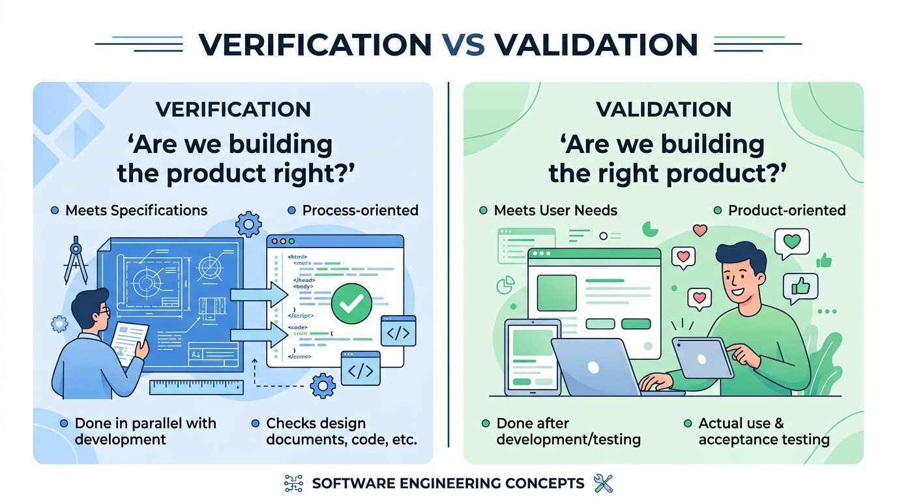
</div>

---

### 2. 缺失測試 vs 確認測試 & 3. 靜態 vs 動態測試

<div class="card-deck">

> 💡 測試維度涵蓋尋找缺陷與確認功能，且包含靜態原始碼審查與動態執行比對。

<div class="two-columns">
<div class="card" data-marpit-fragment>

### 💥 缺失測試 vs 確認測試
- **缺失測試 (Defect Testing)**：心態為「搞壞系統」，採極端邊界值、注入髒資料與逆向操作逼出 Bug
- **確認測試 (Validation Testing)**：心態為「向客戶證明可用」，循序驗證主要業務流程 (Happy Path) 正常運作
- **思維陷阱**：只做確認測試易產生「系統很完美」的虛假安全感；頂尖 QA 必須具備高度破壞性攻擊思維
- **工程平衡**：確認測試保證基本功能可用性；缺失測試則確立系統在高壓異常情境下的韌性與邊界強固度

</div>
<div class="card" data-marpit-fragment>

### ⚡ 靜態測試 vs 動態測試
- **靜態測試 (Static Testing)**：**不執行程式碼**，透過同儕審查、規格檢驗與 AST 語法樹靜態分析
- **動態測試 (Dynamic Testing)**：**實際運行程式碼**，在特定執行環境下輸入測資並比對實際與預期產出
- **抓錯階段差異**：靜態測試直接揪出原始碼與規格中的「Fault / Bug」；動態測試則是觀察執行期「Failure」
- **左移協同效益**：80% 的語法臭味、並發競爭與安全弱點可在靜態階段低成本攔截，大幅降低動態除錯耗時

</div>
</div>
</div>

---

### 4. 功能測試（黑箱） vs 結構測試（白箱）

<div class="card-deck">

> 💡 黑箱測試從需求規格出發驗證外部行為；白箱測試深入程式碼邏輯追求高涵蓋率。

<div class="two-columns">
<div class="card" data-marpit-fragment>

### 📦 黑箱功能測試 (Black-Box Testing)
- **視角與特性**：受測系統視為不透明黑盒子，測試者完全不檢視內部原始碼與架構實作細節
- **核心依據**：嚴格依據外部需求規格書 (SRS) 與使用者介面協議，專注於輸入輸出之對映正確性
- **經典設計技術**：等價劃分法 (EP)、邊界值分析法 (BVA)、決策表 (Decision Table)、狀態轉換測試
- **最大優勢與盲點**：測試者獨立不受實作偏見干擾；但無法檢測未被規格涵蓋的隱蔽死碼與安全後門

</div>
<div class="card" data-marpit-fragment>

### 🔬 白箱結構測試 (White-Box Testing)
- **視角與特性**：受測系統視為透明玻璃盒子，測試者深入檢視控制流程圖 (CFG) 與內部資料結構
- **核心依據**：以原始碼邏輯結構為導向，設計特定測資強制驅動程式執行各條分支與執行路徑
- **經典評量指標**：陳述句涵蓋率 (Statement)、分支涵蓋率 (Branch)、條件涵蓋率 (MC/DC)、路徑涵蓋率
- **最大優勢與盲點**：可徹底盤點內部邏輯漏洞與邊界極限；但無法發現「規格根本遺漏實作」的整段功能

</div>
</div>
</div>

---

<!-- _class: title-image-slide -->

## 黑箱測試 vs 白箱測試 核心維度對比

<div class="image-wrapper">
  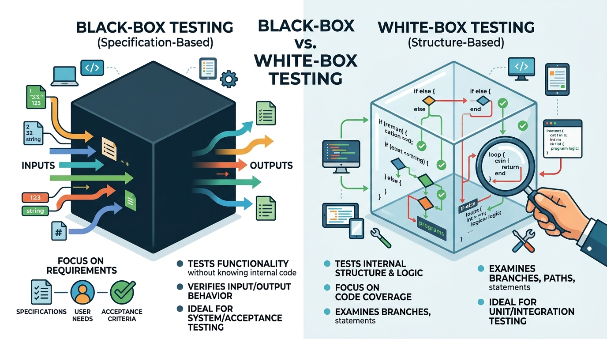
</div>

---

## 5. 三大核心測試層級 (Testing Levels)

<div class="content-columns">
  <div class="content-text">

- **1. Unit Testing (單元測試)**：
  - 針對最小獨立模組或方法（Class / Method）進行隔離驗證，執行極快（毫秒級）。
- **2. Integration Testing (整合測試)**：
  - 驗證跨模組介面、微服務 API 與資料庫之間的通訊協定與資料傳遞。
- **3. System Testing (系統測試)**：
  - 在完整模擬或真實環境中執行端到端 (E2E) 使用者工作流程與非功能需求驗證。

  </div>
  <div class="content-figure">
    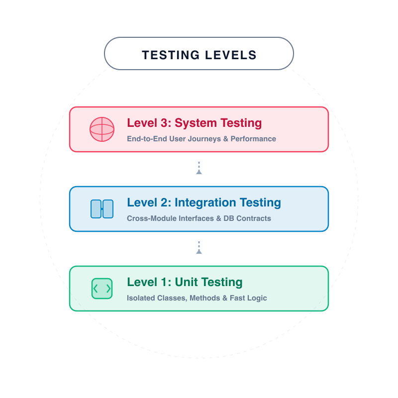
  </div>
</div>

---

<!-- _class: title-image-slide -->

## 三大核心測試層級階層體系 (Testing Levels)

<div class="image-wrapper">
  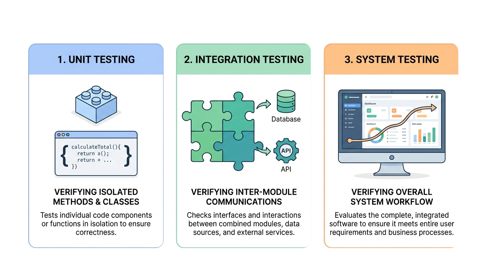
</div>

---

## 單元模組的可測試性設計 (Testability)
- 哪一個的可測性較高？

```java
double div(double x, double y) {
    while (y == 0) {
        y = input("除數不可為 0，請重新輸入："); // 強烈依賴 UI
    }
    return x / y;
}

double div(double x, double y) {
    if (y == 0) {
        throw new IllegalArgumentException("除數不得為 0");
    }
    return x / y;
}
```

- 💡 **工程心法**：將核心運算邏輯與外部 I/O、UI 視圖徹底分離，大幅提升模組可測試性！

---

## 6. 現代實戰測試金字塔 (The Practical Test Pyramid)

<div class="content-columns">
  <div class="content-text">

- 🔺 **頂層：UI / E2E Tests (端到端測試)**：
  - 數量最少、執行最慢、維護成本最高（Playwright / Cypress）。
- 🔹 **中層：Integration / Service Tests (整合與服務測試)**：
  - 數量與速度適中，驗證 API 與資料庫合約（Testcontainers / Pact）。
- 🟩 **底層：Unit Tests (單元測試)**：
  - 數量最多、執行極快（毫秒級）、維護成本最低（JUnit 5 / Mockito）。
- ⚠️ **反模式：冰淇淋甜筒 (Ice Cream Cone)**：
  - 缺乏底層單元測試，過度依賴脆弱且昂貴的 UI E2E 測試，導致 CI 構建緩慢。

  </div>
  <div class="content-figure">
    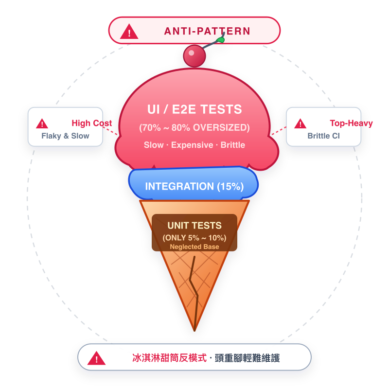
  </div>
</div>

---

<!-- _class: title-image-slide -->

## 現代實戰測試金字塔體系 (The Practical Test Pyramid)

<div class="image-wrapper">
  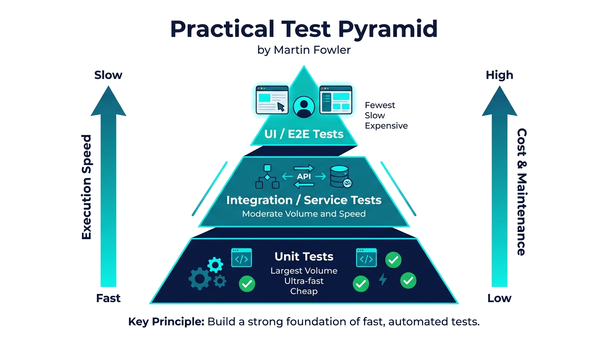
</div>

---

<!-- id: sqa-ch03-ccq2 -->
## 🙋 概念核對問答 (CCQ 3.2)

<div class="ccq-columns">
  <div class="ccq-text">

**問題**：某醫療軟體團隊在驗證 App 時，發現測試策略陷入「冰淇淋甜筒反模式」，且醫師抱怨系統「完美執行了過期指引，完全不符合看診現狀」。下列分析與改進策略何者最為正確？

- **A.** 冰淇淋甜筒代表底層單元測試過多，應立即刪除以節省 CI 資源
- **B.** 團隊過度依賴脆弱昂貴的頂層 UI/手動測試，且軟體雖通過了 Verification（符合舊規格），卻在 Validation（滿足真實業務需求）上徹底失敗
- **C.** 將前端自動化測試腳本改用 Python 執行即可根本性消除反模式
- **D.** 醫師的抱怨屬於編譯時期語法錯誤，應加強靜態型別檢查

  </div>
  <div class="ccq-logo">
    <a href="https://nlhsueh.github.io/nickedupocket/#/student/sqa-ch03-ccq2" target="_blank"></a>
  </div>
</div>

---

<!-- _class: lead -->
<!-- header: '3.3 V 開發模型與雙向追溯' -->

# **3.3 V 開發模型與雙向追溯 (The V-Model)**

> 「規格設計在前，測試準備在先；  
> 水平對稱，雙向追溯。」

---

## V 開發模型的對稱架構

- **左側下降臂（開發與規格階段）**：
  - **1. Requirements Analysis (需求分析 - SRS)**：定義業務與使用者規格。
  - **2. High-Level Architecture (高階架構設計 - ADD)**：定義子系統與介面協定。
  - **3. Detailed Component Design (詳細模組設計 - SDD)**：定義單一類別與方法邏輯。
- **底部頂點（程式實作 Coding）**：
  - 將設計轉化為可執行的原始程式碼產物。
- **右側上升臂（測試驗證階段）**：
  - **Unit Testing (單元測試)** ⟷ 對應驗證 **詳細模組設計 (SDD)**。
  - **Integration Testing (整合測試)** ⟷ 對應驗證 **高階架構設計 (ADD)**。
  - **System / Acceptance Testing (驗收測試)** ⟷ 對應驗證 **需求規格 (SRS)**。

---

<!-- _class: title-image-slide -->

## V 開發模型與雙向追溯架構 (The V-Model)

<div class="image-wrapper">
  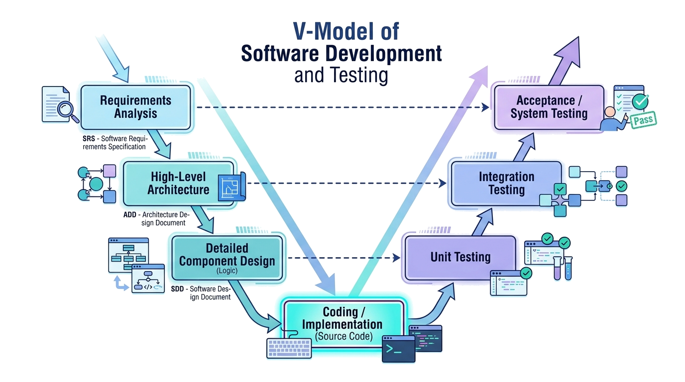
</div>

---

### 雙向追溯性 (Bidirectional Traceability)

<div class="card-deck">

> 💡 雙向追溯連結需求合約與測試案例，防止實作後測試偏誤與功能遺漏。

<div class="two-columns">
<div class="card" data-marpit-fragment>

### 🔗 水平對稱追溯工程價值
- **測試設計前置同步產出**：需求與架構拍板當下，驗收測試案例與整合測試架構即已同步就緒
- **破除實作後測試偏差 (Post-hoc Bias)**：防止工程師先寫完程式碼，再依照個人實作去拼湊測試迎合通過
- **需求變更衝擊分析 (Impact Analysis)**：當某項需求規格修訂時，能精準鎖定受影響的測試案例即時回歸
- **跨團隊共同理解語言**：促成商業分析師 (BA)、架構師、開發者與測試工程師對系統驗收標準達成共識

</div>
<div class="card" data-marpit-fragment>

### 📊 雙向需求追溯矩陣 (RTM)
- **正向追溯（Forward - 確保無遺漏）**：從需求出發確保每一條 SRS 都有對應測試案例，杜絕覆蓋盲區
- **反向追溯（Backward - 確保無冗餘）**：從測試案例回溯至具體需求來源，杜絕無意義且維護昂貴的孤兒測試
- **合規審查必備依據**：高可靠度領域（醫療 FDA、汽車 ISO 26262、航空 DO-178C）取得認證的關鍵證據
- **持續整合 (CI) 門禁指標**：透過自動化腳本分析 RTM 覆蓋度，追溯斷鏈之 PR 嚴禁合併至生產環境主幹

</div>
</div>
</div>

---

<!-- id: sqa-ch03-ccq3 -->
## 🙋 概念核對問答 (CCQ 3.3)

<div class="ccq-columns">
  <div class="ccq-text">

**問題**：在標準 V 開發模型中，依據「高階架構設計文件 (ADD)」所定義的模組介面與通訊協定，所對應執行的測試層級為何？

- **A.** 單元測試 (Unit Testing)
- **B.** 整合測試 (Integration Testing)
- **C.** 驗收測試 (Acceptance Testing)
- **D.** 靜態程式碼檢視 (Code Review)

  </div>
  <div class="ccq-logo">
    <a href="https://nlhsueh.github.io/nickedupocket/#/student/sqa-ch03-ccq3" target="_blank"></a>
  </div>
</div>

---

<!-- _class: lead -->
<!-- header: '3.4 測試案例設計與 AI 協同' -->

# **3.4 測試案例設計與 AI 協同**

> 「測試案例是測試架構的靈魂，  
> 測試資料只是代入的數值。」

---

## 測試案例、規格與程式行為的文氏圖關聯

<div class="card-deck">

> 💡 理想軟體追求規格、實作與測試高度重合，避免潛伏未驗證的後門與隱蔽 Bug。

<div class="two-columns">
<div class="card" data-marpit-fragment>

### ⭕ 三大核心行為集合
- **📋 規劃的行為 (Specified)**：需求規格書中明確定義的預期功能與約束
- **💻 程序化的行為 (Programmed)**：工程師實際編寫並實作成二進位程式碼的行為
- **🧪 驗證的行為 (Verified)**：自動化與手動測試套件實際涵蓋並驗證到的行為
- **工程偏離警訊**：三者若未高度重合，將衍生規格遺漏、幽靈功能或隱蔽資安後門

</div>
<div class="card" data-marpit-fragment>

### 🎯 交集區域深度解析
- **區域 1 (黃金核心)**：有規格、有實作且經測試驗證（健康交付目標！）
- **區域 2**：規格明載但工程師遺漏實作的缺漏功能，導致驗收失敗
- **區域 3**：規格未要求，工程師擅自寫出且被測到的非預期過度設計功能
- **區域 6 (最高危險)**：無規格、無測試、卻潛伏在程式中的**未授權後門或隱蔽 Bug**

</div>
</div>
</div>

---

<!-- _class: title-image-slide -->

## 行為文氏圖 (Behavior Venn Diagram)

<div class="image-wrapper">
  
</div>

---

### 3.4.1 測試案例 (Test Case) vs 測試資料 (Test Data)

<div class="card-deck">

> 💡 測試案例是驗證邏輯與規格的整體規劃，測試資料則是代入執行的具體數值與 Fixture。

<div class="two-columns">
<div class="card" data-marpit-fragment>

### 📋 測試案例 (Test Case)
- **本質定義**：測試架構與邏輯分流的**整體規劃規格書**
- **核心內涵**：包含前置狀態、操作步驟、預期產出與判定基準 (Oracle)
- **獨立抽象**：定義「測試邏輯本身」，獨立於具體數值之外（如：分母為 0 例外處理）
- **工程價值**：對應功能需求與等價類別，維持測試套件的規格完整度

</div>
<div class="card" data-marpit-fragment>

### 🔢 測試資料 (Test Data)
- **本質定義**：具體代入受測方法執行的**數值元組與環境 Fixture**
- **核心型態**：輸入參數 `(5, 0)`、邊界數值、Mock 假物件、資料庫種子
- **動態替換**：同一測試案例可餵入多組測試資料（如參數化測試 `@ParameterizedTest`）
- **工程價值**：落實測試案例的具體實例，用以精準觸發特定的程式碼執行路徑

</div>
</div>
</div>

---

<!-- _class: title-image-slide -->

## 實例心智圖：Test Case 與 Test Data 的展開結構

> 💡 以除法運算 `divide(a, b)` 為例：測試案例是樹狀邏輯規格，測試資料是葉節點上的具體實例數值。

<div class="image-wrapper" style="height: 430px; margin-top: auto; margin-bottom: auto;">
  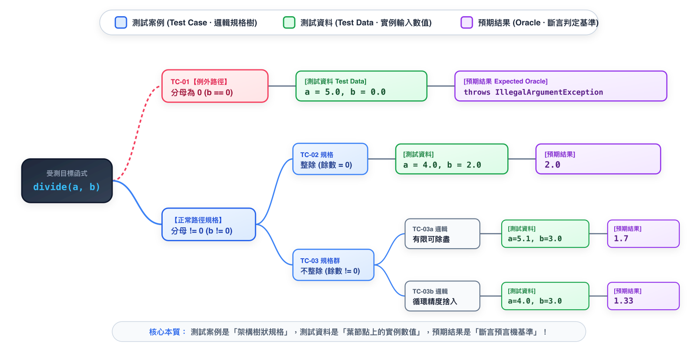
</div>

---

### 現代標準測試案例五大要件 (Test Case Anatomy)

<div class="card-deck">

> 💡 健全的測試案例必須清楚載明識別、前置環境、輸入數值、預期判定與後置狀態。

<div class="two-columns">
<div class="card" data-marpit-fragment>

### 🆔 識別與環境前置 (要件 1 & 2)
- **Component 1 (Test ID & Summary)**：唯一識別碼（如 `TC-AUTH-001`）與簡明測試目的
- **Component 2 (Preconditions)**：執行前系統初始狀態、登入權限與資料庫 Fixtures

</div>
<div class="card" data-marpit-fragment>

### 🎯 輸入、預期與判定 (要件 3, 4, 5)
- **Component 3 (Inputs)**：傳入受測方法之具體參數、Payload 或事件
- **Component 4 (Expected Oracle)**：應回傳之正確值、HTTP 狀態碼或畫面渲染
- **Component 5 (Postconditions)**：執行後資料庫狀態驗證、不變量檢查與清理

</div>
</div>
</div>

---

<!-- _class: title-image-slide -->

## 標準測試案例五大要件圖解 (Test Case Components)

<div class="image-wrapper">
  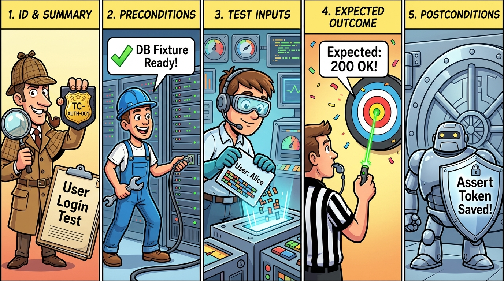
</div>

---

## 🤖 3.4.2 AI 輔助測試案例生成：人機協同黃金矩陣

| 項目 | 人類工程師的優勢 | AI (LLM) 助手的優勢 | 人機協同黃金 SOP (SQA 2.0) |
| :--- | :--- | :--- | :--- |
| **規格與不變量定義** | ⭐⭐⭐ 深刻理解領域商業價值與法律合約 | ⭐ 缺乏真實商業感知，易產生荒謬假設 | **人類主導**：定義前置/後置條件與狀態不變量 |
| **邊界與極端測資生成** | ⭐ 人腦易疲勞、易遺漏冷門 Unicode/極大值 | ⭐⭐⭐ 秒速生成數千組極端字串、溢位邊界 | **AI 輔助**：批量生成邊界與攻擊 Payload |
| **測試結果仲裁 (Oracle)** | ⭐⭐⭐ 具備客觀真理的最終仲裁權 | ⭐ 自我印證偏誤，易產生假綠燈斷言 | **人類審查**：審查斷言邏輯並納入 CI 自動化 |

> 🛠️ **實習演練手冊**：參閱 [`LabDemo/docs/u03_principles/test_spec_ai_codesign.md`](../../LabDemo/docs/u03_principles/test_spec_ai_codesign.md)（電商促銷計費規格設計與 AI 生成盲區審查）。

---

<!-- id: sqa-ch03-ccq4 -->
## 🙋 概念核對問答 (CCQ 3.4)

<div class="ccq-columns">
  <div class="ccq-text">

**問題**：依據軟體行為文氏圖（規格 $S$、程式 $P$、測試案例 $T$）與測試設計原理，若某個行為落在「區域 6：位於程式實作 $P$ 內，但完全超出規格 $S$ 與測試案例 $T$（$P \setminus (S \cup T)$）」，下列敘述何者最適當？

- **A.** 該區域代表未經規格定義也未受測試防護的非預期隱藏行為（如後門或幽靈邏輯），構成重大資安與品質隱患
- **B.** 該區域代表系統完全符合規格且具備 100% 覆蓋率的最佳實踐
- **C.** 只要提高單元測試的斷言數量，區域 6 會自動被消除為零
- **D.** 測試案例只需包含輸入資料，無須定義預期結果

  </div>
  <div class="ccq-logo">
    <a href="https://nlhsueh.github.io/nickedupocket/#/student/sqa-ch03-ccq4" target="_blank"></a>
  </div>
</div>

---

<!-- _class: lead -->
<!-- header: '3.5 測試全景 3W2H 與 Test Oracle' -->

# **3.5 測試全景 3W2H 與 Test Oracle**

> 「5 大維度看透測試全景；  
> 突破 AI 時代的測試預言機難題。」

---

<!-- _class: title-image-slide -->

## 測試全景 3W2H 分類體系架構圖 (Testing Landscape)

<div class="image-wrapper">
  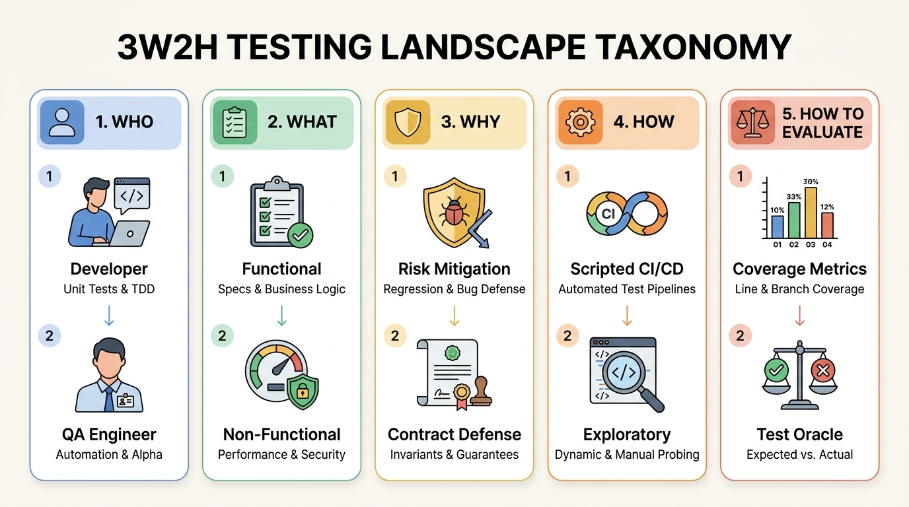
</div>

---

## 面向一：Who 誰來測試？

<div class="content-columns">
  <div class="content-text">

- 👨‍💻 **開發工程師 (Developer)**：
  - 單元測試 (Unit Test)、TDD、白箱路徑與極值邊界防禦。
- 👥 **結對夥伴 / 團隊同行 (Pair / Peer Reviewer)**：
  - 結對編程即時程式碼檢視、防禦思維交叉盲點查核。
- 🛡️ **專職 QA / 測試工程師**：
  - 維護自動化測試框架、Alpha 測試、非功能性負載測試。
- 👔 **業務專家 / 產品經理 (PO / Domain Expert)**：
  - 業務規則驗收測試 (UAT)、端到端核心使用者旅程。
- 🌐 **外部真實使用者 (Beta Testers)**：
  - 公測驗證、真實環境相容性與體驗回饋。

  </div>
  <div class="content-figure">
    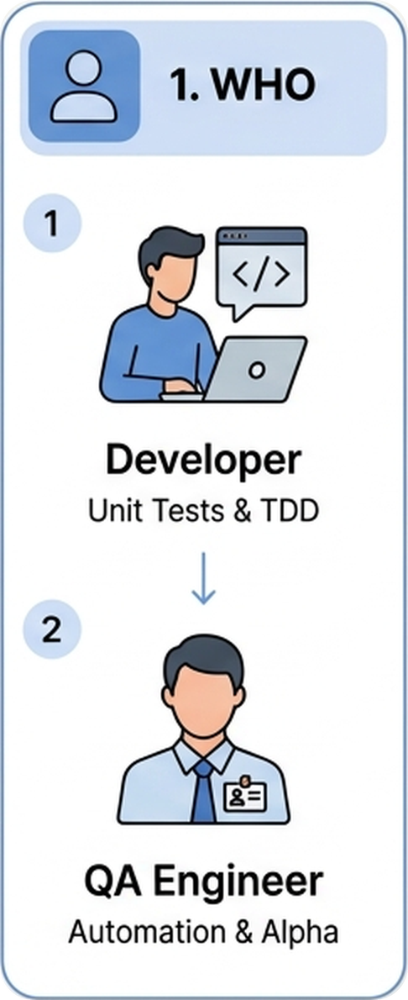
  </div>
</div>

---

### 補充延伸：內部 Alpha vs 外部 Beta 測試對比

| 比較項目 | Alpha Testing (內部驗證) | Beta Testing (外部公測) |
| :--- | :--- | :--- |
| **執行場所** | 開發團隊內部受控環境 (Lab / Staging) | 客戶端真實生產/多樣硬體環境 |
| **受測對象** | 內部工程師、專職 QA、業務同仁 | 外部真實使用者、社群種子用戶 |
| **測試焦點** | 系統主流程完整性、阻斷性 Bug | 真實使用習慣、邊界相容性、體驗反饋 |
| **測試方法** | 白箱 + 黑箱混合，重現路徑精確可控 | 純黑箱測試，收集 Crash Log 與 Telemetry |

---

## 面向二：What 測什麼？

<div class="content-columns">
  <div class="content-text">

- 🎯 **功能測試 (Functional Testing)**：
  - **規格與等價劃分**：業務邏輯正確性、輸入輸出映射關係。
  - **邊界值分析**：極值、空值、溢位、非預期字元格式。
- 🧱 **結構測試 (Structural / White-Box)**：
  - 陳述句涵蓋、分支涵蓋、路徑涵蓋與 MC/DC 條件覆蓋。
- 🔄 **使用者情境測試 (Scenario Testing)**：
  - 模擬真實世界跨模組連鎖工作流程（購物 ➔ 結帳 ➔ 庫存）。
- ⚡ **非功能測試 (Non-Functional Testing)**：
  - 效能負載 (Load/Stress)、耐力 (Soak)、資安漏洞 (OWASP) 與跨瀏覽器相容性。

  </div>
  <div class="content-figure">
    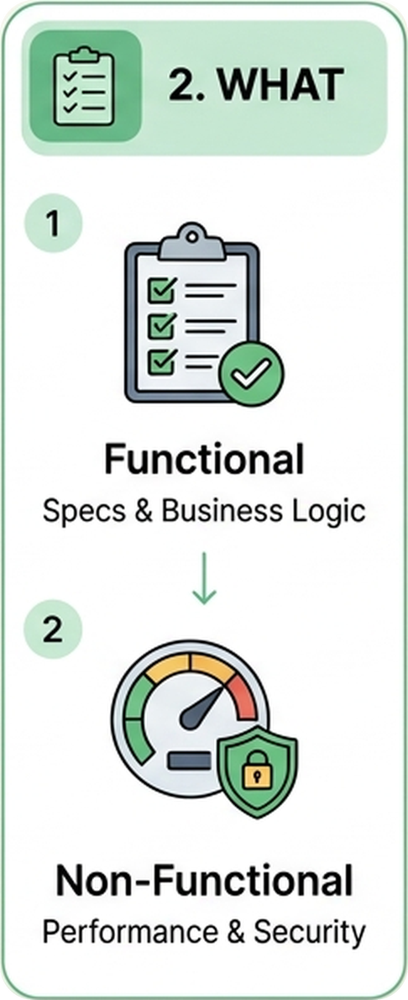
  </div>
</div>

---

## 面向三：Why 為何測試？

<div class="content-columns">
  <div class="content-text">

- 🛡️ **風險防禦與消減 (Risk Mitigation)**：
  - 降低軟體發布上線後爆發嚴重故障的機率與商業損失。
  - 針對高複雜度、高耦合與第三方依賴模組進行重點防守。
- 📜 **契約與不變量守護 (Contract Defense)**：
  - 依循契約式設計 (DbC)，確保前置、後置條件與類別不變量永不破損。
- 🔁 **迴歸防護網 (Regression Defense)**：
  - 確保新功能迭代或程式碼重構，絕對沒有暗中破壞既有功能。
- 🚀 **持續交付信心 (Confidence for CD)**：
  - 透過全綠燈自動化測試套件，為頻繁且自信的 CI/CD 上線提供底氣。

  </div>
  <div class="content-figure">
    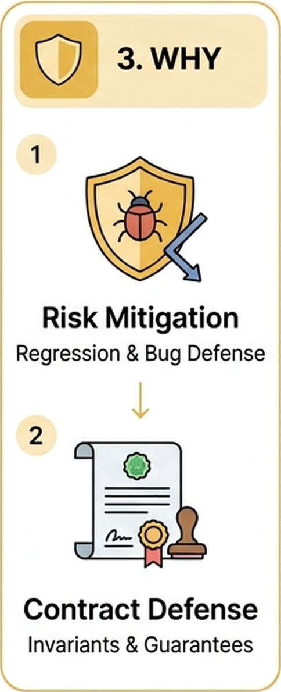
  </div>
</div>

---

## 面向四：How 如何測試？

<div class="content-columns">
  <div class="content-text">

- **腳本測試 (Scripted Testing)**：
  - 依預先定義之步驟與斷言自動化批量執行。
- **探索性測試 (Exploratory Testing)**：
  - 測試者邊學習系統邊動態設計測資，發揮工程直覺挖掘潛在弱點。
- **猴子測試 / 隨機測試 (Monkey / Random Test)**：
  - 注入大量隨機事件檢驗系統強固性與容錯力。
- **錄製與回放 (Record & Replay)**：
  - 透過使用者操作軌跡錄製自動生成端到端測試腳本。

  </div>
  <div class="content-figure">
    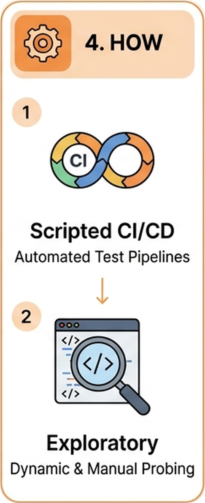
  </div>
</div>

---

<!-- _class: title-image-slide -->

## 錄製與回放架構流程 (Record & Replay Flow)

<div class="image-wrapper">
  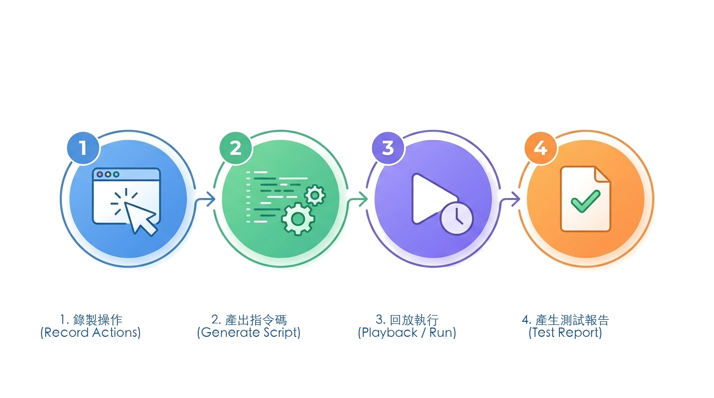
</div>

---

## 面向五：How to Evaluate 如何評估通過？與 Test Oracle

<div class="content-columns">
  <div class="content-text">

- **涵蓋率指標**：語句、分支、路徑覆蓋率。
- **變異分數 (Mutation Score)**：使用 PIT 注入故障，檢驗測試套件殺死變異體的能力。
- **什麼是 Test Oracle（測試預言機）？**
  - 指**能夠判斷受測程式輸出是否正確的機制或基準**。
- **Test Oracle Comparator 比對架構**：
  - 輸入同時餵入「受測程式 (PUT)」與「測試預言機 (Oracle)」，由斷言比對實際輸出與預期結果：
    - **Match (一致)** ➔ 測試 **PASS（通過 ✅）**
    - **Mismatch (不符)** ➔ 測試 **FAIL（缺陷判定 ❌）**

  </div>
  <div class="content-figure">
    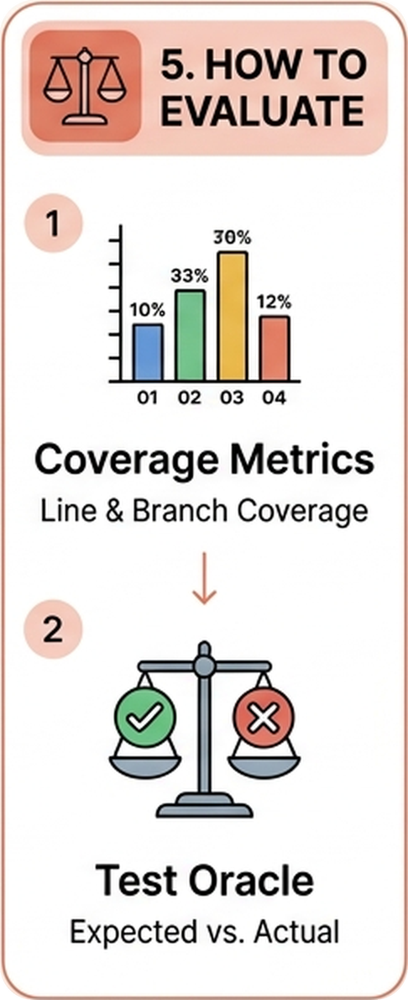
  </div>
</div>

---

<!-- _class: title-image-slide -->

## 測試預言機比對架構 (Test Oracle Comparator)

<div class="image-wrapper">
  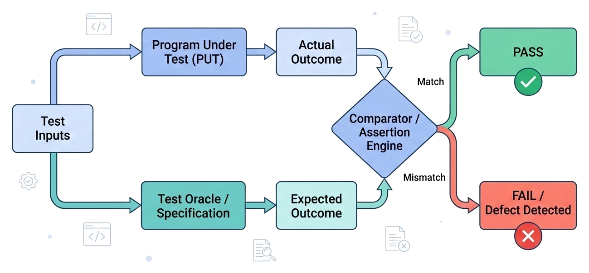
</div>

---

## 3.5.5 AI 與複雜系統中的 Test Oracle 難題

<div class="card-deck">

> 💡 傳統軟體具確定性答案，而現代 AI 與推薦系統則需仰賴變質測試與跨模型差分對比。

<div class="two-columns">
<div class="card" data-marpit-fragment>

### 📐 傳統確定性軟體 (Deterministic)
- **明確輸入輸出對映**：$f(x) \to y$（例如計算稅率、轉帳交易、加密雜湊等）
- **判定機制標準化**：具備完美客觀的 Test Oracle，可直接使用等值斷言 (assertEqual) 精準比對
- **完全可重現性 (Reproducibility)**：同質環境下相同輸入保證產生完全相同的執行路徑與結果
- **計算複雜度挑戰**：若演算法極度龐大（如氣候模擬），即使邏輯確定，人類也難以預先手算標準值

</div>
<div class="card" data-marpit-fragment>

### 🤖 現代 AI 與複雜系統困境
- **無唯一標準解答**：搜尋推薦或開放問答（如「最受歡迎的資工選修」），難以定義絕對客觀真理
- **非確定性隨機生成**：LLM 模型參數取樣（Temperature > 0）使每次生成的語句結構皆具變異性
- **預言機失效 (Oracle Problem)**：缺乏固定輸出基準，傳統硬編碼預期值的單元測試機制全面瓦解
- **現代工程破局解方**：引進變質測試 (Metamorphic Testing)、多模型差分對比與 LLM-as-a-Judge 評測

</div>
</div>
</div>

---

## 破局觀念一：變質測試 (Metamorphic Testing) 核心哲學

<div class="card-deck">

> 💡 當缺乏絕對標準答案時，不問「單一輸出是否正確」，改問「輸入變換前後，輸出關係是否符合領域不變量」。

<div class="two-columns">
<div class="card" data-marpit-fragment>

### 🔬 核心思維：變質關係 (Metamorphic Relation, MR)
- **擺脫標準答案依賴**：
  - 我們無法預知複雜演算法對隨機輸入 $x$ 的精確輸出 $f(x)$；
  - 但只要對輸入施加特定變換 $x \to x'$，即可預期 $f(x)$ 與 $f(x')$ 之間**必須恆真遵守的邏輯關係**！
- **經典驗證邏輯**：
  - 若 $f(x)$ 與 $f(x')$ 違反了變質關係，則**系統必然存在嚴重缺陷**！

</div>
<div class="card" data-marpit-fragment>

### 🚗 直觀領域案例 (Domain Invariants)
- **自駕車視覺辨識**：
  - 將一張行人的監視影像微幅旋轉 $5^\circ$ 或加入雨霧雜訊，模型**依然必須辨識出行人**！
- **搜尋引擎與推薦演算法**：
  - 查詢條件「台積電 且 營收」的結果集合，必然嚴格**包含於（子集）**「台積電」的搜尋結果中。
- **導航最短路徑**：
  - 全地圖道路長度等比例乘以 2，最佳路徑節點序列必須**完全一致**。

</div>
</div>

> 🛠️ **實習沙盒手冊**：參閱 [`LabDemo/docs/u03_principles/test_oracle_metamorphic.md`](../../LabDemo/docs/u03_principles/test_oracle_metamorphic.md)（無標準答案之變質關係斷言沙盒）｜ 更多落地模式於 **第 5 章黑箱測試** 深入展開！

</div>

---

## 破局觀念二：差分測試與裁判模型 (Differential & LLM Judge)

<div class="card-deck">

> 💡 突破主觀與隨機性：以「多實作交叉對決」仲裁共識，以「結構化規準」自動評估品質。

<div class="two-columns">
<div class="card" data-marpit-fragment>

### ⚖️ 多模型差分測試 (Differential Testing)
- **以「交叉對抗」取代「標準答案」**：
  - 將相同測資同時輸入給兩個或多個**獨立實作**（如 GCC vs. Clang、舊版微服務 vs. 新版演算法、Claude vs. GPT-4o）。
- **異常快速定位**：
  - 若雙方輸出產生重大分歧（Divergence），代表至少有一方存在邏輯瑕疵或未定義邊界行為。
- **最佳應用**：編譯器優化、密碼學協議、SQL 查詢優化器。

</div>
<div class="card" data-marpit-fragment>

### 🧑‍⚖️ 裁判模型 (LLM-as-a-Judge) 與防護欄
- **質化語意走向結構化度量**：
  - 由更高智慧或微調之 Judge 模型，依據**結構化評估規準 (Evaluation Rubrics)** 進行自動仲裁。
- **現代 AI 系統三大評測指標**：
  - **1. 忠實度 (Faithfulness)**：輸出內容是否完全基於檢索到的參考文件（防範幻覺）。
  - **2. 答案相關性 (Answer Relevance)**：回答是否切中使用者問題核心。
  - **3. 安全防護欄 (Guardrails)**：杜絕 Prompt 注入、偏見與有害輸出。

</div>
</div>
</div>

---

<!-- id: sqa-ch03-short1 -->
## 🙋 課堂互動：SQA 2.0 應對 Test Oracle 難題

<div class="ccq-columns">
  <div class="ccq-text">

**主題：如何為沒有唯一標準答案的 AI 與複雜系統建立 Test Oracle？**

- **1. 變質測試 (Metamorphic Testing)**：利用領域對稱不變量（貓圖片旋轉 10 度辨識結果仍為貓）
- **2. 差分測試 (Differential Testing)**：多模型交叉對比（Claude vs. GPT）
- **3. LLM-as-a-Judge 與 Guardrails**：使用評估模型檢驗忠實度與安全性

  </div>
  <div class="ccq-logo">
    <a href="https://nlhsueh.github.io/nickedupocket/#/student/sqa-ch03-short1" target="_blank"></a>
  </div>
</div>

---

<!-- id: sqa-ch03-ccq5 -->
## 🙋 概念核對問答 (CCQ 3.5)

<div class="ccq-columns">
  <div class="ccq-text">

**問題**：在自駕車視覺辨識系統或大語言模型 (LLM) 應用中，系統面臨「沒有唯一標準答案」的 Test Oracle 困境。下列哪一種技術最精準利用了「變質測試 (Metamorphic Testing)」的核心精神來驗證演算法？

- **A.** 聘請 100 位測試工程師手動核對每一張影像與每段文字的正確性
- **B.** 透過旋轉輸入影像 10 度或變換無關詞序，檢驗輸出結果是否維持語意與類別的不變量 (Invariance) 關係
- **C.** 直接將所有斷言改為 pass 以確保 CI pipeline 永遠綠燈
- **D.** 僅測試空輸入以避免觸發不確定性邏輯

  </div>
  <div class="ccq-logo">
    <a href="https://nlhsueh.github.io/nickedupocket/#/student/sqa-ch03-ccq5" target="_blank"></a>
  </div>
</div>

---

<!-- _class: lead -->
<!-- header: '3.6 綜合練習與實戰思維' -->

# **3.6 綜合練習與實戰思維**

> 「將原則內化為直覺，  
> 以架構捍衛品質。」

---

## 🙋 3.6 綜合練習 (1/2)：核心理論與測試體系填空

請根據本章核心測試原則與分類體系，填入最適當的軟體工程專業名詞：

1. **ISTQB 測試原則**：
   測試只能證明 **[ ① ______ ]**，而無法證明軟體毫無缺陷；反覆執行相同測資會產生抗藥性，稱為 **[ ② ______ ]**；修復所有 Bug 卻未滿足真實商業需求，屬於 **[ ③ ______ ]**。
2. **驗證與確認 (V&V)**：
   提問「我們是否**正確地建造軟體**（符合規格與設計）？」屬於 **[ ④ ______ ]**；提問「我們是否**建造了正確的軟體**（滿足用戶真實需求）？」屬於 **[ ⑤ ______ ]**。
3. **測試架構反模式**：
   健康的測試架構應是以單元測試為底座的「測試金字塔」；若底層測試薄弱而過度依賴脆弱的手動與 UI 測試，稱為 **[ ⑥ ______ ]**。

---

## 🙋 3.6 綜合練習 (2/2)：V 模型、測試案例與 Oracle 填空

請根據 V 模型、測試案例要件與 Test Oracle 理論，填入最適當的專業名詞：

4. **V 開發模型對稱性**：
   在 V 開發模型中，左側的「高階架構設計 (ADD)」水平對應右側的 **[ ⑦ ______ ]**；而最頂層的「需求規格分析 (SRS)」則對應 **[ ⑧ ______ ]**。
5. **測試案例核心要件**：
   完整的測試案例除了測試識別碼與待測項目，必須明確包含：執行前的 **[ ⑨ ______ ]**、受測系統的 **[ ⑩ ______ ]**，以及最關鍵的 **[ ⑪ ______ ]**。
6. **測試預言機難題**：
   在缺乏唯一標準答案的 AI 與複雜系統中，能夠仲裁測試輸出正確性的機制稱為 **[ ⑫ ______ ]**；藉由改變輸入微幅變換並檢驗輸出是否維持不變量關係的技術稱為 **[ ⑬ ______ ]**。

---

<!-- _class: lead -->
<!-- header: '附錄：課堂互動參考解答' -->

# **附錄：課堂互動參考解答**

> 各題答案與關鍵解析

---
## 課堂互動參考解答 (1/2)：各節概念核對問答

- **CCQ 3.1（AI 測試全綠燈但違反法規）**：
  - **正確答案：B**（AI 陷入殺蟲劑悖論盲區；且無編譯錯誤不等於符合真實業務法規，即無錯謬誤）。
- **CCQ 3.2（冰淇淋甜筒反模式與 V&V）**：
  - **正確答案：B**（過度依賴脆弱頂層測試；符合舊規格為 Verification 成功，但未滿足實際臨床為 Validation 失敗）。
- **CCQ 3.3（高階架構設計對應測試層級）**：
  - **正確答案：B**（高階架構設計 ADD 定義模組通訊與介面協定，對應整合測試 Integration Testing）。
- **CCQ 3.4（行為文氏圖區域 6）**：
  - **正確答案：A**（超出規格 $S$ 且未受測試 $T$ 防護的程式行為 $P \setminus (S \cup T)$，即隱藏後門或幽靈邏輯）。
- **CCQ 3.5（Test Oracle 難題與變質測試）**：
  - **正確答案：B**（利用微幅輸入變換驗證系統是否維持對稱性或不變量 Invariance 關係）。
- **short1（Test Oracle 難題突破）**：
  - 利用變質關係、差分比對（雙演算法交叉驗證）與裁判模型 (LLM-as-a-Judge) 突破無唯一標準答案之瓶頸。

---

## 課堂互動參考解答 (2/2)：3.6 填空挑戰參考答案

- **3.6 填空挑戰標準解答**：
  - ① `缺陷的存在 (Presence of Defects)`
  - ② `殺蟲劑悖論 (Pesticide Paradox)`
  - ③ `無錯謬誤 (Absence-of-Errors Fallacy)`
  - ④ `Verification (驗證)`
  - ⑤ `Validation (確認)`
  - ⑥ `冰淇淋甜筒反模式 (Ice-Cream Cone Anti-Pattern)`
  - ⑦ `整合測試 (Integration Testing)`
  - ⑧ `系統 / 驗收測試 (System / Acceptance Testing)`
  - ⑨ `前置條件 (Preconditions)`
  - ⑩ `測試輸入資料 (Test Inputs)`
  - ⑪ `預期結果 (Expected Outputs)`
  - ⑫ `Test Oracle (測試預言機)`
  - ⑬ `變質測試 (Metamorphic Testing)`

<script>
(function() {
  function initHeaderDropdown() {
    var sections = [];
    var seenTitles = new Set();
    var slideSections = document.querySelectorAll("section[id]");
    
    // 1. Scan unique section titles and their slide IDs
    slideSections.forEach(function(sec) {
      var header = sec.querySelector("header");
      if (!header) return;
      
      var title = header.textContent.trim();
      title = title.replace(/^[◄◀]\s*/, "").replace(/\s*[►▶]$/, "").trim();
      if (!title || seenTitles.has(title)) return;
      
      seenTitles.add(title);
      sections.push({
        id: sec.id,
        title: title
      });
    });

    if (sections.length === 0) return;

    // Helper to create the dropdown DOM
    function createDropdownWrapper(currentTitle) {
      var wrapper = document.createElement("span");
      wrapper.className = "header-nav-wrapper";
      
      var titleSpan = document.createElement("span");
      titleSpan.className = "header-nav-title";
      titleSpan.title = "點擊固定或懸停查看所有章節快速跳轉";
      
      var textNode = document.createTextNode(currentTitle);
      var caretSpan = document.createElement("span");
      caretSpan.className = "nav-caret";
      caretSpan.textContent = " ▾";
      titleSpan.appendChild(textNode);
      titleSpan.appendChild(caretSpan);
      
      titleSpan.addEventListener("click", function(e) {
        e.stopPropagation();
        var wasOpen = wrapper.classList.contains("is-open");
        document.querySelectorAll(".header-nav-wrapper.is-open").forEach(function(w) {
          w.classList.remove("is-open");
        });
        if (!wasOpen) {
          wrapper.classList.add("is-open");
        }
      });
      
      var dropdown = document.createElement("div");
      dropdown.className = "nav-dropdown";
      
      dropdown.addEventListener("click", function(e) {
        e.stopPropagation();
      });
      
      var dropHeader = document.createElement("div");
      dropHeader.className = "nav-dropdown-header";
      var titlePart = document.createElement("span");
      titlePart.textContent = "📑 快速跳轉章節目錄";
      var countPart = document.createElement("span");
      countPart.style.fontSize = "11px";
      countPart.style.fontWeight = "normal";
      countPart.style.color = "#64748b";
      countPart.textContent = "共 " + sections.length + " 個章節";
      dropHeader.appendChild(titlePart);
      dropHeader.appendChild(countPart);
      dropdown.appendChild(dropHeader);
      
      var grid = document.createElement("div");
      grid.className = "nav-dropdown-grid";
      
      sections.forEach(function(s) {
        var item = document.createElement("a");
        var isActive = (s.title === currentTitle);
        item.className = "nav-dropdown-item" + (isActive ? " active" : "");
        item.href = "#" + s.id;
        
        var badge = document.createElement("span");
        badge.className = "badge";
        badge.textContent = "#" + s.id.padStart(2, "0");
        
        var itemText = document.createElement("span");
        itemText.className = "item-text";
        itemText.title = s.title;
        itemText.textContent = s.title;
        
        item.appendChild(badge);
        item.appendChild(itemText);
        
        item.addEventListener("click", function(e) {
          wrapper.classList.remove("is-open");
          dropdown.style.display = "none";
          window.location.hash = "#" + s.id;
          setTimeout(function() { dropdown.style.display = ""; }, 350);
        });
        
        grid.appendChild(item);
      });
      
      dropdown.appendChild(grid);
      wrapper.appendChild(titleSpan);
      wrapper.appendChild(dropdown);
      return wrapper;
    }

    // Close any pinned dropdown when clicking anywhere outside
    document.addEventListener("click", function(e) {
      if (!e.target.closest(".header-nav-wrapper")) {
        document.querySelectorAll(".header-nav-wrapper.is-open").forEach(function(w) {
          w.classList.remove("is-open");
        });
      }
    });

    // 2. Enhance each header element across all slides
    slideSections.forEach(function(sec) {
      var header = sec.querySelector("header");
      if (!header || header.dataset.navEnhanced) return;
      header.dataset.navEnhanced = "true";
      
      var title = header.textContent.trim();
      title = title.replace(/^[◄◀]\s*/, "").replace(/\s*[►▶]$/, "").trim();
      if (!title) return;
      
      header.innerHTML = "";
      var wrapper = createDropdownWrapper(title);
      header.appendChild(wrapper);
    });
  }

  if (document.readyState === "loading") {
    document.addEventListener("DOMContentLoaded", initHeaderDropdown);
  } else {
    initHeaderDropdown();
  }
  setTimeout(initHeaderDropdown, 400);
})();
</script>
