# 軟體品質與測試

### 第 4 章：軟體檢視、靜態程式碼分析與安全性防護

授課教師：薛念林 教授

> 到了測試階段才突然重視起品質，為時已晚。  
> 同儕找到錯誤，絕對比顧客在線上找到錯誤好上一萬倍。  
> —— Michael Fagan (軟體檢視發明人)

---

<!-- _class: outline-slide -->
<!-- header: '本章大綱 (Outline)' -->

## 本章重點導讀 (Key Highlights)

<div class="outline-columns">
<div>

### 🧭 檢視概念、規格與設計審查
- **4.1 軟體檢視概念與前置條件**：
  - 軟體測試的「冰山比喻」：靜態檢視 vs. 動態執行互補
  - 檢視前置條件與組織品質社群文化
- **4.2 檢視方法與流程標準**：
  - IEEE 1028 審查體系：檢視 (Inspection) vs. 走查 (Walkthrough)
  - Fagan 檢視 6 大標準流程與 5 大核心角色分工
- **4.3 需求與規格檢視 (SRS Review)**：
  - SRS 8 大核心品質屬性（正反實戰案例對照）
  - 規格書 7 大撰寫準則與雙向追溯 (Bidirectional Traceability)
- **4.4 軟體設計檢視 (Design Review)**：
  - 系統架構、介面契約與多維度模型檢核（結構 vs. 行為）
  - 設計模型檢驗（DFD、Class Diagram、ERD）與架構防護

</div>
<div>

### 💻 程式碼防禦、工具與度量
- **4.5 程式碼檢視與安全漏洞 (Code Review)**：
  - 團隊 Clean Code 審查查核清單與程式錯誤 5 大分類
  - Martin Fowler / Kent Beck 經典程式臭味與重構手法
  - OWASP Top 10 核心資安漏洞防範與防禦實踐
- **4.6 PMD 靜態程式碼分析工具**：
  - AST 語法樹走訪、8 大核心規則集與氣泡排序 (BubbleSort) 重構示範
  - Maven Plugin 配置 (v3.26.0)、違規壓制機制與 u04 實習導航
- **4.7 AI 輔助檢視與 DevOps 自動化**：
  - AI 賦能需求、設計、程式碼三階段靜態檢視與 PR 機器人
  - DevOps CI/CD 流水線檢視整合與階梯式阻斷品質閘門
- **4.8 檢視成效評估度量**：
  - 缺失偵測效率 (EDE)、檢視速率控制與缺陷移除率 (DRL)

</div>
</div>

---

<!-- _class: lead -->
<!-- header: '4.1 基本概念' -->

# **4.1 基本概念**

> 「動態測試只能看見浮出水面的冰山一角；  
> 唯有靜態檢視，能深入水下根除架構暗礁。」

---

<!-- header: '4.1 基本概念' -->

## 軟體測試的「冰山比喻」

<div class="card-deck">

> 💡 動態執行就像用手電筒照海面，每次只能照亮特定情境；靜態檢視則是抽乾海水，全面盤點結構問題。

<div class="content-columns">
<div class="content-text">

### 🧊 為何動態測試只能看到冰山一角？
- **路徑覆蓋限制**：現代系統狀態組合龐大，動態測試受限於測資與環境，很多邊界邏輯極難被觸發。
- **錯誤遮蔽效應**：前段發生的錯誤往往遮蔽後續邏輯，使多個致命缺陷無法在單次測試中被同時揭露。
- **程式碼範例警示**：
  ```java
  for (int i = 1; i < max; i++) { ... } // 陣列下標從 1 開始？
  ```
  資深工程師一眼就能看出 `i = 1` 漏掉索引 0，但動態測試若測資剛好沒驗證首個元素，錯誤便永遠沉入海底。

</div>
<div class="content-figure">


</div>
</div>
</div>

---

<!-- header: '4.1 基本概念' -->

## 靜態檢視 vs. 動態測試：互補而非取代

<div class="card-deck">

* > 💡 軟體檢視是技術活動，更是建立企業品質文化的「社群活動 (Social Activity)」。

<div class="two-columns">
<div class="card" data-marpit-fragment>

### 🔍 靜態檢視的核心優勢
- **根源性除錯**：單次檢視可同時揪出多個根本缺陷，不受錯誤遮蔽影響。
- **全生命週期適用**：不只看程式碼，需求規格書、架構圖、測試案例皆可檢視。
- **知識傳承與文化沉澱**：透過資深與新進工程師交流，建立統一工程標準。
- **異常早期捕獲**：識別風格不符、未沿用組織元件、資源洩漏等動態難察異常。

</div>
<div class="card" data-marpit-fragment>

### ⚖️ 兩者的互補本質
- **動態測試不可或缺**：效能瓶頸、記憶體抖動、高並發競爭條件等，必須靠動態執行驗證。
- **不是取代，而是左移互補**：檢視負責在編譯前清掃 70% 語意與架構壞味道，動態測試專注系統整合行為。
- **反對冷冰冰的批鬥**：檢視的目的是「審查產出物，非評判開發者個人」，營造信任共贏氛圍。

</div>
</div>
</div>

---

<!-- header: '4.1 基本概念' -->

## 軟體檢視的必要前置條件

<div class="card-deck">

* > 💡 沒有規格與準則的檢視只會淪為主觀爭執；成熟的檢視需要制度與資源的強力支撐。

<div class="two-columns">
<div class="card" data-marpit-fragment>

### 📋 文件與工程基準
- **明確基準規格**：必須備妥經確認的需求規格書或架構設計書作為客觀比對基準。
- **統一組織標準**：團隊成員必須熟知命名規則、架構模式與 Clean Code 守則。
- **基準版本凍結**：受檢程式碼必須是通過本地編譯與基礎單元測試之特定凍結版本。
- **準備專業檢核表**：使用結構化 Checklist 導引檢視方向，防止遺漏重要面向。

</div>
<div class="card" data-marpit-fragment>

### 🏢 管理層的承諾與文化
- **接受初期成本投入**：管理者需理解檢視在前期耗費時間，但能數倍節省後期除錯成本。
- **嚴禁當成員工績效考核**：若將發現的 Bug 數量作為懲處考核，工程師將隱瞞問題。
- **提供充足準備時間**：確保檢視者在會前有充裕時間研讀程式碼，杜絕倉促走過場。
- **配置追蹤工具**：配備問題追蹤（Issue Tracking）系統落實缺失修正閉環。

</div>
</div>
</div>

---

<!-- header: '4.1 基本概念' -->

## 🙋 概念核對問答 (CCQ 1)

<div class="ccq-columns">
<div class="ccq-text">

<!-- id: sqa-ch04-ccq1 -->

**問題情境**：  
依據軟體工程檢視與測試理論（如「測試冰山比喻」），下列關於「靜態檢視 (Static Inspection)」與「動態測試 (Dynamic Testing)」特性的比較，何者最為正確？

- **A)** 靜態檢視能在不執行程式下，早期發現需求、架構與語意缺陷，且不受錯誤遮蔽效應影響
- **B)** 靜態檢視效率較低，現代軟體工程應全面以自動化單元測試取代所有人工檢視活動
- **C)** 靜態檢視僅適用於已完全除錯且無語法錯誤的程式碼，無法審查需求或架構模型
- **D)** 動態測試能夠一次性全面照亮系統所有結構性問題，因此靜態檢視僅具備次要輔助價值

</div>
<div class="ccq-logo">

<a href="https://nlhsueh.github.io/nickedupocket/#/student/sqa-ch04-ccq1" target="_blank"></a>

</div>
</div>

---

<!-- _class: lead -->
<!-- header: '4.2 檢視方法' -->

# **4.2 檢視方法**

> 「正式檢視比非正式走查嚴謹數倍；  
> 藉由結構化角色分工，防範作者當局者迷。」

---

<!-- header: '4.2 檢視方法' -->

## IEEE 1028 審查體系：檢視 vs. 走查

<div class="card-deck">

* > 💡 依據 IEEE 1028 標準，不同審查形式在正規度、計畫性與主導角色上有著嚴格區分。

<div class="two-columns">
<div class="card" data-marpit-fragment>

### 📊 審查形式對照表
| 維度 | 檢視 (Inspection) | 走查 (Walkthrough) |
| :--- | :--- | :--- |
| **形式** | **正式 (Formal)** | 非正式 (Informal) |
| **計畫** | 事先規劃成員角色 | 彈性發起、無嚴密計畫 |
| **導讀** | 獨立導讀者 (Reader) | **作者本人 (Author)** |
| **記錄** | 專屬記錄者 (Scribe) | 通常由作者兼任 |
| **主持** | **協調者 (Moderator)** | 無正式主持人 |

</div>
<div class="card" data-marpit-fragment>

### 🎯 適用場景與決策考量
- **檢視 (Inspection)**：
  - 核心關鍵模組、高風險規格、架構重大變更。
  - 強調以客觀第三者角度找出缺陷，防範作者當局者迷。
- **走查 (Walkthrough)**：
  - 新人教育訓練、早期概念探索、團隊技術分享。
  - 主要目的在於傳達設計思維，而非嚴格的品質把關。

</div>
</div>
</div>

---

<!-- header: '4.2 檢視方法' -->

## Fagan 檢視 6 大標準步驟

<div class="card-deck">

> 💡 1976 年 IBM Michael Fagan 提出的經典檢視流程，被軟體工程界公認為最具實效的除錯典範。

<div class="content-columns">
<div class="content-text">

### 🔄 六大標準步驟推進
- **1. 計畫 (Planning)**：指派角色、分配職責、排定時間表。
- **2. 概述 (Overview)**：由作者向小組簡報背景脈絡與規格規則。
- **3. 個別準備 (Preparation)**：檢視者會前獨立研讀材料，標記潛在缺陷。
- **4. 檢視會議 (Meeting)**：導讀者逐段朗讀，聚焦找錯、記錄，**不辯論解法**。
- **5. 重做 (Rework)**：作者依缺失清單修改文件或程式碼。
- **6. 追蹤再檢 (Follow-up)**：由主席確認所有修正通過驗收。

</div>
<div class="content-figure">

  <div class="name-card">
    
    <div class="name-card-caption">
      <span class="name-card-name">Michael E. Fagan (麥克·范根)</span>
      <span class="name-card-cc"><a href="https://en.wikipedia.org/wiki/Fagan_inspection" target="_blank" rel="noopener">Inventor: Fagan Inspection (Wikipedia)</a></span>
    </div>
  </div>

</div>
</div>
</div>

---

<!-- header: '4.2 檢視方法' -->

## 檢視團隊 5 大核心角色分工

<div class="card-deck">

* > 💡 清楚的角色分工能避免「原作者自圓其說」與「會議淪為個人批鬥」的無效困境。

<div class="two-columns">
<div class="card" data-marpit-fragment>

### 👥 主持、導讀與記錄
- **主席/協調者 (Moderator)**：
  - 會議靈魂人物，嚴格控管時間、化解衝突、維持議程聚焦於「找錯而非爭辯解法」。
- **導讀者/報告者 (Reader)**：
  - 由非作者的資深同儕逐段朗讀並轉譯邏輯，藉由口頭轉述迅速暴露邏輯盲點。
- **記錄者 (Scribe)**：
  - 專注登錄缺陷類型、嚴重程度與修復負責人，產出結構化行動清單 (Action Items)。

</div>
<div class="card" data-marpit-fragment>

### 🛠️ 作者與檢視專家
- **作者/擁有者 (Author)**：
  - 負責在 Overview 階段簡報背景，在會議中保持聆聽，會後負責缺陷修復。
- **檢視者 (Reviewer / Inspector)**：
  - 獨立審查員，從架構、效能、資安、邊界條件等多維度深入審查。
- **關鍵守則**：
  - 檢視速率應控制在 **200 ~ 400 LOC/Hr**，超過此速率遺漏率將急遽上升。

</div>
</div>
</div>

---

<!-- header: '4.2 檢視方法' -->

## 🙋 概念核對問答 (CCQ 2)

<div class="ccq-columns">
<div class="ccq-text">

<!-- id: sqa-ch04-ccq2 -->

**問題情境**：  
在 Fagan 提出的軟體檢視（Inspection）標準流程中，下列哪一個階段的主要目的是由作者向檢視小組說明系統背景資料、規格與業務規則，而非進行實際的程式碼除錯？

- **A)** 準備 (Preparation)
- **B)** 概述 (Overview)
- **C)** 檢視會議 (Inspection Meeting)
- **D)** 重做 (Rework)

</div>
<div class="ccq-logo">

<a href="https://nlhsueh.github.io/nickedupocket/#/student/sqa-ch04-ccq2" target="_blank"></a>

</div>
</div>

---

<!-- _class: lead -->
<!-- header: '4.3 規格檢視' -->

# **4.3 規格檢視**

> 「規格書寫錯一條，後續將以十倍工時重做；  
> 規格檢視是投資回報率最高的除錯手段。」

---

<!-- header: '4.3 規格檢視' -->

## 系統規格書 (SRS) 8 大核心品質屬性

<div class="card-deck">

> 💡 軟體需求規格書 (SRS) 是整個系統工程的基石；好的規格必須兼具技術嚴謹度與客觀驗證性。

<div class="content-columns">
<div class="content-text">

### 🎯 規格檢驗核心維度
- **1. 正確性 (Correct)**：每項要求皆準確代表系統真實建構目標。
- **2. 無歧義 (Unambiguous)**：敘述只有唯一解讀，杜絕模糊空間。
- **3. 完整性 (Complete)**：涵蓋所有功能、極端異常與邊界條件。
- **4. 可驗證性 (Verifiable)**：存在有限成本的客觀檢驗過程。
- **5. 一致性 (Consistent)**：內外部條款彼此不衝突、不矛盾。
- **6. 雙向追溯 (Traceable)**：具備前向與後向追溯性。
- **7. 設計獨立 (Design-Independent)**：只定義 What，不限制 How。
- **8. 易理解性 (Understandable)**：利害關係人皆能輕易讀懂。

</div>
<div class="content-figure">

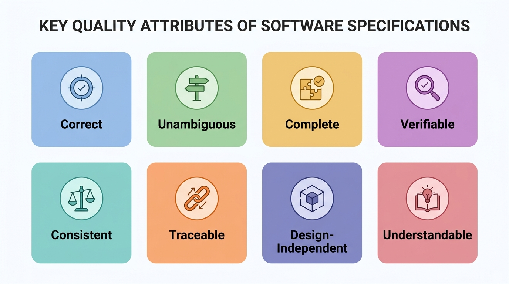

</div>
</div>
</div>

---

<!-- header: '4.3 規格檢視' -->

## SRS 審查項目 (1/4)：正確性與無歧義

<div class="card-deck">

> 💡 規格必須精確反映真實業務法規，且排除任何模糊臆測空間。

<div class="two-columns">
<div class="card" data-marpit-fragment>

### 🎯 1. 正確性 (Correct)
- ❌ **反例**：「VIP 8 折結帳金額扣減後若小於零則以零元計。」
  - *分析：VIP 8 折不可能算出負數；公式邏輯失真，違反財務常識。*
- ✅ **正例**：「VIP 會員結帳應以購物車內非促銷商品總額之 80% 計算應付金額（四捨五入至整數）；運費另計不得扣抵。」

</div>
<div class="card" data-marpit-fragment>

### 🔍 2. 無歧義 (Unambiguous)
- ❌ **反例**：「系統應具備良好的回應速度，並適當支援行動裝置。」
  - *分析：何謂「良好」？何謂「適當」？引發各方主觀解讀。*
- ✅ **正例**：「在 1,000 並發連線下，API 95 百分位回應 $\le 1.2$ 秒；UI 通過 iOS Safari 16+ 與 Android Chrome 110+ 渲染相容測試。」

</div>
</div>
</div>

---

<!-- header: '4.3 規格檢視' -->

## SRS 審查項目 (2/4)：完整性與可驗證性

<div class="card-deck">

> 💡 規格必須防禦所有邊界極端異常，且具備客觀有限成本的驗證手段。

<div class="two-columns">
<div class="card" data-marpit-fragment>

### 📦 3. 完整性 (Complete)
- ❌ **反例**：「使用者輸入密碼錯誤時，系統將鎖定該帳號。」
  - *分析：未定義連續幾次錯誤、鎖定多久、如何解鎖，存在規格黑洞。*
- ✅ **正例**：「連續 5 次輸入密碼錯誤立即鎖定帳號 15 分鐘，期間拒絕登入嘗試並向註冊信箱寄發警示通知。」

</div>
<div class="card" data-marpit-fragment>

### ✅ 4. 可驗證性 (Verifiable)
- ❌ **反例**：「系統介面必須非常友善，且核心服務永遠不會當機。」
  - *分析：「非常友善」、「永不當機」為主觀且不可驗證的語句。*
- ✅ **正例**：「系統須通過 OWASP ZAP 針對 SQL Injection 與 XSS 的自動化滲透掃描，且無未修復的 High 或 Critical 等級漏洞。」

</div>
</div>
</div>

---

<!-- header: '4.3 規格檢視' -->

## SRS 審查項目 (3/4)：一致性與雙向追溯

<div class="card-deck">

> 💡 內外部條款不得自相矛盾，且需求與實作間須具備不可斷裂的關聯鏈。

<div class="two-columns">
<div class="card" data-marpit-fragment>

### ⚖️ 5. 一致性 (Consistent)
- ❌ **反例**：第 3 節寫「訂單 30 分鐘未付自動取消釋出庫存」；第 7 節寫「每日午夜 00:00 統一批次釋出逾期庫存」。
  - *分析：同份規格內部前後矛盾，開發與測試團隊無所適從。*
- ✅ **正例**：「全系統統一規範：訂單建立起 30 分鐘內未付款，延遲佇列立即觸發取消事件並釋出所鎖定之庫存。」

</div>
<div class="card" data-marpit-fragment>

### 🔗 6. 雙向追溯 (Traceable)
- ❌ **反例**：段落中隨興提及「需支援類似 Uber 的即時叫車定位」。（*無編號、無來源對應，極易遺漏或產生未授權鍍金功能*）
- ✅ **正例**：「`[REQ-LOC-01]` 依據業務合約 2.1 條，司機端 App 每 5 秒透過 WebSocket 向後端回傳 GPS 座標（誤差範圍 $\le 10$ 公尺）。」

</div>
</div>
</div>

---

<!-- header: '4.3 規格檢視' -->

## SRS 審查項目 (4/4)：設計獨立與易理解性

<div class="card-deck">

> 💡 規格專注於「做什麼」而非限制「怎麼做」，且利害關係人皆能輕易讀懂。

<div class="two-columns">
<div class="card" data-marpit-fragment>

### 🧩 7. 設計獨立 (Design-Independent)
- ❌ **反例**：「會員資料表必須建立於 Oracle 19c，由 Java Spring Boot `UserService.java` 透過 JPA 進行查詢。」（*過度限制實作*）
- ✅ **正例**：「提供標準 RESTful 會員查詢 API，接收 UUID 並於 200ms 內回傳 JSON 格式基本資料，支援 500 QPS。」

</div>
<div class="card" data-marpit-fragment>

### 🤝 8. 易理解性 (Understandable)
- ❌ **反例**：「藉由非同步 Reactive Stream 背壓機制，於下游緩衝溢位前觸發斷路器狀態轉移俾使交易鏈路降級。」（*業務客戶無法理解*）
- ✅ **正例**：「當結帳人潮超出系統負荷時，系統暫停處理非急迫請求，並於介面提示『目前排隊中，請稍候 30 秒』。」

</div>
</div>
</div>

---

<!-- _class: title-img -->
<!-- header: '4.3 規格檢視' -->

## 需求檢視查核表 (Requirements Review Checklist)

<div class="image-wrapper">
  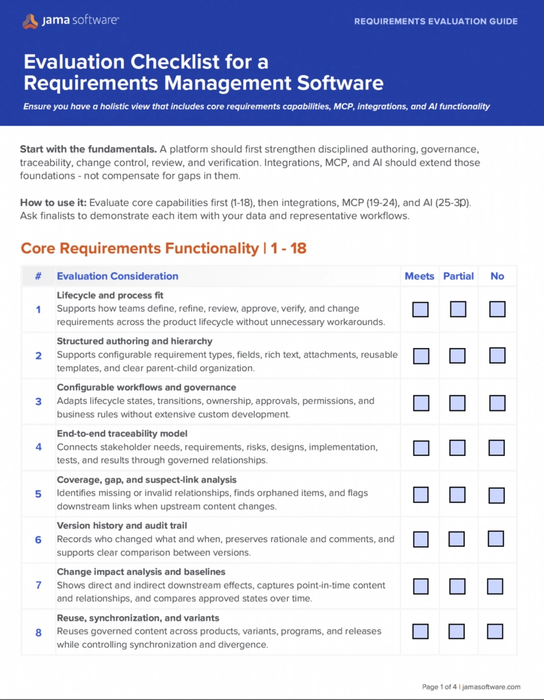
</div>

---

<!-- header: '4.3 規格檢視' -->

## 規格書 7 大撰寫實戰準則

<div class="card-deck">

> 💡 優秀的規格書能大幅降低工程溝通成本；掌握 7 大撰寫準則，消滅潛在需求模糊性。

<div class="content-columns">
<div class="content-text">

### ✍️ 實務檢核清單 (Writing Tips)
- **1. 結構化排版 (Structured)**：目錄、章節、術語縮寫定義表完整。
- **2. 視覺架構圖 (Visual)**：圖文並茂，圖形符號前後一致並附解說。
- **3. 具體範例 (Concrete)**：複雜算式附帶文字解釋與至少 2 個數據實例。
- **4. 精確用詞 (Precise)**：消滅「一些、通常、等等、依此類推」。
- **5. 務實邊界 (Realistic)**：慎用「總是、所有、絕不」，防極端失真。
- **6. 主動語態 (Active Voice)**：指明主體，避免「參數會被初始化」。
- **7. 明確版本 (Explicit Versions)**：精確標明支援的協定與套件版本。

</div>
<div class="content-figure">

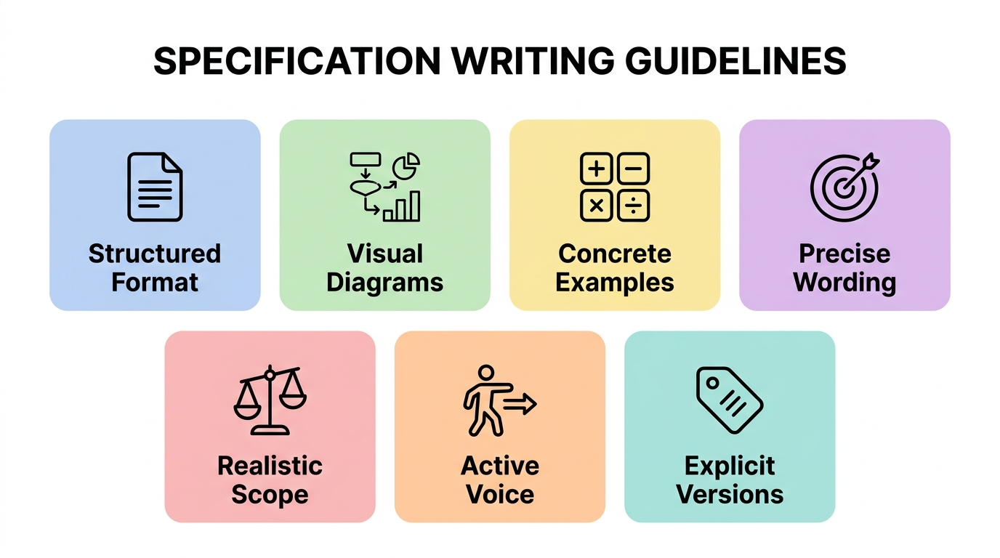

</div>
</div>
</div>

---

<!-- _class: title-image-slide -->

## 需求追溯矩陣 (Requirement Traceability Matrix, RTM)

<div class="image-wrapper">
  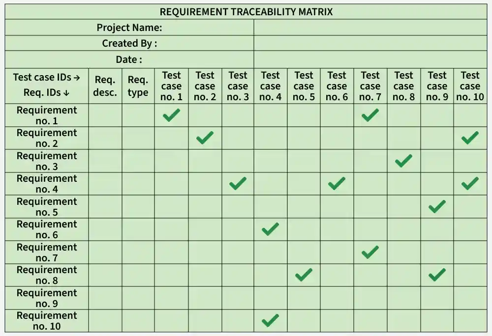
</div>

---

<!-- header: '4.3 規格檢視' -->

## 規格雙向追溯性 (Bidirectional Traceability)

<div class="card-deck">

* > 💡 雙向追溯能保證「不漏掉任何客戶需求」，同時杜絕工程師「憑空實作鍍金功能」。

<div class="two-columns">
<div class="card" data-marpit-fragment>

### 🔗 前向追溯 (Traceable Forward)
- **從需求向後看**：
  - 確保每一條「客戶需求 (User Need)」都能映射到具體的「系統規格 (SRS)」。
  - 規格再進一步對應到架構模組、實作程式碼與測試案例。
- **工程效益**：
  - 避免需求流失，確保 100% 的客戶承諾都被落實與測試。

</div>
<div class="card" data-marpit-fragment>

### 🔙 後向回溯 (Traced Backward)
- **從程式碼與測試往前看**：
  - 每一行程式碼、每一個 API、每一個測試案例都能回溯找到其來源需求。
- **工程效益**：
  - 杜絕**鍍金行為 (Gold Plating)**（實作未被授權且不必要的自嗨功能）。
  - 當需求變更時，能立即進行「衝擊分析 (Impact Analysis)」。

</div>
</div>
</div>

---

<!-- header: '4.3 規格檢視' -->

## 需求檢視 Q&A：規格階段三大常見誤解迷思

<div class="card-deck">

* > 💡 「需求檢視不是挑客戶毛病，而是在未動工前以最低成本校準開發方向盤。」

<div class="three-columns">
<div class="card" data-marpit-fragment>

### ❓ 迷思 1：客戶已簽名確認，需求就不會錯？
- **常見誤解**：以為客戶簽名驗收即代表規格完整無誤。
- **領域真相**：客戶熟悉業務，但**普遍缺乏技術邊界與極端狀況思維**，常忽略並發、異常與容錯要求。
- **檢視對策**：工程團隊主動探詢，挖掘未言明的「隱性需求」。

</div>
<div class="card" data-marpit-fragment>

### ❓ 迷思 2：敏捷擁抱變更，何必寫規格與檢視？
- **常見誤解**：認為敏捷就是隨時改需求，寫 SRS 是浪費時間。
- **領域真相**：敏捷講求快速回饋，但**沒有方向的變更只會造成無止境重工與架構腐蝕**。
- **檢視對策**：推行輕量化檢視，將 User Story 淬鍊為明確的 Given-When-Then 驗收標準。

</div>
<div class="card" data-marpit-fragment>

### ❓ 迷思 3：AI 與工具能完全代勞規格檢視？
- **常見誤解**：把文件丟給 LLM 或 Linter 就能抓出所有問題。
- **領域真相**：工具擅長排查文字矛盾與模糊詞，但**完全抓不出「被遺漏的關鍵需求 (Missing Requirements)」**。
- **檢視對策**：跨角色（開發、測試、業務）面對面對齊，以人機協同彌補工具盲點。

</div>
</div>
</div>

---

<!-- header: '4.3 規格檢視' -->

## 🙋 概念核對問答 (CCQ 3)

<div class="ccq-columns">
<div class="ccq-text">

<!-- id: sqa-ch04-ccq3 -->

**問題情境**：  
為了在需求與系統規格階段落實「雙向追溯 (Bidirectional Traceability)」，規格書應該確保具備下列何種關係特性？

- **A)** 每個使用者需求均可對應到特定的系統規格，且每個系統規格皆能回溯到其來源需求 (Traced & Traceable)
- **B)** 規格書的字數與最終系統原始程式碼行數必須成固定正比關係
- **C)** 每一行程式碼都必須直接對應到 UML 類別圖的所有屬性
- **D)** 規格書必須僅由開發人員撰寫，完全不允許顧客檢閱以防模糊焦點

</div>
<div class="ccq-logo">

<a href="https://nlhsueh.github.io/nickedupocket/#/student/sqa-ch04-ccq3" target="_blank"></a>

</div>
</div>

---

<!-- _class: lead -->
<!-- header: '4.4 設計檢視' -->

# **4.4 軟體設計檢視 (Design Review)**

> 「程式碼是磚瓦，架構設計才是地基；  
> 挽救一個錯誤的架構，往往需要拆毀整棟大樓。」

---

<!-- header: '4.4 設計檢視' -->

## 設計檢視核心本質：架構級及早防錯 (Shift-Left)

<div class="card-deck">

> 💡 設計檢視是在 Coding 之前，針對系統架構、模組劃分、介面契約與資料模型的靜態審查。

<div class="content-columns">
<div class="content-text">

### 🏛️ 為什麼設計檢視回報率最高？
- **左移防錯效益**：架構與設計階段引入的缺陷，若流到測試或生產環境，修復成本高達 **50 ~ 100 倍**。
- **四大標準審查階段**：
  - **1. 準備 (Inputs)**：備妥架構設計書 (ADD)、介面規格 (API Spec)、資料庫模型 (ERD) 與設計檢核表。
  - **2. 獨立審查 (Study)**：審查委員獨立研讀，標記架構破綻與盲點。
  - **3. 審查會議 (Meeting)**：聚焦於介面界接、異常處理與系統容錯力，**不糾結實作細節**。
  - **4. 追蹤修復 (Follow-up)**：落實架構問題修改，產出架構決策記錄 (ADR) 閉環。

</div>
<div class="content-figure">

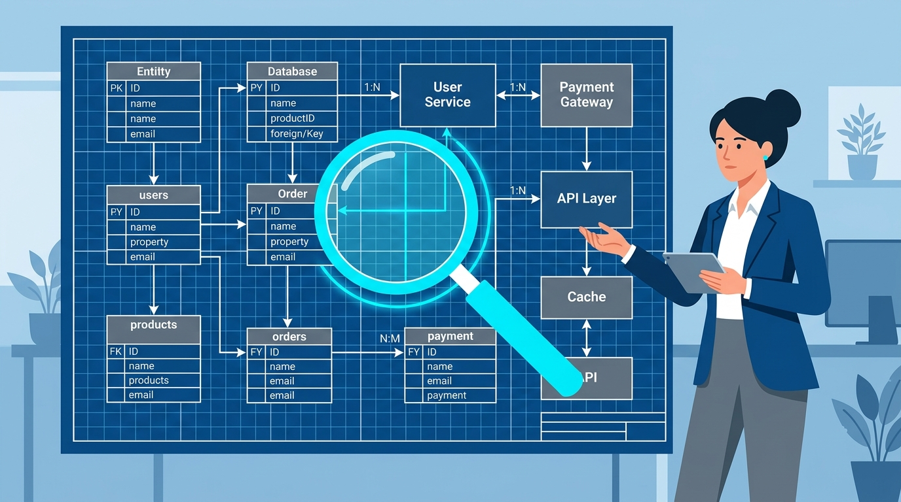

</div>
</div>
</div>

---

<!-- header: '4.4 設計檢視' -->

## 設計檢視五大核心維度檢核清單

<div class="card-deck">

* > 💡 成熟的設計檢視必須兼顧邏輯結構、工程可行性與非功能品質指標 (NFRs)。

<div class="two-columns">
<div class="card" data-marpit-fragment>

### 📐 結構與介面契約
- **1. 模組職責與介面契約 (Interfaces)**：
  - 各模組具備唯一職責 (SRP)，介面協定（方法、參數、回傳型態、前置/後置條件）精準定義。
  - 維持良好封裝性，不洩漏內部實作細節。
- **2. 高內聚與低耦合 (Cohesion & Coupling)**：
  - 模組內部職責高度聚焦，跨模組依賴極小化。
  - 嚴格杜絕跨模組之**循環依賴 (Cyclic Dependencies)**。
- **3. 需求追溯與完整性 (Traceability)**：
  - 每一條 SRS 功能需求在架構中皆有明確模組承載。

</div>
<div class="card" data-marpit-fragment>

### 🌐 視角與非功能防護
- **4. 多維度架構視角 (Architectural Views)**：
  - **邏輯視角**：模組結構、類別關係與領域模型。
  - **行程視角**：執行緒調度、並行控制與生命週期。
  - **部署視角**：伺服器拓撲、網路分區與快取層級。
- **5. 關鍵非功能品質議題 (NFRs)**：
  - **高可用與容錯**：消除單點故障 (SPOF)、快取失效防護。
  - **例外與復原**：錯誤隔離、逾時重試與降級保護。
  - **資料一致性**：分散式交易機制 (ACID / BASE)。

</div>
</div>
</div>

---

<!-- header: '4.4 設計檢視' -->

## 設計模型審查：靜態結構 vs. 動態行為

<div class="card-deck">

* > 💡 透過語法嚴謹的圖形模型（UML、ERD、資料流），系統化檢驗設計的完整性與邊界正確性。

<div class="two-columns">
<div class="card" data-marpit-fragment>

### 🧱 靜態結構模型檢核 (Structural)
- **類別圖與元件圖 (Class & Component)**：
  - 檢核：是否存在過度龐大的**上帝物件 (God Object)**？
  - 檢核：繼承層次是否過深？是否遵循依賴反轉 (DIP)？
- **實體關聯圖 (ERD / Database Schema)**：
  - 檢核：正規化程度是否適當？高頻查詢是否漏設索引？
  - 檢核：大量寫入是否存在鎖表風險？外鍵串聯刪除安全性。
- **套件依賴圖 (Package Dependency Diagram)**：
  - 檢核：依賴關係是否呈現單向有向無環 (DAG) 結構？

</div>
<div class="card" data-marpit-fragment>

### 🔄 動態行為模型檢核 (Behavioral)
- **循序圖 (Sequence Diagram)**：
  - 檢核：呼叫時序是否合理？非同步呼叫是否處理超時？
  - 檢核：跨服務呼叫鏈是否過長（深層巢狀依賴）？
- **狀態機圖 (State Machine Diagram)**：
  - 檢核：狀態轉換是否封閉？是否有無法逃脫的死狀態？
  - 檢核：極端併發事件觸發時是否有狀態機未定義分支？
- **資料/事件流模型 (Data & Event Flow)**：
  - 檢核：輸入與輸出是否維持守恆平衡（無黑洞或奇蹟）？

</div>
</div>
</div>

---

<!-- _class: title-img -->

## 設計圖檢驗實戰 (一)：資料流程圖 (DFD) 檢驗

<div class="image-wrapper">
  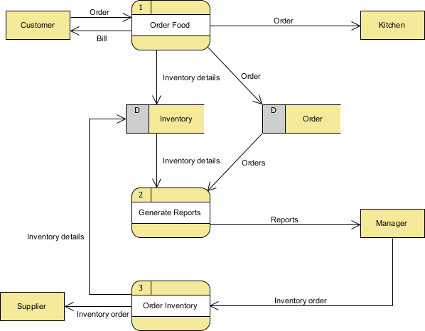
</div>

---

<!-- _class: title-img -->

## 設計圖檢驗實戰 (二)：類別圖 (Class Diagram) 檢驗

<div class="image-wrapper">
  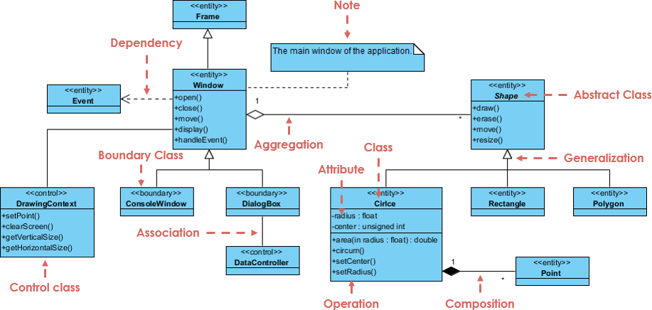
</div>

---

<!-- _class: title-img -->

## 設計圖檢驗實戰 (三)：實體關聯圖 (ERD) 檢驗

<div class="image-wrapper">
  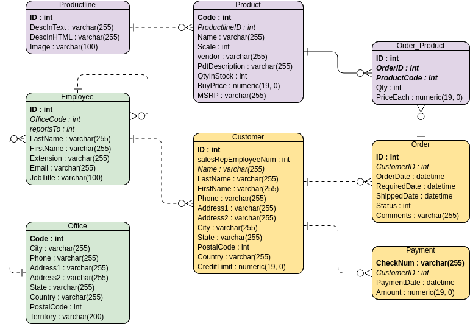
</div>

---

<!-- header: '4.4 設計檢視' -->

## 架構壞味道 (Architecture Smells) 與反模式防禦

<div class="card-deck">

* > 💡 審查的核心任務之一是識別架構腐化徵兆，在程式碼動工前剷除結構性毒瘤。

<div class="two-columns">
<div class="card" data-marpit-fragment>

### ⚠️ 常見架構與結構反模式
- **循環依賴 (Cyclic Dependency)**：
  - 模組 A 依賴 B、B 依賴 C、C 又依賴 A；導致無法單獨建置、獨立測試與重構。
- **上帝元件 / 泥球 (The Blob / God Component)**：
  - 單一類別或服務包攬數十種不相干職責，其餘元件淪為單純資料載體。
- **分散式單體 (Distributed Monolith)**：
  - 微服務表面獨立部署，實際上共享同一資料庫且跨服務強耦合，牽一髮動全身。

</div>
<div class="card" data-marpit-fragment>

### ⚡ 介面與系統通訊反模式
- **缺乏冪等性 (Non-Idempotent Pitfall)**：
  - 結帳或轉帳 API 未設計 Idempotency-Key，網路抖動重試時導致重複交易。
- **級聯失效 (Cascading Failure)**：
  - 底層依賴服務回應延遲時，缺乏熔斷 (Circuit Breaker) 機制，拖垮整個系統連線池。
- **洩漏內部實作 (Leaky Abstraction)**：
  - 介面回傳資料直接暴露資料庫實體欄位，破壞抽象層邊界。

</div>
</div>
</div>

---

<!-- header: '4.4 設計檢視' -->

## 現代工程實踐：ADR 架構決策與契約優先審查

<div class="card-deck">

* > 💡 從口頭討論走向制度化：以架構決策記錄 (ADR) 沉澱脈絡，以 API 契約優先驅動工程協同。

<div class="two-columns">
<div class="card" data-marpit-fragment>

### 📜 ADR (Architecture Decision Record)
- **架構決策紀錄四大要件**：
  - **1. 標題與狀態 (Status)**：如 Proposed, Accepted, Deprecated。
  - **2. 背景脈絡 (Context)**：面臨的技術挑戰與約束條件。
  - **3. 決策方案 (Decision)**：團隊選定的架構方案與技術選型。
  - **4. 權衡後果 (Consequences)**：方案的優勢與必須承擔的技術代價。
- **工程價值**：
  - 終結人員流動時「為什麼當初要這樣設計」的重複爭吵。

</div>
<div class="card" data-marpit-fragment>

### 🤝 API 契約優先與 RFC 審查
- **契約優先設計 (Contract-First)**：
  - 程式開發前先審查 OpenAPI / Swagger 或 Protobuf 規格。
  - 統一 RESTful 資源命名、HTTP 狀態碼與錯誤回應結構。
- **RFC (Request for Comments) 制度**：
  - 重大功能動工前撰寫 Design Doc，邀請跨模組、資安與維運團隊同儕審查。
- **架構權衡分析 (ATAM)**：
  - 評估 CAP 定理與系統吞吐量 vs. 一致性之間的工程取捨。

</div>
</div>
</div>

---

<!-- header: '4.4 設計檢視' -->

## 設計檢視 Q&A：架構設計三大常見誤解迷思

<div class="card-deck">

* > 💡 「程式碼臭味可以靠重構解決，但架構設計缺陷往往必須『推倒重來』。」

<div class="three-columns">
<div class="card" data-marpit-fragment>

### ❓ 迷思 1：設計檢視會拖慢敏捷開發速度？
- **常見誤解**：認為開架構審查會耽誤 Sprint 交付進度。
- **領域真相**：未經審查的架構一旦存在單點失效 (SPOF) 或錯誤分層，**上線後的搶修代價是前期的數十倍**。
- **檢視對策**：採納 1~2 頁輕量級架構決策紀錄 (ADR)，30 分鐘白板走查預防架構重寫災難。

</div>
<div class="card" data-marpit-fragment>

### ❓ 迷思 2：設計檢視就是檢查 UML 畫得對不對？
- **常見誤解**：把審查焦點放在類別圖語法或圖表排版細節。
- **領域真相**：UML 僅是溝通媒介；設計檢視核心在於**非功能性品質屬性與權衡取捨 (Trade-offs)**。
- **檢視對策**：聚焦審查 CAP 定理取捨、快取穿透防禦、模組職責邊界與 API 介面契約。

</div>
<div class="card" data-marpit-fragment>

### ❓ 迷思 3：程式碼寫好跑完測試，再來重構架構？
- **常見誤解**：迷信「先寫完跑起來，有測試保護再重構架構」。
- **領域真相**：重構只適用於區域函式；**錯誤的資料模型與分散式通訊協議無法靠重構無痛翻盤**。
- **檢視對策**：貫徹「極限左移 (Shift-Left)」，在動手寫 Code 之前先完成關鍵模組架構走查。

</div>
</div>
</div>

---

<!-- header: '4.4 設計檢視' -->

## 🙋 概念核對問答 (CCQ 4)

<div class="ccq-columns">
<div class="ccq-text">

<!-- id: sqa-ch04-ccq4 -->

**問題情境**：  
在軟體品質保證落實「品質左移 (Shift-Left)」實務時，下列關於「軟體設計檢視 (Design Review)」的時機、範疇與架構原則，何者最為正確？

- **A)** 設計檢視必須在撰寫程式碼 (Coding) 之前落實，及早揪出架構盲點以防錯誤修復成本被放大數十倍
- **B)** 設計檢視最理想的執行時機，是在系統所有模組的單元測試與整合測試皆通過之後
- **C)** 設計檢視只關注圖形排版美觀，不應深究循環依賴 (Cyclic Dependency) 或資料流黑洞
- **D)** 只要團隊落實重構 (Refactoring)，錯誤的資料模型與系統分層結構就能在後期無痛自動修復

</div>
<div class="ccq-logo">

<a href="https://nlhsueh.github.io/nickedupocket/#/student/sqa-ch04-ccq4" target="_blank"></a>

</div>
</div>

---

<!-- _class: lead -->
<!-- header: '4.5 程式碼檢視' -->

# **4.5 程式碼檢視**

> 「任何笨蛋都能寫出電腦看得懂的程式碼；  
> 優秀的工程師寫的是人類看得懂的程式碼。」  
> —— Martin Fowler

---

<!-- header: '4.5 程式碼檢視' -->

## 程式碼檢視 5 大錯誤類型

<div class="card-deck">

> 💡 呼應第二章 Clean Code 心法，程式碼檢視將開發者個人自律昇華為「團隊制度化防禦防線」。

<div class="content-columns">
<div class="content-text">

### 🔍 靜態檢視 5 大致命缺陷維度
- **1. 資料錯誤 (Data Faults)**：
  - 變數未初始化即讀取、重複賦值未讀取、陣列越界、浮點數精準度陷阱。
- **2. 控制流程錯誤 (Control Faults)**：
  - 無效死碼 (Unreachable Dead Code)、無窮迴圈、深層巢狀階梯。
- **3. 輸入/輸出錯誤 (I/O Faults)**：
  - 檔案串流或資料庫連線未關閉、緩衝區溢位、未處理 I/O 例外。
- **4. 介面錯誤 (Interface Faults)**：
  - 參數型態/數量不吻合、忽略回傳值、未被呼叫的孤立函式。
- **5. 編碼規範違反 (Coding Standards)**：
  - 違反安全規範、架構分層穿透、魔術數字濫用。

</div>
<div class="content-figure">

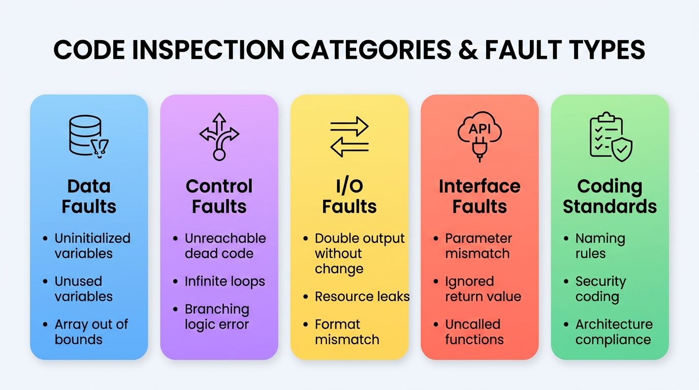

</div>
</div>
</div>

---

<!-- header: '4.5 程式碼檢視' -->

## 團隊 Clean Code 審查查核清單 (Checklist)

<div class="card-deck">

> 💡 承接 Ch02 個人自律心法：在 Code Review 中將其昇華為「團隊客觀驗收門檻」，杜絕主觀風格偏好。

<div class="two-columns">
<div class="card">

### 📐 Reviewer 視角：結構與控制流程
- **命名意圖驗收**：
  - 審查者能否一眼望文生義？若需額外解釋，要求作者重構，杜絕神祕縮寫與魔術常數。
- **函式單一職責 (SRP)**：
  - 函式長度是否控制在 20 行內？若做多件事，要求 Extract Method。
- **巢狀扁平化**：
  - 巢狀層級是否杜絕超過 2 層？要求善用衛語句 (Guard Clauses) 提早回傳。

</div>
<div class="card">

### 🛡️ Reviewer 視角：防禦健壯與品質門檻
- **註解與死碼清理**：
  - 廢話註解或註解掉的過期死碼強制刪除；註解僅限解釋「Why」。
- **健壯防禦性**：
  - 是否使用 Exception 分離主流程？杜絕傳遞/回傳 `null` 與空 catch 吞例外。
- **PR 測試守門 (Merge Gate)**：
  - 提交的 PR 是否附帶單元測試？邊界案例無覆蓋者一律退回修正。

</div>
</div>
</div>

---

<!-- header: '4.5 程式碼檢視' -->

## 程式臭味 (Code Smells) 概念與體系

<div class="card-deck">

> 💡 Clean Code 是健康目標，Code Smells 是病徵警訊，Refactoring (重構) 則是處方藥。

<div class="content-columns">
<div class="content-text">

### 🦨 什麼是程式碼臭味？
- **名詞起源**：由 Kent Beck 與 Martin Fowler 提出，指程式碼表面看似能正確編譯執行，但結構上已顯露出腐化跡象。
- **核心危害**：
  - 臭味大幅降低可讀性，大幅提高後續維護與擴充成本。
  - 是系統缺陷、效能惡化與技術債 (Technical Debt) 的主要溫床。
- **重構手法 (Refactoring)**：
  - 在不改變軟體外部行為的前提下，逐步調整內部結構，消除臭味、重返 Clean Code。

</div>
<div class="content-figure">


<p style="text-align: center; font-size: 13px; color: #64748b; margin-top: 6px;">Kent Beck (極限編程 XP 與 TDD 之父，Code Smell 概念提出者)</p>

</div>
</div>
</div>

---

<!-- header: '4.5 程式碼檢視' -->

## 經典程式臭味剖析 (一)：肥大與結構失調

<div class="card-deck">

* > 💡 當類別與函式承載過多責任時，系統將失去彈性並成為人人不敢觸碰的「巨石怪獸」。

<div class="two-columns">
<div class="card" data-marpit-fragment>

### 🐘 肥大類別與冗長方法
- **重複程式碼 (Duplicated Code)**：
  - 罪惡之首！修復了一處卻遺漏另一處。
  - **解法**：提煉方法 (Extract Method) 或提升至父類別。
- **冗長方法 (Long Method)**：
  - 超過 100 行甚至 1000 行的怪獸函式。
  - **解法**：依處理邏輯提煉子方法，提高抽象層次。
- **大類別 (Large Class)**：
  - 包含數十個欄位與責任的大鍋菜。
  - **解法**：依職責提煉新類別 (Extract Class)。

</div>
<div class="card" data-marpit-fragment>

### 🎒 參數列與型別偏執
- **太長的參數列 (Long Parameter List)**：
  - 函式傳入 8~10 個參數，呼叫時極易傳錯位置。
  - **解法**：將參數封裝為參數物件 (Introduce Parameter Object)。
- **基本型別偏執 (Primitive Obsession)**：
  - 堅持用 `String` 或 `int` 表達電話、幣別、經緯度。
  - **解法**：建立微型值物件 (Value Object，如 `Money`, `Phone`)。
- **資料泥團 (Data Clumps)**：
  - 總是一起出現的欄位（如城市、街道、郵遞區號）。
  - **解法**：抽取成 `Address` 物件類別。

</div>
</div>
</div>

---

<!-- header: '4.5 程式碼檢視' -->

## 經典程式臭味剖析 (二)：耦合與職責錯置

<div class="card-deck">

* > 💡 類別之間的關係應該是「相敬如賓」，過度依賴與親密將導致動一髮而動全身的骨牌效應。

<div class="two-columns">
<div class="card" data-marpit-fragment>

### 🔗 變更阻礙與散彈手術
- **散彈槍手術 (Shotgun Surgery)**：
  - 改動一個業務邏輯，必須在 10 個不同檔案中各改一行。
  - **解法**：將該變更概念搬移集中到單一模組 (Move Method / Field)。
- **發散變更 (Divergent Change)**：
  - 一個類別因為資料庫改動要修、因為報表格式改動也要修。
  - **解法**：依變更軸心拆分類別，符合單一職責原則。

</div>
<div class="card" data-marpit-fragment>

### 🤝 職責錯置與親密關係
- **依戀情結 (Feature Envy)**：
  - 類別 A 的某個方法頻繁呼叫類別 B 的 getter 進行運算。
  - **解法**：將該方法直接搬移至類別 B 中 (Move Method)。
- **過度的訊息串 (Message Chains)**：
  - 出現 `a.getB().getC().getD().doSomething()` 鏈條。
  - **解法**：隱藏委託 (Hide Delegate)，遵循迪米特法則。

</div>
</div>
</div>

---

<!-- header: '4.5 程式碼檢視' -->

## 安全漏洞檢視：OWASP Top 10 全景

<div class="card-deck">

> 💡 程式碼檢視不僅防範邏輯缺陷，更必須築起嚴密的資安防線；SAST 工具是落實安全的最佳盟友。

<div class="content-columns">
<div class="content-text">

### 🛡️ 權威資安指針 (OWASP Top 10)
- **A01 權限控制失效 (Broken Access Control)**：
  - 未經授權橫向越權存取他人敏感個資或管理者後台。
- **A02 加密機制失效 (Cryptographic Failures)**：
  - 密碼明文儲存、使用 MD5/SHA1 弱雜湊、配置硬編碼密鑰。
- **A03 注入攻擊 (Injection)**：
  - SQL 注入、OS 指令注入、跨網站指令碼 (XSS)。
- **A04 不安全設計 (Insecure Design)**：
  - 架構初期缺乏威脅建模與縱深防禦機制。
- **A05 安全設定錯誤 (Security Misconfiguration)**：
  - 預設帳密未改、生產環境暴露詳細錯誤堆疊 (Stack Trace)。

</div>
<div class="content-figure">

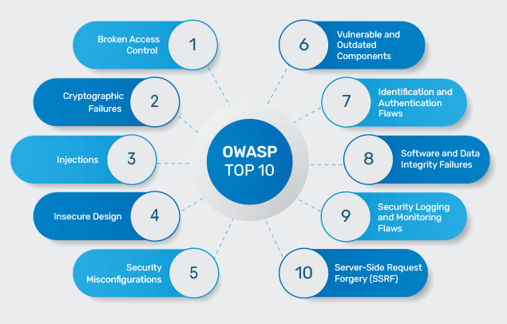

</div>
</div>
</div>

---

<!-- header: '4.5 程式碼檢視' -->

## OWASP Top 10 重點防護與靜態分析

<div class="card-deck">

* > 💡 透過 PMD、SonarQube 與 Checkmarx 等靜態分析工具，在 CI/CD 流程中自動攔截惡意漏洞。

<div class="two-columns">
<div class="card" data-marpit-fragment>

### 🔒 關鍵資安檢視要點
- **防範 SQL 注入 (A03)**：
  - 嚴格禁止字串拼接 SQL，一律採用**參數化查詢 (PreparedStatement)** 或 ORM 框架綁定。
- **安全錯誤處理 (A05)**：
  - 嚴禁直接向前端拋出 `e.printStackTrace()`；前端回傳通用錯誤代碼，詳細資訊僅寫入後端受保護日誌。
- **相依套件掃描 (A06)**：
  - 透過 OWASP Dependency-Check 盤點第三方 Maven 套件，及時修補 CVE 漏洞。

</div>
<div class="card" data-marpit-fragment>

### 🛠️ PMD 靜態分析工具實戰
- **自動化常規掃描**：
  - 自動偵測未使用的變數、未關閉的串流、空 catch 區塊與複雜度超標方法。
- **品質閘門 (Quality Gate)**：
  - 在 Git Commit 或 PR 合併前設定門檻，若存在 High 級別違規立即阻斷建置。
- **實習搭配**：
  - 配合 **Lab 04 PMD 工具實作**，掌握規則集（RuleSets）自訂與報告產出。

</div>
</div>
</div>

---

<!-- header: '4.5 程式碼檢視' -->

## 程式碼檢視 Q&A：Code Review 三大常見誤解迷思

<div class="card-deck">

* > 💡 「工具與 AI 守護的是規範的底線，人工 Code Review 守護的是系統靈魂與團隊成長。」

<div class="three-columns">
<div class="card" data-marpit-fragment>

### ❓ 迷思 1：有了 PMD 與 AI，不再需要人工審查？
- **常見誤解**：靜態工具與生成式 AI 已能自動掃描，可完全取代人類審查。
- **領域真相**：工具擅長語法規範與已知 CVE，但**完全無法理解真實商業法規與業務語意**（如算費是否合規）。
- **檢視對策**：人機協同：CI/AI 先行掃雷（過濾 80% 雜訊），工程師聚焦業務邏輯與架構演進。

</div>
<div class="card" data-marpit-fragment>

### ❓ 迷思 2：Code Review 唯一目的就是「抓出 Bug」？
- **常見誤解**：審查只看有沒有錯誤，若沒抓出 Bug 就等於浪費工時。
- **領域真相**：找錯只是基本收益；更核心的是**促進集體程式碼共有 (Collective Ownership) 與團隊知識傳遞**。
- **檢視對策**：透過審查讓資淺同仁學習大師心法，杜絕核心程式碼淪為「一人獨知」的孤島。

</div>
<div class="card" data-marpit-fragment>

### ❓ 迷思 3：PR 越大越能展現產出，一次審查數千行？
- **常見誤解**：把累積數週的龐大功能包成一個巨型 PR 提交。
- **領域真相**：檢視速率過快（>1000 行/時）會引發「橡皮圖章效應 (LGTM)」，深層邏輯漏洞 100% 漏檢。
- **檢視對策**：堅持「原子化小 PR」（每次 < 400 LOC），讓審查者能以最高專注度審視細節。

</div>
</div>
</div>

---

<!-- header: '4.5 程式碼檢視' -->

## 🙋 概念核對問答 (CCQ 5)

<div class="ccq-columns">
<div class="ccq-text">

<!-- id: sqa-ch04-ccq5 -->

**問題情境**：  
在進行安全性程式碼檢視 (Security Code Review) 時，若審查員發現程式碼在捕捉到例外時直接呼叫 `e.printStackTrace()` 輸出至日誌或畫面，依據 OWASP 安全規範，下列敘述何者最為正確？

- **A)** 這屬於嚴重的安全設定錯誤與資訊洩漏 (OWASP A05)，攻擊者可藉此窺探內部路徑、框架版本與呼叫鏈發動精準滲透
- **B)** 這是業界推薦的最佳除錯實踐，便於終端使用者第一時間掌握系統內部例外細節並回報
- **C)** 只要將例外列印動作放在 `finally` 區塊中，就能自動受到沙箱保護而無洩漏風險
- **D)** 靜態分析工具無法在語法樹中比對出此類呼叫，只能依賴線上入侵防禦系統動態攔截

</div>
<div class="ccq-logo">

<a href="https://nlhsueh.github.io/nickedupocket/#/student/sqa-ch04-ccq5" target="_blank"></a>

</div>
</div>

---

<!-- _class: lead -->
<!-- header: '4.6 PMD 靜態程式碼分析工具' -->

# **4.6 PMD 靜態程式碼分析工具**

> 「在程式碼被編譯與執行之前，  
> 讓語法樹走訪替你照亮隱藏在細節中的壞味道與潛在錯誤。」

---

<!-- header: '4.6 PMD 工具' -->

## PMD 工具本質與 AST 分析引擎

<div class="card-deck">

* > 💡 **PMD (Programming Mistake Detector)**：不需編譯或運行程式碼，直接透過抽象語法樹 (AST) 進行原始碼走訪分析。

<div class="two-columns">
<div class="card" data-marpit-fragment>

### 🌳 核心運作機制 (AST Engine)
- **語法解析 (Parsing)**：
  - 將 Java 原始碼剖析為**抽象語法樹 (Abstract Syntax Tree)**。
  - 程式結構化為樹狀節點（如 `MethodDeclaration`, `IfStatement`, `VariableDeclarator`）。
- **XPath / Java 走訪比對**：
  - 使用 XPath 查詢或自訂 Java 規則比對 AST 節點特徵。
  - 精確標定違規程式碼之檔案、行號、變數名與上下文。

</div>
<div class="card" data-marpit-fragment>

### ⚡ 核心價值與防護邊界
- **零執行負擔**：
  - 靜態源碼掃描，無需建置執行環境或部署測試伺服器。
- **早期阻斷缺陷 (Left-Shift)**：
  - 提早揪出潛在 NPE、未關閉串流、空 catch 與邏輯瑕疵。
- **與實習相互呼應**：
  - 詳見實習手冊：`LabDemo/docs/u04_inspection/pmd.md`。

</div>
</div>
</div>

---

<!-- header: '4.6 PMD 工具' -->

## PMD 核心規則分類與程式碼壞味道

<div class="card-deck">

* > 💡 PMD 涵蓋多語言規範，其中以 Java 規則集最為完整，主要涵蓋 8 大核心維度。

<div class="two-columns">
<div class="card" data-marpit-fragment>

### 🛡️ 程式碼健全度 (Robustness)
- **Best Practices（最佳實踐）**：
  - `UseEqualsToCompareStrings`：禁字串 `==` 比較
  - `UseTryWithResources`：自動管理關閉串流資源
  - `AvoidInstantiatingObjectsInLoops`：禁迴圈內重複建物件
- **Error Prone（錯誤易發）**：
  - `EmptyCatchBlock`：禁止吞掉例外（Empty Catch）
  - `ReturnFromFinallyBlock`：禁 finally 內 return
  - `AvoidHardCodedPasswords`：防範硬編碼密碼

</div>
<div class="card" data-marpit-fragment>

### 📐 風格與架構設計 (Design & Style)
- **Code Style（程式碼風格）**：
  - 命名規範（`MethodNamingConventions`、`FieldNamingConventions`）
  - 強制包裹大括號（`UseBraces`）、常數化（`AvoidMagicNumbers`）
- **Design（架構與結構設計）**：
  - `GodClass` / `GodMethod`：過重類別與肥大方法
  - `CyclomaticComplexity`：圈複雜度超標拆分
  - `LawOfDemeter`：迪米特法則，禁止過長串接調用

</div>
</div>
</div>

---

<!-- header: '4.6 PMD 工具' -->

## 實戰示範：氣泡排序 (Bubble Sort) 壞味道檢視

<div class="card-deck">

* > 💡 對應實習專案 `u04_inspection`：以氣泡排序示範常見壞味道與重構手法。

<div class="two-columns">
<div class="card" data-marpit-fragment>

### 🦨 典型壞味道 (`BubbleSortBadSmellDemo`)
- **字串直接 `==` 比對** (`UseEqualsToCompareStrings`)
- **迴圈內反覆建立物件** (`AvoidInstantiatingObjectsInLoops`)
- **未命名魔術數字** (`AvoidMagicNumbers`)
- **省略大括號與命名不合規** (`UseBraces`, `FieldNamingConventions`)
- **生吞例外** (`EmptyCatchBlock`)

</div>
<div class="card" data-marpit-fragment>

### 🛠️ 重構規範與實習程式對照
- **重構對策**：`.equals()`、提取常數、區塊補齊 `{}`、補 Javadoc
- **實習程式對照**：
  - ❌ 違規示範：`BubbleSortBadSmellDemo.java`
  - ✅ 典範重構：`BubbleSortClean.java`
  - 🎯 學生實作：`BubbleSortExercise.java`
- 📖 **詳細規則解析**：請參閱 `LabDemo` 實習手冊

</div>
</div>
</div>

---

<!-- header: '4.6 PMD 工具' -->

## Maven Plugin 整合與 CLI / IntelliJ 執行

<div class="card-deck">

* > 💡 透過 `maven-pmd-plugin` 將靜態分析納入建置週期，打造品質防線。

<div class="two-columns">
<div class="card" data-marpit-fragment>

### ⚙️ `pom.xml` 插件配置
```xml
<plugin>
  <groupId>org.apache.maven.plugins</groupId>
  <artifactId>maven-pmd-plugin</artifactId>
  <version>3.26.0</version>
  <configuration>
    <rulesets>
      <ruleset>src/main/resources/pmd/ruleset.xml</ruleset>
    </rulesets>
    <failOnViolation>false</failOnViolation>
    <printFailingErrors>true</printFailingErrors>
  </configuration>
</plugin>
```

</div>
<div class="card" data-marpit-fragment>

### 🚪 多元執行方式 (CLI / IDE)
- **CLI 常用指令**：
  - `mvn pmd:check`（檢查單元違規）
  - `mvn pmd:check -Dpmd.includes="**/BubbleSort*"`（單檔檢查）
  - `mvn pmd:pmd`（產出網頁報表 `target/reports/pmd.html`）
- **IntelliJ 執行**：
  - 右側 Maven 工具列 ➜ `Plugins` ➜ `pmd` ➜ `pmd:check`
- 📖 **配置細節與 IDE 外掛**：請參閱 `LabDemo` 實習手冊

</div>
</div>
</div>

---

<!-- header: '4.6 PMD 工具' -->

## 違規壓制機制與 u04 實習任務導航

<div class="card-deck">

* > 💡 合理處理「假警報 (False Positive)」或教學特例，切勿因噎廢食關閉全域規則檢查。

<div class="two-columns">
<div class="card" data-marpit-fragment>

### 🛑 三大違規壓制手段 (Suppression)
- **1. 方法/類別 Annotation 壓制**：
  `@SuppressWarnings("PMD.AvoidArrayLoops")`
- **2. 行級註解壓制**：
  `// NOPMD - 教學展示手動複製迴圈`
- **3. 客製化 `ruleset.xml` 規則排除**：
  使用 `<exclude name="..." />` 或調整門檻參數

</div>
<div class="card" data-marpit-fragment>

### 🧪 u04 實習四大任務 (Lab 01 ~ 04)
- **Lab 01**：執行 PMD 靜態檢查並檢視 HTML 視覺化報告
- **Lab 02**：依報告重構 `BubbleSortExercise.java` 並跑測試
- **Lab 03**：在 `ruleset.xml` 調整 `CommentSize` 門檻
- **Lab 04**：針對手動迴圈實作 `@SuppressWarnings` 與 `// NOPMD`
- 📖 **實習指引與步驟**：請參閱 `LabDemo` 實習手冊

</div>
</div>
</div>

---

<!-- header: '4.6 PMD 工具' -->

## 🙋 概念核對問答 (CCQ 6)

<div class="ccq-columns">
<div class="ccq-text">

<!-- id: sqa-ch04-ccq6 -->

**問題情境**：  
開發團隊在 Maven 專案中導入 PMD 靜態分析作為 CI/CD 品質門禁（Quality Gate）。為了避免誤報（False Positive）阻斷建置，同時落實嚴格的程式碼審查，下列關於 PMD 違規壓制（Suppression）與門禁配置的敘述，何者最為正確？

- **A)** 在專案中若發現 PMD 報告誤報，唯一的解決方式是將 `failOnViolation` 改為 false，關閉所有檢查
- **B)** 可針對特定方法加上 `@SuppressWarnings("PMD.RuleName")`，或於行尾使用 `// NOPMD` 並註明原因，以壓制已知合理的違規
- **C)** PMD 必須先將 Java 原始碼編譯為 bytecode (`.class`) 並在 JVM 上運行，才能透過動態追蹤偵測壞味道
- **D)** `minimumPriority` 設定為 3 時，PMD 只會回報優先級為 4 與 5 的低風險警告，1 與 2 的重大錯誤將被完全忽略

</div>
<div class="ccq-logo">

<a href="https://nlhsueh.github.io/nickedupocket/#/student/sqa-ch04-ccq6" target="_blank"></a>

</div>
</div>

---

<!-- _class: lead -->
<!-- header: '4.7 AI 輔助與自動化' -->

# **4.7 AI 輔助檢視與 DevOps 自動化**

> 「從需求、架構到程式碼，  
> 讓生成式 AI 成為工程師全天候的副駕駛，以自動化守護品質底線。」

---

<!-- header: '4.7 AI 輔助與自動化' -->

## AI 賦能現代檢視體系：雙層防禦矩陣

<div class="card-deck">

> 💡 現代檢視走向「AI 初篩＋人類把關」的雙層防禦體系，既保有檢視深度，又大幅縮減週期。

<div class="two-columns">
<div>

##### 🤖 Stage 1: AI 智慧第一道防線
- **自動化 PR 摘要**：10 秒內梳理變更意圖與影響範圍。
- **語法與臭味快篩**：即時攔截常規違規與冗餘程式碼。
- **基礎資安與資源漏洞**：偵測資源未關閉、NPE 與注入風險。

##### 👨‍💻 Stage 2: 人類專家第二道防線
- **全域架構與模組設計**：評估模組耦合度與系統邊界。
- **業務領域邏輯**：驗證複雜商業邏輯與邊界情境。
- **系統不變量 (Invariants)**：確保並發一致性與安全底線。

</div>
<div class="content-figure">

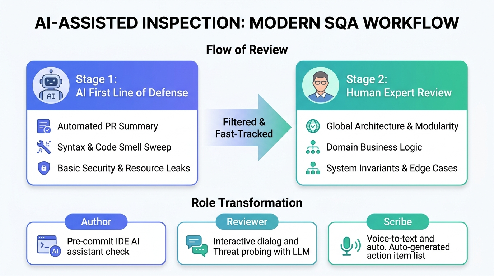

</div>
</div>
</div>

---

<!-- header: '4.7 AI 輔助與自動化' -->

## AI 在需求 (Req) 與設計 (Design) 檢視之落地

<div class="card-deck">

* > 💡 將靜態檢視「極限左移 (Shift-Left)」：在尚未寫下一行程式碼前，由 AI 協助排查高代價之規格與架構漏洞。

<div class="two-columns">
<div class="card" data-marpit-fragment>

### 📝 需求規格檢視 (SRS Inspection)
- **模糊度與主觀用詞掃描**：
  - 自動標記「友善、高效、支援多數人」等不可驗證模糊詞句。
- **跨章節邏輯矛盾偵測**：
  - 比對業務規則：如 Chapter 2 寫「一律免費」，Chapter 4 寫「滿千收運費」。
- **自動化測資與場景補完**：
  - 依據需求描述，自動生成 Gherkin (Given-When-Then) 驗收情境與邊界測試資料。

</div>
<div class="card" data-marpit-fragment>

### 📐 架構與模型檢視 (Design Review)
- **STRIDE 威脅建模自動化**：
  - 走訪架構拓撲圖與資料流程（DFD），自動推演資安弱點。
- **API 契約與 Schema 審核**：
  - 驗證 OpenAPI / GraphQL 規格與資料庫實體間的欄位完整性。
- **並發與死結模式推演**：
  - 識別分散式系統呼叫鏈中的潛在競態條件 (Race Conditions)。

</div>
</div>
</div>

---

<!-- header: '4.7 AI 輔助與自動化' -->

## AI 在程式碼檢視與 PR 機器人實踐

<div class="card-deck">

* > 💡 結合 GitHub Actions 與 PR 機器人（如 PR-Agent、Cursor、Copilot），在 PR 發起數秒內提供深度檢核。

<div class="two-columns">
<div class="card" data-marpit-fragment>

### 🤖 PR 智慧檢視機器人工作流
- **10 秒變更摘要 (Walkthrough)**：
  - 自動生成簡潔的 Pull Request 變更動機與關鍵模組影響圖。
- **行級缺陷標註 (Line-by-line)**：
  - 自動在 GitHub PR 具體行數留言指出記憶體洩漏、未捕獲例外或 SQL 注入。
- **一鍵可採納修復 (Suggested Diff)**：
  - 直接產出符合團隊風格的修復 Commit，作者點擊即可套用。

</div>
<div class="card" data-marpit-fragment>

### ⚠️ AI 檢視防護實務與限制
- **防止 Token 污染與上下文截斷**：
  - 巨型 PR 拆分為小原子 Commits，避免 AI 遺失跨檔案參照。
- **資安與敏感資料脫敏 (Sanitization)**：
  - 送入 AI 分析前，必須過濾內部金鑰、Token 與個資 (PII)。
- **審核權限嚴格控管**：
  - AI 僅具「建議」與「審查留言」權限，禁止授予直接合併權。

</div>
</div>
</div>

---

<!-- header: '4.7 AI 輔助與自動化' -->

## DevOps 階梯式自動化流水線與品質閘門

<div class="card-deck">

* > 💡 建立階梯式防禦：從開發者本機到生產主線，設下多重自動化品質閘門 (Quality Gates)。

<div class="two-columns">
<div class="card" data-marpit-fragment>

### 🧱 階梯式自動化檢視防線
- **Level 1：本機預檢 (Pre-Commit Hook)**：
  - Git commit 時觸發極速排版與 linter，秒級反饋。
- **Level 2：PR 靜態分析 (SAST & PMD)**：
  - 於 GitHub Actions 執行 PMD、SonarQube，違規即標紅。
- **Level 3：AI PR Reviewer 深度審查**：
  - 自動分析業務語意、潛在邊界條件與測試覆蓋度。
- **Level 4：人類同儕審查 (Peer Review)**：
  - 資深同儕確認架構與業務合規。

</div>
<div class="card" data-marpit-fragment>

### 🛑 分支保護 (Branch Protection)
- **阻斷合併規則 (Status Checks)**：
  - PMD 違規數 > 0 時，嚴格禁止合併至 `main` 分支。
  - 單元測試與覆蓋率門檻未達標者強制退回。
- **雙人簽核機制 (Approvals)**：
  - 核心模組需至少一位人類專家核准 (Required Reviewer)。
- **持續度量與追蹤**：
  - 缺陷外洩率 (Defect Leakage) 即時可視化看板。

</div>
</div>
</div>

---

<!-- header: '4.7 AI 輔助與自動化' -->

## 🙋 概念核對問答 (CCQ 7)

<div class="ccq-columns">
<div class="ccq-text">

<!-- id: sqa-ch04-ccq7 -->

**問題情境**：  
團隊計畫在現代 DevOps 流程中導入生成式 AI 輔助軟體檢視（涵蓋需求 SRS、架構設計與程式碼 PR）。下列關於「AI 輔助檢視與自動化品質閘門」的實務策略，何者最為正確？

- **A)** 現代大語言模型 (LLM) 已具備 100% 準確率，因此程式碼檢視可完全交由 AI PR Bot 自動審核並直接合併，不再需要人類工程師介入
- **B)** AI 僅能檢查程式碼的縮排與排版風格，完全無法應用於需求文件 (SRS) 的矛盾檢測或架構設計的威脅建模
- **C)** 理想架構為「AI 機器人初篩預審＋人類資深工程師最終把關 (Human-in-the-Loop)」，並於 CI 流水線結合靜態工具設下阻斷性品質閘門
- **D)** 為了發揮 AI 最佳效益，應將所有未經篩選的數萬行歷史程式碼一次性塞入單一 Prompt，無需任何分層過濾機制

</div>
<div class="ccq-logo">

<a href="https://nlhsueh.github.io/nickedupocket/#/student/sqa-ch04-ccq7" target="_blank"></a>

</div>
</div>

---

<!-- _class: lead -->
<!-- header: '4.8 檢視的評估' -->

# **4.8 檢視的評估**

> 「無法度量的東西，就無法改善；  
> 用數據證明檢視的價值，讓品質投資無懈可擊。」

---

<!-- header: '4.8 檢視的評估' -->

## 檢視效益的量化度量指標

<div class="card-deck">

* > 💡 透過工程數據評估檢視活動之效益，能有效量化品質投資報酬率 (ROI) 並指引流程優化。

<div class="two-columns">
<div class="card" data-marpit-fragment>

### 📊 核心度量指標公式
- **缺失偵測效率 (EDE, Error Detection Efficiency)**：
  $$\text{EDE} = \frac{\text{發現缺失數量}}{\text{審查所耗費工時 (小時)}}$$
- **成本效用比 (Cost Effectiveness)**：
  $$\text{Ratio} = \frac{\text{留至後期修復測試之平均成本}}{\text{在檢視階段揪出並修復之成本}}$$
- **缺陷移除率 (DRL, Defect Removal Leverage)**：
  - 比較兩不同階段（如檢視 vs. 系統測試）每工時移除缺陷的比率。

</div>
<div class="card" data-marpit-fragment>

### 📈 指標引導與工程洞見
- **缺陷密度 (Defect Density)**：
  - 每千行程式碼 (KLOC) 發現的缺陷數，過高代表模組架構腐化需重構。
- **必要收集數據**：
  - 審查產出物大小 (LOC / Page)
  - 準備與審查耗費工時
  - 檢視發現缺陷數 vs. 後續外洩至測試或生產之缺陷數 (Leakage)

</div>
</div>
</div>

---

<!-- header: '4.8 檢視的評估' -->

## 檢視速率 (Review Rate) 與漏檢率的權衡

<div class="card-deck">

* > 💡 貪快是檢視最大的敵人；維持健康的閱讀步調才能真正守護品質底線。

<div class="two-columns">
<div class="card" data-marpit-fragment>

### 🏃 檢視速率反樣式 (Anti-Pattern)
- **走馬看花**：
  - 若每小時審查超過 1,000 LOC，檢視者只能掃過排版，深層業務邏輯與並發漏洞完全被忽略。
- **缺陷遺漏率 (Defect Leakage) 飆升**：
  - 速率過快導致大量缺陷外洩至動態測試或生產環境，後續修復成本暴增數十倍。

</div>
<div class="card" data-marpit-fragment>

### 🎯 最佳實務建議
- **標準步調控制**：
  - 程式碼審查建議維持在 **200 ~ 400 LOC/小時**（每次會議以 1~2 小時為限，中場休息）。
  - 規格文件審查建議維持在 **5 ~ 10 頁/小時**。
- **品質第一**：
  - 檢視指標是用來改善組織工程流程，絕不可用於懲處或績效競爭。

</div>
</div>
</div>

---

<!-- header: '4.8 檢視的評估' -->

## 🙋 概念核對問答 (CCQ 8)

<div class="ccq-columns">
<div class="ccq-text">

<!-- id: sqa-ch04-ccq8 -->

**問題情境**：  
組織在推行軟體檢視與審查時，常會使用度量指標來評估其效率。下列關於「檢視速率 (Review Rate)」與「檢視品質」的敘述，何者最為正確？

- **A)** 檢視速率愈快（如每小時檢視 2000 行），代表檢視品質愈高、找出的缺陷愈多
- **B)** 檢視速率過快通常會導致缺陷遺漏率（Defect Leakage）增高，因此應維持在建議的合理速率內
- **C)** 為了大幅提升開發速度，檢視會議應儘可能限制在 5 分鐘內結束
- **D)** 度量指標在軟體工程中的主要目的是用於懲罰寫出最多缺陷的工程師

</div>
<div class="ccq-logo">

<a href="https://nlhsueh.github.io/nickedupocket/#/student/sqa-ch04-ccq8" target="_blank"></a>

</div>
</div>

---
<!-- id: sqa-ch04-ccq1 -->

<!-- header: '本章重點導讀' -->

## 附錄：課堂互動參考解答

<div class="card-deck">

* > 💡 本章課堂互動 (CCQ 1 ～ CCQ 8) 官方標準解答與核心觀念解析總整理。

<div class="two-columns">
<div class="card" data-marpit-fragment>

### 🧭 CCQ 1 ～ 4：哲學、流程、規格與設計
- **CCQ 1【靜態檢視優勢 (A)】**：靜態檢視能在不執行程式下提早揪出規格、架構與語意異常，且不受錯誤遮蔽影響，是降低品質成本最佳手段。
- **CCQ 2【概述 (B)】**：Overview 階段由作者向小組簡報背景脈絡與規格，而非正式找錯。
- **CCQ 3【雙向追溯 (A)】**：需求與系統規格需達成 Traced (回溯起源) 與 Traceable (前向導引實作與測試)。
- **CCQ 4【極限左移防錯 (A)】**：設計檢視必須在 Coding 之前進行（左移原則），及早阻斷架構錯誤被幾何級數放大，絕不可等到測試通過才做。

</div>
<div class="card" data-marpit-fragment>

### 🎯 CCQ 5 ～ 8：代碼、PMD、AI 與度量
- **CCQ 5【資訊洩漏與設定錯誤 (A)】**：直接呼叫 `printStackTrace()` 暴露內部路徑與呼叫堆疊，屬於 OWASP A05 安全設定錯誤，易遭精準滲透。
- **CCQ 6【抑制與門禁 (B)】**：可針對特定方法使用 `@SuppressWarnings` 或行尾 `// NOPMD` 註明原因壓制誤報，PMD 為純原始碼靜態分析。
- **CCQ 7【人機協作 (C)】**：AI 是 PR 初篩先行者（Human-in-the-Loop），需搭配 CI 靜態分析與分支保護品質閘門。
- **CCQ 8【合理的檢視速率 (B)】**：檢視速率過快會導致缺陷遺漏率飆升，應控制在 200~400 LOC/小時。

</div>
</div>
</div>

<script>
(function() {
  function initHeaderDropdown() {
    var sections = [];
    var seenTitles = new Set();
    var slideSections = document.querySelectorAll("section[id]");
    
    // 1. Scan unique section titles and their slide IDs
    slideSections.forEach(function(sec) {
      var header = sec.querySelector("header");
      if (!header) return;
      
      var title = header.textContent.trim();
      title = title.replace(/^[◄◀]\s*/, "").replace(/\s*[►▶]$/, "").trim();
      if (!title || seenTitles.has(title)) return;
      
      seenTitles.add(title);
      sections.push({
        id: sec.id,
        title: title
      });
    });

    if (sections.length === 0) return;

    // Helper to create the dropdown DOM
    function createDropdownWrapper(currentTitle) {
      var wrapper = document.createElement("span");
      wrapper.className = "header-nav-wrapper";
      
      var titleSpan = document.createElement("span");
      titleSpan.className = "header-nav-title";
      titleSpan.title = "點擊固定或懸停查看所有章節快速跳轉";
      
      var textNode = document.createTextNode(currentTitle);
      var caretSpan = document.createElement("span");
      caretSpan.className = "nav-caret";
      caretSpan.textContent = " ▾";
      titleSpan.appendChild(textNode);
      titleSpan.appendChild(caretSpan);
      
      titleSpan.addEventListener("click", function(e) {
        e.stopPropagation();
        var wasOpen = wrapper.classList.contains("is-open");
        document.querySelectorAll(".header-nav-wrapper.is-open").forEach(function(w) {
          w.classList.remove("is-open");
        });
        if (!wasOpen) {
          wrapper.classList.add("is-open");
        }
      });
      
      var dropdown = document.createElement("div");
      dropdown.className = "nav-dropdown";
      
      dropdown.addEventListener("click", function(e) {
        e.stopPropagation();
      });
      
      var dropHeader = document.createElement("div");
      dropHeader.className = "nav-dropdown-header";
      var titlePart = document.createElement("span");
      titlePart.textContent = "📑 快速跳轉章節目錄";
      var countPart = document.createElement("span");
      countPart.style.fontSize = "11px";
      countPart.style.fontWeight = "normal";
      countPart.style.color = "#64748b";
      countPart.textContent = "共 " + sections.length + " 個章節";
      dropHeader.appendChild(titlePart);
      dropHeader.appendChild(countPart);
      dropdown.appendChild(dropHeader);
      
      var grid = document.createElement("div");
      grid.className = "nav-dropdown-grid";
      
      sections.forEach(function(s) {
        var item = document.createElement("a");
        var isActive = (s.title === currentTitle);
        item.className = "nav-dropdown-item" + (isActive ? " active" : "");
        item.href = "#" + s.id;
        
        var badge = document.createElement("span");
        badge.className = "badge";
        badge.textContent = "#" + s.id.padStart(2, "0");
        
        var itemText = document.createElement("span");
        itemText.className = "item-text";
        itemText.title = s.title;
        itemText.textContent = s.title;
        
        item.appendChild(badge);
        item.appendChild(itemText);
        
        item.addEventListener("click", function(e) {
          wrapper.classList.remove("is-open");
          dropdown.style.display = "none";
          window.location.hash = "#" + s.id;
          setTimeout(function() { dropdown.style.display = ""; }, 350);
        });
        
        grid.appendChild(item);
      });
      
      dropdown.appendChild(grid);
      wrapper.appendChild(titleSpan);
      wrapper.appendChild(dropdown);
      return wrapper;
    }

    // Close any pinned dropdown when clicking anywhere outside
    document.addEventListener("click", function(e) {
      if (!e.target.closest(".header-nav-wrapper")) {
        document.querySelectorAll(".header-nav-wrapper.is-open").forEach(function(w) {
          w.classList.remove("is-open");
        });
      }
    });

    // 2. Enhance each header element across all slides
    slideSections.forEach(function(sec) {
      var header = sec.querySelector("header");
      if (!header || header.dataset.navEnhanced) return;
      header.dataset.navEnhanced = "true";
      
      var title = header.textContent.trim();
      title = title.replace(/^[◄◀]\s*/, "").replace(/\s*[►▶]$/, "").trim();
      if (!title) return;
      
      header.innerHTML = "";
      var wrapper = createDropdownWrapper(title);
      header.appendChild(wrapper);
    });
  }

  if (document.readyState === "loading") {
    document.addEventListener("DOMContentLoaded", initHeaderDropdown);
  } else {
    initHeaderDropdown();
  }
  setTimeout(initHeaderDropdown, 400);
})();
</script>

[課堂互動](https://nlhsueh.github.io/nickedupocket/#/student/sqa-ch04-ccq1)

<a href="https://nlhsueh.github.io/nickedupocket/#/student/sqa-ch04-ccq1" target="_blank"></a>
