# 軟體品質與測試

### 第 5 章：黑箱測試、等價分割與屬性基礎測試 (PBT)

授課教師：薛念林 教授

> 系統內部就像一個黑盒子，我們不探究它「如何做」，  
> 而是嚴格驗證它在各種極端輸入下，究竟「做了什麼」。  
> 錯誤永遠隱藏在角落——掌握邊界與等價，方能以最小成本擊中最多缺陷。

---

<!-- _class: outline-slide -->
<!-- header: '本章大綱 (Outline)' -->

## 本章重點導讀 (Key Highlights)

<div class="outline-columns">
<div>

### 🧭 核心概念與輸入域劃分
- [**5.1 黑箱測試本質與核心思想**](#3)：
  - 黑箱 vs. 白箱思維、窮舉之不可能、Glenford Myers 測試哲學
- [**5.2 單元測試與 JUnit 5 快速入門**](#8)：
  - 3A 原則、@Test 基礎、內容值等價 vs. 記憶體同一性 (CCQ 1)
  - 🧪 *Lab: CalculatorTest & 基礎斷言操作*
- [**5.3 邊界值分析 (Boundary Value Analysis, BVA)**](#16)：
  - 單一錯誤假設、獨立與非獨立、@ValueSource 與 assertAll (CCQ 2)
  - 🧪 *Lab: Triangle 邊界檢查與數值邊界練習*
- [**5.4 等價類分割測試 (Equivalence Partitioning, EP)**](#27)：
  - 有效/無效類、單一無效原則、assertThrows 與 @CsvSource (CCQ 3)
  - 🧪 *Lab: ParamDemoTest 等價資料驅動與練習*
- [**5.5 全成對組合測試 (Pairwise / All-Pairs)**](#43)：
  - 2-Way 交互作用、AllPairs4J 與 @TestFactory 動態工廠 (CCQ 4)
  - 🧪 *Lab: LoanCalculatorPairwiseTest 動態展開*

</div>
<div>

### 📐 結構、情境與前沿測試
- [**5.6 案例優化與分類樹方法 (CTM)**](#54)：
  - Daimler-Benz 分類樹、@DisplayName 與 @Nested (CCQ 5)
  - 🧪 *Lab: DisplayNameTest 與分類樹規格映射*
- [**5.7 因果圖法與決策表測試 (Decision Table)**](#62)：
  - 布林邏輯網絡、CAR 表化簡、決策表直出 CSV 與多動作斷言 (CCQ 6)
  - 🧪 *Lab: 促銷決策表直出與多重驗收練習*
- [**5.8 狀態轉換測試 (State Transition Testing)**](#72)：
  - 航空訂票狀態機、狀態重置與 @Nested 狀態建模 (CCQ 7)
  - 🧪 *Lab: StackTest 物件狀態機與例外練習*
- [**5.9 使用案例與情境測試 (Use Case Testing)**](#80)：
  - 基本流、替代流與例外流測試矩陣
  - 🧪 *Lab: ATM 提款交易與連續錯誤鎖卡防衛練習*
- [**5.10 經驗基礎測試：錯誤猜測與探索性測試**](#85)：
  - 缺陷防禦清單、探索性測試 (ET) 與任務段管理 (SBTM)
  - 🧪 *Lab: 破壞性邊界探針與畸形輸入防護練習*
- [**5.11 屬性基礎測試 (PBT) 與 變質測試 (Metamorphic)**](#90)：
  - 數學不變量規格 (jqwik)、四大變質關係 (MR) 與 LLM 評測 (CCQ 8)
  - 🧪 *Lab: 隨機測資收縮與搜尋引擎變質對稱性*

</div>
</div>

---

<!-- _class: lead -->
<!-- header: '5.1 黑箱測試本質與核心思想' -->

# **5.1 黑箱測試本質與核心思想**

> 「不窺探程式碼內部結構，純粹依據規格契約驗證系統外顯行為。  
> 面對無限的輸入空間，以科學化工程方法獵捕邊界缺陷。」

---

<!-- header: '5.1 黑箱測試本質與核心思想' -->

## 黑箱測試 (Black-Box Testing) 概念架構

<div class="card-deck">

> 💡 黑箱測試（功能測試/規格測試）聚焦於系統「做什麼 (What)」，而非「如何做 (How)」。

<div class="content-columns">
<div class="content-text">

### 📦 黑箱測試三大核心要件
- **1. 測試輸入 (Input Data)**：
  - 涵蓋合法資料 (Valid Inputs)、邊界極端值 (Boundary Values) 與格式錯誤的非法資料 (Invalid Inputs)。
- **2. 受測系統 (System Under Test, SUT)**：
  - 內部原始碼與資料結構對測試人員隱藏（不透明黑盒），完全依據介面規格操作。
- **3. 輸出驗證 (Expected vs. Actual Output)**：
  - 比對實際輸出與需求規格所定義之預期結果是否完全吻合。

</div>
<div class="content-figure">

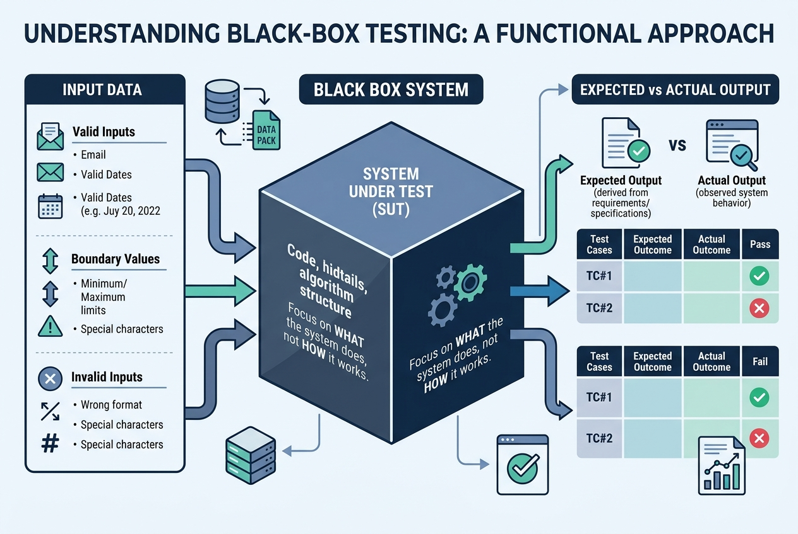

</div>
</div>
</div>

---

<!-- header: '5.1 黑箱測試本質與核心思想' -->

## 黑箱測試 vs. 白箱測試：思維與視野對比

<div class="card-deck">

> 💡 黑箱與白箱並非對立，而是軟體品質保證中視角互補的兩大支柱。

<div class="two-columns">
<div class="card" data-marpit-fragment>

### 📦 黑箱測試 (Black-Box / 規格導向)
- **測試依據**：需求規格書 (SRS)、使用者合約與介面定義。
- **核心關注**：**「What」**——系統是否達成承諾的外顯功能。
- **關鍵優勢**：
  - 測試與內部實作徹底解耦，**內部重構、效能優化時測試零破壞**。
  - 能站在終端使用者角度發現規格設計上的矛盾。
- **盲點局限**：
  - 無法發現隱藏在內部但規格未提及的後門或冗餘死碼。

</div>
<div class="card" data-marpit-fragment>

### 🔍 白箱測試 (White-Box / 結構導向)
- **測試依據**：原始程式碼、控制流圖 (CFG) 與邏輯分支。
- **核心關注**：**「How」**——程式碼內部每一行分支與條件是否被執行。
- **關鍵優勢**：
  - 精準衡量覆蓋率（語句、分支、路徑覆蓋），捕捉未預期死碼。
  - 能發現記憶體洩漏、空指標與未初始化變數。
- **盲點局限**：
  - **無法發現遺漏的需求 (Missing Requirements)**——規格漏寫的功能，程式碼沒有，白箱測試覆蓋率 100% 也測不出來！

</div>
</div>
</div>

---

<!-- header: '5.1 黑箱測試本質與核心思想' -->

## 黑箱測試的終極挑戰：窮舉測試之不可能

<div class="card-deck">

> 💡 軟體測試第一公理：Exhaustive Testing is Impossible（窮盡測試是不可能的）！

<div class="two-columns">
<div class="card" data-marpit-fragment>

### 💥 輸入空間的組合爆炸 (Combinatorial Explosion)
- **看似簡單的加法函式**：
  - 一個雙整數加法 `int add(int a, int b)`。
  - 32 位元整數空間：2<sup>32</sup> × 2<sup>32</sup> = 2<sup>64</sup> ≈ 1.84 × 10<sup>19</sup> 種輸入組合！
- **時間代價**：
  - 假設極速測試機每秒能跑 **10 億次 (1 GHz)** 測試；
  - 窮舉測完這一個加法函式需要：**584 年**！
- **盲目測試的無效性**：
  - 隨機抽樣百萬個案例，對如此龐大的空間而言依然是九牛一毛，極容易漏掉關鍵缺陷。

</div>
<div class="card" data-marpit-fragment>

### 🎯 黑箱工程方法的真正使命
- **測試的核心智慧**：
  - 「在有限的時間與成本下，**以最小代表性測試子集，捕捉最大缺陷機率**」。
- **科學化子集選取策略**：
  - **5.3 邊界值分析 (BVA)**：鎖定極易出錯的臨界邊界。
  - **5.4 等價類分割 (EP)**：代表點取代全集合，避免重複無效測試。
  - **5.5 全成對測試 (Pairwise)**：以成對覆蓋破解多維度組合爆炸。
  - **5.7 決策表測試**：釐清錯綜複雜的商務規則制約。
  - **5.8 狀態機測試**：驗證有記憶系統的時序與生命週期。

</div>
</div>
</div>

---

<!-- header: '5.1 黑箱測試本質與核心思想' -->

## 軟體測試之父：Glenford J. Myers

<div class="card-deck">

> 💡 1979 年出版《The Art of Software Testing》，奠定黑箱測試、等價分割與邊界值分析的理論基石。

<div class="content-columns">
<div class="content-text">

- **測試哲學的革命性定義**：
  - 「**測試是為了發現錯誤而執行程式的過程**，而不是為了證明程式沒有錯誤。」
  - 破除「測試通過即系統完美」的迷思，將測試從被動驗收昇華為積極尋找缺陷的工程學。
- **黑箱測試三大經典方法奠基者**：
  - 率先系統化定義 **等價類分割 (EP)**、**邊界值分析 (BVA)** 與 **錯誤猜測 (Error Guessing)**。
  - 主張「測試案例必須包含**預期輸出**」，否則測試員容易將錯誤輸出誤認為正常。
- **經典範例：三角形問題 (The Triangle Problem)**：
  - 提出聞名全球的「三邊長判斷三角形」測試題目，揭示最簡單的規格也常隱藏大量邊界與例外漏洞。

</div>
<div class="content-figure">
  <div class="name-card">
    
    <div class="name-card-caption">
      <span class="name-card-name">Glenford J. Myers (格倫福德·邁爾斯)</span>
      <span class="name-card-cc"><a href="https://en.wikipedia.org/wiki/Glenford_Myers" target="_blank" rel="noopener">Author: The Art of Software Testing</a></span>
    </div>
  </div>
</div>
</div>
</div>

---

<!-- _class: lead -->
<!-- header: '5.2 單元測試與 JUnit 5 快速入門' -->

# **5.2 單元測試與 JUnit 5 快速入門**

> 「設計 ➔ 寫測試 ➔ 寫程式 ➔ 自動回歸。  
> 讓測試成為可重複執行的安全防護網。」

---

<!-- header: '5.2 單元測試與 JUnit 5 快速入門' -->

## 為什麼需要自動化單元測試？與 3A 原則

<div class="card-deck">

> 💡 手動點擊驗收耗時且無法回歸；自動化測試以毫秒級速度驗證最小程式單元（類別或函式）。

<div class="two-columns">
<div class="card" data-marpit-fragment>

### 🔄 Test-First 測試驅動思維
- **傳統開發**：
  - 設計 ➔ 寫程式 ➔ 手動測試 ➔ 害怕修改重構。
- **現代軟體工程 (Test-First / 3A)**：
  - 先根據規格設計測試案例，再撰寫程式碼；
  - 隨著程式逐步完善，測試案例從紅燈（失敗）全數轉為綠燈（通過）！
- **可重複回歸性 (Regression)**：
  - 每次改動程式碼，一鍵自動重跑數千個單元測試，秒級確認舊功能未被破壞。

</div>
<div class="card" data-marpit-fragment>

### 📐 單元測試三大步驟：3A 原則
- **1. Arrange (安排準備)**：
  - 建立受測物件實體、準備測試輸入參數與環境。
- **2. Act (執行呼叫)**：
  - 呼叫待測方法，獲取系統的實際回傳值或激發動作。
- **3. Assert (驗證結果)**：
  - 比對實際輸出與預期規格是否完全一致。
  ```java
  // 1. Arrange: 準備計算機實體
  Calculator calc = new Calculator();
  // 2. Act: 執行加法
  int result = calc.add(2, 3);
  // 3. Assert: 驗證輸出是否為 5
  assertEquals(5, result);
  ```

</div>
</div>
</div>

---

<!-- header: '5.2 單元測試與 JUnit 5 快速入門' -->

## JUnit 5 核心結構與基本斷言機制

<div class="card-deck">

> 💡 JUnit 5 是 Java 現代測試標準。透過標註宣告測試方法，由測試引擎自動執行並呈現綠燈。

<div class="two-columns">
<div class="card" data-marpit-fragment>

### 🏷️ 測試核心結構 (`@Test`)
- **無參數且無回傳值的測試方法**：
  - 只要加上 `@Test` 標註，JUnit 引擎便會自動探索並執行該方法。
- **獨立執行隔離**：
  - 每個測試方法執行時，框架都會建立新的測試類別實體，保證測試彼此獨立、無先後狀態污染。
```java
class CalculatorTest {
    private final Calculator calc = new Calculator();

    @Test
    void testAdd() {
        assertEquals(5, calc.add(2, 3));
    }
}
```

</div>
<div class="card" data-marpit-fragment>

### ⚖️ 常用基本斷言方法
- **相等比對**：
  - `assertEquals(expected, actual)`：驗證實際值等於預期值。
  - `assertNotEquals(unexpected, actual)`：驗證兩者不相等。
- **布林條件**：
  - `assertTrue(condition)`：條件必須為 true。
  - `assertFalse(condition)`：條件必須為 false。
- **非空檢驗**：
  - `assertNotNull(object)`：確認物件已被正確建立。
- **失敗提示訊息**：
  - 斷言最後一個參數可傳入自訂錯誤訊息字串。

</div>
</div>
</div>

---

<!-- header: '5.2 單元測試與 JUnit 5 快速入門' -->

## 斷言機制的關鍵思維：內容等價 vs. 記憶體同一性

<div class="card-deck">

> 💡 在所有自動化測試斷言中，驗證物件時必須釐清「值相同」與「同一個實體」的本質差別。

<div class="two-columns">
<div class="card" data-marpit-fragment>

### ⚖️ assertEquals：內容值等價 (Value Equality)
- **概念本質**：
  - 檢驗兩個獨立物件內部所承載的**資料內容是否相等**。
- **底層運作機制**：
  - 內部呼叫物件的 `equals()` 方法。
- **黑箱測試適用情境**：
  - 計算結果比對、字串傳回值、自訂資料物件 (DTO) 欄位驗證。
  ```java
  String s1 = new String("SQA");
  String s2 = new String("SQA");
  assertEquals(s1, s2); // ✅ 通過 (內容完全相同)
  ```

</div>
<div class="card" data-marpit-fragment>

### 🎯 assertSame：記憶體同一性 (Reference Identity)
- **概念本質**：
  - 檢驗兩個參照變數是否指向 Heap 中的**同一個實體位址**。
- **底層運作機制**：
  - 直接比對記憶體指標位址（即 `==` 指標比對）。
- **黑箱測試適用情境**：
  - 單例模式 (Singleton) 驗證、連線池/快取重用、物件共享檢驗。
  ```java
  assertSame(s1, s2);   // ❌ 失敗 (不同記憶體物件)
  String s3 = s1;
  assertSame(s1, s3);   // ✅ 通過 (指向同一位址)
  ```

</div>
</div>
</div>

---

<!-- header: '5.2 單元測試與 JUnit 5 快速入門' -->

## 進階斷言：Java Lambda `() -> ...` 延遲執行語法

<div class="card-deck">

> 💡Lambda function 與 「延遲執行 (Deferred Execution)」！

<div class="two-columns">
<div class="card" data-marpit-fragment>

### 🤔 為什麼不能直接傳入一般運算式？
- **一般方法呼叫的「立即求值陷阱」**：
  - ❌ 若寫成：`assertThrows(ArithmeticException.class, calc.divide(10, 0));`
  - Java 會在進入 `assertThrows` **之前**就先執行 `calc.divide(10, 0)`，當場炸出例外使測試崩潰，`assertThrows` 根本來不及接住！
- **Lambda `() -> 動作`：打包成「待執行任務膠囊」**：
  - **語法結構**：`()` 代表無參數，`->` 指向待執行的單行程式碼（對應 JUnit 5 的 `Executable` 函式介面）。
  - **運作原理**：告訴 Java **「先別執行！把這行程式碼打包成膠囊交給 JUnit」**，由 JUnit 在內部的 `try-catch` 安全沙盒中親自拆封執行並攔截錯誤！

</div>
<div class="card" data-marpit-fragment>

### 🛠️ JUnit 5 三大 Lambda 實戰語法樣板
- **1. 例外斷言 (`assertThrows`) —— 攔截預期異常**：
  ```java
  assertThrows(ArithmeticException.class,
      () -> calc.divide(10, 0)); // 沙盒內執行並驗證拋出例外
  ```
- **2. 群組聚合斷言 (`assertAll`) —— 失敗不中斷**：
  ```java
  assertAll("邊界群組驗證",
      () -> assertEquals(0, calc.add(-5, 5)),
      () -> assertEquals(-10, calc.add(-5, -5))
  ); // 每個斷言各自打包，第 1 個失敗仍會繼續執行第 2 個！
  ```
- **3. 延遲錯誤訊息 (`Supplier<String>`) —— 失敗才算**：
  ```java
  assertEquals(13, calc.subtract(20, 7),
      () -> "耗時組裝之除錯訊息"); // 綠燈時完全不消耗字串拼接成本
  ```

</div>
</div>
</div>

---

<!-- header: '5.2 單元測試與 JUnit 5 快速入門' -->

## 🧪 課堂實習指引 (LabDemo 5.2: JUnit 基礎操作)

<div class="card-deck">

> 💡 動手實作是掌握自動化測試的最佳途徑！打開專案，體驗你的第一個單元測試綠燈。

<div class="two-columns">
<div class="card">

### 💻 體驗範例程式碼 (Demo Walkthrough)
- **1. 開啟待測類別與測試檔**：
  - 待測類別：[`Calculator.java`](../../lab.html?file=LabDemo/src/main/java/u05_junit/Calculator.java)
  - 示範測試：[`CalculatorDemoTest.java`](../../lab.html?file=LabDemo/src/test/java/u05_junit/CalculatorDemoTest.java)
- **2. 觀察 3A 結構**：
  - 尋找 Arrange、Act 與 Assert 的三段分工。
- **3. IDE 一鍵執行**：
  - 點擊 `@Test` 左側的綠色三角形 ▶️ 執行測試，觀察測試運行結果與綠燈。
- **4. 斷言大全快速檢閱**：
  - 查閱 [`AssertionsDemoTest.java`](../../lab.html?file=LabDemo/src/test/java/u05_junit/AssertionsDemoTest.java) 的全套斷言寫法。

</div>
<div class="card">

### 🎯 課堂動手練習 (Hands-on Exercise)
- **開啟練習檔**：[`CalculatorExerciseTest.java`](../../lab.html?file=LabDemo/src/test/java/u05_junit/CalculatorExerciseTest.java)
- **練習 1：3A 減法測試**：
  - 依提示補全 `exercise1_testSubtract()`，實作 20 - 7 = 13 之斷言。
- **練習 2：assertAll 負數與零加法**：
  - 補全 `assertAll` 聚合斷言，同時驗證負數與零之邊界運算。
- **練習 3：內容等價 vs. 記憶體同一**：
  - 觀察 `Person` 物件之 `assertEquals` 與 `assertSame` 差異！

</div>
</div>
</div>

---

<!-- header: '5.2 單元測試與 JUnit 5 快速入門' -->

## 單元測試與 JUnit 5 最佳實務 (Best Practices)

<div class="card-deck">

> 💡 自動化測試不是為了證明程式碼沒有錯，而是為了賦予團隊大膽重構與持續交付的信心。

<div class="two-columns">
<div class="card" data-marpit-fragment>

### 🎯 黃金法則：FIRST 原則與 3A 結構
- **FIRST 五大維度**：
  - **Fast (快速)**：毫秒級執行，任何延遲都會降低執行頻率。
  - **Independent (獨立)**：案例間絕不共享可變狀態，執行無順序相依。
  - **Repeatable (可重複)**：任何環境、時間執行結果恆定一致。
  - **Self-validating (自驗證)**：斷言結果明確（Pass/Fail），無須肉眼核對日誌。
  - **Timely (及時性)**：測試與功能程式碼同步演進或先行 (TDD)。
- **清晰 3A 分段**：Arrange (佈局) ➔ Act (操作) ➔ Assert (斷言)。

</div>
<div class="card" data-marpit-fragment>

### ⚠️ 常見反模式 (Anti-Patterns)
- **測試中寫業務邏輯 (Logic in Tests)**：
  - 在測試中寫 `if-else`、`for` 迴圈或複雜運算，容易引入「測試自身的 Bug」。
- **斷言輪盤賭 (Assertion Roulette)**：
  - 單一 `@Test` 塞入數十個未說明的 `assertEquals`，前段斷言失敗直接遮蔽後段，善用 `assertAll()`。
- **過度依賴實作細節 (Over-Mocking)**：
  - 驗證「私有方法調用次數」而非驗證公開契約輸出，導致重構時測試脆弱易碎。

</div>
</div>
</div>

---

<!-- header: '5.2 單元測試與 JUnit 5 快速入門' -->

## 概念核對問答 (CCQ 1)

<div class="ccq-columns">
<div class="ccq-text">

<!-- id: sqa-ch05-ccq1 -->
**問題情境**：  
【是非題】在單元測試斷言機制中，「記憶體同一性 (Reference Identity)」驗證的作用與「內容值等價 (Value Equality)」驗證完全相同，兩者都是在比對兩個物件內部的資料欄位是否相等。

- **A)** 正確 (True)
- **B)** 錯誤 (False)

</div>
<div class="ccq-logo">

<a href="https://nlhsueh.github.io/nickedupocket/#/student/sqa-ch05-ccq1" target="_blank"></a>

</div>
</div>

---

<!-- _class: lead -->
<!-- header: '5.3 邊界值分析 (BVA)' -->

# **5.3 邊界值分析 (BVA)**

> 「錯誤都隱藏在角落！  
> 大多數的程式缺陷，都發生在邊界條件差之毫釐的瞬間。」

---

<!-- header: '5.3 邊界值分析 (BVA)' -->

## 邊界值分析 (BVA) 核心哲學

<div class="card-deck">

> 💡 軟體工程界公認：輸入範圍的邊緣（極大值、極小值）比中間值更容易觸發 Off-by-one 缺陷。

<div class="two-columns">
<div class="card" data-marpit-fragment>

### 🚩 為什麼錯誤隱藏在角落？
- **運算子誤用陷阱**：
  - 程式設計師常在 `<` 與 `<=`、`>` 與 `>=` 之間犯錯。
- **程式碼良劣對照**：
  | 程式碼寫法 | 缺陷本質 | 測試結果 |
  | :--- | :--- | :--- |
  | `if (input <= 10)` | 無缺陷，邊界完整包含 | input=10 通過 |
  | `if (input < 10)` | 致命缺陷：10 被遺漏 | **input=10 測試失敗** |
- **結論**：測試邊界點能以極高精準度曝光邊界比較缺陷。

</div>
<div class="card" data-marpit-fragment>

### 🛡️ 單一錯誤假設 (Single Fault Assumption)
- **核心假設前提**：
  - 在獨立變數系統中，絕大多數錯誤只需單一變數發生邊界異常即可彰顯，無需多個變數同時在邊界出錯。
- **取樣五大關鍵點**：
  - 對於範圍 [min, max]，測試點取：
    - **`min`** (最小值)
    - **`min+`** (略大於最小值)
    - **`norm`** (區間內正常代表值)
    - **`max-`** (略小於最大值)
    - **`max`** (最大值)

</div>
</div>
</div>

---

<!-- header: '5.3 邊界值分析 (BVA)' -->

## 獨立型邊界測試：4n + 1 公式

<div class="card-deck">

* > 💡 針對 n 個彼此獨立的輸入變數，每次只讓 1 個變數處於邊界，其餘變數皆維持正常值 (norm)。

<div class="two-columns">
<div class="card" data-marpit-fragment>

### 📐 4n + 1 計算原理
- **每個變數貢獻 4 個邊界案例**：
  - `min`, `min+`, `max-`, `max`（此時其他 n-1 個變數皆取 `norm`）。
- **加上 1 個全員正常中心點**：
  - 所有 n 個變數皆取 `norm` 的基準案例。
- **案例總數公式**：
  > 📐 **Total Test Cases = 4n + 1**
- **案例範例**：若系統有 3 個獨立輸入變數，則測試案例數為 4 × 3 + 1 = **13** 個。

</div>
<div class="card" data-marpit-fragment>

### 🔺 三角形程式實戰案例 (a, b, c ∈ [1, 200])
- 固定 b = 100, c = 100，變動 a：
  - (1, 100, 100), (2, 100, 100), (199, 100, 100), (200, 100, 100)
- 固定 a = 100, c = 100，變動 b (4 個案例)
- 固定 a = 100, b = 100，變動 c (4 個案例)
- 全員正常基準案例：
  - (100, 100, 100) 正三角形
- 總計剛好 13 個測試案例。

</div>
</div>
</div>

---

<!-- header: '5.3 邊界值分析 (BVA)' -->

## 獨立型強固邊界測試：6n + 1 公式

<div class="card-deck">

> 💡 強固邊界測試 (Robust BVA) 擴充考慮「極限例外值」，驗證系統遭遇非法越界時的防禦容錯力。

<div class="content-columns">
<div class="content-text">

### 🛡️ 引入例外邊界 (min-, max+)
- **每個變數擴充為 6 個邊界點**：
  - **`min-`** (略小於合法下界，如 0) ➔ 觸發例外
  - `min` (下界 1)、`min+` (2)
  - `max-` (199)、`max` (上界 200)
  - **`max+`** (略大於合法上界，如 201) ➔ 觸發例外
- **案例總數公式**：
  > 📐 **Total Test Cases = 6n + 1**
- 若 n=3，測試案例數為 6 × 3 + 1 = **19** 個。

</div>
<div class="content-figure">

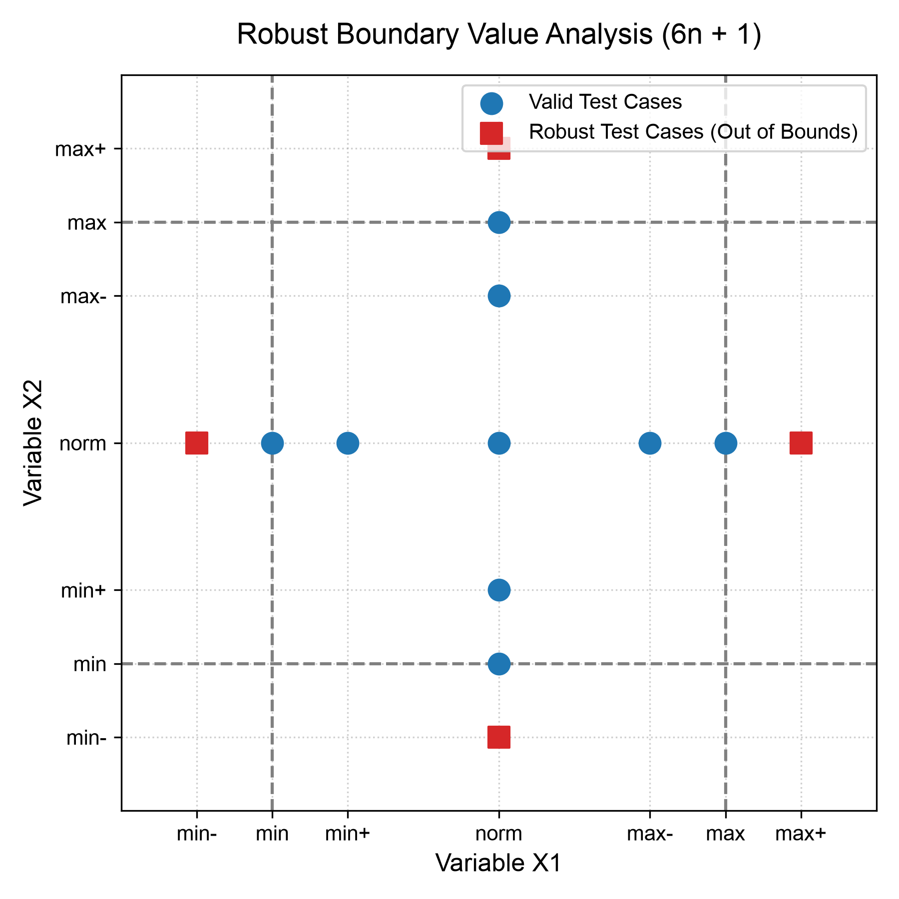

</div>
</div>
</div>

---

<!-- header: '5.3 邊界值分析 (BVA)' -->

## 非獨立型邊界測試 (Worst-Case Testing / Non-Independent BVA)

<div class="card-deck">

> 💡 當變數之間高度相依、打破「單一錯誤假設 (Single-Fault Assumption)」時，必須採用全笛卡爾積 (Cartesian Product) 進行「最壞情況測試 (Worst-Case Testing)」。

<div class="content-columns">
<div class="content-text">

### 💥 乘積組合爆炸 (Combinatorial Explosion)
- **非獨立型一般邊界測試 (Worst-Case Normal BVA)**：
  - 每個變數取 5 個值 (`min`, `min+`, `norm`, `max-`, `max`)。
  - 總數為 **5<sup>n</sup>**（若 n=3，需 5<sup>3</sup> = **125** 個案例；若 n=5，需 **3,125** 個）。
- **非獨立型強固邊界測試 (Worst-Case Robust BVA)**：
  - 每個變數取 7 個值 (含 `min-`, `max+`)。
  - 總數為 **7<sup>n</sup>**（若 n=3，需 7<sup>3</sup> = **343** 個；若 n=5，需 **16,807** 個案例！）。
- **核心假設**：基於多重錯誤假設 (Multiple-Fault Assumption)。

</div>
<div class="content-figure">

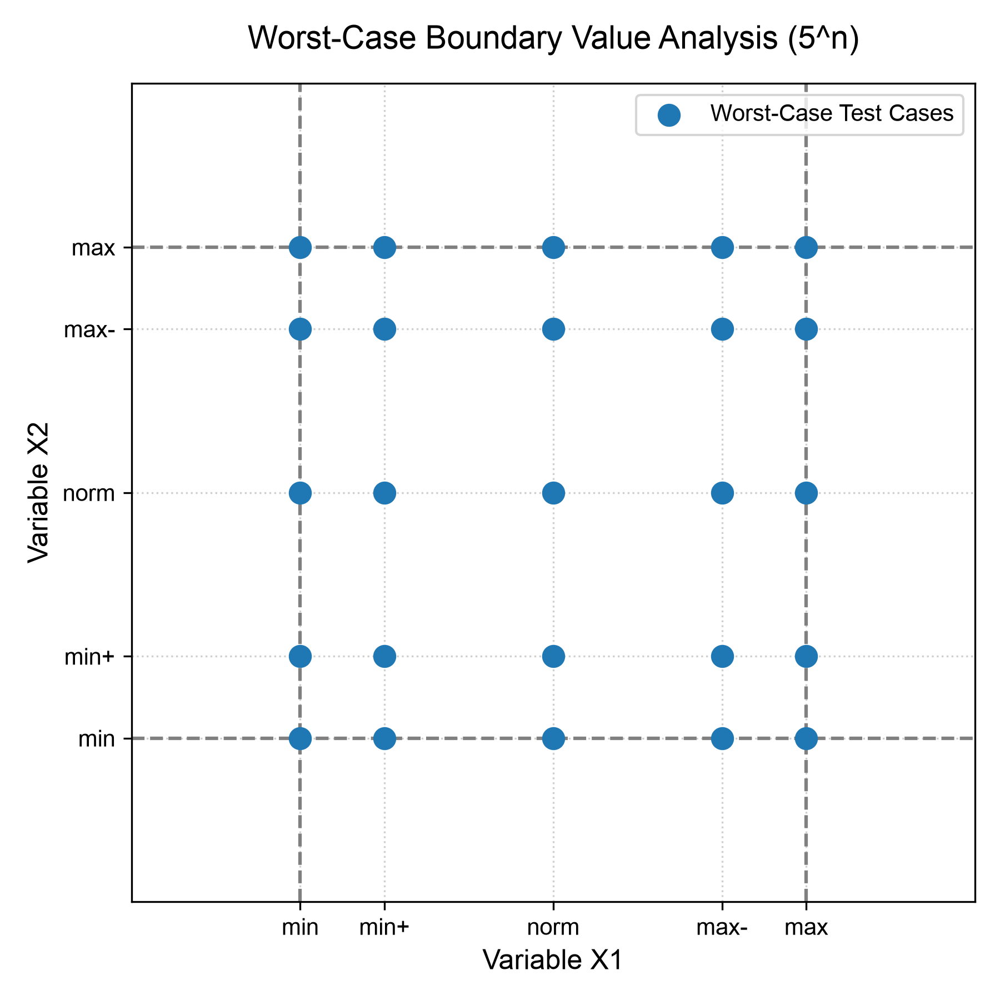

</div>
</div>
</div>

---

<!-- header: '5.3 邊界值分析 (BVA)' -->

## 互動式 BVA 探索器：4n+1、6n+1、5ⁿ、7ⁿ 取樣空間

<div class="bva-interactive-stage">
<div class="bva-nav-toolbar">
  <button class="bva-mode-btn is-active" data-bva="norm">1. 一般 BVA (4n + 1)</button>
  <button class="bva-mode-btn" data-bva="robust">2. 強固 BVA (6n + 1)</button>
  <button class="bva-mode-btn" data-bva="worst-norm">3. 最壞情況一般 (5ⁿ)</button>
  <button class="bva-mode-btn" data-bva="worst-robust">4. 最壞情況強固 (7ⁿ)</button>
</div>
<div class="bva-content-grid">
<div class="bva-svg-container">
<svg viewBox="0 0 480 480" width="440" height="420" style="display: block; max-width: 100%; max-height: 100%;">
  <rect x="95" y="95" width="290" height="290" fill="#f8fafc" stroke="#3b82f6" stroke-width="2" stroke-dasharray="6,4" rx="8" />
  <rect x="40" y="40" width="400" height="400" fill="none" stroke="#e2e8f0" stroke-width="1.5" stroke-dasharray="4,4" rx="10" />
  <line x1="40" y1="240" x2="440" y2="240" stroke="#94a3b8" stroke-width="1.8" />
  <line x1="240" y1="40" x2="240" y2="440" stroke="#94a3b8" stroke-width="1.8" />
  <text x="240" y="26" text-anchor="middle" font-size="12" font-weight="800" fill="#0369a1">x₂ (變數 2)</text>
  <text x="460" y="244" text-anchor="start" font-size="12" font-weight="800" fill="#0369a1">x₁</text>
  <text x="40" y="258" text-anchor="middle" font-size="9" font-weight="700" fill="#e11d48">min-</text>
  <text x="95" y="258" text-anchor="middle" font-size="9" font-weight="700" fill="#0284c7">min</text>
  <text x="150" y="258" text-anchor="middle" font-size="9" font-weight="700" fill="#0284c7">min+</text>
  <text x="240" y="258" text-anchor="middle" font-size="9" font-weight="800" fill="#0f172a">norm</text>
  <text x="330" y="258" text-anchor="middle" font-size="9" font-weight="700" fill="#0284c7">max-</text>
  <text x="385" y="258" text-anchor="middle" font-size="9" font-weight="700" fill="#0284c7">max</text>
  <text x="440" y="258" text-anchor="middle" font-size="9" font-weight="700" fill="#e11d48">max+</text>
  <text x="232" y="444" text-anchor="end" font-size="9" font-weight="700" fill="#e11d48">min-</text>
  <text x="232" y="389" text-anchor="end" font-size="9" font-weight="700" fill="#0284c7">min</text>
  <text x="232" y="334" text-anchor="end" font-size="9" font-weight="700" fill="#0284c7">min+</text>
  <text x="232" y="154" text-anchor="end" font-size="9" font-weight="700" fill="#0284c7">max-</text>
  <text x="232" y="99" text-anchor="end" font-size="9" font-weight="700" fill="#0284c7">max</text>
  <text x="232" y="44" text-anchor="end" font-size="9" font-weight="700" fill="#e11d48">max+</text>
  <circle class="bva-pt is-worst-robust is-dimmed" data-cat="worst-robust" cx="40" cy="40" r="6.5" />
  <circle class="bva-pt is-worst-robust is-dimmed" data-cat="worst-robust" cx="40" cy="95" r="6.5" />
  <circle class="bva-pt is-worst-robust is-dimmed" data-cat="worst-robust" cx="40" cy="150" r="6.5" />
  <circle class="bva-pt is-robust-bva is-dimmed" data-cat="robust-bva" cx="40" cy="240" r="6.5" />
  <circle class="bva-pt is-worst-robust is-dimmed" data-cat="worst-robust" cx="40" cy="330" r="6.5" />
  <circle class="bva-pt is-worst-robust is-dimmed" data-cat="worst-robust" cx="40" cy="385" r="6.5" />
  <circle class="bva-pt is-worst-robust is-dimmed" data-cat="worst-robust" cx="40" cy="440" r="6.5" />
  <circle class="bva-pt is-worst-robust is-dimmed" data-cat="worst-robust" cx="95" cy="40" r="6.5" />
  <circle class="bva-pt is-worst-norm is-dimmed" data-cat="worst-norm" cx="95" cy="95" r="6.5" />
  <circle class="bva-pt is-worst-norm is-dimmed" data-cat="worst-norm" cx="95" cy="150" r="6.5" />
  <circle class="bva-pt is-norm-bva is-active" data-cat="norm-bva" cx="95" cy="240" r="6.5" />
  <circle class="bva-pt is-worst-norm is-dimmed" data-cat="worst-norm" cx="95" cy="330" r="6.5" />
  <circle class="bva-pt is-worst-norm is-dimmed" data-cat="worst-norm" cx="95" cy="385" r="6.5" />
  <circle class="bva-pt is-worst-robust is-dimmed" data-cat="worst-robust" cx="95" cy="440" r="6.5" />
  <circle class="bva-pt is-worst-robust is-dimmed" data-cat="worst-robust" cx="150" cy="40" r="6.5" />
  <circle class="bva-pt is-worst-norm is-dimmed" data-cat="worst-norm" cx="150" cy="95" r="6.5" />
  <circle class="bva-pt is-worst-norm is-dimmed" data-cat="worst-norm" cx="150" cy="150" r="6.5" />
  <circle class="bva-pt is-norm-bva is-active" data-cat="norm-bva" cx="150" cy="240" r="6.5" />
  <circle class="bva-pt is-worst-norm is-dimmed" data-cat="worst-norm" cx="150" cy="330" r="6.5" />
  <circle class="bva-pt is-worst-norm is-dimmed" data-cat="worst-norm" cx="150" cy="385" r="6.5" />
  <circle class="bva-pt is-worst-robust is-dimmed" data-cat="worst-robust" cx="150" cy="440" r="6.5" />
  <circle class="bva-pt is-robust-bva is-dimmed" data-cat="robust-bva" cx="240" cy="40" r="6.5" />
  <circle class="bva-pt is-norm-bva is-active" data-cat="norm-bva" cx="240" cy="95" r="6.5" />
  <circle class="bva-pt is-norm-bva is-active" data-cat="norm-bva" cx="240" cy="150" r="6.5" />
  <circle class="bva-pt is-nom is-active" data-cat="nom" cx="240" cy="240" r="6.5" />
  <circle class="bva-pt is-norm-bva is-active" data-cat="norm-bva" cx="240" cy="330" r="6.5" />
  <circle class="bva-pt is-norm-bva is-active" data-cat="norm-bva" cx="240" cy="385" r="6.5" />
  <circle class="bva-pt is-robust-bva is-dimmed" data-cat="robust-bva" cx="240" cy="440" r="6.5" />
  <circle class="bva-pt is-worst-robust is-dimmed" data-cat="worst-robust" cx="330" cy="40" r="6.5" />
  <circle class="bva-pt is-worst-norm is-dimmed" data-cat="worst-norm" cx="330" cy="95" r="6.5" />
  <circle class="bva-pt is-worst-norm is-dimmed" data-cat="worst-norm" cx="330" cy="150" r="6.5" />
  <circle class="bva-pt is-norm-bva is-active" data-cat="norm-bva" cx="330" cy="240" r="6.5" />
  <circle class="bva-pt is-worst-norm is-dimmed" data-cat="worst-norm" cx="330" cy="330" r="6.5" />
  <circle class="bva-pt is-worst-norm is-dimmed" data-cat="worst-norm" cx="330" cy="385" r="6.5" />
  <circle class="bva-pt is-worst-robust is-dimmed" data-cat="worst-robust" cx="330" cy="440" r="6.5" />
  <circle class="bva-pt is-worst-robust is-dimmed" data-cat="worst-robust" cx="385" cy="40" r="6.5" />
  <circle class="bva-pt is-worst-norm is-dimmed" data-cat="worst-norm" cx="385" cy="95" r="6.5" />
  <circle class="bva-pt is-worst-norm is-dimmed" data-cat="worst-norm" cx="385" cy="150" r="6.5" />
  <circle class="bva-pt is-norm-bva is-active" data-cat="norm-bva" cx="385" cy="240" r="6.5" />
  <circle class="bva-pt is-worst-norm is-dimmed" data-cat="worst-norm" cx="385" cy="330" r="6.5" />
  <circle class="bva-pt is-worst-norm is-dimmed" data-cat="worst-norm" cx="385" cy="385" r="6.5" />
  <circle class="bva-pt is-worst-robust is-dimmed" data-cat="worst-robust" cx="385" cy="440" r="6.5" />
  <circle class="bva-pt is-worst-robust is-dimmed" data-cat="worst-robust" cx="440" cy="40" r="6.5" />
  <circle class="bva-pt is-worst-robust is-dimmed" data-cat="worst-robust" cx="440" cy="95" r="6.5" />
  <circle class="bva-pt is-worst-robust is-dimmed" data-cat="worst-robust" cx="440" cy="150" r="6.5" />
  <circle class="bva-pt is-robust-bva is-dimmed" data-cat="robust-bva" cx="440" cy="240" r="6.5" />
  <circle class="bva-pt is-worst-robust is-dimmed" data-cat="worst-robust" cx="440" cy="330" r="6.5" />
  <circle class="bva-pt is-worst-robust is-dimmed" data-cat="worst-robust" cx="440" cy="385" r="6.5" />
  <circle class="bva-pt is-worst-robust is-dimmed" data-cat="worst-robust" cx="440" cy="440" r="6.5" />
</svg>
</div>
<div class="bva-info-card" id="bva-info-box">
  <div class="bva-info-header">
    <span class="bva-badge-pill bva-badge-blue" id="bva-mode-badge">單一錯誤假設 (Single Fault)</span>
    <h3 class="bva-title-text" id="bva-mode-title">一般邊界值分析 (Normal BVA)</h3>
  </div>
  <div class="bva-stats-row">
    <div class="bva-stat-box">
      <div class="bva-stat-label">計算公式</div>
      <div class="bva-stat-val" id="bva-stat-formula">4n + 1</div>
    </div>
    <div class="bva-stat-box">
      <div class="bva-stat-label">啟用測試點 (n = 2)</div>
      <div class="bva-stat-val" id="bva-stat-count">9 點</div>
    </div>
  </div>
  <ul class="bva-details-list" id="bva-details-list">
    <li><strong>最小基線取樣：</strong>沿各軸測試 <code>min, min+, max-, max</code>，同時將其餘變數錨定於 <code>norm</code>。</li>
    <li><strong>缺陷攔截目標：</strong>以嚴格線性成長成本，捕捉超過 60% 的常見關係運算子差一錯誤 (<code>&lt;</code> vs. <code>&lt;=</code>)。</li>
    <li><strong>取樣點密度：</strong>最低點數需求（2 變數僅需 <strong>9 點</strong>，3 變數為 13 點）。</li>
  </ul>
</div>
</div>
</div>

<!--
二維平面上的這 49 個點代表雙變數完整的邊界取樣空間。在一般 BVA (4n+1) 下，僅點亮沿著各名義軸交會的 9 個十字基準點（最小基線）。切換至強固 BVA (6n+1) 時，外圍 4 個越界端點 (min-, max+) 會亮起紅燈。最壞情況一般測試 (5^n) 會啟用藍色合法框內的全部 25 個點。最後，最壞情況強固測試 (7^n) 則會點亮完整笛卡爾乘積的全部 49 個點。
-->

---

<!-- header: '5.3 邊界值分析 (BVA)' -->

## 邊界值測試方法全景總結

<div class="card-deck">

* > 💡 四種邊界測試方法的案例數量與強度對比矩陣。

<div class="two-columns">
<div class="card" data-marpit-fragment>

### 📊 測試案例數量矩陣
| 測試策略 | 單一錯誤假設 (獨立型) | 多重錯誤假設 (非獨立/最壞情況) |
| :--- | :--- | :--- |
| **標準邊界** (無越界) | **4n + 1** (線性增長) | **5<sup>n</sup>** (指數級增長) |
| **強固邊界** (含越界) | **6n + 1** (線性增長) | **7<sup>n</sup>** (指數組合爆炸) |

- **適用指標**：
  - 數字型連續變數（年齡、分數、金額、溫度）。
  - 對邏輯性識別碼（如身分證字號、電話號碼）較不適用。

</div>
<div class="card" data-marpit-fragment>

### 🎯 工程選型建議
- **常規模組首選**：
  - **獨立型強固邊界測試 (6n+1)**：在極低案例成本下，兼顧常態邊界與異常例外攔截。
- **高危關鍵金融/航太核心**：
  - **最壞情況測試 (5<sup>n</sup>)**：只針對 2~3 個強關聯變數進行局部乘積，其餘變數維持獨立型，避免組合爆炸。

</div>
</div>
</div>

---

<!-- header: '5.3 邊界值分析 (BVA)' -->

## 邊界值分析 (BVA) 常見問答 (FAQ)

<div class="card-deck">

> 💡 實務邊界陷阱與混淆點解析：掌握關鍵邊界細節，避免測試盲區。

<div class="two-columns">
<div class="card" data-marpit-fragment>

### ❓ Q1: 邊界測試應取 2 點（上、外）還是 3 點（外、上、內）？
- **傳統 2 點法**：
  - 僅測試邊界點 B 與越界點 B ± 1（如 100 與 101），用於快速精簡案例。
- **現代 3 點法 (Out-On-In)**：
  - ISO/IEC/IEEE 29119 標準推薦：同時涵蓋**外部 (Out)、邊界上 (On)、內部 (In)**（如 99, 100, 101）。
- **關鍵價值**：
  - 遇到開區間（如 x > 0）或複雜防禦條件時，3 點法能 100% 偵測出 Off-by-one 符號筆誤（如把 `>` 誤寫為 `>=`）。

</div>
<div class="card" data-marpit-fragment>

### ❓ Q2: 浮點數或連續數值（Double）的「相鄰值」該如何取？
- **實務痛點**：
  - 浮點數無法像整數直接 ± 1，若隨意取 ± 0.00001 容易失真或受限精度。
- **標準解法**：
  - **業務刻度原則 (Business Resolution)**：依規格書最小跳動單位決定（如金額最小單位為分，取 ± 0.01；成績取 ± 0.1）。
  - **底層機器精度**：在 Java 單元測試中，可直接調用 `Math.nextUp(x)` 與 `Math.nextDown(x)` 取得 IEEE 754 最小物理相鄰浮點數。

</div>
</div>
</div>

---

<!-- header: '5.3 邊界值分析 (BVA)' -->

## 邊界值分析的 JUnit 5 落地：參數化與群組斷言

<div class="card-deck">

> 💡 邊界測試的工程挑戰：臨界測資密集。若單純連續斷言，前面失敗會直接中斷後面所有邊界檢驗！

<div class="two-columns">
<div class="card" data-marpit-fragment>

### 🔢 參數化測試：多邊界點批次注入
- **單一邏輯，多點驗證**：
  - BVA 通常產生 min-, min, min+, nom, max-, max, max+ 等多個連續臨界點。
  - 傳統做法若寫 7 個獨立測試方法，將造成巨大重複樣板負擔。
- **JUnit 5 解決方案 (Parameterized)**：
  - 使用 `@ParameterizedTest` 搭配 `@ValueSource(ints = {...})`；
  - 測試方法只寫一套驗證邏輯，框架自動將整組邊界值逐一注入執行，並在測試報告中列出每個臨界點的獨立判定！

</div>
<div class="card" data-marpit-fragment>

### 🛡️ 群組聚合斷言：一次收集所有邊界缺陷
- **早期中斷 (Early Abort) 陷阱**：
  - 若在同一個測試方法中連續寫多行斷言，當第一個 min- 斷言失敗時，測試方法會立即拋錯終止，後續 max 邊界完全沒機會執行！
- **JUnit 5 解決方案 (`assertAll` + Lambda `() ->`)**：
  - 以 Lambda `() ->` 將每個邊界斷言打包為獨立任務（如 LabDemo `AssertionsDemoTest` & `TriangleBlackBoxTest`），**所有邊界皆保證被完整執行**，一次報告所有崩潰點：
  ```java
  assertAll("BVA 邊界群組檢驗",
      () -> assertEquals("丁", Grade.eval(0)),   // min
      () -> assertEquals("優", Grade.eval(100))  // max
  );
  ```

</div>
</div>
</div>

---

<!-- header: '5.3 邊界值分析 (BVA)' -->

## 🧩 BVA 互動矩陣遊戲：房貸利率試算引擎 (`Amount × Term`)

<div class="bvag-stage" id="bva-loan-game">
<div class="bvag-board-card">
<svg xmlns="http://www.w3.org/2000/svg" id="bvag-svg" viewBox="0 0 490 480" width="430" height="420" style="display: block; max-width: 100%; max-height: 100%;">
<rect x="95" y="95" width="290" height="290" fill="#f0f9ff" fill-opacity="0.55" stroke="#0284c7" stroke-width="2" stroke-dasharray="6,4" rx="8" />
<rect x="40" y="40" width="400" height="400" fill="none" stroke="#cbd5e1" stroke-width="1.5" stroke-dasharray="4,4" rx="10" />
<line x1="40" y1="240" x2="440" y2="240" stroke="#94a3b8" stroke-width="1.8" />
<line x1="240" y1="40" x2="240" y2="440" stroke="#94a3b8" stroke-width="1.8" />
<text x="240" y="20" text-anchor="middle" font-family="sans-serif" font-size="12.5" font-weight="800" fill="#0b3c5d">Y: 貸款年限 (1 至 30 年, 刻度 = 1 yr)</text>
<text x="240" y="472" text-anchor="middle" font-family="sans-serif" font-size="12.5" font-weight="800" fill="#0b3c5d">X: 貸款金額 (100k 至 10,000k NT$, 刻度 = 1k)</text>
<text x="40" y="258" text-anchor="middle" font-family="monospace" font-size="9.5" font-weight="800" fill="#e11d48">99k</text>
<text x="95" y="258" text-anchor="middle" font-family="monospace" font-size="9.5" font-weight="800" fill="#0284c7">100k</text>
<text x="150" y="258" text-anchor="middle" font-family="monospace" font-size="9.5" font-weight="800" fill="#0284c7">101k</text>
<text x="256" y="256" text-anchor="middle" font-family="monospace" font-size="9.5" font-weight="800" fill="#0f172a">5000k</text>
<text x="330" y="258" text-anchor="middle" font-family="monospace" font-size="9.5" font-weight="800" fill="#0284c7">9999k</text>
<text x="385" y="258" text-anchor="middle" font-family="monospace" font-size="9.5" font-weight="800" fill="#0284c7">10000k</text>
<text x="444" y="258" text-anchor="middle" font-family="monospace" font-size="9.5" font-weight="800" fill="#e11d48">10001k</text>
<text x="231" y="444" text-anchor="end" font-family="monospace" font-size="9.5" font-weight="800" fill="#e11d48">0yr</text>
<text x="231" y="389" text-anchor="end" font-family="monospace" font-size="9.5" font-weight="800" fill="#0284c7">1yr</text>
<text x="231" y="334" text-anchor="end" font-family="monospace" font-size="9.5" font-weight="800" fill="#0284c7">2yr</text>
<text x="231" y="233" text-anchor="end" font-family="monospace" font-size="9.5" font-weight="800" fill="#0f172a">15yr</text>
<text x="231" y="154" text-anchor="end" font-family="monospace" font-size="9.5" font-weight="800" fill="#0284c7">29yr</text>
<text x="231" y="99" text-anchor="end" font-family="monospace" font-size="9.5" font-weight="800" fill="#0284c7">30yr</text>
<text x="231" y="44" text-anchor="end" font-family="monospace" font-size="9.5" font-weight="800" fill="#e11d48">31yr</text>
<g id="bvag-dots-layer"></g>
</svg>
</div>
<div class="bvag-ctrl-card">
<div class="bvag-spec-box">
<strong>[問題規格] 房貸利率試算器 (Mortgage Interest Rate Calculator)：</strong><br/>
<code>calcRate(amountK, termYears)</code> 依據兩個整數輸入計算借款人的房貸年利率：<br/>
• <strong>貸款金額 (<code>X</code>)</strong>：接受範圍從 <strong>NT$ 100k</strong> 至 <strong>NT$ 10,000k</strong>（以 <code>1k</code> 為單位；名義中心值 = <code>5000k</code>）。<br/>
• <strong>貸款年限 (<code>Y</code>)</strong>：接受範圍從 <strong>1 年</strong> 至 <strong>30 年</strong>（以 <code>1 yr</code> 為單位；名義中心值 = <code>15yr</code>）。<br/>
• 超出上述範圍的數值將被拒絕。請在左側 7×7 網格上推導並點選對應的邊界測試點！
</div>
<div class="bvag-mission-box">
<div class="bvag-round-row">
<span class="bvag-round-pill" id="bvag-round-pill">挑戰 1 / 4（隨機排序）</span>
<span class="bvag-stat-pill" id="bvag-score-pill">已過關: 0 / 4 | 已選取: 0 點</span>
</div>
<div class="bvag-target-title" id="bvag-target-title">目標策略：載入中...</div>
<div class="bvag-target-hint">請點擊左側矩陣上的測試點（或使用下方的快速切換輔助按鈕），選出該策略要求的精確測試點集合，接著點擊 <strong>送出答案 (Submit Selection)</strong>！</div>
</div>
<div class="bvag-quick-bar">
<span style="font-size: 11.5px; font-weight: 800; color: #475569;">快速輔助：</span>
<button type="button" class="bvag-qbtn" data-qact="valid-axes">± 切換合法十字軸</button>
<button type="button" class="bvag-qbtn" data-qact="outer-tips">± 切換 4 個越界端點</button>
<button type="button" class="bvag-qbtn" data-qact="valid-box">± 切換內部合法方框</button>
<button type="button" class="bvag-qbtn" data-qact="all-grid">± 切換全部網格</button>
<button type="button" class="bvag-qbtn" data-qact="clear">✕ 全部清除</button>
</div>
<div class="bvag-action-row">
<button type="button" class="bvag-btn" id="bvag-btn-submit">送出答案 (Submit Selection)</button>
<button type="button" class="bvag-btn btn-next" id="bvag-btn-next">下一關挑戰 ➔</button>
<button type="button" class="bvag-btn btn-reset" id="bvag-btn-reshuffle">↺ 重新洗牌 4 關</button>
</div>
<div class="bvag-feedback-box" id="bvag-feedback-msg">請點擊矩陣上的圓點（藍色 = 已選取）以符合上方指定的 BVA 測試策略！</div>
</div>
</div>

<!--
這項四回合互動遊戲能在不直接提示 4n+1 / 6n+1 / 5^n / 7^n 公式的情況下，檢驗學生是否真正理解四種 BVA 策略（獨立型一般 BVA、獨立型強固 BVA、最壞情況一般 BVA 與最壞情況強固 BVA）在幾何取樣上的差異。學生需從房貸利率規格推導出邊界座標，並在 7x7 矩陣中為隨機出題的策略點選出精確的測試點組合。
-->

---

<!-- header: '5.3 邊界值分析 (BVA)' -->

## 🧪 課堂實習指引 (LabDemo 5.3: BVA 邊界實戰)

<div class="card-deck">

> 💡 邊界測試的精髓：親自體驗使用 JUnit 5 參數化與群組斷言，秒級捕捉邊界缺陷。

<div class="two-columns">
<div class="card">

### 💻 體驗範例程式碼 (Demo Walkthrough)
- **1. 邊界測試示範類別**：
  - 開啟 [`TriangleBvaDemoTest.java`](../../lab.html?file=LabDemo/src/test/java/u05_partition/bva/TriangleBvaDemoTest.java)
  - 觀察 4n+1 獨立型測試：a 邊取 min, min+, nom, max-, max（b, c 維持 nom）。
- **2. 群組斷言避免 Early Abort**：
  - 觀察 `assertAll(...)` 如何把多個邊界檢驗聚合執行，確保即使第一個邊界出錯，其餘邊界仍被完整檢驗！

</div>
<div class="card">

### 🎯 課堂動手練習 (Hands-on Exercise)
- **練習 1：三角形強固邊界與 On-Off-In 三點法**：
  - 開啟 [`TriangleBvaExerciseTest.java`](../../lab.html?file=LabDemo/src/test/java/u05_partition/bva/TriangleBvaExerciseTest.java)；
  - 補全 a 的 `min-` (0) 與 `max+` (201) 越界測資，並以 On-Off-In 檢驗兩邊之和臨界！
- **練習 2：游泳池年齡門檻邊界**：
  - 開啟 [`PoolTicketBvaExerciseTest.java`](../../lab.html?file=LabDemo/src/test/java/u05_partition/bva/PoolTicketBvaExerciseTest.java)；
  - 規格：免費 (0~3歲)、兒童票 (4~12歲)、全票 (13~64歲)、敬老票 (≥ 65 歲)；
  - 運用 `@CsvSource` 填入交界點數值，並驗證 -1 與 121 歲越界防禦！

</div>
</div>
</div>

---

<!-- header: '5.3 邊界值分析 (BVA)' -->

## 邊界值分析 (BVA) 最佳實務 (Best Practices)

<div class="card-deck">

> 💡 邊界是等價類的特化；將有限的測試資源集中於邏輯斷裂與極限狀態處。

<div class="two-columns">
<div class="card" data-marpit-fragment>

### 🎯 黃金法則：單一缺陷假設與標準化取樣
- **邊界即 Partition 的特化取樣**：
  - BVA 不是獨立於 EP 的工具，而是確定範圍後的極限代表值萃取法。
- **標準閉區間 [min, max] 點集公式**：
  - **獨立型標準邊界 (4n + 1)**：min, min+1, nom, max-1, max。
  - **獨立型強固邊界 (6n + 1)**：外加 min-1, max+1 越界點驗證防禦性。
- **單一缺陷假設 (Single-Fault)**：
  - 一次只讓一個變數處於邊界，其餘變數維持名義值 (Nominal)，防範 5<sup>n</sup> 組合爆炸。

</div>
<div class="card" data-marpit-fragment>

### ⚠️ 常見反模式 (Anti-Patterns)
- **多變數同時取極值 (Combinatorial Explosion)**：
  - 在無業務強相依下盲目測試多變數極值組合，案例徒增且無法定位單一錯誤源。
- **浮點數直接用整數邊界思維**：
  - 忽略浮點數精度與容差 (Epsilon)，直接用 `==` 斷言極限運算。
- **忽略業務隱含邊界 (Hidden Boundaries)**：
  - 僅注意欄位型態邊界（如 `Integer.MAX_VALUE`），遺漏真實業務邊界（如購物車上限 99 件、檔案上傳 10MB、逾時 30 秒）。

</div>
</div>
</div>

---

<!-- header: '5.3 邊界值分析 (BVA)' -->

## 概念核對問答 (CCQ 2)

<div class="ccq-columns">
<div class="ccq-text">

<!-- id: sqa-ch05-ccq2 -->
**問題情境**：  
【單選題】假設某個受測方法接受 3 個彼此獨立的連續數值輸入參數。若採用「獨立型強固邊界測試 (Independent Robust BVA)」，其設計出的測試案例數量應為多少？

- **A)** 13 個
- **B)** 19 個
- **C)** 125 個
- **D)** 343 個

</div>
<div class="ccq-logo">

<a href="https://nlhsueh.github.io/nickedupocket/#/student/sqa-ch05-ccq2" target="_blank"></a>

</div>
</div>

---

<!-- _class: lead -->
<!-- header: '5.4 等價類分割測試 (EP)' -->

# **5.4 等價類分割測試 (EP)**

> 「把無限的輸入空間劃分為有限的等價群組；  
> 測試其中一個代表，就等於測試了整個群體。」

---

<!-- header: '5.4 等價類分割測試 (EP)' -->

## 等價類分割測試 (Equivalence Partitioning)

<div class="card-deck">

* > 💡 等價類的核心定義：同一個群組內的任意資料，若一個能找出 Bug，其他也必定能找出 Bug。

<div class="two-columns">
<div class="card" data-marpit-fragment>

### 🧩 等價分割核心動機
- **達成完整測試**：確保每個業務分支與邏輯區間都有代表被測試到，避免盲區。
- **消除冗餘重複**：在同一個等價區間內測試 100 次只是浪費時間，挑選 1 個代表即可。
- **兩大等價類別**：
  - **有效等價類 (Valid Class)**：符合規格的合理合法輸入集合。
  - **無效等價類 (Invalid Class)**：超出範圍或格式異常的非法集合。

</div>
<div class="card" data-marpit-fragment>

### 🎯 劃分維度與技巧
- **依輸入劃分**：
  - 數值範圍（如 0 ≤ score ≤ 100 ➔ <0, [0, 100], >100）。
  - 輸入個數（如「陣列為空」、「單一元素」、「多元素」）。
- **依輸出反推**：
  - 規格要求輸出 A, B, C, D ➔ 倒推需要哪些輸入組合才能覆蓋這四種產出！

</div>
</div>
</div>

---

<!-- header: '5.4 等價類分割測試 (EP)' -->

## 弱涵蓋 vs. 強涵蓋等價測試

<div class="card-deck">

> 💡 單一錯誤假設 vs. 多重錯誤假設在等價劃分中的延伸。

<div class="content-columns">
<div class="content-text">

### ⚖️ 涵蓋強度深度比較
- **弱涵蓋測試 (Weak Coverage)**：
  - **單一錯誤假設**：要求每個變數的每個等價區間，在所有案例中**至少出現過一次**即可。
  - 測試案例數等於**各變數分割數中的最大值** (max(m<sub>i</sub>))。
- **強涵蓋測試 (Strong Coverage)**：
  - **多重錯誤假設**：要求測試所有變數等價區間的**笛卡爾積組合**（全部配對到）。
  - 測試案例數為所有變數分割數的**乘積** (∏ m<sub>i</sub>)。

</div>
<div class="content-figure">

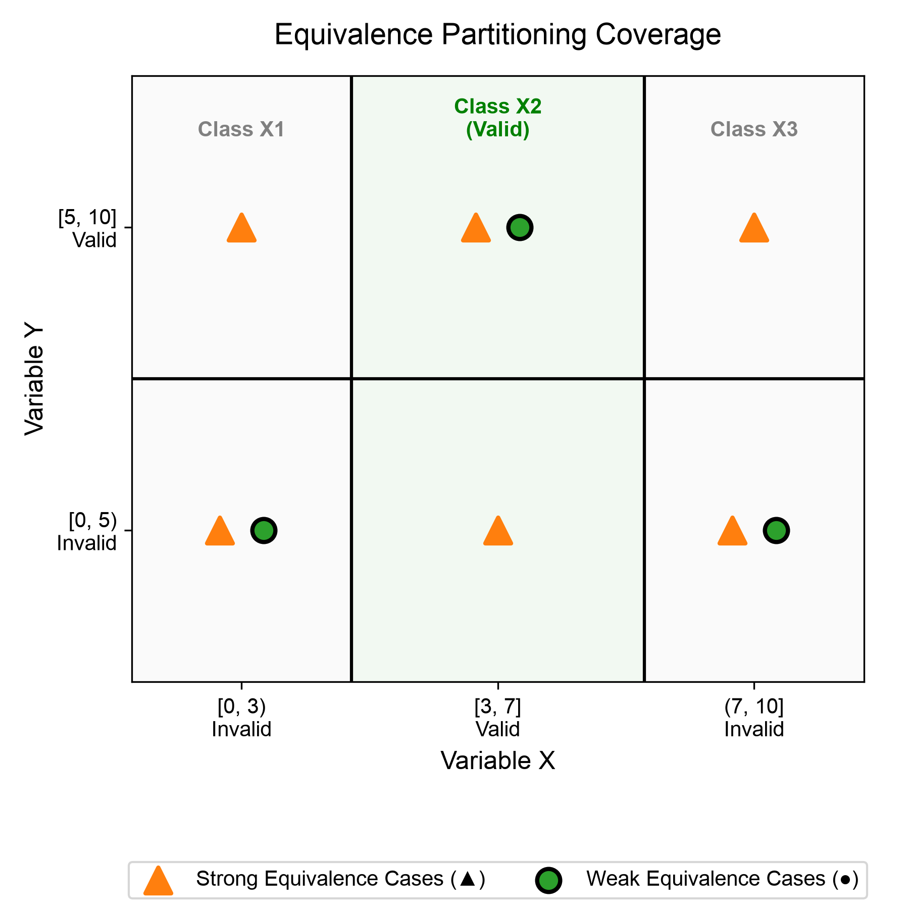

</div>
</div>
</div>

---

<!-- header: '5.4 等價類分割測試 (EP)' -->

## 互動式 EP 探索器：弱涵蓋 vs. 強涵蓋 & 一般 vs. 強固矩陣

<div class="ep-interactive-stage">

<div class="ep-nav-toolbar">
  <button class="ep-mode-btn is-active" data-ep="weak-norm">1. 弱一般 EP (Weak Normal)</button>
  <button class="ep-mode-btn" data-ep="strong-norm">2. 強一般 EP (Strong Normal)</button>
  <button class="ep-mode-btn" data-ep="weak-robust">3. 弱強固 EP (單一無效原則)</button>
  <button class="ep-mode-btn" data-ep="strong-robust">4. 強強固 EP (Strong Robust)</button>
</div>

<div class="ep-content-grid">

<div class="ep-matrix-card">
  <table class="ep-table">
    <thead>
      <tr>
        <th style="width: 22%;">x₁ \ x₂</th>
        <th style="width: 19%; color: #e11d48;">I₂,₁ (空字串)</th>
        <th style="width: 20%; color: #059669;">V₂,₁ (Alpha [A-M])</th>
        <th style="width: 20%; color: #059669;">V₂,₂ (Beta [N-Z])</th>
        <th style="width: 19%; color: #e11d48;">I₂,₂ (特殊符號)</th>
      </tr>
    </thead>
    <tbody>
      <tr>
        <th style="color: #e11d48;">I₁,₁ (&lt; 1)</th>
        <td class="is-invalid-zone"><span class="ep-pin is-invalid-pin" data-pin-id="p_i11_i21">TC₇</span></td>
        <td class="is-invalid-zone"><span class="ep-pin is-invalid-pin is-active-pin" data-pin-id="p_i11_v21">TC₄</span></td>
        <td class="is-invalid-zone"><span class="ep-pin is-invalid-pin" data-pin-id="p_i11_v22">TC₈</span></td>
        <td class="is-invalid-zone"><span class="ep-pin is-invalid-pin" data-pin-id="p_i11_i22">TC₉</span></td>
      </tr>
      <tr>
        <th style="color: #059669;">V₁,₁ (1..10)</th>
        <td class="is-invalid-zone"><span class="ep-pin is-invalid-pin" data-pin-id="p_v11_i21">TC₆</span></td>
        <td class="is-valid-zone"><span class="ep-pin is-active-pin" data-pin-id="p_v11_v21">TC₁</span></td>
        <td class="is-valid-zone"><span class="ep-pin" data-pin-id="p_v11_v22">TC₄</span></td>
        <td class="is-invalid-zone"><span class="ep-pin is-invalid-pin" data-pin-id="p_v11_i22">TC₇</span></td>
      </tr>
      <tr>
        <th style="color: #059669;">V₁,₂ (11..20)</th>
        <td class="is-invalid-zone"><span class="ep-pin is-invalid-pin" data-pin-id="p_v12_i21">TC₁₀</span></td>
        <td class="is-valid-zone"><span class="ep-pin" data-pin-id="p_v12_v21">TC₅</span></td>
        <td class="is-valid-zone"><span class="ep-pin is-active-pin" data-pin-id="p_v12_v22">TC₂</span></td>
        <td class="is-invalid-zone"><span class="ep-pin is-invalid-pin" data-pin-id="p_v12_i22">TC₁₁</span></td>
      </tr>
      <tr>
        <th style="color: #059669;">V₁,₃ (21..30)</th>
        <td class="is-invalid-zone"><span class="ep-pin is-invalid-pin" data-pin-id="p_v13_i21">TC₁₂</span></td>
        <td class="is-valid-zone"><span class="ep-pin is-active-pin" data-pin-id="p_v13_v21">TC₃</span></td>
        <td class="is-valid-zone"><span class="ep-pin" data-pin-id="p_v13_v22">TC₆</span></td>
        <td class="is-invalid-zone"><span class="ep-pin is-invalid-pin" data-pin-id="p_v13_i22">TC₁₃</span></td>
      </tr>
      <tr>
        <th style="color: #e11d48;">I₁,₂ (&gt; 30)</th>
        <td class="is-invalid-zone"><span class="ep-pin is-invalid-pin" data-pin-id="p_i12_i21">TC₁₄</span></td>
        <td class="is-invalid-zone"><span class="ep-pin is-invalid-pin" data-pin-id="p_i12_v21">TC₅</span></td>
        <td class="is-invalid-zone"><span class="ep-pin is-invalid-pin" data-pin-id="p_i12_v22">TC₁₅</span></td>
        <td class="is-invalid-zone"><span class="ep-pin is-invalid-pin" data-pin-id="p_i12_i22">TC₁₆</span></td>
      </tr>
    </tbody>
  </table>
</div>

<div class="ep-info-card" id="ep-info-box">
  <div class="ep-info-header">
    <span class="ep-badge-pill ep-badge-green" id="ep-mode-badge">僅合法值 • 單一錯誤假設</span>
    <h3 class="ep-title-text" id="ep-mode-title">弱一般等價分割 (Weak Normal EP)</h3>
  </div>
  
  <div class="ep-stats-row">
    <div class="ep-stat-box">
      <div class="ep-stat-label">計算公式</div>
      <div class="ep-stat-val" id="ep-stat-formula">max(|P₁|, |P₂|)</div>
    </div>
    <div class="ep-stat-box">
      <div class="ep-stat-label">啟用測試案例</div>
      <div class="ep-stat-val" id="ep-stat-count">3 個案例</div>
    </div>
  </div>
  
  <ul class="ep-details-list" id="ep-details-list">
    <li><strong>最小有效涵蓋：</strong>確保每個變數的每一個有效等價類，至少在一個測試案例中出現。</li>
    <li><strong>單一錯誤假設：</strong>假設當單一分割區間搭配其他變數的有效值執行時，即可揭露功能性缺陷。</li>
    <li><strong>執行成本：</strong>最經濟精簡的基準線（<strong>max(3, 2) = 3 個案例</strong>）。</li>
  </ul>
</div>

</div>
</div>

<!--
等價分割法涵蓋四種維度策略。在弱一般 EP (Weak Normal) 下，只需 3 個綠色測試案例即可涵蓋每一個有效橫列與直行。強一般 EP (Strong Normal) 則擴展至綠色有效區內的全部 6 種組合。弱強固 EP (Weak Robust) 引入了極為關鍵的「單一無效原則」：4 個紅色測試案例各自在搭配有效同儕值的嚴格隔離條件下測試每一個無效分割（共 7 個案例），防止早期例外中斷遮蔽了次要缺陷。強強固 EP (Strong Robust) 則以暴力笛卡爾乘積測試全部 20 個儲存格。
-->

---

<!-- header: '5.4 等價類分割測試 (EP)' -->

## EP 實戰案例一 (1/3)：二元搜尋互動追蹤與等價分割維度

<div class="bs-interactive-stage">

<div class="bs-trace-card">
  <div class="bs-top-bar">
    <div style="display: flex; align-items: center;">
      <span style="font-size: 13px; font-weight: 800; color: #0b3c5d;">目標搜尋值 (k)：</span>
      <input type="number" id="bs-input-k" value="35" class="bs-k-input" style="margin: 0 6px;" />
      <span style="font-size: 11px; font-weight: 700; color: #64748b; margin-right: 4px;">快速預設值：</span>
      <span class="bs-quick-pill" data-k="3">3 (頭部)</span>
      <span class="bs-quick-pill" data-k="23">23 (中間)</span>
      <span class="bs-quick-pill" data-k="35">35</span>
      <span class="bs-quick-pill" data-k="43">43 (尾部)</span>
      <span class="bs-quick-pill" data-k="8">8 (未命中)</span>
    </div>
    <div>
      <button class="bs-action-btn" id="bs-btn-step">▶ 下一步</button>
      <button class="bs-action-btn" id="bs-btn-reset" style="background: #64748b; margin-left: 6px;">↺ 重置</button>
    </div>
  </div>

  <div class="bs-status-banner">
    <span id="bs-status-text">步驟 0：初始搜尋範圍 [0..10]，mid = floor((0+10)/2) = 5 (arr[5] = 23)</span>
    <span id="bs-status-tag" style="background: #e0f2fe; color: #0369a1; padding: 1px 8px; border-radius: 4px; font-size: 10.5px; font-weight: 800;">就緒</span>
  </div>

  <div class="bs-array-container" id="bs-array-container">
    <div class="bs-array-cell" data-idx="0"><span class="bs-cell-idx">0</span><span class="bs-cell-val">3</span><span class="bs-pointer-pill bs-ptr-low">low</span></div>
    <div class="bs-array-cell" data-idx="1"><span class="bs-cell-idx">1</span><span class="bs-cell-val">7</span></div>
    <div class="bs-array-cell" data-idx="2"><span class="bs-cell-idx">2</span><span class="bs-cell-val">11</span></div>
    <div class="bs-array-cell" data-idx="3"><span class="bs-cell-idx">3</span><span class="bs-cell-val">15</span></div>
    <div class="bs-array-cell" data-idx="4"><span class="bs-cell-idx">4</span><span class="bs-cell-val">19</span></div>
    <div class="bs-array-cell is-mid" data-idx="5"><span class="bs-cell-idx">5</span><span class="bs-cell-val">23</span><span class="bs-pointer-pill bs-ptr-mid">mid</span></div>
    <div class="bs-array-cell" data-idx="6"><span class="bs-cell-idx">6</span><span class="bs-cell-val">27</span></div>
    <div class="bs-array-cell" data-idx="7"><span class="bs-cell-idx">7</span><span class="bs-cell-val">31</span></div>
    <div class="bs-array-cell" data-idx="8"><span class="bs-cell-idx">8</span><span class="bs-cell-val">35</span></div>
    <div class="bs-array-cell" data-idx="9"><span class="bs-cell-idx">9</span><span class="bs-cell-val">39</span></div>
    <div class="bs-array-cell" data-idx="10"><span class="bs-cell-idx">10</span><span class="bs-cell-val">43</span><span class="bs-pointer-pill bs-ptr-high">high</span></div>
  </div>
</div>

<div class="two-columns" style="margin-top: 4px;">
<div class="card" style="padding: 12px 16px;">

### 四大結構化等價分割維度
- **1. 陣列長度 (Array Length, A)：**
  - <code>a⁰</code>：空陣列（<code>[]</code>，長度為 0）
  - <code>a¹</code>：單一元素陣列 (<code>[7]</code>)
  - <code>a*</code>：多元素已排序陣列 (<code>[3, 7, 11, ...]</code>)
- **2. 搜尋結果 (Outcome, F) 與 3. 命中位置 (Hit Position, C)：**
  - <code>fᵗ</code> (找到)：命中於頭部 (<code>c¹</code>)、中間 (<code>cᵐ</code>) 或尾部 (<code>cˡ</code>)
  - <code>fᶠ</code> (未找到)：目標鍵值不存在於陣列中
- <strong>4. 輸入合法性 (Validity, K)：</strong> <code>k</code>（合法整數）vs. <code>k!</code>（非法型別或 null）

</div>
<div class="card" style="padding: 12px 16px;">

### 弱涵蓋策略（8 個代表性測試案例）
- **為何採用弱涵蓋 (Weak Coverage)？**
  - 在不引發笛卡爾乘積組合爆炸的前提下，確保全部 4 個維度的每一個分割區間至少在一個測試案例中被執行。
- **代表性案例分佈：**
  - <strong>R₁..R₂：</strong>單一元素陣列 (<code>a¹</code>) 的命中 (<code>c¹</code>) 與未命中 (<code>fᶠ</code>)。
  - <strong>R₃..R₅：</strong>多元素陣列 (<code>a*</code>) 的頭部 (<code>c¹</code>)、中間 (<code>cᵐ</code>) 與尾部 (<code>cˡ</code>) 命中。
  - <strong>R₆..R₇：</strong>多元素區間空隙未命中 (<code>fᶠ</code>) 與空陣列防禦 (<code>a⁰</code>)。
  - <strong>R₈：</strong>非法輸入之型別／空值防禦性拒絕 (<code>k!</code>)。

</div>
</div>

</div>

<!--
點擊上方互動區「下一步」或輸入任意目標值 k，即可逐步追蹤二元搜尋的折半過程。左下方列出的 4 大結構化分割維度（陣列基數 A、搜尋結果 F、命中位置 C 與輸入合法性 K）完整描繪了輸入與輸出定義域；右下方則透過弱涵蓋策略規劃出 R1..R8 共 8 個代表性測試案例，涵蓋每一個分割區間。
-->

---

<!-- header: '5.4 等價類分割測試 (EP)' -->

## EP 實戰案例一 (2/3)：二元搜尋弱涵蓋測試規格表

<div class="table-compact">

| 案例編號 | 涵蓋類別組合 (`A, F, C, K`) | 測試輸入 (`k, A`) | 預期輸出 | 弱涵蓋驗證目標 |
| :---: | :--- | :--- | :--- | :--- |
| **R<sub>1</sub>** | a<sup>1</sup> × f<sup>t</sup> × c<sup>1</sup> × k | `k=7, A=[7]` | `index = 0` | 單元素命中（涵蓋 a<sup>1</sup>, f<sup>t</sup>, c<sup>1</sup>） |
| **R<sub>2</sub>** | a<sup>1</sup> × f<sup>f</sup> × k | `k=7, A=[8]` | `index = -1` | 單元素未命中（涵蓋 a<sup>1</sup>, f<sup>f</sup>） |
| **R<sub>3</sub>** | a<sup>*</sup> × f<sup>t</sup> × c<sup>1</sup> × k | `k=7, A=[7, 9, 11]` | `index = 0` | 多元素頭部命中（涵蓋 a<sup>*</sup>, c<sup>1</sup>） |
| **R<sub>4</sub>** | a<sup>*</sup> × f<sup>t</sup> × c<sup>m</sup> × k | `k=9, A=[7, 9, 11]` | `index = 1` | 多元素中間命中（涵蓋 a<sup>*</sup>, c<sup>m</sup>） |
| **R<sub>5</sub>** | a<sup>*</sup> × f<sup>t</sup> × c<sup>l</sup> × k | `k=11, A=[7, 9, 11]` | `index = 2` | 多元素尾部命中（涵蓋 a<sup>*</sup>, c<sup>l</sup>） |
| **R<sub>6</sub>** | a<sup>*</sup> × f<sup>f</sup> × k | `k=8, A=[7, 9, 11]` | `index = -1` | 多元素區間空隙未命中（涵蓋 a<sup>*</sup>, f<sup>f</sup>） |
| **R<sub>7</sub>** | a<sup>0</sup> × f<sup>f</sup> × k | `k=7, A=[]` | `index = -1` | 空陣列邊界防禦（涵蓋 a<sup>0</sup>, f<sup>f</sup>） |
| **R<sub>8</sub>** | a<sup>*</sup> × k! | `k="abc", A=[7, 9]` | 拋出 `TypeException` | 非法輸入防禦性拒絕（涵蓋無效等價類 k!） |

</div>

<div class="card" data-marpit-fragment style="margin-top: 8px; padding: 8px 14px; border-left: 4px solid #d97706; background: #fffbeb;">

<h3 style="font-size: 14.5px; margin: 0 0 4px 0; color: #b45309;">關鍵反思與測試設計提問</h3>

1. <strong>問題 1（強涵蓋與無效輸入隔離）：</strong> 為何我們選擇<strong>弱涵蓋 (Weak Coverage)</strong> 而非強涵蓋？無效輸入 <code>k!</code> 是否需要與<strong>完整笛卡爾乘積</strong> (<code>A × F × C</code>) 進行交叉組合？
2. <strong>問題 2（陣列奇偶性與折半不對稱性）：</strong> 二元搜尋透過整數除法 <code>mid = (low + high) / 2</code> 反覆折半。我們將陣列長度 <code>A</code> 分為三類 (<code>a⁰, a¹, a*</code>) 是否存在差一錯誤 (off-by-one) 盲區？

</div>

<!--
請檢視上方規格表中的 8 個代表性測試案例 R1 至 R8。僅用 8 個案例，弱等價分割便系統化地測試了每一個有效與無效分割區間。在翻到下一頁看解答前，先思考下方琥珀色方框中的兩個設計提問。
-->

---

<!-- header: '5.4 等價類分割測試 (EP)' -->

## EP 實戰案例一 (3/3)：二元搜尋測試設計提問深度解答

<div class="card-deck">

<div class="two-columns">
<div class="card" data-marpit-fragment style="padding: 14px 18px;">

### 解答 1：不可行分割組合與單一無效原則
- **為何不採用強涵蓋 (Strong Coverage)？**
  - **不可行組合 (Infeasible Combinations)：** 笛卡爾乘積會產生數學與邏輯上不可能存在的測試組合！
    - 例如：<code>a⁰ × fᵗ × cᵐ</code> =「在空陣列的中間位置找到目標值」（完全矛盾不可能！）。
- **無效輸入 <code>k!</code> 需要與完整乘積 (<code>A × F × C</code>) 交叉嗎？**
  - **絕對不用！那會違反單一無效原則 (Single Invalid Rule)！**
  - 當傳入 <code>k!</code>（如 <code>null</code> 或型別錯誤）時，方法的<strong>前置防禦衛句 (entry guard clause) 會立即拋出例外</strong>：
    <code>if (key == null) throw new IllegalArgumentException();</code>
  - **缺陷遮蔽風險 (Fault Masking Hazard)：** 下游搜尋邏輯**根本不會被執行到**。將 <code>k!</code> 與所有位置交叉只會製造龐大冗餘，並遮蔽真正的演算法缺陷！

</div>
<div class="card" data-marpit-fragment style="padding: 14px 18px;">

### 解答 2：奇偶同位分割 (Even vs. Odd Parity, aᵒᵈᵈ vs. aᵉᵛᵉⁿ)
- **整數除法截斷效應 (<code>Math.floor</code>)：**
  - 整數折半公式：<code>mid = (low + high) / 2</code>。
  - <strong>奇數長度（如 N = 7）：</strong> <strong>對稱切割</strong>（<code>mid = 3</code>，左半部剩 <strong>3 個元素</strong>、右半部剩 <strong>3 個元素</strong>）。
  - <strong>偶數長度（如 N = 8）：</strong> <strong>非對稱切割</strong>（<code>mid = 3</code>，左半部剩 <strong>3 個元素</strong>，但右半部有 <strong>4 個元素</strong>！）。
- **隱藏的邊界差一錯誤 (Off-by-One Bugs)：**
  - 有瑕疵的中點更新邏輯（如誤寫 <code>high = mid</code> vs. <code>high = mid - 1</code>）在奇數陣列上可能僥倖通過，卻會在偶數陣列上觸發無窮迴圈或陣列越界！
- **精煉後的陣列長度分割 <code>A</code>：**
  - <code>a⁰</code>（空陣列）、<code>a¹</code>（單元素）、<code>aᵒᵈᵈ</code>（奇數長度）、<code>aᵉᵛᵉⁿ</code>（偶數長度）。

</div>
</div>
</div>

<!--
這兩個解答揭示了兩項核心軟體工程原則。第一，對彼此相依的維度進行強涵蓋會產生不可能存在的組合；同時，像 k! 這類無效輸入必須在「單一無效原則」下嚴格隔離測試，因為前置例外衛句會直接中斷並遮蔽後續所有程式碼。第二，整數除法會捨去餘數，導致偶數長度陣列發生非對稱切割（左 3 右 4）。將多元素陣列進一步細分為奇數與偶數兩個等價類，能確保攔截折半邊界上的差一錯誤。
-->

---

<!-- header: '5.4 等價類分割測試 (EP)' -->

## 領域規則導向等價分割：NextDate()

<div class="card-deck">

> 💡 單純考慮數值範圍是不夠的；優質的等價劃分必須深入融入業務規則（如大小月與閏年）。

<div class="two-columns">
<div class="card" data-marpit-fragment>

### ❌ 膚淺的簡易分割 (效能極低)
- **Month**：<1, 1 ~ 12, >12 (3 類)
- **Day**：<1, 1 ~ 31, >31 (3 類)
- **Year**：<1812, 1812 ~ 2024, >2024 (3 類)
- **致命盲點**：
  - 4/31 根本不存在！2/29 只有閏年合法！
  - 盲目數值劃分無法捕捉 2 月與大小月的核心業務跳日邏輯。

</div>
<div class="card" data-marpit-fragment>

### ⚠️ 第一版領域劃分 (初步嘗試)
- **月份 (M)**：
  - M<sub>1</sub>: 30 天月 (4, 6, 9, 11)
  - M<sub>2</sub>: 31 天月 (1, 3, 5, 7, 8, 10, 12)
  - M<sub>3</sub>: 二月 (特殊處理)
- **日期 (D)**：
  - D<sub>1</sub>: 1 ~ 27, D<sub>2</sub>: 28, D<sub>3</sub>: 29, D<sub>4</sub>: 30, D<sub>5</sub>: 31
- **年份 (Y)**：
  - Y<sub>1</sub>: 閏年 (4 整除且非百/或400整除), Y<sub>2</sub>: 平年

</div>
</div>
</div>

---

<!-- header: '5.4 等價類分割測試 (EP)' -->

## NextDate() 初步測試：「12 月跨年異常」

<div class="card-deck">

> 💡 當我們為第一版 M<sub>2</sub> (31天月) 挑選代表值時，隱藏的跨年致命漏洞浮出水面！

<div class="two-columns">
<div class="card" data-marpit-fragment>

### 📋 第一版弱涵蓋選取代表案例
| 案例 | 輸入 (Y, M, D) | 預期輸出 | 涵蓋類別與說明 |
| :---: | :--- | :--- | :--- |
| **T<sub>1</sub>** | `2024/04/30` | `2024/05/01` | M<sub>1</sub> × D<sub>4</sub> (30 天月月底跳月，年不變) |
| **T<sub>2</sub>** | `2024/07/31` | `2024/08/01` | M<sub>2</sub> × D<sub>5</sub> (31 天月月底跳月，年不變) |
| **T<sub>3</sub>** | `2024/02/28` | `2024/02/29` | M<sub>3</sub> × D<sub>2</sub> × Y<sub>1</sub> (閏年 2 月進 29 日) |
| **T<sub>4</sub>** | `2023/02/28` | `2023/03/01` | M<sub>3</sub> × D<sub>2</sub> × Y<sub>2</sub> (平年 2 月跳 3/1) |

- **盲區曝光**：若測試員挑選 T<sub>2</sub> (7/31)，M<sub>2</sub> 就算完成覆蓋；但 **12 月底 (12/31) 的跨年** 就被徹底漏測！

</div>
<div class="card" data-marpit-fragment>

### 💥 12 月底的特殊性 (December Anomaly)
- **一般 31 天月月底 (1, 3, 5, 7, 8, 10 月)**：
  - `Day = 1`, `Month = Month + 1`, **`Year 不變`**！
- **12 月底 (12/31) 獨特跨年邏輯**：
  - `Day = 1`, **`Month = 1 (重置)`**, **`Year = Year + 1 (跨年)`**！
- **等價性破滅 (Equivalence Broken)**：
  - 12 月與其他 31 天月在程式行為上**根本不等價**！
  - 若混在同一個等價類，一旦選中 7/31，跨年 Year+1 的核心邏輯就會被**完全漏測**！

</div>
</div>
</div>

---

<!-- header: '5.4 等價類分割測試 (EP)' -->

## EP 實戰案例二 (1/3)：`NextDate(Y, M, D)` 等價分割探索

> **等價分割黃金法則：** 同一等價分割 ↔ 具備完全相同的狀態轉移與下游處理邏輯！

<div class="two-columns">
<div class="left">

- **年份 (`Year, Y`)：** 輸入範圍 `1812..2030`
  * <strong>`Y₁`（閏年 Leap Year）：</strong> 可被 4 整除（逢百不閏，逢 400 閏；2 月有 29 天）
  * <strong>`Y₂`（平年 Common Year）：</strong> 其他所有合法年份（2 月有 28 天）
- **月份 (`Month, M`)：** 輸入範圍 `1..12`
  * <strong>`M₁`（30 天小月）：</strong> `{4, 6, 9, 11}`（4、6、9、11 月）
  * <strong>`M₂`（31 天大月）：</strong> `{1, 3, 5, 7, 8, 10}`（1、3、5、7、8、10 月）
  * <strong>`M₃`（二月 February）：</strong> `{2}`（受閏平年規則制約）
  * <strong>`M₄`（十二月 December）：</strong> `{12}`（★ *12/31 會觸發年份進位，與 7 月絕不等價！*）

</div>
<div class="right">

- **日期 (`Day, D`)：** 輸入範圍 `1..31`
  * <strong>`D₁` (`1..27`)：</strong> 月中一般遞增（`Day + 1`，月份與年份不變）
  * <strong>`D₂` (`28`)：</strong> 平年 2 月底邊界（平年進位至 3 月 1 日）
  * <strong>`D₃` (`29`)：</strong> 閏年 2 月底邊界（閏年進位至 3 月 1 日）
  * <strong>`D₄` (`30`)：</strong> 30 天小月月底換月（進位至 `Day = 1, Month + 1`）
  * <strong>`D₅` (`31`)：</strong> 31 天大月月底換月（進位至 `Day = 1, Month + 1`；若為 12 月則跨年）

</div>
</div>

<!--
引導學生逐步探索 NextDate(Y, M, D) 的等價分割。先列出年、月、日三大變數，詢問學生該如何劃分定義域；接著點擊逐步揭示子項目：閏年 vs. 平年、大小月分群，以及最關鍵的發現——由 12/31 跨年邊界所催生出的獨立等價類「12 月 (M4)」。
-->

---

<!-- header: '5.4 等價類分割測試 (EP)' -->

## EP 實戰案例二：`NextDate()` 弱涵蓋打點矩陣表

<div class="table-compact">

| 案例 | 測試輸入 | M<sub>1</sub> | M<sub>2</sub> | M<sub>3</sub> | M<sub>4</sub> | D<sub>1</sub> | D<sub>2</sub> | D<sub>3</sub> | D<sub>4</sub> | D<sub>5</sub> | Y<sub>1</sub> | Y<sub>2</sub> | 預期輸出 | 策略定位與驗證之業務分支 |
| :---: | :---: | :---: | :---: | :---: | :---: | :---: | :---: | :---: | :---: | :---: | :---: | :---: | :---: | :--- |
| **TC<sub>1</sub>** | `2023/05/15` | | ● | | | ● | | | | | | ● | `2023/05/16` | **弱涵蓋基底 (1/5)：** 月中一般遞增（`Day + 1`；涵蓋 M<sub>2</sub>, D<sub>1</sub>, Y<sub>2</sub>） |
| **TC<sub>2</sub>** | `2024/02/28` | | | ● | | | ● | | | | ● | | `2024/02/29` | **弱涵蓋基底 (2/5)：** 閏年 2/28 遞增（`Day + 1`；涵蓋 M<sub>3</sub>, D<sub>2</sub>, Y<sub>1</sub>） |
| **TC<sub>3</sub>** | `2024/02/29` | | | ● | | | | ● | | | ● | | `2024/03/01` | **弱涵蓋基底 (3/5)：** 閏年 2/29 換月進位（`Month + 1`；涵蓋 D<sub>3</sub>） |
| **TC<sub>4</sub>** | `2023/04/30` | ● | | | | | | | ● | | | ● | `2023/05/01` | **弱涵蓋基底 (4/5)：** 30 天小月換月進位（`Month + 1`；涵蓋 M<sub>1</sub>, D<sub>4</sub>） |
| **TC<sub>5</sub>** | `2023/12/31` | | | | ● | | | | | ● | | ● | `2024/01/01` | **弱涵蓋基底 (5/5)：** ★ **12/31 跨年進位 (`Year+1, Month=1`；M<sub>4</sub>, D<sub>5</sub>)** |

</div>

<div class="card" style="margin-top: 8px; padding: 6px 14px; border-left: 4px solid #059669; background: #f0fdf4;">
<h3 style="font-size: 14px; margin: 0 0 3px 0; color: #166534;">一眼看穿 100% 弱涵蓋 (Weak Coverage) 視覺化檢驗</h3>
<ul style="margin: 0; padding-left: 18px; font-size: 13.5px; line-height: 1.38;">
<li><strong>直行垂直檢視：</strong>沿著 <code>M₁..M₄</code>、<code>D₁..D₅</code> 與 <code>Y₁..Y₂</code> 每一行往下看，可以確認在 <code>TC₁..TC₅</code> 之中，<strong>每一個直行都至少包含一個圓點 (●)</strong>！</li>
<li><strong>極小化成本：</strong>僅需 <strong>5 個基底測試案例</strong> (<code>max(|M|, |D|, |Y|) = 5</code>) 即 100% 滿足弱涵蓋要求。</li>
</ul>
</div>

<div class="card" data-marpit-fragment style="margin-top: 8px; padding: 6px 14px; border-left: 4px solid #d97706; background: #fffbeb;">
<h3 style="font-size: 14px; margin: 0 0 3px 0; color: #92400e;">關鍵反思與測試設計提問（想一想）</h3>
<ul style="margin: 0; padding-left: 18px; font-size: 13.5px; line-height: 1.38;">
<li><strong>提問 1（弱涵蓋的致命盲區）：</strong>雖然 <code>TC₁..TC₅</code> 已達成 100% 弱涵蓋，但這 5 個案例真的夠嗎？例如：<code>02/28</code> (<code>D₂</code>) 在表中只搭配了<strong>閏年 (<code>Y₁</code>)</strong> 測試，卻完全沒測到<strong>平年 (<code>Y₂</code>) 的 <code>02/28</code></strong>！還有哪些被綁死耦合的組合漏測了？（見下一頁）</li>
<li><strong>提問 2（為何不直接跑強涵蓋）：</strong>既然弱涵蓋會漏掉跨變數互動，為什麼我們不直接執行全笛卡爾乘積 <strong>100% 強涵蓋 (<code>4 × 5 × 2 = 40</code> 個案例)</strong>？（見下一頁）</li>
</ul>
</div>

<!--
這張打點矩陣將等價分割涵蓋率極其清晰地視覺化呈現。沿著每一個直行往下檢視：每一個等價類都在前 5 個基底測試案例 (TC1..TC5) 中至少擁有一個打點，證實達成 100% 弱涵蓋。然而在課堂上，可先引導學生思考下方琥珀色反思問題卡片：D2 (28 日) 只在 TC2 (2024 閏年) 被測試到，平年的 2 月 28 日卻完全沒測；同理，D5 (31 日) 與 M4 (12 月) 在 TC5 中被綁在一起。下一頁揭曉解答與耦合補強矩陣。
-->

---

<!-- header: '5.4 等價類分割測試 (EP)' -->

## `NextDate()` 提問解答：耦合補強與不可行日期剪枝

<div class="card-deck">

> 5 個弱涵蓋基底上定向加上 **3 個精準耦合補強案例 (`TC₆..TC₈`)**，僅需 **8 個精實案例**即可攔截所有跨變數進位錯誤並避開幽靈日期陷阱。

<div class="two-columns">
<div class="card" data-marpit-fragment style="padding: 8px 14px; font-size: 13.8px; line-height: 1.32;">

### 解答 1：`02/28` 與 `12/31` 的耦合盲區
- **平年 vs. 閏年的 `02/28` 分歧 (`M₃ × D₂ × Y`)：**
  - `TC₂ (2024/02/28)` 僅在**閏年 (`Y₁`)** 測試 (`Day + 1 ➔ 02/29`)。
  - **平年 (`Y₂`)** 的 `02/28` 須**換月進位 (`➔ 03/01`)**！若不補測 `2023/02/28` (`TC₈`)，平年 2 月底換月將是 0% 測試盲區。
- **解開 `M₄ (12 月)` 與 `D₅ (31 日)` 的綁定：**
  - `TC₅` 將 `M₄` 與 `D₅` 綁死。須補測**非 12 月 31 日 (`TC₆: 07/31`)** 與 **12 月一般日 (`TC₇: 12/15`)**，攔截 `if (month == 12) year++` 等錯誤！

</div>
<div class="card" data-marpit-fragment style="padding: 8px 14px; font-size: 13.8px; line-height: 1.32;">

### 解答 2：為何不直接用強涵蓋 (40 個案例)？
- **組合膨脹與「不存在的幽靈日期」 (`4 × 5 × 2 = 40`)：**
  - 盲目笛卡爾乘積會產生大量違反曆法約束的**不可行組合 (Infeasible Combinations)**：
    - `M₃ (2月) × D₄/D₅ (30/31日)` ➔ **`02/30`、`02/31` 不存在！**
    - `M₁ (小月) × D₅ (31日)` ➔ **`04/31`、`06/31` 不存在！**
    - `M₃ × D₃ (29日) × Y₂ (平年)` ➔ **`2023/02/29` 無效日期！**
- **最佳策略 (`5 基底 + 3 耦合 = 8 案例`)：** 保留 `TC₁..TC₅` + 下方 `TC₆..TC₈`。

</div>
</div>

<div class="table-compact" data-marpit-fragment style="margin-top: 4px; font-size: 0.92em;">

| 補強案例 | 測試輸入 | M<sub>1</sub> | M<sub>2</sub> | M<sub>3</sub> | M<sub>4</sub> | D<sub>1</sub> | D<sub>2</sub> | D<sub>3</sub> | D<sub>4</sub> | D<sub>5</sub> | Y<sub>1</sub> | Y<sub>2</sub> | 預期輸出 | 定向解除之跨變數耦合盲區 |
| :---: | :---: | :---: | :---: | :---: | :---: | :---: | :---: | :---: | :---: | :---: | :---: | :---: | :---: | :--- |
| **TC<sub>6</sub>** | `2023/07/31` | | ● | | | | | | | ● | | ● | `2023/08/01` | **耦合補強 (+1)：** 非 12 月之 31 天大月換月進位（`Month + 1`，年份不變） |
| **TC<sub>7</sub>** | `2023/12/15` | | | | ● | ● | | | | | | ● | `2023/12/16` | **耦合補強 (+2)：** 12 月一般日正常遞增（`Day + 1`，不誤觸跨年進位） |
| **TC<sub>8</sub>** | `2023/02/28` | | | ● | | | ● | | | | | ● | `2023/03/01` | **耦合補強 (+3)：** ★ **平年 2/28 換月進位至 3/1 (`M₃ × D₂ × Y₂`)** |

</div>

</div>

<!--
這一頁完整解答了前一頁的兩個關鍵測試設計提問。第一，只測 5 個弱涵蓋案例不夠：因為 TC2 中 2/28 只測了閏年，漏掉平年 2/28 直接換月到 3/1 的分支；同時 TC5 把 12 月與 31 日綁在一起，無法區分「只要是 12 月就跨年」或「只要是 31 日就跨年」的實作錯誤。第二，日曆具有嚴格的跨變數物理約束，盲目展開 4 x 5 x 2 = 40 個強涵蓋案例會產生大量不存在的幽靈日期。因此在 5 個弱涵蓋基底上精準補上 TC6、TC7 與 TC8 三個耦合補強案例，以 5 + 3 = 8 個測試案例即可達到完整業務分支防禦。
-->

---

<!-- header: '5.4 等價類分割測試 (EP)' -->

## 單一無效原則（缺陷遮蔽）與整合 EP + BVA 三步驟 SOP

<div class="card-deck">

> 積極合併<strong>有效等價類</strong>以極小化測試案例數，但對<strong>無效等價類</strong>則嚴格隔離（每例僅測一個無效值）；將 <strong>BVA 視為 EP 區間內部的邊界特化取樣</strong>。

<div class="two-columns">
<div class="card" data-marpit-fragment>

### 單一無效原則與缺陷遮蔽 (Fault Masking)
- **為何絕不能在同一個測試案例中放入多個無效輸入？**
  - **缺陷遮蔽效應 (Fault Masking Effect)：** 防禦性程式碼會依序檢查前置條件 (`if (pwdTooShort) throw ...; if (badEmail) throw ...;`)。
  - 若在同一個測試案例中**同時**傳入過短密碼與錯誤信箱，密碼檢查會先行拋出例外中斷，進而**遮蔽了信箱驗證器內部的任何 Bug**！
- **黃金準則：**
  - **有效等價類 (Valid Classes)：** 在單一測試案例中盡量打包涵蓋多個有效分割。
  - **無效等價類 (Invalid Classes)：** **每次嚴格只測試一個無效分割**，其餘所有輸入皆維持有效值！

</div>
<div class="card" data-marpit-fragment>

### 三步驟整合 EP + BVA 標準作業程序（零重複）
- <strong>破除迷思：</strong> 邊界點（如 `0` 或 `100`）只是等價分割區間的幾何邊緣——<strong>絕不要把邊界切為獨立的等價分割</strong>！
- **三步驟統一取樣 SOP：**
  1. <strong>步驟 1（以 EP 劃分區間）：</strong> 辨識所有有效類 (`V`) 與無效類 (`I`)。
  2. <strong>步驟 2（標記相鄰接縫邊界）：</strong> 定位相鄰類別間的接縫邊緣（注意 `V1` 的 `max+` 恰好等於 `V2` 的 `min`！）。
  3. <strong>步驟 3（取樣邊界點 + 各有效類 1 個名義值）：</strong> 為每個有效類選取 `{min, nom, max}`，並為外圍無效類各選取 `1` 個緊鄰越界點。

</div>
</div>
</div>

<!--
切勿在同一個測試向量中放入兩個無效值——否則第一個例外檢查就會短路返回，進而遮蔽後續驗證邏輯中的缺陷。同時將 BVA 視為 EP 區間內部的邊界特化取樣，避免將邊界錯切為獨立 Partition。
-->

---

<!-- header: '5.4 等價類分割測試 (EP)' -->

## EP 與 BVA 整合實戰 (1/2)：游泳池年齡票價規格與 34 點重複陷阱

<div class="split64">
<div class="left">

<div class="card" style="padding: 8px 14px; border-left: 4px solid #0284c7; background: #f0f9ff; font-size: 13.8px; line-height: 1.36;">
<h3 style="font-size: 14.8px; margin: 0 0 4px 0; color: #0369a1;">1. 題目規格說明：<code>calcPoolTicket(int age)</code></h3>
市立游泳池依據整數年齡 <code>age</code>（合法範圍 <code>0..120</code> 歲）分為四段連續票價級距：<br/>
• <strong>4 個有效級距：</strong> <code>V₁ [0..3]</code> 免費 (<strong>$0</strong>) ｜ <code>V₂ [4..12]</code> 兒童票 (<strong>$100</strong>) ｜ <code>V₃ [13..64]</code> 全票 (<strong>$250</strong>) ｜ <code>V₄ [65..120]</code> 敬老票 (<strong>$120</strong>)。<br/>
• <strong>2 個外圍無效區間：</strong> <code>I₁ (age &lt; 0)</code> 與 <code>I₂ (age &gt; 120)</code> 一律拋出 <code>IllegalArgumentException</code>。
</div>

<div class="card" data-marpit-fragment style="margin-top: 8px; padding: 8px 14px; border-left: 4px solid #dc2626; background: #fef2f2; font-size: 13.5px; line-height: 1.35;">
<h3 style="font-size: 14.5px; margin: 0 0 4px 0; color: #991b1b;">2. 為何死板分開做 EP + BVA 會算出 34 個測試點？</h3>
• <strong>第一部分 — 單獨做 EP (<code>6</code> 點)：</strong> 6 個等價類各取 1 個代表值：<code>{-5, 2, 8, 30, 80, 130}</code> ➔ <strong>6 點</strong>。<br/>
• <strong>第二部分 — 4 個有效區間各做 7 點強固 BVA (<code>4 × 7 = 28</code> 點)：</strong> 每段各自取 <code>{min-, min, min+, nom, max-, max, max+}</code> ➔ <strong>28 點</strong>。<br/>
• <strong>兩者直接相加 = <code>6 + 28 = 34</code> 個點！</strong>
</div>

<div class="card" data-marpit-fragment style="margin-top: 8px; padding: 8px 14px; border-left: 4px solid #d97706; background: #fffbeb; font-size: 13.2px; line-height: 1.34;">
<h3 style="font-size: 14.2px; margin: 0 0 3px 0; color: #b45309;">3. 診斷分析：34 點中包含 3 大類、共 20 個重複／冗餘點！</h3>
1. <strong>相鄰接縫碰撞重複 (<code>-6</code> 點，橘色框)：</strong> <code>V₁</code> 的右邊界與右越界 <code>{3, 4}</code> 剛好就是 <code>V₂</code> 的左越界與左邊界 <code>{3, 4}</code>！同理 <code>12|13</code>、<code>64|65</code> 各被重複測了兩次。<br/>
2. <strong>EP 與 BVA 重疊 (<code>-6</code> 點，黃色框 ★)：</strong> EP 的 4 個有效代表值 <code>{2,8,30,80}</code> 與 2 個無效類，和 BVA 的 <code>nom</code> 及外圍 <code>min-/max+</code> 重複。<br/>
3. <strong>區間內部 <code>min+/max-</code> 冗餘 (<code>-8</code> 點，灰虛線框)：</strong> 改採 2 點 BVA 可省去 8 個內部鄰點。
</div>

</div>
<div class="right">

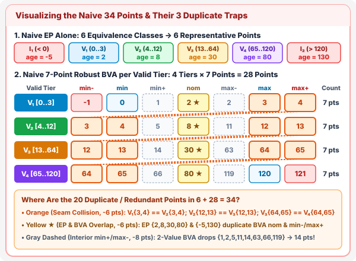

</div>
</div>

<!--
透過兩頁完整講解游泳池年齡票價案例。第一頁先看題目規格：整數年齡 0 到 120 歲分為 4 個連續有效票價級距（免費 0..3、兒童 4..12、全票 13..64、敬老 65..120），外加小於 0 與大於 120 兩個無效區間。若死板分開做 EP (6 點) 與 4 段 7 點強固 BVA (28 點)，會產生 34 個點，其中包含接縫碰撞 (-6)、EP 與 BVA 重疊 (-6) 與內部鄰點冗餘 (-8) 共 20 個重複點。
-->

---

<!-- header: '5.4 等價類分割測試 (EP)' -->

## EP 與 BVA 整合實戰 (2/2)：三步驟去重縮減法 (`34 ➔ 14` 點)

> 將 <strong>BVA 視為 EP 區間內部的邊界取樣</strong>並於接縫處採用 <strong>2 點 BVA</strong>：每個有效級距取 <strong>`{min, nom, max}` (`4 × 3 = 12` 點) + `2` 個外圍越界點 (`-1, 121`) = `14` 個精確測試點</strong>！

<div class="split64">
<div class="left">

<div class="table-compact" style="font-size: 0.9em;">

| 步驟 1：EP 類別 | 步驟 2：接縫 | 步驟 3：統一取樣 (`14` 點) | 預期輸出與去重縮減方法 |
| :--- | :---: | :---: | :--- |
| <strong>I<sub>1</sub> (`age < 0`)</strong> | `-1 \| 0` | <strong>`-1`</strong> *(1 點：`min-` 與 `I₁`)* | `IllegalArgumentException`（合併 BVA `min-` 與 EP `I₁`） |
| <strong>V<sub>1</sub> (`0..3`)</strong> | `0, 3` | <strong>`0`, `2`, `3`</strong> *(3 點：`min,nom,max`)* | `FREE ($0)` —— `3` 同時自動作為 V<sub>2</sub> 的左越界 `min-`！ |
| <strong>V<sub>2</sub> (`4..12`)</strong> | `4, 12` | <strong>`4`, `8`, `12`</strong> *(3 點：`min,nom,max`)* | `CHILD ($100)` —— <strong>`4` 即 V<sub>1</sub> 的 `max+`；`12` 即 V<sub>3</sub> 的 `min-`！</strong> |
| <strong>V<sub>3</sub> (`13..64`)</strong> | `13, 64` | <strong>`13`, `30`, `64`</strong> *(3 點：`min,nom,max`)* | `ADULT ($250)` —— <strong>`13` 即 V<sub>2</sub> 的 `max+`；`64` 即 V<sub>4</sub> 的 `min-`！</strong> |
| <strong>V<sub>4</sub> (`65..120`)</strong> | `65, 120` | <strong>`65`, `80`, `120`</strong> *(3 點：`min,nom,max`)* | `SENIOR ($120)` —— <strong>`65` 即 V<sub>3</sub> 的 `max+`，零重複取樣！</strong> |
| <strong>I<sub>2</sub> (`age > 120`)</strong> | `120 \| 121` | <strong>`121`</strong> *(1 點：`max+` 與 `I₂`)* | `IllegalArgumentException`（合併 BVA `max+` 與 EP `I₂`） |

</div>

<div class="card" style="margin-top: 8px; padding: 8px 14px; border-left: 4px solid #059669; background: #f0fdf4; font-size: 13.2px; line-height: 1.38;">
<strong>三步驟縮減方法總結 (<code>34 - 20 = 14</code> 個精確測試點)：</strong><br/>
1. <strong>合併名義值與外圍無效點 (<code>-6</code> 點)：</strong> 以各級距的 <code>nom</code> (<code>2, 8, 30, 80</code>) 直接作為 EP 有效類代表；以外圍越界點 (<code>-1, 121</code>) 直接代表無效類 <code>I₁, I₂</code>。<br/>
2. <strong>共用內部接縫點 (<code>-6</code> 點) + 採用 2 點 BVA (<code>-8</code> 點)：</strong> 三處接縫 (<code>3|4</code>、<code>12|13</code>、<code>64|65</code>) 左右各取一點，總計 <code>4 × 3 + 2 = 14</code> 點！
</div>

</div>
<div class="right">

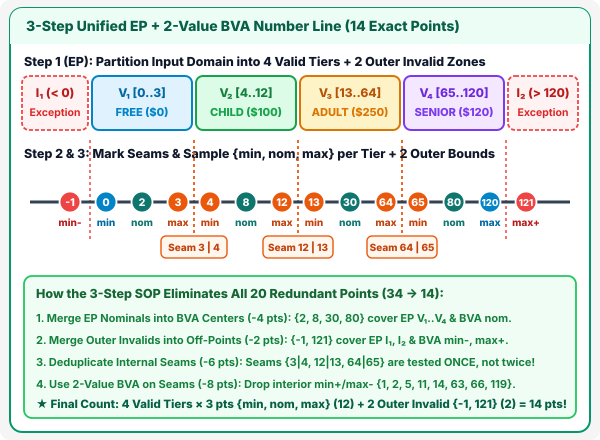

</div>
</div>

<!--
透過三步驟將 EP 與 BVA 統一整合：每個有效級距取樣 {min, nom, max}，加上外圍無效邊界的 -1 與 121，僅用 14 個測試值便達成 100% EP 與 100% BVA 涵蓋且零重複。
-->

---

<!-- header: '5.4 等價類分割測試 (EP)' -->

## 等價類分割測試 (EP) 常見問答 (FAQ)

<div class="card-deck">

> 💡 組合維度與涵蓋策略疑難：在測試成本與品質風險之間取得最佳平衡。

<div class="two-columns">
<div class="card" data-marpit-fragment>

### ❓ Q1: 什麼時候採用弱涵蓋？什麼時候必須升級為強涵蓋？
- **弱涵蓋 (Weak Coverage)**：
  - 適用於**輸入參數彼此完全獨立**的場景（如註冊表單中的暱稱、生日、血型）；
  - 案例數少，能以最低成本確保每個等價類都被測試一次。
- **強涵蓋 (Strong Coverage) / 全成對 (Pairwise)**：
  - 適用於**參數間存在緊密商務交互制約**（如保險費率乘數、折扣與年資、貸款審核）；
  - 若參數過多導致強涵蓋全乘積爆炸，直接升級為 **5.5 全成對測試 (Pairwise)** 是業界最佳解！

</div>
<div class="card" data-marpit-fragment>

### ❓ Q2: 可以部分變數用強涵蓋，部分變數用弱涵蓋嗎？
- **實務主流：混合式涵蓋策略 (Hybrid Coverage)**：
  - **完全可以，且高度推薦**（如前頁 `NextDate()` 之 5 組弱涵蓋基底 + 3 組高耦合補強）！全域強涵蓋會引發組合爆炸，全域弱涵蓋又會漏測關鍵耦合缺陷。
- **風險驅動的工程配置**：
  - **局部強涵蓋**：針對有強烈商務制約的 2~3 個核心變數（如 2 月 × 28/29 日 × 閏平年）進行重點交集。
  - **局部弱涵蓋**：針對其餘無耦合的常規區間，僅確保各類別代表至少被選中一次。
- **更高階解法**：直接運用 **5.5 Pairwise** 工具求解。

</div>
</div>
</div>

---

<!-- header: '5.4 等價類分割測試 (EP)' -->

## 等價類分割的 JUnit 5 落地：例外防禦與 CSV 資料驅動

<div class="card-deck">

> 💡 等價類測試的工程挑戰：無效等價類的外顯行為是「防禦防護」，有效等價類則需要管理多維度測試表格。

<div class="two-columns">
<div class="card" data-marpit-fragment>

### 🚨 無效等價類：例外斷言 (`assertThrows`)
- **單一無效原則之落實**：
  - 非法輸入（如負數邊長、空字串、超出規格之帳號長度）不得回傳正常值，而應觸發防禦性例外。
- **JUnit 5 解決方案 (`assertThrows` + Lambda `() ->`)**：
  - 透過 `() ->` 延遲執行非法呼叫，驗證是否精確拋出指定異常並檢查錯誤訊息：
  ```java
  var ex = assertThrows(IllegalArgumentException.class,
      () -> Triangle.classify(-1, 5, 5)); // 單一無效輸入
  assertTrue(ex.getMessage().contains("邊長必須大於 0"));
  ```

</div>
<div class="card" data-marpit-fragment>

### 📊 有效等價類：外部資料驅動 (`@CsvFileSource`)
- **測試邏輯與數據分離**：
  - 當等價分割劃分出大量測試向量（正等價類、零值等價類、各級距代表值），將測資硬編碼在程式中會導致代碼臃腫且難以維護。
- **JUnit 5 解決方案 (CsvSource / CsvFileSource)**：
  - 將等價類代表值與預期分類標籤外置於 CSV 檔案（如 LabDemo `ParamDemoTest`）；
  - 測試方法只需撰寫一套通用驗證流程，外部資料表可由測試工程師或業務分析師隨規格靈活擴充！

</div>
</div>
</div>

---

<!-- header: '5.4 等價類分割測試 (EP)' -->

## 🧩 EP & BVA 互動矩陣遊戲：FoodExpress 外送運費引擎挑戰

<div class="fdg-stage" id="fdg-ep-bva-game">
<div class="fdg-board-card">
<div class="fdg-board-title">面板 A：5 × 5 EP 等價分割矩陣（<code>Subtotal</code> 小計橫列 × <code>Distance</code> 距離直行）</div>
<table class="fdg-table" id="fdg-ep-table">
<thead>
<tr>
<th style="width: 20%;">小計 \ 距離</th>
<th style="width: 16%; color: #fda4af;">I₃: &lt; 1 km<br/>(0 km)</th>
<th style="width: 16%; color: #86efac;">D₁: 1..3 km<br/>(+$0)</th>
<th style="width: 16%; color: #86efac;">D₂: 4..8 km<br/>(+$10/km)</th>
<th style="width: 16%; color: #86efac;">D₃: 9..15 km<br/>(+$50+$20)</th>
<th style="width: 16%; color: #fda4af;">I₄: &gt; 15 km<br/>(16 km)</th>
</tr>
</thead>
<tbody id="fdg-ep-tbody"></tbody>
</table>
<div class="fdg-seam-box">
<div class="fdg-seam-title">面板 B：<code>Subtotal</code> 小計 BVA 接縫數線（在 BVA 挑戰中點選精確的邊界測試點）</div>
<div class="fdg-chips-wrap" id="fdg-seam-chips">
<span class="fdg-seam-chip" data-val="50">$50</span>
<span class="fdg-seam-chip" data-val="99">$99</span>
<span class="fdg-seam-chip" data-val="100">$100</span>
<span class="fdg-seam-chip" data-val="101">$101</span>
<span class="fdg-seam-chip" data-val="200">$200</span>
<span class="fdg-seam-chip" data-val="299">$299</span>
<span class="fdg-seam-chip" data-val="300">$300</span>
<span class="fdg-seam-chip" data-val="301">$301</span>
<span class="fdg-seam-chip" data-val="500">$500</span>
<span class="fdg-seam-chip" data-val="799">$799</span>
<span class="fdg-seam-chip" data-val="800">$800</span>
<span class="fdg-seam-chip" data-val="801">$801</span>
<span class="fdg-seam-chip" data-val="5000">$5000</span>
<span class="fdg-seam-chip" data-val="9999">$9999</span>
<span class="fdg-seam-chip" data-val="10000">$10000</span>
<span class="fdg-seam-chip" data-val="10001">$10001</span>
</div>
</div>
</div>
<div class="fdg-ctrl-card">
<div class="bvag-spec-box">
<strong>[規則回顧] FoodExpress <code>calcFee(subtotal, distanceKm)</code>：</strong><br/>
• <strong>餐點小計 (<code>NT$</code>)</strong>：合法範圍 <code>100..10000</code>（<code>&lt;100</code> 或 <code>&gt;10000</code> 拒絕）。級距：<strong>V₁</strong> <code>100..299</code> ($60)、<strong>V₂</strong> <code>300..799</code> ($35)、<strong>V₃</strong> <code>800..10000</code> ($0 免基本費)。<br/>
• <strong>外送距離 (<code>km</code>)</strong>：合法範圍 <code>1..15</code>（<code>&lt;1</code> 或 <code>&gt;15</code> 拒絕）。里程區：<strong>D₁</strong> <code>1..3</code> (+$0)、<strong>D₂</strong> <code>4..8</code> (+$10/km)、<strong>D₃</strong> <code>9..15</code> (+$50+$20/km)。
</div>
<div class="bvag-mission-box">
<div class="bvag-round-row">
<span class="bvag-round-pill" id="fdg-round-pill">挑戰 1 / 4（隨機排序）</span>
<span class="bvag-stat-pill" id="fdg-score-pill">已過關: 0 / 4 | 已選取: 0</span>
</div>
<div class="bvag-target-title" id="fdg-target-title">目標策略：載入中...</div>
<div class="bvag-target-hint" id="fdg-target-desc">請點擊面板 A 的矩陣儲存格（或面板 B 的接縫數值標籤）以建構測試套件，完成後點擊 <strong>送出答案 (Submit Selection)</strong>！</div>
</div>
<div class="bvag-quick-bar">
<span style="font-size: 11.5px; font-weight: 800; color: #475569;">快速輔助：</span>
<button type="button" class="bvag-qbtn" data-fdact="diag3">± 3 個對角線有效格</button>
<button type="button" class="bvag-qbtn" data-fdact="valid9">± 全部 9 個有效格</button>
<button type="button" class="bvag-qbtn" data-fdact="iso4">± 4 個隔離無效格</button>
<button type="button" class="bvag-qbtn" data-fdact="clear">✕ 全部清除</button>
</div>
<div class="bvag-action-row">
<button type="button" class="bvag-btn" id="fdg-btn-submit">送出答案 (Submit Selection)</button>
<button type="button" class="bvag-btn btn-next" id="fdg-btn-next">下一關挑戰 ➔</button>
<button type="button" class="bvag-btn btn-reset" id="fdg-btn-reshuffle">↺ 重新洗牌 4 關</button>
</div>
<div class="bvag-feedback-box" id="fdg-feedback-msg">請在左側選取儲存格或邊界數值標籤，以符合目標挑戰要求！</div>
</div>
</div>

<!--
這項四關卡互動遊戲結合了等價分割與邊界值分析實戰：讓學生在 5x5 矩陣上親手選取等價分割組合（弱一般 EP、強一般 EP、遵循單一無效原則的弱強固 EP），並在小計數線上選取精確的二點法 On-Off 邊界接縫值（99, 100, 299, 300, 799, 800, 10000, 10001）。系統會針對弱涵蓋自動檢查拉丁方陣正交覆蓋性質，任何合法的弱涵蓋組合都會被判定通過。
-->

---

<!-- header: '5.4 等價類分割測試 (EP)' -->

## 🧪 課堂實習指引 (LabDemo 5.4: EP 等價類實戰)

<div class="card-deck">

> 💡 等價類實戰重點：使用 @CsvSource 建立多維度測試表格，以 assertThrows 驗證非法輸入的防禦性邏輯。

<div class="two-columns">
<div class="card">

### 💻 體驗範例程式碼 (Demo Walkthrough)
- **1. 二元搜尋多維等價分割**：
  - 開啟 [`BinarySearchEpDemoTest.java`](../../lab.html?file=LabDemo/src/test/java/u05_partition/ep/BinarySearchEpDemoTest.java)
  - 觀察陣列長度（空、單、多元素）與命中位置（頭、中、尾、不存在）之等價類別劃分。
- **2. 參數化外部資料驅動**：
  - 開啟 [`ParamDemoTest.java`](../../lab.html?file=LabDemo/src/test/java/u05_partition/ep/ParamDemoTest.java)
  - 觀察 `@ValueSource` 與 `@CsvSource` 如何乾淨解耦測試邏輯與資料。

</div>
<div class="card">

### 🎯 課堂動手練習 (Hands-on Exercise)
- **練習：密碼格式等價類分割**：
  - 開啟 [`PasswordValidatorEpExerciseTest.java`](../../lab.html?file=LabDemo/src/test/java/u05_partition/ep/PasswordValidatorEpExerciseTest.java)；
  - 練習 1：驗證長度合格且包含英數字之【有效等價類】；
  - 練習 2：使用 `assertThrows` 驗證長度小於 8 或大於 20 之【無效等價類例外】；
  - 練習 3：驗證純字母或純數字之【弱密碼等價類回傳 false】！

</div>
</div>
</div>

---

<!-- header: '5.4 等價類分割測試 (EP)' -->

## 概念核對問答 (CCQ 3)

<div class="ccq-columns">
<div class="ccq-text">

<!-- id: sqa-ch05-ccq3 -->
**問題情境**：  
【單選題】在等價類分割測試 (Equivalence Partitioning) 中，「弱涵蓋 (Weak Coverage)」與「強涵蓋 (Strong Coverage)」分類法的主要區別是什麼？

- **A)** 弱涵蓋只測試有效等價類，強涵蓋兼測有效與無效等價類
- **B)** 弱涵蓋基於單一錯誤假設，強涵蓋測試所有類別笛卡爾全組合
- **C)** 弱涵蓋不需軟體規格文件，強涵蓋必須嚴格遵照 SRS 文件執行
- **D)** 弱涵蓋產生的案例數較多，強涵蓋產生的測試案例數必然較少

</div>
<div class="ccq-logo">

<a href="https://nlhsueh.github.io/nickedupocket/#/student/sqa-ch05-ccq3" target="_blank"></a>

</div>
</div>

---

<!-- _class: lead -->
<!-- header: '5.5 全成對組合測試 (Pairwise)' -->

# **5.5 全成對組合測試 (Pairwise)**

> 「當組合爆炸讓窮盡測試成為不可能，  
> 全成對測試用數學奇蹟，抓出 90% 的交互作用缺陷。」

---

<!-- header: '5.5 全成對組合測試 (Pairwise)' -->

## 組合爆炸難題與 2-Way 交互作用理論

<div class="card-deck">

> 💡 美國國家標準與技術研究院 (NIST) 研究：軟體系統中絕大多數缺陷皆由「單一變數」或「雙變數配對」所觸發。

<div class="two-columns">
<div class="card" data-marpit-fragment>

### 💥 組合爆炸的殘酷現實
- **多參數系統的災難**：
  - 假設系統有 10 個參數，每個參數各有 3 種可能值。
  - 全乘積窮盡測試需要：
    > 📐 **3<sup>10</sup> = **59,049** 個測試案例！**
  - 在工程實務上，根本沒有足夠的時間與預算執行窮盡測試。

</div>
<div class="card" data-marpit-fragment>

### 🎯 NIST 實證經驗與成對假設
- **2-Way 交互作用理論**：
  - **67% ~ 93%** 的缺陷只要任意 2 個參數的交互作用就會觸發。
  - 需要 3 個以上參數交互觸發的罕見缺陷不足 10%。
- **Pairwise (All-Pairs) 原則**：
  - **只要任意兩個參數的所有可能取值組合都至少出現過一次即可**！案例數從幾萬個劇降至數十個！

</div>
</div>
</div>

---

<!-- header: '5.5 全成對組合測試 (Pairwise)' -->

## 游泳池收費系統：全成對實戰對照

<div class="card-deck">

> 💡 透過交錯法與成對匹配，案例數量從全乘積的 12 個直接砍半至 6 個，覆蓋率絲毫不減。

<div class="two-columns">
<div class="card" data-marpit-fragment>

### 🏊 參數維度定義
- **日期 (d, 2 種)**：d<sub>1</sub> 假日, d<sub>2</sub> 平日
- **時間 (t, 3 種)**：t<sub>1</sub> 清晨, t<sub>2</sub> 中午, t<sub>3</sub> 其他
- **身分 (m, 2 種)**：m<sub>1</sub> 會員, m<sub>2</sub> 非會員
- **全乘積需求**：2 × 3 × 2 = 12 個案例。

</div>
<div class="card" data-marpit-fragment>

### ✅ 全成對測試套件 (6 個案例)
| 案例 | 時間 (t) | 星期 (d) | 會員 (m) |
| :---: | :---: | :---: | :---: |
| **1** | t<sub>1</sub> (清晨) | d<sub>1</sub> (假日) | m<sub>1</sub> (會員) |
| **2** | t<sub>1</sub> (清晨) | d<sub>2</sub> (平日) | m<sub>2</sub> (非會員) |
| **3** | t<sub>2</sub> (中午) | d<sub>1</sub> (假日) | m<sub>2</sub> (非會員) |
| **4** | t<sub>2</sub> (中午) | d<sub>2</sub> (平日) | m<sub>1</sub> (會員) |
| **5** | t<sub>3</sub> (其他) | d<sub>1</sub> (假日) | m<sub>1</sub> (會員) |
| **6** | t<sub>3</sub> (其他) | d<sub>2</sub> (平日) | m<sub>2</sub> (非會員) |

*(時間-星期、星期-會員、時間-會員兩兩組合 100% 涵蓋！)*

</div>
</div>
</div>

---

<!-- header: '5.5 全成對組合測試 (Pairwise)' -->

## 互動式手推設計：交錯法 (Alternating Method) 6 步建構全成對表

<div class="alt-interactive-stage" id="alt-pairwise-explorer">
<div class="alt-nav-toolbar">
  <div class="alt-step-group">
    <button type="button" class="alt-step-btn is-active" data-alt-step="1">1. 排 W (留空列)</button>
    <button type="button" class="alt-step-btn" data-alt-step="2">2. 交錯填 X</button>
    <button type="button" class="alt-step-btn" data-alt-step="3">3. 填 Y (列4-5調)</button>
    <button type="button" class="alt-step-btn" data-alt-step="4">4. 填 Z (列7-8調)</button>
    <button type="button" class="alt-step-btn" data-alt-step="5">5. 填 P (列1-2調)</button>
    <button type="button" class="alt-step-btn" data-alt-step="6">6. 填 Q (補空列)</button>
  </div>
  <div style="display: flex; gap: 6px;">
    <button type="button" class="greedy-action-btn" id="alt-next-btn">下一步 &gt;</button>
    <button type="button" class="greedy-action-btn" id="alt-reset-btn">重置</button>
  </div>
</div>
<div class="alt-content-grid">
  <div class="alt-card">
    <table class="alt-table" id="alt-matrix-table">
      <thead>
        <tr>
          <th>列</th>
          <th data-col="0" class="is-col-active">W (3)</th>
          <th data-col="1">X (2)</th>
          <th data-col="2">Y (2)</th>
          <th data-col="3">Z (2)</th>
          <th data-col="4">P (2)</th>
          <th data-col="5">Q (2)</th>
        </tr>
      </thead>
      <tbody>
        <tr data-r="1"><td class="alt-row-num">1</td><td class="is-new-col">w1</td><td></td><td></td><td></td><td></td><td></td></tr>
        <tr data-r="2"><td class="alt-row-num">2</td><td class="is-new-col">w1</td><td></td><td></td><td></td><td></td><td></td></tr>
        <tr data-r="3" class="is-buffer-row"><td class="alt-row-num">3</td><td>(預留)</td><td></td><td></td><td></td><td></td><td></td></tr>
        <tr data-r="4"><td class="alt-row-num">4</td><td class="is-new-col">w2</td><td></td><td></td><td></td><td></td><td></td></tr>
        <tr data-r="5"><td class="alt-row-num">5</td><td class="is-new-col">w2</td><td></td><td></td><td></td><td></td><td></td></tr>
        <tr data-r="6" class="is-buffer-row"><td class="alt-row-num">6</td><td>(預留)</td><td></td><td></td><td></td><td></td><td></td></tr>
        <tr data-r="7"><td class="alt-row-num">7</td><td class="is-new-col">w3</td><td></td><td></td><td></td><td></td><td></td></tr>
        <tr data-r="8"><td class="alt-row-num">8</td><td class="is-new-col">w3</td><td></td><td></td><td></td><td></td><td></td></tr>
      </tbody>
    </table>
    <div class="alt-legend-row">
      <span><span class="alt-legend-dot" style="background:#bae6fd;border:1px solid #0284c7;"></span>本步新增欄位</span>
      <span><span class="alt-legend-dot" style="background:#fde68a;border:1px solid #d97706;"></span>交錯對調 (⇄)</span>
      <span><span class="alt-legend-dot" style="background:#bbf7d0;border:1px solid #16a34a;"></span>空列補洞 (列3,6)</span>
    </div>
  </div>
  <div class="alt-card">
    <div>
      <div style="display:flex;justify-content:space-between;align-items:center;border-bottom:1.5px solid #e2e8f0;padding-bottom:8px;margin-bottom:10px;">
        <span class="ep-badge-pill ep-badge-blue" id="alt-step-badge" style="margin:0;">步驟 1 / 6</span>
        <span style="font-size:12px;font-weight:800;color:#475569;" id="alt-scope-label">變數：W(3)</span>
      </div>
      <h3 class="ep-title-text" id="alt-step-title" style="font-size:16.5px;margin-bottom:8px;">依取值數降冪排列，填寫 W 並預留空列</h3>
      <div class="alt-kpi-row" style="margin-bottom:10px;">
        <div class="alt-kpi-box">
          <div class="alt-kpi-label">目前啟用測試列數</div>
          <div class="alt-kpi-val" id="alt-kpi-rows">6 列</div>
        </div>
        <div class="alt-kpi-box">
          <div class="alt-kpi-label">對照全乘積 (壓縮率)</div>
          <div class="alt-kpi-val" id="alt-kpi-comp">3 組</div>
        </div>
      </div>
      <ul class="alt-guide-list" id="alt-guide-list">
        <li><strong>最多值放最左：</strong>先將具備最多可能值的變數 <code>W (w1, w2, w3)</code> 放最左欄，其餘變數依取值數由大到小向右排列。</li>
        <li><strong>依下一欄倍數重複：</strong>因下一個變數 <code>X</code> 有 2 種取值，故每個 <code>w</code> 重複寫 2 列（列 1–2、4–5、7–8）。</li>
        <li><strong>預留緩衝空列：</strong>刻意保留<strong>列 3 與列 6</strong> 為空白列，留待後續變數無法靠對調補齊時用來補洞！</li>
      </ul>
    </div>
    <div class="alt-mnemonic-box" id="alt-mnemonic-box">
      <strong>交錯法核心口訣：</strong>最多值放最左、組間預留空列；新增欄位依序輪流對調（<code>Y</code> 調列 4–5 ➔ <code>Z</code> 調列 7–8 ➔ <code>P</code> 調列 1–2），輪滿後再用預留空列 <code>3, 6</code> 補齊缺口！
    </div>
  </div>
</div>
</div>

<!--
交錯法（Alternating / Interleaving Method）是全成對組合測試（Pairwise Testing）最直覺的手工設計技術。在進入 NP-Hard 與電腦貪婪演算法前，本頁以 6 個變數 W(3) × X(2) × Y(2) × Z(2) × P(2) × Q(2)（全乘積高達 96 組）為例，透過 6 步互動引導展示如何以「最多值放最左 + 組間預留緩衝空列 + 輪流對調區塊」僅用 8 列即完成 100% 全成對覆蓋（縮減 91.7%）。
-->

---

<!-- header: '5.5 全成對組合測試 (Pairwise)' -->

## 為什麼最小成對測試集是 NP-Hard？啟發式生成演算法

<div class="card-deck">

> 💡 尋找數學上的「絕對最小成對測試集」等價於最小集合覆蓋問題，屬 NP-Hard 難題。

<div class="two-columns">
<div class="card" data-marpit-fragment>

### 📐 數學本質：最小集合覆蓋 (Set Cover)
- **問題歸約**：
  - 系統中有 k 個參數，全成對測試需涵蓋全部 ∑ (|V<sub>i</sub>| × |V<sub>j</sub>|) 個成對組合 (Pairs)。
  - 每個測試案例最多能覆蓋 C(k, 2) 個特定 Pair。
  - **尋找最少測試案例以覆蓋所有成對組合**，在計算理論上等價於經典的 **NP-Complete 最小集合覆蓋問題**。
- **指數級計算爆炸**：
  - 隨參數與取值增加，窮舉搜尋全域絕對最佳解耗時天文數字，在工程實務上毫無效益。

</div>
<div class="card" data-marpit-fragment>

### ⚡ 現代工具求解策略：貪婪啟發式 (Heuristics)
- **貪婪覆蓋演算法**：
  - **AETG (`Automatic Efficient Test Generator`，自動高效測試產生器)**：逐列生成，每輪貪婪挑選能一次消去最多未覆蓋 Pairs 的整列測試案例。
  - **IPO (`In-Parameter-Order`，參數依序擴展法)**：先將前兩個參數全配對展開，再逐一加入新參數欄（橫向擴展 + 縱向補列），於多項式時間秒級求解。
- **約束求解與剪枝 (Constraints & SAT)**：
  - 實務常有業務互斥（如 `OS=iOS` 不可配 `Browser=IE`）；
  - 整合 **SAT (`Boolean Satisfiability`，布林可滿足性)** 求解器即時修剪非法狀態。

</div>
</div>
</div>

---

<!-- header: '5.5 全成對組合測試 (Pairwise)' -->

## 互動式演算法步進追蹤：Greedy IPO 逐步推導（游泳池收費系統）

<div class="greedy-interactive-stage" id="greedy-explorer">
<div class="greedy-nav-toolbar">
  <div class="greedy-step-group">
    <button class="greedy-step-btn is-active" data-step="1">1. (t₁, d₁)</button>
    <button class="greedy-step-btn" data-step="2">2. (t₁, d₂)</button>
    <button class="greedy-step-btn" data-step="3">3. (t₂, d₁)</button>
    <button class="greedy-step-btn" data-step="4">4. (t₂, d₂)</button>
    <button class="greedy-step-btn" data-step="5">5. (t₃, d₁)</button>
    <button class="greedy-step-btn" data-step="6">6. (t₃, d₂)</button>
  </div>
  <div style="display: flex; gap: 8px;">
    <button class="greedy-action-btn" id="greedy-next-btn">下一步 &gt;</button>
    <button class="greedy-action-btn" id="greedy-reset-btn">重置</button>
  </div>
</div>
<div class="greedy-content-grid">
  <div class="greedy-card">
    <div class="greedy-decision-box">
      <div style="display: flex; justify-content: space-between; align-items: center; margin-bottom: 2px;">
        <span style="font-size: 11.5px; font-weight: 800; color: #0284c7;" id="greedy-step-badge">步驟 1 / 6</span>
        <span style="font-size: 11.5px; font-weight: 700; color: #475569;" id="greedy-base-info">基底：(Time = t₁, Day = d₁)</span>
      </div>
      <div class="greedy-eval-row">
        <div class="greedy-eval-item is-winner" id="greedy-eval-m1">
          <div class="greedy-eval-name">候選值 m₁ (會員 Member)</div>
          <div class="greedy-eval-score" id="greedy-score-m1">+3 個新配對</div>
          <div class="greedy-eval-pairs" id="greedy-pairs-m1">t₁d₁, t₁m₁, d₁m₁</div>
        </div>
        <div class="greedy-eval-item" id="greedy-eval-m2">
          <div class="greedy-eval-name">候選值 m₂ (非會員 Non-Member)</div>
          <div class="greedy-eval-score" id="greedy-score-m2">+3 個新配對</div>
          <div class="greedy-eval-pairs" id="greedy-pairs-m2">t₁d₁, t₁m₂, d₁m₂</div>
        </div>
      </div>
      <div class="greedy-winner-banner" id="greedy-winner-banner">
        <span>[貪婪勝出者]：<strong>m₁</strong> (同分平手決勝)</span>
        <span style="font-family: 'Fira Code', monospace; font-size: 12.5px;">測試案例：(t₁, d₁, m₁)</span>
      </div>
    </div>
    <div class="greedy-table-wrapper">
      <table class="greedy-table" id="greedy-trace-table">
        <thead>
          <tr>
            <th>列號</th>
            <th>基底 (T, D)</th>
            <th>貪婪計分比對</th>
            <th>勝出測試案例</th>
            <th>累計覆蓋配對</th>
          </tr>
        </thead>
        <tbody>
          <tr data-row="1" class="is-current">
            <td><strong>1</strong></td>
            <td>(t₁, d₁)</td>
            <td>m₁: +3 vs. m₂: +3</td>
            <td><strong>(t₁, d₁, m₁)</strong></td>
            <td><strong>3 / 16</strong></td>
          </tr>
          <tr data-row="2" class="is-pending">
            <td><strong>2</strong></td>
            <td>(t₁, d₂)</td>
            <td>m₁: +2 vs. m₂: +3</td>
            <td>(t₁, d₂, m₂)</td>
            <td>6 / 16</td>
          </tr>
          <tr data-row="3" class="is-pending">
            <td><strong>3</strong></td>
            <td>(t₂, d₁)</td>
            <td>m₁: +2 vs. m₂: +3</td>
            <td>(t₂, d₁, m₂)</td>
            <td>9 / 16</td>
          </tr>
          <tr data-row="4" class="is-pending">
            <td><strong>4</strong></td>
            <td>(t₂, d₂)</td>
            <td>m₁: +3 vs. m₂: +1</td>
            <td>(t₂, d₂, m₁)</td>
            <td>12 / 16</td>
          </tr>
          <tr data-row="5" class="is-pending">
            <td><strong>5</strong></td>
            <td>(t₃, d₁)</td>
            <td>m₁: +2 vs. m₂: +2</td>
            <td>(t₃, d₁, m₁)</td>
            <td>14 / 16</td>
          </tr>
          <tr data-row="6" class="is-pending">
            <td><strong>6</strong></td>
            <td>(t₃, d₂)</td>
            <td>m₁: +1 vs. m₂: +2</td>
            <td>(t₃, d₂, m₂)</td>
            <td>16 / 16</td>
          </tr>
        </tbody>
      </table>
    </div>
  </div>
  <div class="greedy-card greedy-progress-card">
    <div>
      <div class="greedy-prog-header">
        <span>成對覆蓋率 (Pairwise Coverage)</span>
        <span id="greedy-prog-stat">3 / 16 Pairs (19%)</span>
      </div>
      <div class="greedy-prog-bar-bg" style="margin-top: 5px;">
        <div class="greedy-prog-bar-fill" id="greedy-prog-bar" style="width: 18.75%;"></div>
      </div>
    </div>
    <div class="greedy-pairs-section">
      <div class="greedy-pairs-title">Time × Day (6 組配對 — 基底值域)</div>
      <div class="greedy-pairs-tags">
        <span class="greedy-pair-tag is-new" data-pair="t1d1">t₁d₁</span>
        <span class="greedy-pair-tag" data-pair="t1d2">t₁d₂</span>
        <span class="greedy-pair-tag" data-pair="t2d1">t₂d₁</span>
        <span class="greedy-pair-tag" data-pair="t2d2">t₂d₂</span>
        <span class="greedy-pair-tag" data-pair="t3d1">t₃d₁</span>
        <span class="greedy-pair-tag" data-pair="t3d2">t₃d₂</span>
      </div>
    </div>
    <div class="greedy-pairs-section">
      <div class="greedy-pairs-title">Time × Member (6 組配對)</div>
      <div class="greedy-pairs-tags">
        <span class="greedy-pair-tag is-new" data-pair="t1m1">t₁m₁</span>
        <span class="greedy-pair-tag" data-pair="t1m2">t₁m₂</span>
        <span class="greedy-pair-tag" data-pair="t2m1">t₂m₁</span>
        <span class="greedy-pair-tag" data-pair="t2m2">t₂m₂</span>
        <span class="greedy-pair-tag" data-pair="t3m1">t₃m₁</span>
        <span class="greedy-pair-tag" data-pair="t3m2">t₃m₂</span>
      </div>
    </div>
    <div class="greedy-pairs-section">
      <div class="greedy-pairs-title">Day × Member (4 組配對)</div>
      <div class="greedy-pairs-tags">
        <span class="greedy-pair-tag is-new" data-pair="d1m1">d₁m₁</span>
        <span class="greedy-pair-tag" data-pair="d1m2">d₁m₂</span>
        <span class="greedy-pair-tag" data-pair="d2m1">d₂m₁</span>
        <span class="greedy-pair-tag" data-pair="d2m2">d₂m₂</span>
      </div>
    </div>
  </div>
</div>
</div>

<!--
逐步追蹤 IPO + Greedy 演算法：點擊每一列可觀察系統如何根據候選值 m1 與 m2 所能覆蓋的「全新參數配對數」進行計分，並在短短 6 列內逐步達成全部 16 個成對組合的 100% 覆蓋。
-->

---

<!-- header: '5.5 全成對組合測試 (Pairwise)' -->

## 全成對測試工具與放款計算案例

<div class="card-deck">

> 💡 實務工程皆採用啟發式工具秒級生成；本課程 LabDemo 已深度整合 Java 原生 AllPairs4J。

<div class="content-columns">
<div class="content-text">

### 🛠️ 主流自動化工具選型
- **AllPairs4J (Java / JUnit 5 原生)**：★ *LabDemo 首選*
  - 純 Java 輕量庫，以 Fluent Builder API 直接在單元測試 `@TestFactory` 動態生成並執行測試矩陣！
- **PICT (微軟開源工具)**：
  - 業界最普及的 CLI 工具，支援自訂語法模型檔 (`.pict`)、條件約束與權重。
- **ACTS (NIST 開源工具)**：
  - Java 原生 GUI/CLI 工具，支援高階 t-way 組合（如 3-way, 4-way）。
- **放款利率案例 (LoanCalculator)**：
  - 4 個維度全乘積需 3 × 3 × 2 × 2 = 36 組；
  - 透過 AllPairs4J **僅需 9 組成對案例**即達成 100% 2-way 覆蓋！

</div>
<div class="content-figure">

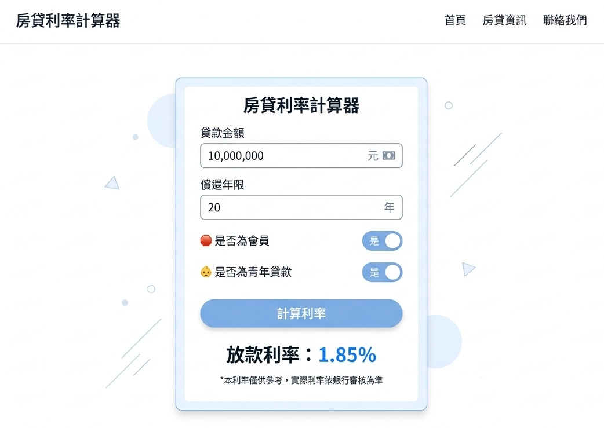

</div>
</div>
</div>

---

<!-- header: '5.5 全成對組合測試 (Pairwise)' -->

## 🧩 Pairwise 互動挑戰：`LoanCalculator` 9 組測試案例（完成 #8 與 #9！）

> <strong>隨堂挑戰：</strong>點擊 `#8` 與 `#9` <strong>右下角 4 個按鈕</strong>切換 `true` ↔ `false` 以補齊所有雙參數配對，完成後按 <strong>Submit</strong>！

<div id="pw-loan-table-quiz-tw">
<table>
<thead>
<tr>
<th style="width:65px;text-align:center;">案例</th>
<th style="width:140px;text-align:center;"><code>LoanYears</code> (3)</th>
<th style="width:120px;text-align:center;"><code>Amount</code> (3)</th>
<th style="width:130px;text-align:center;"><code>IsYouth</code> (2)</th>
<th style="width:130px;text-align:center;"><code>IsMarried</code> (2)</th>
<th style="text-align:left;">已覆蓋之關鍵成對組合 (2-Way Pairs)</th>
</tr>
</thead>
<tbody>
<tr><td style="text-align:center;"><strong>#1</strong></td><td style="text-align:center;"><code>≤ 10 yr</code> (5)</td><td style="text-align:center;"><code>≤ 5M</code> (4M)</td><td style="text-align:center;"><code>true</code></td><td style="text-align:center;"><code>true</code></td><td><code>(≤10, ≤5M)</code>, <code>(≤10, Y=T)</code>, <code>(≤10, M=T)</code>, <code>(≤5M, Y=T)</code>, <code>(≤5M, M=T)</code>, <code>(Y=T, M=T)</code></td></tr>
<tr><td style="text-align:center;"><strong>#2</strong></td><td style="text-align:center;"><code>≤ 10 yr</code> (5)</td><td style="text-align:center;"><code>6M</code></td><td style="text-align:center;"><code>false</code></td><td style="text-align:center;"><code>false</code></td><td><code>(≤10, 6M)</code>, <code>(≤10, Y=F)</code>, <code>(≤10, M=F)</code>, <code>(6M, Y=F)</code>, <code>(6M, M=F)</code>, <code>(Y=F, M=F)</code></td></tr>
<tr><td style="text-align:center;"><strong>#3</strong></td><td style="text-align:center;"><code>≤ 10 yr</code> (5)</td><td style="text-align:center;"><code>10M</code></td><td style="text-align:center;"><code>false</code></td><td style="text-align:center;"><code>true</code></td><td><code>(≤10, 10M)</code>, <code>(10M, Y=F)</code>, <code>(10M, M=T)</code>, <code>(Y=F, M=T)</code></td></tr>
<tr><td style="text-align:center;"><strong>#4</strong></td><td style="text-align:center;"><code>11..20 yr</code> (15)</td><td style="text-align:center;"><code>≤ 5M</code> (4M)</td><td style="text-align:center;"><code>false</code></td><td style="text-align:center;"><code>true</code></td><td><code>(11..20, ≤5M)</code>, <code>(11..20, Y=F)</code>, <code>(11..20, M=T)</code>, <code>(≤5M, Y=F)</code></td></tr>
<tr><td style="text-align:center;"><strong>#5</strong></td><td style="text-align:center;"><code>11..20 yr</code> (15)</td><td style="text-align:center;"><code>6M</code></td><td style="text-align:center;"><code>true</code></td><td style="text-align:center;"><code>false</code></td><td><code>(11..20, 6M)</code>, <code>(11..20, Y=T)</code>, <code>(11..20, M=F)</code>, <code>(6M, Y=T)</code>, <code>(Y=T, M=F)</code></td></tr>
<tr><td style="text-align:center;"><strong>#6</strong></td><td style="text-align:center;"><code>11..20 yr</code> (15)</td><td style="text-align:center;"><code>10M</code></td><td style="text-align:center;"><code>true</code></td><td style="text-align:center;"><code>false</code></td><td><code>(11..20, 10M)</code>, <code>(10M, Y=T)</code>, <code>(10M, M=F)</code></td></tr>
<tr><td style="text-align:center;"><strong>#7</strong></td><td style="text-align:center;"><code>&gt; 20 yr</code> (25)</td><td style="text-align:center;"><code>≤ 5M</code> (4M)</td><td style="text-align:center;"><code>true</code></td><td style="text-align:center;"><code>false</code></td><td><code>(&gt;20, ≤5M)</code>, <code>(&gt;20, Y=T)</code>, <code>(&gt;20, M=F)</code>, <code>(≤5M, M=F)</code></td></tr>
<tr style="background:#f0f9ff;"><td style="text-align:center;"><strong>#8</strong></td><td style="text-align:center;"><code>&gt; 20 yr</code> (25)</td><td style="text-align:center;"><code>6M</code></td><td style="text-align:center;"><button type="button" class="pw-sw-btn" data-id="c8y" style="min-width:86px;padding:2px 10px;border-radius:6px;border:2px solid #0284c7;background:#e0f2fe;color:#0369a1;font-family:monospace;font-weight:700;font-size:15px;cursor:pointer;">true ⇄</button></td><td style="text-align:center;"><button type="button" class="pw-sw-btn" data-id="c8m" style="min-width:86px;padding:2px 10px;border-radius:6px;border:2px solid #0284c7;background:#e0f2fe;color:#0369a1;font-family:monospace;font-weight:700;font-size:15px;cursor:pointer;">true ⇄</button></td><td id="pw-clue-8-tw" style="color:#0369a1;font-weight:600;"><code>(&gt;20, 6M)</code> + <em>請觀察 <code>&gt;20</code> 與 <code>6M</code> 還缺哪些配對？</em></td></tr>
<tr style="background:#f0f9ff;"><td style="text-align:center;"><strong>#9</strong></td><td style="text-align:center;"><code>&gt; 20 yr</code> (25)</td><td style="text-align:center;"><code>10M</code></td><td style="text-align:center;"><button type="button" class="pw-sw-btn" data-id="c9y" style="min-width:86px;padding:2px 10px;border-radius:6px;border:2px solid #0284c7;background:#e0f2fe;color:#0369a1;font-family:monospace;font-weight:700;font-size:15px;cursor:pointer;">true ⇄</button></td><td style="text-align:center;"><button type="button" class="pw-sw-btn" data-id="c9m" style="min-width:86px;padding:2px 10px;border-radius:6px;border:2px solid #0284c7;background:#e0f2fe;color:#0369a1;font-family:monospace;font-weight:700;font-size:15px;cursor:pointer;">true ⇄</button></td><td id="pw-clue-9-tw" style="color:#0369a1;font-weight:600;"><code>(&gt;20, 10M)</code> + <em>協助補齊剩餘的 <code>&gt;20</code> 配對！</em></td></tr>
</tbody>
</table>
<div style="display:flex;align-items:center;gap:12px;margin-top:8px;">
<button type="button" id="pw-loan-submit-tw" style="padding:5px 16px;border-radius:6px;border:none;background:#0284c7;color:#fff;font-weight:700;font-size:14.5px;cursor:pointer;">Submit 提交驗證</button>
<button type="button" id="pw-loan-reset-tw" style="padding:5px 12px;border-radius:6px;border:1px solid #94a3b8;background:#fff;color:#334155;font-weight:600;font-size:13.5px;cursor:pointer;">Reset 重設</button>
<div id="pw-loan-feedback-tw" style="font-size:14.5px;font-weight:600;color:#1e293b;"></div>
</div>
</div>

<!--
透過檢查案例 #7 之後尚未被覆蓋的雙參數配對來推導案例 #8 與 #9：
1. LoanYears × Amount (9 組配對)：>20 yr 尚未配過 6M 與 10M，因此 #8、#9 前兩欄分別是 (>20 yr, 6M) 與 (>20 yr, 10M)。
2. 針對 #8 (>20 yr, 6M)：6M 在 #2 與 #5 都只配過 IsMarried=false，因此 #8 必須設 IsMarried=true，才能補齊 (6M, M=true) 與 (>20, M=true)。
3. 針對 #8 或 #9：>20 yr 在 #7 只配過 IsYouth=true，因此 #8 或 #9 至少需有一列將 IsYouth 設為 false，即可在 9 組案例內達成 28/28 (100%) 成對覆蓋。
-->

---

<!-- header: '5.5 全成對組合測試 (Pairwise)' -->

## AllPairs4J 核心 API 與 `@TestFactory` 實作（以游泳池為例）

<div class="card-deck">

> 💡 以 `AllPairs4J` 動態計算成對矩陣，再交由 JUnit 5 `@TestFactory` 展開為獨立測試節點！

<div class="two-columns">
<div class="card" data-marpit-fragment>

### 🧩 `AllPairs4J` 四大核心 API 意義
- **1. `new Parameter(name, values...)`**：
  - 定義**單一參數維度**（參數名 + 所有候選水準值）。
- **2. `new AllPairs.AllPairsBuilder()`**：
  - 以 `.withParameter(...)` 註冊各維度（亦支援 `.withConstraint(...)` 排除互斥組合）；呼叫 **`.build()` 正式啟動 IPO+Greedy 演算法**！
- **3. `allPairs.getGeneratedCases()`**：
  - 回傳壓縮後之成對案例清單 **`List<Case>`**（泳池 12 組 ➔ **6 組**）。
- **4. `Case.get("參數名")` + `@TestFactory`**：
  - `Case` 繼承自 `Map`，以 `c.get(key)` 取出配對值並封裝為 `DynamicTest`！

</div>
<div class="card" data-marpit-fragment>

### 💻 `SwimmingPoolPairwiseDemoTest`
```java
// 1. 定義 3 維度並呼叫 build() 啟動演算法生成 6 組 Case
AllPairs allPairs = new AllPairs.AllPairsBuilder()
    .withParameter(new Parameter("TimeSlot", "MORNING", "NOON", "OTHER"))
    .withParameter(new Parameter("DayType", "HOLIDAY", "WEEKDAY"))
    .withParameter(new Parameter("IsMember", "true", "false"))
    .build();

// 2. @TestFactory 走訪每筆 Case，以 c.get(key) 取值並動態執行
@TestFactory
List<DynamicTest> dynamicSwimmingPoolPairwiseTests() {
    return allPairs.getGeneratedCases().stream().map(c -> {
        TimeSlot t = TimeSlot.valueOf(c.get("TimeSlot").toString());
        DayType d  = DayType.valueOf(c.get("DayType").toString());
        boolean m  = Boolean.parseBoolean(c.get("IsMember").toString());
        return DynamicTest.dynamicTest(t + "/" + d + "/m=" + m, () -> {
            int price = SwimmingPoolPricing.calculatePrice(t, d, m);
            assertTrue(price >= 50 && price <= 200);
        });
    }).collect(Collectors.toList());
}
```

</div>
</div>
</div>

---

<!-- header: '5.5 全成對組合測試 (Pairwise)' -->

## 🤔 關鍵反思：工具只生「輸入組合」，Expected Output 從哪來？

<div class="card-deck">

> 💡 `AllPairs4J` 與 `PICT` 只負責壓縮**測試輸入 (Inputs)**，並不曉得業務規格的**預期輸出 (Test Oracle)**！實務上有兩大落地策略：

<div class="two-columns">
<div class="card" data-marpit-fragment>

### 🛡️ 策略 A：動態不變量斷言 (`@TestFactory`)
- **做法**：不逐一查表算精確值，改驗證「**任何組合下皆須成立的業務不變量 (Invariants)**」與「**不崩潰 (No Crash)**」。
  - 例：泳池票價必介於 `50 ~ 200 元`、房貸利率必 `≥ 2.0%` 法定下限。
- **優缺點**：
  - ✅ **100% 全自動**：適合數十組至上百組高維度配對或 Smoke Test。
  - ⚠️ **Oracle 盲區**：若應收 80 元卻算成 100 元（仍在 50~200 內），單靠區間斷言抓不到！

</div>
<div class="card" data-marpit-fragment>

### 🎯 策略 B：兩階段精確預言機 (`AllPairs` ➔ `@CsvSource`)
- **實務兩步驟工作流（於 Lab `SwimmingPoolPairwiseDemoTest` 示範）**：
  1. **Step 1 (工具印出 `@CsvSource` 樣板)**：用 `AllPairs4J` 印出 6 組配對骨架，預期值欄位留 `TODO` 供複製貼上。
  2. **Step 2 (人工對照 SRS 補上預期值)**：只需算這 **6 組**（省去算另外 6~27 組！），將 `TODO` 改為規格票價並執行 `assertEquals`：
```java
@ParameterizedTest
@CsvSource({ // Step 1 自動印出前3欄與 TODO ➔ Step 2 複製貼上並將 TODO 改為 SRS 預期票價
    "MORNING, HOLIDAY, true,  100", "MORNING, WEEKDAY, false,  80",
    "NOON,    HOLIDAY, false, 200", "NOON,    WEEKDAY, true,   50",
    "OTHER,   HOLIDAY, true,  100", "OTHER,   WEEKDAY, false, 100"
})
void testExactOracle(TimeSlot t, DayType d, boolean m, int expected) {
    assertEquals(expected, SwimmingPoolPricing.calculatePrice(t, d, m));
}
```

</div>
</div>
</div>

---

<!-- header: '5.5 全成對組合測試 (Pairwise)' -->

## 🧪 課堂實習指引 (LabDemo 5.5: 全成對組合測試實戰)

<div class="card-deck">

> 💡 搭配專題實驗手冊：[`pairwise_combinatorial.md`](../../lab.html?file=LabDemo/docs/u05_utest/pairwise_combinatorial.md)

<div class="two-columns">
<div class="card">

### 💻 課堂示範體驗 (兩大 Demo)
- **1. 游泳池成對測試 ([`SwimmingPoolPairwiseDemoTest.java`](../../lab.html?file=LabDemo/src/test/java/u05_combinatorial/pair/SwimmingPoolPairwiseDemoTest.java))**：
  - **示範 1**：印出 `m1 vs. m2` 貪婪計分表，觀察 **16 個 Pairs** 如何在 6 組內歸零。
  - **示範 2 (策略 A)**：`AllPairs4J` + `@TestFactory` 動態驗證票價不變量 (`50~200`)。
  - **示範 3 (策略 B)**：執行 `generateCsvSourceTemplateForPaste()` 印出含 `TODO` 的 `@CsvSource` 樣板 ➔ 複製貼上並填入 SRS 預期票價執行 `assertEquals`！
- **2. 房貸利率成對測試 ([`LoanCalculatorPairwiseDemoTest.java`](../../lab.html?file=LabDemo/src/test/java/u05_combinatorial/pair/LoanCalculatorPairwiseDemoTest.java))**：
  - 觀察 4 維度（3×3×2×2 = **36 組**）如何由 `AllPairs4J` 壓縮為 **9 組**動態執行。

</div>
<div class="card">

### 🎯 課堂動手練習 (`LoanCalculatorPairwiseExerciseTest.java`)
- **開啟練習檔**：[`LoanCalculatorPairwiseExerciseTest.java`](../../lab.html?file=LabDemo/src/test/java/u05_combinatorial/pair/LoanCalculatorPairwiseExerciseTest.java)
- **練習 1：極限優惠保底下限 `2.0%` 精確斷言**：
  - 設計多項優惠累加（年限 25 年 + 金額 2500 萬 + 青年 + 已婚），驗證原始折扣雖低於 2%，但系統精準鎖定保底 **`2.0%`**！
- **練習 2：自訂 3 因子 `AllPairs4J` 動態測試工廠**：
  - 使用 `AllPairs.AllPairsBuilder` 註冊 `Parameter`（年限 3 × 青年 2 × 已婚 2 = 12 組 ➔ **壓縮為 6 組**），透過 `@TestFactory` 動態展開驗證！

</div>
</div>
</div>

---

<!-- header: '5.5 全成對組合測試 (Pairwise)' -->

## 全成對組合測試 (Pairwise) 最佳實務 (Best Practices)

<div class="card-deck">

> 💡 抓住 80% 的 2-Way 交互缺陷；透過前置業務約束將雜訊案例降至最低。

<div class="two-columns">
<div class="card" data-marpit-fragment>

### 🎯 黃金法則：2-Way 基準與約束前置
- **2-Way 基準覆蓋率 (Cohen-Dalal 理論)**：
  - 實證研究顯示 70%～85% 的缺陷皆由單一因子或兩兩變數交互作用所觸發，以 2-Way 消除指數爆炸。
- **業務約束前置化 (Constraints First)**：
  - 在生成矩陣前，務必先定義商業互斥規則（如 iOS 與 IE/Edge 互斥），避免產生不可能發生的廢案例。
- **關鍵核心局部 3-Way 補強**：
  - 針對高危金融結算或權限組合模組，對局部 3 個核心參數拉升為 3-Way 覆蓋，兼顧成本與縱深防禦。

</div>
<div class="card" data-marpit-fragment>

### ⚠️ 常見反模式 (Anti-Patterns)
- **連續數值未等價化直接塞入 Pairwise**：
  - 將 0～100 的年齡未經 EP 抽象為代表值即直接丟入矩陣生成工具，導致組合無意義暴增。
- **忽視約束導致「假陽性測試失敗」**：
  - 工具生成無效組合，測試人員誤以為是系統 Bug，浪費大量排查與溝通成本。
- **盲目追求笛卡兒積全組合**：
  - 在無實質相依的 8 個參數上強行跑全組合，耗費數週執行卻未提高缺陷檢出率。

</div>
</div>
</div>

---

<!-- header: '5.5 全成對組合測試 (Pairwise)' -->

## 概念核對問答 (CCQ 4)

<div class="ccq-columns">
<div class="ccq-text">

<!-- id: sqa-ch05-ccq4 -->
**問題情境**：  
【單選題】全成對測試 (Pairwise / All-Pairs Testing) 能夠大幅縮減測試案例數量，其在軟體工程上的核心理論依據是什麼？

- **A)** 軟體系統中的缺陷通常需要至少三個以上的參數交互作用才會觸發
- **B)** 絕大多數缺陷是由單一變數或任意兩變數之交互作用所引起
- **C)** 配對測試是白箱測試的一種，可以直接涵蓋所有的程式碼分支路徑
- **D)** 成對測試可以保證 100% 涵蓋多變數系統的所有笛卡爾積組合

</div>
<div class="ccq-logo">

<a href="https://nlhsueh.github.io/nickedupocket/#/student/sqa-ch05-ccq4" target="_blank"></a>

</div>
</div>

---

<!-- _class: lead -->
<!-- header: '5.6 案例優化與分類樹方法 (CTM)' -->

# **5.6 案例優化與分類樹方法 (CTM)**

> 「從海量組合中提煉精實測試子集；  
> Daimler-Benz 分類樹，將抽象輸入域轉化為視覺化規格矩陣。」

---

<!-- _class: title-image-slide -->
<!-- header: '5.6 案例優化與分類樹方法 (CTM)' -->

## 測試案例精實化四大策略 (Test Case Optimization Strategies)

<div class="image-wrapper">
  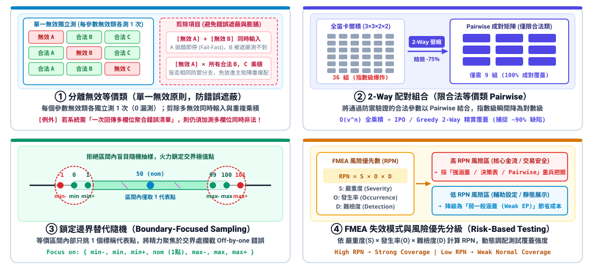
</div>

---

<!-- header: '5.6 案例優化與分類樹方法 (CTM)' -->

## 工業界視覺化等價組合：分類樹方法 (CTM)

<div class="card-deck">

> 💡 Classification Tree Method (CTM) 源自 Daimler-Benz，現為 ISO/IEC/IEEE 29119-4 認可之圖形化黑箱測試標準。

<div class="two-columns">
<div class="card">

### 🌳 雙層核心架構與設計原理
- **上層：分類樹 (Classification Tree)**：
  - **分類 (Classifications)**：將待測輸入域依測試觀點分解為互斥維度（如：會員身分、消費金額、付款方式）。
  - **類別與子樹 (Classes & Sub-trees)**：每個維度下劃分互斥葉節點（如 VIP/一般/訪客），並針對特定類別再向下展開**階層子樹**（如 `信用卡 ➔ 刷一次 / 刷分期`）。
- **下層：組合規格表 (Combination Table)**：
  - 全部 10 個欄位**垂直投影對齊**上方各等價葉節點。
  - 橫列代表具體的測試案例 (TC<sub>1</sub> ~ TC<sub>4</sub>)。
- **打點標記 (⚫)**：
  - 每一列在每個分類維度中**選取一個葉節點打點**，直觀防漏並組裝出完整測試案例！

</div>
<div class="card" style="text-align: center; display: flex; align-items: center; justify-content: center; padding: 6px;">

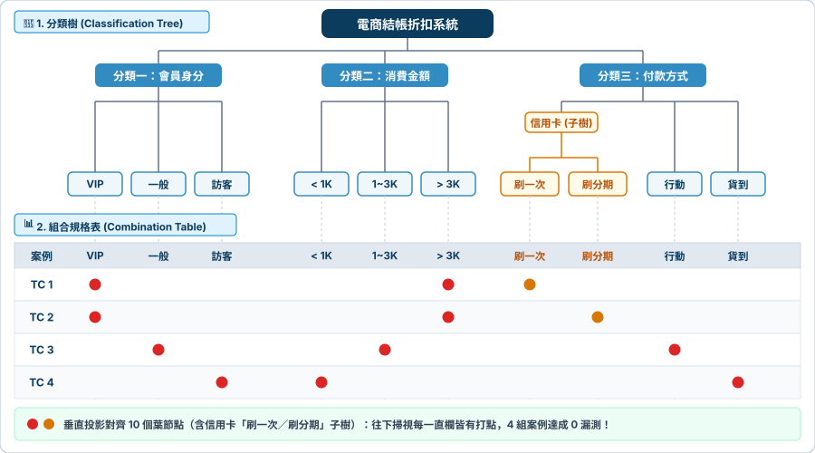

</div>
</div>
</div>

---

<!-- header: '5.6 案例優化與分類樹方法 (CTM)' -->

## CTM 實戰範例：電商結帳折扣（為何超越一般弱涵蓋？）

<div class="card-deck">

> CTM 不只把弱涵蓋畫成表，而是結合「**樹狀子分類細分 + 垂直防漏稽核 + 風險混搭覆蓋**」的視覺化工程規格！

<div class="two-columns">
<div class="card">

##### 📋 CTM 階層細分與打點矩陣（含信用卡子樹）
| 案例 | VIP | 一般 | 訪客 | <1K | 1~3K | >3K | 刷一次 | 刷分期 | 行動 | 貨到 | 預期輸出與測試重點 |
| :---: | :---: | :---: | :---: | :---: | :---: | :---: | :---: | :---: | :---: | :---: | :--- |
| **TC<sub>1</sub>** | ⚫ | | | | | ⚫ | ⚫ | | | | 8折+折300 (一次付清) |
| **TC<sub>2</sub>** | ⚫ | | | | | ⚫ | | ⚫ | | | 8折+折300 (**刷卡分期子樹**) |
| **TC<sub>3</sub>** | | ⚫ | | | ⚫ | | | | ⚫ | | 9折+折100 (行動免測分期) |
| **TC<sub>4</sub>** | | | ⚫ | ⚫ | | | | | | ⚫ | 原價無折扣 (貨到免測分期) |

</div>
<div class="card">

### 🎯 CTM 超越一般 EP 表格的三大獨特價值
- **1. 樹狀階層細分（解決條件相依子參數）**：
  - 只有選「**信用卡**」時才長出「**一次 vs. 分期**」子樹（`TC1, TC2`）；選「行動/貨到」時自動略過分期，消除扁平表格的無效矛盾組合！
- **2. 垂直掃視 1 秒抓漏（Visual Coverage Audit）**：
  - 當系統有數十個維度時，傳統文字表難以人工除錯；CTM 只要**垂直檢查哪一欄沒有黑點 `⚫`**，稽核員 1 秒即可抓出漏測等價類！
- **3. 同一張表混搭覆蓋強度（Risk-Based Hybrid）**：
  - 低風險區（`訪客`、`一般`）僅打 1 點採**弱涵蓋**；高風險金流（`VIP × >3K`）可加列密集打點（`TC1+TC2` **局部強涵蓋/Pairwise**），黑點密度即代表測試火力配置！

</div>
</div>
</div>

---

<!-- header: '5.6 案例優化與分類樹方法 (CTM)' -->

## 分類樹規格的 JUnit 5 落地：語意化命名與多層 `@Nested`

<div class="card-deck">

> 💡 分類樹的工程挑戰：如何將 CTM 的「**樹狀子分類階層**」與「**TC<sub>1</sub> ~ TC<sub>4</sub> 打點業務規格**」1:1 映照至測試程式碼？

<div class="two-columns">
<div class="card">

### 🏷️ 語意化顯示名稱 (`@DisplayName`)
- **測試即活文件 (Living Documentation)**：
  - 若方法名只寫 `testCheckout1()`，CI/CD 報表無法反映 CTM 打點組合的業務意圖。
- **JUnit 5 解決方案 ([`OrderDiscountCtmDemoTest.java`](../../lab.html?file=LabDemo/src/test/java/u05_combinatorial/ctm/OrderDiscountCtmDemoTest.java))**：
  - 直接標註 `TC1 ~ TC4` 打點規格（如 `@DisplayName("TC1: VIP × >3K × 刷一次 ➔ 8折+折300")`）；
  - 亦可搭配 `@DisplayNameGeneration` 自動將底線方法名轉為自然語意句子！

</div>
<div class="card">

### 🌳 多層巢狀情境分組 (`@Nested`)
- **1:1 同構映射 CTM 分類樹與子樹 (`TC1 ~ TC4`)**：
  ```java
  @Nested class VIPMemberTest {             // VIP 會員
    @Nested class Over3000AmountTest {      // >3K 金額
      @Nested class CreditCardSubTreeTest { // 信用卡子樹
        @Test void testTc1_VipOver3000CreditCardOneTime() { ... }
        @Test void testTc2_VipOver3000CreditCardInstallment() { ... }
      }
    }
  }
  @Nested class RegularMemberTest { ... }   // TC3: 一般×1~3K×行動
  @Nested class GuestMemberTest { ... }     // TC4: 訪客×<1K×貨到
  ```
- 執行測試時，IDE 測試導覽樹會**自動展開為與 CTM 分類樹完全一致的多層樹狀結構**！

</div>
</div>
</div>

---

<!-- header: '5.6 案例優化與分類樹方法 (CTM)' -->

## 🧪 課堂實習指引 (LabDemo 5.6: CTM 語意化規格實戰)

<div class="card-deck">

> 💡 分類樹實戰重點：將電商結帳 CTM 打點規格矩陣（含信用卡子樹）1:1 轉化為 `@DisplayName` 與多層 `@Nested` 測試。

<div class="two-columns">
<div class="card">

### 💻 體驗範例程式碼 (Demo Walkthrough)
- **1. 開啟 CTM 分類樹示範類別 (`TC1 ~ TC4`)**：
  - 開啟 [`OrderDiscountCtmDemoTest.java`](../../lab.html?file=LabDemo/src/test/java/u05_combinatorial/ctm/OrderDiscountCtmDemoTest.java)；
  - 檢視 `VIPMemberTest`（內嵌三層信用卡子樹 `TC1, TC2`）、`RegularMemberTest`（`TC3`）與 `GuestMemberTest`（`TC4`）如何 1:1 映照 p.57 的 CTM 打點表。
- **2. 觀察多層樹狀測試報表**：
  - 執行測試後，點開 IDE 左側 **Testing (燒杯圖示 🧪)** 面板（或查看 Console 階層軌跡），觀察與 CTM 分類樹完全一致的多層樹狀結構！

</div>
<div class="card">

### 🎯 課堂動手練習 (Hands-on Exercise)
- **開啟練習檔**：[`OrderDiscountCtmExerciseTest.java`](../../lab.html?file=LabDemo/src/test/java/u05_combinatorial/ctm/OrderDiscountCtmExerciseTest.java)
- **練習：電商結帳折扣 CTM 打點矩陣 (`TC_1 ~ TC_4`)**：
  - 於 `VipMemberTests` 內層之 `@Nested class CreditCardSubTreeTests` 完成 **TC<sub>1</sub>（刷一次）** 與 **TC<sub>2</sub>（刷分期子樹）**；
  - 於 `RegularAndGuestTests` 完成 **TC<sub>3</sub>（一般會員行動支付）** 與 **TC<sub>4</sub>（訪客貨到付款）**！

</div>
</div>
</div>

---

<!-- header: '5.6 案例優化與分類樹方法 (CTM)' -->

## 分類樹方法 (CTM) 最佳實務 (Best Practices)

<div class="card-deck">

> 💡 結構化思維勝於文字推砌；用正交階層與視覺化打點讓測試覆蓋一目了然。

<div class="two-columns">
<div class="card" data-marpit-fragment>

### 🎯 黃金法則：維度正交與視覺化驗收
- **正交分解原則 (Orthogonal Decomposition)**：
  - 上層 Classification 必須是**互斥且獨立的分析維度**；葉節點 Class 必須是該維度內的**離散不重疊等價區間**。
- **組合策略視覺化打點 (Visual Matrix)**：
  - 利用樹狀圖下方的打點表格直接對齊業務需求，直觀檢視覆蓋標準（Minimum Criterion、Pairwise）。
- **同儕審查極致化 (Seamless Review)**：
  - 需求端、開發端與測試端共同審閱 CTM 矩陣，5 分鐘內即可確認邊界有無遺漏。

</div>
<div class="card" data-marpit-fragment>

### ⚠️ 常見反模式 (Anti-Patterns)
- **分類重疊二義性 (Overlapping Classes)**：
  - 同一維度下的 Classes 定義模糊（如「常客」與「金卡會員」重疊），導致打點時無所適從。
- **階層過深產生「思維迷宮」**：
  - 樹狀結構巢狀超過 4 層，喪失視覺化優勢，應拆解為多個子分類樹。
- **僅滿足 Minimum 準則造成風險盲區**：
  - 每個 Class 只打一點滿足最少案例，忽略了高風險欄位之間的交互組合。

</div>
</div>
</div>

---

<!-- header: '5.6 案例優化與分類樹方法 (CTM)' -->

## 概念核對問答 (CCQ 5)

<div class="ccq-columns">
<div class="ccq-text">

<!-- id: sqa-ch05-ccq5 -->
**問題情境**：  
【單選題】關於「正交表測試 (Orthogonal Array Testing, OATS)」與一般「全成對測試 (Pairwise Testing)」的比較，下列敘述何者正確？

- **A)** 正交表由隨機抽樣產生，全成對測試由數學嚴格推導生成
- **B)** 正交表強調各因子均勻平衡，全成對僅要求任兩者配對出現
- **C)** 變數個數相同時，正交表與全成對產生之案例清單必完全一致
- **D)** 正交表僅能處理布林變數，全成對可廣泛支援多值離散參數

</div>
<div class="ccq-logo">

<a href="https://nlhsueh.github.io/nickedupocket/#/student/sqa-ch05-ccq5" target="_blank"></a>

</div>
</div>

---

<!-- _class: lead -->
<!-- header: '5.7 因果圖與決策表測試' -->

# **5.7 因果圖與決策表測試**

> 「從規格描述的邏輯網絡中，  
> 理清所有原因、結果與制約條件，系統化導出精準決策。」

---

<!-- header: '5.7 因果圖與決策表測試' -->

## 邏輯相依規格建模：因果圖法 (Cause-Effect Graphing)

<div class="card-deck">

> 💡 Glenford Myers 提出因果圖法：將自然語言規格轉譯為布林邏輯電路網絡，作為推導決策表的正規工具。

<div class="two-columns">
<div class="card">

### ⚡ 核心構成要件
- **原因 (Causes, C<sub>i</sub>)**：
  - 系統的輸入條件或前置狀態（取值 0 或 1）。
- **結果 (Effects, E<sub>j</sub>)**：
  - 系統產生的輸出動作或狀態改變（取值 0 或 1）。
- **4 大基本布林邏輯關係**：
  - **恆等 (Identity)**：若 C<sub>1</sub>=1 則 E<sub>1</sub>=1；否則 E<sub>1</sub>=0。
  - **非 (NOT, ~)**：若 C<sub>1</sub>=1 則 E<sub>1</sub>=0；否則 E<sub>1</sub>=1。
  - **或 (OR, OR)**：若任一 C<sub>i</sub>=1 則 E=1。
  - **與 (AND, AND)**：若所有 C<sub>i</sub>=1 則 E=1。

</div>
<div class="card">

### 🎯 因果圖 5 大約束條件 (Constraints)
- **輸入端約束 (Causes Constraints)**：
  - **E (Exclusive 互斥)**：最多只有一個為 1（C<sub>1</sub> + C<sub>2</sub> ≤ 1）。
  - **I (Inclusive 包含)**：至少有一個為 1（C<sub>1</sub> + C<sub>2</sub> ≥ 1）。
  - **O (One and only one 唯一)**：恰好只有一個為 1（C<sub>1</sub> + C<sub>2</sub> = 1）。
  - **R (Requires 要求)**：若 C<sub>1</sub>=1，則 C<sub>2</sub> 必須為 1（C<sub>1</sub> ➔ C<sub>2</sub>）。
- **輸出端約束 (Effects Constraints)**：
  - **M (Masks 遮蔽)**：若 E<sub>1</sub>=1，則 E<sub>2</sub> 強制被抑制為 0。

</div>
</div>
</div>

---

<!-- header: '5.7 因果圖與決策表測試' -->

## 貫穿範例 (1/4)：電商促銷規格與因子拆解

<div class="card-deck">

> 💡 業務需求：① 滿千且 VIP 享 8 折；② 滿千且輸入促銷碼享免運；③ 未獲優惠則原價結帳。

<div class="two-columns">
<div class="card">

### 📋 Step 1：原因與結果因子拆解
- **原因節點 (Causes, C<sub>i</sub>)**：
  - **C<sub>1</sub>**：訂單金額 ≥ 1,000 元 *(滿額必要門檻 Gatekeeper)*
  - **C<sub>2</sub>**：具備 VIP 會員身分
  - **C<sub>3</sub>**：結帳時輸入免運促銷碼
- **結果節點 (Effects, E<sub>j</sub>)**：
  - **E<sub>1</sub>**：享有 8 折優惠（`C1 AND C2`）
  - **E<sub>2</sub>**：享有免運費折抵（`C1 AND C3`）
  - **E<sub>3</sub>**：原價一般結帳（`~(E1 OR E2)`，受 **M 遮蔽約束**）

</div>
<div class="card">

### 🎯 Step 2：由結果反向追蹤防漏（為何要畫因果圖？）
- **純靠直覺閱讀文字的盲點**：
  - 工程師常把「原價結帳 (E<sub>3</sub>)」直接等同於「未滿千 (`C1 = N`)」，因而**漏測了 `C1 = Y, C2 = N, C3 = N`（滿千但一般會員且無促銷碼）**！
- **因果圖反向展開（De Morgan 定律防漏）**：
  - 由 `E3 = ~(E1 OR E2)` 往左反向追蹤，強制拆出**兩條獨立路徑**：
    1. **路徑 A (`C1=Y 且 ~C2 且 ~C3`)** ➔ 導出 **R<sub>4</sub> (`Y, N, N`)**（1 組）
    2. **路徑 B (`~C1`，即 `C1=N`)** ➔ 導出 **R<sub>5</sub> (`N, -, -`)**（合併 4 組）

</div>
</div>
</div>

---

<!-- _class: title-image-slide -->
<!-- header: '5.7 因果圖與決策表測試' -->

## 貫穿範例 (2/4)：電商促銷因果圖與反向追蹤路徑

<div class="image-wrapper">
  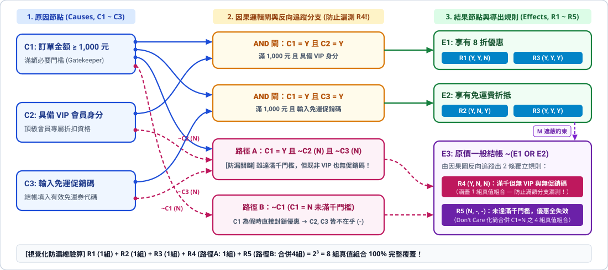
</div>

---

<!-- header: '5.7 因果圖與決策表測試' -->

## 貫穿範例 (3/4)：導出 CAR 決策表與規則化簡

<div class="card-deck">

> 💡 初始規則共有 2<sup>3</sup> = 8 種。將 C<sub>1</sub> = N 的 4 種組合化簡為 `R5 (N, -, -)`，精準收斂為 **5 條規則（4 + 1 + 1 + 1 + 1 = 8 組全覆蓋）**！

<div class="two-columns">
<div class="card">

### ✂️ 規則展開與化簡邏輯 (Step 3 & 4)
- **全展開 (2<sup>3</sup> = 8 條真值組合)**：
  - **C<sub>1</sub> = Y（滿千，共 4 組）**：必須完整測試 `R1 (Y,Y,N)`、`R2 (Y,N,Y)`、`R3 (Y,Y,Y)` 與易被忽略的 **`R4 (Y,N,N)`（滿千但一般會員且無碼 ➔ 原價）**！
  - **C<sub>1</sub> = N（未滿千，共 4 組）**：無論 C<sub>2</sub>, C<sub>3</sub> 為何皆為原價 E<sub>3</sub>。
- **不在乎化簡 (Don't Care, `-`)**：
  - 將 C<sub>1</sub> = N 的 4 條規則合併為 **1 條規則 (R<sub>5</sub>)**，共 **5 條規則**，0 遺漏、0 冗餘！

</div>
<div class="card">

### 📊 化簡後的 CAR 促銷決策表（共 5 條規則）
| 條件 / 動作項目 | R<sub>1</sub> | R<sub>2</sub> | R<sub>3</sub> | R<sub>4</sub> | R<sub>5</sub> (合併4組) |
| :--- | :---: | :---: | :---: | :---: | :---: |
| C<sub>1</sub>: 金額 ≥ 1,000？ | **Y** | **Y** | **Y** | **Y** | **N** |
| C<sub>2</sub>: VIP 身分？ | **Y** | **N** | **Y** | **N** | **-** |
| C<sub>3</sub>: 免運促銷碼？ | **N** | **Y** | **Y** | **N** | **-** |
| E<sub>1</sub>: 輸出「8 折優惠」 | **X** | | **X** | | |
| E<sub>2</sub>: 輸出「免運費」 | | **X** | **X** | | |
| E<sub>3</sub>: 輸出「原價結帳」 | | | | **X** | **X** |

</div>
</div>
</div>

---

<!-- header: '5.7 因果圖與決策表測試' -->

## 貫穿範例 (4/4)：由決策表直出測試案例

<div class="card-deck">

> 💡 CAR 決策表中的 5 條化簡規則 (R<sub>1</sub> ~ R<sub>5</sub>)，直接 1:1 映射為 5 組標準黑箱測試案例！

| 案例編號 | 對應規則 | 測試輸入參數 (金額, VIP, 促銷碼) | 預期執行動作與輸出斷言 (Expected Output) | 測試設計意圖說明 |
| :---: | :---: | :--- | :--- | :--- |
| **TC<sub>1</sub>** | R<sub>1</sub> (`Y,Y,N`) | `amount = 1500, isVip = true, promo = false` | `discount80 = true, freeShip = false, regular = false` | 驗證滿額 VIP 獨享 8 折 |
| **TC<sub>2</sub>** | R<sub>2</sub> (`Y,N,Y`) | `amount = 1200, isVip = false, promo = true` | `discount80 = false, freeShip = true, regular = false` | 驗證滿額一般會員促銷碼免運 |
| **TC<sub>3</sub>** | R<sub>3</sub> (`Y,Y,Y`) | `amount = 2000, isVip = true, promo = true` | `discount80 = true, freeShip = true, regular = false` | 驗證雙重優惠同時觸發 |
| **TC<sub>4</sub>** | R<sub>4</sub> (`Y,N,N`) | `amount = 1200, isVip = false, promo = false` | `discount80 = false, freeShip = false, regular = true` | **驗證滿額但無 VIP 與無碼仍為原價** |
| **TC<sub>5</sub>** | R<sub>5</sub> (`N,-,-`) | `amount = 800, isVip = true, promo = true` | `discount80 = false, freeShip = false, regular = true` | 驗證未滿千門檻優惠全部失效 (代表4組) |

- **黃金成果**：從模糊的自然語言需求，經由「因果圖反向追蹤 ➔ 5 條決策規則 ➔ 5 組測試案例」，保證 **2<sup>3</sup> = 8 種邏輯組合 100% 覆蓋且零漏測**！

</div>

---

<!-- header: '5.7 因果圖與決策表測試' -->

## 經典案例延伸：三角形判斷決策表 (CAR Table)

<div class="card-deck">

> 💡 三角形判斷邏輯化簡後的 CAR 決策表，精確對應 6 條測試規則。

| 條件與動作 | R<sub>1</sub> | R<sub>2</sub> | R<sub>3</sub> | R<sub>4</sub> | R<sub>5</sub> | R<sub>6</sub> |
| :--- | :---: | :---: | :---: | :---: | :---: | :---: |
| **條件 (Conditions)** | | | | | | |
| C<sub>1</sub>: 滿足三角不等式？(a < b+c AND b < a+c AND c < a+b) | **N** | **Y** | **Y** | **Y** | **Y** | **Y** |
| C<sub>2</sub>: a = b？ | **-** | **Y** | **Y** | **N** | **N** | **N** |
| C<sub>3</sub>: b = c？ | **-** | **Y** | **N** | **Y** | **N** | **N** |
| C<sub>4</sub>: a = c？ | **-** | **Y** | **N** | **N** | **Y** | **N** |
| **動作 (Actions)** | | | | | | |
| A<sub>1</sub>: 輸出「非三角形」 | **X** | | | | | |
| A<sub>2</sub>: 輸出「正三角形」 | | **X** | | | | |
| A<sub>3</sub>: 輸出「等腰三角形」 | | | **X** | **X** | **X** | |
| A<sub>4</sub>: 輸出「不等邊三角形」 | | | | | | **X** |

</div>

---

<!-- header: '5.7 因果圖與決策表測試' -->

## 決策表測試的 JUnit 5 落地：規則直出與多重動作驗證

<div class="card-deck">

> 💡 決策表的工程挑戰：每條化簡規則包含多條件組合，且常同時激發多個系統動作！

<div class="two-columns">
<div class="card" data-marpit-fragment>

### 📋 規則直出資料矩陣 (`@CsvSource`)
- **決策表與測試資料 1:1 映射**：
  - 決策表化簡後的每一列規則 (R<sub>1</sub> ~ R<sub>k</sub>)，可直接寫成 `@CsvSource` 內的一行字串。
- **程式碼範例結構**：
  - 前面數個欄位填入條件（如金額、會員、促銷碼），後面欄位填入預期結果（折扣率、免運旗標）；
  - 測試方法只需撰寫一次計算驗證，決策表的所有規則瞬間轉化為全自動執行的回歸測試！

</div>
<div class="card" data-marpit-fragment>

### 🎯 多重動作聚合斷言 (`assertAll`)
- **多動作覆蓋之完整性**：
  - 一條規則常觸發多個外顯動作（如 TC<sub>3</sub>：同時觸發「打8折」且「免運費」）。
- **JUnit 5 解決方案 (assertAll)**：
  - 透過群組斷言同時驗收所有預期動作；
  - 避免傳統線性斷言中，若「折扣率」比對失敗直接拋錯，導致後續「免運旗標」完全未受檢驗的盲區，確保商務規則的完整落地！

</div>
</div>
</div>

---

<!-- header: '5.7 因果圖與決策表測試' -->

## 🧪 課堂實習指引 (LabDemo 5.7: 決策表實戰)

<div class="card-deck">

> 💡 決策表實戰重點：將 CAR 促銷或三角形化簡規則表，直接 1:1 轉化為 @CsvSource 測試矩陣與 assertAll 斷言。

<div class="two-columns">
<div class="card">

### 💻 體驗範例程式碼 (Demo Walkthrough)
- **1. 開啟促銷決策表測試示範**：
  - 開啟 [`PromotionDecisionDemoTest.java`](../../lab.html?file=LabDemo/src/test/java/u05_combinatorial/decision/PromotionDecisionDemoTest.java)；
  - 觀察 CAR 決策表化簡後的 5 條規則 (R<sub>1</sub> ~ R<sub>5</sub>，含 `R4: 滿千但無資格` 與 `R5: 未滿千化簡規則`) 如何直出為測試案例。
- **2. 多動作聚合驗證**：
  - 觀察如何用 `assertAll` 同步驗證「8折優惠」、「免運費」與「原價結帳」三項動作，防止動作遮蔽。

</div>
<div class="card">

### 🎯 課堂動手練習 (Hands-on Exercise)
- **開啟練習檔**：[`PromotionDecisionExerciseTest.java`](../../lab.html?file=LabDemo/src/test/java/u05_combinatorial/decision/PromotionDecisionExerciseTest.java)
- **練習 1：1000 元滿額臨界值測試**：
  - 驗證剛好滿 1000 元且具 VIP 身分時精準享有 8 折。
- **練習 2：999.9 元未滿額臨界值測試**：
  - 驗證未達門檻時，即使有促銷碼依然原價結帳。
- **練習 3：CAR 決策表資料驅動全覆蓋**：
  - 使用 `@CsvSource` 驗證 R<sub>1</sub> ~ R<sub>5</sub> 全部 5 條規則動作矩陣！

</div>
</div>
</div>

---

<!-- header: '5.7 因果圖與決策表測試' -->

## 決策表與因果圖測試 最佳實務 (Best Practices)

<div class="card-deck">

> 💡 窮舉條件、剔除不相關、檢查完備性；將複雜業務規則收斂為精準測試向量。

<div class="two-columns">
<div class="card" data-marpit-fragment>

### 🎯 黃金法則：Don't Care 化簡與完備性校驗
- **因果語意嚴謹對映**：
  - 條件 (Causes) 必須是布林真假值，動作 (Effects) 為系統輸出或狀態變更。
- **不相關條件化簡 (Don't Care Rule)**：
  - 條件真假不影響最終動作時標記為 `-` 合併相鄰規則，大幅壓縮執行成本。
- **完備性與一致性雙檢驗**：
  - **完備性 (Completeness)**：展開後權重總和必等於 2<sup>n</sup>（每一處 `-` 算 2 次方），確保 100% 無遺漏規則。
  - **一致性 (Consistency)**：相同輸入組合嚴禁出現互相矛盾的輸出動作。

</div>
<div class="card" data-marpit-fragment>

### ⚠️ 常見反模式 (Anti-Patterns)
- **漏列實體互斥約束 (Omit Incompatible Constraints)**：
  - 忽略現實中的物理互斥（如：學生身分與非學生身分），生成了「既是學生又非學生」的荒謬規則。
- **動作欄位描述模糊籠統**：
  - 動作只寫「處理失敗」，未精確區分是「提示餘額不足」還是「鎖定帳戶」。
- **跳過因果圖直接拍腦袋寫規則表**：
  - 條件超過 4 個時直接憑空寫表，幾乎必定漏掉邊角條件組合。

</div>
</div>
</div>

---

<!-- header: '5.7 因果圖與決策表測試' -->

## 概念核對問答 (CCQ 6)

<div class="ccq-columns">
<div class="ccq-text">

<!-- id: sqa-ch05-ccq6 -->
**問題情境**：  
【單選題】在軟體測試實務中，下列哪一種受測情境最適合優先採用「決策表測試 (Decision Table Testing)」來設計案例？

- **A)** 系統輸入參數彼此完全獨立，且有連續性數值邊界
- **B)** 輸入參數具複雜商務邏輯制約，相異條件組合觸發相異系統動作
- **C)** 系統的輸出僅與目前輸入值有關，與輸入條件的組合邏輯無涉
- **D)** 系統的運作強烈依賴時間序列與物件歷史狀態的轉移

</div>
<div class="ccq-logo">

<a href="https://nlhsueh.github.io/nickedupocket/#/student/sqa-ch05-ccq6" target="_blank"></a>

</div>
</div>

---

<!-- _class: lead -->
<!-- header: '5.8 狀態轉換測試' -->

# **5.8 狀態轉換測試**

> 「沒有回傳值的 void 方法怎麼測？  
> 答案在於物件內部的狀態轉移。」

---

<!-- header: '5.8 狀態轉換測試' -->

## 航空訂票狀態機模型 (State Machine Diagram)

<div class="card-deck">

> 💡 狀態機將系統行為抽象為狀態、事件與轉移弧線。測試核心：給定前置狀態與激發事件，斷言次態與動作。

<div style="text-align: center; margin: 4px 0 0 0;">

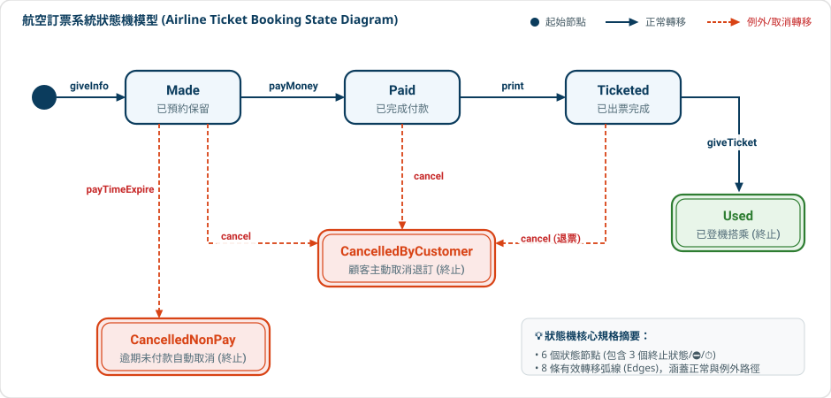

</div>
</div>

---

<!-- header: '5.8 狀態轉換測試' -->

## 航空訂票狀態機：轉移規格與例外分支分析

<div class="card-deck">

> 💡 測試設計必須精準區分「主流程 Happy Path」與「例外中斷路徑」，確保所有終止狀態皆可正確轉移。

<div class="two-columns">
<div class="card">

### 🛫 正常商務主流程 (Happy Path)
- **初始進入**：⚫ --[giveInfo]--> Made (已預約保留)
- **付款成功**：Made --[payMoney]--> Paid (已付款)
- **出票開票**：Paid --[print]--> Ticketed (已出票)
- **登機搭乘**：Ticketed --[giveTicket]--> Used 🏁 (正常終止)
- **商務意義**：代表訂位成功並順利完成飛行的黃金路徑。

</div>
<div class="card">

### ⛔ 例外取消分支 (Cancellation Paths)
- **顧客主動退訂/取消 (cancel)**：
  - 在 `Made`、`Paid`、`Ticketed` 狀態下，皆可觸發 `cancel` 轉移至 **`CancelledByCustomer ⛔`**。
- **付款逾時取消 (payTimeExpire)**：
  - 僅在 `Made` 狀態下，若超時則自動觸發轉移至 **`CancelledNonPay ⏱️`**。
- **終止狀態邊界**：抵達終止狀態後，系統不得再接受任何轉移。

</div>
</div>
</div>

---

<!-- header: '5.8 狀態轉換測試' -->

## 狀態測試覆蓋準則與測試路徑設計

<div class="card-deck">

> 💡 狀態覆蓋 (Node) vs. 轉移覆蓋 (Edge)：轉移覆蓋強度遠高於狀態覆蓋。

<div class="two-columns">
<div class="card">

### 🎯 覆蓋強度層次
- **狀態覆蓋 (State Coverage)**：
  - 每個狀態節點至少被造訪一次。
- **轉移覆蓋 (Transition Coverage)**：
  - 每個狀態轉移弧線至少被執行一次（必達狀態覆蓋！）。
- **N-Switch 覆蓋**：
  - 0-Switch（單次轉移）、1-Switch（連續 2 次轉移序列）。

</div>
<div class="card">

### 🛣️ 5 條全轉移覆蓋測試序列
- **路徑 1**：`giveInfo` ➔ `payMoney` ➔ `print` ➔ `giveTicket` (正常使用)
- **路徑 2**：`giveInfo` ➔ `payMoney` ➔ `print` ➔ `cancel` (開票後退票)
- **路徑 3**：`giveInfo` ➔ `payMoney` ➔ `cancel` (付款後退款取消)
- **路徑 4**：`giveInfo` ➔ `cancel` (預約保留後取消)
- **路徑 5**：`giveInfo` ➔ `payTimeExpire` (逾期未付系統自動取消)

</div>
</div>
</div>

---

<!-- header: '5.8 狀態轉換測試' -->

## 互動視覺化：勾選測試路徑觀察狀態與轉移覆蓋率

<div class="sm-interactive-grid" id="sm-explorer">
<div class="sm-control-card">
<div class="sm-path-list">
<label class="sm-path-item is-checked"><input type="checkbox" class="sm-cb" value="1" checked /><span class="sm-path-label"><span class="sm-path-title">路徑 1：正常登機 (Happy Path)</span><span class="sm-path-seq">giveInfo ➔ payMoney ➔ print ➔ giveTicket</span></span></label>
<label class="sm-path-item"><input type="checkbox" class="sm-cb" value="2" /><span class="sm-path-label"><span class="sm-path-title">路徑 2：開票後退票</span><span class="sm-path-seq">giveInfo ➔ payMoney ➔ print ➔ cancel</span></span></label>
<label class="sm-path-item"><input type="checkbox" class="sm-cb" value="3" /><span class="sm-path-label"><span class="sm-path-title">路徑 3：付款後退款取消</span><span class="sm-path-seq">giveInfo ➔ payMoney ➔ cancel</span></span></label>
<label class="sm-path-item"><input type="checkbox" class="sm-cb" value="4" /><span class="sm-path-label"><span class="sm-path-title">路徑 4：預約保留後取消</span><span class="sm-path-seq">giveInfo ➔ cancel</span></span></label>
<label class="sm-path-item"><input type="checkbox" class="sm-cb" value="5" /><span class="sm-path-label"><span class="sm-path-title">路徑 5：逾期未付自動取消</span><span class="sm-path-seq">giveInfo ➔ payTimeExpire</span></span></label>
</div>
<div class="sm-btn-row">
<button type="button" class="sm-btn sm-btn-highlight" data-sm-action="node100">⚡ 100%狀態 / 75%轉移 (1+2+5)</button>
<button type="button" class="sm-btn" data-sm-action="all">✅ 全選 (100%)</button>
<button type="button" class="sm-btn" data-sm-action="clear">🔄 清除</button>
</div>
<div class="sm-coverage-box">
<div class="sm-cov-row">
<div class="sm-cov-header"><span>🟢 狀態覆蓋 (Node Coverage)</span><span id="sm-node-stat">4 / 6 (67%)</span></div>
<div class="sm-cov-bar-bg"><div id="sm-node-bar" class="sm-cov-bar-fill" style="width: 66.7%; background: #0284c7;"></div></div>
</div>
<div class="sm-cov-row">
<div class="sm-cov-header"><span>🔵 轉移覆蓋 (Edge Coverage)</span><span id="sm-edge-stat">4 / 8 (50%)</span></div>
<div class="sm-cov-bar-bg"><div id="sm-edge-bar" class="sm-cov-bar-fill" style="width: 50%; background: #f59e0b;"></div></div>
</div>
<div id="sm-cov-note" style="font-size: 11.5px; font-weight: 700; color: #0369a1; margin-top: 2px;">💡 點擊勾選上方路徑，即時觀察狀態節點與轉移弧線的覆蓋變化！</div>
</div>
</div>
<div class="sm-canvas-card">
<svg xmlns="http://www.w3.org/2000/svg" viewBox="0 0 940 445">
<defs>
<marker id="sm-arr" viewBox="0 0 10 10" refX="7" refY="5" markerWidth="6" markerHeight="6" orient="auto-start-reverse"><path d="M 0 1 L 9 5 L 0 9 z" fill="#0284c7" /></marker>
<marker id="sm-arr-cancel" viewBox="0 0 10 10" refX="7" refY="5" markerWidth="6" markerHeight="6" orient="auto-start-reverse"><path d="M 0 1 L 9 5 L 0 9 z" fill="#dc2626" /></marker>
</defs>
<rect width="940" height="445" fill="#ffffff" rx="10" />
<g transform="translate(20, 18)">
<text x="0" y="10" font-family="sans-serif" font-size="14px" font-weight="700" fill="#0b3c5d">航空訂票狀態機覆蓋追蹤 (6 個狀態節點 / 8 條轉移邊弧)</text>
<line x1="560" y1="6" x2="595" y2="6" stroke="#0284c7" stroke-width="3" marker-end="url(#sm-arr)" />
<text x="605" y="10" font-family="sans-serif" font-size="12px" font-weight="700" fill="#0369a1">正常流程邊 (4條)</text>
<line x1="725" y1="6" x2="760" y2="6" stroke="#dc2626" stroke-width="2.5" stroke-dasharray="5 3" marker-end="url(#sm-arr-cancel)" />
<text x="770" y="10" font-family="sans-serif" font-size="12px" font-weight="700" fill="#b91c1c">取消/逾時邊 (4條)</text>
</g>
<g class="sm-edge is-active" data-paths="1,2,3,4,5">
<circle cx="48" cy="110" r="13" fill="#0b3c5d" />
<path d="M 62 110 L 138 110" class="sm-line" stroke="#0284c7" stroke-width="2.5" fill="none" marker-end="url(#sm-arr)" />
<rect x="68" y="86" width="64" height="19" fill="#e0f2fe" rx="4" />
<text x="100" y="99" font-family="monospace" font-size="12px" font-weight="700" fill="#0369a1" text-anchor="middle">giveInfo</text>
</g>
<g class="sm-state is-active" data-state="Made" data-paths="1,2,3,4,5">
<rect x="142" y="80" width="130" height="60" rx="12" class="sm-main-rect" fill="#eff6ff" stroke="#0284c7" stroke-width="2.4" />
<text x="207" y="104" font-family="sans-serif" font-size="15px" font-weight="700" fill="#0b3c5d" text-anchor="middle">Made</text>
<text x="207" y="124" font-family="sans-serif" font-size="12px" fill="#475569" text-anchor="middle">已預約保留</text>
</g>
<g class="sm-edge is-active" data-edge="payMoney" data-paths="1,2,3">
<path d="M 272 110 L 386 110" class="sm-line" stroke="#0284c7" stroke-width="2.5" fill="none" marker-end="url(#sm-arr)" />
<rect x="292" y="86" width="76" height="19" fill="#e0f2fe" rx="4" />
<text x="330" y="99" font-family="monospace" font-size="12px" font-weight="700" fill="#0369a1" text-anchor="middle">payMoney</text>
</g>
<g class="sm-state is-active" data-state="Paid" data-paths="1,2,3">
<rect x="390" y="80" width="130" height="60" rx="12" class="sm-main-rect" fill="#eff6ff" stroke="#0284c7" stroke-width="2.4" />
<text x="455" y="104" font-family="sans-serif" font-size="15px" font-weight="700" fill="#0b3c5d" text-anchor="middle">Paid</text>
<text x="455" y="124" font-family="sans-serif" font-size="12px" fill="#475569" text-anchor="middle">已完成付款</text>
</g>
<g class="sm-edge is-active" data-edge="print" data-paths="1,2">
<path d="M 520 110 L 636 110" class="sm-line" stroke="#0284c7" stroke-width="2.5" fill="none" marker-end="url(#sm-arr)" />
<rect x="546" y="86" width="64" height="19" fill="#e0f2fe" rx="4" />
<text x="578" y="99" font-family="monospace" font-size="12px" font-weight="700" fill="#0369a1" text-anchor="middle">print</text>
</g>
<g class="sm-state is-active" data-state="Ticketed" data-paths="1,2">
<rect x="640" y="80" width="130" height="60" rx="12" class="sm-main-rect" fill="#eff6ff" stroke="#0284c7" stroke-width="2.4" />
<text x="705" y="104" font-family="sans-serif" font-size="15px" font-weight="700" fill="#0b3c5d" text-anchor="middle">Ticketed</text>
<text x="705" y="124" font-family="sans-serif" font-size="12px" fill="#475569" text-anchor="middle">已出票完成</text>
</g>
<g class="sm-edge is-active" data-edge="giveTicket" data-paths="1">
<path d="M 770 110 L 836 110 L 836 214" class="sm-line" stroke="#0284c7" stroke-width="2.5" fill="none" marker-end="url(#sm-arr)" />
<rect x="786" y="150" width="84" height="19" fill="#e0f2fe" rx="4" />
<text x="828" y="163" font-family="monospace" font-size="12px" font-weight="700" fill="#0369a1" text-anchor="middle">giveTicket</text>
</g>
<g class="sm-state is-active" data-state="Used" data-paths="1">
<rect x="760" y="220" width="152" height="64" rx="14" class="sm-main-rect" fill="#dcfce7" stroke="#15803d" stroke-width="2.6" />
<rect x="765" y="225" width="142" height="54" rx="10" fill="none" stroke="#15803d" stroke-width="1.3" />
<text x="836" y="246" font-family="sans-serif" font-size="15px" font-weight="700" fill="#166534" text-anchor="middle">Used (終點)</text>
<text x="836" y="266" font-family="sans-serif" font-size="12px" fill="#15803d" text-anchor="middle">已登機搭乘</text>
</g>
<g class="sm-edge" data-edge="cancel-made" data-paths="4">
<path d="M 235 140 L 235 275 L 356 275" class="sm-line" stroke="#dc2626" stroke-width="2.2" stroke-dasharray="6 3" fill="none" marker-end="url(#sm-arr-cancel)" />
<rect x="244" y="252" width="96" height="19" fill="#fee2e2" rx="4" />
<text x="292" y="265" font-family="monospace" font-size="11.5px" font-weight="700" fill="#b91c1c" text-anchor="middle">cancel (路徑4)</text>
</g>
<g class="sm-edge" data-edge="cancel-paid" data-paths="3">
<path d="M 455 140 L 455 256" class="sm-line" stroke="#dc2626" stroke-width="2.2" stroke-dasharray="6 3" fill="none" marker-end="url(#sm-arr-cancel)" />
<rect x="462" y="188" width="96" height="19" fill="#fee2e2" rx="4" />
<text x="510" y="201" font-family="monospace" font-size="11.5px" font-weight="700" fill="#b91c1c" text-anchor="middle">cancel (路徑3)</text>
</g>
<g class="sm-edge" data-edge="cancel-ticketed" data-paths="2">
<path d="M 685 140 L 685 275 L 564 275" class="sm-line" stroke="#dc2626" stroke-width="2.2" stroke-dasharray="6 3" fill="none" marker-end="url(#sm-arr-cancel)" />
<rect x="576" y="252" width="98" height="19" fill="#fee2e2" rx="4" />
<text x="625" y="265" font-family="monospace" font-size="11.5px" font-weight="700" fill="#b91c1c" text-anchor="middle">cancel (路徑2)</text>
</g>
<g class="sm-state" data-state="CancelledByCustomer" data-paths="2,3,4">
<rect x="360" y="260" width="200" height="64" rx="14" class="sm-main-rect" fill="#fef2f2" stroke="#dc2626" stroke-width="2.6" />
<rect x="365" y="265" width="190" height="54" rx="10" fill="none" stroke="#dc2626" stroke-width="1.3" />
<text x="460" y="286" font-family="sans-serif" font-size="14.5px" font-weight="700" fill="#b91c1c" text-anchor="middle">CancelledByCustomer</text>
<text x="460" y="306" font-family="sans-serif" font-size="12px" fill="#dc2626" text-anchor="middle">顧客主動退訂 (終點)</text>
</g>
<g class="sm-edge" data-edge="expire" data-paths="5">
<path d="M 180 140 L 180 356" class="sm-line" stroke="#dc2626" stroke-width="2.2" stroke-dasharray="6 3" fill="none" marker-end="url(#sm-arr-cancel)" />
<rect x="72" y="205" width="102" height="19" fill="#fee2e2" rx="4" />
<text x="123" y="218" font-family="monospace" font-size="11.5px" font-weight="700" fill="#b91c1c" text-anchor="middle">payTimeExpire</text>
</g>
<g class="sm-state" data-state="CancelledNonPay" data-paths="5">
<rect x="108" y="360" width="198" height="64" rx="14" class="sm-main-rect" fill="#fef2f2" stroke="#dc2626" stroke-width="2.6" />
<rect x="113" y="365" width="188" height="54" rx="10" fill="none" stroke="#dc2626" stroke-width="1.3" />
<text x="207" y="386" font-family="sans-serif" font-size="14.5px" font-weight="700" fill="#b91c1c" text-anchor="middle">CancelledNonPay</text>
<text x="207" y="406" font-family="sans-serif" font-size="12px" fill="#dc2626" text-anchor="middle">逾期未付自動取消 (終點)</text>
</g>
</svg>
</div>
</div>

---

<!-- header: '5.8 狀態轉換測試' -->

## 狀態轉換測試的 JUnit 5 落地：巢狀狀態與生命週期隔離

<div class="card-deck">

> 💡 狀態機測試的工程挑戰：物件有狀態記憶，若測試間狀態殘留將導致假警報；void 動作需透過狀態查詢驗證。

<div class="two-columns">
<div class="card" data-marpit-fragment>

### 🔄 生命週期狀態隔離 (`@BeforeEach`)
- **前置狀態獨立重置**：
  - 每個測試案例執行前，透過 `@BeforeEach` 重新初始化物件並激發特定事件序列，將系統精確推進至目標前置狀態（如全新建立空堆疊）。
- **徹底杜絕測試間狀態污染**：
  - 確保每個轉移弧線的驗證都是在乾淨受控的狀態下觸發，避免上一個測試殘留資料干擾。

</div>
<div class="card" data-marpit-fragment>

### 🏗️ 巢狀狀態建模 (`@Nested`，以 LabDemo StackTest 為例)
- **狀態層級與狀態機 1:1 同構**：
  - 外層情境：`WhenNew`（全新空狀態）➔ 斷言 `isEmpty()` 與空取拋錯 `assertThrows(EmptyStackException.class)`。
  - 內層情境：`AfterPushing`（推入元素後狀態）➔ 斷言 `isNotEmpty()` 與彈出元素後狀態回退。
- **測試報表即狀態規格**：
  - IDE 測試樹直接展開為狀態轉移歷程，完美檢驗物件導向與狀態機行為！

</div>
</div>
</div>

---

<!-- header: '5.8 狀態轉換測試' -->

## 🧪 課堂實習指引 (LabDemo 5.8: 狀態轉換實戰)

<div class="card-deck">

> 💡 狀態機實戰重點：使用 @BeforeEach 重現特定狀態前置，運用 @Nested 建立與狀態機 1:1 同構的測試階層。

<div class="two-columns">
<div class="card">

### 💻 體驗範例程式碼 (Demo Walkthrough)
- **1. 航空訂票狀態機（6 狀態 / 8 轉移 / 虛擬時鐘）**：
  - 開啟 [`AirlineTicketStateDemoTest.java`](../../lab.html?file=LabDemo/src/test/java/u05_behavioral/state/AirlineTicketStateDemoTest.java)；
  - 觀察 **5 條全轉移覆蓋路徑**、`Clock.fixed` 快轉 25 小時驗收逾時，以及終止狀態 (`USED`) 拒絕惡意退票防禦。
- **2. 物件導向堆疊狀態機**：
  - 開啟 [`StackStateDemoTest.java`](../../lab.html?file=LabDemo/src/test/java/u05_behavioral/state/StackStateDemoTest.java) 與 `PlayerStateDemoTest.java`；
  - 觀察 `@BeforeEach` 狀態隔離與空／滿狀態例外斷言 (`EmptyStackException` / `IllegalStateException`)。

</div>
<div class="card">

### 🎯 課堂動手練習 (Hands-on Exercise)
- **開啟練習檔**：[`StackStateExerciseTest.java`](../../lab.html?file=LabDemo/src/test/java/u05_behavioral/state/StackStateExerciseTest.java)
- **練習 1：1-Switch 連續轉移序列**：
  - 驗證 Empty ➔ push ➔ Non-Empty ➔ pop ➔ Empty 狀態閉環轉移路徑！
- **練習 2：空狀態 peek() 例外防護**：
  - 驗證非法操作時拋出 `EmptyStackException`，且物件狀態不變量依然保持為空！

</div>
</div>
</div>

---

<!-- header: '5.8 狀態轉換測試' -->

## 狀態轉換測試 最佳實務 (Best Practices)

<div class="card-deck">

> 💡 狀態機測試的核心不僅在走通合法路徑，更在嚴密防禦非法事件突襲與競態陷阱。

<div class="two-columns">
<div class="card" data-marpit-fragment>

### 🎯 黃金法則：0-Switch 底線與負向防禦
- **0-Switch (轉換覆蓋) 為驗收底線**：
  - 確保狀態機圖上的每一條合法轉移弧線 (Transition) 至少被執行過一次。
- **狀態表矩陣法深挖負向無效轉換**：
  - 建立「狀態 × 事件」矩陣，所有空白格（非法事件）都必須設計測試案例，驗證系統安全拒絕且狀態不損壞。
- **黑箱封裝與生命週期隔離**：
  - 測試案例只能透過公開 API 觸發事件來驅動狀態推進，嚴禁用反射直接強改私有狀態變數。

</div>
<div class="card" data-marpit-fragment>

### ⚠️ 常見反模式 (Anti-Patterns)
- **只測 Happy Path（快樂路徑）**：
  - 僅驗證「建立 ➔ 付款 ➔ 完成」，從未驗證「在已取消狀態下重複呼叫付款 API」。
- **長鏈條端到端案例難以定位**：
  - 一個測試案例串聯 10 個狀態轉換，中間第 3 步失敗導致後續 7 步全部無法驗收；善用 `@Nested` 分層隔離。
- **忽視狀態超時與併發轉移**：
  - 忽略 Timeout 自動取消與非同步通知並發到達時的競爭狀態 (Race Condition)。

</div>
</div>
</div>

---

<!-- header: '5.8 狀態轉換測試' -->

## 概念核對問答 (CCQ 7)

<div class="ccq-columns">
<div class="ccq-text">

<!-- id: sqa-ch05-ccq7 -->
**問題情境**：  
【單選題】在狀態測試 (State Testing) 中，關於「狀態覆蓋 (State Coverage)」與「轉移覆蓋 (Transition Coverage)」的強度關係，下列敘述何者正確？

- **A)** 達到狀態覆蓋必定代表同時達到了轉移覆蓋
- **B)** 轉移覆蓋強度大於狀態覆蓋，涵蓋所有轉移弧線即必涵蓋所有狀態
- **C)** 兩者互相獨立，沒有任何包含或強弱關係
- **D)** 狀態測試僅需考慮合法轉移，毋須驗證非法事件之異常狀態反應

</div>
<div class="ccq-logo">

<a href="https://nlhsueh.github.io/nickedupocket/#/student/sqa-ch05-ccq7" target="_blank"></a>

</div>
</div>

---

<!-- _class: lead -->
<!-- header: '5.9 使用案例與情境測試' -->

# **5.9 使用案例與情境測試**

> 「跳出單一欄位與單元函數的微觀視角，  
> 從真實使用者的業務場景，驗證端對端 (End-to-End) 系統行為。」

---

<!-- header: '5.9 使用案例與情境測試' -->

## 系統層級黑箱核心：使用案例測試 (Use Case Testing)

<div class="card-deck">

> 💡 ISTQB 國際認證五大黑箱技術之一：基於需求規格中的 Use Case / User Story，驗證跨元件的端對端業務流。

<div class="two-columns">
<div class="card" data-marpit-fragment>

### 🛣️ 三大關鍵業務流程路徑
- **基本流 (Basic Flow / Happy Path)**：
  - 系統在最理想、無任何錯誤狀況下，使用者順利達成目標的主成功流程。
- **替代流 (Alternative Flows)**：
  - 使用者達成相同目標的合法次要分支路徑（如：使用折價券付款、更換取件超商）。
- **例外流 (Exception Flows)**：
  - 發生錯誤或中斷導致目標無法達成的防禦路徑（如：卡片過期、庫存不足、網路斷線）。

</div>
<div class="card" data-marpit-fragment>

### 🎯 覆蓋準則與測試設計原則
- **1. 最低覆蓋 (Minimum)**：
  - 必須至少設計 1 個測試案例完整執行「基本流 (Happy Path)」。
- **2. 完整業務覆蓋 (Full Coverage)**：
  - 每個替代流與每個例外流，均至少有 1 個測試案例走過。
- **3. 組合情境測試 (Scenario Testing)**：
  - 將多個替代流與例外流按真實用戶行為序列組合（例如：密碼錯一次後成功登入、取消又重新下單）。

</div>
</div>
</div>

---

<!-- header: '5.9 使用案例與情境測試' -->

## 使用案例測試矩陣實戰：ATM 提款流程

<div class="card-deck">

> 💡 以典型 ATM 提款使用案例，推導系統級端對端黑箱測試案例矩陣。

| 測試案例 ID | 測試情境說明 | 流程路徑類型 | 輸入資料與前置條件 | 預期系統反應 |
| :---: | :--- | :---: | :--- | :--- |
| **TC-01** | 正常提款成功 | **基本流 (Happy Path)** | 帳戶餘額 5000，提款 1000，密碼正確 | 出鈔 1000、扣款成功、列印明細退卡 |
| **TC-02** | 提款前先查詢餘額 | **替代流 (Alternative)** | 插入晶片卡 ➔ 查詢餘額 ➔ 再提款 1000 | 顯示餘額無誤、順利出鈔退卡 |
| **TC-03** | 提款金額超出單次上限 | **例外流 (Exception 1)** | 提款輸入 30000（上限為 20000） | 螢幕提示「超出單筆上限」、拒絕出鈔 |
| **TC-04** | 帳戶餘額不足 | **例外流 (Exception 2)** | 帳戶餘額 500，請求提款 1000 | 提示「可用餘額不足」、退卡 |
| **TC-05** | 連續輸錯密碼 3 次 | **例外流 (Exception 3)** | 故意連續輸入 3 次錯誤 PIN 碼 | 第三次錯誤時吞卡、通報行內風控防盜 |

</div>

---

<!-- header: '5.9 使用案例與情境測試' -->

## 🧪 課堂實習指引 (LabDemo 5.9)

<div class="card-deck">

> 💡 端對端場景驗收：模擬真實 ATM 提款交易，覆蓋基本流、替代流與例外流防禦。

<div class="two-columns">
<div class="card">

### 💻 體驗範例程式碼 (Demo Walkthrough)
- **1. 開啟 ATM 使用案例示範**：
  - 待測類別：[`AtmWithdrawService.java`](../../lab.html?file=LabDemo/src/main/java/u05_behavioral/usecase/AtmWithdrawService.java)
  - 示範測試：[`AtmUseCaseDemoTest.java`](../../lab.html?file=LabDemo/src/test/java/u05_behavioral/usecase/AtmUseCaseDemoTest.java)
- **2. 觀察三大情境路徑**：
  - 場景 1 (基本流)：密碼正確、提款 5,000 元 ➔ 成功吐鈔扣款退卡。
  - 場景 2 (替代流)：單筆超額 (30,000 > 20,000) ➔ 提示拒絕 ➔ 重設金額成功。
  - 場景 3 (例外流)：帳戶餘額不足 ➔ 拒絕交易並退卡。

</div>
<div class="card">

### 🎯 課堂動手練習 (Hands-on Exercise)
- **開啟練習檔**：[`AtmUseCaseExerciseTest.java`](../../lab.html?file=LabDemo/src/test/java/u05_behavioral/usecase/AtmUseCaseExerciseTest.java)
- **練習 1：密碼連續輸錯 3 次鎖卡防衛**：
  - 連續輸入 3 次錯誤 PIN 碼，驗證狀態觸發 `CARD_LOCKED` 且卡片被標記鎖定；
  - 鎖卡後即使輸入正確密碼，交易依然必須被拒絕！
- **練習 2：成功重置失敗計數**：
  - 輸錯 2 次後第 3 次輸入正確密碼，驗證交易成功且失敗計數歸零！

</div>
</div>
</div>

---

<!-- header: '5.9 使用案例與情境測試' -->

## 使用案例與情境測試 最佳實務 (Best Practices)

<div class="card-deck">

> 💡 從使用者旅程出發，以基本流為骨架、支流與異常為血肉，串起端到端商業價值。

<div class="two-columns">
<div class="card" data-marpit-fragment>

### 🎯 黃金法則：主幹與支流矩陣化
- **基本流優先打通 (Happy Path First)**：
  - 案例 1 永遠是毫無障礙走完全程的最順暢路徑，確保核心商業價值能走通。
- **單一變異展開原則 (One Variation at a Time)**：
  - 每個擴充案例：**以基本流為基底 + 恰好串接 1 個備選流或 1 個異常中斷流**，避免多重錯誤交雜導致問題歸因困難。
- **操作輪廓加權 (Operational Profile)**：
  - 根據真實使用者行為統計數據，將 80% 的執行時間分配給前 20% 最頻繁發生的關鍵商業情境。

</div>
<div class="card" data-marpit-fragment>

### ⚠️ 常見反模式 (Anti-Patterns)
- **把單元測試改名為使用案例測試**：
  - 缺乏端到端的業務上下文（Context），只測單一介面而未驗證業務狀態流轉。
- **情境過度膨脹成為超級案例 (Mega Scenario)**：
  - 將 5 個獨立使用者的故事揉成一個耗時 30 分鐘的巨型案例，極度脆弱且維護成本高昂。
- **忽略前置條件與後置狀態清理**：
  - 測試前未預先建立乾淨環境（如特定餘額的帳戶），或測試後未清理髒數據影響後續案例。

</div>
</div>
</div>

---

<!-- _class: lead -->
<!-- header: '5.10 經驗基礎測試：錯誤猜測與探索性測試' -->

# **5.10 經驗基礎測試：錯誤猜測與探索性測試**

> 「規格書永遠寫不完所有現實的混亂。  
> 頂尖測試者的直覺、歷史缺陷經驗與即時探索，是抓出致命漏洞的終極防線。」

---

<!-- header: '5.10 經驗基礎測試：錯誤猜測與探索性測試' -->

## 經驗基礎測試 (Experience-based) 與錯誤猜測法

<div class="card-deck">

> 💡 Glenford Myers 黑箱三大基石之三：基於過往 Defect 統計、工程師易犯錯誤與防禦性思維的「直覺性攻擊」。

<div class="two-columns">
<div class="card" data-marpit-fragment>

### 🎯 錯誤猜測法 (Error Guessing) 核心哲學
- **並非盲目碰運氣**：
  - 它是根據**缺陷分類庫 (Defect Taxonomy)**、架構弱點與工程師盲區所進行的高效能「故障注入 (Fault Injection)」。
- **與規格基礎技術的共生關係**：
  - 規格測試 (EP/BVA) 確保「功能如期運作」；錯誤猜測則主動尋找「規格未提及但實務必爆的死角」。

</div>
<div class="card" data-marpit-fragment>

### 💣 實務經典攻擊清單 (Fault Injection Checklist)
- **空值與邊界**：`null`、未初始化、空字串 `""`、全空格、超長字串 (Buffer Overflow)。
- **特殊字元與編碼**：全形半形、Emoji、換行符 (`\r\n`)、SQL 跳脫符 (`' OR 1=1--`)、XSS (`<script>`)。
- **數值極端運算**：除以零 (`1/0`)、整數溢位 (`Integer.MAX_VALUE + 1`)、浮點數精度誤差 (`0.1 + 0.2`)。
- **時間與併發**：跨時區夏令時間、閏秒、快點兩下造成的重複扣款 (Race Condition)。

</div>
</div>
</div>

---

<!-- header: '5.10 經驗基礎測試：錯誤猜測與探索性測試' -->

## 敏捷時代的利器：探索性測試 (Exploratory Testing)

<div class="card-deck">

> 💡 Cem Kaner & James Bach 發揚：**測試學習 (Learning)、測試設計 (Design) 與測試執行 (Execution) 同步交織進行**。

<div class="two-columns">
<div class="card" data-marpit-fragment>

### ⚖️ 探索性測試 vs. 腳本化測試 (Scripted)
- **腳本化測試 (Scripted Testing)**：
  - 事先撰寫精確步驟 ➔ 盲目按步就班執行 ➔ 適合自動化回歸測試，但易受「殺蟲劑悖論 (Pesticide Paradox)」鈍化。
- **探索性測試 (Exploratory Testing)**：
  - 根據受測系統的最新即時反饋，靈活調整下一個測試策略，主動追擊可疑異狀，抓蟲效率極高。

</div>
<div class="card" data-marpit-fragment>

### ⏱️ 基於任務段的測試管理 (SBTM 架構)
- **測試任務書 (Charter)**：
  - 明確探索範圍與啟發點（探索什麼目標？使用什麼工具？尋找哪類弱點？）。
- **時間盒 (Time-box)**：
  - 設定 60 ~ 90 分鐘專注衝刺，不被打擾，維持高敏銳度。
- **任務紀錄 (Session Log)**：
  - 產出結構化紀錄：測試覆蓋軌跡、發現的 Bugs、未解疑點與後續測試建議。

</div>
</div>
</div>

---

<!-- header: '5.10 經驗基礎測試：錯誤猜測與探索性測試' -->

## 🧪 課堂實習指引 (LabDemo 5.10)

<div class="card-deck">

> 💡 破壞性直覺進擊：運用歷史缺陷清單與探索性思維，獵捕規格未載明的邊界漏洞。

<div class="two-columns">
<div class="card">

### 💻 體驗範例程式碼 (Demo Walkthrough)
- **1. 開啟錯誤猜測示範**：
  - 待測類別：[`UserProfileService.java`](../../lab.html?file=LabDemo/src/main/java/u05_behavioral/experience/UserProfileService.java)
  - 示範測試：[`ErrorGuessingDemoTest.java`](../../lab.html?file=LabDemo/src/test/java/u05_behavioral/experience/ErrorGuessingDemoTest.java)
- **2. 觀察四大直覺猜測防禦**：
  - 清單 1 (空白與注入)：純空格 `"   "` 與 XSS `<script>` 探針防護。
  - 清單 2 (整數溢位)：0、負數與 `Integer.MAX_VALUE` 極值。
  - 清單 3 (字串修剪)：首尾空白自動 `trim()` 驗收。

</div>
<div class="card">

### 🎯 課堂動手練習 (Hands-on Exercise)
- **開啟練習檔**：[`ExploratoryExerciseTest.java`](../../lab.html?file=LabDemo/src/test/java/u05_behavioral/experience/ExploratoryExerciseTest.java)
- **練習 1：畸形 Email 格式直覺猜測**：
  - 猜測並測試缺 `@`、缺網域、含空格、格式不合規之 Email 探針；
  - 驗證系統皆拋出 `IllegalArgumentException`！
- **練習 2：Null 指標攻擊防護**：
  - 驗證當傳入 null 參數時，優雅拋出合法例外而非致命崩潰！

</div>
</div>
</div>

---

<!-- header: '5.10 經驗基礎測試：錯誤猜測與探索性測試' -->

## 經驗基礎測試 最佳實務 (Best Practices)

<div class="card-deck">

> 💡 經驗不是隨興直覺；以結構化憲章引導探索，以歷史缺陷清單築起防禦縱深。

<div class="two-columns">
<div class="card" data-marpit-fragment>

### 🎯 黃金法則：結構化探索與防禦清單沉澱
- **SBTM (基於時間盒的探索式測試)**：
  - 每次探索限定 60～90 分鐘 (Time-box)，依據清晰的**測試憲章 (Charter)** 聚焦特定風險面向。
- **錯誤猜測清單資產化 (Bug Checklist)**：
  - 將團隊歷史踩坑經驗沉澱為防禦清單：空值 Null、跨日跨世紀、整數溢位、非同步併發衝突、特殊字元注入。
- **邊探索邊建模 (Simultaneous Learning)**：
  - 測試設計、執行與系統學習同時進行，隨時依據發現的新現象動態調整後續探索重點。

</div>
<div class="card" data-marpit-fragment>

### ⚠️ 常見反模式 (Anti-Patterns)
- **猴子測試化 (Aimless Monkey Testing)**：
  - 無目標、無記錄地隨機點擊介面，無法向團隊交代覆蓋了什麼、遺漏了什麼。
- **幽靈 Bug 無法復現 (Non-reproducible)**：
  - 發現重大缺陷時卻忘記操作路徑與環境狀態，未開啟日誌記錄或螢幕錄製。
- **過度自信忽略規範文檔**：
  - 認為自己經驗豐富而跳過架構圖與需求文件，只憑主觀好惡測試，漏掉隱含合規規範。

</div>
</div>
</div>

---

<!-- _class: lead -->
<!-- header: '5.11 屬性基礎測試 (PBT) 與變質測試 (MT)' -->

# **5.11 屬性基礎測試 (PBT) 與變質測試 (MT)**

> 「不再人工苦思特定測資，  
> 而是宣告系統永不妥協的數學不變量與變質關係。」

---

<!-- _class: title-image-slide -->
<!-- header: '5.11 屬性基礎測試 (PBT) 與變質測試 (MT)' -->

## 5.11 核心測試觀念與六大技術全景圖 (Concept Thumbnails)

<div class="image-wrapper">
  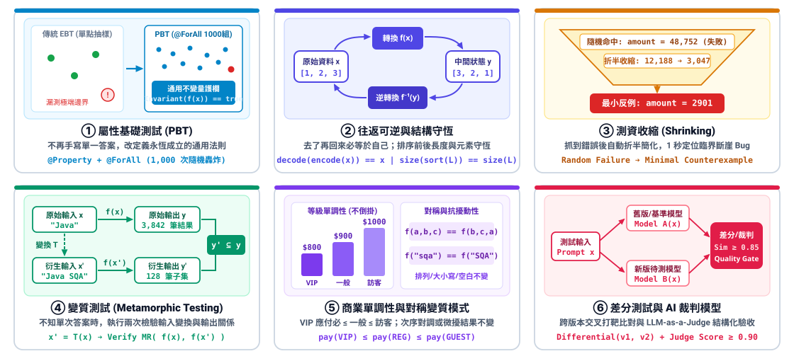
</div>

---

<!-- header: '5.11 屬性基礎測試 (PBT) 與變質測試 (MT)' -->

## 範例測試 (EBT) vs. 屬性測試 (PBT) 典範轉移

<div class="card-deck">

* > 💡 從 Example-Based 走向 Property-Based：讓框架自動產生萬組極端隨機測資，尋找致命反例。

<div class="two-columns">
<div class="card" data-marpit-fragment>

### 📝 傳統範例測試 (Example-Based)
- **手動設計單點特例**：
  - 工程師手挑輸入 `add(2, 3)`，斷言輸出必為 `5`。
- **三大致命瓶頸**：
  - **1. 思維偏見**：開發者潛意識只挑「自己覺得會過」的正常數字。
  - **2. 邊界遺漏**：極易漏掉 `0`、`-1`、`Integer.MAX_VALUE` 溢位、空集合或特殊字元。
  - **3. 維護沉重**：手寫幾十組相似測資，卻仍只覆蓋輸入空間的滄海一粟。

</div>
<div class="card" data-marpit-fragment>

### 🎲 屬性基礎測試 (Property-Based, PBT)
- **改為宣告「通用不變量 (Invariant)」**：
  - 不管輸入何值，永遠滿足「交換律 `a + b == b + a`」或「反轉兩次等於自身」。
- **PBT 框架三大自動化引擎**：
  - **1. 屬性 (`@Property`)**：由人類定義永恆成立的邏輯規則。
  - **2. 生成器 (`@ForAll`)**：自動轟炸 **1,000 組**隨機與極端邊界值。
  - **3. 測資收縮 (`Shrinking`)**：一旦抓到 Bug，自動二分化簡為**最小可重現反例**！

</div>
</div>
</div>

---

<!-- header: '5.11 屬性基礎測試 (PBT) 與變質測試 (MT)' -->

## 屬性基礎測試 (PBT) 先驅：John Hughes

<div class="card-deck">

> 💡 2000 年發明 QuickCheck，開創「不要寫測試案例，定義程式屬性」的現代測試典範。

<div class="content-columns">
<div class="content-text">

- **QuickCheck 的誕生與榮譽**：
  - 瑞典查爾摩斯工學院教授、ACM Fellow。2000 年與 Koen Claessen 共同發表 QuickCheck，獲頒 ACM SIGPLAN 最具影響力論文獎。
- **測試思維的重大躍遷 (Paradigm Shift)**：
  - 提倡「**Don't write tests, specify properties!**」
  - 人類專注於找出系統應遵守的永恆數學不變量，將繁瑣的測資生成交給電腦。
- **測資收縮 (Shrinking)**：
  - 解決了隨機測試「反例過大、無法除錯」的痛點，以演算法秒級自動二分縮減至最小致命測資。
- **現代 PBT 生態系基石**：
  - 創立 Quviq 並在愛立信、Volvo 驗證；Java `jqwik`、Python `Hypothesis` 皆承襲其設計。

</div>
<div class="content-figure">
  <div class="name-card">
    
    <div class="name-card-caption">
      <span class="name-card-name">John Hughes (約翰·休斯)</span>
      <span class="name-card-cc"><a href="https://commons.wikimedia.org/wiki/File:John_Hughes_(computer_scientist).jpg" target="_blank" rel="noopener">QuickCheck Co-creator / ACM Fellow</a></span>
    </div>
  </div>
</div>
</div>
</div>

---

<!-- header: '5.11 屬性基礎測試 (PBT) 與變質測試 (MT)' -->

## 四大經典屬性設計模式：如何找出系統的「不變量」？

<div class="card-deck">

<div class="two-columns">
<div class="card" data-marpit-fragment>

- **① 往返可逆性（去了再回來，必定等於自己）**：
  - **公式**：`inverse(forward(x)) == x`
  - **例子**：不必知道壓縮或加密後的亂碼長怎樣，只要驗證「**壓縮再解壓縮 = 原檔案**」、「**陣列反轉兩次 `reverse(reverse(L))` = 原陣列 `L`**」！
- **② 結構與特徵守恆（不管怎麼變，核心特徵永遠不變）**：
  - **公式**：`invariant(f(x)) == true`
  - **例子**：對任意亂數陣列排序 `sort(L)`，雖不知排完第 3 個數是多少，但必滿足：**A. 元素總數不變（長度守恆）** 且 **B. 前數永遠 ≤ 後數（單調遞增）**！

</div>
<div class="card" data-marpit-fragment>

- **③ 冪等性（做一次跟重複做十次，結果完全一樣）**：
  - **公式**：`f(f(x)) == f(x)`
  - **例子**：已經排好序的資料再排一次結果不變 `sort(sort(L)) == sort(L)`；字串去除首尾空白做兩次結果不變 `trim(trim(s)) == trim(s)`。
- **④ 代數與排列對稱性 (Symmetry & Algebraic — 以 5.3 節「三角形」為例)**：
  - **公式**：`f(a, b, c) == f(b, c, a) == f(c, a, b)`
  - **三角形對稱不變量**：隨機丟入任意三邊 `(a, b, c)`，雖不知它是哪種三角形，但**將三邊順序對調，分類結果必定相同**！（若程式只寫 `a+b<=c` 卻漏寫 `b+c<=a`，隨機測對稱性 0.1 秒即抓出 `triangle(2,3,6) != triangle(6,2,3)`！）

</div>
</div>
</div>

---

<!-- header: '5.11 屬性基礎測試 (PBT) 與變質測試 (MT)' -->

## 為什麼叫 `jqwik`？什麼是「測資收縮 (Shrinking)」？

<div class="card-deck">

> 💡 隨機測試最怕「生出一坨超長亂碼報錯，人類根本無法除錯」—— **測資收縮**正是解決此痛點的殺手鐧！

<div class="two-columns">
<div class="card" data-marpit-fragment>

### 🏷️ 1. 為什麼框架叫做 `jqwik`？
- **命名由來（發音同 *"J-Quick"*）**：
  - **`J`** (**J**ava / **J**Unit 5) + **`qwik`** (致敬 John Hughes 的 **Quick**Check) = **`jqwik`**！
  - 它是專為 **JUnit 5 Platform** 打造的原生屬性測試引擎，直接與 JUnit 5 共用執行器。
- **隨機 + 邊界混合轟炸 (`@ForAll`)**：
  - 標註 `@Property` 的測試方法預設會自動執行 **1,000 次**；
  - `jqwik` 不只生隨機數，還會優先塞入 **`0, 1, -1, Integer.MAX_VALUE, 空串列`** 等惡魔邊界值！

</div>
<div class="card" data-marpit-fragment>

### 📉 2. 什麼是「測資收縮」？為什麼要縮小？
- **為什麼要縮小？**：
  - 假設程式在 **`x >= 100`（滿百元折扣）時有 Bug**；`jqwik` 隨機抽中 **`x = 800`** 抓到錯誤，但若直接報 `800`，工程師看不出為何是 `800` 出錯！
- **如何自動折半縮小（像玩終極密碼，每次切一半重測）**：
  - 抓到 `800` 失敗 ❌ 後，引擎不急著報錯，自動在背景反覆折半重跑：
  - 試 `400` (失敗 ❌) ➔ 試 `200` (失敗 ❌) ➔ 試 `100` (失敗 ❌) ➔ 試 `50` (通過 ✅，代表臨界點在 51~100) ➔ 試到 `99` (通過 ✅)！
  - **最終報表直接印出最小反例：`x = 100`**（若陣列 `[42, -999, 8531]` 因負數崩潰，也會自動刪光雜訊並縮成 **`[-1]`**），讓工程師 1 秒看穿 Bug 根因！

</div>
</div>
</div>

---

<!-- header: '5.11 屬性基礎測試 (PBT) 與變質測試 (MT)' -->

## `jqwik` 語法實戰：將四大屬性模式寫成單元測試

<div class="card-deck">

> 💡 只需掌握 `@Property`（宣告屬性測試）與 `@ForAll`（自動生成隨機與邊界參數）兩個核心註解！

<div class="two-columns">
<div class="card">

### 🧩 `jqwik` 核心註解與參數約束
- **`@Property`（取代 `@Test`）**：
  - 宣告此方法為一條「通用屬性不變量」，由 `jqwik` 引擎自動重複呼叫 **1,000 次**（可設 `tries = 500` 調整次數）。
  - 回傳 `boolean`（若回傳 `false` 即代表屬性被打破，立即觸發 Shrinking！）或內部使用 JUnit `assertEquals`。
- **`@ForAll` 與範圍約束 (`@IntRange` / `@DoubleRange`)**：
  - 標註於方法參數前，指示 `jqwik` 依型別（`int`、`List<Integer>`、`Enum`）自動建立生成器與收縮器，並優先混入 `0, -1, MAX_VALUE, 空串列` 等惡魔邊界！

</div>
<div class="card">

### 📋 [`PropertyBasedDemoTest.java`](../../lab.html?file=LabDemo/src/test/java/u05_behavioral/pbtest/PropertyBasedDemoTest.java)
- **示範 1 & 2【代數定律模式】**：
  - **測試設計**：隨機注入 1,000 組整數 `(a, b)`。
  - **驗收不變量**：驗證加法交換律 `add(a, b) == add(b, a)` 與單位元性質 `add(a, 0) == a` 恆成立。
- **示範 3【往返可逆模式】**：
  - **測試設計**：隨機生成 1,000 組任意長度與內容的整數串列 `L`。
  - **驗收不變量**：連續反轉兩次 `reverse(reverse(L))`，元素順序與長度恢復為原串列 `L`。
- **示範 4【結構與特徵守恆模式】**：
  - **測試設計**：隨機生成 1,000 組亂數串列送入 `sort(L)`。
  - **驗收不變量**：排完後**元素個數必與原串列相等**，且任意相鄰元素必滿足**前數 ≤ 後數（單調遞增）**！

</div>
</div>
</div>

---

<!-- header: '5.11 屬性基礎測試 (PBT) 與變質測試 (MT)' -->

## `jqwik` 企業邏輯實戰：金流不變量與「測資收縮」抓漏

<div class="card-deck">

> 💡 在企業系統中，PBT 最常被用來抓出「**折扣疊加倒貼漏洞**」與「**滿額門檻定價倒掛 Bug**」（詳見 [`PropertyBasedDemoTest.java`](../../lab.html?file=LabDemo/src/test/java/u05_behavioral/pbtest/PropertyBasedDemoTest.java) Part 2 & 3）！

<div class="two-columns">
<div class="card">

### 🏦 企業商業邏輯的三大不變量 (示範 5~7)
- **1. 電商金流邊界與守恆 (`OrderDiscount`)**：
  - 隨機抽樣 1,000 組 `(會員等級, 金額 0~10萬, 付款方式)`；
  - 斷言：**應付金額必 `>= 0`（防倒貼漏洞）且 `<= 原價`**，且 **`應付 + 折抵 == 原價`（金流守恆）**！
- **2. 會員等級尊榮單調性 (`OrderDiscount`)**：
  - 相同金額與支付下，斷言 **`VIP 應付 <= 一般會員 <= 訪客`**（絕不允許 VIP 買得比一般會員還貴！）。
- **3. 銀行房貸法定保底與額度單調性 (`LoanCalculator`)**：
  - 核貸利率永遠鎖定在 **`[2.0%, 5.0%]`** 法定範圍內，且**多貸 100 萬時利率只降不升**！

</div>
<div class="card">

### 📉 測資收縮實戰：抓出滿額斷崖倒掛 (示範 8)
- **受測商業屬性**：**「多買 100 元商品，結帳應付金額不應反而變少 (`pay(x) <= pay(x + 100)`)」**。
- **1. 隨機轟炸命中 Bug (`Original Sample`)**：
  - `jqwik` 在 `100 ~ 50,000` 元間隨機抽中 **`amount = 2,964 元`** 時發現屬性回傳 `false` ❌！
- **2. 自動二分收縮 (`Shrinking` 6 步精準定位)**：
  - 引擎自動折半重測，最終印出**最小反例：`Shrunk sample: amount = 2901`**！
  - **1 秒看穿根因**：因「`> 3,000` 元立減從 100 跳升至 300」，VIP 買 **`2,901` 元需付 `2,220.8` 元**，但多買 100 元湊到 **`3,001` 元卻只要付 `2,100.8` 元**（多買 100 元反而少付 120 元）！

</div>
</div>
</div>

---

<!-- header: '5.11 屬性基礎測試 (PBT) 與變質測試 (MT)' -->

## 什麼是變質測試 (Metamorphic Testing, MT)？

<div class="card-deck">

> 💡 當連單一執行的輸出都無法驗證對錯時（如搜尋引擎、AI 模型），改檢驗「**兩次執行間的輸入變換與輸出相對關係**」！

<div class="two-columns">
<div class="card">

### 🧬 1. 變質測試的核心思想 (陳振宇, 1998)
- **無預言機困境 (Test Oracle Problem)**：
  - 搜尋引擎輸入 `"Java"` 回傳 3,842 筆網頁、或 LLM 生成一段摘要，我們根本不知道「標準答案」是什麼！
- **核心破局思維**：
  - 雖然不知道單次輸出 `y = f(x)` 本身對不對，但若我們將輸入 `x` 做有規律的變換得到 `x'`，**兩次輸出 `(y, y')` 之間必定要滿足特定的領域邏輯關係**！

</div>
<div class="card">

### 🔄 2. 變質測試三步執行迴圈 (3-Step Loop)
- **Step 1：原始執行 (Source Run)**：
  - 輸入基準測資 `x`（如搜尋 `"Java"`），獲得原始輸出 `y = f(x)`。
- **Step 2：衍生執行 (Follow-up Run)**：
  - 依領域知識對 `x` 施加變換得 `x' = T(x)`（如追加條件搜尋 `"Java SQA"`），獲得衍生輸出 `y' = f(x')`。
- **Step 3：變質關係驗收 (Metamorphic Relation, MR)**：
  - 斷言 **`R(y, y')`** 成立（如搜尋條件變嚴格，結果集必為子集 **`y' ⊆ y`**）！

</div>
</div>
</div>

---

<!-- header: '5.11 屬性基礎測試 (PBT) 與變質測試 (MT)' -->

## 變質測試 (MT) 與 PBT 的差異及搜尋引擎實戰

<div class="card-deck">

> 💡 理解了 MT 的「跨次變換」後，就能一眼看清它與 PBT 的分工定位及搜尋引擎實戰應用！

<div class="two-columns">
<div class="card">

### ⚖️ MT 與 PBT 的兩大核心差異
- **1. 單次輸出檢驗 `P(x, y)` vs. 跨次相對關係 `R(y, y')`**：
  - **PBT** 檢驗單次輸出 `y = f(x)` 是否滿足格式或邊界（如 `0 <= y <= x`、陣列已遞增）。
  - **MT** 必須執行**至少兩次**，以第一次輸出 `y` 為錨點，檢驗變換輸入後的相對變化 `R(f(x), f(T(x)))`。
- **2. 從零隨機合成 vs. 真實種子衍生 (Seed Transformation)**：
  - **PBT** 由框架憑空亂數合成 `int / List`；
  - **MT** 從**真實世界既有資料 `x`**（街景圖、病歷、查詢）出發，透過加雜訊、旋轉、改寫衍生出 `x'`！

</div>
<div class="card">

### 💻 搜尋引擎變質實戰 ([`MetamorphicDemoTest.java`](../../lab.html?file=LabDemo/src/test/java/u05_behavioral/pbtest/MetamorphicDemoTest.java))
- **MR 1：範圍縮小之子集包含性 (Inclusion)**：
  - **原始 (`x`)**：搜 `"Java"` 得 `r1`；**衍生 (`x'`)**：搜 `"Java SQA"` 得 `r2`。
  - **驗收**：必滿足 **`r2 ⊆ r1` (`r1.containsAll(r2)`)**！
- **MR 2：無關空白微擾之等價性 (Perturbation)**：
  - 搜 `"SQA"` 與前後加空白 `"   SQA   "`，兩次結果必完全相等！
- **🚀 PBT + MT 雙劍合璧**：
  - 前面在 `@Property` 中比對 `pay(x)` 與 `pay(x + 100)`，正是用 `jqwik` 隨機引擎驅動變質關係！

</div>
</div>
</div>

---

<!-- header: '5.11 屬性基礎測試 (PBT) 與變質測試 (MT)' -->

## 四大經典變質關係模式庫 (MR Patterns)

<div class="card-deck">

> 💡 頂尖 QA 如何設計 MR？掌握四大不變量思維，即可通殺 90% 以上複雜系統与 AI 黑箱。

| 模式類別 | 變質關係定義 (MR Formulation) | 實戰工程案例 |
| :--- | :--- | :--- |
| **1. 對稱與等價性<br>(Symmetry / Invariance)** | f(Transform(x)) == f(x) | **三角形 / 搜尋引擎**：三邊順序對調 `triangle(a,b,c) == triangle(b,c,a)`；關鍵字大小寫 `Search("sqa") == Search("SQA")` 結果相同。 |
| **2. 包含與單調性<br>(Inclusion / Monotonicity)** | 若 x<sub>1</sub> ≤ x<sub>2</sub> ➔ f(x<sub>1</sub>) ≤ f(x<sub>2</sub>) 或 f(x<sub>1</sub>) ⊆ f(x<sub>2</sub>) | **游泳池 / 房貸 / 搜尋**：會員票價必 ≤ 非會員票價；貸款金額增加則利率單調遞減；複合關鍵字結果為子集。 |
| **3. 比例縮放一致性<br>(Scaling Consistency)** | f(k × x) == f(x) 或 k × f(x) | **三角形 / 導航路徑**：合法三角形三邊同乘 k 倍 `triangle(ka, kb, kc) == triangle(a,b,c)` 分類不變；路網權重同乘 2 倍最佳路徑不變。 |
| **4. 獨立抗擾動性<br>(Irrelevant Perturbation)** | f(x + noise) == f(x) | **搜尋引擎 / LLM**：關鍵字前後加上無關空格 `"  SQA  "` 搜尋結果不變；語句結尾加標點情緒評分不逆轉。 |

</div>

---

<!-- header: '5.11 屬性基礎測試 (PBT) 與變質測試 (MT)' -->

## 貫穿本章回顧：把「三角形、游泳池、房貸」變成 PBT / MT！

<div class="card-deck">

> 💡 同一個系統，從 5.3~5.5 的「指定答案測資」切換到 5.11 的「屬性與變質關係」，視野如何升級？

<div class="two-columns">
<div class="card" data-marpit-fragment>

### 🔄 前面範例的 PBT / MT 寫法
- **1. 三角形 (`Triangle`) —— 對稱與比例縮放**：
  ```java
  @Property // 排列對稱性：三邊任意對調，分類結果必相同
  boolean triangleSymmetry(@ForAll int a, @ForAll int b, @ForAll int c) {
      return Triangle.getTriangleType(a, b, c)
             .equals(Triangle.getTriangleType(b, c, a));
  }
  ```
- **2. 游泳池 (`SwimmingPool`) 與房貸 (`LoanCalculator`) —— 優惠單調性**：
  ```java
  @Property // 優惠單調性：多貸 100 萬或具青年身分，利率只會更低或持平！
  boolean loanRateMonotonic(@ForAll @IntRange(min=1, max=40) int yr,
                            @ForAll @DoubleRange(min=1e5, max=5e7) double amt) {
      double rBase = LoanCalculator.calculateInterestRate(yr, amt, false, false);
      double rMore = LoanCalculator.calculateInterestRate(yr, amt + 1e6, true, false);
      return rMore <= rBase && rMore >= 2.0; // 單調遞減且保底 2.0%
  }
  ```

</div>
<div class="card" data-marpit-fragment>

### 🧭 工程師的關鍵判斷：何時用 Pairwise？何時用 PBT？
- **📌 純離散小組合（如游泳池 3×2×2 = 12 種）➔ 首選 Pairwise**：
  - 整個輸入空間只有 12 種組合時，用 Pairwise（6 組）搭配 `@CsvSource` 就能 100% 精確測完。
  - 若硬用 `jqwik` 跑 1,000 次，只是把相同的 12 種組合重複跑 80 遍，**殺雞用牛刀**！
- **📌 連續大範圍數值或無 Oracle（如三角形邊長、房貸金額、搜尋引擎）➔ 首選 PBT / MT**：
  - 當輸入是 `int`（42 億種）、`double` 金額或任意字串陣列時，傳統表格只能測幾個點；
  - 用 **PBT + MT** 才能以萬組隨機極值轟炸，抓出整數溢位與單調性反轉等深層 Bug！

</div>
</div>
</div>

---

<!-- header: '5.11 屬性基礎測試 (PBT) 與變質測試 (MT)' -->

## 現代 AI 與 LLM 評測實務：差分與裁判模型落地

<div class="card-deck">

> 💡 SQA 2.0 評測工具鏈：結合理論觀念，在 CI/CD Pipeline 落地自動化品質門檻。

<div class="two-columns">
<div class="card" data-marpit-fragment>

### ⚖️ 多模型差分實務 (Differential)
- **跨版本與跨模型交叉打靶**：
  - 將 1,000 組邊界 Prompt 同時送入 **新版 Model vs. 舊版 Model**。
  - 計算語意嵌入距離 (Cosine Similarity)。
  - 若相似度小於 0.85，自動標記為潛在回歸缺陷 (Regression Drift)。
- **工具鏈整合**：
  - 使用 **Promptfoo** / **DeepEval** 跑自動化矩陣差分比對。

</div>
<div class="card" data-marpit-fragment>

### 🧑‍⚖️ LLM-as-a-Judge 規準落地
- **JSON Schema 結構化評分輸出**：
  ```json
  {
    "metric": "Faithfulness",
    "score": 0.95,
    "has_hallucination": false,
    "rationale": "所有陳述皆可在 Context 找到依據"
  }
  ```
- **CI/CD Quality Gate 阻斷門檻**：
  - 於 GitHub Actions 中設定：忠實度 < 0.90 或安全違規率 > 0% 即判定 Build Failed！

</div>
</div>
</div>

---

<!-- header: '5.11 屬性基礎測試 (PBT) 與變質測試 (MT)' -->

## 🧪 課堂實習指引 (LabDemo 5.11: 屬性與變質測試實戰)

<div class="card-deck">

> 💡 搭配專題實驗手冊：[`jqwik_property_based.md`](../../lab.html?file=LabDemo/docs/u05_utest/jqwik_property_based.md) 與 [`behavioral.md`](../../lab.html?file=LabDemo/docs/u05_utest/behavioral.md#511-以性質為基礎的測試-pbt-與變質測試實戰)

<div class="two-columns">
<div class="card">

### 💻 課堂示範體驗 (兩大 Demo)
- **1. 屬性基礎測試 ([`PropertyBasedDemoTest.java`](../../lab.html?file=LabDemo/src/test/java/u05_behavioral/pbtest/PropertyBasedDemoTest.java))**：
  - **Part 1 (基礎代數/串列)**：加法交換律、反轉兩次可逆、排序單調遞增。
  - **Part 2 (企業商業邏輯)**：電商 `OrderDiscount` 金流不倒貼守恆、**VIP 會員尊榮單調性 (`VIP <= 一般 <= 訪客`)**、銀行 `LoanCalculator` 利率保底 2.0%！
- **2. 變質測試 ([`MetamorphicDemoTest.java`](../../lab.html?file=LabDemo/src/test/java/u05_behavioral/pbtest/MetamorphicDemoTest.java))**：
  - 執行搜尋引擎之「結果包含性 (`Search("Java SQA") ⊆ Search("Java")`)」與「前後空白抗擾動性」變質關係！

</div>
<div class="card">

### 🎯 課堂動手練習 (Hands-on Exercise)
- **練習 1~3：屬性與企業邏輯不變量 ([`PropertyBasedExerciseTest.java`](../../lab.html?file=LabDemo/src/test/java/u05_behavioral/pbtest/PropertyBasedExerciseTest.java))**：
  - 補全乘法交換律 (`a * b == b * a`)、反轉串列長度守恆；
  - **企業邏輯實戰 (練習 3)**：使用 `@DoubleRange` 與 `@IntRange` 驗證銀行房貸「青年首購利率 `<=` 一般申貸利率 且 `>= 2.0%`」！
- **練習 4：搜尋引擎對稱性變質關係 ([`MetamorphicExerciseTest.java`](../../lab.html?file=LabDemo/src/test/java/u05_behavioral/pbtest/MetamorphicExerciseTest.java))**：
  - 實作關鍵字大小寫不敏感之對稱變質關係：`search("software") == search("SOFTWARE")`！

</div>
</div>
</div>

---

<!-- header: '5.11 屬性基礎測試 (PBT) 與變質測試 (MT)' -->

## 屬性基礎測試 (PBT) 常見問答 (FAQ)：定位與工業界現況

<div class="card-deck">

> 💡 學完 PBT 與 MT 後最常被問到的實務問題：所有問題都能用嗎？工業界真的常用嗎？

<div class="two-columns">
<div class="card">

### 🎯 Q1 & Q2：適用邊界與入門門檻
- **Q1：所有問題都能用 PBT 嗎？會取代傳統測試嗎？**
  - **不會取代，最佳黃金比例是「80% EBT + 20% PBT」互補**！
  - 若需求是**單一業務特例**（如「雙 11 輸入 `NOV11` 送紅包」）或**純離散小組合**（如泳池 12 組），傳統 `@CsvSource` 最直觀；
  - 當涉及**演算法、解析器、序列化、複雜計價/稅率、狀態機**等具普遍守恆律的核心邏輯時，才是 PBT 發揮百倍威力的主戰場！
- **Q2：一時想不出完美的數學不變量怎麼辦？**
  - 先從最保底的 **「防崩潰屬性 (Smoke / No-Crash Property)」** 下手：隨機轟炸合法範圍輸入，斷言絕不拋出未預期 Exception，再逐步加上**上下界 (`0 <= 折扣價 <= 原價`)** 與**單調性**！

</div>
<div class="card">

### 💡 Q3 & Q4：工業界採用度與重現性
- **Q3：PBT 在工業界是常用的嗎？哪些企業在用？**
  - **在金融支付、雲端基礎設施、車載與編譯器領域已是標配**！
  - **Amazon AWS (S3 / IAM)**：大規模以 PBT 驗證雲端儲存與權限引擎，曾抓出傳統測試漏掉的 20+ 步深層並發缺陷。
  - **Volvo 與愛立信 (Ericsson)**：以 QuickCheck 驗證車載控制匯流排 (AUTOSAR) 與 5G 通訊協定。
  - **Stripe / 現代後端團隊**：Python `Hypothesis`、Java `jqwik`、Rust `proptest` 廣泛用於金流對帳與 API 序列化防呆。
- **Q4：隨機跑 1,000 次抓到 Bug，下次重跑還能重現嗎？**
  - **100% 可重現**！`jqwik` 會記錄亂數種子 (`seed`) 並開啟 `SAMPLE_FIRST`，下次執行必優先重跑上次失敗的反例！

</div>
</div>
</div>

---

<!-- header: '5.11 屬性基礎測試 (PBT) 與變質測試 (MT)' -->

## 屬性測試 (PBT) 與變質測試 (MT) 最佳實務 (Best Practices)

<div class="card-deck">

> 💡 擺脫單一答案的預言機枷鎖；用數學不變量約束隨機性，用變形關係評測複雜 AI。

<div class="two-columns">
<div class="card" data-marpit-fragment>

### 🎯 黃金法則：四大多態模式與變形關係
- **熟練套用四大通用屬性模式**：
  - **往返可逆 (Round-trip)**：`deserialize(serialize(x)) == x`
  - **冪等性 (Idempotence)**：`format(format(x)) == format(x)`
  - **差分預言機 (Differential)**：`optimized(x) == naive(x)`
  - **結構不變量 (Invariants)**：`filtered.size() <= original.size()`
- **設計嚴謹的變形關係 (MR)**：
  - 在無法預知 f(x) 絕對值時，透過輸入變換檢驗輸出的領域邏輯（如翻轉對稱、子集單調性）。
- **依賴 Shrinking 快速定位最小失敗案例**。

</div>
<div class="card" data-marpit-fragment>

### ⚠️ 常見反模式 (Anti-Patterns)
- **在屬性斷言中把業務邏輯重寫一遍**：
  - 測試程式碼複製了一份和待測程式碼一模一樣的演算法，導致兩邊同時存在相同 Bug。
- **變形關係過於寬鬆 (Weak MR)**：
  - 定義出「輸出只要大於 0 就通過」等過度寬鬆的 MR，無法有效抓出潛伏邏輯錯誤。
- **把 PBT 當無頭蒼蠅隨機測試**：
  - 未針對資料生成器 (`@Provide`) 設定合理的產生分佈與邊界加權，浪費運算資源。

</div>
</div>
</div>

---

<!-- header: '5.11 屬性基礎測試 (PBT) 與變質測試 (MT)' -->

## 概念核對問答 (CCQ 8)

<div class="ccq-columns">
<div class="ccq-text">

<!-- id: sqa-ch05-ccq8 -->
**問題情境**：  
【是非題】在屬性基礎測試 (Property-Based Testing, PBT) 中，我們不需要手動為每一組測試寫出確切的預期輸出數值，而是定義程式執行時必須永遠維持的「屬性或不變量 (Invariants)」，並交由測試框架隨機生成大量測資來自動尋找反例。

- **A)** 正確 (True)
- **B)** 錯誤 (False)

</div>
<div class="ccq-logo">

<a href="https://nlhsueh.github.io/nickedupocket/#/student/sqa-ch05-ccq8" target="_blank"></a>

</div>
</div>

---

<!-- header: '5.11 屬性基礎測試 (PBT) 與變質測試 (MT)' -->

## 課堂動腦挑戰：5 個真實場景，如何設計 PBT 屬性？

<div class="card-deck">

> 💡 請思考以下 5 個真實企業開發場景應採用哪種「不變量 / 變質關係」，**點擊各題即可展開／收合參考簡答**！

<div class="two-columns">
<div class="card">

- **1. 【JSON 序列化工具】** 自訂 `toJson(Order)` 與 `fromJson(str)`，如何免手寫字串比對驗證千萬種訂單？
  - 🎯 **【往返可逆 Round-Trip】**：隨機生成任意訂單 `x`，斷言 `fromJson(toJson(x)).equals(x)` 恆成立！
- **2. 【地址正規化與購物車合併】** `normalizeAddr(s)` 統一空白；`mergeCart(L)` 合併重複商品，如何測？
  - 🎯 **【冪等性 + 總量守恆】**：① 做兩次等於做一次 `f(f(s)) == f(s)`；② 合併前後購買總數量 `sum(qty)` 必守恆！
- **3. 【高鐵紅利點數折抵】** 每 100 點折 20 元，最高折抵原票價 50%，如何抓出點數計價漏洞？
  - 🎯 **【上下界 + 單調性】**：① 實付必滿足 `0.5*p ≤ pay(p,pts) ≤ p`；② 多用點數只降不升 `pay(p,pts+100) ≤ pay(p,pts)`！

</div>
<div class="card">

- **4. 【稅率演算法效能重構】** 將簡單慢速版 `calcTaxSlow(x)` 重構為複雜快取版 `calcTaxFast(x)`，如何防漏？
  - 🎯 **【差分預言機 Differential】**：以舊版為 Oracle，隨機轟炸萬組所得 `x`，斷言 `calcTaxFast(x) == calcTaxSlow(x)`！
- **5. 【銀行跨行轉帳引擎】** `transfer(A, B, amt)` 由 A 扣款轉入 B 並收 15 元手續費進 Bank，如何驗證帳務？
  - 🎯 **【總資金守恆 Invariant】**：無論轉帳成功或失敗，前後三方總金額必守恆 `A'+B'+Bank' == A+B+Bank` 且餘額 `≥ 0`！

</div>
</div>
</div>

---

<!-- header: '黑箱測試總結與全景指南' -->

## 黑箱測試方法選型與最佳實務總表 (1/2：輸入與規格推演)

<div class="card-deck">

> 💡 結構化測試設計的第一道防線：在輸入參數與規則維度中，將組合複雜度降至最低。

| 測試方法 | 核心解決的挑戰 | 最佳實務 (Best Practice) 黃金法則 | 典型適用場景 |
| :--- | :--- | :--- | :--- |
| **等價類分割 (EP)** | 無限輸入空間壓縮 | **邏輯同構才同類**；有效類多合一，無效類一案一測防遮蔽 | 數值範圍、列舉格式、登入與表單驗證 |
| **邊界值分析 (BVA)** | 邊緣極限與斷裂缺陷 | **邊界是 EP 的特化**；嚴格遵守單一缺陷假設 (4n+1 / 6n+1) | 年齡、分數、金額等連續區間與陣列索引 |
| **全成對測試 (Pairwise)** | 多參數組合爆炸 | **2-Way 覆蓋抓 80% 缺陷**；前置設定互斥約束防止髒數據 | 跨瀏覽器矩陣、多條件篩選器、參數配置 |
| **分類樹方法 (CTM)** | 龐大規格結構混亂 | **維度正交階層化**；視覺化打點矩陣一目了然驗收盲區 | 複雜結帳折扣規則、多欄位表單業務流 |
| **因果圖與決策表** | 複雜布林條件交錯組合 | **不相關條件使用 `-` (Don't Care) 化簡**，雙重檢驗完備性 | 促銷組合、保險核保、三角形判斷等多條件規則 |

</div>

---

<!-- header: '黑箱測試總結與全景指南' -->

## 黑箱測試方法選型與最佳實務總表 (2/2：行為流轉與新典範)

<div class="card-deck">

> 💡 動態行為與進階驗收的深水區：從狀態轉移、端到端旅程到跨越預言機困境。

| 測試方法 | 核心解決的挑戰 | 最佳實務 (Best Practice) 黃金法則 | 典型適用場景 |
| :--- | :--- | :--- | :--- |
| **狀態轉換測試** | 生命週期與事件路徑爆炸 | **0-Switch 全轉換為底線**；矩陣空白格全面覆蓋負向異常 | 訂單流轉、遊戲角色、通訊協定、ATM 機台 |
| **使用案例測試** | 端到端業務完整性 | **基本流先走通**；每條擴充案例只串接一個支流或異常流 | 使用者結帳旅程、提款與轉帳流程、審核工作流 |
| **經驗基礎測試** | 形式化規範外的漏網之魚 | **SBTM 時間盒探索**；將團隊歷史缺陷沉澱為防禦清單 | 發布前驗收、競品探索、極端異常探索 |
| **屬性測試 (PBT)** | 固定測資的思維死角 | **放棄固定答案**，檢驗往返可逆、冪等性與結構不變量 | 編解碼、排序演算法、資料結構、複雜計算核心 |
| **變形測試 (MT)** | 缺乏預言機 (Oracle Problem) | **透過輸入轉換**，驗證輸出之間的必要領域/數學關係 | 搜尋引擎、機器學習/AI 評測、影像處理、編譯器 |

</div>

---

<!-- header: '附錄：課堂互動參考解答' -->

## 附錄：課堂互動參考解答

<div class="card-deck">

* > 💡 本章課堂互動 (CCQ 1 ～ CCQ 8) 官方標準解答與核心觀念解析總整理。

<div class="two-columns">
<div class="card" data-marpit-fragment>

### 🧭 CCQ 1 ～ 4：斷言、邊界與組合
- **CCQ 1【錯誤 (B)】**：`assertEquals` 驗證內容相等 (`equals`)，`assertSame` 驗證記憶體位址同一性 (`==`)。
- **CCQ 2【19 個 (B)】**：3 變數獨立強固 BVA 案例數為 6n + 1 = 6 × 3 + 1 = 19。
- **CCQ 3【單一 vs 笛卡爾積 (B)】**：弱等價基於單一錯誤假設，強等價要求所有變數分割之全乘積。
- **CCQ 4【2-Way 交互作用 (B)】**：NIST 實證絕大多數缺陷由單變數或雙變數交互引發，Pairwise 具極高性價比。

</div>
<div class="card" data-marpit-fragment>

### 🎯 CCQ 5 ～ 8：正交、決策、狀態與屬性
- **CCQ 5【正交平衡性 vs 靈活度 (B)】**：正交表要求兩兩配對次數嚴格相等，Pairwise 僅求 ≥ 1 故更精實。
- **CCQ 6【複雜商務邏輯制約 (B)】**：決策表最適於多條件輸入與輸出動作具複雜因果關聯之場景。
- **CCQ 7【轉移覆蓋大於狀態覆蓋 (B)】**：轉移覆蓋走遍所有邊弧，必定已造訪所有狀態節點。
- **CCQ 8【正確 (A)】**：PBT 核心為規格即不變量，自動生成海量輸入並透過 Shrinking 回報極簡反例。

</div>
</div>
</div>

<script>
(function() {
  function initHeaderDropdown() {
    var sections = [];
    var seenTitles = new Set();
    var slideSections = document.querySelectorAll("section[id]");
    
    // 1. Scan unique section titles and their slide IDs
    slideSections.forEach(function(sec) {
      var header = sec.querySelector("header");
      if (!header) return;
      
      var title = header.textContent.trim();
      title = title.replace(/^[◄◀]\s*/, "").replace(/\s*[►▶]$/, "").trim();
      if (!title || seenTitles.has(title)) return;
      
      seenTitles.add(title);
      sections.push({
        id: sec.id,
        title: title
      });
    });

    if (sections.length === 0) return;

    // Helper to create the dropdown DOM
    function createDropdownWrapper(currentTitle) {
      var wrapper = document.createElement("span");
      wrapper.className = "header-nav-wrapper";
      
      var titleSpan = document.createElement("span");
      titleSpan.className = "header-nav-title";
      titleSpan.title = "點擊固定或懸停查看所有章節快速跳轉";
      
      var textNode = document.createTextNode(currentTitle);
      var caretSpan = document.createElement("span");
      caretSpan.className = "nav-caret";
      caretSpan.textContent = " ▾";
      titleSpan.appendChild(textNode);
      titleSpan.appendChild(caretSpan);
      
      titleSpan.addEventListener("click", function(e) {
        e.stopPropagation();
        var wasOpen = wrapper.classList.contains("is-open");
        document.querySelectorAll(".header-nav-wrapper.is-open").forEach(function(w) {
          w.classList.remove("is-open");
        });
        if (!wasOpen) {
          wrapper.classList.add("is-open");
        }
      });
      
      var dropdown = document.createElement("div");
      dropdown.className = "nav-dropdown";
      
      dropdown.addEventListener("click", function(e) {
        e.stopPropagation();
      });
      
      var dropHeader = document.createElement("div");
      dropHeader.className = "nav-dropdown-header";
      var titlePart = document.createElement("span");
      titlePart.textContent = "📑 快速跳轉章節目錄";
      var countPart = document.createElement("span");
      countPart.style.fontSize = "11px";
      countPart.style.fontWeight = "normal";
      countPart.style.color = "#64748b";
      countPart.textContent = "共 " + sections.length + " 個章節";
      dropHeader.appendChild(titlePart);
      dropHeader.appendChild(countPart);
      dropdown.appendChild(dropHeader);
      
      var grid = document.createElement("div");
      grid.className = "nav-dropdown-grid";
      
      sections.forEach(function(s) {
        var item = document.createElement("a");
        var isActive = (s.title === currentTitle);
        item.className = "nav-dropdown-item" + (isActive ? " active" : "");
        item.href = "#" + s.id;
        
        var badge = document.createElement("span");
        badge.className = "badge";
        badge.textContent = "#" + s.id.padStart(2, "0");
        
        var itemText = document.createElement("span");
        itemText.className = "item-text";
        itemText.title = s.title;
        itemText.textContent = s.title;
        
        item.appendChild(badge);
        item.appendChild(itemText);
        
        item.addEventListener("click", function(e) {
          wrapper.classList.remove("is-open");
          dropdown.style.display = "none";
          window.location.hash = "#" + s.id;
          setTimeout(function() { dropdown.style.display = ""; }, 350);
        });
        
        grid.appendChild(item);
      });
      
      dropdown.appendChild(grid);
      wrapper.appendChild(titleSpan);
      wrapper.appendChild(dropdown);
      return wrapper;
    }

    // Close any pinned dropdown when clicking anywhere outside
    document.addEventListener("click", function(e) {
      if (!e.target.closest(".header-nav-wrapper")) {
        document.querySelectorAll(".header-nav-wrapper.is-open").forEach(function(w) {
          w.classList.remove("is-open");
        });
      }
    });

    // 2. Enhance each header element across all slides (skip hidden dropdown DOM during headless PDF print)
    if (!navigator.webdriver) {
      slideSections.forEach(function(sec) {
        var header = sec.querySelector("header");
        if (!header || header.dataset.navEnhanced) return;
        header.dataset.navEnhanced = "true";
        
        var title = header.textContent.trim();
        title = title.replace(/^[◄◀]\s*/, "").replace(/\s*[►▶]$/, "").trim();
        if (!title) return;
        
        header.innerHTML = "";
        var wrapper = createDropdownWrapper(title);
        header.appendChild(wrapper);
      });
    }

    // 3. Auto-link and calibrate section items on the Outline slide (Slide 2)
    var secByNum = {};
    sections.forEach(function(s) {
      var m = s.title.match(/^(\d+\.\d+)\b/);
      if (m && !secByNum[m[1]]) {
        secByNum[m[1]] = s.id;
      }
    });
    var outlineSlide = document.querySelector("section.outline-slide, section[id=\"2\"]");
    if (outlineSlide) {
      outlineSlide.querySelectorAll("li").forEach(function(li) {
        var existingLink = li.querySelector(":scope > a, :scope > strong > a");
        if (existingLink) {
          var m = existingLink.textContent.trim().match(/^(\d+\.\d+)\b/);
          if (m && secByNum[m[1]]) {
            existingLink.href = "#" + secByNum[m[1]];
          }
          return;
        }
        var strong = li.querySelector(":scope > strong, :scope > b");
        if (strong) {
          var m = strong.textContent.trim().match(/^(\d+\.\d+)\b/);
          if (m && secByNum[m[1]]) {
            var a = document.createElement("a");
            a.href = "#" + secByNum[m[1]];
            strong.parentNode.insertBefore(a, strong);
            a.appendChild(strong);
          }
        }
      });
    }

    // 4. Auto-clamp hover zoom scale (--zoom-scale) so enlarged images never exceed slide (1280x720)
    function updateImgZoomScale(img) {
      var sec = img.closest("section");
      if (!sec) return;
      var w = img.offsetWidth;
      var h = img.offsetHeight;
      if (!w || !h) return;
      var x = 0, y = 0, cur = img;
      while (cur && cur !== sec && sec.contains(cur)) {
        x += cur.offsetLeft;
        y += cur.offsetTop;
        cur = cur.offsetParent;
      }
      var secW = sec.offsetWidth || 1280;
      var secH = sec.offsetHeight || 720;
      var padSide = 36;
      var padTop = 30;
      var isLeftOrigin = img.closest(":is(.two-columns, .two-columns-64, .two-columns-73, .three-columns) > .card:first-child");
      var availW = isLeftOrigin ? (secW - padSide - x) : ((x + w) - padSide);
      var availH = (y + h) - padTop;
      var tag = img.tagName ? img.tagName.toLowerCase() : "";
      var cap = (tag === "pre" || tag === "marp-pre") ? 1.42 : 2.0;
      var maxS = Math.min(cap, availW / w, availH / h, (secH - 60) / h);
      if (maxS < 1.0) maxS = 1.0;
      img.style.setProperty("--zoom-scale", maxS.toFixed(3));
    }
    document.querySelectorAll(".card img:not(.emoji), div.content-figure img:not(.emoji), div.split64 img:not(.emoji), div.split46 img:not(.emoji), div.split55 img:not(.emoji), .card pre, .card marp-pre").forEach(function(img) {
      if (img.dataset.zoomBound) return;
      img.dataset.zoomBound = "true";
      img.addEventListener("mouseenter", function() { updateImgZoomScale(img); });
      img.addEventListener("load", function() { updateImgZoomScale(img); });
      updateImgZoomScale(img);
    });

    // 5. Interactive State Machine Path Explorer (Section 5.8)
    var smExplorer = document.getElementById("sm-explorer");
    if (smExplorer && !smExplorer.dataset.smBound) {
      smExplorer.dataset.smBound = "true";
      var cbs = Array.from(smExplorer.querySelectorAll(".sm-cb"));
      var stateNodes = Array.from(smExplorer.querySelectorAll(".sm-state"));
      var edgeNodes = Array.from(smExplorer.querySelectorAll(".sm-edge"));
      var nodeStat = document.getElementById("sm-node-stat");
      var edgeStat = document.getElementById("sm-edge-stat");
      var nodeBar = document.getElementById("sm-node-bar");
      var edgeBar = document.getElementById("sm-edge-bar");
      var covNote = document.getElementById("sm-cov-note");

      function updateSmView() {
        var activePaths = new Set();
        cbs.forEach(function(cb) {
          var item = cb.closest(".sm-path-item");
          if (cb.checked) {
            activePaths.add(cb.value);
            if (item) item.classList.add("is-checked");
          } else {
            if (item) item.classList.remove("is-checked");
          }
        });

        var coveredStates = 0;
        stateNodes.forEach(function(el) {
          var paths = (el.getAttribute("data-paths") || "").split(",");
          var hit = paths.some(function(p) { return activePaths.has(p.trim()); });
          el.classList.toggle("is-active", hit);
          if (hit) coveredStates++;
        });

        var coveredEdges = 0;
        edgeNodes.forEach(function(el) {
          var paths = (el.getAttribute("data-paths") || "").split(",");
          var hit = paths.some(function(p) { return activePaths.has(p.trim()); });
          el.classList.toggle("is-active", hit);
          if (hit) coveredEdges++;
        });

        var nodePct = Math.round((coveredStates / 6) * 100);
        var edgePct = Math.round((coveredEdges / 8) * 100);
        if (nodeStat) nodeStat.textContent = coveredStates + " / 6 (" + nodePct + "%)";
        if (edgeStat) edgeStat.textContent = coveredEdges + " / 8 (" + edgePct + "%)";
        if (nodeBar) {
          nodeBar.style.width = ((coveredStates / 6) * 100).toFixed(1) + "%";
          nodeBar.style.background = (coveredStates === 6) ? "#16a34a" : "#0284c7";
        }
        if (edgeBar) {
          edgeBar.style.width = ((coveredEdges / 8) * 100).toFixed(1) + "%";
          edgeBar.style.background = (coveredEdges === 8) ? "#16a34a" : "#f59e0b";
        }
        if (covNote) {
          if (coveredEdges === 8) {
            covNote.style.color = "#15803d";
            covNote.textContent = "🎉 已達成 100% 轉移覆蓋（6 個狀態節點 + 8 條轉移弧線全數覆蓋）！";
          } else if (coveredStates === 6 && coveredEdges < 8) {
            covNote.style.color = "#b45309";
            covNote.textContent = "⚠️ 盲點示範：6 個狀態已 100% 覆蓋，但仍有 " + (8 - coveredEdges) + " 條 cancel 轉移邊未測到！";
          } else if (coveredEdges === 0) {
            covNote.style.color = "#64748b";
            covNote.textContent = "👆 請勾選上方任一測試路徑，觀察圖上對應亮起的狀態與轉移邊。";
          } else {
            covNote.style.color = "#0369a1";
            covNote.textContent = "💡 目前已覆蓋 " + coveredStates + " 個狀態、" + coveredEdges + " 條轉移邊，請繼績勾選其餘路徑。";
          }
        }
      }

      cbs.forEach(function(cb) {
        cb.addEventListener("change", updateSmView);
      });

      smExplorer.querySelectorAll("[data-sm-action]").forEach(function(btn) {
        btn.addEventListener("click", function() {
          var act = btn.getAttribute("data-sm-action");
          if (act === "all") {
            cbs.forEach(function(cb) { cb.checked = true; });
          } else if (act === "clear") {
            cbs.forEach(function(cb) { cb.checked = false; });
          } else if (act === "node100") {
            cbs.forEach(function(cb) {
              cb.checked = (cb.value === "1" || cb.value === "2" || cb.value === "5");
            });
          }
          updateSmView();
        });
      });

      updateSmView();
    }

    // 6. Progressive Enhancement for 5-Question PBT Design Challenge Slide (Section 5.11)
    if (!navigator.webdriver) {
      slideSections.forEach(function(sec) {
        var h2 = sec.querySelector("h2");
        if (!h2 || h2.textContent.indexOf("5 個真實場景") === -1 || sec.dataset.qaEnhanced) return;
        sec.dataset.qaEnhanced = "true";
        sec.querySelectorAll(".card > ul > li").forEach(function(li, idx) {
          var subUl = li.querySelector(":scope > ul");
          if (!subUl) return;
          subUl.classList.add("pbt-ans-sub");
          var badge = document.createElement("div");
          badge.className = "pbt-reveal-badge";
          badge.textContent = "▸ 點擊揭曉簡答 (題 " + (idx + 1) + ")";
          li.insertBefore(badge, subUl);
          li.style.cursor = "pointer";
          li.addEventListener("click", function() {
            li.classList.toggle("is-revealed");
            badge.textContent = li.classList.contains("is-revealed")
              ? "▾ 點擊隱藏簡答 (題 " + (idx + 1) + ")"
              : "▸ 點擊揭曉簡答 (題 " + (idx + 1) + ")";
          });
        });
      });
    }
    // 7. Interactive BVA Point Explorer (Section 5.3) - skip during PDF print (initial HTML already rendered)
    var bvaStage = !navigator.webdriver && document.querySelector(".bva-interactive-stage");
    if (bvaStage && !bvaStage.dataset.bvaBound) {
      bvaStage.dataset.bvaBound = "true";
      var bvaBtns = bvaStage.querySelectorAll(".bva-mode-btn");
      var bvaPts = bvaStage.querySelectorAll(".bva-pt");
      var bvaBadge = bvaStage.querySelector("#bva-mode-badge");
      var bvaTitle = bvaStage.querySelector("#bva-mode-title");
      var bvaFormula = bvaStage.querySelector("#bva-stat-formula");
      var bvaCount = bvaStage.querySelector("#bva-stat-count");
      var bvaDetails = bvaStage.querySelector("#bva-details-list");

      var bvaConfigs = {
        "norm": {
          badge: "單一錯誤假設 (Single Fault)",
          badgeClass: "bva-badge-blue",
          title: "一般邊界值分析 (Normal BVA)",
          formula: "4n + 1",
          count: "9 個測試點",
          activeCats: ["nom", "norm-bva"],
          details: [
            "<strong>最小基線取樣：</strong>固定其他變數為名義中心值 <code>norm</code>，沿各軸測試 <code>min, min+, max-, max</code>。",
            "<strong>抓錯目標：</strong>以線性成本攔截超過 60% 的關係運算子差一錯誤 (Off-by-One)。",
            "<strong>取樣密度：</strong>測試點數最精簡（雙變數僅需 <strong>9 點</strong>，三變數 13 點）。"
          ]
        },
        "robust": {
          badge: "強固邊界防禦 (Robustness)",
          badgeClass: "bva-badge-red",
          title: "強固邊界值分析 (Robust BVA)",
          formula: "6n + 1",
          count: "13 個測試點",
          activeCats: ["nom", "norm-bva", "robust-bva"],
          details: [
            "<strong>防禦性越界測試：</strong>在各軸兩端外加無效越界點 <code>min-</code> 與 <code>max+</code>。",
            "<strong>抓錯目標：</strong>驗證系統對超出範圍之非法輸入的例外處理與防禦能力。",
            "<strong>取樣密度：</strong>外加 4 個軸向越界端點（雙變數共 <strong>13 點</strong>，三變數 19 點）。"
          ]
        },
        "worst-norm": {
          badge: "多重錯誤耦合 (Multi-Fault)",
          badgeClass: "bva-badge-amber",
          title: "最壞情況一般邊界值分析 (Worst-Case Normal)",
          formula: "5ⁿ",
          count: "25 個測試點",
          activeCats: ["nom", "norm-bva", "worst-norm"],
          details: [
            "<strong>多變數組合：</strong>揚棄單一錯誤假設，測試所有合法邊界值的完整笛卡爾乘積。",
            "<strong>抓錯目標：</strong>揪出兩個以上變數同時處於極端邊界時才觸發的耦合缺陷。",
            "<strong>取樣密度：</strong>填滿內部 5×5 合法網格（雙變數 <strong>25 點</strong>，三變數 125 點）。"
          ]
        },
        "worst-robust": {
          badge: "完全笛卡爾乘積 (Full Cartesian)",
          badgeClass: "bva-badge-purple",
          title: "最壞情況強固邊界值分析 (Worst-Case Robust)",
          formula: "7ⁿ",
          count: "49 個測試點",
          activeCats: ["nom", "norm-bva", "robust-bva", "worst-norm", "worst-robust"],
          details: [
            "<strong>窮舉邊界網格：</strong>將所有變數的合法邊界與非法越界點做完全笛卡爾交集。",
            "<strong>抓錯目標：</strong>適用於航太與車規安全關鍵系統，防範多重越界同時發生的致命失效。",
            "<strong>取樣密度：</strong>最高密度取樣（雙變數 <strong>49 點</strong>，三變數 343 點）。"
          ]
        }
      };

      bvaBtns.forEach(function(btn) {
        btn.addEventListener("click", function(e) {
          e.stopPropagation();
          var cfg = bvaConfigs[this.getAttribute("data-bva")];
          if (!cfg) return;
          bvaBtns.forEach(function(b) { b.classList.remove("is-active"); });
          this.classList.add("is-active");
          bvaPts.forEach(function(pt) {
            var cat = pt.getAttribute("data-cat");
            var on = cfg.activeCats.indexOf(cat) !== -1;
            pt.classList.toggle("is-active", on);
            pt.classList.toggle("is-dimmed", !on);
          });
          if (bvaBadge) {
            bvaBadge.textContent = cfg.badge;
            bvaBadge.className = "bva-badge-pill " + cfg.badgeClass;
          }
          if (bvaTitle) bvaTitle.textContent = cfg.title;
          if (bvaFormula) bvaFormula.textContent = cfg.formula;
          if (bvaCount) bvaCount.textContent = cfg.count;
          if (bvaDetails) {
            bvaDetails.innerHTML = cfg.details.map(function(d) { return "<li>" + d + "</li>"; }).join("");
          }
        });
      });
      var bvaInit = bvaStage.querySelector(".bva-mode-btn.is-active") || bvaBtns[0];
      if (bvaInit) bvaInit.click();
    }

    // 8. Interactive BVA 4-Strategy Matrix Dot Game (Section 5.3)
    var bvaGame = document.getElementById("bva-loan-game");
    if (bvaGame && !bvaGame.dataset.bvaGameBound) {
      bvaGame.dataset.bvaGameBound = "true";
      var dotsLayer = bvaGame.querySelector("#bvag-dots-layer");
      var roundPill = bvaGame.querySelector("#bvag-round-pill");
      var scorePill = bvaGame.querySelector("#bvag-score-pill");
      var targetTitle = bvaGame.querySelector("#bvag-target-title");
      var feedbackMsg = bvaGame.querySelector("#bvag-feedback-msg");
      var btnSubmit = bvaGame.querySelector("#bvag-btn-submit");
      var btnNext = bvaGame.querySelector("#bvag-btn-next");
      var btnReshuffle = bvaGame.querySelector("#bvag-btn-reshuffle");

      var xs = [40, 95, 150, 240, 330, 385, 440];
      var ys = [40, 95, 150, 240, 330, 385, 440];
      var xLabels = ["99k", "100k", "101k", "5000k", "9999k", "10000k", "10001k"];
      var yLabels = ["31yr", "30yr", "29yr", "15yr", "2yr", "1yr", "0yr"];

      var allDots = [];
      if (dotsLayer) {
        dotsLayer.innerHTML = "";
        for (var ix = 0; ix < 7; ix++) {
          for (var iy = 0; iy < 7; iy++) {
            (function(px, py) {
              var c = document.createElementNS("http://www.w3.org/2000/svg", "circle");
              c.setAttribute("cx", String(xs[px]));
              c.setAttribute("cy", String(ys[py]));
              c.setAttribute("r", "6.8");
              c.setAttribute("class", "bvag-pt");
              c.dataset.ix = String(px);
              c.dataset.iy = String(py);
              var isValidX = px >= 1 && px <= 5;
              var isValidY = py >= 1 && py <= 5;
              var isAxisX = py === 3;
              var isAxisY = px === 3;
              var cat = "worst-robust";
              if (px === 3 && py === 3) cat = "nom";
              else if ((isAxisX && isValidX) || (isAxisY && isValidY)) cat = "norm-bva";
              else if ((isAxisX && !isValidX) || (isAxisY && !isValidY)) cat = "robust-bva";
              else if (isValidX && isValidY) cat = "worst-norm";
              c.dataset.cat = cat;
              var titleEl = document.createElementNS("http://www.w3.org/2000/svg", "title");
              titleEl.textContent = "Amount = " + xLabels[px] + ", Term = " + yLabels[py];
              c.appendChild(titleEl);
              c.addEventListener("click", function(e) {
                e.stopPropagation();
                c.classList.remove("is-hit", "is-missed", "is-extra");
                c.classList.toggle("is-selected");
                updateBvaGameCounters();
              });
              dotsLayer.appendChild(c);
              allDots.push(c);
            })(ix, iy);
          }
        }
      }

      var bvaStrategies = [
        { key: "norm", name: "獨立一般邊界值分析 (Independent Normal BVA — 單一錯誤假設、僅測合法邊界)", cats: ["nom", "norm-bva"] },
        { key: "robust", name: "獨立強固邊界值分析 (Independent Robust BVA — 單一錯誤假設、含越界防禦)", cats: ["nom", "norm-bva", "robust-bva"] },
        { key: "worst-norm", name: "最壞情況一般邊界值分析 (Worst-Case Normal BVA — 多重錯誤假設、合法邊界組合)", cats: ["nom", "norm-bva", "worst-norm"] },
        { key: "worst-robust", name: "最壞情況強固邊界值分析 (Worst-Case Robust BVA — 多重錯誤假設、完整合法與越界網格)", cats: ["nom", "norm-bva", "robust-bva", "worst-norm", "worst-robust"] }
      ];
      var bvaOrder = [0, 1, 2, 3];
      var bvaRoundIdx = 0;
      var bvaSolved = new Set();

      function shuffleBvaOrder() {
        bvaOrder = [0, 1, 2, 3];
        for (var i = bvaOrder.length - 1; i > 0; i--) {
          var j = Math.floor(Math.random() * (i + 1));
          var tmp = bvaOrder[i]; bvaOrder[i] = bvaOrder[j]; bvaOrder[j] = tmp;
        }
        bvaRoundIdx = 0;
        bvaSolved.clear();
      }
      function clearBvaSelection() {
        allDots.forEach(function(d) { d.classList.remove("is-selected", "is-hit", "is-missed", "is-extra"); });
      }
      function updateBvaGameCounters() {
        var selCnt = allDots.filter(function(d) { return d.classList.contains("is-selected"); }).length;
        if (scorePill) scorePill.textContent = "已過關: " + bvaSolved.size + " / 4 | 已選取: " + selCnt + " 點";
      }
      function loadBvaRound() {
        clearBvaSelection();
        var strat = bvaStrategies[bvaOrder[bvaRoundIdx]];
        if (roundPill) roundPill.textContent = "挑戰關卡 " + (bvaRoundIdx + 1) + " / 4（隨機排序）";
        if (targetTitle && strat) targetTitle.textContent = "目標策略：" + strat.name;
        if (feedbackMsg) {
          feedbackMsg.className = "bvag-feedback-box";
          feedbackMsg.textContent = "請在左方矩陣點選符合上方目標策略的所有邊界測試點，完成後點擊「送出答案」！";
        }
        updateBvaGameCounters();
      }

      bvaGame.querySelectorAll(".bvag-qbtn").forEach(function(qbtn) {
        qbtn.addEventListener("click", function(e) {
          e.stopPropagation();
          var act = qbtn.getAttribute("data-qact");
          allDots.forEach(function(d) { d.classList.remove("is-hit", "is-missed", "is-extra"); });
          if (act === "clear") {
            clearBvaSelection();
          } else {
            var targetDots = [];
            if (act === "valid-axes") targetDots = allDots.filter(function(d) { return d.dataset.cat === "nom" || d.dataset.cat === "norm-bva"; });
            else if (act === "outer-tips") targetDots = allDots.filter(function(d) { return d.dataset.cat === "robust-bva"; });
            else if (act === "valid-box") targetDots = allDots.filter(function(d) { return ["nom", "norm-bva", "worst-norm"].indexOf(d.dataset.cat) !== -1; });
            else if (act === "all-grid") targetDots = allDots;
            var allSel = targetDots.every(function(d) { return d.classList.contains("is-selected"); });
            targetDots.forEach(function(d) { d.classList.toggle("is-selected", !allSel); });
          }
          updateBvaGameCounters();
        });
      });

      if (btnSubmit) {
        btnSubmit.addEventListener("click", function(e) {
          e.stopPropagation();
          var strat = bvaStrategies[bvaOrder[bvaRoundIdx]];
          if (!strat) return;
          var hits = 0, missed = 0, extra = 0, expectedTotal = 0;
          allDots.forEach(function(d) {
            d.classList.remove("is-hit", "is-missed", "is-extra");
            var shouldSelect = strat.cats.indexOf(d.dataset.cat) !== -1;
            var isSelected = d.classList.contains("is-selected");
            if (shouldSelect) expectedTotal++;
            if (shouldSelect && isSelected) { hits++; d.classList.add("is-hit"); }
            else if (shouldSelect && !isSelected) { missed++; d.classList.add("is-missed"); }
            else if (!shouldSelect && isSelected) { extra++; d.classList.add("is-extra"); }
          });
          if (missed === 0 && extra === 0) {
            bvaSolved.add(strat.key);
            updateBvaGameCounters();
            if (feedbackMsg) {
              feedbackMsg.className = "bvag-feedback-box is-win";
              feedbackMsg.textContent = "[完全正確！] 精準命中全部 " + expectedTotal + " 個邊界測試點！請點擊「下一關挑戰」繼續。";
            }
          } else {
            updateBvaGameCounters();
            if (feedbackMsg) {
              feedbackMsg.className = "bvag-feedback-box is-err";
              feedbackMsg.textContent = "[尚未完全命中] 命中: " + hits + " / " + expectedTotal + " | 漏選 (黃色虛線): " + missed + " | 多選 (紅色): " + extra + "。請調整後重新送出！";
            }
          }
        });
      }
      if (btnNext) {
        btnNext.addEventListener("click", function(e) {
          e.stopPropagation();
          bvaRoundIdx = (bvaRoundIdx + 1) % 4;
          loadBvaRound();
        });
      }
      if (btnReshuffle) {
        btnReshuffle.addEventListener("click", function(e) {
          e.stopPropagation();
          shuffleBvaOrder();
          loadBvaRound();
        });
      }
      shuffleBvaOrder();
      loadBvaRound();
    }

    // 9. Interactive EP Matrix Explorer (Section 5.4) - skip during PDF print (initial HTML already rendered)
    var epStage = !navigator.webdriver && document.querySelector(".ep-interactive-stage");
    if (epStage && !epStage.dataset.epBound) {
      epStage.dataset.epBound = "true";
      var epBtns = epStage.querySelectorAll(".ep-mode-btn");
      var epPins = epStage.querySelectorAll(".ep-pin");
      var epBadge = epStage.querySelector("#ep-mode-badge");
      var epTitle = epStage.querySelector("#ep-mode-title");
      var epFormula = epStage.querySelector("#ep-stat-formula");
      var epCount = epStage.querySelector("#ep-stat-count");
      var epDetails = epStage.querySelector("#ep-details-list");

      var epConfigs = {
        "weak-norm": {
          badge: "僅合法類 • 單一錯誤假設",
          badgeClass: "ep-badge-green",
          title: "弱一般等價分割 (Weak Normal EP)",
          formula: "max(|P₁|, |P₂|)",
          count: "3 個案例",
          activePins: ["p_v11_v21", "p_v12_v22", "p_v13_v21"],
          details: [
            "<strong>最小合法覆蓋：</strong>確保每個變數的每一個合法等價類皆至少在一個測試案例中出現。",
            "<strong>單一錯誤假設：</strong>假設功能缺陷由單一分割區獨立觸發，無須窮舉跨變數乘積。",
            "<strong>測試成本：</strong>最經濟之測試基線（<strong>max(3, 2) = 3 個案例</strong>）。"
          ]
        },
        "strong-norm": {
          badge: "僅合法類 • 多重錯誤耦合",
          badgeClass: "ep-badge-blue",
          title: "強一般等價分割 (Strong Normal EP)",
          formula: "|P₁| × |P₂|",
          count: "6 個案例",
          activePins: ["p_v11_v21", "p_v11_v22", "p_v12_v21", "p_v12_v22", "p_v13_v21", "p_v13_v22"],
          details: [
            "<strong>合法類完全笛卡爾乘積：</strong>測試所有合法等價類別之間的全部排列組合。",
            "<strong>抓錯目標：</strong>攔截不同參數之合法類別相互衝突或耦合時的互動錯誤。",
            "<strong>測試成本：</strong>隨合法分割數呈乘法增長（<strong>3 × 2 = 6 個案例</strong>）。"
          ]
        },
        "weak-robust": {
          badge: "單一無效原則 • 例外防禦",
          badgeClass: "ep-badge-amber",
          title: "弱強固等價分割 (Weak Robust EP)",
          formula: "max(|P₁|, |P₂|) + ∑(Invalid)",
          count: "7 個案例",
          activePins: ["p_v11_v21", "p_v12_v22", "p_v13_v21", "p_i11_v21", "p_i12_v21", "p_v11_i21", "p_v11_i22"],
          details: [
            "<strong>單一無效隔離原則：</strong>每次僅測試一個非法類別，其餘變數一律保持合法值。",
            "<strong>防範缺陷遮蔽：</strong>嚴禁同時放入兩個非法值，避免第一個例外中斷而遮蔽後續錯誤。",
            "<strong>測試成本：</strong>線性外加獨立非法案例（<strong>3 合法 + 4 非法 = 7 個案例</strong>）。"
          ]
        },
        "strong-robust": {
          badge: "完全乘積網格 • 極限強固",
          badgeClass: "ep-badge-purple",
          title: "強強固等價分割 (Strong Robust EP)",
          formula: "(|P₁|+2) × (|P₂|+2)",
          count: "20 個案例",
          activePins: "all",
          details: [
            "<strong>全分割窮舉網格：</strong>測試所有合法與非法等價類別的笛卡爾乘積組合。",
            "<strong>多重錯誤防禦：</strong>驗證多個非法輸入同時碰撞時的複合錯誤處理行為。",
            "<strong>測試成本：</strong>笛卡爾乘積爆炸（<strong>5 × 4 = 20 個案例</strong>）。"
          ]
        }
      };

      epBtns.forEach(function(btn) {
        btn.addEventListener("click", function(e) {
          e.stopPropagation();
          var cfg = epConfigs[this.getAttribute("data-ep")];
          if (!cfg) return;
          epBtns.forEach(function(b) { b.classList.remove("is-active"); });
          this.classList.add("is-active");
          epPins.forEach(function(pin) {
            var id = pin.getAttribute("data-pin-id");
            var on = cfg.activePins === "all" || cfg.activePins.indexOf(id) !== -1;
            pin.classList.toggle("is-active-pin", on);
          });
          if (epBadge) {
            epBadge.textContent = cfg.badge;
            epBadge.className = "ep-badge-pill " + cfg.badgeClass;
          }
          if (epTitle) epTitle.textContent = cfg.title;
          if (epFormula) epFormula.textContent = cfg.formula;
          if (epCount) epCount.textContent = cfg.count;
          if (epDetails) {
            epDetails.innerHTML = cfg.details.map(function(d) { return "<li>" + d + "</li>"; }).join("");
          }
        });
      });
      var epInit = epStage.querySelector(".ep-mode-btn.is-active") || epBtns[0];
      if (epInit) epInit.click();
    }

    // 10. Interactive Binary Search Visualizer (Section 5.4) - skip during PDF print (initial HTML already rendered)
    var bsStage = !navigator.webdriver && document.querySelector(".bs-interactive-stage");
    if (bsStage && !bsStage.dataset.bsBound) {
      bsStage.dataset.bsBound = "true";
      var inputK = bsStage.querySelector("#bs-input-k");
      var btnStep = bsStage.querySelector("#bs-btn-step");
      var btnReset = bsStage.querySelector("#bs-btn-reset");
      var statusText = bsStage.querySelector("#bs-status-text");
      var statusTag = bsStage.querySelector("#bs-status-tag");
      var pills = bsStage.querySelectorAll(".bs-quick-pill");
      var cells = bsStage.querySelectorAll(".bs-array-cell");

      var bsArr = [3, 7, 11, 15, 19, 23, 27, 31, 35, 39, 43];
      var bsMax = bsArr.length - 1;
      var bsSteps = [];
      var bsStepIdx = 0;

      function calcBsSteps(k) {
        var low = 0, high = bsMax, hist = [];
        while (low <= high) {
          var mid = Math.floor((low + high) / 2);
          var val = bsArr[mid];
          if (val === k) {
            hist.push({ low: low, high: high, mid: mid, found: true, done: true, tag: "HIT FOUND", tagBg: "#dcfce7", tagColor: "#15803d", text: "成功命中目標值 " + k + "，位於索引 " + mid + "! (arr[" + mid + "] == " + k + ")" });
            break;
          } else if (val < k) {
            hist.push({ low: low, high: high, mid: mid, found: false, done: false, tag: "排除左半部", tagBg: "#e0f2fe", tagColor: "#0369a1", text: "arr[" + mid + "]=" + val + " < " + k + " ➔ 排除左半部 [0.." + mid + "]，更新 low = " + (mid + 1) });
            low = mid + 1;
          } else {
            hist.push({ low: low, high: high, mid: mid, found: false, done: false, tag: "排除右半部", tagBg: "#fef3c7", tagColor: "#b45309", text: "arr[" + mid + "]=" + val + " > " + k + " ➔ 排除右半部 [" + mid + ".." + bsMax + "]，更新 high = " + (mid - 1) });
            high = mid - 1;
          }
        }
        if (low > high) {
          hist.push({ low: low, high: high, mid: -1, found: false, done: true, tag: "NOT FOUND", tagBg: "#ffe4e6", tagColor: "#be123c", text: "目標值 " + k + " 不在陣列中！low (" + low + ") > high (" + high + ") ➔ 回傳 -1" });
        }
        return hist;
      }

      function renderBs() {
        var s = bsSteps[bsStepIdx];
        if (!s) return;
        cells.forEach(function(cell, idx) {
          cell.className = "bs-array-cell";
          cell.querySelectorAll(".bs-pointer-pill").forEach(function(p) { p.remove(); });
          if (idx < s.low || idx > s.high) cell.classList.add("is-eliminated");
          if (s.found && idx === s.mid) cell.classList.add("is-found");
          else if (idx === s.mid && !s.done) cell.classList.add("is-mid");
          if (idx === s.low && s.low <= bsMax && s.low >= 0) cell.insertAdjacentHTML("beforeend", '<span class="bs-pointer-pill bs-ptr-low">low</span>');
          if (idx === s.mid && s.mid >= 0) {
            var midBg = s.found ? 'style="background:#16a34a;"' : "";
            var midText = s.found ? "hit!" : "mid";
            cell.insertAdjacentHTML("beforeend", '<span class="bs-pointer-pill bs-ptr-mid" ' + midBg + ">" + midText + "</span>");
          }
          if (idx === s.high && s.high <= bsMax && s.high >= 0) cell.insertAdjacentHTML("beforeend", '<span class="bs-pointer-pill bs-ptr-high">high</span>');
        });
        if (statusText) statusText.textContent = "步驟 " + (bsStepIdx + 1) + "/" + bsSteps.length + "：" + s.text;
        if (statusTag) {
          statusTag.textContent = s.tag;
          statusTag.style.background = s.tagBg;
          statusTag.style.color = s.tagColor;
        }
        if (btnStep) {
          btnStep.textContent = s.done ? "↺ 重新播放" : "▶ 下一步 (" + (bsStepIdx + 2) + "/" + bsSteps.length + ")";
        }
      }

      function resetBs() {
        if (!inputK) return;
        var v = parseInt(inputK.value, 10);
        bsSteps = calcBsSteps(isNaN(v) ? 23 : v);
        bsStepIdx = 0;
        renderBs();
      }
      pills.forEach(function(p) {
        p.addEventListener("click", function(e) {
          e.stopPropagation();
          inputK.value = parseInt(this.getAttribute("data-k"), 10);
          resetBs();
        });
      });
      if (inputK) {
        inputK.addEventListener("change", resetBs);
        inputK.addEventListener("input", resetBs);
      }
      if (btnStep) {
        btnStep.addEventListener("click", function(e) {
          e.stopPropagation();
          if (bsSteps[bsStepIdx] && bsSteps[bsStepIdx].done) bsStepIdx = 0;
          else bsStepIdx = Math.min(bsStepIdx + 1, bsSteps.length - 1);
          renderBs();
        });
      }
      if (btnReset) {
        btnReset.addEventListener("click", function(e) {
          e.stopPropagation();
          resetBs();
        });
      }
      resetBs();
    }

    // 11. Interactive FoodExpress EP & BVA Matrix Game (Section 5.4)
    var fdgGame = document.getElementById("fdg-ep-bva-game");
    if (fdgGame && !fdgGame.dataset.fdgBound) {
      fdgGame.dataset.fdgBound = "true";
      var fdgTbody = fdgGame.querySelector("#fdg-ep-tbody");
      var seamChips = Array.from(fdgGame.querySelectorAll(".fdg-seam-chip"));
      var fdgRoundPill = fdgGame.querySelector("#fdg-round-pill");
      var fdgScorePill = fdgGame.querySelector("#fdg-score-pill");
      var fdgTargetTitle = fdgGame.querySelector("#fdg-target-title");
      var fdgTargetDesc = fdgGame.querySelector("#fdg-target-desc");
      var fdgFeedback = fdgGame.querySelector("#fdg-feedback-msg");
      var fdgSubmit = fdgGame.querySelector("#fdg-btn-submit");
      var fdgNext = fdgGame.querySelector("#fdg-btn-next");
      var fdgReshuffle = fdgGame.querySelector("#fdg-btn-reshuffle");

      var rowHeaders = [
        { label: "I₁: &lt; 100<br/>($50)", valid: false },
        { label: "V₁: 100..299<br/>(基本費 $60)", valid: true },
        { label: "V₂: 300..799<br/>(基本費 $35)", valid: true },
        { label: "V₃: 800..10000<br/>(免基本費 $0)", valid: true },
        { label: "I₂: &gt; 10000<br/>($12000)", valid: false }
      ];
      var allCells = [];
      if (fdgTbody) {
        fdgTbody.innerHTML = "";
        for (var r = 0; r < 5; r++) {
          var tr = document.createElement("tr");
          var th = document.createElement("th");
          th.innerHTML = rowHeaders[r].label;
          th.style.color = rowHeaders[r].valid ? "#15803d" : "#be123c";
          tr.appendChild(th);
          for (var c = 0; c < 5; c++) {
            (function(rr, cc) {
              var td = document.createElement("td");
              var isVR = rr >= 1 && rr <= 3;
              var isVC = cc >= 1 && cc <= 3;
              td.className = "fdg-cell " + (isVR && isVC ? "is-valid-zone" : "is-invalid-zone");
              td.dataset.r = String(rr);
              td.dataset.c = String(cc);
              var dot = document.createElement("span");
              dot.className = "fdg-dot";
              dot.textContent = "•";
              td.appendChild(dot);
              td.addEventListener("click", function(e) {
                e.stopPropagation();
                td.classList.remove("is-hit", "is-missed", "is-extra");
                td.classList.toggle("is-selected");
                updateFdgCounters();
              });
              tr.appendChild(td);
              allCells.push(td);
            })(r, c);
          }
          fdgTbody.appendChild(tr);
        }
      }

      seamChips.forEach(function(chip) {
        chip.addEventListener("click", function(e) {
          e.stopPropagation();
          chip.classList.remove("is-hit", "is-missed", "is-extra");
          chip.classList.toggle("is-selected");
          updateFdgCounters();
        });
      });

      var fdgChallenges = [
        { key: "weak-norm", title: "弱一般等價分割 (Weak Normal EP — 最小合法分割覆蓋)", desc: "請在面板 A (5×5 矩陣) 點選最少數量的合法格子，使 V₁..V₃ 三種金額級距與 D₁..D₃ 三種距離區間皆至少被覆蓋一次（不含任何非法輸入）！" },
        { key: "weak-robust", title: "弱強固等價分割 (Weak Robust EP — 合法基線 + 單一無效原則)", desc: "請在面板 A 點選最小合法 Weak EP 基線，並遵循「單一無效原則」為 4 個非法類別 (I₁..I₄) 各選 1 個與合法值配對的獨立測試格（嚴禁選取角落雙重非法格）！" },
        { key: "strong-norm", title: "強一般等價分割 (Strong Normal EP — 合法分割完全笛卡爾乘積)", desc: "請在面板 A 點選所有合法訂單金額 (V₁..V₃) 與合法外送距離 (D₁..D₃) 的完整笛卡爾乘積組合！" },
        { key: "bva-seams", title: "訂單金額 (Subtotal) 雙點 (On-Off) 邊界接縫取樣", desc: "請在下方面板 B 數線點選訂單金額 4 個計費接縫（最低 100、減免 300、免運 800、上限 10000）的 8 個 On-Off 精確邊界值！" }
      ];
      var fdgOrder = [0, 1, 2, 3];
      var fdgIdx = 0;
      var fdgSolved = new Set();

      function shuffleFdg() {
        fdgOrder = [0, 1, 2, 3];
        for (var i = fdgOrder.length - 1; i > 0; i--) {
          var j = Math.floor(Math.random() * (i + 1));
          var tmp = fdgOrder[i]; fdgOrder[i] = fdgOrder[j]; fdgOrder[j] = tmp;
        }
        fdgIdx = 0;
        fdgSolved.clear();
      }
      function clearFdg() {
        allCells.forEach(function(td) { td.classList.remove("is-selected", "is-hit", "is-missed", "is-extra"); });
        seamChips.forEach(function(ch) { ch.classList.remove("is-selected", "is-hit", "is-missed", "is-extra"); });
      }
      function updateFdgCounters() {
        var cellCnt = allCells.filter(function(td) { return td.classList.contains("is-selected"); }).length;
        var chipCnt = seamChips.filter(function(ch) { return ch.classList.contains("is-selected"); }).length;
        if (fdgScorePill) fdgScorePill.textContent = "已過關: " + fdgSolved.size + " / 4 | 矩陣格: " + cellCnt + " | 接縫值: " + chipCnt;
      }
      function loadFdgRound() {
        clearFdg();
        var ch = fdgChallenges[fdgOrder[fdgIdx]];
        if (fdgRoundPill) fdgRoundPill.textContent = "挑戰關卡 " + (fdgIdx + 1) + " / 4（隨機排序）";
        if (fdgTargetTitle && ch) fdgTargetTitle.textContent = "目標策略：" + ch.title;
        if (fdgTargetDesc && ch) fdgTargetDesc.textContent = ch.desc;
        if (fdgFeedback) {
          fdgFeedback.className = "bvag-feedback-box";
          fdgFeedback.textContent = "請在左方面板 A 或面板 B 點選測試點，完成後點擊「送出答案」！";
        }
        updateFdgCounters();
      }

      fdgGame.querySelectorAll("[data-fdact]").forEach(function(btn) {
        btn.addEventListener("click", function(e) {
          e.stopPropagation();
          var act = btn.getAttribute("data-fdact");
          allCells.forEach(function(td) { td.classList.remove("is-hit", "is-missed", "is-extra"); });
          seamChips.forEach(function(ch) { ch.classList.remove("is-hit", "is-missed", "is-extra"); });
          if (act === "clear") {
            clearFdg();
          } else {
            var targets = [];
            if (act === "diag3") targets = allCells.filter(function(td) { return (td.dataset.r === "1" && td.dataset.c === "1") || (td.dataset.r === "2" && td.dataset.c === "2") || (td.dataset.r === "3" && td.dataset.c === "3"); });
            else if (act === "valid9") targets = allCells.filter(function(td) { return Number(td.dataset.r) >= 1 && Number(td.dataset.r) <= 3 && Number(td.dataset.c) >= 1 && Number(td.dataset.c) <= 3; });
            else if (act === "iso4") targets = allCells.filter(function(td) { return (td.dataset.r === "0" && td.dataset.c === "2") || (td.dataset.r === "4" && td.dataset.c === "2") || (td.dataset.r === "2" && td.dataset.c === "0") || (td.dataset.r === "2" && td.dataset.c === "4"); });
            var allSel = targets.every(function(t) { return t.classList.contains("is-selected"); });
            targets.forEach(function(t) { t.classList.toggle("is-selected", !allSel); });
          }
          updateFdgCounters();
        });
      });

      if (fdgSubmit) {
        fdgSubmit.addEventListener("click", function(e) {
          e.stopPropagation();
          var ch = fdgChallenges[fdgOrder[fdgIdx]];
          if (!ch) return;
          allCells.forEach(function(td) { td.classList.remove("is-hit", "is-missed", "is-extra"); });
          seamChips.forEach(function(c) { c.classList.remove("is-hit", "is-missed", "is-extra"); });
          var selCells = allCells.filter(function(td) { return td.classList.contains("is-selected"); });

          if (ch.key === "bva-seams") {
            var expectedVals = new Set(["99", "100", "299", "300", "799", "800", "10000", "10001"]);
            var hits = 0, missed = 0, extra = 0;
            seamChips.forEach(function(c) {
              var isSel = c.classList.contains("is-selected");
              var should = expectedVals.has(c.getAttribute("data-val"));
              if (should && isSel) { hits++; c.classList.add("is-hit"); }
              else if (should && !isSel) { missed++; c.classList.add("is-missed"); }
              else if (!should && isSel) { extra++; c.classList.add("is-extra"); }
            });
            if (missed === 0 && extra === 0) {
              fdgSolved.add(ch.key); updateFdgCounters();
              fdgFeedback.className = "bvag-feedback-box is-win";
              fdgFeedback.textContent = "[BVA 接縫完全正確！] 精準選出全部 8 個 On-Off 邊界點 ($99|$100, $299|$300, $799|$800, $10000|$10001)！";
            } else {
              fdgFeedback.className = "bvag-feedback-box is-err";
              fdgFeedback.textContent = "[請檢查面板 B] 命中: " + hits + "/8 | 漏選 (黃色): " + missed + " | 多選非邊界點 (紅色): " + extra + "。";
            }
            return;
          }

          if (ch.key === "strong-norm") {
            var sHits = 0, sMissed = 0, sExtra = 0;
            allCells.forEach(function(td) {
              var rr = Number(td.dataset.r), cc = Number(td.dataset.c);
              var should = rr >= 1 && rr <= 3 && cc >= 1 && cc <= 3;
              var isSel = td.classList.contains("is-selected");
              if (should && isSel) { sHits++; td.classList.add("is-hit"); }
              else if (should && !isSel) { sMissed++; td.classList.add("is-missed"); }
              else if (!should && isSel) { sExtra++; td.classList.add("is-extra"); }
            });
            if (sMissed === 0 && sExtra === 0) {
              fdgSolved.add(ch.key); updateFdgCounters();
              fdgFeedback.className = "bvag-feedback-box is-win";
              fdgFeedback.textContent = "[Strong Normal EP 完全正確！] 精準選出全部 9 個 (3 × 3) 合法笛卡爾組合！";
            } else {
              fdgFeedback.className = "bvag-feedback-box is-err";
              fdgFeedback.textContent = "[請檢查面板 A] 命中: " + sHits + "/9 合法格 | 漏選 (黃色): " + sMissed + " | 多選非法格 (紅色): " + sExtra + "。";
            }
            return;
          }

          var coveredVRows = new Set(), coveredVCols = new Set();
          var coveredInv = { i1: 0, i2: 0, i3: 0, i4: 0 };
          var validCount = 0, doubleInv = 0;
          selCells.forEach(function(td) {
            var rr = Number(td.dataset.r), cc = Number(td.dataset.c);
            var vR = rr >= 1 && rr <= 3, vC = cc >= 1 && cc <= 3;
            if (vR && vC) { validCount++; coveredVRows.add(rr); coveredVCols.add(cc); }
            else if (!vR && !vC) { doubleInv++; td.classList.add("is-extra"); }
            else {
              if (rr === 0) coveredInv.i1++;
              if (rr === 4) coveredInv.i2++;
              if (cc === 0) coveredInv.i3++;
              if (cc === 4) coveredInv.i4++;
            }
          });

          if (ch.key === "weak-norm") {
            var totalInv = coveredInv.i1 + coveredInv.i2 + coveredInv.i3 + coveredInv.i4 + doubleInv;
            if (validCount === 3 && coveredVRows.size === 3 && coveredVCols.size === 3 && totalInv === 0) {
              selCells.forEach(function(td) { td.classList.add("is-hit"); });
              fdgSolved.add(ch.key); updateFdgCounters();
              fdgFeedback.className = "bvag-feedback-box is-win";
              fdgFeedback.textContent = "[Weak Normal EP 完全正確！] 僅用 3 個合法案例即 100% 涵蓋 V₁..V₃ 與 D₁..D₃！";
            } else {
              selCells.forEach(function(td) {
                var rr = Number(td.dataset.r), cc = Number(td.dataset.c);
                td.classList.add((rr < 1 || rr > 3 || cc < 1 || cc > 3) ? "is-extra" : "is-hit");
              });
              fdgFeedback.className = "bvag-feedback-box is-err";
              fdgFeedback.textContent = "[尚未命中] Weak Normal EP 需恰好選取 max(3,3) = 3 個涵蓋 V₁..V₃ 與 D₁..D₃ 的合法格且 0 個非法格（您選了 " + validCount + " 合法、" + totalInv + " 非法）。";
            }
            return;
          }

          if (ch.key === "weak-robust") {
            var invOk = coveredInv.i1 === 1 && coveredInv.i2 === 1 && coveredInv.i3 === 1 && coveredInv.i4 === 1 && doubleInv === 0;
            var valOk = validCount === 3 && coveredVRows.size === 3 && coveredVCols.size === 3;
            if (valOk && invOk) {
              selCells.forEach(function(td) { td.classList.add("is-hit"); });
              fdgSolved.add(ch.key); updateFdgCounters();
              fdgFeedback.className = "bvag-feedback-box is-win";
              fdgFeedback.textContent = "[Weak Robust EP 完全正確！] 3 個合法基線格 + 4 個單一無效隔離格 = 共 7 個測試案例（零缺陷遮蔽）！";
            } else {
              selCells.forEach(function(td) {
                var rr = Number(td.dataset.r), cc = Number(td.dataset.c);
                td.classList.add(((rr === 0 || rr === 4) && (cc === 0 || cc === 4)) ? "is-extra" : "is-hit");
              });
              fdgFeedback.className = "bvag-feedback-box is-err";
              fdgFeedback.textContent = "[請檢查單一無效原則] 需選取 3 個合法基線格（涵蓋 V₁..V₃ 與 D₁..D₃）+ 4 個單一非法隔離格（I₁..I₄ 各一格且另一維度必須為合法值；嚴禁選取四個角落的雙重非法格）！";
            }
          }
        });
      }
      if (fdgNext) {
        fdgNext.addEventListener("click", function(e) {
          e.stopPropagation();
          fdgIdx = (fdgIdx + 1) % 4;
          loadFdgRound();
        });
      }
      if (fdgReshuffle) {
        fdgReshuffle.addEventListener("click", function(e) {
          e.stopPropagation();
          shuffleFdg();
          loadFdgRound();
        });
      }
      shuffleFdg();
      loadFdgRound();
    }

    // 12.0 Interactive Pairwise Alternating/Interleaving Explorer (Section 5.5)
    var altStage = !navigator.webdriver && document.getElementById("alt-pairwise-explorer");
    if (altStage && !altStage.dataset.altBound) {
      altStage.dataset.altBound = "true";
      var altBtns = Array.from(altStage.querySelectorAll(".alt-step-btn"));
      var altNext = altStage.querySelector("#alt-next-btn");
      var altReset = altStage.querySelector("#alt-reset-btn");
      var altBadge = altStage.querySelector("#alt-step-badge");
      var altScope = altStage.querySelector("#alt-scope-label");
      var altTitle = altStage.querySelector("#alt-step-title");
      var altKpiRows = altStage.querySelector("#alt-kpi-rows");
      var altKpiComp = altStage.querySelector("#alt-kpi-comp");
      var altGuide = altStage.querySelector("#alt-guide-list");
      var altThs = Array.from(altStage.querySelectorAll("#alt-matrix-table thead th[data-col]"));
      var altTrs = Array.from(altStage.querySelectorAll("#alt-matrix-table tbody tr"));

      var altData = [
        {
          step: 1, scope: "變數：W(3)", title: "依取值數降冪排列，填寫 W 並預留空列", rows: "6 列", comp: "3 組 (基底)", activeCol: 0,
          grid: [
            ["w1","","","","",""], ["w1","","","","",""], ["(預留)","","","","",""],
            ["w2","","","","",""], ["w2","","","","",""], ["(預留)","","","","",""],
            ["w3","","","","",""], ["w3","","","","",""]
          ],
          swaps: [], patches: [],
          bullets: [
            "<strong>最多值放最左：</strong>先將具備最多可能值的變數 <code>W (w1, w2, w3)</code> 放最左欄，其餘變數依取值數由大到小向右排列。",
            "<strong>依下一欄倍數重複：</strong>因下一個變數 <code>X</code> 有 2 種取值，故每個 <code>w</code> 重複寫 2 列（列 1–2、4–5、7–8）。",
            "<strong>預留緩衝空列：</strong>刻意保留<strong>列 3 與列 6</strong> 為空白列，留待後續變數無法靠對調補齊時用來補洞！"
          ]
        },
        {
          step: 2, scope: "變數：W(3) × X(2)", title: "交錯填入第二變數 X (x1, x2)", rows: "6 列", comp: "6 / 6 (100%)", activeCol: 1,
          grid: [
            ["w1","x1","","","",""], ["w1","x2","","","",""], ["(預留)","","","","",""],
            ["w2","x1","","","",""], ["w2","x2","","","",""], ["(預留)","","","","",""],
            ["w3","x1","","","",""], ["w3","x2","","","",""],
          ],
          swaps: [], patches: [],
          bullets: [
            "<strong>交錯配對：</strong>在每一組 <code>w</code> 區段內依序填入 <code>x1, x2</code>。",
            "<strong>達成 W × X 全覆蓋：</strong>6 列剛好完整覆蓋 <code>(w1..w3) × (x1, x2)</code> 全部 6 組配對！"
          ]
        },
        {
          step: 3, scope: "變數：W(3) × X(2) × Y(2)", title: "填入 Y 並在「列 4–5」交錯對調 (y2, y1)", rows: "6 列", comp: "12 ➔ 6 (-50%)", activeCol: 2,
          grid: [
            ["w1","x1","y1","","",""], ["w1","x2","y2","","",""], ["(預留)","","","","",""],
            ["w2","x1","y2 ⇄","","",""], ["w2","x2","y1 ⇄","","",""], ["(預留)","","","","",""],
            ["w3","x1","y1","","",""], ["w3","x2","y2","","",""]
          ],
          swaps: ["3-2","4-2"], patches: [],
          bullets: [
            "<strong>為何不能全填 y1, y2？</strong>若三組全填 <code>y1, y2</code>，則 <code>x1</code> 永遠只配 <code>y1</code>、<code>x2</code> 永遠只配 <code>y2</code>，漏掉 <code>(x1,y2)</code> 與 <code>(x2,y1)</code>！",
            "<strong>列 4–5 對調破局：</strong>將列 4–5 改為 <code>y2, y1</code>，立刻補齊 <code>X × Y</code> 與 <code>W × Y</code> 全部成對組合！"
          ]
        },
        {
          step: 4, scope: "變數：W × X × Y × Z", title: "填入 Z 並在「列 7–8」交錯對調 (z2, z1)", rows: "6 列", comp: "24 ➔ 6 (-75%)", activeCol: 3,
          grid: [
            ["w1","x1","y1","z1","",""], ["w1","x2","y2","z2","",""], ["(預留)","","","","",""],
            ["w2","x1","y2","z1","",""], ["w2","x2","y1","z2","",""], ["(預留)","","","","",""],
            ["w3","x1","y1","z2 ⇄","",""], ["w3","x2","y2","z1 ⇄","",""]
          ],
          swaps: ["6-3","7-3"], patches: [],
          bullets: [
            "<strong>錯開對調區塊：</strong><code>Y</code> 已在列 4–5 對調，因此 <code>Z</code> 改在<strong>列 7–8 對調為 <code>z2, z1</code></strong>。",
            "<strong>零增列達成 4 變數全成對：</strong>透過不同區塊錯開對調，<code>Z</code> 與 <code>W, X, Y</code> 所有兩兩配對一次補齊，仍只需 <strong>6 列</strong>（原全乘積 24 組）！"
          ]
        },
        {
          step: 5, scope: "變數：W × X × Y × Z × P", title: "填入 P 並在「列 1–2」交錯對調 (p2, p1)", rows: "6 列", comp: "48 ➔ 6 (-88%)", activeCol: 4,
          grid: [
            ["w1","x1","y1","z1","p2 ⇄",""], ["w1","x2","y2","z2","p1 ⇄",""], ["(預留)","","","","",""],
            ["w2","x1","y2","z1","p1",""], ["w2","x2","y1","z2","p2",""], ["(預留)","","","","",""],
            ["w3","x1","y1","z2","p1",""], ["w3","x2","y2","z1","p2",""]
          ],
          swaps: ["0-4","1-4"], patches: [],
          bullets: [
            "<strong>輪轉至最後一個區塊：</strong>列 4–5 與列 7–8 已被 <code>Y, Z</code> 使用，故 <code>P</code> 改在<strong>列 1–2 對調為 <code>p2, p1</code></strong>。",
            "<strong>極限壓縮 88%：</strong>5 個變數全乘積需 <code>3×2⁴ = 48</code> 組，交錯法至今仍僅需 <strong>6 列</strong>即達成 100% 2-Way 覆蓋！"
          ]
        },
        {
          step: 6, scope: "變數：W × X × Y × Z × P × Q", title: "填入 Q 並啟用預留空列 (列 3, 列 6) 補齊缺口！", rows: "8 列", comp: "96 ➔ 8 (-92%)", activeCol: 5,
          grid: [
            ["w1","x1","y1","z1","p2","q1"], ["w1","x2","y2","z2","p1","q2"], ["*","x2","*","*","*","q1"],
            ["w2","x1","y2","z1","p1","q1"], ["w2","x2","y1","z2","p2","q2"], ["*","x1","*","*","*","q2"],
            ["w3","x1","y1","z2","p1","q1"], ["w3","x2","y2","z1","p2","q2"]
          ],
          swaps: [], patches: ["2-1","2-5","5-1","5-5"],
          bullets: [
            "<strong>3 個對調位皆滿：</strong>加入第 6 變數 <code>Q</code> 時，若直接填 <code>q1, q2</code>，<code>X × Q</code> 會缺少 <code>(x2, q1)</code> 與 <code>(x1, q2)</code>。",
            "<strong>預留空列派上用場：</strong>啟用 Step 1 預留的<strong>列 3 填入 (x2, q1)</strong>、<strong>列 6 填入 (x1, q2)</strong>（<code>*</code> 格可填任意合法值），僅用 <strong>8 列</strong>取代 <strong>96 組</strong>全乘積！"
          ]
        }
      ];
      var altCur = 0;

      function renderAltStep(idx) {
        altCur = idx;
        var d = altData[idx];
        if (!d) return;
        altBtns.forEach(function(b, i) { b.classList.toggle("is-active", i === idx); });
        if (altBadge) altBadge.textContent = "步驟 " + d.step + " / 6";
        if (altScope) altScope.textContent = d.scope;
        if (altTitle) altTitle.textContent = d.title;
        if (altKpiRows) altKpiRows.textContent = d.rows;
        if (altKpiComp) altKpiComp.textContent = d.comp;
        if (altGuide) altGuide.innerHTML = d.bullets.map(function(b) { return "<li>" + b + "</li>"; }).join("");
        altThs.forEach(function(th, c) { th.classList.toggle("is-col-active", c === d.activeCol); });

        var swapSet = new Set(d.swaps);
        var patchSet = new Set(d.patches);
        altTrs.forEach(function(tr, r) {
          var tds = tr.querySelectorAll("td");
          for (var c = 0; c < 6; c++) {
            var td = tds[c + 1];
            if (!td) continue;
            td.textContent = d.grid[r][c];
            td.className = "";
            var key = r + "-" + c;
            if (patchSet.has(key)) td.className = "is-patched";
            else if (swapSet.has(key)) td.className = "is-swapped";
            else if (c === d.activeCol && d.grid[r][c] && d.grid[r][c] !== "(預留)" && d.grid[r][c] !== "*") td.className = "is-new-col";
          }
        });
      }
      altBtns.forEach(function(b, idx) {
        b.addEventListener("click", function(e) { e.stopPropagation(); renderAltStep(idx); });
      });
      if (altNext) altNext.addEventListener("click", function(e) { e.stopPropagation(); renderAltStep((altCur + 1) % 6); });
      if (altReset) altReset.addEventListener("click", function(e) { e.stopPropagation(); renderAltStep(0); });
      renderAltStep(0);
    }

    // 12. Interactive Greedy IPO Explorer (Section 5.5) - skip during PDF print (initial HTML already rendered)
    var greedyStage = !navigator.webdriver && document.getElementById("greedy-explorer");
    if (greedyStage && !greedyStage.dataset.greedyBound) {
      greedyStage.dataset.greedyBound = "true";
      var gBtns = Array.from(greedyStage.querySelectorAll(".greedy-step-btn"));
      var gNext = greedyStage.querySelector("#greedy-next-btn");
      var gReset = greedyStage.querySelector("#greedy-reset-btn");
      var gBadge = greedyStage.querySelector("#greedy-step-badge");
      var gBase = greedyStage.querySelector("#greedy-base-info");
      var gScoreM1 = greedyStage.querySelector("#greedy-score-m1");
      var gPairsM1 = greedyStage.querySelector("#greedy-pairs-m1");
      var gScoreM2 = greedyStage.querySelector("#greedy-score-m2");
      var gPairsM2 = greedyStage.querySelector("#greedy-pairs-m2");
      var gEvalM1 = greedyStage.querySelector("#greedy-eval-m1");
      var gEvalM2 = greedyStage.querySelector("#greedy-eval-m2");
      var gBanner = greedyStage.querySelector("#greedy-winner-banner");
      var gRows = Array.from(greedyStage.querySelectorAll("#greedy-trace-table tbody tr"));
      var gProgStat = greedyStage.querySelector("#greedy-prog-stat");
      var gProgBar = greedyStage.querySelector("#greedy-prog-bar");
      var gTags = Array.from(greedyStage.querySelectorAll(".greedy-pair-tag"));

      var gSteps = [
        { step: 1, base: "(Time = t₁, Day = d₁)", m1Score: "+3 個新配對", m1Pairs: "t₁d₁, t₁m₁, d₁m₁", m2Score: "+3 個新配對", m2Pairs: "t₁d₁, t₁m₂, d₁m₂", winner: "m₁", reason: "同分平手決勝", testCase: "(t₁, d₁, m₁)", cumPairs: "3 / 16 Pairs (19%)", pct: 18.75, newPairs: ["t1d1", "t1m1", "d1m1"], cumPairsList: ["t1d1", "t1m1", "d1m1"] },
        { step: 2, base: "(Time = t₁, Day = d₂)", m1Score: "+2 (t₁m₁ 已覆蓋)", m1Pairs: "t₁d₂, d₂m₁", m2Score: "+3 個新配對", m2Pairs: "t₁d₂, t₁m₂, d₂m₂", winner: "m₂", reason: "高分勝出 (+3 vs +2)", testCase: "(t₁, d₂, m₂)", cumPairs: "6 / 16 Pairs (38%)", pct: 37.5, newPairs: ["t1d2", "t1m2", "d2m2"], cumPairsList: ["t1d1", "t1m1", "d1m1", "t1d2", "t1m2", "d2m2"] },
        { step: 3, base: "(Time = t₂, Day = d₁)", m1Score: "+2 (d₁m₁ 已覆蓋)", m1Pairs: "t₂d₁, t₂m₁", m2Score: "+3 個新配對", m2Pairs: "t₂d₁, t₂m₂, d₁m₂", winner: "m₂", reason: "高分勝出 (+3 vs +2)", testCase: "(t₂, d₁, m₂)", cumPairs: "9 / 16 Pairs (56%)", pct: 56.25, newPairs: ["t2d1", "t2m2", "d1m2"], cumPairsList: ["t1d1", "t1m1", "d1m1", "t1d2", "t1m2", "d2m2", "t2d1", "t2m2", "d1m2"] },
        { step: 4, base: "(Time = t₂, Day = d₂)", m1Score: "+3 個新配對", m1Pairs: "t₂d₂, t₂m₁, d₂m₁", m2Score: "+1 (t₂m₂, d₂m₂ 已覆蓋)", m2Pairs: "t₂d₂", winner: "m₁", reason: "高分勝出 (+3 vs +1)", testCase: "(t₂, d₂, m₁)", cumPairs: "12 / 16 Pairs (75%)", pct: 75.0, newPairs: ["t2d2", "t2m1", "d2m1"], cumPairsList: ["t1d1", "t1m1", "d1m1", "t1d2", "t1m2", "d2m2", "t2d1", "t2m2", "d1m2", "t2d2", "t2m1", "d2m1"] },
        { step: 5, base: "(Time = t₃, Day = d₁)", m1Score: "+2 (d₁m₁ 已覆蓋)", m1Pairs: "t₃d₁, t₃m₁", m2Score: "+2 (d₁m₂ 已覆蓋)", m2Pairs: "t₃d₁, t₃m₂", winner: "m₁", reason: "平手決勝 (D×M 已滿)", testCase: "(t₃, d₁, m₁)", cumPairs: "14 / 16 Pairs (88%)", pct: 87.5, newPairs: ["t3d1", "t3m1"], cumPairsList: ["t1d1", "t1m1", "d1m1", "t1d2", "t1m2", "d2m2", "t2d1", "t2m2", "d1m2", "t2d2", "t2m1", "d2m1", "t3d1", "t3m1"] },
        { step: 6, base: "(Time = t₃, Day = d₂)", m1Score: "+1 (t₃m₁, d₂m₁ 已覆蓋)", m1Pairs: "t₃d₂", m2Score: "+2 個新配對", m2Pairs: "t₃d₂, t₃m₂", winner: "m₂", reason: "高分勝出 (+2 vs +1)", testCase: "(t₃, d₂, m₂)", cumPairs: "16 / 16 Pairs (100%)", pct: 100.0, newPairs: ["t3d2", "t3m2"], cumPairsList: ["t1d1", "t1m1", "d1m1", "t1d2", "t1m2", "d2m2", "t2d1", "t2m2", "d1m2", "t2d2", "t2m1", "d2m1", "t3d1", "t3m1", "t3d2", "t3m2"] }
      ];
      var gCur = 0;

      function renderGreedy(idx) {
        gCur = idx;
        var d = gSteps[idx];
        if (!d) return;
        gBtns.forEach(function(b, i) { b.classList.toggle("is-active", i === idx); });
        if (gBadge) gBadge.textContent = "步驟 " + d.step + " / 6";
        if (gBase) gBase.textContent = "基底：" + d.base;
        if (gScoreM1) gScoreM1.textContent = d.m1Score;
        if (gPairsM1) gPairsM1.textContent = d.m1Pairs;
        if (gScoreM2) gScoreM2.textContent = d.m2Score;
        if (gPairsM2) gPairsM2.textContent = d.m2Pairs;
        if (gEvalM1) gEvalM1.classList.toggle("is-winner", d.winner === "m₁");
        if (gEvalM2) gEvalM2.classList.toggle("is-winner", d.winner === "m₂");
        if (gBanner) {
          gBanner.innerHTML = '<span>[貪婪勝出者]：<strong>' + d.winner + "</strong> (" + d.reason + ')</span><span style="font-family: \'Fira Code\', monospace; font-size: 12.5px;">測試案例：' + d.testCase + "</span>";
          gBanner.style.background = (idx === 5) ? "#16a34a" : "#0284c7";
        }
        gRows.forEach(function(r, i) {
          r.className = (i === idx) ? "is-current" : (i < idx) ? "is-done" : "is-pending";
        });
        if (gProgStat) gProgStat.textContent = d.cumPairs;
        if (gProgBar) {
          gProgBar.style.width = d.pct + "%";
          gProgBar.style.background = (idx === 5) ? "#16a34a" : "#0284c7";
        }
        var cumSet = new Set(d.cumPairsList);
        var newSet = new Set(d.newPairs);
        gTags.forEach(function(tag) {
          var p = tag.getAttribute("data-pair");
          if (newSet.has(p)) tag.className = "greedy-pair-tag is-covered is-new";
          else if (cumSet.has(p)) tag.className = "greedy-pair-tag is-covered";
          else tag.className = "greedy-pair-tag";
        });
      }
      gBtns.forEach(function(b, idx) {
        b.addEventListener("click", function(e) { e.stopPropagation(); renderGreedy(idx); });
      });
      if (gNext) gNext.addEventListener("click", function(e) { e.stopPropagation(); renderGreedy((gCur + 1) % 6); });
      if (gReset) gReset.addEventListener("click", function(e) { e.stopPropagation(); renderGreedy(0); });
      renderGreedy(0);
    }

    // 13. Interactive Pairwise LoanCalculator Quiz (Section 5.5) - skip during PDF print (initial HTML already rendered)
    var pwRoot = !navigator.webdriver && document.getElementById("pw-loan-table-quiz-tw");
    if (pwRoot && !pwRoot.dataset.bound) {
      pwRoot.dataset.bound = "1";
      var pwBtns = pwRoot.querySelectorAll(".pw-sw-btn");
      var pwFb = pwRoot.querySelector("#pw-loan-feedback-tw");
      var pwClue8 = pwRoot.querySelector("#pw-clue-8-tw");
      var pwClue9 = pwRoot.querySelector("#pw-clue-9-tw");
      function setPwVal(b, v) {
        b.dataset.val = v;
        b.textContent = v + " ⇄";
        b.style.background = v === "true" ? "#e0f2fe" : "#fef3c7";
        b.style.borderColor = v === "true" ? "#0284c7" : "#d97706";
        b.style.color = v === "true" ? "#0369a1" : "#b45309";
      }
      pwBtns.forEach(function(b) {
        setPwVal(b, "true");
        b.addEventListener("click", function(e) {
          e.stopPropagation();
          setPwVal(b, b.dataset.val === "true" ? "false" : "true");
          if (pwFb) pwFb.textContent = "";
        });
      });
      var pwSubmit = pwRoot.querySelector("#pw-loan-submit-tw");
      if (pwSubmit) {
        pwSubmit.addEventListener("click", function(e) {
          e.stopPropagation();
          var v = {};
          pwBtns.forEach(function(b) { v[b.dataset.id] = b.dataset.val; });
          var missing = [];
          if (v.c8m !== "true") missing.push("#8 的 (6M, IsMarried=true)");
          if (v.c8y !== "false" && v.c9y !== "false") missing.push("#8 或 #9 的 (>20 yr, IsYouth=false)");
          if (v.c8m !== "true" && v.c9m !== "true") missing.push("#8 或 #9 的 (>20 yr, IsMarried=true)");
          var c8mOk = (v.c8m === "true");
          var yFalseOk = (v.c8y === "false" || v.c9y === "false");
          pwBtns.forEach(function(b) {
            var ok = true;
            if (b.dataset.id === "c8m" && !c8mOk) ok = false;
            if ((b.dataset.id === "c8y" || b.dataset.id === "c9y") && !yFalseOk) ok = false;
            b.style.background = ok ? "#dcfce7" : "#fee2e2";
            b.style.borderColor = ok ? "#16a34a" : "#dc2626";
            b.style.color = ok ? "#15803d" : "#b91c1c";
          });
          if (missing.length === 0) {
            pwFb.style.color = "#15803d";
            pwFb.innerHTML = "[✓] <strong>答對了！達成 100% Pairwise 覆蓋（28/28 組配對）！</strong> <code>#8</code> 補齊了 <code>(6M, M=true)</code>，且 <code>(&gt;20, Y=false)</code> 與 <code>(&gt;20, M=true)</code> 皆已涵蓋！";
            pwClue8.innerHTML = "[✓] <code>(&gt;20, 6M)</code>, <code>(6M, M=T)</code>, <code>(&gt;20, M=T)</code>" + (v.c8y === "false" ? ", <code>(&gt;20, Y=F)</code>" : "");
            pwClue9.innerHTML = "[✓] <code>(&gt;20, 10M)</code>" + (v.c9y === "false" ? ", <code>(&gt;20, Y=F)</code>" : "") + " — 全部 28 組配對 100% 完成！";
          } else {
            pwFb.style.color = "#b91c1c";
            pwFb.innerHTML = "[✗] <strong>尚未達成 100% 成對覆蓋！</strong> 仍缺少：<code>" + missing.join("</code>、<code>") + "</code>。";
          }
        });
      }
      var pwReset = pwRoot.querySelector("#pw-loan-reset-tw");
      if (pwReset) {
        pwReset.addEventListener("click", function(e) {
          e.stopPropagation();
          pwBtns.forEach(function(b) { setPwVal(b, "true"); });
          if (pwFb) pwFb.textContent = "";
          if (pwClue8) pwClue8.innerHTML = "<code>(&gt;20, 6M)</code> + <em>請觀察 <code>&gt;20</code> 與 <code>6M</code> 還缺哪些配對？</em>";
          if (pwClue9) pwClue9.innerHTML = "<code>(&gt;20, 10M)</code> + <em>協助補齊剩餘的 <code>&gt;20</code> 配對！</em>";
        });
      }
    }
  }

  if (document.readyState === "loading") {
    document.addEventListener("DOMContentLoaded", initHeaderDropdown);
  } else {
    initHeaderDropdown();
  }
  setTimeout(initHeaderDropdown, 400);
})();
</script>
