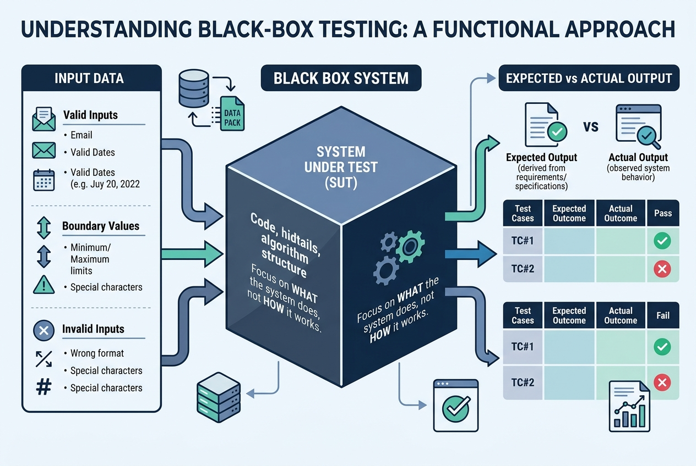
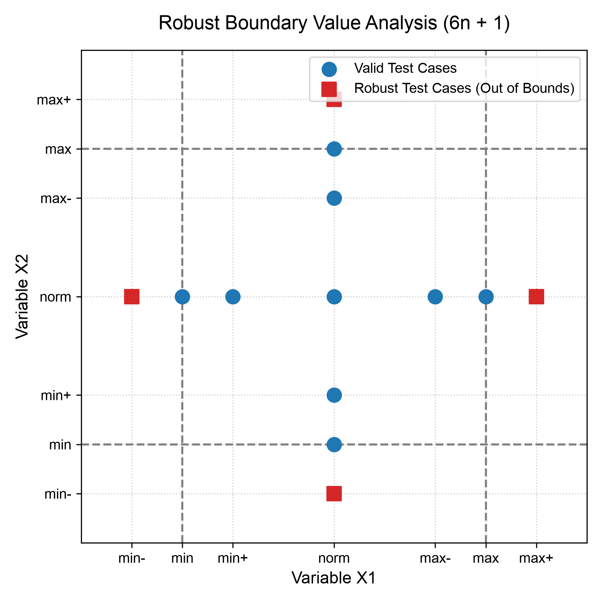
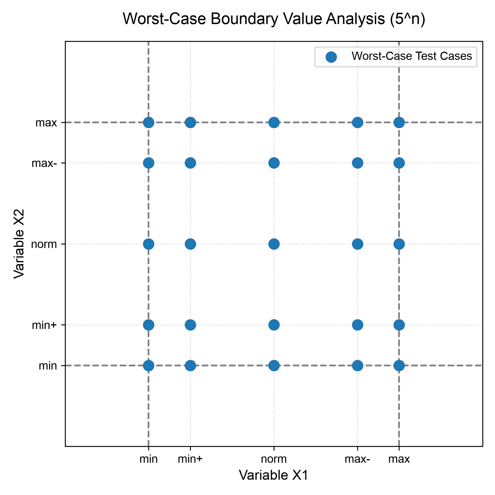
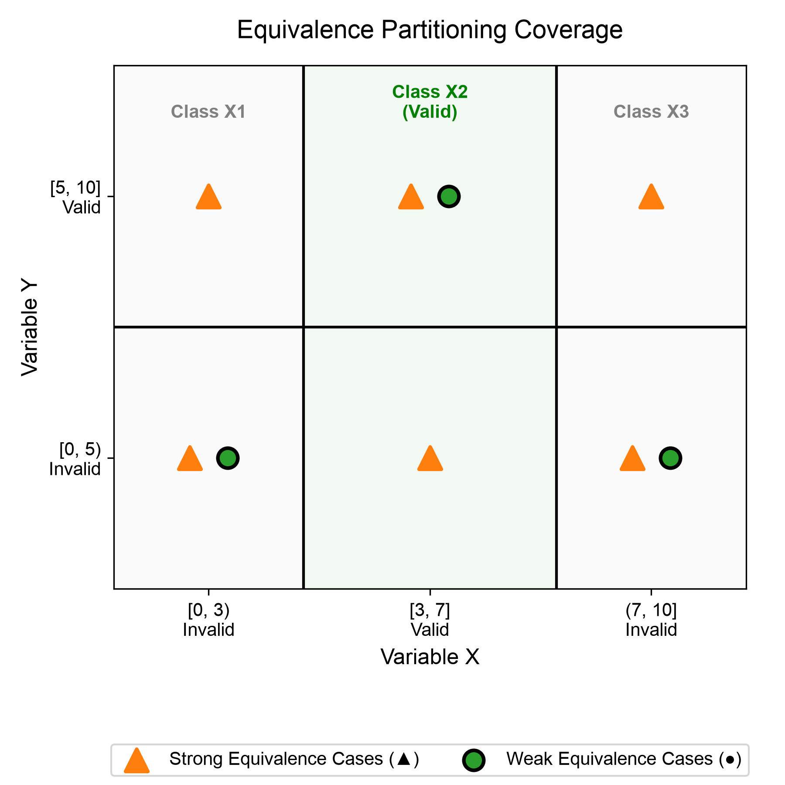
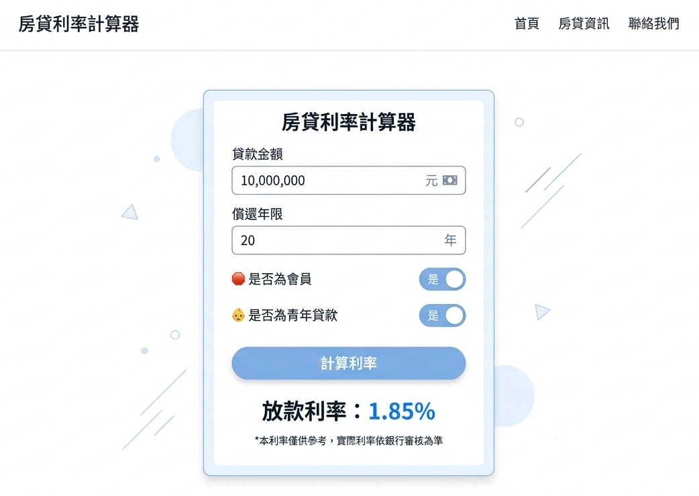
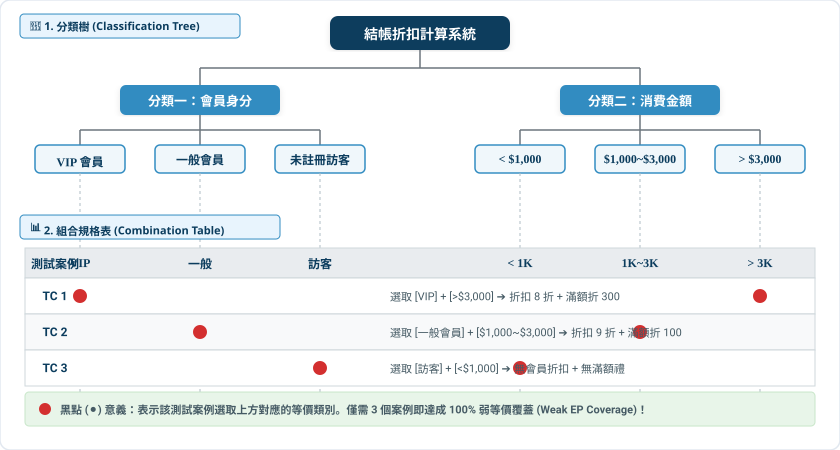
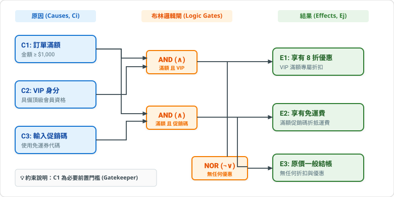
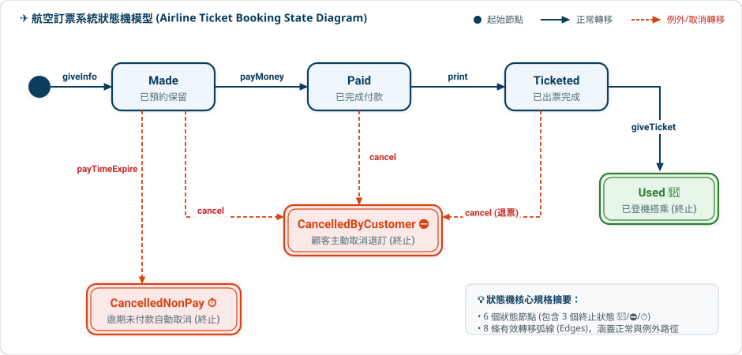

# 軟體品質與測試

### 第 5 章：黑箱測試、等價分割與屬性基礎測試 (PBT)

授課教師：薛念林 教授

> 系統內部就像一個黑盒子，我們不探究它「如何做」，  
> 而是嚴格驗證它在各種極端輸入下，究竟「做了什麼」。  
> 錯誤永遠隱藏在角落——掌握邊界與等價，方能以最小成本擊中最多缺陷。

---

<!-- _class: outline-slide -->
<!-- header: '本章大綱 (Outline)' -->

## 本章重點導讀 (Key Highlights)

<div class="outline-columns">
<div>

### 🧭 核心概念與輸入域劃分
- **5.1 黑箱測試本質與核心思想**：
  - 黑箱 vs. 白箱思維、窮舉之不可能、Glenford Myers 測試哲學
- **5.2 單元測試與 JUnit 5 快速入門**：
  - 3A 原則、@Test 基礎、內容值等價 vs. 記憶體同一性 (CCQ 1)
  - 🧪 *Lab: CalculatorTest & 基礎斷言操作*
- **5.3 邊界值分析 (Boundary Value Analysis, BVA)**：
  - 單一錯誤假設、獨立與最壞情況、@ValueSource 與 assertAll (CCQ 2)
  - 🧪 *Lab: Triangle 邊界檢查與數值邊界練習*
- **5.4 等價類分割測試 (Equivalence Partitioning, EP)**：
  - 有效/無效類、單一無效原則、assertThrows 與 @CsvSource (CCQ 3)
  - 🧪 *Lab: ParamDemoTest 等價資料驅動與練習*
- **5.5 全成對組合測試 (Pairwise / All-Pairs)**：
  - 2-Way 交互作用、AllPairs4J 與 @TestFactory 動態工廠 (CCQ 4)
  - 🧪 *Lab: LoanCalculatorPairwiseTest 動態展開*

</div>
<div>

### 📐 結構、情境與前沿測試
- **5.6 案例優化與分類樹方法 (CTM)**：
  - Daimler-Benz 分類樹、@DisplayName 繁中活規格與 @Nested (CCQ 5)
  - 🧪 *Lab: DisplayNameTest 與分類樹規格映射*
- **5.7 因果圖法與決策表測試 (Decision Table)**：
  - 布林邏輯網絡、CAR 表化簡、決策表直出 CSV 與多動作斷言 (CCQ 6)
  - 🧪 *Lab: 促銷決策表直出與多重驗收練習*
- **5.8 狀態轉換測試 (State Transition Testing)**：
  - 航空訂票狀態機、@BeforeEach 狀態重置與 @Nested 狀態建模 (CCQ 7)
  - 🧪 *Lab: StackTest 物件狀態機與例外練習*
- **5.9 使用案例與情境測試 (Use Case Testing)**：
  - 基本流、替代流與例外流測試矩陣
  - 🧪 *Lab: ATM 提款交易與連續錯誤鎖卡防衛練習*
- **5.10 經驗基礎測試：錯誤猜測與探索性測試**：
  - 缺陷防禦清單、探索性測試 (ET) 與任務段管理 (SBTM)
  - 🧪 *Lab: 破壞性邊界探針與畸形輸入防護練習*
- **5.11 屬性基礎測試 (PBT) 與 變質測試 (Metamorphic)**：
  - 數學不變量規格 (jqwik)、四大變質關係 (MR) 與 LLM 評測 (CCQ 8)
  - 🧪 *Lab: 隨機測資收縮與搜尋引擎變質對稱性*

</div>
</div>

---

<!-- _class: lead -->
<!-- header: '5.1 黑箱測試本質與核心思想' -->

# **5.1 黑箱測試本質與核心思想**

> 「不窺探程式碼內部結構，純粹依據規格契約驗證系統外顯行為。  
> 面對無限的輸入空間，以科學化工程方法獵捕邊界缺陷。」

---

<!-- header: '5.1 黑箱測試本質與核心思想' -->

## 黑箱測試 (Black-Box Testing) 概念架構

<div class="card-deck">

> 💡 黑箱測試（功能測試/規格測試）聚焦於系統「做什麼 (What)」，而非「如何做 (How)」。

<div class="content-columns">
<div class="content-text">

### 📦 黑箱測試三大核心要件
- **1. 測試輸入 (Input Data)**：
  - 涵蓋合法資料 (Valid Inputs)、邊界極端值 (Boundary Values) 與格式錯誤的非法資料 (Invalid Inputs)。
- **2. 受測系統 (System Under Test, SUT)**：
  - 內部原始碼與資料結構對測試人員隱藏（不透明黑盒），完全依據介面規格操作。
- **3. 輸出驗證 (Expected vs. Actual Output)**：
  - 比對實際輸出與需求規格所定義之預期結果是否完全吻合。

</div>
<div class="content-figure">



</div>
</div>
</div>

---

<!-- header: '5.1 黑箱測試本質與核心思想' -->

## 黑箱測試 vs. 白箱測試：思維與視野對比

<div class="card-deck">

> 💡 黑箱與白箱並非對立，而是軟體品質保證中視角互補的兩大支柱。

<div class="two-columns">
<div class="card" data-marpit-fragment>

### 📦 黑箱測試 (Black-Box / 規格導向)
- **測試依據**：需求規格書 (SRS)、使用者合約與介面定義。
- **核心關注**：**「What」**——系統是否達成承諾的外顯功能。
- **關鍵優勢**：
  - 測試與內部實作徹底解耦，**內部重構、效能優化時測試零破壞**。
  - 能站在終端使用者角度發現規格設計上的矛盾。
- **盲點局限**：
  - 無法發現隱藏在內部但規格未提及的後門或冗餘死碼。

</div>
<div class="card" data-marpit-fragment>

### 🔍 白箱測試 (White-Box / 結構導向)
- **測試依據**：原始程式碼、控制流圖 (CFG) 與邏輯分支。
- **核心關注**：**「How」**——程式碼內部每一行分支與條件是否被執行。
- **關鍵優勢**：
  - 精準衡量覆蓋率（語句、分支、路徑覆蓋），捕捉未預期死碼。
  - 能發現記憶體洩漏、空指標與未初始化變數。
- **盲點局限**：
  - **無法發現遺漏的需求 (Missing Requirements)**——規格漏寫的功能，程式碼沒有，白箱測試覆蓋率 100% 也測不出來！

</div>
</div>
</div>

---

<!-- header: '5.1 黑箱測試本質與核心思想' -->

## 黑箱測試的終極挑戰：窮舉測試之不可能

<div class="card-deck">

> 💡 軟體測試第一公理：Exhaustive Testing is Impossible（窮盡測試是不可能的）！

<div class="two-columns">
<div class="card" data-marpit-fragment>

### 💥 輸入空間的組合爆炸 (Combinatorial Explosion)
- **看似簡單的加法函式**：
  - 一個雙整數加法 `int add(int a, int b)`。
  - 32 位元整數空間：2^32 × 2^32 = 2^64 ≈ 1.84 × 10^19 種輸入組合！
- **時間代價**：
  - 假設極速測試機每秒能跑 **10 億次 (1 GHz)** 測試；
  - 窮舉測完這一個加法函式需要：**584 年**！
- **盲目測試的無效性**：
  - 隨機抽樣百萬個案例，對如此龐大的空間而言依然是九牛一毛，極容易漏掉關鍵缺陷。

</div>
<div class="card" data-marpit-fragment>

### 🎯 黑箱工程方法的真正使命
- **測試的核心智慧**：
  - 「在有限的時間與成本下，**以最小代表性測試子集，捕捉最大缺陷機率**」。
- **科學化子集選取策略**：
  - **5.3 邊界值分析 (BVA)**：鎖定極易出錯的臨界邊界。
  - **5.4 等價類分割 (EP)**：代表點取代全集合，避免重複無效測試。
  - **5.5 全成對測試 (Pairwise)**：以成對覆蓋破解多維度組合爆炸。
  - **5.7 決策表測試**：釐清錯綜複雜的商務規則制約。
  - **5.8 狀態機測試**：驗證有記憶系統的時序與生命週期。

</div>
</div>
</div>

---

<!-- header: '5.1 黑箱測試本質與核心思想' -->

## 軟體測試之父：Glenford J. Myers

<div class="card-deck">

> 💡 1979 年出版《The Art of Software Testing》，奠定黑箱測試、等價分割與邊界值分析的理論基石。

<div class="content-columns">
<div class="content-text">

- **測試哲學的革命性定義**：
  - 「**測試是為了發現錯誤而執行程式的過程**，而不是為了證明程式沒有錯誤。」
  - 破除「測試通過即系統完美」的迷思，將測試從被動驗收昇華為積極尋找缺陷的工程學。
- **黑箱測試三大經典方法奠基者**：
  - 率先系統化定義 **等價類分割 (EP)**、**邊界值分析 (BVA)** 與 **錯誤猜測 (Error Guessing)**。
  - 主張「測試案例必須包含**預期輸出**」，否則測試員容易將錯誤輸出誤認為正常。
- **經典範例：三角形問題 (The Triangle Problem)**：
  - 提出聞名全球的「三邊長判斷三角形」測試題目，揭示最簡單的規格也常隱藏大量邊界與例外漏洞。

</div>
<div class="content-figure">
  <div class="name-card">
    
    <div class="name-card-caption">
      <span class="name-card-name">Glenford J. Myers (格倫福德·邁爾斯)</span>
      <span class="name-card-cc"><a href="https://en.wikipedia.org/wiki/Glenford_Myers" target="_blank" rel="noopener">Author: The Art of Software Testing</a></span>
    </div>
  </div>
</div>
</div>
</div>

---

<!-- _class: lead -->
<!-- header: '5.2 單元測試與 JUnit 5 快速入門' -->

# **5.2 單元測試與 JUnit 5 快速入門**

> 「設計 ➔ 寫測試 ➔ 寫程式 ➔ 自動回歸。  
> 讓測試成為可重複執行的安全防護網。」

---

<!-- header: '5.2 單元測試與 JUnit 5 快速入門' -->

## 為什麼需要自動化單元測試？與 3A 原則

<div class="card-deck">

> 💡 手動點擊驗收耗時且無法回歸；自動化測試以毫秒級速度驗證最小程式單元（類別或函式）。

<div class="two-columns">
<div class="card" data-marpit-fragment>

### 🔄 Test-First 測試驅動思維
- **傳統開發**：
  - 設計 ➔ 寫程式 ➔ 手動測試 ➔ 害怕修改重構。
- **現代軟體工程 (Test-First / 3A)**：
  - 先根據規格設計測試案例，再撰寫程式碼；
  - 隨著程式逐步完善，測試案例從紅燈（失敗）全數轉為綠燈（通過）！
- **可重複回歸性 (Regression)**：
  - 每次改動程式碼，一鍵自動重跑數千個單元測試，秒級確認舊功能未被破壞。

</div>
<div class="card" data-marpit-fragment>

### 📐 單元測試三大步驟：3A 原則
- **1. Arrange (安排準備)**：
  - 建立受測物件實體、準備測試輸入參數與環境。
- **2. Act (執行呼叫)**：
  - 呼叫待測方法，獲取系統的實際回傳值或激發動作。
- **3. Assert (驗證結果)**：
  - 比對實際輸出與預期規格是否完全一致。
  ```java
  // 1. Arrange: 準備計算機實體
  Calculator calc = new Calculator();
  // 2. Act: 執行加法
  int result = calc.add(2, 3);
  // 3. Assert: 驗證輸出是否為 5
  assertEquals(5, result);
  ```

</div>
</div>
</div>

---

<!-- header: '5.2 單元測試與 JUnit 5 快速入門' -->

## JUnit 5 核心結構與基本斷言機制

<div class="card-deck">

> 💡 JUnit 5 是 Java 現代測試標準。透過標註宣告測試方法，由測試引擎自動執行並呈現綠燈。

<div class="two-columns">
<div class="card" data-marpit-fragment>

### 🏷️ 測試核心結構 (`@Test`)
- **無參數且無回傳值的測試方法**：
  - 只要加上 `@Test` 標註，JUnit 引擎便會自動探索並執行該方法。
- **獨立執行隔離**：
  - 每個測試方法執行時，框架都會建立新的測試類別實體，保證測試彼此獨立、無先後狀態污染。
```java
class CalculatorTest {
    private final Calculator calc = new Calculator();

    @Test
    void testAdd() {
        assertEquals(5, calc.add(2, 3));
    }
}
```

</div>
<div class="card" data-marpit-fragment>

### ⚖️ 常用基本斷言方法
- **相等比對**：
  - `assertEquals(expected, actual)`：驗證實際值等於預期值。
  - `assertNotEquals(unexpected, actual)`：驗證兩者不相等。
- **布林條件**：
  - `assertTrue(condition)`：條件必須為 true。
  - `assertFalse(condition)`：條件必須為 false。
- **非空檢驗**：
  - `assertNotNull(object)`：確認物件已被正確建立。
- **失敗提示訊息**：
  - 斷言最後一個參數可傳入自訂錯誤訊息字串。

</div>
</div>
</div>

---

<!-- header: '5.2 單元測試與 JUnit 5 快速入門' -->

## 斷言機制的關鍵思維：內容等價 vs. 記憶體同一性

<div class="card-deck">

> 💡 在所有自動化測試斷言中，驗證物件時必須釐清「值相同」與「同一個實體」的本質差別。

<div class="two-columns">
<div class="card" data-marpit-fragment>

### ⚖️ assertEquals：內容值等價 (Value Equality)
- **概念本質**：
  - 檢驗兩個獨立物件內部所承載的**資料內容是否相等**。
- **底層運作機制**：
  - 內部呼叫物件的 `equals()` 方法。
- **黑箱測試適用情境**：
  - 計算結果比對、字串傳回值、自訂資料物件 (DTO) 欄位驗證。
  ```java
  String s1 = new String("SQA");
  String s2 = new String("SQA");
  assertEquals(s1, s2); // ✅ 通過 (內容完全相同)
  ```

</div>
<div class="card" data-marpit-fragment>

### 🎯 assertSame：記憶體同一性 (Reference Identity)
- **概念本質**：
  - 檢驗兩個參照變數是否指向 Heap 中的**同一個實體位址**。
- **底層運作機制**：
  - 直接比對記憶體指標位址（即 `==` 指標比對）。
- **黑箱測試適用情境**：
  - 單例模式 (Singleton) 驗證、連線池/快取重用、物件共享檢驗。
  ```java
  assertSame(s1, s2);   // ❌ 失敗 (不同記憶體物件)
  String s3 = s1;
  assertSame(s1, s3);   // ✅ 通過 (指向同一位址)
  ```

</div>
</div>
</div>

---

<!-- header: '5.2 單元測試與 JUnit 5 快速入門' -->

## 概念核對問答 (CCQ 1)

<div class="ccq-columns">
<div class="ccq-text">

<!-- id: sqa-ch05-ccq1 -->
**問題情境**：  
【是非題】在單元測試斷言機制中，「記憶體同一性 (Reference Identity)」驗證的作用與「內容值等價 (Value Equality)」驗證完全相同，兩者都是在比對兩個物件內部的資料欄位是否相等。

- **A)** 正確 (True)
- **B)** 錯誤 (False)

</div>
<div class="ccq-logo">

<a href="https://nlhsueh.github.io/nickedupocket/#/student/sqa-ch05-ccq1" target="_blank"></a>

</div>
</div>

---

<!-- header: '5.2 單元測試與 JUnit 5 快速入門' -->

## 🧪 課堂實習指引 (LabDemo 5.2: JUnit 基礎操作)

<div class="card-deck">

> 💡 動手實作是掌握自動化測試的最佳途徑！打開專案，體驗你的第一個單元測試綠燈。

<div class="two-columns">
<div class="card">

### 💻 體驗範例程式碼 (Demo Walkthrough)
- **1. 開啟待測類別與測試檔**：
  - 待測類別：`u05_junit/Calculator.java`
  - 示範測試：`u05_junit/CalculatorDemoTest.java`
- **2. 觀察 3A 結構**：
  - 尋找 Arrange、Act 與 Assert 的三段分工。
- **3. IDE 一鍵執行**：
  - 點擊 `@Test` 左側的綠色三角形 ▶️ 執行測試，觀察測試運行結果與綠燈。
- **4. 斷言大全快速檢閱**：
  - 查閱 `u05_junit/AssertionsDemoTest.java` 的全套斷言寫法。

</div>
<div class="card">

### 🎯 課堂動手練習 (Hands-on Exercise)
- **開啟練習檔**：`u05_junit/CalculatorExerciseTest.java`
- **練習 1：3A 減法測試**：
  - 依提示補全 `exercise1_testSubtract()`，實作 20 - 7 = 13 之斷言。
- **練習 2：assertAll 負數與零加法**：
  - 補全 `assertAll` 聚合斷言，同時驗證負數與零之邊界運算。
- **練習 3：內容等價 vs. 記憶體同一**：
  - 觀察 `Person` 物件之 `assertEquals` 與 `assertSame` 差異！

</div>
</div>
</div>

---

<!-- _class: lead -->
<!-- header: '5.3 邊界值分析 (BVA)' -->

# **5.3 邊界值分析 (BVA)**

> 「錯誤都隱藏在角落！  
> 大多數的程式缺陷，都發生在邊界條件差之毫釐的瞬間。」

---

<!-- header: '5.3 邊界值分析 (BVA)' -->

## 邊界值分析 (BVA) 核心哲學

<div class="card-deck">

> 💡 軟體工程界公認：輸入範圍的邊緣（極大值、極小值）比中間值更容易觸發 Off-by-one 缺陷。

<div class="two-columns">
<div class="card" data-marpit-fragment>

### 🚩 為什麼錯誤隱藏在角落？
- **運算子誤用陷阱**：
  - 程式設計師常在 `<` 與 `<=`、`>` 與 `>=` 之間犯錯。
- **程式碼良劣對照**：
  | 程式碼寫法 | 缺陷本質 | 測試結果 |
  | :--- | :--- | :--- |
  | `if (input <= 10)` | 無缺陷，邊界完整包含 | input=10 通過 |
  | `if (input < 10)` | 致命缺陷：10 被遺漏 | **input=10 測試失敗** |
- **結論**：測試邊界點能以極高精準度曝光邊界比較缺陷。

</div>
<div class="card" data-marpit-fragment>

### 🛡️ 單一錯誤假設 (Single Fault Assumption)
- **核心假設前提**：
  - 在獨立變數系統中，絕大多數錯誤只需單一變數發生邊界異常即可彰顯，無需多個變數同時在邊界出錯。
- **取樣五大關鍵點**：
  - 對於範圍 [min, max]，測試點取：
    - **`min`** (最小值)
    - **`min+`** (略大於最小值)
    - **`norm`** (區間內正常代表值)
    - **`max-`** (略小於最大值)
    - **`max`** (最大值)

</div>
</div>
</div>

---

<!-- header: '5.3 邊界值分析 (BVA)' -->

## 獨立型邊界測試：4n + 1 公式

<div class="card-deck">

* > 💡 針對 n 個彼此獨立的輸入變數，每次只讓 1 個變數處於邊界，其餘變數皆維持正常值 (norm)。

<div class="two-columns">
<div class="card" data-marpit-fragment>

### 📐 4n + 1 計算原理
- **每個變數貢獻 4 個邊界案例**：
  - `min`, `min+`, `max-`, `max`（此時其他 n-1 個變數皆取 `norm`）。
- **加上 1 個全員正常中心點**：
  - 所有 n 個變數皆取 `norm` 的基準案例。
- **案例總數公式**：
  > 📐 **Total Test Cases = 4n + 1**
- **案例範例**：若系統有 3 個獨立輸入變數，則測試案例數為 4 × 3 + 1 = **13** 個。

</div>
<div class="card" data-marpit-fragment>

### 🔺 三角形程式實戰案例 (a, b, c ∈ [1, 200])
- 固定 b = 100, c = 100，變動 a：
  - (1, 100, 100), (2, 100, 100), (199, 100, 100), (200, 100, 100)
- 固定 a = 100, c = 100，變動 b (4 個案例)
- 固定 a = 100, b = 100，變動 c (4 個案例)
- 全員正常基準案例：
  - (100, 100, 100) 正三角形
- 總計剛好 13 個測試案例。

</div>
</div>
</div>

---

<!-- header: '5.3 邊界值分析 (BVA)' -->

## 獨立型強固邊界測試：6n + 1 公式

<div class="card-deck">

> 💡 強固邊界測試 (Robust BVA) 擴充考慮「極限例外值」，驗證系統遭遇非法越界時的防禦容錯力。

<div class="content-columns">
<div class="content-text">

### 🛡️ 引入例外邊界 (min-, max+)
- **每個變數擴充為 6 個邊界點**：
  - **`min-`** (略小於合法下界，如 0) ➔ 觸發例外
  - `min` (下界 1)、`min+` (2)
  - `max-` (199)、`max` (上界 200)
  - **`max+`** (略大於合法上界，如 201) ➔ 觸發例外
- **案例總數公式**：
  > 📐 **Total Test Cases = 6n + 1**
- 若 n=3，測試案例數為 6 × 3 + 1 = **19** 個。

</div>
<div class="content-figure">



</div>
</div>
</div>

---

<!-- header: '5.3 邊界值分析 (BVA)' -->

## 非獨立型邊界測試 (Worst-Case Testing / Non-Independent BVA)

<div class="card-deck">

> 💡 當變數之間高度相依、打破「單一錯誤假設 (Single-Fault Assumption)」時，必須採用全笛卡爾積 (Cartesian Product) 進行「最壞情況測試 (Worst-Case Testing)」。

<div class="content-columns">
<div class="content-text">

### 💥 乘積組合爆炸 (Combinatorial Explosion)
- **非獨立型一般邊界測試 (Worst-Case Normal BVA)**：
  - 每個變數取 5 個值 (`min`, `min+`, `norm`, `max-`, `max`)。
  - 總數為 **5^n**（若 n=3，需 5^3 = **125** 個案例；若 n=5，需 **3,125** 個）。
- **非獨立型強固邊界測試 (Worst-Case Robust BVA)**：
  - 每個變數取 7 個值 (含 `min-`, `max+`)。
  - 總數為 **7^n**（若 n=3，需 7^3 = **343** 個；若 n=5，需 **16,807** 個案例！）。
- **核心假設**：基於多重錯誤假設 (Multiple-Fault Assumption)。

</div>
<div class="content-figure">



</div>
</div>
</div>

---

<!-- header: '5.3 邊界值分析 (BVA)' -->

## 邊界值測試方法全景總結

<div class="card-deck">

* > 💡 四種邊界測試方法的案例數量與強度對比矩陣。

<div class="two-columns">
<div class="card" data-marpit-fragment>

### 📊 測試案例數量矩陣
| 測試策略 | 單一錯誤假設 (獨立型) | 多重錯誤假設 (非獨立/最壞情況) |
| :--- | :--- | :--- |
| **標準邊界** (無越界) | **4n + 1** (線性增長) | **5^n** (指數級增長) |
| **強固邊界** (含越界) | **6n + 1** (線性增長) | **7^n** (指數組合爆炸) |

- **適用指標**：
  - 數字型連續變數（年齡、分數、金額、溫度）。
  - 對邏輯性識別碼（如身分證字號、電話號碼）較不適用。

</div>
<div class="card" data-marpit-fragment>

### 🎯 工程選型建議
- **常規模組首選**：
  - **獨立型強固邊界測試 (6n+1)**：在極低案例成本下，兼顧常態邊界與異常例外攔截。
- **高危關鍵金融/航太核心**：
  - **最壞情況測試 (5^n)**：只針對 2~3 個強關聯變數進行局部乘積，其餘變數維持獨立型，避免組合爆炸。

</div>
</div>
</div>

---

<!-- header: '5.3 邊界值分析 (BVA)' -->

## 邊界值分析 (BVA) 常見問答 (FAQ)

<div class="card-deck">

> 💡 實務邊界陷阱與混淆點解析：掌握關鍵邊界細節，避免測試盲區。

<div class="two-columns">
<div class="card" data-marpit-fragment>

### ❓ Q1: 邊界測試應取 2 點（上、外）還是 3 點（外、上、內）？
- **傳統 2 點法**：
  - 僅測試邊界點 B 與越界點 B ± 1（如 100 與 101），用於快速精簡案例。
- **現代 3 點法 (Out-On-In)**：
  - ISO/IEC/IEEE 29119 標準推薦：同時涵蓋**外部 (Out)、邊界上 (On)、內部 (In)**（如 99, 100, 101）。
- **關鍵價值**：
  - 遇到開區間（如 x > 0）或複雜防禦條件時，3 點法能 100% 偵測出 Off-by-one 符號筆誤（如把 `>` 誤寫為 `>=`）。

</div>
<div class="card" data-marpit-fragment>

### ❓ Q2: 浮點數或連續數值（Double）的「相鄰值」該如何取？
- **實務痛點**：
  - 浮點數無法像整數直接 ± 1，若隨意取 ± 0.00001 容易失真或受限精度。
- **標準解法**：
  - **業務刻度原則 (Business Resolution)**：依規格書最小跳動單位決定（如金額最小單位為分，取 ± 0.01；成績取 ± 0.1）。
  - **底層機器精度**：在 Java 單元測試中，可直接調用 `Math.nextUp(x)` 與 `Math.nextDown(x)` 取得 IEEE 754 最小物理相鄰浮點數。

</div>
</div>
</div>

---

<!-- header: '5.3 邊界值分析 (BVA)' -->

## 邊界值分析的 JUnit 5 落地：參數化與群組斷言

<div class="card-deck">

> 💡 邊界測試的工程挑戰：臨界測資密集。若單純連續斷言，前面失敗會直接中斷後面所有邊界檢驗！

<div class="two-columns">
<div class="card" data-marpit-fragment>

### 🔢 參數化測試：多邊界點批次注入
- **單一邏輯，多點驗證**：
  - BVA 通常產生 min-, min, min+, nom, max-, max, max+ 等多個連續臨界點。
  - 傳統做法若寫 7 個獨立測試方法，將造成巨大重複樣板負擔。
- **JUnit 5 解決方案 (Parameterized)**：
  - 使用 `@ParameterizedTest` 搭配 `@ValueSource(ints = {...})`；
  - 測試方法只寫一套驗證邏輯，框架自動將整組邊界值逐一注入執行，並在測試報告中列出每個臨界點的獨立判定！

</div>
<div class="card" data-marpit-fragment>

### 🛡️ 群組聚合斷言：一次收集所有邊界缺陷
- **早期中斷 (Early Abort) 陷阱**：
  - 若在同一個測試方法中連續寫多行斷言，當第一個 min- 斷言失敗時，測試方法會立即拋錯終止，後續 max 邊界完全沒機會執行！
- **JUnit 5 解決方案 (`assertAll`)**：
  - 將多組邊界檢驗包裝在 `assertAll` 區塊中（如 LabDemo `AssertionsDemoTest` & `TriangleBlackBoxTest`）；
  - **所有邊界斷言皆保證被完整執行**，一次性報告所有崩潰點，大幅縮短修復與回歸週期！

</div>
</div>
</div>

---

<!-- header: '5.3 邊界值分析 (BVA)' -->

## 概念核對問答 (CCQ 2)

<div class="ccq-columns">
<div class="ccq-text">

<!-- id: sqa-ch05-ccq2 -->
**問題情境**：  
【單選題】假設某個受測方法接受 3 個彼此獨立的連續數值輸入參數。若採用「獨立型強固邊界測試 (Independent Robust BVA)」，其設計出的測試案例數量應為多少？

- **A)** 13 個
- **B)** 19 個
- **C)** 125 個
- **D)** 343 個

</div>
<div class="ccq-logo">

<a href="https://nlhsueh.github.io/nickedupocket/#/student/sqa-ch05-ccq2" target="_blank"></a>

</div>
</div>

---

<!-- header: '5.3 邊界值分析 (BVA)' -->

## 🧪 課堂實習指引 (LabDemo 5.3: BVA 邊界實戰)

<div class="card-deck">

> 💡 邊界測試的精髓：親自體驗使用 JUnit 5 參數化與群組斷言，秒級捕捉邊界缺陷。

<div class="two-columns">
<div class="card">

### 💻 體驗範例程式碼 (Demo Walkthrough)
- **1. 邊界測試示範類別**：
  - 開啟 `u05_input/bva/TriangleBvaDemoTest.java`
  - 觀察 4n+1 獨立型測試：a 邊取 min, min+, nom, max-, max（b, c 維持 nom）。
- **2. 群組斷言避免 Early Abort**：
  - 觀察 `assertAll(...)` 如何把多個邊界檢驗聚合執行，確保即使第一個邊界出錯，其餘邊界仍被完整檢驗！

</div>
<div class="card">

### 🎯 課堂動手練習 (Hands-on Exercise)
- **練習 1：三角形強固邊界與 On-Off-In 三點法**：
  - 開啟 `u05_input/bva/TriangleBvaExerciseTest.java`；
  - 補全 a 的 `min-` (0) 與 `max+` (201) 越界測資，並以 On-Off-In 檢驗兩邊之和臨界！
- **練習 2：游泳池年齡門檻邊界**：
  - 開啟 `u05_input/bva/PoolTicketBvaExerciseTest.java`；
  - 規格：免費 (0~3歲)、兒童票 (4~12歲)、全票 (13~64歲)、敬老票 (≥ 65 歲)；
  - 運用 `@CsvSource` 填入交界點數值，並驗證 -1 與 121 歲越界防禦！

</div>
</div>
</div>

---

<!-- _class: lead -->
<!-- header: '5.4 等價類分割測試 (EP)' -->

# **5.4 等價類分割測試 (EP)**

> 「把無限的輸入空間劃分為有限的等價群組；  
> 測試其中一個代表，就等於測試了整個群體。」

---

<!-- header: '5.4 等價類分割測試 (EP)' -->

## 等價類分割測試 (Equivalence Partitioning)

<div class="card-deck">

* > 💡 等價類的核心定義：同一個群組內的任意資料，若一個能找出 Bug，其他也必定能找出 Bug。

<div class="two-columns">
<div class="card" data-marpit-fragment>

### 🧩 等價分割核心動機
- **達成完整測試**：確保每個業務分支與邏輯區間都有代表被測試到，避免盲區。
- **消除冗餘重複**：在同一個等價區間內測試 100 次只是浪費時間，挑選 1 個代表即可。
- **兩大等價類別**：
  - **有效等價類 (Valid Class)**：符合規格的合理合法輸入集合。
  - **無效等價類 (Invalid Class)**：超出範圍或格式異常的非法集合。

</div>
<div class="card" data-marpit-fragment>

### 🎯 劃分維度與技巧
- **依輸入劃分**：
  - 數值範圍（如 0 ≤ score ≤ 100 ➔ <0, [0, 100], >100）。
  - 輸入個數（如「陣列為空」、「單一元素」、「多元素」）。
- **依輸出反推**：
  - 規格要求輸出 A, B, C, D ➔ 倒推需要哪些輸入組合才能覆蓋這四種產出！

</div>
</div>
</div>

---

<!-- header: '5.4 等價類分割測試 (EP)' -->

## 弱涵蓋 vs. 強涵蓋等價測試

<div class="card-deck">

> 💡 單一錯誤假設 vs. 多重錯誤假設在等價劃分中的延伸。

<div class="content-columns">
<div class="content-text">

### ⚖️ 涵蓋強度深度比較
- **弱涵蓋測試 (Weak Coverage)**：
  - **單一錯誤假設**：要求每個變數的每個等價區間，在所有案例中**至少出現過一次**即可。
  - 測試案例數等於**各變數分割數中的最大值** (max(m_i))。
- **強涵蓋測試 (Strong Coverage)**：
  - **多重錯誤假設**：要求測試所有變數等價區間的**笛卡爾積組合**（全部配對到）。
  - 測試案例數為所有變數分割數的**乘積** (∏ m_i)。

</div>
<div class="content-figure">



</div>
</div>
</div>

---

<!-- header: '5.4 等價類分割測試 (EP)' -->

## Binary Search 實戰等價劃分案例

<div class="card-deck">

* > 💡 二元搜尋的等價分割不僅看輸入 Key，更必須深入考量陣列長度與命中位置的等價關係。

<div class="two-columns">
<div class="card" data-marpit-fragment>

### 📋 結構化等價劃分設計
- **陣列長度維度 (A)**：
  - a<sup>0</sup>：空陣列 (長度 0)
  - a<sup>1</sup>：單一元素陣列
  - a<sup>*</sup>：多元素陣列（可再細分奇數與偶數）
- **搜尋結果與位置維度 (F, C)**：
  - f<sup>t</sup> 找到：命中於頭部 (c<sup>1</sup>)、中間 (c<sup>m</sup>)、尾部 (c<sup>l</sup>)
  - f<sup>f</sup> 未找到：元素不存在於陣列中
- **輸入合法性維度 (K)**：
  - k：合法整數；k!：非整數例外

</div>
<div class="card" data-marpit-fragment>

### 🎯 弱涵蓋 8 大代表案例
- R_1: 單元素，有找到 (k=7, A=[7])
- R_2: 單元素，沒找到 (k=7, A=[8])
- R_3: 多元素，命中頭部 (k=7, A=[7, 9, 11])
- R_4: 多元素，命中中間 (k=9, A=[7, 9, 11])
- R_5: 多元素，命中尾部 (k=11, A=[7, 9, 11])
- R_6: 多元素，沒找到 (k=8, A=[7, 9, 11])
- R_7: 空陣列，沒找到 (k=7, A=[])
- R_8: 非法輸入，拋出例外 (k="abc")

---

<!-- header: '5.4 等價類分割測試 (EP)' -->

## Binary Search 弱涵蓋測試案例規格表

| 案例編號 | 涵蓋類別組合 (A, F, C, K) | 測試輸入 (Inputs) | 預期輸出 (Expected Output) | 弱涵蓋驗證目標 (Coverage Target) |
| :---: | :--- | :--- | :--- | :--- |
| **R_1** | a<sup>1</sup> × f<sup>t</sup> × c<sup>1</sup> × k | k=7, A=[7] | `index = 0` (命中) | 單元素有找到（同時涵蓋 a<sup>1</sup>, f<sup>t</sup>, c<sup>1</sup>） |
| **R_2** | a<sup>1</sup> × f<sup>f</sup> × k | k=7, A=[8] | `index = -1` (未找到) | 單元素沒找到（涵蓋 a<sup>1</sup>, f<sup>f</sup>） |
| **R_3** | a<sup>*</sup> × f<sup>t</sup> × c<sup>1</sup> × k | k=7, A=[7, 9, 11] | `index = 0` (命中頭部) | 多元素命中頭部（涵蓋 a<sup>*</sup>, c<sup>1</sup>） |
| **R_4** | a<sup>*</sup> × f<sup>t</sup> × c<sup>m</sup> × k | k=9, A=[7, 9, 11] | `index = 1` (命中中間) | 多元素命中中間（涵蓋 a<sup>*</sup>, c<sup>m</sup>） |
| **R_5** | a<sup>*</sup> × f<sup>t</sup> × c<sup>l</sup> × k | k=11, A=[7, 9, 11] | `index = 2` (命中尾部) | 多元素命中尾部（涵蓋 a<sup>*</sup>, c<sup>l</sup>） |
| **R_6** | a<sup>*</sup> × f<sup>f</sup> × k | k=8, A=[7, 9, 11] | `index = -1` (未找到) | 多元素區間穿透未找到（涵蓋 a<sup>*</sup>, f<sup>f</sup>） |
| **R_7** | a<sup>0</sup> × f<sup>f</sup> × k | k=7, A=[] | `index = -1` (未找到) | 空陣列極限防禦（涵蓋邊界 a<sup>0</sup>, f<sup>f</sup>） |
| **R_8** | a<sup>*</sup> × k! | k="abc", A=[7, 9] | 拋出 `TypeException` | 非法輸入強固性（涵蓋無效等價類 k!） |


---

<!-- header: '5.4 等價類分割測試 (EP)' -->

## 領域規則導向等價分割：NextDate()

<div class="card-deck">

* > 💡 單純考慮數值範圍是不夠的；優質的等價劃分必須深入融入業務規則（如大小月與閏年）。

<div class="two-columns">
<div class="card" data-marpit-fragment>

### ❌ 膚淺的簡易分割 (效能極低)
- **Month**：<1, 1 ~ 12, >12 (3 類)
- **Day**：<1, 1 ~ 31, >31 (3 類)
- **Year**：<1812, 1812 ~ 2024, >2024 (3 類)
- **致命盲點**：
  - 4/31 根本不存在！2/29 只有閏年合法！
  - 盲目數值劃分無法捕捉 2 月與大小月的核心業務跳日邏輯。

</div>
<div class="card" data-marpit-fragment>

### ⚠️ 第一版領域劃分 (初步嘗試)
- **月份 (M)**：
  - M_1: 30 天月 (4, 6, 9, 11)
  - M_2: 31 天月 (1, 3, 5, 7, 8, 10, 12)
  - M_3: 二月 (特殊處理)
- **日期 (D)**：
  - D_1: 1 ~ 27, D_2: 28, D_3: 29, D_4: 30, D_5: 31
- **年份 (Y)**：
  - Y_1: 閏年 (4 整除且非百/或400整除), Y_2: 平年

</div>
</div>
</div>

---

<!-- header: '5.4 等價類分割測試 (EP)' -->

## NextDate() 初步測試：驚見「12 月跨年異常」

<div class="card-deck">

> 💡 當我們為第一版 M_2 (31天月) 挑選代表值時，隱藏的跨年致命漏洞浮出水面！

<div class="two-columns">
<div class="card" data-marpit-fragment>

### 📋 第一版弱涵蓋選取代表案例
| 案例 | 輸入 (Y, M, D) | 預期輸出 | 涵蓋類別與說明 |
| :---: | :--- | :--- | :--- |
| **T_1** | `2024/04/30` | `2024/05/01` | M_1 × D_4 (30 天月月底跳月，年不變) |
| **T_2** | `2024/07/31` | `2024/08/01` | M_2 × D_5 (31 天月月底跳月，年不變) |
| **T_3** | `2024/02/28` | `2024/02/29` | M_3 × D_2 × Y_1 (閏年 2 月進 29 日) |
| **T_4** | `2023/02/28` | `2023/03/01` | M_3 × D_2 × Y_2 (平年 2 月跳 3/1) |

- **盲區曝光**：若測試員挑選 T_2 (7/31)，M_2 就算完成覆蓋；但 **12 月底 (12/31) 的跨年** 就被徹底漏測！

</div>
<div class="card" data-marpit-fragment>

### 💥 12 月底的特殊性 (December Anomaly)
- **一般 31 天月月底 (1, 3, 5, 7, 8, 10 月)**：
  - `Day = 1`, `Month = Month + 1`, **`Year 不變`**！
- **12 月底 (12/31) 獨特跨年邏輯**：
  - `Day = 1`, **`Month = 1 (重置)`**, **`Year = Year + 1 (跨年)`**！
- **等價性破滅 (Equivalence Broken)**：
  - 12 月與其他 31 天月在程式行為上**根本不等價**！
  - 若混在同一個等價類，一旦選中 7/31，跨年 Year+1 的核心邏輯就會被**完全漏測**！

</div>
</div>
</div>

---

<!-- header: '5.4 等價類分割測試 (EP)' -->

## 迭代修正：重構 NextDate() 等價類劃分

<div class="card-deck">

> 💡 等價類分割黃金法則：**只有後續處理邏輯與狀態轉移完全同構的群組，才能被視為同一等價類！**

<div class="two-columns">
<div class="card" data-marpit-fragment>

### 🔄 月份等價類演進對比
- **第一版 (未考慮跨年，存在盲區)**：
  - M_1: 30 天月 (4, 6, 9, 11)
  - M_2: 31 天月 (1, 3, 5, 7, 8, 10, 12) ❌ *(12月混入)*
  - M_3: 二月 (特殊處理)
- **第二版 (獨立 12 月跨年類別)**：
  - **M_1**: 30 天月 (4, 6, 9, 11) —— 換月不跨年
  - **M_2**: 非 12 月之 31 天月 (1, 3, 5, 7, 8, 10) —— 換月不跨年
  - **M_4**: **十二月 (12) —— 獨佔跨年業務邏輯！** ✅
  - **M_3**: 二月 (2) —— 閏平年跳動

</div>
<div class="card" data-marpit-fragment>

### 🎯 軟體工程深刻啟示
- **等價分割不是「生活日曆常識分類」**：
  - 日曆常識上 12 月確實是 31 天月；
  - 但軟體工程上，**程式碼控制流程相異就是不同等價類**！
- **測試設計反向修補需求漏洞**：
  - 為等價類設計具體測試資料時，能反向逼迫團隊發現被遺漏的業務邊界（如跨年、跨世紀、千禧蟲 Y2K）。
  - 將 12 月獨立為 M_4 後，**測試案例集強迫必須包含跨年測試案例**！

</div>
</div>
</div>

---

<!-- header: '5.4 等價類分割測試 (EP)' -->

## NextDate() 重構後測試資料規格表

| 案例編號 | 涵蓋類別組合 | 測試輸入 (Y, M, D) | 預期輸出 (Expected Output) | 驗證之業務規則目標 |
| :---: | :--- | :--- | :--- | :--- |
| **TC_1** | M_2 × D_1 × Y_2 | `2023/05/15` | `2023/05/16` | 一般月中遞增 (Day + 1, Month/Year不變) |
| **TC_2** | M_1 × D_4 × Y_2 | `2023/04/30` | `2023/05/01` | 30 天月月底換月 (Day重置為1, Month + 1) |
| **TC_3** | M_2 × D_5 × Y_2 | `2023/07/31` | `2023/08/01` | 31 天月(非12月)月底換月 (Month + 1, Year不變) |
| **TC_4** | M_4 × D_1 × Y_2 | `2023/12/15` | `2023/12/16` | 12 月非月底正常日進位 (Month/Year皆不變) |
| **TC_5** | M_4 × D_5 × Y_2 | `2023/12/31` | `2024/01/01` | **★ 12/31 跨年重置 (Day/Month重置為1, Year + 1)** |
| **TC_6** | M_3 × D_2 × Y_1 | `2024/02/28` | `2024/02/29` | 閏年 2 月 28 日尚未跳月 (進入 2/29) |
| **TC_7** | M_3 × D_3 × Y_1 | `2024/02/29` | `2024/03/01` | 閏年 2 月 29 日月底跳月 (進入 3/1) |
| **TC_8** | M_3 × D_2 × Y_2 | `2023/02/28` | `2023/03/01` | 平年 2 月 28 日月底跳月 (進入 3/1) |

---

<!-- header: '5.4 等價類分割測試 (EP)' -->

## 實務關鍵法則：單一無效原則與錯誤遮蔽 (Fault Masking)

<div class="card-deck">

> 💡 設計無效等價類測試案例時的鐵律：**每次測試只允許包含一個無效等價類，其餘欄位必須全部合法！**

<div class="two-columns">
<div class="card" data-marpit-fragment>

### 🎭 為什麼禁止多個無效值同時輸入？
- **錯誤遮蔽效應 (Fault Masking Effect)**：
  - 現代軟體通常採取「防禦性早退 (Early Exit)」或短路評估。
  - 當系統遇到第一個非法欄位時，往往立即中斷執行或拋出例外，不再檢查後續欄位。
- **後果：缺陷被遮蔽隱藏**：
  - 若「密碼過短」與「信箱格式錯誤」同時輸入，程式在檢查密碼時拋錯中斷，後面的「信箱驗證 Bug」就永遠無法被觸發！

</div>
<div class="card" data-marpit-fragment>

### 📐 有效類 vs. 無效類測試策略對比
- **有效等價類 (Valid Classes) —— 盡量合併**：
  - 目標是驗證系統的正常運作路徑。
  - 每個測試案例應盡可能**涵蓋多個尚未測試的有效等價類**，以最小案例數獲得最高覆蓋。
- **無效等價類 (Invalid Classes) —— 嚴格隔離**：
  - 目標是驗證各別錯誤防護與例外處理邏輯。
  - 每個測試案例**只能包含一個無效等價類**，其餘輸入條件一律設為已知合法值（單一缺陷原則）。

</div>
</div>
</div>

---

<!-- header: '5.4 等價類分割測試 (EP)' -->

## EP 與 BVA 整合規劃：邊界不是獨立 Partition

<div class="card-deck">

> 💡 測試架構迷思破解：BVA 不是獨立於 EP 之外的測試，而是「等價類在取樣時的邊界特化策略」。

<div class="two-columns">
<div class="card" data-marpit-fragment>

### 🧭 觀念釐清：邊界絕非獨立 Partition
- **等價類 (Partition) 的嚴格定義**：
  - 代表「**具相同商務語意與系統處理邏輯的集合**」（例如：0 ≤ score ≤ 100 是合法成績）。
- **邊界的幾何本質**：
  - 邊界（0 與 100）只是等價類集合的「幾何邊緣」，並非另一種業務狀態，**絕不可單獨切成獨立 Partition**。
- **為什麼要在邊界取樣？**
  - 等價假設在邊界容易失效（工程師最常犯 `<=` 誤寫成 `<` 的 Off-by-one 符號錯誤）。
  - BVA 的本質是**取代 EP 在區間內隨機抓值的盲目性**！

</div>
<div class="card" data-marpit-fragment>

### 🛠️ 兩者合體規劃三步 SOP (拒絕重複)
- **Step 1: 劃分等價類 (EP)**：
  - 依業務規格完整識別有效類（Valid）與無效類（Invalid）。
- **Step 2: 標記交接邊界 (Boundaries)**：
  - 找出相鄰等價類的交接處（如 0, 100）。
- **Step 3: 統一精準取點 (Integrated Sampling)**：
  - 每個連續等價類**僅取兩類點**，合而為一：
    1. **邊界極值 (BVA On/Off-Points)**：如 -1, 0, 100, 101（攔截運算子漏洞）。
    2. **標稱典型值 (EP Nominal Point)**：如 50（驗證常規核心業務路徑）。
  - **綜效**：以最少案例**同時 100% 滿足 EP 與 BVA**！

</div>
</div>
</div>

---

<!-- header: '5.4 等價類分割測試 (EP)' -->

## 等價類分割測試 (EP) 常見問答 (FAQ)

<div class="card-deck">

> 💡 組合維度與涵蓋策略疑難：在測試成本與品質風險之間取得最佳平衡。

<div class="two-columns">
<div class="card" data-marpit-fragment>

### ❓ Q1: 什麼時候採用弱涵蓋？什麼時候必須升級為強涵蓋？
- **弱涵蓋 (Weak Coverage)**：
  - 適用於**輸入參數彼此完全獨立**的場景（如註冊表單中的暱稱、生日、血型）；
  - 案例數少，能以最低成本確保每個等價類都被測試一次。
- **強涵蓋 (Strong Coverage) / 全成對 (Pairwise)**：
  - 適用於**參數間存在緊密商務交互制約**（如保險費率乘數、折扣與年資、貸款審核）；
  - 若參數過多導致強涵蓋全乘積爆炸，直接升級為 **5.4 全成對測試 (Pairwise)** 是業界最佳解！

</div>
<div class="card" data-marpit-fragment>

### ❓ Q2: 可以部分變數用強涵蓋，部分變數用弱涵蓋嗎？
- **實務主流：混合式涵蓋策略 (Hybrid Coverage)**：
  - **完全可以，且高度推薦**！全域強涵蓋會引發組合爆炸，全域弱涵蓋又會漏測關鍵耦合缺陷。
- **風險驅動的工程配置**：
  - **局部強涵蓋**：針對有強烈商務制約的 2~3 個核心變數（如年限 × 信用等級 × 青年）進行全乘積。
  - **局部弱涵蓋**：針對其餘無耦合的周邊變數（如性別、聯絡方式），僅確保其各類別代表至少被選中一次填入。
- **更高階解法**：直接運用 **5.4 Pairwise** 工具求解。

</div>
</div>
</div>

---

<!-- header: '5.4 等價類分割測試 (EP)' -->

## 等價類分割的 JUnit 5 落地：例外防禦與 CSV 資料驅動

<div class="card-deck">

> 💡 等價類測試的工程挑戰：無效等價類的外顯行為是「防禦防護」，有效等價類則需要管理多維度測試表格。

<div class="two-columns">
<div class="card" data-marpit-fragment>

### 🚨 無效等價類：例外斷言 (`assertThrows`)
- **單一無效原則之落實**：
  - 非法輸入（如負數邊長、空字串、超出規格之帳號長度）不得回傳正常值，而應觸發防禦性例外。
- **JUnit 5 解決方案 (assertThrows)**：
  - 驗證特定輸入是否精確拋出指定的異常類別（如 `IllegalArgumentException.class`）；
  - 可進一步驗證錯誤訊息（`getMessage()`），確保防禦邏輯不僅攔截錯誤，還提供了清晰的除錯指引，杜絕系統假死或默默吃掉例外！

</div>
<div class="card" data-marpit-fragment>

### 📊 有效等價類：外部資料驅動 (`@CsvFileSource`)
- **測試邏輯與數據分離**：
  - 當等價分割劃分出大量測試向量（正等價類、零值等價類、各級距代表值），將測資硬編碼在程式中會導致代碼臃腫且難以維護。
- **JUnit 5 解決方案 (CsvSource / CsvFileSource)**：
  - 將等價類代表值與預期分類標籤外置於 CSV 檔案（如 LabDemo `ParamDemoTest`）；
  - 測試方法只需撰寫一套通用驗證流程，外部資料表可由測試工程師或業務分析師隨規格靈活擴充！

</div>
</div>
</div>

---

<!-- header: '5.4 等價類分割測試 (EP)' -->

## 概念核對問答 (CCQ 3)

<div class="ccq-columns">
<div class="ccq-text">

<!-- id: sqa-ch05-ccq3 -->
**問題情境**：  
【單選題】在等價類分割測試 (Equivalence Partitioning) 中，「弱涵蓋 (Weak Coverage)」與「強涵蓋 (Strong Coverage)」分類法的主要區別是什麼？

- **A)** 弱涵蓋只測試有效等價類，強涵蓋兼測有效與無效等價類
- **B)** 弱涵蓋基於單一錯誤假設，強涵蓋測試所有類別笛卡爾全組合
- **C)** 弱涵蓋不需軟體規格文件，強涵蓋必須嚴格遵照 SRS 文件執行
- **D)** 弱涵蓋產生的案例數較多，強涵蓋產生的測試案例數必然較少

</div>
<div class="ccq-logo">

<a href="https://nlhsueh.github.io/nickedupocket/#/student/sqa-ch05-ccq3" target="_blank"></a>

</div>
</div>

---

<!-- header: '5.4 等價類分割測試 (EP)' -->

## 🧪 課堂實習指引 (LabDemo 5.4: EP 等價類實戰)

<div class="card-deck">

> 💡 等價類實戰重點：使用 @CsvSource 建立多維度測試表格，以 assertThrows 驗證非法輸入的防禦性邏輯。

<div class="two-columns">
<div class="card">

### 💻 體驗範例程式碼 (Demo Walkthrough)
- **1. 二元搜尋多維等價分割**：
  - 開啟 `u05_input/ep/BinarySearchEpDemoTest.java`
  - 觀察陣列長度（空、單、多元素）與命中位置（頭、中、尾、不存在）之等價類別劃分。
- **2. 參數化外部資料驅動**：
  - 開啟 `u05_input/ep/ParamDemoTest.java`
  - 觀察 `@ValueSource` 與 `@CsvSource` 如何乾淨解耦測試邏輯與資料。

</div>
<div class="card">

### 🎯 課堂動手練習 (Hands-on Exercise)
- **練習：密碼格式等價類分割**：
  - 開啟 `u05_input/ep/PasswordValidatorEpExerciseTest.java`；
  - 練習 1：驗證長度合格且包含英數字之【有效等價類】；
  - 練習 2：使用 `assertThrows` 驗證長度小於 8 或大於 20 之【無效等價類例外】；
  - 練習 3：驗證純字母或純數字之【弱密碼等價類回傳 false】！

</div>
</div>
</div>

---

<!-- _class: lead -->
<!-- header: '5.5 全成對組合測試 (Pairwise)' -->

# **5.5 全成對組合測試 (Pairwise)**

> 「當組合爆炸讓窮盡測試成為不可能，  
> 全成對測試用數學奇蹟，抓出 90% 的交互作用缺陷。」

---

<!-- header: '5.5 全成對組合測試 (Pairwise)' -->

## 組合爆炸難題與 2-Way 交互作用理論

<div class="card-deck">

* > 💡 美國國家標準與技術研究院 (NIST) 研究：軟體系統中絕大多數缺陷皆由「單一變數」或「雙變數配對」所觸發。

<div class="two-columns">
<div class="card" data-marpit-fragment>

### 💥 組合爆炸的殘酷現實
- **多參數系統的災難**：
  - 假設系統有 10 個參數，每個參數各有 3 種可能值。
  - 全乘積窮盡測試需要：
    > 📐 **3^10 = **59,049** 個測試案例！**
  - 在工程實務上，根本沒有足夠的時間與預算執行窮盡測試。

</div>
<div class="card" data-marpit-fragment>

### 🎯 NIST 實證經驗與成對假設
- **2-Way 交互作用理論**：
  - **67% ~ 93%** 的缺陷只要任意 2 個參數的交互作用就會觸發。
  - 需要 3 個以上參數交互觸發的罕見缺陷不足 10%。
- **Pairwise (All-Pairs) 原則**：
  - **只要任意兩個參數的所有可能取值組合都至少出現過一次即可**！案例數從幾萬個劇降至數十個！

</div>
</div>
</div>

---

<!-- header: '5.5 全成對組合測試 (Pairwise)' -->

## 游泳池收費系統：全成對實戰對照

<div class="card-deck">

* > 💡 透過交錯法與成對匹配，案例數量從全乘積的 12 個直接砍半至 6 個，覆蓋率絲毫不減。

<div class="two-columns">
<div class="card" data-marpit-fragment>

### 🏊 參數維度定義
- **日期 (d, 2 種)**：d_1 假日, d_2 平日
- **時間 (t, 3 種)**：t_1 清晨, t_2 中午, t_3 其他
- **身分 (m, 2 種)**：m_1 會員, m_2 非會員
- **全乘積需求**：2 × 3 × 2 = 12 個案例。

</div>
<div class="card" data-marpit-fragment>

### ✅ 全成對測試套件 (6 個案例)
| 案例 | 時間 (t) | 星期 (d) | 會員 (m) |
| :---: | :---: | :---: | :---: |
| **1** | t_1 (清晨) | d_1 (假日) | m_1 (會員) |
| **2** | t_1 (清晨) | d_2 (平日) | m_2 (非會員) |
| **3** | t_2 (中午) | d_1 (假日) | m_1 (會員) |
| **4** | t_2 (中午) | d_2 (平日) | m_2 (非會員) |
| **5** | t_3 (其他) | d_1 (假日) | m_2 (非會員) |
| **6** | t_3 (其他) | d_2 (平日) | m_1 (會員) |

*(時間-星期、星期-會員、時間-會員兩兩組合 100% 涵蓋！)*

</div>
</div>
</div>

---

<!-- header: '5.5 全成對組合測試 (Pairwise)' -->

## 為什麼最小成對測試集是 NP-Hard？啟發式生成演算法

<div class="card-deck">

> 💡 尋找數學上的「絕對最小成對測試集」等價於最小集合覆蓋問題，屬 NP-Hard 難題。

<div class="two-columns">
<div class="card" data-marpit-fragment>

### 📐 數學本質：最小集合覆蓋 (Set Cover)
- **問題歸約**：
  - 系統中有 k 個參數，全成對測試需涵蓋全部 ∑ (|V_i| × |V_j|) 個成對組合 (Pairs)。
  - 每個測試案例最多能覆蓋 binom{k}{2} 個特定 Pair。
  - **尋找最少測試案例以覆蓋所有成對組合**，在計算理論上等價於經典的 **NP-Complete 最小集合覆蓋問題**。
- **指數級計算爆炸**：
  - 隨參數與取值增加，窮舉搜尋全域絕對最佳解耗時天文數字，在工程實務上毫無效益。

</div>
<div class="card" data-marpit-fragment>

### ⚡ 現代工具求解策略：貪婪啟發式 (Heuristics)
- **貪婪覆蓋 (Greedy / AETG / IPO)**：
  - 每輪生成下一個測試案例時，貪婪選取「能同時涵蓋最多尚未配對 Pairs」的參數值。
  - 在**多項式時間內**秒級產出極度逼近理論極限的測試矩陣。
- **約束求解與剪枝 (Constraints & SAT)**：
  - 實務常有業務互斥（如 `OS=iOS` 不可配 `Browser=IE`）；
  - 現代工具整合 SAT/SMT 求解器即時修剪非法狀態，確保每組案例皆合法可用。

</div>
</div>
</div>

---

<!-- header: '5.5 全成對組合測試 (Pairwise)' -->

## 全成對測試工具與放款計算案例

<div class="card-deck">

> 💡 實務工程皆採用啟發式工具秒級生成；本課程 LabDemo 已深度整合 Java 原生 AllPairs4J。

<div class="content-columns">
<div class="content-text">

### 🛠️ 主流自動化工具選型
- **AllPairs4J (Java / JUnit 5 原生)**：★ *LabDemo 首選*
  - 純 Java 輕量庫，以 Fluent Builder API 直接在單元測試 `@TestFactory` 動態生成並執行測試矩陣！
- **PICT (微軟開源工具)**：
  - 業界最普及的 CLI 工具，支援自訂語法模型檔 (`.pict`)、條件約束與權重。
- **ACTS (NIST 開源工具)**：
  - Java 原生 GUI/CLI 工具，支援高階 t-way 組合（如 3-way, 4-way）。
- **放款利率案例 (LoanCalculator)**：
  - 4 個維度全乘積需 3 × 3 × 2 × 2 = 36 組；
  - 透過 AllPairs4J **僅需 9 組成對案例**即達成 100% 2-way 覆蓋！

</div>
<div class="content-figure">



</div>
</div>
</div>

---

<!-- header: '5.5 全成對組合測試 (Pairwise)' -->

## 全成對測試的 JUnit 5 落地：動態測試工廠 (@TestFactory)

<div class="card-deck">

> 💡 成對測試的工程挑戰：案例矩陣是由演算法在執行期動態產生的，傳統靜態 `@Test` 無法彈性接收！

<div class="two-columns">
<div class="card" data-marpit-fragment>

### ⚙️ 動態測試工廠機制 (`@TestFactory`)
- **動態案例串流生成**：
  - 一般 `@Test` 必須在編譯期寫死；但 Pairwise 案例數量會隨參數維度調整（如 36 組壓縮為 9~10 組）。
- **JUnit 5 解決方案 (DynamicTest)**：
  - 使用 `@TestFactory` 傳回動態案例串流（如 LabDemo `LoanCalculatorPairwiseTest`）；
  - 測試在執行時期呼叫 AllPairs4J 生成成對矩陣，並將每一組配對結果（年限、金額、身分）封裝為一個獨立的 `DynamicTest` 節點執行！

</div>
<div class="card" data-marpit-fragment>

### 📈 工程效益：IDE 視覺化與獨立回歸
- **每個成對案例皆具備獨立生命週期**：
  - 在 IDE 與 CI/CD 測試樹中，每個動態案例皆有清晰的自訂標籤與獨立通過/失敗狀態。
- **精準缺陷定位 (Fault Isolation)**：
  - 若第 4 組成對組合出錯，測試報告能秒級定位是「青年身分 × 30年期」的 2-Way 交互作用產生異常，其餘成對測試繼續執行不中斷，完美落實成對測試的工程價值！

</div>
</div>
</div>

---

<!-- header: '5.5 全成對組合測試 (Pairwise)' -->

## 概念核對問答 (CCQ 4)

<div class="ccq-columns">
<div class="ccq-text">

<!-- id: sqa-ch05-ccq4 -->
**問題情境**：  
【單選題】全成對測試 (Pairwise / All-Pairs Testing) 能夠大幅縮減測試案例數量，其在軟體工程上的核心理論依據是什麼？

- **A)** 軟體系統中的缺陷通常需要至少三個以上的參數交互作用才會觸發
- **B)** 絕大多數缺陷是由單一變數或任意兩變數之交互作用所引起
- **C)** 配對測試是白箱測試的一種，可以直接涵蓋所有的程式碼分支路徑
- **D)** 成對測試可以保證 100% 涵蓋多變數系統的所有笛卡爾積組合

</div>
<div class="ccq-logo">

<a href="https://nlhsueh.github.io/nickedupocket/#/student/sqa-ch05-ccq4" target="_blank"></a>

</div>
</div>

---

<!-- header: '5.5 全成對組合測試 (Pairwise)' -->

## 🧪 課堂實習指引 (LabDemo 5.5: Pairwise 全成對實戰)

<div class="card-deck">

> 💡 全成對實戰重點：使用 AllPairs4J 演算法啟發式生成成對矩陣，並以 @TestFactory 動態展開測試節點。

<div class="two-columns">
<div class="card">

### 💻 體驗範例程式碼 (Demo Walkthrough)
- **1. 開啟成對測試示範類別**：
  - 開啟 `u05_input/pairwise/LoanCalculatorPairwiseDemoTest.java`。
- **2. 觀察矩陣生成與壓縮**：
  - 執行 `testPairwiseMatrixGeneration()`；
  - 觀察控制台輸出：4 個維度的全乘積原本需要 3 × 3 × 2 × 2 = 36 組，AllPairs 啟發式壓縮至 **9 組**即可達成 100% 2-way 覆蓋！
- **3. 觀察動態測試工廠**：
  - 檢視 `dynamicPairwiseTests()` 方法，體驗 `@TestFactory` 如何將每組案例動態展開為獨立測試。

</div>
<div class="card">

### 🎯 課堂動手練習 (Hands-on Exercise)
- **開啟練習檔**：`u05_input/pairwise/LoanCalculatorPairwiseExerciseTest.java`
- **練習 1：極限優惠保底下限 2.0% 斷言**：
  - 設計多項優惠累加（年限25年+金額2500萬+青年+已婚）組合，驗證利率精準觸發保底下限 2.0%！
- **練習 2：自訂 3 因子成對生成工廠**：
  - 使用 `AllPairs.AllPairsBuilder` 構建年限、青年與婚姻 3 因子矩陣，動態驗證利率範圍！

</div>
</div>
</div>

---

<!-- _class: lead -->
<!-- header: '5.6 案例優化與分類樹方法 (CTM)' -->

# **5.6 案例優化與分類樹方法 (CTM)**

> 「從海量組合中提煉精實測試子集；  
> Daimler-Benz 分類樹，將抽象輸入域轉化為視覺化規格矩陣。」

---

<!-- header: '5.6 案例優化與分類樹方法 (CTM)' -->

## 測試案例精實化四大策略

<div class="card-deck">

* > 💡 面對數千個潛在案例，透過工程優化策略進行剪枝，保留最高殺傷力的測試子集。

<div class="two-columns">
<div class="card" data-marpit-fragment>

### ✂️ 1. 分離例外與 2. 配對組合
- **分離等效例外**：
  - 若所有因子的非法輸入皆導向相同的錯誤處理（如拋出 400 錯誤），無需測試所有因子的例外排列組合，只需將例外抽取為獨立集合測試。
- **2-Way 配對組合**：
  - 將不相關的因子改以 Pairwise 方式結合，指數級案例瞬間降為多項式級。

</div>
<div class="card" data-marpit-fragment>

### 🎯 3. 邊界鎖定與 4. FMEA 風險優先
- **鎖定邊界替代隨機**：
  - 等價區間內部只挑 1 個代表，將精力聚焦於 min, min+, max-, max。
- **FMEA 故障模式分析**：
  - 高風險、核心金流、常變更模組採用強涵蓋；低風險輔助模組降級為弱涵蓋。

</div>
</div>
</div>

---

<!-- header: '5.6 案例優化與分類樹方法 (CTM)' -->

## 工業界視覺化等價組合：分類樹方法 (CTM)

<div class="card-deck">

> 💡 Classification Tree Method (CTM) 源自 Daimler-Benz，現為 ISO/IEC/IEEE 29119-4 認可之圖形化黑箱測試標準。

<div class="two-columns">
<div class="card">

### 🌳 雙層核心架構與設計原理
- **上層：分類樹 (Classification Tree)**：
  - **分類 (Classifications)**：將待測輸入域依測試觀點分解為若干互斥維度（例如：身分、金額）。
  - **類別 (Classes)**：每個維度下劃分出互斥且完整的等價葉節點（如 VIP、一般、訪客）。
- **下層：組合規格表 (Combination Table)**：
  - 欄位**垂直投影對齊**上方各等價葉節點。
  - 橫列代表具體的測試案例 (TC_1, TC_2, ...)。
- **打點標記 (⚫)**：
  - 每一列在每個分類維度中**選取一個類別打點**，直觀防漏並組裝出完整測試案例！

</div>
<div class="card" style="text-align: center; display: flex; align-items: center; justify-content: center; padding: 6px;">



</div>
</div>
</div>

---

<!-- header: '5.6 案例優化與分類樹方法 (CTM)' -->

## CTM 實戰範例：電商結帳折扣測試案例生成

<div class="card-deck">

> 💡 實戰目標：測試「滿額與會員折扣功能」，用 CTM 打點規格矩陣落實不同的覆蓋準則。

<div class="two-columns">
<div class="card">

### 📋 CTM 規格分解與打點組合矩陣
| 案例 | VIP | 一般 | 訪客 | <1K | 1~3K | >3K | 信用卡 | 行動 | 貨到 | 具體輸入與預期輸出 |
| :---: | :---: | :---: | :---: | :---: | :---: | :---: | :---: | :---: | :---: | :--- |
| **TC_1** | ⚫ | | | | | ⚫ | ⚫ | | | VIP, 3500, 信用卡 ➔ 8折+滿額折300 |
| **TC_2** | | ⚫ | | | ⚫ | | | ⚫ | | 一般, 2000, 行動 ➔ 9折+滿額折100 |
| **TC_3** | | | ⚫ | ⚫ | | | | | ⚫ | 訪客, 800, 貨到付款 ➔ 原價無折扣 |

- **打點規則**：每一列在各分類中**恰好選取一個葉節點打點 (⚫)**；垂直觀察時，所有 9 個類別葉節點皆至少被打點 1 次！

</div>
<div class="card">

### 🎯 覆蓋準則 (Coverage Criteria) 與效益對比
- **弱等價覆蓋 (Weak EP / 1-wise)**：
  - 每個葉節點至少打點 1 次 ➔ **僅需 3 個案例**（即左側 TC_1 ~ TC_3）！
- **成對組合覆蓋 (Pairwise / 2-wise)**：
  - 任意兩維度的類別組合至少出現一次 ➔ **僅需 9 個案例**。
- **全笛卡爾積強覆蓋 (All Combinations)**：
  - 3 × 3 × 3 = **27** 個案例（維度增加時呈指數爆炸）。
- **工業價值**：
  - **視覺化防漏**：漏劃分類別或漏測組合一目了然。
  - **利害關係人審查**：大幅降低與客戶、稽核員溝通成本（支援 CTE / TESTONA 工具自動產出）。

</div>
</div>
</div>

---

<!-- header: '5.6 案例優化與分類樹方法 (CTM)' -->

## 分類樹規格的 JUnit 5 落地：語意化命名與情境分組

<div class="card-deck">

> 💡 分類樹的工程挑戰：打點規格表具有豐富的業務情境，傳統英數方法名在報表中難以理解與追蹤！

<div class="two-columns">
<div class="card" data-marpit-fragment>

### 🏷️ 語意化顯示名稱 (`@DisplayName`)
- **測試即活文件 (Living Documentation)**：
  - 若方法名寫為 `testCheckout1()`，團隊與驗收人員在 CI/CD 報表上無法得知測試意圖。
- **JUnit 5 解決方案 (DisplayName)**：
  - 直接在測試標註 `@DisplayName("TC1: VIP會員且滿3000元刷卡 ➔ 享8折與滿額折300")`（如 LabDemo `DisplayNameTest`）；
  - 亦可配置 `@DisplayNameGeneration` 自動將命名規則轉譯為自然語意句子，使測試報告直接化為業務規格驗收單！

</div>
<div class="card" data-marpit-fragment>

### 🌳 階層化情境分組 (`@Nested`)
- **同構映射分類樹架構**：
  - 分類樹的上層維度（如：會員身分）與下層分類（如：消費金額級距），可直接映照至 Java 內部類別階層。
- **結構化測試報表**：
  - 外層 `@Nested class VIPMemberTest` 內嵌 `@Nested class Over3000AmountTest`；
  - 執行測試時，IDE 的測試導覽樹會**自動展現為與 CTM 分類樹完全一致的樹狀結構**，邏輯層次井然有序！

</div>
</div>
</div>

---

<!-- header: '5.6 案例優化與分類樹方法 (CTM)' -->

## 概念核對問答 (CCQ 5)

<div class="ccq-columns">
<div class="ccq-text">

<!-- id: sqa-ch05-ccq5 -->
**問題情境**：  
【單選題】關於「正交表測試 (Orthogonal Array Testing, OATS)」與一般「全成對測試 (Pairwise Testing)」的比較，下列敘述何者正確？

- **A)** 正交表由隨機抽樣產生，全成對測試由數學嚴格推導生成
- **B)** 正交表強調各因子均勻平衡，全成對僅要求任兩者配對出現
- **C)** 變數個數相同時，正交表與全成對產生之案例清單必完全一致
- **D)** 正交表僅能處理布林變數，全成對可廣泛支援多值離散參數

</div>
<div class="ccq-logo">

<a href="https://nlhsueh.github.io/nickedupocket/#/student/sqa-ch05-ccq5" target="_blank"></a>

</div>
</div>

---

<!-- header: '5.6 案例優化與分類樹方法 (CTM)' -->

## 🧪 課堂實習指引 (LabDemo 5.6: CTM 語意化規格實戰)

<div class="card-deck">

> 💡 分類樹實戰重點：將打點規格矩陣 1:1 轉化為 @DisplayName 繁中語意化規格與 @Nested 階層測試。

<div class="two-columns">
<div class="card">

### 💻 體驗範例程式碼 (Demo Walkthrough)
- **1. 開啟語意化展示類別**：
  - 開啟 `u05_input/ctm/DisplayNameDemoTest.java`；
  - 觀察 `@DisplayName` 如何讓測試報告直接呈現為清晰的中文業務說明。
- **2. 觀察巢狀情境分組**：
  - 檢視 `@Nested class LeapYearRules`；
  - 執行測試，觀察 IDE 測試視窗左側的樹狀導覽結構。

</div>
<div class="card">

### 🎯 課堂動手練習 (Hands-on Exercise)
- **開啟練習檔**：`u05_input/ctm/OrderDiscountCtmExerciseTest.java`
- **練習：電商結帳折扣 CTM 打點規格轉化**：
  - 參照投影片中電商結帳（身分 × 金額 × 支付）CTM 打點規格表；
  - 利用 `@Nested` 分層建立 VIP 與一般顧客情境，驗證 TC_1 ~ TC_3 的打點組合！

</div>
</div>
</div>

---

<!-- _class: lead -->
<!-- header: '5.7 因果圖與決策表測試' -->

# **5.7 因果圖與決策表測試**

> 「從規格描述的邏輯網絡中，  
> 理清所有原因、結果與制約條件，系統化導出精準決策。」

---

<!-- header: '5.7 因果圖與決策表測試' -->

## 邏輯相依規格建模：因果圖法 (Cause-Effect Graphing)

<div class="card-deck">

> 💡 Glenford Myers 提出因果圖法：將自然語言規格轉譯為布林邏輯電路網絡，作為推導決策表的正規工具。

<div class="two-columns">
<div class="card">

### ⚡ 核心構成要件
- **原因 (Causes, C_i)**：
  - 系統的輸入條件或前置狀態（取值 0 或 1）。
- **結果 (Effects, E_j)**：
  - 系統產生的輸出動作或狀態改變（取值 0 或 1）。
- **4 大基本布林邏輯關係**：
  - **恆等 (Identity)**：若 C_1=1 則 E_1=1；否則 E_1=0。
  - **非 (NOT, ~)**：若 C_1=1 則 E_1=0；否則 E_1=1。
  - **或 (OR, OR)**：若任一 C_i=1 則 E=1。
  - **與 (AND, AND)**：若所有 C_i=1 則 E=1。

</div>
<div class="card">

### 🎯 因果圖 5 大約束條件 (Constraints)
- **輸入端約束 (Causes Constraints)**：
  - **E (Exclusive 互斥)**：最多只有一個為 1（C_1 + C_2 ≤ 1）。
  - **I (Inclusive 包含)**：至少有一個為 1（C_1 + C_2 ≥ 1）。
  - **O (One and only one 唯一)**：恰好只有一個為 1（C_1 + C_2 = 1）。
  - **R (Requires 要求)**：若 C_1=1，則 C_2 必須為 1（C_1 ➔ C_2）。
- **輸出端約束 (Effects Constraints)**：
  - **M (Masks 遮蔽)**：若 E_1=1，則 E_2 強制被抑制為 0。

</div>
</div>
</div>

---

<!-- header: '5.7 因果圖與決策表測試' -->

## 貫穿範例 (1/3)：電商促銷規格與因果圖建模

<div class="card-deck">

> 💡 業務需求：① 滿額且為 VIP 享 8 折；② 滿額且輸入促銷碼享免運；③ 未達任何門檻則原價結帳。

<div class="two-columns">
<div class="card">

### 📋 規格因子拆解 (Step 1)
- **原因 (Causes)**：
  - C_1：訂單金額 ≥ 1,000 元 (滿額門檻)
  - C_2：具備 VIP 會員資格
  - C_3：結帳時輸入免運促銷碼
- **結果 (Effects)**：
  - E_1：享有 8 折優惠 (C_1 AND C_2)
  - E_2：享有免運費折抵 (C_1 AND C_3)
  - E_3：原價一般結帳 (NOT (E_1 OR E_2))
- **前置約束**：C_1 為享有任何優惠之必要條件。

</div>
<div class="card" style="text-align: center; display: flex; align-items: center; justify-content: center; padding: 6px;">



</div>
</div>
</div>

---

<!-- header: '5.7 因果圖與決策表測試' -->

## 貫穿範例 (2/3)：導出 CAR 決策表與規則化簡

<div class="card-deck">

> 💡 初始規則共有 2^3 = 8 種。透過不相關條件 (`-` Don't Care) 化簡，收斂為 4 條精準規則。

<div class="two-columns">
<div class="card">

### ✂️ 規則展開與化簡邏輯 (Step 3 & 4)
- **全展開 (2^3 = 8 條規則)**：
  - 當 C_1 = N（未滿額）時，無論 C_2, C_3 為何，皆輸出 E_3（原價結帳）。
- **不在乎化簡 (Don't Care, `-`)**：
  - 原本 C_1 = N 的 4 條規則整合成 **1 條規則 (R_4)**！
- **效益**：
  - 杜絕規格模糊、去除冗餘測試、規則無遺漏。

</div>
<div class="card">

### 📊 化簡後的 CAR 促銷決策表
| 條件 / 動作項目 | R_1 | R_2 | R_3 | R_4 |
| :--- | :---: | :---: | :---: | :---: |
| C_1: 訂單金額 ≥ 1,000 元？ | **Y** | **Y** | **Y** | **N** |
| C_2: VIP 會員身分？ | **Y** | **N** | **Y** | **-** |
| C_3: 輸入免運促銷碼？ | **N** | **Y** | **Y** | **-** |
| E_1: 輸出「8 折優惠」 | **X** | | **X** | |
| E_2: 輸出「免運費」 | | **X** | **X** | |
| E_3: 輸出「原價結帳」 | | | | **X** |

</div>
</div>
</div>

---

<!-- header: '5.7 因果圖與決策表測試' -->

## 貫穿範例 (3/3)：由決策表直出測試案例

<div class="card-deck">

> 💡 CAR 決策表中的每一條化簡規則 (Rule)，直接 1:1 映射為一組標準黑箱測試案例！

| 案例編號 | 對應規則 | 測試輸入參數 (金額, VIP, 促銷碼) | 預期執行動作與輸出斷言 (Expected Output) | 測試設計意圖說明 |
| :---: | :---: | :--- | :--- | :--- |
| **TC_1** | R_1 | `amount = 1200, isVip = true, promo = null` | `discount = 0.8, freeShipping = false` | 驗證滿額 VIP 獨享 8 折 |
| **TC_2** | R_2 | `amount = 1200, isVip = false, promo = "SHIP"` | `discount = 1.0, freeShipping = true` | 驗證一般會員滿額促銷碼免運 |
| **TC_3** | R_3 | `amount = 1500, isVip = true, promo = "SHIP"` | `discount = 0.8, freeShipping = true` | 驗證雙重優惠同時觸發 |
| **TC_4** | R_4 | `amount = 800, isVip = true, promo = "SHIP"` | `discount = 1.0, freeShipping = false` | 驗證未達滿額門檻全部失效 |

- **黃金成果**：從模糊的自然語言需求，經由「因果圖 ➔ 決策表 ➔ 測試案例」，保證 **100% 邏輯覆蓋且零冗餘**！

</div>

---

<!-- header: '5.7 因果圖與決策表測試' -->

## 經典案例延伸：三角形判斷決策表 (CAR Table)

<div class="card-deck">

> 💡 三角形判斷邏輯化簡後的 CAR 決策表，精確對應 6 條測試規則。

| 條件與動作 | R_1 | R_2 | R_3 | R_4 | R_5 | R_6 |
| :--- | :---: | :---: | :---: | :---: | :---: | :---: |
| **條件 (Conditions)** | | | | | | |
| C_1: 滿足三角不等式？(a < b+c AND b < a+c AND c < a+b) | **N** | **Y** | **Y** | **Y** | **Y** | **Y** |
| C_2: a = b？ | **-** | **Y** | **Y** | **N** | **N** | **N** |
| C_3: b = c？ | **-** | **Y** | **N** | **Y** | **N** | **N** |
| C_4: a = c？ | **-** | **Y** | **N** | **N** | **Y** | **N** |
| **動作 (Actions)** | | | | | | |
| A_1: 輸出「非三角形」 | **X** | | | | | |
| A_2: 輸出「正三角形」 | | **X** | | | | |
| A_3: 輸出「等腰三角形」 | | | **X** | **X** | **X** | |
| A_4: 輸出「不等邊三角形」 | | | | | | **X** |

</div>

---

<!-- header: '5.7 因果圖與決策表測試' -->

## 決策表測試的 JUnit 5 落地：規則直出與多重動作驗證

<div class="card-deck">

> 💡 決策表的工程挑戰：每條化簡規則包含多條件組合，且常同時激發多個系統動作！

<div class="two-columns">
<div class="card" data-marpit-fragment>

### 📋 規則直出資料矩陣 (`@CsvSource`)
- **決策表與測試資料 1:1 映射**：
  - 決策表化簡後的每一列規則 (R_1 ~ R_k)，可直接寫成 `@CsvSource` 內的一行字串。
- **程式碼範例結構**：
  - 前面數個欄位填入條件（如金額、會員、促銷碼），後面欄位填入預期結果（折扣率、免運旗標）；
  - 測試方法只需撰寫一次計算驗證，決策表的所有規則瞬間轉化為全自動執行的回歸測試！

</div>
<div class="card" data-marpit-fragment>

### 🎯 多重動作聚合斷言 (`assertAll`)
- **多動作覆蓋之完整性**：
  - 一條規則常觸發多個外顯動作（如 TC_3：同時觸發「打8折」且「免運費」）。
- **JUnit 5 解決方案 (assertAll)**：
  - 透過群組斷言同時驗收所有預期動作；
  - 避免傳統線性斷言中，若「折扣率」比對失敗直接拋錯，導致後續「免運旗標」完全未受檢驗的盲區，確保商務規則的完整落地！

</div>
</div>
</div>

---

<!-- header: '5.7 因果圖與決策表測試' -->

## 概念核對問答 (CCQ 6)

<div class="ccq-columns">
<div class="ccq-text">

<!-- id: sqa-ch05-ccq6 -->
**問題情境**：  
【單選題】在軟體測試實務中，下列哪一種受測情境最適合優先採用「決策表測試 (Decision Table Testing)」來設計案例？

- **A)** 系統輸入參數彼此完全獨立，且有連續性數值邊界
- **B)** 輸入參數具複雜商務邏輯制約，相異條件組合觸發相異系統動作
- **C)** 系統的輸出僅與目前輸入值有關，與輸入條件的組合邏輯無涉
- **D)** 系統的運作強烈依賴時間序列與物件歷史狀態的轉移

</div>
<div class="ccq-logo">

<a href="https://nlhsueh.github.io/nickedupocket/#/student/sqa-ch05-ccq6" target="_blank"></a>

</div>
</div>

---

<!-- header: '5.7 因果圖與決策表測試' -->

## 🧪 課堂實習指引 (LabDemo 5.7: 決策表實戰)

<div class="card-deck">

> 💡 決策表實戰重點：將 CAR 促銷或三角形化簡規則表，直接 1:1 轉化為 @CsvSource 測試矩陣與 assertAll 斷言。

<div class="two-columns">
<div class="card">

### 💻 體驗範例程式碼 (Demo Walkthrough)
- **1. 開啟促銷決策表測試示範**：
  - 開啟 `u05_input/decision/PromotionDecisionDemoTest.java`；
  - 觀察 CAR 決策表化簡後的 4 條規則 (R_1 ~ R_4) 如何直出為清晰的測試案例。
- **2. 多動作聚合驗證**：
  - 觀察如何用 `assertAll` 同步驗證「8折優惠」、「免運費」與「原價結帳」三項動作，防止動作遮蔽。

</div>
<div class="card">

### 🎯 課堂動手練習 (Hands-on Exercise)
- **開啟練習檔**：`u05_input/decision/PromotionDecisionExerciseTest.java`
- **練習 1：1000 元滿額臨界值測試**：
  - 驗證剛好滿 1000 元且具 VIP 身分時精準享有 8 折。
- **練習 2：999.9 元未滿額臨界值測試**：
  - 驗證未達門檻時，即使有促銷碼依然原價結帳。
- **練習 3：CAR 決策表資料驅動全覆蓋**：
  - 使用 `@CsvSource` 驗證 R_1 ~ R_4 全規則動作矩陣！

</div>
</div>
</div>

---

<!-- _class: lead -->
<!-- header: '5.8 狀態轉換測試' -->

# **5.8 狀態轉換測試**

> 「沒有回傳值的 void 方法怎麼測？  
> 答案在於物件內部的狀態轉移。」

---

<!-- header: '5.8 狀態轉換測試' -->

## 航空訂票狀態機模型 (State Machine Diagram)

<div class="card-deck">

> 💡 狀態機將系統行為抽象為狀態、事件與轉移弧線。測試核心：給定前置狀態與激發事件，斷言次態與動作。

<div style="text-align: center; margin: 4px 0 0 0;">



</div>
</div>

---

<!-- header: '5.8 狀態轉換測試' -->

## 航空訂票狀態機：轉移規格與例外分支分析

<div class="card-deck">

> 💡 測試設計必須精準區分「主流程 Happy Path」與「例外中斷路徑」，確保所有終止狀態皆可正確轉移。

<div class="two-columns">
<div class="card">

### 🛫 正常商務主流程 (Happy Path)
- **初始進入**：⚫ --[giveInfo]--> Made (已預約保留)
- **付款成功**：Made --[payMoney]--> Paid (已付款)
- **出票開票**：Paid --[print]--> Ticketed (已出票)
- **登機搭乘**：Ticketed --[giveTicket]--> Used 🏁 (正常終止)
- **商務意義**：代表訂位成功並順利完成飛行的黃金路徑。

</div>
<div class="card">

### ⛔ 例外取消分支 (Cancellation Paths)
- **顧客主動退訂/取消 (cancel)**：
  - 在 `Made`、`Paid`、`Ticketed` 狀態下，皆可觸發 `cancel` 轉移至 **`CancelledByCustomer ⛔`**。
- **付款逾時取消 (payTimeExpire)**：
  - 僅在 `Made` 狀態下，若超時則自動觸發轉移至 **`CancelledNonPay ⏱️`**。
- **終止狀態邊界**：抵達終止狀態後，系統不得再接受任何轉移。

</div>
</div>
</div>

---

<!-- header: '5.8 狀態轉換測試' -->

## 狀態測試覆蓋準則與測試路徑設計

<div class="card-deck">

> 💡 狀態覆蓋 (Node) vs. 轉移覆蓋 (Edge)：轉移覆蓋強度遠高於狀態覆蓋。

<div class="two-columns">
<div class="card">

### 🎯 覆蓋強度層次
- **狀態覆蓋 (State Coverage)**：
  - 每個狀態節點至少被造訪一次。
- **轉移覆蓋 (Transition Coverage)**：
  - 每個狀態轉移弧線至少被執行一次（必達狀態覆蓋！）。
- **N-Switch 覆蓋**：
  - 0-Switch（單次轉移）、1-Switch（連續 2 次轉移序列）。

</div>
<div class="card">

### 🛣️ 5 條全轉移覆蓋測試序列
- **路徑 1**：`giveInfo` ➔ `payMoney` ➔ `print` ➔ `giveTicket` (正常使用)
- **路徑 2**：`giveInfo` ➔ `payMoney` ➔ `print` ➔ `cancel` (開票後退票)
- **路徑 3**：`giveInfo` ➔ `payMoney` ➔ `cancel` (付款後退款取消)
- **路徑 4**：`giveInfo` ➔ `cancel` (預約保留後取消)
- **路徑 5**：`giveInfo` ➔ `payTimeExpire` (逾期未付系統自動取消)

</div>
</div>
</div>

---

<!-- header: '5.8 狀態轉換測試' -->

## 狀態轉換測試的 JUnit 5 落地：巢狀狀態與生命週期隔離

<div class="card-deck">

> 💡 狀態機測試的工程挑戰：物件有狀態記憶，若測試間狀態殘留將導致假警報；void 動作需透過狀態查詢驗證。

<div class="two-columns">
<div class="card" data-marpit-fragment>

### 🔄 生命週期狀態隔離 (`@BeforeEach`)
- **前置狀態獨立重置**：
  - 每個測試案例執行前，透過 `@BeforeEach` 重新初始化物件並激發特定事件序列，將系統精確推進至目標前置狀態（如全新建立空堆疊）。
- **徹底杜絕測試間狀態污染**：
  - 確保每個轉移弧線的驗證都是在乾淨受控的狀態下觸發，避免上一個測試殘留資料干擾。

</div>
<div class="card" data-marpit-fragment>

### 🏗️ 巢狀狀態建模 (`@Nested`，以 LabDemo StackTest 為例)
- **狀態層級與狀態機 1:1 同構**：
  - 外層情境：`WhenNew`（全新空狀態）➔ 斷言 `isEmpty()` 與空取拋錯 `assertThrows(EmptyStackException.class)`。
  - 內層情境：`AfterPushing`（推入元素後狀態）➔ 斷言 `isNotEmpty()` 與彈出元素後狀態回退。
- **測試報表即狀態規格**：
  - IDE 測試樹直接展開為狀態轉移歷程，完美檢驗物件導向與狀態機行為！

</div>
</div>
</div>

---

<!-- header: '5.8 狀態轉換測試' -->

## 概念核對問答 (CCQ 7)

<div class="ccq-columns">
<div class="ccq-text">

<!-- id: sqa-ch05-ccq7 -->
**問題情境**：  
【單選題】在狀態測試 (State Testing) 中，關於「狀態覆蓋 (State Coverage)」與「轉移覆蓋 (Transition Coverage)」的強度關係，下列敘述何者正確？

- **A)** 達到狀態覆蓋必定代表同時達到了轉移覆蓋
- **B)** 轉移覆蓋強度大於狀態覆蓋，涵蓋所有轉移弧線即必涵蓋所有狀態
- **C)** 兩者互相獨立，沒有任何包含或強弱關係
- **D)** 狀態測試僅需考慮合法轉移，毋須驗證非法事件之異常狀態反應

</div>
<div class="ccq-logo">

<a href="https://nlhsueh.github.io/nickedupocket/#/student/sqa-ch05-ccq7" target="_blank"></a>

</div>
</div>

---

<!-- header: '5.8 狀態轉換測試' -->

## 🧪 課堂實習指引 (LabDemo 5.8: 狀態轉換實戰)

<div class="card-deck">

> 💡 狀態機實戰重點：使用 @BeforeEach 重現特定狀態前置，運用 @Nested 建立與狀態機 1:1 同構的測試階層。

<div class="two-columns">
<div class="card">

### 💻 體驗範例程式碼 (Demo Walkthrough)
- **1. 開啟狀態機示範類別**：
  - 開啟 `u05_scenario/state/StackStateDemoTest.java` 與 `PlayerStateDemoTest.java`；
  - 觀察外層 `@DisplayName` 與內層 `@Nested class EmptyStateTests`、`@Nested class FullStateTests` 的狀態隔離。
- **2. 觀察前置生命週期與例外斷言**：
  - 觀察空堆疊時執行 `pop()` 如何斷言拋出 `EmptyStackException.class`；
  - 觀察推入元素後如何斷言狀態轉移（`assertFalse(stack.isEmpty())`）。

</div>
<div class="card">

### 🎯 課堂動手練習 (Hands-on Exercise)
- **開啟練習檔**：`u05_scenario/state/StackStateExerciseTest.java`
- **練習 1：1-Switch 連續轉移序列**：
  - 驗證 Empty ➔ push ➔ Non-Empty ➔ pop ➔ Empty 狀態閉環轉移路徑！
- **練習 2：空狀態 peek() 例外防護**：
  - 驗證非法操作時拋出 `EmptyStackException`，且物件狀態不變量依然保持為空！

</div>
</div>
</div>

---

<!-- _class: lead -->
<!-- header: '5.9 使用案例與情境測試' -->

# **5.9 使用案例與情境測試**

> 「跳出單一欄位與單元函數的微觀視角，  
> 從真實使用者的業務場景，驗證端對端 (End-to-End) 系統行為。」

---

<!-- header: '5.9 使用案例與情境測試' -->

## 系統層級黑箱核心：使用案例測試 (Use Case Testing)

<div class="card-deck">

> 💡 ISTQB 國際認證五大黑箱技術之一：基於需求規格中的 Use Case / User Story，驗證跨元件的端對端業務流。

<div class="two-columns">
<div class="card" data-marpit-fragment>

### 🛣️ 三大關鍵業務流程路徑
- **基本流 (Basic Flow / Happy Path)**：
  - 系統在最理想、無任何錯誤狀況下，使用者順利達成目標的主成功流程。
- **替代流 (Alternative Flows)**：
  - 使用者達成相同目標的合法次要分支路徑（如：使用折價券付款、更換取件超商）。
- **例外流 (Exception Flows)**：
  - 發生錯誤或中斷導致目標無法達成的防禦路徑（如：卡片過期、庫存不足、網路斷線）。

</div>
<div class="card" data-marpit-fragment>

### 🎯 覆蓋準則與測試設計原則
- **1. 最低覆蓋 (Minimum)**：
  - 必須至少設計 1 個測試案例完整執行「基本流 (Happy Path)」。
- **2. 完整業務覆蓋 (Full Coverage)**：
  - 每個替代流與每個例外流，均至少有 1 個測試案例走過。
- **3. 組合情境測試 (Scenario Testing)**：
  - 將多個替代流與例外流按真實用戶行為序列組合（例如：密碼錯一次後成功登入、取消又重新下單）。

</div>
</div>
</div>

---

<!-- header: '5.9 使用案例與情境測試' -->

## 使用案例測試矩陣實戰：ATM 提款流程

<div class="card-deck">

> 💡 以典型 ATM 提款使用案例，推導系統級端對端黑箱測試案例矩陣。

| 測試案例 ID | 測試情境說明 | 流程路徑類型 | 輸入資料與前置條件 | 預期系統反應 |
| :---: | :--- | :---: | :--- | :--- |
| **TC-01** | 正常提款成功 | **基本流 (Happy Path)** | 帳戶餘額 5000，提款 1000，密碼正確 | 出鈔 1000、扣款成功、列印明細退卡 |
| **TC-02** | 提款前先查詢餘額 | **替代流 (Alternative)** | 插入晶片卡 ➔ 查詢餘額 ➔ 再提款 1000 | 顯示餘額無誤、順利出鈔退卡 |
| **TC-03** | 提款金額超出單次上限 | **例外流 (Exception 1)** | 提款輸入 30000（上限為 20000） | 螢幕提示「超出單筆上限」、拒絕出鈔 |
| **TC-04** | 帳戶餘額不足 | **例外流 (Exception 2)** | 帳戶餘額 500，請求提款 1000 | 提示「可用餘額不足」、退卡 |
| **TC-05** | 連續輸錯密碼 3 次 | **例外流 (Exception 3)** | 故意連續輸入 3 次錯誤 PIN 碼 | 第三次錯誤時吞卡、通報行內風控防盜 |

</div>

---

<!-- header: '5.9 使用案例與情境測試' -->

## 🧪 課堂實習指引 (LabDemo 5.9)

<div class="card-deck">

> 💡 端對端場景驗收：模擬真實 ATM 提款交易，覆蓋基本流、替代流與例外流防禦。

<div class="two-columns">
<div class="card">

### 💻 體驗範例程式碼 (Demo Walkthrough)
- **1. 開啟 ATM 使用案例示範**：
  - 待測類別：`u05_scenario/usecase/AtmWithdrawService.java`
  - 示範測試：`u05_scenario/usecase/AtmUseCaseDemoTest.java`
- **2. 觀察三大情境路徑**：
  - 場景 1 (基本流)：密碼正確、提款 5,000 元 ➔ 成功吐鈔扣款退卡。
  - 場景 2 (替代流)：單筆超額 (30,000 > 20,000) ➔ 提示拒絕 ➔ 重設金額成功。
  - 場景 3 (例外流)：帳戶餘額不足 ➔ 拒絕交易並退卡。

</div>
<div class="card">

### 🎯 課堂動手練習 (Hands-on Exercise)
- **開啟練習檔**：`u05_scenario/usecase/AtmUseCaseExerciseTest.java`
- **練習 1：密碼連續輸錯 3 次鎖卡防衛**：
  - 連續輸入 3 次錯誤 PIN 碼，驗證狀態觸發 `CARD_LOCKED` 且卡片被標記鎖定；
  - 鎖卡後即使輸入正確密碼，交易依然必須被拒絕！
- **練習 2：成功重置失敗計數**：
  - 輸錯 2 次後第 3 次輸入正確密碼，驗證交易成功且失敗計數歸零！

</div>
</div>
</div>

---

<!-- _class: lead -->
<!-- header: '5.10 經驗基礎測試：錯誤猜測與探索性測試' -->

# **5.10 經驗基礎測試：錯誤猜測與探索性測試**

> 「規格書永遠寫不完所有現實的混亂。  
> 頂尖測試者的直覺、歷史缺陷經驗與即時探索，是抓出致命漏洞的終極防線。」

---

<!-- header: '5.10 經驗基礎測試：錯誤猜測與探索性測試' -->

## 經驗基礎測試 (Experience-based) 與錯誤猜測法

<div class="card-deck">

> 💡 Glenford Myers 黑箱三大基石之三：基於過往 Defect 統計、工程師易犯錯誤與防禦性思維的「直覺性攻擊」。

<div class="two-columns">
<div class="card" data-marpit-fragment>

### 🎯 錯誤猜測法 (Error Guessing) 核心哲學
- **並非盲目碰運氣**：
  - 它是根據**缺陷分類庫 (Defect Taxonomy)**、架構弱點與工程師盲區所進行的高效能「故障注入 (Fault Injection)」。
- **與規格基礎技術的共生關係**：
  - 規格測試 (EP/BVA) 確保「功能如期運作」；錯誤猜測則主動尋找「規格未提及但實務必爆的死角」。

</div>
<div class="card" data-marpit-fragment>

### 💣 實務經典攻擊清單 (Fault Injection Checklist)
- **空值與邊界**：`null`、未初始化、空字串 `""`、全空格、超長字串 (Buffer Overflow)。
- **特殊字元與編碼**：全形半形、Emoji、換行符 (`\r\n`)、SQL 跳脫符 (`' OR 1=1--`)、XSS (`<script>`)。
- **數值極端運算**：除以零 (`1/0`)、整數溢位 (`Integer.MAX_VALUE + 1`)、浮點數精度誤差 (`0.1 + 0.2`)。
- **時間與併發**：跨時區夏令時間、閏秒、快點兩下造成的重複扣款 (Race Condition)。

</div>
</div>
</div>

---

<!-- header: '5.10 經驗基礎測試：錯誤猜測與探索性測試' -->

## 敏捷時代的利器：探索性測試 (Exploratory Testing)

<div class="card-deck">

> 💡 Cem Kaner & James Bach 發揚：**測試學習 (Learning)、測試設計 (Design) 與測試執行 (Execution) 同步交織進行**。

<div class="two-columns">
<div class="card" data-marpit-fragment>

### ⚖️ 探索性測試 vs. 腳本化測試 (Scripted)
- **腳本化測試 (Scripted Testing)**：
  - 事先撰寫精確步驟 ➔ 盲目按步就班執行 ➔ 適合自動化回歸測試，但易受「殺蟲劑悖論 (Pesticide Paradox)」鈍化。
- **探索性測試 (Exploratory Testing)**：
  - 根據受測系統的最新即時反饋，靈活調整下一個測試策略，主動追擊可疑異狀，抓蟲效率極高。

</div>
<div class="card" data-marpit-fragment>

### ⏱️ 基於任務段的測試管理 (SBTM 架構)
- **測試任務書 (Charter)**：
  - 明確探索範圍與啟發點（探索什麼目標？使用什麼工具？尋找哪類弱點？）。
- **時間盒 (Time-box)**：
  - 設定 60 ~ 90 分鐘專注衝刺，不被打擾，維持高敏銳度。
- **任務紀錄 (Session Log)**：
  - 產出結構化紀錄：測試覆蓋軌跡、發現的 Bugs、未解疑點與後續測試建議。

</div>
</div>
</div>

---

<!-- header: '5.10 經驗基礎測試：錯誤猜測與探索性測試' -->

## 🧪 課堂實習指引 (LabDemo 5.10)

<div class="card-deck">

> 💡 破壞性直覺進擊：運用歷史缺陷清單與探索性思維，獵捕規格未載明的邊界漏洞。

<div class="two-columns">
<div class="card">

### 💻 體驗範例程式碼 (Demo Walkthrough)
- **1. 開啟錯誤猜測示範**：
  - 待測類別：`u05_scenario/experience/UserProfileService.java`
  - 示範測試：`u05_scenario/experience/ErrorGuessingDemoTest.java`
- **2. 觀察四大直覺猜測防禦**：
  - 清單 1 (空白與注入)：純空格 `"   "` 與 XSS `<script>` 探針防護。
  - 清單 2 (整數溢位)：0、負數與 `Integer.MAX_VALUE` 極值。
  - 清單 3 (字串修剪)：首尾空白自動 `trim()` 驗收。

</div>
<div class="card">

### 🎯 課堂動手練習 (Hands-on Exercise)
- **開啟練習檔**：`u05_scenario/experience/ExploratoryExerciseTest.java`
- **練習 1：畸形 Email 格式直覺猜測**：
  - 猜測並測試缺 `@`、缺網域、含空格、格式不合規之 Email 探針；
  - 驗證系統皆拋出 `IllegalArgumentException`！
- **練習 2：Null 指標攻擊防護**：
  - 驗證當傳入 null 參數時，優雅拋出合法例外而非致命崩潰！

</div>
</div>
</div>

---

<!-- _class: lead -->
<!-- header: '5.11 屬性基礎測試 (PBT)' -->

# **5.11 屬性基礎測試 (PBT)**

> 「不再人工苦思特定測資，  
> 而是宣告系統永不妥協的數學不變量。」

---

<!-- header: '5.11 屬性基礎測試 (PBT)' -->

## 範例測試 (EBT) vs. 屬性測試 (PBT) 典範轉移

<div class="card-deck">

* > 💡 從 Example-Based 走向 Property-Based：讓框架自動產生萬組極端隨機測資，尋找致命反例。

<div class="two-columns">
<div class="card" data-marpit-fragment>

### 📝 傳統範例測試 (Example-Based)
- **手動設計特定案例**：
  - 挑選輸入 2 與 3，斷言輸出必為 5。
- **致命瓶頸**：
  - 覆蓋率高度取決於工程師的直覺與經驗；
  - 極容易遺漏包含極大值、空字串、Unicode 特殊字元之極端漏洞。

</div>
<div class="card" data-marpit-fragment>

### 🎲 屬性基礎測試 (Property-Based)
- **定義通用不變量 (Invariant)**：
  - 不管輸入何值，加法必滿足「交換律 a+b = b+a」。
- **三大核心機制**：
  - **1. 屬性 (Property)**：永恆成立之數學真理。
  - **2. 生成器 (Generator)**：自動產生數萬組隨機邊界資料。
  - **3. 測資收縮 (Shrinking)**：遇錯自動簡化為極簡反例！

</div>
</div>
</div>

---

<!-- header: '5.11 屬性基礎測試 (PBT)' -->

## 屬性基礎測試 (PBT) 先驅：John Hughes

<div class="card-deck">

> 💡 2000 年發明 QuickCheck，開創「不要寫測試案例，定義程式屬性」的現代測試典範。

<div class="content-columns">
<div class="content-text">

- **QuickCheck 的誕生與榮譽**：
  - 瑞典查爾摩斯工學院教授、ACM Fellow。
  - 2000 年與 Koen Claessen 共同發表 QuickCheck，獲頒 ACM SIGPLAN 最具影響力論文獎。
- **測試思維的重大躍遷 (Paradigm Shift)**：
  - 提倡「**Don't write tests, specify properties!**」
  - 人類專注於找出系統應遵守的永恆數學不變量，將繁瑣的測資生成交給電腦。
- **革命性發明：測資收縮 (Shrinking)**：
  - 解決了隨機測試「反例過大、無法除錯」的痛點，以演算法秒級自動二分縮減至最小致命測資。
- **現代 PBT 生態系基石**：
  - 創立 Quviq 並在愛立信、Volvo 驗證；Java `jqwik`、Python `Hypothesis` 皆承襲其設計。

</div>
<div class="content-figure">
  <div class="name-card">
    
    <div class="name-card-caption">
      <span class="name-card-name">John Hughes (約翰·休斯)</span>
      <span class="name-card-cc"><a href="https://commons.wikimedia.org/wiki/File:John_Hughes_(computer_scientist).jpg" target="_blank" rel="noopener">QuickCheck Co-creator / ACM Fellow</a></span>
    </div>
  </div>
</div>
</div>
</div>

---

<!-- header: '5.11 屬性基礎測試 (PBT)' -->

## jqwik 宣告式不變量與測資收縮 (Shrinking) 機制

<div class="card-deck">

> 💡 不寫死特定數值，宣告永恆真理：交由框架生成海量隨機測資並自動二分尋找極簡反例。

<div class="two-columns">
<div class="card" data-marpit-fragment>

### 💡 宣告式不變量規格 (Property-Based)
- **`@Property` 宣告真理**：
  - 告訴框架這是一條通用性質（例如加法交換律、反轉兩次回到原陣列）。
  - 單一測試預設自動執行 1,000 次隨機測資檢驗。
- **`@ForAll` 海量生成器**：
  - 自動注入邊界與極值（0、1、-1、負數、`Integer.MAX_VALUE` 溢位值）。
  - 徹底解放手寫特例的思維狹隘！

</div>
<div class="card" data-marpit-fragment>

### 📉 自動測資收縮 (Shrinking) 威力
- **傳統隨機測試 (Fuzzing) 痛點**：
  - 當長度為 100 的隨機亂碼陣列出錯時，工程師難以人工肉眼除錯。
- **jqwik 啟發式收縮**：
  - 框架一旦發現失敗反例，自動啟動「二分微調收縮」演算法；
  - 自動修剪無關雜訊，收縮為 **`[0, -1]`** 最小可重現反例 (Minimal Counterexample)！

</div>
</div>
</div>

---

<!-- header: '5.11 屬性基礎測試 (PBT)' -->

## 概念核對問答 (CCQ 8)

<div class="ccq-columns">
<div class="ccq-text">

<!-- id: sqa-ch05-ccq8 -->
**問題情境**：  
【是非題】在屬性基礎測試 (Property-Based Testing, PBT) 中，我們不需要手動為每一組測試寫出確切的預期輸出數值，而是定義程式執行時必須永遠維持的「屬性或不變量 (Invariants)」，並交由測試框架隨機生成大量測資來自動尋找反例。

- **A)** 正確 (True)
- **B)** 錯誤 (False)

</div>
<div class="ccq-logo">

<a href="https://nlhsueh.github.io/nickedupocket/#/student/sqa-ch05-ccq8" target="_blank"></a>

</div>
</div>

---

<!-- header: '5.8 屬性基礎測試 (PBT) 與 變質測試 (MT)' -->

## 變質測試 (Metamorphic Testing)：黑箱不變量的新高度

<div class="card-deck">

> 💡 突破 Test Oracle 困境：當難以斷言「輸出 y 的絕對數值」時，檢驗「輸入變換後的相對關係」。

<div class="two-columns">
<div class="card" data-marpit-fragment>

### 🧬 從 PBT 到 MT 的延伸進化
- **屬性基礎測試 (PBT)**：
  - 聚焦於**單一執行**的代數性質（例如 a + 0 = a、反轉兩次等於原陣列）。
  - 適合具備封閉數學結構的純函式 (Pure Functions)。
- **變質測試 (Metamorphic Testing, MT)**：
  - 由陳振宇 (T.Y. Chen) 於 1998 年提出，專門解決 **Oracle Problem**。
  - 聚焦於**多次執行之間的輸入輸出關係 (Metamorphic Relations, MRs)**。
  - 適用於搜尋引擎、機器學習、推薦演算法與巨量科學運算等「無標準答案」黑箱！

</div>
<div class="card" data-marpit-fragment>

### 🔄 變質測試三步執行迴圈
- **1. 原始測試 (Source Execution)**：
  - 輸入 x 執行系統，獲得基準輸出 y = f(x)。
- **2. 變質變換 (Follow-up Execution)**：
  - 依據領域知識將輸入變換為 x'，執行系統獲得 y' = f(x')。
- **3. 變質關係判定 (MR Verification)**：
  - 斷言驗證 R(x, x', y, y') 是否恆真成立！
  - 若關係不成立，**100% 證明內部演算法存在缺陷**！

</div>
</div>
</div>

---

<!-- header: '5.8 屬性基礎測試 (PBT) 與 變質測試 (MT)' -->

## 四大經典變質關係模式庫 (MR Patterns)

<div class="card-deck">

> 💡 頂尖 QA 如何設計 MR？掌握四大不變量思維，即可通殺 90% 以上複雜系統。

| 模式類別 | 變質關係定義 (MR Formulation) | 實戰工程案例 |
| :--- | :--- | :--- |
| **1. 對稱與等價性<br>(Symmetry / Invariance)** | f(Transform(x)) == f(x) | **自駕車辨識**：輸入圖片水平翻轉或旋轉 5^circ，行人偵測框與分類結果不變。 |
| **2. 包含與單調性<br>(Inclusion / Monotonicity)** | 若 x_1 subseteq x_2 ➔ f(x_1) subseteq f(x_2) | **搜尋引擎**：搜尋「台積電 股價」之結果，必然是「台積電」搜尋結果之子集。 |
| **3. 比例縮放一致性<br>(Scaling Consistency)** | f(k cdot x) == k cdot f(x) | **導航路徑**：全圖路網權重放大 2 倍，計算出之最佳路徑節點序列完全相同。 |
| **4. 獨立抗擾動性<br>(Irrelevant Perturbation)** | f(x + noise) == f(x) | **情感分析 / LLM**：語句結尾加上無關空格或標點，正面情緒評分不應逆轉為負面。 |

</div>

---

<!-- header: '5.8 屬性基礎測試 (PBT) 與 變質測試 (MT)' -->

## 變質測試實戰：演算法與 AI 評測思維落地

<div class="card-deck">

> 💡 以相對關係取代絕對數值：透過輸入變換與相對不變量，驗證黑箱核心邏輯的正確性。

<div class="two-columns">
<div class="card" data-marpit-fragment>

### 🔄 變質測試落地三步曲
- **1. 原始基準執行 (Source Run)**：
  - 給定基準輸入 x 執行系統，獲得輸出 y = f(x)。
- **2. 領域變換輸入 (Follow-up Run)**：
  - 依領域規則變換輸入 x ➔ x'（例如圖片旋轉、多加關鍵字）。
  - 執行後續測試獲得 y' = f(x')。
- **3. 變質關係驗收 (MR Verification)**：
  - 斷言驗證 R(x, x', y, y') 是否恆真成立！

</div>
<div class="card" data-marpit-fragment>

### 🤖 為什麼 AI 與大模型必用 MT？
- **無法事先手寫精確答案**：
  - 要求 LLM 摘要文章或產生程式碼，字串內容無法進行 `assertEquals`！
- **抗擾動與單調性驗證**：
  - 結尾加上無關空格或標點，核心評分與情緒不應逆轉（抗擾動）。
  - 增加正向提示詞，滿意度得分只可增加或持平（單調性）。

</div>
</div>
</div>

---

<!-- header: '5.8 屬性基礎測試 (PBT) 與 變質測試 (MT)' -->

## 現代 AI 與 LLM 評測實務：差分與裁判模型落地

<div class="card-deck">

> 💡 SQA 2.0 評測工具鏈：結合理論觀念，在 CI/CD Pipeline 落地自動化品質門檻。

<div class="two-columns">
<div class="card" data-marpit-fragment>

### ⚖️ 多模型差分實務 (Differential)
- **跨版本與跨模型交叉打靶**：
  - 將 1,000 組邊界 Prompt 同時送入 **新版 Model vs. 舊版 Model**。
  - 計算語意嵌入距離 (Cosine Similarity)。
  - 若相似度小於 0.85，自動標記為潛在回歸缺陷 (Regression Drift)。
- **工具鏈整合**：
  - 使用 **Promptfoo** / **DeepEval** 跑自動化矩陣差分比對。

</div>
<div class="card" data-marpit-fragment>

### 🧑‍⚖️ LLM-as-a-Judge 規準落地
- **JSON Schema 結構化評分輸出**：
  ```json
  {
    "metric": "Faithfulness",
    "score": 0.95,
    "has_hallucination": false,
    "rationale": "所有陳述皆可在 Context 找到依據"
  }
  ```
- **CI/CD Quality Gate 阻斷門檻**：
  - 於 GitHub Actions 中設定：忠實度 < 0.90 或安全違規率 > 0% 即判定 Build Failed！

</div>
</div>
</div>

---

<!-- header: '5.11 屬性基礎測試與變質測試' -->

## 🧪 課堂實習指引 (LabDemo 5.11)

<div class="card-deck">

> 💡 告別特例斷言，擁抱不變量規格：體驗 jqwik 海量測資收縮與搜尋引擎變質關係驗收。

<div class="two-columns">
<div class="card">

### 💻 體驗範例程式碼 (Demo Walkthrough)
- **1. 屬性基礎測試 (PBT)**：
  - 開啟 `u05_pbtest/PropertyBasedDemoTest.java`；
  - 觀察加法交換律、單位元性質、反轉兩次回到自身與排序單調性不變量；
  - 觀察 jqwik 自動執行 1000 次隨機測資與 Shrinking 最小反例收縮。
- **2. 變質測試 (MT)**：
  - 開啟 `u05_pbtest/MetamorphicDemoTest.java`；
  - 觀察文章搜尋引擎之「結果包含性 (Inclusion)」與「前後空白抗擾動性 (Irrelevant)」變質關係！

</div>
<div class="card">

### 🎯 課堂動手練習 (Hands-on Exercise)
- **練習 1：PBT 乘法與長度守恆不變量**：
  - 開啟 `u05_pbtest/PropertyBasedExerciseTest.java`；
  - 補全乘法交換律 (`a * b == b * a`) 與反轉後串列長度守恆斷言！
- **練習 2：搜尋引擎對稱性變質測試**：
  - 開啟 `u05_pbtest/MetamorphicExerciseTest.java`；
  - 實作關鍵字大小寫不敏感之對稱變質關係 (`Search("software") == Search("SOFTWARE")`)！

</div>
</div>
</div>

---

<!-- header: '附錄：課堂互動參考解答' -->

## 附錄：課堂互動參考解答

<div class="card-deck">

* > 💡 本章課堂互動 (CCQ 1 ～ CCQ 8) 官方標準解答與核心觀念解析總整理。

<div class="two-columns">
<div class="card" data-marpit-fragment>

### 🧭 CCQ 1 ～ 4：斷言、邊界與組合
- **CCQ 1【錯誤 (B)】**：`assertEquals` 驗證內容相等 (`equals`)，`assertSame` 驗證記憶體位址同一性 (`==`)。
- **CCQ 2【19 個 (B)】**：3 變數獨立強固 BVA 案例數為 6n + 1 = 6 × 3 + 1 = 19。
- **CCQ 3【單一 vs 笛卡爾積 (B)】**：弱等價基於單一錯誤假設，強等價要求所有變數分割之全乘積。
- **CCQ 4【2-Way 交互作用 (B)】**：NIST 實證絕大多數缺陷由單變數或雙變數交互引發，Pairwise 具極高性價比。

</div>
<div class="card" data-marpit-fragment>

### 🎯 CCQ 5 ～ 8：正交、決策、狀態與屬性
- **CCQ 5【正交平衡性 vs 靈活度 (B)】**：正交表要求兩兩配對次數嚴格相等，Pairwise 僅求 ≥ 1 故更精實。
- **CCQ 6【複雜商務邏輯制約 (B)】**：決策表最適於多條件輸入與輸出動作具複雜因果關聯之場景。
- **CCQ 7【轉移覆蓋大於狀態覆蓋 (B)】**：轉移覆蓋走遍所有邊弧，必定已造訪所有狀態節點。
- **CCQ 8【正確 (A)】**：PBT 核心為規格即不變量，自動生成海量輸入並透過 Shrinking 回報極簡反例。

</div>
</div>
</div>

<script>
(function() {
  function initHeaderDropdown() {
    var sections = [];
    var seenTitles = new Set();
    var slideSections = document.querySelectorAll("section[id]");
    
    // 1. Scan unique section titles and their slide IDs
    slideSections.forEach(function(sec) {
      var header = sec.querySelector("header");
      if (!header) return;
      
      var title = header.textContent.trim();
      title = title.replace(/^[◄◀]\s*/, "").replace(/\s*[►▶]$/, "").trim();
      if (!title || seenTitles.has(title)) return;
      
      seenTitles.add(title);
      sections.push({
        id: sec.id,
        title: title
      });
    });

    if (sections.length === 0) return;

    // Helper to create the dropdown DOM
    function createDropdownWrapper(currentTitle) {
      var wrapper = document.createElement("span");
      wrapper.className = "header-nav-wrapper";
      
      var titleSpan = document.createElement("span");
      titleSpan.className = "header-nav-title";
      titleSpan.title = "點擊固定或懸停查看所有章節快速跳轉";
      
      var textNode = document.createTextNode(currentTitle);
      var caretSpan = document.createElement("span");
      caretSpan.className = "nav-caret";
      caretSpan.textContent = " ▾";
      titleSpan.appendChild(textNode);
      titleSpan.appendChild(caretSpan);
      
      titleSpan.addEventListener("click", function(e) {
        e.stopPropagation();
        var wasOpen = wrapper.classList.contains("is-open");
        document.querySelectorAll(".header-nav-wrapper.is-open").forEach(function(w) {
          w.classList.remove("is-open");
        });
        if (!wasOpen) {
          wrapper.classList.add("is-open");
        }
      });
      
      var dropdown = document.createElement("div");
      dropdown.className = "nav-dropdown";
      
      dropdown.addEventListener("click", function(e) {
        e.stopPropagation();
      });
      
      var dropHeader = document.createElement("div");
      dropHeader.className = "nav-dropdown-header";
      var titlePart = document.createElement("span");
      titlePart.textContent = "📑 快速跳轉章節目錄";
      var countPart = document.createElement("span");
      countPart.style.fontSize = "11px";
      countPart.style.fontWeight = "normal";
      countPart.style.color = "#64748b";
      countPart.textContent = "共 " + sections.length + " 個章節";
      dropHeader.appendChild(titlePart);
      dropHeader.appendChild(countPart);
      dropdown.appendChild(dropHeader);
      
      var grid = document.createElement("div");
      grid.className = "nav-dropdown-grid";
      
      sections.forEach(function(s) {
        var item = document.createElement("a");
        var isActive = (s.title === currentTitle);
        item.className = "nav-dropdown-item" + (isActive ? " active" : "");
        item.href = "#" + s.id;
        
        var badge = document.createElement("span");
        badge.className = "badge";
        badge.textContent = "#" + s.id.padStart(2, "0");
        
        var itemText = document.createElement("span");
        itemText.className = "item-text";
        itemText.title = s.title;
        itemText.textContent = s.title;
        
        item.appendChild(badge);
        item.appendChild(itemText);
        
        item.addEventListener("click", function(e) {
          wrapper.classList.remove("is-open");
          dropdown.style.display = "none";
          window.location.hash = "#" + s.id;
          setTimeout(function() { dropdown.style.display = ""; }, 350);
        });
        
        grid.appendChild(item);
      });
      
      dropdown.appendChild(grid);
      wrapper.appendChild(titleSpan);
      wrapper.appendChild(dropdown);
      return wrapper;
    }

    // Close any pinned dropdown when clicking anywhere outside
    document.addEventListener("click", function(e) {
      if (!e.target.closest(".header-nav-wrapper")) {
        document.querySelectorAll(".header-nav-wrapper.is-open").forEach(function(w) {
          w.classList.remove("is-open");
        });
      }
    });

    // 2. Enhance each header element across all slides
    slideSections.forEach(function(sec) {
      var header = sec.querySelector("header");
      if (!header || header.dataset.navEnhanced) return;
      header.dataset.navEnhanced = "true";
      
      var title = header.textContent.trim();
      title = title.replace(/^[◄◀]\s*/, "").replace(/\s*[►▶]$/, "").trim();
      if (!title) return;
      
      header.innerHTML = "";
      var wrapper = createDropdownWrapper(title);
      header.appendChild(wrapper);
    });
  }

  if (document.readyState === "loading") {
    document.addEventListener("DOMContentLoaded", initHeaderDropdown);
  } else {
    initHeaderDropdown();
  }
  setTimeout(initHeaderDropdown, 400);
})();
</script>
