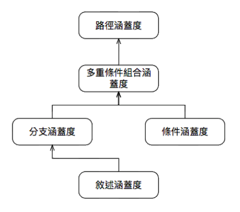
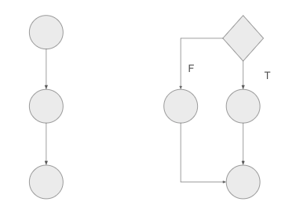
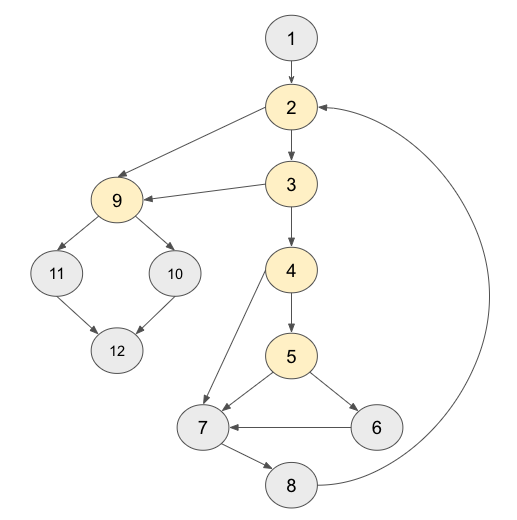
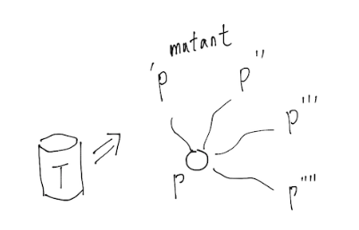
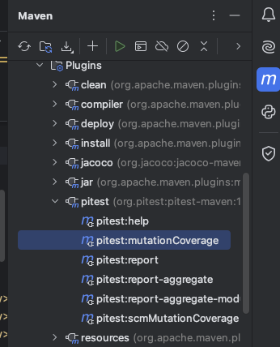

# 軟體品質與測試

### 第 6 章：白箱測試、控制流路徑分析與變異測試

授課教師：薛念林 教授

> 黑箱測試檢驗系統「做什麼」，白箱測試則是程式碼層級的顯微鏡——  
> 深入控制流、資料流與邏輯分支，度量每一行程式碼被驗證的深度。  
> 「100% 覆蓋率只是起點；唯有能殺死變異體的斷言，才是真正的品質防線。」

---

<!-- _class: outline-slide -->
<!-- header: '本章大綱 (Outline)' -->

## 本章重點導讀 (Key Highlights)

<div class="outline-columns">
<div>

### 🧭 涵蓋度階梯與工具插樁
- **6.1 白箱測試基礎與 JaCoCo 動態插樁**：
  - 玻璃盒測試思維、黑箱 vs. 白箱雙軌協同、V-Model 定位
  - 原始碼插樁 vs. 位元組碼動態插樁 (Java Agent) 與六大計數器 (CCQ 1)
  - IntelliJ Run with Coverage 與 Maven Quality Gate 自動阻斷
- **6.2 邏輯測試涵蓋度階梯與實戰案例 (Coverage Criteria)**：
  - 敘述 (SC) ➔ 分支 (BC) ➔ 條件 (CC) ➔ 短路求值黃色鑽石解密 (CCQ 2)
  - 多重條件 (MCC)、路徑爆炸、**MC/DC (DO-178C / ISO 26262)** 推導 (CCQ 3)
  - 🧪 *實戰推演：`Triangle` 死分支之謎、`BinarySearch`、`BMI`、`LoanCalculator`*
  - 破解「100% 覆蓋率等於高品質」的三大工程迷思

</div>
<div>

### 📐 結構路徑、變異測試與 AI 協同
- **6.3 基本路徑測試與複雜度度量 (Basis Path)**：
  - 控制流程圖 (CFG) 四大基本結構與複合條件拆解
  - **McCabe 圈複雜度 V(G)** 三大公式、`computeAverage` 與 `NextDate` 完整推演 (CCQ 4)
  - 迴圈測試 (Loop Testing)、資料流測試 (DU-Path) 與認知複雜度重構 (`CogC` / `WMC`)
- **6.4 變異測試 (Mutation Testing — 測試你的測試)**：
  - 兩大理論假設 (CPH / Coupling Effect)、變異算子與 RIPR 模型
  - 變異得分 `MS = K / (M - E)` 與**等價變異體**辨析 (CCQ 5)
  - 🧪 *獵殺實戰：`TriangleMuTest`、`BinarySearch (bs02/bs03)`、`func(X,Y)` 與 PITest*
- **6.5 AI 輔助白箱測試、符號執行與模糊測試**：
  - 符號執行 (SMT/Z3)、覆蓋率引導 Fuzzing 與人機協同 SOP (CCQ 6)

</div>
</div>

---

<!-- _class: lead -->
<!-- header: '6.1 測試涵蓋度階梯與邏輯覆蓋' -->

# **6.1 測試涵蓋度階梯與邏輯覆蓋 (Coverage Criteria)**

> 「從最基礎的敘述涵蓋，一路攀升至波音與 NASA 採用的 MC/DC 航太標準；  
> 理解每一層涵蓋度的邏輯強度與邊界盲區，建立嚴密的白箱測試防線。」

---

<!-- header: '6.1 測試涵蓋度階梯 (Coverage Criteria)' -->

## 什麼是白箱測試 (White-Box Testing)？

<div class="card-deck">

> 💡 白箱測試（又稱結構測試 Structural Testing、玻璃盒測試 Glass-Box Testing）是在**完全透明掌握程式內部邏輯與結構**的前提下進行的測試。

<div class="two-columns">
<div class="card">

### 🔍 白箱測試的核心使命
- **透視內部工作機制**：
  - 直接針對原始碼的**陳述句 (Statements)**、**邏輯分支 (Branches)**、**布林條件 (Conditions)** 與**執行路徑 (Paths)** 設計測資。
- **量化測試充分性 (Test Adequacy)**：
  - 回答工程師最關鍵的問題：「*我們的測試套件到底走過了多少比例的程式碼？還有哪些角落從未被觸發？*」
- **揪出結構性暗疾**：
  - 捕捉永遠不會執行的死碼 (Dead Code)、考慮不周的 `else` 分支、邊界差一錯誤 (OBOB) 與變數未初始化風險。

</div>
<div class="card">

### ⚖️ 黑箱 (Ch05) vs. 白箱 (Ch06) 黃金互補
| 比較維度 | 黑箱測試 (Black-Box) | 白箱測試 (White-Box) |
| :--- | :--- | :--- |
| **設計依據** | 需求規格書 (SRS)、業務契約 | 原始碼結構、控制流圖 (CFG) |
| **核心焦點** | 驗證 **What** (外顯行為) | 驗證 **How** (內部實作路徑) |
| **最大優勢** | 能抓出「**遺漏的需求**」 | 能抓出「**未預期的隱藏分支/死碼**」 |
| **致命盲點** | 測不到規格未寫的內部邏輯 | **規格漏寫的功能，覆蓋率 100% 也測不出！** |
| **實務協同** | **先以黑箱 (EP/BVA) 設計基線測資** ➔ **再以白箱 (JaCoCo) 檢查漏網分支補彈！** |

</div>
</div>
</div>

---

<!-- header: '6.1 測試涵蓋度階梯 (Coverage Criteria)' -->

## 為什麼光靠黑箱或白箱都不夠？「規格 vs. 實作」四象限盲區

<div class="card-deck">

> 💡 軟體缺陷往往躲在「**規格要求 (Specification)**」與「**實際程式碼 (Implementation)**」不一致的夾縫中。

<div class="two-columns">
<div class="card">

### 📊 規格與實作的一致性四象限矩陣
| 象限情境 | 規格有定義？ | 程式有實作？ | 單靠黑箱測試 | 單靠白箱測試 |
| :--- | :---: | :---: | :---: | :---: |
| **1. 核心正常功能** | ✅ 有 | ✅ 有 | ✅ 可驗證 | ✅ 可覆蓋 |
| **2. 遺漏的需求**<br>(Missing Requirement) | ✅ **有** | ❌ **漏寫** | ✅ **一測就抓到！** | ❌ **100% 覆蓋也完全瞎掉！** |
| **3. 暗藏的多餘程式**<br>(Extra / Trojan Code) | ❌ **無** | ✅ **私自多寫** | ❌ **沒規格根本不會去測！** | ✅ **紅燈立刻暴行蹤！** |
| **4. 實作邊界小瑕疵**<br>(`>=` 誤寫為 `>`) | ✅ 有 | ⚠️ 實作偏差 | ⚠️ 隨機測資易漏抓 | ✅ **條件/變異測試精準鎖定** |

</div>
<div class="card">

### 🛡️ 雙劍合璧的標準工程策略 (Hybrid Strategy)
- **Step 1：黑箱先行（正向與邊界基線）**：
  - 根據需求規格書（SRS），運用 Ch05 的**等價分割 (EP)**、**邊界值分析 (BVA)** 與**決策表**設計第一波測試案例。
- **Step 2：白箱診斷（開啟覆蓋率顯微鏡）**：
  - 執行黑箱測試集並掛載 **JaCoCo**，檢查有哪些分支、異常處理或邊界條件呈現**紅色或黃色**。
- **Step 3：逆向補彈與清理死碼**：
  - 若未覆蓋分支屬於合法業務情境 ➔ **補充白箱測試案例**；
  - 若未覆蓋分支屬於永遠不可能發生的冗餘邏輯 ➔ **重構刪除死碼 (Dead Code)**！

</div>
</div>
</div>

---

<!-- header: '6.1 測試涵蓋度階梯 (Coverage Criteria)' -->

## 測試涵蓋度總覽與經典受測範例

<div class="card-deck">

> 💡 不同的涵蓋度標準（Coverage Criteria）代表不同等級的測試濾網密度。我們以經典雙判斷式程式貫穿比較：

<div class="content-columns">
<div class="content-text">

### 💻 課堂經典受測程式片段
```java
1: input A, B, X
2: if (A > 1) and (B == 0) then
3:     Y = A
4: if (A == 2) or (X > 1) then
5:     Y = X
6: print Y
```
- **2 個決策分支 (Decisions / Branches)**：
  - `D1`: `(A > 1) and (B == 0)` ｜ `D2`: `(A == 2) or (X > 1)`
- **4 個獨立條件 (Atomic Conditions)**：
  - `C1`: `A > 1`、`C2`: `B == 0`、`C3`: `A == 2`、`C4`: `X > 1`
- **強度階梯**：敘述 ➔ 分支/條件 ➔ MC/DC ➔ 多重條件 ➔ 路徑涵蓋。

</div>
<div class="content-figure">



</div>
</div>
</div>

---

<!-- header: '6.1 測試涵蓋度階梯 (Coverage Criteria)' -->

## 6.1.1 敘述涵蓋度 (Statement Coverage, SC)

<div class="card-deck">

> 💡 **定義**：設計測試案例，使程式中的**每一條可執行指令敘述（Executable Statement）至少被執行一次**。

<div class="two-columns">
<div class="card">

### 🎯 達成 100% 敘述涵蓋只需 1 筆測資
```java
1: input A, B, X
2: if (A > 1) and (B == 0) then
3:     Y = A          // 需進入此行
4: if (A == 2) or (X > 1) then
5:     Y = X          // 需進入此行
6: print Y
```
- **測試案例**：取 **`(A, B, X) = (2, 0, 3)`**
  - 第 2 行：`(2 > 1) and (0 == 0)` 為 True ➔ 執行第 3 行 `Y = 2`。
  - 第 4 行：`(2 == 2) or (3 > 1)` 為 True ➔ 執行第 5 行 `Y = 3`。
  - 第 6 行：印出 `Y = 3`。
  - **結果**：第 1～6 行全部執行過，**Statement Coverage = 100%！**

</div>
<div class="card">

### ⚠️ 為什麼敘述涵蓋度是最弱的標準？
即便達成 **100% 敘述涵蓋**，若程式存在以下嚴重 Bug，測資 `(2, 0, 3)` **完全抓不出來**（輸出依然是 `3`）：
- ❌ **錯誤 1**：第 2 行把 `and` 誤寫成 `or`。
- ❌ **錯誤 2**：第 3 行 `Y = A` 誤寫成 `Y = 999`（因為馬上被第 5 行 `Y = X` 覆寫遮蔽了！）。
- ❌ **錯誤 3**：第 4 行把 `X > 1` 誤寫成 `X > 0`。
- 📌 **工程結論**：
  - 敘述涵蓋完全沒有測試「判斷為 False（不進入 `if`）」的隱含空分支。它是白箱測試的**最低底線**，絕非安全終點！

</div>
</div>
</div>

---

<!-- header: '6.1 測試涵蓋度階梯 (Coverage Criteria)' -->

## 6.1.2 分支涵蓋度 (Branch / Decision Coverage, BC)

<div class="card-deck">

> 💡 **定義**：又稱決策涵蓋度（Decision Coverage），要求程式中**每一個判斷式（Decision）的 True 分支與 False 分支都至少執行一次**。

<div class="two-columns">
<div class="card">

### 📊 雙分支真假覆蓋設計
- 待測程式有兩個決策點：
  - `D1`: `(A > 1) AND (B == 0)`
  - `D2`: `(A == 2) OR (X > 1)`
- 設計 **2 組測試資料** 即可讓兩個決策都經歷 True 與 False：

| 測試案例 `(A, B, X)` | `D1: (A>1) AND (B=0)` | `D2: (A=2) OR (X>1)` | 執行路徑 |
| :---: | :---: | :---: | :---: |
| **`t1 = (3, 0, 3)`** | **True** ✅ | **True** ✅ | `a ➔ c ➔ e` |
| **`t2 = (2, 1, 1)`** 或 **`(3, 1, 1)`** | **False** ✅ (`(3,1,1)`) | **False** ✅ (`(3,1,1)`) | `a ➔ b ➔ d` |

</div>
<div class="card">

### 🔍 分支涵蓋的特性與盲點
- **涵蓋關係定理**：
  - **100% 分支涵蓋度 ➔ 必然保證 100% 敘述涵蓋度**（反之不成立）。
- **分支涵蓋仍有的盲區**：
  - 複合條件內部可能只有單一子條件主導結果。
  - 例如在 `t1=(3,0,3)` 與 `t2=(3,1,1)` 中：
    - 第一個條件 `A > 1` 在兩筆測資中**永遠都是 True**（`3 > 1`）！
    - 第二個決策中的 `A == 2` 在兩筆測資中**永遠都是 False**（`3 != 2`）！
  - 若工程師把 `A == 2` 誤寫成 `A == 99`，這組 100% 分支覆蓋的測資依然無法發現錯誤！

</div>
</div>
</div>

---

<!-- header: '6.1 測試涵蓋度階梯 (Coverage Criteria)' -->

## 6.1.3 條件涵蓋度 (Condition Coverage, CC)

<div class="card-deck">

> 💡 **定義**：聚焦於決策式內部的「個別原子條件（Atomic Condition）」，要求**每個個別布林條件的 True 與 False 都至少被評估一次**。

<div class="two-columns">
<div class="card">

### 🧩 拆解 4 個原子條件與 8 種真假狀態
- `D1`: `c1 (A > 1)`、`c2 (B == 0)`
- `D2`: `c3 (A == 2)`、`c4 (X > 1)`
- 欲使 4 個條件皆經歷 T 與 F（共 8 個目標）：
  - `(1) A > 1, (2) A <= 1` ｜ `(3) B == 0, (4) B != 0`
  - `(5) A == 2, (6) A != 2` ｜ `(7) X > 1,  (8) X <= 1`
- **僅需 2 筆測資即可達成 100% 條件涵蓋**：
  - **`t1 = (2, 0, 3)`** ➔ 滿足 `c1=T, c2=T, c3=T, c4=T`
  - **`t2 = (1, 1, 1)`** ➔ 滿足 `c1=F, c2=F, c3=F, c4=F`

</div>
<div class="card">

### ⚠️ 關鍵陷阱：100% 條件涵蓋 ≠ 100% 分支涵蓋！
考慮判斷式 `if (p && q)`（非短路求值下）：

| 測試案例 | 條件 `p` | 條件 `q` | 決策結果 `p && q` |
| :---: | :---: | :---: | :---: |
| **`t1`** | **True** | **False** | **False** |
| **`t2`** | **False** | **True** | **False** |

- **驚人發現**：
  - 條件 `p` 有 T 有 F ✅；條件 `q` 有 F 有 T ✅ ➔ **條件涵蓋度 = 100%**！
  - 但整個決策 `p && q` 的結果**永遠是 False** ❌ ➔ **分支涵蓋度只有 50%**（甚至連 `if` 內部的敘述都沒執行到，**SC 也未達 100%**）！

</div>
</div>
</div>

---

<!-- header: '6.1 測試涵蓋度階梯 (Coverage Criteria)' -->

## 短路求值 (Short-Circuit) 與實務工具的「黃色鑽石」之謎

<div class="card-deck">

> 💡 在 Java / C / Python 中，`&&` 與 `||` 採用**短路求值（Short-circuit evaluation）**，這直接改變了條件與分支的涵蓋行為！

<div class="two-columns">
<div class="card">

### ⚡ 短路求值如何影響條件涵蓋？
- 在 `if (p && q)` 中，當 **`p` 為 False** 時，CPU **根本不會去計算 `q` 的值**（直接跳過短路）！

| 測試案例 | 條件 `p` | 條件 `q` (實際執行) | 決策 `p && q` |
| :---: | :---: | :---: | :---: |
| **`t1`** | **True** | **False** | **False** |
| **`t2`** | **False** | **`x` (被短路未執行!)** | **False** |
| **`t3`** | **True** | **True** | **True** |

- **重要定理**：在短路求值下，若要真正讓 `q` 被執行並測到 True 與 False，前提是 `p` 必須為 True；這將連帶迫使 `p && q` 經歷 True 與 False！
- 因此：**短路求值下若達成 100% 條件涵蓋，必同時滿足 100% 分支涵蓋**！

</div>
<div class="card">

### 💎 JaCoCo「75% 分支涵蓋 (黃色鑽石)」迷思
- **為什麼我測了 `if (A && B)` 的 True 與 False，JaCoCo 卻顯示黃色鑽石 (3/4 = 75%)？**
  - **學術定義**：把整個 `if (A && B)` 當作 1 個決策（2 個分支）。
  - **JaCoCo 實作**：在 **Bytecode 層級**分析！編譯器把 `if (A && B)` 拆成兩個跳轉指令（`IFEQ A` 與 `IFEQ B`），共 **2 × 2 = 4 個位元組碼分支**。
  - 若只測 `(A=T, B=T)` 與 `(A=F, 短路)`：
    - `A` 的 T/F 都走過了 (2/2)，`B` 的 T 走過了 (1/2)，但 **`B` 為 False 的分支從未被觸發**！
    - 所以 JaCoCo 判定為 **3 / 4 = 75% 分支覆蓋**！

</div>
</div>
</div>

---

<!-- header: '6.1 測試涵蓋度階梯 (Coverage Criteria)' -->

## 概念核對問答 (CCQ 2)

<div class="ccq-columns">
<div class="ccq-text">

<!-- id: sqa-ch06-ccq2 -->
**問題情境**：  
在包含短路求值 (Short-circuit evaluation) 的條件句 `if (A && B)` 中，若我們設計的測試案例集達到了學術定義的 **100% 分支涵蓋度 (Decision Coverage，即整個 `if` 經歷過 True 與 False)**，是否必定能達成 **100% 條件涵蓋度 (Condition Coverage)**？

- **A)** 必定可以，因為分支涵蓋度的邏輯強度高於條件涵蓋度
- **B)** 不一定，因為短路求值可能使第二個條件 B 在 False 分支案例中被跳過未執行，導致其 False 狀態未被覆蓋
- **C)** 必定不可以，因為兩者沒有任何邏輯交集關係
- **D)** 完全取決於作業系統排程，與短路求值無關

</div>
<div class="ccq-logo">

<a href="https://nlhsueh.github.io/nickedupocket/#/student/sqa-ch06-ccq2" target="_blank"></a>

</div>
</div>

---

<!-- header: '6.1 測試涵蓋度階梯 (Coverage Criteria)' -->

## 6.1.4 分支與條件涵蓋 ＆ 實戰推演 (`sample-code-01`)

<div class="card-deck">

> 💡 **分支與條件涵蓋度 (Branch/Condition Coverage, B/CC)**：同時要求每個原子條件經歷 T/F，且每個整體決策也經歷 T/F。

<div class="two-columns">
<div class="card">

### 💻 課堂推演挑戰 (`sample-code-01`)
```java
1: read(X, Y)
2: if ((X > 10) && (Y == 1))  // c1: X>10, c2: Y==1, b1: c1&&c2
3:     X = 1;
4: else if ((X - Y) < 2)      // c3 (b2): (X-Y) < 2
5:     X = 2;
6: if (Y > 10)                // c4 (b3): Y > 10
7:     X = 3;
8: print X
```
- **目標 1：達成 100% 敘述涵蓋 (SC100)**：
  - 需進入第 3, 5, 7 行：取 **`(X=11, Y=1)`**（進第 3 行）與 **`(X=12, Y=11)`**（進第 5, 7 行）即可達成！

</div>
<div class="card">

### 📊 目標 2 & 3：CC100 vs. BC100 對比表
- **滿足 CC100 但不滿足 BC100**（`b1` 永遠為 False）：

| `X` | `Y` | `c1 (X>10)` | `c2 (Y==1)` | `b1 (c1&&c2)` | `c3 / b2` | `c4 / b3` |
| :---: | :---: | :---: | :---: | :---: | :---: | :---: |
| **9** | **1** | F | T | **_F_** | F (`8<2`) | F |
| **12** | **11** | T | F | **_F_** | T (`1<2`) | T |

- **滿足 BC100 但不滿足 CC100**（`c1` 永遠為 True）：

| `X` | `Y` | `c1 (X>10)` | `c2 (Y==1)` | `b1 (c1&&c2)` | `c3 / b2` | `c4 / b3` |
| :---: | :---: | :---: | :---: | :---: | :---: | :---: |
| **13** | **1** | **_T_** | T | **T** | - | F |
| **12** | **11** | **_T_** | F | **F** | T | T |
| **12** | **2** | **_T_** | F | **F** | F | F |

</div>
</div>
</div>

---

<!-- header: '6.1 測試涵蓋度階梯 (Coverage Criteria)' -->

## 6.1.5 多重條件組合涵蓋 (MCC) 與 6.1.6 路徑涵蓋 (Path Coverage)

<div class="card-deck">

> 💡 當我們要求窮舉單一決策內的所有條件真值表組合（MCC），或窮舉跨決策的所有路徑組合（Path Coverage）時，測試成本將急遽上升。

<div class="two-columns">
<div class="card">

### 🧮 多重條件組合涵蓋 (Multiple Condition, MCC)
- **定義**：每個決策內部的 n 個原子條件，其 **2<sup>n</sup> 種真值表組合**皆須測試。
- 以課堂程式為例：
  - `D1: (A>1) and (B=0)` 有 2<sup>2</sup> = 4 種組合：`(T,T), (T,F), (F,T), (F,F)`。
  - `D2: (A=2) or (X>1)` 也有 2<sup>2</sup> = 4 種組合。
- **配對壓縮後需 4 組測資**：
  - `(2, 0, 4)` ➔ 滿足 `D1(T,T)` 與 `D2(T,T)`
  - `(2, 1, 1)` ➔ 滿足 `D1(T,F)` 與 `D2(T,F)`
  - `(1, 0, 2)` ➔ 滿足 `D1(F,T)` 與 `D2(F,T)`
  - `(1, 1, 1)` ➔ 滿足 `D1(F,F)` 與 `D2(F,F)`

</div>
<div class="card">

### 🛣️ 路徑涵蓋度 (Path Coverage) 與路徑爆炸
- 即使上述 4 組測資達成了 **100% MCC**，觀察流程圖路徑：
  - `(2, 0, 4)` 走 **`a - c - e`**
  - `(2, 1, 1)` 與 `(1, 0, 2)` 皆走 **`a - b - e`**
  - `(1, 1, 1)` 走 **`a - b - d`**
  - ⚠️ **漏掉了路徑 `a - c - d`**（需補測資如 `(3, 0, 1)`）！
- **迴圈導致的路徑組合爆炸**：
  - 若程式包含一個執行 20 次的迴圈，且迴圈內有 4 條分支路徑，總路徑數高達 **4<sup>20</sup> = 2<sup>40</sup> ≈ 1.1 × 10<sup>12</sup>（一兆條路徑）**！因此實務上不可能執行 All-Path 窮盡測試。

</div>
</div>
</div>

---

<!-- header: '6.1 測試涵蓋度階梯 (Coverage Criteria)' -->

## 6.1.7 航太安全關鍵標準：MC/DC 涵蓋度 (DO-178C Level A)

<div class="card-deck">

> 💡 **MC/DC (Modified Condition/Decision Coverage，修改條件/決策涵蓋)**：波音、空中巴士飛控系統（DO-178B/C Level A）與車用電子（ISO 26262 ASIL D）強制要求的最高白箱標準！

<div class="two-columns">
<div class="card">

### ✈️ 為什麼需要 MC/DC？
- **痛點**：若一個飛控判斷式包含 6 個條件 `if (C1 && C2 && ... && C6)`：
  - **多重條件組合 (MCC)** 需要 **2<sup>6</sup> = 64 組**測試（若 10 個條件則需 1,024 組），成本過高。
  - **一般分支/條件涵蓋** 又太弱，無法防止條件之間的遮蔽效應（Masking Effect）。
- **MC/DC 的革命性突破**：
  - 要求證明「**每一個原子條件 C<sub>i</sub> 都能獨立影響整個決策的最終結果**」！
  - 測試案例數從指數級 **2<sup>n</sup>** 奇蹟般壓縮為線性級的 **`n + 1`（最少 `n + 1` 個，最多 `2n` 個）**！

</div>
<div class="card">

### 📏 MC/DC 的四大核心構成要件
1. **敘述與分支涵蓋**：每個決策的 True 與 False 結果都至少出現一次。
2. **條件涵蓋**：決策中的每個條件 C<sub>i</sub> 都曾取過 True 與 False。
3. **獨立影響對 (Independence Pair) —— 核心靈魂**：
   - 對於決策中的**每一個條件 C<sub>i</sub>**，都必須在測試集中找到**一對測試案例 (Test Pair)**：
     - 📌 **唯一變因**：在這對案例中，**只有 C<sub>i</sub> 的真假值翻轉（T ↔ F），其餘所有條件的值保持固定不變**；
     - 📌 **結果翻轉**：同時，**整個決策的最終輸出結果也隨之翻轉（T ↔ F）**！

</div>
</div>
</div>

---

<!-- header: '6.1 測試涵蓋度階梯 (Coverage Criteria)' -->

## MC/DC 實戰推演 (1)：真值表與獨立影響對挑選

<div class="card-deck">

> 💡 **實戰演練**：針對飛機自動降落系統決策 `Decision = (A or B) and C`（共 n = 3 個條件，全真值表有 2<sup>3</sup> = 8 列），請找出最少組數（`3 + 1 = 4 組`）的 MC/DC 測試集！

| 編號 | 條件 `A` | 條件 `B` | 條件 `C` | 決策 `(A \|\| B) && C` | MC/DC 選取狀態與配對角色解析 |
| :---: | :---: | :---: | :---: | :---: | :--- |
| #1 | F | F | F | F | 未選（`C = F` 將 `(A \|\| B)` 整組短路遮蔽） |
| **#2** | **F** | **F** | **T** | **F** | ✅ **入選 (1/4)**：與 **#4** 配對檢驗 `B`；與 **#6** 配對檢驗 `A` |
| #3 | F | T | F | F | 未選（可用 #5 取代以檢驗 `C`） |
| **#4** | **F** | **T** | **T** | **T** | ✅ **入選 (2/4)**：基準案例（讓 `B = T` 與 `C = T` 獨立生效） |
| **#5** | **T** | **F** | **F** | **F** | ✅ **入選 (3/4)**：與 **#6** 配對檢驗 `C` |
| **#6** | **T** | **F** | **T** | **T** | ✅ **入選 (4/4)**：基準案例（讓 `A = T` 與 `C = T` 獨立生效） |
| #7 | T | T | F | F | 未選（`A` 與 `B` 同時為 T，單獨翻轉其中一個無法改變 `(A \|\| B)`） |
| #8 | T | T | T | T | 未選（`A` 與 `B` 同時為 T，互相遮蔽！） |

</div>

---

<!-- header: '6.1 測試涵蓋度階梯 (Coverage Criteria)' -->

## MC/DC 實戰推演 (2)：逐一檢驗三個條件的獨立影響對

<div class="card-deck">

> 💡 驗證從真值表挑出的 **4 組測資 `{#2, #4, #5, #6}`**，是否能讓 `A`、`B`、`C` 各自擁有「固定其他條件、單獨翻轉決策結果」的獨立影響對 (Independence Pairs)！

<div class="two-columns">
<div class="card">

### 🔍 條件 `A` 與條件 `B` 的獨立影響對檢驗
- **1. 檢驗條件 `A` ➔ 配對 `(#2, #6)`**：
  - **`#2`**：`(A=F, B=F, C=T)` ➔ `Decision = F`
  - **`#6`**：`(A=T, B=F, C=T)` ➔ `Decision = T`
  - **證明**：固定 `B = F` 且 `C = T` 不變，**僅單獨翻轉 `A` (`F ➔ T`)**，總決策即隨之翻轉 (`F ➔ T`)！✅
- **2. 檢驗條件 `B` ➔ 配對 `(#2, #4)`**：
  - **`#2`**：`(A=F, B=F, C=T)` ➔ `Decision = F`
  - **`#4`**：`(A=F, B=T, C=T)` ➔ `Decision = T`
  - **證明**：固定 `A = F` 且 `C = T` 不變，**僅單獨翻轉 `B` (`F ➔ T`)**，總決策即隨之翻轉 (`F ➔ T`)！✅

</div>
<div class="card">

### 🔍 條件 `C` 的獨立影響對檢驗與總結
- **3. 檢驗條件 `C` ➔ 配對 `(#5, #6)`**：
  - **`#5`**：`(A=T, B=F, C=F)` ➔ `Decision = F`
  - **`#6`**：`(A=T, B=F, C=T)` ➔ `Decision = T`
  - **證明**：固定 `A = T` 且 `B = F` 不變，**僅單獨翻轉 `C` (`F ➔ T`)**，總決策即隨之翻轉 (`F ➔ T`)！✅
- **🏆 關鍵工程結論**：
  - 藉由讓 **`#2`** 與 **`#6`** 同時充當兩組配對的共用基準點，原本需要 `2^3 = 8` 組的多重條件測試，**僅需 `n + 1 = 4` 組 `{#2, #4, #5, #6}`** 即 100% 證明三個條件皆能獨立影響決策！

</div>
</div>
</div>

---

<!-- header: '6.1 測試涵蓋度階梯 (Coverage Criteria)' -->

## 國際功能安全法規標準：DO-178C (航太) 與 ISO 26262 (車規)

<div class="card-deck">

> 💡 在人命關天的安全關鍵系統（Safety-Critical Systems）中，你寫的軟體若沒達到法規指定的白箱覆蓋率，飛機不能起飛、電動車不能上市！

<div class="two-columns">
<div class="card">

### ✈️ 航太與車用功能安全等級對照表
| 安全失效後果 | 航太 DO-178C 等級 | 車用 ISO 26262 等級 | 強制要求之白箱覆蓋標準 |
| :--- | :---: | :---: | :--- |
| **災難性 (Catastrophic)**<br>機毀人亡 / 轉向煞車失控 | **DAL A** | **ASIL D** | **100% SC + 100% BC + 100% MC/DC** 🏆 |
| **危險/嚴重 (Hazardous)**<br>重傷或關鍵系統失效 | **DAL B** | **ASIL C** | **100% SC + 100% BC** (車規高度建議 MC/DC) |
| **主要 (Major)**<br>系統功能降級或輕傷 | **DAL C** | **ASIL B / A** | **100% SC** (車規 ASIL B 要求 100% BC) |
| **輕微/無影響 (Minor)** | **DAL D / E** | **QM** | 無強制結構覆蓋要求 |

</div>
<div class="card">

### 🔬 Unique-Cause vs. Masking MC/DC
- **1. 唯一原因型 (Unique-Cause MC/DC)**：
  - 經典定義：測試對中**嚴格只允許待測條件 C<sub>i</sub> 翻轉**，其他條件字面值完全固定不變。
  - 痛點：當同一個變數在決策中出現兩次（**耦合條件 Coupled Conditions**，如 `(A && B) || (!A && C)`）時，改變 `A` 必然同時改變 `!A`，無法構造 Unique-Cause 配對！
- **2. 遮蔽型 (Masking MC/DC)**：
  - 工程界與 FAA 認證認可的廣義標準：只要讓其他子表達式被短路或邏輯遮蔽（不會影響最終輸出），即允許耦合條件翻轉，解決了重複變數無法配對的難題！

</div>
</div>
</div>

---

<!-- header: '6.1 測試涵蓋度階梯 (Coverage Criteria)' -->

## 概念核對問答 (CCQ 3)

<div class="ccq-columns">
<div class="ccq-text">

<!-- id: sqa-ch06-ccq3 -->
**問題情境**：  
考慮一個包含 n 個彼此獨立之布林條件的複雜判斷式（例如 `A && B && C`，n = 3）。若要滿足航太級 **MC/DC (Modified Condition/Decision Coverage)** 覆蓋率標準，最少與最多分別需要設計幾個測試案例？

- **A)** 最少 n + 1 個，最多 2n 個
- **B)** 最少 n + 1 個，最多 2<sup>n</sup> 個
- **C)** 最少 2<sup>n</sup> 個，最多 2<sup>n</sup> 個
- **D)** 最少 2n 個，最多 2<sup>n</sup> 個

</div>
<div class="ccq-logo">

<a href="https://nlhsueh.github.io/nickedupocket/#/student/sqa-ch06-ccq3" target="_blank"></a>

</div>
</div>

---

<!-- header: '6.1 測試涵蓋度階梯 (Coverage Criteria)' -->

## 6.1.8 破解「百分百涵蓋度 (100% Coverage)」的三大迷思

<div class="card-deck">

> 💡 「**程式碼覆蓋率是一個發現未測盲區的指標，而不是盲目追求的硬性目標。**」—— 當覆蓋率成為 KPI 時，根據古德哈特定律（Goodhart's Law），它就不再是個好指標。

<div class="three-columns">
<div class="card">

### 📉 1. 邊際效益遞減 (ROI 崩跌)
- **0% ➔ 85%**：
  - 投入產出比極高，能迅速攔截絕大多數核心業務缺陷。
- **95% ➔ 100%**：
  - 耗費的時間與 Mock 複雜度呈**指數級暴增**！
  - 為了湊滿最後 5%（如極罕見的 OS 底層 IO 異常、防禦性 `default` 分支、Getter/Setter），寫出大量脆弱且難以維護的測試，得不償失。

</div>
<div class="card">

### 🎭 2. 執行過 ≠ 驗證正確 (無斷言測試)
- **覆蓋率只看「有沒有跑過那一行」**：
  - 工程師若寫出**沒有 `assertEquals` 的測試（Assertion-free Test）**，或者斷言條件極度敷衍（只寫 `assertNotNull`），覆蓋率一樣衝上 100%！
- **無法抓出算式寫反**：
  - 若 `a + b` 誤寫為 `a * b`，測資給 `(2, 2)`，100% 覆蓋且通過，但邏輯卻是錯的（需靠 **6.4 變異測試** 破解）。

</div>
<div class="card">

### 🕳️ 3. 測不出「遺漏的規格 (Missing Code)」
- **白箱只能測「已經寫出來的程式碼」**：
  - 如果需求規定「VIP 生日當月享 5 折」，但工程師**根本忘了寫這個 `if` 判斷式**；
  - 現有程式碼依然能輕鬆跑出 **100% Line & Branch Coverage**！
- **最佳實務策略**：
  - 設定務實門檻（**核心業務模組 85%～90%，全專案 75%～80%**），結合黑箱邊界與變異測試！

</div>
</div>
</div>

---

<!-- header: '6.1 測試涵蓋度階梯 (Coverage Criteria)' -->

## 🧪 實戰案例 1：`Triangle.java` 複合條件與「永遠 83% 的死分支」解密

<div class="card-deck">

> 💡 📄 實習手冊：[whitebox_test.md#lab-1](../../lab.html?file=LabDemo/docs/u06_wbtesting/whitebox_test.md#lab-1-triangle-三角形測試與覆蓋度分析) ｜ 💻 待測原始碼：[Triangle.java](../../lab.html?file=LabDemo/src/main/java/u06_coverage/Triangle.java)

<div class="two-columns">
<div class="card">

### 💻 `Triangle.java` 原始碼與 Bytecode 分支統計
```java
public static String getTriangleType(int a, int b, int c) {
    // 決策 1：6 個子條件 = 12 個 Bytecode 分支
    if (a <= 0 || b <= 0 || c <= 0 ||
        a + b <= c || a + c <= b || b + c <= a) {
        return "非三角形";
    }
    // 決策 2：3 個子條件 = 6 個 Bytecode 分支 (⚠️ 陷阱!)
    if (a == b && b == c && a == c) {
        return "正三角形";
    }
    // 決策 3：3 個子條件 = 6 個 Bytecode 分支
    if (a == b || b == c || a == c) {
        return "等腰三角形";
    }
    return "一般三角形";
}
```

</div>
<div class="card">

### 🔍 數學遞移律不可達死分支 ＆ 🎯 實作任務
- **觀察決策 2**：`if (a == b && b == c && a == c)`
  - 要評估第 3 個條件 `a == c`，前提是 `a == b` 與 `b == c` 皆成立！
  - 根據數學**遞移律 (Transitivity)**：`a == c` **恆為 True**！
  - 故 `a == c` 為 False 的分支在宇宙中永遠不可能發生（**Infeasible Branch**），JaCoCo 永遠停在 **5/6 = 83.3%**！
- 🎯 **Lab 1 實作任務**：
  1. 在測試檔按右鍵選 **Run with Coverage**，觀察黃色鑽石；
  2. 重構移除多餘的 `&& a == c`，消滅死碼並達成 100% 分支覆蓋！

</div>
</div>
</div>

---

<!-- header: '6.1 測試涵蓋度階梯 (Coverage Criteria)' -->

## 🧪 實戰案例 2：`Triangle.java` 達成 100% 分支涵蓋之精簡測資集

<div class="card-deck">

> 💡 📄 實習手冊：[whitebox_test.md#lab-1](../../lab.html?file=LabDemo/docs/u06_wbtesting/whitebox_test.md#lab-1-triangle-三角形測試與覆蓋度分析) ｜ 🧪 測試檔：[TriangleCoverageTest.java](../../lab.html?file=LabDemo/src/test/java/u06_coverage/TriangleCoverageTest.java)

| 測試類別 | 測試案例 `(a, b, c)` | 觸發之關鍵子條件與短路路徑分析 | 預期輸出結果 |
| :--- | :---: | :--- | :---: |
| **非三角形 (1)** | **`(0, 2, 3)`** | 觸發第 1 子條件 **`a <= 0` 為 T**（後續 5 個條件被短路跳過） | `"非三角形"` |
| **非三角形 (2)** | **`(2, 0, 3)`** | `a <= 0` 為 F ➔ 觸發第 2 子條件 **`b <= 0` 為 T** | `"非三角形"` |
| **非三角形 (3)** | **`(2, 3, 0)`** | 前 2 條件為 F ➔ 觸發第 3 子條件 **`c <= 0` 為 T** | `"非三角形"` |
| **非三角形 (4)** | **`(1, 2, 3)`** | 前 3 條件為 F ➔ 觸發第 4 子條件 **`a + b <= c` 為 T** | `"非三角形"` |
| **非三角形 (5)** | **`(1, 3, 2)`** | 前 4 條件為 F ➔ 觸發第 5 子條件 **`a + c <= b` 為 T** | `"非三角形"` |
| **非三角形 (6)** | **`(3, 1, 2)`** | 前 5 條件為 F ➔ 觸發第 6 子條件 **`b + c <= a` 為 T** | `"非三角形"` |
| **正三角形** | **`(3, 3, 3)`** | 決策 1 全 F (6 個 F 全達成!) ➔ 決策 2 **`a==b` 為 T 且 `b==c` 為 T** | `"正三角形"` |
| **等腰 (1, 2, 3)** | **`(3, 3, 2)` / `(2, 3, 3)` / `(3, 2, 3)`** | 分別讓決策 3 的 `a==b`、`b==c`、`a==c` 各自獨立觸發 **True** 分支 | `"等腰三角形"` |
| **一般三角形** | **`(3, 4, 5)`** | 讓決策 1、決策 2、決策 3 的所有子條件皆走完 **False** 分支！ | `"一般三角形"` |

> 🎯 **實作練習**：在測試類別中加入此 9 筆測資，執行 Run with Coverage 驗證分支涵蓋率達到 100% (22/22)！

</div>

---

<!-- header: '6.1 測試涵蓋度階梯 (Coverage Criteria)' -->

## 🧪 實戰案例 3：`BinarySearch` 與 `BMI` 白箱測試案例設計

<div class="card-deck">

> 💡 📄 [實習手冊](../../lab.html?file=LabDemo/docs/u06_wbtesting/whitebox_test.md#lab-2-binary-search-二元搜尋) ｜ 💻 [原始碼](../../lab.html?file=LabDemo/src/main/java/u06_coverage/BinarySearch.java) ｜ 🧪 測試檔：[BinarySearchCoverageTest.java](../../lab.html?file=LabDemo/src/test/java/u06_coverage/BinarySearchCoverageTest.java)

<div class="two-columns">
<div class="card">

### 🔍 `BinarySearch.search(key, array)`
```java
int left = 0, right = array.length - 1;
while (left <= right) {              // B1: 迴圈條件
    int mid = (left + right) / 2;
    if (array[mid] == key) return mid; // B2: 命中
    if (array[mid] > key) right = mid - 1; // B3: 左找
    else left = mid + 1;               // B3 F: 右找
}
return -1;
```
- **2 組測資達成 100% SC + 100% BC + 100% CC**：
  - **`t1`: `key = 1, array = [1, 3, 5]`** ➔ 走 B3(T) 往左，再走 B2(T) 命中回傳 `0`！
  - **`t2`: `key = 6, array = [1, 3]`** ➔ 走 B3(F) 往右，最後觸發 B1(F) 跳出回傳 `-1`！
- 🎯 **Lab 2 練習**：補足這 2 筆測資使 Branch Coverage 達 100%！

</div>
<div class="card">

### ⚖️ `BMI` 計算之防禦與分類分支 (`ex-coverage-bmi`)
```java
if (weight <= 0 || height <= 0) // B1 (C1:w<=0, C2:h<=0)
    throw new IllegalArgumentException("Invalid");
double bmi = weight / (height * height);
if (bmi < 18.5) return "Underweight"; // B2
else if (bmi < 24) return "Normal";   // B3
else return "Overweight";
```
- **達成 100% 敘述、分支與條件涵蓋 (共 5 組)**：
  1. **`w = -5, h = 1.7`** ➔ `C1=T` 拋出例外
  2. **`w = 60, h = 0`** ➔ `C1=F, C2=T` 拋出例外
  3. **`w = 45, h = 1.7`** (`15.6`) ➔ `B2=T` (`Underweight`)
  4. **`w = 65, h = 1.7`** (`22.5`) ➔ `B2=F, B3=T` (`Normal`)
  5. **`w = 80, h = 1.7`** (`27.7`) ➔ `B2=F, B3=F` (`Overweight`)

</div>
</div>
</div>

---

<!-- header: '6.1 測試涵蓋度階梯 (Coverage Criteria)' -->

## 🧪 實戰案例 4：`LoanCalculator` 三段式測試覆蓋率演進 (`LabDemo`)

<div class="card-deck">

> 💡 📄 實習手冊：[whitebox_test.md#lab-3](../../lab.html?file=LabDemo/docs/u06_wbtesting/whitebox_test.md#lab-3-loan-calculator-貸款利率計算) ｜ 💻 原始碼：[LoanCalculator.java](../../lab.html?file=LabDemo/src/main/java/u05_pair/LoanCalculator.java) ｜ 🧪 測試：[LoanCalculatorPairwiseExerciseTest.java](../../lab.html?file=LabDemo/src/test/java/u05_pair/LoanCalculatorPairwiseExerciseTest.java)

<div class="two-columns">
<div class="card">

### 💻 `LoanCalculator.java` 業務邏輯片段
```java
public static double calculateInterestRate(
  int year, double amount, boolean isYouth, boolean isMarried) {

    double rate = 5.0; // 基礎基準利率
    if (year > 20) rate -= 1.0;
    else if (year > 10) rate -= 0.5;

    if (amount > 5000000) { // 滿 500 萬每多百萬減 0.1%
        double extraMillion = (amount - 5000000) / 1000000;
        rate -= extraMillion * 0.1;
    }
    if (isYouth) rate -= 1.0;
    if (isMarried) rate -= 0.5;
    if (rate < 2.0) rate = 2.0; // 保底 2.0%
    return rate;
}
```

</div>
<div class="card">

### 📊 三大測試策略涵蓋度對比 ＆ 🎯 實作任務
| 測試策略 | 設計依據與測資規模 | JaCoCo 分支覆蓋率 |
| :--- | :--- | :---: |
| **🥉 WeakTest** | 只測 2~3 組 Happy Path 正常申貸 | **約 60% ~ 68%** |
| **🥈 PairwiseTest** | Ch05 成對組合表 (約 8 筆測資) | **85% ~ 92%** |
| **🥇 StrongTest** | 針對未覆蓋紅/黃分支**逆向補彈** | **100% (BC100)** |

- 🎯 **Lab 3 實作任務**：
  1. 執行 `LoanCalculatorPairwiseDemoTest` 記錄覆蓋率；
  2. 在 `LoanCalculatorPairwiseExerciseTest` 補齊防禦邊界（如 `rate < 2.0` 保底分支），衝上 **100% 分支覆蓋**！

</div>
</div>
</div>

---

<!-- _class: lead -->
<!-- header: '6.2 JaCoCo 動態插樁與涵蓋度度量' -->

# 6.2 JaCoCo 動態插樁與涵蓋度度量

> 「學會了理論上的敘述、分支與條件覆蓋，該如何在現代 Java 專案中精準度量？  
> 透過 Bytecode 動態插樁，在不污染原始碼的前提下即時照亮每一行測試足跡。」

---

<!-- header: '6.2 JaCoCo 動態插樁與涵蓋度度量' -->

## 程式碼插樁 (Code Instrumentation) 三大技術流派比較

<div class="card-deck">

> 💡 覆蓋率工具是如何知道「哪一行被執行過」的？底層核心技術稱為**探針插樁（Probe Instrumentation）**。

<div class="three-columns">
<div class="card">

### 📝 1. 原始碼插樁
**(Source-Level Instrumentation)**
- **運作方式**：
  - 在編譯前先透過預處理器修改 `.java` / `.c` 原始碼，在每個分支插入 `count[i]++` 後再編譯。
- **代表工具**：Gcov (C/C++)、早期 Clover。
- **優缺點**：
  - ✅ 概念直覺、可跨執行環境。
  - ❌ **嚴重污染原始碼目錄**、編譯時間翻倍，且可能改變行號與執行時序。

</div>
<div class="card">

### 📦 2. 離線位元組碼插樁
**(Offline Bytecode Instrumentation)**
- **運作方式**：
  - `javac` 編譯出 `.class` 後，先執行一道專用的插樁指令改寫磁碟上的 `.class` 檔，再啟動測試。
- **代表工具**：Cobertura、JaCoCo Offline 模式。
- **優缺點**：
  - ✅ 支援不允許掛載 `-javaagent` 的受限環境（如早期 Android Dalvik）。
  - ❌ 磁碟上的 `.class` 被改寫，若忘記重新編譯可能把探針打包進正式環境 JAR！

</div>
<div class="card">

### ⚡ 3. 動態記憶體插樁 (主流!)
**(On-the-fly Java Agent)**
- **運作方式**：
  - 磁碟上的 `.java` 與 `.class` **完全保持原樣**！
  - 僅在 JVM 啟動測試時透過 `-javaagent` 於記憶體載入瞬間動態注入 `boolean[]` 探針。
- **代表工具**：**JaCoCo 預設模式**、IntelliJ Runner。
- **優缺點**：
  - ✅ **零原始碼污染、零磁碟 `.class` 污染**、速度極快（僅約 3%~5% 記憶體開銷）！

</div>
</div>
</div>

---

<!-- header: '6.2 JaCoCo 動態插樁與涵蓋度度量' -->

## 現代覆蓋率引擎：JaCoCo 動態位元組碼插樁原理

<div class="card-deck">

> 💡 **JaCoCo (Java Code Coverage)** 不會修改你的 `.java` 原始碼，而是利用 **Java Agent** 在記憶體載入階段動態注入探針 (Probes)。

<div class="two-columns">
<div class="card">

### ⚙️ On-the-fly Bytecode Instrumentation
- **1. 編譯階段不干預**：
  - `javac` 正常將 `.java` 編譯為乾淨的 `.class` 位元組碼。
- **2. JVM 載入期動態插樁**：
  - 啟動測試時掛載 `-javaagent:jacocoagent.jar`。
  - 當 ClassLoader 載入 `.class` 時，ASM 框架即時在基本區塊與跳轉指令間插入布林陣列探針（`boolean[] $jacocoData`）。
- **3. 執行期零磁碟開銷**：
  - 程式執行經過某區塊時，將對應陣列元素設為 `true`；測試結束時匯出 `jacoco.exec` 並渲染 HTML 報表。

</div>
<div class="card">

### 🚦 IDE 與報表中的三色燈號與鑽石標記
- 🟩 **綠色背景 (Fully Covered)**：
  - 該行指令已執行，且若為判斷式，其所有真假分支皆已完整走過。
- 🟥 **紅色背景 (Uncovered)**：
  - 該行程式碼在整場測試中**從未被執行過 (0 次)**，屬於測試盲區！
- 🟨 **黃色背景 + 黃色鑽石 (Partially Covered)**：
  - 該行有執行，但內部的**條件分支僅部分被觸發**（例如 `if (A && B)` 只測了 True 分支，或因短路求值漏掉了某個子條件分支）。

</div>
</div>
</div>

---

<!-- header: '6.2 JaCoCo 動態插樁與涵蓋度度量' -->

## JaCoCo 與 Maven 生命週期整合 (`pom.xml`)

<div class="card-deck">

> 💡 📄 實習手冊：[whitebox_test.md#122](../../lab.html?file=LabDemo/docs/u06_wbtesting/whitebox_test.md#122-intellij-coverage-工具操作步驟) ｜ ⚙️ 專案配置：[pom.xml](../../lab.html?file=LabDemo/pom.xml)

<div class="two-columns">
<div class="card">

### 📄 `pom.xml` 插件綁定機制
```xml
<plugin>
  <groupId>org.jacoco</groupId>
  <artifactId>jacoco-maven-plugin</artifactId>
  <version>0.8.12</version>
  <executions>
    <!-- 1. 測試前準備 Java Agent 探針 -->
    <execution>
      <id>prepare-agent</id>
      <goals><goal>prepare-agent</goal></goals>
    </execution>
    <!-- 2. verify 階段產出 HTML 報表 -->
    <execution>
      <id>report</id>
      <phase>verify</phase>
      <goals><goal>report</goal></goals>
    </execution>
  </executions>
</plugin>
```

</div>
<div class="card">

### 🛠️ 實習執行指令與報表指標解讀
- **終端機一鍵產生報告**：
  ```bash
  mvn clean test verify
  ```
- **報表輸出路徑**：
  - `target/site/jacoco/index.html`
- **JaCoCo 報表核心欄位**：
  - **Cov. (Instructions)**：位元組碼指令覆蓋率。
  - **Cov. (Branches)**：**分支覆蓋率**（工程把關最看重！）。
  - **Cxty**：McCabe 圈複雜度統計。
- 🎯 **實作任務**：在終端機執行 `mvn clean test verify`，並在瀏覽器檢視 HTML 覆蓋率報告！

</div>
</div>
</div>

---

<!-- header: '6.2 JaCoCo 動態插樁與涵蓋度度量' -->

## JaCoCo 六大計數器 (Counters) 與 CI/CD 品質門檻自動阻斷

<div class="card-deck">

> 💡 JaCoCo 報表提供 6 種不同粒度的計數器（Counters），並支援透過 `jacoco:check` 在覆蓋率低於門檻時自動讓 Maven Build Fail！

<div class="two-columns">
<div class="card">

### 📊 JaCoCo 六大覆蓋率計數器精確定義
| 計數器名稱 | 度量粒度 | 計算規則與工程實務意義 |
| :--- | :---: | :--- |
| **`INSTRUCTION`** | 最細 (C<sub>0</sub>) | JVM Bytecode 指令執行比例，不受原始碼換行排版影響 |
| **`LINE`** | 行級 | 一行原始碼中**只要有任一個 Bytecode 指令被執行**即算該行已覆蓋 |
| **`BRANCH`** | **最關鍵 (C<sub>1</sub>)** | 統計所有 `if / switch` 跳轉分支（含短路拆解分支）；**全走過為綠鑽石、部分走過為黃鑽石、未執行為紅鑽石** |
| **`COMPLEXITY`** | 路徑級 | 統計每個方法的 McCabe 圈複雜度 `V(G)` 與已覆蓋之獨立路徑數 |
| **`METHOD / CLASS`** | 粗粒度 | 方法或類別中只要有任一行指令被執行，即視為已覆蓋 |

</div>
<div class="card">

### 🚧 CI/CD 自動品質門檻 (`jacoco:check`)
在 `pom.xml` 加入 `check` Goal，當 PR 測試覆蓋率不達標時直接阻斷合併：
```xml
<execution>
  <id>jacoco-check</id>
  <goals><goal>check</goal></goals>
  <configuration>
    <rules><rule>
      <element>PACKAGE</element>
      <limits><limit> <!-- 要求分支覆蓋率至少達 80% -->
        <counter>BRANCH</counter>
        <value>COVEREDRATIO</value>
        <minimum>0.80</minimum>
      </limit></limits>
    </rule></rules>
  </configuration>
</execution>
```

</div>
</div>
</div>

---

<!-- header: '6.2 JaCoCo 動態插樁與涵蓋度度量' -->

## 概念核對問答 (CCQ 1)

<div class="ccq-columns">
<div class="ccq-text">

<!-- id: sqa-ch06-ccq1 -->
**問題情境**：  
【是非題】JaCoCo 作為 Java 軟體測試覆蓋率工具，在測量覆蓋率時是透過直接修改專案的 Java 原始碼檔 (`.java`) 並寫入計數器變數來追蹤執行狀態的。

- **A)** 正確 (True)
- **B)** 錯誤 (False)

</div>
<div class="ccq-logo">

<a href="https://nlhsueh.github.io/nickedupocket/#/student/sqa-ch06-ccq1" target="_blank"></a>

</div>
</div>

---

<!-- _class: lead -->
<!-- header: '6.3 基本路徑測試與複雜度度量' -->

# **6.3 基本路徑測試與複雜度度量**

> 「Thomas McCabe 將圖論引入軟體工程——  
> 用圈複雜度 V(G) 量化程式的混亂程度，用線性獨立基本路徑精準鎖定最少測試集。」

---

<!-- header: '6.3 基本路徑測試與複雜度度量' -->

## 基本路徑測試 (Basis Path Testing) 四步標準流程

<div class="card-deck">

> 💡 由 **Thomas J. McCabe (1976)** 提出，透過控制流程圖（CFG）找出「線性獨立路徑基底」，達成 **100% 敘述與分支涵蓋**。

<div class="content-columns">
<div class="content-text">

- **Step 1：繪製控制流程圖 (CFG)**：將複合條件（如 `if (A && B)`）**拆解為單一判斷節點**。
- **Step 2：計算圈複雜度 `V(G)`**（決定線性獨立路徑數上限）：
  1. **區域空間公式**：**`V(G) = R`**（封閉區域數 + 外部無限區域 1）。
  2. **圖論邊點公式**：**`V(G) = E - N + 2`**（`E` 為邊數，`N` 為節點數）。
  3. **判定節點公式**：**`V(G) = P + 1`**（`P` 為二元判定節點數；無判斷時 `V(G) = 1`）。
- **Step 3：導出基本獨立路徑集**：找出 `V(G)` 條每次至少走一條新邊的獨立路徑。
- **Step 4：設計測試案例**：為每條路徑設計輸入資料，並排查不可行路徑。

</div>
<div class="content-figure">



</div>
</div>
</div>

---

<!-- header: '6.3 基本路徑測試與複雜度度量' -->

## 控制流程圖 (CFG) 四大基本結構與複合條件拆解規則

<div class="card-deck">

> 💡 繪製正確的控制流程圖（Control Flow Graph, CFG）是計算圈複雜度 `V(G)` 的第一步。所有結構化程式皆由四大基本圖塊組成：

<div class="two-columns">
<div class="card">

### 🧱 結構化程式的四大 CFG 基本構件
| 結構類型 | 節點與邊特徵 | 對 `V(G)` 的貢獻 (`+P`) |
| :--- | :--- | :---: |
| **1. 循序 (Sequence)** | 連續無分支的多行賦值指令，可合併為**單一基本區塊節點 (Basic Block)** | **`+ 0`** |
| **2. 雙向選擇 (`if-else`)** | 1 個二元判定節點（Predicate Node），分出 True 與 False 兩條有向邊匯合 | **`+ 1`** |
| **3. 迴圈 (`while / for`)** | 迴圈條件為 1 個判定節點，True 進入迴圈體並拉回條邊，False 跳出迴圈 | **`+ 1`** |
| **4. 多向選擇 (`switch`)** | 包含 `k` 個 `case`（不含 `default`）相當於 `k` 次串接二元判斷 | **`+ k`** |

</div>
<div class="card">

### ⚡ 關鍵法則：複合條件必須拆解為獨立節點！
- **為什麼 `if (A && B)` 不能畫成 1 個節點？**
  - 在短路求值下，`A && B` 實際上有 **3 條不同出口路徑**：
    1. `A = False` ➔ 直接跳至 `else`（未執行 `B`）
    2. `A = True, B = False` ➔ 跳至 `else`
    3. `A = True, B = True` ➔ 進入 `if` 主體
- **拆解公式**：
  - 包含 `m` 個邏輯連接詞（`&&` 或 `||`）的複合判斷式，必須拆解為 **`m + 1` 個獨立的二元判定節點**，貢獻 **`+ (m + 1)`** 的圈複雜度！

</div>
</div>
</div>

---

<!-- header: '6.3 基本路徑測試與複雜度度量' -->

## 實戰案例推演 1：學生成績平均計算 (`computeAverage`)

<div class="card-deck">

> 💡 📄 實習手冊：[metrics.md](../../lab.html?file=LabDemo/docs/u06_wbtesting/metrics.md) ｜ 💻 原始碼：[GradeAverage.java](../../lab.html?file=LabDemo/src/main/java/u06_coverage/GradeAverage.java) ｜ 🧪 測試檔：[GradeAverageBasisPathTest.java](../../lab.html?file=LabDemo/src/test/java/u06_coverage/GradeAverageBasisPathTest.java)（含複合條件拆解節點 `(1)`～`(12)`，`V(G) = 5 + 1 = 6`）

<div class="content-columns">
<div class="content-text">

```java
public double computeAverage(int[] grade) {
    int sum = 0, max = 100, min = 10, valid = 0, index = 0; // (1)
    double average;
    while (grade[index] != -999 && index < 50) {    // 判定節點 (2), (3)
        if (grade[index] >= min && grade[index] <= max) { // 判定 (4), (5)
            sum += grade[index]; valid++;           // 節點 (6)
        } else {
            System.out.println("成績範圍錯誤");      // 節點 (7)
        }
        index++;                                    // 節點 (8)
    }
    if (valid > 0) average = (double) sum / valid;  // 判定 (9) ➔ (10)
    else average = -999;                            // 節點 (11)
    return average;                                 // 節點 (12)
}
```

</div>
<div class="content-figure">



</div>
</div>
</div>

---

<!-- header: '6.3 基本路徑測試與複雜度度量' -->

## `computeAverage`：Step 3 尋找基本路徑 & Step 4 設計測資

<div class="card-deck">

> 💡 圈複雜度 `V(G) = 6` 代表我們最多只需要找出 **6 條線性獨立路徑**，即可完整覆蓋所有節點與邊！

| 路徑編號 | 控制流節點序列 (Node Sequence) | 新增涵蓋之分支邊 | 測試輸入資料 `grade[]` 與語意分析 | 預期輸出 `average` |
| :---: | :--- | :--- | :--- | :---: |
| **Path 1** | `1 ➔ 2 ➔ 9 ➔ 10 ➔ 12` | 基準路徑 | ⚠️ **不可行路徑 (Infeasible Path)**！若首筆即 `-999` 跳出迴圈，`valid` 必為 `0`，不可能走 `9 ➔ 10`（須併入 Path 4~6 驗證 `9 ➔ 10`） | (併入 Path 6) |
| **Path 2** | `1 ➔ 2 ➔ 9 ➔ 11 ➔ 12` | `(2)F`, `(9)F ➔ 11` | `{-999}`（一開頭即結束符號，`valid = 0`） | **`-999.0`** |
| **Path 3** | `1 ➔ 2 ➔ 3 ➔ 9 ➔ ...` | `(2)T ➔ (3)F` | 陣列含 51 筆有效成績（如 50 個 `80` 後接 `90`），觸發 `index < 50` 為 False 跳出 | **`80.0`** |
| **Path 4** | `1 ➔ 2 ➔ 3 ➔ 4 ➔ 7 ➔ 8 ➔ 2...` | `(3)T ➔ (4)F ➔ 7` | `{5, -999}`（成績 `5 < min(10)`，觸發低於下限錯誤分支） | **`-999.0`** |
| **Path 5** | `1 ➔ 2 ➔ 3 ➔ 4 ➔ 5 ➔ 7 ➔ 8 ➔ 2...` | `(4)T ➔ (5)F ➔ 7` | `{105, -999}`（成績 `105 > max(100)`，觸發高於上限錯誤分支） | **`-999.0`** |
| **Path 6** | `1 ➔ 2 ➔ 3 ➔ 4 ➔ 5 ➔ 6 ➔ 8 ➔ 2 ➔ 9 ➔ 10 ➔ 12` | `(5)T ➔ 6`, `(9)T ➔ 10` | `{80, 90, -999}`（正常有效成績累加，最終 `valid = 2 > 0` 進入節點 10 算出平均） | **`85.0`** |

</div>

---

<!-- header: '6.3 基本路徑測試與複雜度度量' -->

## 實戰案例推演 2：`NextDate(m, d)` 隔日計算與圈複雜度剖析

<div class="card-deck">

> 💡 給定非閏年之月份 `m` 與日期 `d`，計算隔天日期 `NextDate(m, d)` 的圈複雜度 `V(G)` 與基本路徑！

<div class="two-columns">
<div class="card">

### 💻 `nextDate(int m, int d)` 結構化程式碼
```java
public String nextDate(int m, int d) {
    if (m < 1 || m > 12 || d < 1 || d > 31) // 判定 P1~P4 (4個)
        return "Invalid";
    int maxDays = 31;
    if (m == 4 || m == 6 || m == 9 || m == 11) // P5~P8 (4個)
        maxDays = 30;
    else if (m == 2)                           // P9 (1個)
        maxDays = 28;
    if (d > maxDays) return "Invalid";         // P10 (1個)
    if (d < maxDays) return m + "/" + (d + 1); // P11 (1個)
    else if (m == 12) return "1/1";            // P12 (1個)
    else return (m + 1) + "/1";
}
```

</div>
<div class="card">

### 🧮 兩種粒度計算圈複雜度 `V(G)`
- **1. 決策區塊級 (Decision-level，把每個 `if` 視為 1 個判定點)**：
  - 共有 **6 個 `if / else if` 決策點** ➔ **`V(G) = 6 + 1 = 7` 條主幹路徑**！
- **2. 子條件拆解級 (Condition-level，拆解所有 `||`)**：
  - 輸入範圍檢查：4 個子條件 (`P1~P4`)
  - 小月判斷 (`4, 6, 9, 11`)：4 個子條件 (`P5~P8`)
  - 二月判斷 (`m == 2`)：1 個 (`P9`)
  - 超過當月天數 (`d > maxDays`)：1 個 (`P10`)
  - 月中加一 vs. 跨年 vs. 跨月：2 個 (`P11, P12`)
  - 總計 `P = 12` ➔ 細部 **`V(G) = 12 + 1 = 13` 條獨立路徑**！

</div>
</div>
</div>

---

<!-- header: '6.3 基本路徑測試與複雜度度量' -->

## `NextDate(m, d)`：7 大主幹基本路徑與邊界測試案例設計表

<div class="card-deck">

> 💡 以決策級 `V(G) = 7` 導出 7 條核心業務獨立路徑（若再展開 `||` 子條件即可擴充至 13 筆完整測試集）：

| 路徑編號 | 業務情境描述 | 決策節點走向序列 | 測試案例 `(m, d)` | 預期輸出結果 |
| :---: | :--- | :--- | :---: | :---: |
| **Path 1** | **基本範圍非法**（月份或日期越界） | `D1(T) ➔ Return Invalid` | **`(0, 15)`** / `(13, 1)` / `(5, 32)` | **`"Invalid"`** |
| **Path 2** | **小月日期越界**（4/6/9/11 月出現 31 日） | `D1(F) ➔ D2(T: max=30) ➔ D4(T: d>30)` | **`(4, 31)`**（4 月沒有 31 號!） | **`"Invalid"`** |
| **Path 3** | **二月日期越界**（平年 2 月出現 29~31 日） | `D1(F) ➔ D2(F) ➔ D3(T: max=28) ➔ D4(T)` | **`(2, 29)`**（平年 2 月越界!） | **`"Invalid"`** |
| **Path 4** | **大月一般日推進**（`d < 31` 直接 `+1`） | `D1(F) ➔ D2(F) ➔ D3(F: max=31) ➔ D4(F) ➔ D5(T)` | **`(3, 15)`** | **`"3/16"`** |
| **Path 5** | **小月月底跨月**（`d == 30` 推進至次月 1 日） | `D1(F) ➔ D2(T: max=30) ➔ D4(F) ➔ D5(F) ➔ D6(F)` | **`(6, 30)`** | **`"7/1"`** |
| **Path 6** | **二月月底跨月**（`2/28` 推進至 `3/1`） | `D1(F) ➔ D2(F) ➔ D3(T: max=28) ➔ D4(F) ➔ D5(F) ➔ D6(F)` | **`(2, 28)`** | **`"3/1"`** |
| **Path 7** | **跨年除夕推進**（`12/31` 跨年至 `1/1`） | `D1(F) ➔ D2(F) ➔ D3(F) ➔ D4(F) ➔ D5(F) ➔ D6(T: m=12)` | **`(12, 31)`** | **`"1/1"`** |

</div>

---

<!-- header: '6.3 基本路徑測試與複雜度度量' -->

## 概念核對問答 (CCQ 4)

<div class="ccq-columns">
<div class="ccq-text">

<!-- id: sqa-ch06-ccq4 -->
**問題情境**：  
關於 McCabe 圈複雜度 (Cyclomatic Complexity, CC) 的計算與基本路徑測試 (Basis Path Testing)，下列敘述何者**錯誤**？

- **A)** 圈複雜度定義了該方法之控制流程圖中，線性獨立路徑（Linearly Independent Paths）數量的上限
- **B)** 若一個方法完全不包含任何決策或判斷敘述（如 `if`、`while`），則其圈複雜度為 0
- **C)** 圈複雜度可以透過公式 `V(G) = P + 1` 計算，其中 P 是二元判定節點（Predicate Nodes）的數量
- **D)** 將複合條件拆解後，基本路徑測試設計出的可行測試案例集可保證 100% 分支涵蓋度與 100% 敘述涵蓋度

</div>
<div class="ccq-logo">

<a href="https://nlhsueh.github.io/nickedupocket/#/student/sqa-ch06-ccq4" target="_blank"></a>

</div>
</div>

---

<!-- header: '6.3 基本路徑測試與複雜度度量' -->

## 進階白箱技術補充 (1)：結構化迴圈測試策略 (Loop Testing)

<div class="card-deck">

> 💡 迴圈是演算法複雜度與差一錯誤（Off-by-one Bug）的大本營。Boris Beizer 與 Glenford Myers 提出了針對迴圈邊界的 **7 點結構化測試法**：

<div class="two-columns">
<div class="card">

### 🔄 簡單迴圈 (Simple Loops，最大次數為 `n`)
針對 `for (int i = 0; i < n; i++)` 或 `while` 迴圈，應設計以下 **7 種迭代次數**以獵捕迴圈邊界缺陷：
1. **跳過迴圈 (0 次)**：起始條件即不成立，直接略過迴圈主體。
2. **只執行 1 次**：檢驗迴圈初始化與單次迭代邊界。
3. **只執行 2 次**：檢驗變數在迭代間的狀態傳遞是否正確。
4. **執行 `m` 次 (`m < n`)**：典型中間正常次數測試。
5. **執行 `n - 1` 次**：上限前一步（In 點）。
6. **執行剛好 `n` 次**：最大允許次數（On 點，極易發生 `<=` 越界）。
7. **嘗試執行 `n + 1` 次**：越過上限防禦驗證（Off 點）。

</div>
<div class="card">

### 🪆 巢狀迴圈 (Nested Loops) 與串接迴圈
- **痛點**：若雙層或三層巢狀迴圈皆做 7 點測試，測試次數將高達 7<sup>2</sup> = 49 或 7<sup>3</sup> = 343 次！
- **Beizer 巢狀迴圈降維測試法（由內而外）**：
  1. **固定外層為最小值 (1 次)**，對**最內層迴圈**執行完整簡單迴圈測試（0, 1, 2, m, n-1, n）。
  2. **由內向外推進**：測試外層迴圈時，將內層迴圈固定為典型次數 `m` 次。
- **串接迴圈 (Concatenated Loops)**：
  - 若兩迴圈彼此獨立，分別視為簡單迴圈測試；若上方迴圈的計數器作為下方迴圈的初始值，則視同巢狀迴圈處理！

</div>
</div>
</div>

---

<!-- header: '6.3 基本路徑測試與複雜度度量' -->

## 進階白箱技術補充 (2)：資料流測試 (Data Flow Testing)

<div class="card-deck">

> 💡 控制流只關心「路徑有沒有走過」，**資料流測試（Data Flow Testing）** 則追蹤「**變數從賦值定義 (Definition) 到被讀取使用 (Use) 的生命週期**」！

<div class="content-columns">
<div class="content-text">

### 🔗 定義-使用對 (Definition-Use Pairs, DU-Pairs)
- **1. 定義點 (`def`)**：變數被賦予新值或修改的節點（如 `x = 10`、`read(x)`、傳入參數）。
- **2. 使用點 (`use`)**：變數值被讀取但未修改的節點：
  - **計算使用 (`c-use`)**：用於算術賦值或回傳（如 `y = x + 1`、`return x`）。
  - **判定使用 (`p-use`)**：用於條件分支判斷（如 `if (x > 0)`）。
- **3. 無重定義路徑 (Def-Clear Path)**：從 `def` 到 `use` 之間未再次覆寫該變數的路徑。
- **4. 四大涵蓋準則**：**All-Defs** ➔ **All-C-Uses / All-P-Uses** ➔ **All-DU-Paths**（專抓未初始化與誤覆寫缺陷）。

</div>
<div class="content-figure">


</div>
</div>
</div>

---

<!-- header: '6.3 基本路徑測試與複雜度度量' -->

## 資料流測試實戰推演：計算 `def / c-use / p-use` 與三大資料流異常

<div class="card-deck">

> 💡 靜態與動態資料流分析能抓出控制流完全看不見的「**變數未初始化 (`ur`)**」與「**無效重複賦值 (`dd`)**」缺陷！

<div class="two-columns">
<div class="card">

### 💻 變數 `x` 的 DU-Pairs 實戰追蹤
```java
1: public int calcDiscount(int price, boolean isVip) {
2:     int x = 0;               // def(x) 於行 2
3:     if (isVip) {             // p-use(isVip)
4:         x = 100;             // def(x) 於行 4
5:     }
6:     if (x > 50) {            // p-use(x) 於行 6
7:         return price - x;    // c-use(x) 於行 7
8:     }
9:     return price;
10: }
```
- **變數 `x` 的無重定義路徑 (Def-Clear DU-Paths)**：
  - 從 `def(2)` 到 `p-use(6)`：路徑 `2 ➔ 3(F) ➔ 6`（注意：若走 `3(T) ➔ 4`，第 2 行的定義即被第 4 行殺死重定義！）
  - 從 `def(4)` 到 `p-use(6)` 與 `c-use(7)`：路徑 `4 ➔ 6(T) ➔ 7`

</div>
<div class="card">

### 🚨 靜態資料流分析的三大生命週期異常
設變數狀態：`d` = Defined（已賦值）、`u` = Used（被讀取）、`k` = Killed/Undefined（未定義或已釋放）：

| 狀態轉移序列 | 正常 / 異常判定 | 代表之典型程式碼缺陷 (Code Smell / Bug) |
| :---: | :---: | :--- |
| **`d ➔ u`** | ✅ **正常 (Normal)** | 變數賦值後正常被讀取計算或判斷 |
| **`d ➔ d` (`dd`)** | ⚠️ **可疑異常 (Harmless / Bug)** | **連續賦值兩次卻從未在中間讀取**（第一次賦值為冗餘死碼，或漏寫了中間運算！） |
| **`k ➔ u` (`ur`)** | ❌ **嚴重錯誤 (Critical Bug)** | **未定義/未初始化就先讀取使用**（或釋放指標後再次讀取 Use-After-Free） |
| **`d ➔ k` (`dk`)** | ⚠️ **可疑異常 (Dead Store)** | 變數賦值後直到離開作用域消亡都**從未被使用過**（Unused Variable） |

</div>
</div>
</div>

---

<!-- header: '6.3 基本路徑測試與複雜度度量' -->

## 程式碼品質與複雜度度量指標 (`u06_wbtesting/metrics.md`)

<div class="card-deck">

> 💡 搭配 IntelliJ `MetricsReloaded` / SonarQube，從單一方法到整個類別全面監控結構複雜度與可測試性。

| 度量指標縮寫與名稱 | 核心計算定義 | 工業界警戒門檻 | 指標過高反映之架構問題與重構對策 |
| :--- | :--- | :---: | :--- |
| **`v(G)` 圈複雜度**<br>(Cyclomatic Complexity) | 單一方法內線性獨立路徑數 (`P + 1`) | **<= 10** | 單一方法條件分支過多、難以寫足單元測試 ➔ **萃取方法 (Extract Method)** 或以多型取代條件式 |
| **`CogC` 認知複雜度**<br>(Cognitive Complexity) | 考量**人類閱讀難度**：對深層巢狀 (`if` 內嵌 `loop`) 與流程中斷 (`break/continue`) 加重計罰 | **<= 15** | 巢狀過深（Arrow Anti-Pattern），人腦極易在除錯時迷航 ➔ 改用**衛語句 (Guard Clauses)** 提早回傳扁平化 |
| **`WMC` 類別加權方法數**<br>(Weighted Methods / Class) | 類別內所有方法的 `v(G)` 圈複雜度總和 (`sum(v(G))`) | **<= 30 ~ 40** | 類別承擔過多職責，形成**上帝類別 (God Class)**，違反單一職責原則 (SRP) ➔ **拆分類別 (Extract Class)** |
| **`OCavg` 平均方法複雜度** | `WMC / 類別方法總數` | **<= 3 ~ 5** | 若 `WMC` 高且 `OCavg` 高，代表類別內充滿龐大複雜的方法；若 `OCavg` 低則僅少數方法需重構 |
| **`LOC` 實質程式碼行數** | 不含空行與註解之物理程式碼行數 | 方法 **<= 30~50** | 長方法難以一眼掌握全貌，常伴隨高 `v(G)` 與高重複率 |

</div>

---

<!-- header: '6.3 基本路徑測試與複雜度度量' -->

## 為什麼光看 `v(G)` 不夠？圈複雜度 vs. 認知複雜度 (`CogC`) 重構對決

<div class="card-deck">

> 💡 **McCabe `v(G)` 的盲點**：只計算分支數量，卻忽略了「**巢狀深度（Nesting Depth）**」對人類大腦造成的閱讀災難！

<div class="two-columns">
<div class="card">

### 😵 片段 A：三層波動拳巢狀 (`v(G) = 4`, `CogC = 6`)
```java
int sumPrimes(int max) {
    int total = 0;
    for (int i = 1; i <= max; i++) {     // +1 (巢狀=0)
        for (int j = 2; j < i; j++) {    // +2 (基礎1 + 巢狀1)
            if (i % j == 0) {            // +3 (基礎1 + 巢狀2)
                continue;
            }
        }
        total += i;
    }
    return total;
} // v(G) = 3 + 1 = 4 ｜ 認知複雜度 CogC = 1 + 2 + 3 = 6!
```

</div>
<div class="card">

### 😊 片段 B：平坦多分支 / 衛語句 (`v(G) = 4`, `CogC = 1`)
```java
String getSymbol(int num) {
    switch (num) {                       // 整個 switch 僅 +1!
        case 1: return "One";            // McCabe +1
        case 2: return "Two";            // McCabe +1
        case 3: return "Three";          // McCabe +1
        default: return "Many";
    }
} // v(G) = 3 + 1 = 4 ｜ 認知複雜度 CogC = 1!
```
- **重構啟示**：
  - 兩段程式碼的 **`v(G)` 都是 4**（都需要 4 個測試案例）；
  - 但片段 A 的理解難度是片段 B 的 **6 倍**！利用 **Guard Clauses（衛語句提早 return）** 與 **Extract Method** 可大幅降低 `CogC`。

</div>
</div>
</div>

---

<!-- header: '6.3 基本路徑測試與複雜度度量' -->

## 🧪 IntelliJ `MetricsReloaded` 複雜度度量實戰 (`LabDemo`)

<div class="card-deck">

> 💡 📄 [實習手冊：](../../lab.html?file=LabDemo/docs/u06_wbtesting/metrics.md) ｜ 🎯 實作任務：在 IntelliJ 安裝 MetricsReloaded 插件，對全專案執行複雜度度量分析！

<div class="two-columns">
<div class="card">

##### 🛠️ 啟動掃描與設定 Complexity Metrics Profile

- **操作步驟**：
  1. `Settings ➔ Plugins ➔ Marketplace` 搜尋安裝 **`MetricsReloaded`**；
  2. 在專案按右鍵 `Analyze ➔ Calculate Metrics`；
  3. 勾選 **`v(G)`、`CogC`、`WMC`、`OCavg`**。

</div>
<div class="card">

##### 📊 報表解讀：一眼揪出專案中的「紅字高危方法」

- **分析與重構指引**：
  - 當方法的 **`v(G) > 10`** 或 **`CogC > 15`** 時會標紅警告；
  - 提醒團隊應優先為該方法**補齊基本路徑測試**，並利用衛語句 (Guard Clauses) 或提煉方法 (Extract Method) 進行重構！

</div>
</div>
</div>

---

<!-- _class: lead -->
<!-- header: '6.4 變異測試 (Mutation Testing)' -->

# **6.4 變異測試 (Mutation Testing)**

> 「Who watches the watchmen? 誰來監督你的測試套件？  
> 故意在程式中植入人造缺陷（變異體），檢驗你的測試斷言是否夠敏銳將其一舉獵殺！」

---

<!-- header: '6.4 變異測試 (Mutation Testing)' -->

## 變異測試的核心哲學：測試你的測試 (Test the Tests)

<div class="card-deck">

> 💡 傳統測試是用測試資料 `T` 去考驗程式 `P`；**變異測試（Mutation Testing）** 則是利用人造變異體 `P'` 來反向考驗**測試資料集 `T` 的抓錯能力**！

<div class="content-columns">
<div class="content-text">

### 🧬 變異測試的運作機制
- **1. 植入微小突變 (Mutants)**：
  - 將受測程式 `P` 透過**變異算子 (Mutation Operators)** 微幅修改單一語法（例如將 `a >= 2` 改為 `a > 2`），產生一群變異體 `P', P'', P'''`。
- **2. 執行測試集 `T` 比對輸出**：
  - 將現有測試套件 `T` 同時跑在原程式 `P` 與變異體 `P'` 上。
- **3. 判定獵殺或存活**：
  - ⚔️ **已刪除變異體 (Killed Mutant)**：若存在測資 `t ∈ T` 使得 **`P(t) != P'(t)`**（測試亮紅燈失敗），代表測試成功揪出該缺陷！
  - 🧟 **存活變異體 (Alive / Survived Mutant)**：若所有測資跑完 **`P(t) == P'(t)`**（測試依然全綠燈），代表**現有測試案例太弱或斷言不足**，必須補充新測資（如邊界值 `a = 2`）！

</div>
<div class="content-figure">



</div>
</div>
</div>

---

<!-- header: '6.4 變異測試 (Mutation Testing)' -->

## 變異測試的兩大理論基石：為什麼「單點微小突變」就夠了？

<div class="card-deck">

> 💡 「*真實世界的 Bug 可能很複雜，為什麼變異測試每次只改一個小符號（First-Order Mutant）就能代表真實缺陷？*」這源自軟體測試理論的兩大著名假設（DeMillo et al., 1978；Offutt, 1992）：

<div class="two-columns">
<div class="card">

### 👨‍💻 1. 稱職程式設計師假設
**(Competent Programmer Hypothesis, CPH)**
- **核心內涵**：
  - 訓練有素的工程師在拿到規格後，寫出來的程式碼**不會是隨機亂湊的垃圾**，而是已經非常接近正確版本（在語法樹空間上距離極近）。
- **推論**：
  - 絕大多數殘留的真實缺陷，正是源自微小的**思慮疏忽（Typo / Off-by-one）**：例如把 `<=` 寫成 `<`、`&&` 寫成 `||`、變數名拿錯，恰好對應變異算子的微小修改！

</div>
<div class="card">

### 🔗 2. 耦合效應定律
**(The Coupling Effect Hypothesis)**
- **核心內涵**：
  - 「**複雜的高階複合錯誤（Higher-order faults）與簡單的一階單點錯誤（Simple faults）在執行路徑與狀態空間上高度耦合！**」
- **Offutt (1992) 實證結論**：
  - 能夠 100% 殺死所有「**一階單點變異體 (First-Order Mutants)**」的敏銳測試案例集，在實驗中同時能殺死 **99.5% 以上的二階與三階複合變異體**！因此實務上無須產生組合爆炸的高階變異體。

</div>
</div>
</div>

---

<!-- header: '6.4 變異測試 (Mutation Testing)' -->

## 6.4.1 常見變異算子 (Mutation Operators) 與弱測資暴露

<div class="card-deck">

> 💡 變異算子模擬了真實工程師最常犯下的語法與邊界失誤（對應主流框架 **PITest** 的內建 Mutators）。

<div class="two-columns">
<div class="card">

### 🛠️ 四大經典變異算子類別
1. **關係運算元替換 (ROR / Conditionals Boundary)**：
   - 把 `>` 換成 `>=`、`<`、`==` 或 `!=`。
   - 專抓未落實 BVA 邊界值（On/Off 點）的鬆散測試！
2. **邏輯與條件反轉 (COR / Negate Conditionals)**：
   - 把 `&&` 換成 `||`，或把條件句加上 `!` 反轉、替換為 `true/false`。
3. **算術運算元替換 (AOR / Math Mutator)**：
   - 把 `+` 換成 `-`、`*` 換成 `/`，或將 `x` 改為 `x + 1`、`index++` 改為 `index--`。
4. **回傳值與無回傳呼叫移除 (Return Values / Void Method Calls)**：
   - 把回傳布林值反轉、整數回傳改為 `0`，或刪除一行狀態修改指令。

</div>
<div class="card">

### 💻 實例：`getMax(x, y)` 為何 100% 覆蓋仍會漏抓 Bug？
```java
// 原始程式 P                 // 變異體 P' (> 突變為 <)
int getMax(int x, int y) {    int getMax2(int x, int y) {
    int max;                      int max;
    if (x > y) max = x;           if (x < y) max = x; // 突變點!
    else max = y;                 else max = y;
    return max;                   return max;
}                             }
```
- **盲點剖析**：
  - 若測試人員只提供測資 **`t1 = (x=1, y=1)`**：
    - `getMax(1, 1)` 回傳 `1`；變異體 `getMax2(1, 1)` **也回傳 `1`**！
    - 變異體 `P'` **存活 (Survived)**！必須補入 `x != y`（如 `(5, 2)`）才能將其 Kill！

</div>
</div>
</div>

---

<!-- header: '6.4 變異測試 (Mutation Testing)' -->

## 6.4.2 變異測試標準流程與課堂獵殺實戰

<div class="card-deck">

> 💡 透過比較 `P(t)` 與 `P_i(t)` 的輸出差異，逐步擴充測試案例直到消滅所有非等價之存活變異體。

<div class="two-columns">
<div class="card">

### 💻 課堂獵殺推演題 (`read(X, Y)`)
```java
read(X, Y)
if ((X >= 10) && (Y == 1)) // P1: 把 && 改為 ||
    X = 1;                 // P2: 把 == 改為 <=
else if ((X - Y) < 2)
    X = 2;
if (Y > 10)
    X = 3;
print X
```
- **問題 1**：測試案例 **`t1 = (X=10, Y=10)`** 能 Kill 哪個變異體？
- **問題 2**：針對存活的變異體，應補充哪一筆測資將其消滅？

</div>
<div class="card">

### 🎯 推演解析與補彈過程
| 測試案例 `(X, Y)` | 原程式 `P` 輸出 | 變異體 `P1` (`&&`➔`\|\|`) | 變異體 `P2` (`==`➔`<=`) | 獵殺結果判定 |
| :---: | :---: | :---: | :---: | :--- |
| **`t1 = (10, 10)`** | **`X = 2`**<br>(`10-10 < 2`) | **`X = 1`** ⚡<br>(`X>=10` 成立!) | **`X = 2`** 🧟<br>(`10<=1` 為 F) | **成功 Kill `P1`** ✅<br>(`P2` 依然存活!) |
| **`t2 = (10, 0)`** 或 **`(10, -1)`** | **`X = 10`**<br>(皆不進入) | (已死) | **`X = 1`** ⚡<br>(`0 <= 1` 成立!) | **成功 Kill `P2`** ✅<br>(全數消滅!) |

- 📌 **註**：若依講義取 `(10, 1)` 且 `P2` 將 `Y==1` 突變為 `Y<1`，則 `P(10,1)=1` 而 `P2(10,1)=10`，同樣能因輸出不同而 Kill `P2`！

</div>
</div>
</div>

---

<!-- header: '6.4 變異測試 (Mutation Testing)' -->

## 進階理論補充：強變異 vs. 弱變異 —— RIPR 故障傳播模型

<div class="card-deck">

> 💡 為什麼測試執行到了突變行，變異體卻依然存活（Survived）？**RIPR 模型**揭示了殺死變異體必經的四道關卡：

<div class="two-columns">
<div class="card">

### ⛓️ 殺死變異體必經的 RIPR 四階段鏈
1. **R — Reachability (可達性)**：
   - 控制流必須**實際執行到**包含變異算子的那一行指令（等同敘述涵蓋）。
2. **I — Infection (感染性 / 弱變異)**：
   - 執行突變指令後，緊接著的**內部區域狀態必須與原程式產生差異**（如 `x > 2` 改 `x >= 2`，輸入 `x = 2`）。
3. **P — Propagation (傳播性)**：
   - 內部差異未被中途覆寫掩蓋，一路**傳播到方法的最終輸出**。
4. **R — Revealability (可揭露性 / 強變異)**：
   - 測試中的 **`assertEquals` 斷言** 真正檢查到該輸出差異並報錯！

</div>
<div class="card">

### 🔍 變異體存活 (SURVIVED) 三大根因診斷
- **1. 卡在 Reachability (`NO_COVERAGE`)**：
  - 測試根本沒走到那一行 ➔ **需補足分支/路徑覆蓋率**。
- **2. 卡在 Infection**：
  - 走到了該行，但測資不是邊界值（如 `a >= 2` 給 `a = 5`），突變前後結果相同 ➔ **需補足 BVA 邊界測資 (`a = 2`)**。
- **3. 卡在 Propagation 或 Revealability**：
  - 輸出其實已經變了，但**測試忘了寫對應的 `assertEquals` 斷言** ➔ **需強化單元測試的斷言品質**！

</div>
</div>
</div>

---

<!-- header: '6.4 變異測試 (Mutation Testing)' -->

## 6.4.3 變異刪除率 (Mutation Score) 與 6.4.4 等價變異體

<div class="card-deck">

> 💡 並非所有突變都能被殺死！有些突變雖然改變了語法，但**在數學與邏輯語意上與原程式 100% 等價**。

<div class="two-columns">
<div class="card">

### 📈 變異刪除率 (Mutation Score, MS) 公式
- 衡量測試套件強度的黃金指標：
  - **`MS = K / (M - E)`**
  - **`M` (Total Mutants)**：產生的變異體總數。
  - **`K` (Killed Mutants)**：被測試套件成功殺死的變異體數量。
  - **`E` (Equivalent Mutants)**：**等價變異體**的數量（必須從分母中扣除！）。
- **品質意義**：
  - Branch Coverage 100% 的測試集，其 Mutation Score 可能只有 60%；唯有高 MS 才能證明測試斷言具備真實防禦力。

</div>
<div class="card">

### 👯 什麼是等價變異體 (Equivalent Mutants)？
- **定義**：變異體 `P'` 的原始碼（AST）雖然與 `P` 不同，但在**所有可能的合法輸入下，其輸出行為永遠與原程式 `P` 完全一致**，世界上不存在任何測資能將其殺死！
- **經典範例 1（整數運算等價）**：
  ```pascal
  原程式 P : if (a < b)      then c := a; // a, b 為整數
  變異體 p1: if (a <= b - 1) then c := a; // 語意完全等價!
  變異體 p2: if (a + 1 <= b) then c := a; // 語意完全等價!
  變異體 p3: if (a < b)      then c := a + 0; // 等價!
  ```
- **經典範例 2（迴圈遞增中斷等價）**：
  - `index` 從 `0` 每次 `+1`，`if (index == 10) break;` 突變為 `if (index >= 10) break;`，因由下往上遞增必先撞到 `10`，兩者行為完全等價！

</div>
</div>
</div>

---

<!-- header: '6.4 變異測試 (Mutation Testing)' -->

## 概念核對問答 (CCQ 5)

<div class="ccq-columns">
<div class="ccq-text">

<!-- id: sqa-ch06-ccq5 -->
**問題情境**：  
關於變異測試 (Mutation Testing) 中的「等價變異體 (Equivalent Mutants)」，下列敘述何者**正確**？

- **A)** 等價變異體是指與原程式的語法完全相同，因此兩者的抽象語法樹 (AST) 沒有任何差異
- **B)** 等價變異體在所有可能的測試輸入下，其輸出行為都與原程式完全相同，因此無法被任何測試案例殺死 (Kill)
- **C)** 等價變異體是由於編譯器最佳化產生的，只要關閉編譯器最佳化即可順利殺死
- **D)** 在計算變異分數 `MS = K / (M - E)` 時，等價變異體應直接計入分子的被殺死變異體 (K) 數量中

</div>
<div class="ccq-logo">

<a href="https://nlhsueh.github.io/nickedupocket/#/student/sqa-ch06-ccq5" target="_blank"></a>

</div>
</div>

---

<!-- header: '6.4 變異測試 (Mutation Testing)' -->

## 課堂綜合推演 (`ex_mutation_test`)：陣列最大值索引程式

<div class="card-deck">

> 💡 針對尋找長度為 3 陣列最大值索引之 `p(a)` 與 4 個變異體 `p1 ~ p4`，檢驗 `T` 的獵殺成效！

<div class="two-columns">
<div class="card">

##### 🐍 原程式 `p(a)` 與四個變異體
```python
def p(a): # 回傳最大值所在索引 r
    r = 0
    for i in [1, 2]:
        if a[i] > a[r]: r = i
    return r
# P1: for i in [0, 1, 2]    (多測 i=0)
# P2: if i > a[r]: r = i    (錯拿索引比值)
# P3: if a[i] >= a[r]: r = i(> 改 >=)
# P4: if True: r = i        (固定回傳 2)
```
- **等價與存活分析**：
  - **`P1` 為等價變異**：`i=0` 時 `a[0]>a[0]` 為 F，輸出不變。
  - **`P3` 存活**：補 **`t4=[2,2,1]`**，`P` 得 `0`、`P3` 得 `1` 即可 Kill！
  - 補前 `MS = 2/(4-1) = 66.7%` ➔ 補後 **`MS = 100%`**！

</div>
<div class="card">

##### 📊 執行結果與獵殺判定矩陣

| 測資 `tc` | 原程式 `P` | `P1` (`[0,1,2]`) | `P2` (`i>a[r]`) | `P3` (`>=`) | `P4` (`True`) |
| :---: | :---: | :---: | :---: | :---: | :---: |
| **`t1=[1,2,3]`** | `2` | `2` | **`1` ⚡** | `2` | `2` |
| **`t2=[1,2,1]`** | `1` | `1` | `1` | `1` | **`2` ⚡** |
| **`t3=[3,1,2]`** | `0` | `0` | `0` | `0` | **`2` ⚡** |
| **原測試集判定** | 基準 | **等價 (E)** | **Killed ✅** | **Alive 🧟** | **Killed ✅** |
| **補 `t4=[2,2,1]`** | `0` | `0` | `2` ⚡ | **`1` ⚡(Kill)** | `2` ⚡ |

</div>
</div>
</div>

---

<!-- header: '6.4 變異測試 (Mutation Testing)' -->

## 課堂壓軸推演 (`ex-mutation-xy`)：五個變異體獵殺矩陣與計分演算法

<div class="card-deck">

> 給定 `func(X, Y)`、5 個變異體 `P1~P5`（皆非等價）與 `T={t1=(12,1), t2=(6,5), t3=(7,11)}`，計算變異得分！

<div class="two-columns">
<div class="card">

### 💻 原程式 `P` 與 5 個變異點 (`P1 ~ P5`)
```java
int func(int X, int Y) {
    if ((X > 10) && (Y == 1))  // P1: X > 10 改 X >= 10
        X = 1;                 // P2: &&     改 ||
    else if ((X - Y) < 2)      // P3: < 2    改 <= 2
        X = 2;
    if (Y > 10)                // P4: Y > 10 改 Y >= 10
        X = 3;                 // P5: X = 3  改 X = 4
    return X;
}
```
- **補彈任務**：針對存活的 `P1`、`P3`、`P4`，只需補 **`t4=(10,1)`**、**`t5=(8,6)`**、**`t6=(7,10)`** 即可達成 **100% MS**！

</div>
<div class="card">

### 📊 `T = {t1, t2, t3}` 獵殺矩陣 (`MS = 2 / 5 = 40%`)
| 程式 / 變異體 | `t1=(12,1)` | `t2=(6,5)` | `t3=(7,11)` | 狀態與補彈對策 |
| :--- | :---: | :---: | :---: | :--- |
| **原程式 `P`** | **`1`** | **`2`** | **`3`** | 基準輸出 |
| **`P1` (`X>=10`)** | `1` | `2` | `3` | 🧟 **Alive** (補 **`(10,1)`**: P=2, P1=1) |
| **`P2` (`&&`➔`\|\|`)** | `1` | `2` | **`1` ⚡** | ✅ **Killed** (被 `t3` 殺死: `7-11<2` 被跳過) |
| **`P3` (`<2`➔`<=2`)** | `1` | `2` | `3` | 🧟 **Alive** (補 **`(8,6)`**: P=8, P3=2) |
| **`P4` (`Y>=10`)** | `1` | `2` | `3` | 🧟 **Alive** (補 **`(7,10)`**: P=2, P4=3) |
| **`P5` (`X=3`➔`4`)** | `1` | `2` | **`4` ⚡** | ✅ **Killed** (被 `t3` 殺死: `4 != 3`) |

</div>
</div>
</div>

---

<!-- header: '6.4 變異測試 (Mutation Testing)' -->

## 🧪 LabDemo 實戰 1：`TriangleMuTest.java` 三大突變體獵殺演進

<div class="card-deck">

> 💡 📄 [實習手冊：](../../lab.html?file=LabDemo/docs/u07_mutation/mutation_test.md#triangle) ｜ 💻 [待測檔：](../../lab.html?file=LabDemo/src/main/java/u06_coverage/Triangle.java) ｜ 🧪 [測試檔：](../../lab.html?file=LabDemo/src/test/java/u06_coverage/TriangleCoverageTest.java)

<div class="two-columns">
<div class="card">

### 💻 `TriangleMuTest.java` 核心獵殺架構
```java
public class TriangleMuTest {
    ArrayList<String> mutations = new ArrayList<>();
    // r1: 原程式 ｜ r2: Triangle02 (a<=0 改 a<0)
    // r3: Triangle03 (正三角 a==b 改 a!=b)
    // r4: Triangle04 (等腰三角 a==b 改 a!=b)
    void muTest(int a, int b, int c) {
        String r1 = Triangle.getTriangleType(a, b, c);
        String r2 = Triangle02.getTriangleType(a, b, c);
        if (!r1.equals(r2)) {
            System.out.println("\t r2 is killed");
            mutations.remove("r2");
        }
        // ...比對 r3, r4 輸出
    }
}
```

</div>
<div class="card">

### 📊 `test1` ～ `test4` 測試套件獵殺進化表
| 測試方法 (累積測資) | 新增關鍵測資 | `Triangle02`<br>(`a<0`) | `Triangle03`<br>(正三角`!=`) | `Triangle04`<br>(等腰`!=`) | 變異得分 (MS) |
| :--- | :---: | :---: | :---: | :---: | :---: |
| **`test1()`** | `(-1, 2, 3)` | 🧟 存活 | 🧟 存活 | 🧟 存活 | **0 / 3 (0%)** |
| **`test2()`** | **`(0, 2, 2)`** | ⚔️ **Killed!** | 🧟 存活 | 🧟 存活 | **1 / 3 (33%)** |
| **`test3()`** | **`(1, 1, 1)`** | ⚔️ **Killed!** | ⚔️ **Killed!** | 🧟 存活 | **2 / 3 (67%)** |
| **`test4()`** | **`(2, 3, 4)`** | ⚔️ **Killed!** | ⚔️ **Killed!** | ⚔️ **Killed!** | **3 / 3 (100%)** 🏆 |

- 🎯 **Lab 實作任務**：執行 `TriangleMuTest.main()`，依序加入邊界測資消滅所有突變體！

</div>
</div>
</div>

---

<!-- header: '6.4 變異測試 (Mutation Testing)' -->

## 🧪 LabDemo 實戰 2：`BinarySearchTest.java` 與 `bs02 / bs03` 迴圈突變解密

<div class="card-deck">

> 💡 📄 [實習手冊：](../../lab.html?file=LabDemo/docs/u07_mutation/mutation_test.md#binarysearch) ｜ 💻 [待測檔：](../../lab.html?file=LabDemo/src/main/java/u06_coverage/BinarySearch.java) ｜ 🧪 [測試檔：](../../lab.html?file=LabDemo/src/test/java/u06_mutation/BinarySearchTest.java)

<div class="two-columns">
<div class="card">

### 🔍 `BinarySearch02`：`while (left < right)` 邊界漏失
```java
// 原程式 BinarySearch: while (left <= right)
// 變異體 BinarySearch02: while (left < right)  <-- 少掉了 == !
```
- **為什麼 `test1`: `search(1, [0, 1, 2])` 殺不死 `bs02`？**
  - 初始 `left = 0, right = 2`，第 1 輪 `mid = 1` 剛好命中回傳；未曾收斂至 `left == right`！
- **如何一擊必殺 `bs02`？**
  - 提供需二分到**最後 1 個元素 (`left == right`)** 才命中的測資：
  - 例如 **`search(2, [0, 1, 2])`** 或單元素陣列 **`search(1, [1])`** ➔ **成功 Kill `bs02`**！

</div>
<div class="card">

### 🔍 `BinarySearch03`：`while (left >= right)` 方向反轉
```java
// 原程式 BinarySearch: while (left <= right)
// 變異體 BinarySearch03: while (left >= right) <-- 條件反轉!
```
- **為什麼單元素陣列可能殺不死 `bs03`？**
  - 若測單元素陣列 `[5]`，`left = 0, right = 0`，`left <= right` 與 `left >= right` 剛好都成立！
- **如何一擊必殺 `bs03`？**
  - 提供長度 `>= 2` 陣列（如 **`search(1, [0, 1, 2])`**），`bs03` 因 `0 >= 2` 為 False 連第 1 輪迴圈都進不去，直接回傳 `-1` ➔ **立刻 Kill `bs03`**！
- 🎯 **Lab 實作任務**：在 `BinarySearchTest` 撰寫測資殺死 `bs02` 與 `bs03`！

</div>
</div>
</div>

---

<!-- header: '6.4 變異測試 (Mutation Testing)' -->

## 工業級變異測試神器：PITest (PIT Mutation Testing) 報表與實務

<div class="card-deck">

> 💡 📄 實習手冊：[mutation_test.md#project-mutation4](../../lab.html?file=LabDemo/docs/u07_mutation/mutation_test.md#project-mutation4) ｜ ⚙️ PITest 會在記憶體中自動注入 Bytecode 變異體並平行驗證 JUnit 斷言！

<div class="content-columns">
<div class="content-text">

### 🛠️ PITest 執行指令與四種結局狀態
- **終端機一鍵執行變異測試**：
  ```bash
  mvn test-compile org.pitest:pitest-maven:mutationCoverage
  ```
- **HTML 報表路徑**：`target/pit-reports/index.html`
- **PITest 四種突變體結局**：
  1. 🟩 **`KILLED` (淺綠)**：測試亮紅燈失敗，缺陷被成功捕獲！
  2. 🟥 **`SURVIVED` (淺紅)**：測試全綠燈，**斷言或邊界不足**！
  3. 🟥 **`NO_COVERAGE` (深紅)**：測試根本沒走到該行。
  4. ⏳ **`TIMED_OUT`**：突變導致無窮迴圈，被強制終止計入攔截。
- 🎯 **實作練習**：執行 PIT 並檢視報表，為存活變異體補充斷言！

</div>
<div class="content-figure">



</div>
</div>
</div>

---

<!-- _class: lead -->
<!-- header: '6.5 AI 輔助白箱測試與實習導覽' -->

# **6.5 AI 輔助白箱測試與實習導覽**

> 「讓 AI 成為你的控制流解算器與等價變異體偵探；  
> 但永遠由人類工程師握緊 Test Oracle 的最終審判權！」

---

<!-- header: '6.5 AI 輔助白箱測試與實習導覽' -->

## 人機協同單元測試五大標準階段 (Human-AI Testing SOP)

<div class="card-deck">

> 💡 AI 極度擅長「看程式碼湊出 100% 覆蓋率」，但極易陷入**合理化現有 Bug 的自我印證偏誤（假綠燈）**。

<div class="content-columns">
<div class="content-text">

### 🛡️ 五階段標準作業程序 (SOP)
- **Step 1：提供待測碼與契約**：將 Java 原始碼與介面契約提供給 AI。
- **Step 2：AI 靜態分析與測試生成**：AI 解析控制流程圖 (CFG)，自動生成基線 JUnit 測試套件。
- **Step 3：JaCoCo 覆蓋率度量與補彈**：若覆蓋率未達標（如 `< 85%`），將未覆蓋之紅/黃色分支反饋給 AI 逆向合成邊界測資。
- **Step 4：人類工程師手動審查 (關鍵防線!)**：人類專家親自核對 `assertEquals` 斷言是否符合真實領域規格，嚴防 AI 產生自我印證的「假綠燈」！
- **Step 5：併入 CI/CD Quality Gate**：通過驗證後合併入主線守護回歸品質。

</div>
<div class="content-figure">


</div>
</div>
</div>

---

<!-- header: '6.5 AI 輔助白箱測試與實習導覽' -->

## AI 輔助白箱測試兩大高價值實戰場景與 Prompt 範本

<div class="card-deck">

> 💡 在複雜分支推導與等價變異體判定上，結構化 Prompt 能為工程師節省數小時的人工推算時間。

<div class="two-columns">
<div class="card">

### 🎯 場景 1：未覆蓋路徑逆向測資合成 (補彈)
- **痛點**：JaCoCo 顯示深層巢狀的第 45 行 `else` 為紅色未執行，手算前置條件組合極度燒腦。
- **結構化 Prompt 範本**：
  ```text
  你是軟體測試專家。以下是我的待測 Java 程式碼，
  目前 JaCoCo 回報【第 45 行的 else 分支】未被執行。
  請幫我分析控制流路徑約束條件，並設計一組能 100%
  觸發該未覆蓋分支的 JUnit 5 測試輸入參數。
  （注意：請勿假設現有程式碼無誤，斷言預期值請依
  業務規格獨立推算！）
  ```

</div>
<div class="card">

### 🧬 場景 2：等價變異體 (Equivalent Mutant) 識別
- **痛點**：識別等價變異體在理論上是不可判定問題 (Undecidable)，人工比對耗時費力。
- **結構化 Prompt 範本**：
  ```text
  你是軟體測試專家。在進行 PIT 變異測試時，以下變異體
  持續存活 (Survived)。請幫我進行語意與控制流分析，
  判斷變異後的程式碼與原程式碼在所有合法輸入下，
  其輸出行為是否 100% 完全等價？
  - 若為等價變異體，請給出數學/邏輯證明；
  - 若非等價，請提供一組能讓兩者輸出不同的 Kill 測資！
  ```

</div>
</div>
</div>

---

<!-- header: '6.5 AI 輔助白箱測試與實習導覽' -->

## 概念核對問答 (CCQ 6)

<div class="ccq-columns">
<div class="ccq-text">

<!-- id: sqa-ch06-ccq6 -->
**問題情境**：  
利用大型語言模型 (LLM) 輔助生成白箱單元測試以提高 JaCoCo 覆蓋率時，下列何者通常是 AI 最難以自動驗證、最需要人類軟體工程師介入進行人工審查（作為 Test Oracle）的核心部分？

- **A)** 計算控制流約束條件，找出能觸發特定深層 `if-else` 分支的輸入參數值
- **B)** 撰寫符合語法規範的 Mockito 替身設定程式碼
- **C)** 判斷測試中的斷言 (Assertions) 是否真正符合真實業務規格，而非單純「鎖定與合理化」現有程式碼中可能存在的錯誤行為
- **D)** 將單元測試程式碼排版並加上 `@DisplayName` 註解

</div>
<div class="ccq-logo">

<a href="https://nlhsueh.github.io/nickedupocket/#/student/sqa-ch06-ccq6" target="_blank"></a>

</div>
</div>

---

<!-- header: '6.5 AI 輔助白箱測試與實習導覽' -->

## 🧪 課堂實習指引 (LabDemo Unit 06 & Unit 07)

<div class="card-deck">

> 💡 請開啟 `LabDemo` 專案，配合實習手冊依序體驗「**JaCoCo 涵蓋度補彈 ➔ 複雜度度量 ➔ PITest 變異獵殺**」三部曲！

<div class="three-columns">
<div class="card">

### 🎯 Lab 1：JaCoCo 覆蓋率實戰
- **📄 手冊**：[whitebox_test.md](../../lab.html?file=LabDemo/docs/u06_wbtesting/whitebox_test.md)
- **💻 程式**：
  - [Triangle.java](../../lab.html?file=LabDemo/src/main/java/u06_coverage/Triangle.java)
  - [BinarySearch.java](../../lab.html?file=LabDemo/src/main/java/u06_coverage/BinarySearch.java)
  - [LoanCalculator.java](../../lab.html?file=LabDemo/src/main/java/u05_pair/LoanCalculator.java)
- **🎯 實作任務**：
  - 使用 IDE **Run with Coverage** 檢視紅/黃/綠標記。
  - 解開黃色鑽石，重構消除死碼，補齊測資達到 **100% Branch Coverage**！

</div>
<div class="card">

### 📊 Lab 2：程式碼複雜度度量
- **📄 手冊**：[metrics.md](../../lab.html?file=LabDemo/docs/u06_wbtesting/metrics.md)
- **💻 程式**：
  - [GradeAverage.java](../../lab.html?file=LabDemo/src/main/java/u06_coverage/GradeAverage.java)
- **🎯 實作任務**：
  - 安裝 **MetricsReloaded** 插件計算 `v(G)`、`CogC` 與 `WMC`。
  - 針對 `computeAverage` 繪製 CFG，找出 6 條獨立路徑並撰寫測試。

</div>
<div class="card">

### 🧬 Lab 3：PITest 變異測試實戰
- **📄 手冊**：[mutation_test.md](../../lab.html?file=LabDemo/docs/u07_mutation/mutation_test.md)
- **💻 程式**：
  - [TriangleMuTest.java](../../lab.html?file=LabDemo/src/test/java/u06_mutation/TriangleMuTest.java)
  - [BinarySearchTest.java](../../lab.html?file=LabDemo/src/test/java/u06_mutation/BinarySearchTest.java)
- **🎯 實作任務**：
  - 執行 `TriangleMuTest` 獵殺突變體。
  - 執行 `mvn pitest:mutationCoverage` 產出 HTML 變異報表！

</div>
</div>
</div>

---

<!-- header: '白箱測試總結與全景指南' -->

## 白箱測試方法與涵蓋度標準選型總表

<div class="card-deck">

> 💡 沒有單一指標能涵蓋所有風險——依據模組的風險等級（一般業務 vs. 核心計費 vs. 生命安全）選擇對應強度的白箱防線。

| 白箱方法 / 涵蓋準則 | 數學與結構要求 | 測資規模 (n 為條件數) | 主要獵捕之缺陷類型 | 工程實務定位與建議門檻 |
| :--- | :--- | :---: | :--- | :--- |
| **敘述涵蓋 (Statement, SC)** | 每行可執行指令至少執行 1 次 | 極少 (`1 ~ 2`) | 完全無法到達的死碼 (Dead Code) | **最低及格底線**（低於 80% 代表測試嚴重不足） |
| **分支涵蓋 (Branch, BC)** | 每個決策真假分支皆執行 1 次 | 少 (`2`) | 漏測 `else` 分支、異常處理遺漏 | **業界 CI/CD 主流標準**（建議核心模組 >= 85%） |
| **條件涵蓋 (Condition, CC)** | 每個原子條件皆取過 T 與 F | 少 (`2 ~ 3`) | 複合判斷式中特定子條件失效 | 搭配短路求值（JaCoCo Bytecode Branch）一併把關 |
| **MC/DC (修改條件/決策)** | 每個條件皆具**獨立影響決策結果**之配對 | **線性 (`n + 1`)** | 複雜布林邏輯遮蔽、飛控/車規致命誤判 | **航太 (DO-178C) / 車規 (ISO 26262) 強制標準** |
| **基本路徑測試 (Basis Path)** | 覆蓋 `V(G)` 條線性獨立控制流路徑 | **`V(G) = P + 1`** | 控制流迴圈與多分支組合邏輯漏洞 | 單一方法 `V(G)` 嚴格控制在 **<= 10** 以確保可測試性 |
| **變異測試 (Mutation)** | 植入金絲雀突變體，檢驗 `MS = K/(M-E)` | 依突變數而定 | **無效斷言 (假綠燈)**、邊界值漏測 (`>` vs `>=`) | **測試套件的照妖鏡**（針對核心演算法追求高 MS） |

</div>

---

<!-- header: '附錄：課堂互動參考解答' -->

## 附錄：課堂互動參考解答

<div class="card-deck">

> 💡 本章課堂互動 (CCQ 1 ～ CCQ 6) 官方標準解答與核心觀念解析總整理。

<div class="two-columns">
<div class="card">

### 🧭 CCQ 1 ～ 3：插樁、短路與 MC/DC
- **CCQ 1【錯誤 (B)】**：JaCoCo 不修改 `.java` 原始碼，而是透過 Java Agent 在 JVM 載入時期對 `.class` 位元組碼進行動態插樁（On-the-fly Instrumentation）。
- **CCQ 2【不一定 (B)】**：在 `if (A && B)` 中，若測資為 `(A=T, B=T)` 與 `(A=F, B=任意)`，雖已達成 100% 決策分支涵蓋，但因 `A=F` 短路跳過 `B`，導致 `B` 的 False 狀態從未被評估，故未達成 100% 條件涵蓋。
- **CCQ 3【最少 n+1 個，最多 2n 個 (A)】**：MC/DC 藉由共用基準案例構造獨立影響對，將 n 個條件所需的測試案例數由 2<sup>n</sup> 壓縮為線性的 `n + 1`（至多 `2n`）。

</div>
<div class="card">

### 🎯 CCQ 4 ～ 6：圈複雜度、等價變異與 AI 協同
- **CCQ 4【圈複雜度為 0 是錯誤的 (B)】**：完全不含判斷敘述的線性方法，依然有一條從頭到尾的執行路徑，由 `V(G) = P + 1 = 0 + 1 = 1` 知其圈複雜度必為 **1**。
- **CCQ 5【輸出行為完全相同無法殺死 (B)】**：等價變異體語法結構不同，但在所有輸入下語意與輸出皆與原程式一致，無法被任何測試殺死，計算 MS 時須從分母扣除 (`M - E`)。
- **CCQ 6【審查斷言是否符合業務真實邏輯 (C)】**：AI 擅長湊出覆蓋率，但會「合理化現有程式碼的錯誤」，必須由人類工程師擔任 Test Oracle 審查斷言正確性。

</div>
</div>
</div>

<script>
(function() {
  function initHeaderDropdown() {
    var sections = [];
    var seenTitles = new Set();
    var slideSections = document.querySelectorAll("section[id]");
    
    // 1. Scan unique section titles and their slide IDs
    slideSections.forEach(function(sec) {
      var header = sec.querySelector("header");
      if (!header) return;
      
      var title = header.textContent.trim();
      title = title.replace(/^[◄◀]\s*/, "").replace(/\s*[►▶]$/, "").trim();
      if (!title || seenTitles.has(title)) return;
      
      seenTitles.add(title);
      sections.push({
        id: sec.id,
        title: title
      });
    });

    if (sections.length === 0) return;

    // Helper to create the dropdown DOM
    function createDropdownWrapper(currentTitle) {
      var wrapper = document.createElement("span");
      wrapper.className = "header-nav-wrapper";
      
      var titleSpan = document.createElement("span");
      titleSpan.className = "header-nav-title";
      titleSpan.title = "點擊固定或懸停查看所有章節快速跳轉";
      
      var textNode = document.createTextNode(currentTitle);
      var caretSpan = document.createElement("span");
      caretSpan.className = "nav-caret";
      caretSpan.textContent = " ▾";
      titleSpan.appendChild(textNode);
      titleSpan.appendChild(caretSpan);
      
      titleSpan.addEventListener("click", function(e) {
        e.stopPropagation();
        var wasOpen = wrapper.classList.contains("is-open");
        document.querySelectorAll(".header-nav-wrapper.is-open").forEach(function(w) {
          w.classList.remove("is-open");
        });
        if (!wasOpen) {
          wrapper.classList.add("is-open");
        }
      });
      
      var dropdown = document.createElement("div");
      dropdown.className = "nav-dropdown";
      
      dropdown.addEventListener("click", function(e) {
        e.stopPropagation();
      });
      
      var dropHeader = document.createElement("div");
      dropHeader.className = "nav-dropdown-header";
      var titlePart = document.createElement("span");
      titlePart.textContent = "📑 快速跳轉章節目錄";
      var countPart = document.createElement("span");
      countPart.style.fontSize = "11px";
      countPart.style.fontWeight = "normal";
      countPart.style.color = "#64748b";
      countPart.textContent = "共 " + sections.length + " 個章節";
      dropHeader.appendChild(titlePart);
      dropHeader.appendChild(countPart);
      dropdown.appendChild(dropHeader);
      
      var grid = document.createElement("div");
      grid.className = "nav-dropdown-grid";
      
      sections.forEach(function(s) {
        var item = document.createElement("a");
        var isActive = (s.title === currentTitle);
        item.className = "nav-dropdown-item" + (isActive ? " active" : "");
        item.href = "#" + s.id;
        
        var badge = document.createElement("span");
        badge.className = "badge";
        badge.textContent = "#" + s.id.padStart(2, "0");
        
        var itemText = document.createElement("span");
        itemText.className = "item-text";
        itemText.title = s.title;
        itemText.textContent = s.title;
        
        item.appendChild(badge);
        item.appendChild(itemText);
        
        item.addEventListener("click", function(e) {
          wrapper.classList.remove("is-open");
          dropdown.style.display = "none";
          window.location.hash = "#" + s.id;
          setTimeout(function() { dropdown.style.display = ""; }, 350);
        });
        
        grid.appendChild(item);
      });
      
      dropdown.appendChild(grid);
      wrapper.appendChild(titleSpan);
      wrapper.appendChild(dropdown);
      return wrapper;
    }

    // Close any pinned dropdown when clicking anywhere outside
    document.addEventListener("click", function(e) {
      if (!e.target.closest(".header-nav-wrapper")) {
        document.querySelectorAll(".header-nav-wrapper.is-open").forEach(function(w) {
          w.classList.remove("is-open");
        });
      }
    });

    // 2. Enhance each header element across all slides
    slideSections.forEach(function(sec) {
      var header = sec.querySelector("header");
      if (!header || header.dataset.navEnhanced) return;
      header.dataset.navEnhanced = "true";
      
      var title = header.textContent.trim();
      title = title.replace(/^[◄◀]\s*/, "").replace(/\s*[►▶]$/, "").trim();
      if (!title) return;
      
      header.innerHTML = "";
      var wrapper = createDropdownWrapper(title);
      header.appendChild(wrapper);
    });
  }

  if (document.readyState === "loading") {
    document.addEventListener("DOMContentLoaded", initHeaderDropdown);
  } else {
    initHeaderDropdown();
  }
  setTimeout(initHeaderDropdown, 400);
})();
</script>
