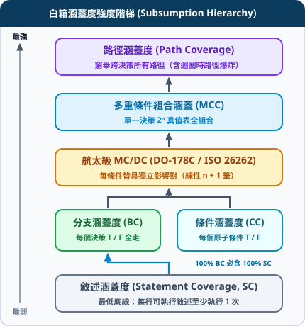
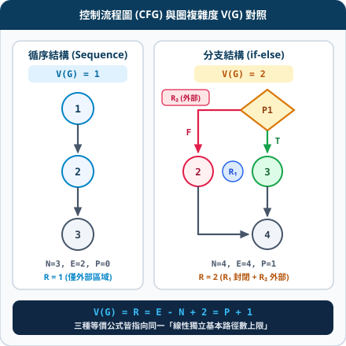
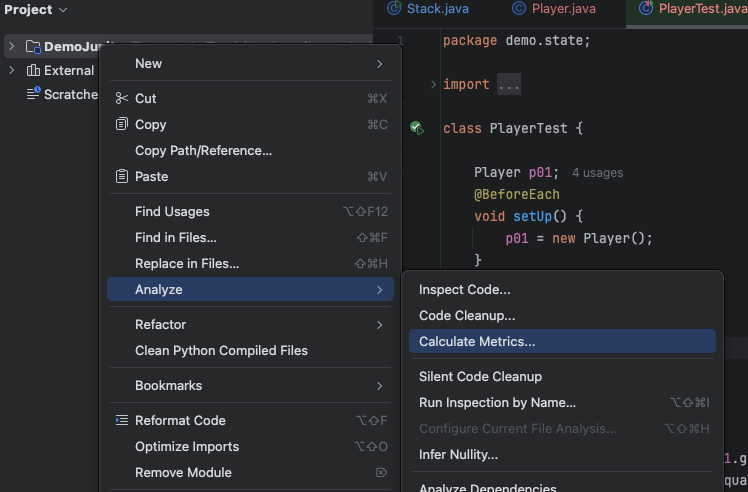
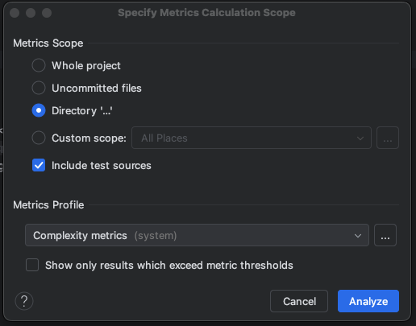
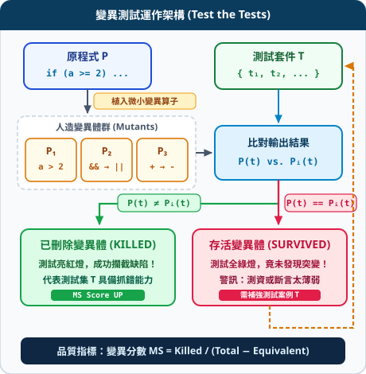
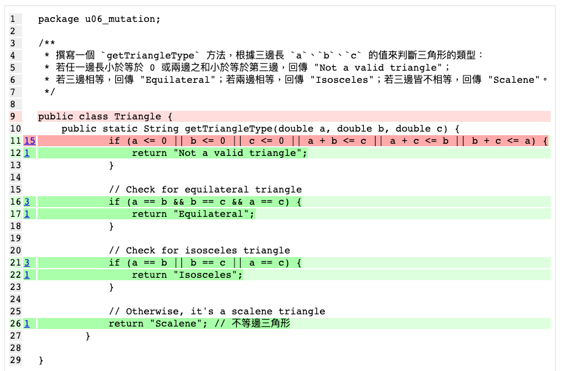
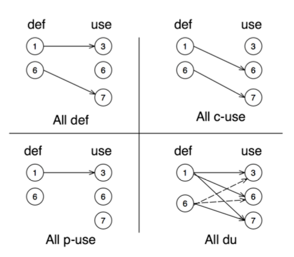

# 軟體品質與測試

### 第 6 章：白箱測試、控制流路徑分析與變異測試

授課教師：薛念林 教授

> 黑箱測試檢驗系統「做什麼」，白箱測試則是程式碼層級的顯微鏡——  
> 深入控制流、資料流與邏輯分支，度量每一行程式碼被驗證的深度。  
> 「100% 覆蓋率只是起點；唯有能殺死變異體的斷言，才是真正的品質防線。」

---

<!-- _class: outline-slide -->
<!-- header: '本章大綱 (Outline)' -->

## 本章重點導讀 (Key Highlights)

<div class="outline-columns">
<div>

### 🧭 涵蓋度階梯與工具插樁
- [**6.1 測試涵蓋度階梯與邏輯覆蓋 (Coverage Criteria)**](#3)：
  - 玻璃盒測試思維、黑箱 vs. 白箱雙軌協同、V-Model 定位
  - 敘述 (SC) ➔ 分支 (BC) ➔ 條件 (CC) ➔ 短路求值與 JaCoCo 分支計算解密 (CCQ 1)
  - 多重條件 (MCC)、路徑爆炸、**MC/DC (DO-178C / ISO 26262)** 推導 (CCQ 2)
  - 🧪 *實戰推演：`Triangle` 死分支之謎、`BinarySearch`、`BMI`、`LoanCalculator`*
- [**6.2 JaCoCo 動態插樁與涵蓋度度量 (Instrumentation)**](#26)：
  - 原始碼插樁 vs. 位元組碼動態插樁 (Java Agent) 與六大計數器 (CCQ 3)
  - Maven `pom.xml` 生命週期整合與 CI/CD 品質門檻 (`jacoco:check`) 自動阻斷

</div>
<div>

### 📐 結構路徑、變異測試與 AI 協同
- [**6.3 基本路徑測試與複雜度度量 (Basis Path)**](#32)：
  - 控制流程圖 (CFG) 四大基本結構與複合條件拆解
  - **McCabe 圈複雜度 V(G)** 三大公式、`computeAverage` 與 `NextDate` 完整推演 (CCQ 4)
  - 程式碼複雜度度量 (`v(G)` / `CogC` / `WMC`) 與互動式重構比較
- [**6.4 變異測試 (Mutation Testing — 測試你的測試)**](#46)：
  - 兩大理論假設 (CPH / Coupling Effect)、變異算子與 RIPR 模型
  - 變異得分 `MS = K / (M - E)` 與**等價變異體**辨析 (CCQ 5)
  - 🧪 *獵殺實戰：`TriangleMuTest`、`BinarySearch (bs02/bs03)`、`func(X,Y)` 與 PITest*
- [**6.5 AI 輔助白箱測試與實習導覽**](#64)：
  - 符號執行 (SMT/Z3)、覆蓋率引導 Fuzzing 與人機協同 SOP (CCQ 6)
- [**6.6 進階白箱技術補充：迴圈與資料流測試**](#69)：
  - 結構化迴圈測試 (7 點法) 與資料流測試 (`def / c-use / p-use`、三大異常)

</div>
</div>

---

<!-- _class: lead -->
<!-- header: '6.1 測試涵蓋度階梯與邏輯覆蓋' -->

# **6.1 測試涵蓋度階梯與邏輯覆蓋 (Coverage Criteria)**

> 「從最基礎的敘述涵蓋，一路攀升至波音與 NASA 採用的 MC/DC 航太標準；  
> 理解每一層涵蓋度的邏輯強度與邊界盲區，建立嚴密的白箱測試防線。」

---

<!-- header: '6.1 測試涵蓋度階梯 (Coverage Criteria)' -->

## 什麼是白箱測試 (White-Box Testing)？

<div class="card-deck">

> 💡 白箱測試（又稱結構測試 Structural Testing、玻璃盒測試 Glass-Box Testing）是在**完全透明掌握程式內部邏輯與結構**的前提下進行的測試。

<div class="two-columns">
<div class="card">

### 🔍 白箱測試的核心使命
- **透視內部工作機制**：
  - 直接針對原始碼的**陳述句 (Statements)**、**邏輯分支 (Branches)**、**布林條件 (Conditions)** 與**執行路徑 (Paths)** 設計測資。
- **量化測試充分性 (Test Adequacy)**：
  - 回答工程師最關鍵的問題：「*我們的測試套件到底走過了多少比例的程式碼？還有哪些角落從未被觸發？*」
- **揪出結構性暗疾**：
  - 捕捉永遠不會執行的死碼 (Dead Code)、考慮不周的 `else` 分支、邊界差一錯誤 (OBOB) 與變數未初始化風險。

</div>
<div class="card">

### ⚖️ 黑箱 (Ch05) vs. 白箱 (Ch06) 黃金互補
| 比較維度 | 黑箱測試 (Black-Box) | 白箱測試 (White-Box) |
| :--- | :--- | :--- |
| **設計依據** | 需求規格書 (SRS)、業務契約 | 原始碼結構、控制流圖 (CFG) |
| **核心焦點** | 驗證 **What** (外顯行為) | 驗證 **How** (內部實作路徑) |
| **最大優勢** | 能抓出「**遺漏的需求**」 | 能抓出「**未預期的隱藏分支/死碼**」 |
| **致命盲點** | 測不到規格未寫的內部邏輯 | **規格漏寫的功能，覆蓋率 100% 也測不出！** |
| **實務協同** | **先以黑箱 (EP/BVA) 設計基線測資** ➔ **再以白箱 (JaCoCo) 檢查漏網分支補彈！** |

</div>
</div>
</div>

---

<!-- header: '6.1 測試涵蓋度階梯 (Coverage Criteria)' -->

## 為什麼光靠黑箱或白箱都不夠？「規格 vs. 實作」四象限盲區

<div class="card-deck">

> 💡 軟體缺陷往往躲在「**規格要求 (Specification)**」與「**實際程式碼 (Implementation)**」不一致的夾縫中。

<div class="two-columns">
<div class="card">

### 📊 規格與實作的一致性四象限矩陣
| 象限情境 | 規格有定義？ | 程式有實作？ | 單靠黑箱測試 | 單靠白箱測試 |
| :--- | :---: | :---: | :---: | :---: |
| **1. 核心正常功能** | ✅ 有 | ✅ 有 | ✅ 可驗證 | ✅ 可覆蓋 |
| **2. 遺漏的需求**<br>(Missing Requirement) | ✅ **有** | ❌ **漏寫** | ✅ **一測就抓到！** | ❌ **100% 覆蓋也完全瞎掉！** |
| **3. 暗藏的多餘程式**<br>(Extra / Trojan Code) | ❌ **無** | ✅ **私自多寫** | ❌ **沒規格根本不會去測！** | ✅ **紅燈立刻暴行蹤！** |
| **4. 實作邊界小瑕疵**<br>(`>=` 誤寫為 `>`) | ✅ 有 | ⚠️ 實作偏差 | ⚠️ 隨機測資易漏抓 | ✅ **條件/變異測試精準鎖定** |

</div>
<div class="card">

### 🛡️ 雙劍合璧的標準工程策略 (Hybrid Strategy)
- **Step 1：黑箱先行（正向與邊界基線）**：
  - 根據需求規格書（SRS），運用 Ch05 的**等價分割 (EP)**、**邊界值分析 (BVA)** 與**決策表**設計第一波測試案例。
- **Step 2：白箱診斷（開啟覆蓋率顯微鏡）**：
  - 執行黑箱測試集並掛載 **JaCoCo**，檢查有哪些分支、異常處理或邊界條件呈現**紅色或黃色**。
- **Step 3：逆向補彈與清理死碼**：
  - 若未覆蓋分支屬於合法業務情境 ➔ **補充白箱測試案例**；
  - 若未覆蓋分支屬於永遠不可能發生的冗餘邏輯 ➔ **重構刪除死碼 (Dead Code)**！

</div>
</div>
</div>

---

<!-- header: '6.1 測試涵蓋度階梯 (Coverage Criteria)' -->

## 測試涵蓋度總覽與經典受測範例

<div class="card-deck">

> 💡 不同的涵蓋度標準（Coverage Criteria）代表不同等級的測試濾網密度。我們以經典雙判斷式程式貫穿比較：

<div class="content-columns">
<div class="content-text">

### 💻 課堂經典受測程式片段
```java
1: input A, B, X
2: if (A > 1) and (B == 0) then
3:     Y = A
4: if (A == 2) or (X > 1) then
5:     Y = X
6: print Y
```
- **2 個決策分支 (Decisions / Branches)**：
  - `D1`: `(A > 1) and (B == 0)` ｜ `D2`: `(A == 2) or (X > 1)`
- **4 個獨立條件 (Atomic Conditions)**：
  - `C1`: `A > 1`、`C2`: `B == 0`、`C3`: `A == 2`、`C4`: `X > 1`
- **強度階梯**：敘述 ➔ 分支/條件 ➔ MC/DC ➔ 多重條件 ➔ 路徑涵蓋。

</div>
<div class="content-figure">



</div>
</div>
</div>

---

<!-- header: '6.1 測試涵蓋度階梯 (Coverage Criteria)' -->

## 互動式白箱涵蓋度動態探索器：SC、BC、CC、B/CC、MC/DC 與 Path

<div class="wbc-interactive-stage" id="wbc-explorer">
<div class="wbc-nav-toolbar">
  <button type="button" class="wbc-mode-btn is-active" data-wbc="sc">1. 敘述涵蓋 (SC100)</button>
  <button type="button" class="wbc-mode-btn" data-wbc="bc">2. 分支涵蓋 (BC100)</button>
  <button type="button" class="wbc-mode-btn" data-wbc="cc">3. CC100 悖論 (BC=50%)</button>
  <button type="button" class="wbc-mode-btn" data-wbc="bcc">4. 分支/條件 (B/CC100)</button>
  <button type="button" class="wbc-mode-btn" data-wbc="mcdc">5. 航太級 MC/DC (n+1)</button>
  <button type="button" class="wbc-mode-btn" data-wbc="path">6. 路徑涵蓋 (Path100)</button>
</div>

<div class="wbc-content-grid">
<div class="wbc-left-card">
  <div class="wbc-code-cfg-row">
    <div class="wbc-code-panel">
      <div class="wbc-code-line" data-line="1"><span>1: input A, B, X</span><span class="wbc-cond-chip" id="wbc-l1-tag">入口</span></div>
      <div class="wbc-code-line" data-line="2"><span>2: if (A&gt;1) and (B==0)</span><span><span class="wbc-cond-chip" id="wbc-c1-chip">C1:--</span><span class="wbc-cond-chip" id="wbc-c2-chip">C2:--</span></span></div>
      <div class="wbc-code-line" data-line="3"><span>3: &nbsp;&nbsp;&nbsp;&nbsp;Y = A</span><span class="wbc-cond-chip" id="wbc-ec-chip">邊 c</span></div>
      <div class="wbc-code-line" data-line="4"><span>4: if (A==2) or (X&gt;1)</span><span><span class="wbc-cond-chip" id="wbc-c3-chip">C3:--</span><span class="wbc-cond-chip" id="wbc-c4-chip">C4:--</span></span></div>
      <div class="wbc-code-line" data-line="5"><span>5: &nbsp;&nbsp;&nbsp;&nbsp;Y = X</span><span class="wbc-cond-chip" id="wbc-ee-chip">邊 e</span></div>
      <div class="wbc-code-line" data-line="6"><span>6: print Y</span><span class="wbc-cond-chip" id="wbc-l6-tag">出口</span></div>
    </div>
    <div class="wbc-cfg-panel">
<svg xmlns="http://www.w3.org/2000/svg" viewBox="0 0 230 205" width="100%" height="100%">
<defs>
<marker id="wbc-arr-on" viewBox="0 0 10 10" refX="7" refY="5" markerWidth="5" markerHeight="5" orient="auto-start-reverse"><path d="M 0 1 L 9 5 L 0 9 z" fill="#16a34a"/></marker>
<marker id="wbc-arr-off" viewBox="0 0 10 10" refX="7" refY="5" markerWidth="5" markerHeight="5" orient="auto-start-reverse"><path d="M 0 1 L 9 5 L 0 9 z" fill="#cbd5e1"/></marker>
</defs>
<path id="wbc-edge-a" d="M 115 6 L 115 24" stroke="#16a34a" stroke-width="2.6" fill="none" marker-end="url(#wbc-arr-on)"/>
<text x="123" y="18" font-size="9.5" font-weight="800" fill="#0f172a">a</text>
<polygon id="wbc-node-d1" points="115,25 168,45 115,65 62,45" fill="#eff6ff" stroke="#0284c7" stroke-width="2"/>
<text x="115" y="48" font-size="9.5" font-weight="800" fill="#0b3c5d" text-anchor="middle">D1: C1 ∧ C2</text>
<path id="wbc-edge-c" d="M 168 45 L 195 45 L 195 75 L 115 103" stroke="#cbd5e1" stroke-width="2.4" fill="none" marker-end="url(#wbc-arr-off)"/>
<rect x="166" y="54" width="54" height="22" rx="4" fill="#f0fdf4" stroke="#16a34a" stroke-width="1.4" id="wbc-node-l3"/>
<text x="193" y="68" font-size="9" font-weight="800" fill="#166534" text-anchor="middle">L3: Y=A</text>
<text x="180" y="39" font-size="9" font-weight="800" fill="#15803d">c (T)</text>
<path id="wbc-edge-b" d="M 62 45 L 36 45 L 36 86 L 115 103" stroke="#cbd5e1" stroke-width="2.4" fill="none" marker-end="url(#wbc-arr-off)"/>
<text x="26" y="68" font-size="9" font-weight="800" fill="#be123c">b (F)</text>
<polygon id="wbc-node-d2" points="115,105 168,125 115,145 62,125" fill="#eff6ff" stroke="#0284c7" stroke-width="2"/>
<text x="115" y="128" font-size="9.5" font-weight="800" fill="#0b3c5d" text-anchor="middle">D2: C3 ∨ C4</text>
<path id="wbc-edge-e" d="M 168 125 L 195 125 L 195 155 L 115 182" stroke="#cbd5e1" stroke-width="2.4" fill="none" marker-end="url(#wbc-arr-off)"/>
<rect x="166" y="134" width="54" height="22" rx="4" fill="#f0fdf4" stroke="#16a34a" stroke-width="1.4" id="wbc-node-l5"/>
<text x="193" y="148" font-size="9" font-weight="800" fill="#166534" text-anchor="middle">L5: Y=X</text>
<text x="180" y="119" font-size="9" font-weight="800" fill="#15803d">e (T)</text>
<path id="wbc-edge-d" d="M 62 125 L 36 125 L 36 166 L 115 182" stroke="#cbd5e1" stroke-width="2.4" fill="none" marker-end="url(#wbc-arr-off)"/>
<text x="26" y="148" font-size="9" font-weight="800" fill="#be123c">d (F)</text>
<rect x="78" y="182" width="74" height="19" rx="4" fill="#e0f2fe" stroke="#0284c7" stroke-width="1.5"/>
<text x="115" y="195" font-size="9.5" font-weight="800" fill="#0369a1" text-anchor="middle">L6: print Y</text>
</svg>
    </div>
  </div>

  <div class="wbc-tc-section">
    <div class="wbc-tc-header">
      <span>點擊上方預設準則或手動點選下方測試向量 <code>(A, B, X)</code> 觀察動態變化：</span>
      <span id="wbc-active-tc-count" style="color: #0284c7;">已啟用：1 筆測資</span>
    </div>
    <div class="wbc-tc-grid">
      <div class="wbc-tc-pill is-active" data-tc="t1"><span>t₁(2, 0, 3)</span><span class="wbc-tc-tag">a-c-e</span></div>
      <div class="wbc-tc-pill" data-tc="t2"><span>t₂(1, 1, 1)</span><span class="wbc-tc-tag">a-b-d</span></div>
      <div class="wbc-tc-pill" data-tc="t3"><span>t₃(2, 1, 1)</span><span class="wbc-tc-tag">a-b-e</span></div>
      <div class="wbc-tc-pill" data-tc="t4"><span>t₄(1, 0, 2)</span><span class="wbc-tc-tag">a-b-e</span></div>
      <div class="wbc-tc-pill" data-tc="t5"><span>t₅(3, 0, 1)</span><span class="wbc-tc-tag">a-c-d</span></div>
      <div class="wbc-tc-pill" data-tc="t6"><span>t₆(3, 1, 1)</span><span class="wbc-tc-tag">a-b-d</span></div>
    </div>
  </div>

  <div class="wbc-meters-box">
    <div class="wbc-meter-row"><span>1. 敘述涵蓋 (SC)</span><div class="wbc-bar-bg"><div class="wbc-bar-fill" id="wbc-bar-sc"></div></div><span class="wbc-meter-val" id="wbc-val-sc">6/6 (100%)</span></div>
    <div class="wbc-meter-row"><span>2. 分支涵蓋 (BC)</span><div class="wbc-bar-bg"><div class="wbc-bar-fill" id="wbc-bar-bc"></div></div><span class="wbc-meter-val" id="wbc-val-bc">2/4 (50%)</span></div>
    <div class="wbc-meter-row"><span>3. 條件涵蓋 (CC)</span><div class="wbc-bar-bg"><div class="wbc-bar-fill" id="wbc-bar-cc"></div></div><span class="wbc-meter-val" id="wbc-val-cc">4/8 (50%)</span></div>
    <div class="wbc-meter-row"><span>4. MC/DC 獨立配對</span><div class="wbc-bar-bg"><div class="wbc-bar-fill" id="wbc-bar-mcdc"></div></div><span class="wbc-meter-val" id="wbc-val-mcdc">0/4 (0%)</span></div>
    <div class="wbc-meter-row"><span>5. 路徑涵蓋 (Path)</span><div class="wbc-bar-bg"><div class="wbc-bar-fill" id="wbc-bar-path"></div></div><span class="wbc-meter-val" id="wbc-val-path">1/4 (25%)</span></div>
  </div>
</div>

<div class="wbc-right-card">
  <div>
    <span class="ep-badge-pill ep-badge-green" id="wbc-mode-badge">最薄弱基線 • 僅需 1 筆測資</span>
    <h3 class="ep-title-text" id="wbc-mode-title" style="font-size: 17px; margin-top: 2px;">1. 敘述涵蓋度 (Statement Coverage, SC = 100%)</h3>
  </div>
  <div class="ep-stats-row" style="margin: 6px 0;">
    <div class="ep-stat-box" style="padding: 6px 10px;">
      <div class="ep-stat-label">涵蓋準則目標</div>
      <div class="ep-stat-val" id="wbc-stat-formula" style="font-size: 16px;">每行指令皆執行過</div>
    </div>
    <div class="ep-stat-box" style="padding: 6px 10px;">
      <div class="ep-stat-label">已涵蓋路徑</div>
      <div class="ep-stat-val" id="wbc-stat-paths" style="font-size: 16px;">a-c-e (1/4)</div>
    </div>
  </div>
  <ul class="ep-details-list" id="wbc-details-list" style="font-size: 12.6px; line-height: 1.42; flex: 1;">
    <li><strong>僅憑 1 筆測資達成 100% SC：</strong> <code>t₁(2, 0, 3)</code> 使 <code>D1=True</code>（執行第 3 行）且 <code>D2=True</code>（執行第 5 行），6 行程式碼全數亮綠燈！</li>
    <li><strong>為何 SC100 極度脆弱：</strong> 控制流圖上的 False 分支邊 <code>b</code> 與邊 <code>d</code> 完全未被測試（<strong>BC 僅 50%</strong>）。</li>
    <li><strong>隱藏缺陷遮蔽盲區：</strong> 若第 3 行有 Bug（如誤寫 <code>Y = 999</code>），沿路徑 <code>a-c-e</code> 走到第 5 行時會立刻被 <code>Y = X</code> 覆寫而漏抓！</li>
  </ul>
  <div id="wbc-diag-banner" style="padding: 7px 10px; border-radius: 8px; background: #fffbeb; border: 1.4px solid #f59e0b; color: #92400e; font-size: 11.8px; font-weight: 700; line-height: 1.35;">
    💡 互動診斷提示：點擊上方「2. 分支涵蓋 (BC100)」或「3. CC100 悖論」按鈕，即時觀察條件涵蓋與分支涵蓋的分歧！
  </div>
</div>
</div>
</div>

<!--
這座互動式白箱涵蓋度探索器讓學習者可一鍵切換 6 種結構化涵蓋度準則（敘述 SC、分支 BC、條件 CC 悖論、分支/條件 B/CC、航太級 MC/DC 與全路徑 Path），或手動點選個別測試案例 t1..t6，即時觀察左側程式碼行顏色、控制流圖（CFG）分支邊 a..e、原子條件真假值標籤 C1..C4 以及下方五條涵蓋度進度條的連動變化。
-->

---

<!-- header: '6.1 測試涵蓋度階梯 (Coverage Criteria)' -->

## 6.1.1 敘述涵蓋度 (Statement Coverage, SC)

<div class="card-deck">

> 💡 **定義**：設計測試案例，使程式中的**每一條可執行指令敘述（Executable Statement）至少被執行一次**。

<div class="two-columns">
<div class="card">

### 🎯 達成 100% 敘述涵蓋只需 1 筆測資
```java
1: input A, B, X
2: if (A > 1) and (B == 0) then
3:     Y = A          // 需進入此行
4: if (A == 2) or (X > 1) then
5:     Y = X          // 需進入此行
6: print Y
```
- **測試案例**：取 **`(A, B, X) = (2, 0, 3)`**
  - 第 2 行：`(2 > 1) and (0 == 0)` 為 True ➔ 執行第 3 行 `Y = 2`。
  - 第 4 行：`(2 == 2) or (3 > 1)` 為 True ➔ 執行第 5 行 `Y = 3`。
  - 第 6 行：印出 `Y = 3`。
  - **結果**：第 1～6 行全部執行過，**Statement Coverage = 100%！**

</div>
<div class="card">

### ⚠️ 為什麼敘述涵蓋度是最弱的標準？
即便達成 **100% 敘述涵蓋**，若程式存在以下嚴重 Bug，測資 `(2, 0, 3)` **完全抓不出來**（輸出依然是 `3`）：
- ❌ **錯誤 1**：第 2 行把 `and` 誤寫成 `or`。
- ❌ **錯誤 2**：第 3 行 `Y = A` 誤寫成 `Y = 999`（因為馬上被第 5 行 `Y = X` 覆寫遮蔽了！）。
- ❌ **錯誤 3**：第 4 行把 `X > 1` 誤寫成 `X > 0`。
- 📌 **工程結論**：
  - 敘述涵蓋完全沒有測試「判斷為 False（不進入 `if`）」的隱含空分支。它是白箱測試的**最低底線**，絕非安全終點！

</div>
</div>
</div>

---

<!-- header: '6.1 測試涵蓋度階梯 (Coverage Criteria)' -->

## 6.1.2 分支涵蓋度 (Branch / Decision Coverage, BC)

<div class="card-deck">

> 💡 **定義**：又稱決策涵蓋度（Decision Coverage），要求程式中**每一個判斷式（Decision）的 True 分支與 False 分支都至少執行一次**。

<div class="two-columns">
<div class="card">

### 📊 雙分支真假覆蓋設計
- 待測程式有兩個決策點：
  - `D1`: `(A > 1) AND (B == 0)`
  - `D2`: `(A == 2) OR (X > 1)`
- 設計 **2 組測試資料** 即可讓兩個決策都經歷 True 與 False：

| 測試案例 `(A, B, X)` | `D1: (A>1) AND (B=0)` | `D2: (A=2) OR (X>1)` | 執行路徑 |
| :---: | :---: | :---: | :---: |
| **`t1 = (3, 0, 3)`** | **True** ✅ | **True** ✅ | `a ➔ c ➔ e` |
| **`t2 = (2, 1, 1)`** 或 **`(3, 1, 1)`** | **False** ✅ (`(3,1,1)`) | **False** ✅ (`(3,1,1)`) | `a ➔ b ➔ d` |

</div>
<div class="card">

### 🔍 分支涵蓋的特性與盲點
- **涵蓋關係定理**：
  - **100% 分支涵蓋度 ➔ 必然保證 100% 敘述涵蓋度**（反之不成立）。
- **分支涵蓋仍有的盲區**：
  - 複合條件內部可能只有單一子條件主導結果。
  - 例如在 `t1=(3,0,3)` 與 `t2=(3,1,1)` 中：
    - 第一個條件 `A > 1` 在兩筆測資中**永遠都是 True**（`3 > 1`）！
    - 第二個決策中的 `A == 2` 在兩筆測資中**永遠都是 False**（`3 != 2`）！
  - 若工程師把 `A == 2` 誤寫成 `A == 99`，這組 100% 分支覆蓋的測資依然無法發現錯誤！

</div>
</div>
</div>

---

<!-- header: '6.1 測試涵蓋度階梯 (Coverage Criteria)' -->

## 6.1.3 條件涵蓋度 (Condition Coverage, CC)

<div class="card-deck">

> 💡 **定義**：聚焦於決策式內部的「個別原子條件（Atomic Condition）」，要求**每個個別布林條件的 True 與 False 都至少被評估一次**。

<div class="two-columns">
<div class="card">

### 🧩 拆解 4 個原子條件與 8 種真假狀態
- `D1`: `c1 (A > 1)`、`c2 (B == 0)`
- `D2`: `c3 (A == 2)`、`c4 (X > 1)`
- 欲使 4 個條件皆經歷 T 與 F（共 8 個目標）：
  - `(1) A > 1, (2) A <= 1` ｜ `(3) B == 0, (4) B != 0`
  - `(5) A == 2, (6) A != 2` ｜ `(7) X > 1,  (8) X <= 1`
- **僅需 2 筆測資即可達成 100% 條件涵蓋**：
  - **`t1 = (2, 0, 3)`** ➔ 滿足 `c1=T, c2=T, c3=T, c4=T`
  - **`t2 = (1, 1, 1)`** ➔ 滿足 `c1=F, c2=F, c3=F, c4=F`

</div>
<div class="card">

### ⚠️ 關鍵陷阱：100% 條件涵蓋 ≠ 100% 分支涵蓋！
考慮判斷式 `if (p && q)`（非短路求值下）：

| 測試案例 | 條件 `p` | 條件 `q` | 決策結果 `p && q` |
| :---: | :---: | :---: | :---: |
| **`t1`** | **True** | **False** | **False** |
| **`t2`** | **False** | **True** | **False** |

- **驚人發現**：
  - 條件 `p` 有 T 有 F ✅；條件 `q` 有 F 有 T ✅ ➔ **條件涵蓋度 = 100%**！
  - 但整個決策 `p && q` 的結果**永遠是 False** ❌ ➔ **分支涵蓋度只有 50%**（甚至連 `if` 內部的敘述都沒執行到，**SC 也未達 100%**）！

</div>
</div>
</div>

---

<!-- header: '6.1 測試涵蓋度階梯 (Coverage Criteria)' -->

## 短路求值 (Short-Circuit) 與 JaCoCo 實務分支計算差異

<div class="card-deck">

> 💡 在 Java 等語言中，`&&` 與 `||` 採用**短路求值（Short-circuit evaluation）**，若 100% 條件涵蓋，則必然 100% 分支涵蓋！

<div class="two-columns">
<div class="card">

### ⚡ 短路求值如何影響條件涵蓋？
- 在 `if (p && q)` 中，當 **`p` 為 False** 時，CPU **根本不會去計算 `q` 的值**（直接跳過短路）！

| 測試案例 | 條件 `p` | 條件 `q` (實際執行) | 決策 `p && q` |
| :---: | :---: | :---: | :---: |
| **`t1`** | **True** | **False** | **False** |
| **`t2`** | **False** | **`x` (被短路未執行!)** | **False** |
| **`t3`** | **True** | **True** | **True** |

- **重要定理**：在短路求值下，若要真正讓 `q` 被執行並測到 True 與 False，前提是 `p` 必須為 True；這將連帶迫使 `p && q` 經歷 True 與 False！
- 因此：**短路求值下若達成 100% 條件涵蓋，必同時滿足 100% 分支涵蓋**！

</div>
<div class="card">

### ⚙️ JaCoCo「75% 部分分支覆蓋 (3/4)」解密
- **造成 3/4 的典型測試資料**（針對 `if (A && B)`）：
  - **`t1 = (A=T, B=T)`** ➔ 進入 `if`（整體 **True**）
  - **`t2 = (A=F, B=任意)`** ➔ **`A=F` 短路跳過 `B`**（整體 **False**）
- **為何學術達 100% BC，JaCoCo 卻顯示 3/4 (75%)？**
  - Bytecode 將 `A && B` 拆成 `IFEQ A`、`IFEQ B` 共 **4 個分支**。
  - `t1, t2` 讓 `A` 走完 T/F (2/2)、`B` 只走 T (1/2)，**缺 `B=F`**（須補 **`t3 = (T, F)`** 才達 4/4 全綠）！

</div>
</div>
</div>

---

<!-- header: '6.1 測試涵蓋度階梯 (Coverage Criteria)' -->

## 概念核對問答 (CCQ 1)

<div class="ccq-columns">
<div class="ccq-text">

<!-- id: sqa-ch06-ccq2 -->
**問題情境**：  
在包含短路求值 (Short-circuit evaluation) 的條件句 `if (A && B)` 中，若我們設計的測試案例集達到了學術定義的 **100% 分支涵蓋度 (Decision Coverage，即整個 `if` 經歷過 True 與 False)**，是否必定能達成 **100% 條件涵蓋度 (Condition Coverage)**？

- **A)** 必定可以，因為分支涵蓋度的邏輯強度高於條件涵蓋度
- **B)** 不一定，因為短路求值可能使第二個條件 B 在 False 分支案例中被跳過未執行，導致其 False 狀態未被覆蓋
- **C)** 必定不可以，因為兩者沒有任何邏輯交集關係
- **D)** 完全取決於作業系統排程，與短路求值無關

</div>
<div class="ccq-logo">

<a href="https://nlhsueh.github.io/nickedupocket/#/student/sqa-ch06-ccq2" target="_blank"></a>

</div>
</div>

---

<!-- header: '6.1 測試涵蓋度階梯 (Coverage Criteria)' -->

## 6.1.4 分支與條件涵蓋 ＆ 課堂推演實戰

<div class="card-deck">

> 💡 **分支與條件涵蓋度 (Branch/Condition Coverage, B/CC)**：同時要求每個原子條件經歷 T/F，且每個整體決策也經歷 T/F。

<div class="two-columns">
<div class="card">

### 💻 課堂推演挑戰：雙重條件判斷式
```java
1: read(X, Y)
2: if ((X > 10) && (Y == 1))  // c1: X>10, c2: Y==1, b1: c1&&c2
3:     X = 1;
4: else if ((X - Y) < 2)      // c3 (b2): (X-Y) < 2
5:     X = 2;
6: if (Y > 10)                // c4 (b3): Y > 10
7:     X = 3;
8: print X
```
- **目標 1：達成 100% 敘述涵蓋 (SC100)**：
  - 需進入第 3, 5, 7 行：取 **`(X=11, Y=1)`**（進第 3 行）與 **`(X=12, Y=11)`**（進第 5, 7 行）即可達成！

</div>
<div class="card">

### 📊 目標 2 & 3：CC100 vs. BC100 對比表
- **滿足 CC100 但不滿足 BC100**（`b1` 永遠為 False）：

| `X` | `Y` | `c1 (X>10)` | `c2 (Y==1)` | `b1 (c1&&c2)` | `c3 / b2` | `c4 / b3` |
| :---: | :---: | :---: | :---: | :---: | :---: | :---: |
| **9** | **1** | F | T | **_F_** | F (`8<2`) | F |
| **12** | **11** | T | F | **_F_** | T (`1<2`) | T |

- **滿足 BC100 但不滿足 CC100**（`c1` 永遠為 True）：

| `X` | `Y` | `c1 (X>10)` | `c2 (Y==1)` | `b1 (c1&&c2)` | `c3 / b2` | `c4 / b3` |
| :---: | :---: | :---: | :---: | :---: | :---: | :---: |
| **13** | **1** | **_T_** | T | **T** | - | F |
| **12** | **11** | **_T_** | F | **F** | T | T |
| **12** | **2** | **_T_** | F | **F** | F | F |

</div>
</div>
</div>

---

<!-- header: '6.1 測試涵蓋度階梯 (Coverage Criteria)' -->

## 6.1.5 多重條件組合涵蓋 (MCC) 與 6.1.6 路徑涵蓋 (Path Coverage)

<div class="card-deck">

> 💡 當我們要求窮舉單一決策內的所有條件真值表組合（MCC），或窮舉跨決策的所有路徑組合（Path Coverage）時，測試成本將急遽上升。

<div class="two-columns">
<div class="card">

### 🧮 多重條件組合涵蓋 (Multiple Condition, MCC)
- **定義**：每個決策內部的 n 個原子條件，其 **2<sup>n</sup> 種真值表組合**皆須測試。
- 以課堂程式為例：
  - `D1: (A>1) and (B=0)` 有 2<sup>2</sup> = 4 種組合：`(T,T), (T,F), (F,T), (F,F)`。
  - `D2: (A=2) or (X>1)` 也有 2<sup>2</sup> = 4 種組合。
- **配對壓縮後需 4 組測資**：
  - `(2, 0, 4)` ➔ 滿足 `D1(T,T)` 與 `D2(T,T)`
  - `(2, 1, 1)` ➔ 滿足 `D1(T,F)` 與 `D2(T,F)`
  - `(1, 0, 2)` ➔ 滿足 `D1(F,T)` 與 `D2(F,T)`
  - `(1, 1, 1)` ➔ 滿足 `D1(F,F)` 與 `D2(F,F)`

</div>
<div class="card">

### 🛣️ 路徑涵蓋度 (Path Coverage) 與路徑爆炸
- 即使上述 4 組測資達成了 **100% MCC**，觀察流程圖路徑：
  - `(2, 0, 4)` 走 **`a - c - e`**
  - `(2, 1, 1)` 與 `(1, 0, 2)` 皆走 **`a - b - e`**
  - `(1, 1, 1)` 走 **`a - b - d`**
  - ⚠️ **漏掉了路徑 `a - c - d`**（需補測資如 `(3, 0, 1)`）！
- **迴圈導致的路徑組合爆炸**：
  - 若程式包含一個執行 20 次的迴圈，且迴圈內有 4 條分支路徑，總路徑數高達 **4<sup>20</sup> = 2<sup>40</sup> ≈ 1.1 × 10<sup>12</sup>（一兆條路徑）**！因此實務上不可能執行 All-Path 窮盡測試。

</div>
</div>
</div>

---

<!-- header: '6.1 測試涵蓋度階梯 (Coverage Criteria)' -->

## 6.1.7 航太安全關鍵標準：MC/DC 涵蓋度 (DO-178C Level A)

<div class="card-deck">

> 💡 **MC/DC (Modified Condition/Decision Coverage，修改條件/決策涵蓋)**：波音、空中巴士飛控系統（DO-178B/C Level A）與車用電子（ISO 26262 ASIL D）強制要求的最高白箱標準！

<div class="two-columns">
<div class="card">

### ✈️ 為什麼需要 MC/DC？
- **痛點**：若一個飛控判斷式包含 6 個條件 `if (C1 && C2 && ... && C6)`：
  - **多重條件組合 (MCC)** 需要 **2<sup>6</sup> = 64 組**測試（若 10 個條件則需 1,024 組），成本過高。
  - **一般分支/條件涵蓋** 又太弱，無法防止條件之間的遮蔽效應（Masking Effect）。
- **MC/DC 的革命性突破**：
  - 要求證明「**每一個原子條件 C<sub>i</sub> 都能獨立影響整個決策的最終結果**」！
  - 測試案例數從指數級 **2<sup>n</sup>** 奇蹟般壓縮為線性級的 **`n + 1`（最少 `n + 1` 個，最多 `2n` 個）**！

</div>
<div class="card">

### 📏 MC/DC 的四大核心構成要件
1. **敘述與分支涵蓋**：每個決策的 True 與 False 結果都至少出現一次。
2. **條件涵蓋**：決策中的每個條件 C<sub>i</sub> 都曾取過 True 與 False。
3. **獨立影響對 (Independence Pair) —— 核心靈魂**：
   - 對於決策中的**每一個條件 C<sub>i</sub>**，都必須在測試集中找到**一對測試案例 (Test Pair)**：
     - 📌 **唯一變因**：在這對案例中，**只有 C<sub>i</sub> 的真假值翻轉（T ↔ F），其餘所有條件的值保持固定不變**；
     - 📌 **結果翻轉**：同時，**整個決策的最終輸出結果也隨之翻轉（T ↔ F）**！

</div>
</div>
</div>

---

<!-- header: '6.1 測試涵蓋度階梯 (Coverage Criteria)' -->

## MC/DC 實戰推演 (1)：真值表與獨立影響對挑選

<div class="card-deck">

> 💡 **實戰演練**：針對飛機自動降落系統決策 `Decision = (A or B) and C`（共 n = 3 個條件，全真值表有 2<sup>3</sup> = 8 列），請找出最少組數（`3 + 1 = 4 組`）的 MC/DC 測試集！

| 編號 | 條件 `A` | 條件 `B` | 條件 `C` | 決策 `(A \|\| B) && C` | MC/DC 選取狀態與配對角色解析 |
| :---: | :---: | :---: | :---: | :---: | :--- |
| #1 | F | F | F | F | 未選（`C = F` 將 `(A \|\| B)` 整組短路遮蔽） |
| **#2** | **F** | **F** | **T** | **F** | ✅ **入選 (1/4)**：與 **#4** 配對檢驗 `B`；與 **#6** 配對檢驗 `A` |
| #3 | F | T | F | F | 未選（可用 #5 取代以檢驗 `C`） |
| **#4** | **F** | **T** | **T** | **T** | ✅ **入選 (2/4)**：基準案例（讓 `B = T` 與 `C = T` 獨立生效） |
| **#5** | **T** | **F** | **F** | **F** | ✅ **入選 (3/4)**：與 **#6** 配對檢驗 `C` |
| **#6** | **T** | **F** | **T** | **T** | ✅ **入選 (4/4)**：基準案例（讓 `A = T` 與 `C = T` 獨立生效） |
| #7 | T | T | F | F | 未選（`A` 與 `B` 同時為 T，單獨翻轉其中一個無法改變 `(A \|\| B)`） |
| #8 | T | T | T | T | 未選（`A` 與 `B` 同時為 T，互相遮蔽！） |

</div>

---

<!-- header: '6.1 測試涵蓋度階梯 (Coverage Criteria)' -->

## MC/DC 實戰推演 (2)：逐一檢驗三個條件的獨立影響對

<div class="card-deck">

> 💡 驗證從真值表挑出的 **4 組測資 `{#2, #4, #5, #6}`**，是否能讓 `A`、`B`、`C` 各自擁有「固定其他條件、單獨翻轉決策結果」的獨立影響對 (Independence Pairs)！

<div class="two-columns">
<div class="card">

### 🔍 條件 `A` 與條件 `B` 的獨立影響對檢驗
- **1. 檢驗條件 `A` ➔ 配對 `(#2, #6)`**：
  - **`#2`**：`(A=F, B=F, C=T)` ➔ `Decision = F`
  - **`#6`**：`(A=T, B=F, C=T)` ➔ `Decision = T`
  - **證明**：固定 `B = F` 且 `C = T` 不變，**僅單獨翻轉 `A` (`F ➔ T`)**，總決策即隨之翻轉 (`F ➔ T`)！✅
- **2. 檢驗條件 `B` ➔ 配對 `(#2, #4)`**：
  - **`#2`**：`(A=F, B=F, C=T)` ➔ `Decision = F`
  - **`#4`**：`(A=F, B=T, C=T)` ➔ `Decision = T`
  - **證明**：固定 `A = F` 且 `C = T` 不變，**僅單獨翻轉 `B` (`F ➔ T`)**，總決策即隨之翻轉 (`F ➔ T`)！✅

</div>
<div class="card">

### 🔍 條件 `C` 的獨立影響對檢驗與總結
- **3. 檢驗條件 `C` ➔ 配對 `(#5, #6)`**：
  - **`#5`**：`(A=T, B=F, C=F)` ➔ `Decision = F`
  - **`#6`**：`(A=T, B=F, C=T)` ➔ `Decision = T`
  - **證明**：固定 `A = T` 且 `B = F` 不變，**僅單獨翻轉 `C` (`F ➔ T`)**，總決策即隨之翻轉 (`F ➔ T`)！✅
- **🏆 關鍵工程結論**：
  - 藉由讓 **`#2`** 與 **`#6`** 同時充當兩組配對的共用基準點，原本需要 `2^3 = 8` 組的多重條件測試，**僅需 `n + 1 = 4` 組 `{#2, #4, #5, #6}`** 即 100% 證明三個條件皆能獨立影響決策！

</div>
</div>
</div>

---

<!-- header: '6.1 測試涵蓋度階梯 (Coverage Criteria)' -->

## 國際功能安全法規標準：DO-178C (航太) 與 ISO 26262 (車規)

<div class="card-deck">

> 💡 在人命關天的安全關鍵系統（Safety-Critical Systems）中，你寫的軟體若沒達到法規指定的白箱覆蓋率，飛機不能起飛、電動車不能上市！

<div class="two-columns">
<div class="card">

### ✈️ 航太與車用功能安全等級對照表
| 安全失效後果 | 航太 DO-178C 等級 | 車用 ISO 26262 等級 | 強制要求之白箱覆蓋標準 |
| :--- | :---: | :---: | :--- |
| **災難性 (Catastrophic)**<br>機毀人亡 / 轉向煞車失控 | **DAL A** | **ASIL D** | **100% SC + 100% BC + 100% MC/DC** 🏆 |
| **危險/嚴重 (Hazardous)**<br>重傷或關鍵系統失效 | **DAL B** | **ASIL C** | **100% SC + 100% BC** (車規高度建議 MC/DC) |
| **主要 (Major)**<br>系統功能降級或輕傷 | **DAL C** | **ASIL B / A** | **100% SC** (車規 ASIL B 要求 100% BC) |
| **輕微/無影響 (Minor)** | **DAL D / E** | **QM** | 無強制結構覆蓋要求 |

</div>
<div class="card">

### 🔬 Unique-Cause vs. Masking MC/DC
- **1. 唯一原因型 (Unique-Cause MC/DC)**：
  - 經典定義：測試對中**嚴格只允許待測條件 C<sub>i</sub> 翻轉**，其他條件字面值完全固定不變。
  - 痛點：當同一個變數在決策中出現兩次（**耦合條件 Coupled Conditions**，如 `(A && B) || (!A && C)`）時，改變 `A` 必然同時改變 `!A`，無法構造 Unique-Cause 配對！
- **2. 遮蔽型 (Masking MC/DC)**：
  - 工程界與 FAA 認證認可的廣義標準：只要讓其他子表達式被短路或邏輯遮蔽（不會影響最終輸出），即允許耦合條件翻轉，解決了重複變數無法配對的難題！

</div>
</div>
</div>

---

<!-- header: '6.1 測試涵蓋度階梯 (Coverage Criteria)' -->

## 互動實作練習：自行設計測資 `(x, y, z)` 挑戰五大白箱涵蓋度

<div class="wbp-interactive-stage" id="wbp-practice">
<div class="wbc-nav-toolbar">
  <button type="button" class="wbc-mode-btn is-active" data-wbp="sc">任務 1：SC 100% (1筆)</button>
  <button type="button" class="wbc-mode-btn" data-wbp="bc">任務 2：BC 100% (2筆)</button>
  <button type="button" class="wbc-mode-btn" data-wbp="bcc">任務 3：B/CC 100%</button>
  <button type="button" class="wbc-mode-btn" data-wbp="mcdc">任務 4：MC/DC 100%</button>
  <button type="button" class="wbc-mode-btn" data-wbp="path">任務 5：Path 100% (4路徑)</button>
</div>

<div class="wbc-content-grid">
<div class="wbc-left-card">
  <div class="wbc-code-cfg-row" style="height: 205px;">
    <div class="wbc-code-panel">
      <div class="wbc-code-line" data-pline="1"><span>1: int bonus = 0;</span><span class="wbc-cond-chip">入口</span></div>
      <div class="wbc-code-line" data-pline="2"><span>2: if (x&gt;10 &amp;&amp; y==1)</span><span><span class="wbc-cond-chip" id="wbp-c1-chip">C1:--</span><span class="wbc-cond-chip" id="wbp-c2-chip">C2:--</span></span></div>
      <div class="wbc-code-line" data-pline="3"><span>3: &nbsp;&nbsp;&nbsp;&nbsp;bonus += 100;</span><span class="wbc-cond-chip">邊 c</span></div>
      <div class="wbc-code-line" data-pline="4"><span>4: if (x==20 || z&lt;0)</span><span><span class="wbc-cond-chip" id="wbp-c3-chip">C3:--</span><span class="wbc-cond-chip" id="wbp-c4-chip">C4:--</span></span></div>
      <div class="wbc-code-line" data-pline="5"><span>5: &nbsp;&nbsp;&nbsp;&nbsp;bonus += 50;</span><span class="wbc-cond-chip">邊 e</span></div>
      <div class="wbc-code-line" data-pline="6"><span>6: return bonus;</span><span class="wbc-cond-chip">出口</span></div>
    </div>
    <div class="wbc-cfg-panel">
<svg xmlns="http://www.w3.org/2000/svg" viewBox="0 0 230 205" width="100%" height="100%">
<defs>
<marker id="wbp-arr-on" viewBox="0 0 10 10" refX="7" refY="5" markerWidth="5" markerHeight="5" orient="auto-start-reverse"><path d="M 0 1 L 9 5 L 0 9 z" fill="#16a34a"/></marker>
<marker id="wbp-arr-off" viewBox="0 0 10 10" refX="7" refY="5" markerWidth="5" markerHeight="5" orient="auto-start-reverse"><path d="M 0 1 L 9 5 L 0 9 z" fill="#cbd5e1"/></marker>
</defs>
<path id="wbp-edge-a" d="M 115 6 L 115 24" stroke="#cbd5e1" stroke-width="2.4" fill="none" marker-end="url(#wbp-arr-off)"/>
<text x="123" y="18" font-size="9.5" font-weight="800" fill="#0f172a">a</text>
<polygon points="115,25 168,45 115,65 62,45" fill="#eff6ff" stroke="#0284c7" stroke-width="2"/>
<text x="115" y="48" font-size="9.5" font-weight="800" fill="#0b3c5d" text-anchor="middle">D1: C1 ∧ C2</text>
<path id="wbp-edge-c" d="M 168 45 L 195 45 L 195 75 L 115 103" stroke="#cbd5e1" stroke-width="2.4" fill="none" marker-end="url(#wbp-arr-off)"/>
<rect x="163" y="54" width="60" height="22" rx="4" fill="#f8fafc" stroke="#16a34a" stroke-width="1.4" id="wbp-node-l3"/>
<text x="193" y="68" font-size="8.8" font-weight="800" fill="#166534" text-anchor="middle">+100 (L3)</text>
<text x="180" y="39" font-size="9" font-weight="800" fill="#15803d">c (T)</text>
<path id="wbp-edge-b" d="M 62 45 L 36 45 L 36 86 L 115 103" stroke="#cbd5e1" stroke-width="2.4" fill="none" marker-end="url(#wbp-arr-off)"/>
<text x="26" y="68" font-size="9" font-weight="800" fill="#be123c">b (F)</text>
<polygon points="115,105 168,125 115,145 62,125" fill="#eff6ff" stroke="#0284c7" stroke-width="2"/>
<text x="115" y="128" font-size="9.5" font-weight="800" fill="#0b3c5d" text-anchor="middle">D2: C3 ∨ C4</text>
<path id="wbp-edge-e" d="M 168 125 L 195 125 L 195 155 L 115 182" stroke="#cbd5e1" stroke-width="2.4" fill="none" marker-end="url(#wbp-arr-off)"/>
<rect x="163" y="134" width="60" height="22" rx="4" fill="#f8fafc" stroke="#16a34a" stroke-width="1.4" id="wbp-node-l5"/>
<text x="193" y="148" font-size="8.8" font-weight="800" fill="#166534" text-anchor="middle">+50 (L5)</text>
<text x="180" y="119" font-size="9" font-weight="800" fill="#15803d">e (T)</text>
<path id="wbp-edge-d" d="M 62 125 L 36 125 L 36 166 L 115 182" stroke="#cbd5e1" stroke-width="2.4" fill="none" marker-end="url(#wbp-arr-off)"/>
<text x="26" y="148" font-size="9" font-weight="800" fill="#be123c">d (F)</text>
<rect x="74" y="182" width="82" height="19" rx="4" fill="#e0f2fe" stroke="#0284c7" stroke-width="1.5"/>
<text x="115" y="195" font-size="9.2" font-weight="800" fill="#0369a1" text-anchor="middle">return bonus</text>
</svg>
    </div>
  </div>

  <div class="wbp-input-bar">
    <label class="wbp-field">x=<input type="number" id="wbp-in-x" value="20" /></label>
    <label class="wbp-field">y=<input type="number" id="wbp-in-y" value="1" /></label>
    <label class="wbp-field">z=<input type="number" id="wbp-in-z" value="5" /></label>
    <button type="button" class="wbp-action-btn is-primary" id="wbp-btn-add">＋ 加入測資</button>
    <button type="button" class="wbp-action-btn" id="wbp-btn-clear">清空</button>
    <button type="button" class="wbp-action-btn is-hint" id="wbp-btn-solve">參考解答</button>
  </div>

  <div class="wbc-meters-box" style="padding: 7px 10px; gap: 5px;">
    <div class="wbc-meter-row"><span>1. 敘述涵蓋 (SC)</span><div class="wbc-bar-bg"><div class="wbc-bar-fill" id="wbp-bar-sc"></div></div><span class="wbc-meter-val" id="wbp-val-sc">0/6 (0%)</span></div>
    <div class="wbc-meter-row"><span>2. 分支涵蓋 (BC)</span><div class="wbc-bar-bg"><div class="wbc-bar-fill" id="wbp-bar-bc"></div></div><span class="wbc-meter-val" id="wbp-val-bc">0/4 (0%)</span></div>
    <div class="wbc-meter-row"><span>3. 條件涵蓋 (CC)</span><div class="wbc-bar-bg"><div class="wbc-bar-fill" id="wbp-bar-cc"></div></div><span class="wbc-meter-val" id="wbp-val-cc">0/8 (0%)</span></div>
    <div class="wbc-meter-row"><span>4. MC/DC 獨立配對</span><div class="wbc-bar-bg"><div class="wbc-bar-fill" id="wbp-bar-mcdc"></div></div><span class="wbc-meter-val" id="wbp-val-mcdc">0/4 (0%)</span></div>
    <div class="wbc-meter-row"><span>5. 路徑涵蓋 (Path)</span><div class="wbc-bar-bg"><div class="wbc-bar-fill" id="wbp-bar-path"></div></div><span class="wbc-meter-val" id="wbp-val-path">0/4 (0%)</span></div>
  </div>
</div>

<div class="wbc-right-card">
  <div>
    <div style="display: flex; justify-content: space-between; align-items: center; margin-bottom: 3px;">
      <span class="ep-badge-pill ep-badge-blue" id="wbp-mission-badge">挑戰中 • 目標：SC = 100%</span>
      <span style="font-size: 11.5px; font-weight: 800; color: #0b3c5d;" id="wbp-tc-count">目前測資數：0 筆</span>
    </div>
    <h3 class="ep-title-text" id="wbp-mission-title" style="font-size: 16px;">任務 1：請設計測試案例達成 100% 敘述涵蓋度 (SC)</h3>
    <div id="wbp-mission-goal" style="font-size: 12px; color: #475569; margin-top: 2px;">
      目標：讓第 1～6 行所有指令皆至少執行一次（提示：只需 1 筆讓 <code>D1=T</code> 且 <code>D2=T</code> 的測資！）。
    </div>
  </div>

  <div class="wbp-table-wrap">
    <table class="wbp-tc-table">
      <thead>
        <tr>
          <th>#</th>
          <th>輸入 (x, y, z)</th>
          <th>C1,C2➔D1</th>
          <th>C3,C4➔D2</th>
          <th>路徑</th>
          <th>輸出</th>
          <th>刪</th>
        </tr>
      </thead>
      <tbody id="wbp-tc-tbody">
        <tr><td colspan="7" style="color: #64748b; padding: 16px 8px !important;">尚未加入測資 — 請於左側輸入 <code>(x, y, z)</code> 並點擊「＋ 加入測資」開始挑戰！</td></tr>
      </tbody>
    </table>
  </div>

  <div class="wbp-status-box" id="wbp-diag-box">
    💡 即時診斷：請輸入第一筆 <code>(x, y, z)</code> 測試資料，觀察程式碼行色塊、CFG 邊與五項涵蓋度的即時變化！
  </div>
</div>
</div>
</div>

<!--
本互動實作練習提供一組結構與 6.1 基準程式相似的新待測函式 calcBonus(x, y, z)（含 D1: x > 10 && y == 1 與 D2: x == 20 || z < 0），讓學習者自行構思並輸入測試資料 (x, y, z)，分階段挑戰 SC 100%、BC 100%、B/CC 100%、航太級 MC/DC 100% 與 Path 100%。系統即時計算四個原子條件真假組合、獨立影響配對與控制流路徑，並於下方動態提示尚未覆蓋的具體缺口；亦可點擊「參考解答」快速檢視各任務的最精簡解答集。
-->

---

<!-- header: '6.1 測試涵蓋度階梯 (Coverage Criteria)' -->

## 概念核對問答 (CCQ 2)

<div class="ccq-columns">
<div class="ccq-text">

<!-- id: sqa-ch06-ccq3 -->
**問題情境**：  
考慮一個包含 n 個彼此獨立之布林條件的複雜判斷式（例如 `A && B && C`，n = 3）。若要滿足航太級 **MC/DC (Modified Condition/Decision Coverage)** 覆蓋率標準，最少與最多分別需要設計幾個測試案例？

- **A)** 最少 n + 1 個，最多 2n 個
- **B)** 最少 n + 1 個，最多 2<sup>n</sup> 個
- **C)** 最少 2<sup>n</sup> 個，最多 2<sup>n</sup> 個
- **D)** 最少 2n 個，最多 2<sup>n</sup> 個

</div>
<div class="ccq-logo">

<a href="https://nlhsueh.github.io/nickedupocket/#/student/sqa-ch06-ccq3" target="_blank"></a>

</div>
</div>

---

<!-- header: '6.1 測試涵蓋度階梯 (Coverage Criteria)' -->

## 6.1.8 破解「百分百涵蓋度 (100% Coverage)」的三大迷思

<div class="card-deck">

> 💡 「**程式碼覆蓋率是一個發現未測盲區的指標，而不是盲目追求的硬性目標。**」—— 當覆蓋率成為 KPI 時，根據古德哈特定律（Goodhart's Law），它就不再是個好指標。

<div class="three-columns">
<div class="card">

### 📉 1. 邊際效益遞減 (ROI 崩跌)
- **0% ➔ 85%**：
  - 投入產出比極高，能迅速攔截絕大多數核心業務缺陷。
- **95% ➔ 100%**：
  - 耗費的時間與 Mock 複雜度呈**指數級暴增**！
  - 為了湊滿最後 5%（如極罕見的 OS 底層 IO 異常、防禦性 `default` 分支、Getter/Setter），寫出大量脆弱且難以維護的測試，得不償失。

</div>
<div class="card">

### 🎭 2. 執行過 ≠ 驗證正確 (無斷言測試)
- **覆蓋率只看「有沒有跑過那一行」**：
  - 工程師若寫出**沒有 `assertEquals` 的測試（Assertion-free Test）**，或者斷言條件極度敷衍（只寫 `assertNotNull`），覆蓋率一樣衝上 100%！
- **無法抓出算式寫反**：
  - 若 `a + b` 誤寫為 `a * b`，測資給 `(2, 2)`，100% 覆蓋且通過，但邏輯卻是錯的（需靠 **6.4 變異測試** 破解）。

</div>
<div class="card">

### 🕳️ 3. 測不出「遺漏的規格 (Missing Code)」
- **白箱只能測「已經寫出來的程式碼」**：
  - 如果需求規定「VIP 生日當月享 5 折」，但工程師**根本忘了寫這個 `if` 判斷式**；
  - 現有程式碼依然能輕鬆跑出 **100% Line & Branch Coverage**！
- **最佳實務策略**：
  - 設定務實門檻（**核心業務模組 85%～90%，全專案 75%～80%**），結合黑箱邊界與變異測試！

</div>
</div>
</div>

---

<!-- header: '6.1 測試涵蓋度階梯 (Coverage Criteria)' -->

## 🧪 實戰案例 1：`Triangle.java` 複合條件與「永遠 83% 的死分支」解密

<div class="card-deck">

> 💡 📄 [實習手冊](../../lab.html?file=LabDemo/docs/u06_wbtesting/whitebox_test.md#lab-1-triangle-三角形測試與覆蓋度分析) ｜ 💻 [待測原始碼](../../lab.html?file=LabDemo/src/main/java/u06_coverage/Triangle.java)

<div class="two-columns">
<div class="card">

### 💻 `Triangle.java` 原始碼與 Bytecode 分支統計
```java
public static String getTriangleType(int a, int b, int c) {
    // 決策 1：6 個子條件 = 12 個 Bytecode 分支
    if (a <= 0 || b <= 0 || c <= 0 ||
        a + b <= c || a + c <= b || b + c <= a) {
        return "非三角形";
    }
    // 決策 2：3 個子條件 = 6 個 Bytecode 分支 (⚠️ 陷阱!)
    if (a == b && b == c && a == c) {
        return "正三角形";
    }
    // 決策 3：3 個子條件 = 6 個 Bytecode 分支
    if (a == b || b == c || a == c) {
        return "等腰三角形";
    }
    return "一般三角形";
}
```

</div>
<div class="card">

### 🔍 數學遞移律不可達死分支 ＆ 🎯 實作任務
- **觀察決策 2**：`if (a == b && b == c && a == c)`
  - 要評估第 3 個條件 `a == c`，前提是 `a == b` 與 `b == c` 皆成立！
  - 根據數學**遞移律 (Transitivity)**：`a == c` **恆為 True**！
  - 故 `a == c` 為 False 的分支在宇宙中永遠不可能發生（**Infeasible Branch**），JaCoCo 永遠停在 **5/6 = 83.3%**！
- 🎯 **Lab 1 實作任務**：
  1. 在測試檔按右鍵選 **Run with Coverage**，觀察黃色鑽石；
  2. 重構移除多餘的 `&& a == c`，消滅死碼並達成 100% 分支覆蓋！

</div>
</div>
</div>

---

<!-- header: '6.1 測試涵蓋度階梯 (Coverage Criteria)' -->

## 🧪 實戰案例 2：`Triangle.java` 達成 100% 分支涵蓋之精簡測資集

<div class="card-deck">

> 💡 📄 [實習手冊](../../lab.html?file=LabDemo/docs/u06_wbtesting/whitebox_test.md#lab-1-triangle-三角形測試與覆蓋度分析) ｜ 🧪 [測試檔](../../lab.html?file=LabDemo/src/test/java/u06_coverage/TriangleCoverageTest.java)

| 測試類別 | 測試案例 `(a, b, c)` | 觸發之關鍵子條件與短路路徑分析 | 預期輸出結果 |
| :--- | :---: | :--- | :---: |
| **非三角形 (1)** | **`(0, 2, 3)`** | 觸發第 1 子條件 **`a <= 0` 為 T**（後續 5 個條件被短路跳過） | `"非三角形"` |
| **非三角形 (2)** | **`(2, 0, 3)`** | `a <= 0` 為 F ➔ 觸發第 2 子條件 **`b <= 0` 為 T** | `"非三角形"` |
| **非三角形 (3)** | **`(2, 3, 0)`** | 前 2 條件為 F ➔ 觸發第 3 子條件 **`c <= 0` 為 T** | `"非三角形"` |
| **非三角形 (4)** | **`(1, 2, 3)`** | 前 3 條件為 F ➔ 觸發第 4 子條件 **`a + b <= c` 為 T** | `"非三角形"` |
| **非三角形 (5)** | **`(1, 3, 2)`** | 前 4 條件為 F ➔ 觸發第 5 子條件 **`a + c <= b` 為 T** | `"非三角形"` |
| **非三角形 (6)** | **`(3, 1, 2)`** | 前 5 條件為 F ➔ 觸發第 6 子條件 **`b + c <= a` 為 T** | `"非三角形"` |
| **正三角形** | **`(3, 3, 3)`** | 決策 1 全 F (6 個 F 全達成!) ➔ 決策 2 **`a==b` 為 T 且 `b==c` 為 T** | `"正三角形"` |
| **等腰 (1, 2, 3)** | **`(3, 3, 2)` / `(2, 3, 3)` / `(3, 2, 3)`** | 分別讓決策 3 的 `a==b`、`b==c`、`a==c` 各自獨立觸發 **True** 分支 | `"等腰三角形"` |
| **一般三角形** | **`(3, 4, 5)`** | 讓決策 1、決策 2、決策 3 的所有子條件皆走完 **False** 分支！ | `"一般三角形"` |

> 🎯 **實作練習**：在測試類別中加入此 9 筆測資，執行 Run with Coverage 驗證分支涵蓋率達到 100% (22/22)！

</div>

---

<!-- header: '6.1 測試涵蓋度階梯 (Coverage Criteria)' -->

## 🧪 實戰案例 3：`BinarySearch` 與 `BMI` 白箱測試案例設計

<div class="card-deck">

> 💡 📄 [實習手冊](../../lab.html?file=LabDemo/docs/u06_wbtesting/whitebox_test.md#lab-2-binary-search-二元搜尋) ｜ 💻 [待測原始碼](../../lab.html?file=LabDemo/src/main/java/u06_coverage/BinarySearch.java) ｜ 🧪 [測試檔](../../lab.html?file=LabDemo/src/test/java/u06_coverage/BinarySearchCoverageTest.java)

<div class="two-columns">
<div class="card">

### 🔍 `BinarySearch.search(key, array)`
```java
int left = 0, right = array.length - 1;
while (left <= right) {              // B1: 迴圈條件
    int mid = (left + right) / 2;
    if (array[mid] == key) return mid; // B2: 命中
    if (array[mid] > key) right = mid - 1; // B3: 左找
    else left = mid + 1;               // B3 F: 右找
}
return -1;
```
- **2 組測資達成 100% SC + 100% BC + 100% CC**：
  - **`t1`: `key = 1, array = [1, 3, 5]`** ➔ 走 B3(T) 往左，再走 B2(T) 命中回傳 `0`！
  - **`t2`: `key = 6, array = [1, 3]`** ➔ 走 B3(F) 往右，最後觸發 B1(F) 跳出回傳 `-1`！
- 🎯 **Lab 2 練習**：補足這 2 筆測資使 Branch Coverage 達 100%！

</div>
<div class="card">

### ⚖️ `BMI` 計算之防禦與分類分支
```java
if (weight <= 0 || height <= 0) // B1 (C1:w<=0, C2:h<=0)
    throw new IllegalArgumentException("Invalid");
double bmi = weight / (height * height);
if (bmi < 18.5) return "Underweight"; // B2
else if (bmi < 24) return "Normal";   // B3
else return "Overweight";
```
- **達成 100% 敘述、分支與條件涵蓋 (共 5 組)**：
  1. **`w = -5, h = 1.7`** ➔ `C1=T` 拋出例外
  2. **`w = 60, h = 0`** ➔ `C1=F, C2=T` 拋出例外
  3. **`w = 45, h = 1.7`** (`15.6`) ➔ `B2=T` (`Underweight`)
  4. **`w = 65, h = 1.7`** (`22.5`) ➔ `B2=F, B3=T` (`Normal`)
  5. **`w = 80, h = 1.7`** (`27.7`) ➔ `B2=F, B3=F` (`Overweight`)

</div>
</div>
</div>

---

<!-- header: '6.1 測試涵蓋度階梯 (Coverage Criteria)' -->

## 🧪 實戰案例 4：`LoanCalculator` 三段式測試覆蓋率演進 (`LabDemo`)

<div class="card-deck">

> 💡 📄 [實習手冊](../../lab.html?file=LabDemo/docs/u06_wbtesting/whitebox_test.md#lab-3-loan-calculator-貸款利率計算) ｜ 💻 [待測原始碼](../../lab.html?file=LabDemo/src/main/java/u05_combinatorial/pair/LoanCalculator.java) ｜ 🧪 [測試檔](../../lab.html?file=LabDemo/src/test/java/u05_combinatorial/pair/LoanCalculatorPairwiseExerciseTest.java)

<div class="two-columns">
<div class="card">

### 💻 `LoanCalculator.java` 業務邏輯片段
```java
public static double calculateInterestRate(
  int year, double amount, boolean isYouth, boolean isMarried) {

    double rate = 5.0; // 基礎基準利率
    if (year > 20) rate -= 1.0;
    else if (year > 10) rate -= 0.5;

    if (amount > 5000000) { // 滿 500 萬每多百萬減 0.1%
        double extraMillion = (amount - 5000000) / 1000000;
        rate -= extraMillion * 0.1;
    }
    if (isYouth) rate -= 1.0;
    if (isMarried) rate -= 0.5;
    if (rate < 2.0) rate = 2.0; // 保底 2.0%
    return rate;
}
```

</div>
<div class="card">

### 📊 三大測試策略涵蓋度對比 ＆ 🎯 實作任務
| 測試策略 | 設計依據與測資規模 | JaCoCo 分支覆蓋率 |
| :--- | :--- | :---: |
| **🥉 WeakTest** | 只測 2~3 組 Happy Path 正常申貸 | **約 60% ~ 68%** |
| **🥈 PairwiseTest** | Ch05 成對組合表 (約 8 筆測資) | **85% ~ 92%** |
| **🥇 StrongTest** | 針對未覆蓋紅/黃分支**逆向補彈** | **100% (BC100)** |

- 🎯 **Lab 3 實作任務**：
  1. 執行 `LoanCalculatorPairwiseDemoTest` 記錄覆蓋率；
  2. 在 `LoanCalculatorPairwiseExerciseTest` 補齊防禦邊界（如 `rate < 2.0` 保底分支），衝上 **100% 分支覆蓋**！

</div>
</div>
</div>

---

<!-- _class: lead -->
<!-- header: '6.2 JaCoCo 動態插樁與涵蓋度度量' -->

# 6.2 JaCoCo 動態插樁與涵蓋度度量

> 「學會了理論上的敘述、分支與條件覆蓋，該如何在現代 Java 專案中精準度量？  
> 透過 Bytecode 動態插樁，在不污染原始碼的前提下即時照亮每一行測試足跡。」

---

<!-- header: '6.2 JaCoCo 動態插樁與涵蓋度度量' -->

## 程式碼插樁 (Code Instrumentation) 三大技術流派比較

<div class="card-deck">

> 💡 覆蓋率工具是如何知道「哪一行被執行過」的？底層核心技術稱為**探針插樁（Probe Instrumentation）**。

<div class="three-columns">
<div class="card">

### 📝 1. 原始碼插樁
**(Source-Level Instrumentation)**
- **運作方式**：
  - 在編譯前先透過預處理器修改 `.java` / `.c` 原始碼，在每個分支插入 `count[i]++` 後再編譯。
- **代表工具**：Gcov (C/C++)、早期 Clover。
- **優缺點**：
  - ✅ 概念直覺、可跨執行環境。
  - ❌ **嚴重污染原始碼目錄**、編譯時間翻倍，且可能改變行號與執行時序。

</div>
<div class="card">

### 📦 2. 離線位元組碼插樁
**(Offline Bytecode Instrumentation)**
- **運作方式**：
  - `javac` 編譯出 `.class` 後，先執行一道專用的插樁指令改寫磁碟上的 `.class` 檔，再啟動測試。
- **代表工具**：Cobertura、JaCoCo Offline 模式。
- **優缺點**：
  - ✅ 支援不允許掛載 `-javaagent` 的受限環境（如早期 Android Dalvik）。
  - ❌ 磁碟上的 `.class` 被改寫，若忘記重新編譯可能把探針打包進正式環境 JAR！

</div>
<div class="card">

### ⚡ 3. 動態記憶體插樁 (主流!)
**(On-the-fly Java Agent)**
- **運作方式**：
  - 磁碟上的 `.java` 與 `.class` **完全保持原樣**！
  - 僅在 JVM 啟動測試時透過 `-javaagent` 於記憶體載入瞬間動態注入 `boolean[]` 探針。
- **代表工具**：**JaCoCo 預設模式**、IntelliJ Runner。
- **優缺點**：
  - ✅ **零原始碼污染、零磁碟 `.class` 污染**、速度極快（僅約 3%~5% 記憶體開銷）！

</div>
</div>
</div>

---

<!-- header: '6.2 JaCoCo 動態插樁與涵蓋度度量' -->

## 現代覆蓋率引擎：JaCoCo 動態位元組碼插樁原理

<div class="card-deck">

> 💡 **JaCoCo (Java Code Coverage)** 不會修改你的 `.java` 原始碼，而是利用 **Java Agent** 在記憶體載入階段動態注入探針 (Probes)。

<div class="two-columns">
<div class="card">

### ⚙️ On-the-fly Bytecode Instrumentation
- **1. 編譯階段不干預**：
  - `javac` 正常將 `.java` 編譯為乾淨的 `.class` 位元組碼。
- **2. JVM 載入期動態插樁**：
  - 啟動測試時掛載 `-javaagent:jacocoagent.jar`。
  - 當 ClassLoader 載入 `.class` 時，ASM 框架即時在基本區塊與跳轉指令間插入布林陣列探針（`boolean[] $jacocoData`）。
- **3. 執行期零磁碟開銷**：
  - 程式執行經過某區塊時，將對應陣列元素設為 `true`；測試結束時匯出 `jacoco.exec` 並渲染 HTML 報表。

</div>
<div class="card">

### 🚦 IDE 與報表中的三色燈號與鑽石標記
- 🟩 **綠色背景 (Fully Covered)**：
  - 該行指令已執行，且若為判斷式，其所有真假分支皆已完整走過。
- 🟥 **紅色背景 (Uncovered)**：
  - 該行程式碼在整場測試中**從未被執行過 (0 次)**，屬於測試盲區！
- 🟨 **黃色背景 + 黃色鑽石 (Partially Covered)**：
  - 該行有執行，但內部的**條件分支僅部分被觸發**（例如 `if (A && B)` 只測了 True 分支，或因短路求值漏掉了某個子條件分支）。

</div>
</div>
</div>

---

<!-- header: '6.2 JaCoCo 動態插樁與涵蓋度度量' -->

## JaCoCo 與 Maven 生命週期整合 (`pom.xml`)

<div class="card-deck">

> 💡 📄 [實習手冊](../../lab.html?file=LabDemo/docs/u06_wbtesting/whitebox_test.md#122-intellij-coverage-工具操作步驟) ｜ ⚙️ [專案配置 (`pom.xml`)](../../lab.html?file=LabDemo/pom.xml)

<div class="two-columns">
<div class="card">

### 📄 `pom.xml` 插件綁定機制
```xml
<plugin>
  <groupId>org.jacoco</groupId>
  <artifactId>jacoco-maven-plugin</artifactId>
  <version>0.8.12</version>
  <executions>
    <!-- 1. 測試前準備 Java Agent 探針 -->
    <execution>
      <id>prepare-agent</id>
      <goals><goal>prepare-agent</goal></goals>
    </execution>
    <!-- 2. verify 階段產出 HTML 報表 -->
    <execution>
      <id>report</id>
      <phase>verify</phase>
      <goals><goal>report</goal></goals>
    </execution>
  </executions>
</plugin>
```

</div>
<div class="card">

### 🛠️ 實習執行指令與報表指標解讀
- **終端機一鍵產生報告**：
  ```bash
  mvn clean test verify
  ```
- **報表輸出路徑**：
  - `target/site/jacoco/index.html`
- **JaCoCo 報表核心欄位**：
  - **Cov. (Instructions)**：位元組碼指令覆蓋率。
  - **Cov. (Branches)**：**分支覆蓋率**（工程把關最看重！）。
  - **Cxty**：McCabe 圈複雜度統計。
- 🎯 **實作任務**：在終端機執行 `mvn clean test verify`，並在瀏覽器檢視 HTML 覆蓋率報告！

</div>
</div>
</div>

---

<!-- header: '6.2 JaCoCo 動態插樁與涵蓋度度量' -->

## JaCoCo 六大計數器 (Counters) 與 CI/CD 品質門檻自動阻斷

<div class="card-deck">

> 💡 JaCoCo 報表提供 6 種不同粒度的計數器（Counters），並支援透過 `jacoco:check` 在覆蓋率低於門檻時自動讓 Maven Build Fail！

<div class="two-columns">
<div class="card">

### 📊 JaCoCo 六大覆蓋率計數器精確定義
| 計數器名稱 | 度量粒度 | 計算規則與工程實務意義 |
| :--- | :---: | :--- |
| **`INSTRUCTION`** | 最細 (C<sub>0</sub>) | JVM Bytecode 指令執行比例，不受原始碼換行排版影響 |
| **`LINE`** | 行級 | 一行原始碼中**只要有任一個 Bytecode 指令被執行**即算該行已覆蓋 |
| **`BRANCH`** | **最關鍵 (C<sub>1</sub>)** | 統計所有 `if / switch` 跳轉分支（含短路拆解分支）；**全走過為綠鑽石、部分走過為黃鑽石、未執行為紅鑽石** |
| **`COMPLEXITY`** | 路徑級 | 統計每個方法的 McCabe 圈複雜度 `V(G)` 與已覆蓋之獨立路徑數 |
| **`METHOD / CLASS`** | 粗粒度 | 方法或類別中只要有任一行指令被執行，即視為已覆蓋 |

</div>
<div class="card">

### 🚧 CI/CD 自動品質門檻 (`jacoco:check`)
在 `pom.xml` 加入 `check` Goal，當 PR 測試覆蓋率不達標時直接阻斷合併：
```xml
<execution>
  <id>jacoco-check</id>
  <goals><goal>check</goal></goals>
  <configuration>
    <rules><rule>
      <element>PACKAGE</element>
      <limits><limit> <!-- 要求分支覆蓋率至少達 80% -->
        <counter>BRANCH</counter>
        <value>COVEREDRATIO</value>
        <minimum>0.80</minimum>
      </limit></limits>
    </rule></rules>
  </configuration>
</execution>
```

</div>
</div>
</div>

---

<!-- header: '6.2 JaCoCo 動態插樁與涵蓋度度量' -->

## 概念核對問答 (CCQ 3)

<div class="ccq-columns">
<div class="ccq-text">

<!-- id: sqa-ch06-ccq1 -->
**問題情境**：  
【是非題】JaCoCo 作為 Java 軟體測試覆蓋率工具，在測量覆蓋率時是透過直接修改專案的 Java 原始碼檔 (`.java`) 並寫入計數器變數來追蹤執行狀態的。

- **A)** 正確 (True)
- **B)** 錯誤 (False)

</div>
<div class="ccq-logo">

<a href="https://nlhsueh.github.io/nickedupocket/#/student/sqa-ch06-ccq1" target="_blank"></a>

</div>
</div>

---

<!-- _class: lead -->
<!-- header: '6.3 基本路徑測試與複雜度度量' -->

# **6.3 基本路徑測試與複雜度度量**

> 「Thomas McCabe 將圖論引入軟體工程——  
> 用圈複雜度 V(G) 量化程式的混亂程度，用線性獨立基本路徑精準鎖定最少測試集。」

---

<!-- header: '6.3 基本路徑測試與複雜度度量' -->

## 基本路徑測試 (Basis Path Testing) 四步標準流程

<div class="card-deck">

> 💡 由 **Thomas J. McCabe (1976)** 提出，透過控制流程圖（CFG）找出「線性獨立路徑基底」，達成 **100% 敘述與分支涵蓋**。

<div class="content-columns">
<div class="content-text">

- **Step 1：繪製控制流程圖 (CFG)**：將複合條件（如 `if (A && B)`）**拆解為單一判斷節點**。
- **Step 2：計算圈複雜度 `V(G)`**（決定線性獨立路徑數上限）：
  1. **區域空間公式**：**`V(G) = R`**（封閉區域數 + 外部無限區域 1）。
  2. **圖論邊點公式**：**`V(G) = E - N + 2`**（`E` 為邊數，`N` 為節點數）。
  3. **判定節點公式**：**`V(G) = P + 1`**（`P` 為二元判定節點數；無判斷時 `V(G) = 1`）。
- **Step 3：導出基本獨立路徑集**：找出 `V(G)` 條每次至少走一條新邊的獨立路徑。
- **Step 4：設計測試案例**：為每條路徑設計輸入資料，並排查不可行路徑。

</div>
<div class="content-figure">



</div>
</div>
</div>

---

<!-- header: '6.3 基本路徑測試與複雜度度量' -->

## 控制流程圖 (CFG) 四大基本結構與複合條件拆解規則

<div class="card-deck">

> 💡 繪製正確的控制流程圖（Control Flow Graph, CFG）是計算圈複雜度 `V(G)` 的第一步。所有結構化程式皆由四大基本圖塊組成：

<div class="two-columns">
<div class="card">

### 🧱 結構化程式的四大 CFG 基本構件
| 結構類型 | 節點與邊特徵 | 對 `V(G)` 的貢獻 (`+P`) |
| :--- | :--- | :---: |
| **1. 循序 (Sequence)** | 連續無分支的多行賦值指令，可合併為**單一基本區塊節點 (Basic Block)** | **`+ 0`** |
| **2. 雙向選擇 (`if-else`)** | 1 個二元判定節點（Predicate Node），分出 True 與 False 兩條有向邊匯合 | **`+ 1`** |
| **3. 迴圈 (`while / for`)** | 迴圈條件為 1 個判定節點，True 進入迴圈體並拉回條邊，False 跳出迴圈 | **`+ 1`** |
| **4. 多向選擇 (`switch`)** | 包含 `k` 個 `case`（不含 `default`）相當於 `k` 次串接二元判斷 | **`+ k`** |

</div>
<div class="card">

### ⚡ 關鍵法則：複合條件必須拆解為獨立節點！
- **為什麼 `if (A && B)` 不能畫成 1 個節點？**
  - 在短路求值下，`A && B` 實際上有 **3 條不同出口路徑**：
    1. `A = False` ➔ 直接跳至 `else`（未執行 `B`）
    2. `A = True, B = False` ➔ 跳至 `else`
    3. `A = True, B = True` ➔ 進入 `if` 主體
- **拆解公式**：
  - 包含 `m` 個邏輯連接詞（`&&` 或 `||`）的複合判斷式，必須拆解為 **`m + 1` 個獨立的二元判定節點**，貢獻 **`+ (m + 1)`** 的圈複雜度！

</div>
</div>
</div>

---

<!-- header: '6.3 基本路徑測試與複雜度度量' -->

## 實戰案例推演 1：學生成績平均計算 (`computeAverage`)

<div class="card-deck">

> 💡 📄 [實習手冊](../../lab.html?file=LabDemo/docs/u06_wbtesting/metrics.md) ｜ 💻 [待測原始碼](../../lab.html?file=LabDemo/src/main/java/u06_coverage/GradeAverage.java) ｜ 🧪 [測試檔](../../lab.html?file=LabDemo/src/test/java/u06_coverage/GradeAverageBasisPathTest.java)（含複合條件拆解節點 `(1)`～`(12)`，`V(G) = 5 + 1 = 6`）

<div class="content-columns">
<div class="content-text">

```java
public double computeAverage(int[] grade) {
    int sum = 0, max = 100, min = 10, valid = 0, index = 0; // (1)
    double average;
    while (grade[index] != -999 && index < 50) {    // 判定節點 (2), (3)
        if (grade[index] >= min && grade[index] <= max) { // 判定 (4), (5)
            sum += grade[index]; valid++;           // 節點 (6)
        } else {
            System.out.println("成績範圍錯誤");      // 節點 (7)
        }
        index++;                                    // 節點 (8)
    }
    if (valid > 0) average = (double) sum / valid;  // 判定 (9) ➔ (10)
    else average = -999;                            // 節點 (11)
    return average;                                 // 節點 (12)
}
```

</div>
<div class="content-figure">


</div>
</div>
</div>

---

<!-- header: '6.3 基本路徑測試與複雜度度量' -->

## `computeAverage`：Step 3 尋找基本路徑 & Step 4 設計測資

<div class="card-deck">

> 💡 圈複雜度 `V(G) = 6` 代表我們最多只需要找出 **6 條線性獨立路徑**，即可完整覆蓋所有節點與邊！

| 路徑編號 | 控制流節點序列 (Node Sequence) | 新增涵蓋之分支邊 | 測試輸入資料 `grade[]` 與語意分析 | 預期輸出 `average` |
| :---: | :--- | :--- | :--- | :---: |
| **Path 1** | `1 ➔ 2 ➔ 9 ➔ 10 ➔ 12` | 基準路徑 | ⚠️ **不可行路徑 (Infeasible Path)**！若首筆即 `-999` 跳出迴圈，`valid` 必為 `0`，不可能走 `9 ➔ 10`（須併入 Path 4~6 驗證 `9 ➔ 10`） | (併入 Path 6) |
| **Path 2** | `1 ➔ 2 ➔ 9 ➔ 11 ➔ 12` | `(2)F`, `(9)F ➔ 11` | `{-999}`（一開頭即結束符號，`valid = 0`） | **`-999.0`** |
| **Path 3** | `1 ➔ 2 ➔ 3 ➔ 9 ➔ ...` | `(2)T ➔ (3)F` | 陣列含 51 筆有效成績（如 50 個 `80` 後接 `90`），觸發 `index < 50` 為 False 跳出 | **`80.0`** |
| **Path 4** | `1 ➔ 2 ➔ 3 ➔ 4 ➔ 7 ➔ 8 ➔ 2...` | `(3)T ➔ (4)F ➔ 7` | `{5, -999}`（成績 `5 < min(10)`，觸發低於下限錯誤分支） | **`-999.0`** |
| **Path 5** | `1 ➔ 2 ➔ 3 ➔ 4 ➔ 5 ➔ 7 ➔ 8 ➔ 2...` | `(4)T ➔ (5)F ➔ 7` | `{105, -999}`（成績 `105 > max(100)`，觸發高於上限錯誤分支） | **`-999.0`** |
| **Path 6** | `1 ➔ 2 ➔ 3 ➔ 4 ➔ 5 ➔ 6 ➔ 8 ➔ 2 ➔ 9 ➔ 10 ➔ 12` | `(5)T ➔ 6`, `(9)T ➔ 10` | `{80, 90, -999}`（正常有效成績累加，最終 `valid = 2 > 0` 進入節點 10 算出平均） | **`85.0`** |

</div>

---

<!-- header: '6.3 基本路徑測試與複雜度度量' -->

## 互動式基本路徑與圈複雜度實驗室：`computeAverage(grade[])`

<div class="bpt-interactive-stage" id="bpt-explorer">
<div class="bpt-toolbar-wrap">
  <div class="bpt-toolbar-row">
    <span class="bpt-row-label">步驟 2：V(G) = 6</span>
    <button type="button" class="bpt-btn is-active" data-bpt="vg-r">① 區域法：V(G) = R = 6</button>
    <button type="button" class="bpt-btn" data-bpt="vg-en">② 邊點法：E(16) - N(12) + 2 = 6</button>
    <button type="button" class="bpt-btn" data-bpt="vg-p">③ 判定點法：P(5) + 1 = 6</button>
  </div>
  <div class="bpt-toolbar-row">
    <span class="bpt-row-label">步驟 3–4：6 條路徑</span>
    <button type="button" class="bpt-btn is-infeasible" data-bpt="p1">Path 1 (不可行!)</button>
    <button type="button" class="bpt-btn" data-bpt="p2">Path 2 (空輸入)</button>
    <button type="button" class="bpt-btn" data-bpt="p3">Path 3 (滿50筆)</button>
    <button type="button" class="bpt-btn" data-bpt="p4">Path 4 (&lt;下限)</button>
    <button type="button" class="bpt-btn" data-bpt="p5">Path 5 (&gt;上限)</button>
    <button type="button" class="bpt-btn" data-bpt="p6">Path 6 (正常平均)</button>
  </div>
</div>

<div class="bpt-content-grid">
<div class="bpt-left-card">
  <div class="bpt-code-cfg-split">
    <div class="bpt-code-box">
      <div class="bpt-code-line" data-bnode="1"><span>sum=0,max=100,min=10,valid=0,i=0;</span><span class="bpt-node-badge">(1)</span></div>
      <div class="bpt-code-line" data-bnode="2"><span>while (grade[i] != -999</span><span class="bpt-node-badge is-pred">P1 (2)</span></div>
      <div class="bpt-code-line" data-bnode="3"><span>&nbsp;&nbsp;&nbsp;&nbsp;&amp;&amp; i &lt; 50) {</span><span class="bpt-node-badge is-pred">P2 (3)</span></div>
      <div class="bpt-code-line" data-bnode="4"><span>&nbsp;&nbsp;if (grade[i] &gt;= min</span><span class="bpt-node-badge is-pred">P3 (4)</span></div>
      <div class="bpt-code-line" data-bnode="5"><span>&nbsp;&nbsp;&nbsp;&nbsp;&nbsp;&nbsp;&amp;&amp; grade[i] &lt;= max) {</span><span class="bpt-node-badge is-pred">P4 (5)</span></div>
      <div class="bpt-code-line" data-bnode="6"><span>&nbsp;&nbsp;&nbsp;&nbsp;sum += grade[i]; valid++;</span><span class="bpt-node-badge">(6)</span></div>
      <div class="bpt-code-line" data-bnode="7"><span>&nbsp;&nbsp;} else print("成績範圍錯誤");</span><span class="bpt-node-badge">(7)</span></div>
      <div class="bpt-code-line" data-bnode="8"><span>&nbsp;&nbsp;i++; }</span><span class="bpt-node-badge">(8)</span></div>
      <div class="bpt-code-line" data-bnode="9"><span>if (valid &gt; 0)</span><span class="bpt-node-badge is-pred">P5 (9)</span></div>
      <div class="bpt-code-line" data-bnode="10"><span>&nbsp;&nbsp;avg = (double) sum / valid;</span><span class="bpt-node-badge">(10)</span></div>
      <div class="bpt-code-line" data-bnode="11"><span>else avg = -999.0;</span><span class="bpt-node-badge">(11)</span></div>
      <div class="bpt-code-line" data-bnode="12"><span>return avg;</span><span class="bpt-node-badge">(12)</span></div>
    </div>
  <div class="bpt-cfg-box">
<svg xmlns="http://www.w3.org/2000/svg" id="bpt-cfg-svg" viewBox="0 0 285 340" width="100%" height="100%">
<defs>
<marker id="bpt-arr-def" viewBox="0 0 10 10" refX="7" refY="5" markerWidth="5" markerHeight="5" orient="auto-start-reverse"><path d="M 0 1 L 9 5 L 0 9 z" fill="#94a3b8"/></marker>
<marker id="bpt-arr-act" viewBox="0 0 10 10" refX="7" refY="5" markerWidth="5.5" markerHeight="5.5" orient="auto-start-reverse"><path d="M 0 1 L 9 5 L 0 9 z" fill="#16a34a"/></marker>
<marker id="bpt-arr-new" viewBox="0 0 10 10" refX="7" refY="5" markerWidth="6" markerHeight="6" orient="auto-start-reverse"><path d="M 0 1 L 9 5 L 0 9 z" fill="#ea580c"/></marker>
<marker id="bpt-arr-inf" viewBox="0 0 10 10" refX="7" refY="5" markerWidth="5.5" markerHeight="5.5" orient="auto-start-reverse"><path d="M 0 1 L 9 5 L 0 9 z" fill="#e11d48"/></marker>
</defs>
<g id="bpt-regions-layer">
<circle cx="128" cy="96" r="10.5" fill="#dbeafe" stroke="#2563eb" stroke-width="1.4"/><text x="128" y="100" font-size="9" font-weight="900" fill="#1d4ed8" text-anchor="middle">R₁</text>
<circle cx="62" cy="186" r="10.5" fill="#dcfce7" stroke="#16a34a" stroke-width="1.4"/><text x="62" y="190" font-size="9" font-weight="900" fill="#15803d" text-anchor="middle">R₂</text>
<circle cx="151" cy="197" r="10.5" fill="#fef3c7" stroke="#d97706" stroke-width="1.4"/><text x="151" y="201" font-size="9" font-weight="900" fill="#b45309" text-anchor="middle">R₃</text>
<circle cx="184" cy="240" r="10.5" fill="#f3e8ff" stroke="#7c3aed" stroke-width="1.4"/><text x="184" y="244" font-size="9" font-weight="900" fill="#6d28d9" text-anchor="middle">R₄</text>
<circle cx="238" cy="175" r="10.5" fill="#ffedd5" stroke="#ea580c" stroke-width="1.4"/><text x="238" y="179" font-size="9" font-weight="900" fill="#c2410c" text-anchor="middle">R₅</text>
<rect x="6" y="6" width="52" height="20" rx="5" fill="#ffe4e6" stroke="#e11d48" stroke-width="1.4"/><text x="32" y="19" font-size="9" font-weight="900" fill="#be123c" text-anchor="middle">R₆(外部)</text>
</g>
<g id="bpt-edges-layer">
<path id="bpt-e-1-2" data-bedge="1-2" d="M 168 30 L 168 48" stroke="#94a3b8" stroke-width="2" fill="none" marker-end="url(#bpt-arr-def)"/>
<path id="bpt-e-2-3" data-bedge="2-3" d="M 168 74 L 168 96" stroke="#94a3b8" stroke-width="2" fill="none" marker-end="url(#bpt-arr-def)"/>
<path id="bpt-e-2-9" data-bedge="2-9" d="M 154 62 L 73 118" stroke="#94a3b8" stroke-width="2" fill="none" marker-end="url(#bpt-arr-def)"/>
<path id="bpt-e-3-9" data-bedge="3-9" d="M 154 110 L 76 127" stroke="#94a3b8" stroke-width="2" fill="none" marker-end="url(#bpt-arr-def)"/>
<path id="bpt-e-3-4" data-bedge="3-4" d="M 168 122 L 168 144" stroke="#94a3b8" stroke-width="2" fill="none" marker-end="url(#bpt-arr-def)"/>
<path id="bpt-e-4-5" data-bedge="4-5" d="M 168 170 L 168 194" stroke="#94a3b8" stroke-width="2" fill="none" marker-end="url(#bpt-arr-def)"/>
<path id="bpt-e-4-7" data-bedge="4-7" d="M 155 162 L 122 252" stroke="#94a3b8" stroke-width="2" fill="none" marker-end="url(#bpt-arr-def)"/>
<path id="bpt-e-5-7" data-bedge="5-7" d="M 157 214 L 127 254" stroke="#94a3b8" stroke-width="2" fill="none" marker-end="url(#bpt-arr-def)"/>
<path id="bpt-e-5-6" data-bedge="5-6" d="M 179 214 L 212 254" stroke="#94a3b8" stroke-width="2" fill="none" marker-end="url(#bpt-arr-def)"/>
<path id="bpt-e-6-8" data-bedge="6-8" d="M 212 276 L 180 307" stroke="#94a3b8" stroke-width="2" fill="none" marker-end="url(#bpt-arr-def)"/>
<path id="bpt-e-7-8" data-bedge="7-8" d="M 126 276 L 156 307" stroke="#94a3b8" stroke-width="2" fill="none" marker-end="url(#bpt-arr-def)"/>
<path id="bpt-e-8-2" data-bedge="8-2" d="M 182 315 C 282 310, 282 62, 184 61" stroke="#94a3b8" stroke-width="2" fill="none" marker-end="url(#bpt-arr-def)"/>
<path id="bpt-e-9-11" data-bedge="9-11" d="M 52 142 L 32 174" stroke="#94a3b8" stroke-width="2" fill="none" marker-end="url(#bpt-arr-def)"/>
<path id="bpt-e-9-10" data-bedge="9-10" d="M 70 142 L 92 174" stroke="#94a3b8" stroke-width="2" fill="none" marker-end="url(#bpt-arr-def)"/>
<path id="bpt-e-11-12" data-bedge="11-12" d="M 32 198 L 53 230" stroke="#94a3b8" stroke-width="2" fill="none" marker-end="url(#bpt-arr-def)"/>
<path id="bpt-e-10-12" data-bedge="10-12" d="M 92 198 L 71 230" stroke="#94a3b8" stroke-width="2" fill="none" marker-end="url(#bpt-arr-def)"/>
</g>
<g id="bpt-nodes-layer">
<circle data-bcfgnode="1" cx="168" cy="18" r="12" fill="#f1f5f9" stroke="#475569" stroke-width="1.8"/><text x="168" y="22" font-size="10" font-weight="800" fill="#0f172a" text-anchor="middle">1</text>
<circle data-bcfgnode="2" data-ispred="1" cx="168" cy="61" r="13" fill="#fef3c7" stroke="#d97706" stroke-width="2"/><text x="168" y="65" font-size="10" font-weight="900" fill="#92400e" text-anchor="middle">2</text>
<circle data-bcfgnode="3" data-ispred="1" cx="168" cy="109" r="13" fill="#fef3c7" stroke="#d97706" stroke-width="2"/><text x="168" y="113" font-size="10" font-weight="900" fill="#92400e" text-anchor="middle">3</text>
<circle data-bcfgnode="4" data-ispred="1" cx="168" cy="157" r="13" fill="#fef3c7" stroke="#d97706" stroke-width="2"/><text x="168" y="161" font-size="10" font-weight="900" fill="#92400e" text-anchor="middle">4</text>
<circle data-bcfgnode="5" data-ispred="1" cx="168" cy="207" r="13" fill="#fef3c7" stroke="#d97706" stroke-width="2"/><text x="168" y="211" font-size="10" font-weight="900" fill="#92400e" text-anchor="middle">5</text>
<circle data-bcfgnode="6" cx="218" cy="265" r="12" fill="#f1f5f9" stroke="#475569" stroke-width="1.8"/><text x="218" y="269" font-size="10" font-weight="800" fill="#0f172a" text-anchor="middle">6</text>
<circle data-bcfgnode="7" cx="118" cy="265" r="12" fill="#f1f5f9" stroke="#475569" stroke-width="1.8"/><text x="118" y="269" font-size="10" font-weight="800" fill="#0f172a" text-anchor="middle">7</text>
<circle data-bcfgnode="8" cx="168" cy="315" r="12" fill="#f1f5f9" stroke="#475569" stroke-width="1.8"/><text x="168" y="319" font-size="10" font-weight="800" fill="#0f172a" text-anchor="middle">8</text>
<circle data-bcfgnode="9" data-ispred="1" cx="62" cy="131" r="13" fill="#fef3c7" stroke="#d97706" stroke-width="2"/><text x="62" y="135" font-size="10" font-weight="900" fill="#92400e" text-anchor="middle">9</text>
<circle data-bcfgnode="10" cx="96" cy="186" r="12" fill="#f1f5f9" stroke="#475569" stroke-width="1.8"/><text x="96" y="190" font-size="10" font-weight="800" fill="#0f172a" text-anchor="middle">10</text>
<circle data-bcfgnode="11" cx="28" cy="186" r="12" fill="#f1f5f9" stroke="#475569" stroke-width="1.8"/><text x="28" y="190" font-size="10" font-weight="800" fill="#0f172a" text-anchor="middle">11</text>
<circle data-bcfgnode="12" cx="62" cy="242" r="12" fill="#f1f5f9" stroke="#475569" stroke-width="1.8"/><text x="62" y="246" font-size="10" font-weight="800" fill="#0f172a" text-anchor="middle">12</text>
</g>
</svg>
    </div>
  </div>

  <div class="wbc-meters-box" style="padding: 5px 10px;">
    <div class="wbc-meter-row">
      <span>累積 CFG 邊涵蓋</span>
      <div class="wbc-bar-bg"><div class="wbc-bar-fill" id="bpt-bar-edges" style="width: 100%; background: #0284c7;"></div></div>
      <span class="wbc-meter-val" id="bpt-val-edges">16/16 (100%)</span>
    </div>
  </div>
</div>

<div class="bpt-right-card">
  <div>
    <div style="display: flex; justify-content: space-between; align-items: center; margin-bottom: 4px;">
      <span class="ep-badge-pill ep-badge-blue" id="bpt-mode-badge">方法 1：平面區域空間公式</span>
      <span style="font-size: 12px; font-weight: 900; color: #0b3c5d; font-family: 'Fira Code', monospace;" id="bpt-formula-pill">V(G) = R = 5 + 1 = 6</span>
    </div>
    <h3 class="ep-title-text" id="bpt-mode-title" style="font-size: 16px; margin-bottom: 4px;">平面區域計算：5 個封閉區域 + 1 個外部無限區域 = 6</h3>
    <div id="bpt-dynamic-desc" style="font-size: 12px; color: #334155; line-height: 1.38; background: #f8fafc; border: 1.2px solid #cbd5e1; border-radius: 8px; padding: 6px 10px; margin-bottom: 6px;">
      • <strong>5 個內部封閉區域：</strong> <code>R₁(2-3-9)</code>、<code>R₂(9-11-12-10)</code>、<code>R₃(4-5-7)</code>、<code>R₄(5-6-8-7)</code> 與 <code>R₅(2-3-4-5-6-8-2 迴圈)</code>。<br/>
      • <strong>+ 1 個外部無限區域 (<code>R₆</code>)</strong> ➔ <strong>圈複雜度 <code>V(G) = 6</code>（最多 6 條線性獨立路徑）</strong>！
    </div>
  </div>

  <div style="flex: 1; overflow: hidden;">
    <div style="font-size: 11px; font-weight: 800; color: #0b3c5d; margin-bottom: 3px;">6 條線性獨立基本路徑表（點擊任一列或上方按鈕動態追蹤 CFG 軌跡）：</div>
    <table class="bpt-path-table">
      <thead>
        <tr>
          <th style="width: 12%;">路徑</th>
          <th style="width: 32%;">CFG 節點走向序列</th>
          <th style="width: 18%;">新增獨立邊</th>
          <th style="width: 38%;">測試輸入 <code>grade[]</code> 與預期輸出</th>
        </tr>
      </thead>
      <tbody>
        <tr class="bpt-path-row is-infeasible-row" data-prow="p1">
          <td><strong>Path 1</strong></td>
          <td><code>1➔2➔9➔10➔12</code></td>
          <td><strong style="color:#e11d48;">不可行路徑!</strong></td>
          <td><strong style="color:#be123c;">矛盾：</strong><code>valid==0</code> 無法走 <code>9➔10</code></td>
        </tr>
        <tr class="bpt-path-row" data-prow="p2">
          <td><strong>Path 2</strong></td>
          <td><code>1➔2➔9➔11➔12</code></td>
          <td><code>2➔9, 9➔11</code></td>
          <td><code>{-999}</code> ➔ <strong><code>-999.0</code></strong>（首筆即終止符）</td>
        </tr>
        <tr class="bpt-path-row" data-prow="p3">
          <td><strong>Path 3</strong></td>
          <td><code>1➔2➔3➔9➔10➔12</code></td>
          <td><code>2➔3, 3➔9</code></td>
          <td><code>51 筆成績 (80×50, 90)</code> ➔ <strong><code>80.0</code></strong></td>
        </tr>
        <tr class="bpt-path-row" data-prow="p4">
          <td><strong>Path 4</strong></td>
          <td><code>1➔2➔3➔4➔7➔8➔2..</code></td>
          <td><code>3➔4, 4➔7</code></td>
          <td><code>{5, -999}</code>（<code>&lt; 下限 10</code>）➔ <strong><code>-999.0</code></strong></td>
        </tr>
        <tr class="bpt-path-row" data-prow="p5">
          <td><strong>Path 5</strong></td>
          <td><code>1➔2➔3➔4➔5➔7➔8..</code></td>
          <td><code>4➔5, 5➔7</code></td>
          <td><code>{105, -999}</code>（<code>&gt; 上限 100</code>）➔ <strong><code>-999.0</code></strong></td>
        </tr>
        <tr class="bpt-path-row" data-prow="p6">
          <td><strong>Path 6</strong></td>
          <td><code>1➔2➔3➔4➔5➔6➔8..10</code></td>
          <td><code>5➔6, 9➔10</code></td>
          <td><code>{80, 90, -999}</code> ➔ <strong><code>85.0</code></strong>（含 <code>9➔10</code>）</td>
        </tr>
      </tbody>
    </table>
  </div>

  <div id="bpt-bottom-tip" style="padding: 6px 10px; border-radius: 7px; background: #eff6ff; border: 1.4px solid #38bdf8; color: #0369a1; font-size: 11.4px; font-weight: 700; line-height: 1.33;">
    💡 點擊上方 <strong>① 區域法</strong>、<strong>② 邊點法 (E-N+2)</strong> 或 <strong>③ 判定點法 (P+1)</strong> 檢視 V(G)=6 推導，再點擊 <strong>Path 1..Path 6</strong> 動態追蹤各路徑！
  </div>
</div>
</div>
</div>

<!--
這座互動式基本路徑與圈複雜度實驗室將 computeAverage(grade[]) 完整動態化：點擊上方第一排的 ① 區域法（V(G) = R = 6）、② 邊點法（V(G) = E - N + 2 = 16 - 12 + 2 = 6）或 ③ 判定點法（V(G) = P + 1 = 5 + 1 = 6），左側 CFG 會即時高亮顯示 6 個平面區域 R1..R6、16 條邊與 12 個節點、或是 5 個黃色二元判定節點 (2), (3), (4), (5), (9)。點擊第二排的 Path 1 至 Path 6（或右方表格任一列），左側程式碼與 CFG 會動態描繪該路徑軌跡，並以亮橘色標出新引入的線性獨立邊，同時展示為何 Path 1 (1 -> 2 -> 9 -> 10 -> 12) 屬於資料流矛盾的不可行路徑。
-->

---

<!-- header: '6.3 基本路徑測試與複雜度度量' -->

## 實戰案例推演 2：`NextDate(m, d)` 隔日計算與圈複雜度剖析

<div class="card-deck">

> 💡 給定非閏年之月份 `m` 與日期 `d`，計算隔天日期 `NextDate(m, d)` 的圈複雜度 `V(G)` 與基本路徑！

<div class="two-columns">
<div class="card">

### 💻 `nextDate(int m, int d)` 結構化程式碼
```java
public String nextDate(int m, int d) {
    if (m < 1 || m > 12 || d < 1 || d > 31) // 判定 P1~P4 (4個)
        return "Invalid";
    int maxDays = 31;
    if (m == 4 || m == 6 || m == 9 || m == 11) // P5~P8 (4個)
        maxDays = 30;
    else if (m == 2)                           // P9 (1個)
        maxDays = 28;
    if (d > maxDays) return "Invalid";         // P10 (1個)
    if (d < maxDays) return m + "/" + (d + 1); // P11 (1個)
    else if (m == 12) return "1/1";            // P12 (1個)
    else return (m + 1) + "/1";
}
```

</div>
<div class="card">

### 🧮 兩種粒度計算圈複雜度 `V(G)`
- **1. 決策區塊級 (Decision-level，把每個 `if` 視為 1 個判定點)**：
  - 共有 **6 個 `if / else if` 決策點** ➔ **`V(G) = 6 + 1 = 7` 條主幹路徑**！
- **2. 子條件拆解級 (Condition-level，拆解所有 `||`)**：
  - 輸入範圍檢查：4 個子條件 (`P1~P4`)
  - 小月判斷 (`4, 6, 9, 11`)：4 個子條件 (`P5~P8`)
  - 二月判斷 (`m == 2`)：1 個 (`P9`)
  - 超過當月天數 (`d > maxDays`)：1 個 (`P10`)
  - 月中加一 vs. 跨年 vs. 跨月：2 個 (`P11, P12`)
  - 總計 `P = 12` ➔ 細部 **`V(G) = 12 + 1 = 13` 條獨立路徑**！

</div>
</div>
</div>

---

<!-- header: '6.3 基本路徑測試與複雜度度量' -->

## `NextDate(m, d)`：7 大主幹基本路徑與邊界測試案例設計表

<div class="card-deck">

> 💡 以決策級 `V(G) = 7` 導出 7 條核心業務獨立路徑（若再展開 `||` 子條件即可擴充至 13 筆完整測試集）：

| 路徑編號 | 業務情境描述 | 決策節點走向序列 | 測試案例 `(m, d)` | 預期輸出結果 |
| :---: | :--- | :--- | :---: | :---: |
| **Path 1** | **基本範圍非法**（月份或日期越界） | `D1(T) ➔ Return Invalid` | **`(0, 15)`** / `(13, 1)` / `(5, 32)` | **`"Invalid"`** |
| **Path 2** | **小月日期越界**（4/6/9/11 月出現 31 日） | `D1(F) ➔ D2(T: max=30) ➔ D4(T: d>30)` | **`(4, 31)`**（4 月沒有 31 號!） | **`"Invalid"`** |
| **Path 3** | **二月日期越界**（平年 2 月出現 29~31 日） | `D1(F) ➔ D2(F) ➔ D3(T: max=28) ➔ D4(T)` | **`(2, 29)`**（平年 2 月越界!） | **`"Invalid"`** |
| **Path 4** | **大月一般日推進**（`d < 31` 直接 `+1`） | `D1(F) ➔ D2(F) ➔ D3(F: max=31) ➔ D4(F) ➔ D5(T)` | **`(3, 15)`** | **`"3/16"`** |
| **Path 5** | **小月月底跨月**（`d == 30` 推進至次月 1 日） | `D1(F) ➔ D2(T: max=30) ➔ D4(F) ➔ D5(F) ➔ D6(F)` | **`(6, 30)`** | **`"7/1"`** |
| **Path 6** | **二月月底跨月**（`2/28` 推進至 `3/1`） | `D1(F) ➔ D2(F) ➔ D3(T: max=28) ➔ D4(F) ➔ D5(F) ➔ D6(F)` | **`(2, 28)`** | **`"3/1"`** |
| **Path 7** | **跨年除夕推進**（`12/31` 跨年至 `1/1`） | `D1(F) ➔ D2(F) ➔ D3(F) ➔ D4(F) ➔ D5(F) ➔ D6(T: m=12)` | **`(12, 31)`** | **`"1/1"`** |

</div>

---

<!-- header: '6.3 基本路徑測試與複雜度度量' -->

## 課堂思辨：基本路徑測試相當於 6.1 的哪一種涵蓋度？（先問後答）

<div class="bpt-qa-stage" id="bpt-cov-qa">
  <div class="bpt-qa-prompt">
    <strong>思考問題：</strong>依照 McCabe <strong>基本路徑測試 (Basis Path Testing)</strong>，拆解複合條件後找出 V(G) 條線性獨立路徑並完成可行測試案例設計，這<strong>相當於滿足 6.1 節的哪一種涵蓋度</strong>？（請先討論，再點擊下方選項作答！）
  </div>

  <div class="bpt-qa-options">
    <button type="button" class="bpt-qa-opt" data-bqa="wrong">A) 僅滿足 100% 敘述涵蓋 (SC)</button>
    <button type="button" class="bpt-qa-opt" data-bqa="correct">B) 保證 100% 分支 (BC) ＋ 拆解後之條件 (B/CC)</button>
    <button type="button" class="bpt-qa-opt" data-bqa="wrong">C) 等同 100% 航太級 MC/DC</button>
    <button type="button" class="bpt-qa-opt" data-bqa="wrong">D) 等同 100% 全路徑涵蓋 (All-Path)</button>
  </div>

  <div class="bpt-qa-answer" id="bpt-qa-answer-box">
    <div style="font-size: 16px; font-weight: 900; color: #065f46; margin-bottom: 6px;">[✓] 正確答案：B) 保證 100% 分支涵蓋 (BC)，且拆解複合條件後相當於 100% 分支／條件涵蓋 (B/CC)！</div>
    <ul style="margin: 0; padding-left: 20px;">
      <li><strong>為何必然滿足 100% SC ＋ 100% BC：</strong>V(G) 條線性獨立路徑構成 CFG 邊空間的「基底」，每一條有向邊（所有 <code>True / False</code> 分支）與每個節點（所有敘述）至少會被走過一次。</li>
      <li><strong>拆解 <code>&amp;&amp; / ||</code> 後升級為 100% B/CC：</strong>當複合條件依規定拆為獨立二元判定節點時，每個原子條件的 <code>T / F</code> 出口邊都會成為獨立邊被覆蓋（等同 <strong>JaCoCo 100% Bytecode Branch</strong>）。</li>
      <li><strong>為何不等於 All-Path 或 MC/DC：</strong>雙菱形 <code>if(D1)... if(D2)...</code> 只需 <code>V(G) = 3</code> 條獨立路徑，但總路徑有 <code>2² = 4</code> 條（不窮舉跨決策組合），且未強制要求 MC/DC 的「固定其餘條件、單獨翻轉」配對！</li>
    </ul>
  </div>
</div>

<!--
此先問後答頁面將 6.3 節的基本路徑測試與 6.1 節的涵蓋度階梯正式接軌：基本路徑測試透過圖論邊空間基底，在未拆解複合條件時保證 100% SC 與 100% BC；將複合條件拆解為單一二元判定節點後，進一步保證 100% B/CC（對應 JaCoCo Bytecode 分支涵蓋），但仍弱於全路徑涵蓋（All-Path）與航太級 MC/DC。
-->

---

<!-- header: '6.3 基本路徑測試與複雜度度量' -->

## 概念核對問答 (CCQ 4)

<div class="ccq-columns">
<div class="ccq-text">

<!-- id: sqa-ch06-ccq4 -->
**問題情境**：  
關於 McCabe 圈複雜度 (Cyclomatic Complexity, CC) 的計算與基本路徑測試 (Basis Path Testing)，下列敘述何者**錯誤**？

- **A)** 圈複雜度定義了該方法之控制流程圖中，線性獨立路徑（Linearly Independent Paths）數量的上限
- **B)** 若一個方法完全不包含任何決策或判斷敘述（如 `if`、`while`），則其圈複雜度為 0
- **C)** 圈複雜度可以透過公式 `V(G) = P + 1` 計算，其中 P 是二元判定節點（Predicate Nodes）的數量
- **D)** 將複合條件拆解後，基本路徑測試設計出的可行測試案例集可保證 100% 分支涵蓋度與 100% 敘述涵蓋度

</div>
<div class="ccq-logo">

<a href="https://nlhsueh.github.io/nickedupocket/#/student/sqa-ch06-ccq4" target="_blank"></a>

</div>
</div>

---

<!-- header: '6.3 基本路徑測試與複雜度度量' -->

## 程式碼品質與複雜度度量指標 ([`metrics.md`](../../lab.html?file=LabDemo/docs/u06_wbtesting/metrics.md))

<div class="card-deck">

> 💡 搭配 IntelliJ `MetricsReloaded` / SonarQube，從單一方法到整個類別全面監控結構複雜度與可測試性。

| 度量指標縮寫與名稱 | 核心計算定義 | 工業界警戒門檻 | 指標過高反映之架構問題與重構對策 |
| :--- | :--- | :---: | :--- |
| **`v(G)` 圈複雜度**<br>(Cyclomatic Complexity) | 單一方法內線性獨立路徑數 (`P + 1`) | **<= 10** | 單一方法條件分支過多、難以寫足單元測試 ➔ **萃取方法 (Extract Method)** 或以多型取代條件式 |
| **`CogC` 認知複雜度**<br>(Cognitive Complexity) | 考量**人類閱讀難度**：對深層巢狀 (`if` 內嵌 `loop`) 與流程中斷 (`break/continue`) 加重計罰 | **<= 15** | 巢狀過深（Arrow Anti-Pattern），人腦極易在除錯時迷航 ➔ 改用**衛語句 (Guard Clauses)** 提早回傳扁平化 |
| **`WMC` 類別加權方法數**<br>(Weighted Methods / Class) | 類別內所有方法的 `v(G)` 圈複雜度總和 (`sum(v(G))`) | **<= 30 ~ 40** | 類別承擔過多職責，形成**上帝類別 (God Class)**，違反單一職責原則 (SRP) ➔ **拆分類別 (Extract Class)** |
| **`OCavg` 平均方法複雜度** | `WMC / 類別方法總數` | **<= 3 ~ 5** | 若 `WMC` 高且 `OCavg` 高，代表類別內充滿龐大複雜的方法；若 `OCavg` 低則僅少數方法需重構 |
| **`LOC` 實質程式碼行數** | 不含空行與註解之物理程式碼行數 | 方法 **<= 30~50** | 長方法難以一眼掌握全貌，常伴隨高 `v(G)` 與高重複率 |

</div>

---

<!-- header: '6.3 基本路徑測試與複雜度度量' -->

## 為什麼光看 `v(G)` 不夠？圈複雜度 vs. 認知複雜度 (`CogC`) 重構對決

<div class="card-deck">

> 💡 **McCabe `v(G)` 的盲點**：只計算分支數量，卻忽略了「**巢狀深度（Nesting Depth）**」對人類大腦造成的閱讀災難！

<div class="two-columns">
<div class="card">

### 😵 片段 A：三層波動拳巢狀 (`v(G) = 4`, `CogC = 6`)
```java
int sumPrimes(int max) {
    int total = 0;
    for (int i = 1; i <= max; i++) {     // +1 (巢狀=0)
        for (int j = 2; j < i; j++) {    // +2 (基礎1 + 巢狀1)
            if (i % j == 0) {            // +3 (基礎1 + 巢狀2)
                continue;
            }
        }
        total += i;
    }
    return total;
} // v(G) = 3 + 1 = 4 ｜ 認知複雜度 CogC = 1 + 2 + 3 = 6!
```

</div>
<div class="card">

### 😊 片段 B：平坦多分支 / 衛語句 (`v(G) = 4`, `CogC = 1`)
```java
String getSymbol(int num) {
    switch (num) {                       // 整個 switch 僅 +1!
        case 1: return "One";            // McCabe +1
        case 2: return "Two";            // McCabe +1
        case 3: return "Three";          // McCabe +1
        default: return "Many";
    }
} // v(G) = 3 + 1 = 4 ｜ 認知複雜度 CogC = 1!
```
- **重構啟示**：
  - 兩段程式碼的 **`v(G)` 都是 4**（都需要 4 個測試案例）；
  - 但片段 A 的理解難度是片段 B 的 **6 倍**！利用 **Guard Clauses（衛語句提早 return）** 與 **Extract Method** 可大幅降低 `CogC`。

</div>
</div>
</div>

---

<!-- header: '6.3 基本路徑測試與複雜度度量' -->

## 互動式程式碼複雜度探索器：比較 `v(G)`、`CogC`、巢狀深度與重構效益

<div class="met-interactive-stage" id="metrics-explorer">
<div class="wbc-nav-toolbar">
  <button type="button" class="wbc-mode-btn is-active" data-met="primes">1. 波動拳巢狀 (v=4, CogC=6)</button>
  <button type="button" class="wbc-mode-btn" data-met="switch">2. 平坦 Switch (v=4, CogC=1)</button>
  <button type="button" class="wbc-mode-btn" data-met="arrow">3. 深層結帳邏輯 (重構前)</button>
  <button type="button" class="wbc-mode-btn" data-met="guard">4. 衛語句扁平化 (重構後)</button>
</div>

<div class="met-grid">
<div class="met-card">
  <div style="display: flex; justify-content: space-between; align-items: center; margin-bottom: 5px;">
    <span style="font-size: 12.5px; font-weight: 800; color: #0b3c5d;" id="met-code-title">片段 1：三層巢狀迴圈 sumPrimes(max)</span>
    <span class="ep-badge-pill ep-badge-amber" id="met-code-badge" style="margin: 0;">巢狀加權計罰</span>
  </div>
  <div class="met-code-box" id="met-code-box"></div>
</div>

<div class="met-card">
  <div>
    <div style="font-size: 12px; font-weight: 800; color: #0b3c5d; margin-bottom: 4px;">即時複雜度指標儀表板（對照工業界警戒門檻）：</div>
    <div class="met-kpi-grid">
      <div class="met-kpi-box">
        <div class="met-kpi-label">圈複雜度 v(G)（門檻 ≤ 10）</div>
        <div class="met-kpi-val" id="met-val-vg">4</div>
        <div class="met-kpi-sub" id="met-sub-vg">需 4 條基本路徑</div>
      </div>
      <div class="met-kpi-box">
        <div class="met-kpi-label">認知複雜度 CogC（門檻 ≤ 15）</div>
        <div class="met-kpi-val" id="met-val-cogc">6</div>
        <div class="met-kpi-sub" id="met-sub-cogc">人腦閱讀負荷</div>
      </div>
      <div class="met-kpi-box">
        <div class="met-kpi-label">最大巢狀深度 (Nesting)</div>
        <div class="met-kpi-val" id="met-val-nest">3 層</div>
        <div class="met-kpi-sub" id="met-sub-nest">每多 1 層額外 +1</div>
      </div>
      <div class="met-kpi-box">
        <div class="met-kpi-label">實質行數 (LOC)</div>
        <div class="met-kpi-val" id="met-val-loc">11 行</div>
        <div class="met-kpi-sub" id="met-sub-loc">門檻 ≤ 30 行</div>
      </div>
    </div>
  </div>

  <div class="wbc-meters-box" style="padding: 7px 10px; gap: 5px;">
    <div class="wbc-meter-row">
      <span>v(G) 測試難度</span>
      <div class="wbc-bar-bg"><div class="wbc-bar-fill" id="met-bar-vg"></div></div>
      <span class="wbc-meter-val" id="met-pct-vg">4 / 10</span>
    </div>
    <div class="wbc-meter-row">
      <span>CogC 閱讀難度</span>
      <div class="wbc-bar-bg"><div class="wbc-bar-fill" id="met-bar-cogc"></div></div>
      <span class="wbc-meter-val" id="met-pct-cogc">6 / 15</span>
    </div>
  </div>

  <div class="wbp-status-box" id="met-diag-box">
    <strong>比較洞察：</strong>切換上方 1 vs. 2 可觀察「相同 v(G) 卻差 6 倍 CogC」；切換 3 vs. 4 可親眼見證「衛語句重構不改變 v(G)，卻將 CogC 大幅腰斬」！
  </div>
</div>
</div>
</div>

<!--
此互動式程式碼複雜度探索器並列比較四組真實 Java 程式片段：前兩組示範為何相同圈複雜度 v(G)=4 的程式，其認知複雜度 CogC 可相差 6 倍（6 vs. 1）；後兩組則對比相同業務邏輯在「深層巢狀 if-else」與「衛語句 Guard Clauses 重構後」的指標差異——證明衛語句雖不減少基本路徑數 v(G)，卻能將巢狀深度由 4 層壓降至 1 層、使 CogC 從 14 驟降至 5，大幅提升可讀性與可維護性。
-->

---

<!-- header: '6.3 基本路徑測試與複雜度度量' -->

## 🧪 IntelliJ `MetricsReloaded` 複雜度度量實戰 (`LabDemo`)

<div class="card-deck">

> 💡 📄 [實習手冊](../../lab.html?file=LabDemo/docs/u06_wbtesting/metrics.md) ｜ 🎯 實作任務：在 IntelliJ 安裝 MetricsReloaded 插件，對全專案執行複雜度度量分析！

<div class="two-columns">
<div class="card">

##### 🛠️ 啟動掃描與設定 Complexity Metrics Profile

- **操作步驟**：
  1. `Settings ➔ Plugins ➔ Marketplace` 搜尋安裝 **`MetricsReloaded`**；
  2. 在專案按右鍵 `Analyze ➔ Calculate Metrics`；
  3. 勾選 **`v(G)`、`CogC`、`WMC`、`OCavg`**。

</div>
<div class="card">

##### 📊 報表解讀：一眼揪出專案中的「紅字高危方法」

- **分析與重構指引**：
  - 當方法的 **`v(G) > 10`** 或 **`CogC > 15`** 時會標紅警告；
  - 提醒團隊應優先為該方法**補齊基本路徑測試**，並利用衛語句 (Guard Clauses) 或提煉方法 (Extract Method) 進行重構！

</div>
</div>
</div>

---

<!-- _class: lead -->
<!-- header: '6.4 變異測試 (Mutation Testing)' -->

# **6.4 變異測試 (Mutation Testing)**

> 「Who watches the watchmen? 誰來監督你的測試套件？  
> 故意在程式中植入人造缺陷（變異體），檢驗你的測試斷言是否夠敏銳將其一舉獵殺！」

---

<!-- header: '6.4 變異測試 (Mutation Testing)' -->

## 變異測試的核心哲學：測試你的測試 (Test the Tests)

<div class="card-deck">

> 💡 傳統測試是用測試資料 `T` 去考驗程式 `P`；**變異測試（Mutation Testing）** 則是利用人造變異體 P<sub>1</sub>, P<sub>2</sub>, ... 來反向考驗**測試資料集 `T` 的抓錯能力**！

<div class="content-columns">
<div class="content-text">

### 🧬 變異測試的運作機制
- **1. 植入微小突變 (Mutants)**：
  - 將受測程式 `P` 透過**變異算子 (Mutation Operators)** 微幅修改單一語法（例如將 `a >= 2` 改為 `a > 2`），產生一群變異體 P<sub>1</sub>, P<sub>2</sub>, P<sub>3</sub>, ...。
- **2. 執行測試集 `T` 比對輸出**：
  - 將現有測試套件 `T` 同時跑在原程式 `P` 與每個變異體 P<sub>i</sub> 上。
- **3. 判定獵殺或存活**：
  - ⚔️ **已刪除變異體 (Killed Mutant)**：若存在測資 `t ∈ T` 使得 **P(t) != P<sub>i</sub>(t)**（測試亮紅燈失敗），代表測試成功揪出該缺陷！
  - 🧟 **存活變異體 (Alive / Survived Mutant)**：若所有測資跑完 **P(t) == P<sub>i</sub>(t)**（測試依然全綠燈），代表**現有測試案例太弱或斷言不足**，必須補充新測資（如邊界值 `a = 2`）！

</div>
<div class="content-figure">



</div>
</div>
</div>

---

<!-- header: '6.4 變異測試 (Mutation Testing)' -->

## 互動概念實驗室：用變異體 P<sub>1</sub>..P<sub>8</sub> 檢驗測試集 T 夠不夠強？

<div class="mut-concept-stage" id="mut-concept-lab">
<div class="mut-nav-toolbar">
  <button type="button" class="mut-mode-btn is-active" data-mc="weak">1. 薄弱測試集 T (只測 Happy Path)</button>
  <button type="button" class="mut-mode-btn" data-mc="mid">2. 加入分支與邊界測資 (補強中)</button>
  <button type="button" class="mut-mode-btn" data-mc="strong">3. 強健測試集 T (100% 全數刪除！)</button>
  <button type="button" class="mut-mode-btn" data-mc="reset">4. 清空重來 (自由點選體驗)</button>
</div>

<div class="mc-grid">
<div class="mc-card">
  <div>
    <div class="mc-origin-bar">
      <span>原程式 P ➔ 自動植入 8 種微小缺陷，衍生 8 個變異體 (P₁ ~ P₈)</span>
      <span id="mc-alive-summary" style="color: #be123c;">尚有 6 隻存活</span>
    </div>
    <div class="mc-mutants-grid">
      <div class="mc-mutant-tile" data-mcard="P1"><div class="mc-mutant-id">P₁</div><div class="mc-mutant-kind">邊界偏移</div><span class="mc-mutant-badge" id="mc-st-P1">存活 Alive</span></div>
      <div class="mc-mutant-tile" data-mcard="P2"><div class="mc-mutant-id">P₂</div><div class="mc-mutant-kind">邏輯反轉</div><span class="mc-mutant-badge" id="mc-st-P2">存活 Alive</span></div>
      <div class="mc-mutant-tile" data-mcard="P3"><div class="mc-mutant-id">P₃</div><div class="mc-mutant-kind">算術符號錯</div><span class="mc-mutant-badge" id="mc-st-P3">存活 Alive</span></div>
      <div class="mc-mutant-tile" data-mcard="P4"><div class="mc-mutant-id">P₄</div><div class="mc-mutant-kind">空值防禦漏</div><span class="mc-mutant-badge" id="mc-st-P4">存活 Alive</span></div>
      <div class="mc-mutant-tile" data-mcard="P5"><div class="mc-mutant-id">P₅</div><div class="mc-mutant-kind">迴圈少一圈</div><span class="mc-mutant-badge" id="mc-st-P5">存活 Alive</span></div>
      <div class="mc-mutant-tile" data-mcard="P6"><div class="mc-mutant-id">P₆</div><div class="mc-mutant-kind">狀態未更新</div><span class="mc-mutant-badge" id="mc-st-P6">存活 Alive</span></div>
      <div class="mc-mutant-tile" data-mcard="P7"><div class="mc-mutant-id">P₇</div><div class="mc-mutant-kind">例外未拋出</div><span class="mc-mutant-badge" id="mc-st-P7">存活 Alive</span></div>
      <div class="mc-mutant-tile" data-mcard="P8"><div class="mc-mutant-id">P₈</div><div class="mc-mutant-kind">條件短路錯</div><span class="mc-mutant-badge" id="mc-st-P8">存活 Alive</span></div>
    </div>
  </div>

  <div class="wbc-meters-box">
    <div class="wbc-meter-row">
      <span>變異刪除率 (MS)</span>
      <div class="wbc-bar-bg"><div class="wbc-bar-fill" id="mc-bar-ms" style="width: 25%; background: #f59e0b;"></div></div>
      <span class="wbc-meter-val" id="mc-val-ms">2/8 (25%)</span>
    </div>
  </div>

  <div class="wbp-status-box" id="mc-diag-box">
    💡 <strong>概念洞察：</strong>目前測試集 <code>T</code> 太弱，有 <strong>6 隻變異體安然逃過檢測</strong>！請在右側逐一加入更有效的測試案例，觀察如何將所有變異體刪除。
  </div>
</div>

<div class="mc-card">
  <div>
    <span class="ep-badge-pill ep-badge-amber" id="mc-strength-badge">測試集強度：薄弱 (Weak T)</span>
    <h3 class="ep-title-text" style="font-size: 16px;">測試套件 T（點擊加入／移除測試案例）</h3>
  </div>

  <div class="mc-test-list">
    <button type="button" class="mc-test-btn is-active" data-mctest="t1">
      <div><div class="mc-test-title">t₁：基礎正常路徑 (Happy Path)</div><div class="mc-test-desc">驗證核心算術與基本狀態更新（可殺 P₃, P₆）</div></div>
      <span class="mc-test-pill">已加入</span>
    </button>
    <button type="button" class="mc-test-btn" data-mctest="t2">
      <div><div class="mc-test-title">t₂：正反分支與複合條件測資</div><div class="mc-test-desc">檢驗 else 分支與邏輯短路（可殺 P₂, P₈）</div></div>
      <span class="mc-test-pill">未加入</span>
    </button>
    <button type="button" class="mc-test-btn" data-mctest="t3">
      <div><div class="mc-test-title">t₃：精準邊界值測資 (BVA)</div><div class="mc-test-desc">踩在臨界 On/Off 點與迴圈界線（可殺 P₁, P₅）</div></div>
      <span class="mc-test-pill">未加入</span>
    </button>
    <button type="button" class="mc-test-btn" data-mctest="t4">
      <div><div class="mc-test-title">t₄：異常與空值防禦測資</div><div class="mc-test-desc">驗證無效輸入拋出預期例外（可殺 P₄, P₇）</div></div>
      <span class="mc-test-pill">未加入</span>
    </button>
    <button type="button" class="mc-test-btn is-weak" data-mctest="t5">
      <div><div class="mc-test-title">t₅：重複情境／無斷言測試 (無效!)</div><div class="mc-test-desc">只執行程式卻沒檢查關鍵輸出（可殺 0 隻）</div></div>
      <span class="mc-test-pill">未加入</span>
    </button>
  </div>

  <div style="font-size: 11.2px; color: #475569; background: #f8fafc; border: 1px solid #e2e8f0; border-radius: 7px; padding: 6px 9px; line-height: 1.35;">
    🎯 <strong>核心哲學：</strong>不是測試數量多就夠強（如 <code>t₅</code>），唯有能將所有變異體都殺死的測試集 <code>T</code>，才具備真正的防禦力！
  </div>
</div>
</div>
</div>

<!--
此概念互動實驗室省略程式碼與語法細節，聚焦於變異測試最核心的「反向檢驗測試套件品質」思維：原程式 P 衍生出 8 個概念變異體 P1..P8，當測試集 T 僅包含基本 Happy Path (t1) 時，多數變異體仍安然存活；隨著加入分支條件 (t2)、邊界值 (t3) 與例外防禦 (t4) 等有效測資，變異體被逐一刪除至 100%；反之加入重複或無斷言的無效測資 (t5) 則完全無法提升變異分數。
-->

---

<!-- header: '6.4 變異測試 (Mutation Testing)' -->

## 實例剖析：`getMax(x, y)` 為何 100% 覆蓋仍會漏抓 Bug？

<div class="card-deck">

> 💡 先從一個只有 6 行的程式看「單點微小突變」如何像照妖鏡一樣，立刻揪出鬆散測試案例的盲點！

<div class="two-columns">
<div class="card">

### 💻 原程式 `P` vs. 單點變異體 P<sub>1</sub> (`>` 突變為 `<`)
```java
// 原始程式 P                 // 變異體 P1 (> 突變為 <)
int getMax(int x, int y) {    int getMax2(int x, int y) {
    int max;                      int max;
    if (x > y) max = x;           if (x < y) max = x; // 突變點!
    else max = y;                 else max = y;
    return max;                   return max;
}                             }
```

</div>
<div class="card">

### 🔍 弱測資盲點與補彈獵殺
- **情境 1：薄弱測資 `t1 = (x=1, y=1)`**：
  - 原程式 `P(1, 1)` 回傳 **`1`**；
  - 變異體 P<sub>1</sub>`(1, 1)` **同樣回傳 `1`**！
  - 結果：雖然 `P` 的邏輯已被徹底改反，測試卻亮綠燈 ➔ **變異體 P<sub>1</sub> 存活 (Survived)**！
- **情境 2：補強有效測資 `t2 = (x=5, y=2)`**：
  - 原程式 `P(5, 2)` 回傳 **`5`**；變異體 P<sub>1</sub>`(5, 2)` 回傳 **`2`**！
  - `P(t2) != P₁(t2)` ➔ **測試亮紅燈，成功獵殺 P<sub>1</sub> (Killed)**！

</div>
</div>
</div>

---

<!-- header: '6.4 變異測試 (Mutation Testing)' -->

## 6.4.1 常見變異算子 (Mutation Operators) 總覽

<div class="card-deck">

> 💡 變異算子（Mutation Operators）系統化模擬工程師最常犯的單點語法與邊界失誤（對應主流框架 **PITest** 內建 Mutators）。

| 算子類別與簡稱 | PITest 對應 Mutator | 典型單點突變範例 | 主要獵捕之測試盲區 |
| :--- | :--- | :--- | :--- |
| **關係邊界替換 (ROR)** | `ConditionalsBoundary` | `>` ➔ `>=`、`<` ➔ `<=` | 漏測 BVA 臨界邊界（On / Off 點） |
| **條件邏輯反轉 (COR)** | `NegateConditionals` | `==` ➔ `!=`、`&&` ➔ `\|\|`、加 `!` | 分支涵蓋不足、複合條件短路盲點 |
| **算術運算替換 (AOR)** | `MathMutator` | `+` ➔ `-`、`*` ➔ `/`、`%` ➔ `*` | 數學公式未用非對稱數值驗證（如只測 `2+2`） |
| **遞增遞減反轉 (INC)** | `IncrementsMutator` | `i++` ➔ `i--`、`x += 1` ➔ `x -= 1` | 迴圈步進與計數器狀態更新漏測 |
| **回傳值突變 (RV)** | `Primitive / EmptyReturns` | `return true` ➔ `false`、改回傳 `0` / `null` | **無斷言測試 (Assertion-free Test)** |
| **無回傳呼叫移除 (VMC)** | `VoidMethodCallMutator` | 刪除 `save()`、`list.clear()` 呼叫 | 忽略方法副作用（Side Effect）驗證 |
| **常數與敘述移除 (CR)** | `InlineConstant / Remove` | 常數 `0` ➔ `1`、刪除賦值或 `break` | 預設值初始化與提前中斷條件未檢驗 |

</div>

---

<!-- header: '6.4 變異測試 (Mutation Testing)' -->

## 變異測試的兩大理論基石：為什麼「單點微小突變」就夠了？

<div class="card-deck">

> 💡 「*看過上述單一算子突變後，你可能會問：真實世界的 Bug 往往很複雜，為什麼每次只改一個小符號（First-Order Mutant）就夠？*」這源自兩大經典假設（DeMillo et al., 1978；Offutt, 1992）：

<div class="two-columns">
<div class="card">

### 👨‍💻 1. 稱職程式設計師假設
**(Competent Programmer Hypothesis, CPH)**
- **核心內涵**：
  - 訓練有素的工程師在拿到規格後，寫出來的程式碼**不會是隨機亂湊的垃圾**，而是已經非常接近正確版本（在語法樹空間上距離極近）。
- **推論**：
  - 絕大多數殘留的真實缺陷，正是源自微小的**思慮疏忽（Typo / Off-by-one）**：例如把 `<=` 寫成 `<`、`&&` 寫成 `||`、變數名拿錯，恰好對應變異算子的微小修改！

</div>
<div class="card">

### 🔗 2. 耦合效應定律
**(The Coupling Effect Hypothesis)**
- **核心內涵**：
  - 「**複雜的高階複合錯誤（Higher-order faults）與簡單的一階單點錯誤（Simple faults）在執行路徑與狀態空間上高度耦合！**」
- **Offutt (1992) 實證結論**：
  - 能夠 100% 殺死所有「**一階單點變異體 (First-Order Mutants)**」的敏銳測試案例集，在實驗中同時能殺死 **99.5% 以上的二階與三階複合變異體**！因此實務上無須產生組合爆炸的高階變異體。

</div>
</div>
</div>

---

<!-- header: '6.4 變異測試 (Mutation Testing)' -->

## 6.4.2 變異測試標準流程與課堂獵殺實戰

<div class="card-deck">

> 💡 透過比較 P(t) 與 P<sub>i</sub>(t) 的輸出差異，逐步擴充測試案例直到消滅所有非等價之存活變異體。

<div class="two-columns">
<div class="card">

### 💻 課堂獵殺推演題 (`read(X, Y)`)
```java
read(X, Y)
if ((X >= 10) && (Y == 1)) // P1: 把 && 改為 ||
    X = 1;                 // P2: 把 == 改為 <=
else if ((X - Y) < 2)
    X = 2;
if (Y > 10)
    X = 3;
print X
```
- **問題 1**：測試案例 **`t1 = (X=10, Y=10)`** 能 Kill 哪個變異體？
- **問題 2**：針對存活的變異體，應補充哪一筆測資將其消滅？

</div>
<div class="card">

### 🎯 推演解析與補彈過程
| 測試案例 `(X, Y)` | 原程式 `P` 輸出 | 變異體 P<sub>1</sub> (`&&`➔`\|\|`) | 變異體 P<sub>2</sub> (`==`➔`<=`) | 獵殺結果判定 |
| :---: | :---: | :---: | :---: | :--- |
| **`t1 = (10, 10)`** | **`X = 2`**<br>(`10-10 < 2`) | **`X = 1`** ⚡<br>(`X>=10` 成立!) | **`X = 2`** 🧟<br>(`10<=1` 為 F) | **成功 Kill P<sub>1</sub>** ✅<br>(P<sub>2</sub> 依然存活!) |
| **`t2 = (10, 0)`** 或 **`(10, -1)`** | **`X = 10`**<br>(皆不進入) | (已死) | **`X = 1`** ⚡<br>(`0 <= 1` 成立!) | **成功 Kill P<sub>2</sub>** ✅<br>(全數消滅!) |

- 📌 **註**：若依講義取 `(10, 1)` 且 P<sub>2</sub> 將 `Y==1` 突變為 `Y<1`，則 `P(10,1)=1` 而 P<sub>2</sub>`(10,1)=10`，同樣能因輸出不同而 Kill P<sub>2</sub>！

</div>
</div>
</div>

---

<!-- header: '6.4 變異測試 (Mutation Testing)' -->

## 進階理論補充：強變異 vs. 弱變異 —— RIPR 故障傳播模型

<div class="card-deck">

> 💡 為什麼測試執行到了突變行，變異體卻依然存活（Survived）？**RIPR 模型**揭示了殺死變異體必經的四道關卡：

<div class="two-columns">
<div class="card">

### ⛓️ 殺死變異體必經的 RIPR 四階段鏈
1. **R — Reachability (可達性)**：
   - 控制流必須**實際執行到**包含變異算子的那一行指令（等同敘述涵蓋）。
2. **I — Infection (感染性 / 弱變異)**：
   - 執行突變指令後，緊接著的**內部區域狀態必須與原程式產生差異**（如 `x > 2` 改 `x >= 2`，輸入 `x = 2`）。
3. **P — Propagation (傳播性)**：
   - 內部差異未被中途覆寫掩蓋，一路**傳播到方法的最終輸出**。
4. **R — Revealability (可揭露性 / 強變異)**：
   - 測試中的 **`assertEquals` 斷言** 真正檢查到該輸出差異並報錯！

</div>
<div class="card">

### 🔍 變異體存活 (SURVIVED) 三大根因診斷
- **1. 卡在 Reachability (`NO_COVERAGE`)**：
  - 測試根本沒走到那一行 ➔ **需補足分支/路徑覆蓋率**。
- **2. 卡在 Infection**：
  - 走到了該行，但測資不是邊界值（如 `a >= 2` 給 `a = 5`），突變前後結果相同 ➔ **需補足 BVA 邊界測資 (`a = 2`)**。
- **3. 卡在 Propagation 或 Revealability**：
  - 輸出其實已經變了，但**測試忘了寫對應的 `assertEquals` 斷言** ➔ **需強化單元測試的斷言品質**！

</div>
</div>
</div>

---

<!-- header: '6.4 變異測試 (Mutation Testing)' -->

## 6.4.3 變異刪除率 (Mutation Score) 與 6.4.4 等價變異體

<div class="card-deck">

> 💡 並非所有突變都能被殺死！有些突變雖然改變了語法，但**在數學與邏輯語意上與原程式 100% 等價**。

<div class="two-columns">
<div class="card">

### 📈 變異刪除率 (Mutation Score, MS) 公式
- 衡量測試套件強度的黃金指標：
  - **`MS = K / (M - E)`**
  - **`M` (Total Mutants)**：產生的變異體總數。
  - **`K` (Killed Mutants)**：被測試套件成功殺死的變異體數量。
  - **`E` (Equivalent Mutants)**：**等價變異體**的數量（必須從分母中扣除！）。
- **品質意義**：
  - Branch Coverage 100% 的測試集，其 Mutation Score 可能只有 60%；唯有高 MS 才能證明測試斷言具備真實防禦力。

</div>
<div class="card">

### 👯 挑戰：請試著寫出測資 Kill 這兩個變異體！
- **挑戰 1（找最大「值」— 單點突變 `>` ➔ `>=`）**：
  ```java
  int max = arr[0];
  for (int x : arr) {
      if (x > max) max = x;   // 原程式 P
      // P1: if (x >= max) max = x;  試著 Kill P1!
  }
  return max;
  ```
- **挑戰 2（遞增迴圈 — 單點突變 `==` ➔ `>=`）**：
  - `for (int i = 0; i < n; i++) { if (i == 10) break; }` ➔ P<sub>2</sub>: `if (i >= 10) break;`

<button type="button" class="eq-reveal-btn" id="eq-reveal-trigger">點擊揭曉：為什麼這兩隻都殺不死？</button>
<div class="eq-reveal-box" id="eq-reveal-content">
  <strong>等價變異體 (Equivalent Mutants) 定義：</strong>變異體 P<sub>i</sub> 語法（AST）雖與 <code>P</code> 不同，但在<strong>所有合法輸入下輸出永遠與 <code>P</code> 完全一致</strong>（P<sub>1</sub> 相等時覆寫相同數值；P<sub>2</sub> 由 0 遞增必先撞到 10），不存在任何測資能將其殺死，計算 <code>MS</code> 時必須從分母扣除 <code>E</code>！
</div>

</div>
</div>
</div>

---

<!-- header: '6.4 變異測試 (Mutation Testing)' -->

## 實務上如何解決「等價變異體」難題？

<div class="card-deck">

> 💡 理論上，自動判定兩個任意程式是否等價屬於**不可判定問題（Undecidable Problem，可規約至停機問題）**；因此工業界採取「**減少產生 ＋ 自動過濾 ＋ 務實門檻**」的五層防禦策略！

<div class="two-columns">
<div class="card">

### 🛠️ 1. 源頭控管與自動化過濾
1. **精選低等價率算子集 (Selective Mutation)**：
   - 刻意停用極易產生等價變異的算子（如迴圈增量微調）。**PITest 預設 `DEFAULTS`** 即經過實證篩選，大幅降低等價雜訊。
2. **編譯器最佳化比對 (Trivial Compiler Equivalence, TCE)**：
   - 將原程式 `P` 與變異體 P<sub>i</sub> 經編譯器最佳化後比對 Bytecode / 機器碼；若編譯產物完全一致，即可 **100% 自動剔除**（可濾掉約 **30%～40%** 等價變異體）！
3. **靜態規則排除無意義突變**：
   - 自動略過日誌（`logger.info`）、Getter/Setter、死碼與 `toString()` 等非核心方法。

</div>
<div class="card">

### 🎯 2. 工程實務治理與 AI 輔助審查
4. **設定務實門檻，絕不盲目追求 100% MS**：
   - 實務中約有 **5%～15%** 的存活變異體屬於等價變異。
   - 業界通常將核心模組門檻訂在 **75%～85% MS**，把工程師時間留給真正危險的漏測斷言，而非浪費在逐一證明等價變異。
5. **AI / LLM 輔助語意鑑別（見 6.5 節）**：
   - 僅針對少數「**高覆蓋卻存活**」的關鍵變異體，交由 LLM 分析控制流與領域約束：
     - 若為等價 ➔ 給出數學／邏輯說明並標記忽略；
     - 若非等價 ➔ 直接合成能擊殺 P<sub>i</sub> 的邊界測資！

</div>
</div>
</div>

---

<!-- header: '6.4 變異測試 (Mutation Testing)' -->

## 課堂綜合推演：陣列最大值索引程式

<div class="card-deck">

> 💡 針對尋找長度為 3 陣列最大值索引之 `p(a)` 與 4 個變異體 P<sub>1</sub> ～ P<sub>4</sub>，檢驗 `T` 的獵殺成效！

<div class="two-columns">
<div class="card">

##### 🐍 原程式 `p(a)` 與四個變異體
```python
def p(a): # 回傳最大值所在索引 r
    r = 0
    for i in [1, 2]:
        if a[i] > a[r]: r = i
    return r
# P1: for i in [0, 1, 2]    (多測 i=0)
# P2: if i > a[r]: r = i    (錯拿索引比值)
# P3: if a[i] >= a[r]: r = i(> 改 >=)
# P4: if True: r = i        (固定回傳 2)
```
- **等價與存活分析**：
  - **P<sub>1</sub> 為等價變異**：`i=0` 時 `a[0]>a[0]` 為 F，輸出不變。
  - **P<sub>3</sub> 存活**：補 **`t4=[2,2,1]`**，`P` 得 `0`、P<sub>3</sub> 得 `1` 即可 Kill！
  - 補前 `MS = 2/(4-1) = 66.7%` ➔ 補後 **`MS = 100%`**！

</div>
<div class="card">

##### 📊 執行結果與獵殺判定矩陣

| 測資 `tc` | 原程式 `P` | P<sub>1</sub> (`[0,1,2]`) | P<sub>2</sub> (`i>a[r]`) | P<sub>3</sub> (`>=`) | P<sub>4</sub> (`True`) |
| :---: | :---: | :---: | :---: | :---: | :---: |
| **`t1=[1,2,3]`** | `2` | `2` | **`1` ⚡** | `2` | `2` |
| **`t2=[1,2,1]`** | `1` | `1` | `1` | `1` | **`2` ⚡** |
| **`t3=[3,1,2]`** | `0` | `0` | `0` | `0` | **`2` ⚡** |
| **原測試集判定** | 基準 | **等價 (E)** | **Killed ✅** | **Alive 🧟** | **Killed ✅** |
| **補 `t4=[2,2,1]`** | `0` | `0` | `2` ⚡ | **`1` ⚡(Kill)** | `2` ⚡ |

</div>
</div>
</div>

---

<!-- header: '6.4 變異測試 (Mutation Testing)' -->

## 課堂壓軸推演：五個變異體獵殺矩陣與計分演算法

<div class="card-deck">

> 給定 `func(X, Y)`、5 個變異體 P<sub>1</sub> ～ P<sub>5</sub>（皆非等價）與 `T={t1=(12,1), t2=(6,5), t3=(7,11)}`，計算變異得分！

<div class="two-columns">
<div class="card">

### 💻 原程式 `P` 與 5 個變異點 (P<sub>1</sub> ～ P<sub>5</sub>)
```java
int func(int X, int Y) {
    if ((X > 10) && (Y == 1))  // P1: X > 10 改 X >= 10
        X = 1;                 // P2: &&     改 ||
    else if ((X - Y) < 2)      // P3: < 2    改 <= 2
        X = 2;
    if (Y > 10)                // P4: Y > 10 改 Y >= 10
        X = 3;                 // P5: X = 3  改 X = 4
    return X;
}
```
- **補彈任務**：針對存活的 P<sub>1</sub>、P<sub>3</sub>、P<sub>4</sub>，只需補 **`t4=(10,1)`**、**`t5=(8,6)`**、**`t6=(7,10)`** 即可達成 **100% MS**！

</div>
<div class="card">

### 📊 獵殺矩陣 (`MS = 2/5 = 40%`)
| 程式 / 變異體 | `t1=(12,1)` | `t2=(6,5)` | `t3=(7,11)` | 狀態與補彈對策 |
| :--- | :---: | :---: | :---: | :--- |
| **原程式 `P`** | **`1`** | **`2`** | **`3`** | 基準輸出 |
| **P<sub>1</sub> (`X>=10`)** | `1` | `2` | `3` | 🧟 **Alive** (補 **`(10,1)`**: P=2, P<sub>1</sub>=1) |
| **P<sub>2</sub> (`&&`➔`\|\|`)** | `1` | `2` | **`1` ⚡** | ✅ **Killed** (被 `t3` 殺死: `7-11<2` 被跳過) |
| **P<sub>3</sub> (`<2`➔`<=2`)** | `1` | `2` | `3` | 🧟 **Alive** (補 **`(8,6)`**: P=8, P<sub>3</sub>=2) |
| **P<sub>4</sub> (`Y>=10`)** | `1` | `2` | `3` | 🧟 **Alive** (補 **`(7,10)`**: P=2, P<sub>4</sub>=3) |
| **P<sub>5</sub> (`X=3`➔`4`)** | `1` | `2` | **`4` ⚡** | ✅ **Killed** (被 `t3` 殺死: `4 != 3`) |

</div>
</div>
</div>

---

<!-- header: '6.4 變異測試 (Mutation Testing)' -->

## 互動式變異測試實驗室：動態模擬 RIPR 傳播與獵殺變異體 (`MS = K/(M-E)`)

<div class="mut-interactive-stage" id="mut-explorer">
<div class="mut-nav-toolbar">
  <button type="button" class="mut-mode-btn is-active" data-mut="s1">1. 脆弱測試集 (t₁, t₂) → MS=40%</button>
  <button type="button" class="mut-mode-btn" data-mut="s2">2. +邊界 t₃(10,1) → 獵殺 P₁ (60%)</button>
  <button type="button" class="mut-mode-btn" data-mut="s3">3. +邊界 t₄(8,6) → 獵殺 P₃ (80%)</button>
  <button type="button" class="mut-mode-btn" data-mut="s4">4. +邊界 t₅(7,10) → 100% 全殲！</button>
  <button type="button" class="mut-mode-btn" data-mut="s5">5. 為何等價變異體 P₆ 須扣除 (M-E)</button>
</div>

<div class="mut-content-grid">
<div class="mut-left-card">
  <div>
    <div style="display: flex; justify-content: space-between; align-items: center; margin-bottom: 4px;">
      <span style="font-size: 12px; font-weight: 800; color: #0b3c5d;">目標程式 <code>func(X, Y)</code> 與植入之 6 隻變異體（點擊任一列檢視 RIPR 狀態）：</span>
      <span style="font-size: 10.5px; font-weight: 700; color: #64748b;">M=6, E=1 ➔ 可殺數=5</span>
    </div>
    <table class="mut-code-table">
      <thead>
        <tr>
          <th style="width: 14%;">編號</th>
          <th style="width: 44%;">原程式 vs. 植入之變異語法</th>
          <th style="width: 20%;">變異算子</th>
          <th style="width: 22%;">即時存活狀態</th>
        </tr>
      </thead>
      <tbody>
        <tr class="mut-row is-focused" data-mid="P1">
          <td><strong>P₁</strong> (L2)</td>
          <td><code>X &gt; 10</code> ➔ <strong style="color:#b45309;"><code>X &gt;= 10</code></strong></td>
          <td>ROR (關係邊界)</td>
          <td><span class="mut-status-pill is-alive" id="mut-st-P1">SURVIVED</span></td>
        </tr>
        <tr class="mut-row" data-mid="P2">
          <td><strong>P₂</strong> (L2)</td>
          <td><code>&amp;&amp; (Y==1)</code> ➔ <strong style="color:#0284c7;"><code>|| (Y==1)</code></strong></td>
          <td>COR (邏輯算子)</td>
          <td><span class="mut-status-pill is-killed" id="mut-st-P2">KILLED (t₂)</span></td>
        </tr>
        <tr class="mut-row" data-mid="P3">
          <td><strong>P₃</strong> (L4)</td>
          <td><code>(X-Y) &lt; 2</code> ➔ <strong style="color:#b45309;"><code>(X-Y) &lt;= 2</code></strong></td>
          <td>ROR (關係邊界)</td>
          <td><span class="mut-status-pill is-alive" id="mut-st-P3">SURVIVED</span></td>
        </tr>
        <tr class="mut-row" data-mid="P4">
          <td><strong>P₄</strong> (L6)</td>
          <td><code>Y &gt; 10</code> ➔ <strong style="color:#b45309;"><code>Y &gt;= 10</code></strong></td>
          <td>ROR (關係邊界)</td>
          <td><span class="mut-status-pill is-alive" id="mut-st-P4">SURVIVED</span></td>
        </tr>
        <tr class="mut-row" data-mid="P5">
          <td><strong>P₅</strong> (L7)</td>
          <td><code>X = 3;</code> ➔ <strong style="color:#0284c7;"><code>X = 4;</code></strong></td>
          <td>AOR / 常數替換</td>
          <td><span class="mut-status-pill is-killed" id="mut-st-P5">KILLED (t₂)</span></td>
        </tr>
        <tr class="mut-row" data-mid="P6">
          <td><strong>P₆</strong> (L4)</td>
          <td><code>(X-Y) &lt; 2</code> ➔ <strong style="color:#6b21a8;"><code>(X-Y) &lt;= 1</code></strong></td>
          <td>等價變異體 (E)</td>
          <td><span class="mut-status-pill is-equiv" id="mut-st-P6">EQUIVALENT</span></td>
        </tr>
      </tbody>
    </table>
  </div>

  <div class="wbc-tc-section">
    <div class="wbc-tc-header">
      <span>點選開關測試集 <code>T</code> 中的測試案例（即時觀察變異體被獵殺過程！）：</span>
      <span id="mut-active-tc-label" style="color: #0284c7;">已啟用：2 / 5 筆測資</span>
    </div>
    <div style="display: grid; grid-template-columns: repeat(5, 1fr); gap: 5px;">
      <div class="wbc-tc-pill is-active" data-mtc="t1"><span>t₁(12,1)</span></div>
      <div class="wbc-tc-pill is-active" data-mtc="t2"><span>t₂(7,11)</span></div>
      <div class="wbc-tc-pill" data-mtc="t3"><span>t₃(10,1)</span></div>
      <div class="wbc-tc-pill" data-mtc="t4"><span>t₄(8,6)</span></div>
      <div class="wbc-tc-pill" data-mtc="t5"><span>t₅(7,10)</span></div>
    </div>
  </div>

  <div class="wbc-meters-box" style="padding: 6px 10px;">
    <div class="wbc-meter-row">
      <span>敘述覆蓋 (SC)</span>
      <div class="wbc-bar-bg"><div class="wbc-bar-fill" id="mut-bar-sc" style="width: 100%; background: #16a34a;"></div></div>
      <span class="wbc-meter-val" id="mut-val-sc">100% (8/8)</span>
    </div>
    <div class="wbc-meter-row">
      <span>變異分數 (MS)</span>
      <div class="wbc-bar-bg"><div class="wbc-bar-fill" id="mut-bar-ms" style="width: 40%; background: #f59e0b;"></div></div>
      <span class="wbc-meter-val" id="mut-val-ms">40% (2/5)</span>
    </div>
  </div>
</div>

<div class="mut-right-card">
  <div>
    <div style="display: flex; justify-content: space-between; align-items: center; margin-bottom: 4px;">
      <span class="ep-badge-pill ep-badge-amber" id="mut-mode-badge">100% 敘述涵蓋度 ≠ 高品質測試！</span>
      <span style="font-size: 11.5px; font-weight: 800; color: #0f172a; font-family: 'Fira Code', monospace;" id="mut-score-formula">MS = 2 / (6 - 1) = 40%</span>
    </div>
    <table class="mut-matrix-table">
      <thead>
        <tr>
          <th>程式 \ 測資</th>
          <th>t₁(12,1)</th>
          <th>t₂(7,11)</th>
          <th>t₃(10,1)</th>
          <th>t₄(8,6)</th>
          <th>t₅(7,10)</th>
        </tr>
      </thead>
      <tbody>
        <tr>
          <th>原程式 <code>P</code></th>
          <td><strong>1</strong></td>
          <td><strong>3</strong></td>
          <td><strong>2</strong></td>
          <td><strong>8</strong></td>
          <td><strong>2</strong></td>
        </tr>
        <tr data-mrow="P1">
          <th>P₁ (<code>X&gt;=10</code>)</th>
          <td data-mcell="P1-t1">1</td>
          <td data-mcell="P1-t2">3</td>
          <td data-mcell="P1-t3">1 (Kill!)</td>
          <td data-mcell="P1-t4">8</td>
          <td data-mcell="P1-t5">2</td>
        </tr>
        <tr data-mrow="P2">
          <th>P₂ (<code>&amp;&amp;➔||</code>)</th>
          <td data-mcell="P2-t1">1</td>
          <td data-mcell="P2-t2">1 (Kill!)</td>
          <td data-mcell="P2-t3">1 (Kill!)</td>
          <td data-mcell="P2-t4">8</td>
          <td data-mcell="P2-t5">2</td>
        </tr>
        <tr data-mrow="P3">
          <th>P₃ (<code>&lt;=2</code>)</th>
          <td data-mcell="P3-t1">1</td>
          <td data-mcell="P3-t2">3</td>
          <td data-mcell="P3-t3">2</td>
          <td data-mcell="P3-t4">2 (Kill!)</td>
          <td data-mcell="P3-t5">2</td>
        </tr>
        <tr data-mrow="P4">
          <th>P₄ (<code>Y&gt;=10</code>)</th>
          <td data-mcell="P4-t1">1</td>
          <td data-mcell="P4-t2">3</td>
          <td data-mcell="P4-t3">2</td>
          <td data-mcell="P4-t4">8</td>
          <td data-mcell="P4-t5">3 (Kill!)</td>
        </tr>
        <tr data-mrow="P5">
          <th>P₅ (<code>X=4</code>)</th>
          <td data-mcell="P5-t1">1</td>
          <td data-mcell="P5-t2">4 (Kill!)</td>
          <td data-mcell="P5-t3">2</td>
          <td data-mcell="P5-t4">8</td>
          <td data-mcell="P5-t5">2</td>
        </tr>
        <tr data-mrow="P6">
          <th>P₆ (等價 <code>E</code>)</th>
          <td data-mcell="P6-t1">1 (==P)</td>
          <td data-mcell="P6-t2">3 (==P)</td>
          <td data-mcell="P6-t3">2 (==P)</td>
          <td data-mcell="P6-t4">8 (==P)</td>
          <td data-mcell="P6-t5">2 (==P)</td>
        </tr>
      </tbody>
    </table>
  </div>

  <div>
    <div style="font-size: 11.5px; font-weight: 800; color: #0b3c5d; margin-bottom: 3px;" id="mut-ripr-header">
      當前聚焦變異體 <code>P₁ (X &gt;= 10)</code> 之 RIPR 四階段傳播鏈診斷：
    </div>
    <div class="mut-ripr-chain">
      <div class="mut-ripr-step is-pass" id="mut-ripr-r"><span class="mut-ripr-title">1. 可達 Reach</span><span class="mut-ripr-sub" id="mut-ripr-r-txt">✓ 已執行第 2 行</span></div>
      <div class="mut-ripr-step is-fail" id="mut-ripr-i"><span class="mut-ripr-title">2. 感染 Infect</span><span class="mut-ripr-sub" id="mut-ripr-i-txt">✗ 需邊界 X==10!</span></div>
      <div class="mut-ripr-step is-fail" id="mut-ripr-p"><span class="mut-ripr-title">3. 傳播 Prop</span><span class="mut-ripr-sub" id="mut-ripr-p-txt">✗ 狀態未產生分歧</span></div>
      <div class="mut-ripr-step is-fail" id="mut-ripr-rev"><span class="mut-ripr-title">4. 揭露 Reveal</span><span class="mut-ripr-sub" id="mut-ripr-rev-txt">✗ P(t)==P₁(t)</span></div>
    </div>
  </div>

  <div id="mut-diag-box" style="padding: 7px 10px; border-radius: 8px; background: #fffbeb; border: 1.4px solid #f59e0b; color: #92400e; font-size: 11.6px; font-weight: 700; line-height: 1.35;">
    💡 <strong>為何 100% 敘述涵蓋度仍讓 P₁, P₃, P₄ 存活：</strong> <code>t₁(12,1)</code> 與 <code>t₂(7,11)</code> 雖執行了每一行，卻未踩在精確邊界點（<code>X=10</code>、<code>X-Y=2</code>、<code>Y=10</code>），導致<strong>階段 2（狀態感染 Infection）</strong>未觸發！請點擊上方按鈕 2、3、4 注入邊界測資獵殺！
  </div>
</div>
</div>
</div>

<!--
這座互動式變異測試實驗室動態詮釋了「獵殺變異體 (Kill Mutant)」與 RIPR 四階段模型：即便 t1(12,1) 與 t2(7,11) 已經達成 100% 敘述涵蓋度（SC = 100%），3 隻關係邊界變異體 P1 (X>=10)、P3 (X-Y<=2) 與 P4 (Y>=10) 依然全部存活（變異分數 MS 僅 40%），因為 RIPR 的第二階段「狀態感染 (Infection)」根本未被觸發。依序注入精確 BVA 邊界點測資 t3(10,1)、t4(8,6) 與 t5(7,10) 後，RIPR 四階段全數亮起綠燈並將變異體逐一擊殺（MS 推進至 100%）；按鈕 5 則說明等價變異體 P6 為何永遠無法在整數域上被感染，必須在公式 MS = K / (M - E) 中從分母扣除。
-->

---

<!-- header: '6.4 變異測試 (Mutation Testing)' -->

## 🧪 LabDemo 實戰 1：`TriangleMuTest.java` 三大突變體獵殺演進

<div class="card-deck">

> 💡 📄 [實習手冊](../../lab.html?file=LabDemo/docs/u07_mutation/mutation_test.md#triangle) ｜ 💻 [待測原始碼](../../lab.html?file=LabDemo/src/main/java/u06_mutation/Triangle.java) ｜ 🧪 [測試檔](../../lab.html?file=LabDemo/src/test/java/u06_mutation/TriangleMuTest.java)

<div class="two-columns">
<div class="card">

### 💻 `TriangleMuTest.java` 核心獵殺架構
```java
public class TriangleMuTest {
    ArrayList<String> mutations = new ArrayList<>();
    // r1: 原程式 ｜ r2: Triangle02 (a<=0 改 a<0)
    // r3: Triangle03 (正三角 a==b 改 a!=b)
    // r4: Triangle04 (等腰三角 a==b 改 a!=b)
    void muTest(int a, int b, int c) {
        String r1 = Triangle.getTriangleType(a, b, c);
        String r2 = Triangle02.getTriangleType(a, b, c);
        if (!r1.equals(r2)) {
            System.out.println("\t r2 is killed");
            mutations.remove("r2");
        }
        // ...比對 r3, r4 輸出
    }
}
```

</div>
<div class="card">

### 📊 `test1` ～ `test4` 測試套件獵殺進化表
| 測試方法 (累積測資) | 新增關鍵測資 | `Triangle02`<br>(`a<0`) | `Triangle03`<br>(正三角`!=`) | `Triangle04`<br>(等腰`!=`) | 變異得分 (MS) |
| :--- | :---: | :---: | :---: | :---: | :---: |
| **`test1()`** | `(-1, 2, 3)` | 🧟 存活 | 🧟 存活 | 🧟 存活 | **0 / 3 (0%)** |
| **`test2()`** | **`(0, 2, 2)`** | ⚔️ **Killed!** | 🧟 存活 | 🧟 存活 | **1 / 3 (33%)** |
| **`test3()`** | **`(1, 1, 1)`** | ⚔️ **Killed!** | ⚔️ **Killed!** | 🧟 存活 | **2 / 3 (67%)** |
| **`test4()`** | **`(2, 3, 4)`** | ⚔️ **Killed!** | ⚔️ **Killed!** | ⚔️ **Killed!** | **3 / 3 (100%)** 🏆 |

- 🎯 **Lab 實作任務**：執行 `TriangleMuTest.main()`，依序加入邊界測資消滅所有突變體！

</div>
</div>
</div>

---

<!-- header: '6.4 變異測試 (Mutation Testing)' -->

## 🧪 LabDemo 實戰 2：`BinarySearchTest.java` 與 `bs02 / bs03` 迴圈突變解密

<div class="card-deck">

> 💡 📄 [實習手冊](../../lab.html?file=LabDemo/docs/u07_mutation/mutation_test.md#binarysearch) ｜ 💻 [待測原始碼](../../lab.html?file=LabDemo/src/main/java/u06_mutation/BinarySearch.java) ｜ 🧪 [測試檔](../../lab.html?file=LabDemo/src/test/java/u06_mutation/BinarySearchTest.java)

<div class="two-columns">
<div class="card">

### 🔍 `bs02`：`while (left < right)`
```java
// 原程式 BinarySearch: while (left <= right)
// 變異體 BinarySearch02: while (left < right)  <-- 少掉了 == !
```
- **為什麼 `test1`: `search(1, [0, 1, 2])` 殺不死 `bs02`？**
  - 初始 `left = 0, right = 2`，第 1 輪 `mid = 1` 剛好命中回傳；未曾收斂至 `left == right`！
- **如何一擊必殺 `bs02`？**
  - 提供需二分到**最後 1 個元素 (`left == right`)** 才命中的測資：
  - 例如 **`search(2, [0, 1, 2])`** 或單元素陣列 **`search(1, [1])`** ➔ **成功 Kill `bs02`**！

</div>
<div class="card">

### 🔍 `bs03`：`while (left >= right)`
```java
// 原程式 BinarySearch: while (left <= right)
// 變異體 BinarySearch03: while (left >= right) <-- 條件反轉!
```
- **為什麼單元素陣列可能殺不死 `bs03`？**
  - 若測單元素陣列 `[5]`，`left = 0, right = 0`，`left <= right` 與 `left >= right` 剛好都成立！
- **如何一擊必殺 `bs03`？**
  - 提供長度 `>= 2` 陣列（如 **`search(1, [0, 1, 2])`**），`bs03` 因 `0 >= 2` 為 False 連第 1 輪迴圈都進不去，直接回傳 `-1` ➔ **立刻 Kill `bs03`**！
- 🎯 **Lab 實作任務**：在 `BinarySearchTest` 撰寫測資殺死 `bs02` 與 `bs03`！

</div>
</div>
</div>

---

<!-- header: '6.4 變異測試 (Mutation Testing)' -->

## 工業級變異測試神器：PITest (PIT Mutation Testing) 報表與實務

<div class="card-deck">

> 💡 📄 [實習手冊](../../lab.html?file=LabDemo/docs/u07_mutation/mutation_test.md) ｜ 🧪 [TrianglePitestTest](../../lab.html?file=LabDemo/src/test/java/u06_mutation/TrianglePitestTest.java) ｜ 🧪 [BinarySearchPitestTest](../../lab.html?file=LabDemo/src/test/java/u06_mutation/BinarySearchPitestTest.java)

<div class="content-columns">
<div class="content-text">

### 🛠️ PITest 執行指令與四種結局狀態
- **終端機一鍵執行變異測試**：
  ```bash
  mvn test-compile org.pitest:pitest-maven:mutationCoverage
  ```
- **HTML 報表路徑**：`target/pit-reports/index.html`
- **PITest 四種突變體結局**：
  1. 🟩 **`KILLED` (淺綠)**：測試亮紅燈失敗，缺陷被成功捕獲！
  2. 🟥 **`SURVIVED` (淺紅)**：測試全綠燈，**斷言或邊界不足**！
  3. 🟥 **`NO_COVERAGE` (深紅)**：測試根本沒走到該行。
  4. ⏳ **`TIMED_OUT`**：突變導致無窮迴圈，被強制終止計入攔截。
- 🎯 **實作練習**：執行 PIT 並檢視報表，為存活變異體補充斷言！

</div>
<div class="content-figure">



</div>
</div>
</div>

---

<!-- header: '6.4 變異測試 (Mutation Testing)' -->

## 變異測試的工業實務：變異量、導入流程與採用考量

<div class="card-deck">

> 💡 變異測試抓錯力極強但成本高昂——掌握**變異規模**、**加速流程**與 **ROI 考量**，才能在實務落地！

<div class="two-columns">
<div class="card">

### ⚙️ 變異體規模與現代 CI 導入流程
- **會產生多少個變異體？**
  - 經驗法則：約每 **2～5 行可執行程式碼產生 1 個變異體**（1 萬行核心程式約產生 **2,000～4,000 個**變異體）。
  - 若對每個變異體重跑整套測試，執行時間將呈 `M × |T|` 爆炸！
- **現代工具與大廠（如 Google / PITest）三大加速流程**：
  1. **覆蓋率導向精準派工**：只執行「**實際有涵蓋到該突變行**」的少數單元測試，且一旦有 1 支測試將其殺死即立刻停止（Fail-Fast）。
  2. **增量變異測試 (Diff-Based PR Testing)**：在 Pull Request 中**只針對本次修改的程式碼行**植入變異體，數分鐘內回饋於 Code Review！
  3. **離峰深度排程 (Nightly Build)**：全模組完整掃描排在夜間執行。

</div>
<div class="card">

### ⚖️ 實務效益與團隊採用考量
- **顯著實務效益 (ROI)**：
  - 精準揪出「**100% 覆蓋卻缺乏有效斷言**」的假綠燈測試。
  - 強迫補齊 BVA 邊界值與異常條件，在 Google 實證中顯著降低線上回歸缺陷率。
- **✅ 高度建議導入**：
  - **核心商業邏輯與演算法**（金流計費、折扣引擎、權限風控、排程）與高圈複雜度熱區模組。
- **❌ 不建議全面硬跑**：
  - 單純 DTO / Entity / UI Glue Code（無邏輯價值）；
  - 依賴慢速資料庫或外部網路 I/O 的整合測試（速度過慢且易 `TIMED_OUT`）。

</div>
</div>
</div>

---

<!-- header: '6.4 變異測試 (Mutation Testing)' -->

## 概念核對問答 (CCQ 5)

<div class="ccq-columns">
<div class="ccq-text">

<!-- id: sqa-ch06-ccq5 -->
**問題情境**：  
關於變異測試 (Mutation Testing) 中的「等價變異體 (Equivalent Mutants)」，下列敘述何者**正確**？

- **A)** 等價變異體是指與原程式的語法完全相同，因此兩者的抽象語法樹 (AST) 沒有任何差異
- **B)** 等價變異體在所有可能的測試輸入下，其輸出行為都與原程式完全相同，因此無法被任何測試案例殺死 (Kill)
- **C)** 等價變異體是由於編譯器最佳化產生的，只要關閉編譯器最佳化即可順利殺死
- **D)** 在計算變異分數 `MS = K / (M - E)` 時，等價變異體應直接計入分子的被殺死變異體 (K) 數量中

</div>
<div class="ccq-logo">

<a href="https://nlhsueh.github.io/nickedupocket/#/student/sqa-ch06-ccq5" target="_blank"></a>

</div>
</div>

---

<!-- _class: lead -->
<!-- header: '6.5 AI 輔助白箱測試與實習導覽' -->

# **6.5 AI 輔助白箱測試與實習導覽**

> 「讓 AI 成為你的控制流解算器與等價變異體偵探；  
> 但永遠由人類工程師握緊 Test Oracle 的最終審判權！」

---

<!-- header: '6.5 AI 輔助白箱測試與實習導覽' -->

## 人機協同單元測試五大標準階段 (Human-AI Testing SOP)

<div class="card-deck">

> 💡 AI 極度擅長「看程式碼湊出 100% 覆蓋率」，但極易陷入**合理化現有 Bug 的自我印證偏誤（假綠燈）**。

<div class="content-columns">
<div class="content-text">

### 🛡️ 五階段標準作業程序 (SOP)
- **Step 1：提供待測碼與契約**：將 Java 原始碼與介面契約提供給 AI。
- **Step 2：AI 靜態分析與測試生成**：AI 解析控制流程圖 (CFG)，自動生成基線 JUnit 測試套件。
- **Step 3：JaCoCo 覆蓋率度量與補彈**：若覆蓋率未達標（如 `< 85%`），將未覆蓋之紅/黃色分支反饋給 AI 逆向合成邊界測資。
- **Step 4：人類工程師手動審查 (關鍵防線!)**：人類專家親自核對 `assertEquals` 斷言是否符合真實領域規格，嚴防 AI 產生自我印證的「假綠燈」！
- **Step 5：併入 CI/CD Quality Gate**：通過驗證後合併入主線守護回歸品質。

</div>
<div class="content-figure">


</div>
</div>
</div>

---

<!-- header: '6.5 AI 輔助白箱測試與實習導覽' -->

## AI 輔助白箱測試兩大高價值實戰場景與 Prompt 範本

<div class="card-deck">

> 💡 在複雜分支推導與等價變異體判定上，結構化 Prompt 能為工程師節省數小時的人工推算時間。

<div class="two-columns">
<div class="card">

### 🎯 場景 1：未覆蓋路徑逆向測資合成 (補彈)
- **痛點**：JaCoCo 顯示深層巢狀的第 45 行 `else` 為紅色未執行，手算前置條件組合極度燒腦。
- **結構化 Prompt 範本**：
  ```text
  你是軟體測試專家。以下是我的待測 Java 程式碼，
  目前 JaCoCo 回報【第 45 行的 else 分支】未被執行。
  請幫我分析控制流路徑約束條件，並設計一組能 100%
  觸發該未覆蓋分支的 JUnit 5 測試輸入參數。
  （注意：請勿假設現有程式碼無誤，斷言預期值請依
  業務規格獨立推算！）
  ```

</div>
<div class="card">

### 🧬 場景 2：等價變異體 (Equivalent Mutant) 識別
- **痛點**：識別等價變異體在理論上是不可判定問題 (Undecidable)，人工比對耗時費力。
- **結構化 Prompt 範本**：
  ```text
  你是軟體測試專家。在進行 PIT 變異測試時，以下變異體
  持續存活 (Survived)。請幫我進行語意與控制流分析，
  判斷變異後的程式碼與原程式碼在所有合法輸入下，
  其輸出行為是否 100% 完全等價？
  - 若為等價變異體，請給出數學/邏輯證明；
  - 若非等價，請提供一組能讓兩者輸出不同的 Kill 測資！
  ```

</div>
</div>
</div>

---

<!-- header: '6.5 AI 輔助白箱測試與實習導覽' -->

## 概念核對問答 (CCQ 6)

<div class="ccq-columns">
<div class="ccq-text">

<!-- id: sqa-ch06-ccq6 -->
**問題情境**：  
利用大型語言模型 (LLM) 輔助生成白箱單元測試以提高 JaCoCo 覆蓋率時，下列何者通常是 AI 最難以自動驗證、最需要人類軟體工程師介入進行人工審查（作為 Test Oracle）的核心部分？

- **A)** 計算控制流約束條件，找出能觸發特定深層 `if-else` 分支的輸入參數值
- **B)** 撰寫符合語法規範的 Mockito 替身設定程式碼
- **C)** 判斷測試中的斷言 (Assertions) 是否真正符合真實業務規格，而非單純「鎖定與合理化」現有程式碼中可能存在的錯誤行為
- **D)** 將單元測試程式碼排版並加上 `@DisplayName` 註解

</div>
<div class="ccq-logo">

<a href="https://nlhsueh.github.io/nickedupocket/#/student/sqa-ch06-ccq6" target="_blank"></a>

</div>
</div>

---

<!-- header: '6.5 AI 輔助白箱測試與實習導覽' -->

## 🧪 課堂實習指引 (LabDemo Unit 06 & Unit 07)

<div class="card-deck">

> 💡 請開啟 `LabDemo` 專案，配合實習手冊依序體驗「**JaCoCo 涵蓋度補彈 ➔ 複雜度度量 ➔ PITest 變異獵殺**」三部曲！

<div class="three-columns">
<div class="card">

### 🎯 Lab 1：JaCoCo 覆蓋率實戰
- **📄 手冊**：[whitebox_test.md](../../lab.html?file=LabDemo/docs/u06_wbtesting/whitebox_test.md)
- **💻 程式**：
  - [Triangle.java](../../lab.html?file=LabDemo/src/main/java/u06_coverage/Triangle.java)
  - [BinarySearch.java](../../lab.html?file=LabDemo/src/main/java/u06_coverage/BinarySearch.java)
  - [LoanCalculator.java](../../lab.html?file=LabDemo/src/main/java/u05_combinatorial/pair/LoanCalculator.java)
- **🎯 實作任務**：
  - 使用 IDE **Run with Coverage** 檢視紅/黃/綠標記。
  - 解開部分覆蓋分支，重構消除死碼，補齊測資達到 **100% Branch Coverage**！

</div>
<div class="card">

### 📊 Lab 2：程式碼複雜度度量
- **📄 手冊**：[metrics.md](../../lab.html?file=LabDemo/docs/u06_wbtesting/metrics.md)
- **💻 程式**：
  - [ShippingFeeCalculator.java](../../lab.html?file=LabDemo/src/main/java/u06_coverage/ShippingFeeCalculator.java)
  - [ShippingFeeBasisPathTest.java](../../lab.html?file=LabDemo/src/test/java/u06_coverage/ShippingFeeBasisPathTest.java)
- **🎯 實作任務**：
  - 用 **MetricsReloaded** 比較巢狀版與衛語句重構版的 `v(G)` 與 `CogC`。
  - 繪製運費計算 CFG，補齊基本路徑測試並驗證等價重構！

</div>
<div class="card">

### 🧬 Lab 3：PITest 變異測試實戰
- **📄 手冊**：[mutation_test.md](../../lab.html?file=LabDemo/docs/u07_mutation/mutation_test.md)
- **💻 程式**：
  - [TriangleMuTest.java](../../lab.html?file=LabDemo/src/test/java/u06_mutation/TriangleMuTest.java)
  - [BinarySearchTest.java](../../lab.html?file=LabDemo/src/test/java/u06_mutation/BinarySearchTest.java)
- **🎯 實作任務**：
  - 執行 `TriangleMuTest` 獵殺突變體。
  - 執行 `mvn pitest:mutationCoverage` 產出 HTML 變異報表！

</div>
</div>
</div>

---

<!-- _class: lead -->
<!-- header: '6.6 進階白箱技術補充：迴圈與資料流測試' -->

# **6.6 進階白箱技術補充：迴圈與資料流測試**

> 「超越基本分支覆蓋——  
> 用 7 點迴圈法精準攔截差一錯誤，用資料流定義-使用路徑 (`DU-Paths`) 揪出未初始化與死碼異常。」

---

<!-- header: '6.6 進階白箱技術補充：迴圈與資料流測試' -->

## 6.6.1 結構化迴圈測試策略 (Loop Testing)

<div class="card-deck">

> 💡 迴圈是演算法複雜度與差一錯誤（Off-by-one Bug）的大本營。Boris Beizer 與 Glenford Myers 提出了針對迴圈邊界的 **7 點結構化測試法**：

<div class="two-columns">
<div class="card">

### 🔄 簡單迴圈 (Simple Loops，最大次數為 `n`)
針對 `for (int i = 0; i < n; i++)` 或 `while` 迴圈，應設計以下 **7 種迭代次數**以獵捕迴圈邊界缺陷：
1. **跳過迴圈 (0 次)**：起始條件即不成立，直接略過迴圈主體。
2. **只執行 1 次**：檢驗迴圈初始化與單次迭代邊界。
3. **只執行 2 次**：檢驗變數在迭代間的狀態傳遞是否正確。
4. **執行 `m` 次 (`m < n`)**：典型中間正常次數測試。
5. **執行 `n - 1` 次**：上限前一步（In 點）。
6. **執行剛好 `n` 次**：最大允許次數（On 點，極易發生 `<=` 越界）。
7. **嘗試執行 `n + 1` 次**：越過上限防禦驗證（Off 點）。

</div>
<div class="card">

### 🪆 巢狀迴圈 (Nested Loops) 與串接迴圈
- **痛點**：若雙層或三層巢狀迴圈皆做 7 點測試，測試次數將高達 7<sup>2</sup> = 49 或 7<sup>3</sup> = 343 次！
- **Beizer 巢狀迴圈降維測試法（由內而外）**：
  1. **固定外層為最小值 (1 次)**，對**最內層迴圈**執行完整簡單迴圈測試（0, 1, 2, m, n-1, n）。
  2. **由內向外推進**：測試外層迴圈時，將內層迴圈固定為典型次數 `m` 次。
- **串接迴圈 (Concatenated Loops)**：
  - 若兩迴圈彼此獨立，分別視為簡單迴圈測試；若上方迴圈的計數器作為下方迴圈的初始值，則視同巢狀迴圈處理！

</div>
</div>
</div>

---

<!-- header: '6.6 進階白箱技術補充：迴圈與資料流測試' -->

## 6.6.2 資料流測試 (Data Flow Testing)

<div class="card-deck">

> 💡 控制流只關心「路徑有沒有走過」，**資料流測試（Data Flow Testing）** 則追蹤「**變數從賦值定義 (Definition) 到被讀取使用 (Use) 的生命週期**」！

<div class="content-columns">
<div class="content-text">

### 🔗 定義-使用對 (Definition-Use Pairs, DU-Pairs)
- **1. 定義點 (`def`)**：變數被賦予新值或修改的節點（如 `x = 10`、`read(x)`、傳入參數）。
- **2. 使用點 (`use`)**：變數值被讀取但未修改的節點：
  - **計算使用 (`c-use`)**：用於算術賦值或回傳（如 `y = x + 1`、`return x`）。
  - **判定使用 (`p-use`)**：用於條件分支判斷（如 `if (x > 0)`）。
- **3. 無重定義路徑 (Def-Clear Path)**：從 `def` 到 `use` 之間未再次覆寫該變數的路徑。
- **4. 四大涵蓋準則**：**All-Defs** ➔ **All-C-Uses / All-P-Uses** ➔ **All-DU-Paths**（專抓未初始化與誤覆寫缺陷）。

</div>
<div class="content-figure">



</div>
</div>
</div>

---

<!-- header: '6.6 進階白箱技術補充：迴圈與資料流測試' -->

## 資料流測試實戰推演：計算 `def / c-use / p-use` 與三大資料流異常

<div class="card-deck">

> 💡 靜態與動態資料流分析能抓出控制流完全看不見的「**變數未初始化 (`ur`)**」與「**無效重複賦值 (`dd`)**」缺陷！

<div class="two-columns">
<div class="card">

### 💻 變數 `x` 的 DU-Pairs 實戰追蹤
```java
1: public int calcDiscount(int price, boolean isVip) {
2:     int x = 0;               // def(x) 於行 2
3:     if (isVip) {             // p-use(isVip)
4:         x = 100;             // def(x) 於行 4
5:     }
6:     if (x > 50) {            // p-use(x) 於行 6
7:         return price - x;    // c-use(x) 於行 7
8:     }
9:     return price;
10: }
```
- **變數 `x` 的無重定義路徑 (Def-Clear DU-Paths)**：
  - 從 `def(2)` 到 `p-use(6)`：路徑 `2 ➔ 3(F) ➔ 6`（注意：若走 `3(T) ➔ 4`，第 2 行的定義即被第 4 行殺死重定義！）
  - 從 `def(4)` 到 `p-use(6)` 與 `c-use(7)`：路徑 `4 ➔ 6(T) ➔ 7`

</div>
<div class="card">

### 🚨 靜態資料流分析的三大生命週期異常
設變數狀態：`d` = Defined（已賦值）、`u` = Used（被讀取）、`k` = Killed/Undefined（未定義或已釋放）：

| 狀態轉移序列 | 正常 / 異常判定 | 代表之典型程式碼缺陷 (Code Smell / Bug) |
| :---: | :---: | :--- |
| **`d ➔ u`** | ✅ **正常 (Normal)** | 變數賦值後正常被讀取計算或判斷 |
| **`d ➔ d` (`dd`)** | ⚠️ **可疑異常 (Harmless / Bug)** | **連續賦值兩次卻從未在中間讀取**（第一次賦值為冗餘死碼，或漏寫了中間運算！） |
| **`k ➔ u` (`ur`)** | ❌ **嚴重錯誤 (Critical Bug)** | **未定義/未初始化就先讀取使用**（或釋放指標後再次讀取 Use-After-Free） |
| **`d ➔ k` (`dk`)** | ⚠️ **可疑異常 (Dead Store)** | 變數賦值後直到離開作用域消亡都**從未被使用過**（Unused Variable） |

</div>
</div>
</div>

---

<!-- header: '白箱測試總結與全景指南' -->

## 白箱測試方法與涵蓋度標準選型總表

<div class="card-deck">

> 💡 沒有單一指標能涵蓋所有風險——依據模組的風險等級（一般業務 vs. 核心計費 vs. 生命安全）選擇對應強度的白箱防線。

| 白箱方法 / 涵蓋準則 | 數學與結構要求 | 測資規模 (n 為條件數) | 主要獵捕之缺陷類型 | 工程實務定位與建議門檻 |
| :--- | :--- | :---: | :--- | :--- |
| **敘述涵蓋 (Statement, SC)** | 每行可執行指令至少執行 1 次 | 極少 (`1 ~ 2`) | 完全無法到達的死碼 (Dead Code) | **最低及格底線**（低於 80% 代表測試嚴重不足） |
| **分支涵蓋 (Branch, BC)** | 每個決策真假分支皆執行 1 次 | 少 (`2`) | 漏測 `else` 分支、異常處理遺漏 | **業界 CI/CD 主流標準**（建議核心模組 >= 85%） |
| **條件涵蓋 (Condition, CC)** | 每個原子條件皆取過 T 與 F | 少 (`2 ~ 3`) | 複合判斷式中特定子條件失效 | 搭配短路求值（JaCoCo Bytecode Branch）一併把關 |
| **MC/DC (修改條件/決策)** | 每個條件皆具**獨立影響決策結果**之配對 | **線性 (`n + 1`)** | 複雜布林邏輯遮蔽、飛控/車規致命誤判 | **航太 (DO-178C) / 車規 (ISO 26262) 強制標準** |
| **基本路徑測試 (Basis Path)** | 覆蓋 `V(G)` 條線性獨立控制流路徑 | **`V(G) = P + 1`** | 控制流迴圈與多分支組合邏輯漏洞 | 單一方法 `V(G)` 嚴格控制在 **<= 10** 以確保可測試性 |
| **變異測試 (Mutation)** | 植入金絲雀突變體，檢驗 `MS = K/(M-E)` | 依突變數而定 | **無效斷言 (假綠燈)**、邊界值漏測 (`>` vs `>=`) | **測試套件的照妖鏡**（針對核心演算法追求高 MS） |

</div>

---

<!-- header: '附錄：課堂互動參考解答' -->

## 附錄：課堂互動參考解答

<div class="card-deck">

> 💡 本章課堂互動 (CCQ 1 ～ CCQ 6) 官方標準解答與核心觀念解析總整理。

<div class="two-columns">
<div class="card">

### 🧭 CCQ 1 ～ 3：短路、MC/DC 與插樁
- **CCQ 1【不一定 (B)】**：在 `if (A && B)` 中，若測資為 `(A=T, B=T)` 與 `(A=F, B=任意)`，雖已達成 100% 決策分支涵蓋，但因 `A=F` 短路跳過 `B`，導致 `B` 的 False 狀態從未被評估，故未達成 100% 條件涵蓋。
- **CCQ 2【最少 n+1 個，最多 2n 個 (A)】**：MC/DC 藉由共用基準案例構造獨立影響對，將 n 個條件所需的測試案例數由 2<sup>n</sup> 壓縮為線性的 `n + 1`（至多 `2n`）。
- **CCQ 3【錯誤 (B)】**：JaCoCo 不修改 `.java` 原始碼，而是透過 Java Agent 在 JVM 載入時期對 `.class` 位元組碼進行動態插樁（On-the-fly Instrumentation）。

</div>
<div class="card">

### 🎯 CCQ 4 ～ 6：圈複雜度、等價變異與 AI 協同
- **CCQ 4【圈複雜度為 0 是錯誤的 (B)】**：完全不含判斷敘述的線性方法，依然有一條從頭到尾的執行路徑，由 `V(G) = P + 1 = 0 + 1 = 1` 知其圈複雜度必為 **1**。
- **CCQ 5【輸出行為完全相同無法殺死 (B)】**：等價變異體語法結構不同，但在所有輸入下語意與輸出皆與原程式一致，無法被任何測試殺死，計算 MS 時須從分母扣除 (`M - E`)。
- **CCQ 6【審查斷言是否符合業務真實邏輯 (C)】**：AI 擅長湊出覆蓋率，但會「合理化現有程式碼的錯誤」，必須由人類工程師擔任 Test Oracle 審查斷言正確性。

</div>
</div>
</div>

<script>
(function() {
  function initHeaderDropdown() {
    var sections = [];
    var seenTitles = new Set();
    var slideSections = document.querySelectorAll("section[id]");
    
    // 1. Scan unique section titles and their slide IDs
    slideSections.forEach(function(sec) {
      var header = sec.querySelector("header");
      if (!header) return;
      
      var title = header.textContent.trim();
      title = title.replace(/^[◄◀]\s*/, "").replace(/\s*[►▶]$/, "").trim();
      if (!title || seenTitles.has(title)) return;
      
      seenTitles.add(title);
      sections.push({
        id: sec.id,
        title: title
      });
    });

    if (sections.length === 0) return;

    // Helper to create the dropdown DOM
    function createDropdownWrapper(currentTitle) {
      var wrapper = document.createElement("span");
      wrapper.className = "header-nav-wrapper";
      
      var titleSpan = document.createElement("span");
      titleSpan.className = "header-nav-title";
      titleSpan.title = "點擊固定或懸停查看所有章節快速跳轉";
      
      var textNode = document.createTextNode(currentTitle);
      var caretSpan = document.createElement("span");
      caretSpan.className = "nav-caret";
      caretSpan.textContent = " ▾";
      titleSpan.appendChild(textNode);
      titleSpan.appendChild(caretSpan);
      
      titleSpan.addEventListener("click", function(e) {
        e.stopPropagation();
        var wasOpen = wrapper.classList.contains("is-open");
        document.querySelectorAll(".header-nav-wrapper.is-open").forEach(function(w) {
          w.classList.remove("is-open");
        });
        if (!wasOpen) {
          wrapper.classList.add("is-open");
        }
      });
      
      var dropdown = document.createElement("div");
      dropdown.className = "nav-dropdown";
      
      dropdown.addEventListener("click", function(e) {
        e.stopPropagation();
      });
      
      var dropHeader = document.createElement("div");
      dropHeader.className = "nav-dropdown-header";
      var titlePart = document.createElement("span");
      titlePart.textContent = "📑 快速跳轉章節目錄";
      var countPart = document.createElement("span");
      countPart.style.fontSize = "11px";
      countPart.style.fontWeight = "normal";
      countPart.style.color = "#64748b";
      countPart.textContent = "共 " + sections.length + " 個章節";
      dropHeader.appendChild(titlePart);
      dropHeader.appendChild(countPart);
      dropdown.appendChild(dropHeader);
      
      var grid = document.createElement("div");
      grid.className = "nav-dropdown-grid";
      
      sections.forEach(function(s) {
        var item = document.createElement("a");
        var isActive = (s.title === currentTitle);
        item.className = "nav-dropdown-item" + (isActive ? " active" : "");
        item.href = "#" + s.id;
        
        var badge = document.createElement("span");
        badge.className = "badge";
        badge.textContent = "#" + s.id.padStart(2, "0");
        
        var itemText = document.createElement("span");
        itemText.className = "item-text";
        itemText.title = s.title;
        itemText.textContent = s.title;
        
        item.appendChild(badge);
        item.appendChild(itemText);
        
        item.addEventListener("click", function(e) {
          wrapper.classList.remove("is-open");
          dropdown.style.display = "none";
          window.location.hash = "#" + s.id;
          setTimeout(function() { dropdown.style.display = ""; }, 350);
        });
        
        grid.appendChild(item);
      });
      
      dropdown.appendChild(grid);
      wrapper.appendChild(titleSpan);
      wrapper.appendChild(dropdown);
      return wrapper;
    }

    // Close any pinned dropdown when clicking anywhere outside
    document.addEventListener("click", function(e) {
      if (!e.target.closest(".header-nav-wrapper")) {
        document.querySelectorAll(".header-nav-wrapper.is-open").forEach(function(w) {
          w.classList.remove("is-open");
        });
      }
    });

    // 2. Enhance each header element across all slides
    slideSections.forEach(function(sec) {
      var header = sec.querySelector("header");
      if (!header || header.dataset.navEnhanced) return;
      header.dataset.navEnhanced = "true";
      
      var title = header.textContent.trim();
      title = title.replace(/^[◄◀]\s*/, "").replace(/\s*[►▶]$/, "").trim();
      if (!title) return;
      
      header.innerHTML = "";
      var wrapper = createDropdownWrapper(title);
      header.appendChild(wrapper);
    });

    // 3. Auto-link and calibrate section items on the Outline slide (Slide 2)
    var secByNum = {};
    sections.forEach(function(s) {
      var m = s.title.match(/^(\d+\.\d+)\b/);
      if (m && !secByNum[m[1]]) {
        secByNum[m[1]] = s.id;
      }
    });
    var outlineSlide = document.querySelector("section.outline-slide, section[id=\"2\"]");
    if (outlineSlide) {
      outlineSlide.querySelectorAll("li").forEach(function(li) {
        var existingLink = li.querySelector(":scope > a, :scope > strong > a");
        if (existingLink) {
          var m = existingLink.textContent.trim().match(/^(\d+\.\d+)\b/);
          if (m && secByNum[m[1]]) {
            existingLink.href = "#" + secByNum[m[1]];
          }
          return;
        }
        var strong = li.querySelector(":scope > strong, :scope > b");
        if (strong) {
          var m = strong.textContent.trim().match(/^(\d+\.\d+)\b/);
          if (m && secByNum[m[1]]) {
            var a = document.createElement("a");
            a.href = "#" + secByNum[m[1]];
            strong.parentNode.insertBefore(a, strong);
            a.appendChild(strong);
          }
        }
      });
    }

    // 4. Auto-clamp hover zoom scale (--zoom-scale) so enlarged images never exceed slide (1280x720)
    function updateImgZoomScale(img) {
      var sec = img.closest("section");
      if (!sec) return;
      var w = img.offsetWidth;
      var h = img.offsetHeight;
      if (!w || !h) return;
      var x = 0, y = 0, cur = img;
      while (cur && cur !== sec && sec.contains(cur)) {
        x += cur.offsetLeft;
        y += cur.offsetTop;
        cur = cur.offsetParent;
      }
      var secW = sec.offsetWidth || 1280;
      var secH = sec.offsetHeight || 720;
      var padSide = 36;
      var padTop = 30;
      var isLeftOrigin = img.closest(":is(.two-columns, .two-columns-64, .two-columns-73, .three-columns) > .card:first-child");
      var availW = isLeftOrigin ? (secW - padSide - x) : ((x + w) - padSide);
      var availH = (y + h) - padTop;
      var tag = img.tagName ? img.tagName.toLowerCase() : "";
      var cap = (tag === "pre" || tag === "marp-pre") ? 1.42 : 2.0;
      var maxS = Math.min(cap, availW / w, availH / h, (secH - 60) / h);
      if (maxS < 1.0) maxS = 1.0;
      img.style.setProperty("--zoom-scale", maxS.toFixed(3));
    }
    document.querySelectorAll(".card img:not(.emoji), div.content-figure img:not(.emoji), .card pre, .card marp-pre").forEach(function(img) {
      if (img.dataset.zoomBound) return;
      img.dataset.zoomBound = "true";
      img.addEventListener("mouseenter", function() { updateImgZoomScale(img); });
      img.addEventListener("load", function() { updateImgZoomScale(img); });
      updateImgZoomScale(img);
    });
  }

  function initWbcInteractiveExplorer() {
    var stage = document.getElementById("wbc-explorer");
    if (!stage || stage.dataset.wbcBound) return;
    stage.dataset.wbcBound = "true";

    var modeBtns = Array.from(stage.querySelectorAll(".wbc-mode-btn"));
    var tcPills = Array.from(stage.querySelectorAll(".wbc-tc-pill"));
    var codeLines = Array.from(stage.querySelectorAll(".wbc-code-line"));

    var tcs = {
      t1: { A: 2, B: 0, X: 3, c1: true,  c2: true,  d1: true,  c3: true,  c4: true,  d2: true,  path: "a-c-e", edges: ["a", "c", "e"], lines: [1, 2, 3, 4, 5, 6] },
      t2: { A: 1, B: 1, X: 1, c1: false, c2: false, d1: false, c3: false, c4: false, d2: false, path: "a-b-d", edges: ["a", "b", "d"], lines: [1, 2, 4, 6] },
      t3: { A: 2, B: 1, X: 1, c1: true,  c2: false, d1: false, c3: true,  c4: false, d2: true,  path: "a-b-e", edges: ["a", "b", "e"], lines: [1, 2, 4, 5, 6] },
      t4: { A: 1, B: 0, X: 2, c1: false, c2: true,  d1: false, c3: false, c4: true,  d2: true,  path: "a-b-e", edges: ["a", "b", "e"], lines: [1, 2, 4, 5, 6] },
      t5: { A: 3, B: 0, X: 1, c1: true,  c2: true,  d1: true,  c3: false, c4: false, d2: false, path: "a-c-d", edges: ["a", "c", "d"], lines: [1, 2, 3, 4, 6] },
      t6: { A: 3, B: 1, X: 1, c1: true,  c2: false, d1: false, c3: false, c4: false, d2: false, path: "a-b-d", edges: ["a", "b", "d"], lines: [1, 2, 4, 6] }
    };

    var modeConfigs = {
      sc: {
        activeTcs: ["t1"],
        badge: "最薄弱基線 • 僅需 1 筆測資",
        badgeClass: "ep-badge-green",
        title: "1. 敘述涵蓋度 (Statement Coverage, SC = 100%)",
        formula: "每行指令皆執行過",
        details: [
          "<strong>僅憑 1 筆測資達成 100% SC：</strong> <code>t₁(2, 0, 3)</code> 使 <code>D1=True</code>（執行第 3 行）且 <code>D2=True</code>（執行第 5 行），6 行程式碼全數亮綠燈！",
          "<strong>為何 SC100 極度脆弱：</strong> 控制流圖上的 False 分支邊 <code>b</code> 與邊 <code>d</code> 完全未被測試（<strong>BC 僅 50%</strong>）。",
          "<strong>隱藏缺陷遮蔽盲區：</strong> 若第 3 行有 Bug（如誤寫 <code>Y = 999</code>），沿路徑 <code>a-c-e</code> 走到第 5 行時會立刻被 <code>Y = X</code> 覆寫而漏抓！"
        ],
        tip: "💡 互動診斷提示：點擊上方「2. 分支涵蓋 (BC100)」或「3. CC100 悖論」按鈕，即時觀察條件涵蓋與分支涵蓋的分歧！"
      },
      bc: {
        activeTcs: ["t1", "t6"],
        badge: "每個決策皆走過 T 與 F • 2 筆測資",
        badgeClass: "ep-badge-blue",
        title: "2. 分支／決策涵蓋度 (Branch Coverage, BC = 100%)",
        formula: "D1∈{T,F} 且 D2∈{T,F}",
        details: [
          "<strong>5 條 CFG 控制流邊全數點亮：</strong> <code>t₁(2,0,3)</code> 走 True 分支邊 <code>c, e</code>；<code>t₆(3,1,1)</code> 走 False 分支邊 <code>b, d</code> → <strong>達成 100% 分支涵蓋度</strong>！",
          "<strong>包含保證 (Subsumption)：</strong> <code>100% BC</code> 必然保證達成 <code>100% SC</code>（6 行全綠）。",
          "<strong>殘留的原子條件盲區：</strong> 請看左側第 2 行的 <code>C1 (A&gt;1)</code> 標籤——在 <code>t₁(A=2)</code> 與 <code>t₆(A=3)</code> 中，<code>C1</code> <strong>恆為 True</strong>（從未測過 False → <strong>CC 僅 88%</strong>）！"
        ],
        tip: "💡 關鍵發現：100% 分支涵蓋度並不能保證 100% 條件涵蓋度！請接著點擊「3. CC100 悖論」。"
      },
      cc: {
        activeTcs: ["t3", "t4"],
        badge: "著名覆蓋率悖論 • 100% CC ≠ 100% BC",
        badgeClass: "ep-badge-amber",
        title: "3. 條件涵蓋度悖論 (CC = 100%，但 BC 僅 50%！)",
        formula: "每個原子條件 Cᵢ 皆經歷 {T, F}",
        details: [
          "<strong>100% 原子條件涵蓋度：</strong> 在 <code>t₃(2,1,1)</code> 與 <code>t₄(1,0,2)</code> 下，所有原子條件 <code>C1..C4</code> 皆經歷過 <code>True</code> 與 <code>False</code>（4 個標籤全亮綠燈 <code>T/F</code>）！",
          "<strong>為何分支涵蓋度崩跌至 50%：</strong> 在 <code>t₃</code> 中 <code>D1 = T ∧ F = False</code>；在 <code>t₄</code> 中 <code>D1 = F ∧ T = False</code>！且 <code>D2</code> 恆為 <code>True</code>！",
          "<strong>致命後果：</strong> 控制流邊 <code>c</code>（第 3 行 <code>Y = A</code>）與邊 <code>d</code> <strong>完全未被執行</strong>（敘述涵蓋度 SC 掉到 83%，第 3 行亮紅燈）！"
        ],
        tip: "⚠️ 悖論實證：100% 條件涵蓋度竟然連第 3 行的 if 內部區塊都沒進去過！"
      },
      bcc: {
        activeTcs: ["t1", "t2"],
        badge: "複合涵蓋準則 • 2 筆測資",
        badgeClass: "ep-badge-blue",
        title: "4. 分支／條件複合涵蓋度 (B/CC = 100%)",
        formula: "100% BC + 100% CC",
        details: [
          "<strong>同時滿足雙準則：</strong> 以 <code>t₁(2,0,3)</code>（全 True）搭配 <code>t₂(1,1,1)</code>（全 False），僅用 2 筆測資即同時達成 <strong>100% SC + 100% BC + 100% CC</strong>！",
          "<strong>為何 B/CC 仍被航太級 MC/DC 判定為 0%：</strong> 從 <code>t₁</code> 到 <code>t₂</code>，<code>C1</code> 與 <code>C2</code> 是<strong>同時一起翻轉</strong>的（<code>T,T ↔ F,F</code>）。",
          "<strong>耦合遮蔽風險：</strong> 當兩個條件同時改變時，無法證明究竟是哪一個條件獨立促成決策 <code>D1</code> 或 <code>D2</code> 翻轉！"
        ],
        tip: "💡 為何波音與 NASA 不接受 B/CC：同時翻轉多個條件無法隔離單一條件瑕疵。請點擊「5. 航太級 MC/DC」！"
      },
      mcdc: {
        activeTcs: ["t1", "t3", "t4", "t5"],
        badge: "DO-178C Level A • n + 1 線性測資",
        badgeClass: "ep-badge-purple",
        title: "5. 航太級 MC/DC（100% 獨立影響配對證明）",
        formula: "固定其餘條件、單獨翻轉 Cᵢ",
        details: [
          "<strong>決策 D1 (<code>C1 ∧ C2</code>) 之獨立影響配對：</strong><br/>• <strong>C1 配對 <code>(t₁, t₄)</code>：</strong> 固定 <code>C2=T</code>，單獨翻轉 <code>C1 (T↔F)</code> 使 <code>D1 (T↔F)</code> 翻轉！<br/>• <strong>C2 配對 <code>(t₁, t₃)</code>：</strong> 固定 <code>C1=T</code>，單獨翻轉 <code>C2 (T↔F)</code> 使 <code>D1 (T↔F)</code> 翻轉！",
          "<strong>決策 D2 (<code>C3 ∨ C4</code>) 之獨立影響配對：</strong><br/>• <strong>C3 配對 <code>(t₃, t₅)</code>：</strong> 固定 <code>C4=F</code>，單獨翻轉 <code>C3 (T↔F)</code> 使 <code>D2 (T↔F)</code> 翻轉！<br/>• <strong>C4 配對 <code>(t₄, t₅)</code>：</strong> 固定 <code>C3=F</code>，單獨翻轉 <code>C4 (T↔F)</code> 使 <code>D2 (T↔F)</code> 翻轉！"
        ],
        tip: "✅ 達成 100% MC/DC：C₁..C₄ 每一個原子條件皆擁有嚴格的獨立影響配對 (Independence Pair)！"
      },
      path: {
        activeTcs: ["t1", "t2", "t3", "t5"],
        badge: "窮舉 4 條控制流路徑 • 100% 路徑涵蓋",
        badgeClass: "ep-badge-green",
        title: "6. 路徑涵蓋度 (All-Path Coverage, 4 / 4 條路徑 = 100%)",
        formula: "涵蓋 {a-c-e, a-b-d, a-b-e, a-c-d}",
        details: [
          "<strong>走遍所有決策組合路徑：</strong><br/>• <code>t₁(2,0,3)</code> → <code>a-c-e</code> (T, T) &nbsp;｜&nbsp; <code>t₂(1,1,1)</code> → <code>a-b-d</code> (F, F)<br/>• <code>t₃(2,1,1)</code> → <code>a-b-e</code> (F, T) &nbsp;｜&nbsp; <code>t₅(3,0,1)</code> → <code>a-c-d</code> (T, F)",
          "<strong>跨決策交互檢驗：</strong> 路徑 <code>a-c-d</code> (<code>t₅</code>) 確保第 3 行設定的 <code>Y = A</code> 能不被第 5 行覆寫而一路傳遞至第 6 行輸出！",
          "<strong>迴圈路徑爆炸警告：</strong> 無迴圈雙菱形僅有 <code>2² = 4</code> 條路徑，但一旦包含 20 次迭代迴圈將暴增至 <code>4²⁰ ≈ 1.1 兆</code>條路徑！"
        ],
        tip: "🏆 4 條路徑全數走完！（若再勾選 t₄ 即可同時達成五大指標全部 100%！）歡迎手動點擊左側 t₁..t₆ 實驗！"
      }
    };

    function evaluateCustomSelection(activeKeys) {
      var linesHit = new Set();
      var edgesHit = new Set();
      var pathsHit = new Set();
      var condVals = { c1: new Set(), c2: new Set(), c3: new Set(), c4: new Set() };
      var activeList = activeKeys.map(function(k) { return tcs[k]; }).filter(Boolean);

      activeList.forEach(function(tc) {
        tc.lines.forEach(function(l) { linesHit.add(l); });
        tc.edges.forEach(function(e) { edgesHit.add(e); });
        pathsHit.add(tc.path);
        condVals.c1.add(tc.c1);
        condVals.c2.add(tc.c2);
        condVals.c3.add(tc.c3);
        condVals.c4.add(tc.c4);
      });

      var mcdcC1 = false, mcdcC2 = false, mcdcC3 = false, mcdcC4 = false;
      for (var i = 0; i < activeList.length; i++) {
        for (var j = i + 1; j < activeList.length; j++) {
          var u = activeList[i], v = activeList[j];
          if (u.c1 !== v.c1 && u.c2 === v.c2 && u.d1 !== v.d1) mcdcC1 = true;
          if (u.c2 !== v.c2 && u.c1 === v.c1 && u.d1 !== v.d1) mcdcC2 = true;
          if (u.c3 !== v.c3 && u.c4 === v.c4 && u.d2 !== v.d2) mcdcC3 = true;
          if (u.c4 !== v.c4 && u.c3 === v.c3 && u.d2 !== v.d2) mcdcC4 = true;
        }
      }
      var mcdcCount = (mcdcC1 ? 1 : 0) + (mcdcC2 ? 1 : 0) + (mcdcC3 ? 1 : 0) + (mcdcC4 ? 1 : 0);

      codeLines.forEach(function(lineEl) {
        var ln = Number(lineEl.getAttribute("data-line"));
        lineEl.classList.remove("is-hit", "is-partial", "is-miss");
        if (linesHit.has(ln)) {
          if (ln === 2 && !(edgesHit.has("b") && edgesHit.has("c"))) lineEl.classList.add("is-partial");
          else if (ln === 4 && !(edgesHit.has("d") && edgesHit.has("e"))) lineEl.classList.add("is-partial");
          else lineEl.classList.add("is-hit");
        } else {
          lineEl.classList.add("is-miss");
        }
      });

      function updateChip(id, label, setObj) {
        var el = stage.querySelector("#" + id);
        if (!el) return;
        var hasT = setObj.has(true), hasF = setObj.has(false);
        el.className = "wbc-cond-chip " + (hasT && hasF ? "is-both" : (hasT || hasF ? "is-partial" : ""));
        el.textContent = label + ":" + (hasT && hasF ? "T/F" : (hasT ? "T" : (hasF ? "F" : "--")));
      }
      updateChip("wbc-c1-chip", "C1", condVals.c1);
      updateChip("wbc-c2-chip", "C2", condVals.c2);
      updateChip("wbc-c3-chip", "C3", condVals.c3);
      updateChip("wbc-c4-chip", "C4", condVals.c4);

      ["a", "b", "c", "d", "e"].forEach(function(eName) {
        var pathEl = stage.querySelector("#wbc-edge-" + eName);
        if (!pathEl) return;
        var hit = edgesHit.has(eName);
        pathEl.setAttribute("stroke", hit ? (eName === "b" || eName === "d" ? "#e11d48" : "#16a34a") : "#cbd5e1");
        pathEl.setAttribute("stroke-width", hit ? "3" : "2.2");
        pathEl.setAttribute("marker-end", hit ? "url(#wbc-arr-on)" : "url(#wbc-arr-off)");
      });

      var l3Node = stage.querySelector("#wbc-node-l3");
      var l5Node = stage.querySelector("#wbc-node-l5");
      if (l3Node) l3Node.setAttribute("fill", linesHit.has(3) ? "#dcfce7" : "#f8fafc");
      if (l5Node) l5Node.setAttribute("fill", linesHit.has(5) ? "#dcfce7" : "#f8fafc");

      var scCnt = linesHit.size;
      var bcCnt = (edgesHit.has("b") ? 1 : 0) + (edgesHit.has("c") ? 1 : 0) + (edgesHit.has("d") ? 1 : 0) + (edgesHit.has("e") ? 1 : 0);
      var ccCnt = condVals.c1.size + condVals.c2.size + condVals.c3.size + condVals.c4.size;
      var pathCnt = pathsHit.size;

      function setMeter(idSuffix, cnt, total) {
        var pct = Math.round((cnt / total) * 100);
        var bar = stage.querySelector("#wbc-bar-" + idSuffix);
        var val = stage.querySelector("#wbc-val-" + idSuffix);
        if (bar) {
          bar.style.width = pct + "%";
          bar.style.background = pct === 100 ? "#16a34a" : (pct >= 50 ? "#0284c7" : "#f59e0b");
        }
        if (val) val.textContent = cnt + "/" + total + " (" + pct + "%)";
      }

      setMeter("sc", scCnt, 6);
      setMeter("bc", bcCnt, 4);
      setMeter("cc", ccCnt, 8);
      setMeter("mcdc", mcdcCount, 4);
      setMeter("path", pathCnt, 4);

      var cntLabel = stage.querySelector("#wbc-active-tc-count");
      if (cntLabel) cntLabel.textContent = "已啟用：" + activeKeys.length + " 筆測資";
      var pathsBox = stage.querySelector("#wbc-stat-paths");
      if (pathsBox) pathsBox.textContent = (pathsHit.size ? Array.from(pathsHit).join(", ") : "無") + " (" + pathCnt + "/4)";
    }

    function applyPreset(modeKey) {
      var cfg = modeConfigs[modeKey];
      if (!cfg) return;
      modeBtns.forEach(function(b) { b.classList.toggle("is-active", b.getAttribute("data-wbc") === modeKey); });
      tcPills.forEach(function(p) { p.classList.toggle("is-active", cfg.activeTcs.includes(p.getAttribute("data-tc"))); });

      var badge = stage.querySelector("#wbc-mode-badge");
      var title = stage.querySelector("#wbc-mode-title");
      var formula = stage.querySelector("#wbc-stat-formula");
      var details = stage.querySelector("#wbc-details-list");
      var tip = stage.querySelector("#wbc-diag-banner");

      if (badge) {
        badge.textContent = cfg.badge;
        badge.className = "ep-badge-pill " + cfg.badgeClass;
      }
      if (title) title.textContent = cfg.title;
      if (formula) formula.textContent = cfg.formula;
      if (details) details.innerHTML = cfg.details.map(function(d) { return "<li>" + d + "</li>"; }).join("");
      if (tip) tip.textContent = cfg.tip;

      evaluateCustomSelection(cfg.activeTcs);
    }

    modeBtns.forEach(function(btn) {
      btn.addEventListener("click", function(e) {
        e.stopPropagation();
        applyPreset(this.getAttribute("data-wbc"));
      });
    });

    tcPills.forEach(function(pill) {
      pill.addEventListener("click", function(e) {
        e.stopPropagation();
        this.classList.toggle("is-active");
        var activeKeys = tcPills.filter(function(p) { return p.classList.contains("is-active"); }).map(function(p) { return p.getAttribute("data-tc"); });
        evaluateCustomSelection(activeKeys);
      });
    });

    applyPreset("sc");
  }

  function initMutInteractiveExplorer() {
    var stage = document.getElementById("mut-explorer");
    if (!stage || stage.dataset.mutBound) return;
    stage.dataset.mutBound = "true";

    var modeBtns = Array.from(stage.querySelectorAll(".mut-mode-btn"));
    var tcPills = Array.from(stage.querySelectorAll("[data-mtc]"));
    var mutRows = Array.from(stage.querySelectorAll(".mut-row"));

    var focusedMutant = "P1";

    var killsMap = {
      P1: ["t3"],
      P2: ["t2", "t3"],
      P3: ["t4"],
      P4: ["t5"],
      P5: ["t2"],
      P6: []
    };

    var riprInfo = {
      P1: {
        name: "P₁ (第 2 行: X > 10 ➔ X >= 10)",
        reach: "✓ 已執行第 2 行",
        infectPass: "✓ t₃(10,1): 10>10(F) ≠ 10>=10(T)!",
        infectFail: "✗ 需精確邊界 X==10 且 Y==1!",
        propPass: "✓ X 變為 1 (原程式 P 為 2)",
        propFail: "✗ 分支走向與原程式相同",
        revPass: "✓ assertEquals(2, 1) 失敗 ➔ 殺死!",
        revFail: "✗ P(t) == P₁(t) (變異體存活)"
      },
      P2: {
        name: "P₂ (第 2 行: && ➔ ||)",
        reach: "✓ 已執行第 2 行",
        infectPass: "✓ 單邊為真時觸發 || 分支分歧!",
        infectFail: "✗ 需一真一假觸發邏輯分歧!",
        propPass: "✓ 誤入第 3 行將 X 改為 1",
        propFail: "✗ 分支走向與原程式相同",
        revPass: "✓ assertEquals(3, 1) 失敗 ➔ 殺死!",
        revFail: "✗ P(t) == P₂(t) (變異體存活)"
      },
      P3: {
        name: "P₃ (第 4 行: (X-Y) < 2 ➔ (X-Y) <= 2)",
        reach: "✓ D1 為假時抵達第 4 行",
        infectPass: "✓ t₄(8,6): (8-6)<2(F) ≠ (8-6)<=2(T)!",
        infectFail: "✗ 需精確邊界 (X - Y) == 2!",
        propPass: "✓ X 被改寫為 2 (原程式 P 為 8)",
        propFail: "✗ 分支走向與原程式相同",
        revPass: "✓ assertEquals(8, 2) 失敗 ➔ 殺死!",
        revFail: "✗ P(t) == P₃(t) (變異體存活)"
      },
      P4: {
        name: "P₄ (第 6 行: Y > 10 ➔ Y >= 10)",
        reach: "✓ 已執行第 6 行",
        infectPass: "✓ t₅(7,10): 10>10(F) ≠ 10>=10(T)!",
        infectFail: "✗ 需精確邊界 Y == 10!",
        propPass: "✓ X 被改寫為 3 (原程式 P 為 2)",
        propFail: "✗ 分支走向與原程式相同",
        revPass: "✓ assertEquals(2, 3) 失敗 ➔ 殺死!",
        revFail: "✗ P(t) == P₄(t) (變異體存活)"
      },
      P5: {
        name: "P₅ (第 7 行: X = 3 ➔ X = 4)",
        reach: "✓ 當 Y > 10 (t₂) 時抵達第 7 行",
        infectPass: "✓ t₂(7,11): 將 X 設為 4 而非 3!",
        infectFail: "✗ 未進入第 7 行 (需 Y > 10)",
        propPass: "✓ 最終回傳 4 (原程式 P 為 3)",
        propFail: "✗ 狀態差異未傳播",
        revPass: "✓ assertEquals(3, 4) 失敗 ➔ 殺死!",
        revFail: "✗ P(t) == P₅(t) (變異體存活)"
      },
      P6: {
        name: "P₆ (第 4 行: (X-Y) < 2 ➔ (X-Y) <= 1) [等價變異體]",
        reach: "✓ 已執行第 4 行",
        infectPass: "",
        infectFail: "✗ 整數域上 (X-Y)<2 ≡ (X-Y)<=1 恆等價!",
        propPass: "",
        propFail: "✗ 永遠不可能產生狀態分歧",
        revPass: "",
        revFail: "★ 必須從分母扣除 E=1 (M - E)!"
      }
    };

    var presetConfigs = {
      s1: {
        tcs: ["t1", "t2"],
        focus: "P1",
        badge: "100% 敘述涵蓋度 ≠ 高品質測試 (MS = 40%)",
        badgeClass: "ep-badge-amber",
        diag: "💡 <strong>為何 100% 敘述涵蓋度仍讓 P₁, P₃, P₄ 存活：</strong> <code>t₁(12,1)</code> 與 <code>t₂(7,11)</code> 雖執行了每一行，卻未踩在精確邊界點（<code>X=10</code>、<code>X-Y=2</code>、<code>Y=10</code>），導致<strong>階段 2（狀態感染 Infection）</strong>未觸發！"
      },
      s2: {
        tcs: ["t1", "t2", "t3"],
        focus: "P1",
        badge: "注入 BVA 邊界點 t₃(10,1) 獵殺 P₁ (MS: 40% ➔ 60%)",
        badgeClass: "ep-badge-blue",
        diag: "🎯 <strong>精準獵殺 P₁ (<code>X &gt; 10 ➔ X &gt;= 10</code>)：</strong> 補上邊界值 <code>t₃(10, 1)</code> 後，成功觸發<strong>階段 2 感染</strong>（原程式 <code>10&gt;10</code> 為假回傳 <code>2</code>，P₁ <code>10&gt;=10</code> 為真回傳 <code>1</code> ➔ <strong>斷言失敗擊殺！</strong>）。"
      },
      s3: {
        tcs: ["t1", "t2", "t3", "t4"],
        focus: "P3",
        badge: "注入 BVA 邊界點 t₄(8,6) 獵殺 P₃ (MS: 60% ➔ 80%)",
        badgeClass: "ep-badge-blue",
        diag: "🎯 <strong>精準獵殺 P₃ (<code>(X-Y) &lt; 2 ➔ (X-Y) &lt;= 2</code>)：</strong> 補上滿足 <code>X - Y == 2</code> 的邊界測資 <code>t₄(8, 6)</code>，使第 4 行發生狀態感染（原程式回傳 <code>8</code>，P₃ 誤入第 5 行回傳 <code>2</code> ➔ <strong>擊殺！</strong>）。"
      },
      s4: {
        tcs: ["t1", "t2", "t3", "t4", "t5"],
        focus: "P4",
        badge: "5 隻可殺變異體全數殲滅！(MS = 5/5 = 100%)",
        badgeClass: "ep-badge-green",
        diag: "🏆 <strong>達成 100% 變異分數！</strong> 補上 <code>t₅(7, 10)</code>（精確踩在 <code>Y == 10</code> 邊界）一舉擊殺 <code>P₄</code>！這證明了<strong>黑箱 BVA 邊界點正是獵殺白箱關係變異體 (ROR) 的數學利器</strong>！"
      },
      s5: {
        tcs: ["t1", "t2", "t3", "t4", "t5"],
        focus: "P6",
        badge: "等價變異體 P₆ (E = 1) • 必須從分母 (M - E) 扣除",
        badgeClass: "ep-badge-purple",
        diag: "🧬 <strong>為何 P₆ 永遠殺不死：</strong> 對整數 <code>X, Y</code> 而言，<code>(X - Y) &lt; 2</code> 與 <code>(X - Y) &lt;= 1</code> 在數學上 100% 等價！RIPR 階段 2（感染）永遠不可能發生，故須從分母扣除 <code>E = 1</code>：<code>MS = 5 / (6 - 1) = 100%</code>。"
      }
    };

    function updateMutView() {
      var activeTcs = tcPills.filter(function(p) { return p.classList.contains("is-active"); }).map(function(p) { return p.getAttribute("data-mtc"); });
      var activeSet = new Set(activeTcs);

      var killedCount = 0;
      ["P1", "P2", "P3", "P4", "P5"].forEach(function(mid) {
        var killers = killsMap[mid].filter(function(t) { return activeSet.has(t); });
        var isKilled = killers.length > 0;
        if (isKilled) killedCount++;
        var stEl = stage.querySelector("#mut-st-" + mid);
        if (stEl) {
          stEl.className = "mut-status-pill " + (isKilled ? "is-killed" : "is-alive");
          stEl.textContent = isKilled ? ("KILLED (" + killers[0] + ")") : "SURVIVED";
        }
      });

      ["P1", "P2", "P3", "P4", "P5", "P6"].forEach(function(mid) {
        ["t1", "t2", "t3", "t4", "t5"].forEach(function(tid) {
          var cell = stage.querySelector('[data-mcell="' + mid + '-' + tid + '"]');
          if (!cell) return;
          cell.classList.remove("is-kill-cell", "is-survive-cell", "is-dim-cell");
          if (!activeSet.has(tid)) {
            cell.classList.add("is-dim-cell");
          } else if (killsMap[mid] && killsMap[mid].includes(tid)) {
            cell.classList.add("is-kill-cell");
          } else {
            cell.classList.add("is-survive-cell");
          }
        });
      });

      mutRows.forEach(function(r) { r.classList.toggle("is-focused", r.getAttribute("data-mid") === focusedMutant); });

      var rInfo = riprInfo[focusedMutant];
      var fKillers = (killsMap[focusedMutant] || []).filter(function(t) { return activeSet.has(t); });
      var fKilled = fKillers.length > 0;
      var rHeader = stage.querySelector("#mut-ripr-header");
      if (rHeader && rInfo) {
        rHeader.innerHTML = "當前聚焦變異體 <code>" + rInfo.name + "</code> 之 RIPR 四階段傳播鏈診斷：";
      }

      var stepR = stage.querySelector("#mut-ripr-r");
      var stepI = stage.querySelector("#mut-ripr-i");
      var stepP = stage.querySelector("#mut-ripr-p");
      var stepRev = stage.querySelector("#mut-ripr-rev");
      var txtR = stage.querySelector("#mut-ripr-r-txt");
      var txtI = stage.querySelector("#mut-ripr-i-txt");
      var txtP = stage.querySelector("#mut-ripr-p-txt");
      var txtRev = stage.querySelector("#mut-ripr-rev-txt");

      if (rInfo) {
        var hasAnyTest = activeTcs.length > 0;
        if (stepR) stepR.className = "mut-ripr-step " + (hasAnyTest ? "is-pass" : "is-fail");
        if (txtR) txtR.textContent = hasAnyTest ? rInfo.reach : "✗ 未啟用任何測資";

        if (stepI) stepI.className = "mut-ripr-step " + (fKilled ? "is-pass" : "is-fail");
        if (txtI) txtI.textContent = fKilled ? rInfo.infectPass : rInfo.infectFail;

        if (stepP) stepP.className = "mut-ripr-step " + (fKilled ? "is-pass" : "is-fail");
        if (txtP) txtP.textContent = fKilled ? rInfo.propPass : rInfo.propFail;

        if (stepRev) stepRev.className = "mut-ripr-step " + (fKilled ? "is-pass" : "is-fail");
        if (txtRev) txtRev.textContent = fKilled ? rInfo.revPass : rInfo.revFail;
      }

      var msPct = Math.round((killedCount / 5) * 100);
      var barMs = stage.querySelector("#mut-bar-ms");
      var valMs = stage.querySelector("#mut-val-ms");
      var formulaEl = stage.querySelector("#mut-score-formula");
      var tcLabel = stage.querySelector("#mut-active-tc-label");

      if (barMs) {
        barMs.style.width = msPct + "%";
        barMs.style.background = msPct === 100 ? "#16a34a" : (msPct >= 60 ? "#0284c7" : "#f59e0b");
      }
      if (valMs) valMs.textContent = msPct + "% (" + killedCount + "/5)";
      if (formulaEl) formulaEl.textContent = "MS = " + killedCount + " / (6 - 1) = " + msPct + "%";
      if (tcLabel) tcLabel.textContent = "已啟用：" + activeTcs.length + " / 5 筆測資";

      var scPct = activeTcs.length === 0 ? 0 : (activeSet.has("t1") && activeSet.has("t2") ? 100 : 75);
      var barSc = stage.querySelector("#mut-bar-sc");
      var valSc = stage.querySelector("#mut-val-sc");
      if (barSc) barSc.style.width = scPct + "%";
      if (valSc) valSc.textContent = scPct + "% (" + (scPct === 100 ? "8/8" : (scPct === 75 ? "6/8" : "0/8")) + ")";
    }

    function applyMutPreset(key) {
      var cfg = presetConfigs[key];
      if (!cfg) return;
      modeBtns.forEach(function(b) { b.classList.toggle("is-active", b.getAttribute("data-mut") === key); });
      tcPills.forEach(function(p) { p.classList.toggle("is-active", cfg.tcs.includes(p.getAttribute("data-mtc"))); });
      focusedMutant = cfg.focus;

      var badge = stage.querySelector("#mut-mode-badge");
      var diag = stage.querySelector("#mut-diag-box");
      if (badge) {
        badge.textContent = cfg.badge;
        badge.className = "ep-badge-pill " + cfg.badgeClass;
      }
      if (diag) diag.innerHTML = cfg.diag;

      updateMutView();
    }

    modeBtns.forEach(function(btn) {
      btn.addEventListener("click", function(e) {
        e.stopPropagation();
        applyMutPreset(this.getAttribute("data-mut"));
      });
    });

    tcPills.forEach(function(pill) {
      pill.addEventListener("click", function(e) {
        e.stopPropagation();
        this.classList.toggle("is-active");
        updateMutView();
      });
    });

    mutRows.forEach(function(row) {
      row.addEventListener("click", function(e) {
        e.stopPropagation();
        focusedMutant = this.getAttribute("data-mid") || "P1";
        updateMutView();
      });
    });

    applyMutPreset("s1");
  }

  function initBptInteractiveExplorer() {
    var stage = document.getElementById("bpt-explorer");
    if (!stage || stage.dataset.bptBound) return;
    stage.dataset.bptBound = "true";

    var btns = Array.from(stage.querySelectorAll(".bpt-btn"));
    var codeLines = Array.from(stage.querySelectorAll(".bpt-code-line"));
    var cfgEdges = Array.from(stage.querySelectorAll("[data-bedge]"));
    var cfgNodes = Array.from(stage.querySelectorAll("[data-bcfgnode]"));
    var pathRows = Array.from(stage.querySelectorAll(".bpt-path-row"));
    var regionsLayer = stage.querySelector("#bpt-regions-layer");

    var modeData = {
      "vg-r": {
        type: "vg",
        showRegions: true,
        predGlow: false,
        allEdges: false,
        badge: "方法 1：平面區域空間公式",
        badgeClass: "ep-badge-blue",
        formula: "V(G) = R = 5 + 1 = 6",
        title: "平面區域計算：5 個封閉區域 + 1 個外部無限區域 = 6",
        desc: "• <strong>5 個內部封閉區域：</strong> <code>R₁(2-3-9)</code>、<code>R₂(9-11-12-10)</code>、<code>R₃(4-5-7)</code>、<code>R₄(5-6-8-7)</code> 與 <code>R₅(2-3-4-5-6-8-2 迴圈)</code>。<br/>• <strong>+ 1 個外部無限區域 (<code>R₆</code>)</strong> ➔ <strong>圈複雜度 <code>V(G) = 6</code>（最多 6 條線性獨立路徑）</strong>！",
        tip: "💡 請看 CFG 圖上的 6 個彩色區域標籤 R₁..R₆！接著點擊上方「② 邊點法」或「③ 判定點法」。"
      },
      "vg-en": {
        type: "vg",
        showRegions: false,
        predGlow: false,
        allEdges: true,
        badge: "方法 2：歐拉圖論邊點公式",
        badgeClass: "ep-badge-green",
        formula: "V(G) = E - N + 2 = 16 - 12 + 2 = 6",
        title: "歐拉邊點計算：16 條有向邊 (E) - 12 個節點 (N) + 2 = 6",
        desc: "• <strong>有向邊數 (<code>E = 16</code>)：</strong> 連接所有判斷與基本區塊的箭頭總數（左側 CFG 16 條邊全亮綠燈）。<br/>• <strong>節點總數 (<code>N = 12</code>)：</strong> 節點 <code>(1)..(12)</code> ➔ <strong><code>V(G) = 16 - 12 + 2 = 6</code></strong>（適用於任何單一入口／出口之控制流圖）！",
        tip: "💡 左側 16 條有向邊與 12 個節點已全數點亮！可清楚驗證 E - N + 2 = 6 與平面區域數完全相等。"
      },
      "vg-p": {
        type: "vg",
        showRegions: false,
        predGlow: true,
        allEdges: false,
        badge: "方法 3：拆解後之二元判定節點公式",
        badgeClass: "ep-badge-amber",
        formula: "V(G) = P + 1 = 5 + 1 = 6",
        title: "二元判定節點計算：5 個拆解後之單一條件判定點 + 1 = 6",
        desc: "• <strong>複合條件拆解：</strong> <code>while (A &amp;&amp; B)</code> 拆為 <code>P1(2)</code> 與 <code>P2(3)</code>；<code>if (C &amp;&amp; D)</code> 拆為 <code>P3(4)</code> 與 <code>P4(5)</code>；外加 <code>if (valid&gt;0)</code> 為 <code>P5(9)</code>。<br/>• <strong>二元判定節點總數 <code>P = 5</code></strong> ➔ <strong><code>V(G) = P + 1 = 5 + 1 = 6</code></strong>！",
        tip: "💡 請看程式碼與 CFG 中發光的 5 個琥珀色判定節點 (2, 3, 4, 5, 9)！接著請點擊第二排 Path 1..Path 6！"
      },
      "p1": {
        type: "path",
        infeasible: true,
        nodes: [1, 2, 9, 10, 12],
        edges: ["1-2", "2-9", "9-10", "10-12"],
        newEdges: ["9-10", "10-12"],
        cumEdges: 4,
        badge: "Path 1 / 6 • 不可行基準路徑 (Infeasible)！",
        badgeClass: "ep-badge-purple",
        formula: "1 ➔ 2(F) ➔ 9(T) ➔ 10 ➔ 12",
        title: "Path 1：數學與資料流矛盾之不可行路徑 (Infeasible Path)！",
        desc: "• <strong>為何 Path 1 不可行：</strong> 若在節點 <code>(2)</code> 首筆即遇到 <code>-999</code> 跳出迴圈，有效筆數 <strong><code>valid</code> 必為 <code>0</code></strong>。<br/>• 因此到了節點 <code>(9) if (valid &gt; 0)</code> 時<strong>絕對不可能為 True 進入節點 <code>(10)</code></strong>！邊 <code>9➔10➔12</code> 須併入 Path 6 測試。",
        tip: "⚠️ 白箱核心洞察：圖論拓撲雖允許 1➔2➔9➔10➔12，但變數資料流語意使其成為不可行死路徑！"
      },
      "p2": {
        type: "path",
        infeasible: false,
        nodes: [1, 2, 9, 11, 12],
        edges: ["1-2", "2-9", "9-11", "11-12"],
        newEdges: ["1-2", "2-9", "9-11", "11-12"],
        cumEdges: 4,
        badge: "Path 2 / 6 • 可行最短基準路徑",
        badgeClass: "ep-badge-green",
        formula: "1 ➔ 2(F) ➔ 9(F) ➔ 11 ➔ 12",
        title: "Path 2：首筆即終止符跳出 (grade = {-999} ➔ avg = -999.0)",
        desc: "• <strong>新增線性獨立邊（亮橘色）：</strong> <code>1➔2</code>、<code>2➔9 (False)</code>、<code>9➔11 (False)</code>、<code>11➔12</code>。<br/>• <strong>測試案例：</strong> <code>grade = {-999}</code>（0 筆有效成績，<code>valid == 0</code> 於節點 9 走 False 分支進入節點 11 回傳 <code>-999.0</code>）。",
        tip: "✅ Path 2 涵蓋了 4 / 16 條 CFG 邊。請接著點擊 Path 3 測試 while 的第二個條件節點 (3)！"
      },
      "p3": {
        type: "path",
        infeasible: false,
        nodes: [1, 2, 3, 9, 10, 12],
        edges: ["1-2", "2-3", "3-9", "9-10", "10-12"],
        newEdges: ["2-3", "3-9"],
        cumEdges: 8,
        badge: "Path 3 / 6 • 迴圈容量上限邊界",
        badgeClass: "ep-badge-blue",
        formula: "1 ➔ 2(T) ➔ 3(F) ➔ 9 ➔ 10 ➔ 12",
        title: "Path 3：觸發 50 筆人數容量上限 (i == 50 於節點 3 跳出迴圈)",
        desc: "• <strong>新增線性獨立邊（亮橘色）：</strong> <code>2➔3 (True)</code> 與 <code>3➔9 (False: 滿 50 筆後 i &lt; 50 不成立跳出)</code>。<br/>• <strong>測試案例：</strong> 輸入 <code>51</code> 筆有效成績（如 50 個 <code>80</code> 後接 <code>90</code>）➔ 第 51 筆於節點 3 跳出並進入節點 10 算出平均 <code>80.0</code>！",
        tip: "✅ Path 3 證明了為何 while(A && B) 必須拆為節點 2 與節點 3！累積邊涵蓋：8 / 16 (50%)。"
      },
      "p4": {
        type: "path",
        infeasible: false,
        nodes: [1, 2, 3, 4, 7, 8, 9, 11, 12],
        edges: ["1-2", "2-3", "3-4", "4-7", "7-8", "8-2", "2-9", "9-11", "11-12"],
        newEdges: ["3-4", "4-7", "7-8", "8-2"],
        cumEdges: 12,
        badge: "Path 4 / 6 • 成績低於下限 (< 10)",
        badgeClass: "ep-badge-amber",
        formula: "1➔2➔3➔4(F)➔7➔8➔2➔9➔11➔12",
        title: "Path 4：成績低於下限錯誤分支 (grade = {5, -999} ➔ 節點 7)",
        desc: "• <strong>新增線性獨立邊（亮橘色）：</strong> <code>3➔4 (True)</code>、<code>4➔7 (False: grade &lt; min)</code>、<code>7➔8</code> 與迴圈回邊 <code>8➔2</code>。<br/>• <strong>測試案例：</strong> <code>grade = {5, -999}</code>（成績 <code>5 &lt; 10</code> 於判定節點 4 短路跳至節點 7 印出範圍錯誤，回傳 <code>-999.0</code>）。",
        tip: "✅ Path 4 驗證了 if(grade>=min && grade<=max) 的第一條短路 False 出口！累積邊涵蓋：12 / 16 (75%)。"
      },
      "p5": {
        type: "path",
        infeasible: false,
        nodes: [1, 2, 3, 4, 5, 7, 8, 9, 11, 12],
        edges: ["1-2", "2-3", "3-4", "4-5", "5-7", "7-8", "8-2", "2-9", "9-11", "11-12"],
        newEdges: ["4-5", "5-7"],
        cumEdges: 14,
        badge: "Path 5 / 6 • 成績高於上限 (> 100)",
        badgeClass: "ep-badge-amber",
        formula: "1➔2➔3➔4(T)➔5(F)➔7➔8➔2..",
        title: "Path 5：成績高於上限錯誤分支 (grade = {105, -999} ➔ 節點 5 至 7)",
        desc: "• <strong>新增線性獨立邊（亮橘色）：</strong> <code>4➔5 (True: &gt;= 10)</code> 與 <code>5➔7 (False: 105 &lt;= 100 不成立)</code>。<br/>• <strong>測試案例：</strong> <code>grade = {105, -999}</code>（通過節點 4 下限檢查，但於節點 5 上限檢查失敗進入節點 7）。",
        tip: "✅ Path 5 驗證了複合範圍判斷的第二段分支 (4➔5➔7)！累積邊涵蓋：14 / 16 (88%)。"
      },
      "p6": {
        type: "path",
        infeasible: false,
        nodes: [1, 2, 3, 4, 5, 6, 8, 9, 10, 12],
        edges: ["1-2", "2-3", "3-4", "4-5", "5-6", "6-8", "8-2", "2-9", "9-10", "10-12"],
        newEdges: ["5-6", "6-8", "9-10", "10-12"],
        cumEdges: 16,
        badge: "Path 6 / 6 • 正常累加與平均計算 (100% 完整涵蓋！)",
        badgeClass: "ep-badge-green",
        formula: "1➔2➔3➔4➔5➔6➔8➔2➔9(T)➔10➔12",
        title: "Path 6：有效成績累加與平均輸出 (grade = {80, 90, -999} ➔ 85.0)",
        desc: "• <strong>新增線性獨立邊（亮橘色）：</strong> <code>5➔6 (True)</code>、<code>6➔8</code>，並一併驗證可行的 <code>9➔10 (valid &gt; 0)</code> 與 <code>10➔12</code>！<br/>• <strong>測試案例：</strong> <code>grade = {80, 90, -999}</code>（成功累加 <code>valid = 2</code>，進入節點 10 算出正確平均 <code>85.0</code>）。",
        tip: "🏆 16 / 16 條 CFG 邊與 12 / 12 個節點全數涵蓋（100% SC + 100% BC + 100% 拆解條件涵蓋）！"
      }
    };

    function renderBptMode(key) {
      var d = modeData[key];
      if (!d) return;

      btns.forEach(function(b) { b.classList.toggle("is-active", b.getAttribute("data-bpt") === key); });
      pathRows.forEach(function(r) { r.classList.toggle("is-selected", r.getAttribute("data-prow") === key); });

      if (regionsLayer) {
        regionsLayer.style.opacity = d.showRegions ? "1" : "0.15";
      }

      var predNodes = new Set([2, 3, 4, 5, 9]);
      var activeNodes = new Set(d.nodes || []);
      var activeEdges = new Set(d.edges || []);
      var newEdges = new Set(d.newEdges || []);

      codeLines.forEach(function(line) {
        var n = Number(line.getAttribute("data-bnode"));
        line.classList.remove("is-pred-glow", "is-path-hit", "is-new-edge");
        if (d.type === "vg") {
          if (d.predGlow && predNodes.has(n)) line.classList.add("is-pred-glow");
          else if (d.allEdges) line.classList.add("is-path-hit");
        } else {
          if (activeNodes.has(n)) {
            line.classList.add(d.infeasible ? "is-new-edge" : "is-path-hit");
          }
        }
      });

      cfgNodes.forEach(function(c) {
        var n = Number(c.getAttribute("data-bcfgnode"));
        var isPred = predNodes.has(n);
        if (d.type === "vg") {
          if (d.predGlow && isPred) {
            c.setAttribute("fill", "#fde047");
            c.setAttribute("stroke", "#b45309");
            c.setAttribute("stroke-width", "3");
          } else if (d.allEdges) {
            c.setAttribute("fill", "#dcfce7");
            c.setAttribute("stroke", "#16a34a");
            c.setAttribute("stroke-width", "2.4");
          } else {
            c.setAttribute("fill", isPred ? "#fef3c7" : "#f1f5f9");
            c.setAttribute("stroke", isPred ? "#d97706" : "#475569");
            c.setAttribute("stroke-width", isPred ? "2" : "1.8");
          }
        } else {
          if (activeNodes.has(n)) {
            c.setAttribute("fill", d.infeasible ? "#ffe4e6" : "#dcfce7");
            c.setAttribute("stroke", d.infeasible ? "#e11d48" : "#16a34a");
            c.setAttribute("stroke-width", "2.8");
          } else {
            c.setAttribute("fill", "#f8fafc");
            c.setAttribute("stroke", "#cbd5e1");
            c.setAttribute("stroke-width", "1.5");
          }
        }
      });

      cfgEdges.forEach(function(eEl) {
        var eid = eEl.getAttribute("data-bedge");
        eEl.removeAttribute("stroke-dasharray");
        if (d.type === "vg") {
          if (d.allEdges) {
            eEl.setAttribute("stroke", "#16a34a");
            eEl.setAttribute("stroke-width", "2.6");
            eEl.setAttribute("marker-end", "url(#bpt-arr-act)");
          } else {
            eEl.setAttribute("stroke", "#64748b");
            eEl.setAttribute("stroke-width", "2");
            eEl.setAttribute("marker-end", "url(#bpt-arr-def)");
          }
        } else {
          if (newEdges.has(eid)) {
            eEl.setAttribute("stroke", d.infeasible ? "#e11d48" : "#ea580c");
            eEl.setAttribute("stroke-width", "3.4");
            if (d.infeasible) eEl.setAttribute("stroke-dasharray", "5,3");
            eEl.setAttribute("marker-end", d.infeasible ? "url(#bpt-arr-inf)" : "url(#bpt-arr-new)");
          } else if (activeEdges.has(eid)) {
            eEl.setAttribute("stroke", d.infeasible ? "#f43f5e" : "#16a34a");
            eEl.setAttribute("stroke-width", "2.8");
            eEl.setAttribute("marker-end", d.infeasible ? "url(#bpt-arr-inf)" : "url(#bpt-arr-act)");
          } else {
            eEl.setAttribute("stroke", "#cbd5e1");
            eEl.setAttribute("stroke-width", "1.6");
            eEl.setAttribute("marker-end", "url(#bpt-arr-def)");
          }
        }
      });

      var badge = stage.querySelector("#bpt-mode-badge");
      var formula = stage.querySelector("#bpt-formula-pill");
      var title = stage.querySelector("#bpt-mode-title");
      var desc = stage.querySelector("#bpt-dynamic-desc");
      var tip = stage.querySelector("#bpt-bottom-tip");
      var barEdges = stage.querySelector("#bpt-bar-edges");
      var valEdges = stage.querySelector("#bpt-val-edges");

      if (badge) {
        badge.textContent = d.badge;
        badge.className = "ep-badge-pill " + d.badgeClass;
      }
      if (formula) formula.textContent = d.formula;
      if (title) title.textContent = d.title;
      if (desc) desc.innerHTML = d.desc;
      if (tip) tip.innerHTML = d.tip;

      var edgeCnt = d.type === "vg" ? 16 : d.cumEdges;
      var pct = Math.round((edgeCnt / 16) * 100);
      if (barEdges) {
        barEdges.style.width = pct + "%";
        barEdges.style.background = d.infeasible ? "#e11d48" : (pct === 100 ? "#16a34a" : "#0284c7");
      }
      if (valEdges) valEdges.textContent = edgeCnt + "/16 (" + pct + "%)";
    }

    btns.forEach(function(btn) {
      btn.addEventListener("click", function(e) {
        e.stopPropagation();
        renderBptMode(this.getAttribute("data-bpt"));
      });
    });

    pathRows.forEach(function(row) {
      row.addEventListener("click", function(e) {
        e.stopPropagation();
        renderBptMode(this.getAttribute("data-prow"));
      });
    });

    renderBptMode("vg-r");
  }

  function initWbpPracticeLab() {
    var stage = document.getElementById("wbp-practice");
    if (!stage || stage.dataset.wbpBound) return;
    stage.dataset.wbpBound = "true";

    var missionBtns = Array.from(stage.querySelectorAll("[data-wbp]"));
    var inX = stage.querySelector("#wbp-in-x");
    var inY = stage.querySelector("#wbp-in-y");
    var inZ = stage.querySelector("#wbp-in-z");
    var btnAdd = stage.querySelector("#wbp-btn-add");
    var btnClear = stage.querySelector("#wbp-btn-clear");
    var btnSolve = stage.querySelector("#wbp-btn-solve");
    var tbody = stage.querySelector("#wbp-tc-tbody");
    var codeLines = Array.from(stage.querySelectorAll("[data-pline]"));

    var currentMission = "sc";
    var userTcs = [];

    var missions = {
      sc: {
        title: "任務 1：請設計測試案例達成 100% 敘述涵蓋度 (SC)",
        goal: "目標：讓第 1～6 行所有指令皆至少執行一次（提示：只需 1 筆讓 <code>D1=T</code> 且 <code>D2=T</code> 的測資！）。",
        targetLabel: "SC = 100%",
        solution: [{ x: 20, y: 1, z: 5 }],
        check: function(m) { return m.sc === 6; }
      },
      bc: {
        title: "任務 2：請設計測試案例達成 100% 分支涵蓋度 (BC)",
        goal: "目標：讓 <code>D1</code> 與 <code>D2</code> 各自經歷 True 與 False（4 條分支邊 <code>b, c, d, e</code> 全亮，最少 2 筆！）。",
        targetLabel: "BC = 100%",
        solution: [{ x: 20, y: 1, z: 5 }, { x: 5, y: 0, z: 5 }],
        check: function(m) { return m.bc === 4; }
      },
      bcc: {
        title: "任務 3：請達成 100% 分支／條件複合涵蓋度 (B/CC)",
        goal: "目標：同時滿足 <strong>100% BC</strong> 且四個原子條件 <code>C1..C4</code> 皆經歷過 True 與 False（<strong>100% CC</strong>）。",
        targetLabel: "BC = 100% 且 CC = 100%",
        solution: [{ x: 20, y: 1, z: -1 }, { x: 5, y: 0, z: 5 }],
        check: function(m) { return m.bc === 4 && m.cc === 8; }
      },
      mcdc: {
        title: "任務 4：請挑戰航太級 100% MC/DC（獨立影響配對）",
        goal: "目標：為 <code>C1, C2, C3, C4</code> 各自構造「固定同決策另一條件、單獨翻轉自身使決策翻轉」的配對（最少 4 筆！）。",
        targetLabel: "MC/DC = 100%",
        solution: [{ x: 20, y: 1, z: 5 }, { x: 20, y: 0, z: 5 }, { x: 5, y: 1, z: 5 }, { x: 5, y: 1, z: -1 }],
        check: function(m) { return m.mcdc === 4; }
      },
      path: {
        title: "任務 5：請設計測資走完所有 4 條控制流路徑 (Path 100%)",
        goal: "目標：覆蓋 <code>a-c-e</code> (T,T)、<code>a-c-d</code> (T,F)、<code>a-b-e</code> (F,T) 與 <code>a-b-d</code> (F,F) 全部 4 條路徑！",
        targetLabel: "Path = 100% (4/4)",
        solution: [{ x: 20, y: 1, z: 5 }, { x: 15, y: 1, z: 5 }, { x: 20, y: 0, z: 5 }, { x: 5, y: 0, z: 5 }],
        check: function(m) { return m.path === 4; }
      }
    };

    function evalOne(tc) {
      var c1 = tc.x > 10;
      var c2 = tc.y === 1;
      var d1 = c1 && c2;
      var c3 = tc.x === 20;
      var c4 = tc.z < 0;
      var d2 = c3 || c4;
      var bonus = (d1 ? 100 : 0) + (d2 ? 50 : 0);
      var edges = ["a", d1 ? "c" : "b", d2 ? "e" : "d"];
      var lines = [1, 2, 4, 6];
      if (d1) lines.push(3);
      if (d2) lines.push(5);
      return {
        x: tc.x, y: tc.y, z: tc.z,
        c1: c1, c2: c2, d1: d1,
        c3: c3, c4: c4, d2: d2,
        bonus: bonus,
        edges: edges,
        lines: lines,
        path: edges.join("-")
      };
    }

    function renderPractice() {
      var evaluated = userTcs.map(evalOne);
      var linesHit = new Set();
      var edgesHit = new Set();
      var pathsHit = new Set();
      var condVals = { c1: new Set(), c2: new Set(), c3: new Set(), c4: new Set() };

      evaluated.forEach(function(r) {
        r.lines.forEach(function(l) { linesHit.add(l); });
        r.edges.forEach(function(e) { edgesHit.add(e); });
        pathsHit.add(r.path);
        condVals.c1.add(r.c1);
        condVals.c2.add(r.c2);
        condVals.c3.add(r.c3);
        condVals.c4.add(r.c4);
      });

      var mcdcC1 = false, mcdcC2 = false, mcdcC3 = false, mcdcC4 = false;
      for (var i = 0; i < evaluated.length; i++) {
        for (var j = i + 1; j < evaluated.length; j++) {
          var u = evaluated[i], v = evaluated[j];
          if (u.c1 !== v.c1 && u.c2 === v.c2 && u.d1 !== v.d1) mcdcC1 = true;
          if (u.c2 !== v.c2 && u.c1 === v.c1 && u.d1 !== v.d1) mcdcC2 = true;
          if (u.c3 !== v.c3 && u.c4 === v.c4 && u.d2 !== v.d2) mcdcC3 = true;
          if (u.c4 !== v.c4 && u.c3 === v.c3 && u.d2 !== v.d2) mcdcC4 = true;
        }
      }

      var metrics = {
        sc: linesHit.size,
        bc: (edgesHit.has("b") ? 1 : 0) + (edgesHit.has("c") ? 1 : 0) + (edgesHit.has("d") ? 1 : 0) + (edgesHit.has("e") ? 1 : 0),
        cc: condVals.c1.size + condVals.c2.size + condVals.c3.size + condVals.c4.size,
        mcdc: (mcdcC1 ? 1 : 0) + (mcdcC2 ? 1 : 0) + (mcdcC3 ? 1 : 0) + (mcdcC4 ? 1 : 0),
        path: pathsHit.size
      };

      codeLines.forEach(function(lineEl) {
        var ln = Number(lineEl.getAttribute("data-pline"));
        lineEl.classList.remove("is-hit", "is-partial", "is-miss");
        if (evaluated.length === 0) return;
        if (linesHit.has(ln)) {
          if (ln === 2 && !(edgesHit.has("b") && edgesHit.has("c"))) lineEl.classList.add("is-partial");
          else if (ln === 4 && !(edgesHit.has("d") && edgesHit.has("e"))) lineEl.classList.add("is-partial");
          else lineEl.classList.add("is-hit");
        } else {
          lineEl.classList.add("is-miss");
        }
      });

      function updateChip(id, label, setObj) {
        var el = stage.querySelector("#" + id);
        if (!el) return;
        var hasT = setObj.has(true), hasF = setObj.has(false);
        el.className = "wbc-cond-chip " + (hasT && hasF ? "is-both" : (hasT || hasF ? "is-partial" : ""));
        el.textContent = label + ":" + (hasT && hasF ? "T/F" : (hasT ? "T" : (hasF ? "F" : "--")));
      }
      updateChip("wbp-c1-chip", "C1", condVals.c1);
      updateChip("wbp-c2-chip", "C2", condVals.c2);
      updateChip("wbp-c3-chip", "C3", condVals.c3);
      updateChip("wbp-c4-chip", "C4", condVals.c4);

      ["a", "b", "c", "d", "e"].forEach(function(eName) {
        var pathEl = stage.querySelector("#wbp-edge-" + eName);
        if (!pathEl) return;
        var hit = edgesHit.has(eName);
        pathEl.setAttribute("stroke", hit ? (eName === "b" || eName === "d" ? "#e11d48" : "#16a34a") : "#cbd5e1");
        pathEl.setAttribute("stroke-width", hit ? "3" : "2.2");
        pathEl.setAttribute("marker-end", hit ? "url(#wbp-arr-on)" : "url(#wbp-arr-off)");
      });

      var l3Node = stage.querySelector("#wbp-node-l3");
      var l5Node = stage.querySelector("#wbp-node-l5");
      if (l3Node) l3Node.setAttribute("fill", linesHit.has(3) ? "#dcfce7" : "#f8fafc");
      if (l5Node) l5Node.setAttribute("fill", linesHit.has(5) ? "#dcfce7" : "#f8fafc");

      function setMeter(idSuffix, cnt, total) {
        var pct = Math.round((cnt / total) * 100);
        var bar = stage.querySelector("#wbp-bar-" + idSuffix);
        var val = stage.querySelector("#wbp-val-" + idSuffix);
        if (bar) {
          bar.style.width = pct + "%";
          bar.style.background = pct === 100 ? "#16a34a" : (pct >= 50 ? "#0284c7" : "#f59e0b");
        }
        if (val) val.textContent = cnt + "/" + total + " (" + pct + "%)";
      }
      setMeter("sc", metrics.sc, 6);
      setMeter("bc", metrics.bc, 4);
      setMeter("cc", metrics.cc, 8);
      setMeter("mcdc", metrics.mcdc, 4);
      setMeter("path", metrics.path, 4);

      if (tbody) {
        if (evaluated.length === 0) {
          tbody.innerHTML = '<tr><td colspan="7" style="color: #64748b; padding: 16px 8px !important;">尚未加入測資 — 請於左側輸入 <code>(x, y, z)</code> 並點擊「＋ 加入測資」開始挑戰！</td></tr>';
        } else {
          tbody.innerHTML = evaluated.map(function(r, idx) {
            var b = function(v) { return v ? "T" : "F"; };
            return "<tr>" +
              "<td><strong>t" + (idx + 1) + "</strong></td>" +
              "<td>(" + r.x + ", " + r.y + ", " + r.z + ")</td>" +
              "<td>" + b(r.c1) + "," + b(r.c2) + "➔<strong>" + b(r.d1) + "</strong></td>" +
              "<td>" + b(r.c3) + "," + b(r.c4) + "➔<strong>" + b(r.d2) + "</strong></td>" +
              "<td><code>" + r.path + "</code></td>" +
              "<td>" + r.bonus + "</td>" +
              '<td><button type="button" class="wbp-del-btn" data-del-idx="' + idx + '">✕</button></td>' +
              "</tr>";
          }).join("");

          Array.from(tbody.querySelectorAll("[data-del-idx]")).forEach(function(delBtn) {
            delBtn.addEventListener("click", function(e) {
              e.stopPropagation();
              var idx = Number(this.getAttribute("data-del-idx"));
              userTcs.splice(idx, 1);
              renderPractice();
            });
          });
        }
      }

      var mCfg = missions[currentMission];
      var solved = mCfg.check(metrics);
      var badge = stage.querySelector("#wbp-mission-badge");
      var title = stage.querySelector("#wbp-mission-title");
      var goal = stage.querySelector("#wbp-mission-goal");
      var countEl = stage.querySelector("#wbp-tc-count");
      var diag = stage.querySelector("#wbp-diag-box");

      if (countEl) countEl.textContent = "目前測資數：" + evaluated.length + " 筆";
      if (title) title.textContent = mCfg.title;
      if (goal) goal.innerHTML = mCfg.goal;
      if (badge) {
        badge.textContent = solved ? ("🏆 任務達成！(" + mCfg.targetLabel + ")") : ("挑戰中 • 目標：" + mCfg.targetLabel);
        badge.className = "ep-badge-pill " + (solved ? "ep-badge-green" : "ep-badge-blue");
      }

      if (diag) {
        diag.classList.toggle("is-solved", solved);
        if (solved) {
          diag.innerHTML = "🎉 <strong>恭喜過關！</strong>你以 <strong>" + evaluated.length + " 筆測資</strong>達成 <strong>" + mCfg.targetLabel + "</strong>！歡迎點擊上方切換下一個更高難度的任務挑戰！";
        } else if (evaluated.length === 0) {
          diag.innerHTML = "💡 <strong>即時診斷：</strong>請在左側輸入 <code>(x, y, z)</code> 並點擊「＋ 加入測資」，或點「參考解答」查看範例！";
        } else {
          var hints = [];
          if (currentMission === "sc") {
            if (!linesHit.has(3)) hints.push("尚未進入第 3 行（需 <code>x &gt; 10</code> 且 <code>y == 1</code>）");
            if (!linesHit.has(5)) hints.push("尚未進入第 5 行（需 <code>x == 20</code> 或 <code>z &lt; 0</code>）");
          } else if (currentMission === "bc" || currentMission === "bcc") {
            if (!edgesHit.has("c")) hints.push("缺 <code>D1=T</code>（邊 c）");
            if (!edgesHit.has("b")) hints.push("缺 <code>D1=F</code>（邊 b）");
            if (!edgesHit.has("e")) hints.push("缺 <code>D2=T</code>（邊 e）");
            if (!edgesHit.has("d")) hints.push("缺 <code>D2=F</code>（邊 d）");
            if (currentMission === "bcc") {
              if (condVals.c1.size < 2) hints.push("<code>C1(x&gt;10)</code> 尚未同時測過 T/F");
              if (condVals.c2.size < 2) hints.push("<code>C2(y==1)</code> 尚未同時測過 T/F");
              if (condVals.c3.size < 2) hints.push("<code>C3(x==20)</code> 尚未同時測過 T/F");
              if (condVals.c4.size < 2) hints.push("<code>C4(z&lt;0)</code> 尚未同時測過 T/F");
            }
          } else if (currentMission === "mcdc") {
            if (!mcdcC1) hints.push("缺 <code>C1</code> 獨立對（固定 <code>y=1</code>，配對 <code>x&gt;10</code> 與 <code>x&lt;=10</code>）");
            if (!mcdcC2) hints.push("缺 <code>C2</code> 獨立對（固定 <code>x&gt;10</code>，配對 <code>y=1</code> 與 <code>y!=1</code>）");
            if (!mcdcC3) hints.push("缺 <code>C3</code> 獨立對（固定 <code>z&gt;=0</code>，配對 <code>x=20</code> 與 <code>x!=20</code>）");
            if (!mcdcC4) hints.push("缺 <code>C4</code> 獨立對（固定 <code>x!=20</code>，配對 <code>z&lt;0</code> 與 <code>z&gt;=0</code>）");
          } else if (currentMission === "path") {
            ["a-c-e", "a-c-d", "a-b-e", "a-b-d"].forEach(function(p) {
              if (!pathsHit.has(p)) hints.push("缺路徑 <code>" + p + "</code>");
            });
          }
          diag.innerHTML = "🔎 <strong>尚缺條件：</strong>" + hints.slice(0, 2).join("；") + "。";
        }
      }
    }

    function addCurrentInput() {
      var x = parseInt(inX.value, 10);
      var y = parseInt(inY.value, 10);
      var z = parseInt(inZ.value, 10);
      if (isNaN(x) || isNaN(y) || isNaN(z)) return;
      userTcs.push({ x: x, y: y, z: z });
      renderPractice();
    }

    [inX, inY, inZ].forEach(function(inp) {
      if (!inp) return;
      inp.addEventListener("keydown", function(e) {
        e.stopPropagation();
        if (e.key === "Enter") {
          e.preventDefault();
          addCurrentInput();
        }
      });
      inp.addEventListener("click", function(e) { e.stopPropagation(); });
    });

    if (btnAdd) {
      btnAdd.addEventListener("click", function(e) {
        e.stopPropagation();
        addCurrentInput();
      });
    }

    if (btnClear) {
      btnClear.addEventListener("click", function(e) {
        e.stopPropagation();
        userTcs = [];
        renderPractice();
      });
    }

    if (btnSolve) {
      btnSolve.addEventListener("click", function(e) {
        e.stopPropagation();
        userTcs = missions[currentMission].solution.map(function(t) { return { x: t.x, y: t.y, z: t.z }; });
        renderPractice();
      });
    }

    missionBtns.forEach(function(btn) {
      btn.addEventListener("click", function(e) {
        e.stopPropagation();
        currentMission = this.getAttribute("data-wbp") || "sc";
        missionBtns.forEach(function(b) { b.classList.toggle("is-active", b.getAttribute("data-wbp") === currentMission); });
        renderPractice();
      });
    });

    renderPractice();
  }

  function initMutConceptLab() {
    var stage = document.getElementById("mut-concept-lab");
    if (!stage || stage.dataset.mcBound) return;
    stage.dataset.mcBound = "true";

    var modeBtns = Array.from(stage.querySelectorAll("[data-mc]"));
    var testBtns = Array.from(stage.querySelectorAll("[data-mctest]"));
    var tiles = Array.from(stage.querySelectorAll("[data-mcard]"));

    var testKills = {
      t1: ["P3", "P6"],
      t2: ["P2", "P8"],
      t3: ["P1", "P5"],
      t4: ["P4", "P7"],
      t5: []
    };

    var presets = {
      weak: ["t1"],
      mid: ["t1", "t2", "t3"],
      strong: ["t1", "t2", "t3", "t4"],
      reset: []
    };

    function updateView() {
      var activeTests = testBtns
        .filter(function(b) { return b.classList.contains("is-active"); })
        .map(function(b) { return b.getAttribute("data-mctest"); });

      testBtns.forEach(function(b) {
        var pill = b.querySelector(".mc-test-pill");
        if (pill) pill.textContent = b.classList.contains("is-active") ? "已加入" : "未加入";
      });

      var killedBy = {};
      activeTests.forEach(function(tid) {
        (testKills[tid] || []).forEach(function(mid) {
          if (!killedBy[mid]) killedBy[mid] = tid;
        });
      });

      var killedCount = 0;
      tiles.forEach(function(tile) {
        var mid = tile.getAttribute("data-mcard");
        var killer = killedBy[mid];
        var st = stage.querySelector("#mc-st-" + mid);
        if (killer) {
          killedCount++;
          tile.classList.add("is-killed");
          if (st) st.textContent = "已刪除 (" + killer + ")";
        } else {
          tile.classList.remove("is-killed");
          if (st) st.textContent = "存活 Alive";
        }
      });

      var aliveCount = 8 - killedCount;
      var pct = Math.round((killedCount / 8) * 100);
      var bar = stage.querySelector("#mc-bar-ms");
      var val = stage.querySelector("#mc-val-ms");
      var summary = stage.querySelector("#mc-alive-summary");
      var badge = stage.querySelector("#mc-strength-badge");
      var diag = stage.querySelector("#mc-diag-box");

      if (bar) {
        bar.style.width = pct + "%";
        bar.style.background = pct === 100 ? "#16a34a" : (pct >= 50 ? "#0284c7" : "#f59e0b");
      }
      if (val) val.textContent = killedCount + "/8 (" + pct + "%)";
      if (summary) {
        summary.textContent = aliveCount === 0 ? "🏆 8 隻變異體全數刪除！" : ("尚有 " + aliveCount + " 隻存活");
        summary.style.color = aliveCount === 0 ? "#15803d" : "#be123c";
      }

      if (badge) {
        if (pct === 100) {
          badge.textContent = "測試集強度：強健 (Strong T • 100%)";
          badge.className = "ep-badge-pill ep-badge-green";
        } else if (pct >= 50) {
          badge.textContent = "測試集強度：中等 (需持續補強)";
          badge.className = "ep-badge-pill ep-badge-blue";
        } else {
          badge.textContent = "測試集強度：薄弱 (Weak T)";
          badge.className = "ep-badge-pill ep-badge-amber";
        }
      }

      if (diag) {
        var hasT5 = activeTests.includes("t5");
        diag.classList.toggle("is-solved", pct === 100);
        if (pct === 100) {
          diag.innerHTML = "🏆 <strong>測試集 T 夠強了！</strong>8 個變異體全數被刪除（MS = 100%），代表程式一旦出現這 8 類微小錯誤，你的測試套件都能立刻亮紅燈攔截！";
        } else if (killedCount === 0) {
          diag.innerHTML = hasT5
            ? "⚠️ <strong>無效測試警訊：</strong>加入了無斷言／重複的 <code>t₅</code>，8 隻變異體依然全數存活！請改加入有效測試 <code>t₁..t₄</code>。"
            : "💡 <strong>尚未加入有效測資：</strong>8 隻變異體全數存活！請點擊右側 <code>t₁..t₄</code> 觀察測試集如何逐步獵殺變異體。";
        } else {
          diag.innerHTML = (hasT5 ? "⚠️ 注意：<code>t₅</code> 沒有殺死任何新變異體！ " : "💡 <strong>概念洞察：</strong>") +
            "目前測試集 <code>T</code> 仍讓 <strong>" + aliveCount + " 隻變異體存活</strong>，代表測試防線仍有缺口；請繼續點選右側有效測試案例補強 <code>T</code>！";
        }
      }
    }

    function applyPreset(key) {
      var list = presets[key] || [];
      modeBtns.forEach(function(b) { b.classList.toggle("is-active", b.getAttribute("data-mc") === key); });
      testBtns.forEach(function(b) { b.classList.toggle("is-active", list.includes(b.getAttribute("data-mctest"))); });
      updateView();
    }

    modeBtns.forEach(function(btn) {
      btn.addEventListener("click", function(e) {
        e.stopPropagation();
        applyPreset(this.getAttribute("data-mc"));
      });
    });

    testBtns.forEach(function(btn) {
      btn.addEventListener("click", function(e) {
        e.stopPropagation();
        this.classList.toggle("is-active");
        modeBtns.forEach(function(b) { b.classList.remove("is-active"); });
        updateView();
      });
    });

    applyPreset("weak");
  }

  function initBptCovQa() {
    var stage = document.getElementById("bpt-cov-qa");
    if (!stage || stage.dataset.qaBound) return;
    stage.dataset.qaBound = "true";

    var opts = Array.from(stage.querySelectorAll(".bpt-qa-opt"));
    var ansBox = stage.querySelector("#bpt-qa-answer-box");

    if (ansBox && !navigator.webdriver) {
      ansBox.classList.add("is-hidden");
    }

    opts.forEach(function(btn) {
      btn.addEventListener("click", function(e) {
        e.stopPropagation();
        opts.forEach(function(b) {
          b.classList.remove("is-correct", "is-wrong");
          if (b.getAttribute("data-bqa") === "correct") {
            b.classList.add("is-correct");
          } else if (b === btn) {
            b.classList.add("is-wrong");
          }
        });
        if (ansBox) ansBox.classList.remove("is-hidden");
      });
    });
  }

  function initMetricsExplorer() {
    var stage = document.getElementById("metrics-explorer");
    if (!stage || stage.dataset.metBound) return;
    stage.dataset.metBound = "true";

    var btns = Array.from(stage.querySelectorAll("[data-met]"));
    var codeBox = stage.querySelector("#met-code-box");
    var codeTitle = stage.querySelector("#met-code-title");
    var codeBadge = stage.querySelector("#met-code-badge");

    var scenarios = {
      primes: {
        title: "片段 1：三層巢狀迴圈 sumPrimes(max)",
        badge: "巢狀加權計罰 • CogC 飆升",
        badgeClass: "ep-badge-amber",
        vg: 4, cogc: 6, nest: "3 層", loc: "11 行",
        vgSub: "需 4 條基本路徑", cogSub: "巢狀累加 1+2+3=6",
        diag: "<strong>關鍵對比：</strong><code>v(G) = 4</code> 看似不高，但 3 層巢狀讓 <code>CogC = 6</code>；請點「2. 平坦 Switch」看看同樣 <code>v(G) = 4</code> 的巨大落差！",
        solved: false,
        lines: [
          { txt: "int sumPrimes(int max) {", cls: "", tag: "" },
          { txt: "    int total = 0;", cls: "", tag: "" },
          { txt: "    for (int i = 1; i <= max; i++) {", cls: "is-vg", tag: "v+1 ｜ Cog+1 (巢=0)", tCls: "is-blue" },
          { txt: "        for (int j = 2; j < i; j++) {", cls: "is-nest", tag: "v+1 ｜ Cog+2 (巢=1)", tCls: "is-amber" },
          { txt: "            if (i % j == 0) {", cls: "is-danger", tag: "v+1 ｜ Cog+3 (巢=2)", tCls: "is-red" },
          { txt: "                continue;", cls: "", tag: "" },
          { txt: "            }", cls: "", tag: "" },
          { txt: "        }", cls: "", tag: "" },
          { txt: "        total += i;", cls: "", tag: "" },
          { txt: "    }", cls: "", tag: "" },
          { txt: "    return total;", cls: "", tag: "" },
          { txt: "}", cls: "", tag: "" }
        ]
      },
      switch: {
        title: "片段 2：平坦多分支 getSymbol(num)",
        badge: "平坦無巢狀 • CogC 僅 1！",
        badgeClass: "ep-badge-green",
        vg: 4, cogc: 1, nest: "1 層", loc: "8 行",
        vgSub: "同樣需 4 條路徑", cogSub: "整個 switch 僅 +1",
        diag: "<strong>[✓] 相同 v(G) 卻差 6 倍閱讀負荷：</strong><code>v(G)</code> 同樣是 4，但平坦 <code>switch</code> 沒有巢狀跳躍，人腦一眼就能讀懂（<code>CogC = 1</code>）！",
        solved: true,
        lines: [
          { txt: "String getSymbol(int num) {", cls: "", tag: "" },
          { txt: "    switch (num) {", cls: "is-guard", tag: "Cog+1 (整個結構)", tCls: "is-green" },
          { txt: "        case 1: return \"One\";", cls: "is-vg", tag: "v+1", tCls: "is-blue" },
          { txt: "        case 2: return \"Two\";", cls: "is-vg", tag: "v+1", tCls: "is-blue" },
          { txt: "        case 3: return \"Three\";", cls: "is-vg", tag: "v+1", tCls: "is-blue" },
          { txt: "        default: return \"Many\";", cls: "", tag: "預設出口", tCls: "" },
          { txt: "    }", cls: "", tag: "" },
          { txt: "}", cls: "", tag: "" }
        ]
      },
      arrow: {
        title: "片段 3：深層巢狀結帳 calcFee(Order)（重構前）",
        badge: "波動拳反模式 • CogC = 14",
        badgeClass: "ep-badge-amber",
        vg: 6, cogc: 14, nest: "4 層", loc: "15 行",
        vgSub: "5 個判斷 + 1 = 6", cogSub: "逼近警戒門檻 15！",
        diag: "<strong>[!] Arrow Anti-Pattern 警告：</strong>四層巢狀 <code>if-else</code> 使 <code>CogC</code> 暴衝至 <strong>14</strong>（幾乎觸及紅線 15），除錯時大腦需同時記住 4 層條件！請點「4. 衛語句扁平化」對比！",
        solved: false,
        lines: [
          { txt: "int calcFee(Order o) {", cls: "", tag: "" },
          { txt: "  if (o != null) {", cls: "is-vg", tag: "v+1 ｜ Cog+1 (巢=0)", tCls: "is-blue" },
          { txt: "    if (o.isPaid()) {", cls: "is-nest", tag: "v+1 ｜ Cog+2 (巢=1)", tCls: "is-amber" },
          { txt: "      if (o.isVip()) {", cls: "is-danger", tag: "v+1 ｜ Cog+3 (巢=2)", tCls: "is-red" },
          { txt: "        if (o.total() > 1000) return 0;", cls: "is-danger", tag: "v+1 ｜ Cog+4 (巢=3)", tCls: "is-red" },
          { txt: "        else return 30;", cls: "is-nest", tag: "Cog+1 (else)", tCls: "is-amber" },
          { txt: "      } else {", cls: "is-nest", tag: "Cog+1 (else)", tCls: "is-amber" },
          { txt: "        if (o.isCoupon()) return 50;", cls: "is-danger", tag: "v+1 ｜ Cog+2 (巢=1)", tCls: "is-red" },
          { txt: "        return 80;", cls: "", tag: "" },
          { txt: "      }", cls: "", tag: "" },
          { txt: "    }", cls: "", tag: "" },
          { txt: "  }", cls: "", tag: "" },
          { txt: "  return -1;", cls: "", tag: "" },
          { txt: "}", cls: "", tag: "" }
        ]
      },
      guard: {
        title: "片段 4：衛語句重構後 calcFee(Order)（重構後）",
        badge: "Guard Clauses • CogC 驟降 64%",
        badgeClass: "ep-badge-green",
        vg: 6, cogc: 5, nest: "1 層", loc: "9 行",
        vgSub: "路徑數維持 6 不變", cogSub: "從 14 降至 5！",
        diag: "<strong>[★] 重構黃金啟示：</strong>改用<strong>衛語句 (Guard Clauses)</strong> 提早 return 後，業務邏輯 100% 等價且 <code>v(G)</code> 同樣是 6，但最大巢狀由 4 層降為 1 層，<code>CogC</code> 從 <strong>14 暴跌至 5</strong>！",
        solved: true,
        lines: [
          { txt: "int calcFee(Order o) {", cls: "", tag: "" },
          { txt: "  if (o == null) return -1;", cls: "is-guard", tag: "v+1 ｜ Cog+1 (巢=0)", tCls: "is-green" },
          { txt: "  if (!o.isPaid()) return -1;", cls: "is-guard", tag: "v+1 ｜ Cog+1 (巢=0)", tCls: "is-green" },
          { txt: "  if (o.isVip()) {", cls: "is-vg", tag: "v+1 ｜ Cog+1 (巢=0)", tCls: "is-blue" },
          { txt: "    return (o.total() > 1000) ? 0 : 30;", cls: "is-nest", tag: "v+1 ｜ Cog+1", tCls: "is-amber" },
          { txt: "  }", cls: "", tag: "" },
          { txt: "  if (o.isCoupon()) return 50;", cls: "is-guard", tag: "v+1 ｜ Cog+1 (巢=0)", tCls: "is-green" },
          { txt: "  return 80;", cls: "", tag: "平坦主幹出口", tCls: "" },
          { txt: "}", cls: "", tag: "" }
        ]
      }
    };

    function renderScenario(key) {
      var s = scenarios[key];
      if (!s) return;
      btns.forEach(function(b) { b.classList.toggle("is-active", b.getAttribute("data-met") === key); });
      if (codeTitle) codeTitle.textContent = s.title;
      if (codeBadge) {
        codeBadge.textContent = s.badge;
        codeBadge.className = "ep-badge-pill " + s.badgeClass;
      }
      if (codeBox) {
        codeBox.innerHTML = s.lines.map(function(l) {
          var badgeHtml = l.tag ? ('<span class="met-tag ' + (l.tCls || "") + '">' + l.tag + '</span>') : "";
          return '<div class="met-code-line ' + l.cls + '"><span>' + l.txt.replace(/</g, "&lt;").replace(/>/g, "&gt;") + '</span>' + badgeHtml + '</div>';
        }).join("");
      }

      var setTxt = function(id, v) { var el = stage.querySelector("#" + id); if (el) el.textContent = v; };
      setTxt("met-val-vg", String(s.vg));
      setTxt("met-sub-vg", s.vgSub);
      setTxt("met-val-cogc", String(s.cogc));
      setTxt("met-sub-cogc", s.cogSub);
      setTxt("met-val-nest", s.nest);
      setTxt("met-val-loc", s.loc);

      var barVg = stage.querySelector("#met-bar-vg");
      var pctVg = stage.querySelector("#met-pct-vg");
      if (barVg) {
        barVg.style.width = Math.min(100, Math.round((s.vg / 10) * 100)) + "%";
        barVg.style.background = s.vg > 10 ? "#e11d48" : "#0284c7";
      }
      if (pctVg) pctVg.textContent = s.vg + " / 10";

      var barCog = stage.querySelector("#met-bar-cogc");
      var pctCog = stage.querySelector("#met-pct-cogc");
      if (barCog) {
        barCog.style.width = Math.min(100, Math.round((s.cogc / 15) * 100)) + "%";
        barCog.style.background = s.cogc >= 12 ? "#e11d48" : (s.cogc >= 6 ? "#f59e0b" : "#16a34a");
      }
      if (pctCog) pctCog.textContent = s.cogc + " / 15";

      var diag = stage.querySelector("#met-diag-box");
      if (diag) {
        diag.innerHTML = s.diag;
        diag.classList.toggle("is-solved", !!s.solved);
      }
    }

    btns.forEach(function(btn) {
      btn.addEventListener("click", function(e) {
        e.stopPropagation();
        renderScenario(this.getAttribute("data-met"));
      });
    });

    renderScenario("primes");
  }

  function initEqReveal() {
    var btn = document.getElementById("eq-reveal-trigger");
    var box = document.getElementById("eq-reveal-content");
    if (!btn || !box || btn.dataset.eqBound) return;
    btn.dataset.eqBound = "true";
    if (!navigator.webdriver) {
      box.classList.add("is-hidden");
    }
    btn.addEventListener("click", function(e) {
      e.stopPropagation();
      var hidden = box.classList.toggle("is-hidden");
      btn.textContent = hidden ? "點擊揭曉：為什麼這兩隻都殺不死？" : "收合等價變異體定義";
    });
  }

  function initAll() {
    initHeaderDropdown();
    initWbcInteractiveExplorer();
    initWbpPracticeLab();
    initBptInteractiveExplorer();
    initBptCovQa();
    initMetricsExplorer();
    initMutConceptLab();
    initEqReveal();
    initMutInteractiveExplorer();
  }

  if (document.readyState === "loading") {
    document.addEventListener("DOMContentLoaded", initAll);
  } else {
    initAll();
  }
  setTimeout(initAll, 400);
})();
</script>
