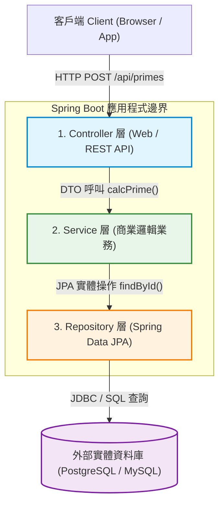
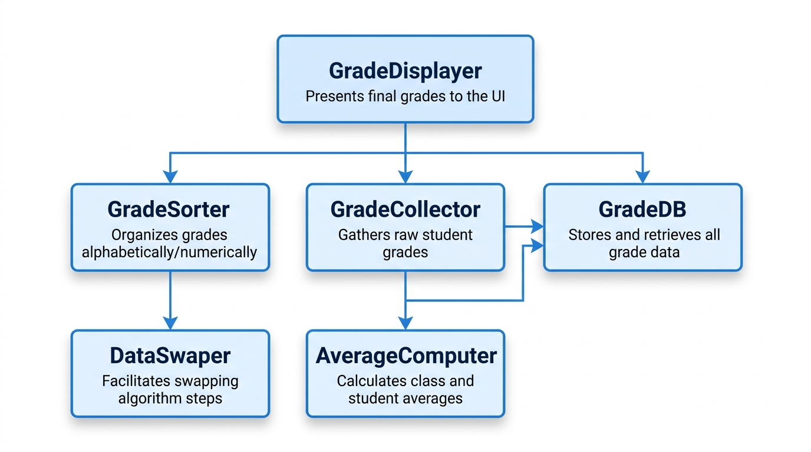
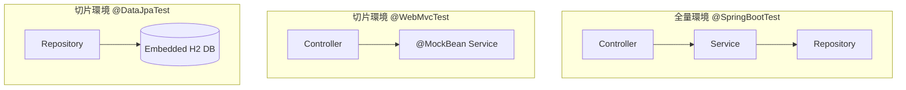

# 軟體品質與測試

### 第 7 章：整合測試 (Integration Testing) 與測試替身架構

授課教師：薛念林 教授

> 「單元測試證明了零件的完好，整合測試則驗證了齒輪的嚙合。」  
> 當獨立模組跨越程序、網路或資料庫邊界協同運作時，介面契約、型態失配與時序競爭才是系統穩定性的真正試金石。

---

<!-- _class: outline-slide -->
<!-- header: '本章大綱 (Outline)' -->

## 本章重點導讀 (Key Highlights)

<div class="outline-columns">
<div>

### 🧩 整合策略與架構演進
- **7.1 整合測試與 V 模型 (V-Model)**：
  - 單元測試通過後的介面斷裂危機、V-Model 階層定位
  - 介面錯誤四大分類：型別失配、順序錯亂、資源競爭、語意歧異
  - Spring Boot 經典分層架構（Controller ➔ Service ➔ Repository）
- **7.2 由下而上整合 (Bottom-Up)**：
  - 核心哲學、測試驅動程式 (Test Driver) 設計、`isPrime` 驅動實務
  - Spring Boot `@DataJpaTest` 與底層向上推進
- **7.3 由上而下整合 (Top-Down)**：
  - 核心哲學、測試假程式 (Test Stub) 設計、`allPrime` 樁實務
  - Spring Boot `@WebMvcTest` + `@MockBean` 控制器切片測試
- **7.4 整合策略大比拼 (Comparison)**：
  - Big Bang、Top-Down、Bottom-Up 與 Sandwich（三明治/混合式）
  - 成本、定位精度、原型可見度多維度評估矩陣 (CCQ 1)

</div>
<div>

### 🎭 測試替身與現代實戰
- **7.5 隔離架構與測試替身 (Test Double)**：
  - Gerard Meszaros 5 大替身：Dummy, Stub, Spy, Mock, Fake
  - 何時用 Mock vs. 不用 Mock、脆化測試 (Brittle Tests) 與三大反模式 (CCQ 2)
- **7.6 Mockito 實戰與行為驗證**：
  - `mock()` vs. `spy()`、`when().thenReturn()`、`verify()`
  - `ArgumentCaptor` 深度參數捕獲、`PrimeService` 模擬實戰
- **7.7 Spring Boot 整合測試實務**：
  - `@SpringBootTest` 全量整合 vs. 切片測試
  - `MockMvc` HTTP 請求模擬、JSONPath 斷言與質數 API 實戰
- **7.8 現代真實環境整合：Testcontainers**：
  - 記憶體資料庫 (H2) 的「假綠燈幻覺」與方言陷阱
  - Docker 動態拉起真實 DB、`@DynamicPropertySource` 配置
- **7.9 課堂實習與練習 (LabDemo)**：
  - `u07_mockito` 實作、`u08_integration` 案例與作業任務

</div>
</div>

---

<!-- header: '7.1 整合測試與 V 開發模型' -->

## 7.1 為什麼單元測試過了，系統還是會崩潰？

<div class="split73">
<div class="left">

#### 🧩 整合測試 (Integration Testing) 的本質
- **單元測試 (Unit Test)**：檢驗個別函式或類別在**完全隔離**環境下的邏輯正確性。
- **整合測試 (Integration Test)**：檢驗多個模組、子系統或元件**相互組合、溝通與傳遞資料時的行為**。

> 💡 **經典現實比喻：**  
> 兩把鎖的把手單獨旋轉都很順暢（單元測試 100% 通過），但安裝在同一扇雙開門上時，兩把把手互相卡死，門根本推不開！

#### ⚠️ 整合階段常見的「介面錯誤」四大元凶：
1. **型態與協定失配**：前端傳送字串 `"100"`，後端預期數值 `100`；或 Date 格式時區偏差。
2. **呼叫時序與前置條件錯亂**：必須先 `login()` 才能 `checkout()`，但 API 未防護而拋出 NPE。
3. **並行與資源競爭 (Race Condition)**：單執行緒測試安全，但在多連線下發生資料庫 Deadlock。
4. **環境與網路依賴差異**：連線逾時、交易未 Commit、快取與 DB 資料不一致。

</div>
<div class="right">


</div>
</div>

---

<!-- header: '7.1 整合測試與 V 開發模型' -->

## 7.1.1 V 開發模型與測試層級對應

<div class="split64">
<div class="left">

#### 📐 V 開發模型 (V-Model) 的對稱哲學
- 左側為**規格與架構設計**階段，右側為**驗證與確認 (V&V)** 階段。
- 每一層測試，都有其對應的規格基準：
  - **單元測試 (Unit Testing)** ➔ 對應**詳細設計 (Detailed Design)**
  - **整合測試 (Integration Testing)** ➔ 對應**架構與介面設計 (Architecture & Interface Design)**
  - **系統測試 (System Testing)** ➔ 對應**系統需求分析 (System Requirements)**
  - **驗收測試 (Acceptance Testing)** ➔ 對應**使用者需求規格 (User Needs)**

#### 🎯 整合測試的核心驗證標的
- 模組與模組之間的 **API 呼叫契約 (API Contract)**。
- 業務流程在跨層傳遞時的**資料完整性與交易邊界 (Transaction Rollback)**。
- 外部服務（Message Queue、Cache、Database）的連線與錯誤降級機制。

</div>
<div class="right">

| 測試層級 | 測試對象 | 核心關注點 | 執行速度 | 缺陷定位成本 |
| :--- | :--- | :--- | :--- | :--- |
| **單元測試** | 獨立類別 / 函式 | 內部邏輯分支 | 毫秒級 (極快) | 極低 (行層級) |
| **整合測試** | 模組間介面 / DB | 資料傳遞與契約 | 秒級 (中等) | 中等 (模組層級) |
| **系統測試** | 完整運行系統 | 端到端業務情境 | 分鐘級 (較慢) | 較高 (系統層級) |
| **驗收測試** | 終端使用者環境 | 使用者滿意度 | 人工 / E2E | 極高 (跨端回溯) |

> 📌 **黃金法則**：越早在底層（單元、整合）捕捉介面契約變更，修復成本就比驗收階段低數十倍！

</div>
</div>

---

<!-- header: '7.1 整合測試與 V 開發模型' -->

## 7.1.2 實務案例架構：Spring Boot 三層架構

<div class="split55">
<div class="left">

#### 🏛️ 經典 MVC / Layered Architecture
現代後端企業應用（如 Spring Boot）通常劃分為嚴格的三層架構：

1. **控制器層 (Controller Layer / Web Layer)**
   - 負責處理 HTTP 請求、路由配對、URL 參數驗證、序列化/反序列化 JSON。
2. **服務層 (Service Layer / Business Logic)**
   - 負責核心商業邏輯運算、交易控制 (`@Transactional`)、跨多個 Repository 協同。
3. **資料存取層 (Repository Layer / Persistence)**
   - 負責與關聯式資料庫 (JPA/Hibernate) 溝通、執行 SQL 查詢與持久化對象映射。

#### ⚡ 介面斷裂的真實場景
- Controller 傳給 Service 的 DTO 欄位名稱少了一個字母 ➔ Service 拿到 `null`。
- Service 在交易失敗時未拋出 RuntimeException ➔ Repository 照常 Commit 導致髒資料。

</div>
<div class="right">



</div>
</div>

---

<!-- header: '7.2 由下而上整合 (Bottom-Up Integration)' -->

## 7.2 由下而上整合測試 (Bottom-Up Integration)

<div class="split73">
<div class="left">

#### 🧱 核心哲學：步步為營，地基先固
- **整合順序**：從依賴圖中最底層的葉節點模組（無任何依賴者）開始測試，驗證無誤後，再逐層向上加入上一層呼叫者。
- **關鍵工具：測試驅動程式 (Test Driver)**
  - 由於高層模組尚未參與測試，必須撰寫一個**專用的輔助程式 (Driver)** 來主動呼叫受測底層模組、傳入測試資料並印出或驗證輸出結果。

#### 🌟 由下而上測試的三大優點
1. **缺陷定位精確**：底層模組若有錯，在第一時間就會暴露；若組裝上一層失敗，錯誤必然發生在剛加入的那層或其介面銜接處。
2. **無需撰寫複雜的 Stubs**：因為被呼叫者都是真實且已經通過測試的模組。
3. **利於早期自動化回歸測試**：底層函式庫穩定後即可持續自動執行。

</div>
<div class="right">


</div>
</div>

---

<!-- header: '7.2 由下而上整合 (Bottom-Up Integration)' -->

## 7.2.1 底層模組與 Test Driver 程式碼範例

<div class="split55">
<div class="left">

#### 1. 受測底層模組 (`PrimeUtil.java`)
最底層的質數判斷工具類別，完全不依賴任何其他外部模組：

```java
public class PrimeUtil {
    // 判斷整數 n 是否為質數
    public static boolean isPrime(int n) {
        if (n <= 1) return false;
        for (int i = 2; i * i <= n; i++) {
            if (n % i == 0) return false;
        }
        return true;
    }
}
```

- 該模組位於系統最基層。
- 只要給定輸入整數，即返回 boolean。

</div>
<div class="right">

#### 2. 測試驅動程式 (`PrimeDriver.java`)
撰寫專屬 Driver 模擬上層呼叫並進行斷言驗證：

```java
public class PrimeDriver {
    public static void main(String[] args) {
        System.out.println("=== 啟動 PrimeUtil 測試驅動程式 ===");
        int[] testCases = {-5, 0, 1, 2, 3, 4, 17, 20};
        boolean[] expected = {false, false, false, true, true, false, true, false};

        for (int i = 0; i < testCases.length; i++) {
            boolean actual = PrimeUtil.isPrime(testCases[i]);
            assert actual == expected[i] : 
                "❌ 失敗: 輸入 " + testCases[i] + " 預期 " + expected[i];
            System.out.println("✅ 通過: 輸入 " + testCases[i] + " ➔ " + actual);
        }
        System.out.println("🎉 底層 PrimeUtil 驗證全數通過！");
    }
}
```

</div>
</div>

---

<!-- header: '7.2 由下而上整合 (Bottom-Up Integration)' -->

## 7.2.2 Spring Boot 中的由下而上實踐三步驟

<div class="split55">
<div class="left">

#### 步驟 1：測試最底層 Repository (`@DataJpaTest`)
直接連接 H2 或 Testcontainers，驗證 SQL 與實體關聯：

```java
@DataJpaTest
public class UserRepositoryTest {
    @Autowired private UserRepository userRepo;

    @Test
    void testSaveAndFindByUsername() {
        User u = new User("alice", "alice@example.com");
        userRepo.save(u);
        Optional<User> found = userRepo.findByUsername("alice");
        assertTrue(found.isPresent());
        assertEquals("alice@example.com", found.get().getEmail());
    }
}
```

- 底層資料存取完全驗證正確後，才向上整合。

</div>
<div class="right">

#### 步驟 2 ➔ 步驟 3：向上組裝 Service 與 Controller
- **步驟 2：整合業務服務層 (Service Layer)**
  - 引入真實通過測試的 `UserRepository`。
  - 驗證商業邏輯與交易回滾 (`@Transactional`)。
- **步驟 3：整合控制層 (Controller Layer)**
  - 啟動完整的 Spring 上下文 (`@SpringBootTest(webEnvironment = RANDOM_PORT)`)。
  - 使用 `TestRestTemplate` 發送真實 HTTP 請求打擊 Controller，一路貫穿到 Service 與 Repository。

> ⚠️ **由下而上的最大痛點**：  
> 直到最後一步，產品經理與使用者才能看到「系統的真正雛形」，UI 與高階流程架構的重大缺陷會被延遲至最後才發現！

</div>
</div>

---

<!-- header: '7.3 由上而下整合 (Top-Down Integration)' -->

## 7.3 由上而下整合測試 (Top-Down Integration)

<div class="split73">
<div class="left">

#### 🏛️ 核心哲學：骨架先行，自頂向下
- **整合順序**：從系統最頂層的控制模組（例如主流程、UI 控制器）開始測試，其所依賴的所有下層模組均使用**假程式 (Stubs)** 代替。
- **關鍵工具：測試假程式 (Test Stub)**
  - 為了讓頂層程式碼能夠跑起來，必須為未實作或未驗證的下層模組撰寫簡化的 Stubs，傳回固定或預先錄製的假資料。

#### 🌟 由上而下測試的兩大亮點
1. **早期展現系統骨架**：管理層與利害關係人很早就能看到工作雛形 (Working Prototype)。
2. **優先驗證重大設計決策**：在初期即可驗證控制流程、架構溝通與例外處理策略。

</div>
<div class="right">


</div>
</div>

---

<!-- header: '7.3 由上而下整合 (Top-Down Integration)' -->

## 7.3.1 高階模組與 Test Stub 程式碼範例

<div class="split55">
<div class="left">

#### 1. 受測高階控制模組 (`PrimeApp.java`)
負責印出 1 到 n 之間的所有質數，依賴底層判斷：

```java
public class PrimeApp {
    // 依賴一個質數判斷介面
    private final PrimeChecker checker;

    public PrimeApp(PrimeChecker checker) {
        this.checker = checker;
    }

    public List<Integer> getAllPrimes(int max) {
        List<Integer> result = new ArrayList<>();
        for (int i = 1; i <= max; i++) {
            if (checker.isPrime(i)) { // 呼叫下層介面
                result.add(i);
            }
        }
        return result;
    }
}
```

</div>
<div class="right">

#### 2. 測試假程式 (`PrimeCheckerStub.java`)
底層算法尚未實作或正在開發中，先寫一個固定 Stub：

```java
public class PrimeCheckerStub implements PrimeChecker {
    @Override
    public boolean isPrime(int n) {
        // 固定樁：硬編碼已知質數，模擬下層模組回傳
        return (n == 2 || n == 3 || n == 5 || n == 7);
    }
}

// 測試案例驗證頂層控制邏輯：
@Test
void testGetAllPrimesTopDown() {
    PrimeChecker stub = new PrimeCheckerStub();
    PrimeApp app = new PrimeApp(stub);
    
    List<Integer> primes = app.getAllPrimes(10);
    assertEquals(List.of(2, 3, 5, 7), primes);
}
```

</div>
</div>

---

<!-- header: '7.3 由上而下整合 (Top-Down Integration)' -->

## 7.3.2 Spring Boot 中的由上而下切片實踐

<div class="split55">
<div class="left">

#### 步驟 1：隔離測試最高階 Controller (`@WebMvcTest`)
完全不安裝底層 Service 與 DB，只載入 Web MVC 切片：

```java
@WebMvcTest(PrimeController.class)
public class PrimeControllerTopDownTest {
    @Autowired private MockMvc mockMvc;

    @MockBean // 自動注入 Spring 管理的測試樁 (Stub/Mock)
    private PrimeService primeService;

    @Test
    void testGetPrimesEndpoint() throws Exception {
        // 定義 Stub 行為：無論底層如何算，強制回傳 [2, 3, 5]
        Mockito.when(primeService.findPrimes(5))
               .thenReturn(List.of(2, 3, 5));

        mockMvc.perform(get("/api/primes?max=5"))
               .andExpect(status().isOk())
               .andExpect(jsonPath("$.length()").value(3))
               .andExpect(jsonPath("$[0]").value(2));
    }
}
```

</div>
<div class="right">

#### 步驟 2 ➔ 步驟 3：逐步向下替換真實模組
- **漸進式替換 (Incremental Replacement)**：
  - 先驗證完 Controller 的 HTTP 協定、狀態碼與 JSON 反序列化。
  - 接著實作 `PrimeService`，拿掉 `@MockBean`，改以真實 Service 協同。
  - 最後整合底層 Repository。

> ⚠️ **由上而下的致命挑戰**：  
> 1. **撰寫 Stub 成本極高**：如果底層模組回傳的資料結構極度繁複，編造合法的 Stub 資料非常費時。  
> 2. **假假成真風險**：若 Stub 的假設與未來真實底層實作不符，高層測試全部 Pass，換上真實模組時依然當場崩盤！

</div>
</div>

---

<!-- header: '7.4 整合測試策略大比拼' -->

## 7.4 四大整合測試策略綜合評比

| 評估維度 | 大霹靂整合 (Big Bang) | 由上而下 (Top-Down) | 由下而上 (Bottom-Up) | 三明治整合 (Sandwich / Hybrid) |
| :--- | :--- | :--- | :--- | :--- |
| **整合概念** | 全部模組寫完後一次拼裝 | 從根節點往下逐步測試 | 從葉節點往上逐步測試 | 中間層為界，上下雙向夾擊 |
| **輔助程式碼需求** | 無 (看似省事) | 需大量 **Stubs** | 需大量 **Drivers** | 同時需要少量 Stubs 與 Drivers |
| **缺陷定位難易度** | **極其困難 (災難)** | 容易 (歸咎於新加入模組) | 容易 (歸咎於底層或新呼叫) | 良好 (核心中介層定位清楚) |
| **系統雛形可見度** | 最晚 (最後一天才見到) | **最早 (前期即可見骨架)** | 較晚 (底層先完成) | 中等 (關鍵業務功能先串通) |
| **硬體/環境相依度** | 需所有環境完全就緒 | 前期可完全依賴虛擬假樁 | 初期直接依賴底層硬體/DB | 平衡兼顧 |
| **適用團隊規模** | 極小型玩具專案 | 架構驅動、重前端/展示型 | 資料驅動、底層演算法核心 | **現代大型敏捷企業專案 (推薦)** |

> 📌 **三明治整合 (Sandwich Testing)**：以系統中最關鍵的「業務服務層 (Service Layer)」為中界線，底層使用真實資料庫由下而上推進，頂層 UI 控制器則由上而下使用 Mock 替身收斂，兼具效率與品質！

---

<!-- header: '7.4 整合測試策略大比拼' -->

## 概念核對問答 (CCQ 1)

<div class="ccq-box">
<div class="ccq-text">

你們團隊正在開發一套無人自動駕駛車輛控制系統。底層是直接與 CAN 匯流排感測器（光達、雷達、輪速計）通訊的高頻硬體通訊驅動模組，頂層是決策與路徑規劃演算法。硬體部門回報感測器實體電路板極為敏感脆弱且容易過熱故障。軟體測試工程師此時若要展開整合測試，最合理的策略應為何？

- A. 採用大霹靂整合，等待整車硬體與車載電腦全部組裝完畢後直接上路進行道路測試
- B. 採用由下而上整合，直接在真實車輛上長時間持續讀取實體 CAN 匯流排感測器訊號
- C. 採用由上而下整合，先為脆弱的底層硬體撰寫 Stubs 模擬雷達資料以驗證高層演算法
- D. 完全不進行任何整合測試，只要感測器模組單元測試全數覆蓋即可直接出廠

</div>
</div>

<details class="quiz-details">
<summary>👉 點擊查看解答與詳細解析</summary>

> **正確答案：C**  
> **解析**：  
> - **選項 C 正確**：底層硬體尚未穩定且容易過熱毀損時，採用「由上而下 (Top-Down)」策略，撰寫感測器模擬樁 (Stubs) 餵給決策與路徑規劃演算法，能夠在確保硬體安全的前提下，優先驗證高層關鍵決策邏輯！  
> - **選項 A 錯誤**：大霹靂整合在複雜系統中無異於自殺，一旦發生車禍完全無法分辨是演算法 Bug 還是感測器硬體訊號異常。  
> - **選項 B 錯誤**：硬體極為脆弱，直接由下而上密集測試可能導致硬體燒毀，測試受阻。  
> - **選項 D 錯誤**：單元測試無法驗證時序延遲與資料封包格式，不測整合必釀致命災難。
</details>

---

<!-- header: '7.5 隔離架構與測試替身原則' -->

## 7.5 隔離架構與測試替身 (Test Double)

<div class="split73">
<div class="left">

#### 🎭 為什麼需要測試替身 (Test Double)？
在單元與整合測試中，真實相依元件往往具備下列**五大惡劣特質**：
1. **速度極慢**：連線真實關聯式資料庫或跨國 REST API 耗時數秒。
2. **行為不可預測**：依賴伺服器當前系統時間 (`LocalDateTime.now()`) 或隨機亂數。
3. **不可重現的特殊故障**：例如模擬「硬碟空間滿載 (Disk Full)」、「網路逾時 (Timeout)」。
4. **具備破壞性副作用**：例如發送真實信用卡扣款、寄出真實促銷 Email。
5. **尚未開發完成**：協同開發的另一組團隊 API 尚未交付。

> 💡 **名詞由來**：Gerard Meszaros 在經典著作《xUnit Test Patterns》中，將電影中的「替身演員 (Stunt Double)」概念引進軟體工程，統稱為 **Test Double**。

</div>
<div class="right">



</div>
</div>

---

<!-- header: '7.5 隔離架構與測試替身原則' -->

## 7.5.1 Gerard Meszaros 5 大測試替身定義

<div class="split55">
<div class="left">

#### 1. 虛設物件 (Dummy Object)
- **用途**：僅用於**填塞方法參數簽名**，受測邏輯內部根本從未呼叫它的任何方法。
- **範例**：`new User("test", null /* DummyAddress */);`

#### 2. 測試樁 (Test Stub)
- **用途**：提供**固定的預設回傳值**，支援受測目標的「間接輸入 (Indirect Input)」。
- **特徵**：內部沒有真實邏輯，呼叫 `stub.getBalance()` 一律固定回傳 `1000`。

#### 3. 測試間諜 (Test Spy)
- **用途**：除了像 Stub 可以回傳假資料，更會**秘密記錄方法被呼叫的次數與參數**。
- **範例**：記錄 `sendEmail()` 是否被呼叫過、收件者地址為何。

</div>
<div class="right">

#### 4. 模擬物件 (Mock Object)
- **用途**：具備**嚴格的預期期望 (Expectation)**，內建行為驗證邏輯。
- **特徵**：若未被呼叫到預期次數，或呼叫順序不對，測試直接拋出異常宣告失敗！

#### 5. 偽裝物件 (Fake Object)
- **用途**：具備**真實可運作的簡化版商業邏輯**，但因效能或成本不適用於生產環境。
- **範例**：
  - 使用記憶體 `HashMap` 實作的 `FakeUserRepository`。
  - H2 記憶體資料庫、LocalStack 模擬 AWS S3。

</div>
</div>

---

<!-- header: '7.5 隔離架構與測試替身原則' -->

## 7.5.2 測試替身五兄弟速查與對比表

| 替身類型 | 核心使命 | 是否有商業邏輯？ | 是否驗證呼叫歷程？ | 代表性使用情境 |
| :--- | :--- | :--- | :--- | :--- |
| **Dummy** | 填補非必要參數 | ❌ 完全沒有 | ❌ 不關心 | 建構子必須傳入非空 Context，但本次測試不用 |
| **Stub** | 餵入固定間接資料 | ❌ 固定寫死 | ❌ 不關心 | 強制查詢服務回傳「商品庫存 = 0」，測試缺貨邏輯 |
| **Spy** | 暗中刺探紀錄 | ⚠️ 可封裝真實物件 | ✅ 事後主動查詢歷程 | 記錄是否有呼叫日誌記錄器、記下發送的 SMS 驗證碼 |
| **Mock** | 嚴格行為契約檢查 | ❌ 依宣告回應 | ✅ 事前設定違背即死 | 驗證 `paymentGateway.charge()` **必須且僅能呼叫一次** |
| **Fake** | 輕量化快速替代品 | ✅ 具備簡化邏輯 | ❌ 不主動驗證 | 用 `ConcurrentHashMap` 充當記憶體資料庫快速跑測試 |

> 🎯 **口訣記憶法**：  
> - **Dummy** 是啞巴木頭（純佔位）  
> - **Stub** 是錄音機（按播放就給固定聲音）  
> - **Spy** 是監視器（只錄影記錄，事後調閱）  
> - **Mock** 是嚴苛教官（事前規定好一切，走錯一步就嗶嗶）  
> - **Fake** 是替代役（真能做事，但裝備較簡陋）

---

<!-- header: '7.5 隔離架構與測試替身原則' -->

## 7.5.3 脆化測試 (Brittle Tests) 與過度 Mock 的三大反模式

<div class="split55">
<div class="left">

#### ⚠️ 什麼是脆化測試 (Brittle Tests)？
> 「程式碼重構後功能完全正常、業務結果分毫不差，但測試案例卻紅成一片！」

當測試案例過度深究受測目標的**內部實作細節 (Implementation Details)**，而非關注其**最終公開輸出結果 (Observable State)** 時，測試就會變得極度脆弱。

#### 🚫 反模式 1：嚴格驗證內部呼叫順序
- 測試碼：`inOrder.verify(repo).findA(); inOrder.verify(repo).findB();`
- 災難：工程師僅僅將兩行無相依性的資料庫查詢順序對調進行優化，測試立刻失敗！

</div>
<div class="right">

#### 🚫 反模式 2：Mock 了錯誤的介面契約
- 開發者用 Mock 設定第三方程式庫回傳 `List.of()`。
- 真實環境中，第三方套件在查無資料時拋出 `ResourceNotFoundException`。
- **結果**：單元測試全面綠燈，一上線當天噴出未捕捉例外造成伺服器重啟！

#### 🚫 反模式 3：遍地是 Mock，宛如皇帝的新衣
- 每個類別的依賴全部被 Mock 掉。
- 測試只不過是把受測類別裡面的程式碼用 Mockito 語法「重新抄寫了一遍」。
- **下場**：重構時痛不欲生，真正出問題的跨層整合卻完全沒測到。

</div>
</div>

---

<!-- header: '7.5 隔離架構與測試替身原則' -->

## 概念核對問答 (CCQ 2)

<div class="ccq-box">
<div class="ccq-text">

資深架構師在審查小明的單元測試時，發現小明在測試 `OrderCheckoutService`（結帳服務）時，將底層的 `TaxCalculator`、`DiscountRuleEngine`、`InventoryClient` 全部使用 Mock 嚴格設定，甚至使用 `verify(taxCalculator, times(1)).calculate(...)`。架構師給予建議「不要過度 Mocking，應優先採用真實物件或 Fake 物件」。下列哪一項**不是**過度 Mock 帶來的缺點？

- A. 重構內部私有變數或調用結構時容易造成測試非預期脆化
- B. Mockito 的動態代理反射機制會稍微增加測試執行時間
- C. 容易忽略外部依賴升級或真實行為契約變動所帶來的崩潰
- D. 測試案例能有效且精準地度量系統於高併發下的死結狀況

</div>
</div>

<details class="quiz-details">
<summary>👉 點擊查看解答與詳細解析</summary>

> **正確答案：D**  
> **解析**：  
> - **選項 D 為本題所求**：「能精準度量高併發死結」完全不是 Mock 的特性，反而是過度 Mock **絕對無法達成**的事情！Mock 只是純記憶體虛擬物件，沒有真實資料庫鎖或交易隔離層，根本測不出 Deadlock。  
> - **選項 A 是過度 Mock 缺點**：與內部實作細節高度耦合，重構易脆化。  
> - **選項 B 是缺點**：過多 CGLIB / ByteBuddy 動態代理生成會增加測試運行開銷。  
> - **選項 C 是致命缺點**：Mock 往往隱蔽了真實套件的異常行為，形成假綠燈幻覺。
</details>

---

<!-- header: '7.6 Mockito 實戰與行為驗證' -->

## 7.6 Mockito 核心語法與 API 導覽

<div class="split55">
<div class="left">

#### 🛠️ Mockito 是什麼？
Java 生態系中最主流的 Mock 框架，語法優雅、接近自然語言可讀性。

#### 1. 宣告與建立 Mock 物件
```java
// 手動建立
OrderRepository mockRepo = Mockito.mock(OrderRepository.class);

// 或透過 JUnit 5 擴充註解
@ExtendWith(MockitoExtension.class)
public class OrderServiceTest {
    @Mock private OrderRepository orderRepo;       // 替身
    @Mock private PaymentClient paymentClient;     // 替身
    @InjectMocks private OrderService orderService;// 自動注入上方替身
}
```

</div>
<div class="right">

#### 2. 定義打樁行為 (Stubbing)
```java
// 當呼叫特定方法傳入特定參數時，回傳指定結果
when(orderRepo.findById(101L))
    .thenReturn(Optional.of(new Order(101L, "Book")));

// 模擬拋出例外
when(paymentClient.charge(anyDouble()))
    .thenThrow(new InsufficientFundsException("餘額不足"));

// 參數匹配器 (Argument Matchers)
when(orderRepo.save(any(Order.class)))
    .thenAnswer(invocation -> invocation.getArgument(0));
```

> ⚠️ **注意**：一旦用了 `any()`，同一方法的所有參數都必須使用 Matcher！

</div>
</div>

---

<!-- header: '7.6 Mockito 實戰與行為驗證' -->

## 7.6.1 Mock vs. Spy 的行為差異

<div class="split55">
<div class="left">

#### 🎭 Mock (全虛擬替身)
- 預設情況下，Mock 物件的所有方法**都不會執行真實程式碼**。
- 若未對方法進行 `when().thenReturn()` 打樁：
  - 物件型態回傳 `null`
  - 數值型態回傳 `0`
  - 布林型態回傳 `false`
  - 集合型態回傳空集合 `Collections.emptyList()`

```java
List<String> mockList = mock(ArrayList.class);
mockList.add("Apple"); // 什麼事都沒做！
assertEquals(0, mockList.size()); // 通過！size() 預設回傳 0
```

</div>
<div class="right">

#### 🕵️ Spy (局部間諜包裝)
- Spy 封裝**真實存在的實體物件**。
- 預設情況下，會**真實執行其底層方法**，同時暗中記錄呼叫歷程！
- 只有被明確打樁的方法才會被攔截替換。

```java
List<String> realList = new ArrayList<>();
List<String> spyList = spy(realList);

spyList.add("Apple"); // 真實呼叫 ArrayList.add()
assertEquals(1, spyList.size()); // 通過！真實大小為 1

// 對特定方法打樁 (需用 doReturn 避免先執行一次真實方法)
doReturn(100).when(spyList).size();
assertEquals(100, spyList.size()); // size() 被篡改為 100
```

</div>
</div>

---

<!-- header: '7.6 Mockito 實戰與行為驗證' -->

## 7.6.2 Verify 行為驗證與 ArgumentCaptor

<div class="split55">
<div class="left">

#### 🔍 驗證方法是否被呼叫 (Verify)
單元測試不只要測回傳值，有時更需要驗證「是否有正確委派動作」：

```java
// 驗證 save() 恰好被呼叫了 1 次
verify(orderRepo, times(1)).save(any(Order.class));

// 驗證從未發送退款通知
verify(notificationService, never()).sendRefund(any());

// 驗證呼叫至少 2 次
verify(auditLogger, atLeast(2)).log(anyString());

// 驗證除上述之外，該 mock 沒有其他額外交互
verifyNoMoreInteractions(notificationService);
```

</div>
<div class="right">

#### 🎯 參數捕獲器 (ArgumentCaptor)
當受測方法在內部組裝了物件傳入依賴模組時，可使用 Captor 攔截並深入斷言其內容：

```java
@Test
void testOrderCreationSetsDefaultStatus() {
    orderService.createOrder("Alice", 500);

    // 建立 Order 型別的捕獲器
    ArgumentCaptor<Order> captor = 
        ArgumentCaptor.forClass(Order.class);
    
    // 攔截 orderRepo.save() 所收到的真實參數
    verify(orderRepo).save(captor.capture());
    
    Order savedOrder = captor.getValue();
    assertEquals("Alice", savedOrder.getCustomer());
    assertEquals(OrderStatus.PENDING, savedOrder.getStatus());
}
```

</div>
</div>

---

<!-- header: '7.6 Mockito 實戰與行為驗證' -->

## 7.6.3 LabDemo 實戰導讀：`u07_mockito`

<div class="split55">
<div class="left">

#### 📂 範例專案路徑
- **業務類別**：`LabDemo/src/main/java/u07_mockito/PrimeService.java`
- **測試類別**：`LabDemo/src/test/java/u07_mockito/PrimeServiceTest.java`
- **輔助案例**：`OrderServiceTest.java` (訂單與庫存連動)

#### 🧪 測試目標解析
驗證 `PrimeService` 在計算範圍質數時，如何依賴外部的 `PrimeValidator`：
1. 正常質數過濾邏輯
2. 當外部 Validator 拋出異常時的降級處理
3. 驗證是否針對負數跳過驗證呼叫 (短路優化)

</div>
<div class="right">

#### 💻 終端機執行指令
```bash
# 進入 LabDemo 專案目錄
cd SQA/LabDemo

# 專門執行 u07_mockito 測試套件
mvn test -Dtest=PrimeServiceTest

# 執行所有 mockito 相關測試
mvn test -Dtest=*Mockito*
```

> 💡 **課堂任務**：  
> 請打開 `PrimeServiceTest.java`，觀察 `@ExtendWith(MockitoExtension.class)` 如何與 `@InjectMocks` 協同工作，並嘗試新增一個負數邊界的 Mock 測試！

</div>
</div>

---

<!-- header: '7.7 Spring Boot 整合測試實務' -->

## 7.7 Spring Boot 整合測試實務 (Integration Testing)

<div class="split55">
<div class="left">

#### 🏗️ Spring 測試三大神器比較
1. **`@SpringBootTest` (全量整合)**
   - 載入完整的 ApplicationContext、所有 Bean、設定檔。
   - 成本最高、耗時最久，但最貼近真實運行狀態。
2. **`@WebMvcTest` (控制層切片)**
   - 只載入 Spring MVC 元件（Controller、Filter、Converter）。
   - 不載入 Service 與 Repository，需搭配 `@MockBean`。
3. **`@DataJpaTest` (持久層切片)**
   - 只載入實體類別與 Spring Data JPA Repository。
   - 預設會自動連向記憶體資料庫 (H2)，每筆測試自動 Rollback。

</div>
<div class="right">



</div>
</div>

---

<!-- header: '7.7 Spring Boot 整合測試實務' -->

## 7.7.1 質數計算 API 整合測試範例

<div class="split55">
<div class="left">

#### 1. 控制器端點 (`PrimeController.java`)
```java
@RestController
@RequestMapping("/api/primes")
public class PrimeController {
    @Autowired private PrimeService primeService;

    @PostMapping("/calculate")
    public ResponseEntity<PrimeResponse> calculate(
            @RequestBody @Valid PrimeRequest req) {
        List<Integer> primes = 
            primeService.getPrimesUpTo(req.getMaxNumber());
        return ResponseEntity.ok(
            new PrimeResponse(primes, primes.size()));
    }
}
```

- 接收 JSON 請求：`{"maxNumber": 10}`
- 輸出 JSON 回應：`{"primes": [2, 3, 5, 7], "count": 4}`

</div>
<div class="right">

#### 2. MockMvc 整合測試 (`PrimeIntegrationTest.java`)
```java
@SpringBootTest
@AutoConfigureMockMvc
public class PrimeIntegrationTest {
    @Autowired private MockMvc mockMvc;
    @Autowired private ObjectMapper objectMapper;

    @Test
    void testCalculatePrimesApi() throws Exception {
        PrimeRequest req = new PrimeRequest(10);

        mockMvc.perform(post("/api/primes/calculate")
                .contentType(MediaType.APPLICATION_JSON)
                .content(objectMapper.writeValueAsString(req)))
               .andExpect(status().isOk())
               .andExpect(jsonPath("$.count").value(4))
               .andExpect(jsonPath("$.primes[0]").value(2))
               .andExpect(jsonPath("$.primes[3]").value(7));
    }
}
```

</div>
</div>

---

<!-- header: '7.8 現代真實環境整合：Testcontainers' -->

## 7.8 現代真實環境整合：Testcontainers

<div class="split73">
<div class="left">

#### 💣 記憶體資料庫 (H2/SQLite) 的「假綠燈幻覺」
許多團隊為了跑測試快速，在測試環境使用 H2，上線卻用 PostgreSQL / MySQL，導致無數災難：
1. **SQL 方言與專屬函式**：Postgres 的 `jsonb_extract_path` 或 MySQL 的 `ON DUPLICATE KEY UPDATE`，H2 根本不支援！
2. **序列與自增主鍵策略**：跨事務處理與鎖定語法差異巨大。
3. **大小寫敏感度與字元編碼**：Windows/Linux 或 H2/MySQL 的表名大小寫行為完全不同。

> 💡 **救星：Testcontainers！**  
> 透過 Docker Java API，在跑 JUnit 測試前**動態拉起 100% 真實的 PostgreSQL / Redis 容器**，跑完立即銷毀，徹底告別環境漂移！

</div>
<div class="right">


</div>
</div>

---

<!-- header: '7.8 現代真實環境整合：Testcontainers' -->

## 7.8.1 Spring Boot + Testcontainers 實戰配置

<div class="split55">
<div class="left">

#### 📦 JUnit 5 + PostgreSQL 容器宣告
```java
@SpringBootTest(webEnvironment = SpringBootTest.WebEnvironment.RANDOM_PORT)
@Testcontainers // 啟用 Testcontainers 生命週期
public class OrderRepositoryIntegrationTest {

    // 定義動態容器，指定與生產環境完全相同的映像檔標籤
    @Container
    static PostgreSQLContainer<?> postgres = 
        new PostgreSQLContainer<>("postgres:15-alpine")
            .withDatabaseName("testdb")
            .withUsername("testuser")
            .withPassword("testpass");

    // 動態覆寫 Spring Boot 資料庫連線屬性
    @DynamicPropertySource
    static void configureProperties(DynamicPropertyRegistry registry) {
        registry.add("spring.datasource.url", postgres::getJdbcUrl);
        registry.add("spring.datasource.username", postgres::getUsername);
        registry.add("spring.datasource.password", postgres::getPassword);
    }
    // ...
```

</div>
<div class="right">

#### 🌟 核心運行生命週期
1. **測試啟動**：Testcontainers 偵測 Docker Daemon，自動 `docker pull postgres:15-alpine`。
2. **隨機埠綁定**：容器主機埠隨機映射（避免本機 `5432` 埠衝突）。
3. **連線注入**：透過 `@DynamicPropertySource` 將動態 JDBC URL 注入 Spring Context。
4. **執行測試**：執行 Flyway 資料庫遷移與真實 CRUD 測試。
5. **銷毀回收**：測試結束後由 **Ryuk 守護程序**自動終止並刪除容器，環境不留任何垃圾！

> 📌 **相關手冊參閱**：`LabDemo/docs/u08_integration/testcontainers_spring.md`

</div>
</div>

---

<!-- header: '7.9 課堂實習與練習 (Lab & Exercises)' -->

## 7.9 本章實習任務與課後練習

<div class="split55">
<div class="left">

#### 📝 實習 1：Mockito 服務隔離實作
- **目標**：完成 `PrimeServiceTest.java`。
- **任務清單**：
  1. 使用 `@Mock` 模擬 `PrimeValidator`。
  2. 練習 `when().thenReturn()` 與 `thenThrow()` 測試負數與邊界狀況。
  3. 使用 `ArgumentCaptor` 捕獲傳入驗證器的數值並進行屬性斷言。

#### 📝 實習 2：Spring Boot MockMvc API 整合測試
- **目標**：測試 `/api/primes/calculate` REST 端點。
- **任務清單**：
  1. 發送包含無效格式之 JSON 負載（如字串而非數字），驗證 HTTP 400 Bad Request。
  2. 使用 JSONPath 驗證回傳之質數陣列元素與長度。

</div>
<div class="right">

#### 📝 課後挑戰：三明治整合實戰設計
假設你接手一間連鎖書店的電商結帳系統，包含：
- **Web UI** (購物車頁面)
- **OrderService** (訂單計算與折扣)
- **PaymentGateway** (第三方金流)
- **InventoryDB** (庫存資料庫)

請撰寫一份 1 頁整合測試規劃：
1. 哪些層級該用 **Testcontainers**？
2. 哪些外部服務必須用 **Mock / Stub**？
3. 如何防止測試脆化 (Brittle Test)？

> 🚀 **LabDemo 快速連結**：  
> [u07_mockito 源碼目錄](file:///Users/nick-mini-26/oTeach/SQA/LabDemo/src/test/java/u07_mockito)  
> [Spring 整合測試講義](file:///Users/nick-mini-26/oTeach/SQA/LabDemo/docs/u08_integration/Spring.md)

</div>
</div>

---

<!-- _class: lead -->
<!-- header: '' -->

# 總結 (Summary)

### 整合測試是從「程式碼元件」通往「可靠軟體系統」的必經之橋

1. **V 模型對應**：單元測詳細設計，整合測試驗證架構與介面契約。
2. **策略選擇**：由上而下重雛形但 Stubs 成本高；由下而上重穩定但驗證晚；企業推薦「三明治整合」。
3. **測試替身藝術**：分清 Dummy, Stub, Spy, Mock, Fake 的職責；警惕過度 Mocking 造成的測試脆化。
4. **現代實踐標準**：Spring Boot 切片測試 + Testcontainers 真實容器化測試，消除環境漂移與假綠燈幻覺！

---

<!-- header-nav-dropdown-script -->
<script>
(function() {
  function initHeaderDropdown() {
    var slideSections = document.querySelectorAll(".marp-slide");
    if (!slideSections || slideSections.length === 0) return;

    var sections = [];
    var seenTitles = new Set();
    
    slideSections.forEach(function(sec, idx) {
      var h2 = sec.querySelector("h2");
      if (!h2) return;
      var title = h2.textContent.trim();
      title = title.replace(/^[◄◀]\s*/, "").replace(/\s*[►▶]$/, "").trim();
      if (!title || title.length > 40) return;
      if (seenTitles.has(title)) return;
      
      seenTitles.add(title);
      sections.push({
        id: String(idx + 1),
        title: title
      });
    });

    if (sections.length === 0) return;

    function createDropdownWrapper(currentTitle) {
      var wrapper = document.createElement("div");
      wrapper.className = "header-nav-wrapper";
      
      var titleSpan = document.createElement("span");
      titleSpan.className = "nav-title";
      titleSpan.textContent = currentTitle;
      
      var icon = document.createElement("span");
      icon.className = "dropdown-icon";
      icon.textContent = " ▼";
      titleSpan.appendChild(icon);
      
      var dropdown = document.createElement("div");
      dropdown.className = "nav-dropdown";
      
      var grid = document.createElement("div");
      grid.className = "dropdown-grid";
      
      sections.forEach(function(s) {
        var item = document.createElement("a");
        item.className = "dropdown-item";
        item.href = "#" + s.id;
        
        var badge = document.createElement("span");
        badge.className = "badge";
        badge.textContent = "#" + s.id.padStart(2, "0");
        
        var itemText = document.createElement("span");
        itemText.className = "item-text";
        itemText.title = s.title;
        itemText.textContent = s.title;
        
        item.appendChild(badge);
        item.appendChild(itemText);
        
        item.addEventListener("click", function(e) {
          wrapper.classList.remove("is-open");
          dropdown.style.display = "none";
          window.location.hash = "#" + s.id;
          setTimeout(function() { dropdown.style.display = ""; }, 350);
        });
        
        grid.appendChild(item);
      });
      
      dropdown.appendChild(grid);
      wrapper.appendChild(titleSpan);
      wrapper.appendChild(dropdown);
      return wrapper;
    }

    document.addEventListener("click", function(e) {
      if (!e.target.closest(".header-nav-wrapper")) {
        document.querySelectorAll(".header-nav-wrapper.is-open").forEach(function(w) {
          w.classList.remove("is-open");
        });
      }
    });

    slideSections.forEach(function(sec) {
      var header = sec.querySelector("header");
      if (!header || header.dataset.navEnhanced) return;
      header.dataset.navEnhanced = "true";
      
      var title = header.textContent.trim();
      title = title.replace(/^[◄◀]\s*/, "").replace(/\s*[►▶]$/, "").trim();
      if (!title) return;
      
      header.innerHTML = "";
      var wrapper = createDropdownWrapper(title);
      header.appendChild(wrapper);
    });
  }

  if (document.readyState === "loading") {
    document.addEventListener("DOMContentLoaded", initHeaderDropdown);
  } else {
    initHeaderDropdown();
  }
  setTimeout(initHeaderDropdown, 400);
})();
</script>
