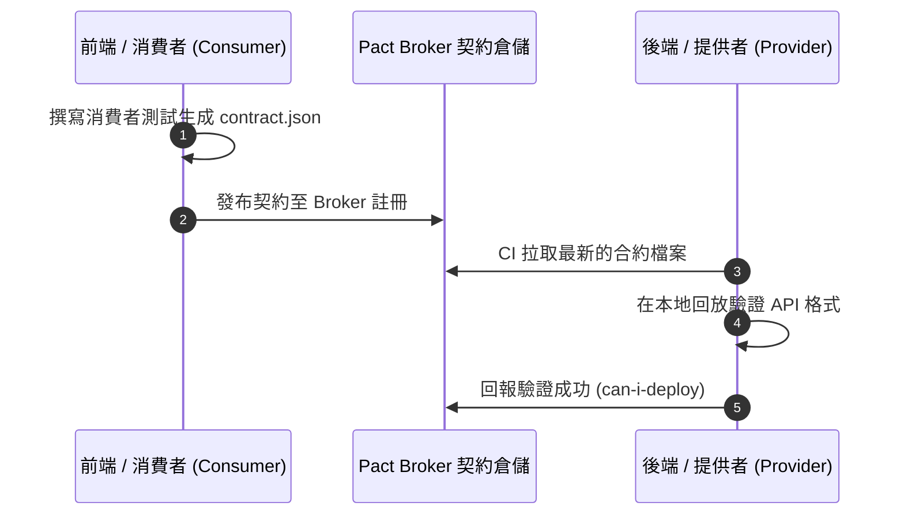
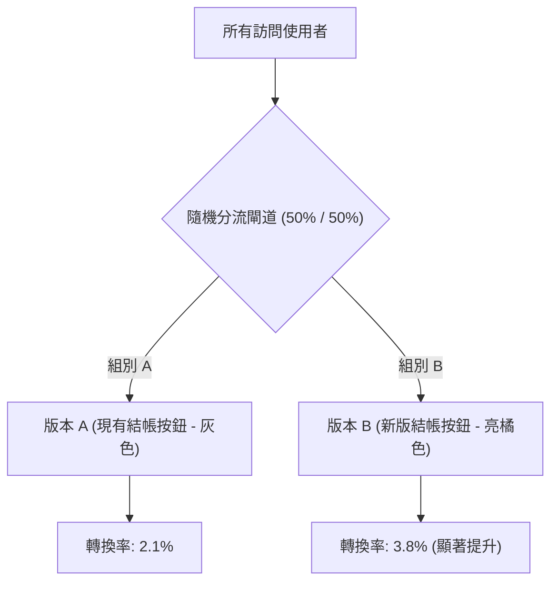
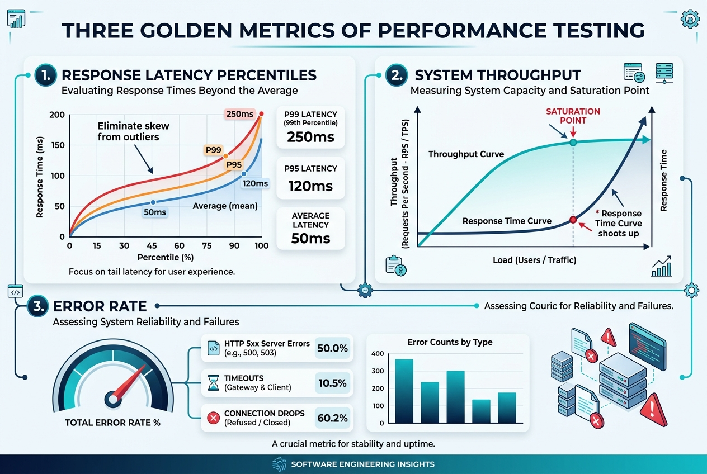
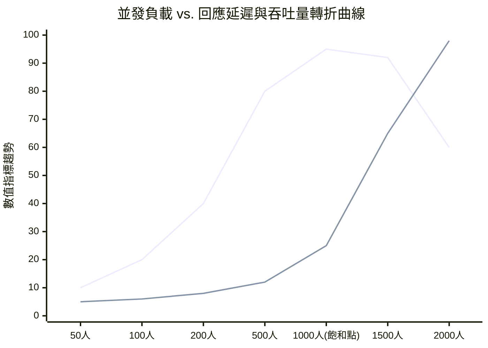
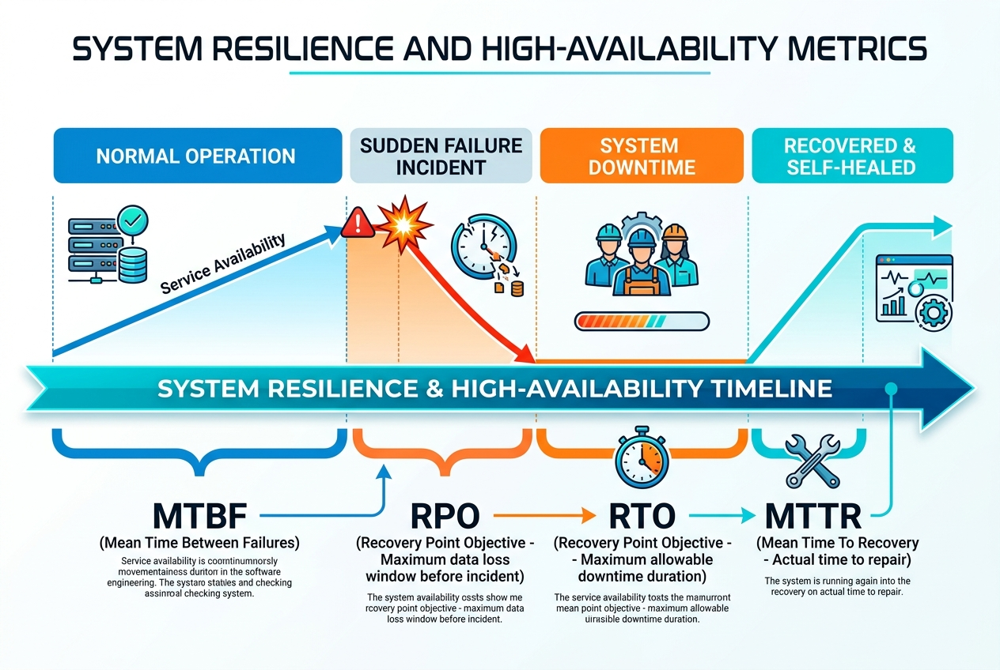

# 軟體品質與測試

### 第 8 章：系統測試 (System Testing)、行為驅動開發 (BDD) 與現代非功能性驗證

授課教師：薛念林 教授

> 「單元測試關心內部零件，整合測試關心齒輪銜接，  
> 而系統測試關注的是整部車能否在暴風雨中以 120km/h 載客安全奔馳。」  
> 從業務使用案例、BDD 活文件，到效能飽和點、混沌工程與安全防線，打造經得起真實世界考驗的強韌系統。

---

<!-- _class: outline-slide -->
<!-- header: '本章大綱 (Outline)' -->

## 本章重點導讀 (Key Highlights)

<div class="outline-columns">
<div>

### 🎯 業務流程與行為驅動測試
- **8.1 使用案例與流程測試 (Use Case Testing)**：
  - 端到端使用者視角、基本流 (Basic Flow) 與替代/例外流
  - 圖書館借書案例、情境矩陣分析與測試套件衍生
- **8.2 行為驅動開發與 Cucumber 測試 (BDD)**：
  - 活文件 (Living Doc) 哲學、三方共識 (3 Amigos)
  - Gherkin 語法 (`Given-When-Then`)、BMI 情境大綱與範例表格
  - Java Step Definitions 參數自動映射實戰 (CCQ 1)
- **8.3 微服務契約、Playwright 與 AI 畫面模擬**：
  - 微服務分散式 API 漂移與 Pact 契約測試 (Consumer-Driven)
  - Playwright 現代 Web E2E (自動等待、Trace Viewer)
  - AI 測試代理人 (Browser Subagent) 與無頭瀏覽器演進 (CCQ 2)

</div>
<div>

### 🛡️ 全方位非功能性測試工程
- **8.4 可用性測試 (Usability Testing)**：
  - Jakob Nielsen 十大可用性啟發原則、Hallway 走道測試
  - A/B 測試法、統計顯著性與假說驗證
- **8.5 效能測試與負載工程 (Performance Testing)**：
  - 負載 vs. 壓力 vs. 突波 vs. 浸泡四大測試型態
  - 三組黃金指標（RPS, P95/P99 延遲, Error Rate）、飽和點急彎
  - k6 自動化壓測腳本與品質門檻 (Thresholds) 阻斷
- **8.6 相容性測試 (Compatibility)**：跨 OS、跨瀏覽器、響應式
- **8.7 安全性測試 (Security)**：攻擊者思維、SAST/DAST/IAST/SCA
- **8.8 回復性與彈性測試 (Resilience)**：RTO/RPO/MTBF/MTTR、混沌工程
- **8.9 課堂實習導讀 (LabDemo)**：Cucumber, Playwright, k6

</div>
</div>

---

<!-- header: '8.1 使用案例與流程測試' -->

## 8.1 什麼是使用案例 (Use Case) 與流程測試？

<div class="split73">
<div class="left">

#### 👤 端到端使用者視角 (End-to-End User Perspective)
- **使用案例 (Use Case)**：描述「特定參與者 (Actor)」為了達成「明確業務目標」，與軟體系統進行的一連串互動步驟。
- **特點**：
  - 不涉及內部資料庫欄位或程式碼類別名稱。
  - 完全從**外部黑箱視角**出發，聚焦於系統輸入與對應回應。

#### 🌊 流程分類：基本流、替代流與例外流
1. **基本流 (Basic Flow / Happy Path)**：
   - 最順利、沒有任何錯誤或干擾的主幹成功路徑。
2. **替代流 (Alternative Flow)**：
   - 達到相同目標，但選擇了不同的業務分支（例如改用 LINE Pay 或使用優惠券折抵）。
3. **例外流 (Exception Flow)**：
   - 遇到阻礙無法達成目標的失敗路徑（例如信用卡餘額不足、帳號被凍結）。

</div>
<div class="right">


</div>
</div>

---

<!-- header: '8.1 使用案例與流程測試' -->

## 8.1.1 案例推演：圖書館預借圖書系統

<div class="split55">
<div class="left">

#### 📚 業務規格情境說明
- **參與者**：讀者 (Student / Faculty)
- **基本流 (Happy Path)**：
  1. 讀者登入圖書館系統
  2. 搜尋館藏圖書並點擊「預借」
  3. 系統檢查無借書逾期罰款且預借配額未滿
  4. 系統產生取書通知並將圖書狀態標記為「保留中」
- **替代流 A1 (配額滿載)**：
  - 步驟 3 發現預借已達上限 5 本 ➔ 系統顯示提示並拒絕預借
- **例外流 E1 (讀者欠款)**：
  - 步驟 3 發現逾期罰金未繳 ➔ 系統提示「帳號凍結」並導向繳費頁面

</div>
<div class="right">

#### 🧪 測試案例情境矩陣設計
| 案例編號 | 測試情境名稱 | 涵蓋路徑 | 預期測試結果 |
| :--- | :--- | :--- | :--- |
| **TC-01** | 正常成功預借 | 基本流 | 產生預約單號，狀態為保留中 |
| **TC-02** | 預借上限阻擋 | 基本流 ➔ A1 | 彈出配額已滿訊息，資料不寫入 |
| **TC-03** | 欠款帳號凍結 | 基本流 ➔ E1 | 顯示凍結原因，強制導向繳費頁 |
| **TC-04** | 熱門書籍排隊 | 基本流 ➔ A2 | 預約順位自動遞增為第 2 位 |

> 🎯 **設計準則**：  
> 必須確保 100% 覆蓋基本流，且**每一個替代流與例外流至少被一個獨立測試案例走過一次**！

</div>
</div>

---

<!-- header: '8.2 行為驅動開發與 Cucumber 測試' -->

## 8.2 行為驅動開發 (BDD) 與活文件哲學

<div class="split73">
<div class="left">

#### 🤝 破除溝通巴別塔：三方共識 (3 Amigos)
傳統開發中，產品經理 (PO)、開發工程師 (Dev)、測試工程師 (QA) 對需求的理解往往不同調：
- **BDD (Behavior-Driven Development)** 提倡以「領域通用語言 (Ubiquitous Language)」共同撰寫**可執行的規格書**。
- **活文件 (Living Documentation)**：
  - 規格即測試，測試即文件。
  - 當系統功能變更時，測試案例同步更新，文件永不過期！

#### 🥒 Cucumber 與 Gherkin 語法
- Cucumber 是 BDD 領域最普及的開源自動化框架。
- 採用 **Gherkin 語法**，以自然語言格式描述測試情境。

</div>
<div class="right">


</div>
</div>

---

<!-- header: '8.2 行為驅動開發與 Cucumber 測試' -->

## 8.2.1 Gherkin 核心語法與五大關鍵字

<div class="split55">
<div class="left">

#### 🔑 Gherkin 五大核心結構關鍵字
1. **`Feature` (功能特徵)**：高階商業價值描述，定義這份文件的目標。
2. **`Scenario` (具體情境)**：一個獨立的端到端業務使用案例。
3. **`Given` (前提條件)**：設定系統的初始狀態與前置條件。
4. **`When` (觸發動作)**：使用者執行的關鍵操作或事件。
5. **`Then` (預期結果)**：系統產生的可觀察結果與斷言驗證。
6. **`And / But`**：串接多個條件或斷言，保持語意流暢。

</div>
<div class="right">

#### 🛒 範例：購物車滿千折百促銷
```gherkin
Feature: 購物車結帳促銷計算
  身為一名線上消費者
  為了節省開銷
  我希望在購物滿額時獲得系統自動折扣

  Scenario: 購物金額滿千享有 100 元折扣
    Given 購物車內已有商品如下:
      | 商品名稱 | 單價 | 數量 |
      | Java 測試指南 | 600 | 1 |
      | Clean Code  | 500 | 1 |
    When 使用者進入結帳確認頁面
    Then 原始總金額應為 1100 元
    And 系統自動套用滿千折扣 100 元
    And 最終應付金額應為 1000 元
```

</div>
</div>

---

<!-- header: '8.2 行為驅動開發與 Cucumber 測試' -->

## 8.2.2 參數化測試：Scenario Outline 與 Examples

<div class="split55">
<div class="left">

#### 📊 為什麼需要 Scenario Outline？
當同一個測試情境需要驗證**多組不同的邊界輸入與輸出**時，複製貼上 Scenario 會造成大量重複程式碼。

#### 💡 情境大綱與資料表格
- 使用 `<變數名稱>` 作為預留位置。
- 在下方附帶 `Examples:` 表格，Cucumber 會自動為每一列資料重複執行一次情境！

> 🌟 **好處**：  
> 測試邏輯只寫一次，資料擴充極其直覺，連非技術背景的產品經理都能直接在表格新增測試資料！

</div>
<div class="right">

#### 🏃 實戰案例：BMI 健康體態判定
```gherkin
Feature: 體態評估計算機 (BMI Calculator)

  Scenario Outline: 驗證不同身高體重的體態判定分類
    Given 測試使用者的身高為 <height> 公分
    And 體重為 <weight> 公斤
    When 系統計算其身體質量指數
    Then 計算出的 BMI 值應為 <expected_bmi>
    And 體態判定結果應為 "<category>"

    Examples:
      | height | weight | expected_bmi | category |
      | 170    | 50     | 17.3         | 體重過輕 |
      | 170    | 65     | 22.5         | 正常範圍 |
      | 170    | 75     | 26.0         | 體重過重 |
      | 170    | 95     | 32.9         | 中度肥胖 |
```

</div>
</div>

---

<!-- header: '8.2 行為驅動開發與 Cucumber 測試' -->

## 8.2.3 Java 步驟定義 (Step Definitions) 程式實作

<div class="split55">
<div class="left">

#### 🧩 步驟定義如何與 Gherkin 綁定？
Cucumber-JVM 透過正則表達式或 Cucumber Expressions（如 `{int}`, `{double}`, `{string}`）將文字自動轉換為 Java 方法參數：

```java
public class BmiStepDefinitions {
    private double height;
    private double weight;
    private double actualBmi;
    private String actualCategory;

    @Given("測試使用者的身高為 {double} 公分")
    public void setHeight(double h) {
        this.height = h;
    }

    @Given("體重為 {double} 公斤")
    public void setWeight(double w) {
        this.weight = w;
    }
```

</div>
<div class="right">

```java
    @When("系統計算其身體質量指數")
    public void calculateBmi() {
        BmiCalculator calc = new BmiCalculator();
        this.actualBmi = calc.compute(height, weight);
        this.actualCategory = calc.classify(actualBmi);
    }

    @Then("計算出的 BMI 值應為 {double}")
    public void verifyBmi(double expected) {
        assertEquals(expected, actualBmi, 0.1);
    }

    @Then("體態判定結果應為 {string}")
    public void verifyCategory(String expectedCat) {
        assertEquals(expectedCat, actualCategory);
    }
}
```

> 📂 **LabDemo 對應檔案**：  
> `LabDemo/src/test/resources/u08_cucumber/bmi.feature`  
> `LabDemo/src/test/java/u08_cucumber/BmiSteps.java`

</div>
</div>

---

<!-- header: '8.2 行為驅動開發與 Cucumber 測試' -->

## 概念核對問答 (CCQ 1)

<div class="ccq-box">
<div class="ccq-text">

敏捷團隊在導入行為驅動開發 (BDD) 與 Cucumber 框架時，一位新加入的工程師抱怨：「用 Gherkin 寫 Given-When-Then 還要額外寫 Step Definitions 映射到 Java 程式碼，比我直接在 JUnit 裡面寫 `assertEquals(calc.bmi(170, 65), 22.5)` 繁瑣多了，這根本是在浪費時間！」針對這位工程師的疑慮，下列哪一項反駁最符合 BDD 的核心價值？

- A. Cucumber 執行速度比 JUnit 單元測試快很多，能節省 CI/CD 流水線時間
- B. Gherkin 語法能編譯成高效能原生機器碼，比 Java 程式碼更不容易出錯
- C. BDD 的核心在於建立團隊間的活文件共識，讓規格能被利害關係人閱讀驗證
- D. 只有 Cucumber 能做到參數化測試，JUnit 5 的 `@ParameterizedTest` 無法做到

</div>
</div>

<details class="quiz-details">
<summary>👉 點擊查看解答與詳細解析</summary>

> **正確答案：C**  
> **解析**：  
> - **選項 C 正確**：BDD 的初衷從來不是為了讓工程師少打幾個字，而是建立「業務利害關係人、開發者、測試者」三方共同認可的**活文件 (Living Documentation)**，消弭需求溝通落差！  
> - **選項 A 錯誤**：Cucumber 需動態剖析 Gherkin 文字與反射綁定，執行速度通常比純 JUnit 單元測試慢。  
> - **選項 B 錯誤**：Gherkin 是文字解析框架，不會編譯為機器碼。  
> - **選項 D 錯誤**：JUnit 5 本身就原生支援強大的 `@ParameterizedTest` 與 `@CsvSource`。
</details>

---

<!-- header: '8.3 微服務契約、Playwright 與 AI 畫面模擬' -->

## 8.3 微服務契約測試與現代 E2E 挑戰

<div class="split55">
<div class="left">

#### 🕸️ 微服務整合地獄 (Integration Hell)
- 當系統拆分為數十個微服務時，若每一項測試都要把所有微服務與資料庫同時啟動跑 E2E，會面臨：
  - **環境脆弱**：只要其中一個服務連線不穩定，整個 E2E 全部報錯。
  - **速度極慢**：跑一次完整迴歸需數小時。
  - **難以定位**：無法一眼看出是 API 規格變更還是網路問題。

#### 📜 契約測試 (Contract Testing) 與 Pact
- **消費者驅動契約 (Consumer-Driven Contract)**：
  - 前端/呼叫端定義一份期望的 JSON 規格書（Pact 契約）。
  - 後端獨立驗證自己的 API 是否符合這份契約。
  - **無須同時啟動所有真實微服務，即可保證 API 介面零漂移！**

</div>
<div class="right">



> 🎯 **核心優勢**：在雙方完全解耦的情況下，徹底防範「後端改了欄位名、前端上線才當機」的悲劇！

</div>
</div>

---

<!-- header: '8.3 微服務契約、Playwright 與 AI 畫面模擬' -->

## 8.3.1 現代 Web E2E 測試利器：Playwright

<div class="split55">
<div class="left">

#### 🥊 傳統 Selenium vs. 現代 Playwright
- **傳統 Selenium 的痛點**：
  - 需手動撰寫 `Thread.sleep()` 或繁瑣的 `WebDriverWait`。
  - 動態 SPA (React/Vue) 渲染慢時頻繁出現「找不到元素」假警報。
- **微軟 Playwright 的革命性突破**：
  1. **原生自動等待 (Auto-Waiting)**：點擊前自動確認元素已可見、已就緒且無遮蔽。
  2. **跨瀏覽器單一 API**：原生驅動 Chromium, Firefox, WebKit (Safari)。
  3. **強大的 Trace Viewer**：自動錄製測試執行過程的 DOM 影片與時序快照，除錯極度輕鬆！

</div>
<div class="right">

#### 💻 Playwright 簡潔實戰語法
```typescript
import { test, expect } from '@playwright/test';

test('測試購物車結帳流程', async ({ page }) => {
  // 導向電商首頁
  await page.goto('https://shop.example.com');

  // 搜尋並加入購物車 (自動等待按鈕可點擊)
  await page.fill('input[name="search"]', 'MacBook');
  await page.click('button:has-text("搜尋")');
  await page.click('button.add-to-cart');

  // 前往購物車斷言金額
  await page.click('#cart-icon');
  const total = page.locator('.cart-total-price');
  await expect(total).toHaveText('$39,900');
});
```

</div>
</div>

---

<!-- header: '8.3 微服務契約、Playwright 與 AI 畫面模擬' -->

## 8.3.2 AI 測試代理人畫面模擬機制 (AI Browser Agent)

<div class="split55">
<div class="left">

#### 🤖 從腳本自動化到「AI 視覺與自適應操作」
- 傳統自動化依賴脆弱的 XPath 或 CSS Selector，前端一改 Class Name 測試就全壞。
- **AI 畫面模擬 (AI Browser-Subagent)**：
  - 透過 Chrome DevTools Protocol (CDP) 連線無頭瀏覽器。
  - AI 結合 **DOM 語意樹分析** 與 **電腦視覺截圖 (Screenshot Multi-modal)**。
  - 像真實人類一樣理解畫面：「左上角有一個藍色的結帳按鈕」。

#### 🚀 多端自動化技術演進梯隊
1. **無頭網頁 (Headless)**：Puppeteer / Playwright。
2. **桌面應用 (Desktop)**：Electron + Spectron。
3. **AI 智慧自適應代理人**：自動探索動態路徑與自愈測試 (Self-healing Tests)。

</div>
<div class="right">

| 技術世代 | 驅動方式 | 元素定位模式 | 維護成本 | 應對 UI 變動能力 |
| :--- | :--- | :--- | :--- | :--- |
| **第一代** (Selenium) | WebDriver HTTP | 硬編碼 XPath / ID | 高 (易脆) | 極差 (需手動修腳本) |
| **第二代** (Playwright) | CDP 雙向通訊 | 自動等待 + 語意 Selector | 中等 | 良好 (具彈性重試) |
| **第三代** (AI Subagent) | 多模態視覺 + CDP | 語意目標導向與自愈 | 極低 | **極強 (自動識別新位置)** |

> 📌 **深度理解**：AI 測試代理人不是替代 Playwright，而是作為「大腦」驅動現代無頭瀏覽器，實現自主測試探索！

</div>
</div>

---

<!-- header: '8.3 微服務契約、Playwright 與 AI 畫面模擬' -->

## 概念核對問答 (CCQ 2)

<div class="ccq-box">
<div class="ccq-text">

現代系統測試中廣泛運用「無頭瀏覽器 (Headless Browser)」與「AI 畫面模擬代理人 (AI Browser-Subagent)」技術。關於無頭瀏覽器與 AI 代理人的本質與運作機制，下列哪一項敘述是**最正確**的？

- A. 無頭瀏覽器沒有瀏覽器核心引擎，純粹用正則表達式快速剖析 HTML 標籤
- B. AI 測試代理人操作無頭瀏覽器時，完全不消耗任何本機 CPU 與記憶體資源
- C. 無頭瀏覽器具備完整的排版與 JavaScript 執行引擎，僅省略了螢幕像素繪製
- D. AI 測試代理人執行點擊操作時，本質上是透過修改記憶體資料庫的狀態達成

</div>
</div>

<details class="quiz-details">
<summary>👉 點擊查看解答與詳細解析</summary>

> **正確答案：C**  
> **解析**：  
> - **選項 C 正確**：無頭瀏覽器（如 Headless Chromium）內部依然擁有完整的 Blink 排版引擎與 V8 JavaScript 引擎，能完整解析 DOM、執行 CSS 與 JS 腳本，只是不呼叫作業系統的圖形介面視窗進行實體螢幕像素渲染，因此執行速度飛快！  
> - **選項 A 錯誤**：無頭瀏覽器不是純文字剖析，而是完整的真實瀏覽器核心。  
> - **選項 B 錯誤**：AI 視覺推論與無頭瀏覽器運行需要消耗計算資源。  
> - **選項 D 錯誤**：AI 代理人是透過 CDP 發送真實的鍵盤與滑鼠事件，走的是真正的外部介面。
</details>

---

<!-- header: '8.4 可用性測試 (Usability Testing)' -->

## 8.4 可用性測試：Jakob Nielsen 10 大啟發式原則

<div class="split55">
<div class="left">

#### 🧠 系統是否符合「人本思維」？
可用性 (Usability) 衡量的是使用者能否**高效率、滿意且無障礙地**完成任務。

#### 🏆 Nielsen 十大啟發式可用性原則精華
1. **系統狀態能見度**：例如上傳檔案時顯示即時進度條。
2. **符合真實世界情境**：使用使用者熟悉的詞彙，而非內部工程代碼。
3. **使用者控制與自由度**：提供明確的「復原 (Undo)」與「取消」途徑。
4. **一致性與標準化**：全站按鈕樣式與行為邏輯應保持統一。
5. **預防錯誤發生**：在危險操作前提供二次確認，或防止輸入非法字元。

</div>
<div class="right">

6. **重現而非回憶**：介面物件與操作選項應清晰可見，降低認知負擔。
7. **彈性與使用效率**：為新手提供引導，為老手提供快捷鍵。
8. **極簡與美學設計**：去除無關資訊，避免喧賓奪主。
9. **協助使用者辨識與修復錯誤**：錯誤訊息應指出原因並提供解決建議。
10. **說明與文件支援**：提供易於搜尋且專注於任務的說明文件。

> 💡 **經典實證法則：Hallway 走道測試**  
> Jakob Nielsen 研究指出：**只要邀請 5 位具代表性的使用者進行走道測試，就能發現超過 85% 的重大可用性缺陷！**

</div>
</div>

---

<!-- header: '8.4 可用性測試 (Usability Testing)' -->

## 8.4.1 A/B 測試法與數據驅動驗證

<div class="split55">
<div class="left">

#### 🔬 什麼是 A/B 測試 (A/B Testing)？
- 將線上真實使用者隨機分流為兩組（或多組）：
  - **控制組 (Control Group - A)**：當前現行版本。
  - **實驗組 (Variant Group - B)**：改變單一變因的新設計（例如按鈕改為橘色、文案簡化）。
- **關鍵流程**：
  1. 提出可被證偽的**商業假說 (Hypothesis)**。
  2. 設定**核心評估指標 (OEC)**：點擊率 (CTR)、購買轉換率 (CVR)。
  3. 蒐集足夠樣本數後進行**統計顯著性檢定 (p-value < 0.05)**。

</div>
<div class="right">



> ⚠️ **避坑指南**：  
> - 嚴禁同時改動多個變因（否則無法歸因）。  
> - 嚴禁在樣本數不足時提前宣布勝利（避免偽陽性偏差）。

</div>
</div>

---

<!-- header: '8.5 效能測試與負載工程' -->

## 8.5 效能測試四大類型 (Performance Testing Types)

<div class="split55">
<div class="left">

#### 1. 負載測試 (Load Testing)
- **目的**：驗證系統在**預期的正常工作負載**下的運作行為。
- **目標**：確認回應時間與吞吐量是否符合 SLA 承諾。

#### 2. 壓力測試 (Stress Testing)
- **目的**：持續加壓超越設計極限，直到系統崩潰為止。
- **目標**：尋找系統破裂點 (Breaking Point)，檢驗是否有優雅降級 (Graceful Degradation) 還是直接當機。

</div>
<div class="right">

#### 3. 突波測試 (Spike Testing)
- **目的**：在極短時間內突然湧入暴量請求（如演唱會開賣搶票）。
- **目標**：驗證系統自動水平擴展 (Auto-scaling) 的反應速度與抗衝擊力。

#### 4. 浸泡/耐久測試 (Soak / Endurance Testing)
- **目的**：在標準負載下**連續長時間運行 24~72 小時**。
- **目標**：揪出深層的**記憶體洩漏 (Memory Leak)**、資料庫連線池耗盡與磁碟記錄檔暴增問題。

</div>
</div>

---

<!-- header: '8.5 效能測試與負載工程' -->

## 8.5.1 效能工程三組黃金度量指標

<div class="split73">
<div class="left">

#### 🥇 效能三本柱 (Three Golden Metrics)
1. **吞吐量 (Throughput / RPS)**：
   - 每秒系統成功處理的請求數量 (Requests Per Second)。
2. **回應延遲 (Latency / Response Time)**：
   - 絕不能只看「平均值」(會被離群值掩蓋)！
   - 必須監控百分位數：**P50 (中位數)**、**P95 (95% 使用者感受)**、**P99 (最慢 1% 臨界體驗)**。
3. **錯誤率 (Error Rate)**：
   - HTTP 5xx 伺服器錯誤與連線逾時 (Timeout) 佔全部請求的百分比（通常要求 < 0.1%）。

</div>
<div class="right">



</div>
</div>

---

<!-- header: '8.5 效能測試與負載工程' -->

## 8.5.2 系統飽和點 (Saturation Point) 與急彎分析

<div class="split55">
<div class="left">

#### 📉 為什麼延遲會在瞬間指數級暴增？
當並發使用者持續增加時，系統表現通常歷經三階段：
1. **線性穩定區 (Linear Region)**：
   - 吞吐量隨人數線性增長，延遲幾乎平坦不變。
2. **轉折飽和點 (Saturation Point / Knee)**：
   - CPU、記憶體或資料庫連線池達到 100% 滿載。
3. **崩潰排隊區 (Queueing Region)**：
   - 新請求開始在佇列中嚴重積壓等待，**回應延遲呈現垂直向上急彎飆升**，吞吐量甚至雪崩下跌！

</div>
<div class="right">



- 🔵 **藍線 (吞吐量 RPS)**：達到飽和點後開始停滯或下降。
- 🟠 **橘線 (延遲毫秒)**：超越飽和點後發生連鎖排隊效應，迅速飆向逾時崩潰！

</div>
</div>

---

<!-- header: '8.5 效能測試與負載工程' -->

## 8.5.3 現代現代化壓測工具：k6 實戰與門檻自動化

<div class="split55">
<div class="left">

#### ⚡ Grafana k6：開發者友善的效能利器
- 使用純 JavaScript 撰寫測試腳本，底層由 Go 語言編譯的高效能非同步引擎驅動。
- 支援以代碼定義 **門檻 (Thresholds)**，可在 CI/CD 中作為品質守門員自動阻斷不良部署！

#### 🏃 k6 實戰範例腳本 (`load_test.js`)
```javascript
import http from 'k6/http';
import { check, sleep } from 'k6';

// 測試階段規劃：負載爬升與持續
export const options = {
  stages: [
    { duration: '30s', target: 50 },  // 30秒爬升到 50 人
    { duration: '1m', target: 50 },   // 維持 50 人持續加壓
    { duration: '10s', target: 0 },   // 10秒降載
  ],
  thresholds: {
    // 嚴格品質守門員：95% 請求必須在 200ms 內完成
    http_req_duration: ['p(95)<200'],
    // 失敗率必須低於 1%
    http_req_failed: ['rate<0.01'],
  },
};
```

</div>
<div class="right">

```javascript
export default function () {
  const res = http.get('http://localhost:8080/api/primes/calculate?max=100');
  
  // 檢查點斷言
  check(res, {
    '狀態碼為 200': (r) => r.status === 200,
    '回應時間小於 150ms': (r) => r.timings.duration < 150,
  });

  sleep(1); // 模擬真實使用者思考時間 (Think Time)
}
```

#### 💻 執行指令
```bash
# 執行 k6 測試並輸出彩色報告
k6 run load_test.js
```

> 🎯 **實務指標**：若延遲突破 Threshold，k6 會以非零退出碼結束，直接在 GitHub Actions 中中止部署流程！

</div>
</div>

---

<!-- header: '8.6 相容性測試' -->

## 8.6 相容性測試 (Compatibility Testing)

<div class="split55">
<div class="left">

#### 🌐 碎片化環境下的品質挑戰
系統在開發機上運作正常，但在終端使用者的真實裝置上卻可能殘缺不全：

1. **跨作業系統 (Cross-OS)**：
   - Windows 11, macOS (Apple Silicon / Intel), Linux (Ubuntu, RHEL), iOS, Android。
2. **跨瀏覽器排版引擎 (Cross-Browser Engine)**：
   - Blink (Chrome, Edge)
   - WebKit (Safari, iOS 所有瀏覽器底層)
   - Gecko (Firefox)
3. **跨螢幕解析度與 RWD 響應式斷點**：
   - 手機直式 (390px)、平板 (768px)、桌機 (1920px)、4K 螢幕。

</div>
<div class="right">

#### 🧩 跨瀏覽器測試矩陣 (Testing Matrix)
| 作業系統 | 瀏覽器引擎 | 關鍵檢驗標的 |
| :--- | :--- | :--- |
| **macOS** | Safari (WebKit) | 自訂色彩 CSS 濾鏡、影片解碼、TouchID 支援 |
| **Windows** | Chrome (Blink) | 滾動軸寬度、字型渲染平滑度、檔案路徑跳脫 |
| **Android** | Mobile Chrome | 虛擬鍵盤彈出時版面遮蔽、低記憶體分頁釋放 |
| **iOS** | Mobile Safari | 底部導覽安全區 (Safe Area Insets)、橡皮筋回彈 |

> 💡 **自動化解法**：利用 Playwright 一次性定義矩陣，並發執行於三大引擎與多解析度裝置模擬中！

</div>
</div>

---

<!-- header: '8.7 安全性測試' -->

## 8.7 安全性測試：切換為攻擊者思維

<div class="split73">
<div class="left">

#### 🕵️ 核心思維轉變：從「防守」到「攻擊」
- **功能測試思維**：「輸入正確帳密，能否順利登入？」
- **安全測試思維**：「輸入 `' OR '1'='1` 或 10,000 個字元，系統會不會吐出資料庫密碼或直接癱瘓？」

#### 🛡️ 安全防護四大縱深體系
1. **SAST (靜態應用安全測試)**：掃描原始碼中的已知安全漏洞（如 SQL Injection、密碼硬編碼）。
2. **DAST (動態應用安全測試)**：從外部對運行中的 Web 發動模糊測試與攻擊（如 OWASP ZAP）。
3. **SCA (軟體組成分析)**：掃描依賴套件中的已知 CVE 漏洞（如 Log4j 災難）。
4. **滲透測試 (Penetration Testing)**：模擬真實黑客手動發動複合式攻擊。

</div>
<div class="right">


</div>
</div>

---

<!-- header: '8.7 安全性測試' -->

## 8.7.1 OWASP Top 10 與常見攻擊手冊

<div class="split55">
<div class="left">

#### 🚨 OWASP Top 10 核心風險精華
1. **權限控制失效 (Broken Access Control)**：
   - 使用者透過竄改 URL 參數（如 `/api/orders/999` 換成 `1000`）偷看他人訂單。
2. **密碼編譯失敗 (Cryptographic Failures)**：
   - 傳輸未使用 HTTPS，或密碼未採用 BCrypt/Argon2 加鹽雜湊。
3. **注入式攻擊 (Injection)**：
   - SQL Injection、XSS (跨站腳本攻擊)、OS Command Injection。
4. **不安全設計 (Insecure Design)**：
   - 忘記設計密碼重設速率限制，遭到暴力破解。

</div>
<div class="right">

#### 💉 經典防禦：參數化查詢防止 SQL Injection
```java
// ❌ 致命危險寫法：字串拼接 SQL (立即被注入攻擊)
String sql = "SELECT * FROM users WHERE user = '" + 
             userInput + "' AND pass = '" + pass + "'";

// ✅ 安全寫法：參數化預編譯 (PreparedStatement)
String sql = "SELECT * FROM users WHERE user = ? AND pass = ?";
PreparedStatement stmt = conn.prepareStatement(sql);
stmt.setString(1, userInput);
stmt.setString(2, pass);
ResultSet rs = stmt.executeQuery();
```

> 📌 **黃金原則**：永不信任任何來自使用者的輸入，所有外部資料一律視為潛在惡意攻擊負載！

</div>
</div>

---

<!-- header: '8.8 回復性與彈性測試' -->

## 8.8 回復性與彈性測試 (Resilience & Chaos)

<div class="split73">
<div class="left">

#### 🌋 假設萬物皆會毀滅 (Design for Failure)
在雲端分散式架構中，硬體故障、網路中斷、雲端可用區斷電是必然發生的日常。
- **回復性測試 (Recoverability Testing)**：檢驗系統在災難或崩潰後，能否在規定時間內復原並保持資料一致性。

#### ⏱️ 容錯四大黃金指標
- **RTO (Recovery Time Objective)**：從發生中斷到系統完全恢復正常服務的**最大容許時間**。
- **RPO (Recovery Point Objective)**：災難發生時，系統**最大容許遺失的資料時間量**。
- **MTBF (平均無故障時間)**：系統穩定運行的平均長度。
- **MTTR (平均修復時間)**：故障發生到排障完成的平均耗時。

</div>
<div class="right">



</div>
</div>

---

<!-- header: '8.8 回復性與彈性測試' -->

## 8.8.1 混沌工程 (Chaos Engineering) 與故障注入

<div class="split55">
<div class="left">

#### 🐒 Netflix 混亂猴子 (Chaos Monkey) 哲學
> 「如果系統會在凌晨三點意外崩潰，不如我們在週二上午工程師都在辦公室時，主動隨機殺掉一台伺服器！」

- **混沌工程原則**：
  1. 建立衡量正常系統狀態的基準線 (Steady State)。
  2. 提出假說：「即便 Kubernetes 叢集隨機掛掉 20% Pods，使用者結帳流程依然正常」。
  3. 在受控環境注入真實故障，驗證彈性自我修復機制。

</div>
<div class="right">

#### 🛠️ 常見故障注入手法 (Fault Injection)
- **網路延遲注入**：模擬跨可用區跨國網路延遲 2000ms（檢驗 Timeout 與 Circuit Breaker 熔斷器是否啟動）。
- **磁碟空間滿載**：檢驗資料庫是否會噴出未處理例外導致鎖死。
- **單點殺死 (Kill Pod)**：驗證服務註冊中心 (Consul/Eureka) 能否在 5 秒內將流量導離失效節點。

> 🛡️ **代表工具**：Chaos Mesh, LitmusChaos, Gremlin

</div>
</div>

---

<!-- header: '8.9 課堂實習導讀 (Lab & Exercises)' -->

## 8.9 本章實習任務與課後練習

<div class="split55">
<div class="left">

#### 📝 實習 1：Cucumber BDD 實戰 (`u08_cucumber`)
- **目錄**：`LabDemo/src/test/resources/u08_cucumber/bmi.feature`
- **任務清單**：
  1. 閱讀 Gherkin 規格書，並執行 `mvn test -Dtest=RunCucumberTest`。
  2. 新增一個「極端重度肥胖 (BMI >= 35)」的 Scenario Outline 測試資料列。
  3. 在 `BmiSteps.java` 中增加自訂日誌，觀察參數如何自動注入。

#### 📝 實習 2：Playwright Web 自動化實戰 (`u09_web`)
- **任務**：撰寫一個測試腳本，自動打開本機網頁，填寫身高體重表單，斷言畫面顯示之 BMI 判定標籤顏色與文字。

</div>
<div class="right">

#### 📝 實習 3：k6 效能壓測實戰 (`u10_performance`)
- **任務**：
  1. 啟動後端 Spring Boot 服務。
  2. 執行 k6 腳本進行 50 人並發加壓。
  3. 觀察 Console 輸出的 P95 延遲與 RPS 數據，確認是否符合門檻。

> 🚀 **LabDemo 快速連結**：  
> [u08_cucumber 目錄](file:///Users/nick-mini-26/oTeach/SQA/LabDemo/src/test/java/u08_cucumber)  
> [u09_web 瀏覽器自動化](file:///Users/nick-mini-26/oTeach/SQA/LabDemo/src/test/java/u09_web)  
> [u10 效能與混沌測試](file:///Users/nick-mini-26/oTeach/SQA/LabDemo/src/test/java/u10_performance)

</div>
</div>

---

<!-- _class: lead -->
<!-- header: '' -->

# 總結 (Summary)

### 系統測試是全面驗證軟體韌性與商業價值的終極戰場

1. **業務對齊**：使用案例測試與 BDD 活文件，讓規格、程式碼與業務溝通無縫合一。
2. **現代自動化**：Pact 消除微服務介面漂移，Playwright 與 AI 代理人革新 E2E 視覺探索。
3. **使用者體驗**：Nielsen 十大原則與 A/B 測試驅動產品體驗迭代。
4. **極限負載與韌性**：掌握效能飽和點急彎、SAST/DAST 縱深安全防禦與混沌工程，打造高可靠系統！

---

<!-- header-nav-dropdown-script -->
<script>
(function() {
  function initHeaderDropdown() {
    var slideSections = document.querySelectorAll(".marp-slide");
    if (!slideSections || slideSections.length === 0) return;

    var sections = [];
    var seenTitles = new Set();
    
    slideSections.forEach(function(sec, idx) {
      var h2 = sec.querySelector("h2");
      if (!h2) return;
      var title = h2.textContent.trim();
      title = title.replace(/^[◄◀]\s*/, "").replace(/\s*[►▶]$/, "").trim();
      if (!title || title.length > 40) return;
      if (seenTitles.has(title)) return;
      
      seenTitles.add(title);
      sections.push({
        id: String(idx + 1),
        title: title
      });
    });

    if (sections.length === 0) return;

    function createDropdownWrapper(currentTitle) {
      var wrapper = document.createElement("div");
      wrapper.className = "header-nav-wrapper";
      
      var titleSpan = document.createElement("span");
      titleSpan.className = "nav-title";
      titleSpan.textContent = currentTitle;
      
      var icon = document.createElement("span");
      icon.className = "dropdown-icon";
      icon.textContent = " ▼";
      titleSpan.appendChild(icon);
      
      var dropdown = document.createElement("div");
      dropdown.className = "nav-dropdown";
      
      var grid = document.createElement("div");
      grid.className = "dropdown-grid";
      
      sections.forEach(function(s) {
        var item = document.createElement("a");
        item.className = "dropdown-item";
        item.href = "#" + s.id;
        
        var badge = document.createElement("span");
        badge.className = "badge";
        badge.textContent = "#" + s.id.padStart(2, "0");
        
        var itemText = document.createElement("span");
        itemText.className = "item-text";
        itemText.title = s.title;
        itemText.textContent = s.title;
        
        item.appendChild(badge);
        item.appendChild(itemText);
        
        item.addEventListener("click", function(e) {
          wrapper.classList.remove("is-open");
          dropdown.style.display = "none";
          window.location.hash = "#" + s.id;
          setTimeout(function() { dropdown.style.display = ""; }, 350);
        });
        
        grid.appendChild(item);
      });
      
      dropdown.appendChild(grid);
      wrapper.appendChild(titleSpan);
      wrapper.appendChild(dropdown);
      return wrapper;
    }

    document.addEventListener("click", function(e) {
      if (!e.target.closest(".header-nav-wrapper")) {
        document.querySelectorAll(".header-nav-wrapper.is-open").forEach(function(w) {
          w.classList.remove("is-open");
        });
      }
    });

    slideSections.forEach(function(sec) {
      var header = sec.querySelector("header");
      if (!header || header.dataset.navEnhanced) return;
      header.dataset.navEnhanced = "true";
      
      var title = header.textContent.trim();
      title = title.replace(/^[◄◀]\s*/, "").replace(/\s*[►▶]$/, "").trim();
      if (!title) return;
      
      header.innerHTML = "";
      var wrapper = createDropdownWrapper(title);
      header.appendChild(wrapper);
    });
  }

  if (document.readyState === "loading") {
    document.addEventListener("DOMContentLoaded", initHeaderDropdown);
  } else {
    initHeaderDropdown();
  }
  setTimeout(initHeaderDropdown, 400);
})();
</script>
