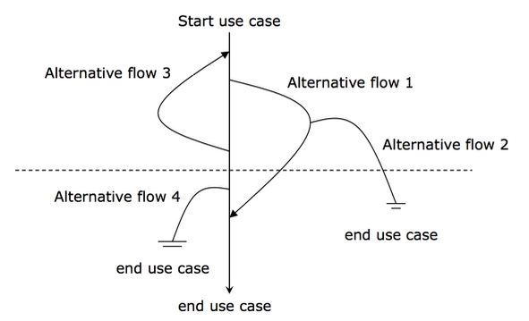
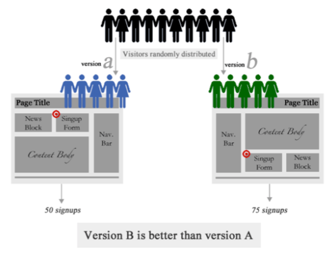
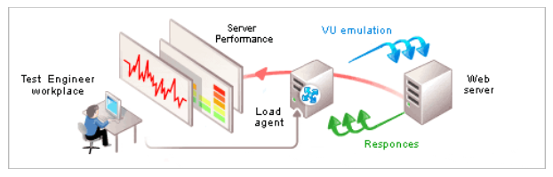
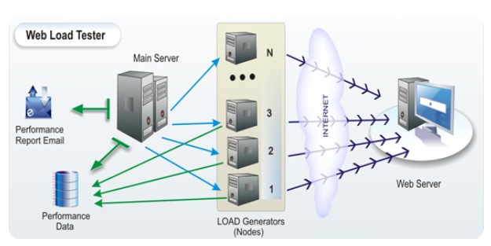
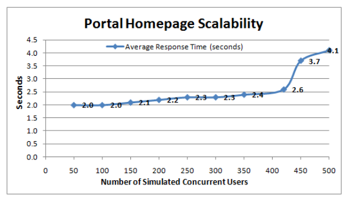
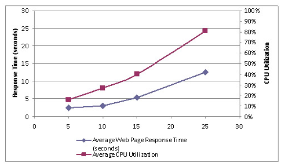
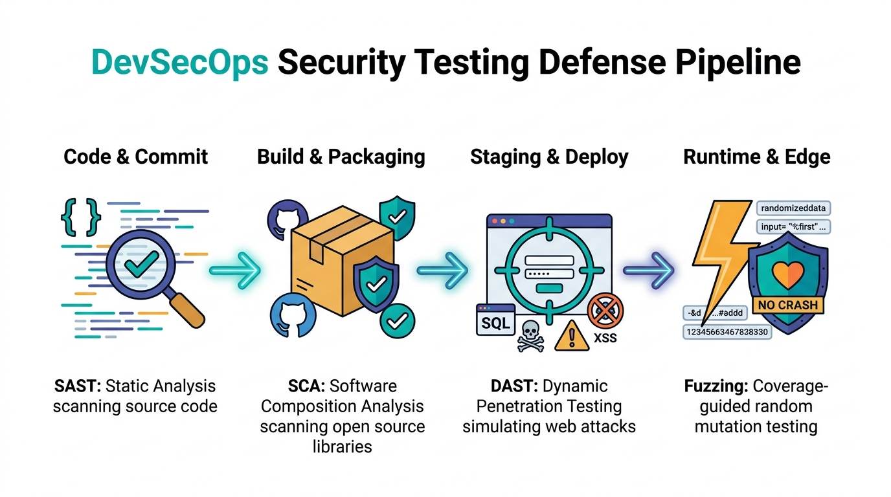

# 軟體品質與測試

### 第 8 章：系統測試 (System Testing)、行為驅動開發 (BDD) 與現代非功能性驗證

授課教師：薛念林 教授

> 「單元測試關心內部零件，整合測試關心齒輪銜接，  
> 而系統測試關注的是整部車能否在暴風雨中以 120km/h 載客安全奔馳。」  
> 從使用案例流程、BDD 活文件、微服務契約與 AI 畫面模擬，到效能飽和點、資安縱深與混沌工程，打造經得起真實世界考驗的強韌系統。

---

<!-- _class: outline-slide -->
<!-- header: '本章大綱 (Outline)' -->

## 本章重點導讀 (Key Highlights)

<div class="outline-columns">
<div>

### 🎯 業務流程、BDD 與現代 E2E 驗證
- [**8.1 使用案例與流程測試 (Use Case Testing)**](#3)：
  - 端到端使用者視角、對話式事件流（圖書館預借媒體）
  - 基本流 (BF) 與替代流 (AF<sub>1</sub>, AF<sub>2</sub>) 路徑組合設計與 ATM 演練
- [**8.2 行為驅動開發 (BDD) 與 Cucumber 測試**](#7)：
  - 活文件 (Living Doc) 哲學與三方共識 (Three Amigos)
  - Gherkin 語法 (`Given-When-Then`、`Scenario Outline` + `Examples`)
  - Java `BMICalculatorStepDefs` 參數自動映射實戰 (CCQ 1)
- [**8.3 微服務契約、Playwright 與 AI 畫面模擬**](#12)：
  - 微服務 API 漂移與 **Pact 消費者驅動契約測試**
  - **Playwright** 現代 Web E2E、**Headless 無頭光柵化**與 **Spectron / Electron**
  - **AI 瀏覽器代理人 (Browser Subagent)** 多模態雙軌感知與三代演進 (CCQ 2)

</div>
<div>

### 🛡️ 全方位非功能性測試工程
- [**8.4 可用性測試 (Usability Testing)**](#18)：
  - iPhone 計算機 `77 - 38.5 = 0` 之謎與 **Nielsen 十大可用性原則**
  - Hallway 走道測試與 **A/B 測試法**線上分流驗證 (CCQ 3)
- [**8.5 效能測試與負載工程 (Performance & Load)**](#23)：
  - 負載/壓力/突波/浸泡測試、Scalability 延展性、昂貴與困難根源
  - 虛擬使用者 (VUs)、**規劃 (使用輪廓/Ramp-up) ➔ 執行 (Thresholds) ➔ 分析 (三大黃金指標與飽和點)**、**k6 vs. JMeter** (CCQ 4)
- [**8.6 相容性測試 (Compatibility)**](#31)：跨環境/瀏覽器與官方認證測試
- [**8.7 安全性測試 (Security)**](#33)：攻擊者思維、**OWASP Top 10**、**SAST/DAST/SCA/Fuzzing** 與 **STRIDE + CVSS** 程序 (CCQ 5)
- [**8.8 回復性與彈性測試 (Resilience)**](#37)：**MTBF/RPO/RTO/MTTR**、WAL 回滾、Resilience4j 斷路器與混沌工程四步程序 (CCQ 6)
- [**8.9 課堂實習與六大真實系統測試選型演練**](#41)

</div>
</div>

---

<!-- _class: lead -->
<!-- header: '8.1 使用案例與流程測試' -->

# **8.1 使用案例與流程測試 (Use Case Testing)**

> 「系統測試不是去驗證單一的小按鈕或獨立 API，  
> 而是站在真實使用者的角度，檢驗一整段端到端的使用流程能否順暢完成。」

---

<!-- header: '8.1 使用案例與流程測試' -->

## 系統測試的核心定位：端到端使用流程 (Usage Flow)

<div class="card-deck">

> 💡 **System Testing (系統測試)**：對完整整合之軟硬體系統進行的端到端全面評估，驗證系統是否符合其指定之功能與非功能需求規格。

<div class="two-columns">
<div class="card">

### 🔍 單元/整合測試 vs. 系統測試視角差異
- **單一功能測試（局部視角）**：
  - 驗證「點擊購買按鈕是否有反應」或「呼叫 `insertOrder()` 能否寫入資料表」。
- **系統流程測試（端到端使用者視角）**：
  - 關心完整的**連續價值鏈 (End-to-End Journey)**：
  - `登入帳號 ➔ 搜尋商品 ➔ 加入購物車 ➔ 填寫收件資訊 ➔ 付款結帳 ➔ 收到訂單確認信`
- **為什麼局部綠燈不等於系統可用？**
  - 單一模組各自通過測試，串聯起來仍可能發生 Session 遺失、狀態不同步或跨頁導向斷裂！

</div>
<div class="card">

### 📜 什麼是使用案例 (Use Case)？
- **核心定義**：
  - 描述**參與者 (Actor，使用者或外部系統)** 為了達成特定業務目標，與**系統 (System)** 進行的一系列對話互動過程。
- **黑箱規格精神**：
  - 如同使用者與系統之間的「**對話腳本**」，專注於系統外部可見的「**做什麼 (What)**」，而非內部「如何實作 (How)」。
- **圖書館系統「查詢並預借媒體」對話腳本**：
  | 步驟 | 使用者動作 (Actor) | 系統反應 (System) |
  | :---: | :--- | :--- |
  | **1** | 點選「查詢並預借媒體」 | 顯示查詢方式（關鍵字、列出所有媒體） |
  | **2** | 選擇「列出所有媒體」 | 列出媒體名稱、數量、租借狀況與「預借」鈕 |
  | **3** | 按下特定媒體旁「預借」鈕 | 檢查借閱權限，符合則顯示「租借成功」 |

</div>
</div>
</div>

---

<!-- header: '8.1 使用案例與流程測試' -->

## 基本流與替代流：如何衍生完整流程測試情境？

<div class="card-deck">

> 💡 使用者操作系統除了走最順利的成功主幹，必然會遭遇庫存不足、權限受限等分支狀況；流程測試必須系統性覆蓋所有分支組合！

<div class="content-columns">
<div class="content-text">

### 🌊 兩大事件流結構與路徑組合
- **1. 基本流 (Basic Flow, BF / Happy Path)**：
  - 最順利、最常見的主幹成功路徑（如順利完成圖書預借）。
- **2. 替代流 (Alternative Flows, AF<sub>1</sub>, AF<sub>2</sub> / Exception Paths)**：
  - 分支或異常處理路徑：
    - **AF<sub>1</sub>（書已被借走）**：顯示「目前無庫存，已加入預約排隊清單」。
    - **AF<sub>2</sub>（權限不足 / 重複預借）**：顯示「借書數已達上限或重複預借，無法預借」。
- **3. 由流程圖衍生四大測試情境 (Scenarios)**：
  - **情境一 (Happy Path)**：執行 `BF`（驗證基本預借成功）。
  - **情境二 (分支驗證 1)**：執行 `BF ➔ AF1`（驗證書籍已外借之預約排隊處理）。
  - **情境三 (分支驗證 2)**：執行 `BF ➔ AF2`（驗證重複預借或超額之防呆阻擋）。
  - **情境四 (複合分支驗證)**：執行 `BF ➔ AF1 ➔ AF2`（驗證多重分支交互路徑）。

</div>
<div class="content-figure">



</div>
</div>
</div>

---

<!-- header: '8.1 使用案例與流程測試' -->

## 8.1 課堂思辨與實戰演練：使用案例觀念辨析與 ATM 提款

<div class="card-deck">

> 💡 檢驗你對「使用案例測試」的時機、本質與對話式腳本設計是否真正融會貫通！

<div class="two-columns">
<div class="card">

### 🧭 使用案例測試五大迷思快篩（是非辨析）
- ❌ **迷思 1：「使用案例通常在整合測試結束、系統測試開始時才撰寫」**
  - **正解**：錯！使用案例在**需求分析階段**就應建立，作為後續開發與系統測試的共同依據。
- ✅ **觀念 2：「使用案例強調使用者操作的情境與先後順序」**
  - **正解**：對！聚焦端到端事件流時序。
- ❌ **迷思 3：「對話式使用案例是指必須有兩人以上參與設計才完整」**
  - **正解**：錯！「對話式」是指 **Actor（使用者動作）與 System（系統回應）一問一答**的互動格式。
- ❌ **迷思 4：「替代流與基本流兩者二選一來做測試即可」**
  - **正解**：錯！基本流與所有替代流都必須納入測試套件完整覆蓋。
- ✅ **觀念 5：「使用案例測試是一種系統層級測試」** —— 對！

</div>
<div class="card">

### 🏧 實戰演練：ATM 提款對話式使用案例與替代流
| 步驟 | 使用者動作 (Actor) | 系統反應 (System) |
| :---: | :--- | :--- |
| **1** | 插入金融卡 | 驗證磁條/晶片，顯示「請輸入 6~12 位密碼」 |
| **2** | 輸入密碼並按確認 | 連線銀行核對密碼通過，顯示功能主選單 |
| **3** | 點選「提款」並輸入金額 | 檢查帳戶餘額與鈔箱充足，吐鈔、扣款並印明細 |

- **關鍵替代流 / 例外流衍生測試案例**：
  - **AF<sub>1</sub>（密碼輸入錯誤）**：步驟 2 密碼錯誤 ➔ 提示重輸；**累計滿 3 次錯誤 ➔ 吃卡鎖帳並終止流程**。
  - **AF<sub>2</sub>（帳戶餘額不足）**：步驟 3 金額大於可用餘額 ➔ 顯示「餘額不足」，詢問是否重新輸入金額或退卡。
  - **AF<sub>3</sub>（逾時未取鈔）**：步驟 3 吐鈔後 30 秒未取走 ➔ 自動回收現鈔、沖正交易並記錄異常日誌。

</div>
</div>
</div>

---

<!-- _class: lead -->
<!-- header: '8.2 行為驅動開發與 Cucumber 測試' -->

# **8.2 行為驅動開發 (BDD) 與 Cucumber 測試**

> 「用業務人員、開發人員與測試人員都能讀懂的自然語言撰寫規格；  
> 讓需求文件本身就能直接按下執行鍵，成為永不過期的活文件 (Living Documentation)。」

---

<!-- header: '8.2 行為驅動開發與 Cucumber 測試' -->

## 行為驅動開發 (BDD) 與 Cucumber 核心架構

<div class="card-deck">

> 💡 [Cucumber](https://cucumber.io/) 是支援行為驅動開發 (Behavior-Driven Development, BDD) 的主流工具，將自然語言需求規格直接轉化為自動化驗收測試。

<div class="content-columns">
<div class="content-text">

### 🥒 四大核心概念與五大工程效益
- **四大核心構成**：
  1. **BDD 通用語言 (Gherkin)**：以結構化自然語言（支援中文/英文等數十種語言）描述系統預期行為。
  2. **特性文件 (`Feature Files`, `.feature`)**：儲存業務場景與測試步驟，作為團隊單一事實來源。
  3. **步驟定義 (`Step Definitions`)**：將 Gherkin 每一行文字自動映射至底層實作程式碼（Java、Python、JS、Ruby）。
  4. **跨框架整合**：可無縫結合 JUnit 5、Playwright、Selenium、Appium 或 REST Assured 驅動各層受測系統。
- **五大核心效益**：
  - **促進三方溝通協作 (PO / Dev / QA)**、**高可讀性與易維護性**、**端到端自動化執行**、**視覺化即時測試報告反饋**、**高度可擴展性（活文件 Living Documentation）**。

</div>
<div class="content-figure">


</div>
</div>
</div>

---

<!-- header: '8.2 行為驅動開發與 Cucumber 測試' -->

## Gherkin 語法實戰 (1)：基礎 Scenario 與參數化 Scenario Outline

<div class="card-deck">

> 💡 Gherkin 透過 **`Given-When-Then`** 對應單元測試的 **`Arrange-Act-Assert (3A)`**，並以 **`Scenario Outline + Examples`** 優雅解決多組測資重複問題！

<div class="two-columns">
<div class="card">

### 1️⃣ 基礎情境 (`Scenario`)：輸入與預期輸出
- **`Given` (前提條件 / 初始輸入狀態)**：設定測試前置資料。
- **`When` (觸發事件 / 輸入操作)**：描述使用者或系統關鍵動作。
- **`Then` (預期結果 / 輸出驗證)**：定義預期輸出與斷言。
- *(補充：`Background` 則用於抽取同一 Feature 下所有 Scenario 共用的前置步驟，如「Given 使用者已登入系統」)*。

```gherkin
Feature: 購物車結帳功能

  Scenario: 計算購物車商品總價
    Given 使用者的購物車中有一件 100 元的商品與一件 200 元的商品
    When 使用者點擊「前往結帳」
    Then 系統應顯示商品總價為 300 元
```

</div>
<div class="card">

### 2️⃣ 參數化情境大綱 (`Scenario Outline & Examples`)
- 當需以**同一套步驟測試多組輸入與預期輸出**時，使用 `<變數>` 佔位符搭配 `Examples:` 資料表（每列自動執行一次）：

```gherkin
Feature: BMI 計算器
  Scenario Outline: 計算不同身高體重的 BMI 值與評級
    Given 使用者的身高為 <height> 公分，體重為 <weight> 公斤
    When 系統進行 BMI 計算
    Then 系統計算出的 BMI 值應為 <expected_bmi>
    And 系統顯示的體重評級應為 "<expected_category>"

    Examples:
      | height | weight | expected_bmi | expected_category |
      | 170    | 60     | 20.8         | 正常體重          |
      | 160    | 80     | 31.3         | 肥胖              |
      | 180    | 50     | 15.4         | 體重過輕          |
```

</div>
</div>
</div>

---

<!-- header: '8.2 行為驅動開發與 Cucumber 測試' -->

## Gherkin 語法實戰 (2)：Java Step Definitions 參數自動映射

<div class="card-deck">

> 💡 透過 Cucumber Expressions（如 `{double}`, `{int}`, `{string}`），Cucumber-JVM 能自動擷取 Gherkin 句子中的數值與字串，注入 Java 方法參數並執行 JUnit 斷言！

<div class="two-columns">
<div class="card">

### 🧩 步驟一：`@Given` 與 `@When` 狀態接收與執行
```java
package bmi.cucumber;
import io.cucumber.java.en.*;
import static org.junit.jupiter.api.Assertions.assertEquals;

public class BMICalculatorStepDefs {
    private double height, weight;
    private double calculatedBmi;
    private String calculatedCategory;

    @Given("使用者的身高為 {double} 公分，體重為 {double} 公斤")
    public void setHeightAndWeight(double height, double weight) {
        this.height = height; // 自動綁定 <height>
        this.weight = weight; // 自動綁定 <weight>
    }

    @When("系統進行 BMI 計算")
    public void calculateBMI() {
        double hMeters = this.height / 100.0;
        this.calculatedBmi = Math.round(
            (this.weight / (hMeters * hMeters)) * 10.0) / 10.0;
        if (this.calculatedBmi < 18.5)
            this.calculatedCategory = "體重過輕";
        else if (this.calculatedBmi < 24.0)
            this.calculatedCategory = "正常體重";
        else
            this.calculatedCategory = "肥胖";
    }
```

</div>
<div class="card">

### ✅ 步驟二：`@Then` 預期輸出斷言與 LabDemo 對照
```java
    @Then("系統計算出的 BMI 值應為 {double}")
    public void verifyBMI(double expectedBmi) {
        // 驗證實際輸出是否等於 Examples 表中的 <expected_bmi>
        assertEquals(expectedBmi, this.calculatedBmi, 0.05,
            "BMI 計算結果不符合預期！");
    }

    @Then("系統顯示的體重評級應為 {string}")
    public void verifyCategory(String expectedCategory) {
        // 驗證評級字串是否等於 "<expected_category>"
        assertEquals(expectedCategory, this.calculatedCategory,
            "體重評級不符合預期！");
    }
}
```

- **🧪 課堂實習對應 ([`bmi_cucumber.md`](../../lab.html?file=LabDemo/docs/u09_cucumber_bdd/bmi_cucumber.md))**：
  - **BMI 範例**：[`BMICalculatorStepDefs.java`](../../lab.html?file=LabDemo/src/test/java/u08_cucumber/bmi/BMICalculatorStepDefs.java) 與 [`RunCucumberTest.java`](../../lab.html?file=LabDemo/src/test/java/u08_cucumber/bmi/RunCucumberTest.java)
  - **電商範例**：[`Login.java`](../../lab.html?file=LabDemo/src/test/java/u08_cucumber/ecommerce/Login.java)、[`Register.java`](../../lab.html?file=LabDemo/src/test/java/u08_cucumber/ecommerce/Register.java)、[`Cart.java`](../../lab.html?file=LabDemo/src/test/java/u08_cucumber/ecommerce/Cart.java) 與 Ninja 購物網 / Rapi Recorder 錄製回放。

</div>
</div>
</div>

---

<!-- header: '8.2 行為驅動開發與 Cucumber 測試' -->

## 概念核對問答 (CCQ 1)

<div class="ccq-columns">
<div class="ccq-text">

<!-- id: sqa-ch08-ccq1 -->
**問題情境**：  
【是非題】在 Cucumber (Gherkin 語法) 中，若要使用同一套測試步驟來測試多組不同的輸入值與預期輸出值（參數化資料驅動測試），應該使用 `Scenario` (情境) 搭配 `Background` (背景) 來撰寫。

- **A)** 正確 (True)
- **B)** 錯誤 (False)

</div>
<div class="ccq-logo">

<a href="https://nlhsueh.github.io/nickedupocket/#/student/sqa-ch08-ccq1" target="_blank"></a>

</div>
</div>

---

<!-- _class: lead -->
<!-- header: '8.3 微服務契約、Playwright 與 AI 畫面模擬' -->

# **8.3 微服務契約測試、現代 E2E 與 AI 畫面模擬**

> 「從微服務間的 Pact 合約防線、Playwright 零閃爍自動化，  
> 到結合多模態視覺 (VLM) 與無頭光柵化的 AI 瀏覽器代理人 (Browser Subagent)！」

---

<!-- header: '8.3 微服務契約、Playwright 與 AI 畫面模擬' -->

## 微服務 API 整合挑戰與 Pact 消費者驅動契約測試

<div class="card-deck">

> 💡 在微服務或前後端分離架構中，Provider 若擅自修改 `/api/user/{id}` 欄位名稱（如 `user_id` 改為 `userId`），Consumer 呼叫時將瞬間崩潰！

<div class="two-columns">
<div class="card">

### 🤝 消費者驅動契約測試 (Consumer-Driven Contract, Pact)
- **為什麼傳統整合測試不夠？**
  - 同時啟動數十個真實微服務進行對接極度緩慢、環境脆弱且難以定位破壞點。
- **Pact 三步解耦驗證工作流**：
  1. **Consumer 撰寫測試產生契約**：前端/呼叫端定義對 API 請求與回應 JSON 結構的期望，自動產出 **`pact.json` 契約文件**。
  2. **發布至 Pact Broker**：將契約上傳至共用契約中心。
  3. **Provider 下載契約本地回放驗證**：後端在 CI 流程中從 Broker 拉取契約，對自身控制層發送請求，驗證輸出格式 100% 符合 Consumer 期待！
- **核心效益**：**無須啟動雙方真實連線**，在 CI 階段秒級攔截破壞性變更 (Breaking Changes)！

</div>
<div class="card">

### 💻 Pact Consumer 契約定義實戰 (`Lab 11`)
```java
@ExtendWith(PactConsumerTestExt.class)
@PactTestFor(providerName = "UserService")
public class UserConsumerContractTest {

    @Pact(consumer = "FrontendApp")
    public V4Pact createContract(PactDslWithProvider builder) {
        return builder
            .given("使用者 ID 123 存在")
            .uponReceiving("查詢使用者 123 的請求")
                .path("/api/v1/users/123").method("GET")
            .willRespondWith()
                .status(200)
                .body(new PactDslJsonBody()
                    .integerType("id", 123)
                    .stringType("username", "alice")
                    .stringMatcher("email", ".*@.*", "a@b.com"))
            .toPact(); // 自動生成 pact.json 契約檔！
    }
}
```

</div>
</div>
</div>

---

<!-- header: '8.3 微服務契約、Playwright 與 AI 畫面模擬' -->

## 現代 Web E2E 測試利器：為什麼從 Selenium 轉向 Playwright？

<div class="card-deck">

> 💡 當需要驗證「從前端 UI 一路到底層資料庫」的完整業務旅程時，現代專案普遍以 **Playwright** 取代傳統緩慢且易閃爍 (Flaky) 的 Selenium。

<div class="two-columns">
<div class="card">

### ⚡ Playwright 三大工程突破
- **傳統 Selenium 的三大痛點**：
  - 透過 WebDriver HTTP 中轉啟動慢、非同步等待困難（充斥 `Thread.sleep()`）、測試極易隨機失敗 (Flaky Tests)。
- **Playwright 的三大核心優勢**：
  1. **原生智慧自動等待 (Auto-waiting)**：
     - 點擊或填入前，自動等待元素可見、啟用且停止動畫，大幅消除網路延遲造成的假警報。
  2. **抗網路波動與 HTTP 攔截 Mocking**：
     - 支援在 E2E 測試中攔截並 Mock 部分緩慢或不穩定的外部第三方 API。
  3. **強大工具鏈 (`Trace Viewer`)**：
     - 自動保存測試錄影、截圖與 DOM 時序快照；CI 失敗時可逐幀 (Frame-by-Frame) 回放查看 DOM 與網路請求！

</div>
<div class="card">

### 💻 Playwright (Java) E2E 測試實戰
```java
package lab.sqa.e2e;
import com.microsoft.playwright.*;
import org.junit.jupiter.api.*;
import static org.junit.jupiter.api.Assertions.*;

public class WebLoginE2ETest {
    static Playwright playwright;
    static Browser browser;

    @BeforeAll
    static void setUp() {
        playwright = Playwright.create();
        browser = playwright.chromium().launch(
            new BrowserType.LaunchOptions().setHeadless(true));
    }

    @Test
    void testUserLogin() {
        Page page = browser.newContext().newPage();
        page.navigate("http://localhost:8080/login");
        page.fill("#username", "alice");      // 自動等待輸入框就緒
        page.fill("#password", "password123");
        page.click("#login-button");          // 自動等待按鈕可點擊
        assertEquals("歡迎回來，alice",
                     page.textContent("#welcome-banner"));
    }
}
```

</div>
</div>
</div>

---

<!-- header: '8.3 微服務契約、Playwright 與 AI 畫面模擬' -->

## 無頭瀏覽器 (Headless) 與桌面端跨行程自動化 (Spectron / Electron)

<div class="card-deck">

> 💡 無頭瀏覽器絕非「不載入 CSS 的簡易文字爬蟲」，而是將完整像素光柵化於記憶體緩衝區的真實瀏覽器核心！

<div class="two-columns">
<div class="card">

### 🖥️ 1. 無頭網頁技術 (Headless Web Automation)
- **技術本質**：
  - 如 Headless Chromium / WebKit，是在**沒有作業系統圖形視窗介面 (No GUI Display)** 下運行的**完整真實瀏覽器核心**。
- **三大底層運作機制**：
  1. **完整引擎運算**：Blink 排版引擎與 V8 JS 引擎照常執行完整 DOM 解析、CSS 樣式計算、Layout 版面配置與 Repaint 重繪。
  2. **記憶體畫布光柵化 (In-Memory Rasterization)**：畫面像素渲染至虛擬記憶體緩衝區 (Framebuffer)，而非實體顯卡螢幕。
  3. **CDP (`Chrome DevTools Protocol`)**：透過 WebSocket 直接向瀏覽器核心發送底層指令（網路攔截、DOM 查詢、模擬點擊與 60fps 視訊流擷取）。
- **優勢**：大幅降低 GPU/記憶體開銷，在 Linux 無 GUI 容器中高速產出像素級截圖與錄影。

</div>
<div class="card">

### 🪟 2. 桌面應用程式畫面模擬：Spectron 與 Electron
- **Electron 混合桌面架構挑戰**：
  - VS Code、Slack 與現代 AI IDE 皆採用 Electron（**Node.js 主行程 Main Process + Chromium 渲染行程 Renderer Process**），傳統 Web 工具無法穿透控制原生視窗。
- **Spectron 框架原理**：
  - 由 Electron 官方打造，結合 **ChromeDriver + WebDriverIO**，**同時接管 Main Process 與 Renderer Process**：
  - 既能模擬視窗內 HTML/CSS 點擊，更能檢驗**跨行程通訊 (IPC)**、**系統檔案對話框 (File Dialogs)** 與**原生選單 (Native Menus)**。
- **現代演進 (`Playwright for Electron`)**：
  - 隨 Spectron 停止維護，現代桌面 E2E 已全面轉移至 Playwright `_electron.launch()`，延續跨主行程注入並具備自動等待與 Trace 錄影。

</div>
</div>
</div>

---

<!-- header: '8.3 微服務契約、Playwright 與 AI 畫面模擬' -->

## AI 測試代理人畫面模擬 (Browser Subagent) 與三代技術演進

<div class="card-deck">

> 💡 以 **Google Antigravity Browser-Subagent** 為代表的新一代 AI 代理人，結合多模態視覺 (VLM) 與 DOM 感知，徹底擺脫傳統脆弱定位器 (Brittle Locators)！

<div class="two-columns-64">
<div class="card">

### 🤖 AI Browser-Subagent 三大核心能力
- **1. 多模態視覺與 DOM 雙軌感知 (Multimodal Dual-Loop)**：
  - 同時讀取 Accessibility/DOM 樹並截取渲染畫面送交**視覺語言模型 (VLM)**。
  - **攻克脆弱定位器 (Brittle Locators)**：前端修改 Tailwind class 或 div 階層不再導致測試崩潰；AI 以「人類視覺意圖」辨識「購物車圖示」或「藍色下一步按鈕」。
- **2. 自主探索測試 (Autonomous Exploratory Testing)**：
  - 僅需下達高階目標提示詞（如「*以管理員登入，嘗試未填品名建立商品，驗證防呆提示是否跳出*」），Subagent 自主規劃「導航 ➔ 觀察 ➔ 點擊 ➔ 驗證」閉環。
- **3. 自動化會話錄影與測試工件 (Session Artifacts)**：
  - 在無頭模式下自動將操作過程編碼為 **WebP / MP4 動態影片**，連同 DOM 快照與網路請求存為工件供回放除錯。

</div>
<div class="card">

### 📊 畫面模擬技術三代演進對比矩陣
| 演進階段與代表工具 | 操作驅動依據 | 強健度與維護成本 |
| :--- | :--- | :--- |
| **第一代：錄製回放**<br>*(Selenium IDE, Rapi)* | 絕對座標或靜態 DOM 路徑 | 🔴 **極脆弱 / 高成本**<br>*(版面微調即全數崩潰)* |
| **第二代：腳本與無頭**<br>*(Playwright, Spectron)* | 工程師手寫 CSS / XPath / Role | 🟡 **中強健 / 中成本**<br>*(具自動等待，仍受重構影響)* |
| **第三代：AI 代理人**<br>*(Antigravity Subagent)* | **VLM 視覺語意 + 動態目標推理** | 🟢 **極高強健 / 低成本**<br>*(自我修復、自動產出錄影工件)* |

</div>
</div>
</div>

---

<!-- header: '8.3 微服務契約、Playwright 與 AI 畫面模擬' -->

## 概念核對問答 (CCQ 2)

<div class="ccq-columns">
<div class="ccq-text">

<!-- id: sqa-ch08-ccq2 -->
**問題情境**：  
在現代 E2E 系統測試架構中，關於無頭瀏覽器 (Headless Browser)、桌面端自動化框架 (Spectron) 與 AI 瀏覽器代理人 (Browser Subagent) 的技術原理，下列敘述何者**最正確**？

- **A)** 無頭瀏覽器因無 GUI 介面，執行測試時不會載入 CSS 與排版引擎，僅執行純 JS 邏輯運算
- **B)** Spectron 僅用於純 Web 壓測，無法跨入 Electron 主行程控制桌面原生選單與對話框
- **C)** Browser Subagent 結合 VLM 視覺與 DOM 感知，能改善前端結構調整造成的定位器斷裂問題
- **D)** AI 瀏覽器代理人必須在實體螢幕有頭視窗中顯示，無法於 Linux 容器中輸出 WebP 錄影工件

</div>
<div class="ccq-logo">

<a href="https://nlhsueh.github.io/nickedupocket/#/student/sqa-ch08-ccq2" target="_blank"></a>

</div>
</div>

---

<!-- _class: lead -->
<!-- header: '8.4 可用性測試 (Usability Testing)' -->

# **8.4 可用性測試 (Usability Testing)**

> 「拿出你的 iPhone 手機計算機，依序按下 `77 - 38.5 =`，看看答案是多少？  
> 咦，竟然是 `0`？！你能從可用性工程解釋為什麼嗎？」

---

<!-- header: '8.4 可用性測試 (Usability Testing)' -->

## 破冰案例解密與 Jakob Nielsen 十大啟發式原則 (1 ~ 5)

<div class="card-deck">

> 💡 **為什麼 iPhone 計算機算 `77 - 38.5` 常按出 `0`？** 因為使用者習慣連按兩次 `C/AC` 清空，當小數點按錯或未看清狀態時，介面缺乏清晰的算式歷程可見性（直到新版 iOS 才補上頂部算式列）！

<div class="two-columns">
<div class="card">

### 🎯 可用性測試本質與 Nielsen 原則 (1 ~ 2)
- **可用性測試 (Usability Testing)**：
  - 評估真實使用者操作系統時是否**容易上手、容易學習、有效率、少犯錯且滿意度高**。
- **1. 系統狀態可見性 (Visibility of system status)**：
  - 系統應隨時透過適當回饋讓使用者知道目前進度與狀態（如上傳進度條、計算機輸入算式列）。
- **2. 系統與真實世界相符 (Match between system and real world)**：
  - 使用使用者熟悉的語言、詞彙與生活隱喻（如購物車、垃圾桶圖示），而非內部工程代碼（如 `ERR_DB_CONN_0x84`）。

</div>
<div class="card">

### 🛡️ Nielsen 啟發式可用性原則 (3 ~ 5)
- **3. 使用者控制與自由 (User control and freedom)**：
  - 使用者常誤觸功能，系統必須提供明確的「**緊急出口 (Emergency Exit)**」，支援輕鬆 **Undo（復原）/ Redo（重做）** 與取消操作。
- **4. 一致性與標準 (Consistency and standards)**：
  - 遵循平台通用規範；**不同頁面的「儲存」或「確認」按鈕樣式、位置與詞彙應保持一致**，不讓使用者困惑。
- **5. 預防錯誤 (Error prevention)**：
  - 比提供好錯誤訊息更重要的是「**在犯錯前預先防範**」（如 Format 格式化磁碟或刪除帳號前，強制跳出二次確認對話框）。

</div>
</div>
</div>

---

<!-- header: '8.4 可用性測試 (Usability Testing)' -->

## Nielsen 十大啟發式原則 (6 ~ 10) 與實務情境連連看

<div class="card-deck">

> 💡 將真實介面設計缺失或特色，精準對應至 Jakob Nielsen 的十大可用性啟發準則！

<div class="two-columns">
<div class="card">

### 🏆 Nielsen 啟發式可用性原則 (6 ~ 10)
- **6. 辨識勝於記憶 (Recognition rather than recall)**：
  - 讓物件、動作與選項清晰可見（如提供視覺化選單而非背誦指令），降低短期記憶負荷。
- **7. 彈性與使用效率 (Flexibility and efficiency of use)**：
  - 為新手提供清晰引導，同時為**專家提供快捷鍵 (Accelerators / Shortcuts)** 與自訂巨集。
- **8. 美學與極簡設計 (Aesthetic and minimalist design)**：
  - 介面不應塞滿無關或罕用的功能；每多一個冗餘資訊，都會稀釋重要資訊的能見度。
- **9. 幫助使用者辨識、診斷並修復錯誤 (Help users recover)**：
  - 錯誤訊息應以淺顯語言指出問題，並**具體給出建設性解決方法**。
- **10. 說明文件與線上協助 (Help and documentation)**：
  - 必要時提供易搜尋、以使用者任務為導向的具體步驟說明。

</div>
<div class="card">

### 🔍 課堂練習 (8.9)：介面情境對應哪一條 Nielsen 原則？
| 介面設計現象 / 問題情境 | 對應之 Nielsen 啟發原則 |
| :--- | :--- |
| 1. 不同頁面「資料儲存」的按鈕樣式不同 | **#4 一致性與標準** *(違反)* |
| 2. 編輯器具備 `Undo` (復原) 功能 | **#3 使用者控制與自由** *(符合)* |
| 3. 一個畫面充斥過多無關緊要的功能 | **#8 美學與極簡設計** *(違反)* |
| 4. 為熟練用戶提供 `Ctrl+S` 快捷鍵 | **#7 彈性與使用效率** *(符合)* |
| 5. 應用真實世界直覺 Icon 表達功能 | **#2 與真實世界相符 / #6 辨識勝於記憶** |
| 6. Format 磁碟前提醒使用者再次確認 | **#5 預防錯誤** *(符合)* |
| 7. 僅告知「密碼強度不足」卻沒說少什麼 | **#9 幫助辨識、診斷並修復錯誤** *(違反)* |

</div>
</div>
</div>

---

<!-- header: '8.4 可用性測試 (Usability Testing)' -->

## 三大可用性評估方法：啟發式檢視、走道測試與 A/B 測試

<div class="card-deck">

> 💡 可用性測試不一定要花費百萬打造眼動儀實驗室；結合專家檢視、低成本走道測試與線上數據分流，即可全面把關體驗！

<div class="content-columns">
<div class="content-text">

### 🧪 三種經典可用性測試方式
1. **啟發式評估 (Heuristic Evaluation)**：
   - 由 3~5 位 UX 專家依據 **Nielsen 十大原則**逐項檢視介面並標記違規嚴重度。
2. **Hallway 走道測試 (Hallway Testing)**：
   - 隨機邀請辦公室走道經過的 **5~6 位非專案相關人員**親自操作新功能並「放聲思考 (Think Aloud)」。
   - **Nielsen 實證定律**：只需測試 **5 位使用者**，即可在極低成本下揪出 **80% 以上**最嚴重的可用性盲點！
3. **A/B 測試法 (A/B Testing)**：
   - 針對某項介面設計（如結帳按鈕位置、配色或文案）準備 **A（控制組）與 B（實驗組）** 兩版本進行線上隨機流量分流。
   - 透過真實使用者的**點擊率 (CTR) 與轉換率 (CVR)** 統計顯著性，以客觀數據決定最佳設計！

</div>
<div class="content-figure">



</div>
</div>
</div>

---

<!-- header: '8.4 可用性測試 (Usability Testing)' -->

## 概念核對問答 (CCQ 3)

<div class="ccq-columns">
<div class="ccq-text">

<!-- id: sqa-ch08-ccq3 -->
**問題情境**：  
使用者在某網站註冊設定密碼時，系統僅冷冰冰地跳出紅字「❌ 密碼設定強度不足！」，卻沒有說明究竟是「長度未滿 8 碼」、「缺少大寫字母」還是「缺少特殊符號」，導致使用者反覆盲目重試。請問這主要違反了 Jakob Nielsen 十大可用性原則中的哪一項？

- **A)** 原則 3：使用者控制與自由 (User control and freedom)
- **B)** 原則 7：彈性與使用效率 (Flexibility and efficiency of use)
- **C)** 原則 8：美學與極簡設計 (Aesthetic and minimalist design)
- **D)** 原則 9：幫助使用者辨識、診斷並修復錯誤 (Help users recover from errors)

</div>
<div class="ccq-logo">

<a href="https://nlhsueh.github.io/nickedupocket/#/student/sqa-ch08-ccq3" target="_blank"></a>

</div>
</div>

---

<!-- _class: lead -->
<!-- header: '8.5 效能測試與負載工程' -->

# **8.5 效能測試與負載工程 (Performance & Load Testing)**

> 「功能正確只是入場券；當雙 11 零點 10 萬人同時按下結帳時，  
> 系統是優雅承載，還是瞬間雪崩當機？這就是效能工程的戰場。」

---

<!-- header: '8.5 效能測試與負載工程' -->

## 效能測試四大類型與四大核心術語

<div class="card-deck">

> 💡 釐清「負載測試」與「壓力測試」的本質差異，並掌握回應時間、延遲、吞吐量與延展性四大核心指標。

<div class="two-columns">
<div class="card">

### 📊 效能測試四大測試型態對比
- **1. 負載測試 (Load Testing)**：
  - 驗證系統能否承受**預期的特定目標負載**（如購物網預估 100,000 人同時上線），確認回應時間與吞吐量符合 SLA。
- **2. 壓力測試 (Stress Testing)**：
  - 超越設計負荷持續加壓以**測試系統極限**，觀察系統到哪個階段開始回應遲緩或當機崩潰，以及崩潰後能否平穩降級與復原。
- **3. 突波測試 (Spike Testing)**：
  - 模擬瞬間湧入的極端洪峰流量（如演唱會門票開賣、整點搶購）。
- **4. 浸泡 / 耐久測試 (Soak / Endurance Testing)**：
  - 在常態負載下長時間連續運行（如 24~72 小時），專門抓出**記憶體洩漏 (Memory Leak)** 與連線池耗盡。

</div>
<div class="card">

### 🔑 效能測試四大核心名詞
- **回應時間 (Response Time)**：
  - 系統處理一個請求所需的總時間（電商黃金法則：超過 **8 秒**使用者放棄購買比例大幅飆升）。
- **網路延遲 (Latency)**：
  - 請求在網路傳輸耗費的時間；若網路慢不能怪罪演算法，須從網路架構或 CDN / 代理伺服器改善。
- **吞吐量 (Throughput / Workload)**：
  - 系統每秒可成功處理的交易量 (RPS / TPS) 而不發生錯誤。
- **延展性 (Scalability)**：
  - **垂直延展 (Vertically Up)**：升級單機硬體（Better Machine）。
  - **水平延展 (Horizontally Out)**：增加更多機器（More Machines + NLB 網路負載平衡器）。⚠️ *注意：若瓶頸在資料庫，盲目加機器會導致雙 DB 資料不一致，系統仍延展不開！*

</div>
</div>
</div>

---

<!-- header: '8.5 效能測試與負載工程' -->

## 為什麼效能測試既昂貴又困難？何時該開始執行？

<div class="card-deck">

> 💡 許多團隊低估了效能測試的工程複雜度，直到上線前夕才倉促加壓而釀成災難。

<div class="two-columns">
<div class="card">

### 💰 為什麼效能測試「並不便宜」？
1. **商用壓測工具與雲端發壓節點昂貴**。
2. **準備擬真測試資料極度耗時**（如百萬筆不重複的會員與訂單資料，避免全部命中資料庫快取而失真）。
3. **建置等比例測試環境 (Staging) 成本高昂**：
   - 若生產環境是大型主機或高規叢集，很難再買一套一模一樣的硬體專供測試。
4. **執行壓測時需獨佔資源**：
   - 壓測期間往往必須暫停其他團隊對共用測試環境與網路的使用。
5. **跨職能專家協同成本高**：
   - 必須動員 **DBA（資料庫管理師）、網管人員、後端開發者与測試工程師**共同監控與調校。

</div>
<div class="card">

### 🧩 為什麼效能測試「並不容易」？何時執行？
- **四大工程難點**：
  1. **軟體必須是最終版本**：微小的程式碼修改都可能劇烈改變效能表現。
  2. **真實行為模擬不易**：必須考慮使用者的**思考時間 (Think Time，如線上考試閱讀題目的停頓)**，並釐清檔案上下傳考驗的是系統效能還是網路頻寬。
  3. **瓶頸歸因困難**：當效能低落時，瓶頸究竟在 CPU、記憶體、DB 鎖定、網路，還是壓測軟體本身？
  4. **跨角色溝通挑戰**：如何說服管理層採購硬體？如何拿數據說服工程師重構慢查詢？
- **⏱️ 何時開始？** 雖屬系統測試，但應**盡早於模組開發期先行檢測核心瓶頸**；正式系統壓測則在軟硬體與網路環境皆安裝就緒後，「**壓測 ➔ 調校 (Tuning) ➔ 再壓測**」反覆迭代進行！

</div>
</div>
</div>

---

<!-- header: '8.5 效能測試與負載工程' -->

## 網路流量度量指標與分散式虛擬使用者 (Virtual Users)

<div class="card-deck">

> 💡 進行工作負載建模前，必須先釐清 Visit、Session、Page View 與 Hit 的精確定義，並透過分散式負載產生器模擬併發流量。

<div class="two-columns-64">
<div class="card">

### 📏 常用流量與會話度量指標
- **四大核心流量計量辨析（必考重點！）**：
  - **拜訪人數 (Visits / Unique Visitors)**：獨立造訪的使用者**人數**（Visit 越高，代表不同使用者進入系統的次數越高）。
  - **會話人次 (Sessions)**：使用者進入系統完成一連串操作的**人次**（通常以 30 分鐘無動作為 Session 超時）。
  - **頁面瀏覽數 (Page Views)**：被觀看之**網頁數量**（注意：**Page View 代表頁數，而非拜訪人次**！`Page Views / Session` 越高，代表每次進入系統瀏覽越多頁）。
  - **請求 / 點擊數 (Requests / Hits)**：載入單一頁面所觸發的所有 HTML、JS、CSS、圖片與 API **HTTP 請求總數**（1 個 Page View 可能產生 30 個 Hits，故 **Hit 高不代表人數多**！）。
- **其他關鍵統計**：每小時平均/尖峰 Session 數、每頁平均停留時間 (Think Time)、新舊用戶比值、單位時間最高同時上線數 (Concurrent Users)。

</div>
<div class="card">

### 🤖 虛擬使用者 (VUs) 與分散式加壓
- **Load Generator (負載產生器)**：以執行緒或協程模擬成千上萬名 **Virtual Users (VUs)** 並發送出請求。
- 當單機網卡或 CPU 不足以產生十萬併發時，採用 **Master-Slave 多台負載產生器分散式加壓**：




</div>
</div>
</div>

---

<!-- header: '8.5 效能測試與負載工程' -->

## 效能測試三階段生命週期 (1)：規劃階段與工作負載建模

<div class="card-deck">

> 💡 效能測試分為「**規劃 (Planning) ➔ 測試執行 (Execution) ➔ 結果分析 (Analysis)**」三大階段；壓測成敗取決於工作負載的真實度！

<div class="two-columns">
<div class="card">

### 📋 1. 使用輪廓 (Usage Profile) 與負載建模
- **為什麼不能只拿單一 API 暴力狂轟？**
  - 真實系統中不同角色的操作比例截然不同；單點狂轟無法反映真實資料庫鎖定與快取命中率。
- **使用輪廓 (Usage Profile) 設計範例**：
  - **電商網站平時輪廓**：瀏覽首頁與商品 `70%`、搜尋商品 `20%`、加入購物車與結帳下單 `10%`。
  - **📝 課堂演練（線上考試系統使用輪廓）**：
    - **開考前 3 分鐘（尖峰突波）**：`90%` 學生集中執行「登入驗證 + 載入試卷題目」（高併發讀取與 Session 建立）。
    - **考試進行中（持壓期）**：每隔 30~60 秒（**必須加入測驗題思考時間 Think Time！**）送出「單題作答暫存 API」。
    - **考試結束前 1 分鐘（寫入洪峰）**：`85%` 學生同時按下「交卷批改與成績寫入」（高併發 DB 交易寫入）。

</div>
<div class="card">

### 📈 2. 三段式加壓曲線規劃 (Ramping Strategy)
1. **上線暖身期 (Ramp-up)**：
   - 模擬使用者逐步上線，流量平滑爬升（如 2 分鐘內從 `0` 線性升至 `500 VUs`），觀察系統隨負載增加的變化。
2. **高峰持壓期 (Peak Load / Steady State)**：
   - 維持目標尖峰流量持續一段時間（如維持 `500 VUs` 連續 10 分鐘），檢驗穩定態表現。
3. **散場冷卻期 (Ramp-down / Cooldown)**：
   - 流量逐步歸零，檢驗記憶體、執行緒與 DB 連線池是否正常釋放。
- **🛡️ 執行階段鐵律 (`Load as Code`)**：
  - **壓測必須與系統監控同步進行**（同時監控 Server CPU、RAM、DB Pool 與網路，絕不可將壓測與監控分開！），並在腳本中設定硬性 **品質門檻 (Thresholds)**。

</div>
</div>
</div>

---

<!-- header: '8.5 效能測試與負載工程' -->

## 效能測試三階段生命週期 (2)：三大黃金指標與飽和點分析

<div class="card-deck">

> 💡 分析壓測報告時，必須揚棄「平均數陷阱」，從**延遲分位數 (P<sub>95</sub>/P<sub>99</sub>)**、**吞吐量高原**與**錯誤率**找出系統飽和點 (Saturation Point)！

<div class="two-columns-64">
<div class="card">

### 🥇 三大黃金指標與飽和點拐點 (`Saturation Point`)
1. **回應時間延遲分位數 (`P95` / `P99` Latency)**：
   - 平均值易被掩蓋；**P<sub>95</sub> (95% 請求之最大延遲)** 與 **P<sub>99</sub> 長尾延遲**才能反映高壓下使用者的真實痛苦。
2. **系統吞吐量與飽和點 (`Throughput RPS & Saturation`)**：
   - 隨並發人數增加，當 **RPS 達到高原不再上升，且回應時間出現指數級急彎飆升**時，該臨界點即為系統容量極限（**飽和點**）。
3. **系統錯誤率 (`Total Error Rate`)**：
   - 監控 HTTP 5xx 崩潰、Timeout 逾時與拒絕連線比例。
- **🔍 伺服器與資料庫關聯排查**：
   - 比對飽和點發生瞬間，**CPU 使用率是否突破 80%**、記憶體是否頻繁 GC、資料庫是否出現**慢查詢 (Slow Queries)** 或鎖定等待 (Lock Contention)。

</div>
<div class="card">


<div class="two-columns">
<div>



</div>
<div>



</div>
</div>

</div>
</div>
</div>

---

<!-- header: '8.5 效能測試與負載工程' -->

## 現代壓測雙流派對決：Grafana k6 (Load as Code) vs. Apache JMeter

<div class="card-deck">

> 💡 掌握雲原生程式化壓測 **k6** 與企業級 GUI 壓測 **Apache JMeter** 的雙軌實戰技能！

<div class="two-columns">
<div class="card">

### 🚀 現代雲原生流派：k6 (`Load as Code`)
- **核心優勢**：以 JS/TS 撰寫腳本納入 Git 版控、Go 引擎單機輕鬆產生上萬 VUs、原生支援 CI/CD **`thresholds` 自動阻斷**！
```javascript
import http from 'k6/http';
import { check, sleep } from 'k6';

export const options = {
  stages: [
    { duration: '30s', target: 20 },  // Ramp-up 暖身爬升
    { duration: '1m',  target: 100 }, // Peak Load 高峰持壓
    { duration: '20s', target: 0 },   // Ramp-down 散場降載
  ],
  thresholds: { // CI/CD 品質守門員：超標自動亮紅燈！
    http_req_duration: ['p(95)<250', 'p(99)<500'],
    http_req_failed: ['rate<0.01'],
  },
};
export default function () {
  const res = http.post('http://localhost:8080/api/v1/orders');
  check(res, { '狀態碼 200': (r) => r.status === 200 });
  sleep(0.1); // 模擬使用者思考時間 (Think Time)
}
```

</div>
<div class="card">

### 🖥️ 經典企業級流派：Apache JMeter
- **JMeter 核心特性與觀念辨析**：
  - 由 **Apache 軟體基金會**開發之開源 Java 壓測工具（非 GitHub 開發）。
  - **Thread Group (執行緒群組)**：代表**壓測端模擬的虛擬使用者並發數**（而非受測系統是否開啟多工模式！）。
  - **HTTP(S) Test Script Recorder**：內建 HTTP Proxy **錄製與回放 (Record & Replay)** 功能，可搭配正則表達式過濾 `.jpg`/`.gif` 等靜態資源。
  - **Listeners (監聽器)**：提供多元圖表、彙總報告與回應時間分佈樹。
- **🛠️ JMeter 標準四步壓測實務 (`Lab 12 補充`)**：
  1. **設計擬真劇本**（依不同角色與情境比重配置）。
  2. **應用錄製器擷取基礎劇本**並參數化擴充。
  3. **結合監控軟體**（同步監控 AP 伺服器、壓測端、網路與 DB）。
  4. **綜合瓶頸分析**（交叉比對不同壓力下之 AP 與資料庫表現）。

</div>
</div>
</div>

---

<!-- header: '8.5 效能測試與負載工程' -->

## 概念核對問答 (CCQ 4)

<div class="ccq-columns">
<div class="ccq-text">

<!-- id: sqa-ch08-ccq4 -->
**問題情境**：  
在規劃與執行 Web 系統的效能與壓力測試時，關於工作負載指標與測試執行原則，下列哪一項敘述是**最正確**的？

- **A)** 網站的 Hit (請求點擊數) 越高代表獨立造訪人數越多，且壓力測試應與伺服器系統監控分開執行以免干擾數據
- **B)** 使用輪廓 (Usage Profile) 是設計工作流量的重要依據，且 `Page View / Session` 越高代表每次進入系統瀏覽越多網頁
- **C)** JMeter 中的 Thread (執行緒) 數量是指受測伺服器端是否開啟多工模式，且 JMeter 不具備錄製回放 (Record & Replay) 功能
- **D)** 當系統達到飽和點 (Saturation Point) 時，吞吐量 (RPS) 會持續線性暴增，而回應時間則會保持平坦不變

</div>
<div class="ccq-logo">

<a href="https://nlhsueh.github.io/nickedupocket/#/student/sqa-ch08-ccq4" target="_blank"></a>

</div>
</div>

---

<!-- _class: lead -->
<!-- header: '8.6 相容性測試' -->

# **8.6 相容性測試 (Compatibility Testing)**

> 「在開發者的 MacBook Chrome 上完美運行，  
> 不代表在客戶的 Windows Edge、iPhone Safari 或舊版資料庫上不會版面崩壞！」

---

<!-- header: '8.6 相容性測試' -->

## 跨環境相容性測試與官方認證測試 (Certification Testing)

<div class="card-deck">

> 💡 檢驗系統在各種硬體機器、作業系統、資料庫、網頁伺服器、瀏覽器與不同軟體版本間的交互運作一致性。

<div class="two-columns">
<div class="card">

### 🌐 多維度環境與網頁相容性測試
- **1. 系統基礎設施相容性**：
  - **硬體與主機**：從大型主機（IBM 360, HP 9000）到現代 x86 / ARM (Apple Silicon) 架構。
  - **作業系統與中介軟體**：Linux, Windows, macOS；資料庫（Oracle, SQL Server, PostgreSQL）；網頁伺服器（Apache, Nginx, Tomcat）。
  - **版本向後/向前相容**：同款軟體不同版本（如舊版瀏覽器或舊版 OS API）常存在相容性斷裂。
- **2. 網頁與行動端相容性五大要求**：
  - **跨瀏覽器視覺一致**：Chrome (Blink)、Safari (WebKit)、Firefox (Gecko) 渲染體驗一致。
  - **跨瀏覽器功能一致**：JS 事件與表單回應行為一致。
  - **電信商與網路相容**：支援不同電信網路環境（4G/5G/弱網）。
  - **行動裝置硬體碎片化**：不同手機型號、螢幕尺寸與解析度 (RWD)。

</div>
<div class="card">

### 🏅 特殊類型：認證測試 (Certification Testing)
- **什麼是認證測試？**
  - 主要由**產品發行廠商 (Vendor)** 執行的嚴格相容性驗證，旨在向企業客戶保證其軟體產品能穩定運行於哪些特定硬體與作業系統組合上。
- **企業實務案例**：
  - 如 **Microsoft SQL Server** 或 **Oracle Database** 發行新版本時，原廠會在各種伺服器硬體與 Linux/Windows 版本上進行詳盡測試，並於官網發布**官方相容性認證矩陣 (Compatibility Matrix)**。
  - 企業與軟體公司在**採購硬體或規劃系統升級時**，皆以此認證清單作為合規與維運保障的關鍵依據！
- **自動化相容性策略**：
  - 結合 **Playwright 多瀏覽器矩陣 (Projects)** 與雲端真機農場（BrowserStack / Sauce Labs）在 CI 中平行驗證。

</div>
</div>
</div>

---

<!-- _class: lead -->
<!-- header: '8.7 安全性測試 (Security Testing)' -->

# **8.7 安全性測試 (Security Testing)**

> 「功能測試驗證系統『做了該做的事 (Happy Path)』；  
> 安全性測試則是切換為攻擊者思維，驗證系統『無法被誘導去做不該做的事』！」

---

<!-- header: '8.7 安全性測試 (Security Testing)' -->

## 攻擊者思維、ISO 25010 安全六維度與 OWASP Top 10

<div class="card-deck">

> 💡 在 ISO 25010 品質模型中，安全性涵蓋**機密性 (Confidentiality)、完整性 (Integrity)、不可否認性 (Non-repudiation)、可歸責性 (Accountability)、真實性 (Authenticity)** 與抗拒授權漏洞。

<div class="two-columns">
<div class="card">

### 🚨 OWASP Top 10 核心 Web 風險精析
1. **A01: 失效的存取控制 (Broken Access Control)**：
   - **水平越權**（A 用戶偷看 B 用戶訂單）與**垂直越權**（一般用戶直接呼叫管理員 API）。
2. **A02: 加密機制失效 (Cryptographic Failures)**：
   - 明文儲存密碼、使用已被破解之弱雜湊（MD5/SHA1）、未強制啟用 HTTPS/TLS。
3. **A03: 注入攻擊 (Injection)**：
   - **SQL Injection**、Command Injection、**XSS (跨站腳本攻擊)**。
4. **A04: 不安全設計 (Insecure Design)**：
   - 缺乏威脅建模與業務防禦邏輯（如未限制密碼重設嘗試次數）。
5. **A05: 安全設定缺陷 (Security Misconfiguration)**：
   - 未改預設密碼、生產環境未關閉 Debug 模式暴露 Stack Trace。
6. **A06: 易受攻擊與過時組件 (Outdated Components)**：
   - 引入含已知 **CVE** 漏洞的第三方開源套件（如 `Log4j` 核彈級漏洞）。

</div>
<div class="card">

### 💉 經典攻防對照：SQL Injection 與參數化查詢
```java
// ❌ 致命危險寫法：字串直接拼接 SQL
// 若攻擊者輸入 userInput = "' OR '1'='1"
// 條件恆為真，無須密碼直接繞過登入！
String sql = "SELECT * FROM users WHERE user = '" +
             userInput + "' AND pass = '" + pass + "'";

// ✅ 安全防禦寫法：PreparedStatement 參數化預編譯
// 外部輸入一律被視為純文字參數，絕不改變 SQL 語法樹！
String sql = "SELECT * FROM users WHERE user = ? AND pass = ?";
PreparedStatement pstmt = conn.prepareStatement(sql);
pstmt.setString(1, userInput);
pstmt.setString(2, pass);
ResultSet rs = pstmt.executeQuery();
```

- **黃金安全鐵律**：**永不信任任何外部輸入 (Never Trust User Input)**！所有輸入皆須經過白名單驗證、編碼跳脫與參數化處理。

</div>
</div>
</div>

---

<!-- header: '8.7 安全性測試 (Security Testing)' -->

## 安全測試四大核心作法與標準四步執行程序

<div class="card-deck">

> 💡 將安全防線左移 (Shift-Left Security / DevSecOps)，結合靜態、動態、供應鏈與模糊測試，並依循 STRIDE 與 CVSS 標準把關！

<div class="two-columns-64">
<div class="card">

### 🛡️ 四大安全測試技術 (SAST / DAST / SCA / Fuzzing)
1. **SAST (`Static Application Security Testing`，靜態白箱)**：
   - 於編譯期掃描原始碼，揪出硬編碼金鑰 (Hardcoded Secrets)、SQL 字串拼接或危險 API。
2. **DAST (`Dynamic Application Security Testing`，動態黑箱)**：
   - 系統運行時從外部 HTTP 介面模擬駭客發送惡意 Payload（如 `' OR 1=1 --`、`<script>`），檢驗是否被攻破（如 OWASP ZAP）。
3. **SCA (`Software Composition Analysis`，軟體成分分析)**：
   - 掃描 `pom.xml` / `package.json` 第三方依賴，比對 **NVD (國家漏洞資料庫)** 攔截含 **CVE** 漏洞之套件。
4. **Fuzzing (`Coverage-guided Fuzzing`，模糊安全測試)**：
   - 如 **Google Jazzer**，利用位元組碼插樁自動生成突變 Byte 陣列餵給解析器，挖掘 NPE、OOM 或未捕獲崩潰（`Lab 13`）。

</div>
<div class="card">



### 📋 安全測試標準四步程序
- **Step 1：STRIDE 威脅建模**：分析 **S**poofing(假冒)、**T**ampering(篡改)、**R**epudiation(抵賴)、**I**nfo Disclosure(外洩)、**D**oS(阻斷)、**E**levation of Privilege(提權)。
- **Step 2：定義安全基準**：依循 **OWASP ASVS** 規範密碼、Session 與防重放。
- **Step 3：CI/CD 多維掃描 + 滲透測試**。
- **Step 4：CVSS 漏洞分級門檻**：依 **CVSS (0~10分)**，凡屬 **Critical (>9.0) 或 High (>7.0)** 強制阻斷發布！

</div>
</div>
</div>

---

<!-- header: '8.7 安全性測試 (Security Testing)' -->

## 概念核對問答 (CCQ 5)

<div class="ccq-columns">
<div class="ccq-text">

<!-- id: sqa-ch08-ccq5 -->
**問題情境**：  
在 DevSecOps 安全測試流水線中，若團隊希望能自動掃描專案 `pom.xml` 中所引入的第三方開源函式庫（例如檢查是否誤用了含有已知 CVE 高風險漏洞的舊版 `Log4j` 套件），應該優先採用下列哪一種安全測試技術？

- **A)** SAST (Static Application Security Testing，靜態應用安全測試)
- **B)** DAST (Dynamic Application Security Testing，動態應用安全測試)
- **C)** SCA (Software Composition Analysis，軟體成分分析)
- **D)** STRIDE 威脅建模中的 Repudiation (不可否認性檢驗)

</div>
<div class="ccq-logo">

<a href="https://nlhsueh.github.io/nickedupocket/#/student/sqa-ch08-ccq5" target="_blank"></a>

</div>
</div>

---

<!-- _class: lead -->
<!-- header: '8.8 回復性與彈性測試 (Resilience)' -->

# **8.8 回復性與彈性測試 (Recoverability & Resilience Testing)**

> 「硬體會壞、網路會斷、資料庫會當機；  
> 回復性與混沌工程測試的目標，是確保災難發生時資料零錯亂，且系統能在時限內自動自癒！」

---

<!-- header: '8.8 回復性與彈性測試 (Resilience)' -->

## 回復性測試核心觀念與四大關鍵時間軸指標

<div class="card-deck">

> 💡 回復性測試檢驗系統遭遇斷電、網路分區或 DB 當機時，能否保護資料一致性並在時限內恢復正常服務。

<div class="two-columns-64">
<div class="card">

### ⏱️ 高可用與災難復原四大黃金指標 (`MTBF / RPO / RTO / MTTR`)
1. **MTBF (`Mean Time Between Failures`，平均故障間隔時間)**：
   - 兩次故障之間的**平均正常穩定運轉時間**（衡量系統可靠度 Stability，**愈長愈穩定**）。
2. **RPO (`Recovery Point Objective`，復原點目標 — 往前回溯資料面)**：
   - 災難發生時，業務能容忍的**最大資料遺失時間窗口**（例如 `RPO = 0` 代表金融系統不允許遺失任何一筆已確認交易；決定備份與同步頻率）。
3. **RTO (`Recovery Time Objective`，復原時間目標 — 往後推算服務面)**：
   - 災難發生後，業務能容忍的**最大停機時間上限**（例如 `RTO = 5 分鐘` 代表系統必須在 5 分鐘內完成備援切換並恢復對外服務）。
4. **MTTR (`Mean Time to Recovery`，平均修復時間 — 實際耗時)**：
   - 工程團隊或自動自癒機制從故障發生到完全恢復服務的**實際平均耗時**（必須確保 **`MTTR ≤ RTO`**，現代雲原生追求秒級自癒）。

</div>
<div class="card">


> 🎯 **一眼分清 RPO vs. RTO**：  
> - **RPO 看過去（資料遺失量）**：「最多能丟掉幾分鐘前的資料？」  
> - **RTO 看未來（停機容忍度）**：「最多能停機幾分鐘不服務？」

</div>
</div>
</div>

---

<!-- header: '8.8 回復性與彈性測試 (Resilience)' -->

## 回復性測試四大實施作法與標準四步執行程序

<div class="card-deck">

> 💡 若系統要具備優異的回復度，架構設計時必須內建 **WAL 交易日誌、斷路器熔斷降級、主從自動容錯移轉**，並透過混沌工程主動驗證！

<div class="two-columns">
<div class="card">

### 🛠️ 回復性測試四大實戰作法
1. **資料庫交易回滾測試 (`Transaction Rollback & WAL`)**：
   - 於跨表轉帳第 2 步強行切斷 DB 連線，驗證能否靠 **WAL (`Write-Ahead Logging`)** 與 ACID 交易正確回滾，杜絕「A 扣款但 B 未入帳」！
2. **斷路器與服務降級測試 (`Circuit Breaker & Fallback`)**：
   - 以 **Resilience4j** 在下游支付超時或錯誤率 > 50% 時自動熔斷並切換 Fallback 降級隊列，保護主系統不被拖垮。
3. **故障轉移與主從切換測試 (`Failover Testing`)**：
   - 直接殺死 Primary DB，驗證 Sentinel 能否在數秒內將 Replica 升為主節點且客戶端自動重連。
4. **混沌工程故障注入 (`Chaos Engineering`)**：
   - 主動隨機殺死 Pod、注入 3000ms 延遲或模擬磁碟滿載。

</div>
<div class="card">

### 🔄 回復性測試四步標準程序 & Resilience4j 實戰
1. **Step 1：建立穩態假說 (`Steady State Hypothesis`)**：定義正常指標（如 `500 RPS`, `P99 < 200ms`, `Error < 0.1%`）。
2. **Step 2：注入真實故障 (`Inject Faults`)**：模擬斷網、斷電、OOM、第三方支付癱瘓。
3. **Step 3：驗證自癒與量測 `MTTR` (`Observe & Measure`)**。
4. **Step 4：稽核資料一致性 (`Audit Data Consistency`)**：確認無髒資料或雙重扣款。

```java
// Lab 13: Resilience4j 斷路器與重試自癒防線
@CircuitBreaker(name = "paymentSvc", fallbackMethod = "fallback")
@Retry(name = "paymentSvc")
public OrderResult processOrder(Order order) {
    return paymentClient.charge(order);
}
public OrderResult fallback(Order order, Throwable t) {
    return new OrderResult(order.getId(), PENDING_QUEUE, "進入非同步隊列");
}
```

</div>
</div>
</div>

---

<!-- header: '8.8 回復性與彈性測試 (Resilience)' -->

## 概念核對問答 (CCQ 6)

<div class="ccq-columns">
<div class="ccq-text">

<!-- id: sqa-ch08-ccq6 -->
**問題情境**：  
某銀行核心轉帳系統在災難復原規格書中規定：「當主機房發生斷電災難時，備援機房必須在 **3 分鐘內**完成切換並恢復對外轉帳服務；且已確認之交易紀錄**不允許遺失任何一筆（0 秒資料遺失）**。」請問這兩項要求依序對應至哪兩個回復性指標？

- **A)** MTBF = 3 分鐘，MTTR = 0 秒
- **B)** RPO = 3 分鐘，RTO = 0 秒
- **C)** RTO = 3 分鐘，RPO = 0 秒
- **D)** MTTR = 3 分鐘，MTBF = 0 秒

</div>
<div class="ccq-logo">

<a href="https://nlhsueh.github.io/nickedupocket/#/student/sqa-ch08-ccq6" target="_blank"></a>

</div>
</div>

---

<!-- header: '8.9 課堂實習與綜合演練' -->

## 🧪 8.9 課堂實習指引 (LabDemo Ch08 全套實戰演練)

<div class="card-deck">

> 💡 本章對應 `LabDemo` 四大現代系統測試實習模組，從 BDD 活文件、微服務契約與 Playwright，一路涵蓋 k6 壓測、Jazzer 模糊測試與混沌工程！

<div class="two-columns">
<div class="card">

### 🥒 實習 A：BDD、契約與 Web E2E (`u08 / u09`)
- **1. Cucumber BDD 活文件實戰 ([`bmi_cucumber.md`](../../lab.html?file=LabDemo/docs/u09_cucumber_bdd/bmi_cucumber.md))**：
  - 執行 [`RunCucumberTest.java`](../../lab.html?file=LabDemo/src/test/java/u08_cucumber/bmi/RunCucumberTest.java) 與 [`BMICalculatorStepDefs.java`](../../lab.html?file=LabDemo/src/test/java/u08_cucumber/bmi/BMICalculatorStepDefs.java)，觀察 `Scenario Outline` 表格如何自動驅動測試。
  - 延伸體驗電商註冊 ([`Register.java`](../../lab.html?file=LabDemo/src/test/java/u08_cucumber/ecommerce/Register.java))、登入 ([`Login.java`](../../lab.html?file=LabDemo/src/test/java/u08_cucumber/ecommerce/Login.java)) 與購物車 ([`Cart.java`](../../lab.html?file=LabDemo/src/test/java/u08_cucumber/ecommerce/Cart.java)) BDD 劇本。
- **2. Pact 契約與 Playwright E2E (`Lab 11`)**：
  - 手冊：[pact_and_playwright.md](../../lab.html?file=LabDemo/docs/u09_cucumber_bdd/pact_and_playwright.md)
  - 演練 Consumer-Driven `V4Pact` 契約生成，以及 [`BMICalculatorTest.java`](../../lab.html?file=LabDemo/src/test/java/u09_web/bmi/BMICalculatorTest.java) 與 Playwright 自動等待、Trace 錄影！

</div>
<div class="card">

### ⚡ 實習 B：k6 高併發壓測與混沌模糊測試 (`u10`)
- **3. k6 Load as Code 效能工程 (`Lab 12`)**：
  - 手冊：[k6_load_testing.md](../../lab.html?file=LabDemo/docs/u10_performance/k6_load_testing.md)（附 [jmeter.md](../../lab.html?file=LabDemo/docs/u10_performance/jmeter.md) 補充）
  - 撰寫 `stages`（Ramp-up ➔ Peak ➔ Ramp-down）與 `thresholds` (`p(95)<250`, `rate<0.01`)，實測並觀察飽和點與 P<sub>95</sub>/P<sub>99</sub> 延遲。
- **4. Jazzer 模糊測試與 Resilience4j 混沌注入 (`Lab 13`)**：
  - 手冊：[chaos_and_fuzzing.md](../../lab.html?file=LabDemo/docs/u10_chaos_fuzzing/chaos_and_fuzzing.md)
  - 使用 Google Jazzer 挖掘解析器崩潰漏洞，並以 `@CircuitBreaker` 驗證故障注入下之自動熔斷與降級自癒！

</div>
</div>
</div>

---

<!-- header: '8.9 課堂實習與綜合演練' -->

## 綜合情境演練：六大真實系統之系統測試強化重點

<div class="card-deck">

> 💡 不同業務屬性的系統，其風險命脈截然不同！請分析下列六大真實系統，討論各自最應優先強化的系統測試項目：

| 受測系統名稱 | 首要強化之系統測試維度 | 核心風險與測試設計關鍵考量 |
| :--- | :--- | :--- |
| **1. 數位照片網路沖洗系統** | **可用性 + 效能(大檔吞吐) + 相容性** | 一般民眾操作需直覺防呆（照片裁切預覽可見性）；大量高解析照片同時上傳之網路頻寬與儲存吞吐量；跨手機/瀏覽器相容。 |
| **2. 台北捷運換幣系統** | **可用性 + 實體硬體容錯回復 + 壓力** | 旅客匆忙操作介面須極簡零學習成本；卡幣、缺鈔、斷電時之**硬體狀態回復 (Recoverability)** 與帳務一致；尖峰時段連續操作耐久度。 |
| **3. 自動提款機 (ATM)** | **安全性 + 回復性 (RPO=0) + 流程替代流** | 金融防竄改與通訊加密 (**Security**)；斷電/斷網時**交易絕對原子性與沖正回滾 (WAL, RPO=0)**；密碼錯誤鎖卡、逾時回收鈔券等替代流。 |
| **4. 線上遊戲系統 (LOL)** | **極限效能(低延遲 P<sub>99</sub>) + 突波 + 安全性** | 10 人即時對戰對**網路延遲 (Latency)** 極度敏感；新賽季開服瞬間之**突波測試 (Spike)** 與長時間浸泡測試；防外掛封包竄改 (**Security**)。 |
| **5. 大學聯考電腦閱卷系統** | **功能精準度 (100%) + 批次吞吐 + 回復性** | 計分規則與劃卡異常識別（污損、雙重劃記替代流）**零容錯**；全國數十萬考生試卷集中批次處理效能；閱卷中斷之檢查點續跑回復。 |
| **6. 監理所車輛管理系統** | **安全性(個資/權限) + 整合相容 + 負載** | 涵蓋全國車籍與違規個資，嚴防**越權存取 (Broken Access Control) 與 SQLi**；與警政、稅務、保險跨機關介面契約相容與月底繳稅尖峰負載。 |

</div>

---

<!-- header: '系統測試總結與全景指南' -->

## 系統測試全景總結矩陣 (System Testing Panorama)

<div class="card-deck">

> 💡 系統測試跨越「功能流程」與「非功能品質屬性」，是軟體交付至真實世界前的最後一道全方位防線！

| 測試維度 | 核心回答的工程問題 | 代表方法與關鍵指標 | 主流自動化工具鏈 |
| :--- | :--- | :--- | :--- |
| **8.1 使用案例流程測試** | 端到端業務旅程與各分支是否順暢？ | 基本流 (BF) + 替代/例外流 (AF) 路徑組合 | 情境測試矩陣 |
| **8.2 行為驅動開發 (BDD)** | 團隊三方對需求規格是否毫無歧義？ | Gherkin (`Given-When-Then`, `Scenario Outline`) | **Cucumber-JVM** |
| **8.3 契約與現代 E2E** | 微服務介面與前端 UI 旅程是否破脆？ | Consumer-Driven Contract、Headless、VLM 雙軌感知 | **Pact, Playwright, AI Subagent** |
| **8.4 可用性測試** | 真實使用者操作是否直覺、高效、少錯？ | **Nielsen 十大啟發原則**、5 人走道測試、**A/B 測試** | A/B 分流平台、可用性觀察 |
| **8.5 效能與負載工程** | 高併發下系統何時飽和？延遲是否達標？ | 負載/壓力/突波/浸泡；**RPS, P<sub>95</sub>/P<sub>99</sub>, 飽和點** | **Grafana k6**, Apache JMeter |
| **8.6 相容性測試** | 跨 OS、跨瀏覽器、跨裝置表現是否一致？ | 跨引擎 (Blink/WebKit/Gecko) 矩陣、**官方認證測試** | Playwright Projects, BrowserStack |
| **8.7 安全性測試** | 系統能否抵禦惡意注入與越權攻擊？ | **OWASP Top 10**、**STRIDE 建模**、**CVSS 分級** | **SAST, DAST, SCA, Jazzer Fuzzing** |
| **8.8 回復性與彈性測試** | 災難發生時能否不丟資料並快速自癒？ | **MTBF, RPO(資料), RTO(停機), MTTR**、WAL、熔斷 | **Resilience4j**, Chaos Mesh |

</div>

---

<!-- header: '附錄：課堂互動參考解答' -->

## 附錄：課堂互動參考解答

<div class="card-deck">

> 💡 本章課堂互動 (CCQ 1 ～ CCQ 6) 官方標準解答與核心觀念解析總整理。

<div class="two-columns">
<div class="card">

### 🧭 CCQ 1 ～ 3：BDD、AI 畫面模擬與可用性
- **CCQ 1【錯誤 (B)】**：在 Cucumber 中進行多組輸入/輸出參數化測試，應使用 **`Scenario Outline`（情境大綱）搭配 `Examples`（範例表格）**；`Background` 是用於抽取各情境共用的前置步驟。
- **CCQ 2【Browser Subagent 結合 VLM 與 DOM 感知 (C)】**：無頭瀏覽器仍會完整載入 CSS 與 Layout 並光柵化至記憶體；Spectron 專用於跨 Electron 主行程與渲染行程；AI Browser Subagent 結合 VLM 視覺與 DOM 語意，有效攻克脆弱定位器問題。
- **CCQ 3【原則 9：幫助辨識、診斷並修復錯誤 (D)】**：錯誤訊息只告知「密碼強度不足」卻未指出具體缺少的條件與解決方式，違反 Nielsen 第 9 條原則。

</div>
<div class="card">

### 🎯 CCQ 4 ～ 6：效能壓測、資安與災難回復
- **CCQ 4【使用輪廓與 Page View/Session (B)】**：Hit 是一頁觸發的所有請求數，Hit 高不代表人數多；壓測必須與系統監控同步進行；JMeter Thread 代表模擬的虛擬使用者數且內建錄製回放；飽和點後 RPS 停滯且延遲指數飆升。
- **CCQ 5【SCA 軟體成分分析 (C)】**：檢查 `pom.xml` 第三方開源套件是否含已知 CVE 漏洞（如 Log4j）屬於 **SCA (Software Composition Analysis)**；SAST 掃描自有原始碼，DAST 則從外部動態攻擊。
- **CCQ 6【RTO = 3 分鐘，RPO = 0 秒 (C)】**：**RTO (Recovery Time Objective)** 為最大容許停機時間（3 分鐘內恢復服務）；**RPO (Recovery Point Objective)** 為最大容許資料遺失量（0 秒零遺失）。

</div>
</div>
</div>

<script>
(function() {
  function initHeaderDropdown() {
    var sections = [];
    var seenTitles = new Set();
    var slideSections = document.querySelectorAll("section[id]");
    
    // 1. Scan unique section titles and their slide IDs
    slideSections.forEach(function(sec) {
      var header = sec.querySelector("header");
      if (!header) return;
      
      var title = header.textContent.trim();
      title = title.replace(/^[◄◀]\s*/, "").replace(/\s*[►▶]$/, "").trim();
      if (!title || seenTitles.has(title)) return;
      
      seenTitles.add(title);
      sections.push({
        id: sec.id,
        title: title
      });
    });

    if (sections.length === 0) return;

    // Helper to create the dropdown DOM
    function createDropdownWrapper(currentTitle) {
      var wrapper = document.createElement("span");
      wrapper.className = "header-nav-wrapper";
      
      var titleSpan = document.createElement("span");
      titleSpan.className = "header-nav-title";
      titleSpan.title = "點擊固定或懸停查看所有章節快速跳轉";
      
      var textNode = document.createTextNode(currentTitle);
      var caretSpan = document.createElement("span");
      caretSpan.className = "nav-caret";
      caretSpan.textContent = " ▾";
      titleSpan.appendChild(textNode);
      titleSpan.appendChild(caretSpan);
      
      titleSpan.addEventListener("click", function(e) {
        e.stopPropagation();
        var wasOpen = wrapper.classList.contains("is-open");
        document.querySelectorAll(".header-nav-wrapper.is-open").forEach(function(w) {
          w.classList.remove("is-open");
        });
        if (!wasOpen) {
          wrapper.classList.add("is-open");
        }
      });
      
      var dropdown = document.createElement("div");
      dropdown.className = "nav-dropdown";
      
      dropdown.addEventListener("click", function(e) {
        e.stopPropagation();
      });
      
      var dropHeader = document.createElement("div");
      dropHeader.className = "nav-dropdown-header";
      var titlePart = document.createElement("span");
      titlePart.textContent = "📑 快速跳轉章節目錄";
      var countPart = document.createElement("span");
      countPart.style.fontSize = "11px";
      countPart.style.fontWeight = "normal";
      countPart.style.color = "#64748b";
      countPart.textContent = "共 " + sections.length + " 個章節";
      dropHeader.appendChild(titlePart);
      dropHeader.appendChild(countPart);
      dropdown.appendChild(dropHeader);
      
      var grid = document.createElement("div");
      grid.className = "nav-dropdown-grid";
      
      sections.forEach(function(s) {
        var item = document.createElement("a");
        var isActive = (s.title === currentTitle);
        item.className = "nav-dropdown-item" + (isActive ? " active" : "");
        item.href = "#" + s.id;
        
        var badge = document.createElement("span");
        badge.className = "badge";
        badge.textContent = "#" + s.id.padStart(2, "0");
        
        var itemText = document.createElement("span");
        itemText.className = "item-text";
        itemText.title = s.title;
        itemText.textContent = s.title;
        
        item.appendChild(badge);
        item.appendChild(itemText);
        
        item.addEventListener("click", function(e) {
          wrapper.classList.remove("is-open");
          dropdown.style.display = "none";
          window.location.hash = "#" + s.id;
          setTimeout(function() { dropdown.style.display = ""; }, 350);
        });
        
        grid.appendChild(item);
      });
      
      dropdown.appendChild(grid);
      wrapper.appendChild(titleSpan);
      wrapper.appendChild(dropdown);
      return wrapper;
    }

    // Close any pinned dropdown when clicking anywhere outside
    document.addEventListener("click", function(e) {
      if (!e.target.closest(".header-nav-wrapper")) {
        document.querySelectorAll(".header-nav-wrapper.is-open").forEach(function(w) {
          w.classList.remove("is-open");
        });
      }
    });

    // 2. Enhance each header element across all slides
    slideSections.forEach(function(sec) {
      var header = sec.querySelector("header");
      if (!header || header.dataset.navEnhanced) return;
      header.dataset.navEnhanced = "true";
      
      var title = header.textContent.trim();
      title = title.replace(/^[◄◀]\s*/, "").replace(/\s*[►▶]$/, "").trim();
      if (!title) return;
      
      header.innerHTML = "";
      var wrapper = createDropdownWrapper(title);
      header.appendChild(wrapper);
    });

    // 3. Auto-link and calibrate section items on the Outline slide (Slide 2)
    var secByNum = {};
    sections.forEach(function(s) {
      var m = s.title.match(/^(\d+\.\d+)\b/);
      if (m && !secByNum[m[1]]) {
        secByNum[m[1]] = s.id;
      }
    });
    var outlineSlide = document.querySelector("section.outline-slide, section[id=\"2\"]");
    if (outlineSlide) {
      outlineSlide.querySelectorAll("li").forEach(function(li) {
        var existingLink = li.querySelector(":scope > a, :scope > strong > a");
        if (existingLink) {
          var m = existingLink.textContent.trim().match(/^(\d+\.\d+)\b/);
          if (m && secByNum[m[1]]) {
            existingLink.href = "#" + secByNum[m[1]];
          }
          return;
        }
        var strong = li.querySelector(":scope > strong, :scope > b");
        if (strong) {
          var m = strong.textContent.trim().match(/^(\d+\.\d+)\b/);
          if (m && secByNum[m[1]]) {
            var a = document.createElement("a");
            a.href = "#" + secByNum[m[1]];
            strong.parentNode.insertBefore(a, strong);
            a.appendChild(strong);
          }
        }
      });
    }

    // 4. Auto-clamp hover zoom scale (--zoom-scale) so enlarged images never exceed slide (1280x720)
    function updateImgZoomScale(img) {
      var sec = img.closest("section");
      if (!sec) return;
      var w = img.offsetWidth;
      var h = img.offsetHeight;
      if (!w || !h) return;
      var x = 0, y = 0, cur = img;
      while (cur && cur !== sec && sec.contains(cur)) {
        x += cur.offsetLeft;
        y += cur.offsetTop;
        cur = cur.offsetParent;
      }
      var secW = sec.offsetWidth || 1280;
      var secH = sec.offsetHeight || 720;
      var padSide = 36;
      var padTop = 30;
      var isLeftOrigin = img.closest(":is(.two-columns, .two-columns-64, .two-columns-73, .three-columns) > .card:first-child");
      var availW = isLeftOrigin ? (secW - padSide - x) : ((x + w) - padSide);
      var availH = (y + h) - padTop;
      var tag = img.tagName ? img.tagName.toLowerCase() : "";
      var cap = (tag === "pre" || tag === "marp-pre") ? 1.42 : 2.0;
      var maxS = Math.min(cap, availW / w, availH / h, (secH - 60) / h);
      if (maxS < 1.0) maxS = 1.0;
      img.style.setProperty("--zoom-scale", maxS.toFixed(3));
    }
    document.querySelectorAll(".card img:not(.emoji), div.content-figure img:not(.emoji), .card pre, .card marp-pre").forEach(function(img) {
      if (img.dataset.zoomBound) return;
      img.dataset.zoomBound = "true";
      img.addEventListener("mouseenter", function() { updateImgZoomScale(img); });
      img.addEventListener("load", function() { updateImgZoomScale(img); });
      updateImgZoomScale(img);
    });
  }

  if (document.readyState === "loading") {
    document.addEventListener("DOMContentLoaded", initHeaderDropdown);
  } else {
    initHeaderDropdown();
  }
  setTimeout(initHeaderDropdown, 400);
})();
</script>
