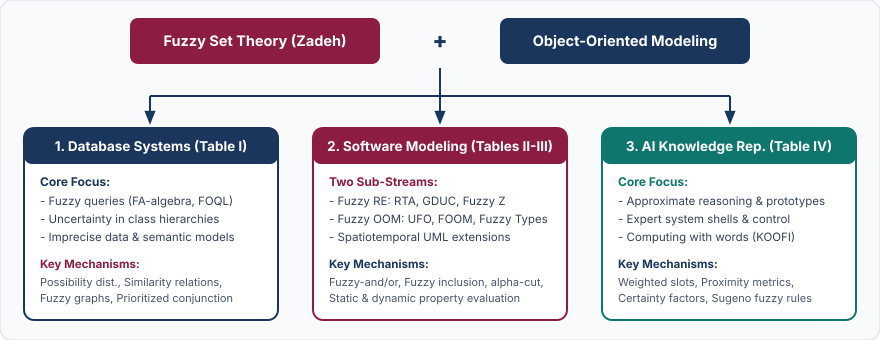
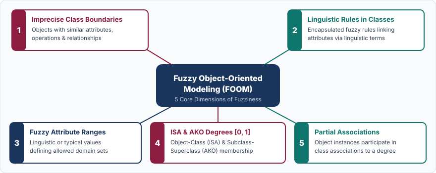
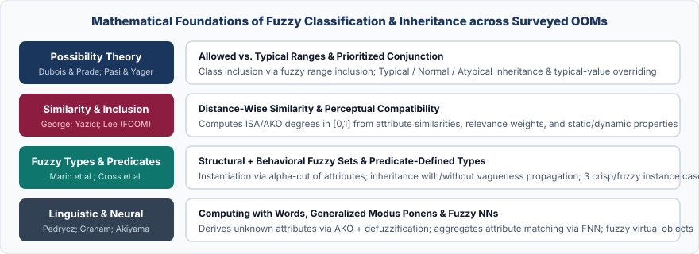

<!-- _class: lead -->

International Journal of Intelligent Systems (IJIS) · Vol. 16, pp. 807–820 · 2001

# A Note on Current Approaches to Extending Fuzzy Logic to Object-Oriented Modeling

A Systematic Survey of the Confluence of <strong>Fuzzy Set Theory</strong> and <strong>Object-Oriented Technology</strong> Across Database Management Systems, Software Modeling, and AI Knowledge Representation

<strong>Jonathan Lee1,*</strong> &nbsp;·&nbsp; <code>yjlee@selab.csie.ncu.edu.tw</code> 
<strong>Jong-Yih Kuo2</strong> &nbsp;|&nbsp; <strong>Nien-Lin Xue1</strong> 
1 Software Engineering Laboratory, Dept. of CSIE, National Central University, Chungli 32054, Taiwan 
2 Dept. of CSIE, Fu-Jen Catholic University, HsinChuang, Taipei, Taiwan

Published by John Wiley &amp; Sons, Inc. (2001) · Special Issue Intro Survey · Grant: National Science Council NSC 89-2213-E-008-070

<!--
Bibliographic Metadata & Survey Scope:
- Paper Title: A Note on Current Approaches to Extending Fuzzy Logic to Object-Oriented Modeling
- Authors: Jonathan Lee (corresponding author), Jong-Yih Kuo (Fu-Jen Catholic University), and Nien-Lin Xue (National Central University).
- Venue: International Journal of Intelligent Systems (IJIS), Vol. 16, No. 7, pp. 807–820, 2001, John Wiley & Sons, Inc.
- Special Issue Role: Serves as the framing survey article for the IJIS Vol. 16(7) special issue on fuzzy object-oriented systems, directly contextualizing contemporaneous contributions by Bordogna & Pasi (pp. 821–841), Cross (pp. 843–861), Marin et al. (pp. 863–880), and Yazici et al. (pp. 881–904), alongside 41 foundational references across database, software engineering, and AI communities.
-->

---

## Outline

1

<a href="#3">Motivation &amp; Five Types of Fuzziness</a> Why real-world OO concepts demand fuzzy set theory and the five dimensions of fuzziness in OOM.

2

<a href="#5">Data Modeling for Database Systems</a> Survey of 10 fuzzy OODBMS streams (Table I): hierarchies, similarity, FA-algebra, FOQL, and predicates.

3

<a href="#7">Fuzzy Object-Oriented Software Modeling</a> Two streams: Fuzzy Requirements Engineering (Table II) and Fuzzy OOM (Table III).

4

<a href="#10">Knowledge Representation for AI Systems</a> Prototypical frames, proximity metrics, expert shells, control libraries, and Computing with Words (Table IV).

5

<a href="#12">Cross-Domain Synthesis &amp; Open Gaps</a> Comparing mathematical mechanisms, static vs. dynamic properties, and open research challenges.

6

<a href="#14">Conclusion &amp; Takeaways</a> Why fuzzy OOM is essential for complex real-world software, database, and intelligent systems.

<!--
Survey Architecture (Sections 1–5):
The paper evaluates approaches along two overarching axes:
1. Identifying the five fundamental types of fuzziness required to represent imprecise real-world concepts in object-oriented models.
2. Investigating the distinct domain features arising when fuzziness is integrated into three software system families:
   - Section 2: Data Modeling for Database Systems (Table I, 10 approach groups).
   - Section 3: Fuzzy Object-Oriented Software Modeling, split into Section 3.1 Fuzzy Requirements Engineering (Table II, 4 groups) and Section 3.2 Extending Fuzzy Logic to OOM (Table III, 6 groups).
   - Section 4: Knowledge Representation for AI Systems (Table IV, 5 groups).
   - Section 5: Conclusion synthesizing the cross-domain impact.
-->

---

## 1. Motivation: Confluence of Fuzzy Logic & Object-Oriented Modeling

- **Rumbaugh et al. (1991)**: OOM thinks about problems using models organized around **real-world concepts**, usually expressed in natural language.
- **Zadeh (1986)**: Almost all concepts in or about natural language are **fuzzy in nature**.
- **Dubois et al. (1991) &amp; Lano (1992)**: Object classes with fuzzy membership values form a natural representation framework for real-world concepts.

Confluence of Fuzzy Set Theory and Object-Oriented Modeling across three surveyed application domains.

<!--
Conceptual Foundation (Section 1):
Classical object-oriented modeling assumes crisp class boundaries, exact attribute domains, binary ISA/AKO classification (an object either belongs to a class or does not), and crisp associations. However, real-world domains express knowledge through natural language categories ("young customer", "high-risk transaction", "convenient schedule").
By fusing Zadeh's fuzzy set theory with OO encapsulation, inheritance, and association constructs, researchers across three major computer science sub-disciplines have built richer modeling tools:
1. Database Systems: Fuzzy queries, fuzzy OODBMS, and uncertain inheritance hierarchies.
2. Software Modeling: Capturing imprecise requirements and managing dynamic fuzzy behavior.
3. AI Systems: Approximate reasoning and handling imprecise knowledge via fuzzy inference.
-->

---

## 1.2 Five Core Types of Fuzziness in Object-Oriented Modeling

To systematically compare diverse fuzzy OOM proposals, the survey identifies **five fundamental types of fuzziness** involved in modeling imprecise information:

The five dimensions of fuzziness in Fuzzy Object-Oriented Modeling (Lee, Kuo &amp; Xue, IJIS 2001).

<strong>Analytical Lens:</strong> Every surveyed framework in Tables I–IV is evaluated by <em>which</em> of these five dimensions it supports (attribute, association, class–subclass AKO, class–object ISA, and encapsulated rules/queries).

<!--
The Five Types of Fuzziness (Section 1, p. 808):
1. Imprecise Class Boundaries: A fuzzy class groups objects sharing similar (not necessarily identical) attributes, operations, and relationships.
2. Encapsulated Linguistic Rules: Rules containing linguistic terms encapsulated inside a class to describe relationships between attributes.
3. Fuzzy Attribute Ranges: Attribute domains defined by linguistic values (e.g., "young", "high") or typical values specifying allowed values for class instances.
4. Graded ISA & AKO Memberships: Membership degrees between an object and a class (ISA degree) and between a subclass and its superclass (AKO degree) mapped to the interval [0, 1].
5. Partial Associations: Associations between classes in which an object instance may participate to a partial extent (degree of participation).
-->

---

## 2. Data Modeling for Database Systems (Table I — Part A)

Four primary database mechanisms: (1) tuple membership degrees, (2) fuzzy similarity relations over attribute domains, (3) fuzzy inference queries (rules, graphs, association algebra), and (4) possibility distributions, fuzzy inclusion, and fuzzy predicates.

| Ref. | Primary Focus | Attribute Fuzziness | Association | Class–Subclass (AKO) | Class–Object (ISA) | Query |
| :--- | :--- | :--- | :--- | :--- | :--- | :--- |
| **Granger [8]** | Object recognition | Uncertainty | No | Frame hierarchy | Fuzzy matching | No |
| **Dubois &amp; Prade [3]** | Uncertainty in hierarchy | Possibility dist. | No | Fuzzy implication | Fuzzy inclusion | No |
| **George et al. [9–11]** | Uncertainty in hierarchy | No | No | Fuzzy similarity / inclusion | Crisp | Fuzzy similarity |
| **Tanaka et al. [12]** | Imprecise data mgmt | Vagueness, uncertainty | No | No | No | No |
| **Bordogna et al. [13–14]** | Imprecise data mgmt | Type, class, uncertainty | Link strength | Explicit | No | Graph-based operator |

<strong>Highlight — Dubois &amp; Prade [3]:</strong> Distinguish <strong>allowed vs. typical</strong> attribute ranges via possibility distributions, defining three inheritance modes: <em>typical</em>, <em>normal</em>, and <em>atypical</em> inheritance.

<!--
Database Systems Survey — First Wave (Section 2, pp. 808–810):
- Granger [8]: Frames object recognition as fuzzy pattern matching over frame taxonomies using possibility theory, weighing field similarities and differences.
- Dubois & Prade [3]: Intensionally define classes via allowed vs. typical fuzzy ranges; subclass inclusion C1 subset C2 is computed by comparing fuzzy ranges, enabling typical, normal, and atypical inheritance reasoning.
- George, Buckles & Petry [9–11]: Similarity-based OODM allowing partial subclassing and fuzzy inheritance; handles nonsingular attributes connected by AND (nested instances) and OR (merger instances) using attribute similarity metrics.
- Tanaka et al. [12]: Pragmatic OODM extensions for data vagueness and uncertainty in complex object structures.
- Bordogna, Lucarella & Pasi [13–14]: Fuzzy graph-based data model separating two levels of fuzziness — imprecision in data vs. uncertainty in knowledge of data — supporting crisp and soft selection constraints via graph-based browsing operators.
-->

---

## 2.2 Database Querying, Inheritance & Semantics (Table I — Part B)

| Ref. | Primary Focus | Attribute Fuzziness | Association | Class–Subclass (AKO) | Class–Object (ISA) | Query |
| :--- | :--- | :--- | :--- | :--- | :--- | :--- |
| **Na &amp; Park [15]** | Fuzzy query language | Linguistic fuzziness | Association pattern | Fuzzy schema graph | Fuzzy object graph | **FA-algebra** |
| **Yazici et al. [16–17]** | Semantic data model | Imprecision | Imprecision | Fuzzy similarity | Fuzzy similarity | Fuzzy rules |
| **Nepal et al. [18]** | Fuzzy query (image DB) | No | No | No | Fuzzy similarity | **FOQL** (weighted) |
| **Pasi &amp; Yager [19]** | Uncertainty in hierarchy | Possibility dist. | No | Partial link (frame) | Prioritized conjunction | No |
| **Cross et al. [20–21]** | Fuzzy classification | Uncertainty | No | Fuzzy predicate | Fuzzy predicate | Fuzzy rules |

- **Na &amp; Park [15]**: Dual fuzzy graphs (schema = intensional; object = extensional) + **FA-algebra** with 5 primitive association patterns.
- **Pasi &amp; Yager [19]**: **Prioritized conjunction operator** resolves conflicts between a frame and its ancestors (closer frame = higher priority) and formalizes *typical value overriding*.
- **Cross [20–21]**: Analyzes `instance-of`, `a-kind-of`, and `category` relationships across **3 fuzzy instance-of cases** (crisp type/fuzzy obj, fuzzy type/crisp obj, fuzzy type/fuzzy obj).

<!--
Database Systems Survey — Advanced Query & Inheritance Models (Section 2, pp. 810–812):
- Na & Park [15]: Formalizes Fuzzy Association (FA) algebra where every association pattern carries a truth value; five primitive patterns compose into complex queries for high-level fuzzy OODB query languages.
- Yazici & Koyuncu [16–17]: Handles similarity-based fuzziness at three levels — attribute (available but imprecise), object–class (computed from similarities and attribute relevance), and class–superclass + associations.
- Nepal et al. [18]: Proposes FOQL for content-based image retrieval (CBIR), keeping query results fuzzy via "fuzzy extents" (sets of objects with membership degrees), recursive named queries, and weighted predicates for user feature preferences.
- Pasi & Yager [19]: Categorizes four inheritance arrangements (pure hierarchy, diverging ancestors, converging links, partially connected links) and aggregates vague/default attribute values via prioritized conjunction.
- Cross et al. [20–21]: Extends generalized object models with predicate-defined fuzzy types and clarifies how supertype–subtype membership degrees govern inheritance of default values, constraint values, and methods.
-->

---

## 3.1 Software Modeling: Fuzzy Requirements Engineering (Table II)

Applying fuzzy logic to **Requirements Engineering** addresses trade-offs among conflicting imprecise requirements and tolerances of imprecision in formal specifications:

| Ref. | Primary Focus | Attribute Fuzziness | Association | Aggregation |
| :--- | :--- | :--- | :--- | :--- |
| **Yen et al. [23–24]** | Requirement trade-off analysis | Imprecision | Degree of conflicting | Implicit |
| **Lee &amp; Kuo [22]; Lee &amp; Xue [27]** | Requirement trade-off &amp; GDUC | Imprecision | Degree of conflicting | **Fuzzy-and / Fuzzy-or** |
| **Matthews &amp; Swatman [28]** | Fuzzy formal specification (Z) | Linguistic fuzziness | Fuzzy relation | No |
| **Pham [25]** | Fuzzy formal specification (Z) | Linguistic fuzziness | Fuzzy relation | No |

- **Yen et al. [23–24]**: Derives numeric priorities from customer trade-offs via **marginal rate of substitution (MRS)** in decision science.
- **Lee &amp; Kuo (RTA) [22] &amp; Lee &amp; Xue (GDUC) [27]**: Zadeh's test-score semantics + 4-level fuzzy-and/or hierarchy; GDUC separates soft vs. rigid goals in use cases.
- **Matthews &amp; Swatman [28] &amp; Pham [25]**: Extend **Z notation** with fuzzy relation operators (min-max / max-min composition, crisp isomorphism) and **fuzzy information granulation** (5 generalized constraints: equality, possibilistic, veristic, probabilistic, fuzzy graph).

<!--
Fuzzy Requirements Engineering Stream (Section 3.1, pp. 813–814):
- Yen et al. [23, 24]: Treats conflicting and cooperative degrees distance-wise between individual requirements and translates marginal substitution preferences into numeric priorities for aggregation.
- Lee & Kuo [22] (RTA): Classifies requirement relationships into five types (conflicting, irrelevant, cooperative, counterbalanced, independent) and computes compromise overall requirements via parameterized fuzzy-and / fuzzy-or operators across a 4-level hierarchy.
- Lee & Xue [27] (GDUC): Extends UML use cases with goals to handle imprecise nonfunctional requirements (soft vs. rigid goals) and analyze use-case–goal interactions.
- Matthews & Swatman [28]: Builds a Fuzzy Z toolkit defining fuzzy domain/range restrictions, min-max and max-min composition, relational inverse, and isomorphism laws reducing to classical Z on crisp sets.
- Pham [25]: Integrates Zadeh's fuzzy information granulation (words as labels of fuzzy granules) into Z along three dimensions: fuzzy quantifier, fuzzy relation, and fuzzy partial function.
-->

---

## 3.2 Software Modeling: Extending Fuzzy Logic to OOM (Table III)

| Ref. | Primary Focus | Attribute Fuzziness | Association | Property | Evaluation |
| :--- | :--- | :--- | :--- | :--- | :--- |
| **Gyseghem et al. [26]** | Model imprecise reqts (UFO) | Linguistic fuzziness | No | Static | Implicit |
| **Graham [29]** | Fuzzy objects (AKO) | Linguistic fuzziness | No | Static | Explicit |
| **Pedrycz &amp; Sosnowski [30]** | Model imprecise reqts | Linguistic fuzziness | No | Static | Fuzzy matching (FNN) |
| **Lee et al. (FOOM) [31]** | Model imprecise reqts | Linguistic, typical value | Degree of participation, uncertainty | **Static &amp; Dynamic** | Fuzzy implication / inclusion |
| **Marin et al. [32–33]** | Fuzzy database schema | Linguistic fuzziness | No | **Static &amp; Dynamic** | **α-cut** |
| **Yazici et al. [34]** | Spatiotemporal UML model | Uncertainty, fuzziness | Degree of participation | Static | Implicit |

- **Gyseghem (UFO) [26]**: Generic `Fuzzy-Set` class + generalized fuzzy sets pairing each universe element with fuzzy truth values `{p/true, n/false}`.
- **Graham [29]**: Derives unknown attribute values via explicit `AKO` degrees, **generalized modus ponens**, and defuzzification.
- **Pedrycz &amp; Sosnowski [30]**: Linguistic grammar + modifiers; uses **fuzzy neural networks (FNN)** for parametric learning and attribute-match aggregation.

<!--
Fuzzy OOM in Software Modeling (Section 3.2, pp. 815–816):
Notice a major structural shift visible in Table III: early fuzzy OOM frameworks (Gyseghem's UFO, Graham, Pedrycz & Sosnowski) evaluated class membership solely on static properties (attributes), whereas newer approaches (Lee et al.'s FOOM and Marin et al.'s Fuzzy Types) incorporate both static AND dynamic/behavioral properties (rules, associations, methods).
Note on Table III reference numbering in the printed IJIS paper: Table III row 2 prints "27" as a typo for Graham [29], while the text on p. 815 explicitly cites Graham [29] for explicit AKO degrees and fuzzy objects.
-->

---

## 3.3 Deep Dive: FOOM, Fuzzy Types & Spatiotemporal UML

<h3>Lee et al. — FOOM [31]</h3>

• Captures all <strong>5 types of fuzziness</strong> (boundaries, linguistic rules, fuzzy/typical ranges, ISA/AKO in <code>[0,1]</code>, uncertain partial associations).  
• Uses <strong>fuzzy inclusion</strong> to compute compatibility (perceptual fuzziness) across <strong>attributes, operations, and associations</strong> — not merely data clustering.

<h3>Marin et al. — Fuzzy Types [32–33]</h3>

• Defines a <strong>fuzzy type</strong> as a pair: <em>structural component</em> (fuzzy set over attributes) + <em>behavioral component</em> (fuzzy set over methods).  
• Instantiation selects an <strong>α-cut</strong> of attributes. 
• Two inheritance modes: <em>without</em> vs. <em>with</em> vagueness propagation.

<h3>Yazici et al. — Spatiotemporal UML [34]</h3>

• Extends <strong>UML</strong> with 2 constructors (uncertain attribute &amp; fuzzy object) plus a <strong><code>"T"</code> tag</strong> for time dependence.  
• Handles <strong>3 attribute uncertainty types</strong>: <em>incompleteness</em>, <em>null</em>, and <em>fuzzy</em>. 
• Graded part–whole aggregation in <code>[0,1]</code>; applied to environmental DBs.

<strong>Key Evolution:</strong> Software-modeling fuzzy OOM progressed from attribute-only fuzziness to <strong>full behavioral, temporal, and schema-level vagueness</strong> aligned with UML and OODB schemas.

<!--
Detailed Comparison of Three Flagship Fuzzy OOM Frameworks (Section 3.2, pp. 815–816):
1. FOOM (Lee, Xue, Hsu & Yang 1999): Emphasizes requirements-level imprecision. Computes ISA/AKO perceptual fuzziness via fuzzy inclusion over static and dynamic properties (attributes, operations, associations).
2. Fuzzy Types (Marin, Pons & Vila 2000, 2001): Tackles schema-level vagueness by making the type definition itself fuzzy — programmers assign membership degrees to structural attributes, while method membership is derived from calculus over attribute references inside methods. Instantiation chooses an alpha-cut threshold, and subclasses inherit structure+behavior either with or without vagueness propagation.
3. Spatiotemporal Semantic UML (Yazici, Zhu & Sun 2001): Bridges conceptual UML modeling and spatiotemporal databases, tracking present status, historical states, and future predictions with graded composition/aggregation degrees.
-->

---

## 4. Knowledge Representation for AI Systems (Table IV)

AI systems face poorly understood, nonlinear, or time-variant processes; combining fuzzy reasoning with OO reusability and rapid prototyping yields five major paradigms:

| Ref. | Primary Focus | Attribute Fuzziness | Property | Evaluation | Inference |
| :--- | :--- | :--- | :--- | :--- | :--- |
| **Torasso &amp; Console [37]** | Approximate reasoning | Possibility value | Static | No | Possibility relevance measure |
| **Lano [4]** | Approximate reasoning | Linguistic fuzziness | Static | Implicit | Implicit (proximity metric) |
| **Leung &amp; Wong [38]** | Approximate reasoning | Linguistic fuzziness | Static | Explicit | Implicit (certainty factor) |
| **Widmann [39]** | Knowledge-base control | Linguistic fuzziness | Static | Fuzzy inclusion | Fuzzy rules |
| **Akiyama &amp; Higuchi [40]** | Linguistic computation | Linguistic fuzziness | **Behavior / life cycle** | No | **Fuzzy rules (Sugeno)** |

- **Torasso &amp; Console [37]**: Prototypical frames with 3 weighted slot types: *necessary*, *sufficient*, and *supplementary*.
- **Lano [4] &amp; Leung &amp; Wong [38]**: Concept hierarchies via proximity metrics (with example-based learning) and fuzzy inheritance partial ordering modifying certainty factors.
- **Widmann [39] &amp; Akiyama [40]**: Reusable fuzzy-logic OOP class libraries for control; **KOOFI** applies Zadeh's **Computing with Words** using *fuzzy virtual objects* (life-cycle holders) and Sugeno inference for linguistic image querying.

<!--
AI Knowledge Representation Stream (Section 4, pp. 817–818):
- Torasso & Console [37]: Formalizes prototypical knowledge with weighted frame slots (necessary, sufficient, supplementary) matched against data via possibility theory and slot relevance.
- Lano [4]: Maps each class in a knowledge-base hierarchy to a fuzzy set defined by a conceptual proximity metric; learning transforms the knowledge base incrementally from new examples.
- Leung & Wong [38]: Integrates crisp and fuzzy class relationships into an OO expert system shell; fuzzy subclassing modulates certainty factors of inherited class variables and rules.
- Widmann & Widmann [39]: Encapsulates membership functions, fuzzy variables, and fuzzy rules as reusable OOP classes (primitive, inherited, or included) for intelligent vehicle control.
- Akiyama & Higuchi [40]: Operationalizes Zadeh's "Computing with Words" (1996) in KOOFI (Knowledge-based Object-Oriented Fuzzy user Interface) for still-image analysis and linguistic querying, introducing fuzzy virtual objects whose crisp/linguistic states evolve synchronously with real objects under Sugeno rule evaluation.
-->

---

## 4.2 Mathematical Foundations Across Surveyed OOMs

Across all 3 domains and 25+ surveyed systems, fuzzy classification, inheritance, and inference cluster into **four mathematical foundations**:

Four underlying mathematical paradigms powering fuzzy classification, inheritance, and reasoning in OOM.

<strong>Theoretical Diversity:</strong> No single fuzzy calculus dominates — <strong>possibility theory</strong> excels at default/typical inheritance, <strong>similarity/inclusion</strong> drives retrieval and requirements matching, <strong>α-cuts</strong> control schema instantiation, and <strong>Sugeno/FNN</strong> support linguistic control.

<!--
Cross-Cutting Mathematical Synthesis:
Looking across Tables I–IV reveals four recurring formal engines:
1. Possibility Theory (Dubois & Prade [3], Granger [8], Pasi & Yager [19], Torasso & Console [37]): Represents vague attributes as possibility distributions; distinguishes allowed vs. typical ranges and resolves inheritance conflicts via prioritized conjunction.
2. Similarity Relations & Fuzzy Inclusion (George et al. [9–11], Yazici et al. [16–17], Nepal [18], Lee et al. FOOM [31], Widmann [39]): Measures attribute/property nearness to compute ISA/AKO degrees in [0, 1].
3. Fuzzy Types, α-cuts & Predicate-Defined Types (Marin et al. [32–33], Cross et al. [20–21]): Elevates fuzziness from instances to schema/type definitions themselves, with explicit vagueness-propagation policies.
4. Linguistic Computing, GMP & Fuzzy Neural Networks (Graham [29], Pedrycz & Sosnowski [30], Akiyama & Higuchi [40]): Bridges human natural-language terms with numerical inference via generalized modus ponens, FNN parametric learning, and Sugeno rules.
-->

---

## 5. Cross-Domain Synthesis: Database vs. Software Modeling vs. AI

| Synthesis Dimension | Database Systems (Table I) | Software Modeling (Tables II–III) | AI Knowledge Rep. (Table IV) |
| :--- | :--- | :--- | :--- |
| **Primary Goal** | Store, classify &amp; query imprecise/uncertain data | Formulate vague RE &amp; analyze fuzzy OO systems | Approximate reasoning, control &amp; linguistic UI |
| **Dominant Fuzziness** | Attribute uncertainty, AKO/ISA hierarchies, link strength | Linguistic NFRs, fuzzy classes, α-cut schemas, time | Prototypical frames, certainty factors, life-cycle states |
| **Query / Reasoning** | FA-algebra, FOQL, graph operators, fuzzy similarity | Fuzzy-and/or (RTA), fuzzy inclusion, Fuzzy Z | Possibility matching, Sugeno rules, proximity learning |
| **Association Support** | Moderate (Bordogna, Na, Yazici) | Growing (FOOM uncertain links, Yazici aggregation) | Rare (focus on frame slots &amp; class hierarchies) |
| **Dynamic Behavior** | Mostly static schema/data | **Emerging** (FOOM rules, Marin methods, Yazici `"T"`) | **Life-cycle states** (Akiyama fuzzy virtual objects) |

<strong>Cross-Pollination Opportunity:</strong> Database models offer mature <strong>fuzzy query algebras</strong>, Software Modeling offers <strong>goal/requirement trade-offs &amp; UML extensions</strong>, and AI offers <strong>approximate inference &amp; learning</strong> — uniting them remains a grand challenge.

<!--
Comparative Analysis Across the Three Communities:
Synthesizing Tables I–IV highlights clear complementary strengths and blind spots:
- Database researchers (Table I) built the richest foundations for uncertain class hierarchies (Dubois & Prade, George, Pasi & Yager, Cross) and declarative fuzzy querying (FA-algebra, FOQL), yet rarely model dynamic object behavior or requirements trade-offs.
- Software Engineering researchers (Tables II–III) pioneered fuzzy requirements trade-off analysis (Yen, Lee & Kuo, Lee & Xue), fuzzy formal Z specifications (Matthews, Pham), and UML-aligned fuzzy models (FOOM, Yazici), gradually incorporating dynamic rules and behavioral fuzzy types (Marin).
- AI researchers (Table IV) excelled at approximate reasoning, prototypical learning, and Computing with Words (Torasso, Lano, Akiyama), but largely omitted rich association modeling and standard UML/database interoperability.
-->

---

## 5.2 Key Research Challenges & Open Gaps

<h3>1. Static vs. Dynamic Fuzziness</h3>

• Most surveyed OOMs focus on <strong>static properties</strong> (attributes and class hierarchies). 
• Capturing <strong>dynamic behavior</strong> — fuzzy state transitions, fuzzy rules, and behavioral fuzzy types (as in FOOM [31], Marin [32], Akiyama [40]) — needs unified semantics.

<h3>2. Conflicting Inheritance Semantics</h3>

• Multiple competing definitions of <strong>fuzzy inheritance</strong> exist: typical/atypical (Dubois), similarity-based (George), prioritized conjunction (Pasi &amp; Yager), and vagueness propagation (Marin). 
• Clear guidelines are needed to choose semantics per domain.

<h3>3. Standard Notation &amp; Tooling</h3>

• Only a handful of works extend de facto standards like <strong>UML</strong> (Yazici [34], Lee [31]) or <strong>Z</strong> (Matthews [28], Pham [25]). 
• Industrial adoption requires standard fuzzy metamodels and compiler/DBMS support.

<h3>4. Association &amp; Uncertainty Coupling</h3>

• Separating <strong>imprecision</strong> (vague boundaries) from <strong>uncertainty</strong> (confidence/truth degree) at both attribute and association levels remains under-explored outside Bordogna [13] and FOOM [31].

<!--
Critical Evaluation & Open Challenges:
Synthesizing the 41 surveyed references exposes four structural gaps that shaped subsequent research in fuzzy UML, fuzzy ontologies, and fuzzy software engineering:
1. Dynamic behavior gap: Only 3 of the 21 OOM/AI works in Tables I, III, and IV explicitly model dynamic behavior or life cycles.
2. Semantic fragmentation: Practitioners face incompatible definitions of fuzzy ISA/AKO and inheritance overriding across possibility, similarity, and predicate-based models.
3. Standardization gap: Bridging academic fuzzy formalisms with UML/OCL and commercial OODBMS/OOPLs is essential for real-world scalability.
4. Imprecision vs. uncertainty: Rigorously distinguishing vague values from uncertain confidence (as formalized by Dubois & Prade and operationalized in Bordogna and FOOM) prevents semantic conflation.
-->

---

## 6. Conclusion & Enduring Takeaways

<h3>1. Unified Taxonomy</h3>

Distilled <strong>5 core types of fuzziness</strong> in OOM — boundaries, linguistic rules, attribute ranges, ISA/AKO degrees in <code>[0,1]</code>, and partial associations.

<h3>2. Three-Domain Map</h3>

Systematically classified <strong>41 works</strong> across <strong>Database Systems</strong> (Table I), <strong>Software Modeling</strong> (Tables II–III), and <strong>AI Systems</strong> (Table IV).

<h3>3. Practical Value</h3>

Demonstrated that <strong>fuzzy theory + OO technology</strong> is uniquely suited to tackle real-world applications whose complexity and imprecision grow intensively.

<strong>Bottom Line:</strong> Rather than forcing premature crispness onto naturally vague real-world concepts, extending OOM with fuzzy logic preserves <strong>human-centric expressiveness</strong> while retaining OO's <strong>modularity, inheritance, and reusability</strong>.

<!--
Summary of Survey Contributions (Section 5, p. 818):
This 2001 IJIS survey established a widely cited conceptual baseline for researchers working at the intersection of fuzzy logic and object-oriented technology. By organizing the literature across five fuzziness dimensions and three major system domains (DBMS, Software Modeling, AI), it provides both a reference taxonomy for selecting appropriate fuzzy mechanisms (possibility theory, similarity, alpha-cuts, fuzzy rules) and a roadmap toward unified static+dynamic fuzzy OO modeling standards.
-->

---

<!-- _class: closing -->

# Thank You for Your Attention!

A Note on Current Approaches to Extending Fuzzy Logic to Object-Oriented Modeling

<strong>Jonathan Lee1,*</strong> &nbsp;·&nbsp; <code>yjlee@selab.csie.ncu.edu.tw</code> 
<strong>Jong-Yih Kuo2</strong> &nbsp;|&nbsp; <strong>Nien-Lin Xue1</strong> 
1 National Central University &nbsp;·&nbsp; 2 Fu-Jen Catholic University, Taiwan 
International Journal of Intelligent Systems, Vol. 16 (2001), pp. 807–820 · Grant: NSC 89-2213-E-008-070

<!--
Archival Reference:
- Citation: J. Lee, J.-Y. Kuo, N.-L. Xue, "A Note on Current Approaches to Extending Fuzzy Logic to Object-Oriented Modeling," International Journal of Intelligent Systems, Vol. 16, No. 7, pp. 807–820, 2001.
- Publisher: John Wiley & Sons, Inc.
- Funding: National Science Council (Taiwan), Contract Grant NSC 89-2213-E-008-070.
-->

