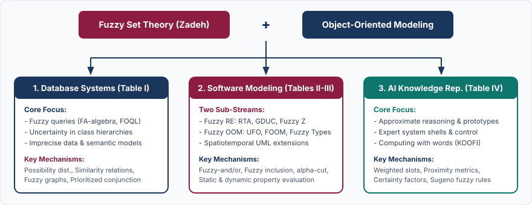
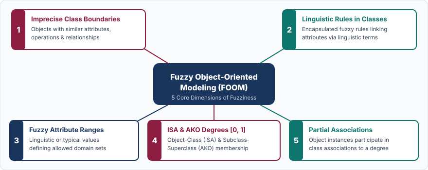
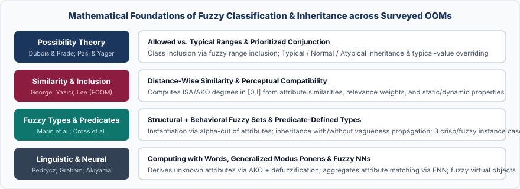

<!-- _class: lead -->

International Journal of Intelligent Systems (IJIS) · 第 16 卷，頁 807–820 · 2001

# 延伸模糊邏輯至物件導向塑模之現有方法綜述

A Note on Current Approaches to Extending Fuzzy Logic to Object-Oriented Modeling

系統性回顧<strong>模糊集合理論</strong>與<strong>物件導向技術</strong>匯流於<strong>資料庫管理系統</strong>、<strong>軟體塑模</strong>與<strong>人工智慧知識表示</strong>三大領域之代表方法

<strong>李允中（Jonathan Lee）1,*</strong> &nbsp;·&nbsp; <code>yjlee@selab.csie.ncu.edu.tw</code> 
<strong>郭忠義（Jong-Yih Kuo）2</strong> &nbsp;|&nbsp; <strong>薛念林（Nien-Lin Xue）1</strong> 
1 國立中央大學資訊工程學系軟體工程實驗室 &nbsp;·&nbsp; 2 輔仁大學資訊工程學系

John Wiley &amp; Sons, Inc. (2001) · 特刊綜述論文 · 國科會計畫補助：NSC 89-2213-E-008-070

<!--
論文索引與特刊定位：
- 論文篇名：A Note on Current Approaches to Extending Fuzzy Logic to Object-Oriented Modeling
- 作者群：李允中（Jonathan Lee，通訊作者）、郭忠義（Jong-Yih Kuo，輔仁大學資工系）、薛念林（Nien-Lin Xue，國立中央大學資工系）。
- 發表期刊：International Journal of Intelligent Systems (IJIS), Vol. 16, No. 7, pp. 807–820, 2001, John Wiley & Sons, Inc.
- 特刊導論角色：本文作為 IJIS 2001 年第 16 卷第 7 期「模糊物件導向系統」特刊之綜述論文，完整串聯同期收錄之 Bordogna & Pasi、Cross、Marin 等人與 Yazici 等人之最新突破，並系統整理 41 篇跨資料庫、軟體工程與 AI 領域的經典文獻。
-->

---

## 簡報大綱

1

<a href="#3">研究動機與五類核心模糊性</a> 為何真實世界物件概念需要模糊集合理論，以及模糊 OOM 的五大維度。

2

<a href="#5">資料庫系統之模糊資料塑模</a> 綜述 10 組模糊物件資料庫方法（表 I）：階層不確定性、FA-algebra、FOQL 與述詞型別。

3

<a href="#7">模糊物件導向軟體塑模</a> 兩大分支：模糊需求工程（表 II）與模糊邏輯延伸至 OOM（表 III）。

4

<a href="#10">人工智慧系統之知識表示</a> 原型框架、近似度指標、專家系統外殼、控制類別庫與詞彙計算（表 IV）。

5

<a href="#12">跨領域綜合比較與研究缺口</a> 比較四大數學基礎、靜態／動態模糊性落差與標準化挑戰。

6

<a href="#14">結論與核心啟示</a> 歸納模糊物件導向塑模於複雜真實應用中之長期價值。

<!--
全篇綜述架構（第 1–5 節）：
本文循兩條主軸展開系統性分析：
1. 歸納物件導向模型表達不精確資訊所需的「五種模糊性」。
2. 剖析模糊概念導入三類軟體系統時所衍生的領域特性與技術流派：
   - 第 2 節：資料庫系統之資料塑模（表 I，10 組代表研究）。
   - 第 3 節：模糊物件導向軟體塑模，分論第 3.1 節模糊需求工程（表 II，4 組）與第 3.2 節模糊 OOM（表 III，6 組）。
   - 第 4 節：人工智慧系統之知識表示（表 IV，5 組）。
   - 第 5 節：結論總結跨領域價值。
-->

---

## 1. 研究動機：模糊邏輯與物件導向塑模之匯流

- <strong>Rumbaugh 等人（1991）</strong>：物件導向塑模（OOM）是以<strong>真實世界概念</strong>組織問題模型，而這些概念通常以自然語言表達。
- <strong>Zadeh（1986）</strong>：自然語言中幾乎所有概念在本質上皆具有<strong>模糊性（fuzzy in nature）</strong>。
- <strong>Dubois 等人（1991）與 Lano（1992）</strong>：具模糊歸屬值之物件類別，是表徵真實世界概念最自然的框架。

模糊集合理論與物件導向塑模匯流於資料庫、軟體塑模與人工智慧三大領域之總覽。

<!--
理論動機（第 1 節）：
傳統物件導向塑模假設類別邊界明確、屬性值精確、物件對類別（ISA）與子類別對父類別（AKO）皆為二分歸屬（0 或 1），且物件關聯非有即無。然而真實世界充滿「年輕客戶」、「重要參與者」、「高風險案件」等自然語言模糊概念。
將 Zadeh 模糊集合理論與物件導向之封裝、繼承、關聯特性結合，於三大領域各展所長：
1. 資料庫系統：促成模糊查詢語言與模糊物件導向資料庫管理系統（FOODBMS）。
2. 軟體塑模：強化模糊需求形式化與系統動態行為管理。
3. 人工智慧系統：結合近似推理與物件重用性，處理不精確知識。
-->

---

## 1.2 物件導向塑模中的五類核心模糊性

為建立跨文獻統一分析框架，本文識別出塑模不精確資訊時必備的<strong>五類核心模糊性</strong>：

模糊物件導向塑模（FOOM）所涵蓋之五大模糊性維度（Lee, Kuo &amp; Xue, IJIS 2001）。

<strong>評比視角：</strong>表 I 至表 IV 中所有方法皆依此五維度加以檢視——是否支援<strong>屬性模糊</strong>、<strong>關聯模糊</strong>、<strong>類別–子類別（AKO）</strong>、<strong>類別–物件（ISA）</strong>與<strong>封裝規則／查詢推論</strong>。

<!--
五類核心模糊性精確定義（第 1 節，頁 808）：
1. 邊界不精確之類別：描述一組具備「相似」屬性、操作與關聯的物件集合。
2. 封裝於類別內之語言規則：以語言詞彙描述類別內部屬性間關聯的模糊規則。
3. 模糊屬性值域：以語言值或典型值（typical values）定義該類別實例所允許的屬性範圍。
4. 歸屬度映射至 [0, 1]：包含物件與類別間之 ISA 程度，以及子類別與父類別間之 AKO 程度。
5. 部分參與關聯：類別間之關聯允許物件實例僅以某一程度參與其中。
-->

---

## 2. 資料庫系統之模糊資料塑模（表 I — 上半部）

資料庫處理不精確性之四大機制：(1) 為元組賦予歸屬度；(2) 以模糊相似關係度量屬性值域可互換度；(3) 結合模糊規則、圖運算子與關聯代數進行模糊查詢；(4) 運用可能性分佈、模糊包含與模糊述詞。

| 文獻 | 核心焦點 | 屬性模糊 | 關聯模糊 | 類別–子類別 (AKO) | 類別–物件 (ISA) | 查詢機制 |
| :--- | :--- | :--- | :--- | :--- | :--- | :--- |
| **Granger [8]** | 物件辨識 | 不確定性 | 無 | 框架階層 | 模糊比對 | 無 |
| **Dubois &amp; Prade [3]** | 階層不確定性 | 可能性分佈 | 無 | 模糊蘊含 | 模糊包含 | 無 |
| **George 等人 [9–11]** | 階層不確定性 | 無 | 無 | 模糊相似／包含 | 精確 | 模糊相似 |
| **Tanaka 等人 [12]** | 不精確資料管理 | 模糊、不確定 | 無 | 無 | 無 | 無 |
| **Bordogna 等人 [13–14]** | 不精確資料管理 | 型別、類別、不確定 | 連結強度 | 顯式定義 | 無 | 圖運算子 |

<strong>代表亮點 — Dubois &amp; Prade [3]：</strong>以可能性分佈區分屬性的<strong>允許值域 vs. 典型值域</strong>，並提出三種繼承模式：<em>典型繼承（typical）</em>、<em>正常繼承（normal）</em>與<em>非典型繼承（atypical）</em>。

<!--
資料庫系統綜述（第 2 節，頁 808–810）：
- Granger [8]：將物件辨識視為基於可能性理論與框架階層的模糊樣式比對問題，依原型與物件欄位權重計算相似度與差異度。
- Dubois & Prade [3]：以屬性之允許值域與典型值域內涵定義類別，透過模糊值域包含度計算子類別與父類別之包含關係，支援典型／正常／非典型三種繼承推論。
- George 等人 [9–11]：基於相似度之 OODM，允許部分子類別繼承，並透過 AND（巢狀實例）與 OR（合併實例）處理非單值屬性，以相似指標度量屬性鄰近度。
- Tanaka 等人 [12]：以程序與建構子擴充 OODM 架構，務實管理複雜物件屬性與關係之模糊性與不確定性。
- Bordogna 等人 [13–14]：提出模糊圖資料庫模型，明確區隔「資料本身之不精確」與「對資料知識之不確定」兩層級，並設計圖運算子支援軟硬混合條件查詢。
-->

---

## 2.2 模糊查詢語言、繼承覆寫與廣義物件模型（表 I — 下半部）

| 文獻 | 核心焦點 | 屬性模糊 | 關聯模糊 | 類別–子類別 (AKO) | 類別–物件 (ISA) | 查詢機制 |
| :--- | :--- | :--- | :--- | :--- | :--- | :--- |
| **Na &amp; Park [15]** | 模糊查詢語言 | 語言模糊 | 關聯樣式 | 模糊綱要圖 | 模糊物件圖 | **FA-algebra** |
| **Yazici 等人 [16–17]** | 語意資料模型 | 不精確性 | 不精確性 | 模糊相似 | 模糊相似 | 模糊規則 |
| **Nepal 等人 [18]** | 影像模糊查詢 | 無 | 無 | 無 | 模糊相似 | **FOQL**（加權） |
| **Pasi &amp; Yager [19]** | 階層不確定性 | 可能性分佈 | 無 | 框架部分連結 | 優先合取運算子 | 無 |
| **Cross 等人 [20–21]** | 模糊分類模型 | 不確定性 | 無 | 模糊述詞 | 模糊述詞 | 模糊規則 |

- <strong>Na &amp; Park [15]</strong>：以「模糊綱要圖（內涵）」與「模糊物件圖（外延）」表達資料庫，提出含 5 種基本關聯樣式之 <strong>FA 代數</strong>。
- <strong>Pasi &amp; Yager [19]</strong>：以<strong>優先合取運算子（prioritized conjunction）</strong>化解框架與祖先間衝突（愈接近實例優先權愈高），並刻畫「典型值覆寫」強度。
- <strong>Cross [20–21]</strong>：分析 <code>instance-of</code>、<code>a-kind-of</code>、<code>category</code> 三種關係，區分<strong>三種模糊實例化情境</strong>（精確型別／模糊物件、模糊型別／精確物件、雙模糊）。

<!--
進階資料庫查詢與繼承語意（第 2 節，頁 810–812）：
- Na & Park [15]：FA 代數中每個模糊關聯樣式均附帶真值，五種基本樣式可組合成複雜查詢，作為高階模糊 OODB 查詢語言的數學基礎。
- Yazici & Koyuncu [16–17]：以相似關係處理三層模糊——屬性層（具資訊但不精確）、物件–類別層（結合相似度與屬性相關權重計算歸屬度）與類別–父類別／關聯層。
- Nepal 等人 [18]：針對內容式影像檢索（CBIR）設計 FOQL，導入「模糊外延（fuzzy extents）」保存查詢結果之模糊度，支援遞迴命名查詢與加權述詞以表達使用者特徵偏好。
- Pasi & Yager [19]：針對四種框架繼承拓撲（純階層、發散祖先、匯聚連結、部分連結），利用優先聚合運算子計算未知屬性預設值並精煉模糊屬性知識。
- Cross 等人 [20–21]：於廣義物件模型中引入述詞定義型別（predicate-defined types），剖析超型別與子型別歸屬度如何影響預設值、約束值與方法之繼承。
-->

---

## 3.1 軟體塑模：模糊需求工程（表 II）

將模糊邏輯導入<strong>需求工程（RE）</strong>，聚焦於衝突模糊需求之權衡分析，以及容忍不精確性之形式規格語言擴充：

| 文獻 | 核心焦點 | 屬性模糊 | 關聯模糊 | 聚合方式 |
| :--- | :--- | :--- | :--- | :--- |
| **Yen 等人 [23–24]** | 需求權衡分析 | 不精確性 | 衝突程度 | 隱式聚合 |
| **Lee &amp; Kuo [22]；Lee &amp; Xue [27]** | 需求權衡與 GDUC | 不精確性 | 衝突程度 | **Fuzzy-and / Fuzzy-or** |
| **Matthews &amp; Swatman [28]** | 模糊形式規格（Z） | 語言模糊 | 模糊關係 | 無 |
| **Pham [25]** | 模糊形式規格（Z） | 語言模糊 | 模糊關係 | 無 |

- <strong>Yen 等人 [23–24]</strong>：借鏡決策科學<strong>邊際替代率（MRS）</strong>，從客戶權衡偏好推導模糊衝突需求之數值優先權。
- <strong>Lee &amp; Kuo（RTA）[22] 與 Lee &amp; Xue（GDUC）[27]</strong>：以 Zadeh 測試分數語意與四層 fuzzy-and/or 權衡衝突；GDUC 則以柔性／剛性目標延伸使用案例。
- <strong>Matthews &amp; Swatman [28] 與 Pham [25]</strong>：擴充 <strong>Z 規格語言</strong>——前者建構模糊集合／關係工具組（min-max／max-min 合成與精確同構律），後者整合<strong>模糊資訊粒化（5 類廣義約束）</strong>與模糊量詞／關係／偏函數。

<!--
模糊需求工程分支詳解（第 3.1 節，頁 813–814）：
- Yen 等人 [23, 24]：以距離觀點衡量任兩需求之衝突度與合作度，將領域專家對屬性間之邊際替代偏好轉換為數值權重以利後續聚合化解衝突。
- Lee & Kuo [22]（RTA）：定義五種需求關係（衝突、無關、合作、制衡、獨立），以參數化 fuzzy-and/or 建立四層需求聚合結構求出折衷總需求。
- Lee & Xue [27]（GDUC）：將目標內嵌於使用案例，透過柔性目標處理不精確非功能性需求，並藉由使用案例與目標互動分析需求關係。
- Matthews & Swatman [28]：擴充 Z 語法，提供模糊值域／定義域限制、反限制、合成運算與反關係，並證明於精確集合時與傳統 Z 同構。
- Pham [25]：導入 Zadeh 模糊資訊粒化（以詞彙標記相似點所構成的模糊粒子），在 Z 中定義等式、可能性、真值、機率與模糊圖五類廣義約束。
-->

---

## 3.2 軟體塑模：延伸模糊邏輯至物件導向模型（表 III）

| 文獻 | 核心焦點 | 屬性模糊 | 關聯模糊 | 屬性範疇 | 評估方式 |
| :--- | :--- | :--- | :--- | :--- | :--- |
| **Gyseghem 等人 [26]** | 模糊需求塑模（UFO） | 語言模糊 | 無 | 靜態 | 隱式 |
| **Graham [29]** | 模糊物件（AKO） | 語言模糊 | 無 | 靜態 | 顯式 |
| **Pedrycz &amp; Sosnowski [30]** | 模糊需求塑模 | 語言模糊 | 無 | 靜態 | 模糊比對（FNN） |
| **Lee 等人（FOOM）[31]** | 模糊需求塑模 | 語言、典型值 | 參與度、不確定性 | **靜態 ＆ 動態** | 模糊蘊含／包含 |
| **Marin 等人 [32–33]** | 模糊資料庫綱要 | 語言模糊 | 無 | **靜態 ＆ 動態** | **α-cut** |
| **Yazici 等人 [34]** | 時空語意 UML 塑模 | 不確定、模糊 | 參與度 | 靜態 | 隱式 |

- <strong>Gyseghem（UFO）[26]</strong>：引入通用類別 <code>Fuzzy-Set</code>，並以廣義模糊集合為每個元素賦予模糊真值 <code>{p/true, n/false}</code>。
- <strong>Graham [29]</strong>：假設 <code>AKO</code> 程度已知，結合<strong>廣義肯定前件律（GMP）</strong>與解模糊化推導未知屬性值。
- <strong>Pedrycz &amp; Sosnowski [30]</strong>：定義語言文法與修飾詞，利用<strong>模糊類神經網路（FNN）</strong>進行參數學習並聚合各屬性比對結果。

<!--
模糊物件導向軟體塑模（第 3.2 節，頁 815–816）：
從表 III 可清晰觀察到技術演進分水嶺：早期方法（Gyseghem 的 UFO、Graham、Pedrycz & Sosnowski）僅於「靜態屬性」層面處理模糊性；較新世代的方法（Lee 等人的 FOOM 與 Marin 等人的模糊型別）則進一步將「動態行為」（模糊規則、關聯與方法）納入類別歸屬與繼承評估。
註：原 IJIS 印刷版表 III 第二列參考編號誤印為 27，實際依第 815 頁正文係指 Graham [29]。
-->

---

## 3.3 深度剖析：FOOM、模糊型別與時空 UML

<h3>Lee 等人 — FOOM [31]</h3>

• 完整涵蓋<strong>五類模糊性</strong>（模糊邊界、語言規則、典型值域、<code>[0,1]</code> 歸屬度與不確定關聯）。  
• 以<strong>模糊包含技術</strong>計算物件與類別之相容度（認知模糊），橫跨<strong>屬性、操作與關聯</strong>，而非僅做資料分群。

<h3>Marin 等人 — Fuzzy Types [32–33]</h3>

• 將<strong>模糊型別</strong>定義為「結構組成（屬性模糊集）」與「行為組成（方法模糊集）」之對偶。  
• 實例化時可選定屬性之 <strong>α-cut</strong>。 
• 區分<strong>無模糊傳播</strong>與<strong>具模糊傳播</strong>兩種繼承機制。

<h3>Yazici 等人 — 時空 UML [34]</h3>

• 以兩建構子（不確定屬性、模糊物件）與時間標籤 <strong><code>"T"</code></strong> 擴充 <strong>UML</strong>。  
• 區分<strong>三種屬性不確定性</strong>：<em>不完整</em>、<em>空值（null）</em>與<em>模糊</em>。 
• 支援 <code>[0,1]</code> 聚合／組合部分歸屬度，應用於環境資料庫。

<strong>演進趨勢：</strong>軟體塑模領域之模糊 OOM 已從早期單純的屬性值模糊化，邁向結合<strong>動態行為、時間維度與 UML／綱要層級模糊性</strong>的完整塑模體系。

<!--
三大指標性模糊 OOM 架構比較（第 3.2 節，頁 815–816）：
1. FOOM（Lee, Xue, Hsu & Yang 1999）：聚焦於需求分析階段的不精確性，透徹檢視五類模糊性對物件導向特徵的影響，以模糊包含評估靜態與動態屬性相容度。
2. Fuzzy Types（Marin, Pons & Vila 2000, 2001）：解決資料庫綱要層級的模糊問題；結構組成由程式設計師指定屬性歸屬函數，行為組成則由方法內對屬性參照之運算導出，並以 alpha-cut 彈性決定物件實例屬性集合。
3. 時空語意 UML（Yazici, Zhu & Sun 2001）：在概念設計層擴充 UML，不僅可查詢系統現況，結合模糊邏輯後更能回溯歷史狀態與預測未來狀態。
-->

---

## 4. 人工智慧系統之知識表示（表 IV）

AI 應用常面對難以精確建模、非線性或隨時間變動的程序；結合模糊推論與物件導向之重用性與快速雛型優勢，發展出五大代表路線：

| 文獻 | 核心焦點 | 屬性模糊 | 屬性範疇 | 評估方式 | 推論機制 |
| :--- | :--- | :--- | :--- | :--- | :--- |
| **Torasso &amp; Console [37]** | 近似推理 | 可能性值 | 靜態 | 無 | 可能性相關指標 |
| **Lano [4]** | 近似推理 | 語言模糊 | 靜態 | 隱式 | 隱式（近似度指標） |
| **Leung &amp; Wong [38]** | 近似推理 | 語言模糊 | 靜態 | 顯式 | 隱式（確信因子） |
| **Widmann [39]** | 知識庫控制系統 | 語言模糊 | 靜態 | 模糊包含 | 模糊規則 |
| **Akiyama &amp; Higuchi [40]** | 語言計算（KOOFI） | 語言模糊 | **行為／生命週期** | 無 | **模糊規則（Sugeno）** |

- <strong>Torasso &amp; Console [37]</strong>：原型框架內含三類加權槽位：<em>必要（necessary）</em>、<em>充分（sufficient）</em>與<em>補充（supplementary）</em>。
- <strong>Lano [4] 與 Leung &amp; Wong [38]</strong>：分別以概念近似度（支援範例學習）與模糊繼承偏序（修正子類別變數與規則之確信因子）建構知識庫。
- <strong>Widmann [39] 與 Akiyama [40]</strong>：前者以 OOP 類別庫封裝模糊控制元件；後者於 <strong>KOOFI</strong> 實踐 Zadeh「<strong>詞彙計算（Computing with Words）</strong>」，以<em>模糊虛擬物件</em>追蹤生命週期並以 Sugeno 規則支援影像語言查詢。

<!--
人工智慧系統知識表示綜述（第 4 節，頁 817–818）：
- Torasso & Console [37]：以可能性理論與槽位相關權重度量資料與原型框架間之模糊比對。
- Lano [4]：知識庫組織為概念類別階層，每一類別對應一組以近似度指標定義的模糊集合；「學習」即為由新範例將舊知識庫轉換為新知識庫之過程。
- Leung & Wong [38]：於物件導向專家系統外殼中同時支援精確與模糊類別關係，模糊繼承會依關聯程度調整繼承變數與規則的確信因子（certainty factors）。
- Widmann & Widmann [39]：將歸屬函數、模糊變數與模糊規則封裝為可重用的物件導向類別（透過基本類別、繼承與直接包含建構），適用於智慧車輛等控制系統。
- Akiyama & Higuchi [40]：建構 KOOFI 系統處理靜態影像之語言查詢，提出理論模型涵蓋模糊計算、擴充原則、Sugeno 模糊規則推論與模糊虛擬物件（與實體物件生命週期同步演化的語言狀態容器）。
-->

---

## 4.2 跨領域模糊分類與繼承之四大數學基礎

綜觀三大領域超過 25 套代表架構，其背後的模糊分類、繼承與推論核心可歸納為<strong>四大數學基礎</strong>：

跨資料庫、軟體塑模與 AI 系統之四大模糊分類、繼承與推理數學典範。

<strong>理論互補性：</strong>並無單一模糊演算可通吃所有情境——<strong>可能性理論</strong>擅長典型／預設繼承，<strong>相似度與包含度</strong>適合檢索與需求比對，<strong>α-cut</strong> 精準控管綱要實例化，<strong>Sugeno／FNN</strong> 則擅長語言控制與參數學習。

<!--
跨文獻數學機制綜合分析：
對照表 I 至表 IV 可見四大主流形式引擎：
1. 可能性理論（Dubois & Prade [3]、Granger [8]、Pasi & Yager [19]、Torasso & Console [37]）：以可能性分佈表達模糊屬性，區分允許與典型值域，並以優先合取解決繼承衝突。
2. 相似關係與模糊包含（George [9–11]、Yazici [16–17]、Nepal [18]、FOOM [31]、Widmann [39]）：透過屬性鄰近度與加權運算計算 [0, 1] 區間之 ISA／AKO 歸屬度。
3. 模糊型別、α-cut 與述詞定義型別（Marin [32–33]、Cross [20–21]）：將模糊性由實例層級拉升至型別與綱要定義層級，並明確規範模糊傳播策略。
4. 詞彙計算、廣義肯定前件與模糊類神經網路（Graham [29]、Pedrycz [30]、Akiyama [40]）：銜接自然語言與數值推論，達成未知屬性推導與多媒體語言檢索。
-->

---

## 5. 跨領域綜合比較：資料庫 vs. 軟體塑模 vs. AI 系統

| 比較維度 | 資料庫系統（表 I） | 軟體塑模（表 II–III） | 人工智慧系統（表 IV） |
| :--- | :--- | :--- | :--- |
| **核心任務** | 儲存、分類與查詢不精確／不確定資料 | 形式化模糊需求與分析模糊物件系統 | 近似推理、智慧控制與語言介面 |
| **主要模糊焦點** | 屬性不確定性、AKO/ISA 階層、連結強度 | 語言 NFR、模糊類別、α-cut 綱要、時間 | 原型框架、確信因子、生命週期狀態 |
| **查詢／推論引擎** | FA-algebra、FOQL、圖運算子、模糊相似 | Fuzzy-and/or（RTA）、模糊包含、Fuzzy Z | 可能性比對、Sugeno 規則、近似度學習 |
| **關聯模糊支援** | 中等（Bordogna、Na、Yazici） | 持續強化（FOOM 不確定關聯、Yazici 聚合） | 較少（偏重框架槽位與類別階層） |
| **動態行為支援** | 以靜態綱要與資料為主 | **新興突破**（FOOM 規則、Marin 方法、時空） | **生命週期狀態**（Akiyama 模糊虛擬物件） |

<strong>跨領域融合契機：</strong>資料庫社群具備成熟之<strong>模糊查詢代數</strong>，軟體工程具備<strong>目標權衡與 UML 擴充</strong>，AI 社群具備<strong>近似推理與學習</strong>——三者整合將是下一代智慧系統關鍵。

<!--
三大研究社群之互補與落差：
橫向對比表 I–IV 顯示各領域的專長與盲點：
- 資料庫領域（表 I）在「不確定繼承階層」與「宣告式模糊查詢語言」著墨最深，但少涉系統動態行為或需求層級衝突權衡。
- 軟體工程領域（表 II–III）開創模糊需求權衡（RTA、GDUC）與形式規格擴充（Fuzzy Z），並逐步將動態規則與行為模糊型別引入 UML 生態。
- AI 領域（表 IV）在近似推理、原型學習與詞彙計算表現亮眼，但在複雜物件關聯塑模與標準軟體／資料庫互通性上仍有待補強。
-->

---

## 5.2 綜述揭示之四大開放挑戰與研究缺口

<h3>1. 靜態與動態模糊性失衡</h3>

• 多數現有方法僅處理<strong>靜態結構</strong>（屬性與類別階層）。 
• 如何為<strong>動態行為</strong>（模糊狀態轉換、封裝模糊規則與行為模糊型別，如 FOOM [31]、Marin [32]、Akiyama [40]）建立統一語意仍具挑戰。

<h3>2. 模糊繼承語意分歧</h3>

• 學界並存多種<strong>模糊繼承</strong>定義：典型／非典型（Dubois）、相似度（George）、優先合取（Pasi &amp; Yager）、模糊傳播（Marin）。 
• 亟需針對不同應用場景建立選型準則。

<h3>3. 標準化與工具鏈缺口</h3>

• 僅少數研究對接業界標準如 <strong>UML</strong>（Yazici [34]、Lee [31]）或 <strong>Z</strong>（Matthews [28]、Pham [25]）。 
• 實務落地需要標準化模糊中繼模型與編譯器／DBMS 原生支援。

<h3>4. 不精確與不確定性耦合</h3>

• 在屬性與關聯雙層級嚴格區分<strong>不精確性（邊界模糊）</strong>與<strong>不確定性（信賴真值）</strong>，除 Bordogna [13] 與 FOOM [31] 外仍顯不足。

<!--
開放挑戰與後續影響：
本綜述梳理 41 篇文獻後所浮現的四大缺口，直接影響了 2000 年代以後模糊 UML（Fuzzy UML）、模糊本體論（Fuzzy Ontology）與模糊軟體工程之發展：
1. 動態行為缺口：表 I、III、IV 所列 21 組 OOM/AI 研究中，僅 3 組明確納管動態行為或生命週期。
2. 繼承語意碎片化：可能性、相似度與述詞定義各自提出不同的覆寫與傳播規則，實務開發者難以互通。
3. 標準化鴻溝：唯有將學術模糊語意嵌入 UML/OCL 與主流資料庫／程式語言工具鏈，方能支援大型系統。
4. 語意區辨：精確區分「值域模糊」與「資訊可信度不確定」是避免推理失真的關鍵基礎。
-->

---

## 6. 結論與核心啟示

<h3>1. 五維模糊分類法</h3>

歸納 OOM 中<strong>五類核心模糊性</strong>：模糊類別邊界、語言規則、模糊屬性值域、<code>[0,1]</code> 區間 ISA/AKO 歸屬度與部分關聯。

<h3>2. 三大領域全景圖</h3>

系統彙整 <strong>41 篇經典文獻</strong>，橫跨<strong>資料庫系統</strong>（表 I）、<strong>軟體塑模</strong>（表 II–III）與<strong>人工智慧系統</strong>（表 IV）。

<h3>3. 實務塑模價值</h3>

證實<strong>模糊理論結合 OO 技術</strong>能有效應對複雜度與不精確性日增的真實世界應用需求。

<strong>核心啟示：</strong>與其強迫自然模糊的真實世界概念過早精確化，將模糊邏輯融入物件導向塑模既能保留<strong>貼近人類思維的表達力</strong>，又完整繼承物件導向之<strong>模組化、繼承與高度重用性</strong>。

<!--
綜述貢獻總結（第 5 節，頁 818）：
本篇 2001 年 IJIS 綜述建立了模糊邏輯與物件導向技術交叉領域的重要參考座標。透過五維模糊性與三大應用領域的四張對照表，研究人員與架構師得以快速定位各派數學機制（可能性理論、相似度、alpha-cut、模糊規則）之適用邊界，並以此為基礎推進靜態與動態兼具的標準化模糊物件導向塑模研究。
-->

---

<!-- _class: closing -->

# 感謝您的聆聽！

延伸模糊邏輯至物件導向塑模之現有方法綜述 
A Note on Current Approaches to Extending Fuzzy Logic to Object-Oriented Modeling

<strong>李允中（Jonathan Lee）1,*</strong> &nbsp;·&nbsp; <code>yjlee@selab.csie.ncu.edu.tw</code> 
<strong>郭忠義（Jong-Yih Kuo）2</strong> &nbsp;|&nbsp; <strong>薛念林（Nien-Lin Xue）1</strong> 
1 國立中央大學資訊工程學系 &nbsp;·&nbsp; 2 輔仁大學資訊工程學系 
International Journal of Intelligent Systems, Vol. 16 (2001), pp. 807–820 · 國科會計畫：NSC 89-2213-E-008-070

<!--
論文引用資訊：
- J. Lee, J.-Y. Kuo, N.-L. Xue, "A Note on Current Approaches to Extending Fuzzy Logic to Object-Oriented Modeling," International Journal of Intelligent Systems, Vol. 16, No. 7, pp. 807–820, 2001.
- 出版商：John Wiley & Sons, Inc.
- 補助計畫：國科會專題研究計畫 NSC 89-2213-E-008-070。
-->

