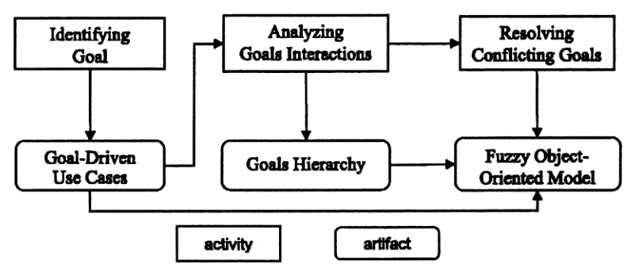
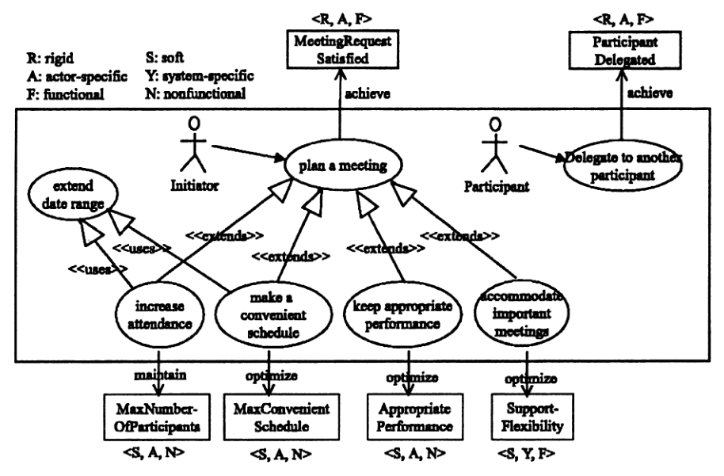
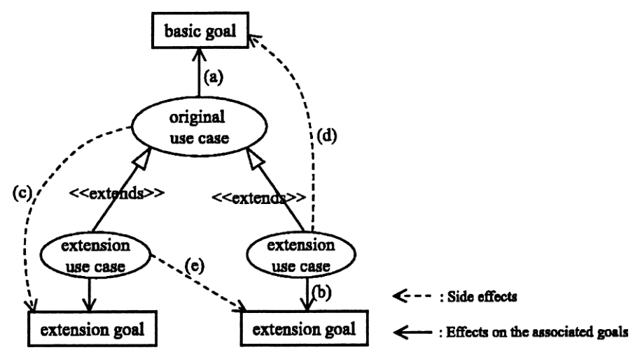
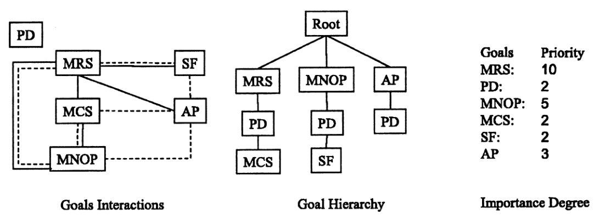
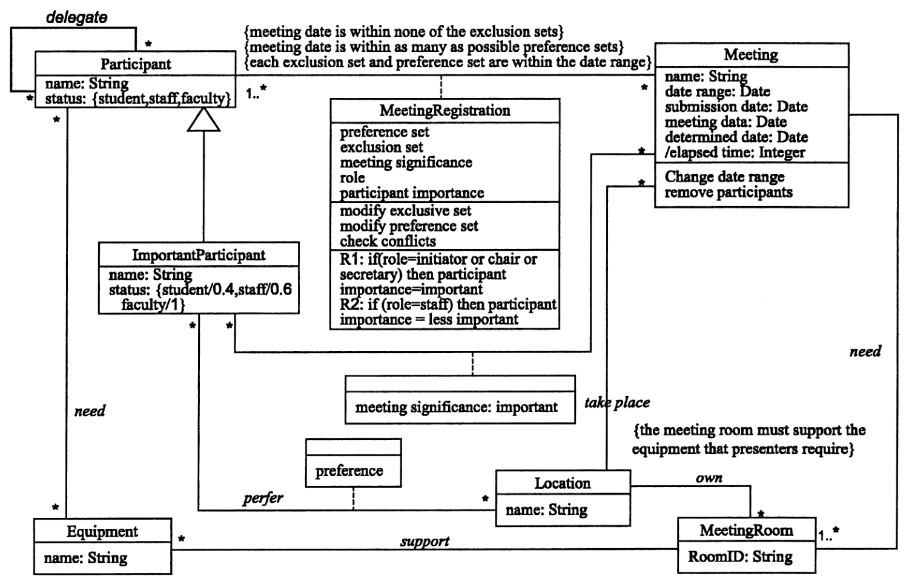
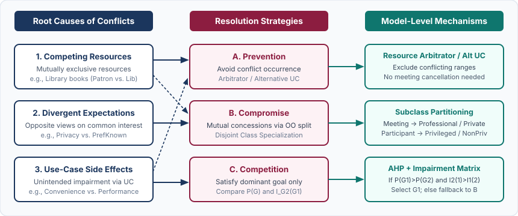
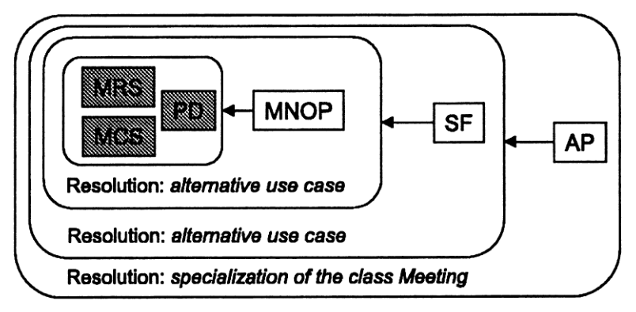

<!-- _class: lead -->

Information and Software Technology (IST) · Vol. 43, pp. 121–135 · 2001

# Structuring Requirement Specifications with Goals

Bridging <strong>Goal-Driven Use Cases</strong>, <strong>Nonfunctional Goal Interaction Analysis</strong>, and <strong>Fuzzy Object-Oriented Models (FOOM)</strong> to Handle Conflicting and Imprecise Requirements

<strong>Jonathan Leea,*</strong> &nbsp;·&nbsp; <code>yjlee@se01.csie.ncu.edu.tw</code> 
<strong>Nien-Lin Xuea</strong> &nbsp;·&nbsp; <code>nien@se01.csie.ncu.edu.tw</code> &nbsp;|&nbsp; <strong>Jong-Yih Kuob</strong> 
a Software Engineering Laboratory, Dept. of CSIE, National Central University, Chungli, Taiwan 
b Dept. of CSIE, Fu-Jen Catholic University, HsinChuang, Taipei Hsien, Taiwan

Received 24 April 2000 · Revised 22 June 2000 · Accepted 18 July 2000 · Supported by National Science Council (Taiwan), Grant NSC88-2213-E-008-006

<!--
Bibliographic Metadata & Research Positioning:
- Paper Title: Structuring requirement specifications with goals
- Authors: Jonathan Lee (corresponding author), Nien-Lin Xue (National Central University), and Jong-Yih Kuo (Fu-Jen Catholic University).
- Venue: Information and Software Technology (IST), Vol. 43 (2001), pp. 121–135, Elsevier Science B.V.
- Research Lineage: This paper synthesizes and extends two foundational prior works by the same research group: Goal-Driven Use Cases (GDUC, Lee & Xue, IEEE Software 1999) and Fuzzy Object-Oriented Modeling (FOOM, Lee, Xue, Hsu & Yang, Information Sciences 1999). Whereas GDUC focused on eliciting and evaluating use cases with goals, this 2001 IST paper completes the pipeline all the way to structuring conflict-free Fuzzy Object-Oriented analysis models via a Goals Hierarchy, Stable Kernel, and systematic conflict-resolution strategies.
-->

---

## Outline

1

<a href="#3">Motivation, Gaps &amp; Objectives</a> Why goal-based RE needs UML use cases, NFR interaction analysis, and fuzzy OO modeling.

2

<a href="#5">Related Work &amp; Conflict Taxonomies</a> Goal-oriented RE (KAOS, NFR, GBRAM), conflict-handling families, and imprecise RE.

3

<a href="#6">Goal-Driven Use Cases (GDUC)</a> Three-facet goal classification (Competence, View, Content) and original vs. extension use cases.

4

<a href="#7">Evaluating Goal Interactions</a> Five use-case–goal predicates, side effects, and formal system-level interaction derivation.

5

<a href="#9">Goals Hierarchy, Kernel &amp; FOOM</a> Backtracking algorithm, AHP stable kernel selection, and five types of fuzziness in OO models.

6

<a href="#12">Conflict Resolution &amp; Conclusion</a> Three conflict roots, Prevention / Compromise / Competition, Meeting Scheduler integration, and future work.

<!--
Structural Map of the Paper (Sections 1–6):
- Section 1 (Introduction): Motivates the integration of goal-based RE, UML use cases, and fuzzy object-oriented modeling, illustrated through the Meeting Scheduler benchmark.
- Section 2 (Related Work): Compares Dardenne et al., Mylopoulos et al., Anton (GBRAM), and Rolland et al., and classifies conflict-handling literature into Interaction, Design, and Structural conflicts alongside imprecise RE (RTA and Yen et al.).
- Section 3 (Structuring Use Cases with Goals): Presents the 3-step GDUC process (actors, faceted goals, original & extension use cases).
- Section 4 (Evaluating Goals Interactions): Formalizes 5 predicates between use cases and goals, use-case-level predicates cp/cf, and system-level interaction tuples Rs(Gi, Gj).
- Section 5 (Structuring FOOM Specifications): Introduces the Goals Hierarchy backtracking algorithm, Stable Kernel selection via cooperative degree and Saaty's AHP, FOOM constructs, and conflict resolution (Prevention, Compromise, Competition).
- Section 6 (Conclusion): Summarizes the four core benefits and outlines future directions (worth-oriented domains and university timetabling at NCU).
-->

---

## 1. Motivation & Three Gaps in Goal-Based RE

Why **goal-based requirements engineering**?
- Focuses on **why** a system is built, providing rationale to justify requirements.
- Supports progressive elaboration from organizational objectives to operational specs.
- Exposes multi-stakeholder conflicts early.

**Three persistent gaps in prior approaches:**
1. **No de facto standard notation** (e.g., UML), limiting adoption in large-scale systems.
2. **Goal interactions ignored in structuring** requirement specifications and analysis models.
3. **Imprecise & vague requirements** receive little formal support despite informality being inevitable.

Fig. 1. End-to-end overview of the proposed three-stage approach (Lee et al., IST 2001).

<strong>Core Insight:</strong> Combine UML <strong>Use Cases</strong> (standard notation) + <strong>Goal Interaction Analysis</strong> (NFR trade-offs) + <strong>Fuzzy Object-Oriented Models</strong> (imprecision) into one coherent structuring pipeline.

<!--
Theoretical Motivation (Section 1):
Prior goal-oriented frameworks such as Dardenne et al. (KAOS), Mylopoulos et al. (NFR Framework), and Anton (GBRAM) demonstrated the value of goals for acquisition, justification, and conflict detection. However, they suffered from three structural limitations:
1. Lack of a de facto standard modeling language: Custom formalisms hinder industrial scalability compared to UML use cases and object models.
2. Disconnect between goal interaction analysis and specification structuring: Knowing that two NFRs conflict does not automatically tell analysts how to partition and incrementally build the object model without becoming overwhelmed by early conflict resolution.
3. Under-representation of imprecision: As Balzer et al. argued, informality and vagueness are inherent and even desirable in early specifications, yet crisp OO models force premature precision.

Fig. 1 traces the proposed three-stage pipeline:
- Stage 1: Use cases are extended with faceted goals (original & extension use cases) from domain descriptions and system requirements.
- Stage 2: Interactions between NFR goals are evaluated at use-case and system levels (conflicting, cooperative, irrelevant, counterbalanced).
- Stage 3: Interactions drive a Goals Hierarchy -> Stable Kernel (modeled in FOOM) -> incremental integration of conflicting alternatives via resolution strategies.
-->

---

## 1.2 Research Objectives & Comparison with Prior Goal-Based RE

Three core objectives illustrated on the **Meeting Scheduler** benchmark (Potts et al. 1994; van Lamsweerde et al. 1994 — turning a vague, contradictory mission statement into a structured specification):

| Dimension | Dardenne et al. [12] | Mylopoulos et al. [26] | Anton (GBRAM) [3] | **This Approach (Lee et al. 2001)** |
| :--- | :--- | :--- | :--- | :--- |
| **Types of Goals** | System goal, Privacy goal | Nonfunctional reqt., Satisficing, Argument | Achievement goal, Maintenance goal | **Rigid / Soft, Actor / System-specific, Functional / Nonfunctional** |
| **Roles of Goals** | Reqt. acquisition, Reqt. analysis | Nonfunctional reqt. analysis | Reqt. analysis, Reqt. evolution | **Use case structuring, Reqt. evolution, OO model structuring** |
| **Goal Relationships** | Conflicting | Support, Against | Dependent | **Conflicting, Cooperative, Irrelevant, Counterbalanced** |

<strong>Why Meeting Scheduler?</strong> Widely adopted RE benchmark whose requirements exhibit typical real-world ambiguity (e.g., "convenient schedule", "important participant") and sharp NFR trade-offs (convenience vs. performance, privacy vs. shared preferences).

<!--
Comparative Positioning (Table 1 & Section 2.1):
- Dardenne et al. (KAOS): Distinguishes nonoperational goals from operational constraints that restrict actions/objects to assign agent responsibilities.
- Mylopoulos et al. (NFR Framework): Treats NFRs as softgoals rarely satisfied in a binary sense; design decisions contribute positively or negatively, evaluated via a labeling procedure.
- Anton (GBRAM): Classifies goals into achievement goals (mapped to actions) and maintenance goals (mapped to NFRs), elaborated via obstacles and scenarios.
- Rolland et al.: Iteratively pairs goal discovery with scenario authoring to populate a requirement chunks hierarchy.
- Lee, Xue & Kuo's distinctive contribution: Unifies a three-facet goal taxonomy with standard UML use cases, derives four formal system-level interaction types, and directly uses those interactions to structure Fuzzy Object-Oriented Models (FOOM).
-->

---

## 2. Related Work: Conflict Taxonomies & Imprecise Requirements

<h3>1. Interaction Conflicts</h3>

Satisfying one stakeholder requirement impairs another (e.g., librarian vs. patron loan period).  
• <strong>Oz</strong> (Robinson &amp; Fickas): pairwise detection, compromise, compensation, dissolution. 
• <strong>Viewpoints</strong> (Easterbrook): split inconsistent views into self-consistent hierarchy. 
• <strong>Divergence</strong> (Lamsweerde): temporal-logic boundary conflicts.

<h3>2. Design Conflicts</h3>

Two requirements cannot both be supported by one architecture (e.g., layered portability vs. performance).  
• <strong>QARCC / WinWin</strong> (Boehm &amp; In): Theory W stakeholder win-condition negotiation. 
• <strong>DRE</strong> (Vanwelkenhuysen): models design-property vs. requirement trade-offs as guidelines.

<h3>3. Structural &amp; Imprecise RE</h3>

• <strong>Structural Conflicts</strong> (Spaccapietra): same reality modeled as entity vs. attribute; resolved via generalization.  
• <strong>RTA</strong> (Lee &amp; Kuo 1998): Zadeh's test-score semantics + fuzzy and/or 4-level hierarchy. 
• <strong>Priority Trade-offs</strong> (Yen et al.): distance-wise conflict/cooperation degrees &amp; customer sacrifice ratios.

<strong>Key Takeaway:</strong> Existing conflict techniques either defer resolution indefinitely (Viewpoints) or demand heavy upfront negotiation (Oz, WinWin). Our framework isolates a <strong>conflict-free Stable Kernel</strong> first, then resolves remaining conflicts incrementally.

<!--
Literature Synthesis (Sections 2.2 & 2.3):
The paper organizes conflict-handling research into three orthogonal categories:
1. Interaction conflicts: Arise from competing stakeholder objectives. Oz automates negotiation via compromise, compensation (adding conflict-free requirements), and dissolution (replacing contentious items). Easterbrook's Viewpoints tolerate inconsistency by branching self-consistent viewpoints in an inheritance hierarchy. van Lamsweerde et al. formalize weak conflicts (divergences) under boundary conditions using real-time temporal logic and divergence patterns.
2. Design conflicts: Arise relative to an architectural choice rather than requirement definitions. Boehm's QARCC operates inside WinWin using Theory W ("making everyone a winner") to flag quality-attribute risks. Vanwelkenhuysen's Design Requirement Embedding (DRE) records trade-off histories between conceptual design properties and requirements.
3. Structural conflicts: Same domain concept represented differently across views (entity vs. attribute); Spaccapietra resolves these via formal correspondences and generalization rules.

For imprecise requirements (Section 2.3), Lee & Kuo's Requirements Trade-off Analysis (RTA) uses Zadeh's canonical form in test-score semantics and parameterized fuzzy and/or aggregation, while Yen et al. derive relative priority ratios from marginal willingness to sacrifice one requirement's satisfaction degree for another.
-->

---

## 3. Structuring Use Cases with Faceted Goals

**Three-Step Construction Process:**
1. **Identify Actors**: External roles interacting directly with the system (e.g., `Initiator`, `Participant`).
2. **Identify Goals via 3 Facets**:
   - **Competence**: `Rigid (R)` (must be 100% satisfied) vs. `Soft (S)` (satisfied to a degree; weakly dependent on rigid).
   - **View**: `Actor-specific (A)` vs. `System-specific (Y)`.
   - **Content**: `Functional (F)` (operation sequence) vs. `Nonfunctional (N)` (qualifying constraint).
3. **Build Use Case Models**:
   - **Original UC** ➔ achieves Original Goal `⟨R, A, F⟩` (Basic + Recovery/Failure courses).
   - **Extension UC** (`extends`) ➔ optimizes/maintains Soft (`E1`), achieves System-specific (`E2`), or achieves Nonfunctional (`E3`) goals.

Fig. 3. Goal-driven use case model for the Meeting Scheduler system.

<!--
Goal-Driven Use Cases Mechanics (Section 3):
- Original Goals & Use Cases: Every original goal is strictly ⟨Rigid, Actor-specific, Functional⟩. Mapping each original goal to an original use case guarantees the specification satisfies at least all actors' minimum functional requirements. In the Meeting Scheduler, `Plan a meeting` achieves `MeetingRequestSatisfied (R, A, F)`. Its basic course covers the nominal path; alternative courses split into recovery courses (recovering from strong schedule conflicts) and failure courses (canceling the meeting when unrecoverable).
- Extension Goals & Use Cases: Extending Cockburn's goal-use case linkage, extension use cases are systematically created for three distinct reasons (Fig. 2 in the paper):
  * E1 (Soft goal): `Make a convenient schedule` optimizes `MaxConvenienceSchedule (S, A, N)`; `Increase attendance` maintains `MaxNumberOfParticipants (S, A, N)`.
  * E2 (System-specific goal): `Accommodate important meetings` achieves `SupportFlexibility (S, Y, F)` across all initiators rather than one actor's personal view.
  * E3 (Nonfunctional goal): `Keep appropriate performance` qualifies `Plan a meeting` with `AppropriatePerformance (S, A, N)`.
- Weak Dependence: An extension goal's existence depends on its original goal, yet satisfying the original goal does not guarantee full satisfaction of extension goals (except partial satisfaction for soft goals).
-->

---

## 4. Evaluating Goal Interactions: Use-Case Level & Side Effects

Adopted 5 predicates (extending Mylopoulos et al.) to classify how performing use case `Uk` affects goal `G`:
- `satisfied` / `denied`: utterly achieved or ceased.
- `satisfiable` / `deniable`: achieved or impaired to a degree.
- `independent`: unaffected by `Uk`.

**Direct Effects vs. Three Side-Effect Paths (Fig. 4):**
- **(a), (b) Direct**: Original/Extension UC achieves, optimizes, or maintains its own goal.
- **(c) Original ➔ Extension**: Succeeding `Plan a meeting` partially satisfies `MaxConvenienceSchedule` (`satisfiable`).
- **(d) Extension ➔ Original**: `Accommodate important meetings` may cancel a lower-priority meeting (`denied`).
- **(e) Extension ➔ Other Extension**: `Keep appropriate performance` halts convenience negotiation (`deniable`).

Fig. 4. Direct effects (a, b) and side effects (c, d, e) between use cases and goals.

<!--
Use-Case–Goal Predicates and Use-Case-Level Interactions (Sections 4.1 & 4.2):
A use case is designed for its directly associated goal, yet executing it frequently alters non-associated goals through side effects (arrows c, d, e in Fig. 4).
From these 5 predicates, pairwise goal interactions at the use-case level (with respect to a specific use case Uk) are derived via two boolean predicates:
- cp_Uk(Gi, Gj) = True (Cooperative): both Gi and Gj increase in satisfaction (positively cooperative) or both decrease (negatively cooperative) after Uk executes.
- cf_Uk(Gi, Gj) = True (Conflicting): one goal's satisfaction increases (satisfied/satisfiable) while the other's decreases (denied/deniable) after Uk executes.
- Both False (Irrelevant): satisfaction degrees remain unchanged.

Worked Example: For Uk = `make a convenient schedule`, its relationship with `MaxConvenienceSchedule` is `satisfiable` while its relationship with `AppropriatePerformance` is `deniable`. Hence cf_UMCS(MaxConvenienceSchedule, AppropriatePerformance) = True.
-->

---

## 4.2 Formal Derivation of System-Level NFR Interactions

At the **system level**, related use cases are amalgamated; interactions between two nonfunctional goals `Gi1` and `Gj1` are captured by the predicate pair `Rs(Gi1, Gj1) = ⟨cp(Gi1, Gj1), cf(Gi1, Gj1)⟩`:

<h3>Four System-Level Interaction Types</h3>

| `Rs(Gi, Gj)` | System-Level Relation |
| :--- | :--- |
| `⟨False, False⟩` | **Irrelevant** |
| `⟨True, False⟩` | **Cooperative** |
| `⟨False, True⟩` | **Conflicting** |
| `⟨True, True⟩` | **Counterbalanced** |

<h3>Formal Disjunction Across Base &amp; Extension UCs</h3>

Because extension goals weakly depend on their original goals `Gi`, `Gj`, system-level derivation aggregates all four use cases (`Ui, Uj, Ui1, Uj1`):

cp(Gi1, Gj1) = cpUi ∨ cpUj ∨ cpUi1 ∨ cpUj1 
cf(Gi1, Gj1) = cfUi ∨ cfUj ∨ cfUi1 ∨ cfUj1

<strong>Worked Derivation (`GMCS` vs. `GAP`):</strong> Evaluating over `UPM` (plan a meeting), `UMCS` (make convenient schedule), and `UKAP` (keep appropriate performance) yields <code>cp(GMCS, GAP) = False</code> and <code>cf(GMCS, GAP) = True</code> ➔ <strong>Conflicting</strong> at the system level.

<!--
System-Level Aggregation Semantics (Section 4.3):
Ebert (1998) noted that severe trade-offs occur predominantly among nonfunctional requirements. Therefore, Section 4.3 focuses system-level analysis on NFR goal pairs (Gi1, Gj1) associated with extension use cases Ui1 and Uj1, which extend original use cases Ui and Uj (Fig. 5 in the paper).
Why include Ui and Uj in the disjunction? Because Gi1 is optimized or maintained only when its base original goal Gi is satisfied; thus any cooperative or conflicting effect induced by the base use cases Ui or Uj must propagate to the system-level relationship.
Notice the crucial distinction of the fourth state, Counterbalanced ⟨True, True⟩: two goals can cooperate in one use case while conflicting in another! Both Conflicting and Counterbalanced pairs are prohibited from coexisting in the same conflict-free alternative in Section 5.1.
-->

---

## 5.1 Establishing a Goals Hierarchy (Conflict-Free Alternatives)

Instead of resolving all conflicts upfront (which overloads analysts), partition goals into **conflict-free alternatives** satisfying 3 constraints:
1. Within any alternative `A`, every pair `(Gi, Gj)` is **cooperative** or **irrelevant**.
2. Any two alternatives `Ai, Aj` contain at least one **conflicting** or **counterbalanced** pair.
3. Maximality: any external goal `Gi ∉ Ak` conflicts/counterbalances with some `Gk ∈ Ak`.

**Backtracking Algorithm (Section 5.1):**
- Place all **functional goals** at the root (included in every alternative).
- Depth-first add non-conflicting NFRs as children.
- Backtrack when a remaining NFR conflicts with the current node (but not ancestors) to branch a sibling alternative.

Fig. 7. Goals hierarchy for the Meeting Scheduler yielding two conflict-free alternatives (A1 and A2).

<!--
Goals Hierarchy Algorithm & Completeness (Section 5.1):
Each root-to-leaf path in the Goals Hierarchy corresponds to one maximal conflict-free set of requirements (an alternative).
In the paper's generic illustration (Fig. 6), functional goals G_FG form the root, and backtracking over NFRs G2–G6 yields three alternatives: {G_FG, G2, G3, G5}, {G_FG, G2, G6}, and {G_FG, G4, G3, G5}.
Applied to the Meeting Scheduler (Fig. 7):
- Root functional goals: G_MRS (MeetingRequestSatisfied) and G_PD (ParticipantDelegated).
- Alternative A1 = {G_MRS, G_PD, G_MCS, G_MNOP, G_SF} (prioritizes convenience, attendance, and flexibility).
- Alternative A2 = {G_MRS, G_PD, G_AP, G_MI} (prioritizes appropriate performance and minimal interaction).
Because every alternative is guaranteed conflict-free, analysts can immediately construct a clean baseline model without premature trade-off paralysis.
-->

---

## 5.2 Selecting a Stable Kernel via Cooperative & Importance Degrees

<h3>What Is a Stable Kernel?</h3>

• Contains <strong>all functional requirements</strong> plus a conflict-free subset of NFRs (only cooperative or irrelevant pairs).  
• <strong>Stable</strong> because it requires zero upfront conflict resolution and serves as a clean foundation for incremental refinement.  
• Selected from the Goals Hierarchy alternatives using two quantitative criteria.

<h3>Two Selection Criteria</h3>

<strong>1. Cooperative Degree:</strong> Total number of cooperative interactions among goals inside an alternative (e.g., `1` if `G3` and `G5` cooperate).  
<strong>2. Importance Degree (Saaty's AHP):</strong> Sum of absolute goal weights computed via pairwise comparison reciprocal matrix &amp; normalized principal eigenvector.

<strong>Meeting Scheduler Decision (Fig. 7):</strong> Alternatives <code>A1</code> and <code>A2</code> tie in cooperative degree. Applying Saaty's AHP importance weights shows <code>Importance(A1) &gt; Importance(A2)</code> ➔ <strong><code>A1 = {GMRS, GPD, GMCS, GMNOP, GSF}</code></strong> is selected as the <strong>Stable Kernel</strong>.

<!--
Quantitative Kernel Selection (Section 5.2):
Choosing which maximal conflict-free alternative becomes the Stable Kernel is governed by a two-tier evaluation:
1. Cooperative Degree: Rewards alternatives whose NFRs mutually reinforce one another (higher synergy, fewer internal tensions).
2. Importance Degree: When alternatives have equal cooperative degrees (as A1 and A2 do in the Meeting Scheduler), stakeholder priorities break the tie rigorously using Thomas Saaty's Analytic Hierarchy Process (AHP, 1982). Analysts elicit pairwise relative weights between goals to build a reciprocal matrix, then extract the normalized eigenvector via the eigenvalue method to obtain absolute weights. Summing the weights of goals in each alternative identifies the highest-value conflict-free kernel.
-->

---

## 5.2 Modeling the Kernel with Fuzzy Object-Oriented Models (FOOM)

To capture vague requirements inside the Stable Kernel, **FOOM** introduces **5 types of fuzziness**:
1. **Fuzzy Classes**: Imprecise boundaries (e.g., `ImportantParticipant`) encapsulating static properties (attributes/ops) &amp; dynamic properties (fuzzy rules).
2. **Fuzzy Attribute Ranges**: Linguistic terms (`young`) or **typical values**: `status: {student/0.4, staff/0.7, faculty/1}`.
3. **Fuzzy Rules**: Internal attribute constraints (e.g., *if role is staff ➔ less important*) or inter-class triggers.
4. **Perceptual Fuzziness (`ISA` / `AKO`)**: Implicit membership in `[0, 1]` from static + dynamic properties.
5. **Uncertain Fuzzy Associations**: Quadruple canonical form:
   `(preference, ⟨John, L102⟩, strong, very true)` + soft constraints.

Fig. 8. Stable Kernel modeled in FOOM notation (GMRS, GPD, GMCS).

<!--
FOOM Formal Constructs (Sections 5.2.1–5.2.3):
- Distinction between Imprecision and Uncertainty (Dubois & Prade 1988): Imprecision is the absence of a sharp boundary on an attribute value (modeled via linguistic degrees of participation, e.g., `strong`), whereas uncertainty reflects reliance/confidence in that information (modeled via fuzzy truth values `t` such as `true`, `fairly true`, `very true`).
- Uncertain Fuzzy Association Quadruple: `(link attribute, ⟨x, y⟩, degree of participation, t)`. For example, `(preference, ⟨John, L102⟩, strong, very true)` captures both the strength of John's preference for room L102 and the system's confidence in that observation.
- Crisp vs. Fuzzy Classes: Even a crisp class like `MeetingRegistration` may own an attribute with a fuzzy range (`participant importance`). Conversely, `ImportantParticipant` is a fuzzy class whose `ISA` membership degree is implicitly derived from static `status` and dynamic `role`.
- Soft Constraints: Requirements like "a meeting location should be as convenient as possible for all important participants" are modeled as soft constraints spanning the `prefer` and `take place` associations (Fig. 8).
-->

---

## 5.3 Conflict Roots & Three Resolution Strategies

Once the Stable Kernel is built, remaining goals from other alternatives conflict with the kernel. Resolution begins by diagnosing the **root cause**:

Taxonomy of 3 conflict roots mapped to Prevention, Compromise (Specialization), and Competition strategies.

<strong>Priority Rule:</strong> Always attempt <strong>Prevention</strong> first (arbitrator or alternative use case), then <strong>Compromise</strong> (disjoint subclass specialization), and use <strong>Competition</strong> only when one goal clearly dominates in both importance <code>P(G)</code> and avoided impairment <code>IG2(G1)</code>.

<!--
Root Causes & Resolution Mechanics (Sections 5.3.1 & 5.3.2):
1. Competing Resources: Mutually exclusive resources (e.g., library books desired long-term by patrons vs. kept available by librarians). Resolved via Prevention (introduce a Book Arbitrator) or Compromise (specialize `Patron` into `Student` [2 weeks] and `Faculty` [as needed], or `Books` into `ReservedBook` and `UnreservedBook`, Fig. 10).
2. Divergent Expectations: Opposite expectations on a common property, behavior, or relationship (e.g., `ParticipantPreferenceKnown` vs. `ParticipantPrivacy`). Resolved via Compromise by specializing `Participant` into `PrivilegedParticipant` and `NonPrivilegedParticipant`.
3. Side Effects: Executing a use case for one goal impairs an unrelated goal (e.g., `Accommodate important meetings` canceling a meeting impairs `MeetingRequestSatisfied`). Resolved via Prevention by designing an alternative use case (Fig. 9: exclude conflicting schedules out of date range so no meeting is canceled), or via Compromise/Competition.
-->

---

## 5.3 Case Study: Integrating Alternatives in Meeting Scheduler

**Competition vs. Compromise Decision Matrix (Table 2)** for `GMCS` (Convenience) vs. `GAP` (Performance):

| Degree of Impairment | Importance | Strategy |
| :--- | :--- | :--- |
| `IGAP(GMCS) &gt; IGMCS(GAP)` | `P(GMCS) &gt; P(GAP)` | **Competition**: select `GMCS` |
| `IGAP(GMCS) &gt; IGMCS(GAP)` | `P(GMCS) &lt; P(GAP)` | **Compromise** (specialize) |
| `IGAP(GMCS) &lt; IGMCS(GAP)` | `P(GMCS) &gt; P(GAP)` | **Compromise** (specialize) |
| `IGAP(GMCS) &lt; IGMCS(GAP)` | `P(GMCS) &lt; P(GAP)` | **Competition**: select `GAP` |

**Resulting OO Specializations (Figs. 11–12):**
- `Meeting` ➔ `ProfessionalMeeting` (max convenience) &amp; `PrivateMeeting` (fast scheduling / performance).
- `SupportFlexibility` ➔ prevented cancellation via alternative date-exclusion UC.

Fig. 12. Step-by-step integration of GMNOP, GSF, and GAP into the Meeting Scheduler kernel.

<!--
Formal Impairment & Integration Walkthrough (Section 5.3.2.3 & Fig. 12):
- Impairment Notation: I_G2(G1) denotes the degree of impairment suffered by G1 when G2 is satisfied. If I_G2(G1) > I_G1(G2), achieving G1 incurs less overall impairment than achieving G2.
- Note on Table 2 Typography in Original Paper: Table 2 in the 2001 IST print lists G_MRS in cells where the caption and prose (p. 134) explicitly analyze G_MCS (MaxConvenientSchedule) vs. G_AP (AppropriatePerformance). Both importance P(G) and impairment I must align to justify Competition; when they disagree (e.g., G_MCS is more important yet satisfying it severely impairs G_AP), neither goal can be neglected, triggering Compromise via class specialization (`Meeting` -> `ProfessionalMeeting` / `PrivateMeeting`, Fig. 11).
- Fig. 12 illustrates the incremental integration flow: starting from the Stable Kernel, `MaxNumberOfParticipants` (no conflict) integrates directly; `SupportFlexibility` is integrated via Prevention (alternative use case without cancellation); and `AppropriatePerformance` is integrated via Compromise (specializing `Meeting`).
-->

---

## 6. Discussion, Contributions & Future Directions

<h3>Four Core Contributions</h3>

1. <strong>Goal-Driven Structuring</strong>: Bridges UML use cases and object models via faceted goals. 
2. <strong>Domain-to-System Bridge</strong>: Formally connects functional and nonfunctional requirement interactions. 
3. <strong>Incremental Conflict Management</strong>: Goals Hierarchy + Stable Kernel avoids upfront negotiation overload. 
4. <strong>Imprecision Support</strong>: Extends OO specifications with FOOM (fuzzy classes, typical values, rules, uncertain links).

<h3>Limitations &amp; Future Research</h3>

• <strong>Code-Level Mapping</strong>: Mapping FOOM to executable code requires programming languages with native fuzzy sets, rules, and inference (Footnote 2). 
• <strong>Dynamic Behavior Evaluation</strong>: Investigate Rosenschein's <em>worth-oriented domain</em> to evaluate statechart dynamics without executing them. 
• <strong>Real-World Scale-Up</strong>: Apply the framework to the <strong>National Central University (NCU) timetabling system</strong> case study.

<strong>Enduring Impact:</strong> Demonstrated that <strong>requirements conflicts should drive object-model architecture</strong> (via stable kernels and subclass specialization) rather than remaining isolated in textual negotiation logs.

<!--
Conclusion, Practical Constraints & Future Agenda (Section 6 & Footnote 2):
- Key Philosophical Contribution: Rather than treating goal-oriented RE and object-oriented analysis as separate worlds, Lee, Xue & Kuo fuse them so that goal interactions directly dictate the modular structure of the resulting FOOM specification.
- Practical Implementation Note (Footnote 2, p. 124): Transitioning from FOOM analysis specifications down to implementation requires language-level support for fuzzy membership functions, fuzzy rule encapsulation, and fuzzy inference engines.
- Two Planned Next Steps:
  1. Worth-oriented domain (Rosenschein & Zlotkin 1994) for evaluating dynamic object behaviors (statecharts) analytically without full simulation/execution.
  2. Large-scale empirical validation on National Central University's real-world university timetabling problem, which involves complex multi-stakeholder soft constraints and competing room/time resources.
-->

---

<!-- _class: closing -->

# Thank You for Your Attention!

Structuring Requirement Specifications with Goals

<strong>Jonathan Leea,*</strong> &nbsp;·&nbsp; <code>yjlee@se01.csie.ncu.edu.tw</code> 
<strong>Nien-Lin Xuea</strong> &nbsp;·&nbsp; <code>nien@se01.csie.ncu.edu.tw</code> &nbsp;|&nbsp; <strong>Jong-Yih Kuob</strong> 
a National Central University &nbsp;·&nbsp; b Fu-Jen Catholic University, Taiwan 
Information and Software Technology, Vol. 43 (2001), pp. 121–135 · Grant: NSC88-2213-E-008-006

<!--
Archival Reference:
- Citation: J. Lee, N.-L. Xue, J.-Y. Kuo, "Structuring requirement specifications with goals," Information and Software Technology, Vol. 43, No. 2, pp. 121–135, 2001.
- PII: S0950-5849(00)00144-0, Elsevier Science B.V.
- Keywords: Requirements engineering; Conflicting requirements; Goals; Fuzzy object-oriented model.
-->

