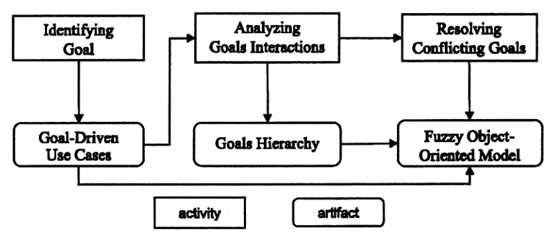
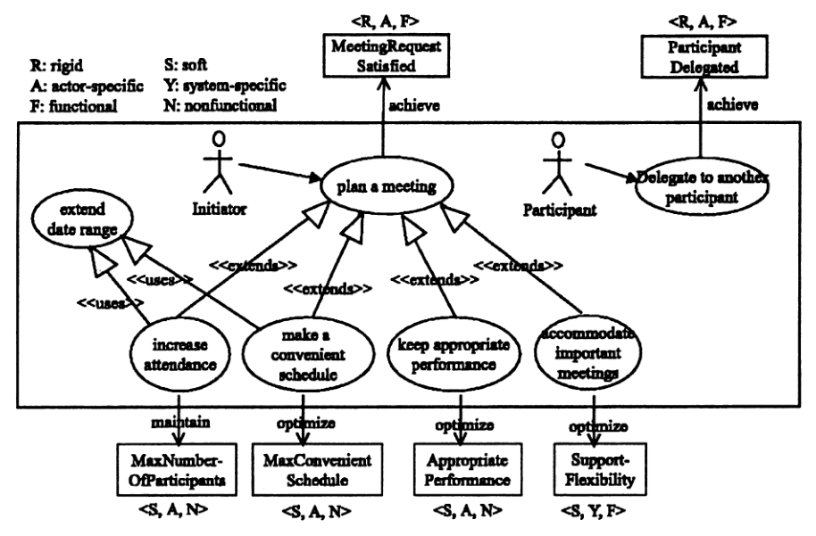
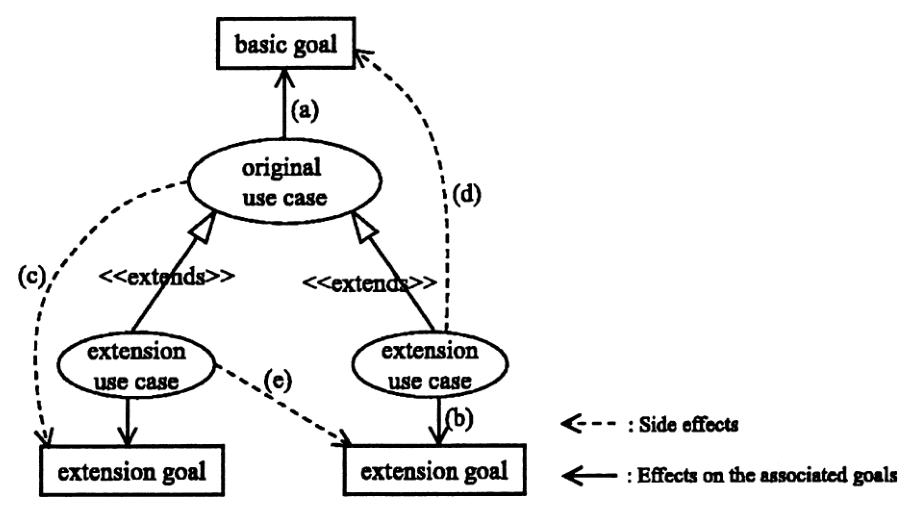
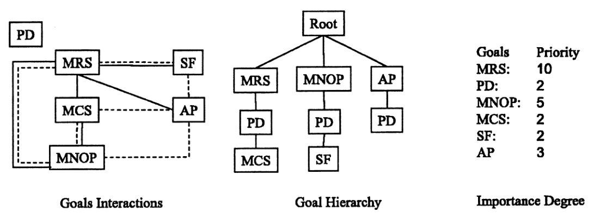
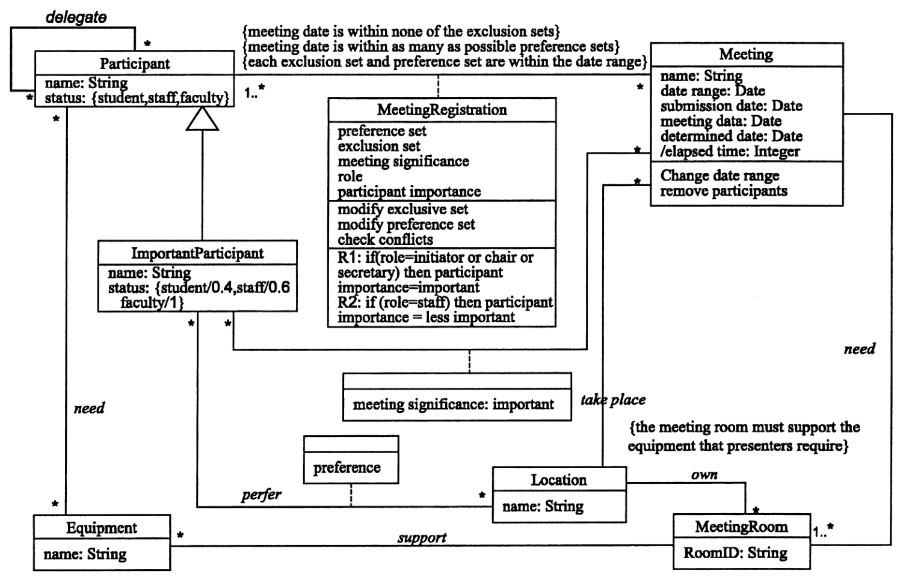
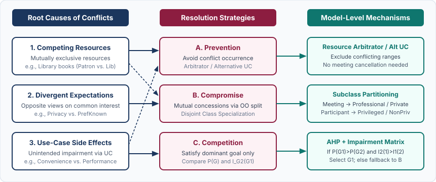
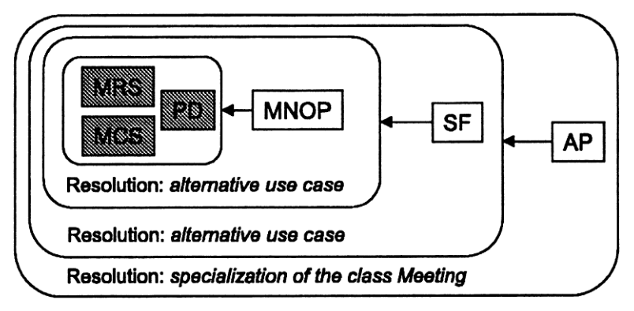

<!-- _class: lead -->

Information and Software Technology (IST) · 第 43 卷，頁 121–135 · 2001

# 以目標結構化需求規格

Structuring Requirement Specifications with Goals

結合<strong>目標導向使用案例（GDUC）</strong>、<strong>非功能性目標互動分析</strong>與<strong>模糊物件導向模型（FOOM）</strong>，系統化處理衝突與模糊需求

<strong>李允中（Jonathan Lee）a,*</strong> &nbsp;·&nbsp; <code>yjlee@se01.csie.ncu.edu.tw</code> 
<strong>薛念林（Nien-Lin Xue）a</strong> &nbsp;·&nbsp; <code>nien@se01.csie.ncu.edu.tw</code> &nbsp;|&nbsp; <strong>郭忠義（Jong-Yih Kuo）b</strong> 
a 國立中央大學資訊工程學系軟體工程實驗室 &nbsp;·&nbsp; b 輔仁大學資訊工程學系

收稿 2000/04/24 · 修訂 2000/06/22 · 接受 2000/07/18 · 國科會計畫補助：NSC88-2213-E-008-006

<!--
論文索引與研究脈絡：
- 論文篇名：Structuring requirement specifications with goals
- 作者群：李允中（Jonathan Lee，通訊作者）、薛念林（Nien-Lin Xue，國立中央大學資工系軟體工程實驗室）、郭忠義（Jong-Yih Kuo，輔仁大學資工系）。
- 發表期刊：Information and Software Technology (IST), Vol. 43 (2001), pp. 121–135, Elsevier Science B.V.
- 研究傳承：本文整合並延伸研究團隊兩篇先驅著作——目標導向使用案例（GDUC, IEEE Software 1999）與模糊物件導向塑模（FOOM, Information Sciences 1999），將需求工程從使用案例擷取一路銜接至目標階層建構、穩定核心挑選、模糊物件模型設計與系統化衝突化解。
-->

---

## 簡報大綱

1

<a href="#3">研究動機、缺口與目標</a> 為何目標導向需求工程需要標準 UML 使用案例、NFR 互動分析與模糊物件塑模。

2

<a href="#5">相關文獻與衝突分類</a> 目標導向方法（KAOS、NFR、GBRAM）、三大衝突類型與模糊需求分析。

3

<a href="#6">目標導向使用案例（GDUC）</a> 三面向目標分類（能力、視角、內容）與原始／延伸使用案例建構。

4

<a href="#7">目標互動評估與推導</a> 五種使用案例–目標述詞、副作用路徑與系統層級互動公式推導。

5

<a href="#9">目標階層、穩定核心與 FOOM</a> 回溯演算法、AHP 穩定核心篩選與模糊物件導向模型的五類模糊性。

6

<a href="#12">衝突化解、實例與結論</a> 三大衝突根源、預防／妥協／競爭策略、會議排程系統整合與未來研究。

<!--
全篇架構導讀（第 1–6 節）：
- 第 1 節（緒論）：點出既有目標導向需求分析的三大缺口，並提出整合使用案例、NFR 互動分析與模糊物件模型的三階段架構，以會議排程系統為貫穿案例。
- 第 2 節（相關文獻）：比較 Dardenne、Mylopoulos、Anton、Rolland 等目標導向方法，並將衝突處理歸納為互動衝突、設計衝突與結構衝突，同時回顧模糊需求權衡分析（RTA 與 Yen 等人）。
- 第 3 節（以目標結構化使用案例）：說明辨識參與者、三面向目標分類與建立原始／延伸使用案例。
- 第 4 節（評估目標互動）：定義五種使用案例–目標述詞、使用案例層級述詞 cp/cf 與系統層級互動關係 Rs(Gi, Gj)。
- 第 5 節（以目標互動結構化 FOOM）：提出目標階層回溯演算法、合作度與 Saaty AHP 重要度篩選穩定核心、FOOM 語法與三大衝突化解策略。
- 第 6 節（結論）：歸納四大貢獻與未來兩項研究方向（價值導向領域動態評估、中央大學排課系統實證）。
-->

---

## 1. 研究動機與既有目標導向需求工程之三大缺口

為何採用<strong>目標導向需求工程（Goal-Based RE）</strong>？
- 聚焦系統建構的<strong>「為何（Why）」</strong>，為每項需求提供正當性與理由。
- 由組織與系統高階目標漸進推導低階規格，便於追蹤解釋。
- 提供偵測與化解多方利害關係人衝突的依據。

<strong>既有方法仍存在三大關鍵缺口：</strong>
1. <strong>缺乏業界標準塑模語言</strong>（如 UML），難以擴展至大型系統。
2. <strong>目標間互動未用於結構化規格</strong>，衝突分析與物件模型建構脫節。
3. <strong>模糊與不精確需求缺乏形式化處理</strong>，忽略早期規格固有的非正式特性。

圖 1. 本文提出之三階段目標導向需求規格結構化整體架構（IST 2001）。

<strong>核心洞見：</strong>將標準 <strong>UML 使用案例</strong>、<strong>非功能性目標互動分析</strong>與<strong>模糊物件導向模型（FOOM）</strong>串聯為單一流程，同時解決衝突與模糊性問題。

<!--
研究動機與理論背景（第 1 節）：
雖然 Dardenne 等人（KAOS）、Mylopoulos 等人（NFR Framework）與 Anton（GBRAM）已證實目標資訊對需求擷取、合理化與衝突偵測的價值，但實務落地時面臨三個瓶頸：
1. 未採用如 UML 般的實質標準塑模語言，導入大型系統成本高。
2. 即使能找出目標間衝突，仍缺乏系統化機制將「目標互動資訊」轉化為需求規格與物件模型的模組化結構。
3. 如 Balzer 等人指出，非正式性與模糊性是需求規格過程不可避免（甚至有益）的特徵，傳統精確物件模型卻迫使分析師過早精確化。

圖 1 呈現三階段核心架構：
- 階段一：由領域描述與系統需求擷取三面向目標，延伸建構使用案例模型。
- 階段二：於使用案例層級與系統層級分析非功能性需求間的四種互動（衝突、合作、無關、制衡）。
- 階段三：依據互動結果建立目標階層、挑選無衝突之穩定核心（以 FOOM 塑模），再逐步透過衝突化解機制整合其餘替代方案。
-->

---

## 1.2 研究目標與目標導向需求工程方法比較

本研究以學界公認基準案例<strong>會議排程系統（Meeting Scheduler）</strong>貫穿全文（Potts et al. 1994；van Lamsweerde et al. 1994），示範如何將模糊且相互矛盾的任務陳述轉化為嚴謹規格：

| 比較構面 | Dardenne 等人 [12] | Mylopoulos 等人 [26] | Anton (GBRAM) [3] | **本文方法（Lee et al. 2001）** |
| :--- | :--- | :--- | :--- | :--- |
| **目標類型** | 系統目標、隱私目標 | 非功能需求、滿足目標、論證目標 | 達成目標、維護目標 | **剛性／柔性、參與者／系統視角、功能／非功能** |
| **目標角色** | 需求擷取、需求分析 | 非功能性需求分析 | 需求分析、需求演化 | **使用案例結構化、需求演化、物件模型結構化** |
| **目標關係** | 衝突（Conflicting） | 支持、反對 | 相依（Dependent） | **衝突、合作、無關、制衡（Counterbalanced）** |

<strong>為何選用會議排程基準案例？</strong>該領域同時具備典型模糊語意（如「便利的排程」、「重要參與者」）與尖銳的非功能性權衡（排程便利性 vs. 系統效能、隱私保護 vs. 偏好公開）。

<!--
與經典目標導向方法之比較（表 1 與第 2.1 節）：
- Dardenne 等人（KAOS）：將目標視為非操作性目的，需透過滿足操作性限制（constraints）來達成，並據此分配代理人（agents）職責。
- Mylopoulos 等人（NFR Framework）：指出非功能性目標鮮少能以二分法判定「完全達成」，而是由不同設計決策給予正向或負向貢獻，並以標記程序（labeling procedure）評估滿足程度。
- Anton（GBRAM）：區分達成目標（對應系統動作）與維護目標（對應非功能需求），透過阻礙（obstacles）與情境（scenarios）精煉目標。
- Rolland 等人：採目標發現與情境撰寫交替循環，逐步填充需求區塊階層。
- 本文突破：不僅整合三面向目標與標準 UML 使用案例，更將系統層級四元目標互動直接用於結構化模糊物件導向模型（FOOM）。
-->

---

## 2. 相關文獻：三大衝突類型與模糊需求塑模

<h3>1. 互動衝突（Interaction）</h3>

一方利害關係人需求之滿足會損害另一方（如讀者盼借期最長 vs. 館員盼最短）。  
• <strong>Oz</strong>（Robinson &amp; Fickas）：成對偵測、妥協、補償與消解協商。 
• <strong>Viewpoints</strong>（Easterbrook）：將矛盾視角分裂為各自一致之繼承階層。 
• <strong>Divergence</strong>（Lamsweerde）：以即時時序邏輯偵測邊界條件下之弱衝突。

<h3>2. 設計衝突（Design）</h3>

兩需求在定義上不衝突，但單一架構難以同時兼顧（如分層架構之可攜性 vs. 效能）。  
• <strong>QARCC / WinWin</strong>（Boehm &amp; In）：以 Theory W 協助各方協商雙贏品質條件。 
• <strong>DRE</strong>（Vanwelkenhuysen）：記錄概念設計屬性與需求權衡歷程以形成指導準則。

<h3>3. 結構衝突與模糊需求</h3>

• <strong>結構衝突</strong>（Spaccapietra）：同一實體在不同視圖分別為個體或屬性，透過一般化規則整合。  
• <strong>RTA</strong>（Lee &amp; Kuo 1998）：以 Zadeh 測試分數語意與參數化 fuzzy and/or 進行四層需求權衡。 
• <strong>優先權推理</strong>（Yen et al.）：依使用者願犧牲比例推導模糊衝突需求之相對權重。

<strong>文獻缺口與策略轉向：</strong>既有衝突技術往往要求在分析初期即進行高負荷協商（Oz、WinWin），或完全擱置不化解（Viewpoints）。本文改採<strong>先建構無衝突穩定核心，再漸進整合衝突替代方案</strong>之策略。

<!--
文獻梳理重點（第 2.2 與 2.3 節）：
本文將衝突需求處理歸納為三大類：
1. 互動衝突：源於不同利害關係人之目標拉扯。Oz 透過妥協、補償（加入相近無衝突需求）與消解（以低爭議項目取代）自動產生解方；Easterbrook 的 Viewpoints 容許暫時不一致，將衝突視為領域知識的一部分加以表達；van Lamsweerde 等人則以時序邏輯形式化「分歧（divergence）」並提出通用偵測樣式。
2. 設計衝突：源於架構與設計決策對品質屬性的反向影響（Boehm 的 QARCC/WinWin 與 Vanwelkenhuysen 的 DRE）。
3. 結構衝突：多視圖塑模結構不一致，Spaccapietra 透過對應知識與一般化機制自動整合。

在模糊需求方面（第 2.3 節），Lee & Kuo 的需求權衡分析（RTA）基於 Zadeh 測試分數語意與軟條件，透過 fuzzy and/or 聚合取得折衷需求；Yen 等人則以距離視角定義衝突／合作程度，並依領域專家的邊際犧牲意願計算相對優先權。
-->

---

## 3. 以三面向目標結構化使用案例（GDUC）

<strong>建構使用案例三步驟：</strong>
1. <strong>辨識參與者（Actors）</strong>：找出直接與系統互動之外部角色（如 <code>Initiator</code>、<code>Participant</code>）。
2. <strong>三面向目標分類法</strong>：
   - <strong>能力（Competence）</strong>：<code>剛性 Rigid (R)</code>（須完全滿足）vs. <code>柔性 Soft (S)</code>（可部分滿足，弱相依於剛性目標）。
   - <strong>視角（View）</strong>：<code>參與者特定 (A)</code> vs. <code>系統特定 (Y)</code>。
   - <strong>內容（Content）</strong>：<code>功能性 (F)</code>（操作序列達成）vs. <code>非功能性 (N)</code>（限定功能之約束）。
3. <strong>建構使用案例模型</strong>：
   - <strong>原始使用案例</strong> ➔ 達成原始目標 <code>⟨R, A, F⟩</code>（含基本流程與回復／失敗替代流程）。
   - <strong>延伸使用案例</strong>（<code>extends</code>）➔ 最佳化／維護柔性目標（<code>E1</code>）、達成系統目標（<code>E2</code>）或非功能目標（<code>E3</code>）。

圖 3. 會議排程系統之目標導向使用案例模型。

<!--
目標導向使用案例建構細節（第 3 節）：
- 原始目標與原始使用案例：凡同時具備 ⟨剛性、參與者特定、功能性⟩ 者即為原始目標。將所有原始目標對應為原始使用案例，可確保系統至少滿足所有使用者的最低功能要求。例如 `Plan a meeting` 達成 `MeetingRequestSatisfied (R, A, F)`，其基本流程為順利排定會議，替代流程則細分為回復流程（化解強烈時程衝突）與失敗流程（無法回復時取消會議）。
- 延伸使用案例之三種建立時機（原論文圖 2）：
  * E1（最佳化或維護柔性目標）：如 `Make a convenient schedule` 最佳化 `MaxConvenienceSchedule (S, A, N)`；`Increase attendance` 維護 `MaxNumberOfParticipants (S, A, N)`。
  * E2（達成系統特定目標）：如 `Accommodate important meetings` 跳脫單一發起人視角，達成系統層級之 `SupportFlexibility (S, Y, F)`。
  * E3（達成非功能性目標）：如 `Keep appropriate performance` 以非功能約束限定原始使用案例，達成 `AppropriatePerformance (S, A, N)`。
- 弱相依性（Weak Dependency）：延伸目標的存在依附於原始目標，但達成原始目標並不保證延伸目標完全滿足（僅在延伸目標為柔性目標時可能達成部分滿足）。
-->

---

## 4. 評估目標互動：使用案例層級與副作用路徑

沿用並擴充 Mylopoulos 等人之<strong>五種述詞</strong>，刻畫執行使用案例 <code>Uk</code> 後對目標 <code>G</code> 之影響：
- <code>satisfied</code> / <code>denied</code>：完全達成或完全中止。
- <code>satisfiable</code> / <code>deniable</code>：部分達成或部分受損。
- <code>independent</code>：不受 <code>Uk</code> 執行影響。

<strong>直接效果 vs. 三類副作用路徑（圖 4）：</strong>
- <strong>(a)、(b) 直接效果</strong>：原始／延伸使用案例達成、最佳化或維護其直接關聯目標。
- <strong>(c) 原始 ➔ 延伸</strong>：成功執行 <code>Plan a meeting</code> 使 <code>MaxConvenienceSchedule</code> 達部分滿足（<code>satisfiable</code>）。
- <strong>(d) 延伸 ➔ 原始</strong>：<code>Accommodate important meetings</code> 可能取消較低優先權會議（<code>denied</code>）。
- <strong>(e) 延伸 ➔ 其他延伸</strong>：<code>Keep appropriate performance</code> 終止便利性協商（<code>deniable</code>）。

圖 4. 使用案例與目標間之直接效果（a, b）與副作用路徑（c, d, e）。

<!--
使用案例與目標間互動分析（第 4.1 與 4.2 節）：
雖然每個使用案例皆為特定直接目標而設計，但實際執行時常對其他非直接關聯之目標產生副作用（圖 4 虛線箭頭 c、d、e）。
藉由這五種述詞，可進一步推導「在特定使用案例 Uk 下」任兩目標 Gi 與 Gj 的互動述詞：
- 合作 cp_Uk(Gi, Gj) = True：執行 Uk 後，兩目標之滿足度同步上升（正向合作）或同步下降（負向合作）。
- 衝突 cf_Uk(Gi, Gj) = True：執行 Uk 後，一目標滿足度上升（satisfied/satisfiable）而另一目標下降（denied/deniable）。
- 無關：cp_Uk 與 cf_Uk 皆為 False。

實例：執行 `make a convenient schedule` 時，`MaxConvenienceSchedule` 為 `satisfiable`，但 `AppropriatePerformance` 為 `deniable`，故在該使用案例下兩者衝突：cf_UMCS(MaxConvenienceSchedule, AppropriatePerformance) = True。
-->

---

## 4.2 系統層級非功能性目標互動之形式化推導

在<strong>系統層級</strong>，相關使用案例會彙整為整體模型；兩非功能性目標 <code>Gi1</code> 與 <code>Gj1</code> 之互動定義為述詞對 <code>Rs(Gi1, Gj1) = ⟨cp(Gi1, Gj1), cf(Gi1, Gj1)⟩</code>：

<h3>系統層級四種目標互動</h3>

| `Rs(Gi, Gj)` | 系統層級互動關係 |
| :--- | :--- |
| `⟨False, False⟩` | **無關（Irrelevant）** |
| `⟨True, False⟩` | **合作（Cooperative）** |
| `⟨False, True⟩` | **衝突（Conflicting）** |
| `⟨True, True⟩` | **制衡（Counterbalanced）** |

<h3>跨原始與延伸使用案例之聯集推導</h3>

因延伸目標弱相依於其原始目標 <code>Gi</code>、<code>Gj</code>，系統層級推導須綜合考量四個使用案例（<code>Ui, Uj, Ui1, Uj1</code>）：

cp(Gi1, Gj1) = cpUi ∨ cpUj ∨ cpUi1 ∨ cpUj1 
cf(Gi1, Gj1) = cfUi ∨ cfUj ∨ cfUi1 ∨ cfUj1

<strong>會議排程推導實例（<code>GMCS</code> vs. <code>GAP</code>）：</strong>綜合評估 <code>UPM</code>（規劃會議）、<code>UMCS</code>（排定便利時程）與 <code>UKAP</code>（維持適當效能），得出 <code>cp(GMCS, GAP) = False</code>、<code>cf(GMCS, GAP) = True</code> ➔ 系統層級判定為<strong>衝突（Conflicting）</strong>。

<!--
系統層級聚合語意（第 4.3 節）：
依據 Ebert（1998）的實證觀察，軟體系統中嚴峻的需求權衡主要發生在非功能性需求之間，因此第 4.3 節聚焦於推導非功能性延伸目標間的系統層級互動。
為何公式必須納入原始使用案例 Ui 與 Uj？因為延伸目標 Gi1 的最佳化或維護前提是原始目標 Gi 已先達成，故原始使用案例執行時引發的連帶效應亦會決定兩延伸目標在整體系統中的互動狀態。
特別值得注意的是第四種狀態「制衡（Counterbalanced）」⟨True, True⟩：代表兩目標在某一使用案例下合作，卻在另一使用案例下衝突。在第 5.1 節建立無衝突替代方案時，「衝突」與「制衡」皆不得並存於同一方案中。
-->

---

## 5.1 建立目標階層（Goals Hierarchy）與無衝突替代方案

為避免在設計初期即陷入繁雜衝突協商，先將目標組織為<strong>無衝突替代方案（Alternatives）</strong>，須滿足三條件：
1. <strong>內部無衝突</strong>：同一方案內任兩目標僅可為<strong>合作</strong>或<strong>無關</strong>。
2. <strong>方案互斥性</strong>：任兩方案之間必存在至少一對<strong>衝突</strong>或<strong>制衡</strong>目標。
3. <strong>極大性</strong>：任何方案外之目標，必與方案內至少一目標衝突或制衡。

<strong>目標階層回溯演算法（第 5.1 節）：</strong>
- 將所有<strong>功能性目標</strong>置於樹根（必含於每個方案）。
- 深度優先遞迴加入不與祖先衝突之非功能目標作為子節點。
- 若剩餘目標與目前節點衝突（但不與祖先衝突），回溯並分支建立右側兄弟節點以產生新替代方案。

圖 7. 會議排程系統之目標階層，自動切分出兩組無衝突替代方案（A1 與 A2）。

<!--
目標階層回溯演算法解析（第 5.1 節）：
目標階層中每一條「由葉節點回溯至樹根的路徑」，即代表一組極大且無內部衝突的需求替代方案。
在原論文圖 6 的一般性範例中，功能性目標 G_FG 位於根節點，對非功能性目標 G2–G6 執行回溯後產生三組替代方案：{G_FG, G2, G3, G5}、{G_FG, G2, G6} 與 {G_FG, G4, G3, G5}。
套用至會議排程系統（圖 7）：
- 樹根功能目標：G_MRS（滿足會議請求）與 G_PD（參與者委派）。
- 替代方案 A1 = {G_MRS, G_PD, G_MCS, G_MNOP, G_SF}（側重便利性、最大出席人數與排程彈性）。
- 替代方案 A2 = {G_MRS, G_PD, G_AP, G_MI}（側重適當效能與最少互動次數）。
透過此演算法，分析師得以先在完全無衝突的空間中完成基底規格塑模。
-->

---

## 5.2 以合作度與重要度挑選穩定核心（Stable Kernel）

<h3>何謂穩定核心（Stable Kernel）？</h3>

• 包含<strong>所有功能性需求</strong>與一組彼此合作或無關之非功能性需求（零衝突）。  
• 之所以「穩定」，是因為建構時<strong>無須涉入惱人的衝突化解</strong>，可作為後續漸進式精煉的堅實基底。  
• 由目標階層產出之多個替代方案中，透過兩項量化準則擇優選定。

<h3>兩項量化篩選準則</h3>

<strong>1. 合作度（Cooperative Degree）：</strong>單一替代方案內部所包含之合作互動總數（例如方案內 <code>G3</code> 與 <code>G5</code> 合作，合作度即為 1）。  
<strong>2. 重要度（Importance Degree，Saaty AHP）：</strong>採用 Saaty 成對比較法建立倒數矩陣，以特徵值法求取正規化特徵向量作為各目標絕對權重並加總。

<strong>會議排程篩選結果（圖 7）：</strong>方案 <code>A1</code> 與 <code>A2</code> 之合作度相同，進一步以 Saaty AHP 重要度評比顯示 <code>Importance(A1) &gt; Importance(A2)</code> ➔ 選定 <strong><code>A1 = {GMRS, GPD, GMCS, GMNOP, GSF}</code></strong> 作為<strong>穩定核心</strong>。

<!--
穩定核心量化挑選機制（第 5.2 節）：
當目標階層產生多組無衝突替代方案時，挑選穩定核心採兩階段準則：
1. 優先比較「合作度」：內部合作互動愈多，代表目標間協同效應愈強，架構內聚性愈佳。
2. 若合作度相同（如會議排程中的 A1 與 A2），則以「重要度」決選。本文採用 Thomas Saaty（1982）的層級分析法（AHP）：先對所有目標兩兩比較相對重要性形成倒數矩陣，再以特徵值法（eigenvalue method）求得正規化主特徵向量，即為各目標之絕對權重，加總後權重最高者即為穩定核心。
-->

---

## 5.2 以模糊物件導向模型（FOOM）建構穩定核心

為表達穩定核心內之不精確需求，<strong>FOOM</strong> 引入<strong>五類模糊性</strong>：
1. <strong>模糊類別</strong>：邊界不精確（如 <code>ImportantParticipant</code>），封裝靜態屬性／操作與動態模糊規則。
2. <strong>模糊屬性值域</strong>：語言值（<code>young</code>）或<strong>典型值（typical values）</strong>，如 <code>status: {student/0.4, staff/0.7, faculty/1}</code>。
3. <strong>模糊規則</strong>：描述類別內部屬性關聯（如 <em>若身分為職員 ➔ 重要度較低</em>）或跨類別觸發。
4. <strong>認知模糊（<code>ISA</code> / <code>AKO</code>）</strong>：物件對類別與子類別對父類別之歸屬度落於 <code>[0, 1]</code>，由靜態與動態屬性隱含推導。
5. <strong>不確定模糊關聯</strong>：四元標準式
   <code>(preference, ⟨John, L102⟩, strong, very true)</code> 搭配軟約束。

圖 8. 以 FOOM 記法建構之會議排程穩定核心模型（涵蓋 GMRS、GPD、GMCS）。

<!--
FOOM 語法與不確定性區辨（第 5.2.1–5.2.3 節）：
- 不精確（Imprecision）與不確定（Uncertainty）之區別（Dubois & Prade 1988）：不精確指屬性值缺乏清晰邊界（以參與程度語言詞如 `strong` 表示），不確定則指我們對該筆資訊的信賴程度（以模糊真值 t 如 `true`、`fairly true`、`very true` 表示）。
- 不確定模糊關聯四元組：`(link attribute, ⟨x, y⟩, degree of participation, t)`。例如 `(preference, ⟨John, L102⟩, strong, very true)` 表示「非常確定 John 強烈偏好會議室 L102」。
- 精確類別亦可含模糊屬性：例如 `MeetingRegistration` 為精確類別，但其屬性 `participant importance` 具備模糊值域；而 `ImportantParticipant` 則為模糊類別，其 `ISA` 歸屬度由靜態屬性 `status` 與動態屬性 `role` 綜合判定。
- 軟約束（Soft Constraints）：如「會議地點應盡可能對所有重要參與者便利」，直接塑模為橫跨 `prefer` 與 `take place` 關聯之軟約束（見圖 8）。
-->

---

## 5.3 衝突根源剖析與三大衝突化解策略

建立穩定核心後，其餘替代方案中的目標皆與核心衝突。本文主張先追查<strong>衝突根源</strong>，再對症下藥選擇化解策略：

三大衝突根源對應至「預防」、「妥協（類別特化）」與「競爭」之模型層級化解對照。

<strong>化解優先序：</strong>首選<strong>預防（Prevention）</strong>（引入仲裁者或替代使用案例），次選<strong>妥協（Compromise）</strong>（以互斥子類別特化分流），僅在單一目標於重要度 <code>P(G)</code> 與減損度 <code>IG2(G1)</code> 皆明顯勝出時採用<strong>競爭（Competition）</strong>。

<!--
三大衝突根源與化解策略細節（第 5.3.1 與 5.3.2 節）：
1. 資源競爭（Competing Resources）：目標爭奪互斥共享資源（如圖書館藏書）。可採「預防」（引入 Book Arbitrator 仲裁分配）或「妥協」（將競爭者 `Patron` 特化為限借兩週的 `Student` 與可長期借閱的 `Faculty`，或將資源 `Books` 特化為 `ReservedBook` 與 `UnreservedBook`，見原論文圖 10）。
2. 期望分歧（Divergent Expectations）：對同一物件屬性、行為或關聯持相反期望（如 `ParticipantPreferenceKnown` vs. `ParticipantPrivacy`）。可採「妥協」，將 `Participant` 特化為 `PrivilegedParticipant`（具存取權）與 `NonPrivilegedParticipant`。
3. 使用案例副作用（Side Effects）：執行某使用案例意外損害無關目標（如 `Accommodate important meetings` 取消既有會議導致 `MeetingRequestSatisfied` 受損）。可採「預防」，以替代使用案例取代原設計（原論文圖 9：在日期範圍中排除既有會議時段，即可不取消任何會議而達成彈性）。
-->

---

## 5.3 案例實作：會議排程系統之替代方案整合

<strong>競爭 vs. 妥協決策矩陣（表 2）</strong>——針對 <code>GMCS</code>（便利性）與 <code>GAP</code>（效能）之衝突：

| 損害程度（Impairment） | 重要程度 | 建議策略 |
| :--- | :--- | :--- |
| `IGAP(GMCS) &gt; IGMCS(GAP)` | `P(GMCS) &gt; P(GAP)` | **競爭**：選擇 `GMCS` |
| `IGAP(GMCS) &gt; IGMCS(GAP)` | `P(GMCS) &lt; P(GAP)` | **妥協**（類別特化） |
| `IGAP(GMCS) &lt; IGMCS(GAP)` | `P(GMCS) &gt; P(GAP)` | **妥協**（類別特化） |
| `IGAP(GMCS) &lt; IGMCS(GAP)` | `P(GMCS) &lt; P(GAP)` | **競爭**：選擇 `GAP` |

<strong>整合後之物件模型演進（圖 11–12）：</strong>
- <code>Meeting</code> ➔ 特化為 <code>ProfessionalMeeting</code>（極大化便利性）與 <code>PrivateMeeting</code>（優先快速排程）。
- <code>SupportFlexibility</code> ➔ 以替代使用案例排除衝突時段，免除取消會議之副作用。

圖 12. 將 GMNOP、GSF 與 GAP 漸進整合至會議排程穩定核心之步驟。

<!--
損害度比較與案例整合流程（第 5.3.2.3 節與圖 12）：
- 損害度定義：I_G2(G1) 表示當滿足 G2 時對 G1 所造成的損害程度。若 I_G2(G1) > I_G1(G2)，意味著放棄 G1 的代價高於放棄 G2，故達成 G1 整體較有利。
- 原論文表 2 說明：原印刷表 2 欄內誤植為 G_MRS，但表題與第 134 頁正文皆明確分析 G_MCS（MaxConvenientSchedule）與 G_AP（AppropriatePerformance）。唯有重要度 P(G) 與損害度 I 方向一致時才採競爭（捨棄另一目標）；若兩者方向相反，代表任一目標皆不可偏廢，須回歸妥協策略，將 `Meeting` 特化為 `ProfessionalMeeting` 與 `PrivateMeeting`（原論文圖 11）。
- 圖 12 展示漸進整合路徑：從穩定核心出發，`MaxNumberOfParticipants` 無衝突直接納入；`SupportFlexibility` 採預防策略（改用不取消會議之替代使用案例）；`AppropriatePerformance` 則採妥協策略（類別特化）完成整合。
-->

---

## 6. 討論、研究貢獻與未來展望

<h3>四大核心貢獻</h3>

1. <strong>目標導向結構化機制</strong>：以三面向目標系統化推導 UML 使用案例與物件模型。 
2. <strong>銜接領域描述與系統規格</strong>：形式化連結功能性與非功能性需求間之互動。 
3. <strong>漸進式衝突管理</strong>：透過目標階層與穩定核心避免分析初期的協商過載。 
4. <strong>納管需求模糊性</strong>：將傳統物件導向模型延伸至 FOOM，涵蓋模糊類別、典型值、規則與不確定關聯。

<h3>實務限制與未來研究方向</h3>

• <strong>程式碼層級對應</strong>：將 FOOM 轉換至程式實作仍須仰賴支援模糊集合、模糊規則與模糊推論之程式語言（註腳 2）。 
• <strong>動態行為評估</strong>：導入 Rosenschein 之<strong>價值導向領域（worth-oriented domain）</strong>，免實際執行狀態圖即可評估動態行為。 
• <strong>實務大規模驗證</strong>：將本方法套用於<strong>國立中央大學排課系統（university timetabling）</strong>案例研究。

<strong>深遠啟發：</strong>本研究證明<strong>需求衝突不應僅停留於文字協商紀錄</strong>，而應透過穩定核心與類別特化直接驅動物件導向規格之模組化架構演進。

<!--
結論、實作前提與未來議程（第 6 節與註腳 2）：
- 核心方法論價值：成功融合「目標導向需求工程」與「物件導向分析」，使非功能性目標間的互動關係直接決定系統分析模型的結構分割與演進路徑。
- 實作層限制（註腳 2，頁 124）：要將 FOOM 分析模型無縫對應至程式碼層級，開發環境必須具備定義模糊歸屬函數、建構模糊規則與執行模糊推論之語言特性。
- 兩項未來研究規劃：
  1. 結合 Rosenschein & Zlotkin（1994）的價值導向領域理論，於不實際模擬執行 Statechart 的前提下進行系統動態行為評估。
  2. 進行國立中央大學實際排課系統之大型案例研究，驗證本架構面對複雜軟硬約束與多方資源競爭時之擴充性。
-->

---

<!-- _class: closing -->

# 感謝您的聆聽！

以目標結構化需求規格 
Structuring Requirement Specifications with Goals

<strong>李允中（Jonathan Lee）a,*</strong> &nbsp;·&nbsp; <code>yjlee@se01.csie.ncu.edu.tw</code> 
<strong>薛念林（Nien-Lin Xue）a</strong> &nbsp;·&nbsp; <code>nien@se01.csie.ncu.edu.tw</code> &nbsp;|&nbsp; <strong>郭忠義（Jong-Yih Kuo）b</strong> 
a 國立中央大學資訊工程學系 &nbsp;·&nbsp; b 輔仁大學資訊工程學系 
Information and Software Technology, Vol. 43 (2001), pp. 121–135 · 國科會計畫：NSC88-2213-E-008-006

<!--
論文引用資訊：
- J. Lee, N.-L. Xue, J.-Y. Kuo, "Structuring requirement specifications with goals," Information and Software Technology, Vol. 43, No. 2, pp. 121–135, 2001.
- 出版商：Elsevier Science B.V. (PII: S0950-5849(00)00144-0)
- 關鍵詞：Requirements engineering; Conflicting requirements; Goals; Fuzzy object-oriented model.
-->

