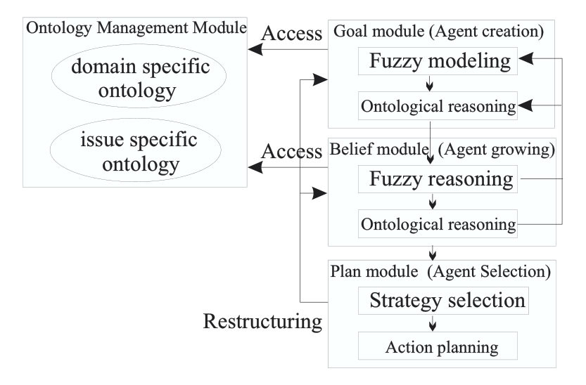
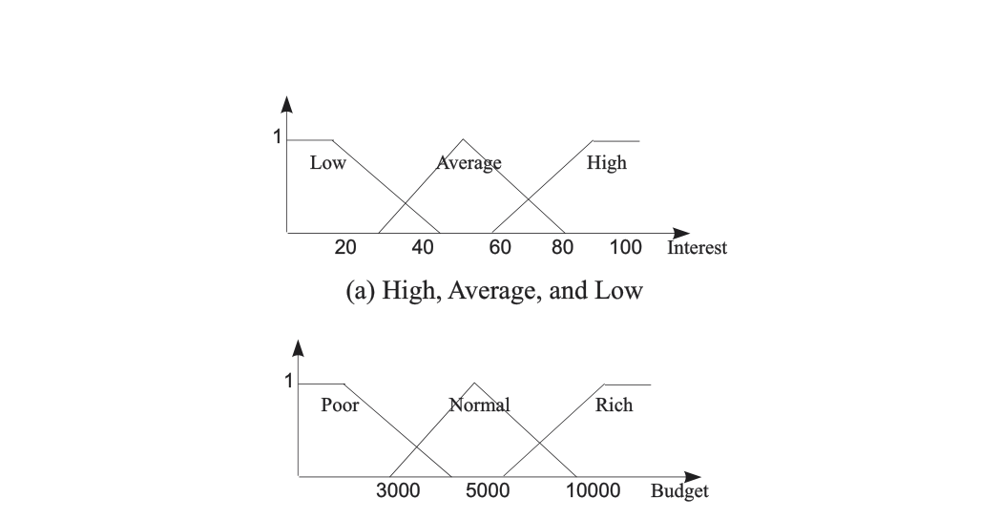
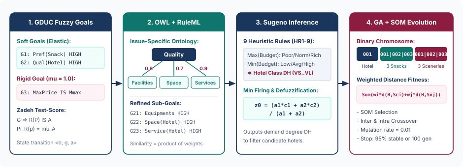
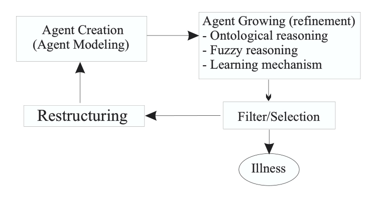
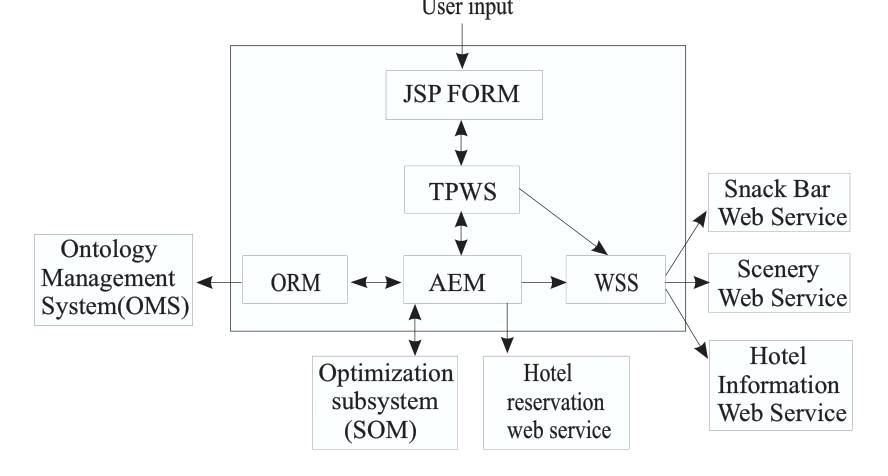
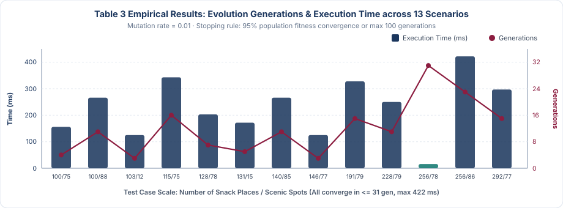

<!-- _class: lead -->

International Journal of Fuzzy Systems (IJFS) · Vol. 7, No. 2 · June 2005

# Evolutionary Agents for Intelligent Transport Systems

Integrating <strong>Fuzzy Soft Goals</strong>, <strong>OWL / RuleML Ontological Reasoning</strong>, and <strong>Genetic + SOM Multi-Agent Evolution</strong> for Adaptive Traveler Information Systems

<strong>Jong Yih Kuo</strong>, <strong>Shin Jie Lee</strong>, <strong>Chia Ling Wu</strong>, <strong>Nien Lin Hsueh</strong>, and <strong>Jonathan Lee</strong> 
Keywords: Intelligent Agent · Evolutionary Computation · Intelligent Transportation Systems (ITS) 
Published in <em>International Journal of Fuzzy Systems</em>, Vol. 7, No. 2, pp. 85–92, June 2005

Partially sponsored by the National Science Council (NSC93-2213-E-030-008) and the Ministry of Education (EX-91-E-FA06-4-4), Taiwan.

<!--
Bibliographic & Research Overview:
This journal article by Jong Yih Kuo, Shin Jie Lee, Chia Ling Wu, Nien Lin Hsueh, and Jonathan Lee, published in the International Journal of Fuzzy Systems (Vol. 7, No. 2, pp. 85 to 92, June 2005), proposes a unified evolutionary multi-agent framework for Intelligent Transportation Systems (ITS).

Core Contribution:
Newly instantiated software agents start with limited knowledge and low problem-solving capability. To enable agents to adapt dynamically in distributed ITS environments, the authors combine four complementary pillars: (1) a BDI-inspired four-module agent architecture, (2) Goal-Driven Use Cases (GDUC) with Zadeh's test-score semantics for fuzzy soft/rigid goals, (3) OWL and RuleML ontological reasoning for sub-goal refinement, and (4) a five-state multi-agent evolution cycle using Sugeno fuzzy inference, SOM-based selection, and inter-/intra-agent genetic restructuring, validated on a live Web-service-based ATIS hotel recommendation prototype.
-->

---

## Outline

1

<a href="#3">Motivation &amp; Core Agent Evolution Issues</a> Why distributed ITS needs self-evolving multi-agent systems and four design pillars.

2

<a href="#4">Related Work: MAS for ITS &amp; Evolution</a> Survey of Soft DNA, InforMirror, UTC agents, EIA, mobile dynamic objects, and fuzzy GA agents.

3

<a href="#5">Evolutionary Agent Model (BDI + GDUC)</a> Four-module architecture, OWL ontologies, and Zadeh test-score fuzzy goal modeling.

4

<a href="#7">Fuzzy, Ontology &amp; Genetic Evolution</a> Sugeno controller (9 heuristic rules), OWL/RuleML sub-goal refinement, SOM selection &amp; GA cycle.

5

<a href="#10">Case Study: ATIS Hotel Recommendation</a> Web-service architecture (JSP, TPWS, AEM, ORM, WSS), UI prototype, and 13-scenario benchmarks.

6

<a href="#13">Discussion, Limitations &amp; Takeaways</a> Architectural strengths, evaluation boundaries, and concluding contributions.

<!--
Structural Map of the Paper:
Section 1 (Introduction, p. 85) motivates Multi-Agent Systems (MAS) for geographically and functionally distributed ITS and defines four foundational requirements for agent evolution.
Section 2 (Related Work, pp. 85 to 86) reviews MAS frameworks in ITS (2.1) and evolutionary agent algorithms (2.2).
Section 3 (Evolutionary Agent Model, pp. 86 to 89) presents the BDI-based 4-module agent architecture (3.1), Goal-Driven Use Case analysis (3.2), and fuzzy soft/rigid goal formulation (3.3).
Section 4 (Agent Evolution Mechanism, pp. 89 to 90) details the Sugeno fuzzy reasoning model (4.1), OWL/RuleML goal-driven ontology reasoning (4.2), and the 5-state evolution life cycle with SOM selection and GA restructuring (4.3).
Section 5 (Case Study, pp. 90 to 91) implements an ATIS hotel/snack/scenery recommendation system over Web Services and reports 13 simulation scenarios (Table 3).
Section 6 (Conclusion, p. 91) summarizes contributions.
-->

---

## 1. Motivation: Why Evolving Multi-Agent Systems for ITS?

Modern cities face daily traffic congestion, accidents, delays, and emissions. **Intelligent Transportation Systems (ITS)** combine AI, control, and communications across geographically and functionally distributed entities—making **Multi-Agent Systems (MAS)** an ideal paradigm.

<h3>The Cold-Start Problem of New Agents</h3>
<ul class="small-text">
<li>When agents are initially created, they possess <strong>minimal knowledge, limited experience, and low capability</strong>.</li>
<li>Static agents cannot adapt their negotiation strategies or travel recommendations to dynamic user preferences and changing road/service environments.</li>
</ul>

<h3>Four Essential Issues in Agent Evolution</h3>
<ol class="small-text">
<li><strong>Suitable Agent Structure:</strong> Modular mental architecture supporting evolutionary restructuring.</li>
<li><strong>Internal Evolution Mechanisms:</strong> Fuzzy + ontological reasoning to refine goals and beliefs.</li>
<li><strong>Social Multi-Agent Concerns:</strong> Coordination, negotiation, and inter-agent exchange.</li>
<li><strong>Fitness Evaluation Tools:</strong> Quantifying agent adaptability and survival across generations.</li>
</ol>

<!--
Problem Statement (Section 1):
In ITS services—such as route guidance, travel recommendation, traffic information provision, and vehicle assistance control—software agents act autonomously on behalf of travelers. However, newly spawned agents lack domain maturity. Addressing the four structural, reasoning, social, and evaluation pillars simultaneously is necessary so agents can evolve both their internal knowledge/beliefs and their structural plan modules over successive generations.
-->

---

## 2. Related Work: MAS in ITS & Evolutionary Agents

<h3>2.1 Multi-Agent Frameworks for ITS</h3>
<ul class="small-text">
<li><strong>Soft DNA (Kohata et al.):</strong> Dynamic role allocation via FAMOUS &amp; Conceptual Fuzzy Sets.</li>
<li><strong>InforMirror (Kase et al.):</strong> Internet-based agent assistance for in-car navigation.</li>
<li><strong>Driver Behavior &amp; Forecast (Rossetti et al.; Wahle et al.):</strong> Microscopic simulation and anticipatory traffic reaction models.</li>
<li><strong>Decentralized Traffic Control (Ferreira et al.; Roozemond):</strong> Intersection agents (ITSA), authority agents, and road segment agents (RSA).</li>
<li><strong>Architecture-Centric MAS (Park et al.):</strong> Architectural styles/patterns for transport info prototypes.</li>
</ul>

<h3>2.2 Agent Evolution Mechanisms</h3>
<ul class="small-text">
<li><strong>GA Behavior Sequences (Maskell &amp; Wilby):</strong> Evolving agent control code to adapt to local network changes.</li>
<li><strong>Evolutionary Intelligent Agents (Cristea et al.):</strong> Task-dependent genotype-driven evolution preserving variety.</li>
<li><strong>Dynamic Mobile Objects (Tanaka et al.):</strong> Attaching, serializing, and migrating dynamic objects across hosts.</li>
<li><strong>Real-Time Fuzzy Behavior Evolution (Bonarini):</strong> Evolutionary + RL learning of fuzzy behavior modules.</li>
<li><strong>Fuzzy Rule Extraction Agents (Wang et al.):</strong> Parent and offspring fuzzy agents competing via an arbitrator on accuracy &amp; interpretability.</li>
</ul>

<!--
Literature Positioning (Section 2):
Prior ITS multi-agent frameworks excel at decentralized traffic signaling and driver advisories, while prior evolutionary agent systems apply Genetic Algorithms, dynamic objects, or fuzzy rule learning independently. However, none tightly couple (a) formal Goal-Driven Use Cases with elastic fuzzy soft goals, (b) Semantic Web OWL/RuleML ontology refinement, and (c) SOM-guided genetic restructuring inside a unified BDI agent life cycle—the exact gap targeted by this paper.
-->

---

## 3. Evolutionary Agent Architecture (BDI + 4 Modules)

Grounded in the <strong>BDI (Belief–Desire–Intention)</strong> formalism (Rao &amp; Georgeff), each agent integrates four tightly coupled modules:

<ol class="small-text">
<li><strong>Ontology Management Module:</strong> Stores <strong>domain-specific ontology</strong> (e.g., OWL schema for Hotel: <code>name</code>, <code>roomType</code>, <code>price</code>, <code>address</code>, <code>phone</code>) and <strong>issue-specific ontology</strong> (elastic soft-goal qualities).</li>
<li><strong>Goal Module (Creation):</strong> Models rigid &amp; fuzzy soft goals into a goal hierarchy via fuzzy modeling &amp; ontological reasoning.</li>
<li><strong>Belief Module (Growing):</strong> Encodes environment facts and fuzzy rules; refines goals and updates rules from execution feedback.</li>
<li><strong>Plan Module (Selection):</strong> Selects weighted strategies &amp; action plans; triggers <strong>Restructuring</strong> back to Goal/Belief modules.</li>
</ol>

Figure 1 (Paper p. 87): Four-module evolutionary BDI agent model with ontology access and restructuring feedback loops.

<!--
Agent Mental Architecture (Section 3.1, Figures 1 and 2):
Figure 1 maps the classic BDI mental states onto an evolutionary lifecycle:
- Agent Creation occurs in the Goal Module, which queries the Ontology Management Module to interpret user preferences. Domain ontologies are annotated in W3C OWL (Figure 2 in the paper defines FunctionalProperty attributes for Hotel), while issue-specific ontologies capture weighted soft-goal decompositions (Figure 3: Quality -> Facilities 0.8, Space 0.7, Services 0.9).
- Agent Growing occurs in the Belief Module via fuzzy and ontological reasoning, incorporating success/failure feedback from executed plans to adapt fuzzy rules.
- Agent Selection and Restructuring occur in the Plan Module, feeding structural mutations and crossover updates back into the Goal and Belief modules.
-->

---

## 3.1 Goal-Driven Analysis (GDUC) & Fuzzy Goal Modeling

<h3>GDUC Multi-Faceted Goal Taxonomy (3.2)</h3>
<ul class="small-text">
<li>Classifies goals along <strong>4 aspects</strong>: <em>Competence</em> (rigid vs. soft), <em>View</em> (user- vs. agent-specific), <em>Content</em> (functional vs. non-functional), and <em>Constraints</em> (pre-/post-conditions).</li>
<li>Example use case <code>getHotelRecommendation</code> extends to <code>runAgain</code> and <code>showExceptionMessage</code>.</li>
</ul>

<h3>Zadeh Test-Score Semantics (3.3)</h3>
<ul class="small-text">
<li>Canonical form: <code>G ⇒ R(P) IS A</code>, with possibility distribution <code>ΠR(p) = μA</code>.</li>
<li><strong>Soft Goals:</strong> <code>G1 ⇒ Preference(Snack) IS HIGH</code>; <code>G2 ⇒ Quality(Hotel) IS HIGH</code>.</li>
<li><strong>Rigid Goal (<code>μ = 1.0</code>):</strong> <code>G3 ⇒ MaxPrice(Hotel) IS Mmax</code>.</li>
</ul>

Figure 4 (Paper p. 89): Triangular/trapezoidal fuzzy membership functions for (a) Interest (Low/Average/High) and (b) Budget (Poor/Normal/Rich).

<!--
Goal-Driven Use Cases & Fuzzy Semantics (Sections 3.2 and 3.3, Table 1, Figures 4a/4b):
Using Lee & Kuo's GDUC methodology (1998, 2001), requirements are structured into a stable kernel use case ("getRecommendation") plus two extending alternative flows ("runAgain" if the user is unsatisfied, and "showExceptionMessage" on connection failure).

Formal Mental State Transition:
Each user goal g is formalized as a state transition <b, g, a> achieved by a plan <precondition, post-condition>. Using Zadeh's (1986) test-score semantics, imprecise traveler preferences become elastic constraints whose satisfaction degree is evaluated via membership functions: Interest spans [0, 100] (Low, Average, High) and Budget spans [0, 10000+] (Poor, Normal, Rich). A rigid goal is simply a boundary special case where membership must equal 1.0.
-->

---

## 4. Integrated Fuzzy–Ontology–Evolution Pipeline

End-to-end reasoning &amp; evolution flow: GDUC Fuzzy Goals ➔ OWL/RuleML Refinement ➔ Sugeno Inference ➔ GA + SOM Optimization.

<strong>Synergistic Pipeline:</strong> <strong>Ontology reasoning</strong> expands coarse goals into weighted sub-goals; <strong>Sugeno fuzzy rules</strong> compute hotel class demand (<code>DH</code>); <strong>GA + SOM</strong> evolve optimal hotel–snack–scenery bundles.

<!--
Unified Mechanism Overview (Sections 3.3 and 4.1 to 4.3):
This synthesized diagram connects all four mathematical and symbolic stages of the paper:
1. GDUC Fuzzy Goals: Distinguishes elastic soft preferences (G1, G2) from hard budget ceiling (G3).
2. OWL + RuleML Ontology Refinement: Decomposes Quality(Hotel) using issue-specific relevance weights (Facilities 0.8, Space 0.7, Services 0.9) to derive refined sub-goals G21, G22, G23.
3. Sugeno Fuzzy Controller: Evaluates 9 heuristic rules (HR1 to HR9) over Max(Budget) and Min(Budget) to defuzzify a crisp hotel class demand degree DH.
4. GA + SOM Evolution: Encodes candidate recommendations as binary chromosomes (1 Hotel + 3 Snacks + 3 Sceneries) and evolves the population using weighted spatial distance fitness.
-->

---

## 4.1 Sugeno Fuzzy Inference & OWL/RuleML Ontology Reasoning

<h3 style="margin-top: 0;">Sugeno Controller &amp; 9 Heuristic Rules (4.1)</h3>

Firing levels <code>α1, α2</code> use the <strong>Min operator</strong>; crisp output is the weighted average <code>z0 = (α1·c1 + α2·c2) / (α1 + α2)</code> yielding Hotel Class <strong><code>DH</code></strong> ∈ {VS, S, N, L, VL}:

| Max(Budget) \ Min(Budget) | **High** | **Average** | **Low** |
| :--- | :---: | :---: | :---: |
| **Rich** | `VL` (HR1) | `L` (HR2) | `N` (HR3) |
| **Normal** | `L` (HR4) | `N` (HR5) | `S` (HR6) |
| **Poor** | `N` (HR7) | `S` (HR8) | `VS` (HR9) |

<h3>Goal-Driven Ontology Reasoning (4.2)</h3>
<ul class="small-text">
<li><strong>Semantic Similarity:</strong> Computed as the <strong>product of pre-defined relevance values</strong> along a directed semantic relation path in the OWL class hierarchy.</li>
<li><strong>RuleML Inference:</strong> Ontology rules encoded in <strong>RuleML</strong> dynamically expand soft goals into concrete sub-goals and prompt user confirmation:
  <ul>
  <li><code>G21 ⇒ Equipments(Hotel) IS HIGH</code> (0.8)</li>
  <li><code>G22 ⇒ Space(Hotel) IS HIGH</code> (0.7)</li>
  <li><code>G23 ⇒ Service(Hotel) IS HIGH</code> (0.9)</li>
  </ul>
</li>
</ul>

<!--
Fuzzy Rule Base & Semantic Refinement (Sections 4.1 and 4.2, Table 2, Figures 3 and 5):
1. Sugeno Fuzzy Reasoning (4.1): Extending Zimmermann's (1996) Sugeno controller, Table 2 maps the 3x3 combinations of Max(Budget) {Rich, Normal, Poor} and Min(Budget) {High, Average, Low} onto five linguistic Hotel Class degrees (Figure 5: VS, S, N, L, VL spanning [0.0, 1.0]). Crucially, the Ontology Management Module supplies domain knowledge to these fuzzy rules, while the agent's learning mechanism evolves the rules over time.
2. Ontological Reasoning (4.2): OWL provides shared semantic annotations across heterogeneous travel providers, while RuleML specifies inference rules. Multiplying edge relevance weights along a directed relation path quantifies semantic confidence, automatically refining abstract user desires (e.g., "High Hotel Quality") into evaluable attributes (Equipments, Space, Service).
-->

---

## 4.2 Five-State Agent Evolution Cycle & Genetic Operators

<ol class="small-text">
<li><strong>Agent Creation:</strong> Agent factory spawns individuals encoding a binary chromosome <code>[Hotel | 3 Snacks | 3 Sceneries]</code> (IDs <code>1..N</code>).</li>
<li><strong>Agent Growth (Refinement):</strong> Mating pool selected randomly; internal knowledge refined via ontological, fuzzy, and learning mechanisms.</li>
<li><strong>Filter / Selection (SOM):</strong> Self-Organization-Based Optimization (<strong>SOM</strong>) selects fitter agents using weighted spatial distance fitness: <code>F = Σ (wi · d(H, Sci) + wj · d(H, Snj))</code></li>
<li><strong>Restructuring:</strong> <em>Inter-agent crossover</em> (swap modules across agents), <em>intra-agent crossover</em> (swap parameters/strategies within an agent), &amp; gene mutation (<code>pm = 0.01</code>).</li>
<li><strong>Illness State:</strong> Damaged/tampered agents enter recovery before returning to Growth.</li>
</ol>

Figure 6 (Paper p. 90): Five-state multi-agent evolution life cycle (Creation, Growing, Filter/Selection, Restructuring, and Illness).

<!--
Evolution Life Cycle & Genetic Mechanics (Section 4.3, Figures 6 and 7):
Figure 6 formalizes an agent's complete lifespan across five states:
- Chromosome Design (Figure 7): Each individual encodes a complete travel recommendation tuple—one hotel ID, three snack-place IDs, and three scenic-spot IDs—represented as binary strings over 1..N (e.g., 001 | 001 002 003 | 001 002 003).
- SOM-Based Selection (Su, Zhao, & Lee, IJCNN 2004): Evaluates fitness via the weighted sum of GPS distances from candidate hotel H to selected scenic spots (Sc_i) and snack places (Sn_j), guiding convergence toward spatially convenient recommendations.
- Dual-Level Restructuring: Supports both inter-agent module exchange (multi-point sorted crossover) and intra-agent parameter/strategy exchange, plus random gene replacement mutation.
- Fault Tolerance (Illness State): Explicitly models security/integrity recovery when an agent is tampered with by malicious hosts or peers.
-->

---

## 5. Case Study: ATIS Hotel Recommendation Architecture

An <strong>Advanced Traveler Information System (ATIS)</strong> subsystem built over distributed <strong>Web Services</strong> (5 hotel websites + GPS snack &amp; scenery databases):

<ul class="small-text">
<li><strong>JSP Form:</strong> Captures traveler budget, room type, date, and top-3 snack &amp; scenic preferences.</li>
<li><strong>TPWS (Travel Planning Web Service):</strong> Fuzzifies user profile, runs Sugeno inference, and defuzzifies facility demand degree.</li>
<li><strong>WSS (Web Service Simplifier):</strong> Aggregates live data from Scenery, Snack Bar, and Hotel Information Web Services.</li>
<li><strong>AEM (Agent Evolution Module):</strong> Executes GA + SOM optimization and invokes Hotel Reservation Web Service.</li>
<li><strong>ORM &amp; OMS:</strong> Performs ontological reasoning, builds recommendation lists, and persists user profiles &amp; evolved rules.</li>
</ul>

Figure 8 (Paper p. 91): Service-oriented ATIS prototype linking JSP, TPWS, AEM, ORM, WSS, SOM, OMS, and external Web Services.

<!--
Prototype Architecture & Service-Oriented Integration (Sections 5.1 and 5.2, Figure 8):
To validate the theoretical model, the authors implemented a working Java/JSP and Apache Axis Web Services prototype. Two Web Services query a GPS database for snack bars and scenic spots, while five dedicated Hotel Web Services scrape/query five target hotel websites for hotel name, room types, price, and live reservation status. Separating TPWS (fuzzy demand inference), WSS (external service aggregation), AEM (GA+SOM evolution), and ORM/OMS (ontological reasoning and knowledge storage) demonstrates practical SOA interoperability for distributed ITS.
-->

---

## 5.1 Interactive Prototype: User Preference Capture (JSP Form)

<h3>Live Traveler Input Specification</h3>
<ul class="small-text">
<li><strong>Snack Preferences (1–3):</strong> e.g., <em>Snack</em>, <em>Convenience Store</em>, <em>PUB</em>.</li>
<li><strong>Scenic Spot Preferences (1–3):</strong> e.g., <em>Water Activity</em>, <em>Botanical Garden/Zoo</em>, <em>Campground</em>.</li>
<li><strong>Budget Interval:</strong> <code>Min = 3000</code>, <code>Max = 6000</code> (feeds both rigid ceiling <code>G3</code> and Sugeno rules <code>HR1–HR9</code>).</li>
<li><strong>Booking Constraints:</strong> Room type (<em>Single Room</em>) &amp; 8-digit reservation date (<code>20050318</code>).</li>
</ul>

<h3>Prototype Outputs</h3>

Returns the evolved optimal <strong>hotel name</strong>, <strong>room type</strong>, <strong>reservation date</strong>, and nearby <strong>scenic &amp; snack recommendations</strong>—with one-click re-evolution (<code>runAgain</code>) if unsatisfied.

Figure 9 (Paper p. 91): Live JSP client interface (Apache Axis Web Service) capturing multi-criteria traveler goals.

<!--
User Interaction & Closed-Loop Workflow (Sections 5.1 and 5.3, Figure 9):
Figure 9 shows the actual deployed JSP front-end running on Apache Axis (Client.jsp). Notice how the UI directly operationalizes the GDUC Table 1 specification: three ranked snack categories, three ranked scenic spot categories, minimum and maximum budget bounds, room type, and reservation date. Submitting the form triggers TPWS -> WSS -> AEM -> ORM -> JSP rendering, while allowing the traveler to re-run agent evolution if the returned itinerary does not meet expectations.
-->

---

## 5.2 Empirical Results: Convergence & Latency across 13 Scenarios

Visualization of Table 3 (Paper p. 91): 13 experimental runs scaling from 100–292 snack places and 12–88 scenic spots.

3 – 31 Gen

All 13 runs converged well below the <strong>100-generation</strong> ceiling (95% fitness stability)

125 – 422 ms

Real-time interactive latency (mean <strong>~240 ms</strong> across 12 standard runs; 16 ms anomaly noted at 256/78)

pm = 0.01

Low mutation rate balances exploration with rapid SOM-guided convergence

<!--
Empirical Evaluation Analysis (Section 5.3, Table 3):
In Table 3, the authors tested 13 combinations of candidate pool sizes ranging from 100 to 292 snack places and 12 to 88 scenic spots. Evolution terminated once either 95% of agents shared identical fitness or 100 generations elapsed (mutation rate = 0.01).

Key Quantitative Findings:
- Fast Convergence: Every single scenario reached the 95% stability criterion in between 3 and 31 generations (median 11 generations), never hitting the 100-generation timeout.
- Interactive Responsiveness: Execution times ranged from 125 ms (103 snacks / 12 sceneries, 3 gen) up to a maximum of 422 ms (256 snacks / 86 sceneries, 23 gen), proving suitability for real-time Web-based travel advisory.
- Data Observation: Row 11 in Table 3 (256 snacks, 78 sceneries, 31 generations) reports 16 ms in the original printed table—likely a typographical artifact in the 2005 print (e.g., 516 ms or timer wrap)—which is transparently highlighted in teal on the chart.
-->

---

## 6. Discussion: Strengths & Methodological Limitations

<h3>Core Architectural Strengths</h3>
<ul class="small-text">
<li><strong>Expressive Soft/Rigid Modeling:</strong> GDUC + Zadeh test-score semantics gracefully handle imprecise traveler preferences alongside strict budget bounds.</li>
<li><strong>Semantic Interoperability:</strong> OWL + RuleML ontologies allow agents to share and refine domain concepts across heterogeneous hotel &amp; GPS Web Services.</li>
<li><strong>Fast Real-Time Evolution:</strong> SOM-assisted GA achieves sub-half-second convergence (&lt; 0.43 s) even with ~380 candidate POIs.</li>
<li><strong>Resilient Lifecycle:</strong> Explicitly incorporates an <em>Illness &amp; Recovery</em> state for distributed security.</li>
</ul>

<h3>Limitations &amp; Open Questions</h3>
<ul class="small-text">
<li><strong>No Baseline Comparison:</strong> Table 3 measures convergence speed and runtime, but does not compare solution quality against pure GA, exhaustive search, or non-evolutionary agents.</li>
<li><strong>Static Relevance Weights:</strong> Issue-specific ontology weights (0.8, 0.7, 0.9) and heuristic rules (<code>HR1–HR9</code>) are manually initialized; online weight learning is not empirically benchmarked.</li>
<li><strong>Prototype Scale:</strong> Evaluated on 5 simulated hotel websites and spatial proximity fitness, without live traffic congestion or multi-user reservation contention.</li>
</ul>

<!--
Critical Evaluation & Research Context:
From a 2005 software engineering and soft-computing perspective, this paper is notably forward-looking in uniting Semantic Web standards (OWL, RuleML), Web Services (Apache Axis), fuzzy goal modeling, and evolutionary computation into a working prototype.

At the same time, an objective scholarly review notes three evaluation boundaries: (1) Table 3 reports only generations and milliseconds without optimality-gap comparisons against baseline heuristics; (2) the "Illness" security recovery state and long-term fuzzy-rule learning are designed architecturally rather than stress-tested experimentally; and (3) extending the spatial distance fitness function to include dynamic traffic delays and multi-agent negotiation over scarce hotel rooms remains future work.
-->

---

## 7. Conclusion & Key Takeaways

<h3>1. Fuzzy Goal-Driven Modeling</h3>

Formalized traveler soft &amp; rigid goals via <strong>GDUC</strong> and <strong>Zadeh test-score semantics</strong>, bridging human language and agent mental states.

<h3>2. Ontology-Guided Evolution</h3>

Combined <strong>OWL/RuleML sub-goal refinement</strong> with <strong>Sugeno fuzzy rules</strong> so agents grow their beliefs dynamically rather than remaining static.

<h3>3. Multi-Agent GA + SOM Cycle</h3>

Constructed a 5-state evolution lifecycle with <strong>SOM selection</strong> and <strong>inter-/intra-agent restructuring</strong>, validated in &lt; 422 ms on live Web Services.

<strong>Takeaway for ITS &amp; Agent Engineering:</strong> Combining <strong>symbolic semantics (OWL + RuleML)</strong> with <strong>soft computing (Fuzzy Logic + GA + SOM)</strong> equips distributed ITS agents to start lightweight and rapidly evolve personalized, real-time travel solutions.

<!--
Concluding Synthesis (Section 6):
The paper demonstrates a cohesive blueprint for adaptive ITS agents: (1) model elastic user requirements as fuzzy soft/rigid goals; (2) refine goals semantically through domain- and issue-specific ontologies; (3) infer user demand degrees via Sugeno fuzzy control; and (4) continuously evolve agent recommendations through SOM-guided genetic restructuring. The deployed ATIS hotel recommendation prototype confirms that this hybrid symbolic-evolutionary pipeline runs cleanly within sub-second web interaction budgets.
-->

---

<!-- _class: closing -->

# Thank You & Questions

Fuzzy Soft Goals · OWL &amp; RuleML Ontological Reasoning · SOM + GA Evolutionary Agents for ITS

<strong>Jong Yih Kuo</strong> &nbsp;|&nbsp; <strong>Shin Jie Lee</strong> &nbsp;|&nbsp; <strong>Chia Ling Wu</strong> 
<strong>Nien Lin Hsueh</strong> &nbsp;·&nbsp; <code>nlhsueh@fcu.edu.tw</code> &nbsp;|&nbsp; <strong>Jonathan Lee</strong> 
International Journal of Fuzzy Systems (IJFS), Vol. 7, No. 2, pp. 85–92, June 2005 
Grants: NSC93-2213-E-030-008 &amp; Ministry of Education EX-91-E-FA06-4-4

<!--
Reference & Archival Metadata:
- Title: Evolutionary Agents for Intelligent Transport Systems
- Authors: Jong Yih Kuo, Shin Jie Lee, Chia Ling Wu, Nien Lin Hsueh, Jonathan Lee
- Venue: International Journal of Fuzzy Systems, Vol. 7, No. 2, pp. 85 to 92, June 2005
- Funding: National Science Council (NSC93-2213-E-030-008) and Ministry of Education (EX-91-E-FA06-4-4), Taiwan
- Keywords: Intelligent Agent, Evolutionary, Intelligent Transportation Systems
-->

