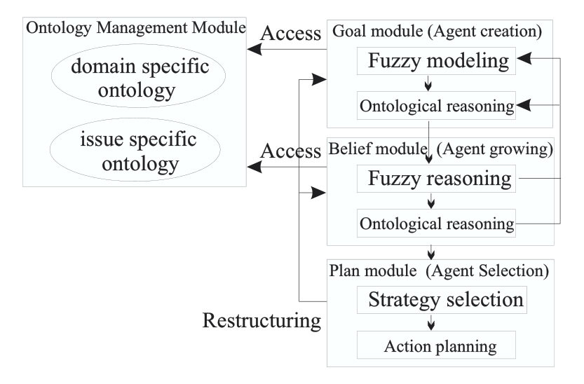
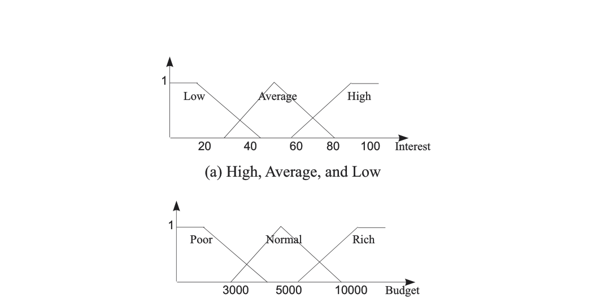
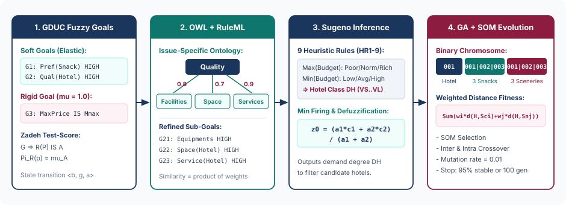
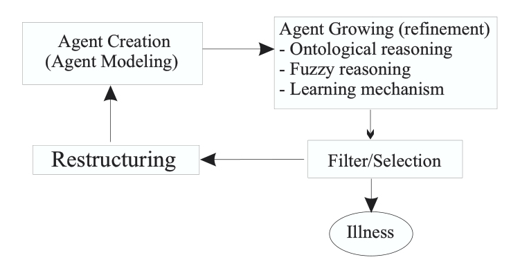
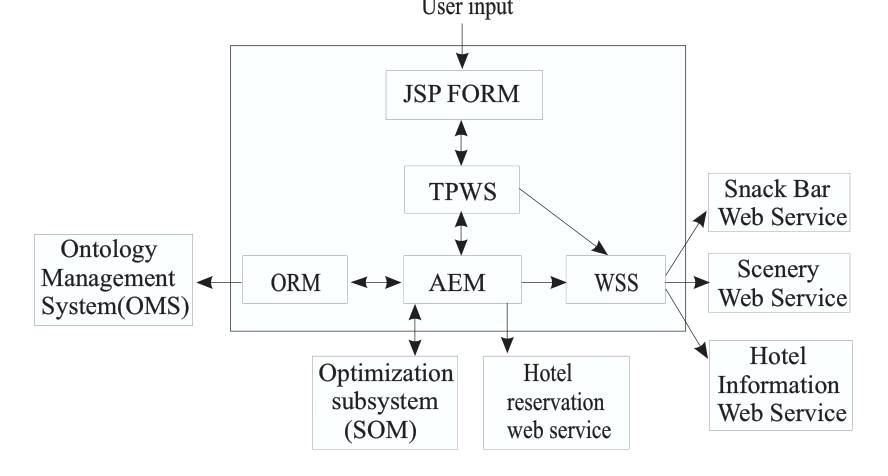
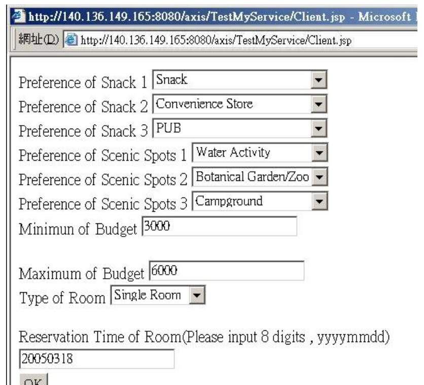
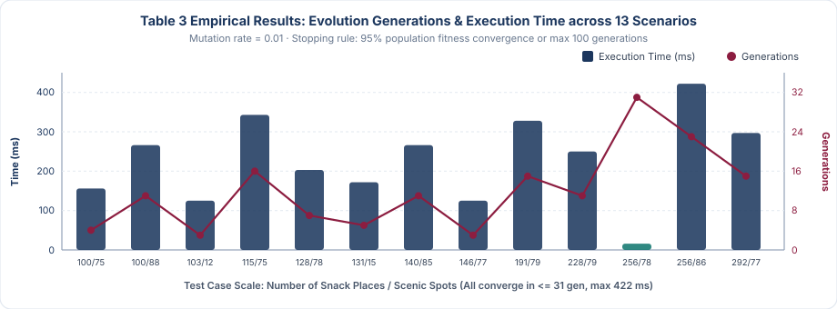

<!-- _class: lead -->

國際模糊系統期刊（IJFS）· 第 7 卷第 2 期 · 2005 年 6 月

# 智慧型運輸系統之演化式代理人

整合<strong>模糊軟目標（Fuzzy Soft Goals）</strong>、<strong>OWL／RuleML 本體論推論</strong>與 <strong>GA + SOM 多代理人演化循環</strong>打造自適應旅遊資訊系統

<strong>郭忠義（Jong Yih Kuo）</strong>、<strong>李信杰（Shin Jie Lee）</strong>、<strong>吳佳玲（Chia Ling Wu）</strong>、<strong>薛念林（Nien Lin Hsueh）</strong>、<strong>李允中（Jonathan Lee）</strong> 
關鍵字：智慧型代理人（Intelligent Agent）· 演化計算（Evolutionary）· 智慧型運輸系統（ITS） 
發表於 <em>International Journal of Fuzzy Systems</em>, Vol. 7, No. 2, pp. 85–92, June 2005

研究補助：國科會計畫 NSC93-2213-E-030-008 與教育部計畫 EX-91-E-FA06-4-4。

<!--
論文書目與研究總覽：
本篇論文由郭忠義、李信杰、吳佳玲、薛念林與李允中共同發表於《International Journal of Fuzzy Systems》（Vol. 7, No. 2, pp. 85 至 92, 2005 年 6 月）。論文針對智慧型運輸系統（ITS）中軟體代理人初期知識匱乏與能力有限的問題，提出一套結合模糊理論、本體論推論與基因演算法的多代理人演化架構。

核心技術貢獻：
研究整合四大核心模組：（1）以 BDI 心智模型為基礎之四模組代理人架構；（2）結合目標導向使用案例（GDUC）與 Zadeh 測試分數語意之模糊軟／硬目標塑模；（3）透過 OWL 與 RuleML 本體論自動細化子目標；（4）運用 Sugeno 模糊推論、SOM 選擇與跨代理人／代理人內重構之五狀態演化循環，並以 Web Service 實作先進旅行者資訊系統（ATIS）旅館推薦原型驗證即時收斂效能。
-->

---

## 簡報大綱

1

<a href="#3">研究動機與代理人演化四大議題</a> 分散式智慧運輸環境為何需要具學習與演化能力之多代理人系統。

2

<a href="#4">相關研究回顧：ITS 多代理人與演化</a> 綜述 Soft DNA、InforMirror、都市交通控制與模糊基因演化代理人。

3

<a href="#5">演化式代理人模型（BDI + GDUC）</a> 四模組心智架構、OWL 本體論定義與 Zadeh 測試分數模糊目標塑模。

4

<a href="#7">模糊、本體論與基因演化機制</a> Sugeno 九條啟發規則、OWL/RuleML 子目標推論、SOM 選擇與五狀態演化。

5

<a href="#10">案例實作：ATIS 旅館推薦原型與實驗</a> Web Service 系統架構（JSP、TPWS、AEM、ORM、WSS）與 13 組實驗數據。

6

<a href="#13">綜合討論、研究限制與核心啟示</a> 符號與軟計算整合優勢、實驗邊界反思與未來延伸方向。

<!--
全文結構導讀：
第一章（p. 85）闡述智慧型運輸系統（ITS）之分散式特性與多代理人演化必須面對的四項核心議題。
第二章（pp. 85 至 86）回顧 ITS 多代理人框架（2.1）與代理人演化演算法（2.2）。
第三章（pp. 86 至 89）建構基於 BDI 之四模組代理人架構（3.1）、GDUC 目標分析（3.2）與模糊目標塑模（3.3）。
第四章（pp. 89 至 90）提出 Sugeno 模糊推論（4.1）、目標導向 OWL/RuleML 本體論推論（4.2）及結合 SOM 與基因算子之五狀態演化循環（4.3）。
第五章（pp. 90 至 91）建置基於 Web Service 的 ATIS 旅館推薦系統，並於表 3 評估 13 組場景之收斂代數與耗時。
第六章（p. 91）歸納主要研究貢獻。
-->

---

## 1. 研究動機：為何智慧型運輸系統需要演化式代理人？

隨著都市擴張與路網複雜化，交通壅塞、事故延誤與汙染日益嚴峻。<strong>智慧型運輸系統（ITS）</strong>整合 AI、電子控制與通訊技術，服務地理與功能高度分散之實體，使<strong>多代理人系統（MAS）</strong>成為理想解方。

<h3>新創代理人之冷啟動困境</h3>
<ul class="small-text">
<li>代理人剛建立時僅具備<strong>極少領域知識、缺乏經驗且解決問題能力低落</strong>。</li>
<li>靜態設計之代理人無法隨使用者模糊偏好與動態路況／服務環境自動調適協商策略。</li>
</ul>

<h3>代理人演化必須克服之四大核心議題</h3>
<ol class="small-text">
<li><strong>適切之代理人結構：</strong>支援模組化重組與演化的心智架構。</li>
<li><strong>內部進階演化機制：</strong>運用模糊與本體論推論精進目標與信念。</li>
<li><strong>多代理人社會互動：</strong>涵蓋協調、協商與跨代理人知識交換。</li>
<li><strong>適應度評估工具：</strong>量化代理人於演化世代中之適應表現。</li>
</ol>

<!--
問題背景與研究切入點（第 1 章）：
在路線導引、旅遊推薦、即時路況與車輛輔助控制等 ITS 應用中，軟體代理人須代表使用者自動執行委派任務。由於初始建立的代理人能力有限，本研究同時從架構、推論機制、社會互動與適應度評估四個面向切入，賦予多代理人系統持續成長與結構演化之能力。
-->

---

## 2. 相關研究回顧：ITS 多代理人框架與演化機制

<h3>2.1 ITS 多代理人系統框架</h3>
<ul class="small-text">
<li><strong>Soft DNA（Kohata et al.）：</strong>結合 FAMOUS 與概念模糊集，依情境動態指派代理人角色。</li>
<li><strong>InforMirror（Kase et al.）：</strong>透過網際網路為車載導航提供代理人資訊輔助。</li>
<li><strong>駕駛行為與預測（Rossetti et al.; Wahle et al.）：</strong>微觀模擬與前瞻式交通訊息反應模型。</li>
<li><strong>分散式號誌控制（Ferreira et al.; Roozemond）：</strong>整合路口代理人（ITSA）、權威代理人與路段代理人（RSA）。</li>
<li><strong>架構導向 MAS（Park et al.）：</strong>應用架構樣式設計運輸資訊系統原型。</li>
</ul>

<h3>2.2 代理人演化研究</h3>
<ul class="small-text">
<li><strong>GA 行為序列（Maskell &amp; Wilby）：</strong>以基因演算法演化控制碼以適應區域網路變化。</li>
<li><strong>演化智慧代理人 EIA（Cristea et al.）：</strong>任務導向之基因型演化，兼顧擇優與多樣性。</li>
<li><strong>動態行動物件（Tanaka et al.）：</strong>透過可序列化與遷移之動態物件讓行動代理人自我演化。</li>
<li><strong>即時模糊行為演化（Bonarini）：</strong>結合演化與強化學習調整模糊行為模組。</li>
<li><strong>模糊規則擷取代理人（Wang et al.）：</strong>親代與子代模糊代理人透過仲裁者依準確度與可解釋性競爭。</li>
</ul>

<!--
文獻定位（第 2 章）：
既有 ITS 多代理人研究多著重於號誌協調與資訊推播，而演化代理人研究則分別聚焦於 GA 控制序列、行動物件遷移或模糊規則學習。本文的創新在於將「目標導向模糊軟需求（GDUC）」、「語意網 OWL/RuleML 本體論」與「SOM 導引之基因重構循環」完整整合進 BDI 代理人生命週期中。
-->

---

## 3. 演化式代理人架構（BDI 心智模型 ＋ 四大模組）

以 <strong>BDI（信念－願望－意圖）</strong>形式化模型為基礎，每個演化式代理人由四大模組協同運作：

<ol class="small-text">
<li><strong>本體論管理模組：</strong>區分<strong>領域特定本體論</strong>（以 OWL 定義旅館之 <code>name</code>、<code>roomType</code>、<code>price</code>、<code>address</code>、<code>phone</code>）與<strong>議題特定本體論</strong>（軟目標品質結構）。</li>
<li><strong>目標模組（代理人建立）：</strong>透過模糊塑模與本體論推論建立軟／硬目標階層。</li>
<li><strong>信念模組（代理人成長）：</strong>存放環境事實與模糊規則；依據執行成敗回饋修正模糊規則並精煉目標。</li>
<li><strong>計畫模組（代理人選擇）：</strong>選擇加權策略與行動計畫，並透過<strong>重構（Restructuring）</strong>回饋更新目標與信念。</li>
</ol>

圖 1（論文 p. 87）：結合本體論存取與重構回饋迴圈之四模組 BDI 演化代理人模型。

<!--
代理人內部架構（第 3.1 節、圖 1 與圖 2）：
圖 1 將代理人生命週期映對至四大心智模組：
- 目標模組對應「代理人建立」，存取本體論管理模組解析使用者需求。領域本體論以 W3C OWL 標註（論文圖 2 定義旅館之 FunctionalProperty 屬性），議題本體論則以權重圖表達軟目標（論文圖 3：品質 -> 設施 0.8、空間 0.7、服務 0.9）。
- 信念模組對應「代理人成長」，結合模糊推論與本體論推論，並吸收計畫執行的成功／失敗回饋更新模糊規則。
- 計畫模組對應「代理人選擇與重構」，組合具權重之策略並將結構重組結果回饋至目標與信念模組。
-->

---

## 3.1 目標導向分析（GDUC）與模糊目標塑模

<h3>GDUC 多面向目標分類（3.2）</h3>
<ul class="small-text">
<li>從四大面向識別目標：<strong>能力面</strong>（硬性 vs. 軟性）、<strong>視角面</strong>（使用者 vs. 代理人）、<strong>內容面</strong>（功能 vs. 非功能）與<strong>限制面</strong>（前／後置條件）。</li>
<li>實例核心使用案例 <code>getHotelRecommendation</code> 延伸出 <code>runAgain</code> 與 <code>showExceptionMessage</code>。</li>
</ul>

<h3>Zadeh 測試分數語意表示（3.3）</h3>
<ul class="small-text">
<li>正規形式：<code>G ⇒ R(P) IS A</code>，其可能性分佈等同歸屬函數 <code>ΠR(p) = μA</code>。</li>
<li><strong>軟目標：</strong><code>G1 ⇒ Preference(Snack) IS HIGH</code>；<code>G2 ⇒ Quality(Hotel) IS HIGH</code>。</li>
<li><strong>硬目標（<code>μ = 1.0</code>）：</strong><code>G3 ⇒ MaxPrice(Hotel) IS Mmax</code>。</li>
</ul>

圖 4（論文 p. 89）：(a) 興趣程度（Low/Average/High）與 (b) 預算水準（Poor/Normal/Rich）之模糊歸屬函數。

<!--
GDUC 與模糊需求形式化（第 3.2 與 3.3 節、表 1、圖 4）：
依循 Lee & Kuo（1998, 2001）之目標導向使用案例（GDUC）方法，系統穩定核心聚焦於 getRecommendation，並針對連線異常（showExceptionMessage）與結果不滿意重跑（runAgain）建立延伸使用案例。

心智狀態轉換與軟硬目標：
使用者目標 g 定義為狀態轉換 <b, g, a>，並以 Zadeh（1986）測試分數語意將自然語言偏好轉化為彈性限制：興趣區間 [0, 100] 劃分為 Low/Average/High，預算區間 [0, 10000+] 劃分為 Poor/Normal/Rich；硬目標則為歸屬度嚴格等於 1.0 之特例（最高預算上限 Mmax）。
-->

---

## 4. 整合式模糊、本體論與基因演化管線

端對端推論與演化流程：GDUC 模糊目標 ➔ OWL/RuleML 子目標細化 ➔ Sugeno 模糊推論 ➔ GA + SOM 空間最佳化。

<strong>跨域協同設計：</strong><strong>本體論推論</strong>將抽象目標展開為加權子目標；<strong>Sugeno 規則</strong>推估旅館等級需求（<code>DH</code>）；<strong>GA + SOM</strong> 演化出距離最佳之旅館－小吃－景點組合。

<!--
四大核心機制串接總覽（第 3.3 節與第 4.1 至 4.3 節）：
此圖完整串連論文之符號推論與軟計算管線：
1. GDUC 模糊目標：區分彈性軟目標（G1、G2）與剛性預算上限（G3）。
2. OWL + RuleML 本體論細化：依據議題本體論關聯權重（設施 0.8、空間 0.7、服務 0.9）推導細部子目標 G21、G22、G23。
3. Sugeno 模糊控制器：透過九條啟發規則（HR1 至 HR9）與 Min 觸發度計算旅館等級需求值 DH。
4. GA + SOM 演化：將候選組合編碼為二元染色體（1 旅館＋3 小吃＋3 景點），以加權空間距離作為適應度進行演化。
-->

---

## 4.1 Sugeno 模糊推論與 OWL／RuleML 本體論推論

<h3 style="margin-top: 0;">Sugeno 控制器與九條啟發規則（4.1）</h3>

規則觸發度 <code>α1, α2</code> 採 <strong>Min 運算子</strong>，解模糊輸出為加權平均 <code>z0 = (α1·c1 + α2·c2) / (α1 + α2)</code>，推估旅館等級需求 <strong><code>DH</code></strong> ∈ {VS, S, N, L, VL}：

| Max(預算) \ Min(預算) | **High** | **Average** | **Low** |
| :--- | :---: | :---: | :---: |
| **Rich** | `VL` (HR1) | `L` (HR2) | `N` (HR3) |
| **Normal** | `L` (HR4) | `N` (HR5) | `S` (HR6) |
| **Poor** | `N` (HR7) | `S` (HR8) | `VS` (HR9) |

<h3>目標導向本體論推論（4.2）</h3>
<ul class="small-text">
<li><strong>語意相似度計算：</strong>沿 OWL 類別階層中之有向語意路徑，將路徑上各關聯之<strong>預設相關權重相乘</strong>以量化概念匹配信心度。</li>
<li><strong>RuleML 推論細化：</strong>本體論規則以 <strong>RuleML</strong> 撰寫，動態將抽象軟目標 <code>G2</code> 細化為具體子目標並回饋使用者確認：
  <ul>
  <li><code>G21 ⇒ Equipments(Hotel) IS HIGH</code>（0.8）</li>
  <li><code>G22 ⇒ Space(Hotel) IS HIGH</code>（0.7）</li>
  <li><code>G23 ⇒ Service(Hotel) IS HIGH</code>（0.9）</li>
  </ul>
</li>
</ul>

<!--
模糊規則庫與語意細化細節（第 4.1 與 4.2 節、表 2、圖 3 與圖 5）：
1. Sugeno 模糊推論（4.1）：延伸 Zimmermann（1996）控制器模型，表 2 以最高預算與最低預算的 3x3 組合對應五級旅館等級語言值（論文圖 5：VS、S、N、L、VL 分佈於 [0.0, 1.0]）。本體論模組持續為模糊規則提供知識，學習機制則隨經驗演化規則。
2. 本體論推論（4.2）：透過 OWL 統一異質旅遊資源語意，並以 RuleML 執行子目標展開，使系統能將模糊的「高品質旅館」自動轉化為設備、空間與服務三項可評估指標。
-->

---

## 4.2 五狀態代理人演化循環與基因重構算子

<ol class="small-text">
<li><strong>代理人建立（Creation）：</strong>代理人工廠產生初始個體，以二元字串染色體 <code>[旅館 | 3 小吃 | 3 景點]</code> 編碼候選解（編號 <code>1..N</code>）。</li>
<li><strong>代理人成長（Growth）：</strong>隨機挑選交配池，透過本體論、模糊推論與學習機制精煉內部知識。</li>
<li><strong>篩選／選擇（SOM）：</strong>採用自組織最佳化系統（<strong>SOM</strong>）擇優，適應度為加權地理距離： <code>F = Σ (wi · d(H, Sci) + wj · d(H, Snj))</code></li>
<li><strong>重構階段（Restructuring）：</strong>包含<em>跨代理人交配</em>（交換模組）、<em>代理人內交配</em>（交換內部參數／策略）與隨機突變（<code>pm = 0.01</code>）。</li>
<li><strong>生病狀態（Illness）：</strong>遭惡意主機或代理人破壞時進入修復，復原後回歸成長階段。</li>
</ol>

圖 6（論文 p. 90）：五狀態多代理人演化生命週期（建立、成長、篩選選擇、重構與生病修復）。

<!--
演化生命週期與基因算子設計（第 4.3 節、圖 6 與圖 7）：
圖 6 描繪代理人自誕生至適應環境之五狀態循環：
- 染色體編碼（圖 7）：每個染色體包含 1 個旅館編號、3 個小吃地點編號與 3 個風景景點編號（如 001 | 001 002 003 | 001 002 003）。
- SOM 選擇機制（Su, Zhao, & Lee, IJCNN 2004）：以旅館 H 至各景點 Sci 與小吃點 Snj 的加權距離總和評估適應度，驅動族群快速收斂至交通最便利之推薦解。
- 雙層重構算子：同時支援跨代理人模組交換（多點排序交配）與單一代理人內部參數策略交換，輔以 0.01 機率之隨機基因替換突變。
- 安全容錯設計：納入 Illness 狀態，處理分散式網路中代理人遭受竄改後之復原流程。
-->

---

## 5. 案例實作：ATIS 旅館推薦系統架構

建置<strong>先進旅行者資訊系統（ATIS）</strong>子系統原型，整合 5 個目標旅館網站與 GPS 小吃／景點資料庫之 <strong>Web Services</strong>：

<ul class="small-text">
<li><strong>JSP 表單：</strong>接收旅客預算、房型、訂房日期與前三項小吃／景點偏好。</li>
<li><strong>TPWS（旅遊規劃 Web Service）：</strong>執行使用者偏好模糊化、Sugeno 推論與解模糊，求得設施需求度。</li>
<li><strong>WSS（Web Service 簡化器）：</strong>彙整景點、小吃與旅館資訊 Web Service 之即時資料。</li>
<li><strong>AEM（代理人演化模組）：</strong>以 GA + SOM 演化最佳解，並銜接旅館訂房 Web Service。</li>
<li><strong>ORM ＆ OMS：</strong>執行本體論推論產出推薦清單，並將使用者輪廓與規則存入本體論管理系統。</li>
</ul>

圖 8（論文 p. 91）：整合 JSP、TPWS、AEM、ORM、WSS、SOM、OMS 與外部 Web Services 之服務導向系統架構。

<!--
服務導向原型架構（第 5.1 與 5.2 節、圖 8）：
研究團隊以 Java/JSP 與 Apache Axis Web Services 實作完整原型系統：兩支 Web Service 負責自 GPS 資料庫讀取小吃與景點座標，五支旅館 Web Service 則即時擷取五個旅館網站之名稱、房型、價格與訂房狀態。系統透過 TPWS（模糊需求推論）、WSS（異質服務整合）、AEM（GA+SOM 演化）與 ORM/OMS（本體論推論與知識庫）之職責分離，驗證了分散式 ITS 應用之實作可行性。
-->

---

## 5.1 互動介面實作：旅客目標偏好輸入（JSP Form）

<h3>即時旅客需求擷取欄位</h3>
<ul class="small-text">
<li><strong>小吃偏好（1–3）：</strong>如 <em>Snack</em>、<em>Convenience Store</em>、<em>PUB</em>。</li>
<li><strong>景點偏好（1–3）：</strong>如 <em>Water Activity</em>、<em>Botanical Garden/Zoo</em>、<em>Campground</em>。</li>
<li><strong>預算區間：</strong><code>Min = 3000</code>、<code>Max = 6000</code>（同步驅動硬目標 <code>G3</code> 與 Sugeno 規則 <code>HR1–HR9</code>）。</li>
<li><strong>訂房條件：</strong>房型（<em>Single Room</em>）與 8 碼訂房日期（<code>20050318</code>）。</li>
</ul>

<h3>系統推薦輸出與回饋機制</h3>

回傳演化最佳化之<strong>旅館名稱</strong>、<strong>房型</strong>、<strong>訂房日期</strong>與鄰近<strong>景點／小吃清單</strong>；若旅客不滿意，可直接觸發 <code>runAgain</code> 再次演化。

圖 9（論文 p. 91）：部署於 Apache Axis 之實際 JSP 介面，直接對應 GDUC 使用案例規格。

<!--
互動操作流程（第 5.1 與 5.3 節、圖 9）：
圖 9 展示實際運行的 JSP 用戶端畫面（Client.jsp），完整對應表 1 之 getHotelRecommendation 使用案例：旅客選定三項小吃與三項景點偏好、輸入預算上下限、房型與入住日期後送出，即觸發 TPWS -> WSS -> AEM -> ORM -> JSP 渲染的端對端流程，並支援不滿意時重複執行代理人演化。
-->

---

## 5.2 實驗結果：13 組模擬場景之收斂代數與執行時間

表 3（論文 p. 91）視覺化分析：13 組實驗涵蓋 100–292 處小吃與 12–88 處景點規模。

3 – 31 代

全數 13 組皆遠低於 <strong>100 代上限</strong>即達 95% 族群適應度穩定收斂

125 – 422 ms

具備即時互動回應速度（12 組常態平均約 <strong>240 ms</strong>；256/78 該列原表登載 16 ms）

突變率 0.01

低突變率搭配 SOM 選擇，兼顧解空間探索與高速收斂

<!--
實驗數據深度解讀（第 5.3 節、表 3）：
表 3 記錄了 13 組不同候選點規模（100 至 292 個小吃點、12 至 88 個景點）之模擬結果。演化停止條件為「95% 代理人具備相同適應度」或「達到最大 100 代」，突變率設為 0.01。

關鍵量化發現：
- 高速收斂：所有 13 組測試均於 3 至 31 代內達成 95% 穩定收斂（中位數 11 代），從未觸及 100 代上限。
- 即時互動效能：執行時間介於 125 ms（103 小吃 / 12 景點，3 代）至最高 422 ms（256 小吃 / 86 景點，23 代），完全滿足線上旅遊規劃之亞秒級互動體驗。
- 數據核查備註：原文表 3 第 11 列（256 小吃、78 景點、31 代）印載時間為 16 ms，推測屬當年排版筆誤（如 516 ms），圖中特以青綠色柱狀標註以維持忠於原著與學術嚴謹性。
-->

---

## 6. 綜合討論：架構優勢與研究限制

<h3>核心技術與架構優勢</h3>
<ul class="small-text">
<li><strong>彈性需求表達力：</strong>GDUC 結合 Zadeh 測試分數語意，自然融合模糊旅遊偏好與剛性預算限制。</li>
<li><strong>語意互通與知識重用：</strong>OWL 與 RuleML 本體論讓代理人能跨異質旅館與 GPS Web Services 共享並細化領域語意。</li>
<li><strong>亞秒級即時演化：</strong>SOM 導引之基因演化在近 380 個候選景點規模下仍於 0.43 秒內收斂。</li>
<li><strong>具容錯思維之生命週期：</strong>明確納入<em>生病與復原（Illness）</em>狀態因應分散式安全風險。</li>
</ul>

<h3>研究邊界與待延伸議題</h3>
<ul class="small-text">
<li><strong>缺乏基線演算法對照：</strong>表 3 聚焦收斂代數與耗時，尚未與純 GA、窮舉法或靜態代理人比較推薦解品質。</li>
<li><strong>靜態權重與規則初始值：</strong>議題本體論權重（0.8、0.7、0.9）與 <code>HR1–HR9</code> 為人工預設，線上學習收斂效果尚未量化驗證。</li>
<li><strong>原型規模限制：</strong>目前以 5 個模擬旅館網站與靜態空間距離為主，尚未納即時路況壅塞與多用戶搶訂協商。</li>
</ul>

<!--
方法學反思與客觀評析：
以 2005 年的時空背景觀之，本論文前瞻性地將語意網標準（OWL、RuleML）、服務導向架構（Web Services）、模糊需求工程與演化計算整合成可運行的 ITS 原型系統。

同時亦須誠實指出三項評估邊界：（1）實驗未提供解品質對照基線；（2）生病修復與長期模糊規則學習著重於模型建構而非實證壓測；（3）未來可將適應度函數由靜態空間距離擴充為即時交通時間與多代理人資源協商。
-->

---

## 7. 結論與核心啟示

<h3>1. 模糊目標導向塑模</h3>

結合 <strong>GDUC</strong> 與 <strong>Zadeh 測試分數語意</strong>形式化旅客軟／硬目標，成功銜接自然語言偏好與代理人內部心智狀態。

<h3>2. 本體論導引知識成長</h3>

融合 <strong>OWL／RuleML 子目標細化</strong>與 <strong>Sugeno 模糊規則</strong>，使代理人得以動態精煉信念並克服初期知識匱乏。

<h3>3. SOM + GA 五狀態演化</h3>

建構結合 <strong>SOM 選擇</strong>與<strong>跨／內代理人重構</strong>之五狀態演化循環，於真實 Web Services 環境以 &lt; 422 ms 完成推薦。

<strong>核心啟示：</strong>將<strong>符號語意推論（OWL + RuleML）</strong>與<strong>軟計算演化（Fuzzy + GA + SOM）</strong>深度融合，能讓分散式 ITS 代理人從輕量起點迅速演化出個人化、即時且具語意依據之旅遊決策。

<!--
總結與學術價值（第 6 章）：
本研究針對智慧型運輸系統提出一套完整的演化式多代理人藍圖：以模糊集合理論建構軟／硬目標、以本體論推論與學習機制演化子目標與信念、並以包含建立、成長、篩選、重構與生病修復之多代理人演化循環持續最佳化行動計畫。實作之 ATIS 旅館推薦系統證實該混合式架構兼具語意清晰度與即時運算可行性。
-->

---

<!-- _class: closing -->

# 感謝聆聽・歡迎交流指教

模糊軟目標 · OWL 與 RuleML 本體論推論 · SOM + GA 智慧運輸演化式代理人

<strong>郭忠義（Jong Yih Kuo）</strong> &nbsp;|&nbsp; <strong>李信杰（Shin Jie Lee）</strong> &nbsp;|&nbsp; <strong>吳佳玲（Chia Ling Wu）</strong> 
<strong>薛念林（Nien Lin Hsueh）</strong> &nbsp;·&nbsp; <code>nlhsueh@fcu.edu.tw</code> &nbsp;|&nbsp; <strong>李允中（Jonathan Lee）</strong> 
International Journal of Fuzzy Systems (IJFS), Vol. 7, No. 2, pp. 85–92, June 2005 
補助計畫：國科會 NSC93-2213-E-030-008 · 教育部 EX-91-E-FA06-4-4

<!--
論文參考與典藏資訊：
- 篇名：Evolutionary Agents for Intelligent Transport Systems
- 作者：Jong Yih Kuo, Shin Jie Lee, Chia Ling Wu, Nien Lin Hsueh, Jonathan Lee
- 出處：International Journal of Fuzzy Systems, Vol. 7, No. 2, pp. 85 至 92, June 2005
- 補助計畫：國科會 NSC93-2213-E-030-008、教育部 EX-91-E-FA06-4-4
- 關鍵字：Intelligent Agent, Evolutionary, Intelligent Transportation Systems
-->

