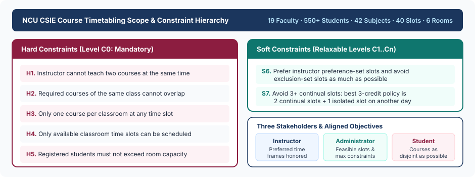
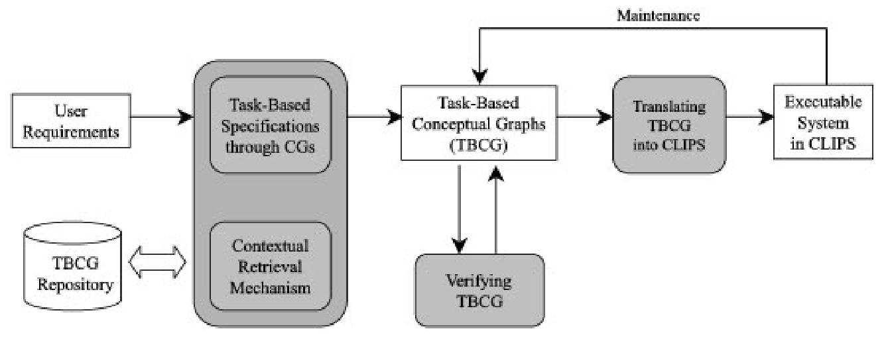
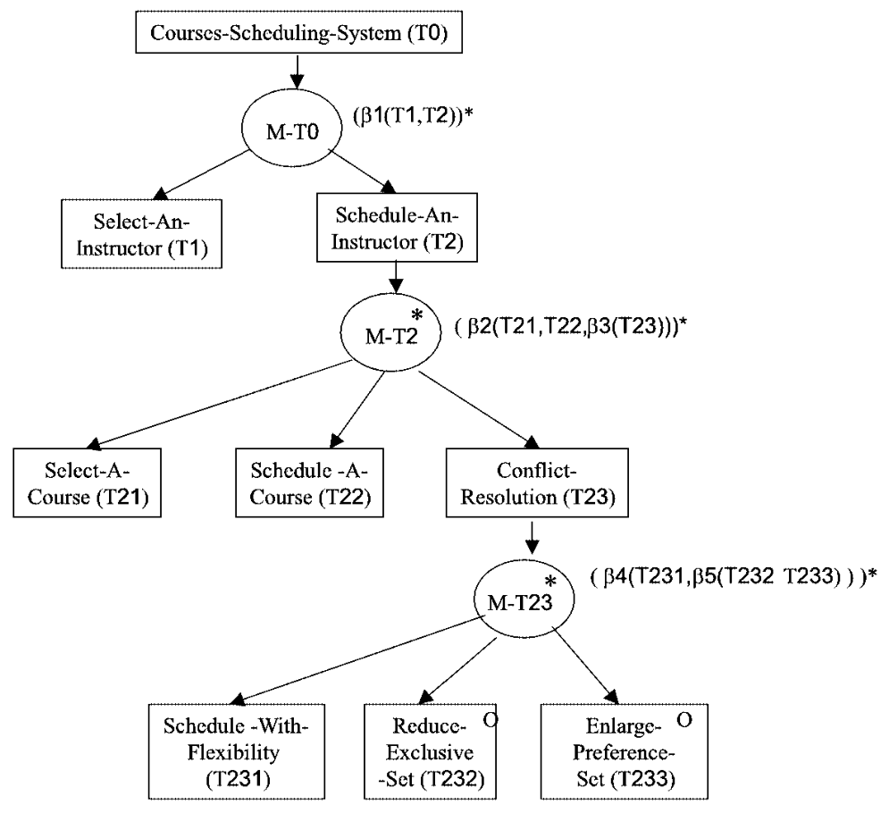
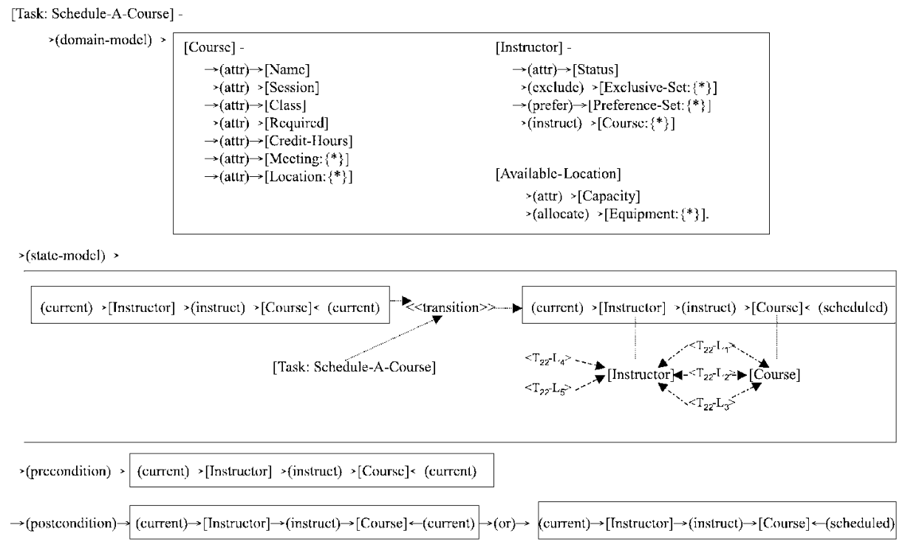
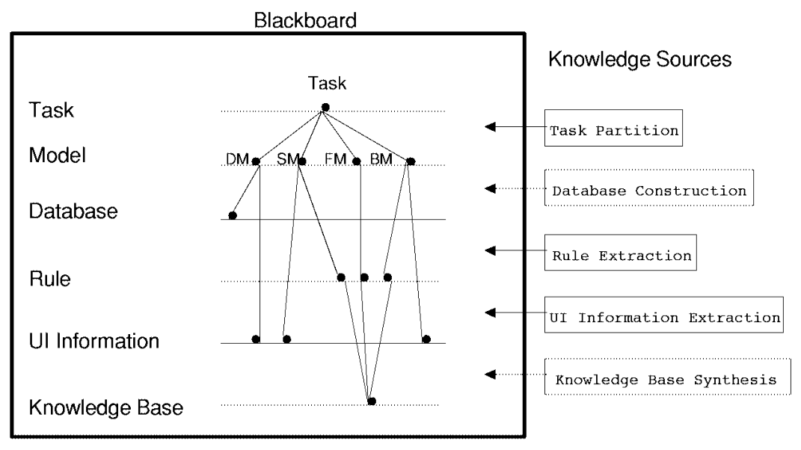
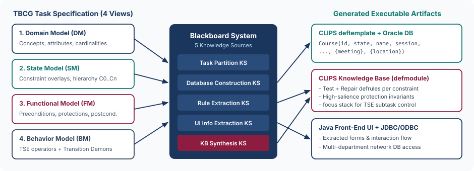
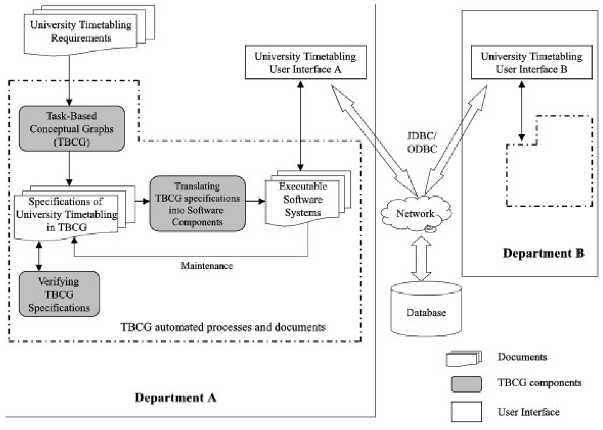

<!-- _class: lead -->

International Journal of Intelligent Systems (IJIS) · Vol. 20 · 2005

# University Timetabling through Conceptual Modeling

Automated Software Engineering for Course Timetabling via <strong>Task-Based Conceptual Graphs (TBCG)</strong>, <strong>Blackboard Synthesis</strong>, and <strong>Executable CLIPS Expert Systems</strong>

<strong>Jonathan Lee</strong>1, <strong>Shang-Pin Ma</strong>1, <strong>Lien Fu Lai</strong>2, <strong>Nien Lin Hsueh</strong>3, and <strong>Yong-Yi Fanjiang</strong>4 
1 Dept. of CSIE, National Central University &nbsp;·&nbsp; 2 Dept. of CSIE, National Changhua University of Education 
3 Dept. of IECS, Feng Chia University &nbsp;·&nbsp; 4 Dept. of CIS, National Taichung University 
<code>yjlee@selab.csie.ncu.edu.tw</code> · <code>nlhsueh@fcu.edu.tw</code>

Published in International Journal of Intelligent Systems, Vol. 20, pp. 1137–1160 (2005), Wiley Periodicals, Inc. · DOI: 10.1002/int.20115 · Supported by NSC92-2213-E-008-001.

<!--
Bibliographic & Research Overview:
This journal article by Jonathan Lee, Shang-Pin Ma, Lien Fu Lai, Nien Lin Hsueh, and Yong-Yi Fanjiang, published in the International Journal of Intelligent Systems (Vol. 20, pp. 1137 to 1160, 2005; DOI 10.1002/int.20115), introduces an automated software engineering methodology—Task-Based Conceptual Graphs (TBCG)—to solve university course timetabling.

Core Thesis:
Rather than hard-coding scheduling algorithms whose logic becomes brittle whenever institutional rules change, TBCG models timetabling specifications graphically and formally across four views (Domain, State, Functional, and Behavioral models). After verifying consistency, a six-level Blackboard system automatically translates TBCG specifications into an executable CLIPS expert system and Oracle object-relational database schemas, allowing maintenance and constraint changes to be performed directly at the specification level.
-->

---

## Outline

1

<a href="#3">Motivation &amp; Four Timetabling Challenges</a> Why institutional variability demands specification-level maintenance and constraint relaxation.

2

<a href="#4">Related Work: OR, HMI &amp; AI Paradigms</a> Comparative synthesis of Operations Research, Human-Machine Interaction, and AI methods.

3

<a href="#5">NCU Problem Statement &amp; 7 Constraints</a> Three stakeholders, 5 hard constraints (C0), 2 soft constraints, and NCU CSIE scale.

4

<a href="#6">TBCG Conceptual Modeling &amp; Tasks</a> TBSM + Conceptual Graphs, actors, demons, constraint overlays, and NCU task hierarchy.

5

<a href="#10">Operationalizing TBCG via Blackboard</a> Five knowledge sources translating 4 views into CLIPS modules, rules, and Oracle schemas.

6

<a href="#13">NCU System, Discussion &amp; Takeaways</a> Multi-department Java + CLIPS + Oracle deployment, maintenance benefits, and limitations.

<!--
Structural Map of the Paper:
Section 1 (Introduction, pp. 1137 to 1139) defines timetabling and identifies four enduring engineering challenges.
Section 2 (Related Work, pp. 1139 to 1141) surveys 30 years of timetabling research across Operations Research (sequential, cluster, meta-heuristic), Human-Machine Interaction, and Artificial Intelligence (constraint programming, expert systems, neural networks).
Section 3 (Problem Statements, pp. 1141 to 1142) specifies the university course timetabling problem at National Central University (NCU) CSIE with 3 actors and 7 constraints.
Section 4 (Conceptual Modeling through TBCG, pp. 1143 to 1155) formalizes TBSM in Conceptual Graphs (4.1) and details operationalization into CLIPS via a Blackboard architecture (4.2).
Section 5 (NCU Timetabling System, pp. 1155 to 1158) demonstrates generated Oracle schemas (5.1) and CLIPS knowledge base rules (5.2).
Section 6 (Conclusion, p. 1158) summarizes architectural advantages.
-->

---

## 1. Motivation: Four Enduring Challenges in Timetabling

Timetabling assigns events/courses to **timeslots**, **classrooms**, and **instructors** while satisfying institutional constraints. Despite 30+ years of research, four software engineering gaps persist:

<h3>1. Frequent Reformulation &amp; Change</h3>

Institutional rules vary widely across universities and semesters; small policy tweaks cause complex ripple effects if maintained in source code.

<h3 style="margin-top: 10px;">2. Lack of a Generalized Framework</h3>

Bespoke schedulers are slow and costly to build; a reusable methodology is needed across diverse timetabling domains.

<h3>3. Incorporating Human Expertise</h3>

Capturing administrative heuristics is hard, yet domain knowledge is vital to prune the search space and fit real-world context.

<h3 style="margin-top: 10px;">4. Hard vs. Soft Constraint Relaxation</h3>

Real timetables aim for a <strong>feasible solution</strong> satisfying <em>all hard constraints</em> and <em>as many soft constraints as possible</em> via relaxation.

<strong>Key Insight (TBCG):</strong> Treat timetabling as an <strong>executable conceptual specification</strong> problem—maintain constraints and tasks at the readable specification level, and <strong>auto-generate</strong> the executable expert system.

<!--
Engineering Motivation (Section 1):
Following Gunadhi et al. (1996), the paper explicitly scopes the university course timetabling problem with three practical assumptions: (1) students are already assigned or select classes themselves; (2) constraints partition cleanly into hard (mandatory) vs. soft (desirable); and (3) the practical objective is finding a feasible timetable satisfying all hard constraints and maximizing soft constraint satisfaction, rather than optimizing a single rigid mathematical objective function.

Why Automated Software Engineering Matters:
In conventional timetabling implementations, adding or relaxing a single departmental rule requires modifying tangled imperative code. By elevating the specification into first-order-logic-backed Task-Based Conceptual Graphs (TBCG) that automatically compile into CLIPS rules and database schemas, policy maintenance becomes transparent, explainable, and rapid.
-->

---

## 2. Related Work: Three Paradigms of Automated Timetabling

| Paradigm | Representative Techniques | Key Strengths | Primary Limitations |
| :--- | :--- | :--- | :--- |
| **Operations Research (OR)** | **Sequential:** Graph coloring (de Werra) **Cluster:** Lagrangian relaxation, QAP **Meta-heuristic:** Memetic GA, Tabu Search, Hill-Climbing | High-quality solutions for well-formed math models (especially meta-heuristics) | Graph coloring fails to scale &amp; resists rule changes; fixed clusters hurt quality; meta-heuristics incur high compute cost |
| **Human-Machine Interaction (HMI)** | Iterative approximation–evaluation–modification (Mulvey); DBMS bookkeeping (Johnson) | Keeps human judgment in the loop; reduces clerical workload | Laborious for large problems; finding a good initial solution is computationally expensive |
| **Artificial Intelligence (AI)** | **Constraint Programming / CLP** (Prolog, OO-CBR) **Expert Systems** (RAPS, PROTEUS, OO scheduler) **Neural Networks** (Hopfield nets) | Expressive constraints; captures domain expertise; separates data, knowledge &amp; solver | Hopfield nets suffer infeasibility &amp; heavy compute; most AI systems still require manual coding when specs evolve |

<strong>Positioning TBCG:</strong> Extends the <strong>Expert System + Constraint Satisfaction</strong> lineage by adding <strong>formal conceptual graph modeling</strong>, <strong>contextual reuse</strong>, <strong>automated verification</strong>, and <strong>automatic code generation</strong>.

<!--
Comparative Literature Synthesis (Section 2):
The paper organizes three decades of timetabling literature into three major families:
1. Operations Research (Section 2.1): Sequential graph-coloring methods (de Werra, 1985, 1996, 1997) struggle with scale and dynamic customization; cluster methods (Tripathy, 1984, 1992; Ferland & Roy, 1985) risk poor timetable quality due to early fixed clustering (Burke & Petrovic, 2002); meta-heuristics (Hertz, 1991, 1992; Schaerf, 1999; Moscato & Norman, 1992) achieve strong quality at steep computational cost.
2. Human-Machine Interaction (Section 2.2): Systems like Mulvey (1982) and Johnson (1993) aid clerical bookkeeping and interactive refinement but remain laborious at scale.
3. Artificial Intelligence (Section 2.3): Constraint logic programming (Boizumault et al., 1996; Deris et al., 2000; Valouxis & Housos, 2003) and expert systems (Gunadhi et al., 1996; Solotorevsky et al., 1994 RAPS; Dhar & Ranganathan, 1990 PROTEUS) separate knowledge from algorithms, whereas Hopfield neural networks (Smith et al., 1995) suffer heavy computational overhead (Mausser & Magazine, 1996). TBCG builds directly on AI's separation of concerns while automating the entire specification-to-code lifecycle.
-->

---

## 3. Problem Formulation: NCU CSIE Case & 7 Constraints

NCU CSIE real-world dataset (42 subjects, 40 timeslots, 6 rooms), 3 actors, 5 hard constraints (C0), and 2 soft constraints (Section 3).

<strong>Workflow:</strong> Instructors submit course forms (title, <strong>preference set</strong>, <strong>exclusion set</strong>) ➔ Automated scheduling ➔ Draft circulated for instructor validation ➔ Approved timetable sent to Dean of Academic Affairs.

<!--
Problem Statement & NCU Benchmark (Section 3):
Following Schaerf's (1999) taxonomy (school, course, and examination timetabling), this study addresses university course timetabling using real operational data from the Department of Computer Science and Information Engineering at National Central University (NCU): 19 faculty members, over 550 students, 42 subjects (1 to 5 lectures/week based on credit hours), 40 weekly timeslots, and 6 classrooms.

Constraint Partitioning:
Constraints 1 through 5 are Hard Constraints (Level C0, strictly mandatory): no instructor double-booking, no overlap among required courses of the same class, single course per classroom per slot, classroom availability respected, and room capacity >= registered students. Constraints 6 and 7 are Soft Constraints (relaxable): matching instructor preference/exclusion sets, and avoiding 3+ consecutive lectures (e.g., splitting a 3-credit course into 2 consecutive slots + 1 isolated slot on another day).
-->

---

## 4. TBCG Automated Software Engineering Lifecycle

Figure 1 (Paper p. 1143): End-to-end automated software development and specification-level maintenance via TBCG.

<h3>1. Modeling &amp; Reuse</h3>

Capture domain/process specs in <strong>TBCG</strong>; reuse past specs via <strong>Contextual Retrieval</strong> (fuzzy similarity + purpose-directed analogy).

<h3>2. Formal Verification</h3>

Verify <strong>Model Specs</strong> (constraint satisfaction &amp; relaxation) and <strong>Process Specs</strong> (inter-/intra-level CG inference consistency).

<h3>3. Auto-Generation</h3>

Blackboard transforms verified TBCG into <strong>CLIPS</strong> rules, DB schemas &amp; UI; maintenance loops back to <strong>TBCG specs</strong>.

<!--
Four-Stage TBCG Automation Pipeline (Section 4, Figure 1):
Figure 1 highlights the paper's core software engineering loop:
1. Specification Acquisition: Task-Based Specification Methodology (TBSM; Lee, Lai, & Huang, 1996) organizes domain knowledge, functional requirements, and problem-solving methods around tasks, while Conceptual Graphs (CGs; Sowa, 1984) supply first-order-logic semantics. A Contextual Retrieval Mechanism (Lai, Lee, & Yang, 1999) uses fuzzy similarity and purpose-directed analogy to retrieve reusable TBCGs from the repository.
2. Verification (Lee & Lai, 1998): Checks both static model consistency (constraint networks and relaxation repair) and dynamic process consistency (inter-level and intra-level transitions).
3. Operationalization: Translates verified TBCGs into executable CLIPS code.
4. Specification-Level Maintenance: Crucially, the feedback arrow labeled "Maintenance" returns directly to TBCG specifications rather than to generated CLIPS code.
-->

---

## 4.1 Task-Based Specifications in Conceptual Graphs (TBSM + CG)

<h3>TBSM: Four Specification Views</h3>
<ul class="small-text">
<li><strong>Domain Model (DM):</strong> Static entities, attributes, and relations (ER-like concepts).</li>
<li><strong>State Model (SM):</strong> Problem-solving states, completion stages, and attached constraints.</li>
<li><strong>Functional Specification (FM):</strong> Preconditions, local invariants (<em>protections</em>), and rigid/soft postconditions.</li>
<li><strong>Behavioral Specification (BM):</strong> Dynamic subtask control via <strong>Task State Expressions (TSE)</strong>:
  <ul>
  <li><em>Sequencing:</em> follow, immediately follow</li>
  <li><em>Branching:</em> selection, optional, conditional (<code>b?</code> / <code>¬b?</code>)</li>
  <li><em>Iteration:</em> repeating task loops</li>
  </ul>
</li>
</ul>

<h3>Extended Conceptual Graph Primitives</h3>
<ul class="small-text">
<li><strong>Concepts <code>[Entity]</code> &amp; Relations <code>(rel)</code>:</strong> Declarative facts, attributes <code>(attr)</code>, data types <code>(chrc)</code>, and cardinalities (<code>@</code>).</li>
<li><strong>Actors <code>&lt;Actor&gt;</code>:</strong> Procedural nodes computing output referents from inputs.</li>
<li><strong>Demons <code>&lt;&lt;Demon&gt;&gt;</code> (Delugach):</strong> State-transition triggers that <strong>assert</strong> output concepts and <strong>retract</strong> input concepts once all inputs &amp; task tokens are enabled.</li>
<li><strong>Constraint Overlays:</strong> Dashed-line actors overlaid on state graphs to enforce hard/soft constraints.</li>
</ul>

<!--
Formal Foundations of TBCG (Section 4.1):
TBCG unifies TBSM's multi-level task refinement (task / method / subtask, inspired by Chandrasekaran, 1990) with Sowa's Conceptual Graphs extended by Delugach's (1991) dynamic demons and Eshner/Pfeiffer's constraint overlays.
- Static vs. Dynamic Split: Domain Models map terms to ENTITY concepts, attributes via (attr), and types via (chrc). State Models overlay constraint actors onto state graphs and use demons whose inputs are STATE objects plus TASK tokens.
- Functional Semantics: Preconditions, protections, and rigid postconditions are crisp propositions, whereas soft postconditions are modeled as fuzzy propositions (Lee & Kuo, 1998).
- Behavioral Semantics: Task State Expressions (TSE) extend regular expressions and compile into state-transition diagrams using an initiator demon, a START state, conditional test tasks (b? and not-b?), and a (final) monadic relation.
-->

---

## 4.2 Hierarchical Task Structure for NCU Timetabling

<h3>Top-Down Task Decomposition</h3>
<ul class="small-text">
<li><strong>Root Task <code>T0</code>:</strong> <code>Courses-Scheduling-System</code> iterates via <code>M-T0</code> over <code>Select-An-Instructor (T1)</code> and <code>Schedule-An-Instructor (T2)</code>.</li>
<li><strong>Method <code>M-T2</code>:</strong> Iteratively executes:
  <ol>
  <li><code>Select-A-Course (T21)</code> from unscheduled courses;</li>
  <li><code>Schedule-A-Course (T22)</code> into valid slot &amp; room;</li>
  <li><code>Conflict-Resolution (T23)</code> — <em>skipped</em> if <code>T22</code> succeeds!</li>
  </ol>
</li>
</ul>

<h3>Constraint Relaxation Subtasks (<code>M-T23</code>)</h3>
<ul class="small-text">
<li><code>T231</code>: <strong>Schedule-With-Flexibility</strong></li>
<li><code>T232</code>: <strong>Reduce-Exclusive-Set</strong> (optional)</li>
<li><code>T233</code>: <strong>Enlarge-Preference-Set</strong> (optional)</li>
</ul>

Figure 2 (Paper p. 1145): Hierarchical task/method/subtask structure with TSE control expressions.

<!--
Task Hierarchy & Conflict Resolution (Section 4.1, Figure 2):
Figure 2 illustrates how TBCG tames scheduling complexity through modular task decomposition (task -> method -> subtasks).
- At the top level, M-T0 controls the loop (b1(T1, T2))* over all instructors.
- Inside Schedule-An-Instructor (T2), M-T2 specifies the TSE (b2(T21, T22, b3(T23)))*: while unscheduled courses remain (b2), select a course (T21), attempt to schedule it (T22), and invoke Conflict-Resolution (T23) only when a conflict occurs (b3 is true).
- When invoked, M-T23 resolves conflicts by relaxing soft constraints through Schedule-With-Flexibility (T231), optionally reducing the instructor's exclusive set (T232), or enlarging the preference set (T233).
-->

---

## 4.3 Concrete Task Specification: `Schedule-A-Course` (`T22`)

<ul class="small-text">
<li><strong>Domain Model (Top):</strong> Defines three core concepts and attributes—e.g., <code>Course</code> carries 7 attributes (<code>Name</code>, <code>Session</code>, <code>Class</code>, <code>Required</code>, <code>Credit-Hours</code>, <code>Meeting</code>, <code>Location</code>) with cardinality markers (<code>@1</code>, <code>@n</code>).</li>
<li><strong>State Model (Bottom):</strong> Captures transition from <code>Course[current]</code> ➔ <code>Course[scheduled]</code> triggered by demon <code>&lt;&lt;Schedule-A-Course&gt;&gt;</code>.</li>
<li><strong>Constraint Overlays (<code>T22-L1</code>..<code>T22-L5</code>):</strong> Overlaid on the state transition; e.g., <code>T22-L1</code> checks that no scheduled meeting falls inside the instructor's <code>exclusive-set</code>.</li>
</ul>

<strong>Two-Rule Compilation:</strong> Every constraint overlay yields both a <strong>satisfaction test rule</strong> and a <strong>violation repair (fix) rule</strong> in CLIPS.

Figure 5 (Paper p. 1147): Complete TBCG specification (Domain Model + State Model) of task Schedule-A-Course.

<!--
Detailed Anatomy of Schedule-A-Course (Section 4.1, Figures 5 and 6):
Figure 5 demonstrates how static data structure and dynamic state-transition semantics coexist cleanly inside a single TBCG task specification:
- Domain Model: Models Instructor, Course, and Available-Location along with single-valued and multi-valued attributes.
- State Model: Specifies that the state "[current] <- (Instructor) -> (instruct) -> [Course] -> (current)" transitions to "... -> [Course] -> (scheduled)" if and only if (1) the constraint hierarchy T22-L1 through T22-L5 is satisfied (at least through hard level C0) and (2) the task token Schedule-A-Course is performed.
- Figure 6 in the paper zooms into constraint T22-L1, separating its "rule" part (checking satisfaction) from its "fix-rule" part (repairing violations).
-->

---

## 5. Operationalizing TBCG via a 6-Level Blackboard Model

A <strong>Blackboard architecture</strong> (6 hierarchical levels + <strong>5 Knowledge Sources</strong>) opportunistically and incrementally transforms verified TBCGs into executable software:

<ol class="small-text">
<li><strong>Task Partition KS:</strong> Splits each Task into 4 views (<code>DM</code>, <code>SM</code>, <code>FM</code>, <code>BM</code>).</li>
<li><strong>Database Construction KS:</strong> Maps <code>DM</code> ➔ CLIPS <code>deftemplate</code> &amp; Oracle DB schemas.</li>
<li><strong>Rule Extraction KS:</strong> Extracts CLIPS <code>defrule</code>s from <code>SM</code> (constraints/states), <code>FM</code> (preconditions/protections), and <code>BM</code> (TSE demons).</li>
<li><strong>UI Info Extraction KS:</strong> Extracts form formats (<code>DM</code>), HCI states (<code>SM</code>), and flow (<code>BM</code>).</li>
<li><strong>KB Synthesis KS:</strong> Integrates all task rules into a unified Knowledge Base guided by the task structure.</li>
</ol>

Figure 7 (Paper p. 1150): Six-level Blackboard hierarchy (Task ➔ Knowledge Base) driven by five Knowledge Sources.

<!--
Blackboard Operationalization Architecture (Section 4.2, Figure 7):
To bridge the gap between graphical conceptual graphs and a complete multi-component software system (database, expert system rules, and user interface), the authors employ a Blackboard problem-solving model organized into six abstraction levels: Task, Model (DM, SM, FM, BM), Database, Rule, UI Information, and Knowledge Base.

Opportunistic & Incremental Synthesis:
Knowledge Sources (KS) communicate exclusively by reading and writing changes on the blackboard. Whenever a new TBCG task specification or constraint edit is posted, the relevant KSs trigger incrementally to regenerate the affected deftemplates, defrules, UI metadata, and synthesized knowledge base—avoiding monolithic recompilation and enabling rapid iterative prototyping.
-->

---

## 5.1 End-to-End Transformation: TBCG ➔ CLIPS & Oracle DB

Mapping four TBCG views through five Blackboard Knowledge Sources into CLIPS deftemplates, defmodules/defrules, Oracle DB, and Java UI.

<strong>Modular Isolation:</strong> Each TBCG task compiles into an independent CLIPS <code>defmodule</code>, and each composite actor into its own module—so rules in one task never corrupt another task's execution.

<!--
Systematic Code Generation Pipeline (Sections 4.2.1, 4.2.2, 5.1, and 5.2):
This diagram summarizes the exact target artifacts produced by the TBCG CASE tool and Blackboard system:
- From Domain Model (DM): One-to-one mapping of concept cardinalities (Table II) into CLIPS deftemplate constructs with single-field (slot) and multi-field (multislot) attributes plus a unique non-null id slot for entity integrity, then directly into Oracle object-relational tables (collection columns for multislots).
- From State/Functional/Behavioral Models (SM, FM, BM): Modular CLIPS defmodules and defrules implementing constraint tests, violation repairs, high-salience protection invariants, and focus-stack control flow.
- From UI Info Extraction: Initial Java front-end forms and interaction flows connected to the Oracle database via JDBC/ODBC.
-->

---

## 5.2 Translating Domain Models, Actors, Demons & Constraints

<h3>1. Data, Integrity &amp; Extensible Actors</h3>
<ul class="small-text">
<li><strong>Table II (DM ➔ CLIPS ➔ Oracle):</strong> Single concepts map to <code>slot</code>; sets map to <code>multislot</code> (Oracle collection columns). Every template gets a unique non-null <code>id</code> slot; cascading deletion preserves referential integrity.</li>
<li><strong>Table III (Actor Primitives):</strong> 1-to-1 CLIPS mapping across 4 groups—<em>Test</em> (<code>&gt;</code>, <code>eq</code>, <code>member</code>, <code>subsetp</code>), <em>Manipulation</em> (<code>insert</code>, <code>delete</code>, <code>replace</code>), <em>I/O</em> (<code>read</code>, <code>printout</code>), and <em>Math</em> (<code>+</code>, <code>-</code>, <code>*</code>, <code>/</code>). Composite actors compose dataflow primitives.</li>
</ul>

<h3>2. Control Flow &amp; Constraint Hierarchy</h3>
<ul class="small-text">
<li><strong>TSE Demons ➔ <code>defrule</code> + <code>focus</code> Stack:</strong> Follow, Conditional, and Iteration demons retract input state, assert output state, and push the subtask module via <code>focus</code>; empty agenda pops focus back.</li>
<li><strong>Preconditions &amp; Protections:</strong> Unmet preconditions invoke <code>return</code>; local invariants compile to <strong>highest-salience rules</strong> that auto-restore prior state upon violation.</li>
<li><strong>Constraint Hierarchy (<code>C0</code>..<code>Cn</code>):</strong> A state transition fires only when hard level <code>C0</code> (and all stronger levels) are satisfied.</li>
</ul>

<strong>Clean Separation of Concerns:</strong> Facts (<code>deftemplate</code>), domain/control rules (<code>defrule</code>), and CLIPS's Rete inference engine remain cleanly decoupled—making constraint insertion or removal a one-edit specification change.

<!--
Detailed Translation Mechanics (Sections 4.2.1, 4.2.2, 5.1, and 5.2):
1. Database & Integrity (4.2.1 & 5.1): For Schedule-A-Course, the Database Construction KS generates three CLIPS templates: Course, Instructor, and Available-Location. The Course template maps directly to the Oracle relation Course(id, state, name, session, class, required, credit-hours, {meeting}, {location}). Adding a mandatory unique id slot enforces key/entity integrity, while cascading cleanup on fact retraction enforces referential integrity.
2. Actor Operationalization (4.2.2): Table III enumerates 22 built-in actor primitives across test, manipulation, I/O, and arithmetic categories. New composite actors can be defined graphically as dataflow combinations of existing primitives and compiled automatically into CLIPS modules.
3. State Transitions & Hierarchy (4.2.2 & 5.2): Each constraint generates a test rule (e.g., T22-L1-rule asserting constraint-satisfaction) and a fix rule. Level-checking rules verify cumulative satisfaction from C0 downward, firing State-Transition only when satisfied. Protection rules carry the highest CLIPS salience so any invariant breach immediately rolls back the offending fact change.
-->

---

## 6. NCU University Timetabling System Architecture

<h3>Two-Part Deployed Architecture</h3>
<ul class="small-text">
<li><strong>Front-End (Java UI):</strong> Interactive course-form entry, timetable visualization, and instructor validation.</li>
<li><strong>Kernel (Generated CLIPS Expert System):</strong> Produced automatically from verified TBCG specifications via the TBCG CASE tool.</li>
<li><strong>Shared Oracle Database (JDBC/ODBC):</strong> Enables multiple departments (Dept. A, Dept. B) to coordinate shared classrooms and campus resources over the network.</li>
</ul>

<h3>Knowledge Base Synthesis Guarantee</h3>

The <strong>KB Synthesis KS</strong> traverses the task structure top-down from root <code>T0</code>, collecting every subtask's rules so no rule is ever omitted during integration.

Figure 11 (Paper p. 1156): Multi-department NCU timetabling deployment with Java UI, TBCG-generated kernel, and networked Oracle DB.

<!--
System Deployment & Multi-Department Architecture (Section 5, Figure 11):
Figure 11 shows the complete operational architecture deployed for National Central University. Each department (Department A, Department B) runs its own TBCG-generated executable expert system kernel paired with a Java front-end UI, while connecting through JDBC/ODBC over the campus network to a shared Oracle database. This design lets individual departments customize their local scheduling policies and constraints directly in their own TBCG specifications while maintaining campus-wide consistency on shared rooms and timeslots.
-->

---

## 7. Discussion, Limitations & Key Takeaways

<h3>Three Architectural Advantages</h3>
<ol class="small-text">
<li><strong>Specification-Level Maintenance:</strong> Policy updates and hard/soft constraint insertions or removals happen directly on graphical TBCGs rather than brittle source code.</li>
<li><strong>Decoupled Expert Architecture:</strong> Clean separation of facts, knowledge base, and inference engine boosts long-term maintainability.</li>
<li><strong>Multi-Level Scalability:</strong> Hierarchical task decomposition (<code>T0 ➔ T2 ➔ T22/T23</code>) breaks large timetabling problems into verifiable, modular subproblems.</li>
</ol>

<h3>Scope Boundaries &amp; Limitations</h3>
<ul class="small-text">
<li><strong>Qualitative Case Validation:</strong> Demonstrates NCU CSIE (42 subjects, 40 slots, 6 rooms) end-to-end, without runtime/quality benchmarks against Tabu Search or ILP solvers.</li>
<li><strong>Feasibility over Global Optimality:</strong> Designed to satisfy all <code>C0</code> hard constraints and relax soft constraints rather than optimize a numeric objective.</li>
<li><strong>Tooling Dependency:</strong> Requires analysts trained in Conceptual Graphs and TBSM notation alongside the TBCG CASE tool.</li>
</ul>

<strong>Core Takeaway:</strong> Conceptual modeling with <strong>TBCG</strong> turns university timetabling from a one-off coding exercise into a <strong>verifiable, reusable, specification-driven software engineering workflow</strong>.

<!--
Critical Synthesis & Research Assessment (Section 6):
The paper's enduring contribution lies in software engineering automation for knowledge-intensive scheduling systems:
1. Maintainability: Small logical changes at the code level often trigger unpredictable bugs, whereas editing a TBCG constraint overlay or task method is visual, formal, and verifiable prior to code regeneration.
2. Modularity: Mapping tasks to CLIPS defmodules and using a Blackboard architecture cleanly separates database schemas, constraint rules, invariants, and UI specifications.

Methodological Limitations:
As an architectural and modeling paper in IJIS, the evaluation focuses on expressiveness, formal translation correctness, and deployment feasibility on NCU CSIE's 42-course dataset rather than empirical runtime comparisons against meta-heuristic or integer programming benchmarks. Extending TBCG with quantitative soft-constraint scoring and large-scale multi-college benchmarks remains a natural avenue for follow-up work (e.g., the authors' subsequent IJAIT 2008 paper).
-->

---

<!-- _class: closing -->

# Thank You & Questions

Task-Based Conceptual Graphs · Six-Level Blackboard Synthesis · Executable CLIPS Timetabling

<strong>Jonathan Lee</strong>1 &nbsp;·&nbsp; <code>yjlee@selab.csie.ncu.edu.tw</code> &nbsp;|&nbsp; <strong>Shang-Pin Ma</strong>1 &nbsp;|&nbsp; <strong>Lien Fu Lai</strong>2 
<strong>Nien Lin Hsueh</strong>3 &nbsp;·&nbsp; <code>nlhsueh@fcu.edu.tw</code> &nbsp;|&nbsp; <strong>Yong-Yi Fanjiang</strong>4 
NCU · NCUE · Feng Chia University · National Taichung University, Taiwan 
International Journal of Intelligent Systems (IJIS), Vol. 20, pp. 1137–1160, 2005 · DOI: 10.1002/int.20115 · NSC92-2213-E-008-001

<!--
Reference & Archival Metadata:
- Title: University Timetabling through Conceptual Modeling
- Authors: Jonathan Lee (NCU), Shang-Pin Ma (NCU), Lien Fu Lai (NCUE), Nien Lin Hsueh (FCU), Yong-Yi Fanjiang (National Taichung University)
- Venue: International Journal of Intelligent Systems, Vol. 20, pp. 1137 to 1160, 2005 (Wiley Periodicals, Inc.)
- DOI: 10.1002/int.20115
- Funding: National Science Council (Taiwan), Grant NSC92-2213-E-008-001
-->

