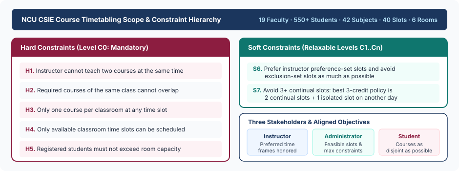
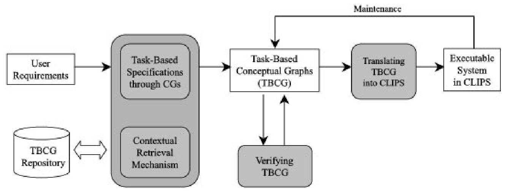
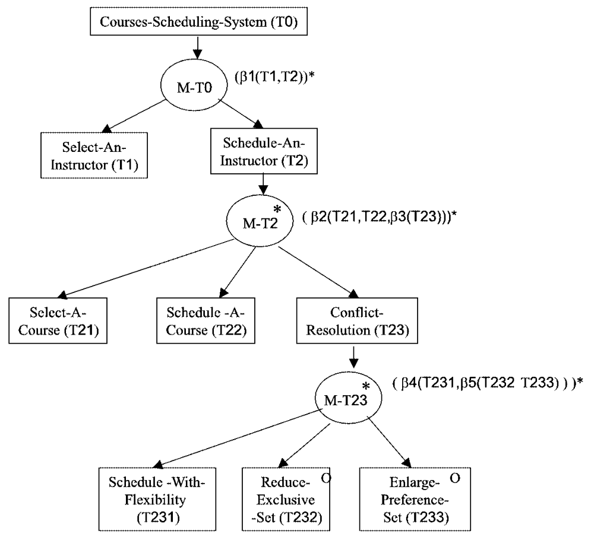
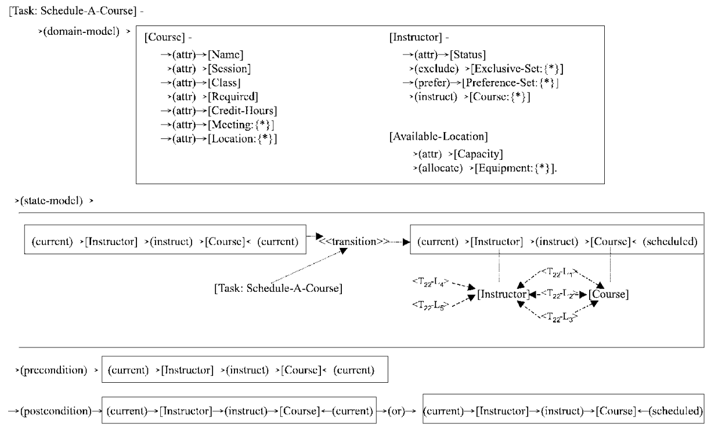
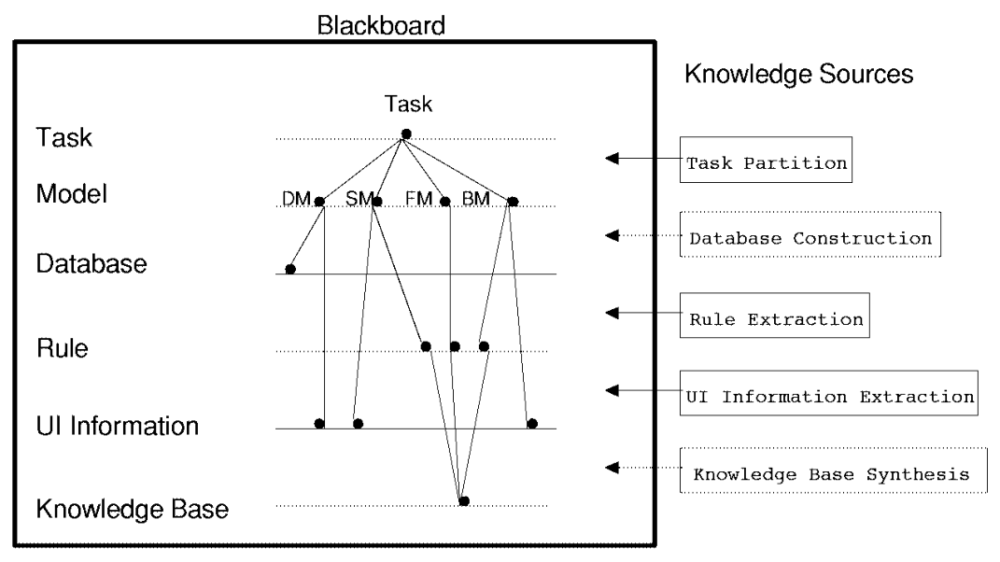
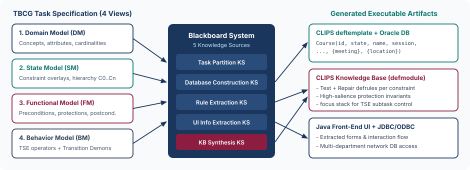
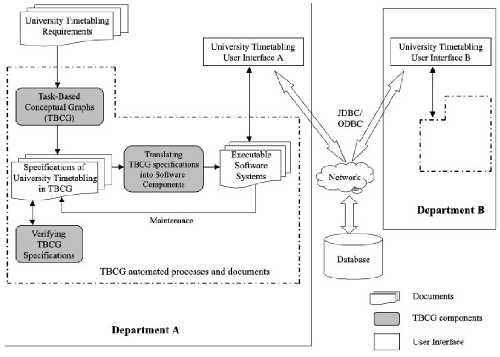

<!-- _class: lead -->

國際智慧型系統期刊（IJIS）· 第 20 卷 · 2005 年

# 基於概念塑模之大學排課系統

運用<strong>任務導向概念圖（TBCG）</strong>、<strong>六層黑板合成架構</strong>與<strong>可執行 CLIPS 專家系統</strong>實現自動化大學課程排課工程

<strong>李允中（Jonathan Lee）</strong>1、<strong>馬尚彬（Shang-Pin Ma）</strong>1、<strong>賴聯福（Lien Fu Lai）</strong>2、<strong>薛念林（Nien Lin Hsueh）</strong>3、<strong>范姜永益（Yong-Yi Fanjiang）</strong>4 
1 國立中央大學資工系 &nbsp;·&nbsp; 2 國立彰化師範大學資工系 &nbsp;·&nbsp; 3 逢甲大學資工系 &nbsp;·&nbsp; 4 國立台中教育大學資科系 
<code>yjlee@selab.csie.ncu.edu.tw</code> · <code>nlhsueh@fcu.edu.tw</code>

發表於 International Journal of Intelligent Systems, Vol. 20, pp. 1137–1160 (2005), Wiley · DOI: 10.1002/int.20115 · 國科會計畫：NSC92-2213-E-008-001。

<!--
論文書目與研究總覽：
本篇論文由李允中、馬尚彬、賴聯福、薛念林與范姜永益共同發表於國際期刊《International Journal of Intelligent Systems》（Vol. 20, pp. 1137 至 1160, 2005; DOI: 10.1002/int.20115）。研究提出以「任務導向概念圖（Task-Based Conceptual Graphs, TBCG）」為核心之自動化軟體工程方法，解決大學課程排課系統長期難以維護與客製化的困境。

核心技術主張：
相較於將排課邏輯寫死於程式碼中的傳統做法，TBCG 以具備一階邏輯嚴謹性且直覺可讀之圖形規格描述領域、狀態、功能與行為四種視角；通過自動化驗證後，由六層黑板系統自動轉換為可執行之 CLIPS 專家系統規則庫與 Oracle 物件關聯式資料庫綱要，使硬性與軟性限制條件之增刪維護得直接在規格層完成。
-->

---

## 簡報大綱

1

<a href="#3">研究動機與大學排課四大挑戰</a> 校際規則差異劇烈，為何需要規格層級維護與限制條件鬆弛機制。

2

<a href="#4">相關研究回顧：OR、人機互動與 AI</a> 橫跨作業研究、互動系統與人工智慧三大排課技術典範之優劣比較。

3

<a href="#5">中央大學排課問題定義與七項限制</a> 三類利害關係人、五項硬性限制（C0）、兩項軟性限制與中大資工實測規模。

4

<a href="#6">TBCG 概念塑模與任務階層設計</a> TBSM 結合概念圖之行動者、精靈、限制覆蓋層，以及中大排課任務樹。

5

<a href="#10">六層黑板架構與 CLIPS 自動轉換</a> 五大知識源如何將四視角規格自動編譯為 CLIPS 模組、規則與 Oracle 綱要。

6

<a href="#13">中大系統部署、討論與核心啟示</a> 跨系所 Java + CLIPS + Oracle 實作架構、維護優勢與研究邊界反思。

<!--
全文結構導讀：
第一章（pp. 1137 至 1139）定義排課問題並指出四大軟體工程挑戰。
第二章（pp. 1139 至 1141）回顧過去三十年作業研究（序列、分群、元啟發式）、人機互動與人工智慧（限制規劃、專家系統、類神經網路）排課文獻。
第三章（pp. 1141 至 1142）以國立中央大學資工系為例，明確化三類參與者與七項硬性／軟性限制。
第四章（pp. 1143 至 1155）闡述 TBCG 形式化規格建模（4.1）與黑板系統操作化轉譯為 CLIPS 之機制（4.2）。
第五章（pp. 1155 至 1158）展示中大排課系統自動產出之資料庫綱要（5.1）與知識庫規則（5.2）。
第六章（p. 1158）歸納三大架構優勢。
-->

---

## 1. 研究動機：大學排課系統面臨的四大工程挑戰

排課本質上係將課程活動指派至<strong>時段</strong>、<strong>教室</strong>與<strong>教師</strong>等有限資源並滿足多元限制。歷經三十餘年研究，仍有四大軟體工程瓶頸亟待突破：

<h3>1. 難以重構以因應頻繁變更</h3>

各校與每學期之排課規則差異甚大；在原始碼層級進行微幅邏輯修改，往往引發龐大且複雜之連鎖副作用。

<h3 style="margin-top: 10px;">2. 缺乏通用型開發框架</h3>

客製化排課系統開發緩慢且昂貴，亟需一套能涵蓋各類排課變體之通用方法論。

<h3>3. 難以擷取並融入領域專家知識</h3>

行政與教學經驗能大幅縮減搜尋空間並貼合實務情境，卻難以系統化納入傳統演算法。

<h3 style="margin-top: 10px;">4. 硬性與軟性限制之區辨與鬆弛</h3>

實務排課核心在於求得<strong>可行解</strong>——滿足<em>所有硬性限制</em>並透過鬆弛機制盡可能滿足<em>軟性限制</em>。

<strong>核心主張（TBCG）：</strong>將排課視為<strong>可執行概念規格</strong>問題——直接在具可讀性之規格層級增刪限制與維護任務，再透過自動化工具轉譯為可執行專家系統。

<!--
問題界定與研究切入點（第 1 章）：
本研究參照 Gunadhi 等人（1996）對排課實務的觀察，明確界定三項前提：（1）學生已分班或自行選課；（2）限制條件明確劃分為硬性（Hard）與軟性（Soft）；（3）演算法目標在於找出滿足全部硬性限制且盡量滿足軟性限制的可行解，而非單純追求某一數學目標函數極值。

規格層維護之價值：
傳統系統在程式碼中混雜領域規則與搜尋控制，導致微調一項系務規定便須重改程式；TBCG 以一階邏輯為基礎，讓規格本身兼具視覺化溝通與自動編譯執行能力，從根本解決排課系統維護難題。
-->

---

## 2. 相關研究比較：三大排課技術典範

| 技術典範 | 代表方法與文獻 | 核心優勢 | 主要侷限 |
| :--- | :--- | :--- | :--- |
| <strong>作業研究（OR）</strong> | <strong>序列法：</strong>圖著色（de Werra） <strong>分群法：</strong>拉格朗日鬆弛、QAP <strong>元啟發式：</strong>迷因演算法、禁忌搜尋 | 針對明確數學模型可求得高品質排課解（尤以元啟發式為最） | 圖著色難以擴展且不易因應規則變動；固定分群影響解品質；元啟發式運算成本高昂 |
| <strong>人機互動（HMI）</strong> | 近似－評估－修改迭代模型（Mulvey）；DBMS 輔助登錄（Johnson） | 保留人類專家決策主導權，有效減輕人工文書負荷 | 大規模排課操作繁瑣，產生優良初始解之計算代價高 |
| <strong>人工智慧（AI）</strong> | <strong>限制規劃 / CLP</strong>（Prolog、OO-CBR） <strong>專家系統</strong>（RAPS、PROTEUS） <strong>類神經網路</strong>（Hopfield 網路） | 表達力強、能融入領域知識，並分離資料、規則與求解演算法 | Hopfield 網路易產生不可行解且耗費龐大算力；多數 AI 系統仍須人工修改程式碼 |

<strong>TBCG 之學術定位：</strong>承襲<strong>專家系統結合限制滿足</strong>之優勢，進一步導入<strong>形式化概念圖塑模</strong>、<strong>情境式規格重用</strong>、<strong>自動化驗證</strong>與<strong>程式碼自動產生</strong>。

<!--
三十年排課文獻綜述（第 2 章）：
論文將既有排課研究系統歸類為三大陣營：
1. 作業研究（2.1 節）：圖著色法（de Werra, 1985–1997）僅適用小規模且缺乏變更彈性；分群法（Tripathy, 1984, 1992; Ferland & Roy, 1985）因初期即固定活動分群而受限（Burke & Petrovic, 2002）；禁忌搜尋與局部搜尋（Hertz, 1991, 1992; Schaerf, 1999）雖品質佳但運算開銷大。
2. 人機互動（2.2 節）：Mulvey（1982）與 Johnson（1993）協助行政紀錄與反覆微調，惟大規模問題耗時費力。
3. 人工智慧（2.3 節）：限制邏輯規劃（Boizumault et al., 1996; Deris et al., 2000）與專家系統（Gunadhi et al., 1996; RAPS; PROTEUS）透過知識與演算法分離提升彈性，而類神經網路（Smith et al., 1995）因計算負擔龐大而表現受限。TBCG 進一步打通「概念規格 -> 驗證 -> 自動生成系統」全鏈路。
-->

---

## 3. 問題陳述：中央大學資工系排課實例與七項限制

國立中央大學資工系實測資料（42 門課、40 時段、6 教室）、三類利害關係人、五項硬性限制（C0）與兩項軟性限制（第 3 章）。

<strong>排課作業流程：</strong>教師填報開課表（課名、<strong>偏好時段集</strong>、<strong>排除時段集</strong>）➔ 系統自動排課 ➔ 草稿交由全系教師確認調整 ➔ 定稿呈報教務長。

<!--
中央大學實證問題設定（第 3 章）：
依 Schaerf（1999）分類（中小學排課、大學課程排課、考試排課），本文聚焦大學課程排課，並以國立中央大學資訊工程學系真實資料驗證：19 位專任教師、逾 550 位學生、42 門課程（依學分數每週 1 至 5 節課）、40 個可排時段與 6 間教室。

硬性與軟性限制分類：
限制 1 至 5 為硬性限制（層級 C0，必須嚴格滿足）：教師不得衝堂、同班必修課不得重疊、單一教室同時段僅排一課、僅能使用教室可用時段、修課人數不得超過教室容量。限制 6 與 7 為軟性限制（可適度鬆弛）：盡可能落於教師偏好時段並避開排除時段，且三學分課程宜採「二連堂加跨日一堂」避免三節連上。
-->

---

## 4. TBCG 自動化軟體開發生命週期

圖 1（論文 p. 1143）：以任務導向概念圖（TBCG）貫穿規格建構、重用、驗證、自動轉譯與規格層維護之完整生命週期。

<h3>1. 概念塑模與重用</h3>

以 <strong>TBCG</strong> 建構問題領域模型；透過<strong>情境式檢索機制</strong>（模糊相似度＋目的導向類比）自動重用既有規格。

<h3>2. 形式化自動驗證</h3>

同時驗證<strong>模型規格</strong>（限制滿足演算法與鬆弛修復）與<strong>流程規格</strong>（層內與跨層概念圖推論一致性）。

<h3>3. 自動生成與維護</h3>

黑板系統自動將驗證後之 TBCG 轉譯為 <strong>CLIPS</strong> 程式、資料庫與介面；維護直接回歸 <strong>TBCG 規格層</strong>。

<!--
TBCG 四階段自動化工程（第 4 章、圖 1）：
圖 1 完整勾勒 TBCG 的四項核心支柱：
1. 規格建模與重用：採用任務導向規格方法論（TBSM; Lee et al., 1996）結構化領域知識與解題方法，並以概念圖（CG）作為形式表達載體；配合情境式檢索機制（Lai et al., 1999）利用模糊相似度自 TBCG 儲存庫自動重用規格。
2. 規格驗證（Lee & Lai, 1998）：於靜態層檢查限制網路一致性與鬆弛修復，於動態層檢查任務分解之層內與跨層推論一致性。
3. 操作化轉譯：將通過驗證之 TBCG 自動轉譯為可執行 CLIPS 系統。
4. 規格層級維護：圖頂端之 Maintenance 回饋箭頭直接指向 TBCG 規格，徹底免除人工修改底層程式碼之風險。
-->

---

## 4.1 任務導向概念圖之四視角與擴充元素（TBSM + CG）

<h3>TBSM：四大規格視角</h3>
<ul class="small-text">
<li><strong>領域模型（DM）：</strong>描述系統靜態實體、屬性與關聯（對應 ER 模型）。</li>
<li><strong>狀態模型（SM）：</strong>刻畫解題完成階段與附加於狀態上之限制條件。</li>
<li><strong>功能規格（FM）：</strong>定義前置條件、區域不變量（<em>保護條件</em>）及硬性／軟性後置條件。</li>
<li><strong>行為規格（BM）：</strong>以<strong>任務狀態運算式（TSE）</strong>定義子任務時序控制：
  <ul>
  <li><em>循序：</em>接續（follow）、緊接（immediately follow）</li>
  <li><em>分支：</em>選擇、可選、條件測試（<code>b?</code> / <code>¬b?</code>）</li>
  <li><em>迴圈：</em>重複迭代運算子</li>
  </ul>
</li>
</ul>

<h3>擴充概念圖核心語法</h3>
<ul class="small-text">
<li><strong>概念 <code>[Entity]</code> 與關係 <code>(rel)</code>：</strong>表達宣告式知識、屬性 <code>(attr)</code>、資料型別 <code>(chrc)</code> 與基數標記（<code>@</code>）。</li>
<li><strong>行動者 <code>&lt;Actor&gt;</code>：</strong>程序性節點，依據輸入概念計算並更新輸出參照值。</li>
<li><strong>精靈 <code>&lt;&lt;Demon&gt;&gt;</code>（Delugach）：</strong>狀態轉換觸發器，當所有輸入概念與任務權杖就緒時，<strong>宣告</strong>輸出概念並<strong>撤回</strong>輸入概念。</li>
<li><strong>限制覆蓋層（Constraint Overlays）：</strong>以虛線連結至概念之限制節點，規範世界狀態轉換條件。</li>
</ul>

<!--
TBCG 形式基礎（第 4.1 節）：
TBCG 結合 TBSM 的多層任務細化架構（任務／方法／子任務）與 Sowa 概念圖，並融入 Delugach（1991）之動態精靈與 Eshner/Pfeiffer 之限制覆蓋層。
- 靜態面：領域模型將詞彙映對為 ENTITY 概念、屬性透過 (attr) 與型別 (chrc) 表達；狀態模型則以限制覆蓋層描述狀態間限制，並以精靈驅動 STATE 與 TASK 權杖之轉換。
- 功能與行為面：前置、保護與硬性後置條件以明確命題表示，軟性後置條件則以模糊命題刻畫（Lee & Kuo, 1998）；TSE 延伸正規表示式並透過啟動精靈、START 狀態與條件任務節點編譯為概念圖狀態機。
-->

---

## 4.2 中央大學排課系統之階層任務結構

<h3>由上而下之任務分解</h3>
<ul class="small-text">
<li><strong>根任務 <code>T0</code>：</strong><code>Courses-Scheduling-System</code> 透過方法 <code>M-T0</code> 反覆執行 <code>Select-An-Instructor (T1)</code> 與 <code>Schedule-An-Instructor (T2)</code>。</li>
<li><strong>方法 <code>M-T2</code>：</strong>針對單一教師迭代執行三項子任務：
  <ol>
  <li><code>Select-A-Course (T21)</code> 挑選未排課程；</li>
  <li><code>Schedule-A-Course (T22)</code> 排入可行時段與教室；</li>
  <li><code>Conflict-Resolution (T23)</code> —— 若 <code>T22</code> 成功則直接<em>略過</em>！</li>
  </ol>
</li>
</ul>

<h3>衝突解決與限制鬆弛子任務（<code>M-T23</code>）</h3>
<ul class="small-text">
<li><code>T231</code>：<strong>彈性排課（Schedule-With-Flexibility）</strong></li>
<li><code>T232</code>：<strong>縮減排除時段集（Reduce-Exclusive-Set）</strong>（可選）</li>
<li><code>T233</code>：<strong>擴大偏好時段集（Enlarge-Preference-Set）</strong>（可選）</li>
</ul>

圖 2（論文 p. 1145）：搭配 TSE 時序控制運算式之中大排課任務／方法／子任務結構。

<!--
任務分解與衝突鬆弛邏輯（第 4.1 節、圖 2）：
圖 2 呈現 TBCG 如何透過階層式任務結構駕馭複雜排課流程：
- 頂層方法 M-T0 以迴圈運算式 (b1(T1, T2))* 逐一處理每位教師。
- 教師排課任務 T2 之方法 M-T2 定義為 (b2(T21, T22, b3(T23)))*：只要該教師尚有未排課程（b2 為真），即選課（T21）、嘗試排課（T22），僅當發生時段衝突（b3 為真）時才觸發衝突解決（T23）。
- 衝突解決方法 M-T23 進一步透過彈性排課（T231）以及可選的縮減排除集（T232）或擴大偏好集（T233），有系統地執行軟性限制鬆弛。
-->

---

## 4.3 具體任務規格實例：`Schedule-A-Course`（`T22`）

<ul class="small-text">
<li><strong>領域模型（圖上半部）：</strong>定義三個核心實體與屬性——例如 <code>Course</code> 擁有七項屬性（<code>Name</code>、<code>Session</code>、<code>Class</code>、<code>Required</code>、<code>Credit-Hours</code>、<code>Meeting</code>、<code>Location</code>），並以 <code>@1</code>、<code>@n</code> 標示基數。</li>
<li><strong>狀態模型（圖下半部）：</strong>刻畫 <code>Course[current]</code> ➔ <code>Course[scheduled]</code> 之狀態轉換，由精靈 <code>&lt;&lt;Schedule-A-Course&gt;&gt;</code> 觸發。</li>
<li><strong>限制覆蓋層（<code>T22-L1</code>..<code>T22-L5</code>）：</strong>覆蓋於狀態轉換之上；例如 <code>T22-L1</code> 檢驗排定時段皆不落入教師之 <code>exclusive-set</code>。</li>
</ul>

<strong>雙規則編譯機制：</strong>每一項限制覆蓋層皆自動對應產生兩條 CLIPS 規則——<strong>滿足檢驗規則（rule）</strong>與<strong>違規修復規則（fix-rule）</strong>。

圖 5（論文 p. 1147）：Schedule-A-Course 任務之完整 TBCG 規格（領域模型與狀態模型）。

<!--
Schedule-A-Course 任務規格解剖（第 4.1 節、圖 5 與圖 6）：
圖 5 展現單一 TBCG 任務如何同時承載靜態資料結構與動態狀態轉換語意：
- 領域模型明確標定 Instructor、Course 與 Available-Location 的單值與多值屬性；
- 狀態模型指出：唯有當限制階層 T22-L1 至 T22-L5 滿足（至少滿足硬性層級 C0）且執行 Schedule-A-Course 任務權杖時，課程狀態才會由 current 轉變為 scheduled；
- 論文圖 6 並以 T22-L1 為例，示範單一限制同時包含檢驗條件（rule）與違規修補動作（fix-rule）之雙部結構。
-->

---

## 5. 以六層黑板模型操作化 TBCG 規格

採用<strong>黑板架構（Blackboard Model）</strong>，結合六大分析層級與<strong>五大知識源（Knowledge Sources）</strong>，以機會式且漸進方式將 TBCG 轉譯為可執行系統：

<ol class="small-text">
<li><strong>任務分割知識源：</strong>將每項任務拆解為四大視角（<code>DM</code>、<code>SM</code>、<code>FM</code>、<code>BM</code>）。</li>
<li><strong>資料庫建構知識源：</strong>將 <code>DM</code> 轉譯為 CLIPS <code>deftemplate</code> 與 Oracle 資料庫綱要。</li>
<li><strong>規則擷取知識源：</strong>自 <code>SM</code>（限制／狀態）、<code>FM</code>（前置／保護）與 <code>BM</code>（TSE 精靈）擷取 CLIPS <code>defrule</code>。</li>
<li><strong>介面資訊擷取知識源：</strong>自 <code>DM</code>、<code>SM</code>、<code>BM</code> 萃取表單格式、人機互動與系統流程。</li>
<li><strong>知識庫合成知識源：</strong>依任務結構彙整所有任務規則，合成完整專家知識庫。</li>
</ol>

圖 7（論文 p. 1150）：六層黑板結構（Task ➔ Knowledge Base）與五大知識源之漸進合成機制。

<!--
黑板操作化架構（第 4.2 節、圖 7）：
為將圖形化 TBCG 規格同步轉換為資料庫綱要、專家規則庫與使用者介面，作者設計六層黑板結構（Task、Model、Database、Rule、UI Information、Knowledge Base）。五大知識源僅透過讀寫黑板上的中間狀態進行協作，展現「機會式（opportunistic）」與「漸進式（incremental）」特性——每當新增或修訂部分規格，相關知識源即自動觸發並局部更新對應程式碼，無須整套重寫。
-->

---

## 5.1 端對端自動轉換：TBCG ➔ CLIPS 與 Oracle 資料庫

四大 TBCG 規格視角經由五大黑板知識源，自動編譯為 CLIPS 範本與模組規則、Oracle 綱要及 Java 介面。

<strong>模組化隔離設計：</strong>每一項 TBCG 任務編譯為獨立 CLIPS <code>defmodule</code>，每個複合行動者亦具獨立模組，確保不同任務之事實與規則互不干擾。

<!--
系統化程式碼自動產生管線（第 4.2.1、4.2.2、5.1 與 5.2 節）：
此圖歸納 TBCG CASE 工具與黑板系統之完整輸出對應關係：
- 領域模型（DM）：依表 II 基數對映規則轉為 CLIPS deftemplate（單值 slot、多值 multislot 與唯一非空 id），並直接轉成 Oracle 物件關聯式資料表（集合欄位對應 multislot）。
- 狀態／功能／行為模型（SM、FM、BM）：編譯為具模組隔離性之 CLIPS defmodule 與 defrule，涵蓋限制檢驗、修復規則、最高顯著度保護不變量與 focus 堆疊控制。
- 介面資訊萃取：產生前端 Java 表單與互動流程，經 JDBC/ODBC 連結 Oracle 資料庫。
-->

---

## 5.2 領域模型、行動者、精靈與限制階層之 CLIPS 轉譯

<h3>1. 資料完整性與可擴充行動者</h3>
<ul class="small-text">
<li><strong>表 II（DM ➔ CLIPS ➔ Oracle）：</strong>單一概念轉為 <code>slot</code>，集合轉為 <code>multislot</code>（Oracle 集合欄位）；每個範本強制加入唯一非空 <code>id</code> 欄位，並以連動刪除確保參考完整性。</li>
<li><strong>表 III（22 項基礎行動者）：</strong>一對一對應 CLIPS 內建函式——<em>測試</em>（<code>&gt;</code>、<code>eq</code>、<code>member</code>、<code>subsetp</code>）、<em>操作</em>（<code>insert</code>、<code>delete</code>、<code>replace</code>）、<em>輸出入</em>（<code>read</code>、<code>printout</code>）與<em>數學運算</em>；複合行動者則以資料流圖組合擴充。</li>
</ul>

<h3>2. 動態控制流與限制階層</h3>
<ul class="small-text">
<li><strong>TSE 精靈 ➔ <code>defrule</code> ＋ <code>focus</code> 堆疊：</strong>循序、條件與迴圈精靈負責撤回舊狀態、宣告新狀態並以 <code>focus</code> 切換子任務模組；議程清空時自動彈出返回。</li>
<li><strong>前置與保護條件：</strong>前置不符時以 <code>return</code> 返回焦點；區域不變量轉為<strong>最高顯著度（salience）規則</strong>，遇違規立即還原先前狀態。</li>
<li><strong>限制階層（<code>C0</code>..<code>Cn</code>）：</strong>唯有硬性層級 <code>C0</code>（含更高強度層級）同時滿足，方觸發狀態轉換規則。</li>
</ul>

<strong>高度解耦優勢：</strong>事實資料（<code>deftemplate</code>）、領域與控制規則（<code>defrule</code>）與 CLIPS 推論引擎徹底分離，新增或移除排課限制僅需微調規格圖。

<!--
轉譯細部實作機制（第 4.2.1、4.2.2、5.1 與 5.2 節）：
1. 資料庫綱要生成（4.2.1 與 5.1）：以 Schedule-A-Course 為例，系統自動產生 Course、Instructor 與 Available-Location 三組 CLIPS 範本，其中 Course 直接對應 Oracle 資料表 Course(id, state, name, session, class, required, credit-hours, {meeting}, {location})。
2. 行動者與狀態轉換（4.2.2）：表 III 列出四大類共 22 項基礎行動者原語；複合行動者由原語組合成資料流圖並自動轉譯為獨立模組。
3. 規則萃取與不變量守護（5.2）：每條限制產出檢驗與修復兩條規則（如 T22-L1-rule 驗證課程時段未落於教師排除集），各層級皆生成階層檢驗規則，確保硬性層級 C0 獲得保證；保護條件則透過 CLIPS 最高 salience 優先觸發，保障系統狀態不變量絕不被破壞。
-->

---

## 6. 中央大學排課系統實作與跨系部署架構

<h3>前後端分離之實務部署架構</h3>
<ul class="small-text">
<li><strong>前端（Java 使用者介面）：</strong>提供開課表單輸入、課表檢視與教師確認介面。</li>
<li><strong>核心引擎（自動生成之 CLIPS 專家系統）：</strong>透過 TBCG CASE 工具由驗證後規格自動編譯產出。</li>
<li><strong>跨系網路資料庫（Oracle + JDBC/ODBC）：</strong>支援不同系所（如 Dept. A、Dept. B）透過校園網路共享教室與時段資料庫。</li>
</ul>

<h3>知識庫合成完整性保證</h3>

<strong>知識庫合成知識源</strong>由最高層根任務 <code>T0</code> 沿任務樹逐層向下彙整所有子任務規則，確保全系統規則零遺漏且結構一致。

圖 11（論文 p. 1156）：中央大學多系所排課系統部署架構（Java UI、TBCG 自動生成核心與共享 Oracle 資料庫）。

<!--
中大實測部署與跨系擴展性（第 5 章、圖 11）：
圖 11 展示中央大學實際系統架構：各系所（Department A、Department B）各自維護專屬之 TBCG 規格與自動生成之 CLIPS 排課核心，並搭配 Java 前端介面，透過 JDBC/ODBC 存取共享之 Oracle 資料庫。此架構兼顧「各系排課規則高度客製化」與「全校教室資源統一控管」雙重需求。
-->

---

## 7. 綜合討論、研究限制與核心啟示

<h3>三大軟體工程核心優勢</h3>
<ol class="small-text">
<li><strong>規格層直接維護：</strong>排課規則調整與硬性／軟性限制之增刪直接在圖形 TBCG 規格上完成，免於陷入脆弱程式碼修改。</li>
<li><strong>資料、知識與推論分離：</strong>事實、知識庫與 CLIPS 推論引擎徹底解耦，大幅提升系統長期演進彈性。</li>
<li><strong>多層抽象擴展能力：</strong>階層式任務分解（<code>T0 ➔ T2 ➔ T22/T23</code>）使大規模排課問題得以模組化驗證與擴充。</li>
</ol>

<h3>研究邊界與實務限制</h3>
<ul class="small-text">
<li><strong>案例驗證定位：</strong>論文以中大資工 42 門課、40 時段、6 教室進行端對端實作展示，未與禁忌搜尋或整數規劃進行求解速度與目標值量化基準比較。</li>
<li><strong>可行性導向：</strong>聚焦於滿足全部 <code>C0</code> 硬性限制並鬆弛軟性限制，而非追求全域數值最佳化。</li>
<li><strong>塑模門檻：</strong>分析人員須熟悉概念圖與 TBSM 語法，並仰賴專屬 TBCG CASE 工具鏈。</li>
</ul>

<strong>核心啟示：</strong>透過 <strong>TBCG 概念塑模</strong>，大學排課系統得以從一次性客製寫碼，昇華為<strong>可驗證、可重用、規格驅動</strong>之自動化軟體工程典範。

<!--
綜合評析與方法反思（第 6 章）：
本論文的核心貢獻在於將「自動化軟體工程（規格建模、形式驗證、自動程式生成）」完整落地於高度知識密集之大學排課領域：透過規格層維護、事實與規則解耦以及多層任務分解，有效化解各校排課規則年年異動的痛點。

方法邊界與後續發展：
本文定位為概念塑模與自動轉換架構研究，因此驗證重點放在表達力、轉譯正確性與中大資工實務案例落地，尚未呈現與 OR 元啟發式求解器之大型壓力測試數據；後續研究（如作者群於 2008 年 IJAIT 發表之延伸論文）亦進一步深化軟性限制評估與求解效能。
-->

---

<!-- _class: closing -->

# 感謝聆聽・歡迎交流指教

任務導向概念圖（TBCG）· 六層黑板自動合成 · 可執行 CLIPS 排課專家系統

<strong>李允中（Jonathan Lee）</strong>1 &nbsp;·&nbsp; <code>yjlee@selab.csie.ncu.edu.tw</code> &nbsp;|&nbsp; <strong>馬尚彬</strong>1 &nbsp;|&nbsp; <strong>賴聯福</strong>2 
<strong>薛念林（Nien Lin Hsueh）</strong>3 &nbsp;·&nbsp; <code>nlhsueh@fcu.edu.tw</code> &nbsp;|&nbsp; <strong>范姜永益</strong>4 
中央大學 · 彰化師大 · 逢甲大學 · 台中教育大學 
International Journal of Intelligent Systems (IJIS), Vol. 20, pp. 1137–1160, 2005 · DOI: 10.1002/int.20115 · 國科會計畫 NSC92-2213-E-008-001

<!--
論文參考與典藏資訊：
- 篇名：University Timetabling through Conceptual Modeling
- 作者：Jonathan Lee（中央大學）、Shang-Pin Ma（中央大學）、Lien Fu Lai（彰化師大）、Nien Lin Hsueh（逢甲大學）、Yong-Yi Fanjiang（台中教育大學）
- 出處：International Journal of Intelligent Systems, Vol. 20, pp. 1137 至 1160, 2005（Wiley Periodicals, Inc.）
- DOI：10.1002/int.20115
- 補助計畫：國科會 NSC92-2213-E-008-001
-->

