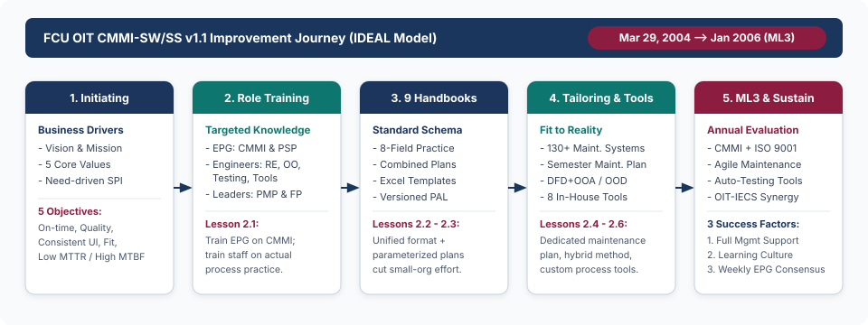
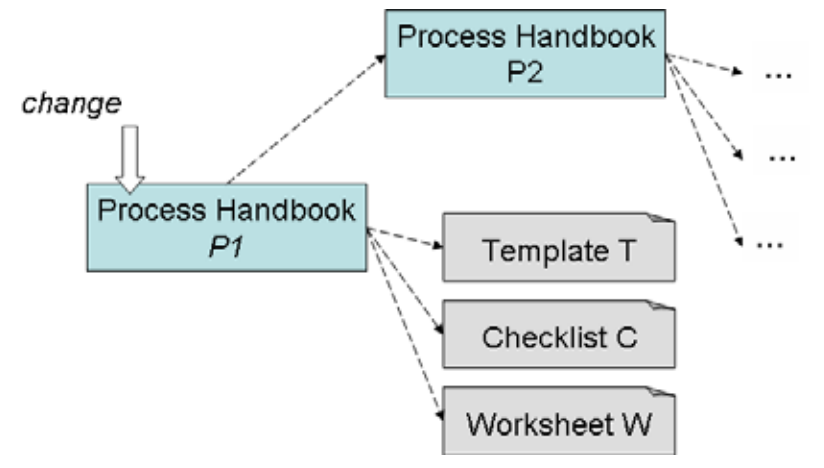
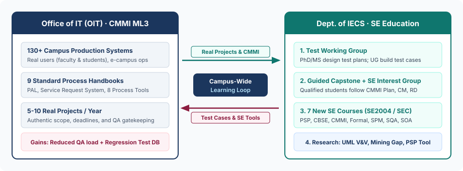
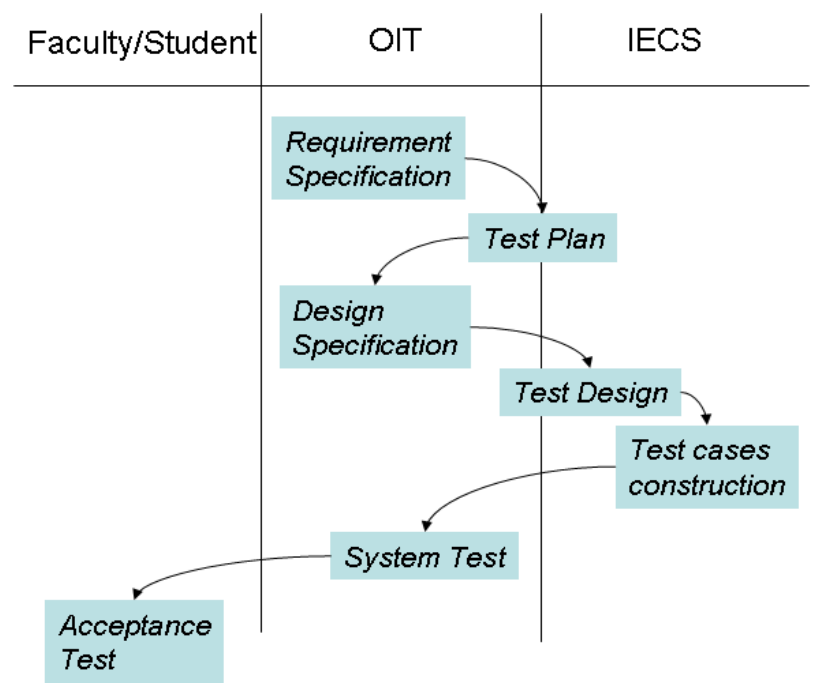

<!-- _class: lead -->

Journal of Software Engineering Studies (JSES) · Vol. 1, No. 1 · Sep 2006

# Software Process Improvement at Feng Chia University: An Experience Report

A Two-Year <strong>CMMI®-SW/SS v1.1 Maturity Level 3</strong> Journey at the Office of Information Technology (OIT) and Its Dual Impact on <strong>Software Engineering Education</strong> in the Department of IECS

<strong>Nien-Lin Hsueh</strong>1, <strong>Don-Lin Yang</strong>2, <strong>Lu-Mei Wang</strong>2, and <strong>Peng-Hua Chu</strong>1 
1 Department of Information Engineering and Computer Science (IECS), Feng Chia University 
2 Office of Information Technology (OIT), Feng Chia University, Taichung, Taiwan 
<code>nlhsueh@fcu.edu.tw</code> · <code>dlyang@fcu.edu.tw</code> · <code>lwang@fcuoa.fcu.edu.tw</code>

Published in JSES, Vol. 1, No. 1, pp. 34–40, September 2006 (Software Engineering Association of Taiwan). Supported by NSC Taiwan under Contract No. NSC94-2213-E-035-041.

<!--
Bibliographic & Research Overview:
This experience report by Nien-Lin Hsueh, Don-Lin Yang, Lu-Mei Wang, and Peng-Hua Chu (Feng Chia University, Taichung, Taiwan), published in the inaugural issue of the Journal of Software Engineering Studies (Vol. 1, No. 1, pp. 34 to 40, September 2006), documents a two-year CMMI-based Software Process Improvement (SPI) initiative at FCU's Office of Information Technology (OIT).

Historical & Institutional Context:
OIT originated as the Electronic Computer Center in July 1969, was renamed Information Center in August 1986, and was elevated to a major university office in 2001 responsible for campus IT policy and e-campus development. Starting on March 29, 2004, OIT adopted CMMI-SW/SS Version 1.1 under the IDEAL reference model and achieved Maturity Level 3 in January 2006.

Dual Research Contribution:
Unlike commercial SPI case studies focused solely on certification for contract acquisition, this paper highlights a unique university-wide synergy: six actionable SPI lessons tailored to a small IT organization maintaining over 130 campus systems, paired with four concrete transformations in undergraduate/graduate software engineering education and research within the Department of IECS.
-->

---

## Outline

1

<a href="#3">Motivation &amp; Campus IT Challenges</a> Growth to 100+ campus systems, maintenance crises, and the dual OIT–IECS mission.

2

<a href="#4">Vision, Core Values &amp; SPI Objectives</a> IDEALSM Initiating phase and need-driven CMMI® objectives beyond appraisal badges.

3

<a href="#5">OIT Process Improvement &amp; 6 Lessons</a> Role-targeted training, 9 handbooks, parameterization, CM, maintenance, hybrid OOA/OOD, and tools.

4

<a href="#10">Influences on the Department of IECS</a> Test working group, real-world capstone projects, SE2004 curriculum, and SE research tools.

5

<a href="#13">Continuous Improvement &amp; Success Factors</a> Annual quality evaluations, CMMI + ISO integration, and three organizational enablers.

6

<a href="#14">Benefits, Reflections &amp; Takeaways</a> Measurable organizational gains, constraints of small IT units, and transferable lessons.

<!--
Structural Map of the Paper:
Section 1 (Introduction, pp. 34 to 35) traces OIT's evolution since 1969 and catalogs six systemic software engineering problems that emerged once OIT's portfolio exceeded 100 production systems.
Section 2 (Process Improvement at OIT, pp. 35 to 38) presents seven subsections (2.1 through 2.7) covering organizational vision, training, process definition, project types, design methodology, process tools, and continuous improvement, distilling six numbered Lessons Learned (2.1 to 2.6).
Section 3 (Influences on the Department of IECS, pp. 38 to 39) details four academic spin-offs: the multi-tier Test Working Group (3.1), OIT-sponsored Capstone Projects (3.2), SE curriculum expansion aligned with SE2004 and Taiwan's SEC (3.3), and applied SE research tools (3.4).
Section 4 (Conclusion, pp. 39 to 40) synthesizes six organizational benefits and three core success factors.
-->

---

## 1. Motivation & Context: Scaling Past 100+ Campus Systems

1969 ➔ 2001

Computer Center elevated to <strong>Office of IT (OIT)</strong> driving FCU's e-campus mission

130+ Systems

Production campus systems under active OIT maintenance (100+ at SPI launch)

22 Months

Mar 29, 2004 ➔ Jan 2006: achieved <strong>CMMI®-SW/SS v1.1 ML3</strong>

<h3>Six Pain Points Before SPI (2004)</h3>
<ul class="small-text">
<li><strong>Poor maintainability:</strong> constantly changing requirements with missing supporting documents.</li>
<li><strong>Schedule slippage:</strong> recurring project delays across campus units.</li>
<li><strong>Uncontrolled quality:</strong> faculty and student dissatisfaction with live systems.</li>
<li><strong>Inefficient HR utilization:</strong> ad-hoc workload distribution.</li>
<li><strong>Chaotic configuration:</strong> inconsistent versions, platforms, and systems.</li>
<li><strong>Requirement mismatch:</strong> user needs inaccurately elicited and delivered.</li>
</ul>

<h3>Dual Mission: Operations + Education</h3>
<ul class="small-text">
<li><strong>Operational Goal (OIT):</strong> Establish predictable, productive software processes to deliver a personalized, integrated e-campus platform.</li>
<li><strong>Educational Goal (IECS):</strong> Leverage OIT's real CMMI® engineering environment to strengthen software engineering capability of IECS students.</li>
<li><strong>Broader Relevance:</strong> The six pain points are representative of university computer centers across Taiwan.</li>
</ul>

<!--
Problem Context & Institutional Scope:
Before March 2004, FCU's OIT had grown into the central IT organization responsible for building a personalized, integrated e-campus platform supporting teaching, learning, research, and administration. Once the maintained portfolio surpassed 100 systems (reaching over 130 systems by 2006), informal ad-hoc practices broke down across six dimensions: missing documentation under volatile requirements, chronic schedule delays, uncontrolled product quality, poor staff allocation, chaotic multi-version/multi-platform configuration management, and inaccurate user requirements.

Why CMMI-SW/SS v1.1?
OIT selected SEI's CMMI-SW/SS Version 1.1 (Software Engineering / Supplier Sourcing) to address both in-house development/maintenance and outsourced campus systems. Crucially, because OIT operates inside a university, leadership deliberately coupled operational process reform with curriculum and practical training reform in the Department of Information Engineering and Computer Science (IECS).
-->

---

## 2. Need-Driven Vision, Core Values & Process Objectives

Guided by SEI's **IDEALSM** Initiating phase, OIT anchored its SPI plan to **organizational needs** rather than chasing an appraisal badge for external contracts.

<h3>Organizational Identity</h3>
<ul class="small-text">
<li><strong>Vision:</strong> Act as a key contributor to FCU's higher-education success via advanced IT services.</li>
<li><strong>Mission:</strong> Support IT needs for quality teaching, effective learning, research excellence, efficient administration, and community service.</li>
<li><strong>5 Core Values:</strong> Customer satisfaction, overriding commitment to quality, personal accountability, life-long learning, and teamwork.</li>
</ul>

<h3>Five Concrete Process Objectives</h3>
<ol class="small-text">
<li><strong>On-time delivery</strong> aligned with university academic timeframes.</li>
<li><strong>Product quality improvement</strong> across campus systems.</li>
<li><strong>User friendliness</strong> through consistent UI design standards.</li>
<li><strong>Functional fitness</strong> meeting expected user requirements.</li>
<li><strong>Reliability gains:</strong> reduce <strong>MTTR</strong> (Mean Time to Repair) and increase <strong>MTBF</strong> (Mean Time Between Failure).</li>
</ol>

<strong>Self-Improving vs. Commercial SPI:</strong> Commercial firms often pursue CMMI® primarily to win contracts; as a university IT center, OIT treated <strong>actual organizational pain relief</strong> as the sole yardstick for process design.

<!--
IDEAL Model & Need-Driven Strategy (Section 2.1):
OIT adopted SEI's IDEAL model (Initiating, Diagnosing, Establishing, Acting, Leveraging; McFeeley, 1996) as its overarching SPI lifecycle. In the Initiating phase, identifying clear business drivers prevented CMMI adoption from devolving into bureaucratic paperwork.

Contrast with Commercial Contractors:
The authors explicitly note that commercial software vendors sometimes adopt CMMI instrumentally to qualify for government or enterprise bids, risking "compliance theater." Because OIT is an internal service unit serving FCU faculty and students, its five process objectives directly target operational reliability (MTTR reduction, MTBF increase), academic-calendar predictability, UI consistency across 130+ systems, and requirement fidelity.
-->

---

## 3. OIT SPI Roadmap: From Initiation to CMMI® ML3

Synthesized roadmap of OIT's 22-month CMMI-SW/SS v1.1 improvement lifecycle and six lessons learned (Sections 2.1–2.7).

<strong>End-to-End Coherence:</strong> Each stage resolved a concrete bottleneck discovered during pilot runs—moving from <strong>broad CMMI lectures</strong> to <strong>role-specific training</strong>, <strong>parameterized handbooks</strong>, <strong>dedicated maintenance plans</strong>, and <strong>in-house tooling</strong>.

<!--
Architectural Synthesis of Section 2:
This diagram integrates the five progressive phases of OIT's SPI effort described across Sections 2.1 through 2.7:
1. Initiating (2.1): Translating Vision, Mission, and Core Values into five measurable objectives.
2. Role-Targeted Training (2.2, Lesson 2.1): Pivoting from all-staff CMMI theory to targeted EPG, engineering, and PM tracks, followed by practice-focused process rollout training.
3. Standardized Process Definition (2.3, Lessons 2.2 and 2.3): Authoring 9 handbooks using a uniform 8-field practice schema, combined plans, Excel templates, and versioned Process Asset Library (PAL) control.
4. Reality-Aligned Tailoring & Tooling (2.4 to 2.6, Lessons 2.4 to 2.6): Separating semester-level Maintenance Plans for 130+ systems, adopting a pragmatic hybrid DFD+OOA/OOD methodology, and building 8 internal process tools.
5. ML3 Appraisal & Continuous Improvement (2.7): Annual quality reviews, ISO 9001 integration, agile maintenance refinement, and automated testing.
-->

---

## 3.1 Role-Targeted Training Strategy (Lesson 2.1)

<h3>Initial Pitfall: All-Staff CMMI® Training</h3>
<ul class="small-text">
<li>OIT initially taught CMMI® to <strong>all 4 sections</strong>: System Development, System Maintenance, Resource Management, and Technology Supporting.</li>
<li><strong>Problem 1 (What vs. How):</strong> CMMI® specifies <em>goals to satisfy</em>, not <em>how to achieve them</em>—offering little immediate help to non-EPG staff.</li>
<li><strong>Problem 2 (Cognitive Distance):</strong> Abstract CMMI® terminology was hard to grasp for support and operational personnel.</li>
</ul>

<h3>Revised Strategy: "Knowledge to Those Who Use It"</h3>
<ul class="small-text">
<li><strong>EPG Members:</strong> CMMI® specifications &amp; Personal Software Process (PSP).</li>
<li><strong>Software Engineers:</strong> Requirements Engineering, OO methodology, Software Testing, CM &amp; testing tools.</li>
<li><strong>Project Leaders:</strong> PMP® &amp; Function Point (FP) estimation.</li>
<li><strong>Round-2 Rollout Training:</strong> Once EPG defined the 9 handbooks, staff were trained on <em>practical procedures</em>—not CMMI® clauses.</li>
</ul>

<strong>Lesson Learned 2.1:</strong> Provide CMMI® specification training <strong>only to EPG members</strong> at SPI launch, rather than to the entire organization; train general staff on concrete organizational practices once defined.

<!--
Training Evolution (Section 2.2):
OIT's training curriculum spanned four domains: Engineering (requirements engineering, OO development, software testing), Management (PMP, function point estimation), Process (PSP, CMMI), and Tools (configuration management, project management, testing tools).

Why the Pivot Mattered:
Teaching raw CMMI model specifications to non-EPG staff across all four OIT sections created frustration because CMMI is a descriptive capability model rather than a prescriptive work instruction. By restricting deep CMMI training to the Engineering Process Group (EPG) and giving engineers/managers domain-relevant skills first, OIT reduced resistance. After EPG authored the concrete organizational processes, a second wave of hands-on training taught staff how to execute OIT's own procedures without exposing them to raw CMMI jargon.
-->

---

## 3.2 Process Definition: 9 Handbooks & Parameterization (Lessons 2.2–2.3)

OIT authored **9 Process Handbooks** (each structured as `Handbook ➔ Procedures ➔ Practices ➔ Tasks`), with every procedure illustrated as a **flowchart** and every practice standardized into an **8-field schema**.

| Schema Field | Purpose in Every Practice |
| :--- | :--- |
| **OWNER / ROLE** | Maintaining role &amp; participating roles |
| **DESCRIPTION** | Concise scope and purpose of the practice |
| **ENTRY / EXIT** | Preconditions &amp; postconditions for gating |
| **INPUT / OUTPUT** | Required &amp; generated/revised work products |
| **ASSETS / REF** | Links to templates/guides in the **PAL** |
| **TASKS &amp; MEASURES** | Step-by-step tasks &amp; linked process metrics |

<h3>Small-Org Optimization (Lesson 2.3)</h3>
<ul class="small-text">
<li><strong>Process Combination:</strong> Merged Project Plan + Configuration Management Plan into one <strong>integrated, parameterizable template</strong> (eliminating per-project CM policy rewriting).</li>
<li><strong>Spreadsheet Automation:</strong> Adopted <strong>Excel</strong> templates for size estimation and process/product metrics to minimize calculation overhead.</li>
<li><strong>Lesson 2.2:</strong> Consistent 8-field format + high-level graphical models streamline EPG communication and staff onboarding.</li>
</ul>

<!--
Process Architecture & Small-Organization Tailoring (Section 2.3):
Drawing on Humphrey (1989), Fuggetta (2000), Guerrero & Eterovic (2004), and Russ & McGregor (2000), OIT addressed the classic small-organization SPI dilemma: heavyweight enterprise documentation cripples small teams.
1. Uniform Practice Structure (Lesson 2.2): For example, the Engineering handbook covers product development, V&V, requirements management, and software maintenance. Standardizing every practice around Owner, Description, Entry/Exit Criteria, Input/Output, Role, Assets/Reference (stored in the Process Asset Library, PAL), Tasks, and Measures ensures unambiguous answers to who does what, under what gating condition, with what artifacts, and how it is measured.
2. Combination & Parameterization (Lesson 2.3): Rather than forcing project managers to author separate Project Plans and CM Plans from scratch, common boilerplate is abstracted into a parameterized template where PMs fill only project-specific parameters. Excel worksheets automate metrics and size calculations.
-->

---

## 3.3 Configuration Management of Process Assets

<ul class="small-text">
<li><strong>Cascading Change Risk:</strong> During active SPI, process handbooks and work-product templates evolve frequently and cross-reference one another.</li>
<li><strong>Impact Propagation:</strong> A single revision to <code>Process Handbook P1</code> can invalidate its own <strong>Template T</strong>, <strong>Checklist C</strong>, and <strong>Worksheet W</strong>, while triggering cascading updates in dependent handbooks such as <code>P2</code>.</li>
<li><strong>OIT's Lightweight Solution:</strong>
  <ul>
  <li>Enforce strict <strong>version identification</strong> across all PAL artifacts.</li>
  <li>Embed a standardized <strong>revision history header</strong> at the top of every handbook, template, checklist, and worksheet.</li>
  </ul>
</li>
</ul>

<strong>Governance Principle:</strong> Treat process assets themselves as configuration items—otherwise process drift silently breaks auditability and staff trust.

Figure 1 (Paper p. 37): Dependency propagation when Process Handbook P1 changes.

<!--
Configuration Management of Process Handbooks (Section 2.3, Figure 1):
In early SPI iterations, organizations often apply Configuration Management (CM) only to application source code while overlooking the process documentation itself. Figure 1 illustrates why process CM is critical: handbooks are not standalone documents—each handbook (e.g., P1) binds specific templates (T), checklists (C), and worksheets (W) and references peer handbooks (e.g., P2). Uncontrolled edits create mismatches between checklists and procedures, causing failed peer reviews and inconsistent QA audits. OIT resolved this by assigning formal version IDs and maintaining an explicit revision history block at the header of every process artifact stored in the Process Asset Library (PAL).
-->

---

## 3.4 Tailoring to Reality: Maintenance, Hybrid Design & In-House Tools

<h3>L2.4 Maintenance Projects</h3>
<ul class="small-text">
<li>3 project types: <strong>New/Enhancement</strong>, <strong>Maintenance</strong>, <strong>Outsourcing</strong>.</li>
<li><strong>Pilot Failure:</strong> Version-1 planning targeted new projects and proved unworkable for <strong>130+ maintained systems</strong>.</li>
<li><strong>Fix:</strong> Aggregate all systems into a <strong>semester-level Maintenance Plan</strong> + dedicated <strong>Service Request System</strong>.</li>
</ul>

<h3>L2.5 Hybrid Methodology</h3>
<ul class="small-text">
<li>PowerDesigner dropped DFD, pushing OIT toward pure OO (Use Case, Class, Sequence, State diagrams in SDD).</li>
<li><strong>Reality Check:</strong> Engineers knew DFD well, and most OIT apps are <strong>database systems</strong> where pure OO yields limited payoff.</li>
<li><strong>Fix:</strong> Multi-discipline <strong>DFD + OOA</strong> in analysis, <strong>OOD</strong> in design.</li>
</ul>

<h3>L2.6 8 In-House Tools</h3>
<ul class="small-text">
<li>Commercial tools rarely match tailored organizational workflows.</li>
<li>OIT built <strong>8 internal tools</strong>: Project Mgmt, PAL, Service Request, Impact Analysis, HR, Supplier Info, Source Version Control, and QA Checklist systems.</li>
<li>Lowers daily process friction and sustains adoption.</li>
</ul>

<strong>Pragmatic Engineering Takeaway:</strong> Never force-fit a textbook lifecycle, pure methodology, or off-the-shelf tool—<strong>pilot early</strong> and tailor processes to the organization's actual project mix and staff expertise.

<!--
Lessons Learned 2.4, 2.5, and 2.6 (Sections 2.4 to 2.6):
1. Maintenance vs. New Development (Section 2.4, Lesson 2.4): Because OIT maintains over 130 campus systems, creating an individual full-scale project plan for every small maintenance request was unsustainable. After the version-one pilot failed on maintenance work, OIT redesigned maintenance as an aggregated semester-level Maintenance Plan (defining planned requirements, system ownership, and schedules at semester start) backed by a Service Request System for intake and impact tracking.
2. Methodology Fit (Section 2.5, Lesson 2.5): Process definition must align with artifact templates (such as the Software Design Document, SDD) and engineering methods. While OIT adopted UML diagrams (use case, class, sequence, state) for OOD, retaining Data Flow Diagrams (DFD) alongside OOA during analysis leveraged existing engineer fluency and suited data-centric university information systems.
3. Custom Process Tooling (Section 2.6, Lesson 2.6): Building eight lightweight web/internal tools—especially PAL, Service Request, Impact Analysis, and QA Checklist systems—made CMMI compliance part of daily workflow rather than an administrative afterthought.
-->

---

## 4. Dual Impact: OIT–IECS Educational & Research Synergy

Four-pillar synergy transferring OIT's CMMI ML3 engineering practice into IECS teaching, capstone projects, and SE research (Section 3).

<strong>Core Educational Insight:</strong> Graduates who experience real CMMI® engineering discipline inside campus IT projects enter industry knowing <em>what a healthy software process looks like</em>.

<!--
Institutional Synergy Between OIT and IECS (Section 3):
A defining contribution of this paper is demonstrating how a university's operational IT center can serve as a living software engineering laboratory for its Computer Science department. Rather than treating OIT's CMMI ML3 achievement as an isolated administrative milestone, FCU created a bidirectional feedback loop: OIT supplies authentic production projects, real faculty/student users, and rigorous CMMI standards, while IECS supplies testing manpower, capstone teams, modernized SE courses, and custom research prototypes (UML process V&V, sequential-pattern gap analysis, and PSP-assistant).
-->

---

## 4.1 IECS Test Working Group & OIT Collaboration

<h3>Multi-Tier Student Testing Model</h3>
<ul class="small-text">
<li><strong>PhD &amp; Master's Students:</strong> Communicate directly with OIT developers to author the <strong>Test Plan</strong> and <strong>Test Design</strong> from Requirement &amp; Design Specifications.</li>
<li><strong>Undergraduate Students:</strong> Construct executable <strong>test cases</strong> using testing tools once test design is confirmed.</li>
<li><strong>OIT &amp; Users:</strong> Execute <strong>System Test</strong> and campus <strong>Acceptance Test</strong>.</li>
</ul>

<h3>Threefold Benefits</h3>
<ol class="small-text">
<li><strong>Relieves OIT bottleneck:</strong> augments limited staff testing capacity.</li>
<li><strong>Authentic skill building:</strong> students practice testing on live campus systems.</li>
<li><strong>Reusable regression DB:</strong> builds a long-term test case repository for university IS.</li>
</ol>

Figure 2 (Paper p. 38): Cross-lane V-model testing workflow across Faculty/Student, OIT, and IECS.

<!--
OIT-IECS Test Working Group (Section 3.1, Figure 2):
Figure 2 depicts a three-swimlane collaboration across Faculty/Student, OIT, and IECS that mirrors a structured V-model handoff:
- OIT produces the Requirement Specification, which flows into a jointly confirmed Test Plan with IECS graduate students.
- OIT produces the Design Specification, enabling IECS graduate students to create the Test Design.
- IECS undergraduate students then implement concrete test cases using automated/structured testing tools.
- Those test cases return to OIT for System Testing, culminating in Acceptance Testing by FCU faculty and students.
This hierarchical division of labor solves two chronic problems simultaneously: OIT's lack of dedicated QA staffing and students' lack of exposure to real-world verification artifacts and regression test repositories.
-->

---

## 4.2 Capstone Projects, SE2004 Curriculum & SE Research

<h3>Capstone Reform (3.2)</h3>
<ul class="small-text">
<li><strong>Old flaws:</strong> toy projects without real users, or ad-hoc industry projects teaching <em>"chaos is normal."</em></li>
<li><strong>OIT Partnership:</strong> <strong>5–10 real projects/year</strong> for qualified IECS students.</li>
<li><strong>SE Interest Group:</strong> applies CMMI® Project Plan, CM, and RD to capstones.</li>
</ul>

<h3>Curriculum Expansion (3.3)</h3>
<ul class="small-text">
<li>Aligned with <strong>SE2004</strong> &amp; Taiwan's <strong>SEC</strong> (beyond broad SA &amp; SE surveys).</li>
<li><strong>4 New Courses (2004–06):</strong> PSP, Component-Based SE, Intro to CMMI®, Formal Methods.</li>
<li><strong>3 Planned (2007 S2):</strong> Software Project Mgmt, Software Quality, SOA.</li>
</ul>

<h3>Applied SE Research (3.4)</h3>
<ul class="small-text">
<li>OIT's real process artifacts sparked three concrete research tools:
  <ul>
  <li><strong>UML-based Process</strong> definition &amp; V&amp;V tool.</li>
  <li><strong>Light-weight Mining</strong> process gap analysis (ICS 2006).</li>
  <li><strong>PSP-Assistant</strong> tool supporting PSP courses.</li>
  </ul>
</li>
</ul>

<strong>Breaking the "Chaotic Industry" Myth:</strong> Embedding students inside a CMMI® ML3 campus IT unit counters the misconception that real-world software engineering skips planning, requirements, and configuration control.

<!--
Educational & Research Outcomes (Sections 3.2 to 3.4):
1. Capstone Projects (3.2): Traditional capstones suffer from either artificial toy scopes (no real users challenging quality) or unmanaged external projects that inadvertently teach students that chaotic hacking is standard industry practice. OIT remedies both by supplying 5 to 10 authentic campus projects annually to students who pass a qualification test, supported by an IECS Software Engineering Interest Group focused on CMMI-aligned project planning, configuration management, and requirements development.
2. Curriculum Reform (3.3): Previously, IECS offered only broad undergraduate "System Analysis" and "Software Engineering" courses with limited hands-on depth. Guided by IEEE/ACM SE2004 and Taiwan's Software Engineering Consortium (SEC), IECS launched four new courses (PSP, CBSE, Introduction to CMMI, Formal Methods) and scheduled three additional courses for Spring 2007 (Software Project Management, Software Quality, and Service-Oriented Architecture).
3. Research Spin-offs (3.4): Practical challenges at OIT directly motivated peer-reviewed SE research, including a UML-based process V&V tool, a sequential-pattern-mining lightweight CMMI gap analysis method (Hsueh et al., ICS 2006), and the PSP-Assistant tool (Shen, Hsueh, & Chu, SERP 2006).
-->

---

## 5. Continuous Improvement & Three Critical Success Factors

<h3>Annual Quality Evaluation &amp; 3 Next Actions (2.7)</h3>

Every year, OIT audits <strong>estimation predictability</strong>, <strong>product quality</strong>, <strong>UI design capability</strong>, <strong>requirement elicitation</strong>, and <strong>review efficiency</strong>.

<ol class="small-text">
<li><strong>CMMI® + ISO Integration:</strong> Unify CMMI® ML3 processes with OIT's existing <strong>ISO 9001:2000</strong> quality standards.</li>
<li><strong>Agile Maintenance Refinement:</strong> Streamline maintenance processes for higher responsiveness across 130+ systems.</li>
<li><strong>Broader Automation:</strong> Expand automated testing and process-efficiency tools.</li>
</ol>

<h3>Three Critical Success Factors (Section 4)</h3>
<ul class="small-text">
<li><strong>1. Full Management Support:</strong> Unwavering commitment and resource backing from both FCU's President and OIT's Director from day one.</li>
<li><strong>2. Learning Culture:</strong> OIT developers proactively embraced software engineering knowledge and continuous skill growth.</li>
<li><strong>3. Common Consensus via Weekly EPG:</strong> Because OIT is a small organization, nearly all developers participated in weekly EPG meetings—examining cross-process interactions and reaching consensus rapidly.</li>
</ul>

<strong>Most Valuable Lesson After Two Years:</strong> Achieving Maturity Level 3 is a milestone, not a finish line—institutionalizing <strong>annual self-evaluation and continuous improvement</strong> is the highest-leverage outcome of SPI.

<!--
Sustaining SPI Beyond ML3 Appraisal (Sections 2.7 and 4):
OIT had already implemented ISO 9001:2000 in 2003 before starting CMMI in 2004; hence, harmonizing CMMI and ISO frameworks became a top priority post-2006 to avoid dual-audit overhead. Equally important is refining maintenance agility and deploying automated testing tools.

Why OIT Succeeded Where Many Small Units Stall:
The paper highlights three organizational enablers: (1) visible top-down sponsorship from FCU's President and OIT leadership; (2) an academic learning culture where engineers welcomed SE training; and (3) high-participation governance—because OIT was compact enough to involve almost all developers in weekly EPG discussions, process interactions were vetted collaboratively rather than imposed top-down.
-->

---

## 6. Summary of Benefits, Reflections & Takeaways

<h3>Six Organizational Benefits Achieved</h3>
<ol class="small-text">
<li>Established a <strong>standard organizational process set</strong> (9 handbooks + PAL).</li>
<li><strong>Re-organized human resources</strong> to optimize efficiency.</li>
<li>Improved <strong>product quality and productivity</strong>.</li>
<li>Delivered <strong>expected functionality on schedule</strong>.</li>
<li>Systematically managed <strong>technical documentation</strong> and assured <strong>outsourcing quality</strong>.</li>
<li>Built a lasting <strong>OIT–IECS cooperation ecosystem</strong>.</li>
</ol>

<h3>Reflections &amp; Scope Boundaries</h3>
<ul class="small-text">
<li><strong>Experience-Report Scope:</strong> Reports qualitative organizational outcomes and lessons rather than formal before/after defect or MTTR statistical benchmarks.</li>
<li><strong>Small-Org Transferability:</strong> Weekly all-developer EPG consensus works best in compact teams; larger units require layered governance.</li>
<li><strong>Transferable Blueprint:</strong> Any university IT center can pair CMMI®-based SPI with CS/SE departments for mutual operational and educational gain.</li>
</ul>

<strong>Core Takeaway:</strong> Process improvement succeeds when it is <strong>need-driven</strong>, <strong>parameterized for small teams</strong>, <strong>tailored to maintenance reality</strong>, and <strong>amplified through university-wide learning</strong>.

<!--
Critical Synthesis & Research Limitations:
This experience report provides rich, practitioner-grounded evidence on adopting CMMI-SW/SS v1.1 in a non-commercial university IT organization. Its six reported benefits span process standardization, HR efficiency, product quality/productivity, schedule reliability, technical document and outsourcing governance, and OIT-IECS collaboration.

Methodological Reflection:
As an experience report published shortly after the January 2006 ML3 appraisal, the paper does not report longitudinal quantitative defect-density or MTTR/MTBF time-series datasets—those metrics were being institutionalized through OIT's annual quality evaluations. Nevertheless, the six concrete lessons (Lessons 2.1 through 2.6) and the four-pillar OIT-IECS educational integration offer a highly practical, replicable blueprint for university IT centers and small-to-medium software organizations worldwide.
-->

---

<!-- _class: closing -->

# Thank You & Questions

Need-Driven CMMI® Process Improvement · Six Practical Lessons · OIT–IECS Educational Synergy

<strong>Nien-Lin Hsueh</strong> &nbsp;·&nbsp; <code>nlhsueh@fcu.edu.tw</code> &nbsp;|&nbsp; <strong>Don-Lin Yang</strong> &nbsp;·&nbsp; <code>dlyang@fcu.edu.tw</code> 
<strong>Lu-Mei Wang</strong> &nbsp;·&nbsp; <code>lwang@fcuoa.fcu.edu.tw</code> &nbsp;|&nbsp; <strong>Peng-Hua Chu</strong> 
Department of IECS &amp; Office of Information Technology, Feng Chia University, Taichung, Taiwan 
Journal of Software Engineering Studies (JSES), Vol. 1, No. 1, pp. 34–40, September 2006 · NSC94-2213-E-035-041

<!--
Reference & Archival Metadata:
- Title: Software Process Improvement at Feng Chia University: An Experience Report
- Authors: Nien-Lin Hsueh (Dept. of IECS, FCU), Don-Lin Yang (OIT / Dept. of IECS, FCU), Lu-Mei Wang (OIT, FCU), Peng-Hua Chu (Dept. of IECS, FCU)
- Venue: Journal of Software Engineering Studies, Vol. 1, No. 1, pp. 34 to 40, September 2006, Software Engineering Association of Taiwan
- Funding: National Science Council, Taiwan, Contract No. NSC94-2213-E-035-041
- Acknowledgments: Jessie Lee and Christine Lee of ProVision for their assistance on the CMMI improvement project.
-->

