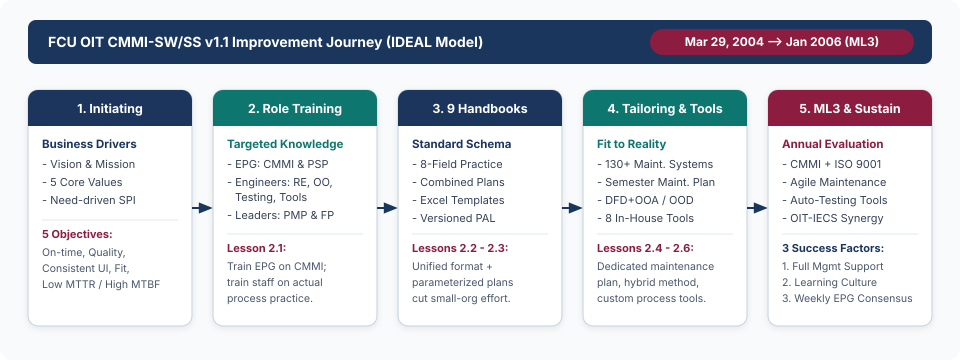
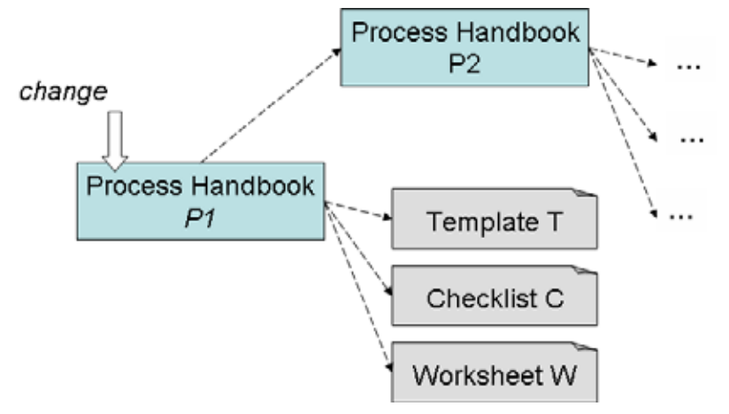
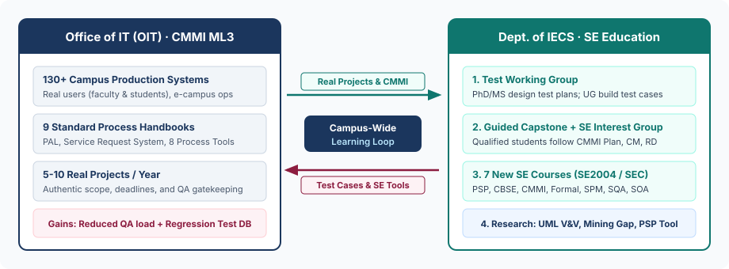
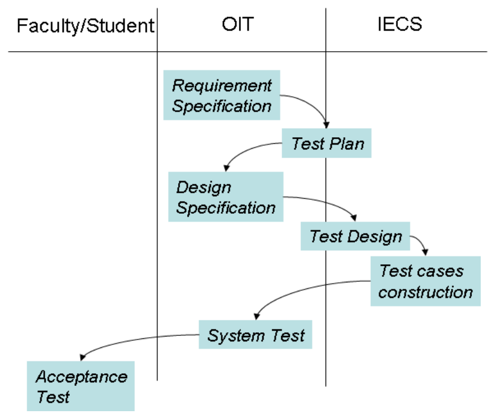

<!-- _class: lead -->

軟體工程學刊（JSES）· 第 1 卷第 1 期 · 2006 年 9 月

# 逢甲大學軟體流程改善經驗報告

逢甲大學資訊處（OIT）歷時兩年達成 <strong>CMMI®-SW/SS v1.1 成熟度第三級（ML3）</strong>之實戰歷程，以及對資訊工程學系（IECS）<strong>軟體工程教育與研究</strong>之雙重影響

<strong>薛念林（Nien-Lin Hsueh）</strong>1、<strong>楊東麟（Don-Lin Yang）</strong>2、<strong>王璐梅（Lu-Mei Wang）</strong>2、<strong>朱鵬華（Peng-Hua Chu）</strong>1 
1 逢甲大學資訊工程學系（IECS） &nbsp;·&nbsp; 2 逢甲大學資訊處（OIT） 
<code>nlhsueh@fcu.edu.tw</code> · <code>dlyang@fcu.edu.tw</code> · <code>lwang@fcuoa.fcu.edu.tw</code>

發表於 Journal of Software Engineering Studies (JSES), Vol. 1, No. 1, pp. 34–40, September 2006（台灣軟體工程學會）。國科會計畫編號：NSC94-2213-E-035-041。

<!--
論文書目與研究總覽：
本篇經驗報告由逢甲大學薛念林、楊東麟、王璐梅與朱鵬華共同撰寫，發表於台灣軟體工程學會創刊號《Journal of Software Engineering Studies》（Vol. 1, No. 1, pp. 34 至 40, 2006 年 9 月）。論文系統性記錄逢甲大學資訊處（OIT）自 2004 年 3 月 29 日啟動 CMMI-SW/SS v1.1 軟體流程改善（SPI），並於 2006 年 1 月順利通過成熟度第三級（ML3）評鑑的完整實戰歷程。

核心學術與實務貢獻：
不同於以承攬標案為目的之商業軟體公司，大學資訊處推動 CMMI 的核心價值在於「解決自身痛點」與「回饋校園教學」雙軌並行。論文一方面提煉出適用於小型維運組織的六項流程改善經驗（Lessons 2.1 至 2.6），另一方面詳述此專案如何反向帶動資工系成立測試工作小組、革新畢業專題、擴充 SE2004 軟體工程課程與衍生工具研究。
-->

---

## 簡報大綱

1

<a href="#3">研究動機與校園 IT 挑戰</a> 維護系統突破百套後浮現的六大痛點，以及資訊處與資工系之雙重使命。

2

<a href="#4">組織願景、核心價值與改善目標</a> 依循 IDEALSM 啟動階段，訂定以組織真實需求為導向的五大流程目標。

3

<a href="#5">資訊處流程改善歷程與六大經驗</a> 分眾訓練、九本流程手冊、參數化範本、構型管理、維護計畫、混合設計法與自建工具。

4

<a href="#10">對資訊工程學系之教學與研究影響</a> 多層級測試工作小組、實務畢業專題、SE2004 課程革新與軟體工程研究工具。

5

<a href="#13">持續改善機制與三大成功關鍵</a> 年度品質評估、CMMI 與 ISO 整合、敏捷維護與三大組織致勝要素。

6

<a href="#14">綜合成效、方法反思與核心啟示</a> 六項實質組織效益、小型單位推行邊界與可複製之校內產學合作藍圖。

<!--
全文結構導讀：
第一章（pp. 34 至 35）追溯逢甲資訊處自 1969 年電算中心演進至 2001 年一級行政單位的脈絡，並歸納系統破百套後出現的六大開發與維護危機。
第二章（pp. 35 至 38）透過七個子節（2.1 至 2.7）完整展開資訊處於願景設定、教育訓練、流程定義、專案分類、設計方法、輔助工具與持續改善之作法，淬鍊出編號 2.1 至 2.6 的六項核心經驗教訓。
第三章（pp. 38 至 39）說明流程改善如何外溢至資工系，包含測試工作小組（3.1）、專題實作改革（3.2）、軟體工程課程重構（3.3）與研究工具開發（3.4）。
第四章（pp. 39 至 40）總結六大效益與三項關鍵成功因素。
-->

---

## 1. 研究動機與背景：系統突破百套後的維運危機

1969 ➔ 2001

由電子計算機中心升格為<strong>資訊處（OIT）</strong>，領航逢甲 e-Campus 建設

130+ 套系統

資訊處長期維護之校務與教學系統規模（啟動時已破百套）

22 個月

2004/03/29 啟動 ➔ 2006/01 通過 <strong>CMMI®-SW/SS v1.1 ML3</strong>

<h3>導入 SPI 前面臨之六大痛點</h3>
<ul class="small-text">
<li><strong>維護困難：</strong>需求頻繁變動且多數系統缺乏支援文件。</li>
<li><strong>專案延宕：</strong>開發與交付時程難以如期掌控。</li>
<li><strong>品質失控：</strong>系統品質不穩定，導致師生滿意度不佳。</li>
<li><strong>人力配置失衡：</strong>開發與維護人力無法有效率運用。</li>
<li><strong>構型環境混亂：</strong>多版本、跨平台與多系統間缺乏管控。</li>
<li><strong>需求落差：</strong>無法正確擷取並開發符合使用者預期之功能。</li>
</ul>

<h3>雙重使命：校務營運 ＆ 軟體工程教育</h3>
<ul class="small-text">
<li><strong>營運目標（資訊處）：</strong>建立可預測且高生產力之標準流程，提供個人化、整合式校園資訊服務。</li>
<li><strong>教育目標（資工系）：</strong>結合真實 CMMI® 實作環境，全面檢視並強化資工系學生之軟體工程實戰力。</li>
<li><strong>普遍代表性：</strong>上述六大困境亦為台灣多數大專校院電算中心共同面臨之結構性難題。</li>
</ul>

<!--
組織背景與問題診斷：
逢甲大學資訊處（OIT）前身為 1969 年 7 月成立之電子計算機中心，1986 年更名為資訊中心，並於 2001 年升格為校內一級單位，負責擬定校園 IT 政策與整合全校資訊系統。當系統維運規模突破百套（至 2006 年更逾 130 套）時，傳統仰賴個人經驗的開發模式全面失靈，導致文件缺漏、時程延誤、品質不穩、人力浪費、版本構型混亂與需求失真等六大問題。

採用 CMMI-SW/SS v1.1 之考量：
資訊處選擇導入 SEI 的 CMMI-SW/SS v1.1（涵蓋軟體工程與委外採購管理），藉此同時規範內部自製開發、龐大維運作業與校外委外專案品質，並刻意將改善成果與資訊工程學系（IECS）的教學場域深度連結。
-->

---

## 2. 需求導向之組織願景、核心價值與五大流程目標

依循 SEI <strong>IDEALSM</strong> 模型之啟動（Initiating）階段，資訊處以<strong>滿足組織真實需求</strong>為核心，而非僅為取得商業認證標章。

<h3>組織願景、使命與核心價值</h3>
<ul class="small-text">
<li><strong>願景（Vision）：</strong>透過先進資訊科技服務，成為逢甲大學高等教育成功之關鍵推手。</li>
<li><strong>使命（Mission）：</strong>支援校園 IT 需求，促進優質教學、有效學習、卓越研究、高效行政與社會服務。</li>
<li><strong>五大核心價值：</strong>顧客滿意、品質至上承諾、個人當責、終身學習與團隊合作。</li>
</ul>

<h3>五大具體流程改善目標</h3>
<ol class="small-text">
<li><strong>如期交付：</strong>嚴格符合校方學期與行政時程期待。</li>
<li><strong>產品品質提升：</strong>降低缺陷並提升系統穩定度。</li>
<li><strong>友善操作體驗：</strong>建立跨系統一致之使用者介面設計。</li>
<li><strong>符合使用者需求：</strong>精準交付預期之系統功能。</li>
<li><strong>可靠度量化改善：</strong>縮短平均修復時間（<strong>MTTR</strong>）並延長平均故障間隔時間（<strong>MTBF</strong>）。</li>
</ol>

<strong>自我改善 vs. 商業評鑑：</strong>商業軟體公司導入 CMMI® 常以爭取標案為首要誘因；大學資訊處將<strong>解決自身開發與維運痛點</strong>視為唯一準繩，避免流程流於形式主義。

<!--
IDEAL 模型與目標設定（第 2.1 節）：
資訊處採用 SEI 的 IDEAL 模型（Initiating, Diagnosing, Establishing, Acting, Leveraging）作為整體改善框架。在啟動階段即明確界定組織願景、使命與五大核心價值，並據此推導出五項具體可檢驗之流程目標，包含學期準時交付、產品品質、UI 一致性、功能契合度以及 MTTR/MTBF 可靠度指標。

與商業廠商之本質差異：
作者特別指出，許多商業廠商推動 CMMI 容易陷入「為過關而補文件」的合規陷阱；逢甲資訊處因屬於校內自主改善單位，一切標準化與裁適決策皆以「團隊真正需要什麼」為最高原則。
-->

---

## 3. 資訊處 SPI 總體路線圖：從啟動到 CMMI® ML3

逢甲資訊處 22 個月 CMMI-SW/SS v1.1 改善路徑與六項核心經驗教訓總覽（整理自第 2.1–2.7 節）。

<strong>階段演進邏輯：</strong>每個階段皆針對試行期暴露之實際瓶頸進行務實修正——從<strong>全員上 CMMI 課</strong>轉為<strong>分眾培訓</strong>、<strong>參數化手冊</strong>、<strong>獨立維護計畫</strong>與<strong>自建流程工具</strong>。

<!--
第二章核心架構整合：
此圖整合第 2.1 至 2.7 節之五個演進階段：
1. 啟動階段（2.1）：將願景使命轉化為五大可衡量之流程目標。
2. 分眾訓練（2.2，經驗 2.1）：由全員 CMMI 理論講授轉為 EPG、工程師與專案經理各取所需之分眾培訓，待流程定案後再展開實務操作訓練。
3. 標準流程定義（2.3，經驗 2.2 至 2.3）：以統一八欄位實務格式編撰九本手冊，整合計畫範本、採用 Excel 量化表單，並於 PAL 中實施版本控管。
4. 務實裁適與工具化（2.4 至 2.6，經驗 2.4 至 2.6）：為 130 餘套維運系統打造學期維護計畫、採納 DFD+OOA/OOD 混合設計法，並開發八套內部流程輔助系統。
5. ML3 評鑑與持續改善（2.7）：透過年度品質評估推動 CMMI 與 ISO 9001 整合、敏捷維護精進與自動化測試導入。
-->

---

## 3.1 分眾教育訓練策略（經驗教訓 2.1）

<h3>初期困境：全員導入 CMMI® 理論</h3>
<ul class="small-text">
<li>專案初期，資訊處針對<strong>系統開發、系統維護、資源管理與技術支援</strong>四組全員開設 CMMI® 導論課程。</li>
<li><strong>問題一（只說目標未說作法）：</strong>CMMI® 僅規範應達成之目標，未指明實作步驟，對非 EPG 成員缺乏即時助益。</li>
<li><strong>問題二（語彙隔閡）：</strong>CMMI® 高度聚焦於開發與專案管理，多數支援人員難以理解吸收。</li>
</ul>

<h3>策略轉向：「將知識交給真正使用的人」</h3>
<ul class="small-text">
<li><strong>EPG 成員：</strong>專攻 CMMI® 規範與個人軟體流程（PSP）。</li>
<li><strong>軟體工程師：</strong>聚焦需求工程、物件導向開發、軟體測試、構型與測試工具。</li>
<li><strong>專案領導人：</strong>強化 PMP® 專案管理與功能點（FP）估算。</li>
<li><strong>第二輪實作訓練：</strong>待 EPG 完成九本手冊後，針對全員講授<strong>實際作業流程</strong>而非 CMMI® 條文。</li>
</ul>

<strong>經驗教訓 2.1：</strong>在 CMMI® 流程改善初期，應<strong>僅針對 EPG 成員提供 CMMI® 規範訓練</strong>，而非全員授課；待組織流程定義完成後，再針對全體同仁進行實務操作培訓。

<!--
教育訓練策略演進（第 2.2 節）：
資訊處的完整訓練藍圖涵蓋四大領域：工程技術（需求工程、OO 方法、軟體測試）、專案管理（PMP、功能點估算）、軟體流程（PSP、CMMI）與輔助工具（構型管理、專案管理與測試工具）。

為何分眾培訓至關重要：
CMMI 本身屬於能力成熟度參考模型（What），而非標準作業程序（How）。初期讓全體同仁研讀 CMMI 條文，容易造成非 EPG 工程師與維運支援人員的疏離與排斥。透過讓 EPG 消化 CMMI 並轉譯為九本具體手冊，再由第二輪訓練直接教導同仁如何操作組織流程，顯著降低了導入阻力。
-->

---

## 3.2 流程定義：九本手冊、統一格式與參數化（經驗 2.2–2.3）

資訊處建立 <strong>9 本流程手冊</strong>（層級為 <code>手冊 ➔ 程序 ➔ 實務 ➔ 任務</code>），每項程序皆繪製<strong>流程圖</strong>呈現順序與關鍵產出，每項實務皆遵循<strong>統一八欄位格式</strong>。

| 實務標準欄位 | 規範重點與治理意義 |
| :--- | :--- |
| **OWNER / ROLE** | 負責維護此實務之擁有人與參與角色 |
| **DESCRIPTION** | 該項實務之核心職責與適用範圍說明 |
| **ENTRY / EXIT** | 啟動前置條件與完成驗收之閘門準則 |
| **INPUT / OUTPUT** | 必要輸入工件與產出／修訂後之文件 |
| **ASSETS / REF** | 對應至流程資產庫（<strong>PAL</strong>）之參考資產 |
| **TASKS &amp; MEASURES** | 細部執行任務清單與關聯之流程量測指標 |

<h3>小型組織減負策略（經驗 2.3）</h3>
<ul class="small-text">
<li><strong>流程合併：</strong>將專案計畫與構型管理計畫整合為<strong>單一參數化專案計畫範本</strong>，專案經理僅需填入特定參數，免於從零撰寫。</li>
<li><strong>試算表自動化：</strong>規模估算與流程／產品量測一律採用 <strong>Excel</strong> 作為工件範本，大幅減輕計算負擔。</li>
<li><strong>經驗 2.2：</strong>一致的八欄位格式搭配高階圖形模型，有助於 EPG 跨流程核對與同仁教育訓練。</li>
</ul>

<!--
流程架構與小型組織裁適（第 2.3 節）：
參考 Humphrey（1989）、Fuggetta（2000）以及小型組織導入 CMM/SPI 文獻（Guerrero & Eterovic, 2004; Russ & McGregor, 2000），資訊處化解了小型單位最常遭遇的「文件過重」難題：
1. 一致格式與視覺化（經驗 2.2）：例如工程手冊涵蓋產品開發、驗證與確認（V&V）、需求管理與軟體維護四項程序。透過固定八欄位，明確鎖定「誰、在何條件下、做什麼、用什麼工件、產出什麼、量測什麼」。
2. 流程合併與文件參數化（經驗 2.3）：小型團隊無法負擔每個小專案都獨立撰寫構型管理政策與計畫；透過抽離共通項目形成參數化範本並輔以 Excel 自動試算，讓標準流程得以在有限人力下永續運作。
-->

---

## 3.3 流程手冊與關聯資產之構型管理

<ul class="small-text">
<li><strong>連鎖變更風險：</strong>流程改善期間，各本手冊與相關工件彼此高度參照且頻繁修訂。</li>
<li><strong>影響擴散路徑：</strong>單一 <code>流程手冊 P1</code> 的修訂，不僅會連動影響其附屬的<strong>範本 T</strong>、<strong>檢核表 C</strong> 與<strong>工作表 W</strong>，更可能引發跨手冊（如 <code>P2</code>）的連鎖修改。</li>
<li><strong>資訊處輕量治理方案：</strong>
  <ul>
  <li>全面落實流程資產之<strong>版本編號識別（Version Identification）</strong>。</li>
  <li>於每一份手冊、範本、檢核表與工作表開頭強制加註<strong>修訂履歷（Revision History）</strong>。</li>
  </ul>
</li>
</ul>

<strong>資產治理原則：</strong>流程文件本身即屬關鍵構型項目——缺乏版本控管將導致檢核表與手冊脫節，破壞品質稽核一致性。

圖 1（論文 p. 37）：流程手冊 P1 變更對範本、檢核表、工作表與相依手冊 P2 之連鎖影響。

<!--
流程資產之構型管理（第 2.3 節、圖 1）：
許多組織在導入 CMMI 時僅對程式碼實施構型管理，卻忽略了不斷演進的流程手冊與表單。圖 1 揭示了流程資產間的網狀相依結構：當 P1 修訂作業步驟時，若未同步追蹤其附屬範本（T）、檢核表（C）、工作表（W）與被參照手冊（P2），專案成員便會沿用過時表單而造成 QA 稽核失準。資訊處透過於每份 PAL 文件標頭強制加入版本識別碼與修訂履歷，以極低成本確保跨文件一致性。
-->

---

## 3.4 務實裁適：維護專案、混合設計法與八套自建工具

<h3>經驗 2.4 維護型專案規劃</h3>
<ul class="small-text">
<li>區分<strong>新建／強化</strong>、<strong>維護</strong>與<strong>委外</strong>三類專案。</li>
<li><strong>試行受挫：</strong>第一版計畫流程僅針對新建專案，套用至 <strong>130+ 套維護系統</strong>時完全不可行。</li>
<li><strong>修正作法：</strong>每學期初彙整所有系統為單一<strong>學期維護計畫</strong>，並建置<strong>服務需求系統</strong>統一控管。</li>
</ul>

<h3>經驗 2.5 混合設計方法論</h3>
<ul class="small-text">
<li>因 PowerDesigner 新版停用 DFD，資訊處一度嘗試全面轉向純 OO（SDD 含使用案例、類別、循序、狀態圖）。</li>
<li><strong>實務評估：</strong>工程師熟稔 DFD，且校務系統多屬<strong>資料庫應用</strong>，純 OO 效益有限。</li>
<li><strong>修正作法：</strong>分析階段採 <strong>DFD + OOA</strong>，設計階段採 <strong>OOD</strong>。</li>
</ul>

<h3>經驗 2.6 八套自建流程工具</h3>
<ul class="small-text">
<li>商用工具難以完整契合組織客製化流程。</li>
<li>資訊處自行開發 <strong>8 套內部工具</strong>：專案管理、PAL、服務需求、影響分析、人力資源、供應商資訊、原始碼版控與 QA 檢核表系統。</li>
<li>將流程合規內嵌於日常作業，大幅降低執行摩擦。</li>
</ul>

<strong>工程務實精神：</strong>切忌生搬硬套教科書流程、純粹方法論或商用工具——應<strong>及早試行（Pilot）</strong>並依據組織真實專案型態與團隊技術慣性靈活裁適。

<!--
經驗教訓 2.4、2.5 與 2.6（第 2.4 至 2.6 節）：
1. 維護專案專屬流程（2.4 節，經驗 2.4）：面對超過 130 套線上維運系統，逐案編寫獨立專案計畫極度耗時。第一版試行失敗後，資訊處改採「學期總維護計畫」模式，於每學期初統籌規劃各系統預計新增需求、負責人與排程，並配合「服務需求系統（Service Request System）」受理與分析零星維護單。
2. 務實選擇開發方法（2.5 節，經驗 2.5）：流程定義不能脫離底層設計方法與工件格式（如軟體設計文件 SDD）。考量團隊長年使用 DFD 的經驗與資料庫型校務系統特性，採用「分析期 DFD + OOA、設計期 OOD」之多學科混合方案，兼顧建模效率與物件導向設計優勢。
3. 組織自建流程工具（2.6 節，經驗 2.6）：自行打造八套輕量級系統，讓 PAL 查詢、影響分析與 QA 檢核自動化，成為中小組織落地 CMMI 的關鍵助力。
-->

---

## 4. 雙贏效益：資訊處與資工系之教研共榮生態

資訊處 CMMI ML3 實務經驗反向賦能資工系之四大支柱：測試小組、畢業專題、課程革新與工具研究（第 3 章）。

<strong>核心教育理念：</strong>若學生能在校內真實 CMMI® 開發環境中接受軟體工程洗禮，畢業進入業界時便能具備正確的系統開發與品質觀念。

<!--
校內產學雙向循環（第 3 章）：
本論文最具特色之貢獻，在於示範大學行政資訊單位如何化身為資訊工程學系的「真實軟體工程實習工廠」。資訊處提供逾百套真實校園系統、師生終端使用者與 CMMI ML3 規範；資工系則透過測試工作小組、畢業專題團隊、SE2004 課程培育與研究型工具回饋資訊處，形成校內正向學習循環。
-->

---

## 4.1 資工系測試工作小組與資訊處協作流程

<h3>跨學制多層級測試分工模式</h3>
<ul class="small-text">
<li><strong>博碩士生：</strong>與資訊處開發人員直接溝通，依據需求與設計規格撰寫<strong>測試計畫（Test Plan）</strong>與<strong>測試設計（Test Design）</strong>。</li>
<li><strong>大學部學生：</strong>待測試設計確認後，運用測試工具建置具體<strong>測試案例（Test Cases）</strong>。</li>
<li><strong>資訊處與師生：</strong>接手執行<strong>系統測試</strong>與校園<strong>驗收測試</strong>。</li>
</ul>

<h3>三贏合作成效</h3>
<ol class="small-text">
<li><strong>緩解資訊處人力瓶頸：</strong>補足專職測試人力缺口。</li>
<li><strong>真實專案練兵：</strong>學生在實戰中精進軟體測試技能。</li>
<li><strong>累積回歸測試庫：</strong>逐步建立校務資訊系統可重用測試案例資料庫。</li>
</ol>

圖 2（論文 p. 38）：橫跨師生使用者、資訊處（OIT）與資工系（IECS）之 V 型協作測試流程。

<!--
測試工作小組運作機制（第 3.1 節、圖 2）：
圖 2 以三條泳道（Faculty/Student、OIT、IECS）清楚呈現 V 型驗證協作鏈：
- 資訊處產出需求規格後，與資工系博碩士生共同擬定測試計畫；
- 資訊處完成設計規格後，由資工系博碩士生進行測試設計；
- 資工系大學部學生依據確認後之測試設計，使用測試工具撰寫測試案例；
- 測試案例回傳資訊處執行系統測試，最終交由逢甲師生完成驗收測試。
此分工模式既減輕資訊處測試負荷，又讓不同學制學生依能力分層參與實務 QA，並為校園系統沉澱寶貴的回歸測試資產。
-->

---

## 4.2 畢業專題改革、SE2004 課程擴充與研究衍生

<h3>畢業專題革新（3.2）</h3>
<ul class="small-text">
<li><strong>傳統兩大弊病：</strong>缺乏真實使用者檢驗品質的假想專題，或外部企業缺乏規範導致學生誤信<em>「混亂流程才是業界常態」</em>。</li>
<li><strong>資訊處實戰題目：</strong>每年提供 <strong>5–10 個真實專案</strong>予通過資格測驗之學生。</li>
<li><strong>軟體工程興趣小組：</strong>導入 CMMI® 專案計畫、構型管理與需求開發指引專題。</li>
</ul>

<h3>軟體工程課程重構（3.3）</h3>
<ul class="small-text">
<li>參照國際 <strong>SE2004</strong> 與台灣 <strong>SEC</strong> 課程建議，突破過往僅有泛論式系統分析與軟體工程之侷限。</li>
<li><strong>已開 4 門新課（2004–06）：</strong>PSP、元件式軟體工程、CMMI® 導論、正規方法。</li>
<li><strong>規劃 3 門新課（2007 下）：</strong>軟體專案管理、軟體品質、服務導向架構（SOA）。</li>
</ul>

<h3>促進軟體工程研究（3.4）</h3>
<ul class="small-text">
<li>資訊處真實痛點催生三項研究工具與方法：
  <ul>
  <li><strong>UML 流程定義</strong>與 V&amp;V 驗證工具。</li>
  <li><strong>輕量級序列探勘</strong>流程落差分析法（ICS 2006）。</li>
  <li><strong>PSP-Assistant</strong> 個人軟體流程輔助工具。</li>
  </ul>
</li>
</ul>

<strong>破除「業界本就混亂」迷思：</strong>讓學生在 CMMI® ML3 校內環境執行專題，建立正確的計畫、需求與構型紀律，徹底扭轉過往缺乏規範的實作體驗。

<!--
教學與研究外溢效應（第 3.2 至 3.4 節）：
1. 畢業專題改革（3.2）：過往資工專題常面臨「無真實使用者」或「校外合作缺乏流程紀律」兩大問題。透過資格考機制篩選學生參與資訊處每年釋出的 5 至 10 個真實專案，並由軟體工程興趣小組提供 CMMI 流程輔導，讓學生體會真實需求與品質要求。
2. 課程體系升級（3.3）：過去大學部僅有涵蓋面廣但實作深度不足的「系統分析」與「軟體工程」。對齊 IEEE/ACM SE2004 與台灣軟體工程聯盟（SEC）後，資工系陸續新增 PSP、CBSE、CMMI 導論、正規方法，並於 2007 年規劃開設軟體專案管理、軟體品質與 SOA。
3. 實證導向研究（3.4）：校內真實流程數據直接促成 UML 流程驗證工具、基於序列樣式探勘之輕量級 CMMI 落差分析（Hsueh et al., ICS 2006）及 PSP 輔助工具（Shen et al., SERP 2006）等研究成果。
-->

---

## 5. 年度持續改善機制與三大關鍵成功因素

<h3>年度品質評估與三大後續行動（2.7）</h3>

每年定期檢視<strong>估算可預測性</strong>、<strong>產品品質</strong>、<strong>介面設計能力</strong>、<strong>需求擷取能力</strong>與<strong>審查效率</strong>，並確立三項主軸：

<ol class="small-text">
<li><strong>CMMI® 與 ISO 整合：</strong>將 CMMI® ML3 流程與資訊處既有之 <strong>ISO 9001:2000</strong> 標準無縫整併。</li>
<li><strong>精進維護流程敏捷度：</strong>針對 130+ 套系統持續優化維護反應速度。</li>
<li><strong>擴大工具自動化：</strong>導入自動化測試等工具進一步拉升流程效率。</li>
</ol>

<h3>三大組織成功關鍵因素（第 4 章）</h3>
<ul class="small-text">
<li><strong>1. 高階主管全力支持：</strong>逢甲大學校長與資訊處長自始堅定認同專案價值，全程提供關鍵資源奧援。</li>
<li><strong>2. 組織學習文化：</strong>資訊處開發團隊展現高度學習意願，主動吸收軟體工程新知並落實於工作。</li>
<li><strong>3. 每週 EPG 全員共識：</strong>受惠於小型組織規模，幾乎全體開發人員皆參與每週 EPG 會議，充分檢視跨流程互動並迅速凝聚共識。</li>
</ul>

<strong>兩年 SPI 最寶貴之領悟：</strong>通過成熟度第三級只是起點而非終點——建立制度化的<strong>年度自我評量與持續改善文化</strong>，才是軟體流程改善最具長期價值的收穫。

<!--
評鑑後的永續治理與成功因素（第 2.7 節與第 4 章）：
由於資訊處已於 2003 年導入 ISO 9001:2000，在 2006 年取得 CMMI ML3 後，如何將兩套品質體系整合以避免重複稽核成為首要任務；同時針對龐大維護業務提升敏捷性，並逐步導入自動化測試工具。

三大致勝要素分析：
相較於許多中小組織推動 SPI 半途而廢，逢甲資訊處的成功立基於（1）校長與處長級別的持續資源承諾；（2）大學組織特有的學習型文化；（3）全員參與式的每週 EPG 治理——正因組織精簡，開發者能親自參與流程設計並釐清跨流程介面，進而消除「流程是由外人強加」的反彈心理。
-->

---

## 6. 綜合成效、方法反思與核心啟示

<h3>六項具體組織效益</h3>
<ol class="small-text">
<li>建立完整之<strong>組織標準軟體流程體系</strong>（九本手冊與 PAL）。</li>
<li><strong>重組人力資源配置</strong>，顯著優化團隊運作效率。</li>
<li>實質提升<strong>產品品質與整體開發維護生產力</strong>。</li>
<li>穩定<strong>如期交付符合使用者預期之功能</strong>。</li>
<li>系統化納管<strong>技術文件</strong>並有效確保<strong>委外專案品質</strong>。</li>
<li>奠定<strong>資訊處與資工系長期產學協作機制</strong>。</li>
</ol>

<h3>研究邊界與實務反思</h3>
<ul class="small-text">
<li><strong>經驗報告定位：</strong>本文著重質性歷程與實戰經驗提煉，尚未呈現跨年度缺陷密度或 MTTR/MTBF 統計前後測數據。</li>
<li><strong>組織規模邊界：</strong>「全員參與每週 EPG」極適合精簡團隊，超大型組織則需分層授權治理。</li>
<li><strong>可複製藍圖：</strong>證明大學資訊中心導入 CMMI® 兼具提升校務 IT 品質與培育軟體工程人才之雙重報酬。</li>
</ul>

<strong>核心啟示：</strong>軟體流程改善唯有堅持<strong>需求導向</strong>、<strong>小型團隊參數化減負</strong>、<strong>貼合維護實務</strong>，並結合<strong>校園學習文化</strong>，方能創造長久價值。

<!--
綜合評析與方法反思：
本篇論文詳實記錄了一所台灣大學資訊單位導入 CMMI-SW/SS v1.1 的完整歷程，其六項組織效益涵蓋標準流程建置、人力優化、品質與生產力提升、準時交付、文件與委外控管以及校內跨單位教研合作。

研究限制與延伸價值：
由於論文發表於通過 ML3 評鑑後不久，主要以實務經驗報告形式呈現，尚未提供多年期量化缺陷率或 MTTR/MTBF 趨勢分析（相關數據正透過年度品質評估機制持續累積）。儘管如此，六項具體經驗教訓（Lessons 2.1 至 2.6）與資訊處—資工系四支柱合作模型，對各大專校院電算中心與中小型軟體研發團隊均具備極高的參考與複製價值。
-->

---

<!-- _class: closing -->

# 感謝聆聽・歡迎交流指教

需求導向 CMMI® 流程改善 · 六項實戰經驗教訓 · 資訊處與資工系教研雙贏

<strong>薛念林（Nien-Lin Hsueh）</strong> &nbsp;·&nbsp; <code>nlhsueh@fcu.edu.tw</code> &nbsp;|&nbsp; <strong>楊東麟（Don-Lin Yang）</strong> &nbsp;·&nbsp; <code>dlyang@fcu.edu.tw</code> 
<strong>王璐梅（Lu-Mei Wang）</strong> &nbsp;·&nbsp; <code>lwang@fcuoa.fcu.edu.tw</code> &nbsp;|&nbsp; <strong>朱鵬華（Peng-Hua Chu）</strong> 
逢甲大學資訊工程學系暨資訊處（台中市） 
Journal of Software Engineering Studies (JSES), Vol. 1, No. 1, pp. 34–40, September 2006 · 國科會計畫 NSC94-2213-E-035-041

<!--
論文參考與典藏資訊：
- 篇名：Software Process Improvement at Feng Chia University: An Experience Report
- 作者：Nien-Lin Hsueh（逢甲大學資工系）、Don-Lin Yang（逢甲大學資訊處／資工系）、Lu-Mei Wang（逢甲大學資訊處）、Peng-Hua Chu（逢甲大學資工系）
- 出處：Journal of Software Engineering Studies, Vol. 1, No. 1, pp. 34 至 40, September 2006（台灣軟體工程學會）
- 補助計畫：國科會 NSC94-2213-E-035-041
- 致謝：感謝 ProVision 之 Jessie Lee 與 Christine Lee 協助推動本 CMMI 專案。
-->

