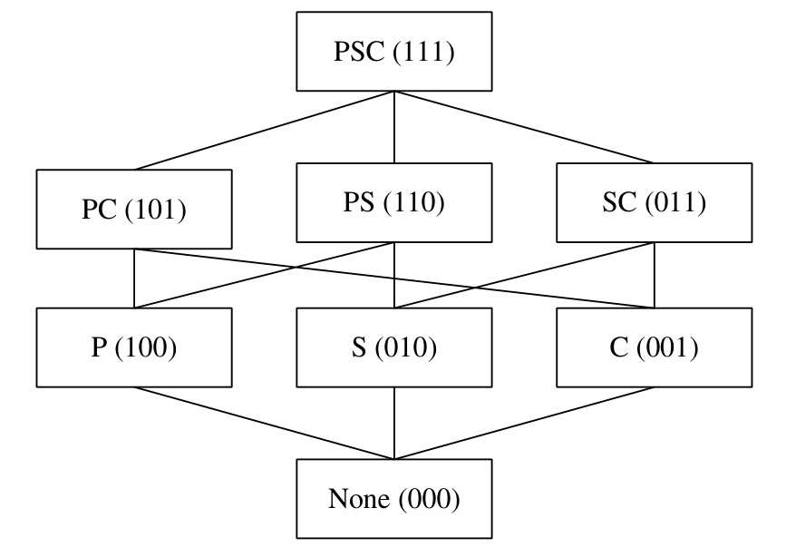
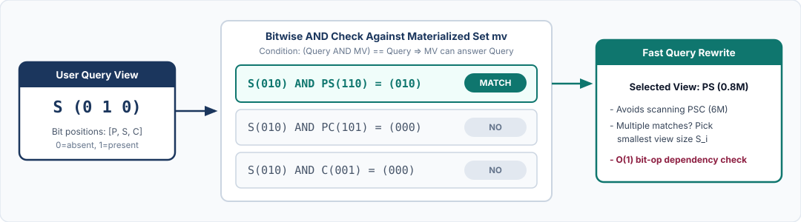
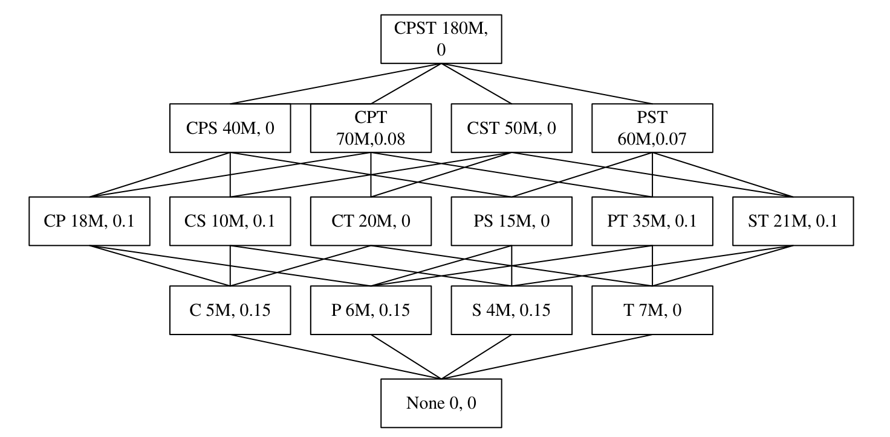
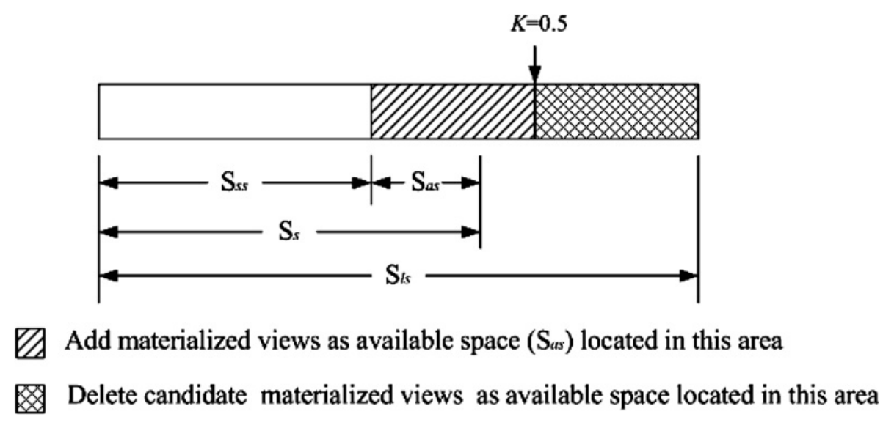
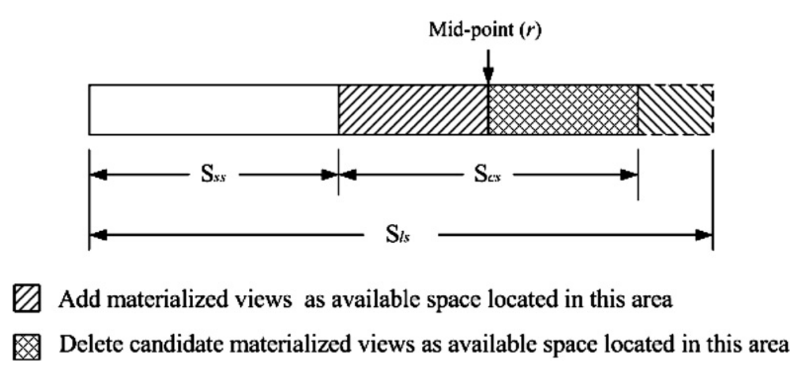
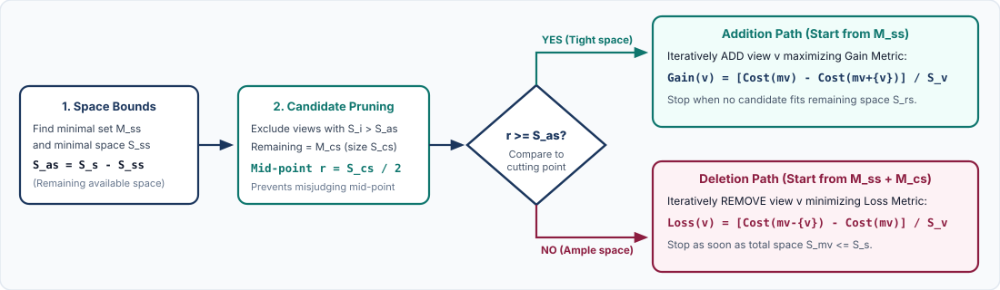
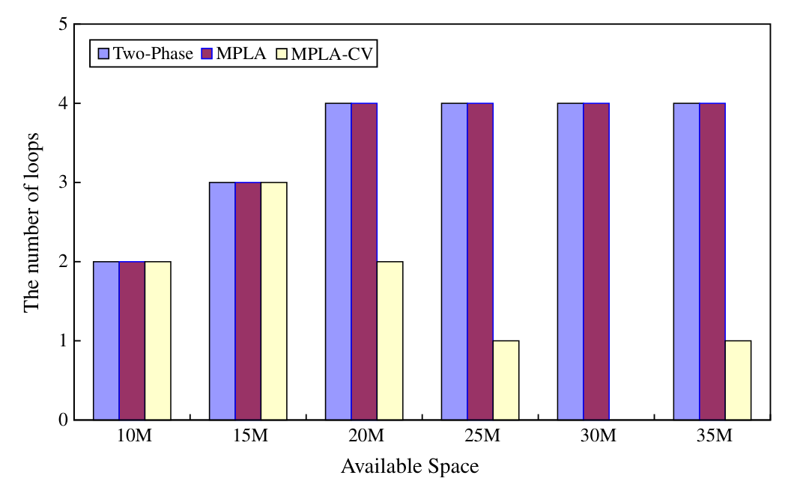
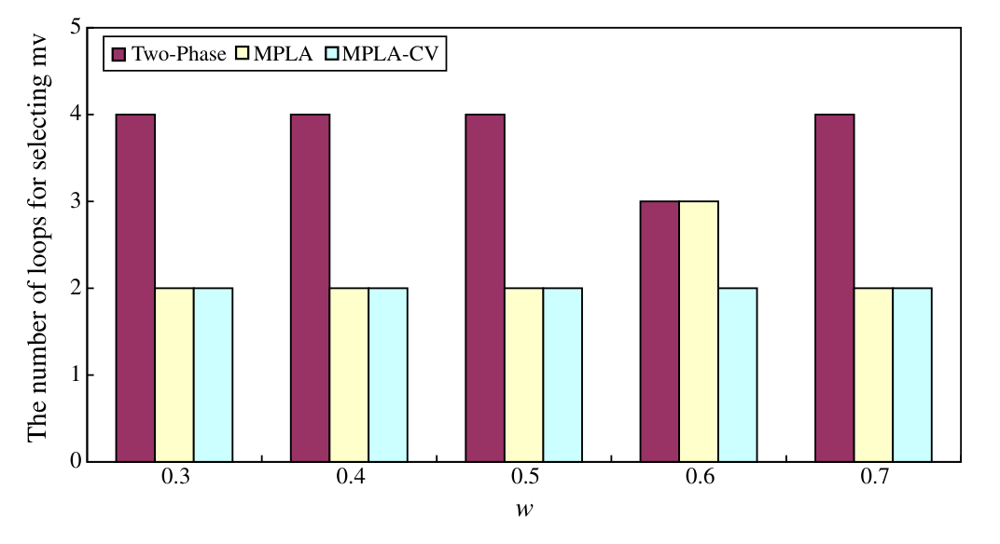
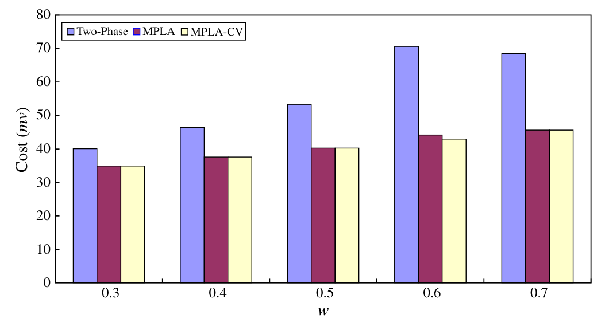

<!-- _class: lead -->

Information Sciences · Vol. 177, pp. 1333–1348 · 2007

# Efficient Approaches for Materialized Views Selection in a Data Warehouse

Accelerating NP-complete OLAP view selection under storage and maintenance constraints via binary vector lattices, space-normalized Gain/Loss metrics, and Mid-Point Locating algorithms (MPL &amp; MPL-CV).

<strong>Ming-Chuan Hung*</strong>, <strong>Man-Lin Huang</strong>, <strong>Don-Lin Yang</strong>, <strong>Nien-Lin Hsueh</strong> 
Department of Information Engineering and Computer Science, Feng Chia University, Taichung, Taiwan 
DOI: <code>10.1016/j.ins.2006.09.007</code>

Supported by National Science Council, Taiwan · Contract No. NSC 94-2213-E-035-002

<!--
Paper Metadata & Research Context:
- Full Citation: M.-C. Hung, M.-L. Huang, D.-L. Yang, and N.-L. Hsueh, "Efficient approaches for materialized views selection in a data warehouse," Information Sciences, vol. 177, pp. 1333-1348, 2007.
- Received 22 September 2005; revised 18 September 2006; accepted 19 September 2006.
- Core Problem: In OLAP data warehouses, pre-computing materialized views accelerates complex historical aggregation queries, yet storage space is bounded and base-data updates incur refresh/maintenance costs. Finding the optimal subset of views is NP-complete.
- Core Innovation: Combines (1) binary vector lattice encoding for O(1) bitwise-AND query rewrite, (2) a weighted query-plus-maintenance cost model with unit-space Gain and Loss metrics, and (3) Mid-Point Locating (MPL) and Candidate-View pruned MPL-CV algorithms that choose dynamically between bottom-up addition and top-down deletion.
-->

---

## Outline

  
1

  
<a href="#3">Motivation &amp; Problem Statement</a> Storage limits, OLAP query latency vs. view refresh cost, and NP-completeness of view selection.

  
2

  
<a href="#4">Related Work Comparison</a> Contrasting Greedy, Two-Phase, MVPP, and Evolutionary algorithms with our MPL / MPL-CV approach.

  
3

  
<a href="#5">Vector Lattice &amp; Bitwise Query Rewrite</a> Encoding data cubes in binary vectors and resolving dependent views via bitwise <code>AND</code>.

  
4

  
<a href="#7">Cost Model, Gain &amp; Loss Metrics</a> Weighted query + maintenance cost <code>Cost(mv)</code> and unit-space Gain/Loss selection formulas.

  
5

  
<a href="#9">MPL &amp; MPL-CV Algorithms</a> Cutting-point decision between addition and deletion, plus candidate-view pruning in MPL-CV.

  
6

  
<a href="#11">Empirical Evaluation &amp; Discussion</a> Loop reduction (47.4%–57.1%) and total cost reduction (25.5%) under <code>w = 0</code> and <code>w ≠ 0</code>.

<strong>Core Insight:</strong> Repeatedly recomputing <code>Cost(mv)</code> across the lattice is the primary runtime bottleneck; cutting from the closer boundary (<code>Mss</code> vs. <code>Mcs</code>) and pruning oversized views drastically slashes search loops while lowering total DW cost.

<!--
Paper Organization:
- Section 1 (Introduction): Defines the three-way trade-off among storage space, OLAP query efficiency, and maintenance cost.
- Section 2 (Related work): Surveys Harinarayan's greedy algorithm, Chen & Liu's two-phase algorithm, Yang's MVPP, Gupta & Mumick, Theodoratos & Sellis, and Zhang/Yu evolutionary methods.
- Section 3 (Architectural design): Presents the data cube lattice (Figs. 1-2), binary vector representation (Fig. 3), and bitwise-AND query rewrite.
- Section 4 (Cost model): Formulates Eqs. (1)-(6) for space, query cost, maintenance cost, total weighted cost, Gain metric, and Loss metric, illustrated on a 4-D lattice (Fig. 4, Examples 2-3).
- Section 5 (Selection algorithms): Details the 10-step MPL and MPL-CV algorithms (Figs. 5-6).
- Section 6 (Experiments): Evaluates w = 0 (Tables 2-3, 5; Fig. 7) and w != 0 (Table 4; Figs. 8-9) against the Two-Phase baseline.
- Section 7 (Conclusion): Summarizes results and future online dynamic view evolution.
-->

---

## 1. Motivation & Problem Statement

  
NP-Complete

  
Selecting an optimal subset of materialized views across a multidimensional lattice

  
3 Constraints

  
(1) Limited storage <code>Ss</code>, (2) Query latency <code>CQ</code>, (3) Refresh cost <code>CM</code>

  
3 Innovations

  
Vector lattice, Gain/Loss metrics, and Mid-Point Locating with Candidate Pruning

  <h3>The Data Warehouse Trade-Off</h3>
  <ul class="small-text">
    <li><strong>Why Materialize?</strong> OLAP decision-support queries aggregate massive historical data; storing intermediate views speeds up responses dramatically.</li>
    <li><strong>Why Not Materialize Everything?</strong> Finite storage capacity prohibits storing all <code>2d</code> cube views, and every source update forces expensive view refreshes.</li>
    <li><strong>Hidden Bottleneck:</strong> Iterative lattice cost recomputation makes view-selection algorithms computationally slow.</li>
  </ul>

  <h3>Objective of This Study</h3>
  <ul class="small-text">
    <li><strong>Fast Dependency Lookup:</strong> Represent cube lattices as binary vectors so query rewriting uses fast bitwise <code>AND</code>.</li>
    <li><strong>Joint Optimization:</strong> Minimize weighted sum <code>Cost(mv) = CQ + w × CM</code> strictly within actual storage <code>Ss</code>.</li>
    <li><strong>Fewer Search Loops:</strong> Decide adaptively whether to <em>add</em> from minimal views or <em>delete</em> from candidate views using the space mid-point.</li>
  </ul>

<!--
Problem Formulation (Section 1):
- Data warehouses integrate distributed, heterogeneous operational databases to support OLAP decision support.
- Unlike OLTP transactions, OLAP queries perform complex multi-dimensional aggregations. Pre-computing materialized views accelerates queries, but when underlying data sources change, materialized views must be refreshed to preserve validity, accuracy, and currency.
- The paper simultaneously addresses three intertwined constraints: (1) available storage space Ss, (2) query processing efficiency, and (3) both query and maintenance costs.
-->

---

## 2. Related Work & Positioning

| Approach | Space Limit | Maint. Cost | Mechanism | Key Limitation |
| :--- | :---: | :---: | :--- | :--- |
| **Harinarayan et al. (1996)** Greedy | ✓ | ✗ | Top-down benefit greedy on lattice | Ignores maintenance cost; poor under tight space |
| **Chen &amp; Liu (1997)** Two-Phase | ✓ | ✗ | Phase 1: minimal set; Phase 2: greedy add | Always adds bottom-up ➔ excessive loops when space is ample |
| **Yang et al. (1997)** MVPP | ✗ | ✓ | Multiple View Processing Plan | Does not enforce bounded storage space |
| **Gupta &amp; Mumick (1999)** | ✗ | ✓ | Maintenance-cost constrained selection | Assumes storage is cheap/unbounded |
| **Zhang / Yu (2001, 2003)** Evolutionary | ✓ | ✓ | Hybrid / constrained GA + stochastic ranking | Good cost savings, but high computation time |
| **Proposed MPL &amp; MPL-CV (2007)** | **✓** | **✓** | **Vector lattice + Gain/Loss + Mid-Point** | **Fast convergence &amp; lower joint query+maint cost** |

<strong>Benchmark Selection:</strong> Because Chen &amp; Liu's Two-Phase algorithm already outperforms Harinarayan's Greedy algorithm, Section 6 benchmarks <strong>MPL</strong> and <strong>MPL-CV</strong> directly against Two-Phase across both <code>w = 0</code> and <code>w ≠ 0</code> workloads.

<!--
Literature Positioning (Section 2):
- Harinarayan et al. [8] introduced the data-cube lattice and greedy benefit heuristic, but omitted view maintenance costs and degrades when storage is insufficient for dependent views.
- Chen & Liu [3] improved on Greedy via a two-phase algorithm: Phase 1 finds the minimal storage set answering all queries, and Phase 2 greedily adds views using remaining space. However, when available space is large, bottom-up addition requires many costly lattice-evaluation loops.
- Yang et al. [23] (MVPP) and Gupta & Mumick [6] incorporated maintenance costs but relaxed storage limits.
- Evolutionary algorithms (Horng [10], Lin & Kuo [14], Zhang [25], Yu [24]) yield low-cost plans at the expense of long runtimes.
- Building on Yang, Huang & Hung (PAKDD 2002 [22]), this paper introduces unit-space Gain/Loss metrics, candidate-view pruning (MPL-CV), and bitwise vector query rewriting.
-->

---

## 3. Lattice Framework & Binary Vector Representation

  <h3>Partial Order &amp; Binary Encoding</h3>
  <ul class="small-text">
    <li><strong>Dependency Relation (<code>⊆</code>):</strong> <code>Q1 ⊆ Q2</code> iff query <code>Q1</code> can be answered using view <code>Q2</code> (e.g., <code>PS ⊆ PSC</code>).</li>
    <li><strong>3-D Sales Cube (Example 1):</strong> Dimensions Parts (<code>P</code>), Suppliers (<code>S</code>), Customers (<code>C</code>) ➔ <code>23 = 8</code> views from top view <code>PSC (111)</code> down to <code>None (000)</code>.</li>
    <li><strong>Bit-Flipping Navigation:</strong>
      <ul>
        <li><strong>Roll-up (Upper dependent views):</strong> Flip a <code>0</code> bit to <code>1</code> (e.g., <code>P(100)</code> ➔ <code>PS(110)</code>, <code>PC(101)</code>).</li>
        <li><strong>Drill-down:</strong> Flip a <code>1</code> bit to <code>0</code>.</li>
      </ul>
    </li>
    <li><strong>Benefit:</strong> Eliminates expensive graph traversal when tracing view dependencies during cost recalculation.</li>
  </ul>

  
  
Fig. 3 (Paper): Binary vector encoding of the 3-D (P, S, C) data cube lattice.

<!--
Lattice & Vector Representation (Sections 3.1-3.2, Figs. 1-3):
- A data cube lattice satisfies two conditions: (1) the dependency relation is a partial order, and (2) a top element exists (PSC) from which all other views can be derived.
- In Example 1 (Fig. 2), PSC has size 6M and query frequency 0.05; PS has 0.8M and 0.15; PC has 6M and 0.1; SC has 5M and 0.1; P has 0.2M and 0.25; S has 0.01M and 0.2; C has 0.1M and 0.15.
- Representing each d-dimensional view as a d-bit binary vector enables instant ancestor/descendant identification via simple bit operations rather than pointer-based graph search.
-->

---

## 3.2 Fast Query Rewrite via Bitwise AND

  <h3>Bitwise Dependency Criterion</h3>
  
Given materialized set <code>mv = {PS(110), PC(101), C(001)}</code> and user query <code>q = S(010)</code>, view <code>m ∈ mv</code> can answer <code>q</code> iff <code>(q ∧ m) == q</code>.

  <h3>Smallest-View Selection Rule</h3>
  
When multiple materialized views satisfy <code>(q ∧ m) == q</code>, the rewriter selects the dependent view with the <strong>smallest data size <code>Si</code></strong> to minimize query I/O cost.

<!--
Query Rewrite Mechanics (Sections 3.3-3.4):
- Partial materialization accelerates OLAP by rewriting incoming user queries against the currently materialized view set mv.
- Using the binary vector encoding, testing whether a materialized view m covers a query view q reduces to a single bitwise AND instruction: if (q AND m) == q, then every dimension required by q is present in m.
- In the paper's worked example: S(010) AND PS(110) = (010) [match], S(010) AND PC(101) = (000) [no], S(010) AND C(001) = (000) [no]. Thus S is rewritten to scan PS (0.8M) instead of the raw 6M PSC base cube.
-->

---

## 4. Unified Query & Maintenance Cost Model

  
(1) Total Space:  Smv = Σi ∈ mv Si &nbsp;≤&nbsp; Ss

  
(2) Query Cost:  CQ = Σi=1..n fqi · C(mv ➔ ri)

  
(3) Maint. Cost: CM = Σj=1..m fuj · C(l ➔ mvj)

  
(4) Total Cost:  Cost(mv) = CQ + w · CM

  

    <strong>Weight <code>w = maintenance freq / query freq</code>:</strong> 
    • <code>w &lt; 1</code> (typical OLAP): queries outnumber updates. 
    • <code>w = 1</code>: equal frequency; <code>w &gt; 1</code>: update-heavy warehouse.
  

  <h3>Key Cost-Model Symbols (Table 1)</h3>
  <table>
    <thead><tr><th>Symbol</th><th>Definition</th></tr></thead>
    <tbody>
      <tr><td><code>Ss</code> / <code>Smv</code></td><td>Actual DW storage limit / Space used by <code>mv</code></td></tr>
      <tr><td><code>fqi</code> / <code>fuj</code></td><td>Query frequency of view <code>i</code> / Update freq. of view <code>j</code></td></tr>
      <tr><td><code>C(mv ➔ ri)</code></td><td>Cost to answer query view <code>ri</code> using <code>mv</code></td></tr>
      <tr><td><code>C(l ➔ mvj)</code></td><td>Cost to refresh materialized view <code>mvj</code> from source <code>l</code></td></tr>
      <tr><td><code>n</code> / <code>m</code></td><td>Number of query views / Number of maintained views</td></tr>
    </tbody>
  </table>

<!--
Cost Model Formulation (Section 4.1, Table 1, Eqs. 1-4):
- Adapting Yang et al. [23], total data warehouse cost Cost(mv) combines total query cost CQ and weighted total maintenance cost w * CM.
- A lower Cost(mv) indicates a better materialized view set.
- Crucially, raw total cost alone can mislead greedy selection into picking a single huge view that exhausts storage and blocks multiple smaller high-impact views. Therefore, Sections 4.2-4.3 normalize cost deltas by view size Si to form the Gain and Loss metrics.
-->

---

## 4.2 Space-Normalized Gain & Loss Metrics

  

    <h3>Gain Metric (for Adding Views)</h3>
    
Gain(v) = [Cost(mv) − Cost(mv + {v})] / S{v}

    
Benefit per unit space when adding <code>v</code> (subject to <code>Smv+{v} ≤ Ss</code>). Pick <strong>highest Gain</strong>. 
    <em>Example 2:</em> <code>Gain(C) = (35.55−34.8)/5 = 0.15</code> vs. <strong><code>Gain(P) = (35.55−31.2)/6 = 0.725</code></strong> ➔ Add <code>P</code>.

  

  

    <h3>Loss Metric (for Deleting Views)</h3>
    
Loss(v) = [Cost(mv − {v}) − Cost(mv)] / S{v}

    
Cost penalty per unit space freed by removing <code>v</code>. Pick <strong>lowest Loss</strong>. 
    <em>Example 3:</em> <strong><code>Loss(C) = (21.2−20.45)/5 = 0.15</code></strong> vs. <code>Loss(P) = (22.25−20.45)/6 = 0.30</code> ➔ Remove <code>C</code>.

  

  
  
Fig. 4 (Paper): 4-D (C, P, S, T) lattice used in Examples 2–3 (9 queried views; Table 2 dataset).

<!--
Worked Metric Examples on 4-D Lattice (Sections 4.2-4.3, Fig. 4, Examples 2-3):
- Fig. 4 models a 4-dimensional sales cube over Customers (C), Parts (P), Suppliers (S), and Time (T) with 16 lattice nodes (9 actively queried: CPT, PST, CP, CS, PT, ST, C, P, S).
- Example 2 (Addition): Starting from mv = {CPT, PST, CS, PT} with Cost(mv) = 35.55, adding C (5M) lowers cost to 34.8 (Gain = 0.15/M), while adding P (6M) lowers cost to 31.2 (Gain = 0.725/M). P delivers nearly 5x higher cost savings per MB.
- Example 3 (Deletion): Starting from all query views materialized (Cost = 20.45) when space is exceeded, removing C (5M) raises cost to 21.2 (Loss = 0.15/M), whereas removing P (6M) raises cost to 22.25 (Loss = 0.30/M). Removing C frees space at half the unit-cost penalty.
-->

---

## 5. Mid-Point Locating: MPL vs. MPL-CV

  
  
Fig. 5 (Paper): MPL uses <code>k = Sas / (Sls − Sss)</code> against <code>0.5</code>.

  
  
Fig. 6 (Paper): MPL-CV prunes oversized views first, then compares <code>Sas</code> to <code>r = Scs / 2</code>.

  <h3>MPL Limitation: Mid-Point Distortion</h3>
  
In MPL, maximal space <code>Sls</code> includes huge un-materializable views (larger than available space <code>Sas</code>), skewing <code>k &lt; 0.5</code> and forcing unnecessary bottom-up addition loops.

  <h3>MPL-CV Breakthrough: Candidate Pruning</h3>
  
MPL-CV discards any view with <code>Si &gt; Sas</code> upfront, forming true candidate space <code>Scs</code> and accurate mid-point <code>r = Scs / 2</code>—eliminating erroneous mid-point judgments.

<!--
Algorithmic Evolution from MPL to MPL-CV (Sections 5.1-5.2, Figs. 5-6):
- Minimal space Sss is the smallest space needed to answer all queries (Mss); maximal space Sls materializes all query views (Mls); available space Sas = Ss - Sss.
- MPL computes k = Sas / (Sls - Sss): if k < 0.5, start at Mss and iteratively add highest-Gain views; if k >= 0.5, start at Mls and iteratively delete lowest-Loss views.
- Why MPL can misjudge: Suppose Sas = 30M and remaining views include one giant view CPS (100M) plus five small views totaling 24M. MPL sees Sls - Sss = 124M, computes k = 30/124 = 0.24 < 0.5, and runs 4-5 addition loops—even though CPS can NEVER fit! MPL-CV prunes CPS immediately, sees Scs = 24M <= Sas = 30M, and materializes all 5 feasible candidates in 0 extra loops!
-->

---

## 5.2 MPL-CV Decision Workflow (10-Step Algorithm)

  <h3>Boundary Fast-Exits</h3>
  
If <code>Ss ≥ Sls</code> ➔ materialize all (<code>Mls</code>). If <code>Ss = Sss</code> ➔ return <code>Mss</code>. If <code>Ss &lt; Sss</code> ➔ infeasible (<code>∅</code>).

  <h3>Dynamic Re-Pruning</h3>
  
In Step 6 of addition, remaining space <code>Srs = Ss − Smv</code> dynamically shrinks the candidate pool <code>Mcs</code> each loop.

  <h3>Zero-Loop Optimal Case</h3>
  
If <code>r &lt; Sas</code> and <code>Smv = Sss + Scs ≤ Ss</code>, Step 5 exits immediately—materializing all feasible candidates in <strong>0 loops</strong>!

<!--
Detailed 10-Step MPL-CV Mechanics (Section 5.2):
- Steps 1-3 compute Mss, Sss, Mls, Sls, and Sas = Ss - Sss, handling trivial boundary cases immediately.
- Step 4 filters out views exceeding Sas to obtain candidate set Mcs, candidate space Scs, and mid-point r = Scs / 2.
- Step 5 branches:
  - If r >= Sas (tight space): initialize mv = Mss and loop Steps 6-7, adding the highest-Gain candidate view using vector-lattice Cost(mv) evaluation until Mcs is empty or remaining space Srs < min(Si).
  - If r < Sas (ample space): initialize mv = Mss + Mcs. If total space Smv <= Ss, terminate immediately (Step 10); otherwise loop Steps 8-9, deleting the lowest-Loss candidate view until Smv <= Ss.
-->

---

## 6. Experiments (w = 0): Scaling Actual Space

Using the 4-D dataset (Table 2; minimal space <code>Sss = 140M</code> for <code>{CPT, PST, CS}</code>), we compare **Two-Phase**, **MPL**, and **MPL-CV** across five storage budgets (Table 5):

| Case | Storage Limit (`S_s`) | Two-Phase Loops | MPL Loops | MPL-CV Loops | Optimal `Cost(mv)` (All 3) |
| :---: | :---: | :---: | :---: | :---: | :---: |
| 1 | 140M | 1 | 1 | 1 | 41.80 |
| 2 | 160M | 1 | 1 | 1 | 30.30 |
| 3 | 180M | 2 | 2 | 2 | 26.40 |
| **4** | **200M** | **5** | **1** | **1** | **22.95** |
| **5** | **210M** | **5** | **1** | **1** | **22.95** |

<strong>Key Finding (57.1% Loop Reduction):</strong> All three algorithms achieve the exact same optimal <code>Cost(mv)</code>, yet MPL and MPL-CV cut total lattice-evaluation loops from 14 down to 6—an average speedup of <strong>57.1%</strong>—by switching to deletion at <code>Ss ≥ 200M</code>.

<!--
Experiment 6.1.1 Analysis (Table 5):
- Each loop requires recomputing Cost(mv) across the entire lattice for every candidate view, making loop count the dominant driver of execution time.
- At Ss = 140M, 160M, and 180M (tight space), all algorithms perform bottom-up addition (1, 1, 2 loops).
- Once Ss reaches 200M and 210M (closer to maximal space), Two-Phase still grinds through 5 bottom-up addition loops, whereas MPL and MPL-CV jump to the upper set and converge in just 1 deletion loop—achieving 80% fewer loops in Cases 4-5 and 57.1% fewer loops overall (6 vs. 14).
-->

---

## 6.2 Experiments (w = 0): Available Space & Pruning Effect

  <h3>Dataset 2 Setup (Table 3)</h3>
  <ul class="small-text">
    <li>Minimal view set: <code>{CPST}</code> with <code>Sss = 200M</code>.</li>
    <li>Remaining 6 views: <code>{CPS(100M), CP(5M), CS(5M), PS(5M), PT(5M), C(4M)}</code>.</li>
    <li>Available space <code>Sas</code> varied from <code>10M</code> to <code>35M</code>.</li>
  </ul>
  <h3 style="margin-top: 10px;">Why MPL-CV Dominates MPL Here</h3>
  <ul class="small-text">
    <li><strong>MPL Trap:</strong> Giant <code>CPS (100M)</code> inflates <code>Sls − Sss = 124M</code> ➔ MPL stays stuck in 4 addition loops even at <code>30M</code>!</li>
    <li><strong>MPL-CV Pruning:</strong> Eliminates <code>CPS (100M)</code> immediately ➔ <code>Scs = 24M</code> ➔ drops to <strong>2, 1, 0, 1 loops</strong> for <code>20M–35M</code>!</li>
  </ul>

  
  
Fig. 7 (Paper): Loop counts as available space grows from 10M to 35M (<code>w = 0</code>).

<!--
Experiment 6.1.2 Analysis (Table 3, Fig. 7):
- This experiment directly isolates the benefit of candidate-view pruning in MPL-CV.
- Because CPS requires 100M while available space Sas is only 10M-35M, CPS is strictly infeasible.
- Both Two-Phase and MPL fail to exclude CPS from the mid-point calculation, causing them to execute 4 full lattice-evaluation loops at 20M, 25M, 30M, and 35M.
- MPL-CV prunes CPS immediately, leaving 5 real candidates totaling 24M (r = 12M). At 20M and 25M, MPL-CV switches to deletion (2 and 1 loops); at 30M (24M <= 30M), MPL-CV terminates in 0 loops!
-->

---

## 6.3 Experiments (w ≠ 0): Maintenance Weight Trade-Off

Setting actual space <code>Ss = 190M</code> (<code>Sss = 140M</code>, Table 4) and varying maintenance-to-query weight <code>w ∈ [0.3, 0.7]</code>:

  
  
Fig. 8 (Paper): Selection loop counts across <code>w = 0.3..0.7</code>.

  
  
Fig. 9 (Paper): Total warehouse <code>Cost(mv)</code> across <code>w = 0.3..0.7</code>.

  
47.4% Fewer Loops

  
MPL &amp; MPL-CV average loop reduction vs. Two-Phase when <code>w ≠ 0</code>

  
9%–33% Faster

  
MPL-CV further reduces loops by 9% avg (up to 33% at <code>w = 0.6</code>) over MPL

  
25.5% Lower Cost

  
Average reduction in total <code>Cost(mv)</code> over Two-Phase across all <code>w</code>

<!--
Experiment 6.2 Analysis (Table 4, Figs. 8-9):
- When maintenance cost is active (w != 0), Two-Phase ignores update frequencies and selects views purely for query speedup, causing total Cost(mv) to surge sharply as w rises from 0.3 to 0.7 (reaching ~70 at w = 0.6-0.7).
- By embedding w * CM directly into Gain and Loss metrics, MPL and MPL-CV avoid materializing update-expensive views, cutting total Cost(mv) by 25.5% on average while slashing selection loops by 47.4% relative to Two-Phase.
- At w = 0.6, MPL-CV reduces loops from 3 (MPL) to 2 (a 33% improvement), averaging 9% fewer loops than MPL across the sweep.
-->

---

## 7. Discussion, Limitations & Future Work

  <h3>Core Contributions</h3>
  <ul class="small-text">
    <li><strong>Binary Vector Lattice &amp; Bitwise Rewrite:</strong> Accelerates dependent-view lookup and query rewriting using constant-time bitwise <code>AND</code>.</li>
    <li><strong>Joint Space-Normalized Metrics:</strong> Gain and Loss metrics unify query cost, weighted maintenance cost, and per-MB space efficiency.</li>
    <li><strong>Adaptive Bidirectional Search (MPL-CV):</strong> Candidate pruning + mid-point cutting achieves <strong>47.4%–57.1%</strong> fewer loops and <strong>25.5%</strong> lower total DW cost.</li>
  </ul>

  <h3>Limitations &amp; Future Directions</h3>
  <ul class="small-text">
    <li><strong>Static Workload Assumption:</strong> Experiments assume fixed query/update frequencies; real e-commerce OLAP workloads drift over time.</li>
    <li><strong>Lattice Scale:</strong> Validated on 3-D and 4-D synthetic cubes (16 nodes); higher-dimensional enterprise cubes merit scalability benchmarks.</li>
    <li><strong>Future Work 1 — Online View Evolution:</strong> Dynamically adding/deleting materialized views in response to live queries with minimal DW disruption.</li>
    <li><strong>Future Work 2 — Residual Space:</strong> Smarter utilization of leftover storage fragments after greedy termination.</li>
  </ul>

<strong>Takeaway:</strong> In NP-complete view selection, pruning infeasible candidates before choosing between bottom-up addition and top-down deletion simultaneously accelerates optimization and improves solution cost under maintenance-heavy workloads.

<!--
Critical Synthesis & Future Agenda (Section 7):
- The most time-consuming step in lattice-based materialized view selection is cyclic recalculation of Cost(mv). MPL-CV directly attacks this bottleneck from two angles: bitwise vector lookup inside each evaluation, and candidate-pruned mid-point branching to minimize total iterations.
- Open research challenges identified in Section 7:
  1. Dynamic / Online Materialized View Evolution: adapting the materialized view set incrementally as user query patterns shift in real time without stalling ongoing OLAP processing.
  2. Residual Space Utilization: packing smaller beneficial views into leftover storage space that remains after primary selection terminates.
-->

---

<!-- _class: closing -->

# Thank You for Your Attention!

Efficient Approaches for Materialized Views Selection in a Data Warehouse

<strong>Ming-Chuan Hung*</strong> · <code>mchong@fcu.edu.tw</code> &nbsp;|&nbsp; <strong>Man-Lin Huang</strong> · <code>mlhuang@fcu.edu.tw</code> 
<strong>Don-Lin Yang</strong> · <code>dlyang@fcu.edu.tw</code> &nbsp;|&nbsp; <strong>Nien-Lin Hsueh</strong> · <code>nlhsueh@fcu.edu.tw</code> 
Department of Information Engineering and Computer Science, Feng Chia University 
Information Sciences, Vol. 177 (2007), pp. 1333–1348 · Grant NSC 94-2213-E-035-002

<!--
Archival Reference Metadata:
- Title: Efficient approaches for materialized views selection in a data warehouse
- Authors: Ming-Chuan Hung (corresponding author), Man-Lin Huang, Don-Lin Yang, Nien-Lin Hsueh
- Venue: Information Sciences, Elsevier, Vol. 177, pp. 1333-1348, 2007
- DOI: 10.1016/j.ins.2006.09.007
- Keywords: Materialized view, Data warehouse, OLAP, Query rewrite, Gain metric, Loss metric
-->

