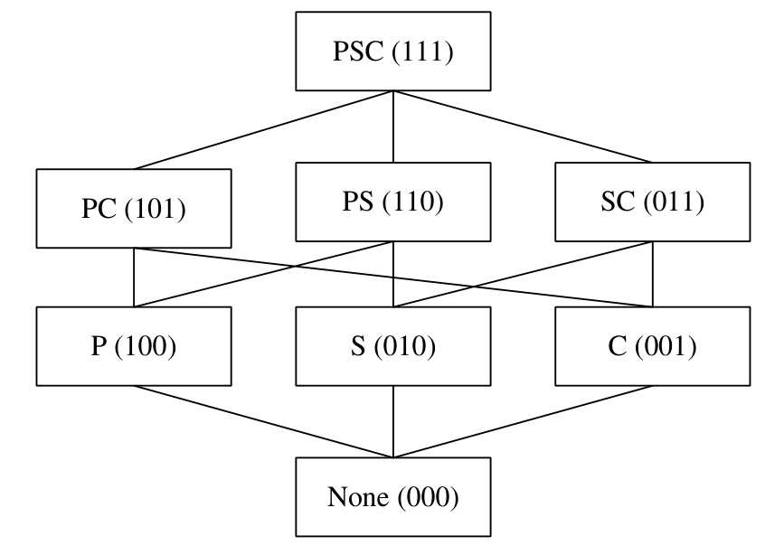
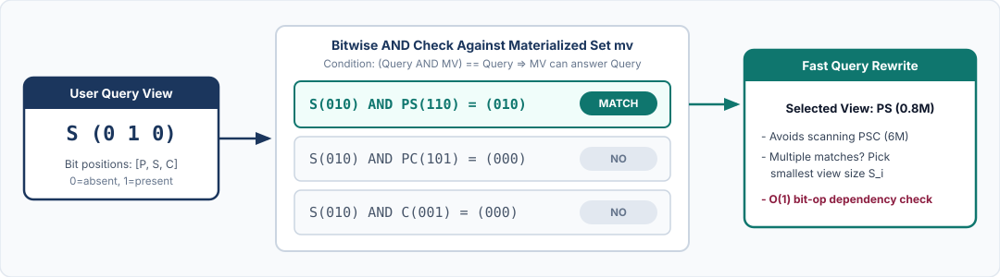
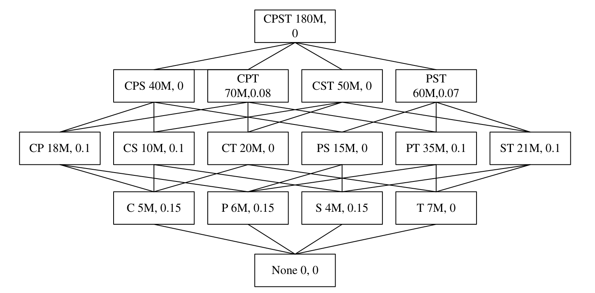
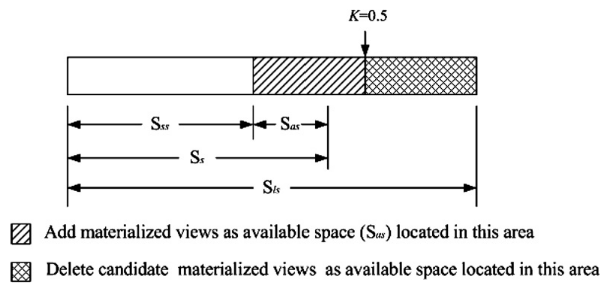
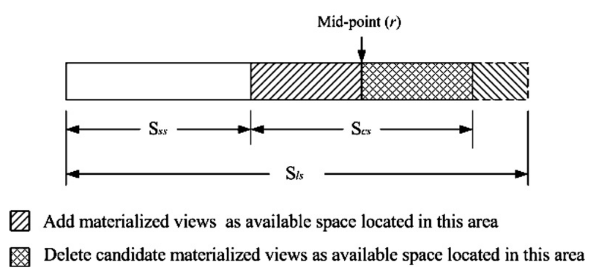
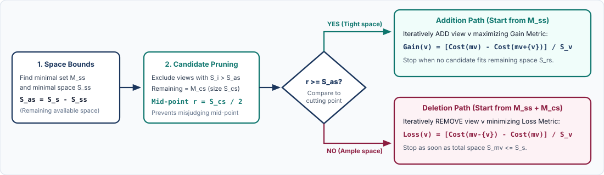
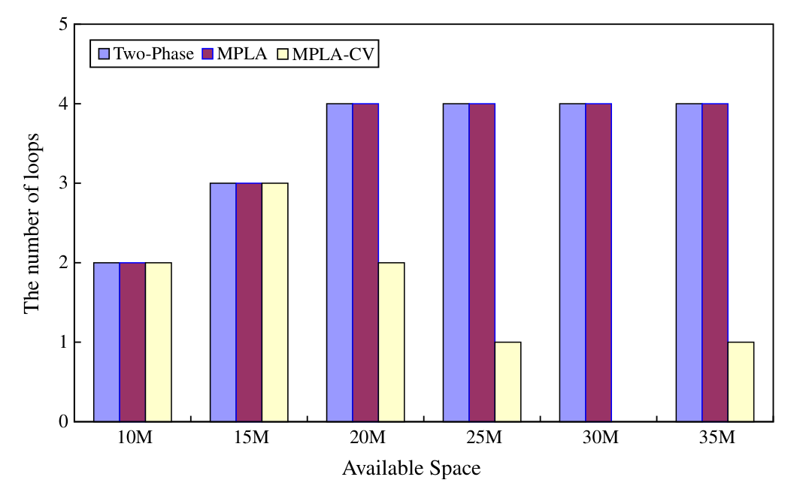
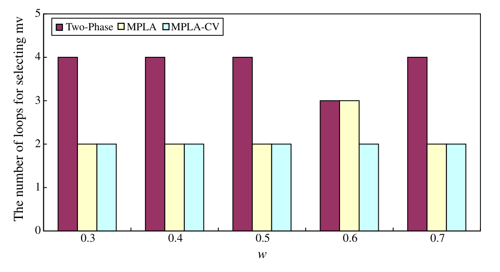
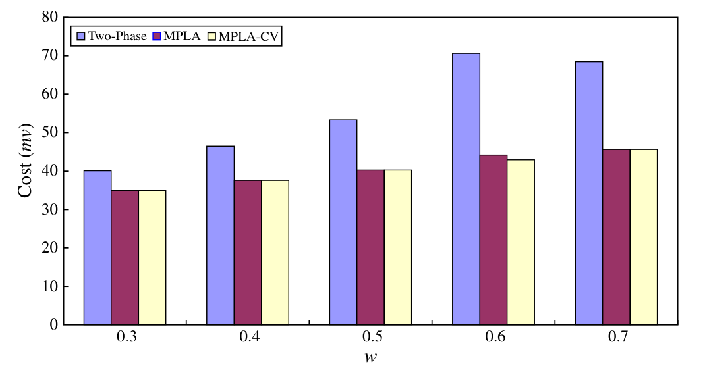

<!-- _class: lead -->

Information Sciences · Vol. 177, pp. 1333–1348 · 2007

# 資料倉儲中實體化視觀表選擇之高效率演算法研究

Efficient Approaches for Materialized Views Selection in a Data Warehouse

結合二元向量晶格、單位空間增益／損失指標與中點定位演算法（MPL 與 MPL-CV），在儲存空間與維護成本雙重限制下大幅加速 OLAP 實體化視觀表最佳化選擇。

<strong>洪銘川*（Ming-Chuan Hung）</strong>、<strong>黃曼琳（Man-Lin Huang）</strong>、<strong>楊東麟（Don-Lin Yang）</strong>、<strong>薛念林（Nien-Lin Hsueh）</strong> 
逢甲大學資訊工程學系 · DOI: <code>10.1016/j.ins.2006.09.007</code>

行政院國家科學委員會（NSC）專題研究計畫補助 · 編號：NSC 94-2213-E-035-002

<!--
論文背景與研究定位：
- 完整出處：M.-C. Hung, M.-L. Huang, D.-L. Yang, and N.-L. Hsueh, "Efficient approaches for materialized views selection in a data warehouse," Information Sciences, Vol. 177, pp. 1333-1348, 2007。
- 核心問題：資料倉儲透過實體化視觀表（Materialized Views）預先儲存中介聚合結果以加速 OLAP 決策查詢；然而硬碟空間有限且底層資料更新將衍生維護成本，在限制下挑選最佳視觀表集合屬於 NP-complete 問題。
- 三大創新：採用二元向量資料結構以位元 AND 加速晶格查詢改寫；建立兼顧查詢與維護成本之單位空間「增益指標（Gain Metric）」與「損失指標（Loss Metric）」；設計中點定位（MPL）與候選視觀表剪枝（MPL-CV）演算法，動態決定由下而上新增或由上而下刪除。
-->

---

## 簡報大綱

  
1

  
<a href="#3">研究動機與問題定義</a> 儲存空間限制、OLAP 查詢效能與維護成本權衡，以及視觀表選擇之 NP-complete 本質。

  
2

  
<a href="#4">相關文獻回顧與比較</a> 比較貪婪法、兩階段法、MVPP 與演化式演算法之優劣，凸顯 MPL / MPL-CV 定位。

  
3

  
<a href="#5">二元向量晶格與查詢改寫</a> 以位元向量表達資料立方體相依性，並透過位元 <code>AND</code> 運算即時完成查詢改寫。

  
4

  
<a href="#7">成本模型與增損指標</a> 查詢與加權維護總成本公式 <code>Cost(mv)</code>，以及單位空間增益／損失指標實例推演。

  
5

  
<a href="#9">MPL 與 MPL-CV 演算法</a> 中點切割決策機制與候選視觀表剪枝如何消除中點誤判並加速收斂。

  
6

  
<a href="#11">實驗評估與研究結論</a> 於 <code>w = 0</code> 與 <code>w ≠ 0</code> 實驗下達成 47.4%–57.1% 迴圈縮減與 25.5% 總成本降低。

<strong>核心洞見：</strong>反覆重算整張晶格的 <code>Cost(mv)</code> 是最耗時的瓶頸；先剪除超出空間的不可行視觀表，再依中點從較近端（<code>Mss</code> 或 <code>Mcs</code>）逼近，能同步大幅減少迴圈數並降低總成本。

<!--
論文結構總覽：
- 第 1 節（緒論）點出可用空間、查詢效率、查詢與維護總成本三大約束條件。
- 第 2 節（相關研究）評析 Harinarayan 貪婪法、陳與劉兩階段法、Yang 的 MVPP、Gupta & Mumick 及演化式演算法。
- 第 3 節（系統架構）提出資料立方體晶格（圖 1 至圖 2）、二元向量結構（圖 3）與位元 AND 查詢改寫。
- 第 4 節（成本模型）建立公式 (1) 至 (6)，包含空間、查詢成本、維護成本、加權總成本與增益／損失指標，並以四維晶格（圖 4、例 2 至例 3）演練。
- 第 5 節（選擇演算法）詳述 10 步驟之 MPL 與 MPL-CV 演算法（圖 5 至圖 6）。
- 第 6 節（實驗評估）針對 w = 0（表 2 至表 3、表 5、圖 7）與 w != 0（表 4、圖 8 至圖 9）與兩階段法對比。
- 第 7 節（結論與未來研究）總結成效並提出線上動態視觀表演化與殘餘空間利用議題。
-->

---

## 1. 研究動機與問題定義

  
NP-Complete

  
在多維晶格中挑選最佳實體化視觀表子集屬經典難題

  
三大核心限制

  
(1) 可用儲存空間 <code>Ss</code>、(2) 查詢成本 <code>CQ</code>、(3) 更新維護成本 <code>CM</code>

  
三大方法創新

  
二元向量晶格、單位空間增損指標、中點定位與候選剪枝

  <h3>資料倉儲的兩難權衡</h3>
  <ul class="small-text">
    <li><strong>為何要實體化？</strong>OLAP 決策支援查詢涉及海量歷史聚合運算，預存實體化視觀表可大幅縮短回應時間。</li>
    <li><strong>為何不能全數實體化？</strong>硬碟空間有限無法存下全部 <code>2d</code> 個視觀表，且來源資料一變動便須付出高昂刷新維護成本。</li>
    <li><strong>隱藏效能瓶頸：</strong>演算法每回合須重算整張晶格成本，迴圈次數過多將使選擇過程極為耗時。</li>
  </ul>

  <h3>本研究之核心目標</h3>
  <ul class="small-text">
    <li><strong>高速相依檢索：</strong>以二元向量編碼晶格，讓查詢改寫與相依檢索降至位元 <code>AND</code> 層級。</li>
    <li><strong>聯合成本最佳化：</strong>在 <code>Ss</code> 限制內最小化加權總成本 <code>Cost(mv) = CQ + w × CM</code>。</li>
    <li><strong>自適應雙向搜尋：</strong>依空間中點動態選擇由最小集合<em>新增</em>，或由候選全集<em>刪除</em>，大幅壓低迭代迴圈數。</li>
  </ul>

<!--
研究問題定義（第 1 節）：
- 資料倉儲整合分散且異質之營運資料庫，專供 OLAP 多維度分析查詢。
- 實務資訊服務中，來源資料隨時間異動，實體化視觀表必須同步更新以確保正確性與即時性，因此必須在「查詢加速效益」與「儲存／維護成本」之間取得最佳平衡。
-->

---

## 2. 相關文獻回顧與比較

| 方法／文獻 | 考量空間限制 | 考量維護成本 | 核心機制 | 主要侷限 |
| :--- | :---: | :---: | :--- | :--- |
| **Harinarayan et al. (1996)** 貪婪法 | ✓ | ✗ | 晶格由上而下效益貪婪挑選 | 未考量維護成本；空間不足時效能最差 |
| **Chen &amp; Liu (1997)** 兩階段法 | ✓ | ✗ | 一階求最小集合；二階貪婪新增 | 永遠由下而上新增 ➔ 空間充裕時迴圈過多 |
| **Yang et al. (1997)** MVPP | ✗ | ✓ | 多視觀表處理計畫分析框架 | 未將儲存空間上限納入限制 |
| **Gupta &amp; Mumick (1999)** | ✗ | ✓ | 維護成本限制下之視觀表選擇 | 假設儲存極廉價而忽略空間約束 |
| **Zhang / Yu (2001, 2003)** 演化式 | ✓ | ✓ | 雙層混合／受限基因演算法 | 成本節省佳，但演化運算時間過長 |
| **本研究 MPL 與 MPL-CV (2007)** | **✓** | **✓** | **向量晶格＋增損指標＋中點剪枝** | **兼顧低迴圈高速收斂與更低總成本** |

<strong>基準對照選擇：</strong>由於陳與劉（Two-Phase）演算法已證實優於 Harinarayan 貪婪法，本研究第 6 節直接以 Two-Phase 作為核心基準，全面比較 <strong>MPL</strong> 與 <strong>MPL-CV</strong> 在 <code>w = 0</code> 與 <code>w ≠ 0</code> 下的效能。

<!--
文獻脈絡定位（第 2 節）：
- Harinarayan et al. [8] 奠定資料立方體晶格與貪婪法基礎，但忽略維護成本；Chen & Liu [3] 提出兩階段法改進空間緊繃時的表現，然當可用空間接近滿載時仍只能逐一新增，造成迴圈暴增。
- MVPP [23] 與 Gupta & Mumick [6] 納入了維護成本，卻忽略硬碟空間限制；演化式演算法（Horng [10]、Lin & Kuo [14]、Zhang [25]、Yu [24]）雖能逼近全域最佳解，卻需耗費漫長計算時間。
- 本研究延續作者群 PAKDD 2002 [22] 之切割點構想，進一步導入單位空間增益／損失指標、候選視觀表剪枝（MPL-CV）與二元向量查詢改寫。
-->

---

## 3. 晶格架構與二元向量資料結構

  <h3>偏序相依關係與位元編碼</h3>
  <ul class="small-text">
    <li><strong>相依定義（<code>⊆</code>）：</strong><code>Q1 ⊆ Q2</code> 表示查詢 <code>Q1</code> 可直接由視觀表 <code>Q2</code> 結果推得（如 <code>PS ⊆ PSC</code>）。</li>
    <li><strong>三維銷售立方體（例 1）：</strong>涵蓋零件（<code>P</code>）、供應商（<code>S</code>）、客戶（<code>C</code>）三維度，共 <code>23 = 8</code> 個視觀表，頂點為 <code>PSC (111)</code>、底點為 <code>None (000)</code>。</li>
    <li><strong>位元翻轉導覽：</strong>
      <ul>
        <li><strong>向上溯源（上層相依視觀表）：</strong>將任一 <code>0</code> 翻轉為 <code>1</code>（如 <code>P(100)</code> ➔ <code>PS(110)</code>、<code>PC(101)</code>）。</li>
        <li><strong>向下鑽取（Drill-down）：</strong>將任一 <code>1</code> 翻轉為 <code>0</code>。</li>
      </ul>
    </li>
    <li><strong>效能價值：</strong>無須走訪複雜圖形指標即可快速計算相依視觀表之查詢與維護成本。</li>
  </ul>

  
  
論文圖 3：三維（P, S, C）資料立方體之二元向量晶格表示法。

<!--
晶格與向量資料結構（第 3.1 至 3.2 節、圖 1 至圖 3）：
- 資料立方體晶格須滿足兩項數學條件：(1) 相依關係為偏序（partial order）；(2) 存在一個最高層頂點視觀表（如 PSC）可供推導其餘所有視觀表。
- 在例 1（圖 2）中，各視觀表標註了資料量與查詢頻率：PSC（6M, 0.05）、PS（0.8M, 0.15）、PC（6M, 0.1）、SC（5M, 0.1）、P（0.2M, 0.25）、S（0.01M, 0.2）、C（0.1M, 0.15）。
- 以固定長度位元向量編碼各維度有無（1 表包含、0 表聚合省略），能使階層追蹤完全向量化。
-->

---

## 3.2 透過位元 AND 實現高速查詢改寫

  <h3>位元 AND 相依判定準則</h3>
  
設已實體化集合為 <code>mv = {PS(110), PC(101), C(001)}</code>、使用者查詢 <code>q = S(010)</code>，僅當 <code>(q ∧ m) == q</code> 時，<code>m</code> 方能回答查詢 <code>q</code>。

  <h3>最小容量優先選擇規則</h3>
  
若同時有多個實體化視觀表滿足 <code>(q ∧ m) == q</code>，查詢改寫器將挑選<strong>資料量 <code>Si</code> 最小者</strong>以極小化查詢掃描成本。

<!--
查詢改寫機制（第 3.3 至 3.4 節）：
- 部分實體化（partial materialization）的效益關鍵在於將使用者查詢即時改寫（query rewrite）為對最佳已存視觀表的存取。
- 透過位元 AND 運算：S(010) ∧ PS(110) = (010) 符合、S(010) ∧ PC(101) = (000) 不符、S(010) ∧ C(001) = (000) 不符，系統瞬間鎖定 PS（0.8M）回答 S 查詢，避免掃描高達 6M 的頂層 PSC。
-->

---

## 4. 統一查詢與維護成本模型

  
(1) 總空間：  Smv = Σi ∈ mv Si &nbsp;≤&nbsp; Ss

  
(2) 查詢成本：CQ = Σi=1..n fqi · C(mv ➔ ri)

  
(3) 維護成本：CM = Σj=1..m fuj · C(l ➔ mvj)

  
(4) 總成本：  Cost(mv) = CQ + w · CM

  

    <strong>權重比 <code>w = 維護頻率 / 查詢頻率</code>：</strong> 
    • <code>w &lt; 1</code>（常見 OLAP）：查詢次數高於更新次數。 
    • <code>w = 1</code>：兩者相等；<code>w &gt; 1</code>：高頻更新倉儲。
  

  <h3>成本模型關鍵符號（論文表 1）</h3>
  <table>
    <thead><tr><th>符號</th><th>定義說明</th></tr></thead>
    <tbody>
      <tr><td><code>Ss</code> / <code>Smv</code></td><td>資料倉儲實際空間上限 / 已實體化總空間</td></tr>
      <tr><td><code>fqi</code> / <code>fuj</code></td><td>第 <code>i</code> 視觀表查詢頻率 / 第 <code>j</code> 視觀表更新頻率</td></tr>
      <tr><td><code>C(mv ➔ ri)</code></td><td>透過 <code>mv</code> 回答第 <code>i</code> 個查詢視觀表之成本</td></tr>
      <tr><td><code>C(l ➔ mvj)</code></td><td>底層資料源 <code>l</code> 更新第 <code>j</code> 實體化視觀表之成本</td></tr>
      <tr><td><code>n</code> / <code>m</code></td><td>查詢視觀表總數 / 需維護視觀表總數</td></tr>
    </tbody>
  </table>

<!--
成本模型推導（第 4.1 節、表 1、公式 1 至 4）：
- 總成本 Cost(mv) 為查詢總成本 CQ 與加權維護總成本 w × CM 之總和，數值愈低代表該視觀表組合愈優。
- 若僅看單次總成本降幅，演算法常會誤選體積龐大的視觀表，導致剩餘空間耗盡而錯失多個高性價比小視觀表的組合效益；因此後續引入以空間標準化之增益與損失指標。
-->

---

## 4.2 單位空間增益指標與損失指標

  

    <h3>增益指標（Gain Metric，用於新增）</h3>
    
Gain(v) = [Cost(mv) − Cost(mv + {v})] / S{v}

    
在 <code>Smv+{v} ≤ Ss</code> 下，新增 <code>v</code> 之每單位空間成本降幅，挑選<strong>最高增益</strong>者。 
    <em>例 2：</em><code>Gain(C) = (35.55−34.8)/5 = 0.15</code> vs. <strong><code>Gain(P) = (35.55−31.2)/6 = 0.725</code></strong> ➔ 新增 <code>P</code>。

  

  

    <h3>損失指標（Loss Metric，用於刪除）</h3>
    
Loss(v) = [Cost(mv − {v}) − Cost(mv)] / S{v}

    
移除 <code>v</code> 釋放每單位空間所增加之總成本，挑選<strong>最低損失</strong>者。 
    <em>例 3：</em><strong><code>Loss(C) = (21.2−20.45)/5 = 0.15</code></strong> vs. <code>Loss(P) = (22.25−20.45)/6 = 0.30</code> ➔ 刪除 <code>C</code>。

  

  
  
論文圖 4：例 2 與例 3 所使用之四維（C, P, S, T）晶格（9 個查詢視觀表，表 2 資料集）。

<!--
四維晶格計算實例（第 4.2 至 4.3 節、圖 4、例 2 至例 3）：
- 圖 4 涵蓋客戶（C）、零件（P）、供應商（S）與時間（T）四維度共 16 節點，其中 9 個視觀表會被查詢。
- 例 2（新增）：已知 mv = {CPT, PST, CS, PT}（Cost = 35.55），比較候選 C（5M）與 P（6M）；加入 P 的單位空間效益（0.725）為 C（0.15）的近五倍，故優先實體化 P。
- 例 3（刪除）：當全部查詢視觀表實體化（Cost = 20.45）但超出可用空間時，移除 C 的單位空間代價（0.15）僅為移除 P（0.30）的一半，故優先刪除 C。
-->

---

## 5. 中點定位演算法：MPL 與 MPL-CV

  
  
論文圖 5：MPL 以 <code>k = Sas / (Sls − Sss)</code> 與 <code>0.5</code> 比較決定新增或刪除。

  
  
論文圖 6：MPL-CV 先剪除過大視觀表，再以 <code>r = Scs / 2</code> 作為精準中點。

  <h3>MPL 的盲點：中點誤判問題</h3>
  
MPL 之最大空間 <code>Sls</code> 納入大於可用空間 <code>Sas</code> 的不可行巨型視觀表，拉偏比例 <code>k &lt; 0.5</code>，導致演算法誤走冗長的新增迴圈。

  <h3>MPL-CV 突破：候選視觀表剪枝</h3>
  
MPL-CV 預先剔除所有 <code>Si &gt; Sas</code> 的視觀表，僅以真實候選空間 <code>Scs</code> 計算中點 <code>r = Scs / 2</code>，徹底消除中點誤判。

<!--
MPL 至 MPL-CV 之演算法演進（第 5.1 至 5.2 節、圖 5 至圖 6）：
- 定義最小空間 Sss（回答所有查詢之最少視觀表 Mss）、最大空間 Sls（全部查詢視觀表 Mls）與可用空間 Sas = Ss - Sss。
- MPL 以 k = Sas / (Sls - Sss) 判斷：k < 0.5 從 Mss 出發依最高增益逐一新增；k >= 0.5 從 Mls 出發依最低損失逐一刪除。
- 當剩餘視觀表中夾雜超大視觀表（如 100M 的 CPS，而可用空間僅 30M）時，MPL 會被 100M 嚴重扭曲中點；MPL-CV 直接將 CPS 剔除出候選集 Mcs，使中點精準反映可行解空間。
-->

---

## 5.2 MPL-CV 十步驟決策流程

  <h3>邊界快速終止</h3>
  
若 <code>Ss ≥ Sls</code> 直接全存 <code>Mls</code>；若 <code>Ss = Sss</code> 回傳 <code>Mss</code>；若 <code>Ss &lt; Sss</code> 則空間不足回傳空集合。

  <h3>動態候選縮減</h3>
  
新增路徑步驟 6 每回合重算剩餘空間 <code>Srs = Ss − Smv</code>，同步動態縮減候選池 <code>Mcs</code>。

  <h3>零迴圈最佳收斂</h3>
  
若 <code>r &lt; Sas</code> 且 <code>Sss + Scs ≤ Ss</code>，步驟 5 直接結束並實體化全部可行候選—<strong>0 次迴圈</strong>！

<!--
MPL-CV 十步驟細節（第 5.2 節）：
- 步驟 1 至 3 計算 Mss、Sss、Mls、Sls 與 Sas 並處理三種邊界條件。
- 步驟 4 濾除體積大於 Sas 的視觀表，取得候選集 Mcs、候選空間 Scs 與中點 r = Scs / 2。
- 步驟 5 分流：
  - 若 r >= Sas（空間偏緊）：令 mv = Mss，進入步驟 6 至 7，每次以向量晶格計算各候選之 Gain 並加入最高者，直至無候選可塞入。
  - 若 r < Sas（空間充裕）：令 mv = Mss + Mcs；若未超限直接輸出，否則進入步驟 8 至 9，逐次刪除 Loss 最低者直至符合空間上限 Ss。
-->

---

## 6. 實驗評估（w = 0）：逐步增加實際空間

採用四維資料集（表 2；最小空間 <code>Sss = 140M</code>，對應 <code>{CPT, PST, CS}</code>），比較 **Two-Phase**、**MPL** 與 **MPL-CV** 於五種空間上限下之表現（表 5）：

| 案例 | 空間上限（`S_s`） | Two-Phase 迴圈數 | MPL 迴圈數 | MPL-CV 迴圈數 | 最佳 `Cost(mv)`（三者相同） |
| :---: | :---: | :---: | :---: | :---: | :---: |
| 1 | 140M | 1 | 1 | 1 | 41.80 |
| 2 | 160M | 1 | 1 | 1 | 30.30 |
| 3 | 180M | 2 | 2 | 2 | 26.40 |
| **4** | **200M** | **5** | **1** | **1** | **22.95** |
| **5** | **210M** | **5** | **1** | **1** | **22.95** |

<strong>關鍵結果（迴圈數平均縮減 57.1%）：</strong>三種演算法求得完全相同的最佳 <code>Cost(mv)</code>，但 MPL 與 MPL-CV 於 <code>Ss ≥ 200M</code> 自動切換為刪除策略，使總迴圈數由 14 降至 6，效能大幅領先 <strong>57.1%</strong>。

<!--
實驗 6.1.1 解析（表 5）：
- 由於每回合迴圈皆須重新計算整張晶格中各候選視觀表的 Cost(mv)，迴圈次數直接決定演算法執行耗時。
- 在空間充裕的案例 4（200M）與案例 5（210M），Two-Phase 仍須執行 5 次由下而上的新增迴圈；MPL 與 MPL-CV 則改採由上而下刪除，僅 1 次迴圈即達最佳解（單案節省 80% 計算量）。
-->

---

## 6.2 實驗評估（w = 0）：可用空間與剪枝效益

  <h3>資料集 2 設定（論文表 3）</h3>
  <ul class="small-text">
    <li>最小視觀表：<code>{CPST}</code>，佔用 <code>Sss = 200M</code>。</li>
    <li>其餘 6 個視觀表：<code>{CPS(100M), CP(5M), CS(5M), PS(5M), PT(5M), C(4M)}</code>。</li>
    <li>可用空間 <code>Sas</code> 由 <code>10M</code> 遞增至 <code>35M</code>。</li>
  </ul>
  <h3 style="margin-top: 10px;">MPL-CV 完勝 MPL 的關鍵</h3>
  <ul class="small-text">
    <li><strong>MPL 陷入誤判：</strong>100M 巨型 <code>CPS</code> 拉大 <code>Sls − Sss = 124M</code>，使 MPL 在 <code>20M–35M</code> 仍卡在 4 次迴圈！</li>
    <li><strong>MPL-CV 精準剪枝：</strong>立即剔除 <code>CPS</code> ➔ <code>Scs = 24M</code> ➔ 於 <code>20M–35M</code> 驟降至 <strong>2、1、0、1 次迴圈</strong>！</li>
  </ul>

  
  
論文圖 7：可用空間由 10M 增至 35M 時之迴圈次數對比（<code>w = 0</code>）。

<!--
實驗 6.1.2 解析（表 3、圖 7）：
- 本實驗專為檢驗 MPL-CV 候選剪枝機制而設計：CPS 高達 100M，在可用空間 10M 至 35M 區間內絕對無法實體化。
- Two-Phase 與 MPL 未先剔除 CPS，在 20M 至 35M 均耗費 4 次迴圈；MPL-CV 先行排除 CPS 後，僅餘 5 個小視觀表（總計 24M，中點 r = 12M），故在 20M、25M 改走刪除路徑（2 與 1 次迴圈），於 30M 時更直接以 0 次迴圈一次納入全部可行視觀表。
-->

---

## 6.3 實驗評估（w ≠ 0）：維護權重與總成本權衡

固定實際空間 <code>Ss = 190M</code>（<code>Sss = 140M</code>，表 4），將維護／查詢權重比 <code>w</code> 由 <code>0.3</code> 遞增至 <code>0.7</code>：

  
  
論文圖 8：不同權重比 <code>w = 0.3..0.7</code> 下之選擇迴圈數。

  
  
論文圖 9：不同權重比 <code>w = 0.3..0.7</code> 下之資料倉儲總成本 <code>Cost(mv)</code>。

  
迴圈數降 47.4%

  
納入維護成本後，MPL 與 MPL-CV 迴圈數平均較 Two-Phase 減少 47.4%

  
再快 9%–33%

  
MPL-CV 較 MPL 平均再減 9% 迴圈（<code>w = 0.6</code> 時達 33% 降幅）

  
總成本降 25.5%

  
於所有權重設定下，總成本 <code>Cost(mv)</code> 較 Two-Phase 平均降低 25.5%

<!--
實驗 6.2 解析（表 4、圖 8 至圖 9）：
- 當考量維護成本（w != 0）時，Two-Phase 因忽略更新頻率與維護成本，在 w 升高至 0.6 與 0.7 時總成本急劇飆升至約 70。
- 本研究所提 MPL 與 MPL-CV 將加權維護成本 w × CM 融入增益／損失指標，有效避開高維護負擔之視觀表，不僅使總成本平均降低 25.5%，更將搜尋迴圈數較 Two-Phase 壓低 47.4%（MPL-CV 較 MPL 再省 9%，於 w = 0.6 達 33%）。
-->

---

## 7. 討論、研究限制與未來展望

  <h3>主要學術與技術貢獻</h3>
  <ul class="small-text">
    <li><strong>二元向量晶格與位元改寫：</strong>以常數時間位元 <code>AND</code> 加速相依視觀表檢索與 OLAP 查詢改寫。</li>
    <li><strong>兼顧維護之單位空間指標：</strong>透過 Gain 與 Loss 指標同步平衡查詢效能、維護負擔與儲存效益。</li>
    <li><strong>中點剪枝雙向搜尋（MPL-CV）：</strong>在兼顧解品質下減少 <strong>47.4%–57.1%</strong> 迴圈數，並降低 <strong>25.5%</strong> 資料倉儲總成本。</li>
  </ul>

  <h3>研究限制與未來方向</h3>
  <ul class="small-text">
    <li><strong>靜態工作負載假設：</strong>實驗假設查詢與更新頻率固定，真實電子商務 OLAP 查詢模式具高度動態性。</li>
    <li><strong>晶格維度規模：</strong>實證以三維與四維合成晶格（16 節點）為主，超高維度企業資料倉儲之擴展性值得進一步驗證。</li>
    <li><strong>未來方向一—線上動態演化：</strong>即時因應線上查詢變動增刪實體化視觀表，並極小化對現行倉儲作業之干擾。</li>
    <li><strong>未來方向二—殘餘空間利用：</strong>深入探討演算法終止後剩餘零碎儲存空間之最佳化配置。</li>
  </ul>

<strong>核心啟示：</strong>面對 NP-complete 視觀表選擇問題，在決定「由下而上新增」或「由上而下刪除」前先行剪除不可行候選，能同時大幅提升演算效率並顯著降低維護導向倉儲之總成本。

<!--
綜合討論與未來研究（第 7 節）：
- 本研究精準切中資料倉儲視觀表選擇的兩大痛點：晶格相依搜尋耗時與反覆成本評估迴圈過多。
- 論文第 7 節明確提出兩項後續研究方向：(1) 因應線上動態查詢需求的實體化視觀表演化（online evolution），在不衝擊既有查詢服務下動態增刪視觀表；(2) 殘餘儲存空間（residual space）之進一步壓榨利用。
-->

---

<!-- _class: closing -->

# 感謝聆聽！敬請指教

資料倉儲中實體化視觀表選擇之高效率演算法研究 
Efficient Approaches for Materialized Views Selection in a Data Warehouse

<strong>洪銘川*（Ming-Chuan Hung）</strong> · <code>mchong@fcu.edu.tw</code> &nbsp;|&nbsp; <strong>黃曼琳</strong> · <code>mlhuang@fcu.edu.tw</code> 
<strong>楊東麟（Don-Lin Yang）</strong> · <code>dlyang@fcu.edu.tw</code> &nbsp;|&nbsp; <strong>薛念林</strong> · <code>nlhsueh@fcu.edu.tw</code> 
逢甲大學資訊工程學系（Department of Information Engineering and Computer Science, FCU） 
Information Sciences, Vol. 177 (2007), pp. 1333–1348 · 國科會計畫 NSC 94-2213-E-035-002

<!--
文獻與歸檔資訊：
- 篇名：Efficient approaches for materialized views selection in a data warehouse
- 作者：洪銘川（Ming-Chuan Hung，通訊作者）、黃曼琳（Man-Lin Huang）、楊東麟（Don-Lin Yang）、薛念林（Nien-Lin Hsueh）
- 期刊：Information Sciences, Elsevier, Vol. 177, pp. 1333-1348, 2007
- DOI：10.1016/j.ins.2006.09.007
- 關鍵字：實體化視觀表、資料倉儲、OLAP、查詢改寫、增益指標、損失指標
-->

