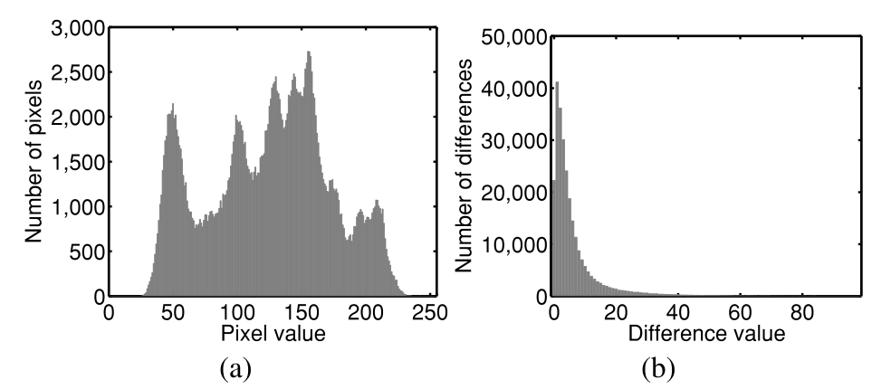
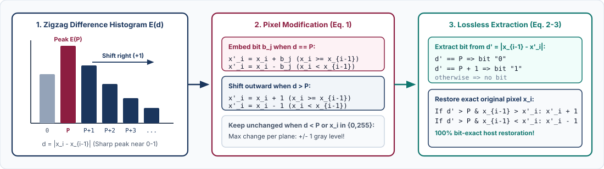
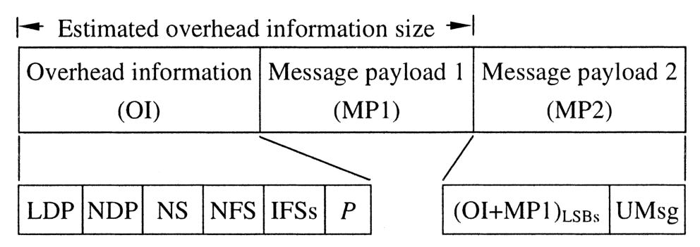
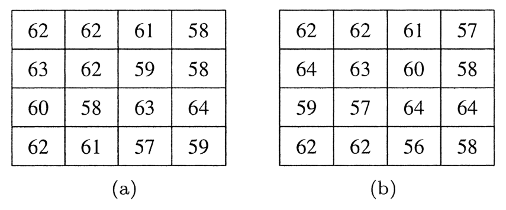
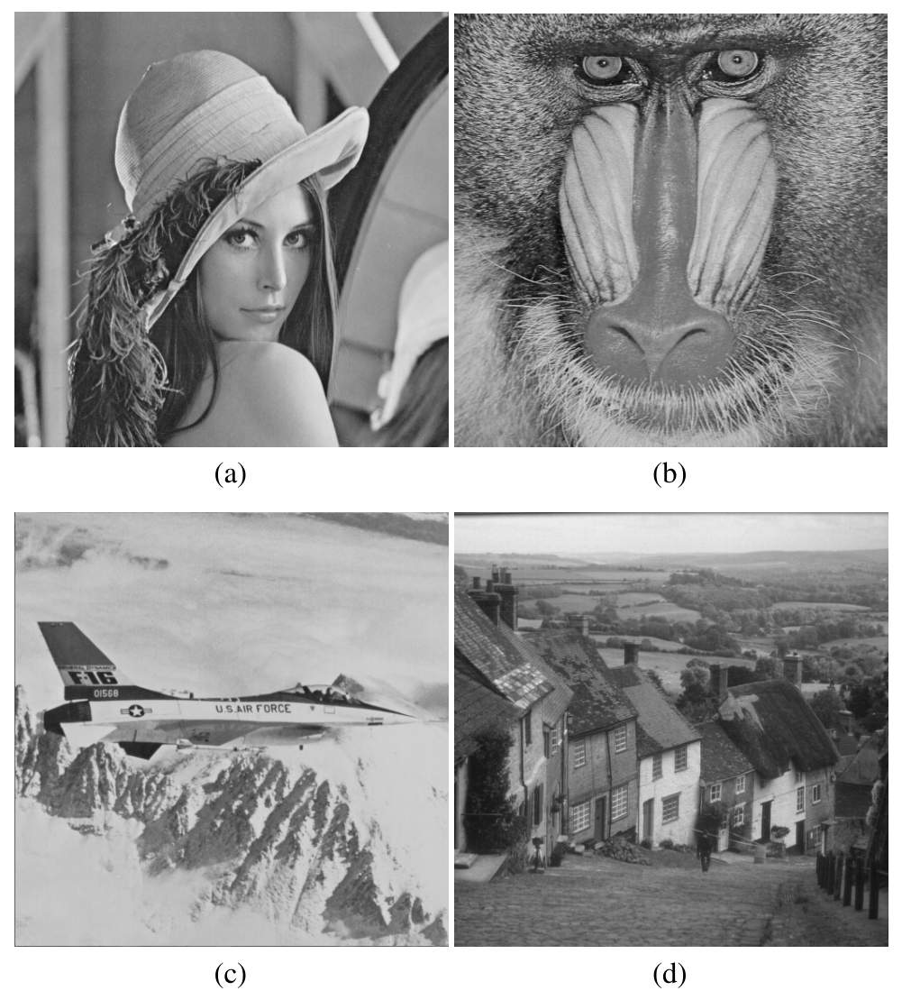
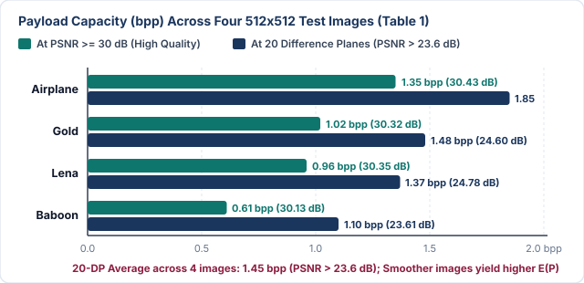
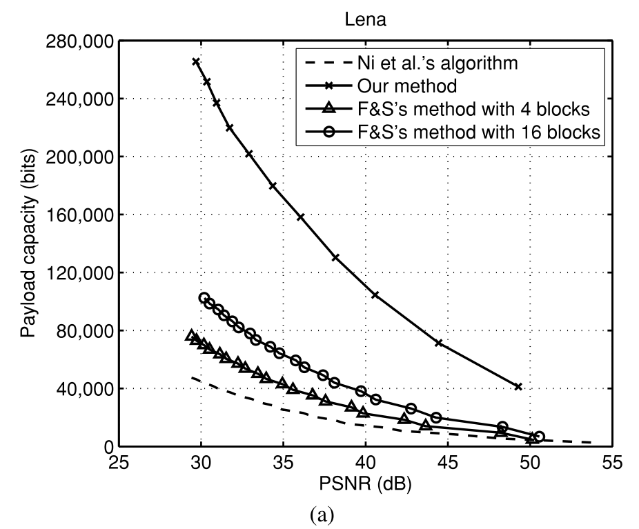
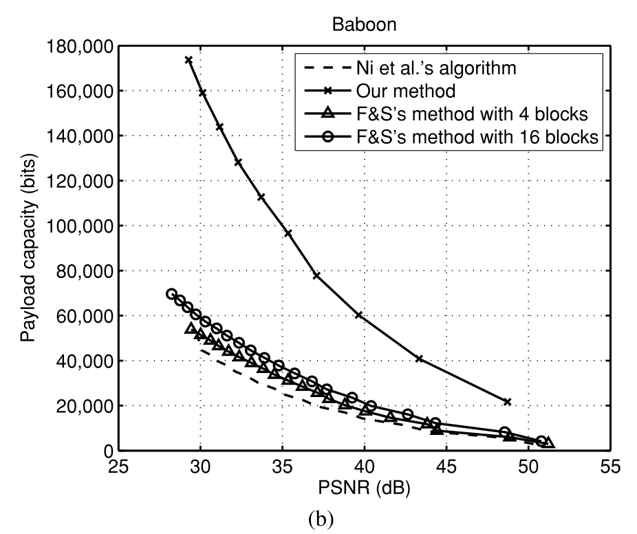

<!-- _class: lead -->

IEICE Trans. Inf. &amp; Syst. · Vol. E90-D, No. 12, pp. 2053–2059 · Dec. 2007

# Hiding Data Reversibly in an Image via Increasing Differences between Two Neighboring Pixels

Exploiting the sharp peak of neighboring-pixel difference histograms to achieve high-capacity, low-distortion, 100% lossless reversible data hiding with minimal self-contained overhead.

<strong>Ching-Chiuan Lin</strong> (Member) &amp; <strong>Nien-Lin Hsueh</strong> (Nonmember) 
Department of Information Engineering and Computer Science, Feng Chia University, Taichung, Taiwan 
DOI: <code>10.1093/ietisy/e90-d.12.2053</code>

<!--
Paper Metadata & Research Positioning:
- Full Citation: C.-C. Lin and N.-L. Hsueh, "Hiding data reversibly in an image via increasing differences between two neighboring pixels," IEICE Transactions on Information and Systems, vol. E90-D, no. 12, pp. 2053-2059, Dec. 2007.
- Manuscript received February 5, 2007; revised July 1, 2007.
- Core Problem: Sensitive imaging domains (medical clinical atlases, digital libraries, forensic archives) require reversible (lossless) steganography so that after extracting authentication watermarks or confidential payloads, the original host image is reconstructed bit-for-bit identically.
- Core Innovation: Shifting the histogram of *neighboring-pixel differences* |x_i - x_{i-1}| rather than raw pixel intensities yields a ~14x higher embedding peak (~40,000 vs. 2,729 on Lena), paired with a compact, self-contained fresh-saturation overhead scheme (< 1,000 bits for PSNR >= 30 dB).
-->

---

## Outline

  
1

  
<a href="#3">Motivation &amp; Prior Art</a> Why medical/archival images need lossless hiding and limitations of LSB, DE, and Ni et al.

  
2

  
<a href="#4">Core Insight: Difference Histogram Peak</a> Why neighboring-pixel differences produce a dramatically taller peak than pixel-value histograms.

  
3

  
<a href="#5">Embedding &amp; Extraction Algorithm</a> Zigzag scan, peak selection <code>P</code>, Eqs. (1)–(3) modification/recovery, and multi-plane iteration.

  
4

  
<a href="#6">Self-Contained Overhead &amp; Examples</a> Handling semi-saturation / fresh-saturation pixels cleanly in <code>OI/MP1/MP2</code> + 4×4 trace.

  
5

  
<a href="#8">Experimental Evaluation</a> 20-difference-plane capacity/PSNR on 4 benchmarks and head-to-head vs. Ni et al. &amp; F&amp;S.

  
6

  
<a href="#12">Comparison, Limitations &amp; Conclusion</a> Cross-family trade-offs, texture sensitivity, overhead fragility, and key takeaways.

<strong>Core Result:</strong> At <strong>PSNR ≥ 30 dB</strong>, our method embeds <strong>0.96 bpp</strong> on Lena and <strong>0.61 bpp</strong> on Baboon with <strong>&lt; 1,000 bits</strong> of overhead—dramatically outperforming both Ni et al. and Fallahpour &amp; Sedaaghi (F&amp;S).

<!--
Paper Structure Overview:
- Section 1 (Introduction): Motivates lossless steganography and categorizes prior grayscale reversible hiding methods into three families: (1) Data compression, (2) Difference expansion, and (3) Histogram shifting.
- Section 2 (Proposed Method): Details Embedding (2.1), Self-Contained Overhead Format & Saturation Handling (2.2), Extraction & Lossless Recovery (2.3), and a complete 4x4 walkthrough (2.4).
- Section 3 (Experimental Results): Evaluates four 512x512 benchmark images (Lena, Baboon, Airplane, Gold) over 20 difference planes (Table 1) and compares PSNR-capacity curves against Ni et al. [7] and F&S [8] (Figs. 5-7).
- Section 4 (Conclusions): Synthesizes high-capacity, low-distortion lossless recovery advantages.
-->

---

## 1. Motivation & Limitations of Prior Art

In **medical imaging** (e.g., clinical brain atlases) and **digital archival libraries**, permanent pixel distortion from lossy steganography is unacceptable—the decoder must recover the **exact original host image** after extracting the hidden message.

  <h3>1. Data Compression</h3>
  
<em>Fridrich et al. (2001), Celik et al. (2005)</em> 
  Losslessly compresses LSB planes to free embedding space. 
  <strong>Limitation:</strong> Payload capacity is inherently low and bottlenecked by compressibility.

  <h3>2. Difference Expansion (DE)</h3>
  
<em>Tian (2003), Alattar (2004)</em> 
  Expands differences between pixel pairs to carry bits. 
  <strong>Limitation:</strong> Requires a huge <em>location map</em> to record expandable pairs, consuming substantial payload space.

  <h3>3. Histogram Shifting</h3>
  
<em>Ni et al. (2006), F&amp;S (2007)</em> 
  Shifts pixel histogram between peak &amp; zero points. 
  <strong>Limitation:</strong> Flat pixel histograms cap single-pass capacity; F&amp;S block-splitting multiplies overhead by <code>Nb</code> times.

<strong>Design Goal:</strong> Achieve high payload capacity <em>without</em> DE's bulky location map or F&amp;S's <code>Nb</code>-fold overhead explosion, while bounding per-plane distortion to <code>±1</code> gray level.

<!--
Taxonomy of Reversible Data Hiding (Section 1):
- Recovery information can be stored externally (inconvenient side-file maintenance) or internally inside the stego-image (sharing payload capacity with the user's message). Our method embeds all recovery overhead internally.
- Ni et al. (IEEE TCSVT 2006) pioneered simple histogram shifting, but natural images rarely contain massive counts of identical absolute pixel intensities.
- Fallahpour & Sedaaghi (IEICE ELEX 2007, denoted F&S) improved Ni et al. by partitioning the image into Nb non-overlapping blocks, but storing peak/minimum pairs per block scales overhead linearly by Nb.
-->

---

## 2. Core Insight: Spatial Correlation Creates a Giant Peak

  <h3>Why Shift <em>Differences</em> Instead of Pixels?</h3>
  <ul class="small-text">
    <li><strong>Natural Image Correlation:</strong> Adjacent pixels along a zigzag scan usually have nearly identical gray values, concentrating <code>d = |xi − xi−1|</code> tightly near <code>0</code> and <code>1</code>.</li>
    <li><strong>Ni et al.'s Pixel Histogram (Lena):</strong> Peak count never exceeds <strong>2,729 pixels</strong> ➔ at most 2,729 bits per pass.</li>
    <li><strong>Our Difference Histogram (Lena):</strong> Maximum point at <code>P = 1</code> reaches <strong>~40,000 pixel pairs</strong> ➔ nearly <strong>15× higher capacity</strong> in a single difference plane!</li>
    <li><strong>Simplicity Preserved:</strong> Still shifts each pixel by at most <code>±1</code> per plane—no complex integer transforms or full-image location maps.</li>
  </ul>

  
  
Fig. 6 (Paper): Lena histogram comparison—(a) Ni et al. peak ≤ 2,729 vs. (b) Proposed difference peak ≈ 40,000 at <code>P = 1</code>.

<!--
Statistical Basis of the Method (Sections 1 & 3, Fig. 6):
- In an N-pixel image (N = 512 x 512 = 262,144), there are N - 1 = 262,143 neighboring pixel pairs along a zigzag scan.
- Because natural images are locally smooth, the histogram of absolute differences E(d) exhibits a sharp Laplacian-like spike near d = 0 and d = 1, whereas raw grayscale intensity histograms are spread broadly across [0, 255].
- Selecting the peak difference P (tie-breaking toward larger P if multiple peaks exist, to minimize the number of shifted pixels d > P and reduce distortion) immediately unlocks ~40,000 embeddable pairs on Lena in the very first difference plane.
-->

---

## 3. Proposed Embedding & Extraction Mechanism

  <h3>Multi-Plane Iterative Embedding</h3>
  
If one difference plane cannot hold the entire <code>n</code>-bit message, repeat Steps 1–4 across multiple <strong>Difference Planes (DPs)</strong> until all bits are embedded or PSNR reaches a quality threshold.

  <h3>Sequential Bit-Exact Restoration</h3>
  
Decoder processes pixels in the <em>same zigzag order</em>: because <code>xi−1</code> is already restored before visiting <code>x'i</code>, computing <code>|xi−1 − x'i|</code> extracts <code>bj</code> and restores <code>xi</code> with <strong>zero error</strong>.

<!--
Algorithmic Mechanics (Sections 2.1 & 2.3, Eqs. 1-3):
- Embedding (Section 2.1):
  1. Scan host image H in zigzag order; compute d = |x_i - x_{i-1}| and histogram E(d).
  2. Find peak P maximizing E(P) (choose larger P on ties to shift fewer pixels).
  3. Reserve first w' pixels for estimated overhead; embed their original LSBs (wb) + user message (ub) into pixels w' < i <= N-1 using Eq. (1), skipping boundary saturation pixels x_i in {0, 255}.
  4. Embed actual overhead into OI (first w pixels) and remaining user bits into MP1 (pixels w..w'-1) via alpha-bit LSB replacement.
- Extraction (Section 2.3):
  - Decode OI via LSB replacement to retrieve P and fresh saturation indexes (IFSs); extract MP1 bits if w < w'.
  - Scan MP2 in zigzag order: for non-saturation pixels (1 <= x'_i <= 254) or recorded fresh saturation pixels, extract 0 if |x_{i-1} - x'_i| == P, 1 if == P+1 (Eq. 2), and restore x_i by shifting inward by 1 whenever |x_{i-1} - x'_i| > P (Eq. 3).
  - Restore OI and MP1 LSBs using the extracted (OI+MP1)_LSBs; repeat across all K difference planes in reverse order.
-->

---

## 3.2 Handling Saturation & Self-Contained Overhead

Fig. 1 (Paper): Self-contained difference-plane layout partitioning pixels into <code>OI</code>, <code>MP1</code>, and <code>MP2</code>.

  <h3>Preventing Overflow/Underflow Ambiguity</h3>
  <ul class="small-text">
    <li><strong>Saturation Pixels (<code>0</code> or <code>255</code>):</strong> Left untouched during embedding.</li>
    <li><strong>Semi-Saturation (<code>1</code> or <code>254</code>):</strong> May shift into <code>{0, 255}</code> during Eq. (1), becoming a <strong>Fresh Saturation Pixel</strong>.</li>
    <li><strong>Tight Upper Bound:</strong> <code>NFS ≤ NS</code> ➔ estimated overhead <code>v = |LDP| + |NDP| + |NS| + |NFS| + |P| + NS × u</code> bits fits in <code>w' = ⌈v / α⌉</code> pixels!</li>
  </ul>

  <h3>Zero Wasted Overhead Space</h3>
  <ul class="small-text">
    <li><strong>Step A:</strong> Save original LSBs of first <code>w'</code> pixels + user message <code>UMsg</code> into <code>MP2</code> via difference shifting.</li>
    <li><strong>Step B:</strong> Write actual overhead (<code>w ≤ w'</code> pixels) into <code>OI</code> via <code>α</code>-bit LSB replacement; reclaim unused pixels <code>w..w'−1</code> (<code>MP1</code>) for extra user bits!</li>
    <li><strong>Total K-Plane Capacity:</strong> <code>C = Σk=1..K [S(MP2k) + S(MP1k) − S(OIk)]</code>.</li>
  </ul>

<!--
Overhead Design & Saturation Handling (Section 2.2, Fig. 1-2):
- Key fields in OI: LDP (1-bit flag: last difference plane?), NDP (8-bit total plane count, valid iff LDP=1, since a pixel cannot be shifted >255 times), NS (semi-saturation pixel count), NFS (actual fresh saturation count), IFSs (pixel indexes of fresh saturation pixels, u = ceil(log2 N) bits each), and P (8-bit peak difference).
- Why this beats DE's location map: Most natural images contain zero or very few semi-saturation pixels (1 or 254) in the first several difference planes, keeping OI tiny (< 1,000 bits total across ~10 planes for PSNR >= 30 dB) instead of storing a bit-per-pair location map.
-->

---

## 3.3 Worked Examples: Overhead Budget & 4×4 Pixel Trace

  <h3>512×512 Overhead Calculation (Fig. 3)</h3>
  <ul class="small-text">
    <li>Image: <code>512 × 512</code> (<code>u = ⌈log2 262144⌉ = 18</code> bits/index); <code>α = 2</code> LSBs/pixel; <code>5</code> planes; <code>LDP = 1</code>; <code>NS = 3</code>; <code>P = 1</code>.</li>
    <li><code>NS</code>/<code>NFS</code> width: <code>⌈log2(262144 / 18)⌉ = 14</code> bits each.</li>
    <li><strong>Estimated <code>v</code>:</strong> <code>1 + 8 + 14 + 14 + 3×18 + 8 = 99 bits</code> (reserves first <code>w' = 50</code> pixels).</li>
    <li><strong>Actual <code>OI</code> (2 fresh saturations @ 105, 3658):</strong> <code>81 bits</code> ➔ unused <strong>18 bits</strong> reclaimed in <code>MP1</code> for user data!</li>
  </ul>

  

    
    
Fig. 4 (Paper): 4×4 host image (a) and stego-image (b) embedding <code>01100</code> at <code>P = 1</code>.

  

  

    <strong>4×4 Trace (<code>P = 1, E(1) = 5</code>):</strong> 
    • <code>|x2−x1|=|61−62|=1</code>, embed <code>0</code> ➔ keep <code>61</code>. 
    • <code>|x3−x2|=|58−61|=3&gt;1</code> (<code>x3&lt;x2</code>) ➔ shift <code>58 ➔ 57</code>. 
    • <code>|x5−x4|=|59−58|=1</code>, embed <code>1</code> (<code>x5&gt;x4</code>) ➔ <code>59 ➔ 60</code>.
  

<!--
Worked Walkthroughs (Sections 2.2 & 2.4, Figs. 3-4):
- Fig. 3 concretely illustrates how the estimated overhead budget v = 99 bits reserves 50 pixels (at alpha = 2 LSBs/pixel), stores their 99 original LSBs inside MP2 alongside UMsg, writes the actual 81-bit OI into the first 41 pixels, and uses the remaining 18 bits (MP1) for additional message bits—leaving zero wasted capacity.
- Fig. 4 traces exact pixel-by-pixel embedding and recovery on a 4x4 zigzag-scanned block: during extraction, the decoder recovers x_2 = 61 (extracts 0), sees |x_2 - x'_3| = |61 - 57| = 4 > P with x_2 > x'_3 so it restores x_3 = 57 + 1 = 58, and sees |x_4 - x'_5| = |58 - 60| = 2 = P + 1 so it extracts 1 and restores x_5 = 60 - 1 = 59.
-->

---

## 4. Experimental Setup & Benchmark Images

  <h3>Evaluation Protocol (Section 3)</h3>
  <ul class="small-text">
    <li><strong>Implementation:</strong> Proposed method, Ni et al. [7], and F&amp;S [8] (4-block &amp; 16-block) implemented in <strong>Java</strong> on a PC.</li>
    <li><strong>Test Set:</strong> Four standard <code>512 × 512</code> 8-bit grayscale images spanning smooth to highly textured scenes: <strong>Lena</strong>, <strong>Baboon</strong>, <strong>Airplane</strong>, and <strong>Gold</strong>.</li>
    <li><strong>Workload:</strong> Averaged over <strong>100 random bit-stream messages</strong> generated via Java's <code>Math.random()</code>.</li>
    <li><strong>Quality Metric (PSNR):</strong></li>
  </ul>
  
PSNR = 10 × log10( [255² × N] / Σi=0..N−1 (xi − yi)² ) dB

  
Payload reported in <strong>bits per pixel (bpp)</strong>; up to 20 Difference Planes evaluated.

  
  
Fig. 5 (Paper): 512×512 grayscale test images—(a) Lena, (b) Baboon, (c) Airplane, (d) Gold.

<!--
Experimental Design Details (Section 3, Fig. 5):
- The four benchmark images deliberately span diverse spatial smoothness regimes: Airplane and Gold contain large smooth regions, Lena offers balanced smooth/edge areas, and Baboon is notoriously high-texture (dense fur edges).
- Running 100 independent random binary payloads per method ensures reported PSNR-vs.-capacity curves reflect expected performance rather than lucky bit distributions.
-->

---

## 4.2 Multi-Plane Capacity & PSNR (20 Difference Planes)

  <table>
    <thead><tr><th>DP</th><th>Lena (dB / bpp)</th><th>Baboon</th><th>Airplane</th><th>Gold</th></tr></thead>
    <tbody>
      <tr><td><strong>1</strong></td><td>49.28 / 0.16</td><td>48.72 / 0.08</td><td>50.46 / 0.26</td><td>49.46 / 0.18</td></tr>
      <tr><td><strong>5</strong></td><td>36.05 / 0.60</td><td>35.34 / 0.37</td><td>36.41 / 0.87</td><td>36.17 / 0.64</td></tr>
      <tr><td><strong>9</strong></td><td>30.94 / 0.90</td><td><strong>30.13 / 0.61</strong></td><td>31.37 / 1.28</td><td>31.31 / 0.95</td></tr>
      <tr><td><strong>10</strong></td><td><strong>30.35 / 0.96</strong></td><td>29.28 / 0.66</td><td><strong>30.43 / 1.35</strong></td><td><strong>30.32 / 1.02</strong></td></tr>
      <tr><td><strong>15</strong></td><td>27.16 / 1.20</td><td>25.84 / 0.90</td><td>27.31 / 1.63</td><td>27.04 / 1.27</td></tr>
      <tr><td><strong>20</strong></td><td>24.78 / 1.37</td><td>23.61 / 1.10</td><td>25.20 / 1.85</td><td>24.60 / 1.48</td></tr>
    </tbody>
  </table>
  

    <strong>Highlights:</strong> Single-plane PSNR hits <strong>48.7–50.5 dB</strong>! Across 20 planes, average payload reaches <strong>1.45 bpp</strong> with all PSNRs strictly <strong>&gt; 23.6 dB</strong>.
  

  
  
Summary of Table 1 (Paper): Payload capacity at PSNR ≥ 30 dB vs. 20 Difference Planes.

<!--
Table 1 Quantitative Analysis (Section 3):
- At DP = 1, visual distortion is virtually imperceptible (48.72-50.46 dB) while already hiding 0.08-0.26 bpp (21,000-68,000 bits in a 512x512 image).
- Under the standard high-fidelity benchmark PSNR >= 30 dB, Airplane achieves 1.35 bpp (DP 10), Gold 1.02 bpp (DP 10), Lena 0.96 bpp (DP 10), and even heavily textured Baboon achieves 0.61 bpp (DP 9).
- Pushing to 20 difference planes yields 1.10 bpp (Baboon) up to 1.85 bpp (Airplane), averaging 1.45 bpp across all four benchmarks while keeping every PSNR above 23.61 dB.
-->

---

## 4.3 Fresh Saturation Overhead & Smoothness Effect

  
&lt; 1,000 bits

  
Total overhead across all planes when PSNR ≥ 30 dB (comparable to Ni et al., far below F&amp;S)

  
0 Fresh Sat.

  
Zero semi-saturation pixels encountered in the first several difference planes for all 4 images

  
1.35 vs. 0.61 bpp

  
Smooth images (Airplane) offer &gt; 2× capacity of complex textured images (Baboon) at ≥ 30 dB

| Benchmark Image | Texture Complexity | Fresh Saturation Pixels (over 20 DPs) | Capacity @ PSNR ≥ 30 dB | Capacity @ 20 DPs |
| :--- | :--- | :---: | :---: | :---: |
| **Airplane** | Smooth (uniform sky/wing) | **0** | **1.35 bpp** (30.43 dB) | **1.85 bpp** (25.20 dB) |
| **Gold** | Moderate smooth | **35** | **1.02 bpp** (30.32 dB) | **1.48 bpp** (24.60 dB) |
| **Lena** | Balanced portrait | **2** | **0.96 bpp** (30.35 dB) | **1.37 bpp** (24.78 dB) |
| **Baboon** | High texture (fur/whiskers) | **111** | **0.61 bpp** (30.13 dB) | **1.10 bpp** (23.61 dB) |

<strong>Overhead Efficiency:</strong> Even over 20 cumulative planes, Lena records only <strong>2</strong> fresh saturation pixels (36 index bits) and Airplane records <strong>0</strong>—ensuring nearly 100% of difference-plane capacity serves the user's message.

<!--
Overhead & Image-Texture Dynamics (Sections 2.2 & 3):
- None of the four test images contained semi-saturation pixels (values 1 or 254) in the earliest difference planes, confirming that the proposed overhead structure stays ultra-compact in practice.
- Across all 20 difference planes, total fresh saturation counts were only 0 (Airplane), 2 (Lena), 35 (Gold), and 111 (Baboon)—even Baboon's 111 pixels require just ~2,000 bits of index storage out of ~288,000 embedded bits (< 0.7% overhead).
- Smoother images yield sharper, taller peaks E(P) near d = 0..1, directly translating into higher capacity at any given PSNR budget.
-->

---

## 4.4 Head-to-Head Comparison: Lena & Baboon

  
  
Fig. 7(a) (Paper): <strong>Lena</strong> — Proposed (~252k bits @ 30 dB) vs. F&amp;S-16 (~102k), F&amp;S-4 (~78k), Ni et al.

  
  
Fig. 7(b) (Paper): <strong>Baboon</strong> — Proposed (~160k bits @ 30 dB) vs. F&amp;S-16 (~69k), F&amp;S-4 (~54k), Ni et al.

<strong>Decisive Margin Across Every PSNR Level:</strong> At <strong>PSNR ≈ 30 dB</strong>, our method achieves <strong>~2.5× higher payload</strong> than F&amp;S (16 blocks) on Lena (~252k vs. ~102k bits) and <strong>~2.3× higher</strong> on Baboon (~160k vs. ~69k bits), with far smaller overhead (&lt; 1,000 bits).

<!--
Benchmark Curve Analysis (Section 3, Fig. 7):
- Fig. 7 compares four curves averaged over 100 random bit-streams: Ni et al. [7], F&S [8] with 4 blocks, F&S [8] with 16 blocks, and our proposed method.
- On Lena (Fig. 7a): at PSNR = 40 dB, our method embeds ~105,000 bits whereas F&S-16 embeds only ~35,000 bits (~3x gain); at PSNR = 30 dB, our method reaches ~252,000 bits (0.96 bpp) vs. ~102,000 bits for F&S-16.
- On Baboon (Fig. 7b): despite dense high-frequency texture, our method still dominates at every PSNR, reaching ~160,000 bits (0.61 bpp) at 30 dB compared to ~69,000 bits for F&S-16 and ~54,000 bits for F&S-4.
-->

---

## 5. Comprehensive Comparison Across Reversible Hiding Families

| Method Family | Core Mechanism | Payload Capacity | Overhead / Side Info | Visual Quality (PSNR) | Implementation Complexity |
| :--- | :--- | :---: | :---: | :---: | :---: |
| **LSB Compression** (Fridrich, Celik) | Lossless compression of LSB planes | Low | Compression header | High | Moderate |
| **Difference Expansion** (Tian, Alattar) | Expand pixel-pair differences <code>2d + b</code> | High | **Very High** (location map) | Moderate–High | High |
| **Histogram Shifting** (Ni et al., 2006) | Shift pixel-intensity histogram | Low–Moderate | Very Low (&lt; 1k bits) | Very High | Very Low |
| **Block Histogram Shifting** (F&amp;S, 2007) | Apply Ni et al. to <code>Nb</code> blocks | Moderate | High (<code>Nb ×</code> overhead) | High | Low |
| **Proposed Difference Shifting (2007)** | **Shift zigzag neighboring-pixel differences** | **Very High (0.96 bpp @ 30 dB)** | **Very Low (&lt; 1k bits @ 30 dB)** | **High (49 dB @ DP1)** | **Very Low** |

<strong>Sweet Spot Achieved:</strong> By shifting <em>neighboring-pixel differences</em> rather than raw intensities, the proposed method retains Ni et al.'s algorithmic simplicity and tiny overhead while unlocking DE-grade embedding capacity.

<!--
Cross-Paradigm Synthesis (Sections 1 & 3-4):
- This table synthesizes how the proposed scheme resolves the classic trilemma in reversible data hiding (Capacity vs. Distortion vs. Overhead):
  - Compared to LSB compression and Ni et al., it boosts capacity by an order of magnitude.
  - Compared to Difference Expansion, it avoids full-image location maps and ±2d large pixel jumps.
  - Compared to F&S, it avoids multiplying overhead by Nb blocks while delivering >2x higher capacity at identical PSNR.
-->

---

## 6. Discussion, Limitations & Practical Considerations

  <h3>Methodological Limitations</h3>
  <ul class="small-text">
    <li><strong>Texture Sensitivity:</strong> Capacity depends strongly on peak height <code>E(P)</code>; heavily textured images (Baboon: 0.61 bpp) yield 55% less capacity than smooth images (Airplane: 1.35 bpp) at 30 dB.</li>
    <li><strong>Multi-Plane Distortion Decay:</strong> Stacking 15–20 difference planes shifts pixels cumulatively, lowering PSNR into the 23.6–27.3 dB range—suitable only when capacity outweighs visual imperceptibility.</li>
    <li><strong>Fragility to Lossy Processing:</strong> Because recovery relies on exact <code>OI</code> LSBs and <code>±1</code> difference shifts, lossy compression (e.g., JPEG) or cropping breaks lossless extraction (inherent to fragile reversible hiding).</li>
  </ul>

  <h3>Design Strengths &amp; Extensions</h3>
  <ul class="small-text">
    <li><strong>Self-Contained Recovery:</strong> Zero external side files needed; all metadata (<code>LDP, NDP, NS, NFS, IFSs, P</code>) travels inside the stego-image.</li>
    <li><strong>Exact Capacity Accounting:</strong> Unused estimated overhead (<code>w' − w</code> pixels) is automatically reclaimed into <code>MP1</code>.</li>
    <li><strong>Natural Future Extensions:</strong>
      <ul>
        <li>2-D neighborhood predictors (MED / GAP) for even sharper prediction-error peaks.</li>
        <li>Adaptive multi-level/color channel (RGB/YCbCr) reversible watermarking for clinical DICOM images.</li>
      </ul>
    </li>
  </ul>

<!--
Critical Appraisal & Threat Analysis (Sections 2-4):
- Fragility is a double-edged sword: while unsuitable for robust copyright watermarking under JPEG compression, it is ideal for *tamper detection and authentication* in medical images and digital libraries (cited in [1], [2]), where any unauthorized alteration immediately invalidates extraction.
- The sequential zigzag dependency (x_i compared to x_{i-1}) is simple and 1-D; extending to 2-D spatial predictors later became a major research lineage (prediction-error histogram shifting) directly inspired by difference-histogram shifting works like this paper.
-->

---

## 7. Conclusion & Key Takeaways

  
~15× Peak Gain

  
Difference histogram on Lena peaks at ~40,000 vs. 2,729 in Ni et al.'s pixel histogram

  
0.96 / 1.45 bpp

  
0.96 bpp on Lena at PSNR ≥ 30 dB; 1.45 bpp average across 4 benchmarks over 20 DPs

  
100% Lossless

  
Bit-exact host image restoration with &lt; 1,000 bits self-contained overhead at ≥ 30 dB

  <h3>Three Enduring Takeaways</h3>
  <ol class="small-text">
    <li><strong>Exploit Local Pixel Correlation:</strong> Shifting the histogram of <em>neighboring-pixel differences</em> unlocks high embedding capacity while keeping per-plane modification bounded to <code>±1</code> gray level.</li>
    <li><strong>Bound &amp; Reclaim Overhead:</strong> Estimating overhead from semi-saturation count <code>NS</code> and reclaiming unused space into <code>MP1</code> eliminates bulky location maps and guarantees zero wasted capacity.</li>
    <li><strong>Superior Rate–Distortion Trade-Off:</strong> Outperforms both Ni et al. and F&amp;S across all tested PSNRs on both smooth and complex images—ideal for medical authentication and lossless digital archives.</li>
  </ol>

<!--
Summary of Contributions (Section 4):
- This paper introduced a simple, high-capacity reversible data hiding algorithm based on shifting the difference histogram of zigzag-scanned neighboring pixels.
- Experimental results across four 512x512 benchmarks verified high payload (up to 1.35 bpp at PSNR >= 30 dB, 1.45 bpp average at 20 DPs), low distortion (48.7-50.5 dB at DP 1), minimal self-contained overhead (< 1,000 bits at PSNR >= 30 dB), and bit-exact host reconstruction without any external reference to the original image.
-->

---

<!-- _class: closing -->

# Thank You for Your Attention!

Hiding Data Reversibly in an Image via Increasing Differences between Two Neighboring Pixels

<strong>Ching-Chiuan Lin</strong> · <code>cclin@ocit.edu.tw</code> &nbsp;|&nbsp; <strong>Nien-Lin Hsueh</strong> · <code>nlhsueh@fcu.edu.tw</code> 
Department of Information Engineering and Computer Science, Feng Chia University, Taichung 40724, Taiwan 
IEICE Trans. Inf. &amp; Syst., Vol. E90-D, No. 12, pp. 2053–2059, December 2007 · DOI: 10.1093/ietisy/e90-d.12.2053

<!--
Archival Reference Metadata:
- Title: Hiding Data Reversibly in an Image via Increasing Differences between Two Neighboring Pixels
- Authors: Ching-Chiuan Lin (Member) and Nien-Lin Hsueh (Nonmember)
- Affiliation: Department of Information Engineering and Computer Science, Feng Chia University, Taichung 40724, Taiwan
- Venue: IEICE Transactions on Information and Systems, Vol. E90-D, No. 12, pp. 2053-2059, December 2007
- DOI: 10.1093/ietisy/e90-d.12.2053
- Keywords: information hiding, steganography, reversible data hiding
-->

