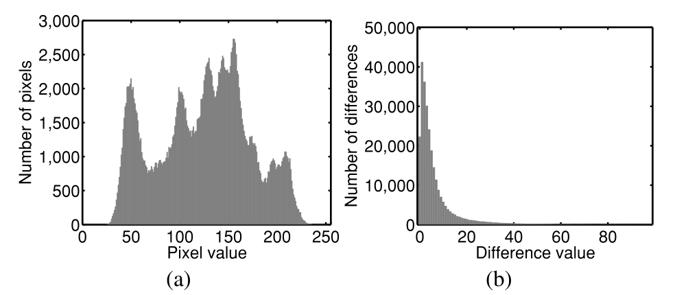
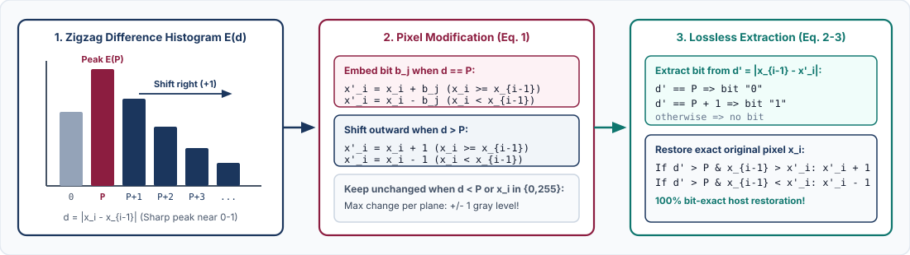
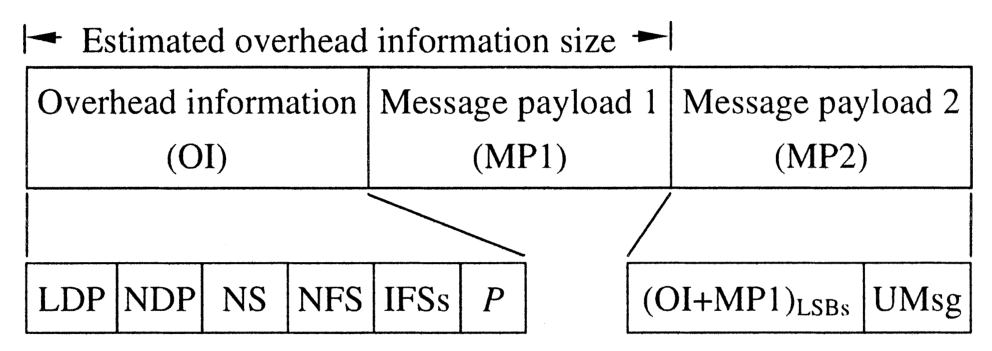
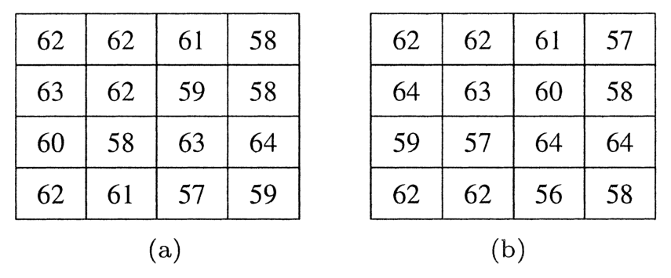
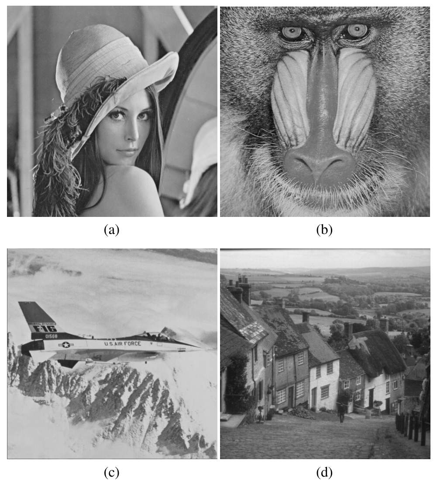
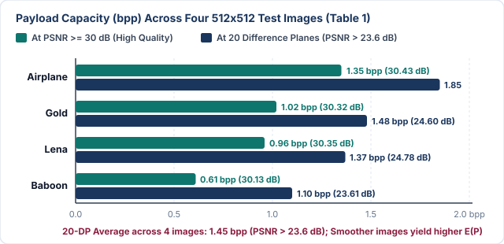
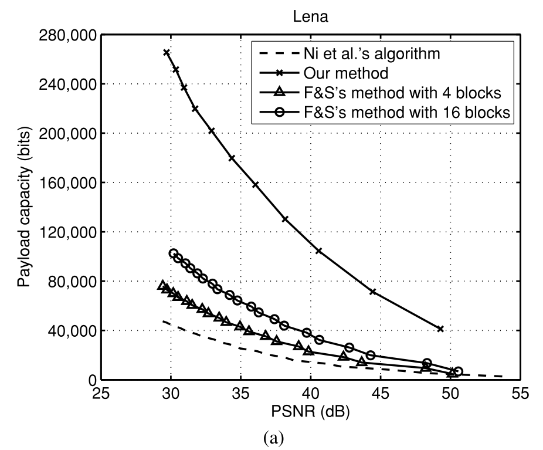
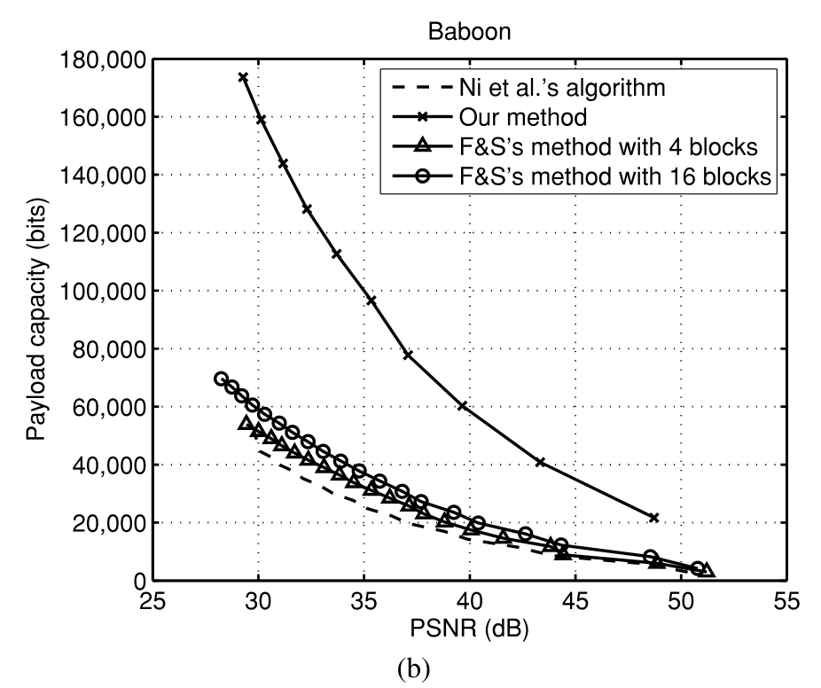

<!-- _class: lead -->

IEICE Trans. Inf. &amp; Syst. · Vol. E90-D, No. 12, pp. 2053–2059 · Dec. 2007

# 透過增加相鄰像素差值之高容量可逆式影像資訊隱藏

Hiding Data Reversibly in an Image via Increasing Differences between Two Neighboring Pixels

善用自然影像相鄰像素差值直方圖之尖銳峰值特性，結合自足式極簡額外資訊設計，實現高藏量、低失真且 100% 無失真還原之可逆式資訊隱藏方法。

<strong>林慶泉（Ching-Chiuan Lin）</strong>、<strong>薛念林（Nien-Lin Hsueh）</strong> 
逢甲大學資訊工程學系 · DOI: <code>10.1093/ietisy/e90-d.12.2053</code>

<!--
論文背景與研究定位：
- 完整出處：C.-C. Lin and N.-L. Hsueh, "Hiding data reversibly in an image via increasing differences between two neighboring pixels," IEICE Transactions on Information and Systems, Vol. E90-D, No. 12, pp. 2053-2059, Dec. 2007。
- 研究動機：在醫療影像驗證或數位典藏機密嵌入等領域，失真式隱藏將對原圖造成永久破壞；因此需要可逆式（無失真）資訊隱藏，使解碼端取出訊息後能逐位元完美還原原始影像。
- 核心創新：捨棄傳統直接平移灰階像素值直方圖的做法，改為平移「相鄰兩像素之絕對差值」直方圖（Lena 峰值由 2,729 暴增至約 40,000），並搭配以半飽和像素數量預估且自動回收多餘空間的自足式額外資訊結構，達成高容量、低失真與極低額外負擔（PSNR >= 30 dB 時 < 1,000 bits）。
-->

---

## 簡報大綱

  
1

  
<a href="#3">研究動機與既有文獻侷限</a> 醫療與典藏影像對無失真還原之需求，以及 LSB 壓縮、差值擴張與直方圖平移之瓶頸。

  
2

  
<a href="#4">核心洞見：相鄰差值峰值</a> 為何相鄰像素差值直方圖能創造高出像素值直方圖近 15 倍的單層藏量峰值。

  
3

  
<a href="#5">藏入與擷取演算法</a> Z 字形掃描、峰值 <code>P</code> 選取、公式 (1)–(3) 調整與還原，以及多差值平面迭代。

  
4

  
<a href="#6">自足式額外資訊與實例演算</a> 半飽和／新飽和像素處理、<code>OI/MP1/MP2</code> 空間回收與 4×4 影像逐步示範。

  
5

  
<a href="#8">實驗評估與效能對比</a> 四張 512×512 基準影像 20 層差值平面數據，以及對決 Ni et al. 與 F&amp;S 曲線。

  
6

  
<a href="#12">跨家族比較、限制與結論</a> 五大可逆式方法綜合評比、影像紋理敏感度與安全性討論、核心貢獻總結。

<strong>核心成果：</strong>在 <strong>PSNR ≥ 30 dB</strong> 高品質門檻下，Lena 藏量達 <strong>0.96 bpp</strong>、Baboon 達 <strong>0.61 bpp</strong>，且額外資訊小於 <strong>1,000 bits</strong>，全面領先 Ni et al. 與 Fallahpour &amp; Sedaaghi（F&amp;S）。

<!--
論文結構總覽：
- 第 1 節（緒論）：說明可逆式與失真式隱藏差異，將既有灰階影像可逆方法歸納為資料壓縮、差值擴張與直方圖平移三大類。
- 第 2 節（提出之方法）：詳述藏入流程（2.1）、額外資訊格式與飽和處理（2.2）、擷取與無失真還原流程（2.3）及 4x4 實例演練（2.4）。
- 第 3 節（實驗結果）：於 Lena、Baboon、Airplane、Gold 四張 512x512 影像測試 20 層差值平面（表 1），並與 Ni et al. [7] 及 F&S [8] 比較（圖 5 至圖 7）。
- 第 4 節（結論）：歸納本法高容量、低失真且無須原始影像即可完整還原之優勢。
-->

---

## 1. 研究動機與既有方法侷限

在<strong>醫療影像驗證</strong>（如臨床腦部圖譜浮水印）與<strong>數位典藏系統</strong>中，任何永久性像素失真皆不可接受，必須採用<strong>可逆式資訊隱藏</strong>，在取出機密後完美重建原始影像。

  <h3>1. 資料壓縮法</h3>
  
<em>Fridrich et al. (2001), Celik et al. (2005)</em> 
  無失真壓縮最低有效位元（LSB）平面以騰出空間。 
  <strong>侷限：</strong>藏量偏低，且受限於影像本身之可壓縮率。

  <h3>2. 差值擴張法（DE）</h3>
  
<em>Tian (2003), Alattar (2004)</em> 
  將相鄰像素差值倍增擴張以嵌入位元。 
  <strong>侷限：</strong>須額外儲存龐大的<em>位置圖（Location Map）</em>紀錄可擴張配對，吃掉大量有效藏量。

  <h3>3. 直方圖平移法</h3>
  
<em>Ni et al. (2006), F&amp;S (2007)</em> 
  平移像素直方圖峰值與谷值間區間騰出空位。 
  <strong>侷限：</strong>像素直方圖峰值有限；F&amp;S 切分 <code>Nb</code> 區塊雖增藏量，卻使額外資訊暴增 <code>Nb</code> 倍。

<strong>研究目標：</strong>在無須 DE 龐大位置圖、亦不引發 F&amp;S <code>Nb</code> 倍額外資訊膨脹的前提下，兼得高嵌入容量與每層至多 <code>±1</code> 灰階之極低失真。

<!--
可逆式資訊隱藏文獻分類（第 1 節）：
- 還原所需的額外資訊可存於偽裝影像外部（需維護額外檔案不便）或內部（與使用者訊息共享藏量）；本研究採完全內嵌之自足式設計。
- Ni et al. (IEEE TCSVT 2006) 實作最簡易，但自然影像像素值分布較散、單一峰值不高；F&S (IEICE ELEX 2007) 透過切塊增加局部峰值，但每塊皆須紀錄峰谷對，造成額外負擔隨區塊數線性倍增。
-->

---

## 2. 核心洞見：空間相關性創造近 15 倍峰值

  <h3>為何平移<em>相鄰差值</em>而非像素值？</h3>
  <ul class="small-text">
    <li><strong>自然影像高度平滑：</strong>沿 Z 字形掃描之相鄰像素灰階值極為接近，使差值 <code>d = |xi − xi−1|</code> 高度集中於 <code>0</code> 與 <code>1</code>。</li>
    <li><strong>Ni et al. 像素直方圖（Lena）：</strong>最高峰值不超過 <strong>2,729 個像素</strong>，每回合藏量上限極低。</li>
    <li><strong>本研究差值直方圖（Lena）：</strong>峰值 <code>P = 1</code> 高達 <strong>約 40,000 對像素</strong>，單層差值平面藏量暴增近 <strong>15 倍</strong>！</li>
    <li><strong>維持極簡失真邊界：</strong>單層藏入每像素至多異動 <code>±1</code> 灰階，免去複雜整數轉換與全圖位置圖。</li>
  </ul>

  
  
論文圖 6：Lena 直方圖比較—(a) Ni et al. 峰值 ≤ 2,729 vs. (b) 本研究差值峰值 ≈ 40,000（<code>P = 1</code>）。

<!--
統計特性與核心洞見（第 1 節與第 3 節、圖 6）：
- 一張 512×512 灰階影像共有 262,143 組 Z 字形相鄰像素對。由於自然影像局部連續，相鄰差值直方圖 E(d) 呈現極尖銳的集中峰，遠高於分散於 [0, 255] 的像素值直方圖。
- 若有多個差值同為最大峰值，演算法會挑選較大之 P，以減少需要向外平移的像素數（d > P）並進一步降低影像失真。
-->

---

## 3. 藏入與無失真擷取核心機制

  <h3>多差值平面（Multi-DP）迭代藏入</h3>
  
若單一差值平面容量不足以容納全部 <code>n</code> 位元訊息，則重複步驟 1 至 4 跨越多層<strong>差值平面</strong>，直至訊息藏畢或影像品質達預定 PSNR 下限。

  <h3>循序零誤差還原</h3>
  
解碼端以<em>相同 Z 字形順序</em>掃描：處理像素 <code>x'i</code> 前，前一像素 <code>xi−1</code> 已精確復原，故計算 <code>|xi−1 − x'i|</code> 即可 <strong>100% 無誤</strong>取出 <code>bj</code> 並還原 <code>xi</code>。

<!--
藏入與擷取數學規則（第 2.1 與 2.3 節、公式 1 至 3）：
- 藏入（公式 1）：針對非飽和像素（x_i ∉ {0, 255}），若 |x_i - x_{i-1}| == P，依欲藏位元 b_j ∈ {0, 1} 調整為 x_i ± b_j（大於等於前像素加 b_j，小於則減 b_j）；若 |x_i - x_{i-1}| > P 則向外平移 ±1 騰出空隙；小於 P 則維持不變。
- 擷取（公式 2 至 3）：對非飽和像素（1 <= x'_i <= 254）或紀錄於額外資訊的新飽和像素，若 |x_{i-1} - x'_i| == P 取出 0、等於 P+1 取出 1；凡大於 P 者向內平移 ±1 即恢復原值 x_i。
-->

---

## 3.2 飽和像素防溢位與自足式額外資訊

論文圖 1：單一差值平面自足式配置—將影像劃分為 <code>OI</code>、<code>MP1</code> 與 <code>MP2</code> 三區。

  <h3>杜絕上溢／下溢（Overflow/Underflow）歧義</h3>
  <ul class="small-text">
    <li><strong>飽和像素（<code>0</code> 或 <code>255</code>）：</strong>藏入過程一律略過不動。</li>
    <li><strong>半飽和像素（<code>1</code> 或 <code>254</code>）：</strong>經公式 (1) 調整後若落入 <code>{0, 255}</code>，記錄為<strong>新飽和像素（Fresh Saturation）</strong>。</li>
    <li><strong>精準空間上界：</strong>因 <code>NFS ≤ NS</code>，預估額外資訊 <code>v = |LDP| + |NDP| + |NS| + |NFS| + |P| + NS × u</code> bits，保留前 <code>w' = ⌈v / α⌉</code> 像素必足夠！</li>
  </ul>

  <h3>零浪費空間回收機制</h3>
  <ul class="small-text">
    <li><strong>步驟 A：</strong>先將前 <code>w'</code> 像素原始 LSB 與使用者訊息 <code>UMsg</code> 串接，以差值平移藏入 <code>MP2</code>。</li>
    <li><strong>步驟 B：</strong>以每像素 <code>α</code> 位元 LSB 替換將實際額外資訊寫入 <code>OI</code>（前 <code>w</code> 像素）；未用完的 <code>w..w'−1</code> 像素（<code>MP1</code>）立即回收塞入剩餘訊息！</li>
    <li><strong>K 層總有效藏量：</strong><code>C = Σk=1..K [S(MP2k) + S(MP1k) − S(OIk)]</code>。</li>
  </ul>

<!--
額外資訊欄位與空間管理（第 2.2 節、圖 1 至圖 2）：
- OI 欄位定義：LDP（1 bit，是否為最後一層差值平面）、NDP（8 bits，總差值平面數，僅 LDP=1 時有效，因單一像素最多加減不逾 255 次）、NS（半飽和像素總數）、NFS（實際產生之新飽和像素數）、IFSs（各新飽和像素之索引，每筆 u = ceil(log2 N) bits）、P（8 bits 峰值差值）。
- 由於多數自然影像在前數層幾乎不存在半飽和像素，OI 極為短小，完全免除差值擴張法龐大的位置圖負擔。
-->

---

## 3.3 實例推演：額外資訊精算與 4×4 像素追蹤

  <h3>512×512 額外資訊實例（論文圖 3）</h3>
  <ul class="small-text">
    <li>條件：<code>512 × 512</code>（索引寬 <code>u = ⌈log2 262144⌉ = 18</code> bits）、<code>α = 2</code> LSB／像素、共 5 層（<code>LDP = 1</code>）、<code>NS = 3</code>、<code>P = 1</code>。</li>
    <li><code>NS</code>／<code>NFS</code> 欄位寬度：<code>⌈log2(262144 / 18)⌉ = 14</code> bits。</li>
    <li><strong>預估 <code>v</code>：</strong><code>1 + 8 + 14 + 14 + 3×18 + 8 = 99 bits</code>（預留前 <code>w' = 50</code> 像素）。</li>
    <li><strong>實際 <code>OI</code>（僅遇 2 處新飽和 @ 105, 3658）：</strong>實耗 <code>81 bits</code> ➔ 多出的 <strong>18 bits</strong> 全數歸還 <code>MP1</code> 藏入使用者訊息！</li>
  </ul>

  

    
    
論文圖 4：4×4 原圖 (a) 與於 <code>P = 1</code> 藏入 <code>01100</code> 後之偽裝圖 (b)。

  

  

    <strong>4×4 逐步追蹤（<code>P = 1, E(1) = 5</code>）：</strong> 
    • <code>|x2−x1|=|61−62|=1</code>，藏入 <code>0</code> ➔ 維持 <code>61</code>。 
    • <code>|x3−x2|=|58−61|=3&gt;1</code>（<code>x3&lt;x2</code>）➔ 向外平移 <code>58 ➔ 57</code>。 
    • <code>|x5−x4|=|59−58|=1</code>，藏入 <code>1</code>（<code>x5&gt;x4</code>）➔ <code>59 ➔ 60</code>。
  

<!--
完整實例解析（第 2.2 與 2.4 節、圖 3 至圖 4）：
- 圖 3 示範最後一層差值平面藏入流程：(1) 先將前 50 像素的 99 bits 原始 LSB 與 UMsg 透過差值平移藏入 MP2；(2) 將實際 81 bits 額外資訊以 LSB 替換寫入 OI；(3) 將剩餘 18 bits 使用者訊息以 LSB 替換寫入 MP1。解碼端讀完 OI 後，由 NS - NFS = 1 立即得知 MP1 含 18 bits 訊息，復原 MP2 後再將 (OI+MP1)_LSBs 寫回前 50 像素，完美還原該層。
- 圖 4 示範 4x4 區塊藏入 01100 與還原流程，解碼時 x'_3 = 57 因 |61 - 57| = 4 > 1 且 61 > 57 故加 1 還原為 58；x'_5 = 60 因 |58 - 60| = 2 = P + 1 故取出位元 1 並減 1 還原為 59。
-->

---

## 4. 實驗環境與標準測試影像

  <h3>實驗設計規格（論文第 3 節）</h3>
  <ul class="small-text">
    <li><strong>實作平台：</strong>以 <strong>Java</strong> 實作本研究方法、Ni et al. [7] 與 F&amp;S [8]（4 區塊與 16 區塊版本）。</li>
    <li><strong>測試影像：</strong>四張標準 <code>512 × 512</code> 8 位元灰階基準影像，涵蓋平滑至高紋理場景：<strong>Lena</strong>、<strong>Baboon</strong>、<strong>Airplane</strong> 與 <strong>Gold</strong>。</li>
    <li><strong>統計穩健性：</strong>每組數據均為 Java <code>Math.random()</code> 隨機產生之 <strong>100 組位元串</strong> 平均值。</li>
    <li><strong>影像品質指標（PSNR）：</strong></li>
  </ul>
  
PSNR = 10 × log10( [255² × N] / Σi=0..N−1 (xi − yi)² ) dB

  
藏量單位為 <strong>每像素位元數（bpp）</strong>，最高評估至 20 層差值平面。

  
  
論文圖 5：四張 512×512 灰階基準影像—(a) Lena、(b) Baboon、(c) Airplane、(d) Gold。

<!--
實驗設計背景（第 3 節、圖 5）：
- 四張影像代表截然不同的空間紋理複雜度：Airplane 與 Gold 具大片平滑區，Lena 屬平滑與邊緣均衡之人像，Baboon 則為高頻毛髮紋理極度複雜的嚴苛測試樣本。
- 取 100 組隨機位元串之平均值可消除單次訊息 0/1 比例偏差，客觀呈現 PSNR 與藏量之真實權衡曲線。
-->

---

## 4.2 多差值平面藏量與 PSNR 表現（前 20 層）

  <table>
    <thead><tr><th>層數</th><th>Lena (dB / bpp)</th><th>Baboon</th><th>Airplane</th><th>Gold</th></tr></thead>
    <tbody>
      <tr><td><strong>1</strong></td><td>49.28 / 0.16</td><td>48.72 / 0.08</td><td>50.46 / 0.26</td><td>49.46 / 0.18</td></tr>
      <tr><td><strong>5</strong></td><td>36.05 / 0.60</td><td>35.34 / 0.37</td><td>36.41 / 0.87</td><td>36.17 / 0.64</td></tr>
      <tr><td><strong>9</strong></td><td>30.94 / 0.90</td><td><strong>30.13 / 0.61</strong></td><td>31.37 / 1.28</td><td>31.31 / 0.95</td></tr>
      <tr><td><strong>10</strong></td><td><strong>30.35 / 0.96</strong></td><td>29.28 / 0.66</td><td><strong>30.43 / 1.35</strong></td><td><strong>30.32 / 1.02</strong></td></tr>
      <tr><td><strong>15</strong></td><td>27.16 / 1.20</td><td>25.84 / 0.90</td><td>27.31 / 1.63</td><td>27.04 / 1.27</td></tr>
      <tr><td><strong>20</strong></td><td>24.78 / 1.37</td><td>23.61 / 1.10</td><td>25.20 / 1.85</td><td>24.60 / 1.48</td></tr>
    </tbody>
  </table>
  

    <strong>亮點數據：</strong>第 1 層 PSNR 高達 <strong>48.7–50.5 dB</strong>；推進至 20 層時四圖平均藏量達 <strong>1.45 bpp</strong>，且全數 PSNR 維持於 <strong>23.6 dB 以上</strong>。
  

  
  
整理自論文表 1：PSNR ≥ 30 dB 門檻與 20 層差值平面下之藏量（bpp）表現。

<!--
表 1 量化結果解析（第 3 節）：
- 單層（DP=1）藏入即可達 0.08 至 0.26 bpp（約 2.1 萬至 6.8 萬 bits），而 PSNR 介於 48.72 至 50.46 dB，肉眼完全無法察覺任何變化。
- 在實務高品質門檻 PSNR >= 30 dB 下，Airplane 達 1.35 bpp（第 10 層）、Gold 達 1.02 bpp（第 10 層）、Lena 達 0.96 bpp（第 10 層），即便最複雜的 Baboon 亦達 0.61 bpp（第 9 層）。
-->

---

## 4.3 新飽和額外負擔與影像平滑度效應

  
&lt; 1,000 bits

  
PSNR ≥ 30 dB 時之總額外資訊量（與 Ni et al. 同級，遠低於 F&amp;S）

  
0 處新飽和

  
四張測試影像於最初數層差值平面均未出現任何半飽和像素

  
1.35 vs. 0.61 bpp

  
平滑影像（Airplane）於 ≥ 30 dB 之藏量為高紋理影像（Baboon）逾 2 倍

| 基準影像 | 紋理平滑程度 | 20 層累計新飽和像素數 | PSNR ≥ 30 dB 藏量 | 20 層總藏量 |
| :--- | :--- | :---: | :---: | :---: |
| **Airplane** | 高度平滑（大面積機身／天空） | **0** | **1.35 bpp**（30.43 dB） | **1.85 bpp**（25.20 dB） |
| **Gold** | 中度平滑 | **35** | **1.02 bpp**（30.32 dB） | **1.48 bpp**（24.60 dB） |
| **Lena** | 均衡人像 | **2** | **0.96 bpp**（30.35 dB） | **1.37 bpp**（24.78 dB） |
| **Baboon** | 高度複雜（細密毛髮紋理） | **111** | **0.61 bpp**（30.13 dB） | **1.10 bpp**（23.61 dB） |

<strong>極致空間利用率：</strong>即便累積藏入 20 層，Lena 僅產生 <strong>2</strong> 個新飽和像素（36 bits 索引）、Airplane 甚至為 <strong>0</strong>，使絕大多數有效空間皆歸使用者機密訊息專用。

<!--
額外負擔與紋理關聯分析（第 2.2 與第 3 節）：
- 論文特別指出，在最初數層差值平面中四張測試影像皆無半飽和像素，故幾乎不須紀錄任何 IFSs 索引。
- 即使累積至 20 層，四張影像的新飽和總數分別僅為 Lena 2、Baboon 111、Airplane 0、Gold 35；以 Baboon 為例，111 筆 18-bit 索引約佔 2,000 bits，相較 20 層近 29 萬 bits 的總藏量佔比不到 0.7%。
-->

---

## 4.4 效能正面對決：Lena 與 Baboon 曲線比較

  
  
論文圖 7(a)：<strong>Lena</strong> — 本研究（30 dB 約 252k bits）vs. F&amp;S-16（~102k）、F&amp;S-4（~78k）、Ni et al.

  
  
論文圖 7(b)：<strong>Baboon</strong> — 本研究（30 dB 約 160k bits）vs. F&amp;S-16（~69k）、F&amp;S-4（~54k）、Ni et al.

<strong>全區間壓倒性領先：</strong>於 <strong>PSNR ≈ 30 dB</strong> 下，本研究藏量在 Lena 約為 F&amp;S（16 塊）的 <strong>2.5 倍</strong>（~252k vs. ~102k bits），在 Baboon 亦達 <strong>2.3 倍</strong>（~160k vs. ~69k bits），且額外負擔遠更輕巧（&lt; 1,000 bits）。

<!--
基準曲線深度解讀（第 3 節、圖 7）：
- 圖 7 顯示在所有 PSNR 品質區間（30 至 50 dB），本研究曲線均顯著高於 Ni et al. [7] 與 F&S [8]（4 區塊及 16 區塊）。
- 以 Lena 在 40 dB 為例，本法可藏約 105,000 bits，而 F&S-16 僅約 35,000 bits（達 3 倍優勢）；即便在紋理極度複雜的 Baboon 上，本法依然維持逾兩倍容量領先。
-->

---

## 5. 五大可逆式資訊隱藏方法綜合比較

| 方法家族 | 核心技術機制 | 藏入容量 | 額外資訊負擔 | 影像品質（PSNR） | 實作複雜度 |
| :--- | :--- | :---: | :---: | :---: | :---: |
| **LSB 壓縮法**（Fridrich, Celik） | 無失真壓縮 LSB 平面 | 低 | 壓縮標頭 | 高 | 中 |
| **差值擴張法**（Tian, Alattar） | 像素對差值倍增 <code>2d + b</code> | 高 | **極高**（位置圖） | 中～高 | 高 |
| **直方圖平移法**（Ni et al., 2006） | 平移像素灰階直方圖 | 低～中 | 極低（&lt; 1k bits） | 極高 | 極低 |
| **區塊直方圖平移**（F&amp;S, 2007） | 切分 <code>Nb</code> 區塊套用 Ni et al. | 中 | 高（<code>Nb</code> 倍膨脹） | 高 | 低 |
| **本研究相鄰差值平移（2007）** | **平移 Z 字形相鄰像素差值直方圖** | **極高（30 dB 達 0.96 bpp）** | **極低（30 dB &lt; 1k bits）** | **高（DP1 達 49 dB）** | **極低** |

<strong>黃金平衡點：</strong>透過將平移對象從「像素值」改為「相鄰像素差值」，本法保留了 Ni et al. 的極簡實作與超低額外資訊，同時釋放出媲美差值擴張法的高嵌入容量。

<!--
跨家族技術總評（第 1、3、4 節）：
- 本表凸顯研究在「藏量—失真—額外資訊」三角權衡中的突破位置：
  - 相較 LSB 壓縮與 Ni et al.，藏量提升一個數量級；
  - 相較差值擴張法（DE），免除龐大位置圖與 ±2d 劇烈灰階跳動；
  - 相較區塊式 F&S，避免額外資訊隨區塊數線性放大，並於相同 PSNR 下取得逾兩倍藏量。
-->

---

## 6. 討論、研究限制與實務考量

  <h3>方法侷限與邊界條件</h3>
  <ul class="small-text">
    <li><strong>影像紋理敏感度：</strong>藏量高度取決於差值峰值 <code>E(P)</code>；高紋理影像（Baboon：0.61 bpp）在 30 dB 下之藏量較平滑影像（Airplane：1.35 bpp）少約 55%。</li>
    <li><strong>多層累積失真：</strong>疊加至 15–20 層差值平面時，像素累積位移將使 PSNR 降至 23.6–27.3 dB，僅適用高容量優先之場景。</li>
    <li><strong>對失真處理具脆弱性：</strong>還原仰賴精準的 <code>OI</code> LSB 與 <code>±1</code> 差值關係，若遭 JPEG 壓縮或裁切將無法無失真還原（屬脆弱型驗證浮水印特性）。</li>
  </ul>

  <h3>設計優勢與延伸方向</h3>
  <ul class="small-text">
    <li><strong>完全自足還原：</strong>不須任何外部輔助檔案，全部還原參數（<code>LDP, NDP, NS, NFS, IFSs, P</code>）皆內嵌於偽裝影像中。</li>
    <li><strong>零浪費空間回收：</strong>未用完之預估額外空間（<code>w' − w</code> 像素）自動轉作 <code>MP1</code> 藏入使用者資料。</li>
    <li><strong>後續演進方向：</strong>
      <ul>
        <li>導入二維空間預測器（如 MED／GAP）進一步拉高預測誤差直方圖峰值。</li>
        <li>延伸至彩色通道（RGB／YCbCr）與醫療 DICOM 影像驗證系統。</li>
      </ul>
    </li>
  </ul>

<!--
批判性反思與實務定位（第 2 至 4 節）：
- 脆弱性在醫療影像與數位典藏驗證中反而是優勢：任何未經授權的竄改都會即時破壞還原校驗，達成完整性驗證目標。
- 本篇以一維 Z 字形相鄰差值奠基，日後學界進一步發展出「預測誤差直方圖平移（Prediction-Error Histogram Shifting, PEHS）」即為此思路之自然二維推廣。
-->

---

## 7. 結論與核心貢獻

  
峰值暴增 ~15 倍

  
Lena 差值直方圖峰值達約 40,000，遠勝 Ni et al. 像素直方圖之 2,729

  
0.96 / 1.45 bpp

  
Lena 於 PSNR ≥ 30 dB 達 0.96 bpp；20 層四圖平均藏量達 1.45 bpp

  
100% 無失真還原

  
不須原始影像即可逐位元完美重建，且 30 dB 時額外資訊 &lt; 1,000 bits

  <h3>三大核心結論</h3>
  <ol class="small-text">
    <li><strong>善用局部空間相關性：</strong>針對<em>相鄰像素差值</em>進行直方圖峰值藏入與平移，能以極簡規則同步達成高藏量與每層至多 <code>±1</code> 灰階之低失真。</li>
    <li><strong>自足式零浪費額外資訊：</strong>以半飽和像素數 <code>NS</code> 精準預估 <code>OI</code> 上界並將多餘空間回收至 <code>MP1</code>，徹底擺脫龐大位置圖束縛。</li>
    <li><strong>全面領先之率失真效能：</strong>在平滑與複雜影像之各 PSNR 區間均顯著超越 Ni et al. 與 F&amp;S，極具醫療影像驗證與機密典藏實用價值。</li>
  </ol>

<!--
結論總結（第 4 節）：
- 本研究提出一種兼具高藏量、低失真與實作簡潔性的可逆式影像資訊隱藏方法，無須任何原始影像資訊即可完整萃取秘密訊息並無失真還原原圖。
- 實驗於四張 512×512 標準影像充分驗證其率失真優勢（PSNR >= 30 dB 時 Lena 達 0.96 bpp、Baboon 達 0.61 bpp、Airplane 達 1.35 bpp、Gold 達 1.02 bpp），顯著超越 Ni et al. 與 F&S 基準方法。
-->

---

<!-- _class: closing -->

# 感謝聆聽！敬請指教

透過增加相鄰像素差值之高容量可逆式影像資訊隱藏 
Hiding Data Reversibly in an Image via Increasing Differences between Two Neighboring Pixels

<strong>林慶泉（Ching-Chiuan Lin）</strong> · <code>cclin@ocit.edu.tw</code> &nbsp;|&nbsp; <strong>薛念林（Nien-Lin Hsueh）</strong> · <code>nlhsueh@fcu.edu.tw</code> 
逢甲大學資訊工程學系（Department of Information Engineering and Computer Science, FCU） 
IEICE Trans. Inf. &amp; Syst., Vol. E90-D, No. 12, pp. 2053–2059, Dec. 2007 · DOI: 10.1093/ietisy/e90-d.12.2053

<!--
文獻與歸檔資訊：
- 篇名：Hiding Data Reversibly in an Image via Increasing Differences between Two Neighboring Pixels
- 作者：林慶泉（Ching-Chiuan Lin）、薛念林（Nien-Lin Hsueh）
- 單位：逢甲大學資訊工程學系
- 期刊：IEICE Transactions on Information and Systems, Vol. E90-D, No. 12, pp. 2053-2059, December 2007
- DOI：10.1093/ietisy/e90-d.12.2053
- 關鍵字：資訊隱藏、隱寫術、可逆式資訊隱藏
-->

