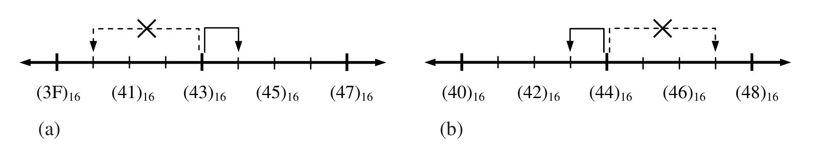
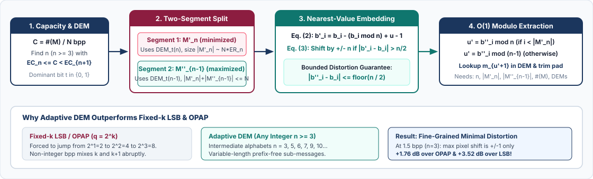
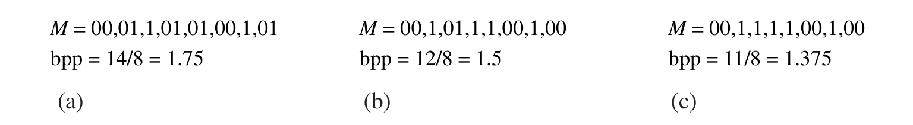
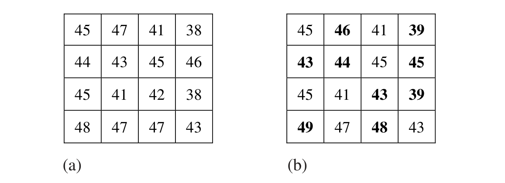
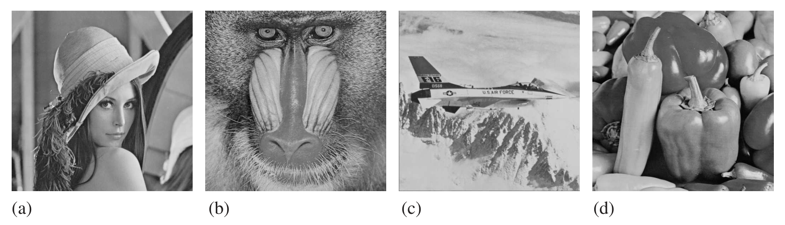
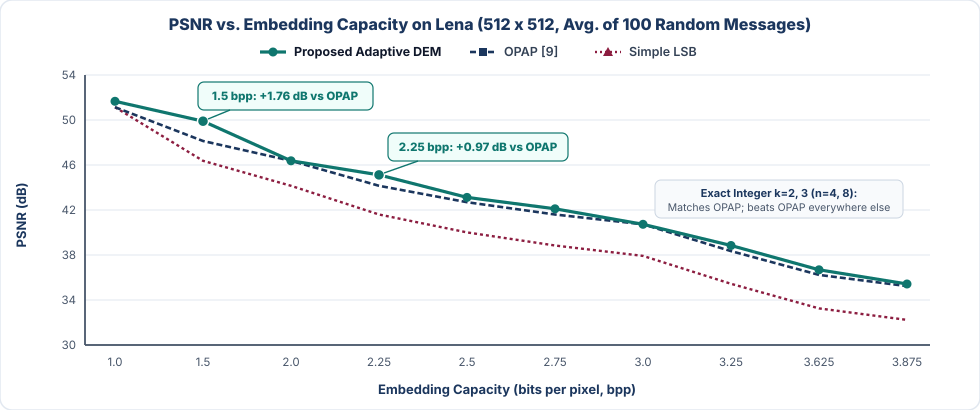

<!-- _class: lead -->

Fundamenta Informaticae · Vol. 84, pp. 1–12 · 2008 (IOS Press)

# Adaptively Embedding Binary Data in an Image

Minimizing Stego-Image Distortion via <strong>Two-Segment Variable-Length Message Decomposition</strong> and <strong>Nearest-Neighbor Pixel Adjustment</strong>

<strong>Ching-Chiuan Lin*</strong>, <strong>Nien-Lin Hsueh</strong>, and <strong>Wen-Hsiang Shen</strong> 
Department of Information Engineering and Computer Science, Feng Chia University, Taichung 40724, Taiwan, ROC 
<code>cclin@ocit.edu.tw</code> · <code>nlhsueh@fcu.edu.tw</code> · <code>shen@ocit.edu.tw</code>

Keywords: Information hiding · LSB · Directory of Elementary Messages (DEM) · Optimal Pixel Adjustment Process (OPAP)

<!--
Bibliographic & Research Overview:
This paper (Lin, Hsueh, & Shen, Fundamenta Informaticae 84, 2008, pp. 1–12, IOS Press) proposes a high-visual-quality adaptive binary data hiding algorithm for grayscale host images.

Core Research Idea:
Conventional spatial-domain methods such as simple LSB substitution and Optimal Pixel Adjustment Process (OPAP) embed a fixed integer number k of bits per pixel (effective alphabet size q = 2^k). When the target embedding capacity C lies between integer bit counts (e.g., 1.5, 2.25, or 3.375 bpp), fixed-k methods must either waste pixel capacity or abruptly mix k-bit and (k+1)-bit embeddings. The proposed scheme instead divides the binary message M into two segments and decomposes them into n and n-1 types of variable-length elementary sub-messages (n >= 3) using a Directory of Elementary Messages (DEM). Each host pixel then embeds one sub-message by shifting to its nearest congruence class modulo n (or n-1), bounding pixel distortion to at most floor(n/2).
-->

---

## Presentation Outline

  
1

  
<a href="#3">Introduction & Motivation</a> Visual quality vs. capacity trade-off and why fixed 2k alphabets cause excess distortion.

  
2

  
<a href="#4">Related Work & OPAP Baseline</a> PVD, modulus hiding, LSB matching, EMD, simple LSB substitution, and Chan–Cheng OPAP.

  
3

  
<a href="#6">Proposed Adaptive DEM Algorithm</a> Directory of Elementary Messages (DEM), two-segment split, Eqs. (2)–(8), and 4×4 walkthrough.

  
4

  
<a href="#10">Experimental Setup & Results</a> Evaluation on Lena, Baboon, Airplane, and Pepper across 1.0 to 3.875 bpp (Tables 2–4).

  
5

  
<a href="#13">Distortion Mechanism Analysis</a> Why adaptive n-ary alphabets outperform OPAP at fractional bpp and match OPAP at k = 2, 3.

  
6

  
<a href="#14">Conclusions & Practical Impact</a> Summary of contributions, side-information footprint, and target steganographic applications.

<!--
Structural Navigation:
The paper is organized into five sections: Section 1 introduces image steganography and surveys spatial-domain alternatives; Section 2 reviews simple LSB substitution and Chan & Cheng's OPAP [9]; Section 3 formally defines DEM_t(n), the expected capacity formula EC_n, the 8-step adaptive two-segment embedding algorithm, the modulo extraction procedure, and a complete 4x4 grayscale worked example; Section 4 reports Java/Windows XP experimental comparisons over 100 random messages per capacity on four 512x512 test images; Section 5 summarizes the bounded-distortion guarantee and conclusions.
-->

---

## 1. Introduction & Motivation

<h3>The Steganographic Quality–Capacity Dilemma</h3>
<ul>
  <li><strong>Applications:</strong> Intellectual property protection, confidential communication, and medium annotation.</li>
  <li><strong>Core requirement:</strong> Modify the cover (host) image as little as possible so the stego-image remains visually imperceptible.</li>
  <li><strong>Fixed-k bottleneck:</strong> Simple LSB and OPAP replace <code>k</code> bits per pixel, restricting the per-pixel alphabet size to powers of two (<code>2k ∈ {2, 4, 8, 16}</code>).</li>
  <li><strong>Coarse granularity:</strong> For non-integer capacities (e.g., 1.5 or 2.25 bpp), fixed-k schemes suffer unnecessary pixel value jumps.</li>
</ul>

<h3>Our Adaptive Decomposition Insight</h3>
<ul>
  <li><strong>Break the fixed-bit constraint:</strong> Each pixel does <em>not</em> need to embed an identical number of bits.</li>
  <li><strong>Adaptive n-ary alphabet (n ≥ 3):</strong> Decompose binary message <code>M</code> into variable-length elementary sub-messages chosen by target capacity <code>C = #(M)/N</code>.</li>
  <li><strong>Two-segment minimization:</strong> Split <code>M</code> into <code>M'n</code> (minimized) and <code>M''n−1</code> (maximized) so most pixels use the smaller alphabet <code>n−1</code>.</li>
  <li><strong>Minimal pixel shift:</strong> Map each pixel to its nearest congruent neighbor, bounding error to <code>±⌊n/2⌋</code>.</li>
</ul>

<strong>Key Result:</strong> At 1.5 bpp, our scheme selects <code>n = 3</code> (max pixel change ±1) and achieves <strong>49.89 dB</strong> PSNR—surpassing OPAP by <strong>+1.76 dB</strong> and simple LSB by <strong>+3.52 dB</strong>.

<!--
Research Motivation (Section 1):
In spatial-domain image hiding, both direct LSB replacement and pixel-value adjustment alter host pixels and introduce distortion. While replacing k LSBs is straightforward, k is restricted to integers (typically k <= 4 for acceptable visual quality). Consequently, the number of representable states per pixel jumps exponentially (2, 4, 8, 16). By generalizing per-pixel states to arbitrary integers n >= 3 via prefix-free variable-length sub-message directories (DEM) and splitting M across n and n-1 states, the algorithm continuously adapts to any payload length #(M) and host image size N while minimizing squared error.
-->

---

## 2. Related Work: Spatial-Domain Data Hiding

| Category | Representative Works | Core Mechanism | Key Limitation Addressed by Our Method |
| :--- | :--- | :--- | :--- |
| **Pixel-Value Differencing (PVD)** | Wu & Tsai [4]; Wu et al. [5]; Chang et al. [6] | Embeds variable bits in neighboring pixel differences via predefined ranges `{0–7, 8–15, ...}` | Low capacity (< 1.6 bpp) and lower PSNR (< 42 dB); requires predefined range tables |
| **Modulus Function** | Wang [7]; Chang et al. [8] | Sets `y' = y − (y mod q) + x` with `±q` adjustment when `|y' − y| > q/2` | Requires `q = 2^k` for binary messages; equivalent to OPAP when `q = 2^k` |
| **LSB Matching & EMD** | Mielikainen [10]; Zhang & Wang [11] | Pairwise LSB matching (mod prob. 0.375); `(2R+1)`-ary EMD changes at most 1 pixel by ±1 in `R`-pixel block | Capacity strictly capped at 1 bpp [10] or `(log2(2R+1))/R` bpp [11] |
| **Block-Difference Image Hiding** | Li et al. [12]; Wang & Chen [13] | Matches smooth secret image blocks to host blocks or compresses via two-way matching | Restricted to hiding secret images; unsuitable for arbitrary binary bit streams |
| **LSB & OPAP** | Chan & Cheng [9] | Direct `k`-bit LSB substitution followed by optimal `±2^k` adjustment | Restricted to power-of-two alphabets `2^k`; suboptimal at fractional bpp |

<!--
Literature Positioning (Section 1):
The paper contrasts five families of spatial-domain schemes:
1. PVD-based schemes [4, 5, 6]: Wu & Tsai (2003) map difference ranges {0-7, 8-15, 16-31, 32-63, 64-127, 128-255} to bit lengths {3, 3, 4, 5, 6, 7}, yielding < 1.6 bpp and < 42 dB. Wu et al. (2005) hybridize LSB for differences < 16 with PVD otherwise, and Chang et al. (2006) use preceding-pixel differences to select k.
2. Modulus-function schemes [7, 8]: Achieve OPAP-like adjustment for modulus q, but embedding raw binary streams forces q = 2^k.
3. Low-distortion low-payload schemes [10, 11]: Mielikainen's LSB matching lowers modification probability from 0.5 to 0.375 at 1 bpp; Zhang & Wang's Exploiting Modification Direction (EMD) embeds a (2R+1)-ary digit per R pixels with capacity at most log2(2R+1)/R bpp (max ~1.16 bpp at R=2).
4. Secret-image-only schemes [12, 13]: Exploit spatial smoothness of secret images and cannot embed arbitrary binary messages.
Our algorithm bridges arbitrary binary payloads with fine-grained n-ary modulus embedding across wide capacities (1.0 to 3.875+ bpp).
-->

---

## 2. Baseline: Simple LSB Substitution & OPAP [9]

<h3>Simple LSB Substitution</h3>

y' = y − (y mod 2k) + m &nbsp;&nbsp;(Eq. 1) 
Extraction: m = y' mod 2k &nbsp;(typically k ≤ 4)

<ul class="small-text">
  <li>Replaces the <code>k</code> least significant bits of host pixel <code>y</code> directly with <code>k</code>-bit message <code>m</code>.</li>
  <li>Maximum pixel error can reach <code>2k − 1</code> (e.g., error −3 when <code>k = 2</code>).</li>
</ul>

<h3>Chan &amp; Cheng's OPAP [9]</h3>
<ul class="small-text">
  <li>Let <code>di = b'i − bi</code> after LSB substitution:</li>
  <li>If <code>−2k &lt; di &lt; −2k−1</code> and <code>b'i &lt; 256 − 2k</code> ➔ add <code>2k</code>.</li>
  <li>If <code>2k−1 &lt; di &lt; 2k</code> and <code>b'i ≥ 2k</code> ➔ subtract <code>2k</code>.</li>
  <li>Otherwise keep <code>b'i</code> unchanged ➔ halves worst-case error to <code>±2k−1</code>.</li>
</ul>

Figure 1 (Paper p. 4): Examples of OPAP for k = 2 — (a) Embedding (00)2 into (43)16 shifts (40)16 up to (44)16 (error −3 ➔ +1); (b) Embedding (11)2 into (44)16 shifts (47)16 down to (43)16.

<!--
Detailed Mechanics of Baselines (Section 2):
Chan and Cheng (2004) [9] improve simple LSB substitution by observing that adding or subtracting 2^k preserves the k least significant bits (so extraction m = b'_i mod 2^k remains untouched) while pulling the stego-pixel closer to the original host pixel b_i.
In Figure 1(a), with k = 2 and b_i = (01000011)_2 = (43)_16 = 67, embedding m = (00)_2 via simple LSB gives b'_i = (01000000)_2 = (40)_16 = 64, yielding d_i = -3. Because -4 < d_i < -2 and b'_i < 252, OPAP adds 2^2 = 4 to obtain (01000100)_2 = (44)_16 = 68, cutting |d_i| from 3 down to 1. Figure 1(b) shows the symmetric case: embedding (11)_2 into (44)_16 = 68 yields (47)_16 = 71 (d_i = +3), which OPAP pulls down by 4 to (43)_16 = 67 (d_i = -1). Our proposed Eqs. (2)-(3) generalize this exact nearest-neighbor adjustment from power-of-two moduli 2^k to arbitrary integers n >= 3.
-->

---

## 3. Proposed Method: Adaptive Two-Segment DEM Pipeline

<strong>Core Philosophy:</strong> Maximize the number of sub-messages (using all <code>N</code> host pixels) while minimizing the number of sub-message types <code>n</code>, keeping every pixel inside <code>{bi − ⌊n/2⌋, ..., bi + ⌊n/2⌋}</code>.

<!--
Architecture Overview (Section 3):
The proposed algorithm decouples binary message encoding from pixel-value modification through four stages:
1. Capacity & DEM Selection: Compute required capacity C = #(M)/N, select the smallest integer n >= 3 satisfying EC_n <= C < EC_{n+1}, and detect whether bit "1" or "0" dominates M to pick DEM_1(n) or DEM_0(n).
2. Two-Segment Decomposition: If |M_n| > N (due to bit-stream permutation variance), increment n by 1. Then split M = M'_n || M''_{n-1} so that |M'_n| + |M''_{n-1}| <= N with |M'_n| minimized (approximated by N * ER_n).
3. Nearest-Neighbor Pixel Embedding: Sequentially embed M'_n using modulus n and M''_{n-1} using modulus n-1 via Eqs. (2)-(3), guaranteeing |b''_i - b_i| <= floor(n/2) for non-oversaturated pixels.
4. O(1) Modulo Extraction: Recover sub-message index u = (b''_i mod n) + 1 (or mod (n-1)), look up m_u in the DEM, concatenate, and strip any trailing padding bits beyond #(M).
-->

---

## 3. Directory of Elementary Messages (DEM) & Expected Capacity

| Sub-msg | `n = 3` (`DEM1` / `DEM0`) | `n = 4` (`DEM1` / `DEM0`) | `n = 5` (`DEM1` / `DEM0`) | `n = 6` (`DEM1` / `DEM0`) | `n = 7` (`DEM1` / `DEM0`) |
| :--- | :---: | :---: | :---: | :---: | :---: |
| `m1` | `0` / `1` | `00` / `11` | `00` / `11` | `00` / `11` | `10` / `01` |
| `m2` | `10` / `01` | `01` / `10` | `01` / `10` | `01` / `10` | `110` / `001` |
| `m3` | `11` / `00` | `10` / `01` | `10` / `01` | `100` / `011` | `111` / `000` |
| `m4` | — | `11` / `00` | `110` / `001` | `101` / `010` | `000` / `111` |
| `m5` | — | — | `111` / `000` | `110` / `001` | `001` / `110` |
| `m6` | — | — | — | `111` / `000` | `010` / `101` |
| `m7` | — | — | — | — | `011` / `100` |
| **ECn (bpp)** | **1.50** | **2.00** | **2.25** | **2.50** | **2.75** |

<h3>Balanced Prefix-Free Condition</h3>

⌊log2 n⌋ ≤ #(mu) ≤ ⌈log2 n⌉ &nbsp;&nbsp;(Eq. 4) 
ECn = ∑ #(mu) × Pu &nbsp;&nbsp;(Eq. 5) 
ECn = ⌊log2 n⌋ − 1 + n / 2⌊log2 n⌋ &nbsp;(Eq. 6)

<ul class="small-text">
  <li><strong>Balanced tree maximizes capacity:</strong> For <code>n = 4</code>, <code>{00, 01, 10, 11}</code> yields <code>2.00 bpp</code> vs. unbalanced <code>{0, 100, 101, 11}</code> at only <code>1.75 bpp</code>.</li>
  <li><strong>Bit-dominance matching:</strong> Choose <code>DEM1(n)</code> when bit <code>1</code> dominates <code>M</code> (since <code>#DEM1(3,1) = 3 &gt; 2</code>), or <code>DEM0(n)</code> when bit <code>0</code> dominates.</li>
  <li><strong>Symmetric case (n = 7):</strong> Both <code>DEM1(7)</code> and <code>DEM0(7)</code> have 10 ones and 10 zeros, so either may be chosen.</li>
</ul>

<!--
DEM Design & Mathematical Derivation (Section 3, Table 1, Eqs. 4–6):
A Directory of Elementary Messages (DEM) is a complete prefix-free binary code of size n (constructed by recursively splitting a leaf m_u into m_u0 and m_u1). To maximize expected capacity EC_n for a uniform random binary message, every codeword length #(m_u) must differ by at most 1 bit—formally, floor(log2 n) <= #(m_u) <= ceil(log2 n) (Eq. 4).
Proof sketch of Eq. (6): Let L = floor(log2 n). A balanced prefix-free set of n codewords splits (n - 2^L) leaves of length L into 2(n - 2^L) leaves of length L+1, leaving 2^L - (n - 2^L) = 2^{L+1} - n leaves of length L. Each leaf of length L has probability 2^{-L} and each leaf of length L+1 has probability 2^{-(L+1)}. Thus:
EC_n = (2^{L+1} - n) * L * 2^{-L} + 2(n - 2^L) * (L+1) * 2^{-(L+1)} = L + (n - 2^L)/2^L = L - 1 + n / 2^L bpp.
This yields the exact piecewise-linear capacity ladder: n=3 -> 1.5, n=4 -> 2.0, n=5 -> 2.25, n=6 -> 2.5, n=7 -> 2.75, n=8 -> 3.0, n=9 -> 3.125, n=10 -> 3.25, n=11 -> 3.375, n=13 -> 3.625, n=15 -> 3.875 bpp.
-->

---

## 3. Nearest-Neighbor Adjustment & Two-Segment Algorithm

<h3>Pixel Embedding Equations (Eqs. 2–3)</h3>

b'i = bi − (bi mod n) + u − 1 &nbsp;&nbsp;(Eq. 2) 
b''i = b'i + n &nbsp; if bi − b'i &gt; n/2 &amp; b'i ≤ 255−n 
b''i = b'i − n &nbsp; if (b'i − bi &gt; n/2 &amp; b'i ≥ n) or b'i &gt; 255 
b''i = b'i &nbsp;&nbsp;&nbsp;&nbsp;&nbsp; otherwise &nbsp;&nbsp;(Eq. 3)

<ul class="small-text">
  <li><strong>Odd n:</strong> Uses symmetric neighborhood <code>{bi−⌊n/2⌋, ..., bi+⌊n/2⌋}</code>.</li>
  <li><strong>Even n:</strong> Uses <code>n</code> consecutive values around <code>bi</code> (bounded error <code>≤ ⌊n/2⌋</code> when not oversaturated).</li>
  <li><strong>Padding rule:</strong> If the tail of <code>M''n−1</code> is incomplete, pad it to the DEM codeword minimizing pixel change.</li>
</ul>

<h3>8-Step Adaptive Embedding &amp; Extraction</h3>
<ol class="small-text">
  <li>Compute <code>C = #(M)/N</code>; pick <code>n = 3</code> if <code>C ≤ 1.5</code>, else <code>ECn ≤ C &lt; ECn+1</code>.</li>
  <li>Choose <code>DEMt(n)</code> by dominant bit <code>t</code>; decompose <code>M</code> ➔ <code>Mn</code>.</li>
  <li>If <code>|Mn| &gt; N</code>, increment <code>n ← n + 1</code> and re-decompose.</li>
  <li>Split <code>M = M'n ∥ M''n−1</code> with <code>|M'n| + |M''n−1| ≤ N</code> and <code>|M'n|</code> minimized: <code>|M'n| ≈ N × (C − ECn−1)/(ECn − ECn−1)</code>.</li>
  <li>Embed <code>M'n</code> via <code>DEMt(n)</code>, then <code>M''n−1</code> via <code>DEMt(n−1)</code> sequentially.</li>
  <li>Save side info: <code>n, |M'n|, |M''n−1|, #(M), DEMt(n), DEMt(n−1)</code>.</li>
</ol>

Extract (Eqs. 7–8): u' = b''i mod n (i &lt; |M'n|) else mod (n−1); u = u' + 1

<!--
Algorithmic & Boundary Details (Section 3, Eqs. 2–3 & 7–8):
Notice two crucial safeguards in Eq. (3):
1. Oversaturation protection: If b'_i > 255 (which can happen near 255 when u-1 > b_i mod n), Eq. (3) subtracts n so b''_i remains strictly within [0, 255]. Similarly, adding n requires b'_i <= 255 - n and subtracting n requires b'_i >= n.
2. Why two segments (n and n-1)? If step 4 increments n because |M_n| > N (or when C sits strictly between EC_{n-1} and EC_n), using DEM_t(n) across all pixels would leave many pixels unused while imposing larger max distortion floor(n/2) on every used pixel. Splitting M into M'_n (minimized) and M''_{n-1} (maximized) fills all N pixels while shifting as many pixels as possible into the tighter distortion envelope floor((n-1)/2). When n = 3, |M''_2| = 0 because n >= 3 is enforced.
-->

---

## 3. Permutation Sensitivity & 4×4 Worked Example

Figure 2 (Paper p. 7): Same 8 host pixels, DEM0(3) = {1, 01, 00} — bit permutation yields 1.75, 1.50, or 1.375 bpp.

<h3>Worked Example: 25 Bits in 4×4 Image</h3>
<ul class="small-text">
  <li><strong>Message:</strong> <code>M = (0110110101100011100101101)2</code>, <code>C = 25/16 = 1.5625 bpp</code>.</li>
  <li><strong>Step 2–4:</strong> Bit <code>1</code> dominates ➔ <code>DEM1(3)</code> gives <code>|M3| = 17 &gt; 16</code> ➔ increment to <code>n = 4</code>.</li>
  <li><strong>Two-segment split:</strong> <code>|M'4| = 1</code> (<code>s0 = 01</code>) and <code>|M''3| = 15</code> (<code>s1..s15</code>, last bit padded with <code>0</code> ➔ <code>10</code> so pixel 15 = <code>43</code> stays unchanged!).</li>
  <li><strong>Result:</strong> 25 bits embedded in 16 pixels; <strong>only 9 pixels modified, each by ±1</strong>.</li>
</ul>

Figure 3 (Paper p. 8): (a) Original 4×4 grayscale host image; (b) Stego-image (bold = 9 modified pixels, all within ±1). Extraction: pixel 0 has 45 mod 4 = 1 ➔ m2 = "01" in DEM1(4); pixel 1 has 46 mod 3 = 1 ➔ m2 = "10" in DEM1(3).

<!--
Worked Example Verification (Section 3, Figures 2 & 3):
Figure 2 illustrates why step 4 of the embedding algorithm checks |M_n| > N: even with fixed DEM_0(3) = {m1=1, m2=01, m3=00} and bit "0" dominating, the exact bit permutation changes how many 2-bit vs. 1-bit codewords occur across 8 pixels (14 bits = 1.75 bpp in (a), 12 bits = 1.50 bpp in (b), 11 bits = 1.375 bpp in (c)). Over random bit streams, however, the empirical average converges tightly to EC_n.

In Figure 3, M has length 25 bits (14 ones, 11 zeros -> t = 1). Row-major scanning processes pixel 0 (value 45) with s_0 = "01" (m2 in DEM_1(4), u=2): b'_0 = 45 - (45 mod 4) + 1 = 45 (unchanged). Pixel 1 (value 47) embeds s_1 = "10" (m2 in DEM_1(3), u=2): b'_1 = 47 - (47 mod 3) + 1 = 46 (decreased by 1). At the final pixel 15 (value 43), the remaining single bit "1" is padded with "0" to form "10" (m2 in DEM_1(3)) because 43 mod 3 = 1 gives u = 2 directly with zero pixel modification.
-->

---

## 4. Experimental Setup & Benchmark Images

Figure 4 (Paper p. 9): Standard 512 × 512 × 8-bit grayscale host images (N = 262,144 pixels) — (a) Lena; (b) Baboon; (c) Airplane; (d) Pepper.

  
Java · Win XP

  
Proposed algorithm, Simple LSB, and OPAP [9] implemented on the same platform for fair benchmarking.

  
100 Trials / Point

  
Every reported PSNR value is the average over 100 independently generated random binary messages.

  
PSNR (dB)

  
<code>10 × log10(255² / MSE)</code>, where <code>MSE = (1 / r×c) ∑ (α(i,j) − β(i,j))²</code>.

<!--
Experimental Methodology (Section 4):
Four classic 512x512 8-bit grayscale images spanning smooth to highly textured scenes (Lena, Baboon, Airplane, Pepper; N = 262,144 pixels each) serve as host images. To eliminate bias from any single bit-stream permutation, each data point in Tables 2, 3, and 4 averages the PSNR over 100 randomly generated binary messages. For non-integer capacities k in the LSB and OPAP baselines, the authors construct the optimal fractional baseline k = q * k_i + q' * k_j (with q + q' = 1 so every pixel is utilized, e.g., at 2.25 bpp, 75% of pixels embed 2 bits and 25% embed 3 bits), giving LSB and OPAP their strongest possible configuration.
-->

---

## 4. Results at 1.0 bpp & 1.5 bpp (Tables 2 & 3)

<h3>Table 2: Capacity = 1.0 bpp (262,144 bits)</h3>

| Host Image | Simple LSB | OPAP [9] | **Proposed (n = 3)** | Gain vs. OPAP |
| :--- | :---: | :---: | :---: | :---: |
| **Lena** | 51.1414 | 51.1423 | **51.6559** | **+0.51 dB** |
| **Baboon** | 51.1426 | 51.1398 | **51.6527** | **+0.51 dB** |
| **Airplane** | 51.1381 | 51.1406 | **51.6593** | **+0.52 dB** |
| **Pepper** | 51.1415 | 51.1412 | **51.6563** | **+0.52 dB** |
| **Average** | 51.1409 | 51.1410 | **51.6561** | **+0.52 dB** |

<strong>Why 1.0 bpp improves by +0.52 dB:</strong> With <code>n = 3</code>, only <code>262,144 / 1.5 ≈ 174,763</code> pixels are used, and only 2/3 of them (<strong>116,509 pixels</strong>) change by ±1—vs. <strong>131,072 pixels</strong> in LSB/OPAP!

<h3>Table 3: Capacity = 1.5 bpp (393,216 bits)</h3>

| Host Image | LSB (`k=2`) | LSB (`k=1.5`) | OPAP (`k=2`) | OPAP (`k=1.5`) | **Proposed (`n=3`)** |
| :--- | :---: | :---: | :---: | :---: | :---: |
| **Lena** | 45.4020 | 46.3716 | 47.6256 | 48.1305 | **49.8916** |
| **Baboon** | 45.4068 | 46.3774 | 47.6252 | 48.1290 | **49.8917** |
| **Airplane** | 45.3947 | 46.3686 | 47.6180 | 48.1334 | **49.9012** |
| **Pepper** | 45.3950 | 46.3624 | 47.6262 | 48.1274 | **49.8938** |

<strong>Biggest Win at 1.5 bpp:</strong> Proposed (<code>n = 3</code>) reaches <strong>~49.89 dB</strong> across all four images—outperforming best OPAP (<code>k = 1.5</code>) by <strong>+1.76 dB</strong> and best LSB by <strong>+3.52 dB</strong>.

<!--
Analysis of Tables 2 and 3 (Section 4, pp. 9–10):
Table 2 (1.0 bpp, 262,144 bits): In LSB and OPAP with k = 1, all 262,144 pixels embed 1 bit each, and half of them (131,072 pixels) are modified by ±1, yielding MSE ≈ 0.500 and PSNR ≈ 51.14 dB. In our algorithm with n = 3 (EC_3 = 1.5 bpp), only ~174,763 pixels are needed; for each used pixel, the probability of zero change is 1/3 and the probability of ±1 change is 2/3, so only ~116,509 pixels change by ±1 (MSE ≈ 0.4444, PSNR ≈ 51.66 dB).
Table 3 (1.5 bpp, 393,216 bits): Two baseline strategies are tested: k = 2 (using 0.75N = 196,608 pixels at 2 bpp) and k = 1.5 (first half of N pixels at k = 2, second half at k = 1). Even with the better k = 1.5 split, OPAP reaches 48.13 dB because half of the pixels suffer ±2 errors. Our n = 3 DEM keeps every pixel's change strictly within ±1, achieving 49.89–49.90 dB across all four images—completely independent of image texture!
-->

---

## 4. Results Across 2.0–3.875 bpp (Table 4)

PSNR curves on Lena (Tables 2–4): Adaptive DEM dominates LSB everywhere and beats OPAP at every non-integer capacity.

<h3>Table 4 Highlights (Lena, dB)</h3>

| Cap. (bpp) | `n` | LSB | OPAP | **Proposed** | Δ vs. OPAP |
| :---: | :---: | :---: | :---: | :---: | :---: |
| **2.000** | 4 | 44.15 | 46.37 | **46.37** | 0.00 dB |
| **2.250** | 5 | 41.60 | 44.15 | **45.12** | **+0.97 dB** |
| **2.500** | 6 | 40.01 | 42.69 | **43.12** | **+0.43 dB** |
| **2.750** | 7 | 38.84 | 41.60 | **42.11** | **+0.51 dB** |
| **3.000** | 8 | 37.92 | 40.73 | **40.73** | 0.00 dB |
| **3.125** | 9 | 36.51 | 39.38 | **39.89** | **+0.51 dB** |
| **3.375** | 11 | 34.58 | 37.52 | **38.13** | **+0.61 dB** |
| **3.625** | 13 | 33.25 | 36.23 | **36.68** | **+0.45 dB** |
| **3.875** | 15 | 32.23 | 35.23 | **35.42** | **+0.18 dB** |

<!--
Analysis of Table 4 (Section 4, pp. 10–11):
Across all four test images (Lena, Baboon, Airplane, Pepper), the PSNR values at each capacity are remarkably consistent (within ±0.03 dB across images), confirming that the distortion depends primarily on the modulus alphabet n rather than host image texture.
Key observations:
- At exact powers of two (n = 4 for 2.0 bpp; n = 8 for 3.0 bpp), every codeword in DEM_t(n) has fixed length k = 2 or k = 3, and Eqs. (2)-(3) reduce mathematically to Chan & Cheng's OPAP (46.37 dB at 2 bpp; 40.73 dB at 3 bpp).
- At every intermediate capacity (n = 5, 6, 7, 9, 10, 11, 13, 15), Proposed consistently outperforms OPAP by +0.18 to +0.97 dB and outperforms simple LSB by +2.2 to +3.5 dB, with the largest gains appearing right above power-of-two boundaries (e.g., n = 5 at 2.25 bpp: +0.97 dB; n = 11 at 3.375 bpp: +0.61 dB).
-->

---

## 4. Why It Wins: Distortion & Mechanism Analysis

<h3>1. Smaller Modification Radius</h3>

Because MSE scales <strong>quadratically</strong> with pixel error <code>(Δb)2</code>, avoiding jumps from <code>k</code> to <code>k+1</code> yields disproportionate PSNR gains.

<ul class="small-text">
  <li>At <strong>2.25 bpp</strong>: OPAP mixes 75% <code>k=2</code> (<code>|Δb| ≤ 2</code>) and 25% <code>k=3</code> (<code>|Δb| ≤ 4</code>, squared error up to <strong>16</strong>).</li>
  <li>Proposed uses <code>n = 5</code>: every pixel satisfies <code>|Δb| ≤ 2</code> (squared error capped at <strong>4</strong>) ➔ <strong>+0.97 dB</strong> gain!</li>
</ul>

<h3>2. Odd-n Symmetry Advantage</h3>

Odd values of <code>n</code> (3, 5, 7, 9, 11, 13, 15) center the adjustment window symmetrically on <code>bi</code>:

<ul class="small-text">
  <li><code>n = 3</code>: <code>{−1, 0, +1}</code> ➔ expected MSE = <code>2/3 = 0.667</code>.</li>
  <li><code>n = 5</code>: <code>{−2, −1, 0, +1, +2}</code> ➔ expected MSE = <code>10/5 = 2.00</code>.</li>
  <li>Even <code>n = 4</code> has asymmetric residual <code>±2</code>; thus odd-<code>n</code> points produce the sharpest peaks above the OPAP curve.</li>
</ul>

<h3>3. Texture-Independent Stability</h3>

Unlike PVD or block-matching schemes whose capacity fluctuates wildly with image smoothness:

<ul class="small-text">
  <li>PSNR at <strong>1.5 bpp</strong>: Lena <code>49.89</code>, Baboon <code>49.89</code>, Airplane <code>49.90</code>, Pepper <code>49.89 dB</code>.</li>
  <li>PSNR at <strong>2.25 bpp</strong>: Lena <code>45.12</code>, Baboon <code>45.12</code>, Airplane <code>45.13</code>, Pepper <code>45.12 dB</code>.</li>
  <li>Works identically on smooth and rough images for any binary payload.</li>
</ul>

<strong>Theoretical Takeaway:</strong> Replacing binary power-of-two quantization (<code>q = 2k</code>) with prefix-free variable-length <code>n</code>-ary quantization eliminates the quadratic MSE penalty of coarse bit-plane transitions.

<!--
Theoretical Justification of Empirical Gains:
For a uniformly distributed remainder modulo n, the expected mean square error of nearest-neighbor adjustment is:
- For odd n = 2m + 1: MSE(n) = (2 * sum_{r=1}^{m} r^2) / n = (n^2 - 1) / 12.
  For n = 3: (9 - 1)/12 = 0.6667 -> PSNR = 10*log10(255^2 / 0.6667) = 49.89 dB (matches Table 3's 49.89 dB!).
  For n = 5: (25 - 1)/12 = 2.0000 -> PSNR = 10*log10(255^2 / 2.0) = 45.12 dB (matches Table 4's 45.12 dB!).
- For even n = 2m: MSE(n) = (n^2 + 2) / 12.
  For n = 4 (OPAP k=2): (16 + 2)/12 = 1.5000 -> PSNR = 46.37 dB (matches Table 4!).
  For n = 8 (OPAP k=3): (64 + 2)/12 = 5.5000 -> PSNR = 40.73 dB (matches Table 4!).
Meanwhile, OPAP at 2.25 bpp mixes 0.75 * 1.5 + 0.25 * 5.5 = 2.5000 -> PSNR = 44.15 dB, strictly worse than n = 5's MSE = 2.0000 (45.12 dB)! This closed-form analysis explains both the exact empirical numbers and why texture has negligible effect.
-->

---

## 5. Conclusions & Practical Impact

  
≤ ⌊n/2⌋ Shift

  
Every non-oversaturated host pixel shifts by at most ⌊n/2⌋, guaranteeing high stego-image visual quality.

  
+1.76 dB Peak

  
Substantial PSNR gains over OPAP across fractional capacities (1.0, 1.5, 2.25–3.875 bpp) and +2.2–3.5 dB over LSB.

  
O(N) &amp; General

  
Single-pass modulo embedding &amp; extraction; supports arbitrary binary messages on any grayscale image.

<strong>1. Two-Segment Optimality</strong> Dividing <code>M</code> into minimized <code>M'n</code> and maximized <code>M''n−1</code> utilizes all <code>N</code> host pixels while minimizing the alphabet size <code>n</code>.

<strong>2. Compact Side Information</strong> Decoder only requires <code>n</code>, <code>|M'n|</code>, <code>|M''n−1|</code>, <code>#(M)</code>, and the two DEM tables (recoverable from <code>n</code> and dominant bit <code>t</code>).

<strong>3. Target Applications</strong> Ideal for covert binary communication, digital annotation, and steganography demanding minimal visual distortion at arbitrary payloads.

<!--
Summary of Contributions (Section 5):
1. Formulation of balanced prefix-free Directories of Elementary Messages (DEM_t(n)) with bit-dominance selection and closed-form expected capacity EC_n = floor(log2 n) - 1 + n / 2^{floor(log2 n)}.
2. Two-segment adaptive decomposition (M = M'_n || M''_{n-1}) paired with oversaturation-safe nearest-neighbor modulo adjustment (Eqs. 2–3), bounding pixel modification to at most floor(n/2).
3. Comprehensive empirical verification on 512x512 Lena, Baboon, Airplane, and Pepper across 1.0 to 3.875 bpp showing consistent superiority over simple LSB substitution everywhere and over OPAP at every non-power-of-two capacity.
-->

---

<!-- _class: closing -->

# Thank You for Your Attention!

Adaptively Embedding Binary Data in an Image

<strong>Ching-Chiuan Lin*</strong> · <code>cclin@ocit.edu.tw</code> 
<strong>Nien-Lin Hsueh</strong> · <code>nlhsueh@fcu.edu.tw</code> &nbsp;|&nbsp; <strong>Wen-Hsiang Shen</strong> · <code>shen@ocit.edu.tw</code> 
Department of Information Engineering and Computer Science, Feng Chia University, Taichung 40724, Taiwan, ROC 
Fundamenta Informaticae, Vol. 84, pp. 1–12, 2008 · IOS Press

<!--
Archival Metadata:
- Title: Adaptively Embedding Binary Data in an Image
- Authors: Ching-Chiuan Lin (corresponding author, cclin@ocit.edu.tw), Nien-Lin Hsueh (nlhsueh@fcu.edu.tw), Wen-Hsiang Shen (shen@ocit.edu.tw)
- Affiliation: Department of Information Engineering and Computer Science, Feng Chia University, Taichung 40724, Taiwan, ROC
- Venue: Fundamenta Informaticae 84 (2008) 1–12, IOS Press
- Keywords: Information hiding, LSB
-->

