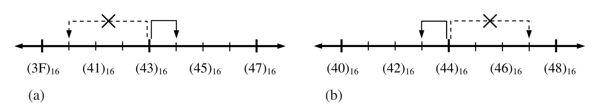
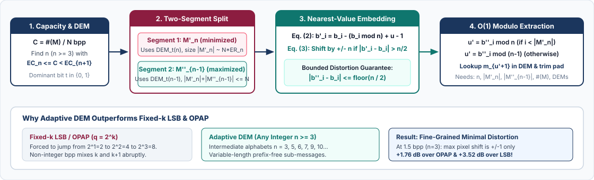
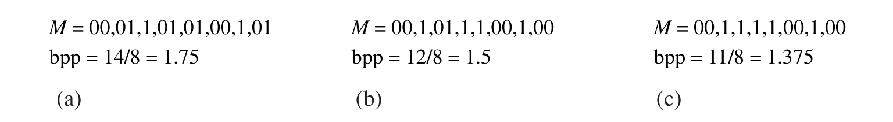
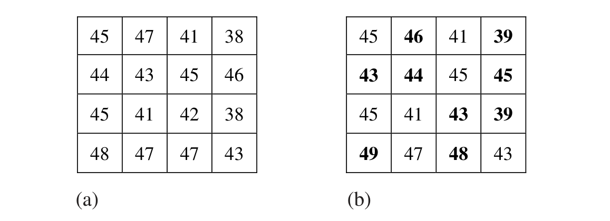
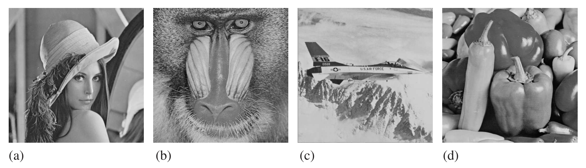
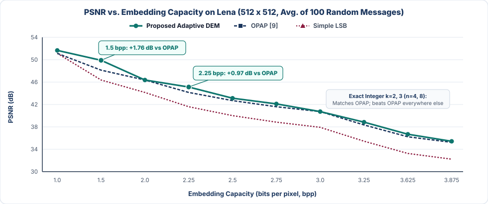

<!-- _class: lead -->

Fundamenta Informaticae · 第 84 卷，頁 1–12 · 2008（IOS Press）

# 適應性影像二進位資料隱藏演算法

<strong>Adaptively Embedding Binary Data in an Image</strong> 
透過<strong>雙區段變動長度子訊息分解（DEM）</strong>與<strong>最近鄰像素值微調</strong>，在任意藏量下最小化偽裝影像失真

<strong>林清泉（Ching-Chiuan Lin）*</strong>、<strong>薛念林（Nien-Lin Hsueh）</strong>、<strong>沈文祥（Wen-Hsiang Shen）</strong> 
逢甲大學資訊工程學系（Department of Information Engineering and Computer Science, Feng Chia University） 
<code>cclin@ocit.edu.tw</code> · <code>nlhsueh@fcu.edu.tw</code> · <code>shen@ocit.edu.tw</code>

關鍵字：資訊隱藏（Information hiding）· 最低有效位元（LSB）· 基本訊息目錄（DEM）· 最佳像素調整程序（OPAP）

<!--
論文背景與核心摘要：
本論文（林清泉、薛念林、沈文祥，Fundamenta Informaticae 84, 2008, pp. 1–12）提出一種兼具高視覺品質與彈性藏量的適應性二進位資料隱藏演算法。

核心研究洞見：
傳統空間域方法（如簡單 LSB 取代與 Chan–Cheng 最佳像素調整程序 OPAP）強制每個像素藏入固定整數 k 個位元，使每像素的狀態數受限於 2 的冪次（2^k ∈ {2, 4, 8, 16}）。當目標藏量 C 落在非整數 bpp（例如 1.5、2.25 或 3.375 bpp）時，固定位元法會產生不必要的像素大幅跳動。本研究將二進位訊息 M 切分為兩區段，並依據基本訊息目錄（DEM）分解為 n 與 n−1 類變動長度子訊息（n ≥ 3），再將像素微調至最近的同餘鄰近值，將單一像素失真嚴格限制於 ±⌊n/2⌋ 以內。
-->

---

## 簡報大綱（Outline）

  
1

  
<a href="#3">研究動機與核心問題</a> 視覺品質與藏量之權衡，以及傳統 2k 固定位元法的粒度瓶頸。

  
2

  
<a href="#4">相關文獻與 OPAP 基準</a> PVD、模數法、LSB 配對、EMD、簡單 LSB 取代與 Chan–Cheng OPAP。

  
3

  
<a href="#6">適應性 DEM 隱藏演算法</a> 基本訊息目錄（DEM）、雙區段分割、公式 (2)–(8) 與 4×4 實例演練。

  
4

  
<a href="#10">實驗設計與結果比較</a> Lena、Baboon、Airplane、Pepper 於 1.0 至 3.875 bpp 之完整比較（表 2–4）。

  
5

  
<a href="#13">低失真機制深度解析</a> 為何非 2 冪次 n 勝過分數 k 混用，以及於 k = 2、3 時與 OPAP 等價之原因。

  
6

  
<a href="#14">結論與實務應用價值</a> 主要貢獻、精簡輔助資訊需求與高畫質隱寫應用場景。

<!--
簡報章節架構說明：
本論文分為五節：第一節闡述影像資訊隱藏背景與空間域既有研究限制；第二節回顧簡單 LSB 取代與 Chan–Cheng OPAP [9]；第三節嚴謹定義基本訊息目錄 DEM_t(n)、期望藏量公式 EC_n、八步驟適應性雙區段嵌入演算法、模數擷取流程與 4×4 灰階影像完整範例；第四節在 Java / Windows XP 平台針對四張 512×512 測試影像執行每點 100 組隨機訊息之平均 PSNR 評測；第五節總結失真上界保證與研究貢獻。
-->

---

## 1. 研究動機與核心概念

<h3>影像隱藏的畫質與藏量兩難</h3>
<ul>
  <li><strong>應用領域：</strong>智慧財產權保護、機密通訊與多媒體註記。</li>
  <li><strong>不可察覺性：</strong>偽裝影像（stego-image）須盡量減少對原始宿主影像（host image）之改動。</li>
  <li><strong>固定 k 位元瓶頸：</strong>簡單 LSB 與 OPAP 每像素取代 <code>k</code> 位元，狀態數受限於 <code>2k ∈ {2, 4, 8, 16}</code>。</li>
  <li><strong>粒度過粗：</strong>當所需藏量為非整數 bpp（如 1.5 或 2.25 bpp）時，固定位元法被迫跨級跳動，造成過大失真。</li>
</ul>

<h3>本研究之適應性分解洞見</h3>
<ul>
  <li><strong>打破固定位元數限制：</strong>每個像素不必嵌入相同位元數量的秘密訊息。</li>
  <li><strong>任意整數 n 元字母表（n ≥ 3）：</strong>依目標藏量 <code>C = #(M)/N</code>，將訊息 <code>M</code> 分解為變動長度基本子訊息。</li>
  <li><strong>雙區段最小化策略：</strong>將 <code>M</code> 分為最小化的 <code>M'n</code> 與最大化的 <code>M''n−1</code>，讓多數像素採用更小的 <code>n−1</code> 字母表。</li>
  <li><strong>最近鄰像素調整：</strong>將像素移至最近同餘鄰近值，誤差嚴格限制於 <code>±⌊n/2⌋</code>。</li>
</ul>

<strong>關鍵成果：</strong>在 1.5 bpp 藏量下，本演算法選用 <code>n = 3</code>（單像素最多僅 ±1 改動），PSNR 達 <strong>49.89 dB</strong>——較 OPAP 高出 <strong>+1.76 dB</strong>，較簡單 LSB 高出 <strong>+3.52 dB</strong>。

<!--
研究動機補充（第 1 節）：
在空間域資訊隱藏中，直接 LSB 取代與像素值調整都會造成宿主影像失真。為維持可接受的視覺品質，傳統 LSB 通常限制 k ≤ 4，但這也使單像素可表達的狀態數只能以 2 的冪次跳躍（2、4、8、16）。本研究透過前綴無關（prefix-free）之基本訊息目錄（DEM）將狀態數推廣至任意整數 n ≥ 3，並以雙區段（n 與 n−1）動態貼合任意訊息長度 #(M) 與宿主像素數 N，進而大幅壓低均方誤差（MSE）。
-->

---

## 2. 相關文獻：空間域資訊隱藏方法比較

| 技術類別 | 代表文獻 | 核心運作機制 | 本研究所克服之主要限制 |
| :--- | :--- | :--- | :--- |
| **像素差值法（PVD）** | Wu &amp; Tsai [4]；Wu 等人 [5]；Chang 等人 [6] | 依相鄰像素差值區間 `{0–7, 8–15, ...}` 對應不同嵌入位元數 | 藏量偏低（&lt; 1.6 bpp）且畫質較低（&lt; 42 dB）；需預先定義差值表 |
| **模數函數法** | Wang [7]；Chang 等人 [8] | 令 `y' = y − (y mod q) + x`，若 `|y' − y| &gt; q/2` 則以 `±q` 修正 | 嵌入二進位訊息時受限於 `q = 2^k`，本質與 OPAP 相同 |
| **LSB 配對與 EMD** | Mielikainen [10]；Zhang &amp; Wang [11] | 像素對配對（改動率降至 0.375）；`R` 像素區塊內至多 1 像素改動 ±1 | 藏量受限於 1 bpp [10] 或 `(log2(2R+1))/R` bpp [11] |
| **區塊差值藏圖法** | Li 等人 [12]；Wang &amp; Chen [13] | 利用秘密影像平滑特性進行區塊配對或雙向壓縮 | 僅適用於隱藏「秘密影像」，無法嵌入一般二進位位元串 |
| **LSB 與 OPAP** | Chan &amp; Cheng [9] | 直接取代 `k` 個最低有效位元後再進行最佳 `±2^k` 像素調整 | 狀態數受限於 2 的冪次 `2^k`，在非整數 bpp 下畫質非最佳 |

<!--
文獻定位補充（第 1 節）：
論文系統性回顧了五大類空間域隱藏技術：
1. PVD 系列 [4, 5, 6]：Wu & Tsai (2003) 將差值區間 {0–7, 8–15, 16–31, 32–63, 64–127, 128–255} 對應至位元長度 {3, 3, 4, 5, 6, 7}，但藏量低於 1.6 bpp、PSNR 低於 42 dB；Wu 等人 (2005) 混合門檻以下 LSB 與門檻以上 PVD 提升藏量。
2. 模數函數法 [7, 8]：雖具像素微調思想，但針對一般二進位串仍須令模數 q = 2^k。
3. 低失真低藏量法 [10, 11]：Mielikainen (2006) 將 1 bpp 下像素改動機率由 0.5 降至 0.375；Zhang & Wang (2006) 的 EMD 在 R 像素區塊藏入 (2R+1) 進位數字，但最大藏量不超過 log2(2R+1)/R bpp。
4. 影像藏影像法 [12, 13]：仰賴秘密影像區塊平滑性，不適用於任意隨機二進位資料。
本方法同時支援任意二進位訊息與高彈性藏量（1.0 至 3.875+ bpp），且大幅提升非整數 bpp 下的 PSNR。
-->

---

## 2. 比較基準：簡單 LSB 取代與 OPAP [9]

<h3>簡單 LSB 取代（Simple LSB）</h3>

y' = y − (y mod 2k) + m &nbsp;&nbsp;（式 1） 
擷取：m = y' mod 2k &nbsp;（通常 k ≤ 4）

<ul class="small-text">
  <li>直接以 <code>k</code> 位元秘密訊息 <code>m</code> 取代宿主像素 <code>y</code> 的最低 <code>k</code> 個位元。</li>
  <li>單像素最大誤差可達 <code>2k − 1</code>（例如 <code>k = 2</code> 時誤差可達 −3）。</li>
</ul>

<h3>Chan &amp; Cheng 最佳像素調整（OPAP）[9]</h3>
<ul class="small-text">
  <li>令 LSB 取代後之差值為 <code>di = b'i − bi</code>：</li>
  <li>若 <code>−2k &lt; di &lt; −2k−1</code> 且 <code>b'i &lt; 256 − 2k</code> ➔ 加上 <code>2k</code>。</li>
  <li>若 <code>2k−1 &lt; di &lt; 2k</code> 且 <code>b'i ≥ 2k</code> ➔ 減去 <code>2k</code>。</li>
  <li>其餘維持不變 ➔ 將最壞誤差減半至 <code>±2k−1</code>。</li>
</ul>

圖 1（論文第 4 頁）：k = 2 時 OPAP 範例 — (a) 將 (00)2 嵌入 (43)16，由 (40)16 上調至 (44)16（誤差 −3 ➔ +1）；(b) 將 (11)2 嵌入 (44)16，由 (47)16 下調至 (43)16。

<!--
比較基準機制詳解（第 2 節）：
Chan 與 Cheng (2004) [9] 提出的 OPAP 利用「加減 2^k 不改變最低 k 個位元」之特性，在維持擷取公式 m = b'_i mod 2^k 完全不變的前提下，將 LSB 取代後的像素值拉回更靠近原始宿主像素 b_i 的位置。
以圖 1(a) 為例，k = 2、b_i = (01000011)_2 = (43)_16 = 67，欲嵌入 (00)_2 時，簡單 LSB 會得到 (40)_16 = 64（d_i = −3）；因落入 −4 < d_i < −2 且 64 < 252，OPAP 加上 4 得到 (44)_16 = 68，使絕對誤差由 3 降至 1。圖 1(b) 則是對稱情形，嵌入 (11)_2 至 (44)_16 後由 (47)_16 下調至 (43)_16。本研究的式 (2)–(3) 正是將此思想從 2^k 推廣至任意整數模數 n ≥ 3。
-->

---

## 3. 所提方法：適應性雙區段 DEM 隱藏架構

<strong>核心設計哲學：</strong>盡量<strong>最大化子訊息個數</strong>（充分利用全部 <code>N</code> 個像素），同時<strong>最小化子訊息種類數 <code>n</code></strong>，使每個像素的調整幅度嚴格落在 <code>{bi − ⌊n/2⌋, ..., bi + ⌊n/2⌋}</code> 之間。

<!--
整體演算法架構說明（第 3 節）：
本演算法將二進位訊息編碼與像素值微調解耦為四個步驟：
1. 藏量評估與 DEM 選擇：計算所需藏量 C = #(M)/N，選出滿足 EC_n <= C < EC_{n+1} 的最小整數 n ≥ 3，並依據訊息 M 中位元「1」或「0」何者居多，選用 DEM_1(n) 或 DEM_0(n)。
2. 雙區段切分：若因位元排列特性導致 |M_n| > N，則將 n 遞增 1。隨後將 M 切分為 M'_n || M''_{n-1}，在 |M'_n| + |M''_{n-1}| <= N 的條件下盡量縮小 |M'_n|（理論比例約為 ER_n），讓更多像素享有更低失真的 n−1 字母表。
3. 最近鄰像素嵌入：依序以模數 n 嵌入 M'_n、以模數 n−1 嵌入 M''_{n-1}，並透過式 (2)–(3) 確保非過飽和像素誤差不超過 ⌊n/2⌋。
4. O(1) 模數擷取：接收端僅需計算 b''_i mod n（或 mod (n−1)）即可查表還原所有子訊息並移除尾端補齊位元。
-->

---

## 3. 基本訊息目錄（DEM）與期望藏量推導

| 子訊息 | `n = 3` (`DEM1` / `DEM0`) | `n = 4` (`DEM1` / `DEM0`) | `n = 5` (`DEM1` / `DEM0`) | `n = 6` (`DEM1` / `DEM0`) | `n = 7` (`DEM1` / `DEM0`) |
| :--- | :---: | :---: | :---: | :---: | :---: |
| `m1` | `0` / `1` | `00` / `11` | `00` / `11` | `00` / `11` | `10` / `01` |
| `m2` | `10` / `01` | `01` / `10` | `01` / `10` | `01` / `10` | `110` / `001` |
| `m3` | `11` / `00` | `10` / `01` | `10` / `01` | `100` / `011` | `111` / `000` |
| `m4` | — | `11` / `00` | `110` / `001` | `101` / `010` | `000` / `111` |
| `m5` | — | — | `111` / `000` | `110` / `001` | `001` / `110` |
| `m6` | — | — | — | `111` / `000` | `010` / `101` |
| `m7` | — | — | — | — | `011` / `100` |
| **期望藏量 ECn** | **1.50** | **2.00** | **2.25** | **2.50** | **2.75** |

<h3>平衡前綴碼條件與期望藏量</h3>

⌊log2 n⌋ ≤ #(mu) ≤ ⌈log2 n⌉ &nbsp;&nbsp;（式 4） 
ECn = ∑ #(mu) × Pu &nbsp;&nbsp;（式 5） 
ECn = ⌊log2 n⌋ − 1 + n / 2⌊log2 n⌋ （式 6）

<ul class="small-text">
  <li><strong>平衡樹最大化藏量：</strong>當 <code>n = 4</code> 時，平衡集 <code>{00, 01, 10, 11}</code> 期望藏量為 <code>2.00 bpp</code>，優於不平衡集 <code>{0, 100, 101, 11}</code> 之 <code>1.75 bpp</code>。</li>
  <li><strong>位元主導性配對：</strong>若位元 <code>1</code> 居多則選 <code>DEM1(n)</code>（因 <code>#DEM1(3,1) = 3 &gt; 2</code>），若位元 <code>0</code> 居多則選 <code>DEM0(n)</code>。</li>
  <li><strong>對稱特例（n = 7）：</strong>兩表皆含 10 個 1 與 10 個 0，任選其一皆可。</li>
</ul>

<!--
DEM 建構與數學推導（第 3 節、表 1、式 4–6）：
基本訊息目錄（DEM）是一組大小為 n 的完整前綴碼（prefix-free code），可由遞迴展開葉節點 m_u 為 m_u0 與 m_u1 構成。為使隨機二進位訊息獲得最大期望藏量 EC_n，任意兩個碼字的位元長度差必須至多為 1，即滿足式 (4)：⌊log2 n⌋ <= #(m_u) <= ⌈log2 n⌉。
式 (6) 推導：令 L = ⌊log2 n⌋，平衡前綴碼會將 (n − 2^L) 個長度為 L 的節點分裂為 2(n − 2^L) 個長度為 L+1 的碼字，並保留 (2^{L+1} − n) 個長度為 L 的碼字。因長度 L 與 L+1 碼字出現機率分別為 2^{-L} 與 2^{-(L+1)}，故：
EC_n = (2^{L+1} − n) * L * 2^{-L} + 2(n − 2^L) * (L+1) * 2^{-(L+1)} = L − 1 + n / 2^L bpp。
由此得到精細的藏量階梯：n=3 ➔ 1.5、n=4 ➔ 2.0、n=5 ➔ 2.25、n=6 ➔ 2.5、n=7 ➔ 2.75、n=8 ➔ 3.0、n=9 ➔ 3.125、n=10 ➔ 3.25、n=11 ➔ 3.375、n=13 ➔ 3.625、n=15 ➔ 3.875 bpp。
-->

---

## 3. 最近鄰像素調整與雙區段嵌入演算法

<h3>像素值調整公式（式 2–3）</h3>

b'i = bi − (bi mod n) + u − 1 &nbsp;&nbsp;（式 2） 
b''i = b'i + n &nbsp; 若 bi − b'i &gt; n/2 且 b'i ≤ 255−n 
b''i = b'i − n &nbsp; 若 (b'i − bi &gt; n/2 且 b'i ≥ n) 或 b'i &gt; 255 
b''i = b'i &nbsp;&nbsp;&nbsp;&nbsp;&nbsp; 其他情形 &nbsp;&nbsp;（式 3）

<ul class="small-text">
  <li><strong>奇數 n：</strong>採用對稱鄰域 <code>{bi−⌊n/2⌋, ..., bi+⌊n/2⌋}</code>。</li>
  <li><strong>偶數 n：</strong>採用包含 <code>bi</code> 的連續 <code>n</code> 個值（非過飽和時誤差皆 <code>≤ ⌊n/2⌋</code>）。</li>
  <li><strong>尾端補齊策略：</strong>若 <code>M''n−1</code> 最後一段不足完整碼字，補齊為使該像素變動最小的 DEM 碼字。</li>
</ul>

<h3>八步驟適應性嵌入與擷取流程</h3>
<ol class="small-text">
  <li>計算 <code>C = #(M)/N</code>；若 <code>C ≤ 1.5</code> 選 <code>n = 3</code>，否則選 <code>ECn ≤ C &lt; ECn+1</code>。</li>
  <li>依主導位元 <code>t</code> 選 <code>DEMt(n)</code>，將 <code>M</code> 分解為 <code>Mn</code>。</li>
  <li>若 <code>|Mn| &gt; N</code>，令 <code>n ← n + 1</code> 並重新分解。</li>
  <li>切分 <code>M = M'n ∥ M''n−1</code>，使 <code>|M'n| + |M''n−1| ≤ N</code> 且最小化 <code>|M'n| ≈ N × (C − ECn−1)/(ECn − ECn−1)</code>。</li>
  <li>依序以 <code>DEMt(n)</code> 嵌入 <code>M'n</code>，再以 <code>DEMt(n−1)</code> 嵌入 <code>M''n−1</code>。</li>
  <li>保存輔助參數：<code>n, |M'n|, |M''n−1|, #(M), DEMt(n), DEMt(n−1)</code>。</li>
</ol>

擷取（式 7–8）：u' = b''i mod n（i &lt; |M'n|）否則 mod (n−1)；u = u' + 1

<!--
演算法細節與邊界保護機制（第 3 節，式 2–3 與 7–8）：
式 (3) 包含兩項關鍵安全設計：
1. 過飽和（oversaturation）防護：當像素值接近 255 且 u−1 > b_i mod n 時，式 (2) 可能暫時產生 b'_i > 255，式 (3) 強制減去 n 以確保偽裝像素嚴格位於 [0, 255]；同理，加 n 需檢查 b'_i <= 255 − n，減 n 需檢查 b'_i >= n。
2. 雙區段（n 與 n−1）設計動機：當實際藏量 C 介於 EC_{n-1} 與 EC_n 之間，或因位元排列使 |M_n| > N 而遞增 n 時，若全部像素都使用模數 n，不僅會浪費尾端像素，也會讓所有使用像素承受較大的 ⌊n/2⌋ 誤差上界。透過最小化 |M'_n| 與最大化 |M''_{n-1}|，可將絕大多數像素壓回較小的 ⌊(n−1)/2⌋ 誤差範圍內。當 n = 3 時，則令 |M''_2| = 0。
-->

---

## 3. 位元排列效應與 4×4 灰階影像實例演練

圖 2（論文第 7 頁）：同樣 8 像素與 DEM0(3) = {1, 01, 00}，不同位元排列可達 1.75、1.50 或 1.375 bpp。

<h3>完整範例：4×4 影像嵌入 25 位元</h3>
<ul class="small-text">
  <li><strong>訊息：</strong><code>M = (0110110101100011100101101)2</code>，<code>C = 25/16 = 1.5625 bpp</code>。</li>
  <li><strong>步驟 2–4：</strong>位元 <code>1</code> 居多 ➔ <code>DEM1(3)</code> 拆出 <code>|M3| = 17 &gt; 16</code> ➔ 遞增為 <code>n = 4</code>。</li>
  <li><strong>雙區段切分：</strong><code>|M'4| = 1</code>（<code>s0 = 01</code>）與 <code>|M''3| = 15</code>（<code>s1..s15</code>，末段補 <code>0</code> 成 <code>10</code> 使第 15 像素 <code>43</code> 維持零改動！）。</li>
  <li><strong>結果：</strong>16 像素藏入 25 位元，<strong>僅 9 個像素變動且幅度皆為 ±1</strong>。</li>
</ul>

圖 3（論文第 8 頁）：(a) 原始 4×4 灰階影像；(b) 偽裝影像（粗體為僅有之 9 個變動像素，皆 ±1）。擷取：像素 0 得 45 mod 4 = 1 ➔ DEM1(4) 之 m2 = "01"；像素 1 得 46 mod 3 = 1 ➔ DEM1(3) 之 m2 = "10"。

<!--
實例逐步驗證（第 3 節，圖 2 與圖 3）：
圖 2 說明為何步驟 4 必須檢查 |M_n| > N：即使同樣採用 DEM_0(3) = {m1=1, m2=01, m3=00} 且位元 0 居多，8 個像素在不同排列下可能剛好容納 14 位元（1.75 bpp）、12 位元（1.50 bpp）或 11 位元（1.375 bpp）。但在大量隨機位元串下，長期平均會精準收斂至理論期望值 EC_n。

圖 3 範例中，25 位元訊息含 14 個 1 與 11 個 0（故 t = 1）。影像由左至右、由上而下掃描：像素 0（值 45）以 DEM_1(4) 嵌入 s_0 = "01"（u = 2），計算 45 − (45 mod 4) + 1 = 45（零改動）；像素 1（值 47）以 DEM_1(3) 嵌入 s_1 = "10"（u = 2），計算 47 − (47 mod 3) + 1 = 46（減 1）；最後一個像素 15（值 43）剩下單一位元 "1"，因 43 mod 3 = 1 對應 u = 2（"10"），故補齊位元 "0" 即可讓像素 43 完全不需修改。
-->

---

## 4. 實驗設定與標準測試影像

圖 4（論文第 9 頁）：四張 512 × 512 × 8 位元標準灰階宿主影像（N = 262,144 像素）— (a) Lena；(b) Baboon；(c) Airplane；(d) Pepper。

  
Java · Win XP

  
於相同硬體與開發平台實作本演算法、簡單 LSB 取代與 OPAP [9]，確保公平比較。

  
每組 100 次隨機

  
表 2–4 所有 PSNR 數據均為嵌入 100 組獨立隨機二進位訊息之平均值。

  
PSNR（dB）

  
<code>10 × log10(255² / MSE)</code>，其中 <code>MSE = (1 / r×c) ∑ (α(i,j) − β(i,j))²</code>。

<!--
實驗方法論（第 4 節）：
實驗選用四張涵蓋平滑至高紋理之經典 512×512 灰階影像（Lena、Baboon、Airplane、Pepper，每張 262,144 像素）。為消除單一隨機位元排列造成的變異，每一組藏量設定皆重複產生 100 筆隨機二進位訊息並取 PSNR 平均值。針對 LSB 與 OPAP 基準在非整數藏量下的公平設定，作者採用 k = q * k_i + q' * k_j（其中 q + q' = 1，例如 2.25 bpp 時 75% 像素嵌入 2 位元、25% 像素嵌入 3 位元），確保基準方法同樣充分利用全部像素以達其最佳畫質。
-->

---

## 4. 中低藏量效能比較：1.0 bpp 與 1.5 bpp（表 2 與表 3）

<h3>表 2：藏量 = 1.0 bpp（262,144 位元）</h3>

| 宿主影像 | 簡單 LSB | OPAP [9] | **本方法（n = 3）** | 較 OPAP 增益 |
| :--- | :---: | :---: | :---: | :---: |
| **Lena** | 51.1414 | 51.1423 | **51.6559** | **+0.51 dB** |
| **Baboon** | 51.1426 | 51.1398 | **51.6527** | **+0.51 dB** |
| **Airplane** | 51.1381 | 51.1406 | **51.6593** | **+0.52 dB** |
| **Pepper** | 51.1415 | 51.1412 | **51.6563** | **+0.52 dB** |
| **平均** | 51.1409 | 51.1410 | **51.6561** | **+0.52 dB** |

<strong>為何 1.0 bpp 即可領先 +0.52 dB：</strong>採用 <code>n = 3</code> 僅需使用約 <code>174,763</code> 個像素，其中僅 2/3（<strong>116,509 像素</strong>）需改動 ±1，遠少於 LSB/OPAP 的 <strong>131,072 像素</strong>！

<h3>表 3：藏量 = 1.5 bpp（393,216 位元）</h3>

| 宿主影像 | LSB (`k=2`) | LSB (`k=1.5`) | OPAP (`k=2`) | OPAP (`k=1.5`) | **本方法 (`n=3`)** |
| :--- | :---: | :---: | :---: | :---: | :---: |
| **Lena** | 45.4020 | 46.3716 | 47.6256 | 48.1305 | **49.8916** |
| **Baboon** | 45.4068 | 46.3774 | 47.6252 | 48.1290 | **49.8917** |
| **Airplane** | 45.3947 | 46.3686 | 47.6180 | 48.1334 | **49.9012** |
| **Pepper** | 45.3950 | 46.3624 | 47.6262 | 48.1274 | **49.8938** |

<strong>1.5 bpp 展現最大優勢：</strong>本方法（<code>n = 3</code>）在四張影像皆達 <strong>49.89 dB</strong>，較最佳 OPAP（<code>k = 1.5</code>）高出 <strong>+1.76 dB</strong>，較最佳 LSB 高出 <strong>+3.52 dB</strong>。

<!--
表 2 與表 3 數據深度解讀（第 4 節，頁 9–10）：
表 2（1.0 bpp，262,144 位元）：在 LSB 與 OPAP（k = 1）中，全部 262,144 個像素皆須嵌入 1 位元，期望有一半（131,072 像素）會變動 ±1，對應 MSE ≈ 0.500、PSNR ≈ 51.14 dB。反觀本方法選用 n = 3（平均每像素藏 1.5 位元），僅需動用 262,144 / 1.5 ≈ 174,763 個像素，且每個使用像素有 1/3 機率維持不變、2/3 機率變動 ±1，故僅約 116,509 像素變動 ±1（MSE ≈ 0.4444、PSNR ≈ 51.66 dB）。
表 3（1.5 bpp，393,216 位元）：基準方法測試兩種配置——k = 2（使用 0.75N 像素各藏 2 位元）與 k = 1.5（前半像素藏 2 位元、後半像素藏 1 位元）。即使採用較優的 k = 1.5，OPAP 仍有半數像素面臨 ±2 誤差，使 PSNR 止步於 48.13 dB；而本方法 n = 3 將所有像素誤差壓制於 ±1 內，穩定達到 49.89–49.90 dB。
-->

---

## 4. 中高藏量效能比較：2.0–3.875 bpp（表 4）

Lena 影像於 1.0–3.875 bpp 之 PSNR 曲線（表 2–4）：適應性 DEM 全面勝過簡單 LSB，並在所有非整數藏量勝過 OPAP。

<h3>表 4 重點摘錄（Lena，單位：dB）</h3>

| 藏量 (bpp) | `n` | LSB | OPAP | **本方法** | 較 OPAP 增益 |
| :---: | :---: | :---: | :---: | :---: | :---: |
| **2.000** | 4 | 44.15 | 46.37 | **46.37** | 0.00 dB |
| **2.250** | 5 | 41.60 | 44.15 | **45.12** | **+0.97 dB** |
| **2.500** | 6 | 40.01 | 42.69 | **43.12** | **+0.43 dB** |
| **2.750** | 7 | 38.84 | 41.60 | **42.11** | **+0.51 dB** |
| **3.000** | 8 | 37.92 | 40.73 | **40.73** | 0.00 dB |
| **3.125** | 9 | 36.51 | 39.38 | **39.89** | **+0.51 dB** |
| **3.375** | 11 | 34.58 | 37.52 | **38.13** | **+0.61 dB** |
| **3.625** | 13 | 33.25 | 36.23 | **36.68** | **+0.45 dB** |
| **3.875** | 15 | 32.23 | 35.23 | **35.42** | **+0.18 dB** |

<!--
表 4 數據分析（第 4 節，頁 10–11）：
在 Lena、Baboon、Airplane、Pepper 四張影像上，同一藏量下的 PSNR 幾乎完全一致（跨影像差異小於 0.03 dB），證明失真度幾乎完全由模數 n 決定而無關影像紋理複雜度。
關鍵觀察：
- 在精確 2 的冪次（2.0 bpp 對應 n = 4；3.0 bpp 對應 n = 8）時，DEM 所有碼字長度均固定為 k = 2 或 3，式 (2)–(3) 在數學上與 Chan–Cheng OPAP 完全等價（分別為 46.37 dB 與 40.73 dB）。
- 在所有非整數藏量（n = 5, 6, 7, 9, 10, 11, 13, 15）中，本方法穩定勝過 OPAP +0.18 至 +0.97 dB，且領先簡單 LSB 達 +2.2 至 +3.5 dB；其中以剛跨越 2 冪次邊界之奇數 n 增益最顯著（如 n = 5 在 2.25 bpp 領先 +0.97 dB、n = 11 在 3.375 bpp 領先 +0.61 dB）。
-->

---

## 4. 低失真機制深度解析：為何適應性 DEM 勝出？

<h3>1. 避免誤差平方放大效應</h3>

由於 MSE 與像素誤差的<strong>平方</strong> <code>(Δb)2</code> 成正比，避免跨入 <code>k+1</code> 位元能帶來顯著的 PSNR 紅利：

<ul class="small-text">
  <li><strong>2.25 bpp：</strong>OPAP 混用 75% <code>k=2</code>（<code>|Δb| ≤ 2</code>）與 25% <code>k=3</code>（<code>|Δb| ≤ 4</code>，平方誤差高達 <strong>16</strong>）。</li>
  <li>本方法用 <code>n = 5</code>：全圖皆 <code>|Δb| ≤ 2</code>（平方誤差上限僅 <strong>4</strong>）➔ 勝出 <strong>+0.97 dB</strong>！</li>
</ul>

<h3>2. 奇數 n 的對稱鄰域優勢</h3>

奇數 <code>n</code>（3, 5, 7, 9, 11, 13, 15）以原始像素 <code>bi</code> 為絕對中心展開：

<ul class="small-text">
  <li><code>n = 3</code>：<code>{−1, 0, +1}</code> ➔ 理論 MSE = <code>2/3 = 0.667</code>。</li>
  <li><code>n = 5</code>：<code>{−2, −1, 0, +1, +2}</code> ➔ 理論 MSE = <code>10/5 = 2.00</code>。</li>
  <li>偶數 <code>n</code> 存在不對稱尾端誤差，故奇數 <code>n</code> 在曲線上展現最明顯的領先峰值。</li>
</ul>

<h3>3. 跨影像紋理之高度穩定性</h3>

不同於 PVD 或區塊配對法會因影像平滑度而劇烈波動：

<ul class="small-text">
  <li><strong>1.5 bpp PSNR：</strong>Lena <code>49.89</code>、Baboon <code>49.89</code>、Airplane <code>49.90</code>、Pepper <code>49.89 dB</code>。</li>
  <li><strong>2.25 bpp PSNR：</strong>四張影像皆穩定落於 <code>45.12–45.13 dB</code>。</li>
  <li>對平滑圖與高紋理圖、任意二進位訊息皆具一致保證。</li>
</ul>

<strong>理論核心總結：</strong>以平衡前綴碼構成之任意整數 <code>n</code> 元量化取代傳統 <code>2k</code> 量化，徹底消弭粗粒度位元切換所造成的二次方 MSE 懲罰。

<!--
理論失真公式與實測數據對照：
假設像素值對 n 取餘數呈均勻分布，最近鄰像素調整的理論期望 MSE 具封閉解：
- 奇數 n = 2m + 1：MSE(n) = (n^2 − 1) / 12。
  代入 n = 3 得 MSE = 8/12 = 0.6667 ➔ PSNR = 10*log10(255^2 / 0.6667) = 49.89 dB（與表 3 完全吻合）。
  代入 n = 5 得 MSE = 24/12 = 2.0000 ➔ PSNR = 10*log10(255^2 / 2.0) = 45.12 dB（與表 4 完全吻合）。
- 偶數 n = 2m：MSE(n) = (n^2 + 2) / 12。
  代入 n = 4（OPAP k=2）得 MSE = 1.5000 ➔ 46.37 dB；n = 8（OPAP k=3）得 MSE = 5.5000 ➔ 40.73 dB。
反觀 OPAP 在 2.25 bpp 混用 k=2 與 k=3 時，期望 MSE = 0.75 * 1.5 + 0.25 * 5.5 = 2.5000（44.15 dB），明顯差於 n = 5 的 2.0000（45.12 dB）。此解析解完整解釋了表 2–4 的實測優勢。
-->

---

## 5. 結論與實務應用價值

  
失真 ≤ ⌊n/2⌋

  
每個非過飽和宿主像素的改動幅度嚴格不超過 ⌊n/2⌋，提供極佳的偽裝影像視覺品質。

  
最高 +1.76 dB

  
於非整數藏量全面勝過 OPAP（1.0、1.5、2.25–3.875 bpp），並領先簡單 LSB 達 2.2–3.5 dB。

  
O(N) 通用二進位

  
單次掃描即可完成模數嵌入與擷取，無需預先假設秘密資料結構，適用任何二進位訊息。

<strong>1. 雙區段最佳化</strong> 將 <code>M</code> 分割為最小化之 <code>M'n</code> 與最大化之 <code>M''n−1</code>，在用滿 <code>N</code> 個像素的同時將字母表大小 <code>n</code> 降至最低。

<strong>2. 精簡輔助資訊</strong> 解碼端僅需 <code>n</code>、<code>|M'n|</code>、<code>|M''n−1|</code>、<code>#(M)</code> 與兩個 DEM 對應表（由 <code>n</code> 與主導位元 <code>t</code> 即可唯一決定）。

<strong>3. 實務應用定位</strong> 特別適合對視覺品質要求極高且藏量隨任務動態變動之機密通訊、版權標記與影像註記系統。

<!--
研究貢獻總結（第 5 節）：
1. 提出平衡前綴碼形式之基本訊息目錄 DEM_t(n) 與位元主導性選表機制，並推導封閉式期望藏量公式 EC_n = ⌊log2 n⌋ − 1 + n / 2^{⌊log2 n⌋}。
2. 設計雙區段適應性訊息分解（M = M'_n || M''_{n-1}）結合具過飽和保護之最近鄰模數調整（式 2–3），將像素誤差嚴格收斂於 ±⌊n/2⌋ 以內。
3. 透過四張 512×512 標準影像橫跨 1.0 至 3.875 bpp 之大量隨機訊息實驗，證實本方法在各種藏量下皆能提供比簡單 LSB 與 OPAP 更低失真的偽裝影像。
-->

---

<!-- _class: closing -->

# 感謝聆聽 · 敬請指教！

適應性影像二進位資料隱藏演算法（Adaptively Embedding Binary Data in an Image）

<strong>林清泉（Ching-Chiuan Lin）*</strong> · <code>cclin@ocit.edu.tw</code> 
<strong>薛念林（Nien-Lin Hsueh）</strong> · <code>nlhsueh@fcu.edu.tw</code> &nbsp;|&nbsp; <strong>沈文祥（Wen-Hsiang Shen）</strong> · <code>shen@ocit.edu.tw</code> 
逢甲大學資訊工程學系（Department of Information Engineering and Computer Science, Feng Chia University） 
Fundamenta Informaticae，第 84 卷，頁 1–12，2008 年 · IOS Press

<!--
論文書目資料：
- 篇名：Adaptively Embedding Binary Data in an Image（適應性影像二進位資料隱藏演算法）
- 作者：Ching-Chiuan Lin（通訊作者，cclin@ocit.edu.tw）、Nien-Lin Hsueh（nlhsueh@fcu.edu.tw）、Wen-Hsiang Shen（shen@ocit.edu.tw）
- 單位：逢甲大學資訊工程學系（Taichung 40724, Taiwan, ROC）
- 期刊：Fundamenta Informaticae 84 (2008) 1–12, IOS Press
- 關鍵字：Information hiding, LSB
-->

