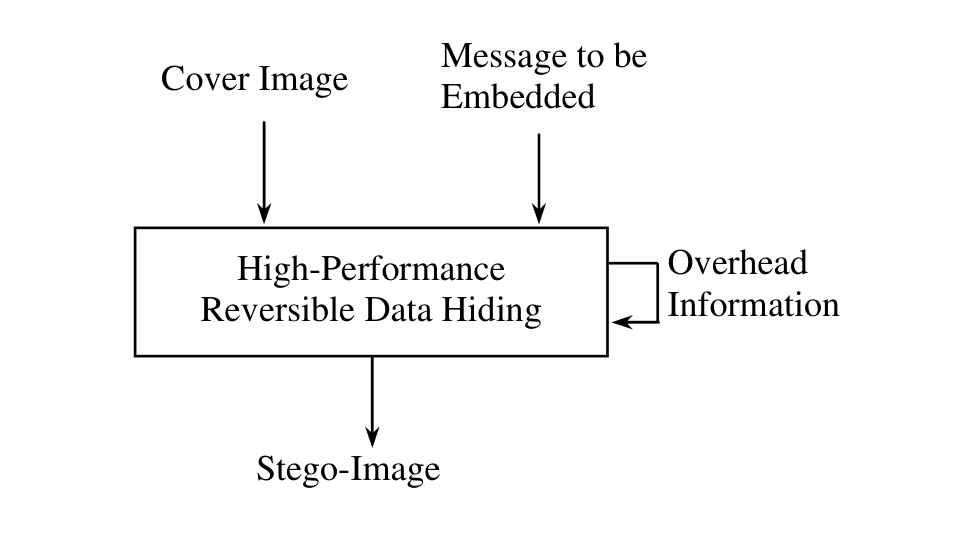
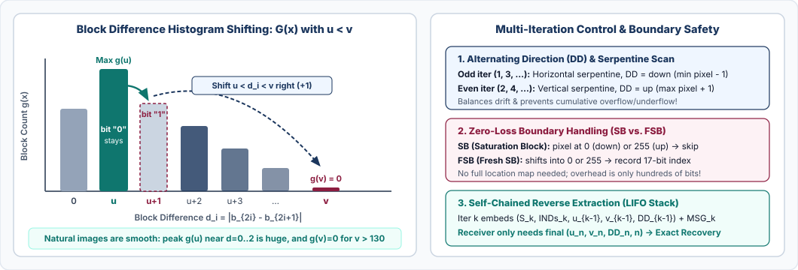
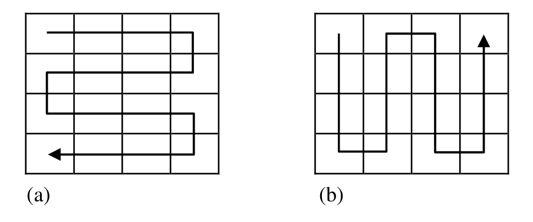
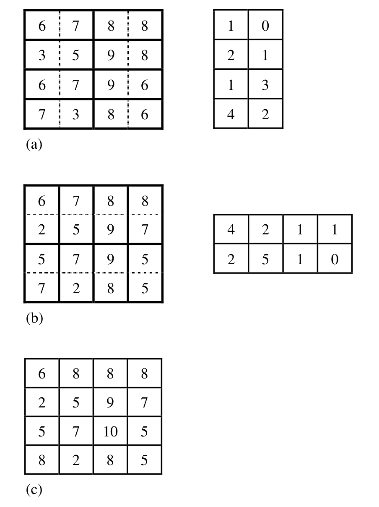
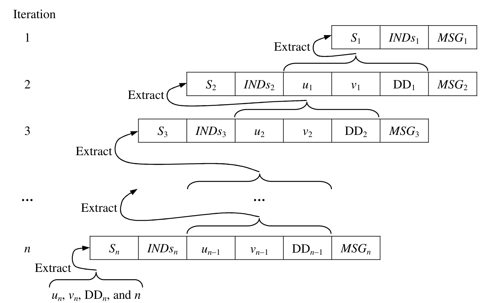
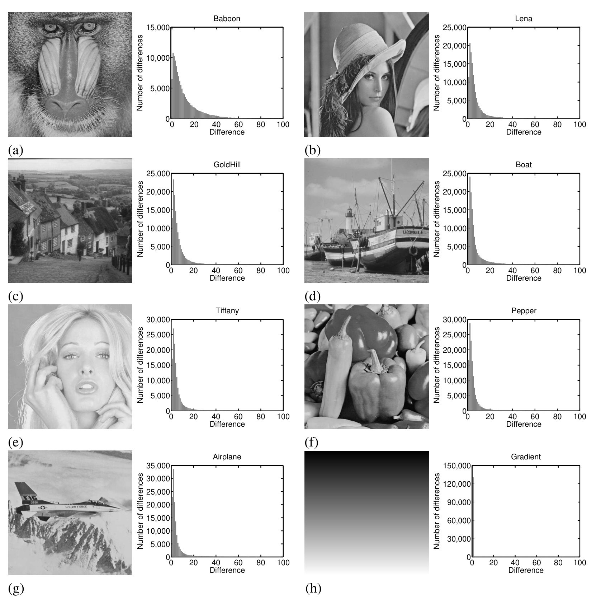
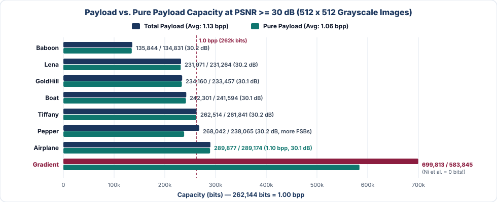
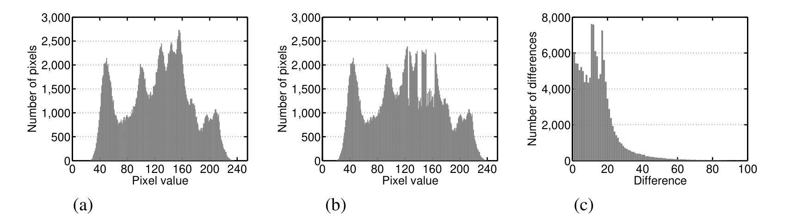
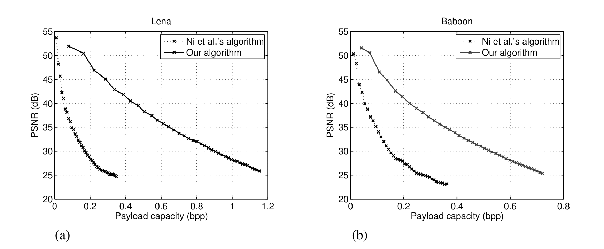

<!-- _class: lead -->

Fundamenta Informaticae · Vol. 82, pp. 155–169 · 2007 (IOS Press)

# High-Performance Reversible Data Hiding

Achieving <strong>&gt; 1.0 bpp Pure Payload at PSNR ≥ 30 dB</strong> and <strong>Zero-Distortion Cover Recovery</strong> via Iterative Block-Difference Histogram Shifting

<strong>Ching-Chiuan Lin*</strong>, <strong>Nien-Lin Hsueh</strong>, and <strong>Wen-Hsiang Shen</strong> 
Department of Information Engineering and Computer Science, Feng Chia University, Taichung 40724, Taiwan, ROC 
<code>cclin@ocit.edu.tw</code> · <code>nlhsueh@fcu.edu.tw</code> · <code>shen@ocit.edu.tw</code>

Keywords: Reversible data hiding · Lossless watermark · Steganography · Block Difference Histogram

<!--
Bibliographic & Research Overview:
This paper (Lin, Hsueh, & Shen, Fundamenta Informaticae 82, 2007, pp. 155–169, IOS Press) proposes a high-capacity, low-complexity reversible data hiding algorithm grounded in the block difference histogram of non-overlapping two-pixel blocks.

Core Contributions:
1. Shifts the histogram of absolute two-pixel block differences d_i = |b_{2i} - b_{2i+1}| rather than raw pixel intensities, producing sharp peaks near zero even on smooth or flat-histogram images (e.g., Gradient, where Ni et al.'s pixel-histogram algorithm hides 0 bits).
2. Alternates horizontal and vertical serpentine scans alongside alternating Difference Directions (DD = down / up) across iterations, preventing cumulative pixel drift while handling boundary pixels cleanly via Saturation Blocks (SB) and Fresh Saturation Blocks (FSB).
3. Achieves 1.52 bpp average max payload (1.41 bpp pure), 1.13 bpp average payload / 1.06 bpp pure payload at PSNR >= 30 dB, O(N) linear time complexity, and bit-exact cover image restoration.
-->

---

## Presentation Outline

  
1

  
<a href="#3">Introduction & Reversible Hiding Need</a> Medical/military lossless mandates, spatial vs. frequency domain, and system block diagram.

  
2

  
<a href="#4">Related Work & Prior Limitations</a> Fridrich LSB compression, Tian & Chang–Lu difference expansion, and Ni et al. histogram shifting.

  
3

  
<a href="#5">Block-Difference Histogram Shifting</a> Difference Direction (DD), SB/FSB boundary rules, serpentine scanning, and 4×4 walkthrough.

  
4

  
<a href="#8">Lossless Extraction & Overhead Chaining</a> Eq. (2) pixel restoration, LIFO stack decoding, and self-contained per-iteration overhead.

  
5

  
<a href="#9">Experimental Results & Complexity</a> 8 test images (Tables 1–4), histogram persistence (Fig. 6), PSNR curves (Fig. 7), and O(N) speed.

  
6

  
<a href="#14">Conclusions & Practical Takeaways</a> Greedy peak-selection advantages, minimal overhead footprint, and target lossless applications.

<!--
Structural Navigation:
The paper is organized into four sections: Section 1 motivates reversible data hiding and compares lossless compression, difference expansion, and histogram shifting; Section 2 details Difference Direction (DD), Saturation/Fresh Saturation Blocks (SB/FSB), the 9-step multi-iteration embedding algorithm (2.1), the 8-step reverse extraction algorithm (2.2), and a complete two-iteration 4x4 example; Section 3 evaluates 8 standard 512x512 grayscale images (Baboon to Gradient) against Ni et al. [16] in capacity, PSNR, overhead, and O(N) runtime; Section 4 concludes.
-->

---

## 1. Introduction: Why Reversible Data Hiding?

<h3>Lossy vs. Lossless Hiding</h3>
<ul class="small-text">
  <li><strong>Spatial vs. Frequency domain:</strong> Frequency-domain methods are more robust, whereas spatial-domain methods offer far larger hiding capacity.</li>
  <li><strong>Permanent distortion risk:</strong> Classical LSB replacement [4, 5] and pixel-difference adjustments [6, 7, 8] irreversibly damage original pixels.</li>
  <li><strong>Zero-distortion mandate:</strong> In <strong>medical diagnosis</strong> and <strong>military image recognition</strong>, even minor permanent distortion is unacceptable—the exact original cover image must be recovered.</li>
</ul>

<h3>Our Core Idea</h3>
<ul class="small-text">
  <li>Build a histogram of <strong>two-pixel block differences</strong> <code>di = |b2i − b2i+1|</code>.</li>
  <li>Concurrently embed both the <strong>secret message</strong> and <strong>compact overhead</strong> into peak blocks, allowing 100% lossless restoration.</li>
</ul>

Figure 1 (Paper p. 156): Block diagram of the proposed reversible embedding algorithm—message and overhead information are embedded concurrently into the cover image.

<!--
Motivation & Problem Setting (Section 1, Figure 1):
Reversible data hiding (also termed lossless watermarking) requires that after extracting the secret payload from the stego-image, the receiver can mathematically reconstruct every single pixel of the original cover image with zero error (MSE = 0, PSNR = infinity). As depicted in Figure 1, a practical reversible scheme must not rely on large external side channels; instead, it embeds its own recovery overhead concurrently inside the payload space, transmitting only a tiny constant header to the receiver.
-->

---

## 1. Related Work & Limitations of Prior Reversible Schemes

| Prior Reversible Method | Core Technique | Major Bottlenecks Addressed by Our Algorithm |
| :--- | :--- | :--- |
| **Fridrich et al. [13]** (2002) | Losslessly compresses LSB planes of cover image to free space for payload | Limited capacity on noisy/textured images where LSB planes are poorly compressible |
| **Tian [14]** (2003) | **Difference Expansion (DE):** doubles pixel-pair difference to hide 1 bit per expandable pair | Requires an <code>⌊M/2⌋</code>-bit location map to track expandable pairs; heavy overhead &amp; distortion |
| **Chang &amp; Lu [15]** (2006) | Expands difference between pixel and mean of preceding <code>k</code>-bit pixels | Nearly every pixel embeds, but location map size <strong>doubles</strong> (must rely on compression) |
| **Ni et al. [16]** (2006) | **Pixel-Value Histogram Shifting:** shifts pixel intensities between peak and zero points | Low single-pass capacity; peaks collapse quickly; <strong>fails completely (0 bits)</strong> on flat/horizontal histograms (e.g., Gradient) |
| **Proposed (Lin et al., 2007)** | **Iterative Block-Difference Histogram Shifting** + alternating serpentine scan &amp; DD | High capacity (<strong>1.13 bpp @ ≥30 dB</strong>), tiny FSB overhead (hundreds of bits), works even on flat histograms |

<!--
Comparative Literature Context (Section 1, p. 156):
Ni et al. (IEEE TCSVT 2006) [16] is the primary baseline because it shares the elegant O(N) histogram-shifting paradigm without requiring a full-image location map. However, pixel-intensity histograms of natural images spread across 0..255 (limiting peak height to ~2,000–2,700 pixels in 512x512 Lena) and can be completely flat (e.g., a linear Gradient image has ~1,024 pixels at every intensity and zero empty bins, yielding 0 capacity in Ni et al.). In contrast, neighboring pixels in both natural and synthetic images are strongly correlated, concentrating block differences tightly near 0..5—creating peaks 5x to 15x taller and guaranteed empty bins above d = 130.
-->

---

## 2. Core Mechanism: Block-Difference Histogram Shifting

<strong>Eq. (1) Increase block difference by 1:</strong> &nbsp;
DD=up: (bi+1, bj) if bi&gt;bj else (bi, bj+1) &nbsp;|&nbsp;
DD=down: (bi, bj−1) if bi&gt;bj else (bi−1, bj)

<!--
Formal Definitions (Section 2, Eq. 1):
For an N-pixel grayscale image I, non-overlapping neighboring pixel pairs form blocks (b_i, b_j) with absolute difference d_i = |b_i - b_j|.
1. Difference Direction (DD): Increasing d_i by 1 can either increment the larger pixel (DD = up) or decrement the smaller pixel (DD = down). For tie-breaking when b_i = b_j, Eq. (1) deterministically adds 1 to b_j when DD = up or subtracts 1 from b_i when DD = down, guaranteeing unambiguous reversibility.
2. Saturation Block (SB): A block whose larger pixel is already 255 (when DD = up) or smaller pixel is already 0 (when DD = down). SBs cannot be shifted without overflow/underflow and are skipped (embed nothing).
3. Fresh Saturation Block (FSB): A non-SB block that becomes an SB after shifting by 1 (e.g., (1, 12) becomes (0, 12) under DD = down). Because the decoder cannot otherwise distinguish an original SB from an FSB, only FSB indexes are logged in overhead—avoiding a massive full-image location map.
-->

---

## 2.1 Multi-Iteration Embedding & Serpentine Scanning

<h3>9-Step Greedy Embedding Algorithm</h3>
<ol class="small-text">
  <li>Initialize <code>DD ← down</code>.</li>
  <li><strong>Serpentine scan:</strong> Horizontal (odd iter) or Vertical (even iter) into <code>N/2</code> two-pixel blocks <code>(b2i, b2i+1)</code>.</li>
  <li>Compute <code>di = |b2i − b2i+1|</code> for all non-SB blocks; build histogram <code>G(x)</code>.</li>
  <li>Find max point <code>u</code> and closest min point <code>v</code> (<code>g(v) = 0</code>, typically <code>v &gt; 130</code>) minimizing <code>|u − v|</code>.</li>
  <li><strong>Pass 1 (Shift &amp; Boundary Embed):</strong> Shift <code>u &lt; di &lt; v</code> by +1 via Eq. (1); embed at <code>di = u</code> for boundary-adjacent blocks (<code>max = 254</code> or <code>min = 1</code>); log resulting FSB indexes.</li>
  <li><strong>Pass 2 (Overhead + Payload):</strong> Into safe peak blocks (<code>max ≤ 253</code> or <code>min ≥ 2</code>), embed FSB count/indexes + previous <code>(u, v, DD)</code> first, then residual message. Roll back if space insufficient.</li>
  <li><strong>Flip <code>DD</code></strong> and repeat until (a) all bits embedded, (b) overhead exceeds space, or (c) PSNR threshold reached.</li>
  <li>Send only final <code>(un, vn, DDn, n)</code> to receiver.</li>
</ol>

Figure 2 (Paper p. 158): Alternating scanning orders — (a) Horizontal serpentine (odd iterations); (b) Vertical serpentine (even iterations).

<strong>Why Alternate Scan &amp; DD?</strong> 
• An FSB created under <code>DD = down</code> (pixel hits 0) is <em>not</em> an SB under <code>DD = up</code> next pass. 
• Horizontal/vertical alternation exposes fresh low-difference pixel pairs every iteration!

<!--
Two-Pass Per-Iteration Safety Design (Section 2.1, Steps 6–7):
Notice why embedding within each iteration is split into two distinct scans (Step 6 and Step 7):
- In Step 6, every block that could possibly turn into an FSB (all shifted blocks u < d_i < v, plus peak blocks d_i = u sitting one step away from 0 or 255) is processed first. By the end of Step 6, the exact count S and list of indexes INDs of all FSBs created in this iteration are completely known!
- In Step 7, the remaining "safe" peak blocks (d_i = u with max <= 253 for DD=up, or min >= 2 for DD=down) can NEVER become FSBs when shifted by 1. Therefore, embedding (S, INDs, u_{k-1}, v_{k-1}, DD_{k-1}) into these safe blocks cannot trigger any new FSBs—making the overhead self-terminating and 100% deterministic to decode first during extraction.
- Special note: For an all-black or all-white image, DD must remain fixed to up or down respectively so pixels do not immediately saturate.
-->

---

## 2.1 Worked Example: 2-Iteration Embedding on 4×4 Image

<h3>Target Message: <code>011010</code> (6 bits)</h3>
<ul class="small-text">
  <li><strong>Iteration 1 (Odd · Horizontal · <code>DD = down</code>):</strong>
    <ul>
      <li>Histogram peak <code>u = 1</code> (<code>g(1) = 3</code>: blocks 0, 2, 4), zero point <code>v = 5</code>.</li>
      <li>Shift blocks with <code>1 &lt; di &lt; 5</code> by subtracting 1 from smaller pixel (e.g., block 3: <code>|3−5|=2 ➔ |2−5|=3</code>).</li>
      <li>Block 1 <code>(8, 8)</code> has <code>d1 = 0 &lt; u</code> ➔ untouched.</li>
      <li>Embed <code>0, 1, 1</code> into blocks 0, 2, 4 ➔ flip <code>DD ← up</code>.</li>
    </ul>
  </li>
</ul>

<h3>Iteration 2 (Even · Vertical · <code>DD = up</code>)</h3>
<ul class="small-text">
  <li>Re-group into 8 vertical two-pixel blocks; new peak <code>u = 1</code> (<code>g(1) = 3</code>: blocks 4, 5, 7), zero point <code>v = 3</code>.</li>
  <li>Shift blocks with <code>1 &lt; di &lt; 3</code> by adding 1 to larger pixel.</li>
  <li>Embed <code>0, 1, 0</code> into blocks 4, 5, 7 (0 SBs encountered).</li>
  <li><strong>Sent to receiver:</strong> only <code>u=1, v=3, DD=up, n=2</code>!</li>
</ul>

Figure 3 (Paper p. 160): (a) Original 4×4 image &amp; horizontal block diffs; (b) After Iter 1 &amp; vertical diffs; (c) Final stego-image after Iter 2.

<!--
Worked Example Walkthrough (Section 2.1 & 2.2, Figure 3):
In Figure 3(a), the 4x4 image is indexed in horizontal serpentine order (top-left pixel 0 = 6, pixel 1 = 7, ..., pixel 7 = 3 below pixel 0). Block 0 = (6,7) has d_0 = 1; Block 1 = (8,8) has d_1 = 0; Block 2 = (8,9) has d_2 = 1; Block 3 = (5,3) has d_3 = 2; Block 4 = (6,7) has d_4 = 1; etc.
In Iteration 1 (DD = down, u = 1, v = 5), blocks 0, 2, 4 embed bits "0", "1", "1": block 0 stays (6,7), block 2 becomes (7,9) [d=2], block 4 becomes (5,7) [d=2]; meanwhile blocks with 1 < d < 5 decrement their smaller pixel by 1.
In Iteration 2 (DD = up, u = 1, v = 3), vertical serpentine pairing yields new block differences where blocks 4, 5, 7 have d = 1 and embed "0", "1", "0", producing Figure 3(c). During reverse extraction, the decoder starts at Iteration 2 (even -> vertical blocks, DD = up, u = 1, v = 3), recovers "010" and restores pixels 3, 7, 10 by subtracting 1, pushes "010" onto the stack, then runs Iteration 1 (odd -> horizontal, DD = down, u = 1, v = 5) to recover "011", add 1 to pixels 4, 7, 8, 11, 12, 14, and pop "011010" with exact original image recovery.
-->

---

## 2.2 Lossless Extraction & Self-Chained Overhead

<h3>Exact Pixel Restoration (Eq. 2)</h3>

DD=up: &nbsp;&nbsp;(b'i−1, b'j) if b'i&gt;b'j else (b'i, b'j−1) 
DD=down: (b'i, b'j+1) if b'i&gt;b'j else (b'i+1, b'j)

<ol class="small-text">
  <li>Read minimal external tuple: <code>(un, vn, DDn, n)</code>.</li>
  <li><strong>Pass 1 (Safe Blocks):</strong> Extract <code>0</code> if <code>di=u</code>, extract <code>1</code> &amp; restore via Eq. (2) if <code>di=u+1</code>.</li>
  <li>Decode FSB count <code>Sk</code>, FSB indexes <code>INDsk</code>, and previous iteration's <code>(uk−1, vk−1, DDk−1)</code>.</li>
  <li><strong>Pass 2 (Boundary &amp; Shifted):</strong> Using <code>INDsk</code>, extract boundary bits and restore all <code>u+1 &lt; di ≤ v</code> blocks (skipping SBs).</li>
  <li>Push Pass 2 bits then Pass 1 bits onto a <strong>LIFO stack</strong>; repeat for <code>k = n ... 1</code> and pop full message!</li>
</ol>

Figure 4 (Paper p. 162): Self-chained reverse extraction across n iterations—each iteration k carries (Sk, INDsk, uk−1, vk−1, DDk−1, MSGk).

<!--
Reverse Extraction Correctness (Section 2.2, Eq. 2, Figure 4):
Because embedding Pass 1 (Step 6) runs before Pass 2 (Step 7) in each iteration, extraction reverses the order: Step 3 reads the safe blocks first (which never became FSBs) to immediately recover S_k and INDs_k. Armed with INDs_k, Step 5 unambiguously distinguishes true FSBs (which must be restored via Eq. 2 and yield bit "1" if d_i = u + 1) from pre-existing SBs (which remain untouched). Pushing Step 5's bits onto the LIFO stack followed by Step 3's bits guarantees that popping the stack after all n iterations reconstructs MSG_1 || MSG_2 || ... || MSG_n in the exact original bit order while leaving every pixel bit-for-bit identical to the cover image.
-->

---

## 3. Experimental Setup, Overhead Format & 8 Test Images

<h3>Platform &amp; Overhead Bit Budget (Tables 1–2)</h3>
<ul class="small-text">
  <li><strong>Testbed:</strong> Java on Windows XP (Intel Pentium 4, 2.4 GHz); <strong>Lena</strong> embedded as payload into eight 512×512×8 grayscale cover images.</li>
  <li><strong>Comparison baseline:</strong> Ni et al. [16] implemented on the exact same platform.</li>
  <li><strong>512×512 Overhead Sizing:</strong> <code>⌊N/2⌋ = 131,072</code> blocks ➔ <code>17 bits</code> per FSB index; max embeddable FSB count <code>m &lt; 131,072/17</code> ➔ <code>13 bits</code> for <code>S</code>.</li>
</ul>

| Field | Iteration 1 (Table 1) | Remaining Iter `k ≥ 2` (Table 2) |
| :--- | :---: | :---: |
| Number of FSBs (`S`) | 13 bits | 13 bits |
| Indexes of FSBs (`INDs`) | `17 × S` bits | `17 × S` bits |
| Prev. `(u, v, DD)` | — | `8 + 8 + 1 = 17` bits |
| User Message (`MSG`) | Residual space | Residual space |

Figure 5 (Paper p. 164): Eight 512×512 test images (rough ➔ smooth) and their block difference histograms (d ≤ 100): Baboon, Lena, GoldHill, Boat, Tiffany, Pepper, Airplane, and synthetic Gradient.

<!--
Test Suite & Overhead Analysis (Section 3, Tables 1–2, Figure 5):
Figure 5 spans the entire roughness spectrum—from highly textured Baboon (peak ~12,000 blocks) through standard natural images Lena, GoldHill, Boat, Tiffany, Pepper, and Airplane (peaks 20,000–35,000 blocks) to the synthetic linear Gradient image (peak ~131,000 blocks at d = 0/1!).
In Tables 1 and 2, when an image has few or zero FSBs (which holds for almost all natural images at PSNR >= 30 dB), the total per-iteration overhead is only 13 bits (first iteration) or 30 bits (remaining iterations)—meaning 23–24 iterations consume only ~700 bits total, less than 0.3% of the payload!
-->

---

## 3. Maximum Payload Capacity Across 8 Images (Table 3)

| Cover Image | PSNR (dB) | Iterations | Total Payload (bits) | Pure Payload (bits) | Pure (bpp) |
| :--- | :---: | :---: | :---: | :---: | :---: |
| **Baboon** | 20.0 | 76 | 264,458 | 243,512 | 0.93 |
| **Boat** | 23.6 | 52 | 348,745 | 335,608 | 1.28 |
| **Lena** | 21.0 | 72 | 384,657 | 374,354 | 1.43 |
| **Airplane** | 18.4 | 101 | 498,034 | 484,243 | 1.85 |
| **Pepper** | 28.9 | 28 | 288,988 | 250,119 | 0.95 |
| **Tiffany** | 24.1 | 49 | 363,904 | 357,436 | 1.36 |
| **GoldHill** | 23.7 | 51 | 335,310 | 319,041 | 1.22 |
| **Gradient** | **30.4** | 27 | **699,813** | **583,845** | **2.23** |
| **8-Image Avg.** | 23.8 | 57 | **397,989 (1.52 bpp)** | **368,520 (1.41 bpp)** | **1.41** |

  
1.52 / 1.41 bpp

  
Average maximum total payload / pure payload across all 8 test images (100% lossless recovery).

  
699,813 bits

  
<strong>Gradient</strong> achieves 2.67 bpp total (2.23 bpp pure) at 30.4 dB in 27 iters—while Ni et al. hides <strong>0 bits</strong>!

<h3>Notable Image Behaviors</h3>
<ul class="small-text">
  <li><strong>Airplane (smooth):</strong> 498,034 bits across 101 iterations.</li>
  <li><strong>Pepper (boundary pixels):</strong> Many early FSBs terminate embedding at iter 29, still yielding 288,988 bits at <strong>28.9 dB</strong>.</li>
</ul>

<!--
Analysis of Table 3 (Section 3, pp. 165–166):
Table 3 pushes each image to its natural termination point (where the next iteration's FSB overhead exceeds its available peak capacity). Across all 8 images, total payload averages 397,989 bits (1.52 bpp) and pure user payload averages 368,520 bits (1.41 bpp).
Pepper provides an instructive edge case: despite being visually smooth, Pepper contains many dark/bright pixels near 0 and 255, triggering substantial FSB overhead in early iterations (38,869 bits of overhead over 28 iterations) and stopping at iteration 29 with a high 28.9 dB PSNR. Conversely, Lena incurs only 10,303 bits of overhead across 72 iterations (2.7% overhead ratio), and Tiffany incurs only 6,468 bits across 49 iterations (1.8% overhead ratio).
-->

---

## 3. High-Quality Payload at PSNR ≥ 30 dB (Table 4)

= 30 dB across 8 test images" style="max-height: 335px;">

  
1.13 bpp

  
Average total payload at PSNR ≥ 30 dB across 8 images (23–27 iterations).

  
1.06 bpp

  
Average <strong>pure payload</strong> at PSNR ≥ 30 dB—exceeding 1 bit per pixel losslessly!

  
~700 bits Overhead

  
For Boat, Lena, Airplane, Tiffany &amp; GoldHill, total overhead is only <strong>673–707 bits</strong> (&lt; 0.3%).

<!--
Analysis of Table 4 (Section 3, pp. 165–166):
When visual quality is constrained to PSNR >= 30 dB (standard imperceptibility floor for high-payload reversible hiding), all 7 natural images run for 23–24 iterations (PSNR 30.1–30.2 dB) and Gradient runs all 27 iterations (30.4 dB).
Exact Table 4 overhead (Total minus Pure) highlights the efficiency of FSB-only tracking:
- Baboon: 135,844 - 134,831 = 1,013 bits
- Boat: 242,301 - 241,594 = 707 bits
- Lena: 231,971 - 231,264 = 707 bits
- Airplane: 289,877 - 289,174 = 703 bits
- Tiffany: 262,514 - 261,841 = 673 bits
- GoldHill: 234,160 - 233,457 = 703 bits
- Pepper: 268,042 - 238,065 = 29,977 bits (due to near-0/255 boundary pixels)
- Gradient: 699,813 - 583,845 = 115,968 bits (still delivering 583,845 pure bits = 2.23 bpp!).
-->

---

## 3. Histogram Persistence vs. Ni et al. [16] (Figure 6)

Figure 6 (Paper p. 167): Lena histograms — (a) Ni et al.'s original pixel histogram; (b) Ni et al.'s histogram after 10 iterations (peaks &lt; 2,500); (c) Our block-difference histogram after 10 iterations (multiple peaks &gt; 7,000!).

<h3>Ni et al. [16]: Rapid Peak Depletion</h3>
<ul class="small-text">
  <li>Pixel values span <code>0..255</code>, so even the initial peak on Lena is below <strong>2,800 pixels</strong>.</li>
  <li>After 10 iterations, every remaining peak drops below <strong>2,500 bits</strong>, causing severe capacity saturation.</li>
</ul>

<h3>Proposed: Sustained High-Capacity Peaks</h3>
<ul class="small-text">
  <li>Spatial correlation concentrates differences near zero, creating initial peaks over <strong>20,000 blocks</strong>.</li>
  <li>Even after 10 iterations, multiple peaks still exceed <strong>7,000 bits per pass</strong>—nearly <strong>3×</strong> Ni et al.!</li>
</ul>

<!--
Why Multi-Iteration Capacity Scales Better (Section 3, Figure 6):
Figure 6 directly visualizes the structural reason behind our algorithm's dramatic advantage over Ni et al. [16]. In Figure 6(a)-(b), Ni et al.'s pixel-value histogram splits existing peaks in half each time a peak embeds random 0/1 bits, rapidly flattening the histogram into jagged spikes below 2,500 pixels. In Figure 6(c), our block-difference histogram not only starts ~8x taller, but alternating horizontal and vertical pixel pairings continually re-exposes fresh low-difference pairs, keeping peak heights above 7,000 blocks even after 10 full passes.
-->

---

## 3. Rate–Distortion & Computational Complexity (Figure 7)

Figure 7 (Paper p. 167): PSNR vs. Payload Capacity over the first 40 iterations — (a) Lena; (b) Baboon.

<h3>3.5× to 6.5× Higher Capacity at 35 dB</h3>
<ul class="small-text">
  <li><strong>Lena @ 35 dB:</strong> Proposed achieves <strong>~0.65 bpp</strong> vs. Ni et al. <strong>~0.10 bpp</strong> (<strong>6.5×</strong> capacity).</li>
  <li><strong>Baboon @ 35 dB:</strong> Proposed achieves <strong>~0.35 bpp</strong> vs. Ni et al. <strong>~0.10 bpp</strong> (<strong>3.5×</strong> capacity).</li>
  <li>Similar multi-fold gains hold across all other six test images.</li>
</ul>

<h3>Linear O(N) Time Complexity</h3>
<ul class="small-text">
  <li><strong>Embedding:</strong> 3 image scans/iter ➔ <code>O(3nN) = O(N)</code> (same asymptotic class as Ni et al.).</li>
  <li><strong>Extraction:</strong> 2 image scans/iter ➔ <code>O(2nN) = O(N)</code>.</li>
  <li><strong>Measured speed:</strong> 72 iters on Lena (374,354 pure + 10,303 overhead bits) embed + extract in <strong>4,150 ms</strong> (<strong>58 ms/iter</strong> on Pentium 4 2.4 GHz).</li>
</ul>

<!--
Rate–Distortion & Complexity Verification (Section 3, Figure 7, pp. 166–167):
Figure 7 plots the operational PSNR-versus-payload curve across the first 40 iterations on Lena (smooth/moderate) and Baboon (highly textured). At every single PSNR level from 25 dB to 52 dB, our algorithm dominates Ni et al. [16] by a wide margin.
Complexity breakdown: Each embedding iteration performs 3 linear scans (Step 2 pairing/histogram, Step 6 shifting/FSB logging, Step 7 overhead+payload embedding), searches 256 histogram bins in O(1), and modifies at most floor(N/2) pixels by 1 -> O(3nN). Each extraction iteration performs 2 linear scans (Step 3 safe blocks, Step 5 boundary/shifted blocks) -> O(2nN). Since n is small and independent of N, both run in strict linear time O(N).
-->

---

## 4. Conclusions & Key Takeaways

  
1.06 bpp Pure

  
Average pure payload at PSNR ≥ 30 dB (1.13 bpp total; up to 1.52 bpp max) with zero-error cover restoration.

  
6.5× @ 35 dB

  
On Lena at 35 dB, delivers 0.65 bpp vs. 0.10 bpp for Ni et al., and handles flat histograms (Gradient: 699k vs. 0 bits).

  
O(N) · 58 ms/iter

  
Simple greedy peak-selection algorithm with linear complexity and negligible overhead (~700 bits for most natural images).

<strong>1. Greedy Peak Efficiency</strong> Always selecting the tallest block-difference peak <code>u</code> and nearest empty bin <code>v</code> maximizes per-pass bits while minimizing pixel shifts.

<strong>2. Boundary-Safe Reversibility</strong> Alternating <code>DD = down / up</code> and logging only Fresh Saturation Blocks (FSBs) eliminates heavy full-image location maps.

<strong>3. Mission-Critical Readiness</strong> Ideal for medical imaging, military reconnaissance, and legal archival where high payload and exact lossless recovery are mandatory.

<!--
Summary of Conclusions (Section 4, p. 168):
The proposed block-difference histogram shifting algorithm simultaneously solves the three classic trade-offs of reversible data hiding:
1. High Capacity + High Visual Quality: Surpasses 1 bpp pure payload at PSNR >= 30 dB across diverse roughness levels (from Baboon to Gradient).
2. Minimal Overhead without Location Maps: Self-chained FSB indexing requires only hundreds of bits for most natural images, transmitting only (u_n, v_n, DD_n, n) externally.
3. Simplicity & Linear Speed: Easy to implement in O(N) time (58 ms per embed+extract iteration on a 2.4 GHz Pentium 4), making it practical for real-world lossless watermarking and steganography.
-->

---

<!-- _class: closing -->

# Thank You for Your Attention!

High-Performance Reversible Data Hiding

<strong>Ching-Chiuan Lin*</strong> · <code>cclin@ocit.edu.tw</code> 
<strong>Nien-Lin Hsueh</strong> · <code>nlhsueh@fcu.edu.tw</code> &nbsp;|&nbsp; <strong>Wen-Hsiang Shen</strong> · <code>shen@ocit.edu.tw</code> 
Department of Information Engineering and Computer Science, Feng Chia University, Taichung 40724, Taiwan, ROC 
Fundamenta Informaticae, Vol. 82, pp. 155–169, 2007 · IOS Press

<!--
Archival Metadata:
- Title: High-Performance Reversible Data Hiding
- Authors: Ching-Chiuan Lin (corresponding author, cclin@ocit.edu.tw), Nien-Lin Hsueh (nlhsueh@fcu.edu.tw), Wen-Hsiang Shen (shen@ocit.edu.tw)
- Affiliation: Department of Information Engineering and Computer Science, Feng Chia University, Taichung 40724, Taiwan, ROC
- Venue: Fundamenta Informaticae 82 (2007) 155–169, IOS Press
- Keywords: Reversible data hiding, lossless watermark, steganography
-->

