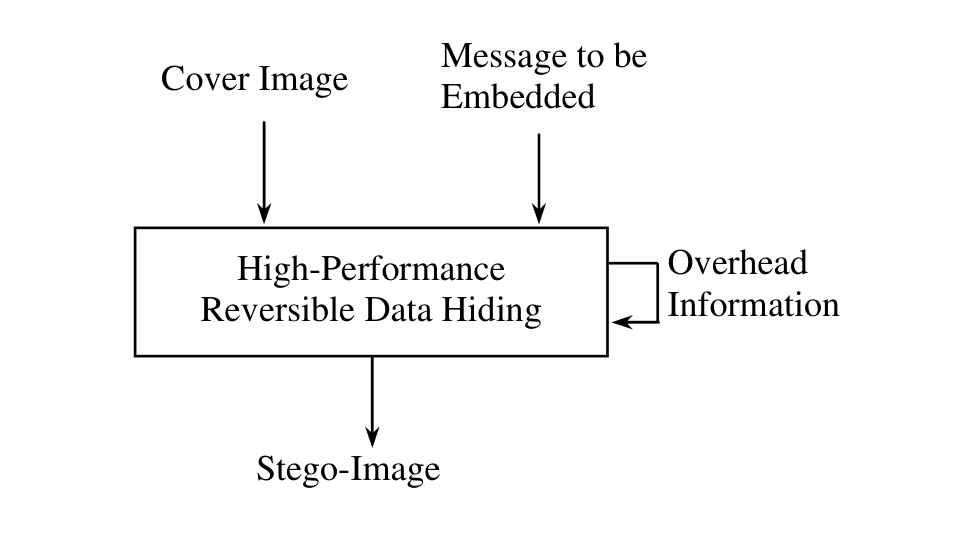
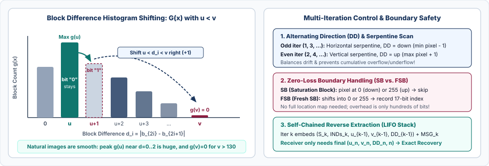
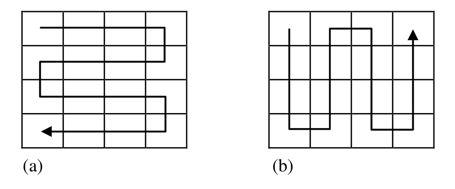
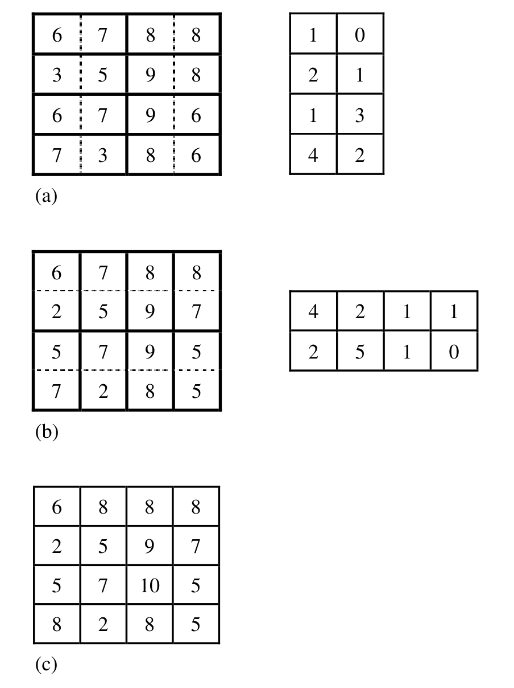
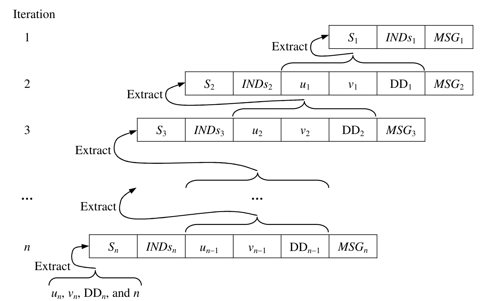
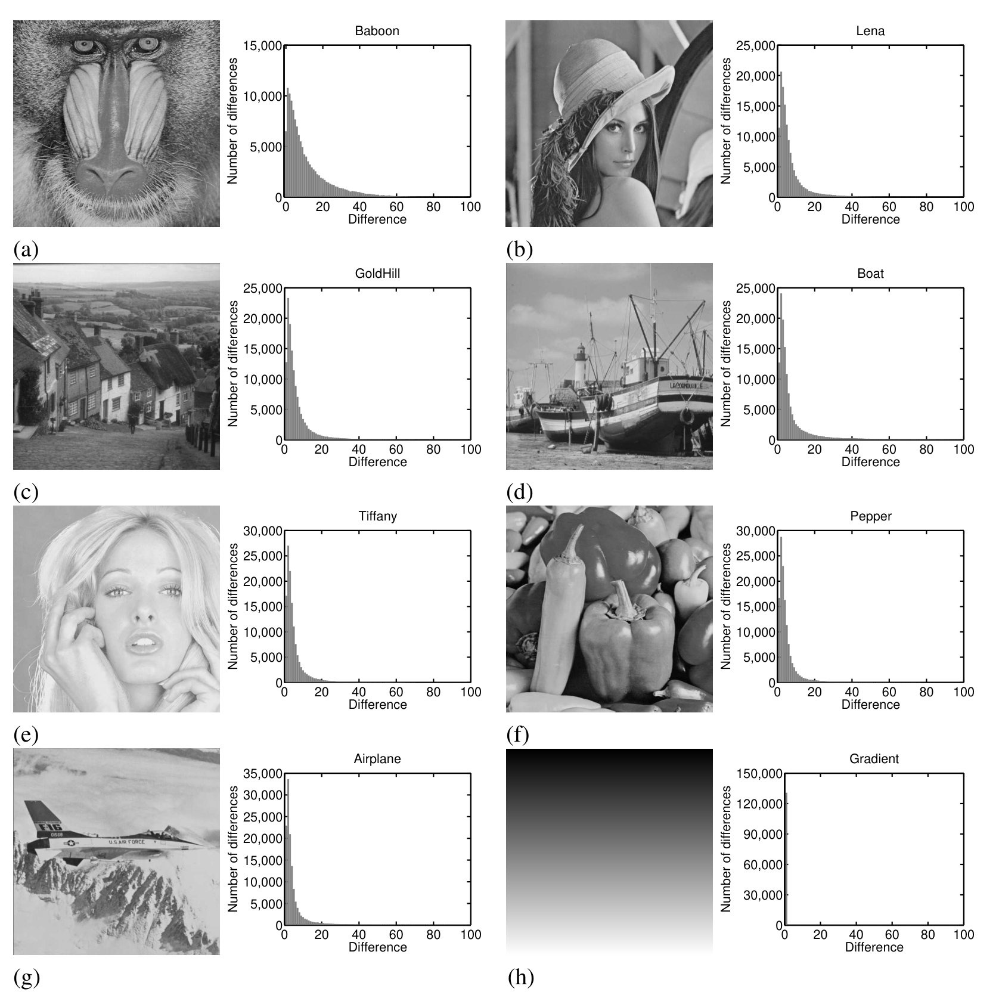
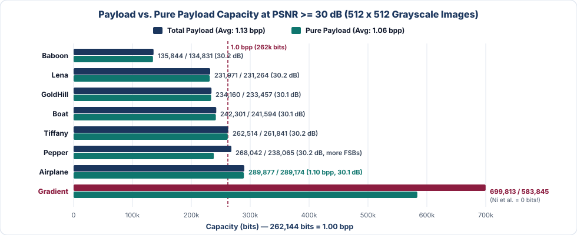
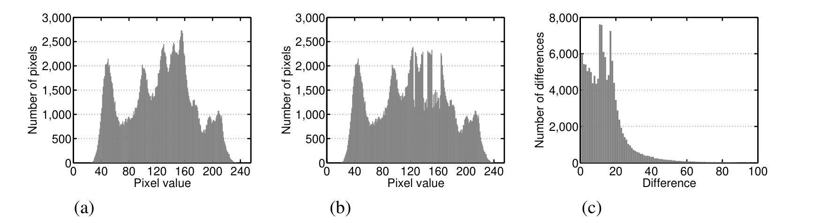
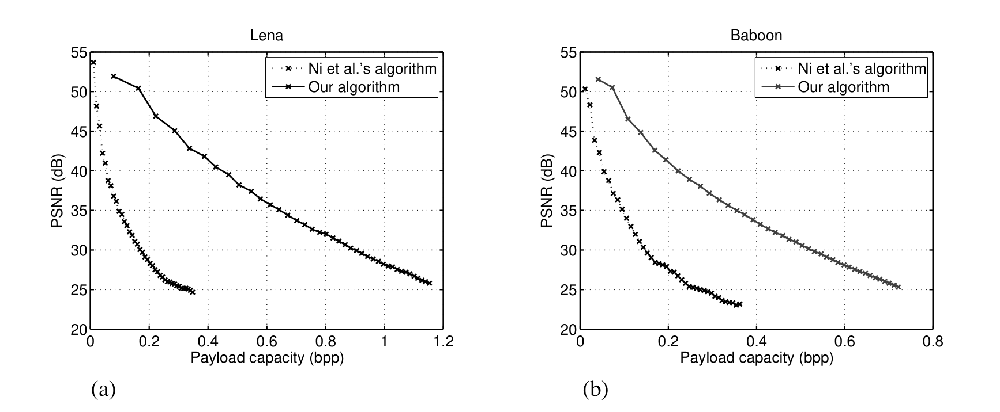

<!-- _class: lead -->

Fundamenta Informaticae · 第 82 卷，頁 155–169 · 2007（IOS Press）

# 高效能可逆式資料隱藏演算法

<strong>High-Performance Reversible Data Hiding</strong> 
以<strong>多回合區塊差值直方圖平移</strong>達成 <strong>PSNR ≥ 30 dB 下逾 1.0 bpp 純藏量</strong>與<strong>原始影像百分之百無失真還原</strong>

<strong>林清泉（Ching-Chiuan Lin）*</strong>、<strong>薛念林（Nien-Lin Hsueh）</strong>、<strong>沈文祥（Wen-Hsiang Shen）</strong> 
逢甲大學資訊工程學系（Department of Information Engineering and Computer Science, Feng Chia University） 
<code>cclin@ocit.edu.tw</code> · <code>nlhsueh@fcu.edu.tw</code> · <code>shen@ocit.edu.tw</code>

關鍵字：可逆式資料隱藏（Reversible data hiding）· 無失真浮水印（Lossless watermark）· 隱寫術 · 區塊差值直方圖

<!--
論文背景與核心摘要：
本論文（林清泉、薛念林、沈文祥，Fundamenta Informaticae 82, 2007, pp. 155–169）提出一種基於「區塊差值直方圖（Block Difference Histogram）」的高效能可逆式資料隱藏演算法。

核心貢獻：
1. 以非重疊兩像素區塊的絕對差值 d_i = |b_{2i} − b_{2i+1}| 建立直方圖，取代 Ni 等人 [16] 的像素強度直方圖，在自然影像與平坦直方圖影像（如 Gradient）中皆能形成高聳峰值。
2. 結合奇偶回合交替之水平／垂直蛇形掃描，以及交替差值方向（DD = down / up），有效平衡像素偏移，並透過飽和區塊（SB）與新飽和區塊（FSB）機制避免龐大位置圖（location map）。
3. 達成平均最大藏量 1.52 bpp（純藏量 1.41 bpp）、PSNR ≥ 30 dB 下平均藏量 1.13 bpp（純藏量 1.06 bpp）、線性 O(N) 時間複雜度與零誤差影像復原。
-->

---

## 簡報大綱（Outline）

  
1

  
<a href="#3">研究背景與可逆隱藏需求</a> 醫療與軍事影像的無失真要求、空間域與頻率域差異、系統方塊圖。

  
2

  
<a href="#4">相關研究與既有瓶頸</a> Fridrich LSB 壓縮、Tian 與 Chang–Lu 差值擴張、Ni 等人直方圖平移之限制。

  
3

  
<a href="#5">區塊差值直方圖平移機制</a> 差值方向（DD）、SB／FSB 邊界規則、蛇形掃描與 4×4 兩回合演練。

  
4

  
<a href="#8">無失真擷取與輔助資訊串鏈</a> 式 (2) 像素復原、LIFO 堆疊解碼與每回合自含式輔助標頭結構。

  
5

  
<a href="#9">實驗設計、結果與複雜度</a> 8 張測試圖（表 1–4）、十回合直方圖持久度（圖 6）、PSNR 曲線（圖 7）與 O(N) 速度。

  
6

  
<a href="#14">結論與實務應用價值</a> 貪婪峰值選取優勢、精簡輔助開銷與關鍵無失真應用場景。

<!--
簡報章節架構說明：
本論文分為四節：第一節說明可逆式資料隱藏之動機並評析壓縮法、差值擴張法與直方圖平移法；第二節正式定義差值方向（DD）、飽和區塊（SB）與新飽和區塊（FSB），完整闡述九步驟多回合嵌入（2.1 節）、八步驟反向擷取（2.2 節）與 4×4 兩回合範例；第三節針對 8 張 512×512 灰階影像與 Ni 等人 [16] 進行藏量、PSNR、輔助資訊與 O(N) 執行時間比較；第四節提出結論。
-->

---

## 1. 研究背景：為何需要可逆式資料隱藏？

<h3>失真隱藏 vs. 可逆無失真隱藏</h3>
<ul class="small-text">
  <li><strong>空間域 vs. 頻率域：</strong>頻率域具較佳強韌性，但空間域能提供遠高於頻率域的隱藏容量。</li>
  <li><strong>永久性破壞問題：</strong>傳統 LSB 取代 [4, 5] 或相鄰差值調整 [6, 7, 8] 皆會對原始像素造成不可逆的損傷。</li>
  <li><strong>零失真剛性需求：</strong>在<strong>醫療影像診斷</strong>與<strong>軍事影像辨識</strong>中，任何永久失真皆不可接受，必須能精準還原原始掩護影像（cover image）。</li>
</ul>

<h3>本研究核心策略</h3>
<ul class="small-text">
  <li>建構<strong>兩像素區塊差值直方圖</strong> <code>di = |b2i − b2i+1|</code>。</li>
  <li>將<strong>秘密訊息</strong>與<strong>極簡輔助資訊</strong>同步嵌入峰值區塊，解碼後達成 100% 原始影像還原。</li>
</ul>

圖 1（論文第 156 頁）：所提可逆式資料隱藏演算法方塊圖——秘密訊息與輔助資訊同步嵌入原始掩護影像。

<!--
研究動機與問題定義（第 1 節，圖 1）：
可逆式資料隱藏（Reversible Data Hiding，又稱無失真浮水印）要求接收端在取出秘密訊息後，能以數學方式將每個像素毫無誤差地復原回原始掩護影像（MSE = 0）。如圖 1 所示，實用化的可逆演算法不能仰賴龐大的外部旁路通道，而須將復原所需的輔助資訊（overhead information）連同秘密訊息同步嵌入影像內部，外部僅需傳送極小量的常數參數。
-->

---

## 1. 相關文獻與既有可逆隱藏技術瓶頸

| 既有可逆技術 | 核心原理 | 本研究所克服之主要限制 |
| :--- | :--- | :--- |
| **Fridrich 等人 [13]**（2002） | 對原始影像 LSB 平面進行無失真壓縮以騰出藏匿空間 | 在高紋理或雜訊影像中 LSB 壓縮率差，導致藏量偏低 |
| **Tian [14]**（2003） | <strong>差值擴張法（DE）：</strong>將可擴張像素對的差值加倍以藏入 1 位元 | 需額外紀錄 <code>⌊M/2⌋</code> 位元之位置圖（location map），開銷與失真皆偏高 |
| **Chang &amp; Lu [15]**（2006） | 擴張像素與前面 <code>k</code> 位元像素均值之差值 | 雖幾乎每像素皆可藏入，但位置圖體積<strong>倍增</strong>，必須依賴壓縮 |
| **Ni 等人 [16]**（2006） | <strong>像素值直方圖平移：</strong>平移峰值與零點之間的像素強度值 | 單次藏量低、多回合後峰值迅速瓦解；在平坦直方圖影像（如 Gradient）<strong>藏量為 0</strong> |
| **本研究（Lin 等人，2007）** | **多回合區塊差值直方圖平移** + 交替蛇形掃描與 DD | 高藏量（<strong>≥30 dB 達 1.13 bpp</strong>）、FSB 開銷僅數百位元、平坦直方圖亦高效運作 |

<!--
文獻比較定位（第 1 節，頁 156）：
Ni 等人（IEEE TCSVT 2006）[16] 為本論文最主要的比較對象，因兩者皆屬於免位置圖、線性時間 O(N) 的直方圖平移家族。然而，自然影像的像素強度分布橫跨 0..255，使 512×512 Lena 的單一峰值不超過 2,800 像素；更甚者，面對均勻漸層（Gradient）等平坦像素直方圖時，沒有零點可供平移，藏量直接歸零。反觀相鄰像素具備極強空間相關性，區塊差值高度集中於 0..5，不僅峰值高出 5 至 15 倍，且差值大於 130 處幾乎必然存在零點（g(v) = 0）。
-->

---

## 2. 核心機制：區塊差值直方圖平移與邊界安全

<strong>式 (1) 將區塊差值增加 1：</strong> &nbsp;
DD=up：(bi+1, bj) 若 bi&gt;bj 否則 (bi, bj+1) &nbsp;|&nbsp;
DD=down：(bi, bj−1) 若 bi&gt;bj 否則 (bi−1, bj)

<!--
核心定義詳解（第 2 節，式 1）：
將 N 像素灰階影像切分為非重疊兩像素區塊 (b_i, b_j)，並定義區塊差值 d_i = |b_i − b_j|。
1. 差值方向（Difference Direction, DD）：將區塊差值加 1 可採「大值加 1」（DD = up）或「小值減 1」（DD = down）。當 b_i = b_j 時，式 (1) 明確約定 DD = up 時調整 b_j + 1、DD = down 時調整 b_i − 1，確保解碼端能唯一無歧義地還原。
2. 飽和區塊（Saturation Block, SB）：當 DD = up 且大值已為 255，或 DD = down 且小值已為 0 時，該區塊無法再向該方向擴張，稱為 SB，嵌入時直接略過不修改。
3. 新飽和區塊（Fresh Saturation Block, FSB）：原本非 SB 的區塊，經平移加 1 後像素觸及 0 或 255 而成為 SB（例如 DD = down 時 (1, 12) 變為 (0, 12)）。為讓解碼端區分原始 SB 與 FSB，只需紀錄少數 FSB 的索引值即可，無須儲存整張影像的位置圖。
-->

---

## 2.1 多回合嵌入演算法與交替蛇形掃描

<h3>九步驟貪婪多回合嵌入流程</h3>
<ol class="small-text">
  <li>初始化差值方向 <code>DD ← down</code>。</li>
  <li><strong>蛇形掃描：</strong>奇數回合採水平蛇形、偶數回合採垂直蛇形，切分為 <code>N/2</code> 個兩像素區塊 <code>(b2i, b2i+1)</code>。</li>
  <li>計算所有非 SB 區塊差值 <code>di = |b2i − b2i+1|</code>，建立直方圖 <code>G(x)</code>。</li>
  <li>尋找最大點 <code>u</code> 與最近的最小點 <code>v</code>（通常 <code>g(v) = 0, v &gt; 130</code>）使 <code>|u − v|</code> 最小。</li>
  <li><strong>第一階段（平移與邊界嵌入）：</strong>將 <code>u &lt; di &lt; v</code> 依式 (1) 加 1；在邊界鄰近之峰值塊（<code>max = 254</code> 或 <code>min = 1</code>）嵌入位元並紀錄產生的 FSB 索引。</li>
  <li><strong>第二階段（輔助資訊 + 訊息）：</strong>在安全峰值塊（<code>max ≤ 253</code> 或 <code>min ≥ 2</code>）依序嵌入 FSB 數量／索引、前回合 <code>(u, v, DD)</code> 與剩餘訊息；若空間不足則回滾並中止。</li>
  <li><strong>反轉 <code>DD</code></strong> 並重複，直到：(a) 訊息藏畢、(b) 空間不足或 (c) 達 PSNR 下限。</li>
  <li>僅將最後回合 <code>(un, vn, DDn, n)</code> 傳給接收端。</li>
</ol>

圖 2（論文第 158 頁）：交替掃描順序 — (a) 水平蛇形掃描（奇數回合）；(b) 垂直蛇形掃描（偶數回合）。

<strong>為何交替掃描方向與 DD？</strong> 
• 在 <code>DD = down</code> 觸及 0 的 FSB，下一回合改為 <code>DD = up</code> 後不再是 SB！ 
• 水平與垂直配對交替可持續產生新的低差值區塊，大幅延緩峰值衰減。

<!--
單回合兩階段設計之數學嚴謹性（第 2.1 節，步驟 6–7）：
為何每一回合要分成步驟 6 與步驟 7 兩次掃描？
- 步驟 6 先處理所有「有可能變成 FSB」的區塊（包含所有 u < d_i < v 的平移塊，以及距離 0 或 255 僅一步之遙的峰值塊）。掃描結束時，本回合所有 FSB 的個數 S 與索引清單 INDs 已經完全確定。
- 步驟 7 僅針對「安全峰值塊」（DD = up 時 max <= 253；DD = down 時 min >= 2）進行嵌入，這些區塊就算加 1 或減 1 也絕不可能觸及 0 或 255，因此不會再產生任何新的 FSB。藉此保證輔助資訊寫入過程 100% 封閉且可於解碼端優先無誤讀出。
- 特殊邊界註記：面對全黑或全白影像時，DD 須分別固定為 up 或 down，否則會立刻飽和而無法嵌入。
-->

---

## 2.1 兩回合實例演練：4×4 影像嵌入 <code>011010</code>

<h3>目標訊息：<code>011010</code>（共 6 位元）</h3>
<ul class="small-text">
  <li><strong>第 1 回合（奇數 · 水平蛇形 · <code>DD = down</code>）：</strong>
    <ul>
      <li>直方圖峰值 <code>u = 1</code>（<code>g(1) = 3</code>：區塊 0、2、4），零點 <code>v = 5</code>。</li>
      <li>將 <code>1 &lt; di &lt; 5</code> 之區塊小值減 1（如區塊 3：<code>|3−5|=2 ➔ |2−5|=3</code>）。</li>
      <li>區塊 1 <code>(8, 8)</code> 之 <code>d1 = 0 &lt; u</code> ➔ 維持不變。</li>
      <li>於區塊 0、2、4 嵌入 <code>0, 1, 1</code> ➔ 反轉 <code>DD ← up</code>。</li>
    </ul>
  </li>
</ul>

<h3>第 2 回合（偶數 · 垂直蛇形 · <code>DD = up</code>）</h3>
<ul class="small-text">
  <li>重新配對為 8 個垂直兩像素區塊；新峰值 <code>u = 1</code>（<code>g(1) = 3</code>：區塊 4、5、7），零點 <code>v = 3</code>。</li>
  <li>將 <code>1 &lt; di &lt; 3</code> 之區塊大值加 1。</li>
  <li>於區塊 4、5、7 嵌入 <code>0, 1, 0</code>（全程無 SB 發生）。</li>
  <li><strong>外部僅傳送：</strong><code>u=1, v=3, DD=up, n=2</code>！</li>
</ul>

圖 3（論文第 160 頁）：(a) 原始 4×4 影像與水平區塊差值；(b) 第 1 回合結果與垂直差值；(c) 第 2 回合最終偽裝影像。

<!--
實例逐步驗證（第 2.1 與 2.2 節，圖 3）：
圖 3(a) 依水平蛇形編號（左上像素 0 為 6、右側像素 1 為 7，下方像素 7 為 3）。第 1 回合（DD = down, u = 1, v = 5）在區塊 0、2、4 分別嵌入 "0"、"1"、"1"，使區塊 0 維持 (6,7)、區塊 2 變為 (7,9)、區塊 4 變為 (5,7)，同時其餘 1 < d < 5 的區塊小值皆減 1，得到圖 3(b)。
第 2 回合（DD = up, u = 1, v = 3）改採垂直蛇形分塊，區塊 4、5、7 差值為 1，依序嵌入 "0"、"1"、"0" 得圖 3(c)。反向擷取時，接收端先以偶數回合垂直分塊（DD = up, u = 1, v = 3）取出 "010" 並將像素 3、7、10 減 1 還原、將 "010" 壓入堆疊；再以奇數回合水平分塊（DD = down, u = 1, v = 5）取出 "011" 並將像素 4、7、8、11、12、14 加 1 還原；最後自堆疊彈出完整 "011010" 與 100% 原始影像。
-->

---

## 2.2 無失真擷取流程與自含式輔助資訊串鏈

<h3>像素精準復原公式（式 2）</h3>

DD=up： &nbsp;&nbsp;(b'i−1, b'j) 若 b'i&gt;b'j 否則 (b'i, b'j−1) 
DD=down：(b'i, b'j+1) 若 b'i&gt;b'j 否則 (b'i+1, b'j)

<ol class="small-text">
  <li>讀取外部傳入之極簡參數：<code>(un, vn, DDn, n)</code>。</li>
  <li><strong>階段 1（安全區塊）：</strong>若 <code>di=u</code> 取出 <code>0</code>；若 <code>di=u+1</code> 取出 <code>1</code> 並依式 (2) 復原。</li>
  <li>從剛取出的輔助區解碼 <code>Sk</code>、<code>INDsk</code> 與前回合 <code>(uk−1, vk−1, DDk−1)</code>。</li>
  <li><strong>階段 2（邊界與平移塊）：</strong>憑 <code>INDsk</code> 辨識 FSB，取出邊界位元並復原所有 <code>u+1 &lt; di ≤ v</code> 區塊（略過原 SB）。</li>
  <li>依序將階段 2 與階段 1 位元壓入 <strong>LIFO 堆疊</strong>，重複 <code>k = n ... 1</code> 後彈出完整訊息。</li>
</ol>

圖 4（論文第 162 頁）：n 回合反向擷取架構——每回合 k 內部皆串鏈儲存 (Sk, INDsk, uk−1, vk−1, DDk−1, MSGk)。

<!--
反向擷取正確性解析（第 2.2 節，式 2，圖 4）：
由於嵌入時每回合先執行步驟 6（邊界與平移塊）再執行步驟 7（安全峰值塊），擷取時正好以相反順序先掃描安全峰值塊（步驟 3），優先還原出該回合的 FSB 數量 S_k 與索引清單 INDs_k。接著在步驟 5 掃描邊界區塊時，即可憑 INDs_k 精準區分「本回合才觸邊的 FSB」（須依式 2 還原，且若 d_i = u + 1 則取出位元 1）與「原本就是邊界的 SB」（維持不動）。最後透過後進先出（LIFO）堆疊反轉各回合與各階段的位元順序，完美重建 MSG_1 || ... || MSG_n 並零誤差復原原圖。
-->

---

## 3. 實驗設定、輔助資訊格式與 8 張標準測試影像

<h3>實驗平台與輔助資訊位元配置（表 1–2）</h3>
<ul class="small-text">
  <li><strong>實作環境：</strong>Java / Windows XP（Intel Pentium 4 2.4 GHz）；將 <strong>Lena</strong> 作為秘密訊息嵌入 8 張 512×512×8 灰階影像。</li>
  <li><strong>比較基準：</strong>於相同平台實作 Ni 等人 [16] 演算法。</li>
  <li><strong>512×512 位元估算：</strong>共 <code>⌊N/2⌋ = 131,072</code> 區塊 ➔ 單一 FSB 索引需 <code>17 位元</code>；最大可藏 FSB 數 <code>m &lt; 131,072/17</code> ➔ 數量 <code>S</code> 需 <code>13 位元</code>。</li>
</ul>

| 欄位說明 | 第 1 回合（表 1） | 後續回合 `k ≥ 2`（表 2） |
| :--- | :---: | :---: |
| FSB 個數（`S`） | 13 bits | 13 bits |
| FSB 索引清單（`INDs`） | `17 × S` bits | `17 × S` bits |
| 前回合 `(u, v, DD)` | — | `8 + 8 + 1 = 17` bits |
| 使用者純訊息（`MSG`） | 剩餘可用空間 | 剩餘可用空間 |

圖 5（論文第 164 頁）：8 張 512×512 測試影像（由粗糙至平滑）與區塊差值直方圖（d ≤ 100）：Baboon、Lena、GoldHill、Boat、Tiffany、Pepper、Airplane 與合成影像 Gradient。

<!--
測試影像與輔助開銷分析（第 3 節，表 1–2，圖 5）：
圖 5 涵蓋從高度粗糙的 Baboon（峰值約 12,000 塊）到標準自然影像 Lena、GoldHill、Boat、Tiffany、Pepper、Airplane（峰值 20,000–35,000 塊），再到電腦產生的漸層影像 Gradient（峰值高達約 131,000 塊）。
依表 1 與表 2 結構，當影像在 PSNR ≥ 30 dB 區間幾乎沒有 FSB 產生時，每回合固定輔助資訊僅 13 位元（首回合）或 30 位元（後續回合）；因此 23 至 24 回合總輔助開銷僅約 700 位元，佔總藏量不到 0.3%。
-->

---

## 3. 八張影像最大藏量評測結果（表 3）

| 掩護影像 | PSNR (dB) | 回合數 | 總藏量 (bits) | 純藏量 (bits) | 純藏量 (bpp) |
| :--- | :---: | :---: | :---: | :---: | :---: |
| **Baboon** | 20.0 | 76 | 264,458 | 243,512 | 0.93 |
| **Boat** | 23.6 | 52 | 348,745 | 335,608 | 1.28 |
| **Lena** | 21.0 | 72 | 384,657 | 374,354 | 1.43 |
| **Airplane** | 18.4 | 101 | 498,034 | 484,243 | 1.85 |
| **Pepper** | 28.9 | 28 | 288,988 | 250,119 | 0.95 |
| **Tiffany** | 24.1 | 49 | 363,904 | 357,436 | 1.36 |
| **GoldHill** | 23.7 | 51 | 335,310 | 319,041 | 1.22 |
| **Gradient** | **30.4** | 27 | **699,813** | **583,845** | **2.23** |
| **八圖平均** | 23.8 | 57 | **397,989 (1.52 bpp)** | **368,520 (1.41 bpp)** | **1.41** |

  
1.52 / 1.41 bpp

  
8 張測試影像之平均最大總藏量／純藏量，且 100% 無失真還原。

  
699,813 bits

  
<strong>Gradient</strong> 於 27 回合達 2.67 bpp 總藏量（純藏量 2.23 bpp、30.4 dB），而 Ni 等人為 <strong>0 位元</strong>！

<h3>影像特性觀察</h3>
<ul class="small-text">
  <li><strong>Airplane（平滑）：</strong>101 回合藏量高達 498,034 位元。</li>
  <li><strong>Pepper（邊界像素多）：</strong>早期即出現大量 FSB，於第 29 回合終止，仍具 288,988 位元與 <strong>28.9 dB</strong>。</li>
</ul>

<!--
表 3 最大藏量數據解析（第 3 節，頁 165–166）：
表 3 紀錄各影像持續嵌入直到「下一回合輔助資訊超過可用空間」之最大極限。八張影像平均總藏量達 397,989 位元（1.52 bpp），扣除輔助資訊後平均純藏量仍達 368,520 位元（1.41 bpp）。
Pepper 是極具代表性的案例：雖然整體畫面平滑，但因極暗與極亮像素比例較高，前 28 回合累計產生 38,869 位元 FSB 開銷並於第 29 回合自動中止，卻也因此維持高達 28.9 dB 之畫質。反觀 Lena 在 72 回合僅花費 10,303 位元開銷（2.7%），Tiffany 在 49 回合更僅花費 6,468 位元（1.8%）。
-->

---

## 3. 高畫質門檻評測：PSNR ≥ 30 dB 藏量比較（表 4）

= 30 dB 下 8 張測試影像之總藏量與純藏量比較" style="max-height: 335px;">

  
1.13 bpp

  
於 PSNR ≥ 30 dB 條件下，8 張影像平均總藏量（執行 23–27 回合）。

  
1.06 bpp

  
平均<strong>純藏量</strong>突破 1 bit/pixel，同時保有 30 dB 以上視覺品質與無失真復原！

  
約 700 位元開銷

  
Boat、Lena、Airplane、Tiffany 與 GoldHill 的總輔助開銷僅 <strong>673–707 位元</strong>（&lt; 0.3%）。

<!--
表 4 高畫質門檻數據解析（第 3 節，頁 165–166）：
當視覺品質限制於 PSNR ≥ 30 dB 時，7 張自然影像皆穩定執行 23 至 24 回合（PSNR 介於 30.1–30.2 dB），Gradient 則完成 27 回合（30.4 dB）。
各影像實際輔助資訊量（總藏量 − 純藏量）：
- Baboon：1,013 bits；Boat：707 bits；Lena：707 bits；Airplane：703 bits；Tiffany：673 bits；GoldHill：703 bits。
- 僅 Pepper（29,977 bits）與 Gradient（115,968 bits）因邊界像素較多而有較高 FSB 開銷，但兩者仍分別提供 238,065 bits（0.91 bpp）與 583,845 bits（2.23 bpp）的龐大純藏量。
-->

---

## 3. 直方圖峰值持久度比較：vs. Ni 等人 [16]（圖 6）

圖 6（論文第 167 頁）：Lena 直方圖比較 — (a) Ni 等人原始像素直方圖；(b) Ni 等人十回合後直方圖（峰值皆 &lt; 2,500）；(c) 本方法十回合後區塊差值直方圖（仍有多組峰值 &gt; 7,000！）。

<h3>Ni 等人 [16]：峰值快速耗竭</h3>
<ul class="small-text">
  <li>像素值分散於 <code>0..255</code>，Lena 初始最高峰值即不足 <strong>2,800 像素</strong>。</li>
  <li>經過 10 回合後，所有峰值皆跌破 <strong>2,500 位元</strong>，後續藏量迅速枯竭。</li>
</ul>

<h3>本方法：高聳峰值持久不衰</h3>
<ul class="small-text">
  <li>相鄰像素高度相關，使初始區塊差值峰值突破 <strong>20,000 區塊</strong>。</li>
  <li>歷經 10 回合後，仍保有數個單回合可藏逾 <strong>7,000 位元</strong>的峰值，近乎 Ni 等人的 <strong>3 倍</strong>！</li>
</ul>

<!--
多回合藏量優勢之結構根源（第 3 節，圖 6）：
圖 6 直觀揭示了本方法遠勝 Ni 等人 [16] 的原因：在圖 6(a)–(b) 中，Ni 等人的像素直方圖每次嵌入隨機 0/1 位元都會將峰值一分為二，十回合後整條曲線已迅速破碎並壓低至 2,500 以下。反觀圖 6(c) 的區塊差值直方圖，不僅初始高度高出約 8 倍，加上水平與垂直掃描交替重新組合像素對，即使十回合後仍維持超過 7,000 區塊的高聳尖峰。
-->

---

## 3. 失真–藏量曲線與線性時間複雜度（圖 7）

圖 7（論文第 167 頁）：前 40 回合之影像品質（PSNR）與藏量（bpp）比較 — (a) Lena；(b) Baboon。

<h3>35 dB 下藏量領先 3.5 至 6.5 倍</h3>
<ul class="small-text">
  <li><strong>Lena（PSNR = 35 dB）：</strong>本方法達 <strong>~0.65 bpp</strong>，Ni 等人僅 <strong>~0.10 bpp</strong>（<strong>6.5 倍</strong>）。</li>
  <li><strong>Baboon（PSNR = 35 dB）：</strong>本方法達 <strong>~0.35 bpp</strong>，Ni 等人僅 <strong>~0.10 bpp</strong>（<strong>3.5 倍</strong>）。</li>
  <li>其餘六張測試影像亦呈現數倍以上之藏量優勢。</li>
</ul>

<h3>線性時間複雜度 O(N) 與實測速度</h3>
<ul class="small-text">
  <li><strong>嵌入複雜度：</strong>每回合掃描影像 3 次 ➔ <code>O(3nN) = O(N)</code>（與 Ni 等人同階）。</li>
  <li><strong>擷取複雜度：</strong>每回合掃描影像 2 次 ➔ <code>O(2nN) = O(N)</code>。</li>
  <li><strong>實測耗時：</strong>Lena 執行 72 回合嵌入（374,354 純位元 + 10,303 輔助位元）加擷取僅耗時 <strong>4,150 ms</strong>（Pentium 4 2.4 GHz 平均 <strong>58 ms/回合</strong>）。</li>
</ul>

<!--
率失真與計算複雜度驗證（第 3 節，圖 7，頁 166–167）：
圖 7 繪出前 40 回合在 Lena（中度平滑）與 Baboon（高紋理）上的完整率失真曲線，從 25 dB 至 52 dB 全區間本方法皆大幅領先 Ni 等人 [16]。
複雜度分析：每回合嵌入共掃描 N 像素影像 3 次（步驟 2 建直方圖、步驟 6 平移與 FSB 記錄、步驟 7 寫入輔助資訊與訊息），於 256 格直方圖尋峰僅需常數時間 O(1)，至多修改 ⌊N/2⌋ 個像素，故 n 回合為 O(3nN)；擷取每回合掃描 2 次（步驟 3 與步驟 5），為 O(2nN)。因回合數 n 獨立於像素數 N，整體皆為嚴格線性時間 O(N)。
-->

---

## 4. 結論與實務應用價值

  
1.06 bpp 純藏量

  
於 PSNR ≥ 30 dB 下平均純藏量逾 1 bpp（總藏量 1.13 bpp；極限平均 1.52 bpp），且 100% 無失真復原。

  
35 dB 領先 6.5×

  
Lena 於 35 dB 下達 0.65 bpp（對比 Ni 等人 0.10 bpp），更徹底突破平坦直方圖影像（Gradient：699k vs. 0 位元）。

  
O(N) · 58 ms/回合

  
貪婪峰值選取演算法實作簡潔、線性時間執行，多數自然影像輔助開銷僅約 700 位元。

<strong>1. 貪婪峰值最佳化</strong> 每回合動態挑選最高差值峰值 <code>u</code> 與最近空槽 <code>v</code>，以最少像素位移換取最大單回合藏量。

<strong>2. 邊界安全免位置圖</strong> 交替反轉 <code>DD = down / up</code> 並僅紀錄新飽和區塊（FSB）索引，徹底省去龐大的全圖位置圖負擔。

<strong>3. 關鍵領域實用性</strong> 特別適用於醫療影像歸檔、軍事偵照與司法鑑識等同時要求高容量與零誤差復原之應用。

<!--
研究貢獻總結（第 4 節，頁 168）：
本論文提出的區塊差值直方圖平移演算法同時兼顧了可逆式資料隱藏的三大核心指標：
1. 高藏量與高視覺品質並存：橫跨高紋理至極平滑影像皆能於 PSNR ≥ 30 dB 下實現逾 1 bpp 之平均純藏量。
2. 極低輔助資訊且免位置圖：自含式 FSB 索引串鏈使多數自然影像僅需數百位元開銷，外部僅需傳送最終 (u_n, v_n, DD_n, n)。
3. 演算法簡潔且線性高效：O(N) 複雜度與單回合 58 ms 實測速度，具備高度工程落地價值。
-->

---

<!-- _class: closing -->

# 感謝聆聽 · 敬請指教！

高效能可逆式資料隱藏演算法（High-Performance Reversible Data Hiding）

<strong>林清泉（Ching-Chiuan Lin）*</strong> · <code>cclin@ocit.edu.tw</code> 
<strong>薛念林（Nien-Lin Hsueh）</strong> · <code>nlhsueh@fcu.edu.tw</code> &nbsp;|&nbsp; <strong>沈文祥（Wen-Hsiang Shen）</strong> · <code>shen@ocit.edu.tw</code> 
逢甲大學資訊工程學系（Department of Information Engineering and Computer Science, Feng Chia University） 
Fundamenta Informaticae，第 82 卷，頁 155–169，2007 年 · IOS Press

<!--
論文書目資料：
- 篇名：High-Performance Reversible Data Hiding（高效能可逆式資料隱藏演算法）
- 作者：Ching-Chiuan Lin（通訊作者，cclin@ocit.edu.tw）、Nien-Lin Hsueh（nlhsueh@fcu.edu.tw）、Wen-Hsiang Shen（shen@ocit.edu.tw）
- 單位：逢甲大學資訊工程學系（Taichung 40724, Taiwan, ROC）
- 期刊：Fundamenta Informaticae 82 (2007) 155–169, IOS Press
- 關鍵字：Reversible data hiding, lossless watermark, steganography
-->

