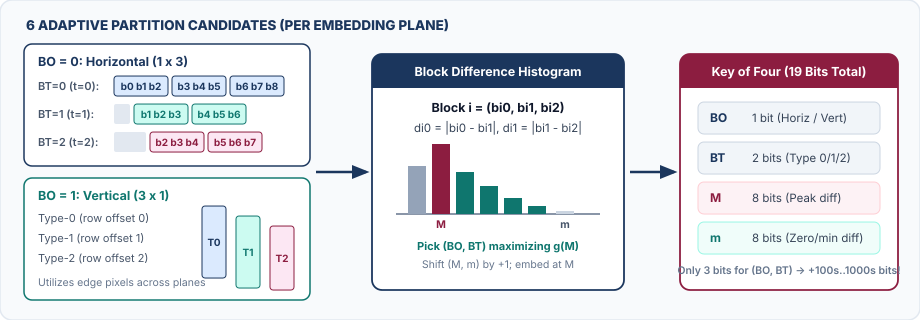
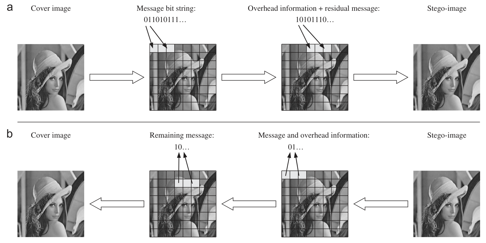
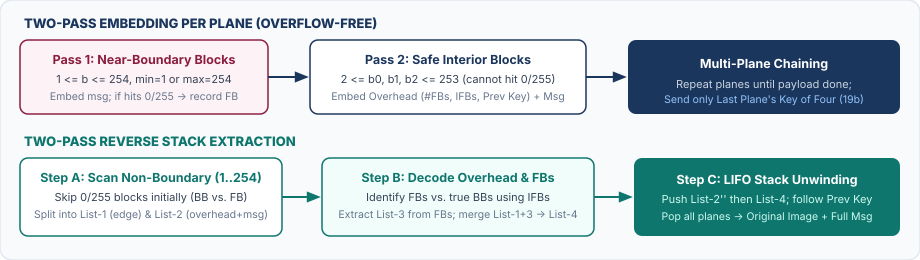
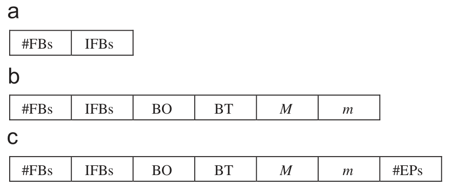
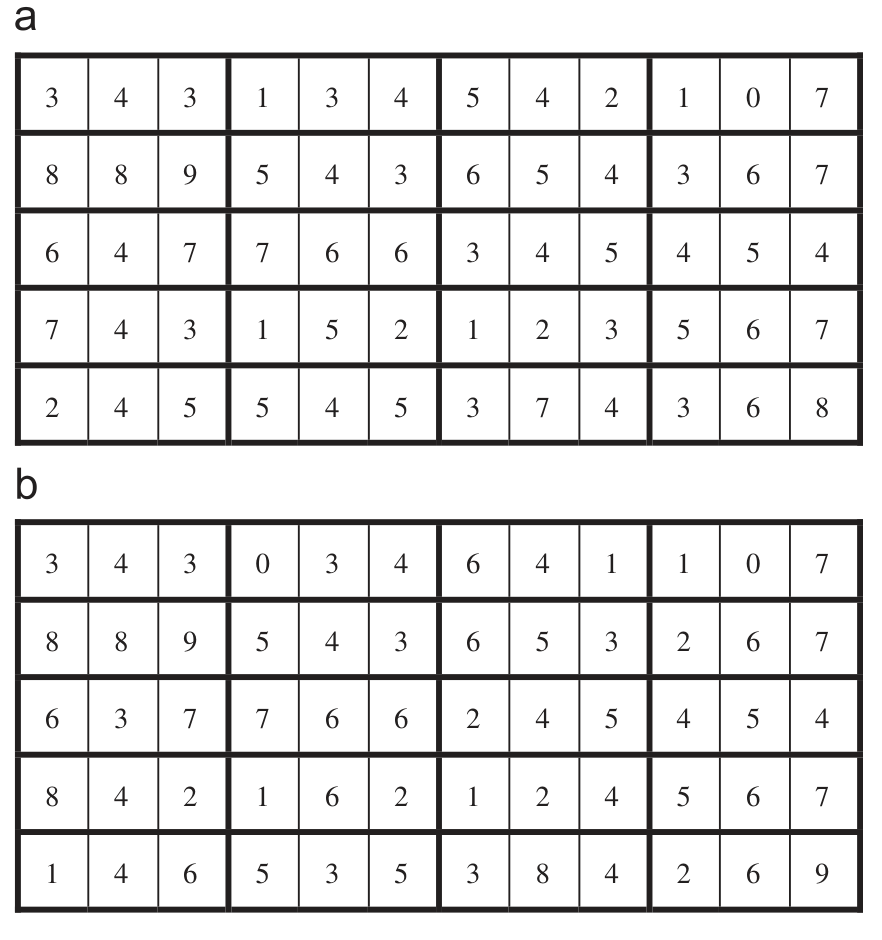
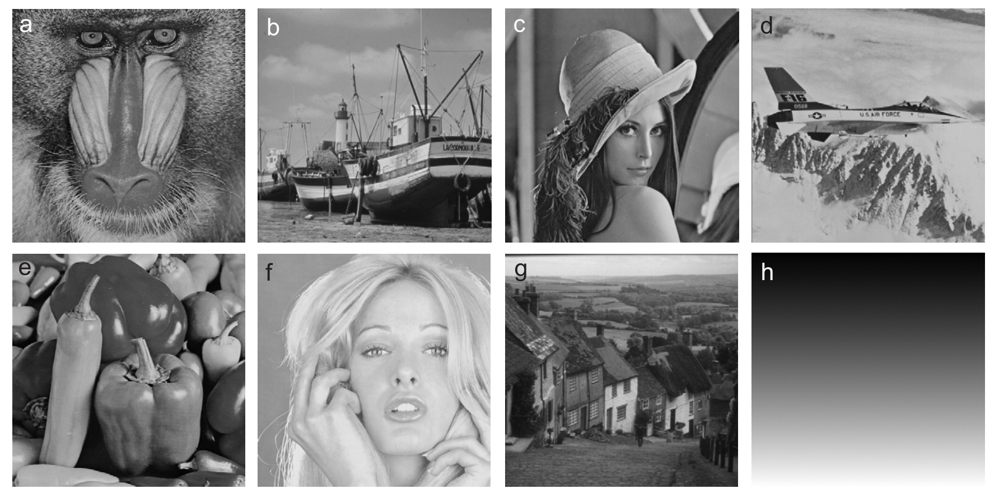
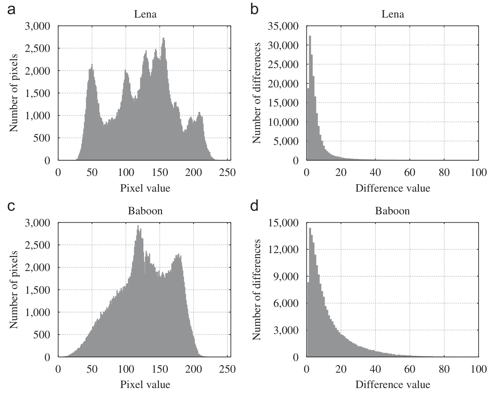
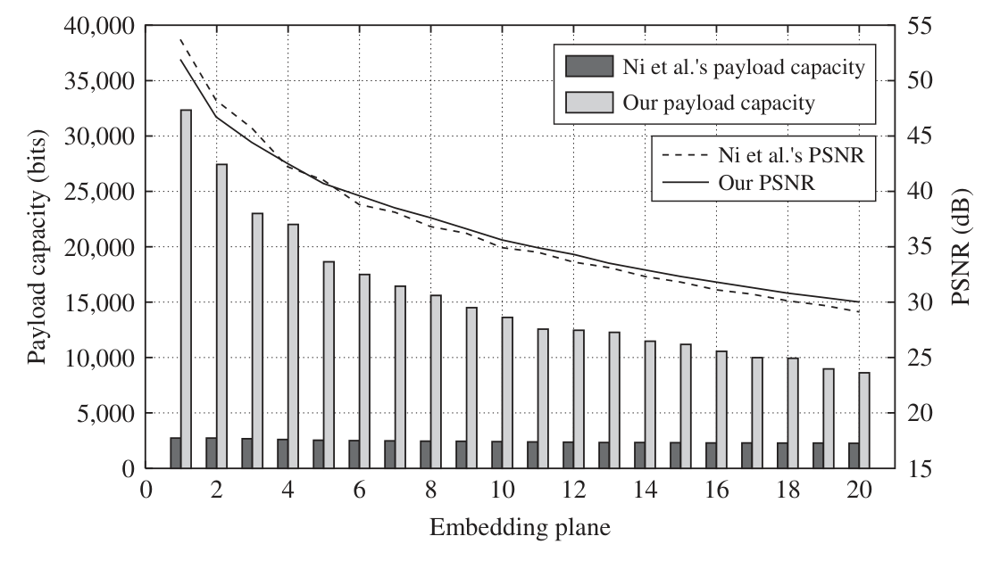
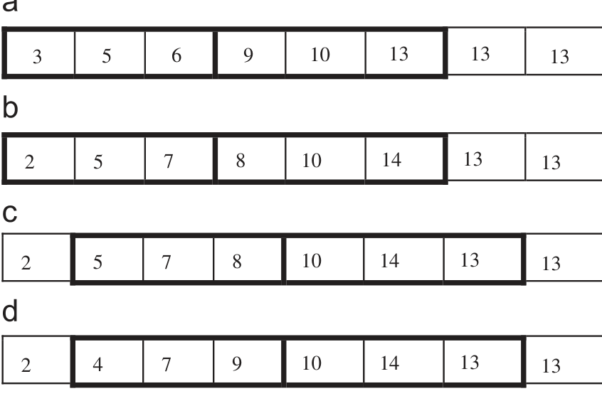
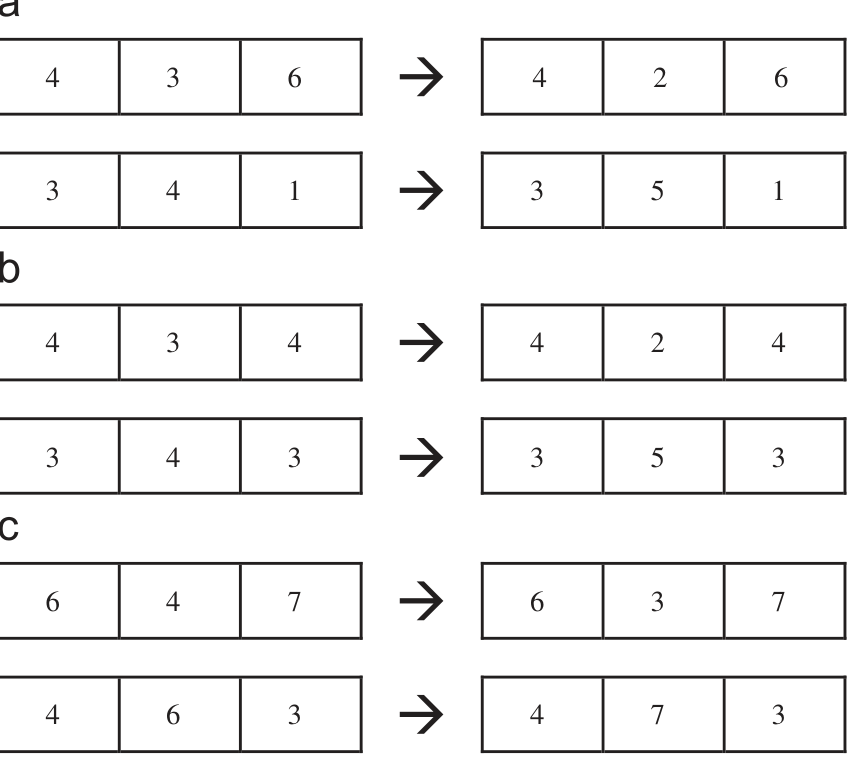

<!-- _class: lead -->

Pattern Recognition · Vol. 41 (2008) 1415–1425 · Elsevier

# A Lossless Data Hiding Scheme Based on Three-Pixel Block Differences

Enhancing histogram-shifting reversible data hiding with adaptive <strong>three-pixel block differences</strong>, two-pass boundary management, and central-pixel optimization — achieving up to <strong>2.08 bpp</strong> average payload (<strong>6×–10×</strong> higher than Ni et al.)

<strong>Ching-Chiuan Lin*</strong> · <code>cclin@ocit.edu.tw</code> (Dept. of Information Management, OCIT &amp; Ph.D. Candidate, FCU) 
<strong>Nien-Lin Hsueh</strong> · <code>nlhsueh@fcu.edu.tw</code> (Dept. of Information Engineering and Computer Science, Feng Chia University) 
Taichung 40724, Taiwan, ROC · DOI: <code>10.1016/j.patcog.2007.09.005</code>

<!--
Bibliographic & Research Overview:
This paper (Ching-Chiuan Lin & Nien-Lin Hsueh; Pattern Recognition, Vol. 41, 2008, pp. 1415–1425, Elsevier; received Oct 19, 2006, accepted Sep 6, 2007) proposes a high-capacity lossless (reversible) data hiding scheme based on histogram shifting of three-pixel block differences.

Core Breakthrough:
While Ni et al.'s (2006) pixel-value histogram shifting achieves simple lossless recovery without large location maps, natural images rarely have a single pixel value exceeding 3,000 occurrences, restricting capacity. By switching from raw pixel values to absolute differences (|b_i0 - b_i1| and |b_i1 - b_i2|) inside adaptively partitioned 3-pixel blocks, the histogram peak surges over 10x (e.g., 32,339 on Lena). Combined with multi-plane chaining, two-pass Fresh Boundary Block (FB) tracking, and single-pixel central modification for "11" bit pairs, the scheme attains 2.08 bpp average total payload (1.79 bpp pure) and 1.39 bpp (1.32 bpp pure) at PSNR >= 30 dB.
-->

---

## Outline

1

<a href="#3">Motivation &amp; Prior Art</a> Lossless steganography for medical/military domains and why pixel-histogram shifting stalls.

2

<a href="#4">Adaptive 3-Pixel Block Differences</a> 6 partition candidates (BO × BT), block-difference histogram, and the 19-bit Key of Four.

3

<a href="#5">Two-Pass Architecture &amp; Rules</a> BB vs. FB boundary handling, overhead bit budgets, 9-branch embedding, and 36-case extraction.

4

<a href="#8">Multi-Plane Stack &amp; Walkthrough</a> Complete 5×12 image trace showing partition selection, FB logging, and LIFO recovery.

5

<a href="#9">Experimental Results</a> 8 benchmark images, Tables 1–2 (up to 2.08 bpp), histogram concentration, and Ni et al. comparison.

6

<a href="#13">Discussion &amp; Conclusions</a> Block-type alternation distortion cancellation, central-pixel single edit, and key takeaways.

<!--
Structural Map of the Paper:
- Section 1 (Introduction, pp. 1415–1416): Contrasts encryption (DES/RSA) with imperceptible data hiding, motivates lossless restoration, and reviews LSB compression (Fridrich et al.), G-LSB (Celik et al.), Difference Expansion (Tian, Alattar, Chang & Lu), and Histogram Shifting (Ni et al.).
- Section 2 (The Proposed Scheme, pp. 1416–1421): Presents the two-pass embedding overview (Fig. 1), formal 9-step embedding algorithm (2.1, Figs. 2–3), overhead bit-budget derivation (2.2, Fig. 4), 9-step reverse-stack extraction (2.3, Fig. 5), and a worked 5x12 example (2.4, Fig. 6).
- Section 3 (Experimental Results, pp. 1421–1423): Evaluates 8 grayscale 512x512 images (Fig. 7) for max capacity (Table 1) and PSNR >= 30 dB (Table 2), plus histogram (Fig. 8) and multi-plane PSNR/payload (Fig. 9) comparisons against Ni et al.
- Section 4 (Discussion, pp. 1423–1424): Analyzes two key distortion-reduction drivers: alternating block types (Fig. 10) and central-pixel shared modification (Fig. 11).
- Section 5 (Conclusions, pp. 1424–1425): Summarizes the 6x–10x capacity advantage over Ni et al. across smooth to complex imagery.
-->

---

## 1. Motivation & Limitations of Prior Lossless Schemes

<h3>Steganography vs. Encryption</h3>
<ul class="small-text">
<li><strong>Encryption (DES, RSA)</strong> scrambles content into meaningless ciphertext, alerting interceptors that secret data exist.</li>
<li><strong>Data Hiding</strong> embeds secrets imperceptibly into cover media, but permanent distortion is unacceptable in <strong>medical and military</strong> applications.</li>
<li><strong>Goal</strong>: Achieve <em>exact lossless cover recovery</em> with high payload capacity and high visual quality (PSNR).</li>
</ul>

<h3>Why Existing RDH Schemes Bottleneck</h3>
<ul class="small-text">
<li><strong>LSB / G-LSB Compression</strong> (Fridrich et al.; Celik et al.): Payload depends heavily on spatial compression efficiency.</li>
<li><strong>Difference Expansion</strong> (Tian; Alattar; Chang &amp; Lu): Requires a <strong>large location map</strong> to track expanded pairs/vectors.</li>
<li><strong>Pixel Histogram Shifting</strong> (Ni et al., 2006): Simple and map-free, but natural images have few pixels sharing the exact peak value <code>M</code> (&lt; 3,000 bits/plane on Lena).</li>
</ul>

<strong>Core Insight of This Paper</strong>: Neighboring pixels in natural images are highly correlated, so their <strong>block differences</strong> concentrate sharply near 0–25. Shifting a <strong>three-pixel block-difference histogram</strong> boosts peak capacity by <strong>10×+</strong>, while in the best case embedding <strong>2 bits ("11")</strong> modifies only the single central pixel by <code>±1</code>!

<!--
Research Motivation & Literature Positioning (Section 1, pp. 1415–1416):
The paper positions its method at the intersection of two major RDH lineages:
1. Compression-based & DE-based schemes (Fridrich et al. [6,7], Celik et al. [8,9], Tian [10], Alattar [11], Chang & Lu [12]) achieve high capacity but pay a steep overhead penalty (large location maps or fragile residual compression).
2. Ni et al.'s (2006) histogram-shifting algorithm [13] eliminates large location maps by shifting pixel values between the histogram peak M and minimum point m by 1, then shifting M by +1 or 0 to embed bit "1" or "0". However, pixel intensities in natural images are broadly distributed across [30, 230], capping single-plane payload to fewer than 3,000 bits on 512x512 Lena.

By shifting the domain from raw pixel intensities to absolute differences inside non-overlapping 3-pixel blocks—where each block yields two differences sharing a central pixel—Lin & Hsueh preserve histogram shifting's low overhead while dramatically increasing both peak height and bits-per-pixel-edit efficiency.
-->

---

## 2. Core Idea: 3-Pixel Block Differences & Adaptive Partitioning

<h3>Adaptive Block Partitioning</h3>

For every embedding plane, evaluate all <strong>6 partitions</strong>: <code>BO ∈ {Horizontal 1×3, Vertical 3×1}</code> × <code>BT ∈ {Type-0, Type-1, Type-2}</code> (offset <code>t = 0, 1, 2</code>). Select the partition maximizing peak count <code>g(M)</code>.

<h3>Block Differences &amp; Key of Four</h3>

Each block <code>(bi0, bi1, bi2)</code> yields <code>di0 = |bi0 - bi1|</code> and <code>di1 = |bi1 - bi2|</code>. Find peak <code>M</code> and min <code>m</code> (<code>M &lt; m</code>, smallest <code>|M - m|</code>). Only <strong>3 extra bits</strong> for <code>(BO, BT)</code> gain hundreds to thousands of bits per plane!

<!--
Adaptive Partitioning & Key of Four (Section 2.1, pp. 1416–1418):
An h x w grayscale image can be partitioned into non-overlapping 3-pixel blocks along two orientations (BO) and three starting offsets (BT, t in {0, 1, 2}):
- Horizontal (1x3): (b_{u, 3v+t}, b_{u, 3v+t+1}, b_{u, 3v+t+2})
- Vertical (3x1): (b_{3u+t, v}, b_{3u+t+1, v}, b_{3u+t+2, v})

For each of the 6 candidates, blocks containing any boundary pixel (0 or 255) are excluded when building the difference histogram g(d) for 0 <= d <= 253. The encoder finds maximum g(M) and minimum g(m) (with M < m, breaking ties by minimizing |M - m| so fewer differences need shifting).
The winning quadruple (BO, BT, M, m)—termed the "Key of Four"—defines one embedding plane with gross capacity g(M) bits and costs only 1 + 2 + 8 + 8 = 19 bits to encode.
Note: The paper notes that g(m) = 0 in virtually all test images (few differences exceed 130); if g(m) != 0, those block indices would simply be logged in overhead.
-->

---

## 2.2 Two-Pass Embedding & Extraction Overview

Fig. 1. Two-pass embedding (a) and reverse two-pass extraction (b) preventing boundary ambiguity.

<h3>Boundary Blocks (BB) vs. Fresh Boundary Blocks (FB)</h3>
<ul class="small-text">
<li><strong>BB</strong>: Any block already containing pixel value <code>0</code> or <code>255</code> ➔ skipped during embedding to prevent overflow/underflow.</li>
<li><strong>FB</strong>: A near-boundary block (<code>min = 1</code> or <code>max = 254</code>) that becomes <code>0</code> or <code>255</code> after embedding (e.g., <code>(2, 1, 2)</code> embedding <code>"11"</code> ➔ <code>(2, 0, 2)</code>).</li>
</ul>

<h3>Why Two Passes Solve FB Ambiguity</h3>
<ul class="small-text">
<li><strong>Pass 1</strong> processes near-boundary blocks (<code>min = 1</code> or <code>max = 254</code>) first and logs every newly created FB index.</li>
<li><strong>Pass 2</strong> processes interior blocks (<code>2 ≤ b ≤ 253</code>, guaranteed never to hit <code>0/255</code>) to embed the FB overhead list + residual message.</li>
</ul>

<!--
Overflow/Underflow Prevention Without a Full Location Map (Section 2, pp. 1416–1417):
A classic dilemma in histogram shifting is distinguishing an original Boundary Block (BB, containing 0 or 255, which was untouched) from a Fresh Boundary Block (FB, which started with 1 or 254 and was shifted to 0 or 255 during embedding).

Lin & Hsueh solve this cleanly via two-pass spatial separation within every embedding plane:
- Pass 1 (Step 6): Scan only blocks with 1 <= b <= 254 AND (min = 1 or max = 254). Embed initial message bits; if any modified block hits 0 or 255, record its block index as an FB.
- Pass 2 (Step 7): Scan only interior blocks with 2 <= b <= 253. Because each pixel changes by at most +/-1 per plane, Pass 2 blocks can NEVER become 0 or 255! Therefore, the overhead information (containing all Pass 1 FB indices) embedded in Pass 2 is always 100% decodable by the receiver before touching any 0/255 block.

Worked Example from Section 2 (p. 1416, M=1, m=20):
- Pass 1: (2, 1, 2) embeds "11" -> (2, 0, 2) [logged as FB; only central pixel changed!]; (253, 254, 240) embeds "0" -> (253, 254, 239); (246, 243, 254) shifts -> (246, 242, 254).
- Pass 2: (3, 4, 6) embeds "0" -> (3, 4, 7). Original BB (0, 3, 5) is skipped in both passes.
-->

---

## 2.3 Two-Pass FB Management & Overhead Formats

Fig. 4. Overhead headers: (a) first, (b) middle, and (c) last embedding plane.

<h3>Compact Overhead Bit-Budget Analysis</h3>
<ul class="small-text">
<li><strong>Max Blocks</strong>: <code>η = max(h×⌊w/3⌋, w×⌊h/3⌋)</code>; each FB index (<code>IFB</code>) takes <code>δ = ⌈log2 η⌉</code> bits.</li>
<li><strong>Key of Four</strong>: <code>BO</code> (1b) + <code>BT</code> (2b) + <code>M</code> (8b) + <code>m</code> (8b) = <strong>19 bits</strong>; <code>#EPs</code> = 8 bits in last plane.</li>
<li><strong>512×512 Image</strong>: <code>#FBs</code> takes <strong>14 bits</strong> and each <code>IFB</code> takes <strong>17 bits</strong>; most planes at <code>PSNR ≥ 30 dB</code> need <strong>&lt; 1,000 bits</strong> overhead total!</li>
</ul>

<!--
Overhead Format & Mathematical Bound (Section 2.2, p. 1419):
Each embedding plane chains backward to its predecessor via compact overhead embedded in Pass 2:
- First plane (Fig. 4a): [#FBs | IFBs]
- Middle plane (Fig. 4b): [#FBs | IFBs | BO | BT | M | m] (carrying the Key of Four of the preceding plane)
- Last plane (Fig. 4c): [#FBs | IFBs | BO | BT | M | m | #EPs] (also carrying total plane count #EPs < 256)
Only the last plane's 19-bit Key of Four is sent separately to the receiver (or optionally hidden in 19 negotiated pixel LSBs whose original bits are saved in overhead).

Deriving the Bit Width of #FBs:
If an embedding plane has at most x Fresh Boundary Blocks, encoding #FBs and IFBs needs ceil(log2 x) + x*delta bits. Remaining Pass 2 capacity is at most r = (eta - x)*2 - ceil(log2 x) - 19. Requiring x*delta <= r yields x < 2*eta / (delta + 2), so #FBs requires approximately ceil(log2(2*eta / (delta + 2))) bits. For a 512x512 image (eta = 512*170 = 87,040), delta = 17 bits and #FBs = 14 bits.
-->

---

## 2.4 Embedding & Extraction Decision Rules

<h3>9-Branch <code>embedding_procedure</code> (Figs. 2–3)</h3>

Each block's two differences <code>(di0, di1)</code> each fall into 3 regimes: <code>== M</code> (embed 1 bit), <code>M &lt; d &lt; m</code> (shift +1), or <code>else</code> (unchanged) ➔ <code>3 × 3 = 9</code> branches.

| Shape of <code>(bi0, bi1, bi2)</code> | Action in <code>embed_2_bits</code> (<code>eb1, eb2</code>) |
|---|---|
| Monotonic <code>bi0 &gt; bi1 &gt; bi2</code> | <code>bi0 += eb1</code>, <code>bi2 -= eb2</code> |
| Monotonic <code>bi0 &lt; bi1 &lt; bi2</code> | <code>bi0 -= eb1</code>, <code>bi2 += eb2</code> |
| Flat <code>bi0 == bi1 == bi2</code> | If <code>11</code>: <strong><code>bi1 += 1</code></strong>; else <code>bi0 -= eb1, bi2 += eb2</code> |
| Peak <code>bi0 &lt; bi1 &gt; bi2</code> | If <code>11</code>: <strong><code>bi1 += 1</code></strong>; else <code>bi0 -= eb1, bi2 -= eb2</code> |
| Valley <code>bi0 &gt; bi1 &lt; bi2</code> | If <code>11</code>: <strong><code>bi1 -= 1</code></strong>; else <code>bi0 += eb1, bi2 += eb2</code> |

<h3>36-Case Exact Extraction Table (Fig. 5)</h3>
<ul class="small-text">
<li><strong>4 Difference Regimes</strong> at decoder: <code>d == M</code> (bit <code>0</code>), <code>d == M+1</code> (bit <code>1</code>, shrink by 1), <code>M+1 &lt; d ≤ m</code> (shrink by 1), or <code>d &lt; M or d &gt; m</code> (no-op).</li>
<li><strong>Order Preservation</strong>: Because monotonic blocks move outer pixels outward and peak/valley blocks push <code>bi1</code> further away from neighbors, the relative ordering (<code>&lt;</code>, <code>&gt;</code>) is strictly preserved!</li>
<li><strong>Single-Edit Recovery</strong>: For peak <code>bi0 &lt; bi1 &gt; bi2</code> with <code>di0 = di1 = M+1</code> (Item 11), extract <code>"11"</code> and restore via <code>bi1 = bi1 - 1</code>.</li>
<li><strong>Exact Inverse</strong>: Every one of the 36 mutually exclusive conditions uniquely inverts Figs. 2–3.</li>
</ul>

<!--
Algorithmic Structure of Embedding & Extraction Rules (Sections 2.1 & 2.3, Figs. 2, 3, 5):
In Fig. 2, `embedding_procedure` dispatches on the pair (d_i0, d_i1) into 8 active sub-procedures plus `do nothing`.
The key distortion-minimization trick appears across `embed_2_bits`, `embed_1_bit_and_increase_difference`, `increase_difference_and_embed_1_bit`, and `increase_2_differences` (Fig. 3):
- Whenever BOTH differences must increase by 1 AND the block is a local peak (b_i0 < b_i1 > b_i2), local valley (b_i0 > b_i1 < b_i2), or flat (b_i0 == b_i1 == b_i2), modifying ONLY the central pixel b_i1 by +1 (for peak/flat) or -1 (for valley) increases BOTH |b_i0 - b_i1| and |b_i1 - b_i2| simultaneously!
- In all other cases (strictly monotonic blocks or single-difference changes), only the corresponding outer pixel (b_i0 or b_i2) is moved away from b_i1.

This design guarantees that no sign inversion ever occurs between adjacent pixels, so the 36-row lookup table in Fig. 5 (Items 1–36) deterministically extracts every embedded bit and shifts every modified pixel back by +/-1 to its exact original intensity.
-->

---

## 2.5 Multi-Plane Stack Extraction & 5×12 Walkthrough

Fig. 6. 5×12 grayscale middle-plane trace: (a) original; (b) stego-image.

<h3>1. Partition Selection &amp; Two-Pass Embedding</h3>
<ul class="small-text">
<li>Evaluates 6 partitions: <strong>1×3 Type-0</strong> wins with <code>M=1, m=5, g(M)=23</code> (skipping BB block 3 <code>(1,0,7)</code>).</li>
<li><strong>Pass 1</strong> (message <code>0011</code>): Block 1 <code>(1,3,4)</code> embeds <code>0</code> ➔ <code>(0,3,4)</code> (<strong>logged as FB #1!</strong>); Block 13 shifts <code>(1,5,2) ➔ (1,6,2)</code>; Block 14 embeds <code>01</code> ➔ <code>(1,2,4)</code>.</li>
<li><strong>Pass 2</strong>: Embeds 19-bit overhead (<code>#FBs=001, IFB=00001, BO'=0, BT'=1, M'=1, m'=3</code>) + residual bit <code>1</code> into interior blocks.</li>
</ul>

<h3>2. Reverse Extraction &amp; Stack Reordering</h3>
<ul class="small-text">
<li><strong>Scan <code>1..254</code></strong>: Skips both Block 1 <code>(0,3,4)</code> and Block 3 <code>(1,0,7)</code>; separates <code>List-1 = 01</code> (Block 14) and <code>List-2</code> (19b overhead <code>List-2'</code> + residual <code>List-2'' = 1</code>).</li>
<li><strong>Decode FB</strong>: Overhead reveals Block 1 is FB (Block 3 is true BB) ➔ extracts <code>List-3 = 0</code> and restores <code>(1,3,4)</code>.</li>
<li><strong>Reorder &amp; Stack</strong>: Merge <code>List-1</code> + <code>List-3</code> by block index ➔ <code>List-4 = 001</code>; push <code>List-2''</code> then <code>List-4</code> onto LIFO stack ➔ recovers <strong><code>(0011)2</code></strong>.</li>
</ul>

<!--
Detailed Trace of the 5x12 Worked Example (Section 2.4, pp. 1419–1421):
For the 5x12 image (20 non-overlapping 1x3 blocks), each block index takes ceil(log2 20) = 5 bits and #FBs takes ceil(log2(40/7)) = 3 bits (M and m use 4 bits here for illustration).
Comparing all 6 candidate partitions:
1. 1x3 Type-0: M=1, m=5, g(M)=23 (winner!)
2. 1x3 Type-1: M=1, m=5, g(M)=16
3. 1x3 Type-2: M=1, m=5, g(M)=14
4. 3x1 Type-0: M=1, m=7, g(M)=7
5. 3x1 Type-1: M=1, m=5, g(M)=8
6. 3x1 Type-2: M=1, m=7, g(M)=7

Why a LIFO Stack Is Needed Across Multiple Planes (Section 2.3, Steps 7–9):
Because embedding proceeds from Plane 1 -> Plane 2 -> ... -> Plane K, extraction must unwind in reverse order (Plane K -> ... -> Plane 1) using the chained Keys of Four. Within each plane, Pass 1 message bits (List-4) preceded Pass 2 residual bits (List-2''). Pushing List-2'' first and List-4 second onto a stack ensures that popping the stack after reaching Plane 1 outputs the entire multi-plane secret bitstream in exact original forward order.
-->

---

## 3. Experimental Setup & Eight Benchmark Images

Fig. 7. Eight 512×512 (8-bit grayscale) test images from complex to smooth: (a) Baboon, (b) Boat, (c) Lena, (d) Airplane, (e) Pepper, (f) Tiffany, (g) GoldHill, (h) Gradient.

<h3>Test Suite &amp; Payload Protocol</h3>
<ul class="small-text">
<li><strong>8 Diverse Images</strong>: Spanning high-frequency texture (<code>Baboon</code>) to computer-generated smooth ramp (<code>Gradient</code>, 2 rows per gray level 0..255).</li>
<li><strong>Embedded Secret</strong>: A portion of the <code>Lena</code> image served as user message <code>U</code> across all experiments.</li>
</ul>

<h3>Capacity &amp; Distortion Metrics</h3>
<ul class="small-text">
<li><strong>Payload vs. Pure Payload</strong>: Total capacity sums <code>g(M)</code> across planes; <em>Pure Payload</em> subtracts all overhead (<code>#FBs</code>, <code>IFBs</code>, Keys of Four).</li>
<li><strong>Visual Quality</strong>: Evaluated via standard <code>PSNR = 10 × log10(2552·h·w / Σ(pi,j - qi,j)2)</code> dB.</li>
</ul>

<!--
Experimental Setup & Benchmark Diversity (Section 3, pp. 1421–1422):
Eight 512x512 8-bit grayscale images (262,144 pixels each) were tested to span the full spectrum of spatial smoothness:
- Complex texture: Baboon
- Natural photographic scenes: Boat, Lena, Airplane, Pepper, Tiffany, GoldHill
- Synthetic smooth gradient: Gradient (first two rows = 0, rows 3–4 = 1, etc.)

All experiments embed real image data (a segment of Lena) rather than synthetic zeros, and measure both gross payload (sum of g(M) over all embedding planes) and pure payload (net user message bits after subtracting every plane's Fig. 4 overhead). For example, on Airplane (56 planes), total payload is 585,380 bits (2.23 bpp) and pure payload is 563,704 bits (2.15 bpp), meaning total overhead across all 56 planes is only 21,676 bits (~3.7%).
-->

---

## 3.2 Maximum Capacity & High-Quality (`PSNR ≥ 30 dB`) Results

<strong>Table 1</strong>: Maximum Multi-Plane Capacity

| Image | PSNR | Planes | Payload (bpp) | Pure (bpp) |
|---|---:|---:|---:|---:|
| Baboon | 20.5 | 57 | 339,308 (1.29) | 297,607 (1.14) |
| Boat | 20.3 | 62 | 535,301 (2.04) | 446,141 (1.70) |
| Lena | 20.8 | 58 | 513,983 (1.96) | 452,546 (1.73) |
| Airplane | 21.0 | 56 | 585,380 (2.23) | 563,704 (2.15) |
| Pepper | 20.8 | 59 | 574,850 (2.19) | 449,035 (1.71) |
| Tiffany | 25.2 | 34 | 441,674 (1.68) | 405,475 (1.55) |
| GoldHill | 21.4 | 53 | 501,546 (1.91) | 426,504 (1.63) |
| Gradient | 26.5 | 33 | 867,554 (3.31) | 706,931 (2.70) |
| **Average** | — | — | **2.08 bpp** | **1.79 bpp** |

<strong>Table 2</strong>: High-Quality Regime (<code>PSNR ≥ 30 dB</code>)

| Image | PSNR | Planes | Payload (bpp) | Pure (bpp) |
|---|---:|---:|---:|---:|
| Baboon | 30.4 | 17 | 162,544 (0.62) | 161,118 (0.61) |
| Boat | 30.4 | 19 | 307,937 (1.17) | 307,193 (1.17) |
| Lena | 30.0 | 20 | 309,166 (1.18) | 308,474 (1.18) |
| Airplane | 30.3 | 19 | 367,392 (1.40) | 366,784 (1.40) |
| Pepper | 30.2 | 20 | 356,450 (1.36) | 322,744 (1.23) |
| Tiffany | 30.1 | 19 | 332,570 (1.27) | 331,962 (1.27) |
| GoldHill | 30.1 | 20 | 303,629 (1.16) | 302,784 (1.16) |
| Gradient | 30.1 | 21 | 764,817 (2.92) | 660,511 (2.52) |
| **Average** | **≥30** | **~19** | **1.39 bpp** | **1.32 bpp** |

<strong>Negligible Overhead at High Quality</strong>: Under <code>PSNR ≥ 30 dB</code>, most natural images incur <strong>less than 1,000 bits of total overhead</strong> across ~20 planes (e.g., Lena: 309,166 total vs. 308,474 pure = only 692 bits overhead!), achieving <strong>1.32 bpp</strong> average pure payload.

<!--
Quantitative Analysis of Tables 1 & 2 (Section 3, pp. 1421–1423):
Table 1 evaluates maximum multi-plane capacity until embedding can no longer proceed:
- Capacity scales directly with image smoothness: from 1.29 bpp total (1.14 bpp pure) on highly textured Baboon up to 3.31 bpp total (2.70 bpp pure) on Gradient, with an 8-image average of 2.08 bpp total / 1.79 bpp pure.
- Natural photographs (Boat, Lena, Airplane, Pepper, GoldHill) consistently reach 1.91–2.23 bpp total capacity across 53–62 planes.

Table 2 evaluates the practically important high-fidelity regime (PSNR >= 30 dB):
- Across 17–21 planes, the scheme delivers an average of 1.39 bpp total and 1.32 bpp pure payload.
- Overhead is remarkably small because very few pixels drift near 0 or 255 in the first ~20 planes: e.g., Lena has only 692 overhead bits across 20 planes, Boat 744 bits, Airplane 608 bits, Tiffany 608 bits, and GoldHill 845 bits. (Pepper and Gradient have slightly more FBs because their original intensity distributions already touch near-0/near-255 regions.)
-->

---

## 3.3 Why Block Differences Win: Histogram Concentration

Fig. 8. Pixel-value histograms (Ni et al., left) vs. 3-pixel block-difference histograms (Ours, right) for Lena (top) and Baboon (bottom).

32,339 vs. &lt; 3,000

First-plane peak count on <code>Lena</code> — more than <strong>10×</strong> single-plane capacity over Ni et al.

<h3>Lena Distribution Contrast</h3>
<ul class="small-text">
<li><strong>Ni et al. (Pixel Values)</strong>: Intensities spread broadly over <code>30–230</code>; peak frequency never reaches <code>3,000</code> pixels.</li>
<li><strong>Proposed (Block Differences)</strong>: Differences cluster tightly within <code>0–25</code>, producing a towering peak of <code>32,339</code> pairs on Plane 1.</li>
</ul>

<h3>Baboon Distribution Contrast</h3>

Even on heavily textured <code>Baboon</code>, pixel values cap below <code>3,000</code>, whereas block differences surge past <code>12,000+</code> at the peak — confirming consistent gains across both smooth and complex images.

<!--
Statistical Root Cause of Capacity Surge (Section 3, Fig. 8, pp. 1422–1423):
Figure 8 directly explains why the proposed scheme outperforms Ni et al.'s (2006) histogram shifting by an order of magnitude:
- In Fig. 8(a) and 8(c), raw pixel values of Lena and Baboon span a wide dynamic range [30, 230], resulting in flat, multi-modal histograms whose global maximum g(M) is strictly below 3,000.
- In Fig. 8(b) and 8(d), taking absolute differences between adjacent pixels in 3-pixel blocks exploits strong local spatial correlation, collapsing the distribution into a sharp Laplacian-like peak near zero (0–25 for Lena). On Lena's first plane, g(M) reaches 32,339 bits—over 10.7x larger than Ni et al.'s < 3,000 bits.
-->

---

## 3.4 Multi-Plane Capacity & PSNR Comparison vs. Ni et al.

Fig. 9. Plane-by-plane payload capacity (bits) and PSNR (dB) on Lena (Planes 1–20).

6× to 10× Payload

Dramatically higher capacity than Ni et al. on every single embedding plane.

Higher PSNR After Plane 6

Our PSNR curve crosses above Ni et al. after the 6th plane despite embedding far more data!

<h3>Minimal Boundary Drift</h3>
<ul class="small-text">
<li>Across the first <strong>20 embedding planes</strong> on Lena, Ni et al. encounters 0 saturation points while our scheme encounters <strong>only 3 Fresh Boundary Blocks (FBs)</strong>.</li>
<li>Combined with adaptive <code>(BO, BT)</code> selection, capacity remains high across successive planes instead of collapsing.</li>
</ul>

<!--
Multi-Plane Performance Trajectory (Section 3, Fig. 9, pp. 1422, 1424):
Figure 9 overlays both payload capacity (left axis, bits) and PSNR (right axis, dB) across embedding planes 1 through 20 on 512x512 Lena:
1. Payload Advantage: On Plane 1, our scheme embeds >32,000 bits vs. <3,000 bits for Ni et al. Even by Plane 20, our per-plane payload remains ~10,000 bits—still several times higher than Ni et al.'s best plane.
2. PSNR Crossover: Although both curves start around 48–50 dB, Ni et al.'s PSNR drops more steeply across planes because shifting raw pixel histograms shifts huge contiguous ranges of pixels uniformly in one direction. After Plane 6, our PSNR stays strictly HIGHER than Ni et al.'s (reaching ~30.0 dB at Plane 20 while carrying ~309k bits vs. Ni et al.'s much lower cumulative payload).
3. FB Stability: Encountering only 3 FBs across 20 planes proves that two-pass FB logging adds virtually zero overhead in practical high-quality operation.
-->

---

## 4. Discussion: Two Mechanisms That Reduce Distortion

Fig. 10. Alternating Type-0 (a–b) ➔ Type-1 (c–d) restores pixel <code>b0,3 = 9</code> back to its original value!

<h3>1. Adaptive Block-Type Alternation</h3>
<ul class="small-text">
<li>Plane 1 (Type-0, <code>M=1, m=4</code>) changes pixel <code>b0,3</code> from <code>9 ➔ 8</code>.</li>
<li>Plane 2 (Type-1, <code>M=1, m=3</code>) changes <code>b0,3</code> from <code>8 ➔ 9</code> — <strong>canceling prior distortion!</strong></li>
<li>Also utilizes the 2 rightmost columns of a <code>512×512</code> image (since <code>512 mod 3 = 2</code>) across planes.</li>
</ul>

Fig. 11. Single central-pixel edit achieves (a) embed "1" + shift, (b) embed "11", and (c) shift 2 differences.

<h3>2. Shared Central-Pixel Optimization</h3>
<ul class="small-text">
<li>Because both differences share <code>bi1</code>, modifying <strong>only <code>bi1</code> by <code>±1</code></strong> simultaneously handles two operations in peaks/valleys/flats.</li>
<li>Example (b): <code>(4, 3, 4) ➔ (4, 2, 4)</code> embeds <strong>2 bits ("11")</strong> with only <strong>1 pixel modified by 1</strong>!</li>
<li>Cuts pixel modifications in half for these blocks, explaining the superior PSNR after Plane 6.</li>
</ul>

<!--
Deep Analysis of Distortion-Reduction Mechanisms (Section 4, pp. 1423–1424):
Section 4 explains why the proposed scheme achieves BOTH higher payload AND higher PSNR than Ni et al. after Plane 6:
1. Alternating Block Types (Fig. 10):
In a 1x8 cover strip [3, 5, 6, 9, 10, 13, 13, 13], Plane 1 uses horizontal Type-0 blocks (3,5,6) and (9,10,13) with M=1, m=4, embedding "1" and "1" to produce [2, 5, 7, 8, 10, 14, 13, 13]. Plane 2 switches to horizontal Type-1 blocks (5,7,8) and (10,14,13) with M=1, m=3, embedding "1" and "0" to produce [2, 4, 7, 9, 10, 14, 13, 13]. Remarkably, pixel b_{0,3} moves 9 -> 8 -> 9, returning to its exact original intensity! Furthermore, switching Type-0/1/2 ensures the 2 leftover edge pixels (512 = 170*3 + 2) participate in embedding.

2. Shared Central-Pixel Modification (Fig. 11):
When M=1, m=4:
- Fig. 11(a): (4,3,6) -> (4,2,6) and (3,4,1) -> (3,5,1) embed bit "1" on one side AND shift the other difference by +1 using only 1 pixel edit.
- Fig. 11(b): (4,3,4) -> (4,2,4) and (3,4,3) -> (3,5,3) embed TWO bits "11" using only 1 pixel edit.
- Fig. 11(c): (6,4,7) -> (6,3,7) and (4,6,3) -> (4,7,3) shift TWO non-embedding differences using only 1 pixel edit.

3. High ROI of 3-Bit Partition Signaling:
Storing BO (1b) and BT (2b) costs just 3 bits per plane yet boosts each plane's capacity by hundreds to thousands of bits.
-->

---

## 5. Conclusions & Key Contributions

2.08 bpp

Average total payload across 8 benchmark images (<strong>1.79 bpp</strong> pure payload; up to 3.31 bpp on Gradient).

1.39 bpp @ ≥30 dB

Average payload at high visual quality (<strong>1.32 bpp</strong> pure, with &lt; 1,000 bits overhead on most images).

6×–10× Gain

Higher payload capacity than Ni et al. (2006), plus higher PSNR from Plane 6 onward.

<h3>Core Algorithmic Innovations</h3>
<ul class="small-text">
<li><strong>3-Pixel Block-Difference Shifting</strong>: Exploits local pixel correlation to concentrate histogram peaks &gt;10× higher than raw pixel values.</li>
<li><strong>Two-Pass FB Management</strong>: Separates near-boundary and interior blocks to achieve 100% lossless recovery without a large location map.</li>
</ul>

<h3>Distortion &amp; Generalization</h3>
<ul class="small-text">
<li><strong>Dual Distortion Reducers</strong>: Adaptive 6-partition alternation cancels cumulative drift; shared central-pixel edits embed 2 bits via 1 pixel change.</li>
<li><strong>Broad Applicability</strong>: Proven effective across diverse imagery from complex texture (<code>Baboon</code>) to smooth ramps (<code>Gradient</code>).</li>
</ul>

<!--
Summary of Conclusions (Section 5, pp. 1424–1425):
This work demonstrates that shifting absolute differences inside adaptively partitioned three-pixel blocks overcomes the capacity bottleneck of pixel-value histogram shifting while keeping overhead minimal:
- Maximum capacity averages 2.08 bpp total (1.79 bpp pure) across eight 512x512 benchmark images.
- In the high-quality PSNR >= 30 dB regime, average capacity reaches 1.39 bpp total (1.32 bpp pure).
- Compared directly to Ni et al.'s (2006) benchmark, payload capacity is 6x to 10x higher while achieving superior PSNR beyond the sixth embedding plane, making the scheme well suited for lossless medical, military, and archival image authentication.
-->

---

<!-- _class: closing -->

# Thank You for Your Attention!

A Lossless Data Hiding Scheme Based on Three-Pixel Block Differences

<strong>Ching-Chiuan Lin*</strong> · <code>cclin@ocit.edu.tw</code> (Overseas Chinese Institute of Technology / Feng Chia University) 
<strong>Nien-Lin Hsueh</strong> · <code>nlhsueh@fcu.edu.tw</code> (Dept. of Information Engineering and Computer Science, Feng Chia University) 
Pattern Recognition 41 (2008) 1415–1425 · Elsevier · DOI: 10.1016/j.patcog.2007.09.005

<!--
Reference & Archival Metadata:
- Title: A lossless data hiding scheme based on three-pixel block differences
- Authors: Ching-Chiuan Lin (corresponding author, cclin@ocit.edu.tw) and Nien-Lin Hsueh (nlhsueh@fcu.edu.tw)
- Affiliation: Department of Information Engineering and Computer Science, Feng Chia University, Taichung 40724, Taiwan, ROC
- Venue: Pattern Recognition, Vol. 41, 2008, pp. 1415-1425, Elsevier Ltd.
- DOI: 10.1016/j.patcog.2007.09.005 (Received 19 October 2006; revised 2 September 2007; accepted 6 September 2007)
- Keywords: Lossless data hiding; Reversible data hiding; Block difference; Steganography
-->

