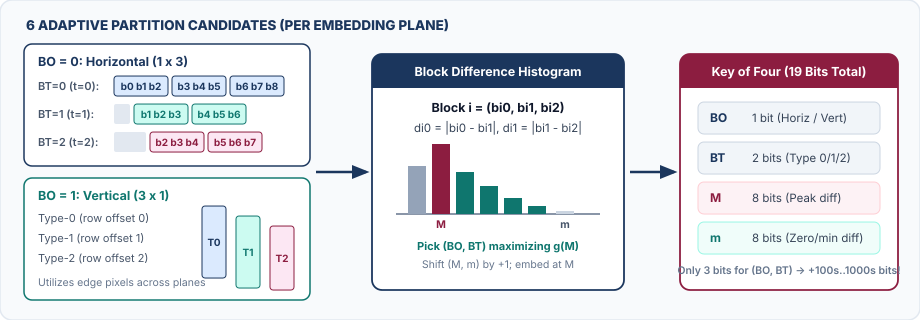
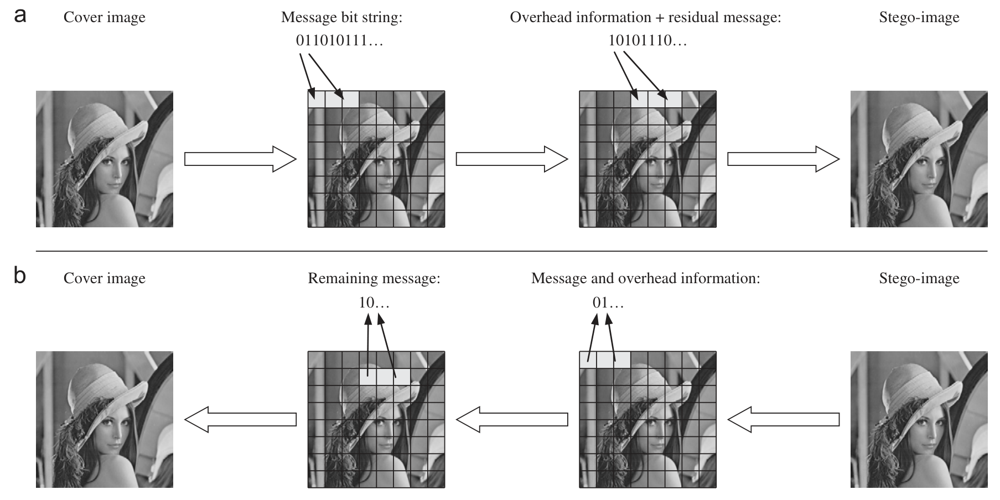
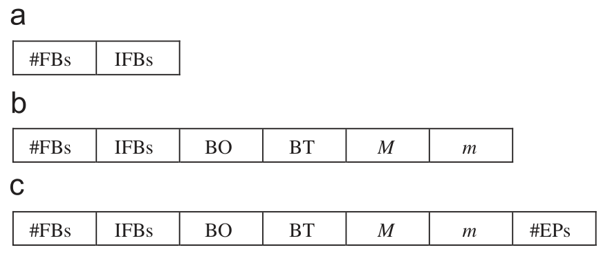
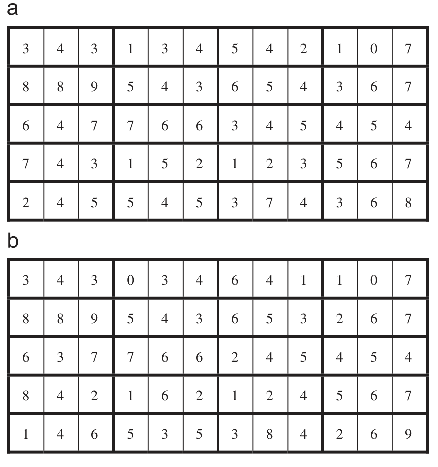
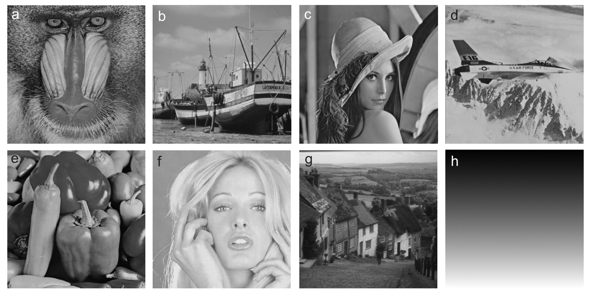
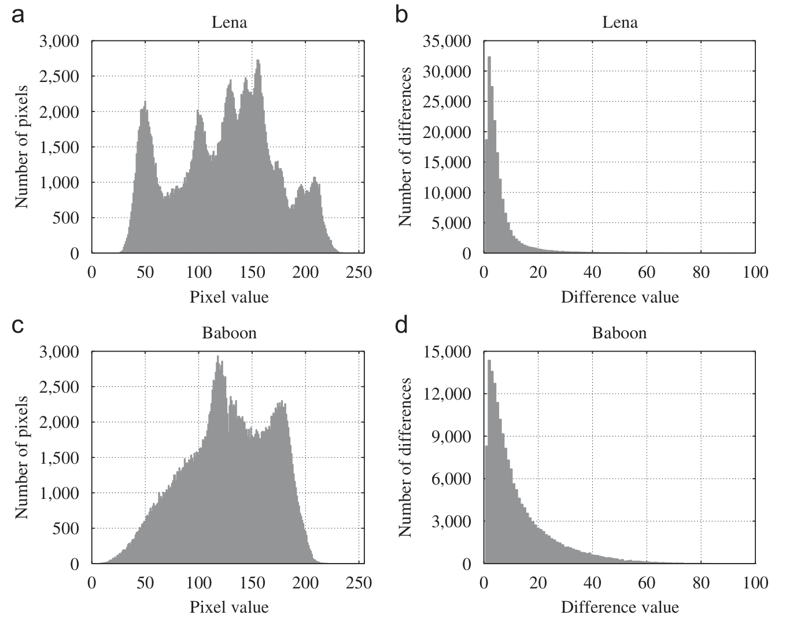
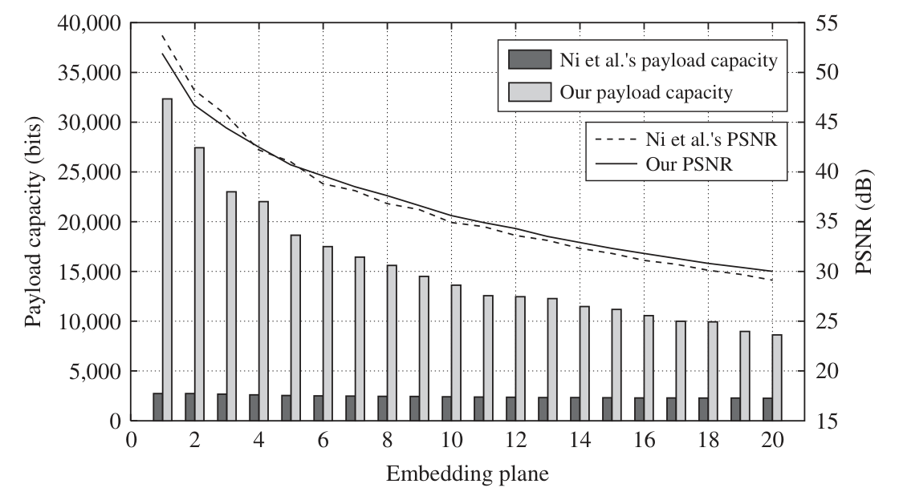
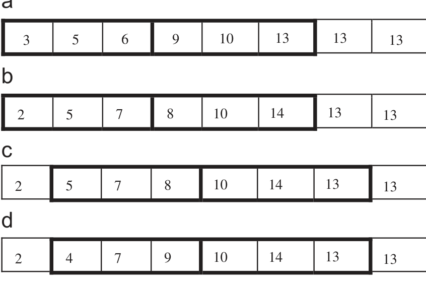
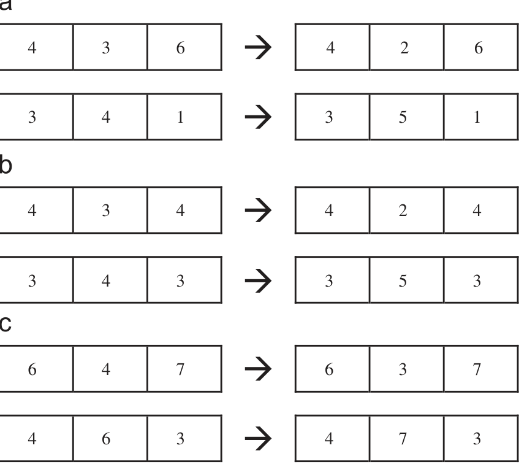

<!-- _class: lead -->

Pattern Recognition · 第 41 卷（2008）1415–1425 · Elsevier

# 基於三像素區塊差值之無失真資訊隱藏方法

A Lossless Data Hiding Scheme Based on Three-Pixel Block Differences

結合自適應<strong>三像素區塊差值</strong>直方圖平移、雙階段邊界區塊管理與中心像素單一修改機制，達成平均 <strong>2.08 bpp</strong> 超高藏量（為 Ni 等方法之 <strong>6 至 10 倍</strong>）

<strong>林慶泉（Ching-Chiuan Lin）*</strong> · <code>cclin@ocit.edu.tw</code>（僑光技術學院資訊管理系／逢甲大學資工所博士候選人） 
<strong>薛念林（Nien-Lin Hsueh）</strong> · <code>nlhsueh@fcu.edu.tw</code>（逢甲大學資訊工程學系） 
臺灣臺中 40724 · DOI: <code>10.1016/j.patcog.2007.09.005</code>

<!--
論文背景與核心突破總覽：
本論文（林慶泉、薛念林；發表於國際頂尖期刊 Pattern Recognition, Vol. 41, 2008, pp. 1415–1425, Elsevier；2006 年 10 月投稿、2007 年 9 月接受）提出一種基於三像素區塊差值直方圖平移的高容量無失真（可逆式）資訊隱藏方法。

核心突破：
Ni 等（2006）之像素灰階直方圖平移法雖免除龐大位置圖，但自然影像單一灰階值的像素數鮮少超過 3,000，嚴重限制藏量。本研究改以自適應切分三像素區塊內的兩組絕對差值（|b_i0 - b_i1| 與 |b_i1 - b_i2|）建立差值直方圖，使峰值躍升 10 倍以上（如 Lena 首層高達 32,339）；搭配多層串接、雙階段新生邊界區塊（FB）追蹤與「藏兩位元 11 僅改中心一像素」的優化策略，平均總藏量高達 2.08 bpp（淨藏量 1.79 bpp），在 PSNR >= 30 dB 高品質區間仍達 1.39 bpp（淨藏量 1.32 bpp）。
-->

---

## 簡報大綱

1

<a href="#3">研究動機與相關文獻</a> 醫療與軍事影像之無失真隱藏需求，以及像素直方圖平移法之藏量瓶頸。

2

<a href="#4">三像素區塊差值與自適應切分</a> 6 種區塊切分候選（BO × BT）、差值直方圖峰值與 19 位元四元金鑰。

3

<a href="#5">雙階段架構與決策規則</a> 邊界區塊 BB 與新生邊界 FB 處理、輔助資訊格式、9 分支嵌藏與 36 類萃取表。

4

<a href="#8">多層堆疊萃取與完整範例</a> 5×12 灰階影像逐步推演：最佳切分挑選、FB 記錄與後進先出堆疊還原。

5

<a href="#9">實驗結果與效能比較</a> 8 張標準測試影像、表 1–2 藏量統計、直方圖集中度與 Ni 等基準法對比。

6

<a href="#13">討論與結論</a> 交替區塊類型抵消失真、共用中心像素單次修改，以及全篇貢獻總結。

<!--
論文架構導覽：
- 第一節（Introduction，頁 1415–1416）：對比加密（DES/RSA）與隱寫術差異，闡明無失真還原需求，並評析 LSB 壓縮（Fridrich 等）、廣義 LSB（Celik 等）、差值擴張（Tian、Alattar、Chang & Lu）及直方圖平移（Ni 等）。
- 第二節（The Proposed Scheme，頁 1416–1421）：介紹雙階段嵌藏與萃取總覽（圖 1）、9 步驟正式嵌藏流程（2.1，圖 2–3）、輔助資訊位元長度推導（2.2，圖 4）、9 步驟反向堆疊萃取流程（2.3，圖 5）與 5x12 影像實例（2.4，圖 6）。
- 第三節（Experimental Results，頁 1421–1423）：於 8 張 512x512 灰階影像（圖 7）驗證極限藏量（表 1）與 PSNR >= 30 dB 藏量（表 2），並與 Ni 等方法比較直方圖分布（圖 8）與 20 層 PSNR／藏量曲線（圖 9）。
- 第四節（Discussion，頁 1423–1424）：深入解析交替區塊類型（圖 10）與共用中心像素（圖 11）兩大降低失真機制。
- 第五節（Conclusions，頁 1424–1425）：總結 6 至 10 倍藏量提升與跨紋理影像適用性。
-->

---

## 1. 研究動機與既有可逆式隱藏技術之限制

<h3>資訊隱藏 vs. 傳統加密</h3>
<ul class="small-text">
<li><strong>加密技術（DES、RSA）</strong>將明文轉為無意義密文，容易引起攔截者警覺。</li>
<li><strong>資訊隱藏</strong>將機密無痕跡地藏入多媒體載體，但<strong>醫療與軍事影像</strong>嚴禁載體遭受永久性失真。</li>
<li><strong>研究目標</strong>：確保原圖<strong>100% 無失真還原</strong>，並同步拉升嵌藏容量與偽裝影像畫質（PSNR）。</li>
</ul>

<h3>既有無失真方法之瓶頸</h3>
<ul class="small-text">
<li><strong>LSB／G-LSB 壓縮法</strong>（Fridrich 等；Celik 等）：藏量高度受限於影像壓縮比。</li>
<li><strong>差值擴張法</strong>（Tian；Alattar；Chang &amp; Lu）：需附帶<strong>龐大位置圖</strong>記錄擴張與否。</li>
<li><strong>像素直方圖平移法</strong>（Ni et al., 2006）：免位置圖且實作簡單，但自然影像單一灰階峰值 <code>M</code> 極低（Lena 單層 &lt; 3,000 bits）。</li>
</ul>

<strong>本論文核心洞察</strong>：自然影像相鄰像素高度相關，其<strong>區塊差值</strong>高度集中於 0–25 之間。將直方圖平移對象由「像素值」改為「<strong>三像素區塊差值</strong>」，可使單層峰值暴增 <strong>10 倍以上</strong>；在最佳情況下藏入<strong>兩位元「11」</strong>更只需調整中心一像素 <code>±1</code>！

<!--
研究動機與文獻定位（第一節，頁 1415–1416）：
本論文針對兩大主流無失真資訊隱藏路線的缺口提出解方：
1. 壓縮與差值擴張路線（Fridrich 等 [6,7]、Celik 等 [8,9]、Tian [10]、Alattar [11]、Chang & Lu [12]）雖具較高藏量，但往往需耗費龐大空間儲存壓縮後之位置圖或量化殘差。
2. Ni 等（2006）直方圖平移法 [13] 結構精簡、無需位置圖，但因自然影像像素灰階廣布於 30 至 230 之間，峰值點 M 像素個數不到 3,000，導致單層藏量偏低。

林慶泉與薛念林改以不重疊三像素區塊中的兩組相鄰絕對差值建構直方圖：不僅完整保留低輔助資訊開銷的優點，更藉由相鄰像素高度平滑的統計特性大幅推升峰值與單位修改位元效率。
-->

---

## 2. 核心構想：三像素區塊差值與自適應切分

<h3>每層自適應評估 6 種區塊切分</h3>

每個嵌藏層皆窮舉 <strong>6 種切分組合</strong>：區塊方向 <code>BO ∈ {水平 1×3, 垂直 3×1}</code> × 區塊類型 <code>BT ∈ {Type-0, Type-1, Type-2}</code>（起始位移 <code>t = 0, 1, 2</code>），挑選使峰值 <code>g(M)</code> 最大之組合。

<h3>區塊差值與「四元金鑰（Key of Four）」</h3>

三像素區塊 <code>(bi0, bi1, bi2)</code> 產生兩組差值 <code>di0 = |bi0 - bi1|</code>、<code>di1 = |bi1 - bi2|</code>。找出最大 <code>g(M)</code> 與最小 <code>g(m)</code>（<code>M &lt; m</code> 且 <code>|M - m|</code> 最小）。僅耗費 <strong>3 位元</strong>記錄 <code>(BO, BT)</code>，每層即可換取數百至數千位元額外藏量！

<!--
自適應切分與四元金鑰設計（2.1 節，頁 1416–1418）：
一張 h x w 灰階影像可依兩種方向（BO）與三種起始位移（BT，t = 0, 1, 2）構成 6 種不重疊三像素切分方式：
- 水平 1x3：(b_{u, 3v+t}, b_{u, 3v+t+1}, b_{u, 3v+t+2})
- 垂直 3x1：(b_{3u+t, v}, b_{3u+t+1, v}, b_{3u+t+2, v})

統計差值直方圖 g(d)（0 <= d <= 253）時，凡含像素值 0 或 255 的邊界區塊均不計入。系統找出最大計數 g(M) 與最小計數 g(m)（要求 M < m，若有多組則取 |M - m| 最小者以減少需平移之差值數量）。
勝出的參數組 (BO, BT, M, m) 稱為「四元金鑰（Key of Four）」，構成一個可提供 g(M) 位元藏量之嵌藏平面，總編碼長度僅需 1 + 2 + 8 + 8 = 19 位元。實務上因自然影像鮮少出現大於 130 的差值，故 g(m) 幾乎皆為 0。
-->

---

## 2.2 雙階段嵌藏與萃取總覽（解決邊界溢位歧義）

圖 1：本論文之雙階段嵌藏流程（a）與反向雙階段萃取流程（b）。

<h3>邊界區塊（BB）vs. 新生邊界區塊（FB）</h3>
<ul class="small-text">
<li><strong>BB（Boundary Block）</strong>：原本即含像素值 <code>0</code> 或 <code>255</code> 之區塊 ➔ 全程跳過不嵌藏，徹底防範溢位／下溢。</li>
<li><strong>FB（Fresh Boundary Block）</strong>：原本含 <code>1</code> 或 <code>254</code> 之臨界區塊，經嵌藏後變成 <code>0</code> 或 <code>255</code>（例：<code>(2,1,2)</code> 藏入 <code>"11"</code> ➔ <code>(2,0,2)</code>）。</li>
</ul>

<h3>雙階段掃描如何消除 FB 歧義？</h3>
<ul class="small-text">
<li><strong>第一階段（Pass 1）</strong>：先處理臨界區塊（<code>min = 1</code> 或 <code>max = 254</code>），並將所有新產生的 FB 索引記入輔助資訊。</li>
<li><strong>第二階段（Pass 2）</strong>：再處理安全內部區塊（<code>2 ≤ b ≤ 253</code>，單層加減 1 絕不會觸及 <code>0/255</code>），專門嵌入 FB 輔助資訊與剩餘訊息。</li>
</ul>

<!--
免大型位置圖之溢位防範機制（第二節，頁 1416–1417）：
直方圖平移法最棘手的邊界問題在於：解碼端看到含 0 或 255 的區塊時，如何區分它是原本就被跳過的「邊界區塊（BB）」，還是原本為 1/254 經嵌藏後才變成 0/255 的「新生邊界區塊（FB）」？

本論文透過單層內「兩階段空間隔離」巧妙化解：
- 第一階段（步驟 6）：僅掃描滿足 1 <= b <= 254 且 (min=1 或 max=254) 的臨界區塊進行嵌藏；凡操作後出現 0 或 255 者即登記其區塊編號為 FB。
- 第二階段（步驟 7）：僅掃描滿足 2 <= b <= 253 的內部區塊；因每層像素最多變動 +/-1，內部區塊絕不可能變成 0 或 255！因此接收端在解碼時必能先從安全內部區塊無誤萃取出完整 FB 索引表，再回頭辨識並還原所有 FB。

第二節內文實例（M=1, m=20）：
- Pass 1：(2,1,2) 藏入 "11" -> (2,0,2)（登錄為 FB，且僅改動中心像素！）；(253,254,240) 藏 "0" -> (253,254,239)；(246,243,254) 平移 -> (246,242,254)。
- Pass 2：(3,4,6) 藏 "0" -> (3,4,7)。原始 BB (0,3,5) 則全程保持不變。
-->

---

## 2.3 雙階段 FB 管理與輔助資訊格式推導

圖 4：各嵌藏平面之輔助資訊格式：(a) 首層、(b) 中繼層、(c) 末層。

<h3>精簡輔助資訊位元預算分析</h3>
<ul class="small-text">
<li><strong>最大區塊數</strong>：<code>η = max(h×⌊w/3⌋, w×⌊h/3⌋)</code>；單筆 FB 索引（<code>IFB</code>）需 <code>δ = ⌈log2 η⌉</code> 位元。</li>
<li><strong>四元金鑰</strong>：<code>BO</code>（1b）+ <code>BT</code>（2b）+ <code>M</code>（8b）+ <code>m</code>（8b）= <strong>19 位元</strong>；末層另加 8 位元 <code>#EPs</code>（總層數）。</li>
<li><strong>512×512 影像</strong>：<code>#FBs</code> 占 <strong>14 位元</strong>、每筆 <code>IFB</code> 占 <strong>17 位元</strong>；在 <code>PSNR ≥ 30 dB</code> 時多數影像總開銷<strong>不到 1,000 位元</strong>！</li>
</ul>

<!--
輔助資訊鏈結格式與位元數上界推導（2.2 節，頁 1419）：
多層嵌藏透過各層 Pass 2 內嵌之輔助標頭向後串聯：
- 第一層（圖 4a）：[#FBs | IFBs]
- 中繼層（圖 4b）：[#FBs | IFBs | 前一層 BO, BT, M, m]
- 最後一層（圖 4c）：[#FBs | IFBs | 前一層 BO, BT, M, m | #EPs]
發送端只需額外傳送「最後一層」的 19 位元四元金鑰（或藏於雙方約定之 19 像素 LSB 並備份原 LSB 於輔助資訊中），接收端即可逐層反向回溯整張影像。

#FBs 位元寬度數學推導：
設單層最多出現 x 個 FB，則記錄 #FBs 與 IFBs 共需 ceil(log2 x) + x*delta 位元；第二階段剩餘最大可用容量為 r = (eta - x)*2 - ceil(log2 x) - 19。由 x*delta <= r 解得 x < 2*eta / (delta + 2)，故 #FBs 位元寬度近似為 ceil(log2(2*eta / (delta + 2)))。代入 512x512 影像（eta = 87,040）即得 delta = 17 位元、#FBs = 14 位元。
-->

---

## 2.4 嵌藏與萃取決策規則（中心像素單次修改優化）

<h3>9 分支嵌藏程序 <code>embedding_procedure</code>（圖 2–3）</h3>

兩差值 <code>(di0, di1)</code> 各有三種狀態：<code>== M</code>（藏 1 位元）、<code>M &lt; d &lt; m</code>（加 1 平移）或其他（不變），共構成 <code>3 × 3 = 9</code> 條執行分支。

| 三像素大小形態 <code>(bi0, bi1, bi2)</code> | <code>embed_2_bits</code> 動作（嵌入 <code>eb1, eb2</code>） |
|---|---|
| 單調遞減 <code>bi0 &gt; bi1 &gt; bi2</code> | <code>bi0 += eb1</code>, <code>bi2 -= eb2</code> |
| 單調遞增 <code>bi0 &lt; bi1 &lt; bi2</code> | <code>bi0 -= eb1</code>, <code>bi2 += eb2</code> |
| 平坦 <code>bi0 == bi1 == bi2</code> | 若 <code>11</code>：<strong><code>bi1 += 1</code></strong>；否則 <code>bi0 -= eb1, bi2 += eb2</code> |
| 峰型 <code>bi0 &lt; bi1 &gt; bi2</code> | 若 <code>11</code>：<strong><code>bi1 += 1</code></strong>；否則 <code>bi0 -= eb1, bi2 -= eb2</code> |
| 谷型 <code>bi0 &gt; bi1 &lt; bi2</code> | 若 <code>11</code>：<strong><code>bi1 -= 1</code></strong>；否則 <code>bi0 += eb1, bi2 += eb2</code> |

<h3>36 條完全互斥萃取規則表（圖 5）</h3>
<ul class="small-text">
<li><strong>解碼端四種差值區間</strong>：<code>d == M</code>（取出 <code>0</code>）、<code>d == M+1</code>（取出 <code>1</code> 並縮回 1）、<code>M+1 &lt; d ≤ m</code>（縮回 1）、<code>d &lt; M 或 d &gt; m</code>（不動）。</li>
<li><strong>嚴格保序性</strong>：單調區塊僅往外側拉開端點像素，峰／谷區塊則將中心 <code>bi1</code> 進一步推離兩鄰，相鄰大小關係（<code>&lt;</code>, <code>&gt;</code>）絕不反轉！</li>
<li><strong>單點還原</strong>：例如峰型 <code>bi0 &lt; bi1 &gt; bi2</code> 且 <code>di0=di1=M+1</code>（項目 11），直接取出 <code>"11"</code> 並將 <code>bi1 = bi1 - 1</code> 即可復原。</li>
<li><strong>一對一精確逆運算</strong>：圖 5 之 36 條條件完整對應圖 2–3 所有情況。</li>
</ul>

<!--
嵌藏與萃取演算法邏輯結構（2.1 與 2.3 節，圖 2、3、5）：
圖 2 的 `embedding_procedure` 根據 (d_i0, d_i1) 分派至 8 個子程序或 `do nothing`。
降低失真的核心技巧貫穿 `embed_2_bits`、`embed_1_bit_and_increase_difference`、`increase_difference_and_embed_1_bit` 與 `increase_2_differences` 四大子程序（圖 3）：
- 凡兩組差值皆須加 1，且三像素呈現局部峰值（b_i0 < b_i1 > b_i2）、局部谷值（b_i0 > b_i1 < b_i2）或平坦（b_i0 == b_i1 == b_i2）時，僅需對共用中心像素 b_i1 執行 +1（峰／平）或 -1（谷），即可一次同步放大 |b_i0 - b_i1| 與 |b_i1 - b_i2|，將修改像素數減半！
- 其餘單調遞增／遞減或單側變動情況，則僅調整外側對應像素（b_i0 或 b_i2）。

因所有操作均嚴格維持像素間相對大小順序，解碼端依圖 5 的 36 條互斥條件查表，即可毫無歧義地萃取位元並將每個像素逆向退回原值。
-->

---

## 2.5 多層堆疊萃取與 5×12 影像完整範例

圖 6：5×12 灰階影像中繼層範例：(a) 原始影像；(b) 偽裝影像。

<h3>1. 最佳切分與雙階段嵌藏</h3>
<ul class="small-text">
<li>比較 6 種切分：<strong>水平 1×3 Type-0</strong> 以 <code>M=1, m=5, g(M)=23</code> 勝出（跳過 BB 區塊 3 <code>(1,0,7)</code>）。</li>
<li><strong>Pass 1</strong>（訊息 <code>0011</code>）：區塊 1 <code>(1,3,4)</code> 藏 <code>0</code> ➔ <code>(0,3,4)</code>（<strong>登記為 FB #1！</strong>）；區塊 13 平移為 <code>(1,6,2)</code>；區塊 14 藏 <code>01</code> ➔ <code>(1,2,4)</code>。</li>
<li><strong>Pass 2</strong>：於內部區塊寫入 19 位元輔助資訊（<code>#FBs=001, IFB=00001, BO'=0, BT'=1, M'=1, m'=3</code>）與剩餘位元 <code>1</code>。</li>
</ul>

<h3>2. 反向萃取與堆疊重組還原</h3>
<ul class="small-text">
<li><strong>掃描 <code>1..254</code></strong>：先跳過區塊 1 <code>(0,3,4)</code> 與區塊 3 <code>(1,0,7)</code>；分離出 <code>List-1 = 01</code>（區塊 14）與 <code>List-2</code>（19b 標頭 <code>List-2'</code> + 剩餘訊息 <code>List-2'' = 1</code>）。</li>
<li><strong>辨識 FB</strong>：解碼標頭確認區塊 1 為 FB（區塊 3 為真 BB）➔ 萃取 <code>List-3 = 0</code> 並還原 <code>(1,3,4)</code>。</li>
<li><strong>重排與堆疊</strong>：依區塊編號合併 <code>List-1</code> 與 <code>List-3</code> 得 <code>List-4 = 001</code>；依序推入 <code>List-2''</code> 與 <code>List-4</code> 至堆疊 ➔ 完整還原 <strong><code>(0011)2</code></strong>。</li>
</ul>

<!--
5x12 影像範例逐步解析（2.4 節，頁 1419–1421）：
此 5x12 影像共含 20 個不重疊 1x3 區塊，故單筆區塊編號占 ceil(log2 20) = 5 位元，#FBs 占 ceil(log2(40/7)) = 3 位元（範例中為簡明起見將 M, m 各以 4 位元示範）。
6 種切分結果對比：
1. 1x3 Type-0：M=1, m=5, g(M)=23（最高，雀屏中選）
2. 1x3 Type-1：M=1, m=5, g(M)=16
3. 1x3 Type-2：M=1, m=5, g(M)=14
4. 3x1 Type-0：M=1, m=7, g(M)=7
5. 3x1 Type-1：M=1, m=5, g(M)=8
6. 3x1 Type-2：M=1, m=7, g(M)=7

為何多層萃取需搭配後進先出（LIFO）堆疊（2.3 節步驟 7–9）：
由於嵌藏順序為第 1 層 -> 第 2 層 -> ... -> 第 K 層，而解碼必須從末層四元金鑰一路反向回推至第 1 層；且同一層內 Pass 1 訊息（List-4）排在 Pass 2 剩餘訊息（List-2''）之前。因此每層先將 List-2'' 推入堆疊、再推入 List-4，待全數層數解完後自堆疊頂端依序彈出，即可自動還原完全正確的正向原始訊息位元流。
-->

---

## 3. 實驗環境與八張標準測試影像

圖 7：由複雜紋理至平滑漸層之八張 512×512 灰階測試影像：(a) Baboon、(b) Boat、(c) Lena、(d) Airplane、(e) Pepper、(f) Tiffany、(g) GoldHill、(h) Gradient。

<h3>測試集與秘密訊息設計</h3>
<ul class="small-text">
<li><strong>8 張多元影像</strong>：涵蓋高頻複雜紋理（<code>Baboon</code>）、常見自然人像／風景，至電腦合成平滑漸層圖（<code>Gradient</code>，每兩列灰階值遞增 1）。</li>
<li><strong>秘密訊息</strong>：截取部分 <code>Lena</code> 影像資料作為使用者秘密訊息 <code>U</code>，嵌入各測試影像。</li>
</ul>

<h3>藏量與失真評量指標</h3>
<ul class="small-text">
<li><strong>總藏量 vs. 淨藏量（Pure Payload）</strong>：總藏量為各嵌藏平面 <code>g(M)</code> 之總和；<em>淨藏量</em>為扣除所有輔助資訊（<code>#FBs</code>、<code>IFBs</code>、四元金鑰）後實際可藏之使用者訊息量。</li>
<li><strong>影像品質</strong>：採用標準 <code>PSNR = 10 × log10(2552·h·w / Σ(pi,j - qi,j)2)</code> dB。</li>
</ul>

<!--
實驗設計與影像多樣性（第三節，頁 1421–1422）：
本研究選用八張 512x512 8-bit 灰階影像（每張 262,144 像素），完整涵蓋從極度複雜（Baboon）到極度平滑（Gradient，前兩列像素值皆為 0、第三至四列皆為 1，依此類推）的影像特性。

以 Airplane 為例：全圖最多可進行 56 層嵌藏，總藏量達 585,380 位元（2.23 bpp），扣除所有 56 層的圖 4 輔助資訊 21,676 位元（僅占約 3.7%）後，淨藏量仍高達 563,704 位元（2.15 bpp）。
-->

---

## 3.2 極限藏量與高品質（`PSNR ≥ 30 dB`）實驗結果

<strong>表 1</strong>：多層嵌藏最大容量表現

| 影像名稱 | PSNR | 層數 | 總藏量 (bpp) | 淨藏量 (bpp) |
|---|---:|---:|---:|---:|
| Baboon | 20.5 | 57 | 339,308 (1.29) | 297,607 (1.14) |
| Boat | 20.3 | 62 | 535,301 (2.04) | 446,141 (1.70) |
| Lena | 20.8 | 58 | 513,983 (1.96) | 452,546 (1.73) |
| Airplane | 21.0 | 56 | 585,380 (2.23) | 563,704 (2.15) |
| Pepper | 20.8 | 59 | 574,850 (2.19) | 449,035 (1.71) |
| Tiffany | 25.2 | 34 | 441,674 (1.68) | 405,475 (1.55) |
| GoldHill | 21.4 | 53 | 501,546 (1.91) | 426,504 (1.63) |
| Gradient | 26.5 | 33 | 867,554 (3.31) | 706,931 (2.70) |
| <strong>平均</strong> | — | — | <strong>2.08 bpp</strong> | <strong>1.79 bpp</strong> |

<strong>表 2</strong>：高品質區間表現（<code>PSNR ≥ 30 dB</code>）

| 影像名稱 | PSNR | 層數 | 總藏量 (bpp) | 淨藏量 (bpp) |
|---|---:|---:|---:|---:|
| Baboon | 30.4 | 17 | 162,544 (0.62) | 161,118 (0.61) |
| Boat | 30.4 | 19 | 307,937 (1.17) | 307,193 (1.17) |
| Lena | 30.0 | 20 | 309,166 (1.18) | 308,474 (1.18) |
| Airplane | 30.3 | 19 | 367,392 (1.40) | 366,784 (1.40) |
| Pepper | 30.2 | 20 | 356,450 (1.36) | 322,744 (1.23) |
| Tiffany | 30.1 | 19 | 332,570 (1.27) | 331,962 (1.27) |
| GoldHill | 30.1 | 20 | 303,629 (1.16) | 302,784 (1.16) |
| Gradient | 30.1 | 21 | 764,817 (2.92) | 660,511 (2.52) |
| <strong>平均</strong> | <strong>≥30</strong> | <strong>~19</strong> | <strong>1.39 bpp</strong> | <strong>1.32 bpp</strong> |

<strong>高品質下輔助開銷極低</strong>：在 <code>PSNR ≥ 30 dB</code> 條件下，多數自然影像歷經約 20 層嵌藏後之總輔助資訊竟<strong>不足 1,000 位元</strong>（例如 Lena 總藏量 309,166 vs. 淨藏量 308,474，僅耗 692 位元！），平均淨藏量高達 <strong>1.32 bpp</strong>。

<!--
表 1 與表 2 量化數據深度解讀（第三節，頁 1421–1423）：
表 1（最大多層藏量）：
- 藏量與影像平滑度呈高度正相關：從高紋理 Baboon 的 1.29 bpp（淨 1.14 bpp）一路攀升至 Gradient 的 3.31 bpp（淨 2.70 bpp），八張影像平均總藏量達 2.08 bpp、平均淨藏量達 1.79 bpp。
- 一般自然攝影影像（Boat, Lena, Airplane, Pepper, GoldHill）在 53–62 層間皆穩定達到 1.91–2.23 bpp。

表 2（PSNR >= 30 dB 實用高品質區間）：
- 歷經 17–21 層嵌藏，八張影像平均總藏量為 1.39 bpp、淨藏量為 1.32 bpp。
- 由於前 20 層極少像素觸及 0 或 255 邊界，FB 數量微乎其微：Lena 總開銷僅 692 位元、Boat 744 位元、Airplane 與 Tiffany 皆僅 608 位元、GoldHill 845 位元。唯 Pepper 與 Gradient 因原圖已含較多接近 0/255 之區域，故 FB 開銷稍高。
-->

---

## 3.3 區塊差值致勝關鍵：直方圖峰值高度集中

圖 8：Ni 等像素值直方圖（左）與本方案區塊差值直方圖（右）對比：Lena（上）與 Baboon（下）。

32,339 vs. &lt; 3,000

<code>Lena</code> 首層峰值點數量差距超過 <strong>10 倍</strong>，直接拉開藏量鴻溝。

<h3>Lena 分布對比分析</h3>
<ul class="small-text">
<li><strong>Ni 等（像素灰階值）</strong>：像素值廣布於 <code>30–230</code>，單一最高峰值低於 <code>3,000</code> 像素。</li>
<li><strong>本方案（區塊差值）</strong>：絕大多數差值緊密聚集於 <code>0–25</code>，首層峰值高達 <code>32,339</code> 對。</li>
</ul>

<h3>Baboon 複雜紋理驗證</h3>

即便在高度複雜的 <code>Baboon</code> 影像中，像素灰階峰值同樣不及 <code>3,000</code>，而區塊差值峰值則突破 <code>12,000+</code>，證實本方法在複雜紋理影像上同樣具備壓倒性優勢。

<!--
直方圖統計分布根因解析（第三節，圖 8，頁 1422–1423）：
圖 8 清楚揭示了本方法藏量暴增一個數量級的統計本質：
- 圖 8(a) 與 8(c) 顯示 Lena 與 Baboon 的原始像素灰階廣泛分散於 [30, 230] 區間，直方圖平坦且多峰，最高點 g(M) 均低於 3,000。
- 圖 8(b) 與 8(d) 轉為三像素區塊絕對差值後，受惠於自然影像高度的局部空間相關性，分布急劇收斂成靠近 0 的尖銳拉普拉斯型峰值（Lena 集中於 0–25），使首層可用藏量由不到 3,000 位元躍升至 32,339 位元（逾 10.7 倍）。
-->

---

## 3.4 多層藏量與 PSNR 演進對比（vs. Ni et al.）

圖 9：Lena 前 20 個嵌藏平面之逐層藏量（bits）與 PSNR（dB）比較曲線。

6 倍至 10 倍藏量

在每一個嵌藏平面上，本方案之藏量皆大幅超越 Ni 等演算法。

第 6 層後 PSNR 反超

藏入遠多於對手的資料量，第 6 層後畫質 PSNR 卻反而高於 Ni 等方法！

<h3>極低邊界溢位頻率</h3>
<ul class="small-text">
<li>在 Lena 前 <strong>20 個嵌藏平面</strong>中，Ni 等方法未遇飽和點，本方案亦僅遭遇 <strong>3 個新生邊界區塊（FB）</strong>。</li>
<li>搭配每層動態重選 <code>(BO, BT)</code>，逐層藏量衰減極為平緩，特別在前數層展現壓倒性效能。</li>
</ul>

<!--
多層演進軌跡解析（第三節，圖 9，頁 1422、1424）：
圖 9 以雙縱軸呈現 Lena 在第 1 至第 20 層的逐層藏量（左軸，bits）與累積 PSNR（右軸，dB）：
1. 藏量領先：本方案首層即藏入超過 32,000 bits（Ni 等不到 3,000 bits），即使推進至第 20 層仍維持約 10,000 bits/層，遠高於 Ni 等之最高層。
2. PSNR 交叉反超：前幾層兩者皆維持 40–50 dB 高畫質；第 6 層之後，因 Ni 等方法每層皆需將大範圍灰階像素同向平移，累積失真迅速惡化，而本方案受惠於區塊類型交替抵消與中心像素單點修改，PSNR 曲線反而高於 Ni 等（第 20 層仍守住 30.0 dB，總藏量已達 309,166 bits）。
3. 邊界穩定性：前 20 層僅產生 3 個 FB，印證雙階段管理在高品質區間幾乎零開銷。
-->

---

## 4. 討論：降低影像失真的兩大核心機制

圖 10：Type-0（a–b）交替切換至 Type-1（c–d），像素 <code>b0,3</code> 經兩層修改竟自動回復原值 <code>9</code>！

<h3>1. 自適應交替區塊類型（BT）</h3>
<ul class="small-text">
<li>第 1 層（Type-0，<code>M=1, m=4</code>）使像素 <code>b0,3</code> 由 <code>9 ➔ 8</code>。</li>
<li>第 2 層（Type-1，<code>M=1, m=3</code>）使 <code>b0,3</code> 由 <code>8 ➔ 9</code>，<strong>正負修改相互抵消！</strong></li>
<li>同時善用 <code>512×512</code> 影像每列最右側剩餘的 2 個邊緣像素（<code>512 mod 3 = 2</code>），兼顧藏量與畫質。</li>
</ul>

圖 11：僅改動中心像素一碼即可完成：(a) 藏「1」+平移、(b) 藏「11」、(c) 雙差值平移。

<h3>2. 共用中心像素單次修改優化</h3>
<ul class="small-text">
<li>兩組差值共用中心像素 <code>bi1</code>，於峰／谷／平坦區塊中只需<strong>調整 <code>bi1</code> 加減 1</strong> 即可同時完成兩側操作。</li>
<li>如圖 (b)：<code>(4, 3, 4) ➔ (4, 2, 4)</code> 僅修改 <strong>1 個像素</strong>就嵌入 <strong>2 位元「11」</strong>！</li>
<li>大幅削減單位位元之像素修改次數，正是第 6 層後 PSNR 反超的關鍵推手。</li>
</ul>

<!--
失真抑制機制深度解析（第四節，頁 1423–1424）：
第四節從理論與實例剖析本方法為何能同時達成「高藏量」與「高 PSNR」：
1. 交替區塊類型抵消誤差（圖 10）：
以 1x8 灰階條 [3, 5, 6, 9, 10, 13, 13, 13] 為例：第 1 層採水平 Type-0 切分 (3,5,6)、(9,10,13) 並藏入 "1"、"1"，得到 [2, 5, 7, 8, 10, 14, 13, 13]；第 2 層改採水平 Type-1 切分 (5,7,8)、(10,14,13) 並藏入 "1"、"0"，得到 [2, 4, 7, 9, 10, 14, 13, 13]。其中 b_{0,3} 歷經 9 -> 8 -> 9 回到原始數值，有效減緩多層嵌藏的 PSNR 衰減與峰值衰退，並納入原本被遺漏的每列末兩像素。

2. 共用中心像素減少改動數（圖 11，M=1, m=4）：
- 圖 11(a)：(4,3,6)->(4,2,6) 與 (3,4,1)->(3,5,1) 僅改 1 像素即完成「藏 1 位元＋平移另一差值」。
- 圖 11(b)：(4,3,4)->(4,2,4) 與 (3,4,3)->(3,5,3) 僅改 1 像素即完成「藏入兩位元 11」。
- 圖 11(c)：(6,4,7)->(6,3,7) 與 (4,6,3)->(4,7,3) 僅改 1 像素即完成「平移兩個非嵌藏差值」。

3. 3 位元切分訊號的高報酬率：
每層僅額外花費 3 位元記錄 BO 與 BT，卻能為該層創造數百至數千位元的藏量增益。
-->

---

## 5. 結論與核心研究貢獻

2.08 bpp

八張標準測試影像平均總藏量（淨藏量 <strong>1.79 bpp</strong>；Gradient 更高達 3.31 bpp）。

1.39 bpp @ ≥30 dB

高品質區間平均總藏量（淨藏量 <strong>1.32 bpp</strong>，多數影像輔助開銷 &lt; 1,000 位元）。

6×–10× 藏量躍升

較 Ni et al. (2006) 提升 6 至 10 倍容量，且第 6 層後 PSNR 全面領先。

<h3>演算法核心創新</h3>
<ul class="small-text">
<li><strong>三像素區塊差值平移</strong>：善用相鄰像素高度相關性，將直方圖峰值集中度放大 10 倍以上。</li>
<li><strong>雙階段 FB 邊界管理</strong>：區隔臨界區塊與安全內部區塊，無須大型位置圖即可達成 100% 無失真還原。</li>
</ul>

<h3>畫質優化與廣泛適用性</h3>
<ul class="small-text">
<li><strong>雙重失真抑制</strong>：6 種切分自適應交替抵消累積誤差；共用中心像素單次修改即可藏入兩位元。</li>
<li><strong>跨紋理泛化能力</strong>：從高複雜紋理（<code>Baboon</code>）至極平滑漸層（<code>Gradient</code>）皆展現卓越藏量與視覺品質。</li>
</ul>

<!--
結論綜整（第五節，頁 1424–1425）：
本研究提出的三像素區塊差值無失真資訊隱藏方法，成功突破像素值直方圖平移法的容量天花板，並同時維持極低輔助資訊開銷：
- 八張 512x512 測試影像平均總藏量達 2.08 bpp、平均淨藏量達 1.79 bpp。
- 在 PSNR >= 30 dB 實用高品質條件下，平均總藏量與淨藏量分別達 1.39 bpp 與 1.32 bpp。
- 相較 Ni 等（2006）經典演算法，藏量提升達 6 至 10 倍且於第 6 層後具備更佳 PSNR，充分滿足醫療、軍事與數位典藏等高容量、零失真影像隱寫應用需求。
-->

---

<!-- _class: closing -->

# 感謝您的聆聽！

基於三像素區塊差值之無失真資訊隱藏方法 
A Lossless Data Hiding Scheme Based on Three-Pixel Block Differences

<strong>林慶泉（Ching-Chiuan Lin）*</strong> · <code>cclin@ocit.edu.tw</code>（僑光技術學院／逢甲大學資工所） 
<strong>薛念林（Nien-Lin Hsueh）</strong> · <code>nlhsueh@fcu.edu.tw</code>（逢甲大學資訊工程學系） 
Pattern Recognition 41 (2008) 1415–1425 · Elsevier · DOI: 10.1016/j.patcog.2007.09.005

<!--
論文索引與聯絡資訊備忘：
- 論文篇名：A lossless data hiding scheme based on three-pixel block differences
- 作者群：林慶泉（Ching-Chiuan Lin，通訊作者，cclin@ocit.edu.tw）、薛念林（Nien-Lin Hsueh，nlhsueh@fcu.edu.tw）
- 所屬機構：逢甲大學資訊工程學系（Department of Information Engineering and Computer Science, Feng Chia University, Taichung 40724, Taiwan, ROC）
- 發表期刊：Pattern Recognition, Vol. 41, 2008, pp. 1415-1425, Elsevier Ltd.
- DOI：10.1016/j.patcog.2007.09.005（2006 年 10 月 19 日投稿；2007 年 9 月 2 日修訂；2007 年 9 月 6 日接受）
- 關鍵詞：Lossless data hiding; Reversible data hiding; Block difference; Steganography
-->

