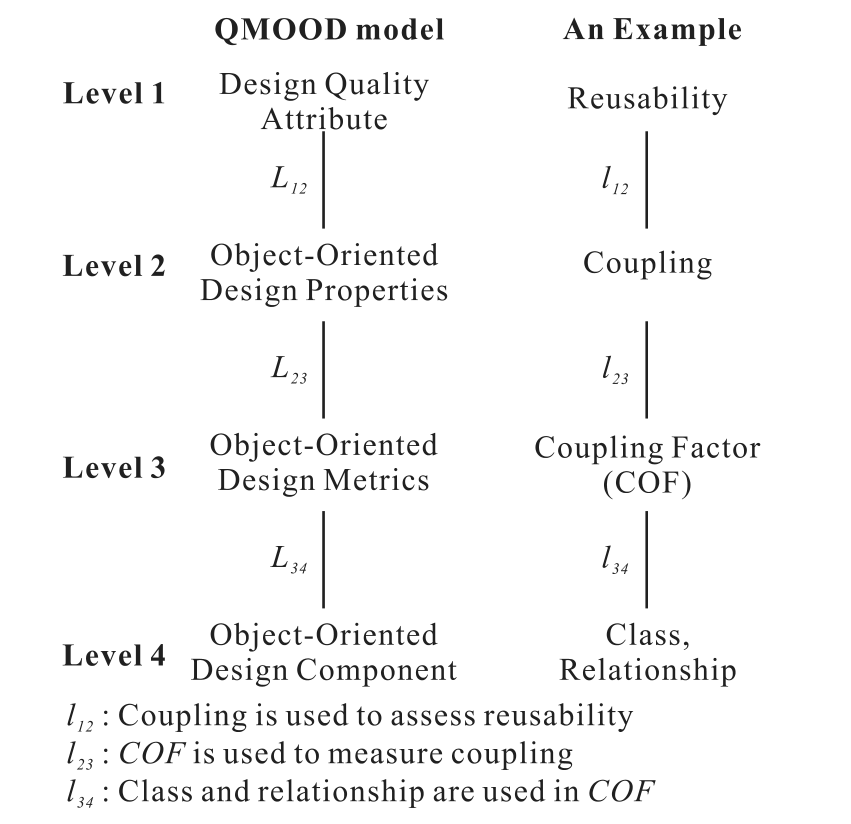
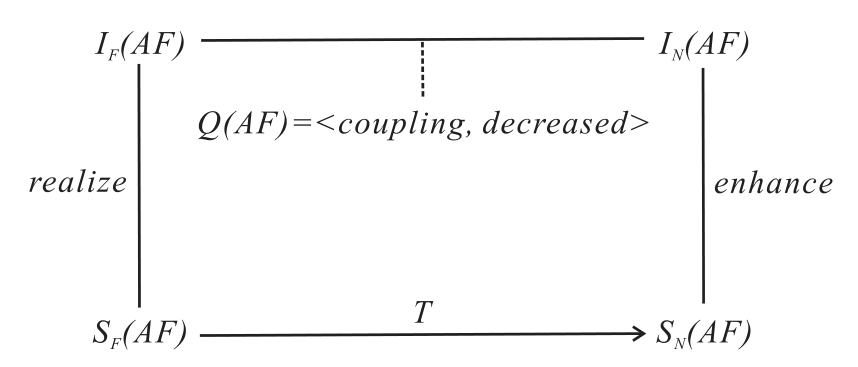
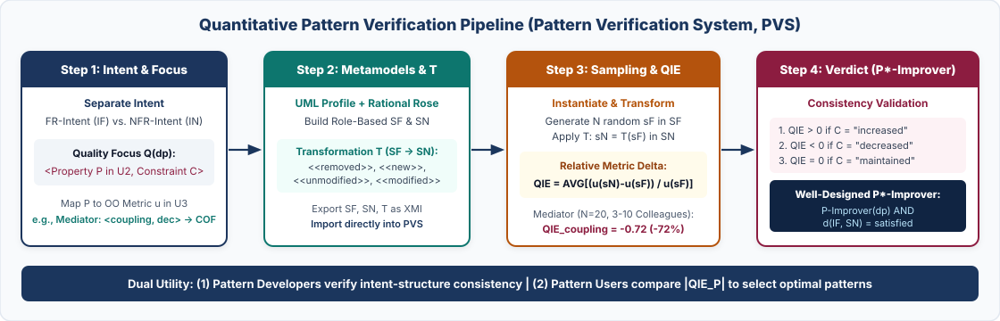
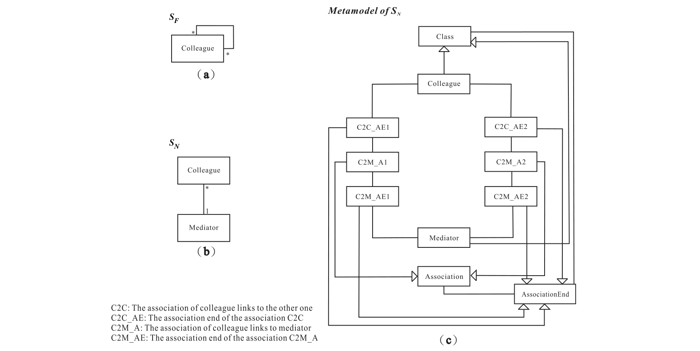
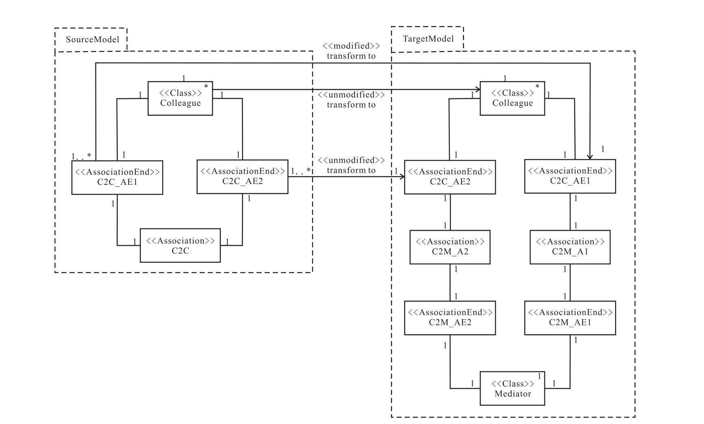
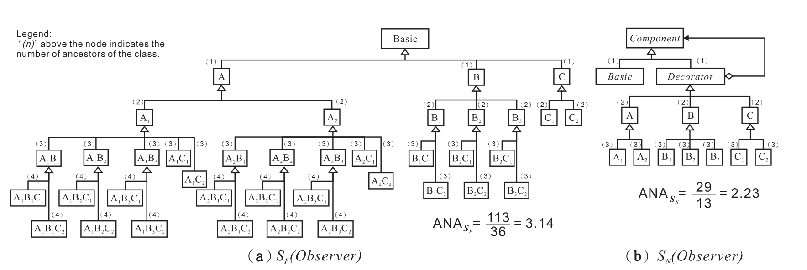

<!-- _class: lead -->

The Journal of Systems and Software (JSS) · Vol. 81, pp. 1430–1439 · 2008

# A Quantitative Approach for Evaluating the Quality of Design Patterns

Verifying <strong>Intent–Structure Consistency</strong> and Quantifying <strong>Quality Improvement Effectiveness (QIE)</strong> via Role-Based UML Metamodels, QMOOD Metrics, and Automated Model Transformation

<strong>Nien-Lin Hsueh</strong>a,*, <strong>Peng-Hua Chu</strong>a, and <strong>William Chu</strong>b 
a Department of Information Engineering and Computer Science, Feng Chia University, Taichung, Taiwan 
b Department of Computer Science and Information Engineering, Tunghai University, Taichung, Taiwan 
<code>nlhsueh@fcu.edu.tw</code> · <code>cph@soft.iecs.fcu.edu.tw</code> · <code>cchu@thu.edu.tw</code>

DOI: 10.1016/j.jss.2007.11.724 · Accepted Nov 2007 · Published 2008 (Elsevier) · Grants: NSC94-2213-E-035-041 &amp; MOEA 96-EC-17-A-02-S1-029

<!--
Bibliographic & Research Overview:
This paper (Hsueh, Chu, & Chu, The Journal of Systems and Software 81 (2008) 1430-1439; doi:10.1016/j.jss.2007.11.724) addresses a foundational verification question in software design: when a design pattern claims in its Intent section to solve a quality problem (e.g., loose coupling, extensibility), how can we objectively and quantitatively verify that its Solution structural model actually achieves that quality improvement?

Core Contributions:
1. Formal 6-Tuple Pattern Representation: Formulates a quality-improving design pattern as <I_F, I_N, Q, S_F, S_N, T>, pairing FR/NFR intents with role-based UML metamodels and a transformation T.
2. Quantitative QIE_P Metric & P*-Improver Definition: Lifts QMOOD object-oriented metrics (e.g., COF, ANA, polymorphism) to the metamodel transformation level via Quality Improvement Effectiveness (QIE_P), defining P-improver and well-designed P*-improver criteria.
3. Pattern Verification System (PVS) & GoF Validation: Implements an XMI/Rational Rose-integrated verification tool, validates Mediator across 20 random sample models (QIE_coupling = -0.72), and uncovers nuanced insights on Observer, Decorator (negative abstraction QIE; actually a complexity-improver), and Singleton (problem-solver, not quality-improver).
-->

---

## Outline

1

<a href="#3">Motivation &amp; Background</a> Intent–solution consistency gap, role-based metamodeling, and QMOOD hierarchy.

2

<a href="#5">Formal 6-Tuple &amp; QIE Metric</a> FR/NFR intent &amp; structure duality, Quality Focus Q, QIEP formula, and P*-Improver.

3

<a href="#8">PVS Tool &amp; Mediator Case Study</a> UML Profiles, transformation tags, 20-sample COF experiment (QIE = −0.72).

4

<a href="#12">Broader GoF Insights</a> Polymorphism/hierarchy improvers vs. counter-intuitive Decorator &amp; Singleton cases.

5

<a href="#14">Conclusion &amp; Future Work</a> Dual utility for developers &amp; users, XMI tooling, and Model-Driven Architecture (MDA).

6

<a href="#15">Contact &amp; Archival Reference</a> Authors, affiliations, grants, and bibliographic metadata.

<strong>Guiding Principle:</strong> <em>"If a pattern's intent maps to an OO design property (e.g., coupling), its structure must support that property—and that property can be quantitatively evaluated via OO metrics (e.g., COF)."</em>

<!--
Paper Structure Map:
- Section 1 (Introduction, pp. 1430-1431): Motivates intent-solution consistency validation and defines dual benefits for pattern developers and users.
- Section 2 (Background Work, pp. 1431-1432): Reviews France et al.'s (2004) role-based pattern metamodels (Fig. 1) and Bansiya & Davis's (2002) QMOOD 4-level quality model (Fig. 2).
- Section 3 (Pattern Evaluation, pp. 1432-1435): Introduces the 6-tuple <I_F, I_N, Q, S_F, S_N, T> (Table 1, Figs. 3-5), QIE_P (Eqs. 1-2), and P-improver / P*-improver definitions (Eqs. 3-5).
- Section 4 (Case Study & System Design, pp. 1435-1439): Walks through Mediator validation in PVS + Rational Rose (Figs. 6-8, Table 2) and discusses broader GoF patterns (Figs. 9-11).
- Section 5 (Conclusion, p. 1439): Summarizes contributions and MDA future work.
-->

---

## 1. Motivation: Verifying Intent–Solution Consistency

<h3>The Unchecked Pattern Quality Gap</h3>
<ul>
<li><strong>Four Essential Pattern Sections (GoF):</strong> <em>Name</em>, <em>Intent</em> (problem to resolve), <em>Solution</em> (structural model), and <em>Consequences</em>.</li>
<li><strong>Consistency Challenge:</strong> As design patterns proliferate, claims in the <em>Intent</em> section (e.g., "promotes loose coupling") are rarely verified objectively against the <em>Solution</em> structure.</li>
<li><strong>Beyond Informal Examples:</strong> Model-level class diagrams (Fig. 1a) only show one fixed example (e.g., 2 product families) and cannot systematically verify general quality behavior.</li>
</ul>

<h3>Two Core Research Contributions</h3>
<ul>
<li><strong>1. For Pattern Developers (Validation):</strong> A systematic, objective approach based on OO quality models (QMOOD) to verify whether a newly designed pattern is <strong>well-designed</strong>—i.e., its structure truly resolves its stated quality intent without breaking functionality.</li>
<li><strong>2. For Pattern Users (Selection):</strong> A <strong>quantitative metric (<code>QIEP</code>)</strong> measuring the <em>magnitude</em> of quality improvement, helping architects choose the most effective pattern for their functional and quality requirements.</li>
</ul>

<strong>Theoretical Lineage:</strong> Inspired by Huston (2001) (comparing metric scores of pattern vs. non-pattern solutions) and building on the authors' 4-role taxonomy (<em>SoSyM 2009</em>), this work formalizes quantitative validation for <strong>Quality-Improver</strong> patterns.

<!--
Context & Motivation (Section 1, pp. 1430-1431):
Winn & Calder (2002) observed that a design pattern should handle non-functional requirements by providing not just a functional solution, but a "better" solution for quality attributes. Yet pattern validation traditionally relied on subjective peer review. By combining role-based metamodeling (France et al. 2004), QMOOD hierarchical metrics (Bansiya & Davis 2002), and automated metamodel transformation (Dong & Yang 2003), this paper turns pattern quality validation into a reproducible, quantitative engineering procedure.
-->

---

## 2. Background: Role-Based Metamodels &amp; QMOOD

<h3>1. Role-Based Pattern Representation (France et al., 2004)</h3>
<ul>
<li>Traditional GoF diagrams (Fig. 1a) depict concrete examples (e.g., <code>ProductA</code>, <code>ProductB</code>).</li>
<li><strong>Role-based metamodels</strong> (Fig. 1b) abstract participants into formal roles (<code>AbstractFactory</code>, <code>ConcreteFactory</code>, <code>AbstractProduct</code>, <code>ConcreteProduct</code>, <code>Client</code>) so arbitrary instance models can be generated and verified.</li>
</ul>
<h3>2. QMOOD 4-Level Hierarchy (Bansiya &amp; Davis, 2002)</h3>
<ul>
<li>Denoted as <code>Φ</code> with 4 levels (<code>Φ1</code>–<code>Φ4</code>) and 3 mappings (<code>Φ12</code>, <code>Φ23</code>, <code>Φ34</code>).</li>
<li>Connects high-level <strong>Quality Attributes</strong> (e.g., Reusability) ➔ <strong>OO Design Properties</strong> (e.g., Coupling) ➔ <strong>OO Metrics</strong> (e.g., <code>COF</code>) ➔ <strong>OO Components</strong> (Class, Relationship).</li>
</ul>

Fig. 2. QMOOD 4-level hierarchical quality model and Reusability–Coupling–COF mapping example.

<!--
Background Formalisms (Section 2, pp. 1431-1432, Figs. 1-2):
1. Role-Based Metamodeling (Section 2.1): Allows specifying structural properties that any conforming model element must satisfy. In Abstract Factory, arbitrary numbers of product families instantiate the single ConcreteProduct role.
2. QMOOD Formal Notation (Section 2.2):
   - Level 1 (Phi_1): 6 quality attributes — Reusability, Flexibility, Effectiveness, Understandability, Functionality, Extendibility.
   - Level 2 (Phi_2): 11 OO design properties — Design Size, Hierarchy, Abstraction, Encapsulation, Coupling, Cohesion, Composition, Inheritance, Polymorphism, Messaging, Complexity.
   - Level 3 (Phi_3): Quantitative OO design metrics (e.g., COF for Coupling, ANA for Abstraction).
   - Level 4 (Phi_4): Primitive OO elements (objects, classes, relationships, generalization).
   - Mapping (P, mu) in Phi_23 states that metric mu evaluates design property P.
-->

---

## 3. Formal 6-Tuple Pattern Definition &amp; Quality Focus

A quality-improving pattern is defined as a 6-tuple <code>dp = &lt;IF, IN, Q, SF, SN, T&gt;</code>:

<ul>
<li><code>IF</code> / <code>IN</code>: <strong>FR-Intent</strong> (what it does) &amp; <strong>NFR-Intent</strong> (quality gain).</li>
<li><code>Q(dp) = &lt;property, constraint&gt;</code>: <strong>Quality Focus</strong>, where <code>property ∈ Φ2</code> and <code>constraint ∈ {increased, decreased, maintained}</code>.</li>
<li><code>SF</code> / <code>SN</code>: Role-based <strong>FR-Structure</strong> &amp; <strong>NFR-Structure</strong> metamodels.</li>
<li><code>T</code>: <strong>Transformation</strong> mapping every instance <code>s ∈ SF(dp)</code> to <code>T(s) ∈ SN(dp)</code>.</li>
</ul>

| Pattern (Table 1) | Quality Focus <code>Q</code> |
| :--- | :--- |
| <strong>Observer</strong> | <code>&lt;coupling, decreased&gt;</code> |
| <strong>Abstract Factory</strong> | <code>&lt;coupling, decreased&gt;</code> |
| <strong>Strategy</strong> | <code>&lt;polymorphism, increased&gt;</code> |
| <strong>Iterator</strong> | <code>&lt;encapsulation, increased&gt;</code> |

Fig. 5. Commutative relationship between FR/NFR intents, Quality Focus Q, FR/NFR metamodels, and Transformation T (Abstract Factory).

<!--
Formal Pattern Semantics (Section 3.1, Table 1, Figs. 3-5):
Fig. 5 captures the core theoretical bridge of the paper:
- Top horizontal link: Extending I_F(AF) to I_N(AF) defines the Quality Focus Q(AF) = <coupling, decreased>.
- Left vertical link: S_F(AF) realizes I_F(AF) (Client directly instantiates ConcreteProducts).
- Right vertical link: S_N(AF) enhances I_N(AF) (surrogate Factory decouples Client from ConcreteProducts).
- Bottom horizontal link: Transformation T maps any instance model s in S_F(AF) into T(s) in S_N(AF), enabling automated quantitative comparison before and after applying the pattern.
-->

---

## 3. Quantitative Metric: Quality Improvement Effectiveness (`QIE_P`)

<h3>1. Base OO Metric Example: COF</h3>

For property <code>coupling</code>, QMOOD maps to Brito &amp; Abreu's (1995) <strong>Coupling Factor (COF)</strong>:

COF = [ Σi=1..TC Σj=1..TC is_client(Ci, Cj) ] / (TC2 − TC)

where <code>TC</code> is total classes, and <code>is_client(Ci, Cj) = 1</code> iff class <code>Ci</code> has a non-inheritance reference to <code>Cj</code> (<code>Ci ≠ Cj</code>).

<h3>2. Lifting Metrics to Metamodels (Eqs. 1–2)</h3>

Given metric <code>μ</code> with <code>(P, μ) ∈ Φ23</code> and aggregation function <code>G</code> (e.g., <code>AVG</code>) over typical sample set <code>s ∈ SF</code>:

QIEP(dp) = μ(SF, T) 
&nbsp;&nbsp;= Gs ∈ SF [ ( μ(T(s)) − μ(s) ) / μ(s) ] &nbsp;&nbsp;(if μ(s) ≠ 0) 
&nbsp;&nbsp;= ∞ &nbsp;&nbsp;(if μ(s) = 0)

QIEP &gt; 0

Applying pattern <code>dp</code> <strong>increases</strong> OO design property <code>P</code> (e.g., higher polymorphism).

QIEP &lt; 0

Applying pattern <code>dp</code> <strong>decreases</strong> OO design property <code>P</code> (e.g., lower coupling).

|QIEP| Magnitude

Larger absolute value indicates <strong>stronger impact</strong> on property <code>P</code>; <code>0</code> means inefficacious.

<!--
Mathematical Definition of QIE_P (Section 3.2, pp. 1433-1434, Eqs. 1-2):
Because a pattern is specified at the metamodel level (S_F -> S_N) while OO metrics operate on concrete instance models, Hsueh et al. lift metric mu to mu(M, T) by evaluating the relative metric change (mu(T(m)) - mu(m)) / mu(m) across a representative sample set of instantiated models M and aggregating via G (typically arithmetic mean AVG).
- Note on edge case: If mu(s) = 0 (e.g., zero initial polymorphic methods before transformation), QIE_P is defined as infinity (representing unbounded relative increase from zero).
- Comparative utility: Two candidate patterns targeting the same property P can be ranked objectively by comparing their |QIE_P| magnitudes.
-->

---

## 3. Defining `P-Improver` and Well-Designed `P*-Improver`

<h3>Consistency Validation: <code>P-Improver</code> (Eqs. 3–4)</h3>

A pattern <code>dp = &lt;IF, IN, &lt;P, C&gt;, SF, SN, T&gt;</code> is a <strong>property P improver</strong> iff <code>QIEP(dp)</code> matches constraint <code>C</code>:

QIEP(dp) &gt; 0 &nbsp; if C = "increased" 
QIEP(dp) &lt; 0 &nbsp; if C = "decreased" 
QIEP(dp) = 0 &nbsp; if C = "maintained"

<strong>Implication (Eq. 4):</strong> <code>P-improver(dp) ➔ δ(IN, SF) &lt; δ(IN, SN)</code> — the NFR-structure satisfies the non-functional intent to a strictly higher degree than the FR-structure.

<h3>Functional Preservation: <code>P*-Improver</code> (Eq. 5)</h3>

Improving quality must <strong>never impair original functionality</strong>. A pattern is a <strong>well-designed P-improver</strong> (<code>P*-improver</code>) iff:

P*-improver(dp) ⇔ 
&nbsp;&nbsp;P-improver(dp) ∧ ( δ(IF, SN) = satisfied )

<ul class="small-text">
<li><code>δ(IF, S) ∈ {0, 1}</code>: binary functional satisfaction (verified by checking operations &amp; interactions in <code>SN</code>).</li>
<li><code>δ(IN, S) ∈ [0, 1]</code>: continuous NFR satisfaction degree (inferred indirectly via <code>P-improver</code>).</li>
</ul>

<strong>Example (Abstract Factory, Fig. 3):</strong> Introducing surrogate <code>Factory</code> reduces Client–Product coupling (<code>QIEcoupling &lt; 0</code>) while preserving product-family creation ➔ confirmed <strong>well-designed Coupling-Improver</strong>.

<!--
Theoretical Rigor of P-Improver and P*-Improver (Section 3.3, pp. 1434-1435, Eqs. 3-5):
Note an important nuance in the paper: the satisfaction function delta(intent, structure) is a conceptual construct that cannot be measured directly for soft NFRs (ranging in [0, 1]). Therefore, Eq. (4) uses the measurable QIE_P(dp) criterion in Eq. (3) as an operational proxy to establish delta(I_N, S_F) < delta(I_N, S_N). Meanwhile, Eq. (5) safeguards against degenerate transformations (e.g., deleting classes to artificially reduce COF) by requiring the designer to verify that S_N retains sufficient operations and collaborations to satisfy I_F (note: Eq. (5) in the PDF has a minor typographical S_F inside the formula, immediately clarified in the very next line of text as delta(I_F, S_N) = satisfied).
-->

---

## 4. Automated Verification Tool: Pattern Verification System (PVS)

<strong>Tool Integration (Section 4):</strong> Metamodels <code>SF</code>, <code>SN</code>, and transformation <code>T</code> are modeled as <strong>UML Profiles</strong> in <strong>IBM Rational Rose</strong>, exported to <strong>XMI</strong>, and imported into the authors' custom <strong>Pattern Verification System (PVS)</strong> for automated random model instantiation, transformation, and QIE computation.

<!--
System Architecture of PVS (Section 4, p. 1435):
Rather than inventing proprietary graph-grammar syntax, the authors leverage standard UML 2.x Profile extension mechanisms (Heaven & Finkelstein 2004; OMG UML Semantics 2007) inside IBM Rational Rose. Exporting to standard XMI bridges commercial CASE modeling tools with the custom PVS engine, which handles:
1. Bounded random sampling of conforming source instances s_F from S_F (since a metamodel admits infinitely many instances).
2. Automated execution of transformation T to generate s_N = T(s_F).
3. Automated OO metric calculation (e.g., COF, ANA) on every pair (s_F, s_N) and aggregate QIE_P reporting.
-->

---

## 4. Case Study I: Mediator Intent, Structures &amp; UML Profile

<h3>Step 1: Intent Separation &amp; Quality Focus</h3>
<ul>
<li><strong>IF(Mediator):</strong> A <code>Colleague</code> object can communicate with other <code>Colleague</code> objects.</li>
<li><strong>IN(Mediator):</strong> Communicate in a <strong>loose-coupling</strong> manner by keeping objects from referring to each other explicitly.</li>
<li><strong>Quality Focus:</strong> <code>Q(Mediator) = &lt;coupling, decreased&gt;</code> ➔ Metric in <code>Φ3</code>: <strong>COF</strong>.</li>
</ul>
<h3>Step 2: Role-Based Structures &amp; UML Profile</h3>
<ul>
<li><code>SF</code> (Fig. 6a): Direct many-to-many self-association among <code>Colleague</code> classes.</li>
<li><code>SN</code> (Fig. 6b): Introduces <code>Mediator</code> broker between all <code>Colleague</code> instances.</li>
<li><strong>UML Profile</strong> (Fig. 6c): Specializes UML metaclasses <code>Class</code>, <code>Association</code> (<code>C2M_A1/A2</code>), and <code>AssociationEnd</code> (<code>C2C_AE</code>, <code>C2M_AE</code>).</li>
</ul>

Fig. 6. Mediator pattern: (a) FR-structure SF, (b) NFR-structure SN, and (c) SN represented as a UML Profile metamodel.

<!--
Mediator Case Study Steps 1 & 2 (Section 4.1, pp. 1435-1436, Fig. 6):
Starting from GoF's Mediator intent ("Define an object that encapsulates how a set of objects interact. Mediator promotes loose coupling..."), Step 1 extracts I_F, I_N, and Q(Mediator) = <coupling, decreased>.
Step 2 constructs the metamodel-level representations:
- C2C: Association linking one Colleague to another in S_F.
- C2C_AE: Association end of C2C.
- C2M_A: Association linking Colleague to Mediator in S_N.
- C2M_AE: Association end of C2M_A.
By subtyping standard UML metamodel elements (Class, Association, AssociationEnd), the metamodel remains directly editable in Rational Rose.
-->

---

## 4. Case Study II: Mediator Transformation Specification

Fig. 7. Metamodel transformation specification T(Mediator) mapping SourceModel (SF) to TargetModel (SN).

<h3>Step 3: Four Transformation Tags (Dong &amp; Yang, 2003)</h3>
<ul>
<li><code>&lt;&lt;removed&gt;&gt;</code>: Elements present only in <code>SourceModel</code> (e.g., direct <code>C2C</code> associations—omitted in target).</li>
<li><code>&lt;&lt;new&gt;&gt;</code>: Elements newly created in <code>TargetModel</code> (<code>Mediator</code> class, <code>C2M_A1/A2</code>, <code>C2M_AE1/AE2</code>).</li>
<li><code>&lt;&lt;unmodified&gt;&gt;</code>: Elements preserved identically across transformation (<code>Colleague</code> classes &amp; <code>C2C_AE2</code>).</li>
<li><code>&lt;&lt;modified&gt;&gt;</code>: Elements whose attributes, operations, or bindings change (<code>C2C_AE1</code> re-routed through <code>C2M_A1</code>).</li>
</ul>

Exported from Rational Rose as XMI, Fig. 7 allows <strong>PVS</strong> to automatically transform any arbitrary mesh of <code>Colleague</code> classes (Fig. 8a) into a star-topology Mediator model (Fig. 8b).

<!--
Mediator Transformation Specification Details (Section 4.1 Step 3, pp. 1435-1436, Fig. 7):
Adopting Dong & Yang's (2003) UML profile tagging scheme, Fig. 7 formally specifies how every instance of direct Colleague-to-Colleague association (C2C) is dissolved and re-routed through a single Mediator class.
- Multiplicity 1..* on C2C_AE1/C2C_AE2 in SourceModel allows arbitrary numbers of pairwise associations among 3 to 10 Colleague classes to be systematically collapsed into linear O(N) connections to Mediator in TargetModel.
-->

---

## 4. Case Study III: Quantitative Results on 20 Mediator Samples

20 Samples

PVS randomly generated 20 <code>sF</code> models (3–10 Colleague classes, 3–32 random associations).

COF: 0.34 ➔ 0.09

Coupling dropped sharply in every sample (<code>sF</code>: 0.15–0.50 ➔ <code>sN</code>: 0.07–0.13).

QIE = −0.72

Average <code>QIEcoupling(Mediator) = −0.72</code> (range −0.50 to −0.82) ➔ Verified <strong>Coupling-Improver</strong>!

| Representative Samples (Table 2) | #01 | #04 | #08 | #12 | #14 | #16 | #20 | <strong>20-Sample Avg</strong> |
| :--- | :---: | :---: | :---: | :---: | :---: | :---: | :---: | :---: |
| <strong>sF</strong> (#Class / #Assoc) | 3 / 3 | 5 / 8 | 6 / 14 | 7 / 21 | 9 / 11 | 9 / 23 | 10 / 32 | 7.4 / 14.9 |
| <strong>COF(sF)</strong> | 0.50 | 0.40 | 0.46 | 0.50 | 0.15 | 0.31 | 0.35 | <strong>~0.34</strong> |
| <strong>sN</strong> (#Class / #Assoc) | 6 / 4 | 8 / 6 | 10 / 7 | 10 / 8 | 12 / 10 | 12 / 10 | 13 / 11 | 10.4 / 8.2 |
| <strong>COF(sN)</strong> | 0.13 | 0.11 | 0.10 | 0.09 | 0.08 | 0.08 | 0.07 | <strong>~0.09</strong> |
| <strong>QIESF, SN</strong> | <strong>−0.73</strong> | <strong>−0.73</strong> | <strong>−0.79</strong> | <strong>−0.82</strong> | <strong>−0.50</strong> | <strong>−0.76</strong> | <strong>−0.80</strong> | <strong>−0.72</strong> |

<strong>Verdict:</strong> <code>QIEcoupling(Mediator) = −0.72 &lt; 0</code> matches constraint <code>"decreased"</code> in <code>Q(Mediator)</code> across all 20 topologies (even sparse #14 achieves −50%, while dense #12/#20 achieve −82%/−80%).

<!--
Quantitative Validation Results (Section 4.1 Step 4 & Table 2, pp. 1435-1437):
Table 2 reports all 20 PVS-generated random samples spanning 3 to 10 Colleague classes (with 3 to 32 random inter-colleague associations).
- Structural Effect: Applying T(Mediator) adds 3 classes on average (Abstract Colleague, Abstract Mediator, Concrete Mediator) while drastically collapsing quadratic O(N^2) inter-colleague associations into linear connections.
- Quantitative Consistency: Every single sample exhibits a strongly negative QIE between -0.50 (Sample 14: sparse 9 classes, 11 associations, COF 0.15 -> 0.08) and -0.82 (Sample 12: dense 7 classes, 21 associations, COF 0.50 -> 0.09).
- Aggregate Score: AVG(QIE) = -0.72, objectively confirming that Mediator is a strong Coupling-Improver and demonstrating that its coupling-reduction benefit scales up as colleague interaction density increases.
-->

---

## 4. Broader GoF Insights I: Polymorphism, Hierarchy &amp; Abstraction

<h3>Why Most GoF Patterns Are Polymorphism-Improvers</h3>
<ul class="small-text">
<li>Applying QMOOD across Gamma's GoF catalog reveals that <strong>Abstract Factory, Builder, Observer, Strategy, and State</strong> share a common transformation motif (Fig. 9):
  <ul>
  <li><strong>Before (SF):</strong> <code>Role1</code> directly calls concrete <code>Role2</code>.</li>
  <li><strong>After (SN):</strong> Introduces an abstract hierarchy so <code>Role2</code> can be extended without modifying <code>Role1</code>.</li>
  </ul>
</li>
<li><strong>Analytical Proof:</strong> Adding at least 1 polymorphic method to <code>n</code> existing polymorphic methods yields:
  
QIEpolymorphism ≈ [ (n + 1) − n ] / n = 1 / n &gt; 0

</li>
</ul>

<h3>Coupled Hierarchy &amp; Abstraction Gains</h3>
<ul class="small-text">
<li><strong>Hierarchy</strong> (generalization–specialization) enhances system <em>functionality</em>; <strong>Abstraction</strong> (average ancestors <code>ANA</code>) enhances <em>extensibility &amp; effectiveness</em>.</li>
<li>When a pattern introduces a polymorphic hierarchy, <strong>Hierarchy</strong> and <strong>Abstraction</strong> typically rise together.</li>
<li><strong>Observer Example (Fig. 10):</strong> Direct <code>Subject ➔ Observer</code> calls are transformed into two abstract hierarchies (<code>Subject</code> &amp; <code>Observer</code>) with polymorphic <code>update()</code>:
  <ul>
  <li><code>QIEpolymorphism &gt; 0</code>, <code>QIEhierarchy &gt; 0</code>, <code>QIEabstraction &gt; 0</code> ➔ simultaneous improver of all three properties!</li>
  </ul>
</li>
</ul>

<strong>Architectural Takeaway:</strong> Despite differing intents and applicability, many GoF patterns achieve flexibility through the exact same structural transformation motif—creating measurable positive QIE across polymorphism, hierarchy, and abstraction.

<!--
Cross-Pattern Structural Analysis (Section 4.2, pp. 1437-1438, Figs. 9-10):
Evaluating multiple GoF patterns under QMOOD exposes a unifying structural explanation:
- Polymorphism (runtime interface substitution) directly drives QMOOD Flexibility, Extensibility, and Effectiveness.
- Because transforming direct calls (Role1 -> Role2) into polymorphic hierarchies (Fig. 9) adds abstract superclasses and overridden operations, Observer (Fig. 10), Strategy, State, Builder, and Abstract Factory naturally score positively on Polymorphism, Hierarchy, and Abstraction simultaneously.
-->

---

## 4. Broader GoF Insights II: Decorator &amp; Singleton Surprises

Fig. 11. Decorator pattern: (a) Static inheritance SF causes subclass explosion (36 classes, ANA = 3.14); (b) Composition-based SN cuts classes to 13 (ANA = 2.23).

<h3>1. Decorator Is NOT an Abstraction-Improver!</h3>

Despite having a hierarchy, Decorator's <code>QIEabstraction</code> is <strong>negative</strong> (<code>ANA: 3.14 ➔ 2.23</code>, −29%) because it replaces deep static inheritance with runtime composition. Its true strength is slashing classes (36 ➔ 13) ➔ a <strong>Complexity-Improver</strong>!

<h3>2. Not All Patterns Are Quality-Improvers</h3>

<strong>Singleton</strong> constrains a class hierarchy to instantiate exactly one object (protected reference + private constructors). It solves a functional programming constraint rather than improving QMOOD quality ➔ classified as a <strong>Problem-Solver</strong> (Hsueh et al., 2007/2009).

<!--
Counter-Intuitive Empirical Discoveries (Section 4.2, pp. 1438-1439, Fig. 11):
1. Decorator Pattern Paradox: Visually, Decorator contains an inheritance tree (Component -> Basic / Decorator -> A, B, C), tempting developers to assume it improves Hierarchy/Abstraction. However, quantitative QMOOD evaluation using ANA (Average Number of Ancestors) exposes the opposite:
   - S_F (static inheritance for all combinations of A, B, C): 36 classes, sum of ancestors = 113 -> ANA = 113 / 36 = 3.14.
   - S_N (Decorator object composition): 13 classes, sum of ancestors = 29 -> ANA = 29 / 13 = 2.23.
   - Therefore QIE_abstraction(Decorator) = (2.23 - 3.14)/3.14 = -0.29 < 0. This quantitatively proves Decorator is a Complexity-Improver (avoiding combinatorial subclass explosion), NOT an Abstraction-Improver!
   (Note: Fig. 11 sub-captions in the original published PDF contain a minor print typo labeling "(a) S_F(Observer)" / "(b) S_N(Observer)" while the figure caption and text explicitly describe Decorator.)
2. Scope Boundary (Singleton): Connects directly back to the 4-role classification (activity-facilitator, quality-improver, problem-solver, conflict-resolver): QIE applies specifically to Quality-Improver patterns, not Problem-Solvers like Singleton.
-->

---

## 5. Conclusion &amp; Future Work

<h3>Core Contributions</h3>
<ul class="small-text">
<li><strong>1. Formal Quality-Perspective Model:</strong> Represented patterns as <code>&lt;IF, IN, Q, SF, SN, T&gt;</code>, bridging informal GoF text with role-based UML metamodels and QMOOD metrics.</li>
<li><strong>2. Quantitative <code>QIEP</code> &amp; <code>P*-Improver</code>:</strong> Enabled objective verification of intent–structure consistency and magnitude comparison across competing patterns.</li>
<li><strong>3. PVS Prototype &amp; GoF Insights:</strong> Automated XMI-based validation confirmed Mediator (<code>QIE = −0.72</code>), explained polymorphism-improver motifs, and revealed Decorator as a Complexity-Improver rather than Abstraction-Improver.</li>
</ul>

<h3>Future Research Directions</h3>
<ul class="small-text">
<li><strong>Full XMI-Based Verification Suite:</strong> Expand PVS with a complete standardized XMI schema for representing meta-level <code>SF</code> and <code>SN</code> structures across the entire GoF and architectural pattern catalogs.</li>
<li><strong>Model-Driven Architecture (MDA) Integration:</strong> Adopt OMG MDA transformation techniques (Miller &amp; Mukerji 2003; Meservy &amp; Fenstermacher 2005) to formalize and automate <code>T</code> across platform-independent and platform-specific models.</li>
<li><strong>Multi-Property Tradeoff Profiling:</strong> Evaluate simultaneous positive and negative QIE profiles across all 11 QMOOD properties.</li>
</ul>

<strong>Bottom Line:</strong> Quantitative pattern verification elevates design patterns from <em>folk wisdom</em> to <strong>auditable, measurable software engineering assets</strong> for both pattern authors and system architects.

<!--
Conclusion & Future Roadmap (Section 5, p. 1439):
This work demonstrates that the widely accepted claim "design patterns improve software quality" can—and should—be tested quantitatively at the metamodel level. By linking QMOOD design properties and metrics to formal FR -> NFR transformations, pattern developers gain a consistency check before publishing new patterns, and practitioners gain empirical evidence (QIE_P) for selecting patterns that genuinely match their non-functional requirements.
-->

---

<!-- _class: closing -->

# Thank You for Your Attention!

A Quantitative Approach for Evaluating the Quality of Design Patterns

<strong>Nien-Lin Hsueh*</strong> · <code>nlhsueh@fcu.edu.tw</code> &nbsp;|&nbsp; <strong>Peng-Hua Chu</strong> · <code>cph@soft.iecs.fcu.edu.tw</code> 
<strong>William Chu</strong> · <code>cchu@thu.edu.tw</code> 
Feng Chia University &amp; Tunghai University, Taichung, Taiwan 
The Journal of Systems and Software (JSS), Vol. 81, pp. 1430–1439, 2008 · DOI: 10.1016/j.jss.2007.11.724

<!--
Archival Citation Metadata:
- Title: A quantitative approach for evaluating the quality of design patterns
- Authors: Nien-Lin Hsueh (Feng Chia University, corresponding author), Peng-Hua Chu (Feng Chia University), William Cheng-Chung Chu (Tunghai University)
- Venue: The Journal of Systems and Software (JSS), Vol. 81, pp. 1430-1439, 2008 (Available online Dec 4, 2007, Elsevier Inc.)
- DOI: 10.1016/j.jss.2007.11.724
- Grants: National Science Council (Taiwan) NSC94-2213-E-035-041; Department of Industrial Technology, MOEA (Taiwan) 96-EC-17-A-02-S1-029
- Keywords: Design pattern, Object-oriented metrics, Software quality
-->

