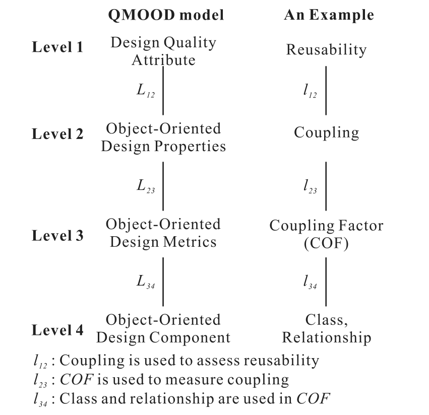
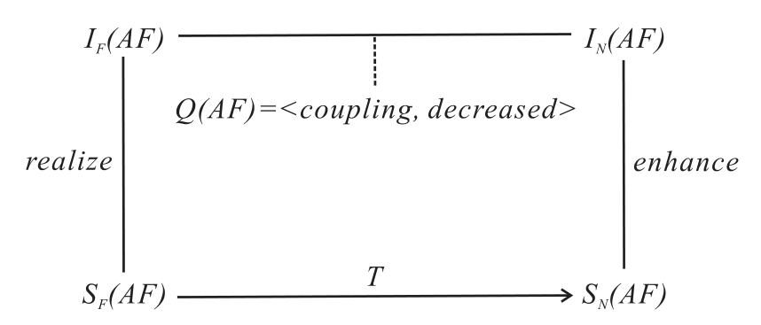
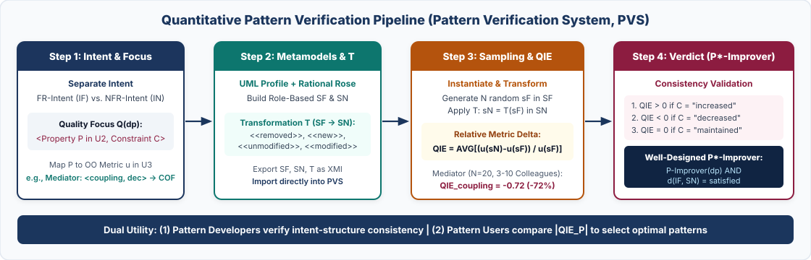
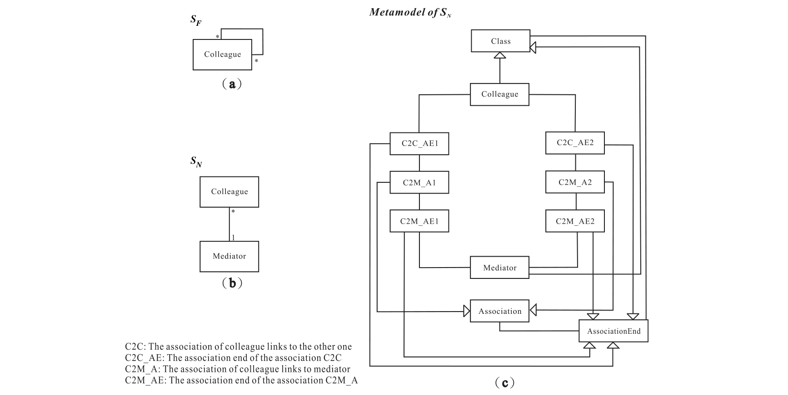
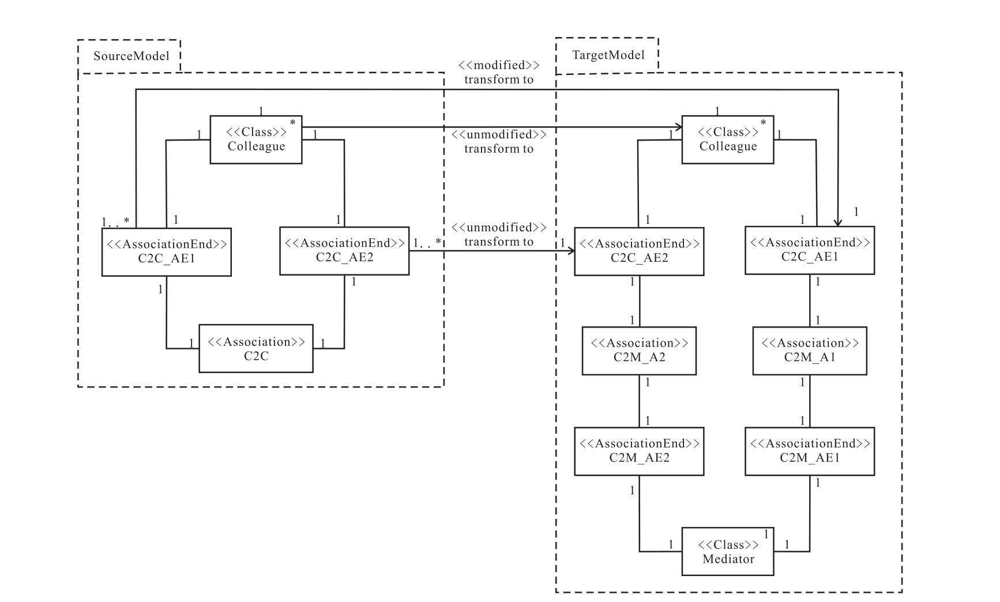
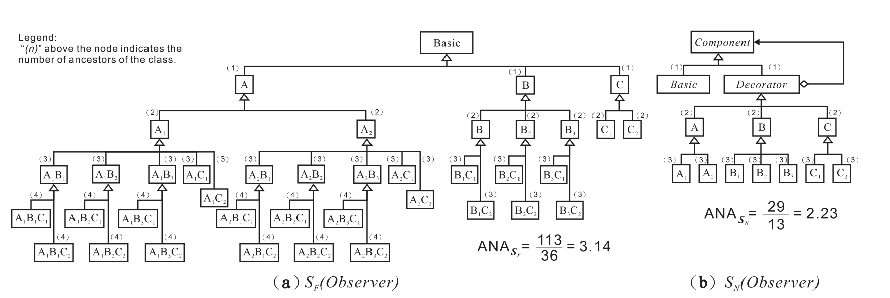

<!-- _class: lead -->

The Journal of Systems and Software (JSS) · 第 81 卷 1430–1439 頁 · 2008

# 評估設計模式品質之量化方法

A Quantitative Approach for Evaluating the Quality of Design Patterns

結合<strong>角色基礎 UML 後設模型</strong>、<strong>QMOOD 物件導向品質模型</strong>與自動化模型轉換，客觀驗證設計模式之<strong>意圖與結構一致性</strong>並量化其<strong>品質改善效能（QIE）</strong>

<strong>薛念林（Nien-Lin Hsueh）</strong>a,*、<strong>朱鵬華（Peng-Hua Chu）</strong>a、<strong>朱正忠（William Chu）</strong>b 
a 逢甲大學資訊工程學系 · b 東海大學資訊工程學系 
<code>nlhsueh@fcu.edu.tw</code> · <code>cph@soft.iecs.fcu.edu.tw</code> · <code>cchu@thu.edu.tw</code>

DOI: 10.1016/j.jss.2007.11.724 · 2007 年 11 月接受 · 2008 年刊出（Elsevier）· 補助：國科會 NSC94-2213-E-035-041 ＆ 經濟部 96-EC-17-A-02-S1-029

<!--
論文書目與核心問題：
本論文發表於 The Journal of Systems and Software（JSS, Vol. 81, pp. 1430-1439, 2008），由逢甲大學薛念林（通訊作者）、朱鵬華與東海大學朱正忠教授共同撰寫。研究回應軟體工程界一項根本驗證難題：當設計模式於「意圖（Intent）」宣稱能解決某項品質問題（如降低耦合、提升擴充性）時，如何客觀且量化地驗證其「解決方案（Solution）」結構確實達成該品質改善？

三大核心貢獻：
1. 六元組形式化定義：將品質改進型設計模式定義為 <I_F, I_N, Q, S_F, S_N, T>，明確對應功能／非功能意圖、品質焦點、角色基礎 UML 後設模型與模型轉換 T。
2. 品質改善效能指標（QIE_P）與 P*-Improver 判準：將 QMOOD 物件導向度量（如 COF、ANA、多型性）提升至後設模型轉換層級，提出 P-Improver 與確保不損害原功能之良構 P*-Improver 定義。
3. 模式驗證系統（PVS）實作與 GoF 實證：串接 IBM Rational Rose（UML Profile / XMI）與自研 PVS 工具，以 20 組隨機樣本證實 Mediator 為強耦合改進者（QIE_coupling = -0.72），並揭示 Decorator 實為複雜度改進者而非抽象度改進者、Singleton 則屬問題解決者。
-->

---

## 簡報大綱

1

<a href="#3">研究動機與技術背景</a> 意圖與結構一致性缺口、角色基礎後設塑模與 QMOOD 四層品質模型。

2

<a href="#5">形式化六元組與 QIE 量化指標</a> FR／NFR 結構二元定義、品質焦點 Q、QIEP 公式與良構 P*-Improver。

3

<a href="#8">PVS 系統與 Mediator 驗證案例</a> UML Profile、轉換標籤與 20 組隨機樣本 COF 實驗（QIE = −0.72）。

4

<a href="#12">GoF 設計模式延伸洞見</a> 多型／階層改進者共通轉換結構，以及 Decorator 與 Singleton 之反直覺發現。

5

<a href="#14">結論與未來研究方向</a> 對模式開發者與使用者之雙重價值、XMI 工具鏈與 MDA 模型驅動整合。

6

<a href="#15">聯絡方式與書目典藏</a> 作者資訊、研究計畫補助與期刊引用格式。

<strong>核心驗證哲學：</strong><em>「若設計模式的意圖對應至某項物件導向設計性質（如耦合度），其結構就必須支持該性質；而該結構的物件導向性質可透過物件導向度量指標（如 COF）加以客觀量化評估。」</em>

<!--
論文結構導覽：
- 第 1 節（緒論，pp. 1430-1431）：提出意圖與結構一致性驗證問題，說明對模式開發者與使用者的雙重效益。
- 第 2 節（背景技術，pp. 1431-1432）：介紹 France et al.（2004）角色基礎後設模型（圖 1）與 Bansiya & Davis（2002）QMOOD 階層品質模型（圖 2）。
- 第 3 節（模式評估方法，pp. 1432-1435）：定義六元組（表 1、圖 3-5）、QIE_P 公式（式 1-2）與 P-Improver／P*-Improver 驗證準則（式 3-5）。
- 第 4 節（案例研究與系統設計，pp. 1435-1439）：以 PVS + Rational Rose 驗證 Mediator（圖 6-8、表 2），並剖析 Observer、Decorator 與 Singleton（圖 9-11）。
- 第 5 節（結論，p. 1439）：總結貢獻並展望 MDA 整合。
-->

---

## 1. 研究動機：驗證意圖與解決方案之一致性

<h3>設計模式品質驗證的既有缺口</h3>
<ul>
<li><strong>GoF 四大核心段落：</strong><em>模式名稱</em>、<em>意圖（Intent）</em>、<em>解決方案（Solution）</em>與<em>結果（Consequences）</em>。</li>
<li><strong>一致性檢核盲點：</strong>隨著設計模式大量湧現，模式於「意圖」宣稱的品質效益（如鬆散耦合）鮮少經過客觀結構驗證。</li>
<li><strong>範例層級圖示的侷限：</strong>傳統類別圖（圖 1a）僅描繪單一特例（例如兩組產品家族），無法系統化檢驗一般情境下的品質行為。</li>
</ul>

<h3>本研究帶來的雙重工程效益</h3>
<ul>
<li><strong>1. 協助模式開發者（設計驗證）：</strong>建立基於 QMOOD 的客觀驗證程序，確認新設計的模式是否<strong>良構（Well-Designed）</strong>——結構確能解決意圖所宣稱的品質問題且不損及原有功能。</li>
<li><strong>2. 協助模式使用者（客觀選型）：</strong>提供<strong>品質改善效能指標（<code>QIEP</code>）</strong>量化品質提升幅度，讓架構師依據功能與品質需求挑選最適切的設計模式。</li>
</ul>

<strong>研究脈絡：</strong>受 Huston（2001）比較模式與非模式度量分數啟發，並承接團隊之設計模式四角色分類（<em>SoSyM 2009</em>），本文專注於為<strong>品質改進者（Quality-Improver）</strong>建立嚴謹的量化驗證體系。

<!--
動機與學術脈絡（第 1 節，pp. 1430-1431）：
Winn & Calder（2002）強調設計模式應能處理非功能需求；然而過去設計模式的正確性多仰賴專家主觀審查。本研究整合角色基礎後設模型（France et al. 2004）、QMOOD 度量體系（Bansiya & Davis 2002）與 UML Profile 模型轉換（Dong & Yang 2003），將設計模式品質驗證轉化為可重複執行的客觀工程程序。
-->

---

## 2. 技術背景：角色基礎後設模型與 QMOOD 品質模型

<h3>1. 角色基礎模式表示法（France et al., 2004）</h3>
<ul>
<li>傳統 GoF 類別圖（圖 1a）停留在模型範例層級（如固定兩組 <code>ProductA</code>、<code>ProductB</code>）。</li>
<li><strong>角色基礎後設模型</strong>（圖 1b）將參與者抽象為正式角色（<code>AbstractFactory</code>、<code>ConcreteProduct</code>、<code>Client</code> 等），得以系統化實例化並自動化驗證任意規模模型。</li>
</ul>
<h3>2. QMOOD 四層階層品質模型（Bansiya &amp; Davis, 2002）</h3>
<ul>
<li>記為 <code>Φ</code>，含四層元素（<code>Φ1</code>–<code>Φ4</code>）與三組層間對應（<code>Φ12</code>、<code>Φ23</code>、<code>Φ34</code>）。</li>
<li>由高至低串聯：<strong>設計品質屬性</strong>（如可重用性）➔ <strong>物件導向設計性質</strong>（如耦合度）➔ <strong>物件導向度量</strong>（如 <code>COF</code>）➔ <strong>設計元件</strong>（類別、關聯）。</li>
</ul>

圖 2. QMOOD 四層階層品質模型與「可重用性—耦合度—COF」對應範例。

<!--
背景技術細節（第 2 節，pp. 1431-1432，圖 1-2）：
1. 角色基礎表示法（第 2.1 節）：在後設模型層級定義每個角色必須滿足的結構條件，使任意數量的產品家族皆可實例化同一組角色規格。
2. QMOOD 數學符號（第 2.2 節）：
   - Level 1 (Phi_1)：六大品質屬性——可重用性、彈性、效能、易理解性、功能性、可擴充性。
   - Level 2 (Phi_2)：十一項物件導向設計性質——設計規模、階層、抽象度、封裝、耦合、內聚、組合、繼承、多型、訊息、複雜度。
   - Level 3 (Phi_3)：具體量化度量（如 COF 耦合因子、ANA 平均祖先數）。
   - Level 4 (Phi_4)：基本物件導向模型元件（物件、類別、關聯、一般化）。
   - 若 (P, mu) 屬於 Phi_23，表示度量指標 mu 可用以評估設計性質 P。
-->

---

## 3. 設計模式六元組形式化定義與品質焦點

從品質視角將設計模式定義為六元組 <code>dp = &lt;IF, IN, Q, SF, SN, T&gt;</code>：

<ul>
<li><code>IF</code> / <code>IN</code>：<strong>功能意圖</strong>（做什麼）與<strong>非功能意圖</strong>（品質貢獻）。</li>
<li><code>Q(dp) = &lt;property, constraint&gt;</code>：<strong>品質焦點</strong>，<code>property ∈ Φ2</code> 且 <code>constraint ∈ {increased, decreased, maintained}</code>。</li>
<li><code>SF</code> / <code>SN</code>：角色基礎之 <strong>FR 結構</strong>與 <strong>NFR 結構</strong>後設模型。</li>
<li><code>T</code>：<strong>模型轉換函數</strong>，將任意實例 <code>s ∈ SF(dp)</code> 映射至 <code>T(s) ∈ SN(dp)</code>。</li>
</ul>

| 設計模式（表 1） | 品質焦點 <code>Q</code> |
| :--- | :--- |
| <strong>Observer</strong> | <code>&lt;coupling, decreased&gt;</code> |
| <strong>Abstract Factory</strong> | <code>&lt;coupling, decreased&gt;</code> |
| <strong>Strategy</strong> | <code>&lt;polymorphism, increased&gt;</code> |
| <strong>Iterator</strong> | <code>&lt;encapsulation, increased&gt;</code> |

圖 5. 設計模式各元素之交換關聯圖（以 Abstract Factory 為例）。

<!--
六元組形式語意（第 3.1 節、表 1、圖 3-5）：
圖 5 勾勒出本研究的核心理論架構：
- 上方橫向延伸：由功能意圖 I_F 延伸至非功能意圖 I_N，定義出明確的品質焦點 Q(AF) = <coupling, decreased>。
- 左側縱向實現：FR 結構 S_F(AF) 實現基本功能意圖 I_F(AF)。
- 右側縱向強化：NFR 結構 S_N(AF) 強化非功能意圖 I_N(AF)。
- 下方橫向轉換：模型轉換 T 將任一實例模型 s（屬於 S_F）轉換為 T(s)（屬於 S_N），使我們能在相同基準下客觀量測套用設計模式前後的品質指標變化。
-->

---

## 3. 量化度量：品質改善效能（`QIE_P`）

<h3>1. 基礎物件導向度量範例：COF</h3>

針對 <code>coupling</code> 性質，採用 Brito &amp; Abreu（1995）定義之<strong>耦合因子（COF）</strong>：

COF = [ Σi=1..TC Σj=1..TC is_client(Ci, Cj) ] / (TC2 − TC)

其中 <code>TC</code> 為總類別數；若類別 <code>Ci</code> 對 <code>Cj</code>（<code>Ci ≠ Cj</code>）具至少一項非繼承參考，則 <code>is_client(Ci, Cj) = 1</code>。

<h3>2. 提升至後設模型層級（式 1–2）</h3>

給定 <code>(P, μ) ∈ Φ23</code> 與彙總函數 <code>G</code>（如平均數 <code>AVG</code>），於典型樣本集 <code>s ∈ SF</code> 計算：

QIEP(dp) = μ(SF, T) 
&nbsp;&nbsp;= Gs ∈ SF [ ( μ(T(s)) − μ(s) ) / μ(s) ] &nbsp;&nbsp;(當 μ(s) ≠ 0) 
&nbsp;&nbsp;= ∞ &nbsp;&nbsp;(當 μ(s) = 0)

QIEP &gt; 0

套用模式 <code>dp</code> 會<strong>提升</strong>設計性質 <code>P</code>（例如多型方法增加）。

QIEP &lt; 0

套用模式 <code>dp</code> 會<strong>降低</strong>設計性質 <code>P</code>（例如耦合度下降）。

|QIEP| 絕對值

絕對值愈大代表對性質 <code>P</code> <strong>影響力愈強</strong>；等於 <code>0</code> 表示無效。

<!--
QIE_P 數學定義與意涵（第 3.2 節，pp. 1433-1434，式 1-2）：
由於物件導向度量作用於具體實例模型，而設計模式定義於後設模型層級，本研究透過在代表性實例樣本集上計算相對變化率 (mu(T(s)) - mu(s)) / mu(s) 並取平均（G = AVG），成功將度量指標提升至後設轉換層級。當初始值 mu(s) = 0 時定義為無窮大；實務選型時，架構師可直接比較不同候選模式的 |QIE_P| 大小。
-->

---

## 3. 驗證良構品質改進者：`P-Improver` 與 `P*-Improver`

<h3>一致性驗證：<code>P-Improver</code>（式 3–4）</h3>

設計模式 <code>dp = &lt;IF, IN, &lt;P, C&gt;, SF, SN, T&gt;</code> 稱為<strong>性質 P 改進者</strong>，若且唯若 <code>QIEP(dp)</code> 符合約束 <code>C</code>：

QIEP(dp) &gt; 0 &nbsp; 若 C = "increased" 
QIEP(dp) &lt; 0 &nbsp; 若 C = "decreased" 
QIEP(dp) = 0 &nbsp; 若 C = "maintained"

<strong>推論（式 4）：</strong><code>P-improver(dp) ➔ δ(IN, SF) &lt; δ(IN, SN)</code> —— NFR 結構對非功能意圖的滿足度嚴格高於 FR 結構。

<h3>功能保持條件：<code>P*-Improver</code>（式 5）</h3>

改善品質<strong>絕不可損害原始功能意圖</strong>。設計模式為<strong>良構 P 改進者</strong>（<code>P*-improver</code>），若且唯若：

P*-improver(dp) ⇔ 
&nbsp;&nbsp;P-improver(dp) ∧ ( δ(IF, SN) = satisfied )

<ul class="small-text">
<li><code>δ(IF, S) ∈ {0, 1}</code>：功能滿足度（由設計者檢核 <code>SN</code> 是否保有足夠操作與互動以實現 <code>IF</code>）。</li>
<li><code>δ(IN, S) ∈ [0, 1]</code>：非功能滿足度（無法直接量測，透過 <code>P-improver</code> 間接推導）。</li>
</ul>

<strong>Abstract Factory 範例（圖 3）：</strong>引入代理物件 <code>Factory</code> 降低 Client 與 Product 之耦合度（<code>QIEcoupling &lt; 0</code>），同時完整保留建立產品家族之功能 ➔ 確屬<strong>良構耦合改進者</strong>。

<!--
P-Improver 與 P*-Improver 理論嚴謹性（第 3.3 節，pp. 1434-1435，式 3-5）：
滿足度函數 delta(intent, structure) 對軟性非功能需求屬於概念性指標（值域 [0, 1]），無法直接觀測，因此透過可計算的 QIE_P（式 3）作為操作型代理以推論式 4。同時，式 5 強制要求轉換後的 S_N 仍須滿足原始功能意圖 I_F（避免靠刪除功能元件來人為壓低耦合度之無效設計）。
-->

---

## 4. 自動化驗證系統：模式驗證系統（PVS）流程

<strong>工具鏈整合（第 4 節）：</strong>使用商業建模工具 <strong>IBM Rational Rose</strong> 將 <code>SF</code>、<code>SN</code> 與轉換規格 <code>T</code> 建構為 <strong>UML Profile</strong> 並匯出為 <strong>XMI</strong>，再匯入自研之<strong>模式驗證系統（PVS）</strong>自動執行隨機抽樣、模型轉換與 QIE 量化評估。

<!--
PVS 系統實作架構（第 4 節，p. 1435）：
為避免自創非標準符號，研究採用 OMG 標準 UML Profile 擴充機制於 Rational Rose 建模並透過標準 XMI 交換格式銜接自研 PVS 引擎。因後設模型 S_F 對應無限多個實例模型，PVS 透過設定抽樣數（如 N = 20）與上下文範圍（類別數、關聯數）自動產生實例並執行 T 轉換與指標計算。
-->

---

## 4. 案例研究（一）：Mediator 意圖、結構與 UML Profile

<h3>步驟一：分離意圖與定義品質焦點</h3>
<ul>
<li><strong>IF(Mediator)：</strong><code>Colleague</code> 物件可與其他 <code>Colleague</code> 物件相互通訊。</li>
<li><strong>IN(Mediator)：</strong>以<strong>鬆散耦合</strong>方式通訊，避免物件彼此顯式參照。</li>
<li><strong>品質焦點：</strong><code>Q(Mediator) = &lt;coupling, decreased&gt;</code> ➔ 對應 <code>Φ3</code> 度量：<strong>COF</strong>。</li>
</ul>
<h3>步驟二：角色結構與 UML Profile 後設模型</h3>
<ul>
<li><code>SF</code>（圖 6a）：<code>Colleague</code> 之間多對多直接自我關聯。</li>
<li><code>SN</code>（圖 6b）：引入 <code>Mediator</code> 仲介者阻隔直接相依。</li>
<li><strong>UML Profile</strong>（圖 6c）：特化 UML 後設類別 <code>Class</code>、<code>Association</code>（<code>C2M_A1/A2</code>）與 <code>AssociationEnd</code>（<code>C2C_AE</code>、<code>C2M_AE</code>）。</li>
</ul>

圖 6. Mediator 模式：(a) FR 結構 SF、(b) NFR 結構 SN、(c) 以 UML Profile 表達之 SN 後設模型。

<!--
Mediator 案例步驟一與二（第 4.1 節，pp. 1435-1436，圖 6）：
自 GoF 原文意圖萃取出 I_F、I_N 與 Q(Mediator) = <coupling, decreased>。在圖 6c 的 UML Profile 中，C2C 代表同事間直接關聯，C2M_A 代表同事連接仲介者之關聯，各自對應端點 C2C_AE 與 C2M_AE，完全符合 UML 2.x 擴充語意。
-->

---

## 4. 案例研究（二）：Mediator 後設模型轉換規格

圖 7. Mediator 後設模型轉換規格 T(Mediator)：由 SourceModel（SF）轉換至 TargetModel（SN）。

<h3>步驟三：四種模型轉換標籤（Dong &amp; Yang, 2003）</h3>
<ul>
<li><code>&lt;&lt;removed&gt;&gt;</code>：僅存於來源模型之元素（如直接 <code>C2C</code> 關聯，轉換後移除）。</li>
<li><code>&lt;&lt;new&gt;&gt;</code>：僅存於目標模型之新增元素（<code>Mediator</code> 類別、<code>C2M_A1/A2</code>、<code>C2M_AE1/AE2</code>）。</li>
<li><code>&lt;&lt;unmodified&gt;&gt;</code>：轉換前後維持不變之元素（<code>Colleague</code> 類別與 <code>C2C_AE2</code>）。</li>
<li><code>&lt;&lt;modified&gt;&gt;</code>：屬性、操作或連結關係改變之元素（<code>C2C_AE1</code> 改導向 <code>C2M_A1</code>）。</li>
</ul>

匯出 XMI 至 <strong>PVS</strong> 後，圖 7 可自動將任意網狀 <code>Colleague</code> 實例模型（圖 8a）重構為星狀仲介者模型（圖 8b）。

<!--
Mediator 轉換規格詳解（第 4.1 節步驟三，pp. 1435-1436，圖 7）：
採用 Dong & Yang（2003）的四類刻板印象標籤描述模型映射，使原本 O(N^2) 的同事間網狀關聯（C2C）得以系統化重構為透過單一 Mediator 轉接的線性 O(N) 關聯（C2M_A1/A2）。
-->

---

## 4. 案例研究（三）：20 組 Mediator 樣本量化驗證結果

20 組樣本

PVS 隨機產生 20 組 <code>sF</code> 模型（3–10 個 Colleague 類別、3–32 條隨機關聯）。

COF: 0.34 ➔ 0.09

全數 20 組樣本耦合因子皆大幅下降（<code>sF</code>：0.15–0.50 ➔ <code>sN</code>：0.07–0.13）。

QIE = −0.72

平均 <code>QIEcoupling(Mediator) = −0.72</code>（區間 −0.50 至 −0.82）➔ 驗證為<strong>耦合改進者</strong>！

| 代表性樣本（表 2） | #01 | #04 | #08 | #12 | #14 | #16 | #20 | <strong>20 組平均</strong> |
| :--- | :---: | :---: | :---: | :---: | :---: | :---: | :---: | :---: |
| <strong>sF</strong>（類別數 / 關聯數） | 3 / 3 | 5 / 8 | 6 / 14 | 7 / 21 | 9 / 11 | 9 / 23 | 10 / 32 | 7.4 / 14.9 |
| <strong>COF(sF)</strong> | 0.50 | 0.40 | 0.46 | 0.50 | 0.15 | 0.31 | 0.35 | <strong>~0.34</strong> |
| <strong>sN</strong>（類別數 / 關聯數） | 6 / 4 | 8 / 6 | 10 / 7 | 10 / 8 | 12 / 10 | 12 / 10 | 13 / 11 | 10.4 / 8.2 |
| <strong>COF(sN)</strong> | 0.13 | 0.11 | 0.10 | 0.09 | 0.08 | 0.08 | 0.07 | <strong>~0.09</strong> |
| <strong>QIESF, SN</strong> | <strong>−0.73</strong> | <strong>−0.73</strong> | <strong>−0.79</strong> | <strong>−0.82</strong> | <strong>−0.50</strong> | <strong>−0.76</strong> | <strong>−0.80</strong> | <strong>−0.72</strong> |

<strong>驗證結論：</strong><code>QIEcoupling(Mediator) = −0.72 &lt; 0</code> 完全符合 <code>Q(Mediator)</code> 之 <code>"decreased"</code> 約束；即便是稀疏樣本 #14 亦降低 50%，密集樣本 #12 與 #20 降幅更達 82% 與 80%。

<!--
20 組樣本實驗數據深入解讀（第 4.1 節步驟四與表 2，pp. 1435-1437）：
表 2 完整呈現 20 組不同規模與密度的隨機樣本：雖然套用 Mediator 會平均增加 3 個類別（抽象同事、抽象仲介者、具體仲介者），但關聯數大幅縮減（尤其在密集交互情境下如樣本 #12 的 21 -> 8 條、樣本 #20 的 32 -> 11 條），使 COF 由平均 ~0.34 驟降至 ~0.09，平均 QIE 達 -0.72，強力證實 Mediator 確實為良構之耦合改進者。
-->

---

## 4. GoF 延伸洞見（一）：多型性、階層性與抽象度

<h3>為何多數 GoF 模式皆為多型改進者？</h3>
<ul class="small-text">
<li>以 QMOOD 檢視 Gamma 目錄發現，<strong>Abstract Factory、Builder、Observer、Strategy 與 State</strong> 共享高度相似的結構轉換樣式（圖 9）：
  <ul>
  <li><strong>轉換前（SF）：</strong><code>Role1</code> 直接呼叫具體 <code>Role2</code>。</li>
  <li><strong>轉換後（SN）：</strong>建立抽象繼承階層，使擴充 <code>Role2</code> 時無須修改 <code>Role1</code>。</li>
  </ul>
</li>
<li><strong>解析推導：</strong>若原結構含 <code>n</code> 個多型方法，轉換後至少新增 1 個多型方法：
  
QIEpolymorphism ≈ [ (n + 1) − n ] / n = 1 / n &gt; 0

</li>
</ul>

<h3>階層性與抽象度之連動提升</h3>
<ul class="small-text">
<li><strong>階層性（Hierarchy）</strong>代表一般化—特化架構，能強化<em>功能性</em>；<strong>抽象度（Abstraction，以 ANA 衡量）</strong>能提升<em>擴充性與效能</em>。</li>
<li>套用多型轉換時會同步建立新繼承階層，連帶推升階層性與抽象度。</li>
<li><strong>Observer 實例（圖 10）：</strong>將直接呼叫轉化為 <code>Subject</code> 與 <code>Observer</code> 雙繼承階層並新增多型 <code>update()</code>：
  <ul>
  <li><code>QIEpolymorphism &gt; 0</code>、<code>QIEhierarchy &gt; 0</code>、<code>QIEabstraction &gt; 0</code> ➔ 同時改善三項物件導向設計性質！</li>
  </ul>
</li>
</ul>

<strong>架構啟示：</strong>儘管意圖與應用情境各異，眾多 GoF 模式皆透過相同的「引入抽象階層 ＋ 多型委派」轉換母題，在多型、階層與抽象度上同步創造正向 QIE。

<!--
跨模式結構洞見（第 4.2 節，pp. 1437-1438，圖 9-10）：
QMOOD 量化分析揭示了 GoF 模式家族背後的共通結構機制：圖 9 的 Role1 -> Role2 階層轉換使多型方法數必增至少 1，因此 Abstract Factory、Builder、Observer、Strategy、State 均為多型改進者，並多同時具備階層與抽象度改善效益（如圖 10 Observer）。
-->

---

## 4. GoF 延伸洞見（二）：Decorator 與 Singleton 之反直覺發現

圖 11. Decorator 模式：(a) 靜態繼承 SF 引發子類別爆炸（36 類別，ANA = 3.14）；(b) 組合架構 SN 驟減至 13 類別（ANA = 2.23）。

<h3>1. Decorator 並非抽象度改進者！</h3>

雖然外觀具繼承階層，但實驗顯示 Decorator 的 <code>QIEabstraction</code> 為<strong>負值</strong>（<code>ANA：3.14 ➔ 2.23</code>，降幅 29%），因其以動態物件組合取代深層靜態繼承。其真正貢獻在於大幅縮減類別數（36 ➔ 13）➔ 實為<strong>複雜度改進者（Complexity-Improver）</strong>！

<h3>2. 並非所有設計模式皆為品質改進者</h3>

<strong>Singleton</strong> 旨在限制整個類別階層僅能產生單一實例（保護參照 ＋ 私有建構子），解決的是特定功能性設計難題而非 QMOOD 品質屬性 ➔ 應歸類為<strong>問題解決者（Problem-Solver）</strong>（Hsueh et al., 2007/2009）。

<!--
反直覺實證發現詳解（第 4.2 節，pp. 1438-1439，圖 11）：
1. Decorator 悖論：直覺上 Decorator 具有 Component / Decorator 繼承樹，容易被誤認為階層或抽象度改進者；但透過 QMOOD 的平均祖先數（ANA = Average Number of Ancestors）計算：
   - S_F（純靜態繼承以支援 A、B、C 所有組合）：36 個類別，祖先總數 113，ANA = 113/36 = 3.14。
   - S_N（Decorator 物件組合）：13 個類別，祖先總數 29，ANA = 29/13 = 2.23。
   - 因此 QIE_abstraction(Decorator) = (2.23 - 3.14)/3.14 = -0.29 < 0！這項量化結果精準揭露 Decorator 的真正價值在於抑制子類別爆炸，屬於 Complexity-Improver。（註：原論文圖 11 子圖標註偶有排印筆誤寫為 Observer，內文與圖說皆明確指涉 Decorator。）
2. 範疇界線（Singleton）：呼應團隊 2007/2009 之四大角色分類，QIE 評估模型專門適用於品質改進者，不強行套用於 Singleton 這類問題解決者。
-->

---

## 5. 結論與未來研究方向

<h3>核心學術與實務貢獻</h3>
<ul class="small-text">
<li><strong>1. 品質導向形式化模型：</strong>以六元組 <code>&lt;IF, IN, Q, SF, SN, T&gt;</code> 銜接 GoF 文字敘述、角色基礎 UML 後設模型與 QMOOD 品質體系。</li>
<li><strong>2. 量化 <code>QIEP</code> 與 <code>P*-Improver</code>：</strong>提供客觀驗證意圖—結構一致性之判準，並可量化比較不同模式的品質改善幅度。</li>
<li><strong>3. PVS 雛形與 GoF 新洞見：</strong>自動化 XMI 驗證證實 Mediator（<code>QIE = −0.72</code>），歸納多型改進者母題，並釐清 Decorator（複雜度改進者）與 Singleton（問題解決者）之本質差異。</li>
</ul>

<h3>未來研究藍圖</h3>
<ul class="small-text">
<li><strong>完整 XMI 驗證工具鏈：</strong>擴充 PVS 並建立標準化 XMI 表示法，支援表達完整 GoF 與架構模式庫之 <code>SF</code>／<code>SN</code> 後設模型。</li>
<li><strong>整合模型驅動架構（MDA）：</strong>導入 OMG MDA 轉換技術（Miller &amp; Mukerji 2003；Meservy &amp; Fenstermacher 2005），自動化驅動設計模式之模型轉換 <code>T</code>。</li>
<li><strong>多屬性權衡剖析：</strong>同步評估單一設計模式對 QMOOD 全部 11 項設計性質之正向與負向 QIE 綜合效應。</li>
</ul>

<strong>總結啟示：</strong>設計模式品質量化驗證將設計模式從<em>經驗法則</em>提升為<strong>可稽核、可量測的軟體工程資產</strong>，同時賦能模式設計者與系統架構師做出有憑據的設計決策。

<!--
結論與未來展望（第 5 節，p. 1439）：
本研究證明「設計模式能改善軟體品質」這項廣為流傳的論斷，完全可以在後設模型層級接受嚴謹的量化檢驗。透過 QMOOD 性質與度量指標的連結，模式作者能在發布前驗證設計一致性，而開發者也能依據 QIE_P 數據理性選用最適切的設計模式。
-->

---

<!-- _class: closing -->

# 感謝聆聽！敬請指教

評估設計模式品質之量化方法（A Quantitative Approach for Evaluating the Quality of Design Patterns）

<strong>薛念林（Nien-Lin Hsueh）*</strong> · <code>nlhsueh@fcu.edu.tw</code> &nbsp;|&nbsp; <strong>朱鵬華（Peng-Hua Chu）</strong> · <code>cph@soft.iecs.fcu.edu.tw</code> 
<strong>朱正忠（William Chu）</strong> · <code>cchu@thu.edu.tw</code> 
逢甲大學資訊工程學系 · 東海大學資訊工程學系 
The Journal of Systems and Software (JSS), Vol. 81, pp. 1430–1439, 2008 · DOI: 10.1016/j.jss.2007.11.724

<!--
論文典藏書目資訊：
- 篇名：A quantitative approach for evaluating the quality of design patterns
- 作者：薛念林（Nien-Lin Hsueh，逢甲大學，通訊作者）、朱鵬華（Peng-Hua Chu，逢甲大學）、朱正忠（William Cheng-Chung Chu，東海大學）
- 期刊：The Journal of Systems and Software (JSS), Vol. 81, pp. 1430-1439, 2008（2007 年 12 月 4 日線上刊出，Elsevier Inc.）
- DOI：10.1016/j.jss.2007.11.724
- 計畫補助：國科會 NSC94-2213-E-035-041；經濟部技術處 96-EC-17-A-02-S1-029
- 關鍵詞：Design pattern、Object-oriented metrics、Software quality
-->

