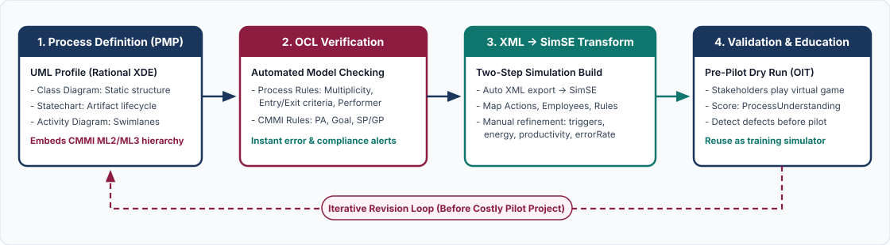
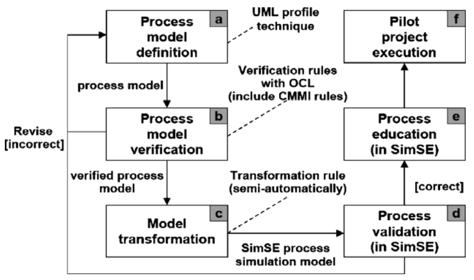
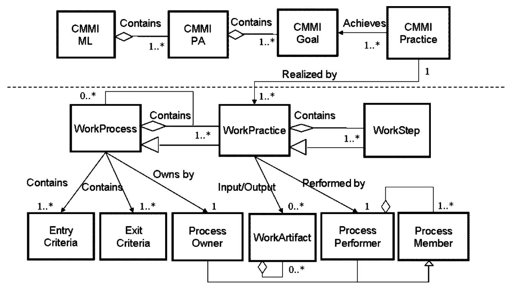
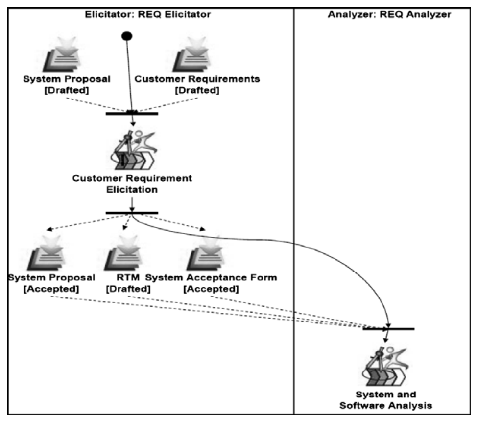
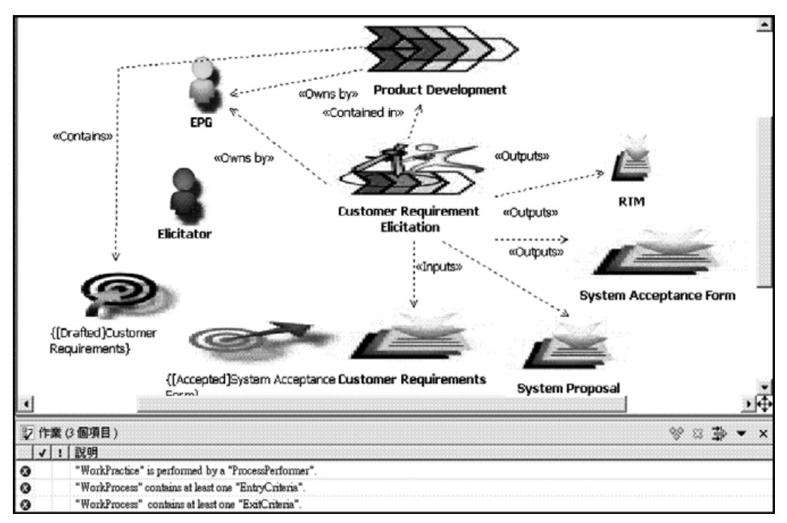
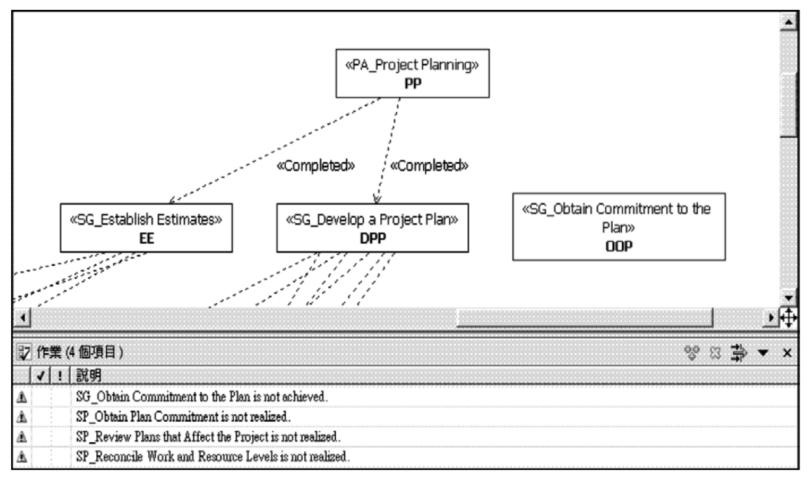
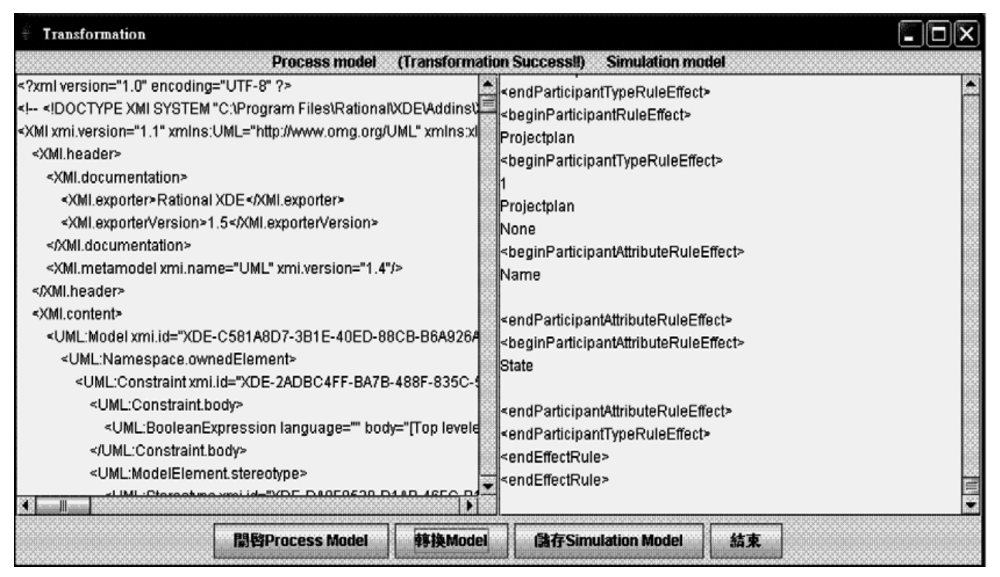
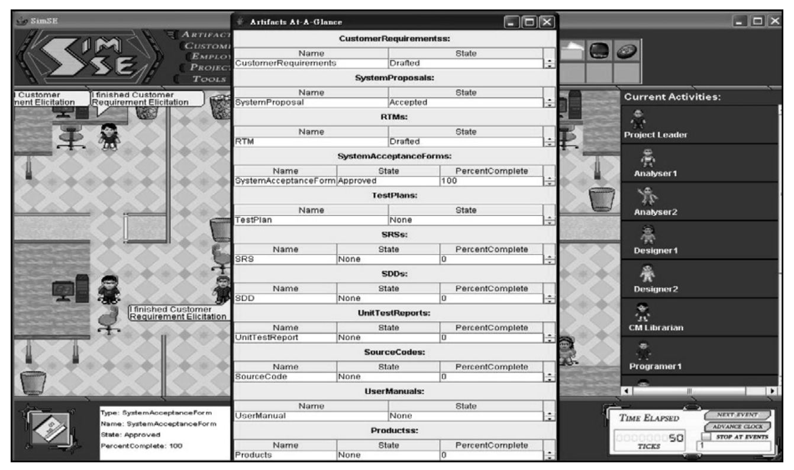
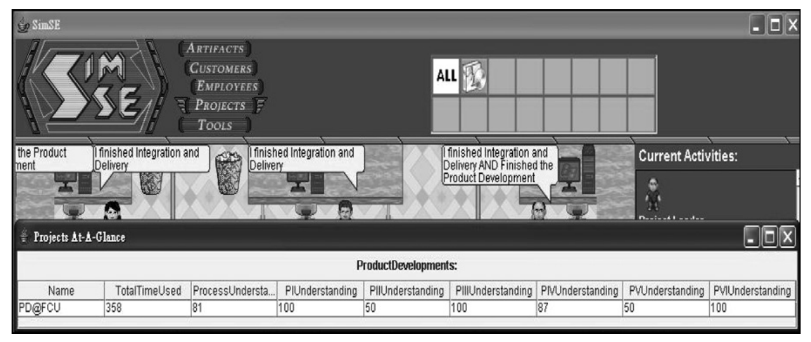
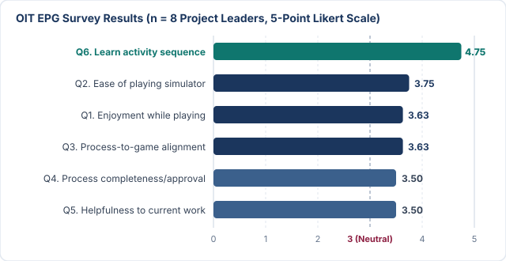

<!-- _class: lead -->

Information and Software Technology · Vol. 50, pp. 897–911 · 2008

# Applying UML and Software Simulation for Process Definition, Verification, and Validation

Embedding CMMI process-area goals into a UML Process Model Profile (PMP), verifying compliance automatically with OCL, and validating process enactability pre-pilot via SimSE simulation.

<strong>Nien-Lin Hsueh</strong>, <strong>Wen-Hsiang Shen*</strong>, <strong>Zhi-Wei Yang</strong>, <strong>Don-Lin Yang</strong> 
Department of Information Engineering and Computer Science, Feng Chia University, Taichung, Taiwan 
DOI: <code>10.1016/j.infsof.2007.10.015</code>

Sponsored by Department of Industrial Technology, Ministry of Economic Affairs (Taiwan) · Grant 96-EC-17-A-02-S1-029

<!--
Paper Metadata & Research Positioning:
- Full Citation: N.-L. Hsueh, W.-H. Shen, Z.-W. Yang, and D.-L. Yang, "Applying UML and software simulation for process definition, verification, and validation," Information and Software Technology, vol. 50, pp. 897-911, 2008.
- Received 8 April 2007; revised 15 October 2007; accepted 23 October 2007; available online 4 November 2007.
- Core Research Gap: While CMMI defines what organizational goals and practices must be met, prior process modeling approaches (e.g., Petri nets, workflow languages, or general-purpose SPEM) neither embed CMMI process-area hierarchies directly into the process definition notation nor provide lightweight pre-pilot validation before organizations commit costly pilot-project resources.
- Dual Utility: The proposed UML-OCL-SimSE pipeline serves both industrial Engineering Process Groups (EPGs) for CMMI process improvement and educational training environments for students and project members.
-->

---

## Outline

  
1

  
<a href="#3">Motivation &amp; Practical Challenge</a> FCU OIT CMMI Level 3 experience, limitations of formal PMLs &amp; SPEM, and high pilot-project costs.

  
2

  
<a href="#4">End-to-End D-V-V Approach</a> Six-step lifecycle linking UML modeling, OCL checking, SimSE transformation, validation, and education.

  
3

  
<a href="#5">Process Definition with PMP</a> Static metamodel embedding CMMI, 12 UML stereotypes in Rational XDE, and multi-view diagrams.

  
4

  
<a href="#8">Automated OCL Verification</a> Process-related structural rules and CMMI ML2/ML3 compliance rules with instant error diagnostics.

  
5

  
<a href="#10">SimSE Model Transformation</a> Mapping PMP XML to SimSE objects, actions, triggers, destroyers, and quantitative scoring formulas.

  
6

  
<a href="#12">OIT Case Study &amp; Survey</a> Validation of the 6-practice Product Development process with 8 EPG project leaders and 6-item survey.

<strong>Core Thesis:</strong> Combining familiar UML notation (PMP), automated OCL constraint checking, and interactive SimSE simulation bridges the gap between <em>process specification</em> and <em>costly pilot-project execution</em>.

<!--
Structural Map of the Paper:
- Section 1 (Introduction) frames the real-world motivation from Feng Chia University's Office of Information Technology (OIT), which initiated CMMI Maturity Level 3 improvement in March 2003.
- Section 2 (Background work) reviews UML-based PMLs, SPEM limitations, UML profile mechanisms, formal UML verification, and SimSE simulation.
- Section 3 (Process definition) introduces the static process metamodel (Fig. 2), the 12-stereotype Process Model Profile (Table 1), and three UML views (Figs. 3-5).
- Section 4 (Process verification) formalizes Process-related and CMMI-related OCL constraints (Figs. 6-10).
- Section 5 (Process validation) specifies the PMP-to-SimSE mapping (Table 2), game refinement rules (Figs. 11-12, Table 3), understanding metrics, and OIT empirical validation (Figs. 13-15, Table 4).
- Section 6 (Conclusion) summarizes contributions and points to distributed process modeling.
-->

---

## 1. Motivation & Practical Challenge

  
18 PAs

  
CMMI Maturity Level 3 process areas targeted by FCU OIT (started Mar 2003)

  
42 Goals

  
Organizational and specific goals requiring traceable process satisfaction

  
~130 Practices

  
Processes the EPG had to define, verify for consistency, and validate

  <h3>Four Pain Points Faced by the OIT EPG</h3>
  <ul class="small-text">
    <li><strong>Readability:</strong> How to define clear, concise processes understandable by every performer?</li>
    <li><strong>CMMI Sufficiency:</strong> How to verify that defined processes satisfy all CMMI PA goals and practices?</li>
    <li><strong>Cross-View Consistency:</strong> Are artifacts, states, and activities consistent across documents?</li>
    <li><strong>Pre-Pilot Enactability:</strong> IDEAL recommends a pilot project, yet running even a small pilot with a flawed process wastes major effort.</li>
  </ul>

  <h3>Why Existing PMLs Fall Short</h3>
  <ul class="small-text">
    <li><strong>Petri Nets &amp; Formal Workflow PMLs:</strong> Rigorous for conflict detection, but too complex for general software practitioners to read and enact.</li>
    <li><strong>OMG SPEM:</strong> Object-oriented and UML-based, but its large specification is heavy to apply and offers <em>no built-in CMMI support</em>.</li>
    <li><strong>Our Insight:</strong> Extend standard UML with a lightweight CMMI-aware Profile (PMP) + OCL verification + SimSE pre-pilot simulation.</li>
  </ul>

<!--
Contextual Background (Sections 1-2):
- In March 2003, the Office of Information Technology (OIT) at Feng Chia University launched a CMMI-based Software Process Improvement (SPI) initiative aiming for Maturity Level 3 (18 process areas, 42 goals, 130 practices).
- The Engineering Process Group (EPG) struggled with traditional text-based process specifications: ambiguity across roles, difficulty proving CMMI compliance manually, and high risk when deploying unvalidated processes into IDEAL pilot projects.
- While formal languages (e.g., colored Petri nets, workflow languages) support conflict analysis, their steep learning curve alienates everyday process performers. Conversely, SPEM 1.0 is UML-based but overly bulky and domain-agnostic with respect to CMMI's Maturity Level -> Process Area -> Goal -> Practice hierarchy.
-->

---

## 2. End-to-End Approach Overview

  <h3>Six Operational Steps in the Lifecycle</h3>
  <ol class="small-text">
    <li><strong>Process Definition:</strong> Model static structure, artifact states, and activity flows using PMP in Rational XDE.</li>
    <li><strong>Process Verification:</strong> Execute embedded OCL process &amp; CMMI rules automatically.</li>
    <li><strong>Model Transformation:</strong> Export PMP XML ➔ semi-finished SimSE model ➔ refine game rules.</li>
    <li><strong>Pre-Pilot Validation &amp; Education:</strong> Stakeholders play the simulation to uncover defects early and train staff before pilot execution.</li>
  </ol>

  
  
Fig. 1 (Paper): Approach overview linking UML, OCL, and SimSE.

<!--
Lifecycle Design Rationale (Section 1, Fig. 1):
- The framework separates static structural/compliance checking (Verification via OCL) from dynamic behavioral/usability checking (Validation via SimSE).
- Verification answers: "Did we build the process model right according to UML structural rules and CMMI ML2/ML3 requirements?"
- Validation answers: "Did we build the right process for stakeholders to enact smoothly in practice?"
- Once a process passes pre-pilot simulation validation and is approved, the exact same SimSE game is repurposed as an interactive educational simulator for onboarding project members and software engineering students.
-->

---

## 3. Process Definition: Static Metamodel with CMMI

  <h3>Two-Layer Metamodel Architecture</h3>
  <ul class="small-text">
    <li><strong>Upper Layer (CMMI Framework):</strong> Models <code>CMMI_ML</code> (5 maturity ranks) ➔ <code>CMMI_PA</code> (Process Areas) ➔ <code>CMMI_Goal</code> ➔ <code>CMMI_Practice</code>.</li>
    <li><strong>Lower Layer (Organizational Process):</strong>
      <ul>
        <li><code>WorkProcess</code> ➔ <code>WorkPractice</code> ➔ atomic <code>WorkStep</code> (e.g., Product Dev ➔ Software Design ➔ Peer Review).</li>
        <li>Mandatory <code>EntryCriteria</code> and <code>ExitCriteria</code> constraints per process.</li>
        <li><code>ProcessMember</code> splits into <code>ProcessOwner</code> and <code>ProcessPerformer</code>.</li>
      </ul>
    </li>
    <li><strong>Bridge:</strong> Organizational <code>WorkPractice</code> <em>realizes</em> <code>CMMI_Practice</code>, enabling automated maturity auditing.</li>
  </ul>

  
  
Fig. 2 (Paper): Static process metamodel uniting CMMI (above dashed line) and organizational process elements (below).

<!--
Metamodel Semantics (Section 3.1, Fig. 2):
- Below the dashed line: WorkProcess represents an operation describing work performed; its subclass WorkPractice can be a subWorkProcess composed of atomic WorkSteps (e.g., "Product Development" -> "Software Design" -> "Peer Review"). Every WorkProcess must have at least one EntryCriteria (e.g., user requirements drafted) and one ExitCriteria. ProcessMember specializes into ProcessOwner (owns a set of WorkProcesses) and ProcessPerformer (enacts a set of WorkPractices).
- Above the dashed line: Captures the staged CMMI hierarchy (Maturity Level -> Process Areas -> Goals -> Practices). Linking WorkPractice to CMMI_Practice via a realization relationship allows OCL queries to traverse upward and verify whether all practices, goals, and PAs of a target maturity level are covered.
-->

---

## 3.2 Process Model Profile (PMP) in Rational XDE

We adapt a streamlined subset of OMG SPEM into a custom XML-stored UML Profile (**PMP**, 12 stereotypes) imported directly into IBM Rational XDE:

| Stereotype | UML Base Class | Parent Stereotype | Example in OIT Process |
| :--- | :--- | :--- | :--- |
| `WorkArtifact` | `Core::Class` / `ObjectFlowState` | — | Customer requirements, SDD, SRS, SAF |
| `EntryCriteria` / `ExitCriteria` | `Core::Constraint` | — | Require drafted reqs / Stop after doc finished |
| `WorkProcess` ➔ `WorkPractice` ➔ `WorkStep` | `Core::Operation` / `ActionState` | Hierarchical | Product Dev ➔ Req Analysis ➔ Baseline reqs |
| `ProcessMember` ➔ `Owner` / `Performer` | `UseCases::Actor` | Hierarchical | Project leader, PDT, Requirement Analyzer |
| `CMMI_ML`, `CMMI_PA` | `Core::Class` | — | Maturity Level 2; REQM, CM, PPQA |
| `CMMI_Goal`, `CMMI_Practice` | `Core::Class` | — | Manage requirements; Manage req changes |

<strong>Key Advantage:</strong> Because PMP refines standard UML metaclasses via stereotypes and tagged values, modelers reuse familiar UML tooling without learning a proprietary process notation, while preserving strict XML exportability.

<!--
PMP Stereotype Engineering (Section 3.2, Table 1):
- The Process Model Profile (PMP) defines 12 core stereotypes mapped onto UML Core::Class, Core::Constraint, Core::Operation, ActivityGraphs::ObjectFlowState/ActionState, and UseCases::Actor.
- Storing the profile as an XML file inside Rational XDE customizes the modeling palette so EPG members simply instantiate typed stereotypes rather than drawing unconstrained boxes.
- Notice how WorkArtifact maps to both Core::Class (for static structural relationships) and ActivityGraphs::ObjectFlowState (for dynamic entry/exit state gating in activity diagrams).
-->

---

## 3.3 Multi-View UML Process Modeling

  <h3>Three Complementary &amp; Linked Views</h3>
  <ul class="small-text">
    <li><strong>Class Diagram (Static Structure):</strong> Captures inputs (SDD, RTM, TP), outputs (Source Code, Unit Test), performers (Implementer), and CMMI practice realization (e.g., <em>Software Design</em> realizes <em>Manage Requirements Changes</em>).</li>
    <li><strong>Statechart Diagram (Artifact Lifecycle):</strong> Models valid state transitions of a <code>WorkArtifact</code> (e.g., <em>System Acceptance Form</em>: <code>Approved ➔ Accepted</code> via <em>Customer Requirement Elicitation</em>). Tool enforces selecting only declared <code>WorkProcess</code> transitions.</li>
    <li><strong>Activity Diagram (Dynamic Sequence):</strong> Uses <strong>object flow states</strong> (<code>System Proposal [Drafted]</code>) as entry/exit criteria and <strong>swimlanes</strong> to assign responsibilities across performers (Elicitor vs. Analyzer).</li>
  </ul>
  

    <strong>Shared Metamodel Consistency:</strong> Referencing <code>SAF [Accepted]</code> in an activity diagram links directly to state <code>Accepted</code> in the statechart and class <code>SAF</code> in the class diagram.
  

  
  
Fig. 5 (Paper): Activity diagram with Elicitor/Analyzer swimlanes and artifact state flows.

<!--
Multi-View Modeling & Cross-Diagram Consistency (Section 3.3, Figs. 3-5):
- Modeling is iterative: the EPG typically starts with Class Diagrams to identify process entities and CMMI mappings (Fig. 3A-C), refines artifact lifecycles with Statechart Diagrams (Fig. 4), and sequences activities with Activity Diagrams (Fig. 5).
- In Rational XDE with PMP loaded, statechart transitions must reference a WorkProcess already defined in the class diagram—preventing typo-driven or orphaned process steps.
- Because all three diagrams inherit from the single underlying UML/PMP metamodel, any mismatch (e.g., an activity diagram referencing an undeclared artifact state) is immediately detectable.
-->

---

## 4. Automated Process Verification via OCL

Object Constraint Language (OCL) expressions are side-effect-free constraints attached to PMP metamodel elements to check **correctness, completeness, and consistency** automatically:

  <h3>1. Process-Related Structural Rules</h3>
  
Constrain well-formedness of organizational process definitions:

  <ul class="small-text">
    <li><strong>Single Performer Multiplicity:</strong> Each <code>WorkPractice</code> is performed by exactly one <code>ProcessPerformer</code>.</li>
    <li><strong>Mandatory Entry &amp; Exit Criteria:</strong> Every <code>WorkProcess</code> must define at least one <code>EntryCriteria</code> and one <code>ExitCriteria</code>.</li>
    <li><strong>Cross-Diagram Integrity:</strong> Artifact states in activity flows must match declared statechart states.</li>
  </ul>

  <h3>2. CMMI-Related Compliance Rules</h3>
  
Verify staged maturity coverage bottom-up across the CMMI hierarchy:

  <ul class="small-text">
    <li><strong>Practice Realization:</strong> Every ML2 <code>CMMI_Practice</code> must be realized by ≥ 1 organizational <code>WorkPractice</code>.</li>
    <li><strong>Goal &amp; PA Satisfaction:</strong> A <code>CMMI_Goal</code> is achieved iff all its practices are realized; a <code>CMMI_PA</code> is satisfied iff all its goals are achieved.</li>
    <li><strong>Indirect Generic Practice (GP) Inference:</strong> Satisfying a specific PA (e.g., CM) automatically alerts modelers that corresponding GPs (e.g., <em>GP 2.6 Manage Configurations</em>) are satisfied across all PAs.</li>
  </ul>

<!--
OCL Verification Architecture (Section 4.1, Fig. 6):
- OCL expressions evaluate boolean invariants over the UML metamodel without mutating model state.
- Four canonical CMMI-related OCL rule templates are illustrated in the paper:
  1. ML2 PA Satisfaction: For all PAs belonging to Maturity Level 2, every PA must be satisfied.
  2. ML2 Goal Achievement: Every goal under an ML2 PA must be achieved.
  3. ML2 Practice Realization: Every specific/generic practice of ML2 must have at least one realizing WorkPractice.
  4. Cross-PA GP Satisfaction: Realizing "CMMI_SP: Identify Configuration Items" (under CM) triggers an informative notification that "GP: Manage Configurations" is also satisfied across PAs—turning the verifier into a CMMI knowledge assistant for EPG engineers.
-->

---

## 4.2 Automated Verification in Practice

  
  
Fig. 7 (Paper): Process rule error—<code>WorkPractice</code> missing required <code>EntryCriteria</code>.

  
  
Fig. 8 (Paper): CMMI rule warning—identifying unrealized ML2 requirements.

<strong>Impact on EPG Workflow:</strong> Automated OCL checking replaces tedious manual cross-referencing of 130+ process documents, flagging both missing structural elements (Fig. 7) and CMMI coverage gaps or GP cross-satisfactions (Figs. 8–9) in real time until a clean, error-free model is achieved (Fig. 10).

<!--
Verification Tool Execution (Section 4.2, Figs. 7-10):
- Fig. 7 demonstrates a structural check failure: a WorkPractice lacks an EntryCriteria, so the modeling tool immediately displays the violated rule and offending element in the output console at the bottom.
- Fig. 8 demonstrates a CMMI compliance warning when a target Maturity Level 2 requirement is not satisfied by any organizational practice.
- Fig. 9 (in the paper) further shows positive knowledge feedback: when Practice1 realizes "Identify Configuration Items" and Practice2 satisfies "Plan for Process", the rule engine informs the modeler that Practice1 also satisfies the Configuration Management process area and GP Manage Configurations across all PAs.
- Once all constraints pass, the verified model (Fig. 10) is ready for XML export and SimSE transformation.
-->

---

## 5. Process Validation via SimSE Simulation

To validate process enactability *before* launching a costly pilot project, we transform the verified PMP model into an executable **SimSE** simulation game in **two steps**: (1) automated XML-to-SimSE transformation, and (2) manual refinement of game-behavioral parameters.

| PMP Source Element | Transformation Rule / Guidance | Resulting SimSE Construct |
| :--- | :--- | :--- |
| Class: `WorkPractice` (e.g., Implementation) | Auto-map to SimSE Action | Action `Implementation` |
| Class: `ProcessPerformer` (e.g., Implementer) | Auto-map to Employee subtype | Employee subtype `Implementer` |
| Class: `WorkArtifact` + generation link | Auto-map to Artifact subtype &amp; create rule | Artifact `UnitTest` + createObjectRule |
| Statechart: Artifact states &amp; transitions | **(M)** Map states to triggers &amp; effect rules | Trigger `SAF == Approved`; Effect `➔ Accepted` |
| Activity: Sequence &amp; Swimlanes | Auto-map sequence to trigger; **(M)** swimlanes to efficiency rules | Trigger `SPAF approved`; Proper performer &gt; improper |

<strong>SimSE 5 Constructs:</strong> <code>Object Types</code> (Employee, Artifact, Project, Tool, Customer), <code>Start State</code>, <code>Actions</code> (with Autonomous / User-initiated / Random triggers &amp; destroyers), <code>Rules</code> (create, destroy, effect), and <code>Graphics</code> (virtual office layout). <em>(M)</em> = requires manual refinement.

<!--
PMP-to-SimSE Transformation Architecture (Sections 5.1-5.2, Table 2):
- SimSE (Navarro & van der Hoek, UC Irvine) is an interactive, single-player graphical simulation game where the player acts as project manager directing developers through a software lifecycle.
- Automated XML Transformation extracts static entities (WorkPractice -> Action, ProcessPerformer -> Employee subtype, WorkArtifact -> Artifact subtype + creation rule) and activity sequencing (predecessor completion -> trigger condition).
- Manual Refinement (marked M in Table 2) enriches the semi-finished model with realistic software engineering dynamics: employee attributes (energy initialized to 1.0, productivity, error rate), artifact attributes (size proportional to project, known/unknown errors, percentComplete), autonomous 'break' triggers, and random 'quit' triggers (e.g., 70% chance when energy <= 0.1).
-->

---

## 5.2 Transformation Tool, Effect Rules & Scoring

  
  
Fig. 13 (Paper): Custom XML-to-SimSE transformation tool (PMP left, SimSE right).

  

    <h3>Role-Sensitivity Effect Rule (SSA Action)</h3>
    

      • <strong>Proper Performer (Analyzer):</strong> <code>energy -= 0.05</code>, <code>errorRate = (1 - energy) × 0.4</code>. 
      • <strong>Improper Performer (Elicitor):</strong> <code>energy -= 0.10</code>, <code>errorRate = (1 - energy) × 0.6</code> ➔ slower completion &amp; more defects to fix!
    

  

  

    <h3>Quantitative Process Understanding Score</h3>
    

      <strong>Per-Practice Score:</strong> 
      <code>PiUnderstanding = (PiBestTimeElapsed / PiActionTimeElapsed) × 100</code> 
      <strong>Overall Process Score:</strong> 
      <code>ProcessUnderstanding = (1 / n) × Σi=1..n PiUnderstanding</code>
    

  

<!--
Behavioral Refinement & Quantitative Evaluation Metric (Sections 5.3-5.4, Figs. 11-13, Table 3):
- Fig. 11 & Table 3 encode classic software engineering laws into SimSE EffectRules: assigning the right performer at the right stage advances artifact PercentComplete faster and injects fewer unknown errors than assigning an improper performer (e.g., Elicitor performing System/Software Analysis instead of Analyzer).
- Fig. 12 illustrates Action triggers and destroyers for Implementation: user-originated trigger requires Implementer hired == true and health >= 0.6; autonomous destroyer fires at percentComplete == 100, alongside a manual "Stop implementation" destroyer.
- ProcessUnderstanding quantitatively evaluates how closely a player follows the defined process by comparing optimal elapsed time (BestTimeElapsed) against actual time spent (ActionTimeElapsed) across all n practices. Skipping reviews or unit tests triggers rework penalties that inflate ActionTimeElapsed and lower the practice score.
-->

---

## 6. Case Study: Validation at FCU OIT

Applied to FCU OIT's **Product Development Process** (6 practices: Customer Req Elicitation, System/SW Analysis, Architecture/DB Design, Software Design, Implementation, Integration &amp; Delivery) with **8 EPG project leaders**:

  
  
Fig. 14 (Paper): Live artifact states &amp; virtual office during SimSE play.

  
  
Fig. 15 (Paper): Practice scores pinpointing skipped SRS review (P-II) &amp; unit testing (P-V).

  
7 / 8 &gt; 80 pts

  
Seven EPG leaders scored above 80; two process authors achieved <strong>100 / 100</strong>

  
40.7 pts (1 outlier)

  
Root cause traced via debriefing to unfamiliarity with the SimSE UI, not process flaws

  
+13.7% Re-run

  
Average score gain on the second test-run, evidencing strong learning transfer

<!--
Empirical Case Study Analysis (Section 5.4, Figs. 14-15):
- OIT defined nine organizational process specifications; the experiment validated the core Product Development Process spanning six sequential practices (Practices I through VI).
- Fig. 15 demonstrates diagnostic precision: Practices II (System/Software Analysis) and V (Implementation) yielded visibly lower understanding scores for a player who omitted the SRS peer review and skipped unit test execution/test record generation.
- Eight EPG project leaders participated: 7 scored > 80 (including two 100-point perfect runs by process authors), confirming high fidelity between the defined process and the executable simulation.
- The single low score (40.7) highlighted an important usability nuance—initial UI unfamiliarity—which resolved rapidly as average scores rose +13.7% on the second run.
-->

---

## 6.2 Practitioner Survey & Educational Impact

  <h3>Key Survey Findings (n = 8, 1–5 Scale)</h3>
  <ul class="small-text">
    <li><strong>All 6 items scored &gt; 3.50</strong> (well above the 3.0 neutral threshold), confirming positive practitioner reception.</li>
    <li><strong>Top Score — 4.75 / 5.0 (Q6):</strong> 75% strongly agreed and 25% agreed that the simulator effectively teaches the <em>activity sequence</em> of product development.</li>
    <li><strong>Usability &amp; Engagement:</strong> Rated relatively easy to play (<strong>3.75</strong>) and enjoyable (<strong>3.63</strong>).</li>
    <li><strong>Process Fidelity &amp; Approval:</strong> Strong alignment between standard process and game scenarios (<strong>3.63</strong>) and approval readiness for pilot rollout (<strong>3.50</strong>).</li>
  </ul>

  
  
Table 4 (Paper): Mean ratings from the 8 OIT EPG project leaders (neutral baseline = 3.0).

<!--
Survey Breakdown (Section 5.4, Table 4):
- Q1 (Enjoyable to play): 25% rated 2, 12.5% rated 3, 37.5% rated 4, 25% rated 5 -> Mean 3.63.
- Q2 (Easy to play): 37.5% rated 3, 50% rated 4, 12.5% rated 5 -> Mean 3.75.
- Q3 (Standard process corresponds with game scenarios): 37.5% rated 3, 62.5% rated 4 -> Mean 3.63.
- Q4 (Process definition completed and approved): 50% rated 3, 50% rated 4 -> Mean 3.50.
- Q5 (Helpful/useful to current work): 25% rated 2, 12.5% rated 3, 50% rated 4, 12.5% rated 5 -> Mean 3.50.
- Q6 (Learn activity sequence of product development process): 25% rated 4, 75% rated 5 -> Mean 4.75.
- Open-ended feedback logs were collected to iteratively enhance the simulation model prior to OIT's actual pilot project execution.
-->

---

## 7. Discussion, Limitations & Future Work

  <h3>Core Contributions</h3>
  <ul class="small-text">
    <li><strong>CMMI-Aware UML Profile (PMP):</strong> Embeds CMMI ML/PA/Goal/Practice hierarchy directly into familiar UML Class, Statechart, and Activity views.</li>
    <li><strong>Automated OCL Auditing:</strong> Verifies both structural well-formedness and CMMI compliance (including cross-PA generic practice inference) automatically.</li>
    <li><strong>Pre-Pilot Validation &amp; Training:</strong> Transforming PMP into SimSE exposes enactment flaws early, lowers pilot risk, and doubles as an engaging training game (4.75/5.0).</li>
  </ul>

  <h3>Limitations &amp; Future Directions</h3>
  <ul class="small-text">
    <li><strong>Manual Refinement Overhead:</strong> Statechart transitions, swimlane efficiency rules, and employee/artifact dynamics still require manual SimSE tuning.</li>
    <li><strong>Evaluation Scope:</strong> Empirical validation focused on 1 of 9 OIT process specifications (Product Development) with a small sample (n = 8 EPG leaders).</li>
    <li><strong>UI Learning Curve:</strong> Initial simulation interface unfamiliarity can temporarily depress scores (40.7 outlier).</li>
    <li><strong>Future Work:</strong> Extending the UML-OCL-SimSE framework to <em>distributed software development environments</em>.</li>
  </ul>

<strong>Takeaway for Practitioners:</strong> Treating software processes like software models—with typed metamodels, automated constraint verification, and executable pre-pilot simulation—turns CMMI adoption from paperwork into verifiable engineering.

<!--
Critical Reflection & Future Work (Sections 5.4 & 6):
- Methodological strength: Unifies three well-understood technologies (UML Profiles, OCL, SimSE) rather than inventing a bespoke formalism that practitioners will resist.
- Threats to validity acknowledged in the paper: small sample size (8 project leaders, some of whom authored the process), evaluation limited to the engineering Product Development process rather than all 9 OIT process specifications, and partial automation in PMP-to-SimSE transformation where behavioral rules require manual coding.
- Future research agenda explicitly stated in Section 6: extending process modeling, verification, and simulation validation to distributed development environments (multi-site teams, asynchronous handoffs, and distributed configuration management).
-->

---

<!-- _class: closing -->

# Thank You for Your Attention!

Applying UML and Software Simulation for Process Definition, Verification, and Validation

<strong>Nien-Lin Hsueh</strong> · <code>nlhsueh@fcu.edu.tw</code> &nbsp;|&nbsp; <strong>Wen-Hsiang Shen*</strong> · <code>shen@ocit.edu.tw</code> 
<strong>Zhi-Wei Yang</strong> · <code>sundy.yang@auo.com</code> &nbsp;|&nbsp; <strong>Don-Lin Yang</strong> · <code>dlyang@fcu.edu.tw</code> 
Department of Information Engineering and Computer Science, Feng Chia University 
Information and Software Technology, Vol. 50 (2008), pp. 897–911 · Grant 96-EC-17-A-02-S1-029

<!--
Archival Reference Metadata:
- Title: Applying UML and software simulation for process definition, verification, and validation
- Authors: Nien-Lin Hsueh, Wen-Hsiang Shen (corresponding author), Zhi-Wei Yang, Don-Lin Yang
- Venue: Information and Software Technology (IST), Elsevier, Vol. 50, pp. 897-911, 2008
- DOI: 10.1016/j.infsof.2007.10.015
- Keywords: CMMI, UML, Process modeling, Process simulation, Software engineering education
-->

