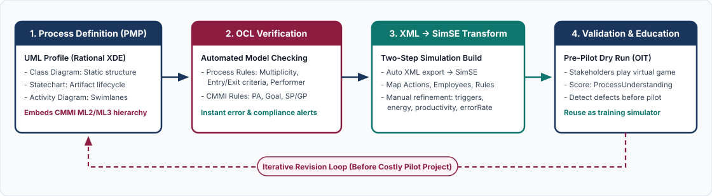
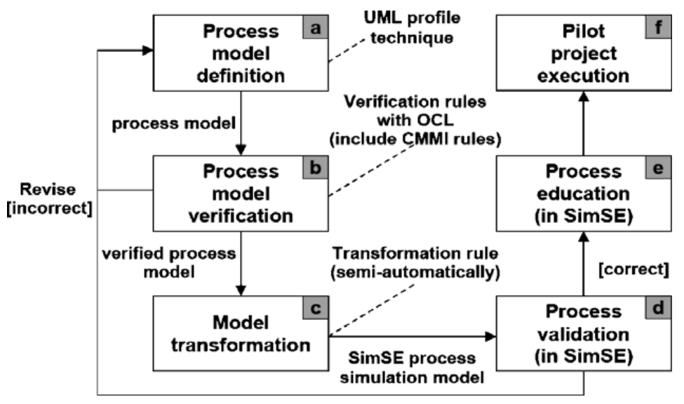
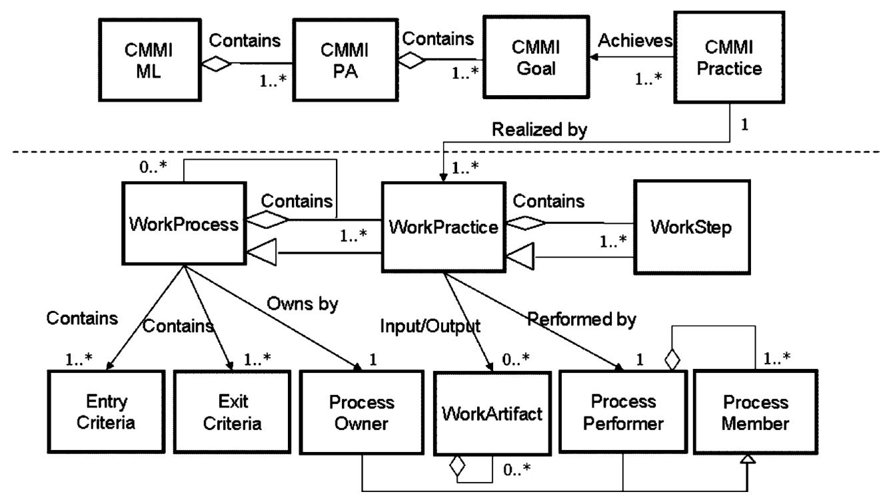
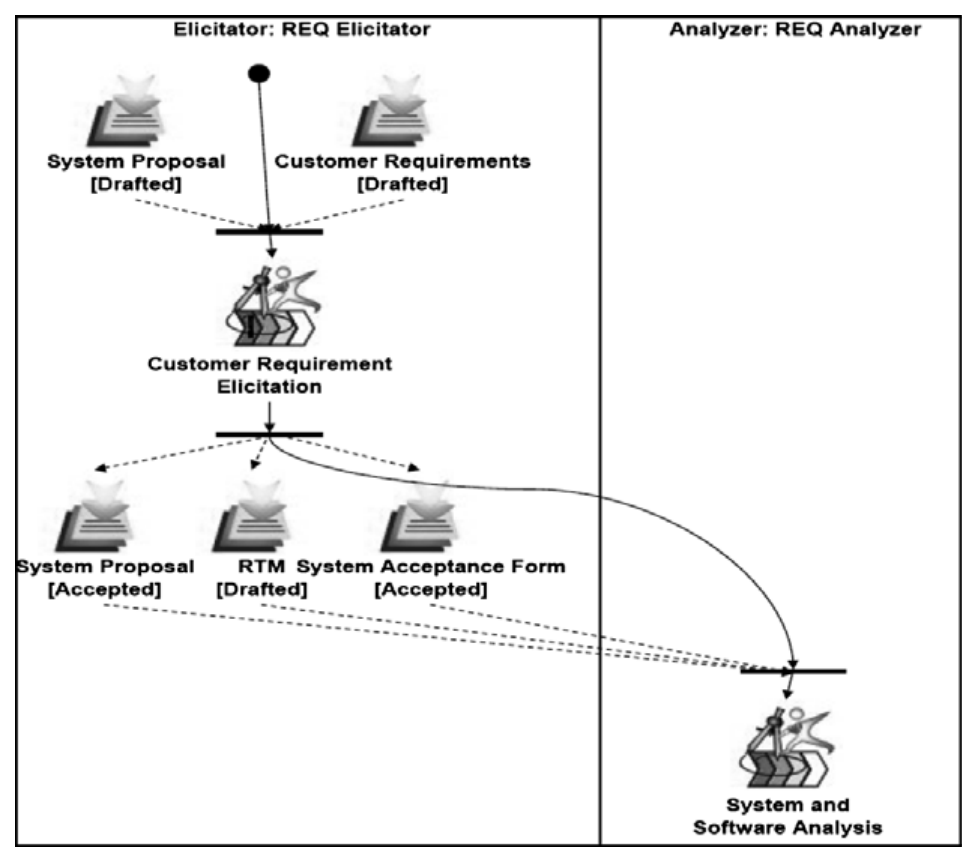
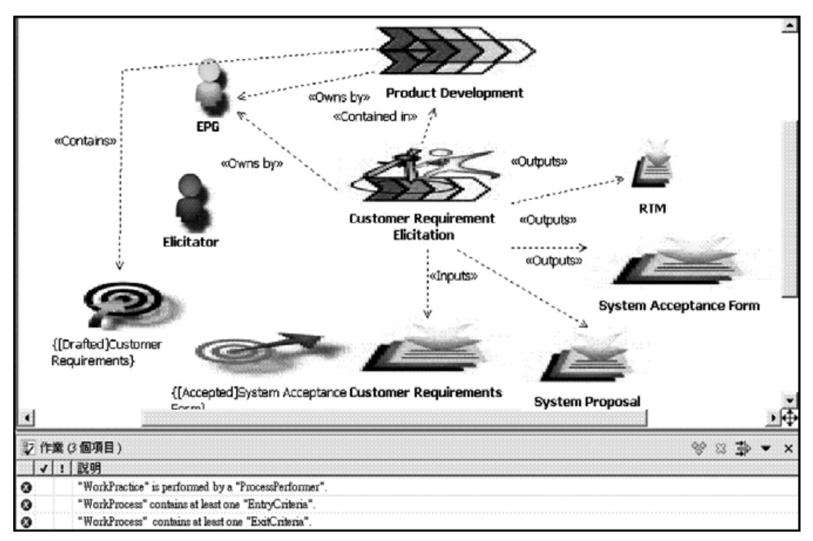
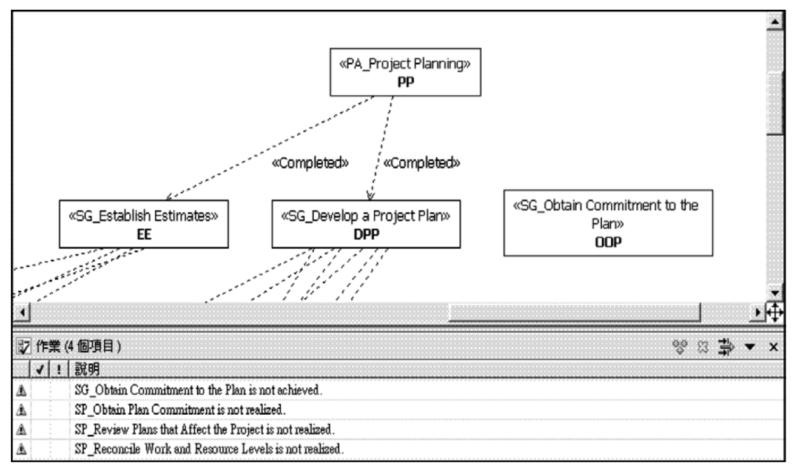
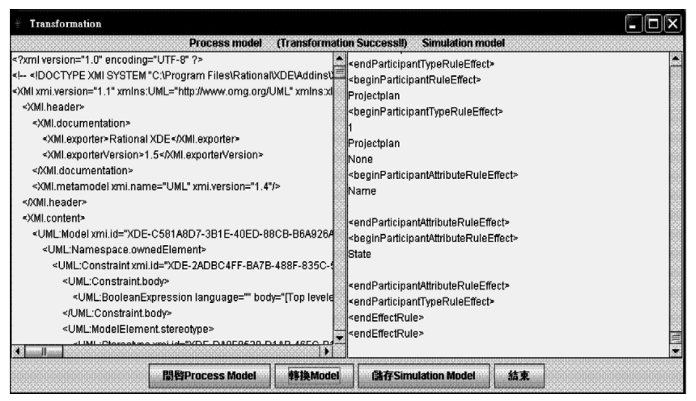
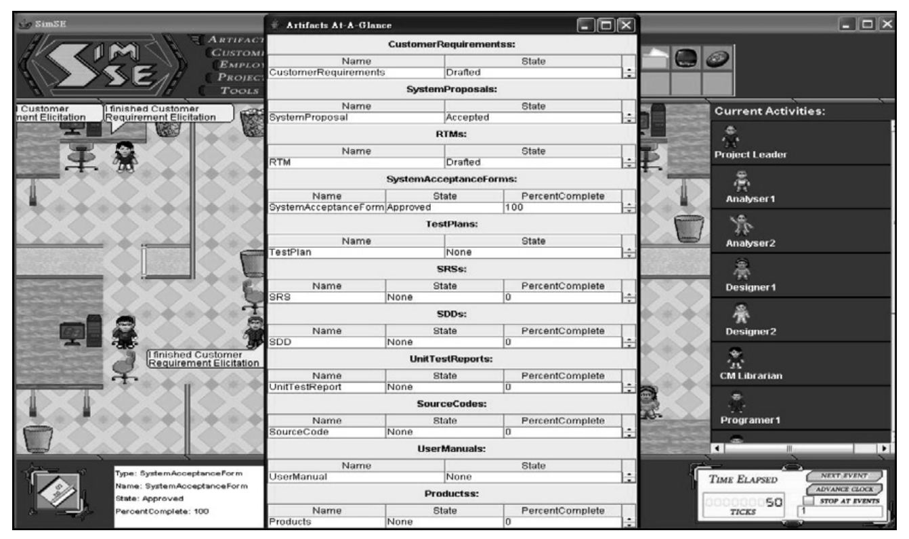
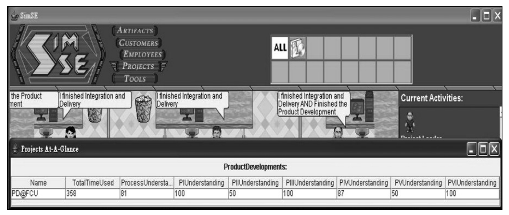
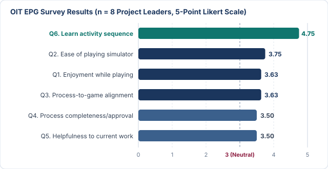

<!-- _class: lead -->

Information and Software Technology · Vol. 50, pp. 897–911 · 2008

# 結合 UML 與軟體模擬於流程定義、驗證與確認之研究

Applying UML and Software Simulation for Process Definition, Verification, and Validation

將 CMMI 流程領域目標嵌入 UML 流程模型擴充組（PMP），透過 OCL 自動化驗證合規性，並在先導專案啟動前以 SimSE 互動模擬進行流程確認與教育訓練。

<strong>薛念林（Nien-Lin Hsueh）</strong>、<strong>沈文祥*（Wen-Hsiang Shen）</strong>、<strong>楊志偉（Zhi-Wei Yang）</strong>、<strong>楊東麟（Don-Lin Yang）</strong> 
逢甲大學資訊工程學系 · DOI: <code>10.1016/j.infsof.2007.10.015</code>

經濟部技術處學界科專計畫補助 · 計畫編號：96-EC-17-A-02-S1-029

<!--
論文背景與研究定位：
- 完整出處：N.-L. Hsueh, W.-H. Shen, Z.-W. Yang, and D.-L. Yang, "Applying UML and software simulation for process definition, verification, and validation," Information and Software Technology, Vol. 50, pp. 897-911, 2008。
- 核心研究缺口：既有軟體流程建模語言（如 Petri net、工作流程語言或通用型 SPEM）多半無法在流程定義階段直接嵌入 CMMI 流程領域（PA）與目標的階層關係，亦缺乏在昂貴的先導專案（pilot project）執行前進行輕量級流程確認（validation）的機制。
- 雙重應用價值：本研究所提之 UML-OCL-SimSE 一貫式流程環境，除可協助企業工程流程小組（EPG）進行 CMMI 流程改善外，流程通過確認後亦能直接作為學生與專案成員之互動式流程教育平台。
-->

---

## 簡報大綱

  
1

  
<a href="#3">研究動機與實務挑戰</a> 逢甲大學資訊處導入 CMMI Level 3 之實務經驗、既有 PML 與 SPEM 侷限、先導專案風險。

  
2

  
<a href="#4">整體方法架構（D-V-V）</a> 串聯 UML 定義、OCL 驗證、SimSE 轉換、模擬確認與教育訓練之六步驟生命週期。

  
3

  
<a href="#5">流程定義（PMP 擴充組）</a> 嵌入 CMMI 之靜態元模型、Rational XDE 12 項刻板型（Stereotypes）與三視角 UML 圖形。

  
4

  
<a href="#8">OCL 自動化流程驗證</a> 流程結構規則與 CMMI 成熟度規則之 OCL 形式化檢查與即時錯誤警示。

  
5

  
<a href="#10">SimSE 模擬模型轉換</a> 從 PMP XML 轉換至 SimSE 物件、動作、觸發器與效應規則，並量化流程理解度。

  
6

  
<a href="#12">逢甲資處案例與問卷分析</a> 針對產品開發流程六大實務邀請 8 位 EPG 專案領導人實測與 6 題問卷評估。

<strong>核心論點：</strong>結合工程師熟悉的 UML 擴充組（PMP）、自動化 OCL 合規驗證與互動式 SimSE 模擬，可在投入昂貴的先導專案前及早揪出流程設計缺陷。

<!--
論文結構總覽：
- 第 1 節（緒論）以逢甲大學資訊處（OIT）自 2003 年 3 月啟動 CMMI ML3 改善計畫為真實背景，引出流程定義、驗證與確認三大議題。
- 第 2 節（相關研究）回顧 UML 流程建模、SPEM 侷限、UML Profile 機制、形式化驗證與 SimSE 教育模擬遊戲。
- 第 3 節（流程定義）提出含 CMMI 框架之靜態流程元模型（圖 2）、12 項 PMP 刻板型（表 1）及類別／狀態／活動三種視角（圖 3 至圖 5）。
- 第 4 節（流程驗證）以 OCL 定義流程結構規則與 CMMI 規則（圖 6 至圖 10）。
- 第 5 節（流程確認）說明 PMP 轉 SimSE 之對照表（表 2）、遊戲行為細化規則（圖 11 至圖 12、表 3）、理解度公式與 OIT 實證結果（圖 13 至圖 15、表 4）。
- 第 6 節（結論）總結貢獻並展望分散式開發環境之流程建模。
-->

---

## 1. 研究動機與實務挑戰

  
18 個 PA

  
逢甲大學資訊處（OIT）自 2003 年 3 月起導入 CMMI Level 3 之流程領域

  
42 項目標

  
需確保組織流程能完整追溯並滿足所有 CMMI 特定與一般目標

  
約 130 項實務

  
EPG 必須定義、交叉驗證一致性並確認可執行性的龐大流程數量

  <h3>OIT 工程流程小組（EPG）四大痛點</h3>
  <ul class="small-text">
    <li><strong>可讀性：</strong>如何定義清晰精簡、讓所有流程執行者皆能理解的規範？</li>
    <li><strong>CMMI 充分性：</strong>如何確知所定義流程已涵蓋 CMMI 所有必要要求？</li>
    <li><strong>跨文件一致性：</strong>各流程產出物、狀態與活動之間是否存在衝突？</li>
    <li><strong>先導專案成本高：</strong>IDEAL 模式建議先執行先導專案，但若流程本身有瑕疵，即使小型先導仍耗費龐大人力。</li>
  </ul>

  <h3>既有流程建模語言（PML）之不足</h3>
  <ul class="small-text">
    <li><strong>Petri Net 與工作流程語言：</strong>形式嚴謹可防衝突，但語法門檻過高，一般軟體開發人員難以閱讀與執行。</li>
    <li><strong>OMG SPEM：</strong>雖基於 UML，但規格過於龐大不易落地，且屬通用標準，<em>未提供 CMMI 流程定義支援</em>。</li>
    <li><strong>本研究解方：</strong>以輕量級 UML Profile（PMP）嵌入 CMMI 階層，結合 OCL 自動驗證與 SimSE 先導前模擬。</li>
  </ul>

<!--
研究動機細節（第 1 至 2 節）：
- 逢甲大學資訊處（OIT）於 2003 年 3 月啟動 CMMI 成熟度第三級（ML3）改善專案，涵蓋 18 個流程領域、42 項目標與 130 項實務（包括專案規劃、監控、組態管理等）。
- 傳統文字式流程規格書難以跨頁比對一致性與 CMMI 覆蓋度；若直接進入 IDEAL 模型建議的先導專案（pilot project），一旦流程順序或角色權責設計不當，將造成組織極高的試錯成本。
- 因此，團隊選擇開發人員最熟悉的 UML 作為基礎，利用 UML Profile 擴充機制克服 Petri net 的學習門檻與 SPEM 缺乏 CMMI 語意的雙重限制。
-->

---

## 2. 整體方法架構（定義 ➔ 驗證 ➔ 確認）

  <h3>六大生命週期步驟</h3>
  <ol class="small-text">
    <li><strong>流程模型定義：</strong>於 Rational XDE 載入 PMP，繪製靜態結構、產出物狀態與動態活動圖。</li>
    <li><strong>自動化流程驗證：</strong>即時執行內嵌之 OCL 結構規則與 CMMI 合規規則。</li>
    <li><strong>模擬模型轉換：</strong>將 PMP 匯出為 XML ➔ 自動轉出半成品 SimSE 模型 ➔ 手動細化遊戲參數。</li>
    <li><strong>先導前確認與教育：</strong>由利害關係人試玩模擬遊戲，及早修訂流程並於通過後轉作人員訓練工具。</li>
  </ol>

  
  
論文圖 1：結合 UML、OCL 與 SimSE 之整體方法概觀。

<!--
生命週期設計邏輯（第 1 節、圖 1）：
- 本架構明確區分「驗證（Verification）」與「確認（Validation）」：前者透過 OCL 檢查模型結構與 CMMI 規範是否正確一致；後者透過 SimSE 互動模擬檢查流程是否符合組織實務運作需求。
- 若模擬結果顯示流程不適合實際執行，可立即在圖 1(d) 回饋修訂流程模型，大幅縮減後續先導專案的返工成本。
- 流程通過確認並正式採用後，該模擬環境亦直接承擔圖 1(e) 的流程教育訓練角色。
-->

---

## 3. 流程定義：嵌入 CMMI 之靜態元模型

  <h3>雙層元模型架構</h3>
  <ul class="small-text">
    <li><strong>上層（CMMI 框架）：</strong>明確定義 <code>CMMI_ML</code>（五級成熟度）➔ <code>CMMI_PA</code>（流程領域）➔ <code>CMMI_Goal</code>（目標）➔ <code>CMMI_Practice</code>（實務）。</li>
    <li><strong>下層（組織流程結構）：</strong>
      <ul>
        <li><code>WorkProcess</code> ➔ <code>WorkPractice</code> ➔ 原子層級 <code>WorkStep</code>（如產品開發 ➔ 軟體設計 ➔ 同儕審查）。</li>
        <li>每個流程皆強制包含 <code>EntryCriteria</code> 與 <code>ExitCriteria</code>。</li>
        <li><code>ProcessMember</code> 細分為 <code>ProcessOwner</code> 與 <code>ProcessPerformer</code>。</li>
      </ul>
    </li>
    <li><strong>橋接關聯：</strong>組織 <code>WorkPractice</code> 透過實現關係對應 <code>CMMI_Practice</code>，奠定自動稽核基礎。</li>
  </ul>

  
  
論文圖 2：結合 CMMI 框架（虛線上方）與組織流程元素（虛線下方）之靜態元模型。

<!--
靜態元模型語意解析（第 3.1 節、圖 2）：
- 虛線下方描述組織基本流程元素：WorkProcess 描述執行作業，其子類別 WorkPractice 可為子流程並包含多個原子化的 WorkStep；例如「Product Development」包含子流程「Software Design」，其下再包含「Peer review」。每個 WorkProcess 至少須有一個 EntryCriteria（如使用者需求已起草）與一個 ExitCriteria。
- 虛線上方導入 CMMI 階層：成熟度等級（ML1 至 ML5）由多個流程領域（PA）構成，每個 PA 含多項目標（Goal），每項目標由多項實務（Practice）達成。透過組織 WorkPractice 與 CMMI_Practice 之關聯，即可程式化追溯組織成熟度是否達標。
-->

---

## 3.2 流程模型擴充組（PMP）與刻板型定義

擷取 UML SPEM 精華並以 XML 建置於 IBM Rational XDE 中，定義 **12 項核心刻板型（Stereotypes）**：

| 刻板型（Stereotype） | UML 基礎類別 | 父刻板型 | OIT 組織流程實例 |
| :--- | :--- | :--- | :--- |
| `WorkArtifact` | `Core::Class` / `ObjectFlowState` | — | 客戶需求、SDD、SRS、系統驗收單（SAF） |
| `EntryCriteria` / `ExitCriteria` | `Core::Constraint` | — | 需求起草後方可分析 / 需求書完成即停止 |
| `WorkProcess` ➔ `WorkPractice` ➔ `WorkStep` | `Core::Operation` / `ActionState` | 階層繼承 | 產品開發 ➔ 需求分析 ➔ 建立需求基線 |
| `ProcessMember` ➔ `Owner` / `Performer` | `UseCases::Actor` | 階層繼承 | 專案領導人、流程定義團隊、需求分析師 |
| `CMMI_ML`, `CMMI_PA` | `Core::Class` | — | 成熟度第二級（ML2）；REQM、CM、PPQA |
| `CMMI_Goal`, `CMMI_Practice` | `Core::Class` | — | 管理需求；管理需求變更 |

<strong>工程優勢：</strong>PMP 直接以標準 UML 擴充機制精煉語意並存成 XML 檔，建模者無須重新學習專有符號即可獲得 CMMI 領域專屬工具列與驗證能力。

<!--
PMP 刻板型工程設計（第 3.2 節、表 1）：
- PMP 將 12 個流程與 CMMI 概念對應至 UML 標準元類別（Core::Class、Core::Constraint、Core::Operation、ActivityGraphs::ObjectFlowState/ActionState 與 UseCases::Actor）。
- 由於 WorkArtifact 同時繼承 Core::Class 與 ActivityGraphs::ObjectFlowState，同一工作產出物既能在類別圖描述靜態輸入／輸出相依，也能在活動圖以物件流狀態（如 [Drafted]、[Approved]）精準表達進出條件。
-->

---

## 3.3 多視角 UML 流程建模實務

  <h3>三種互補且同步之流程視角</h3>
  <ul class="small-text">
    <li><strong>類別圖（靜態結構）：</strong>呈現活動輸入（SDD、RTM、TP）、產出（程式碼、單元測試）、執行者與 CMMI 實務對應（如 <em>Software Design</em> 實現 <em>Manage Requirements Changes</em>）。</li>
    <li><strong>狀態圖（產出物生命週期）：</strong>描繪 <code>WorkArtifact</code> 狀態轉換（如 <em>SAF</em> 經由需求引出由 <code>Approved ➔ Accepted</code>）。工具強制轉換事件須選自已定義之 <code>WorkProcess</code>，杜絕誤植。</li>
    <li><strong>活動圖（動態流程順序）：</strong>以物件流狀態（<code>System Proposal [Drafted]</code>）表達進出條件，並以<strong>泳道（Swimlanes）</strong>區分不同執行者職責（如 Elicitor 與 Analyzer）。</li>
  </ul>
  

    <strong>單一元模型一致性：</strong>活動圖中之 <code>SAF [Accepted]</code> 直接參照狀態圖的 <code>Accepted</code> 狀態與類別圖的 <code>SAF</code> 類別，跨圖不一致可即時揭露。
  

  
  
論文圖 5：以泳道區分 Elicitor 與 Analyzer 職責並標示產出物狀態之活動圖。

<!--
多視角建模與跨圖一致性（第 3.3 節、圖 3 至圖 5）：
- 實務上 EPG 採迭代方式建模：先以類別圖盤點流程元素與 CMMI 對應關係（圖 3A-C），再以狀態圖定義關鍵產出物之狀態轉換（圖 4），最後以活動圖串接動態執行順序與角色泳道（圖 5）。
- 在匯入 PMP 的 Rational XDE 環境中，繪製狀態圖轉換時只能從類別圖已宣告的 WorkProcess 清單選取，大幅降低人為拼寫錯誤或幽靈活動的產生。
-->

---

## 4. 基於 OCL 之自動化流程驗證

採用無副作用之<strong>物件限制語言（OCL）</strong>撰寫驗證規則並內嵌於 PMP 元模型中，自動檢查流程之<strong>正確性、完整性與一致性</strong>：

  <h3>1. 流程結構相關規則（Process-Related）</h3>
  
約束組織流程定義之基本結構完整性：

  <ul class="small-text">
    <li><strong>單一執行者多重性：</strong>每項 <code>WorkPractice</code> 須由恰好一位 <code>ProcessPerformer</code> 負責執行。</li>
    <li><strong>強制進出條件：</strong>每個 <code>WorkProcess</code> 皆必須定義至少一項 <code>EntryCriteria</code> 與 <code>ExitCriteria</code>。</li>
    <li><strong>跨圖參照一致：</strong>活動圖所使用之產出物狀態須與狀態圖宣告完全相符。</li>
  </ul>

  <h3>2. CMMI 合規相關規則（CMMI-Related）</h3>
  
由下而上自動稽核階段式成熟度覆蓋情形：

  <ul class="small-text">
    <li><strong>實務實現檢查：</strong>CMMI ML2 每項 <code>CMMI_Practice</code> 皆須至少有一個組織 <code>WorkPractice</code> 實現之。</li>
    <li><strong>目標與流程領域達成：</strong>當旗下所有實務皆被實現時目標始告達成；所有目標達成時該 PA 始告滿足。</li>
    <li><strong>一般實務（GP）間接推論：</strong>當組織流程滿足特定 PA（如組態管理 CM），規則引擎會主動提示亦同時滿足所有 PA 之 <em>GP：Manage Configurations</em>。</li>
  </ul>

<!--
OCL 驗證架構解析（第 4.1 節、圖 6）：
- 論文於第 4.1.2 節展示四類核心 CMMI 相關 OCL 規則：
  1. ML2 所有 PA 皆須滿足之規則。
  2. ML2 所有 Goal 皆須達成之規則。
  3. ML2 所有 Practice 皆須被組織 WorkPractice 實現之規則。
  4. 跨 PA 一般實務（GP）間接滿足推論規則：當 Practice1 實現「CMMI_SP: Identify Configuration Items」時，系統主動回饋該實務同時滿足 CM 流程領域及所有 PA 之「GP: Manage Configurations」，使驗證工具兼具 CMMI 知識輔導功能。
-->

---

## 4.2 自動化流程驗證實務畫面

  
  
論文圖 7：結構規則錯誤—<code>WorkPractice</code> 遺漏必要的 <code>EntryCriteria</code>。

  
  
論文圖 8：CMMI 規則警告—即時標示尚未滿足 ML2 要求之處。

<strong>對 EPG 作業之實質效益：</strong>自動化 OCL 驗證取代耗時易錯的人工紙本審查，於建模當下即時回報結構缺失（圖 7）、CMMI 覆蓋缺口（圖 8）與 GP 對應知識（圖 9），直至通過全部規則產出無誤模型（圖 10）。

<!--
驗證工具執行實況（第 4.2 節、圖 7 至圖 10）：
- 圖 7 顯示當建模者遺漏某項 WorkPractice 的 EntryCriteria 時，模型檢查工具會立即於底部視窗列出違規元件與規則說明。
- 圖 8 顯示當流程模型未達 CMMI ML2 規則要求時，系統自動跳出警告訊息指明缺漏處。
- 透過即時自動化檢查，EPG 無須耗費大量人力逐頁交叉核對 130 項實務規格書，即可確保送交模擬確認前的模型完全合規。
-->

---

## 5. 透過 SimSE 軟體模擬進行流程確認

為於先導專案前確認流程是否切合實務，本研究採**兩階段法**將已驗證之 PMP 轉為可執行之 **SimSE** 模擬遊戲：（1）自動 XML 模型轉換，（2）人工細化遊戲行為參數。

| PMP 來源元素 | 轉換規則與指引 | 產出之 SimSE 元件 |
| :--- | :--- | :--- |
| 類別圖：`WorkPractice`（如 Implementation） | 自動映射為 SimSE 動作 | 動作 `Implementation` |
| 類別圖：`ProcessPerformer`（如 Implementer） | 自動映射為 Employee 子型別 | 員工子型別 `Implementer` |
| 類別圖：`WorkArtifact` 與產出關係 | 自動映射為 Artifact 與建立規則 | 產出物 `UnitTest` ＋ 建立規則 |
| 狀態圖：產出物狀態與轉換 | **（M）** 狀態轉觸發條件、轉換轉效應規則 | 條件 `SAF == Approved`；效應 `➔ Accepted` |
| 活動圖：活動順序與泳道 | 順序自動轉觸發條件；**（M）** 泳道轉效率規則 | 觸發條件 `SPAF approved`；正確角色效率高於錯誤角色 |

<strong>SimSE 五大建構元件：</strong><code>Object Types</code>（員工、產出物、專案、工具、客戶）、<code>Start State</code>、<code>Actions</code>（含自動／使用者／隨機三類觸發器與終止器）、<code>Rules</code>（建立／銷毀／效應規則）與 <code>Graphics</code>（虛擬辦公室配置）。<em>（M）</em> 表需人工介入細化。

<!--
PMP 至 SimSE 轉換架構（第 5.1 至 5.2 節、表 2）：
- SimSE 由加州大學爾灣分校（UC Irvine）開發，為單人互動式圖形軟體工程模擬遊戲，玩家扮演專案經理指派團隊成員執行開發活動。
- 自動轉換工具解析 Rational XDE 匯出之 PMP XML，產生包含員工子型別、產出物、動作與基本前置條件的半成品 SimSE 模型。
- 人工細化階段則補入軟體工程動態參數：員工屬性（體力初始為 1.0、生產力、錯誤率）、產出物屬性（規模、已知／未知錯誤數、完成度百分比），並加入自動休息（break）與低體力隨機離職（quit，如體力 <= 0.1 時有 70% 機率觸發）等真實機制。
-->

---

## 5.2 轉換工具、行為效應規則與量化評分

  
  
論文圖 13：自製 PMP XML 至 SimSE 模型轉換工具（左為流程模型，右為模擬模型）。

  

    <h3>角色適配效應規則（以 SSA 活動為例）</h3>
    

      • <strong>正確執行者（Analyzer）：</strong><code>energy -= 0.05</code>，<code>errorRate = (1 - energy) × 0.4</code>。 
      • <strong>錯誤執行者（Elicitor）：</strong><code>energy -= 0.10</code>，<code>errorRate = (1 - energy) × 0.6</code> ➔ 進度慢且注入更多缺陷須返工！
    

  

  

    <h3>流程理解度量化公式</h3>
    

      <strong>單一實務理解度：</strong> 
      <code>PiUnderstanding = (PiBestTimeElapsed / PiActionTimeElapsed) × 100</code> 
      <strong>整體流程理解度：</strong> 
      <code>ProcessUnderstanding = (1 / n) × Σi=1..n PiUnderstanding</code>
    

  

<!--
行為細化與量化評分設計（第 5.3 至 5.4 節、圖 11 至圖 13、表 3）：
- 論文圖 11 與表 3 將軟體工程實證法則（如人盡其才可提升生產力、前置產出物完成度影響後續階段品質）轉化為 SimSE EffectRule。若指派不當角色執行系統與軟體分析（SSA），不僅體力消耗加倍、錯誤率係數由 0.4 升至 0.6，後續還需額外除錯時間。
- 論文圖 12 展示 Implementation 動作的觸發與終止規則：僅當 Implementer 已受僱且健康度 >= 0.6 時始可由右鍵選單啟動；當程式碼完成度達 100% 時自動終止，玩家亦可隨時手動中止。
- ProcessUnderstanding 以最佳執行時間除以玩家實際耗時計算各實務得分並取平均，能客觀揭露玩家在哪些流程環節偏離規範。
-->

---

## 6. 實證案例：逢甲大學資訊處（OIT）驗證

針對逢甲資處 9 份流程規格中之**產品開發流程**（含 6 大實務：客戶需求引出、系統／軟體分析、架構／資料庫設計、軟體設計、實作、整合與交付），邀請 **8 位 EPG 專案領導人** 進行實測：

  
  
論文圖 14：SimSE 虛擬辦公室與各工作產出物即時狀態監控畫面。

  
  
論文圖 15：各實務得分精準抓出遺漏 SRS 審查（實務 II）與單元測試（實務 V）。

  
7 / 8 位 &gt; 80 分

  
七位 EPG 專案領導人得分逾 80 分，其中兩位流程起草者獲 <strong>100 分滿分</strong>

  
40.7 分（1 位低分）

  
訪談確認低分主因為初次接觸 SimSE 操作介面不熟，而非流程定義錯誤

  
二測提升 +13.7%

  
第二次測試平均總分顯著提升 13.7%，證實具備高度教育訓練成效

<!--
OIT 實證案例解析（第 5.4 節、圖 14 至圖 15）：
- 實驗流程：先由 Rational XDE 匯出產品開發流程 PMP XML，經轉換工具（圖 13）轉為 SimSE 模型並配置虛擬辦公室後，由 8 位參與 EPG 的專案領導人上機操作。
- 圖 15 展現高度診斷力：玩家於實務 II 未執行 SRS 審查、於實務 V 未執行單元測試與產出測試紀錄，導致該兩項實務分數明顯偏低，系統立即定位問題環節。
- 8 位受測者中 7 位取得 80 分以上（2 位起草人得滿分），顯示模擬環境忠實反映 OIT 流程；第二次試玩平均分數再提升 13.7%，展現此環境作為新進成員流程訓練工具的潛力。
-->

---

## 6.2 實務人員問卷評估與教學成效

  <h3>問卷核心發現（n = 8，五點量表）</h3>
  <ul class="small-text">
    <li><strong>六題全數高於 3.50 分</strong>（遠高於 3.0 中立門檻），呈現一致正向回饋。</li>
    <li><strong>最高評價 — 4.75 / 5.0（Q6）：</strong>75% 非常同意、25% 同意能透過此環境有效學習產品開發流程之<em>活動順序</em>。</li>
    <li><strong>易用性與趣味性：</strong>操作相對容易（<strong>3.75</strong>）且過程具趣味性（<strong>3.63</strong>）。</li>
    <li><strong>流程吻合度與核可度：</strong>標準流程與遊戲情境高度對應（<strong>3.63</strong>），且多數認同流程已完備可供先導專案執行（<strong>3.50</strong>）。</li>
  </ul>

  
  
論文表 4：8 位 OIT EPG 專案領導人對模擬驗證環境之五點量表平均評分。

<!--
問卷逐題數據拆解（第 5.4 節、表 4）：
- Q1（遊玩趣味性）：2 分佔 25%、3 分佔 12.5%、4 分佔 37.5%、5 分佔 25%，平均 3.63。
- Q2（操作難易／順手度）：3 分佔 37.5%、4 分佔 50%、5 分佔 12.5%，平均 3.75。
- Q3（標準產品開發流程與遊戲情境之吻合度）：3 分佔 37.5%、4 分佔 62.5%，平均 3.63。
- Q4（產品開發流程定義之完備與核可度）：3 分佔 50%、4 分佔 50%，平均 3.50。
- Q5（對目前實務工作之幫助程度）：2 分佔 25%、3 分佔 12.5%、4 分佔 50%、5 分佔 12.5%，平均 3.50。
- Q6（能否從中學習產品開發流程之活動順序）：4 分佔 25%、5 分佔 75%，平均 4.75。
- 團隊亦收集開放式意見與操作日誌，用以持續強化模擬模型並降低後續先導專案執行風險。
-->

---

## 7. 討論、研究限制與未來展望

  <h3>主要學術與實務貢獻</h3>
  <ul class="small-text">
    <li><strong>嵌入 CMMI 之 UML Profile（PMP）：</strong>將 CMMI 成熟度階層直接融入開發者熟悉的類別圖、狀態圖與活動圖。</li>
    <li><strong>自動化 OCL 稽核機制：</strong>同時檢驗流程結構正確性與 CMMI 覆蓋合規性，並具備跨 PA 一般實務推論提醒。</li>
    <li><strong>先導前輕量級模擬確認與教學：</strong>透過 SimSE 及早發現流程設計盲點、降低先導專案風險，並無縫轉化為高效教學工具（4.75/5.0）。</li>
  </ul>

  <h3>研究限制與未來方向</h3>
  <ul class="small-text">
    <li><strong>人工細化負擔：</strong>狀態轉換、泳道效率與員工／產出物動態效應規則仍需人工撰寫 SimSE 規則，尚未達到 100% 全自動生成。</li>
    <li><strong>實證樣本與範圍：</strong>驗證僅針對 OIT 9 份規格中的「產品開發流程」，且受測樣本較小（8 位 EPG 專案領導人）。</li>
    <li><strong>介面學習曲線：</strong>初次操作 SimSE 介面不熟可能干擾首輪測驗分數（40.7 分離群值）。</li>
    <li><strong>未來研究：</strong>將本流程建模、驗證與模擬確認方法延伸至<em>分散式軟體開發環境</em>。</li>
  </ul>

<strong>給實務界的啟示：</strong>以軟體模型工程的思維管理軟體流程—結合型別化元模型、自動化 OCL 驗證與可執行模擬—能讓 CMMI 導入從繁瑣文書轉型為可驗證、可演練的工程實踐。

<!--
綜合討論與研究限制（第 5.4 節與第 6 節）：
- 本研究最大的工程價值在於整合既有成熟標準（UML Profile、OCL、SimSE），而非另創難懂的專有數學符號，使組織 EPG 與一般專案工程師能以極低阻力導入。
- 研究限制涵蓋：半自動轉換仍需手動補充遊戲動態規則、實證聚焦於單一工程流程且受測人數僅 8 位（其中 2 位為流程起草者），以及模擬器介面初學門檻。
- 論文第 6 節明確指出未來方向將聚焦於「分散式環境（distributed environment）」之流程建模與驗證應用。
-->

---

<!-- _class: closing -->

# 感謝聆聽！敬請指教

結合 UML 與軟體模擬於流程定義、驗證與確認之研究 
Applying UML and Software Simulation for Process Definition, Verification, and Validation

<strong>薛念林（Nien-Lin Hsueh）</strong> · <code>nlhsueh@fcu.edu.tw</code> &nbsp;|&nbsp; <strong>沈文祥*</strong> · <code>shen@ocit.edu.tw</code> 
<strong>楊志偉（Zhi-Wei Yang）</strong> · <code>sundy.yang@auo.com</code> &nbsp;|&nbsp; <strong>楊東麟</strong> · <code>dlyang@fcu.edu.tw</code> 
逢甲大學資訊工程學系（Department of Information Engineering and Computer Science, FCU） 
Information and Software Technology, Vol. 50 (2008), pp. 897–911 · 計畫編號 96-EC-17-A-02-S1-029

<!--
文獻與歸檔資訊：
- 篇名：Applying UML and software simulation for process definition, verification, and validation
- 作者：薛念林（Nien-Lin Hsueh）、沈文祥（Wen-Hsiang Shen，通訊作者）、楊志偉（Zhi-Wei Yang）、楊東麟（Don-Lin Yang）
- 期刊：Information and Software Technology (IST), Elsevier, Vol. 50, pp. 897-911, 2008
- DOI：10.1016/j.infsof.2007.10.015
- 關鍵字：CMMI、UML、流程建模、流程模擬、軟體工程教育
-->

